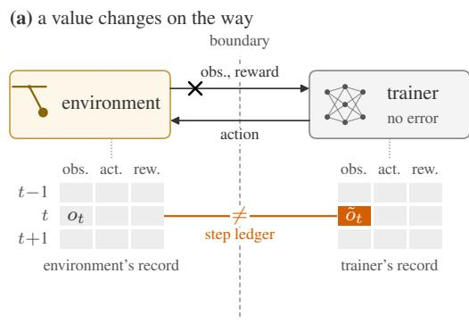
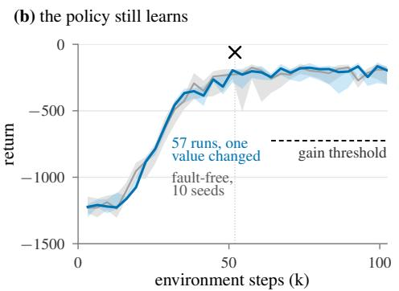
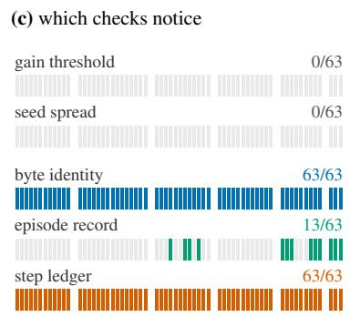
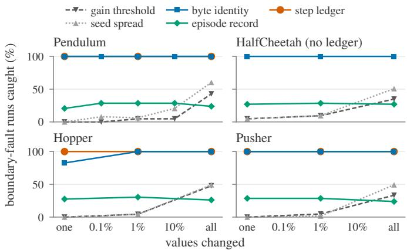
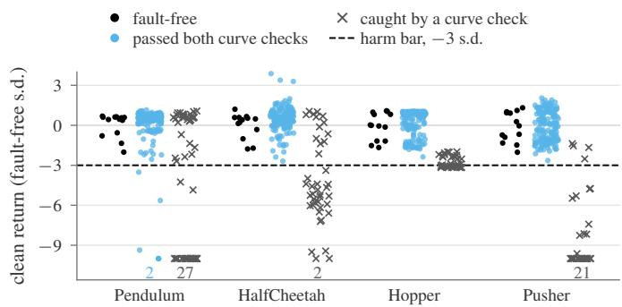
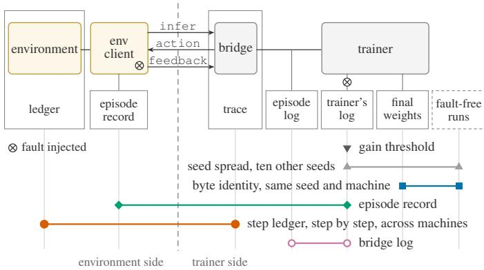
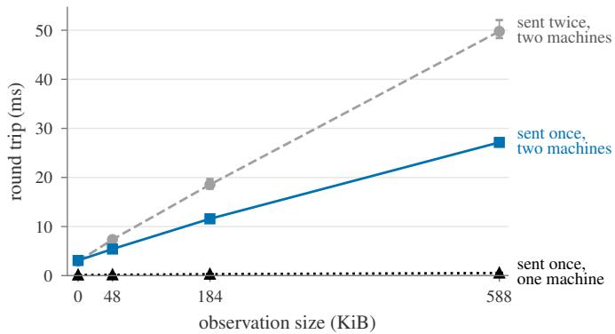
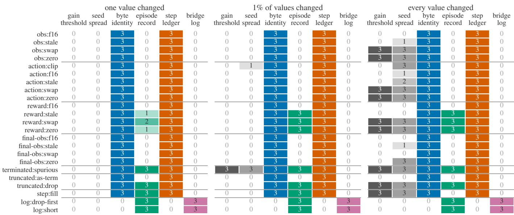

# Detecting Silent Faults at the Environment–Trainer Boundary in Reinforcement Learning

Zuo Gou∗ and Chenhao Lu∗ Tsinghua University, Beijing, China {gouz23, luch21}@mails.tsinghua.edu.cn ∗Equal contribution

  
Fig. 1. A value changed at the environment–trainer boundary raises no error, the policy still learns, and only checks of the run itself notice. (a) Schematic: one value is changed on its way to the trainer; a record on each side of the boundary, compared step by step (the step ledger), disagrees at that step. (b) Pendulum SB3’s PPO through PlugRL (E54): the mean return of each batch of 16 episodes in the trainer’s log. Blue, the median and range of the boundary-fault runs at seeds 0–2 with one value changed, the 57 of 63 that logged all 32 batches (cross: where); grey, the median and range of ten fault-free seeds; dashed, the gain threshold, 500 above the runs’ median start. (c) The 63 runs, one cell each and in the same order in every row, grouped by the field the fault changed: observations, actions, rewards, final observations, episode ends, steps. Filled: the check caught the run (step ledger: E55).

Abstract—Robot reinforcement learning increasingly runs environments outside the trainer: in another process, on another machine, in another language. Many faults at this boundary raise no error. We make the boundary a wire protocol and ask what notices a fault in it.

On Pendulum, HalfCheetah, Hopper and a 7-joint arm (Pusher), we injected up to 23 faults into what crosses the wire and 2 into the trainer’s log, from one value to every value. Unless every value was wrong, a learning-curve threshold caught at most one run in ten, and a comparison with ten fault-free seeds at most 21%. A clean evaluation of all 1,060 final policies agreed with the curves: of the 728 boundary-fault runs both curve checks passed, 723 scored no more than three standard deviations below faultfree seeds, though nearly all ended on other weights and, for reward faults, logged other returns.

Checks of the run itself, not of its outcome, saw every fault. A step ledger kept on both sides and compared step by step caught and located every fault that crossed, on Pendulum, Hopper and Pusher on one machine and on Pendulum across two, with no fault-free run and, on Pendulum, a median 3% more training time. An episode record kept at the environment caught the faults in the trainer’s log. We list such faults found in practice, in Gymnasium 1.3 and our own code and, reported by others, in five multi-agent libraries, and recommend a step ledger and episode counts kept at the environment.

## I. INTRODUCTION

An RL run has a boundary between the code that steps the environment and the trainer, which collects experience and updates the policy: the agent–environment interface [1], drawn in software. In many stacks nobody designs it; it falls where the trainer puts it. A Gymnasium environment [2] is an object in the trainer’s process. RLlib [3], SRL [4] and RLinf [5] run environments in workers that install the framework and join its cluster. Robot learning moves the boundary further: to simulators in other languages, machines with no GPU stack, and robots reaching a policy over the network [6], [7].

Many faults at this boundary are silent: they raise no error or warning [8]. Under its SAME\_STEP autoreset mode, Gymnasium 1.3’s vector episode statistics drop the first reward of every episode after an environment’s first, and count its length one short, until 1.4 (Sec. IV). Training goes on. For environments on another machine, our own evidence that the boundary was right was that the policy still learned.

We test that evidence. PlugRL makes the boundary an explicit wire protocol (Sec. II). The environment side sends observations, applies the actions it gets back, and feeds back rewards and episode ends. A written specification and conformance checkers say what each side must do, and lockstep bridges let Stable-Baselines3 (SB3) [9], CleanRL [10] and RLinf train through it. On one machine a run through it is deterministic, so we can compare a run with an injected fault against the same seed without it. We call a difference between what the environment took and gave and what the trainer sent and received a boundary fault. Our method is mutation testing as RLMutation [11] applies it to deep RL, and the checks that work are the ones production ML uses against training–serving skew [12]; what we add is measuring both at the environment–

trainer boundary. We find:

Neither a learning curve nor a clean evaluation shows most boundary faults (Sec. III, Fig. 1). We injected stale, zeroed, swapped or rounded observations, actions and rewards, wrong episode ends and skipped steps. On Pendulum, the gain threshold we had relied on caught 1 of 21 faults at doses up to 10% of values, and 9 when every value was wrong. On a clean environment, 723 of the 728 boundary-fault runs that passed the curve checks scored like fault-free runs.

A step ledger catches and locates every boundary fault, as it must, and cheaply (Sec. III). A boundary fault is a difference between the two sides’ records, so comparing them must catch it. We measured that it needs no fault-free run or determinism, works across machines, names the step, environment and field, and on Pendulum costs a median 3% of training time. An episode record kept at the environment catches faults in the trainer’s log.

Such faults occur in practice (Sec. IV): in Gymnasium 1.3 and our own code, and, reported by others, in five multi-agent libraries.

A silent fault, then, mostly changes the run rather than the policy: its weights and, for reward and log faults, the numbers it reports. The record of the experiment stops describing the experiment.

Every experiment follows a protocol written before its registered runs, most after a pilot. Changes to it go in a dated amendment. Captions, tables and appendices name each result’s experiment (E43, . . . ), whose protocol, logs and findings are public with the code, specification and checkers: https://github.com/PlugRL.

## II. THE BOUNDARY AS A PROTOCOL

Messages. A connection opens with the server’s metadata (version, chunk length H, offered features). The client then repeats three messages (Fig. 4), msgpack-encoded with NumPy arrays over a WebSocket. An infer carries the observations of n environments, their indices and their step ids; an action reply carries a chunk of H actions; after the chunk, a feedback carries the observation it ended on, the summed reward, the termination and truncation flags, and an info map. The client resets its own environments: the feedback that ends an episode carries the terminal observation, and the next infer the reset one. A connection closes with stop (the run is over) or resync (reconnect at once).

## What the protocol does about faults.

One convention, written down. The specification fixes one episode-end convention where Gymnasium has several (Sec. IV), and states every MUST clause. A checker for each side tests against them, with active probes.

Structural faults are loud. The bridge rejects a message with the wrong shape, keys or environments and closes the connection. It never fills in a missing step: losing a client stops the run, and a client too many is told to stop.

Runs are deterministic on one machine. The bridge is a lockstep server: each trainer step sends every environment its action, and returns once every client has fed back. So two runs through it can be compared byte for byte.

  
Fig. 2. Only the step ledger catches every boundary fault at every dose it ran; byte identity misses only Hopper’s 12 final observations, which training never read. The share of boundary-fault runs each check caught, seeds 0–2: 21 faults, 63 runs per dose (23 and 69 on Hopper). Pendulum and HalfCheetah E54, Hopper E56, Pusher E58; step ledger E55, E56, E58. The ledger was not run on HalfCheetah.

Each side can keep its records. A wrapper at the env client can keep an episode record and half a step ledger; the bridge keeps a bridge log of the rewards it received.

Adapters present an episode end as RLinf, Gymnasium (SAME\_STEP) and SB3 expect it, so these trainers use the protocol through the environment interface they already have.

## III. WHAT NOTICES A FAULT

The faults. SB3’s PPO trained Pendulum, HalfCheetah, Hopper and Pusher, a 7-joint arm that pushes an object to a goal, through the bridge (Appendix F), while the env client changed one field of what it sent, in one way. The observation it sent, the action it applied, the reward, or the observation an episode ended on was replaced by zeros, by the previous step’s value or by the next environment’s, or rounded through float16; an action could also be clipped to half its range. An episode end was invented, or a time limit left out or sent as a termination; on Hopper, which ends an episode when it falls, a termination was also left out or sent as a time limit. Or a step was skipped and its feedback filled in. Two log faults sat in the trainer’s own episode log, of the kind we found in Gymnasium (Sec. IV): each episode’s first reward left out, or its length counted one short. Each fault changed one value, 1% or every value it could reach (on Pendulum also 0.1% and 10%), the same values at every seed, seeds 0–2.

The checks (Fig. 4 in the appendix). A run’s fault was caught by the gain threshold if its gain, the mean logged return at the end of training minus that at the start, fell below a bar fixed before the runs (on Pendulum, 500); by seed spread if its final return lay more than three standard deviations from the mean of ten fault-free seeds; by byte identity if its final weights differed from the fault-free run’s at the same seed; by the episode record if the trainer’s log disagreed with the env client’s record, kept before any fault, in count, length or return; and by the step ledger if the two sides’ records of any step differed.

  
Fig. 3. Nearly all policies behind faults that pass both curve checks score like fault-free ones. Each final policy’s clean return, the mean of 50 deterministic episodes on a fresh environment (E57, E58), in standard deviations of ten fault-free seeds. Boundary-fault runs at seeds 0–2, every dose; black, faultfree runs. Points below 10 sit on the floor, counted.

Learning curves miss them (Fig. 2). At doses up to 10% of values, the gain threshold caught at most one run in ten on all four environments. With every value wrong it caught 43%, 35%, 48% and 33%, and mostly faults that broke learning or emptied the log. The seed-spread check raised few false alarms: 0, 1, 0 and 0 of ten fault-free seeds, each judged against the other nine. Yet at doses below every value it caught at most 21%. The spread of seeds explains it. One changed value moved a boundary-fault run’s final return by a median of 15, 85, 197 and 0.7; changing the seed moved it about as much or more, by standard deviations of 11, 146, 259 and 1.9.

So does a clean evaluation. We ran each of the 1,060 final policies for 50 deterministic episodes on a fresh environment (Fig. 3). Of the runs that passed both curve checks, 5 of 255 on Pendulum and none of 473 on the other three scored more than three standard deviations below ten fault-free seeds; the other 106 runs that did had all failed a curve check. With every reward zeroed, the log reads 0, the best possible return on Pendulum and on Pusher, while the policies score −1196 to −1639 and −99 to −129.

A step ledger sees every boundary fault. A wrapper around each environment, outside the env client’s code, recorded each step: the observation it had given, the action it was handed, and what it returned. A second wrapper, around the vector environment SB3 trained on, recorded what it sent and received. A boundary fault is a difference between the two, so the comparison must catch it; the test is whether it does so in practice, and at what cost. Compared step by step, the two halves caught all 189 boundary-fault runs on Pendulum, 207 on Hopper and 189 on Pusher, each at its first changed value and field, and found no difference in the 27 runs on each without one. The two added a median 3% to Pendulum’s training time (−5 to +9%, each run’s learn\_s against the same run without them) and left all 216 runs weights unchanged. With the env client on a laptop and SB3 on a workstation, they caught and located all 21 faults at one value, and found no difference in the fault-free run. That run ended on other weights than on the workstation: byte identity cannot judge across machines.

The episode record sees the books. It caught every log fault, and every boundary fault that changed a reward beyond its tolerance, an episode end or some steps. It missed faults in observations, final observations and actions, ends sent as the wrong kind, and every step skipped: none changes the episodes it compares. The bridge log, kept on the trainer’s side of the wire, caught only the log faults. A record that is to catch a client’s faults has to be kept at the environment.

Byte identity sees what training reads. On one machine the weights changed in all 504 boundary-fault runs on Pendulum and HalfCheetah, and in none of 48 runs with a 1 ms delay, a float64 wire or a log fault. On Pusher, whose episodes all end at the time limit, they changed in 189 of 189. On Hopper they changed in 195 of 207, and in none of its 24 such runs. In the other 12, one final observation changed, at a fall. SB3 bootstraps from it only at a time limit, so training never read it, and the weights stayed byte-identical. The fault was real, and the step ledger caught all 12; a trainer that reads that value would have learned from it. The two faults the bridge rejects, rows out of order and a reward missing, raised within 10 s.

Why it matters when the policy learns. What these faults do, no curve check sees. They change the record: in 888 of 900 runs the final weights differ from the fault-free run’s at the same seed, and a reward or log fault changes the returns the trainer logs, as Gymnasium’s SAME\_STEP statistics did (Sec. IV). They can cost the policy: 5 of the 255 Pendulum runs that passed both curve checks, under five different faults and doses, scored more than three standard deviations below fault-free seeds, though 13 fault-free runs cannot tell that from a rare bad seed. In one arm of a comparison, a reward or log fault would read as a difference between methods [13]. Whether a fault reaches the weights depends on how the trainer bootstraps, as Hopper’s final observations show under SB3; on harder tasks such faults can change what is learned, as timelimit handling does [14].

## IV. FAULTS FOUND IN PRACTICE

The faults of Sec. III are not hypothetical (Table I). We found some while building and checking PlugRL, many by reconciliation or a controlled comparison, and none by an error. Others were reported in multi-agent libraries, where agents that act in turn or leave early add conventions to get wrong. Every boundary fault among them is a kind we injected. Faults in a run’s lifecycle and cost, which fall outside the boundary, are in Appendix B.

## V. MOVING THE BOUNDARY

We applied the checks to the protocol itself (Table III, Appendix C). On one machine, SB3 trained 16 Pendulum, HalfCheetah or Atari environments in its own process and behind the bridge: all nine pairs ended on byte-identical weights and logged identical episodes, and all 12 Pendulum runs behind a proxy that held every byte 0–25 ms each way ended on the in-process weights. The env client waits for each action, so latency decides when a step happens, not what it produces. The bridge added 0.4–0.6 ms a step for 16 state vectors and 2.6–3.0 ms for 16 frames. Across machines a seed no longer reproduces: two MuJoCo builds differ in the last bit at the first step. Every seed passed its gain threshold across machines, with env clients on a Windows laptop with no torch, Ray or RLinf, and on one machine, in a C++ program of under 900 lines and under RLinf, SB3 and CleanRL. Sec. III shows that threshold to be weak; the step ledger’s one fault-free run across machines, clean at every step, is the stronger evidence.

TABLE I  
FAULTS THAT RAISED NO ERROR, FOUND IN PRACTICE.
<table><tr><td>kind</td><td>where</td><td>what was wrong</td></tr><tr><td rowspan="2">reward</td><td>RLlib [15]</td><td>an agent with no last observation got reward 0, not the environment&#x27;s</td></tr><tr><td>Tianshou 0.4.2 [16]</td><td>rewards earned while the opponent moved were dropped</td></tr><tr><td>action</td><td>PettingZoo 1.22 [17]</td><td>one-dimensional continuous actions were cast to integers</td></tr><tr><td>final obs.</td><td>SuperSuit [18]</td><td>the reset&#x27;s info overwrote the terminal observation</td></tr><tr><td>episode end</td><td>MAPPO&#x27;s SMACv2 wrapper [19]</td><td>dead agents&#x27; padded steps were trained on as real</td></tr><tr><td rowspan="4">log</td><td>Gymnasium 1.3 (E51)</td><td>under SAME_STEP, every episode after an env&#x27;s first lost its first reward and a step (fixed in</td></tr><tr><td>CleanRL [10] (E51)</td><td>1.4 [20]) on Gymnasium 1.3, not the 0.29 it</td></tr><tr><td>RLlib 2.53 [21]</td><td>pins, no episode was logged a shared module logged one</td></tr><tr><td>our specification (E44)</td><td>agent&#x27;s return, not the sum for a client written from it, the server logged a return of 0</td></tr></table>

## VI. THE PRICE OF THE BOUNDARY

On one machine an exchange costs 0.1 ms with states only and under 1 ms at 588 KiB. Between two machines it costs a latency s plus k copies of the observation’s P bytes over the bandwidth B, $t ~ = ~ s + k P / B$ [22], which predicted the measured times within 3–10%. The negotiated reuse-feedback-obs feature sends each observation once instead of twice: at 588 KiB the round trip fell from 49.8 to 27.1 ms, with byte-identical weights (Appendix D). A 184 KiB camera observation crosses our Wi-Fi path in 11.6 ms, 12% of the 100 ms we measured for one action chunk from a full-size $\pi _ { 0 . 5 }$ [23] in openpi [24]. A full-size $\pi _ { 0 . 5 }$ with LIBERO weights took one learning step through the protocol on LIBERO, which says nothing of how well RL tunes it.

## VII. CONVENTIONS WE RECOMMEND

Do not take a learning curve alone as evidence that the boundary is right (Sec. III). Instead:

Keep a step ledger. Record what each environment took and gave, in a wrapper around it, and what the trainer sent and received, and compare the two step by step. Wherever we kept one (Pendulum, Hopper, Pusher), it caught and located every boundary fault we injected, on one machine and on Pendulum across two, for a median 3% of training time on Pendulum.

Count episodes at the environment. Keep the episode record next to the environment, not on the trainer’s side of the wire, and check the trainer’s log against it.

On one machine, show that a change beneath the policy leaves the weights alone, byte for byte: a change of placement, transport, latency, scheduler or protocol version (Secs. V–VI, Table II). If it cannot, say why.

Report the boundary: where the environments ran, how they reached the trainer, the bytes per step and the time per step. State the episode-end convention, distinguish stop from resync, and never fill in a missing step.

## VIII. RELATED WORK

What beneath the algorithm changes results. Implementation details change PPO’s results [25], [26], time limits change what is learned [14], reporting practice changes what can be concluded [13], [27], and a one-bit change moves a run as far as a new seed [28]. We add the environment–trainer boundary to that list. Our faults are silent [8], of kinds found in DRL programs [29]. Our design is mutation testing [30] as DeepCrime [31] and RLMutation [11] apply it, and RL-Mutation found that comparing mean rewards misses mutants because training is stochastic. The step ledger is an end-to-end check [32] that bridges what each side perceives [33], TFX’s training–serving skew check [12] applied to the boundary.

Environments behind a channel. RL-Glue [34] made the interface language-independent. ML-Agents [35], Godot RL Agents [36] and RLlib [3] reach environments outside the trainer; SEED RL [37], SRL [4] and RLinf [5] keep them inside the framework. dm env rpc [38] has a compliance suite, the closest precedent for our checkers, but no trainer side. Gymnasium’s check\_env [39] and EnvPool’s tests [40] check an environment against its API or a reference, before training; range and NaN checks would pass a stale or rounded value. openpi [24] serves policies for inference only; LeRobot’s HIL-SERL [7] runs the policy beside the robot. None of these checks a run’s record against one kept at the environment.

## IX. LIMITATIONS

We chose the faults, to cover every field but info and the ways Table I shows it going wrong, and injected them into four simulated, state-based environments with dense rewards, under one trainer (SB3’s PPO) at three seeds. That the faults the curves miss leave the policy intact may not hold for sparse rewards, long horizons, replay buffers, images or real robots. The step ledger needs a wrapper around the environment, and sees nothing that goes wrong inside it; a robot reached only through its own client can be wrapped no closer than that client. We compared ledgers after each run (150 MB a run on Hopper); checking a digest of each step as the run goes is future work. The same people wrote the specification and the C++ client. We do not study environments that keep moving while the env client waits for an action, as a real robot does.

## ACKNOWLEDGMENT

We thank Zilin Kang, who helped build PlugRL, and the reviewers for their comments.

## REFERENCES

[1] R. S. Sutton and A. G. Barto, Reinforcement Learning: An Introduction, 2nd ed. MIT Press, 2018.

[2] M. Towers, A. Kwiatkowski, J. Balis, G. De Cola, T. Deleu, M. Goulao,˜ A. Kallinteris, M. Krimmel, A. KG, R. Perez-Vicente et al., “Gymnasium: A standard interface for reinforcement learning environments,” in Advances in Neural Information Processing Systems (NeurIPS), Datasets and Benchmarks Track, vol. 38, 2025, pp. 163 114–163 129.

[3] E. Liang, R. Liaw, R. Nishihara, P. Moritz, R. Fox, K. Goldberg, J. E. Gonzalez, M. I. Jordan, and I. Stoica, “RLlib: Abstractions for distributed reinforcement learning,” in International Conference on Machine Learning (ICML), ser. Proceedings of Machine Learning Research, vol. 80, 2018, pp. 3053–3062.

[4] Z. Mei, W. Fu, J. Gao, G. Wang, H. Zhang, and Y. Wu, “SRL: Scaling distributed reinforcement learning to over ten thousand cores,” in International Conference on Learning Representations (ICLR), 2024.

[5] C. Yu, Y. Wang, Z. Guo, H. Lin, S. Xu, H. Zang, Q. Zhang, Y. Wu, C. Zhu, J. Hu et al., “RLinf: Flexible and efficient large-scale reinforcement learning via macro-to-micro flow transformation,” in USENIX Symposium on Operating Systems Design and Implementation (OSDI), 2026, pp. 829–846.

[6] K. Black, N. Brown, D. Driess, A. Esmail, M. R. Equi, C. Finn, N. Fusai, L. Groom, K. Hausman, B. Ichter et al., “π0: A vision-language-action flow model for general robot control,” in Robotics: Science and Systems (RSS), 2025.

[7] R. Cadene, S. Alibert, A. Soare, Q. Gallouedec, A. Zouitine et al., “LeRobot: State-of-the-art machine learning for real-world robotics in PyTorch,” https://github.com/huggingface/lerobot, 2024.

[8] F. Tambon, A. Nikanjam, L. An, F. Khomh, and G. Antoniol, “Silent bugs in deep learning frameworks: An empirical study of Keras and TensorFlow,” Empirical Software Engineering, vol. 29, no. 1, 2024, article 10.

[9] A. Raffin, A. Hill, A. Gleave, A. Kanervisto, M. Ernestus, and N. Dormann, “Stable-Baselines3: Reliable reinforcement learning implementations,” Journal ofMachine Learning Research, vol. 22, no. 268, pp. 1–8, 2021.

[10] S. Huang, R. F. J. Dossa, C. Ye, J. Braga, D. Chakraborty, K. Mehta, and J. G. M. Araujo, “CleanRL: High-quality single-file implementations of´ deep reinforcement learning algorithms,” Journal of Machine Learning Research, vol. 23, no. 274, pp. 1–18, 2022.

[11] F. Tambon, V. Majdinasab, A. Nikanjam, F. Khomh, and G. Antoniol, “Mutation testing of deep reinforcement learning based on real faults,” in IEEE Conference on Software Testing, Verification and Validation (ICST), 2023, pp. 188–198.

[12] E. Breck, N. Polyzotis, S. Roy, S. E. Whang, and M. Zinkevich, “Data validation for machine learning,” in Proceedings of Machine Learning and Systems (SysML 2019), vol. 1, 2019, pp. 334–347.

[13] P. Henderson, R. Islam, P. Bachman, J. Pineau, D. Precup, and D. Meger, “Deep reinforcement learning that matters,” in AAAI Conference on Artificial Intelligence, vol. 32, no. 1, 2018.

[14] F. Pardo, A. Tavakoli, V. Levdik, and P. Kormushev, “Time limits in reinforcement learning,” in International Conference on Machine Learning (ICML), ser. Proceedings of Machine Learning Research, vol. 80, 2018, pp. 4045–4054.

[15] Ray pull request 31156, “[RLlib] Fix reward collection for OpenSpiel games,” https://github.com/ray-project/ray/pull/31156, 2022.

[16] Tianshou issue 399, “MultiAgentPolicyManager misses rewards,” https: //github.com/thu-ml/tianshou/issues/399, 2021.

[17] PettingZoo issue 939, “[Bug Report] parallel\_to\_aec\_wrapper is faulty for array action or continuous action,” https://github.com/ Farama-Foundation/PettingZoo/issues/939, 2023.

[18] SuperSuit issue 232, “[Bug] Final Observation is not returned when using pettingzoo\_env\_to\_vec\_env\_v1/MarkovVectorEnv,” https://github.com/Farama-Foundation/SuperSuit/issues/232, 2023.

[19] on-policy pull request 86, “fix smacv2 dones bugs and a type bug,” https://github.com/marlbenchmark/on-policy/pull/86, 2023.

[20] Gymnasium pull request 1624, “Fix vector RecordEpisodeStatistics reporting wrong stats with SAME STEP autoreset,” https://github.com/ Farama-Foundation/Gymnasium/pull/1624, 2026.

[21] Ray issue 59860, “[RLlib] module\_episode\_returns only accumating [sic] one agent’s returns when multiple agents map to same module\_id,” https://github.com/ray-project/ray/issues/59860, 2026.

[22] R. W. Hockney, “The communication challenge for MPP: Intel Paragon and Meiko CS-2,” Parallel Computing, vol. 20, no. 3, pp. 389–398, 1994.

[23] K. Black, N. Brown, J. Darpinian, K. Dhabalia, D. Driess, A. Esmail, M. R. Equi, C. Finn, N. Fusai, M. Y. Galliker et al., “π0.5: a visionlanguage-action model with open-world generalization,” in Conference on Robot Learning (CoRL), ser. Proceedings of Machine Learning Research, vol. 305, 2025, pp. 17–40.

[24] Physical Intelligence, “openpi,” https://github.com/Physical-Intelligence/ openpi, 2025.

[25] L. Engstrom, A. Ilyas, S. Santurkar, D. Tsipras, F. Janoos, L. Rudolph, and A. Madry, “Implementation matters in deep RL: A case study on PPO and TRPO,” in International Conference on Learning Representations (ICLR), 2020.

[26] S. Huang, R. F. J. Dossa, A. Raffin, A. Kanervisto, and W. Wang, “The 37 implementation details of proximal policy optimization,” in ICLR Blog Track, 2022.

[27] R. Agarwal, M. Schwarzer, P. S. Castro, A. Courville, and M. G. Bellemare, “Deep reinforcement learning at the edge of the statistical precipice,” in Advances in Neural Information Processing Systems (NeurIPS), 2021.

[28] C. Summers and M. J. Dinneen, “Nondeterminism and instability in neural network optimization,” in International Conference on Machine Learning (ICML), ser. Proceedings of Machine Learning Research, vol. 139, 2021, pp. 9913–9922.

[29] A. Nikanjam, M. M. Morovati, F. Khomh, and H. Ben Braiek, “Faults in deep reinforcement learning programs: A taxonomy and a detection approach,” Automated Software Engineering, vol. 29, no. 1, 2022, article 8.

[30] R. A. DeMillo, R. J. Lipton, and F. G. Sayward, “Hints on test data selection: Help for the practicing programmer,” Computer, vol. 11, no. 4, pp. 34–41, 1978.

[31] N. Humbatova, G. Jahangirova, and P. Tonella, “DeepCrime: Mutation testing of deep learning systems based on real faults,” in ACM SIGSOFT International Symposium on Software Testing and Analysis (ISSTA), 2021, pp. 67–78.

[32] J. H. Saltzer, D. P. Reed, and D. D. Clark, “End-to-end arguments in system design,” ACM Transactions on Computer Systems, vol. 2, no. 4, pp. 277–288, 1984.

[33] P. Huang, C. Guo, L. Zhou, J. R. Lorch, Y. Dang, M. Chintalapati, and R. Yao, “Gray failure: The Achilles’ heel of cloud-scale systems,” in Workshop on Hot Topics in Operating Systems (HotOS), 2017, pp. 150–155.

[34] B. Tanner and A. White, “RL-Glue: Language-independent software for reinforcement-learning experiments,” Journal of Machine Learning Research, vol. 10, pp. 2133–2136, 2009.

[35] A. Juliani, V.-P. Berges, E. Teng, A. Cohen, J. Harper, C. Elion, C. Goy, Y. Gao, H. Henry, M. Mattar, and D. Lange, “Unity: A general platform for intelligent agents,” arXiv preprint arXiv:1809.02627, 2018.

[36] E. Beeching, J. Debangoye, O. Simonin, and C. Wolf, “Godot reinforcement learning agents,” arXiv preprint arXiv:2112.03636, 2021.

[37] L. Espeholt, R. Marinier, P. Stanczyk, K. Wang, and M. Michalski, “SEED RL: Scalable and efficient deep-RL with accelerated central inference,” in International Conference on Learning Representations (ICLR), 2020.

[38] T. Ward and J. Lemmon, “dm env rpc: A networking protocol for agent–environment communication,” https://github.com/ google-deepmind/dm env rpc, 2019.

[39] Farama Foundation, “Gymnasium environment checkers: check\_env and check\_environments\_match,” https://github.com/ Farama-Foundation/Gymnasium/tree/main/gymnasium/utils, 2023, accessed 2026-10-06.

[40] J. Weng, M. Lin, S. Huang, B. Liu, D. Makoviichuk, V. Makoviychuk, Z. Liu, Y. Song, T. Luo, Y. Jiang, Z. Xu, and S. Yan, “EnvPool: A highly parallel reinforcement learning environment execution engine,” in Advances in Neural Information Processing Systems (NeurIPS), Datasets and Benchmarks Track, vol. 35, 2022, pp. 22 409–22 421.

[41] D. McAllister, S. Ge, B. Yi, C. M. Kim, E. Weber, H. Choi, H. Feng, and A. Kanazawa, “Flow matching policy gradients,” in International Conference on Learning Representations (ICLR), 2026.

[42] E. Todorov, T. Erez, and Y. Tassa, “MuJoCo: A physics engine for model-based control,” in IEEE/RSJ International Conference on Intelligent Robots and Systems (IROS), 2012, pp. 5026–5033.

[43] J. Schulman, F. Wolski, P. Dhariwal, A. Radford, and O. Klimov, “Proximal policy optimization algorithms,” arXiv preprint arXiv:1707.06347, 2017.

[44] A. Raffin, “RL Baselines3 Zoo,” https://github.com/DLR-RM/ rl-baselines3-zoo, 2020.

## APPENDIX A

## WHAT EACH CHECK CAUGHT, FAULT BY FAULT

  
Fig. 4. The boundary and the checks. Filled boxes run code; outlines are records; the dashed outline is other runs. Three messages cross the boundary. Faults ( ) were injected in the env client, after its episode record, and in the trainer’s log. Each row marks what a check compares; only the episode record and the step ledger reach across the boundary.

Fig. 6 breaks Fig. 2’s Pendulum panel down by fault and adds the log faults and the bridge log.

## APPENDIX B

## FAULTS OUTSIDE THE BOUNDARY

Two more kinds of fault raised no error while we built and checked PlugRL: in a run’s lifecycle and in its cost (Table II).

TABLE II  
FAULTS OUTSIDE THE BOUNDARY THAT RAISED NO ERROR.
<table><tr><td>kind</td><td>where</td><td>what was wrong</td></tr><tr><td>lifecycle</td><td>RLinf (E48)</td><td>environments never closed; outside clients reconnected 3,190 times in</td></tr><tr><td></td><td>our bridge (E48)</td><td>25 minutes a surplus client was told to resync, not stop: 2 million reconnects in 10 minutes</td></tr><tr><td>cost</td><td>our scheduler (E47)</td><td>a 0.1 ms sleep that the event loop rounds to 1 ms made collection 1.87× slower; the fix left the weights byte-identical</td></tr></table>

## APPENDIX C

## MOVING THE BOUNDARY IN FULL

E43 found the two machines’ MuJoCo builds differ by $8 . 9 \times 1 0 ^ { - 1 6 }$ at the first step. The bridge added 0.37–0.58 ms per vector step of 16 state vectors (E50) and 2.60–2.99 ms of

16 frames (E53). On one machine, E49 also compared every trainer’s log with the bridge log, and they agreed; kept on the trainer’s side, the bridge log rules out log faults, not boundary faults. RLinf learns Pendulum late: its budget was raised to 409,600 steps after its pilot, before the registered runs.

TABLE III  
MOVING THE BOUNDARY. ABOVE THE LINE, BYTE IDENTITY WITH THE IN-PROCESS RUN; BELOW IT, THE PRE-REGISTERED GAIN THRESHOLD (SEEDS THAT PASS / SEEDS RUN).
<table><tr><td>exp. trainer</td><td></td><td>environments ran</td><td>result</td></tr><tr><td></td><td>E50 SB3, PPO</td><td>in-process vs. bridge</td><td>same weights 6/6</td></tr><tr><td></td><td>E53 SB3, CNN</td><td>Atari frames, as E50</td><td>same weights 3/3</td></tr><tr><td></td><td>E52 SB3, PPO</td><td>proxy, 0–25 ms each way</td><td>same weights 12/12</td></tr><tr><td></td><td>E43 PlugRL, FPO [41]</td><td>same machine</td><td>passes 6/6</td></tr><tr><td></td><td>(HalfCheetah [42])</td><td>laptop, Wi-Fi + Tailscale</td><td>passes 6/6</td></tr><tr><td></td><td>E44 PlugRL, PPO [43]</td><td>Python env client</td><td>passes 3/3</td></tr><tr><td></td><td>(Pendulum)</td><td>C++, no third-party library passes 3/3</td><td></td></tr><tr><td></td><td>E48 RLinf, PPO</td><td>same machine</td><td>passes 3/3</td></tr><tr><td></td><td>(HalfCheetah)</td><td>laptop, Tailscale</td><td>passes 3/3</td></tr><tr><td></td><td>E49 RLinf, SB3 (PPO)</td><td>C++ Pendulum</td><td>passes 6/6</td></tr><tr><td></td><td>SB3, CleanRL (PPO) HalfCheetah</td><td></td><td>passes 6/6</td></tr></table>

## APPENDIX D

## THE PRICE OF CROSSING

E43 checked $t = s + k P / B$ on its two machines, and E46 measured what reuse-feedback-obs saves (Fig. 5). The 100 ms of Sec. VI is E10’s: the median, over three launches, of one call to openpi’s sample\_actions (five denoising steps) for a full-size $\pi _ { 0 . 5 }$ with random weights, which change a forward’s output but not its cost, on one GPU. The π0.5 learning step is E11’s.

  
Fig. 5. Sending each observation once nearly halves a large exchange between machines. Median round trip per exchange, five runs of 1,000 exchanges each (bars: their range), over one Wi-Fi and Tailscale path at 23.7 MB/s and on one machine (E46). Without reuse-feedback-obs each observation is sent twice; with it, negotiated when the connection opens, once. “States only” is plotted at 0.

## APPENDIX E

## WHAT THE ENVIRONMENT SIDE INSTALLS

Table IV measures, in fresh environments, what each system’s environment side installs to exchange data with its trainer (E45). A thin environment side is not unique:

  
Fig. 6. What each check caught on Pendulum, fault by fault (E54; step ledger E55): how many of the three seeds 0–2 it caught, with one value, 1% and every value changed. Rows are grouped by the field the fault changed; the last two rows are log faults.

dm env rpc’s [38] and openpi’s client [24] are thinner than our full env client. Of the systems here that train through their channel, only PlugRL’s environment side needs no torch.

TABLE IV  
ENVIRONMENT SIDE OF EACH SYSTEM (E45): RLLIB 2.58, LEROBOT 0.6.1, DM ENV RPC 1.1.7. SIZES EXCLUDE THE INTERPRETER.
<table><tr><td>system</td><td>trains</td><td>packages</td><td>size</td><td>torch</td></tr><tr><td>PlugRL, C++ client</td><td>yes</td><td>0</td><td>86KB</td><td>no</td></tr><tr><td>PlugRL, minimal Python</td><td>yes</td><td>2</td><td>2.6MB</td><td>no</td></tr><tr><td>PlugRL, full env client</td><td>yes</td><td>31</td><td>222 MB</td><td>no</td></tr><tr><td>RLlib external env [3]</td><td>yes</td><td>64</td><td>6.1 GB</td><td>CUDA</td></tr><tr><td>LeRobot HIL-SERL [7]</td><td>yes</td><td>144</td><td>6.1 GB</td><td>CUDA</td></tr><tr><td>dm_env_rpc [38]</td><td>no trainer</td><td>12</td><td>81MB</td><td>no</td></tr><tr><td>openpi client [24]</td><td>inference only</td><td>9</td><td>90MB</td><td>no</td></tr></table>

## APPENDIX F

## E50 IN FULL

SB3 2.9.0 PPO, 16 environments, 16×256 frames per rollout, one torch thread, on a 24-core Linux workstation. Pendulum uses rl-zoo’s settings [44] for 102,400 steps; HalfCheetah uses SB3’s defaults for 409,600 steps. In-process means DummyVecEnv. Bridge means the same 16 environments in another process, on one connection to the bridge’s SB3 adapter, a VecEnv. A vector step is one step of all 16 (Table V).

Every pair also logged identical episodes. The bridge log agreed with SB3’s monitor.csv in every bridge run.

## APPENDIX G

## E51 IN FULL

Every counter ran, with Gymnasium 1.3.0, on an environment whose step t pays reward t and which terminates at t = 5. Every episode therefore has return 15 and length 5. There were 2 environments with 3 episodes each (Table VI).

TABLE V  
E50 PER SEED: THE FINAL WEIGHTS’ SHA-256 (FIRST EIGHT DIGITS) AND THE WALL TIME, IN-PROCESS AND THROUGH THE BRIDGE.
<table><tr><td>env</td><td></td><td>seed weights (SHA-256)</td><td>in-process</td><td></td><td>bridge per vector step</td></tr><tr><td>Pendulum</td><td>0</td><td>ec5b8226both</td><td>12.7 s</td><td>16.3 s</td><td>+0.57 ms</td></tr><tr><td></td><td>1</td><td>062e92e3 both</td><td>12.7 s</td><td>16.5 s</td><td>+0.58 ms</td></tr><tr><td></td><td>2</td><td>3a8d968f both</td><td>12.7 s</td><td>16.5 s</td><td>+0.58 ms</td></tr><tr><td>HalfCheetah</td><td>0</td><td>8261c03a both</td><td>64.0s</td><td>76.0s</td><td>+0.47 ms</td></tr><tr><td></td><td>1</td><td>86564694both</td><td>66.7 s</td><td>76.5 s</td><td>+0.38 ms</td></tr><tr><td></td><td>2</td><td>65cc8843 both</td><td>67.0s</td><td>76.5 s</td><td>+0.37 ms</td></tr></table>

Gymnasium had already fixed its vector counter on its main branch [20]; the fix was released in 1.4.0, after these runs.

TABLE VI  
E51: WHAT EACH EPISODE COUNTER LOGGED, AS (RETURN, LENGTH).
<table><tr><td>counter</td><td>autoreset</td><td>logged</td></tr><tr><td>Gymnasium vector</td><td>NEXT_STEP</td><td>6 × (15, 5)</td></tr><tr><td>RecordEpisodeStatistics the same</td><td>SAME_STEP</td><td>2 × (15, 5), then</td></tr><tr><td></td><td></td><td>4 × (14, 4)</td></tr><tr><td>single-env RecordEpisodeStatistics per</td><td>both</td><td>6 × (15, 5)</td></tr><tr><td>sub-env</td><td></td><td></td></tr><tr><td>CleanRL&#x27;s logging loop, verbatim the same</td><td>NEXT_STEP nothing</td><td></td></tr><tr><td></td><td></td><td>SAME_STEP TypeError</td></tr><tr><td>SB3 VecMonitor; SB3 Monitor bridge, SB3 and Gymnasium</td><td>SB3&#x27;s</td><td>6 × (15, 5)</td></tr><tr><td>adapters, and the bridge log</td><td></td><td>SAME_STEP 6 × (15, 5)</td></tr><tr><td>our env client&#x27;s counter, as its runner uses it</td><td>its own</td><td>6 × (15, 5)</td></tr><tr><td>the same, with no explicit resets</td><td>NEXT_STEP</td><td>(15, 5), (30, 11), (45,17)</td></tr></table>

The last row breaks that counter’s unwritten contract: only an explicit reset, which its runner always calls, zeroes it.