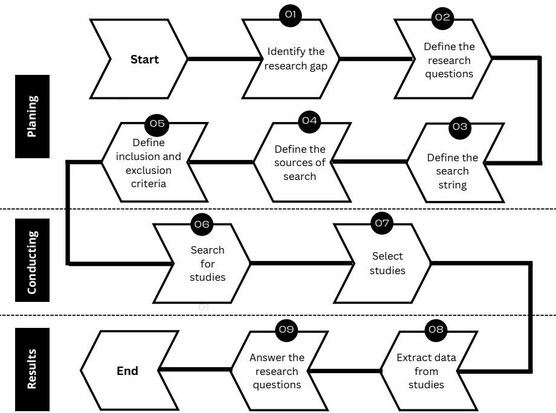
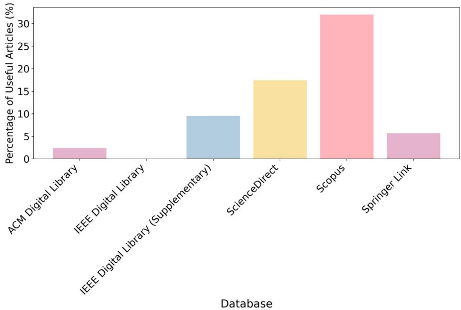
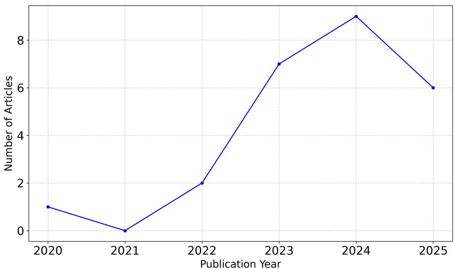
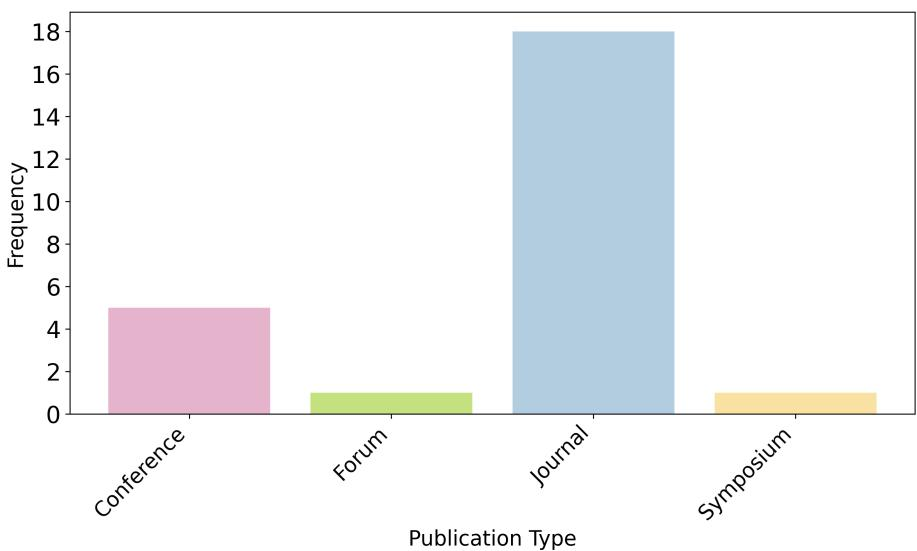
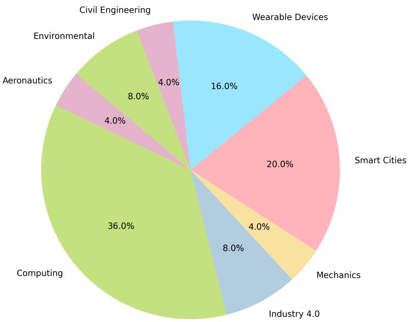
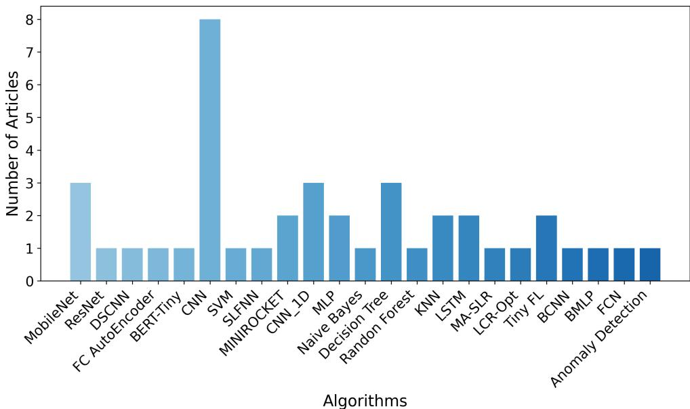
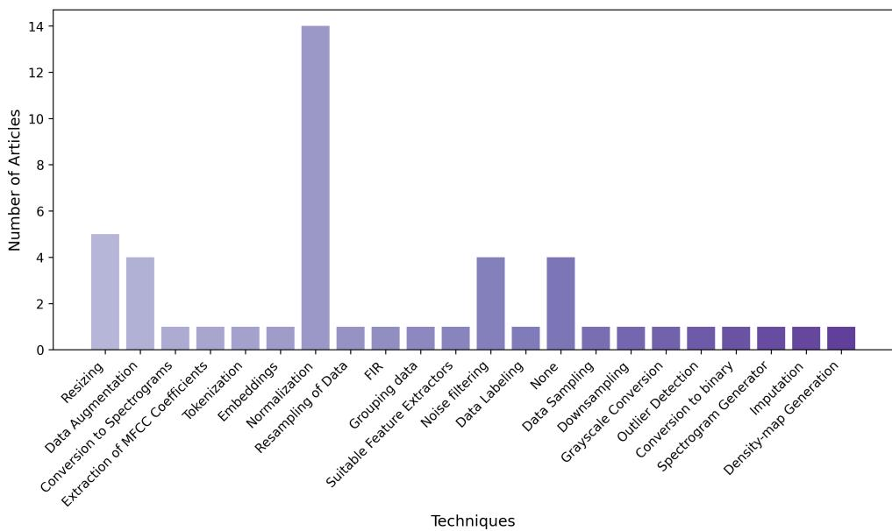
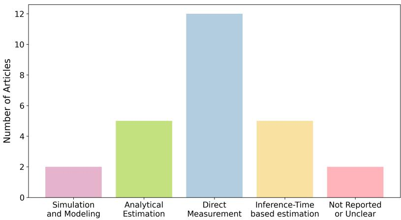
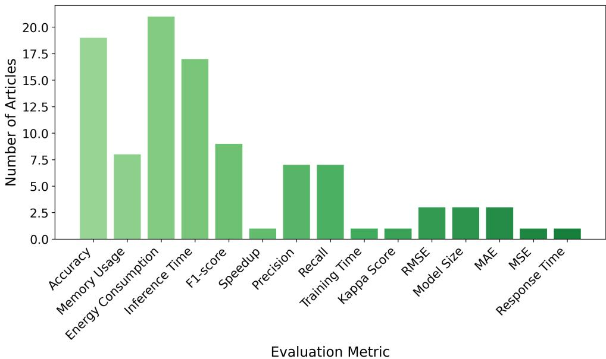
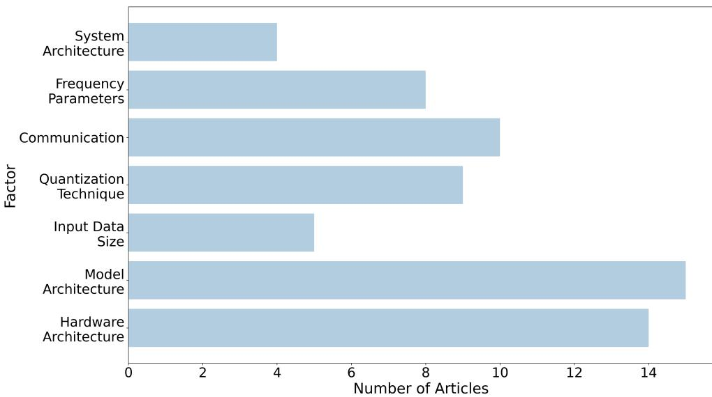

# Energy Measurement and Optimization of TinyML in Resource-Constrained Embedded Systems: A Systematic Mapping Study

Clariele Almeida1\*, Renan Beserra1, Rafael Moura1, Danilo Ara´ujo1, Bruno Nogueira3, S´ergio Chevtchenko2, Ermeson Andrade1\*

1\*Federal Rural University of Pernambuco (UFRPE), Recife, Pernambuco, Brazil .

2Western Sydney University, Sydney, New South Wales, Australia .   
3Federal University of Alagoas (UFAL), Macei´o, Alagoas, Brazil .

\*Corresponding author(s). E-mail(s): clariele.almeida@ufrpe.br; ermeson.andrade@ufrpe.br;

## Abstract

The rapid expansion of the Internet of Things (IoT) has increased the vol ume of data generated at the network edge, where many devices operate under severe memory, processing, and energy constraints. In this context, Tiny Machine Learning (TinyML) enables Machine Learning (ML) tasks to be executed on microcontrollers, smart sensors, and other resource-constrained platforms. However, the literature remains heterogeneous regarding the algorithms evaluated, energy-measurement methods, reported metrics, influencing factors, and opti mization strategies. This study presents a systematic mapping of energy-aware TinyML research. It identifies the main models and learning approaches, classifies energy-evaluation methodologies and metrics, examines the technical factors afecting energy consumption, and organizes the reported optimization techniques into a structured taxonomy. The findings highlight the frequent use of convolutional and lightweight architectures, direct measurements and analytical estimations, and factors related to model architecture, hardware, communication, numerical precision, and input characteristics. The optimization strategies were grouped into model compression, hardware-aware design, system and communication optimization, and data and processing optimization. The results also reveal limited standardization in experimental platforms, measurement procedures, and reporting practices, limiting reproducibility and direct comparison

across studies. This mapping provides an updated overview of the field and guidance for developing and evaluating more energy-eficient TinyML solutions.

Keywords: TinyML; energy consumption; energy eficiency; resource-constrained devices; systematic mapping study

## 1 Introduction

TinyML refers to the application of ML algorithms on embedded devices with limited resources, such as microcontrollers, smart sensors, and battery-powered IoT devices [1]. This paradigm enables local data processing, which is essential in applications that require low latency, reduced bandwidth consumption, and enhanced privacy. The main advantage of TinyML is that it allows embedded intelligence in environments where continuous access to power or connectivity is not available, making possible solutions such as environmental monitoring, industrial sensors, and wearable devices [2].

Although TinyML and conventional ML share theoretical foundations, they difer significantly in terms of scale and computational requirements. Traditional ML is typically executed on powerful servers or cloud infrastructure, using complex models and processing large volumes of data [3], whereas TinyML must be highly optimized to operate eficiently on devices with severe limitations in processing power, memory, and energy [3]. This contrast makes energy eficiency a central challenge in the development of TinyML-based solutions. The use of models that do not consider these constraints can compromise hardware longevity and limit applications in remote or hard-to-reach locations [4].

The rapid growth of IoT further intensifies this scenario. The number of connected devices has increased significantly, generating large volumes of real-time data [5]. Cloud computing alone is not suficient to handle this demand eficiently. Studies show that data transmission consumes orders of magnitude more energy than local processing. Hussein et al. [6] demonstrated that transmitting a 1 KB message over 100 meters consumes energy equivalent to nearly three million microprocessor instructions. Consequently, minimizing data transmission directly translates to substantial energy savings [7]. To address this, edge computing has emerged as a paradigm shift, enabling data processing near the source [8]. Beyond energy eficiency, edge computing reduces latency and bandwidth usage while enhancing security and privacy, as highlighted in [9]. Nevertheless, deploying ML models on edge devices introduces new challenges, particularly due to stringent energy and computational constraints. Thus, as emphasized by [10], developing energy-eficient algorithms is important for viable TinyML applications in resource-limited environments.

Despite the growing interest in machine learning solutions for resource-limited devices, the literature still lacks studies that carry out a systematic mapping focused exclusively on energy consumption in TinyML algorithms. Existing reviews primarily address TinyML from a broad perspective, emphasizing applications, tools, and general challenges, while treating energy eficiency only as a secondary aspect. Works such as those by Capogrosso et al. [11] and Abadade et al. [1] provide comprehensive overviews of TinyML without delving into energy consumption analysis. Similarly, Kallimani et al. [12] discuss tools, metrics, and future perspectives related to TinyML, including energy consumption as one of the evaluation criteria, but do not structure a systematic categorization of energy measurement or optimization techniques. In related contexts, Silva and Prazeres [13] and Arif and Rashid [14] explore Tiny Federated Learning (TinyFL) and Edge Machine Learning (EdgeML), respectively, incorporating references to energy eficiency. Nevertheless, none of these studies ofers a comprehensive and systematic analysis of the approaches, metrics, technical factors, and optimization strategies specifically associated with energy consumption in TinyML algorithms, which hinders direct comparison between approaches and the consolidation of best practices.

In light of this gap, this work presents a systematic mapping of the literature on energy consumption in TinyML solutions deployed on resource-constrained devices. The study examines TinyML algorithms used in energy-aware deployments, the metrics and methodologies adopted to measure and evaluate energy consumption, the technical factors that influence these measurements on edge devices, and the optimization techniques proposed to reduce energy consumption based on empirical evidence. The analysis focuses primarily on the inference and deployment phases of TinyML models on resource-constrained devices, while also including studies that explicitly evaluate the energy impact of on-device learning, retraining, or federated learning. The analysis covers studies published between 2020 and 2025 and provides a structured synthesis to support future research and the design of energy-eficient TinyML solutions. More specifically, this study makes the following contributions:

1. Maps TinyML algorithms evaluated under energy constraints on resource-limited devices;

2. Classifies energy-measurement approaches and reported metrics;

3. Identifies technical factors that afect energy consumption during TinyML deployment and execution; and

4. Organizes optimization strategies into a taxonomy covering model compression, hardware-aware design, system and communication aspects, and data-processing techniques.

The remainder of this article is structured as follows: Section 2 reviews existing studies on energy consumption in TinyML algorithms. Section 3 describes the protocol adopted to conduct the research. Section 4 presents the results obtained for the defined research questions. Section 5 discusses the unresolved challenges. Section 6 outlines the limitations of the Systematic Mapping, and finally, Section 7 presents the conclusions and suggests possible directions for future research.

## 2 Related Work

This section discusses recent literature reviews on TinyML and related paradigms, including TinyFL, EdgeML, and Edge Generative Artificial Intelligence (Edge-GenAI). These studies cover diferent aspects of the field, such as applications, hardware platforms, software frameworks, learning techniques, deployment strategies, and optimization methods. Although energy consumption appears in several of these reviews, it is usually treated as one evaluation criterion among others rather than as the central focus of analysis. As a result, the way energy consumption is measured, analyzed, and optimized remains only partially covered in the existing literature.

The study by Capogrosso et al. [11] presents an updated systematic review of the TinyML field, with an emphasis on learning techniques designed for resourceconstrained devices such as Microcontroller Units (MCUs) and smart sensors. It summarizes the most widely used hardware platforms, model optimization strategies, and current applications, as well as the major challenges in this domain, but without providing a systematic or in-depth analysis of how energy is measured, which techniques are used to optimize it, or which technical factors most strongly influence it.

Silva and Prazeres [13] present a systematic review on the TinyFL paradigm, which integrates Federated Learning (FL) and TinyML to enable local model training on extremely resource-limited devices, such as microcontrollers. Their study highlights the versatility of TinyFL, with applications in areas such as the IoT, the Internet of Medical Things (IoMT), and Unmanned Aerial Vehicles (UAVs). It also analyzes aggregation algorithms, compression techniques, and frameworks such as TensorFlow Lite Micro, and explores strategies for adapting FL to low-power devices such as the ESP32, Arduino Nano Bluetooth Low Energy (BLE), and Raspberry Pi.

The review by Dutta and Bharali [15] investigates the integration between TinyML and IoT devices, highlighting its potential for eficient operation in resourceconstrained environments. The authors emphasize that applying TinyML on MCUs enables local data processing, reducing dependence on often overloaded cloud services and minimizing the energy consumption associated with continuous data transmission. The study presents the historical development of the field and synthesizes the main benefits of TinyML, with emphasis on metrics such as latency, energy consumption, reliability, privacy, and cost. The review also discusses the importance of hardwaresoftware co-design to overcome MCU limitations, analyzing compression techniques such as pruning, quantization, knowledge distillation, and deep compression. Additionally, it presents popular frameworks such as TensorFlow Lite Micro and Cortex Microcontroller Software Interface Standard Neural Network (CMSIS-NN), along with real-world applications in areas such as agriculture, smart cities, and healthcare systems, reinforcing the feasibility of TinyML in battery-powered and low-connectivity devices.

The work developed by Arif and Rashid [14] reviews model conversion techniques, inference mechanisms, and learning strategies in the context of EdgeML and TinyML, focusing on implementation in resource-constrained edge devices. The study explores state-of-the-art model conversion techniques used in EdgeML and analyzes their impact on performance, eficiency, and the feasibility of deploying machine learning models on constrained devices. It also investigates modern inference mechanisms, comparing latency, energy consumption, and model accuracy during local execution. Moreover, the article discusses how diferent learning strategies, including continual learning, federated learning, and on-device learning, afect the performance and eficiency of models deployed in edge computing environments. It also presents the latest advances in hardware, software frameworks, and sensors specifically designed for TinyML applications.

Abadade et al. [1] provide a comprehensive review of TinyML applications and developments, proposing a taxonomy of the main techniques used, organized by domains such as healthcare, agriculture, environment, and anomaly detection. The study compares TinyML with traditional approaches such as cloud, fog, and edge computing, emphasizing the advantages of local processing, particularly in terms of latency and energy consumption. Although energy eficiency is not the central focus, the authors note that energy savings result mainly from reduced data transmission and processing needs. Strategies such as the use of low-power components, low-voltage operation, and sleep modes are also mentioned. The study includes a comparative table of TinyML devices, detailing hardware specifications, energy consumption, connectivity, sensors, and costs.

Kallimani et al. [12] present a comprehensive review of the TinyML field, covering its foundations, tools, applications, challenges, and future directions. The work describes key frameworks and hardware platforms compatible with TinyML, such as Scikit-learn, TensorFlow, and PyTorch, and highlights the main evaluation metrics used for TinyML models, including accuracy, energy consumption, latency, and memory requirements. Giorgetti and Pau [16] present a review focused on the transition from traditional TinyML solutions to Edge-GenAI. The paper highlights how the increasing availability of on-device accelerators and low-power Artificial Intelligence (AI) cores is enabling more complex workloads at the edge, including lightweight generative models.

More recent domain-specific surveys have expanded the discussion on TinyML applications in human-centered scenarios. Lamaakal et al. [17] presented a comprehensive survey on TinyML for Human Behavior Analysis (HBA), covering TinyML concepts, hardware and software foundations, model compression techniques, benchmark datasets, and applications such as human activity recognition, healthcare, transportation, education, workplace monitoring, public safety, and sentiment analysis. Essahraui and Lamaakal [18] surveyed TinyML-based biometric recognition for IoT edge devices, addressing physiological and behavioral biometric modalities, including fingerprint, face, iris, gait, voice, and keystroke dynamics, as well as application domains such as wearable devices, smart home and IoT security, healthcare monitoring, access control systems, and surveillance.

Table 1 summarizes how the present study difers from previous reviews. Existing studies either provide broad overviews of TinyML, address related paradigms such as TinyFL, EdgeML, and Edge-GenAI, or focus on specific application domains such as HBA and biometric recognition. Although several of these works mention energy eficiency, they usually treat it as one evaluation criterion among others, rather than as the central object of analysis. In contrast, this study focuses specifically on the energy consumption of TinyML algorithms implemented on resource-constrained devices. It applies clearly defined research questions and selection criteria to classify TinyML algorithms, energy-measurement methodologies, reported metrics, technical factors afecting energy consumption, and optimization strategies. By consolidating these dimensions, this work provides a structured mapping of energy-aware TinyML research and identifies gaps related to measurement standardization, hardware-dependent evaluation, and energy-performance trade-ofs.

Table 1 Summary of related TinyML reviews.
<table><tr><td>Year Study</td><td></td><td>Focus</td><td></td><td>Main characteristics</td></tr><tr><td></td><td>2024 Capogrosso et TinyML al. [11]</td><td></td><td>techniques</td><td>learning Learning techniques, hardware platforms, opti- mization strategies, applications, and chal- lenges.</td></tr><tr><td></td><td>2025 Silva and Praz- Tiny eres [13]</td><td></td><td>Learning</td><td>Federated TinyFL on constrained devices, aggregation algorithms, compression methods, frameworks, and low-power platforms.</td></tr><tr><td>2021 Dutta</td><td>Bharali [15]</td><td></td><td>and TinyML for IoT</td><td>Local processing, reduced cloud dependence, latency, privacy, cost, energy savings, and model compression.</td></tr><tr><td>2025 Arif</td><td>Rashid [14]</td><td></td><td>and EdgeML TinyML</td><td>and Model conversion, inference mechanisms, learn- ing strategies, latency, energy consumption, and accuracy.</td></tr><tr><td></td><td>2023 Abadade al. [1]</td><td></td><td>et TinyML tions</td><td>applica- Applications in healthcare, agriculture, environ- ment, and anomaly detection; energy efficiency as a secondary aspect.</td></tr><tr><td></td><td>2024 Kallimani al. [12]</td><td></td><td>challenges</td><td>et TinyML tools and Foundations, frameworks, platforms, applica- tions, challenges, and metrics such as accuracy, latency, memory, and energy.</td></tr><tr><td></td><td>Pau [16]</td><td></td><td>2025 Giorgetti and Edge-GenAI</td><td>Transition from TinyML to Edge-GenAI, includ- ing accelerators, low-power AI cores, memory limits, and energy constraints.</td></tr><tr><td></td><td>2025 Lamaakal al. [17]</td><td></td><td>et TinyML for HBA</td><td>Human-centered TinyML applications, datasets, compression, latency, memory, and energy con- sumption.</td></tr><tr><td></td><td>2026 Essahraui and TinyML Lamaakal [18] rics</td><td></td><td></td><td>biomet- TinyML-based biometric recognition on IoT edge devices, covering physiological and behav- ioral modalities.</td></tr><tr><td></td><td>2026 This study</td><td>Energy TinyML</td><td>sumption</td><td>con- TinyML algorithms, energy-measurement in methods, metrics, technical factors, opti- mization techniques, and research gaps.</td></tr></table>

## 3 Systematic Mapping Study Process

This section presents the steps of the protocol adopted to conduct the Systematic Mapping of the literature, with the aim of identifying studies related to energy consumption in TinyML algorithms implemented on resource-constrained devices. For this purpose, we followed the methodology proposed by Petersen et al. [19].1 Figure 1 illustrates the steps of the adopted process.

Step 1: Identify the research gap. Energy consumption in TinyML algorithms has become an increasing concern, especially due to the hardware limitations and limited energy autonomy of embedded devices [20]. With the advancement of edge computing and the need for local data processing, it is essential to understand the factors that influence energy consumption and the strategies for optimizing it [21].

  
Fig. 1 Steps of the adopted methodology.

However, challenges remain in standardizing metrics, measurement methodologies, and eficient techniques for reducing energy consumption in TinyML models.

In light of this scenario, this systematic mapping aims to investigate the approaches and techniques used to evaluate and optimize energy consumption in TinyML algorithms deployed on resource-constrained devices. The goal is to identify the most commonly used TinyML algorithms, the metrics and methodologies employed to measure energy consumption, the factors that impact these measurements, and the techniques proposed to optimize energy eficiency.

By consolidating and analyzing the available studies in the literature, this mapping contributes to a better understanding of the state-of-the-art in energy eficiency for TinyML, providing an updated overview of the area and highlighting trends, challenges, and opportunities for future research.

Step 2: Define the Research Questions (RQs). This Systematic Mapping seeks to explore the current state of research on energy consumption in TinyML algorithms implemented on resource-constrained devices. The following research questions were defined:

• RQ1 - What are the main TinyML algorithms applied to resource-constrained devices with a focus on energy consumption?

• RQ2 - What metrics and methodologies are used to measure and evaluate energy consumption in TinyML algorithms on resource-limited devices?

• RQ3 - What technical factors influence energy consumption measurements in TinyML algorithms deployed on edge computing devices?

• RQ4 - What techniques have been proposed to optimize the energy consumption of TinyML algorithms on edge computing devices based on measurements?

To answer RQ1, we extracted the TinyML algorithms adopted in each selected study and classified them into higher-level model families (e.g., Convolutional Neural Networks (CNNs) and variants, lightweight architectures, and classical machine learning methods). We then analyzed the frequency with which each algorithm appeared and identified the application domains in which they were used. In addition, we recorded whether optimization techniques (e.g., quantization, pruning, and knowledge distillation) were applied. The results were summarized using descriptive statistics, particularly frequency counts, and visualized through bar charts and tables.

To answer RQ2, we identified the methodologies used to measure energy consumption and grouped them into predefined categories: direct measurement, analytical estimation, inference-time-based estimation, and simulation. We also extracted the metrics reported in each study (e.g., energy per inference, inference time, and power consumption) and summarized them in tabular form. When possible, we related the choice of metric to the objective of the study.

To answer RQ3, we extracted the technical factors reported as influencing energy consumption (e.g., processor type, memory hierarchy, model architecture, input size, and communication protocol). The frequency of each factor was counted and presented using bar charts, highlighting the factors most commonly reported in the literature.

Finally, to answer RQ4, we extracted the optimization techniques employed in the selected studies and classified them according to a four-category taxonomy: Model Compression, Hardware-Aware Design, System & Communication, and Data & Processing. The key techniques in each category were listed together with the supporting studies, and their prevalence was summarized using descriptive statistics and visual representations.

Step 3: Define the search string. To retrieve the primary studies, an efective search string was developed for automated queries across the major digital libraries. The definition of the search terms was based on the authors’ knowledge of the field and refined using exploratory searches. Initially, key terms were identified from common terminology in the literature related to TinyML, energy consumption, and edge computing. These terms were then iteratively combined using Boolean operators (AND, OR) to generate alternative formulations of the search string.

To validate the search strategy, pilot searches were conducted in Google Scholar to assess whether alternative query formulations were able to retrieve known relevant studies. During this process, terms were added, removed, and reordered to improve the coverage of relevant studies while limiting the retrieval of clearly unrelated publications. The final string was intentionally centered on energy consumption and its measurement in resource-constrained edge environments, since these dimensions define the scope of this mapping. The objective was not to retrieve all studies proposing or evaluating TinyML algorithms, but specifically those that provide explicit evidence regarding energy consumption, power usage, or energy-related deployment costs. Many recent machine learning algorithms have not yet been evaluated from an energy-consumption perspective. Consequently, including their names would substantially increase the number of studies outside the scope without necessarily improving the retrieval of relevant energy-oriented evidence. Moreover, enumerating specific algorithms could bias the search toward predefined model families and exclude emerging or application-specific approaches. Therefore, “TinyML” was adopted as the main technological descriptor, while the remaining terms were used to delimit the energymeasurement and resource-constrained deployment context. The final version was selected after consistently retrieving a predefined set of known relevant publications and maintaining alignment with the research questions. The resulting search string is as follows: (”TinyML”) AND (”energy consumption”) AND (”edge computing”) AND (”measurement”) AND (”resource-constrained”).

Step 4: Define the sources of search. After defining the search string, five digital libraries were selected as the primary sources for the study. The chosen libraries were: ACM Digital Library2, IEEE Digital Library3, ScienceDirect4, Scopus5, and Springer Link6. These digital libraries were selected because they are widely recognized and commonly used as primary sources in systematic reviews and mapping studies in this research area, ensuring broad coverage of the relevant literature. The search was applied to the metadata fields (titles, abstracts, and indexing terms) in IEEE Xplore and Scopus, and to the full text in ACM Digital Library, ScienceDirect, and Springer Link. The verbatim strings, search fields, and filters used in each library are available in the replication package.

Step 5: Define inclusion and exclusion criteria. Given the large number of studies returned by the databases using the defined search string, and considering that conducting a systematic mapping with an excessively large number of articles would be unfeasible, many studies were excluded for being irrelevant to this research. Thus, inclusion and exclusion criteria were established.

To be included, studies needed to address both TinyML and energy consumption analysis simultaneously. The exclusion criteria were: (i) studies published outside the period from 2020 to 2025, (ii) surveys, books, and proceedings volumes/editorial records, (iii) duplicate studies, (iv) articles presenting unclear results or findings and (v) studies not focused on TinyML and/or energy consumption analysis. It should be noted that the publication period (2020–2025) was applied directly as a search filter in each digital library whenever this option was available. Therefore, studies published outside this period were not retrieved by the main search and, consequently, were not excluded during the screening process. The only exceptions were six records from the supplementary IEEE Xplore search, which were published after the main search date and were excluded under criterion (i).

Step 6: Search for studies. At this stage, the search string was applied to the selected digital libraries to identify relevant articles for the study. The searches were conducted on January 12, 2026, resulting in the retrieval of 209 studies. Because the main search returned only two records from IEEE Xplore, a supplementary search was conducted on this library on October 2, 2026, to verify its coverage, using the same string without the term “measurement” (see Section 6). This search returned 19 records.

Step 7: Select the studies. After retrieving the articles using the search string, a preliminary analysis was conducted by applying the previously defined inclusion and exclusion criteria. Initially, two authors independently screened the titles, abstracts, and keywords of the 209 retrieved studies, identifying 35 potentially relevant articles for full-text assessment. The same reviewers then independently examined the full text of these 35 studies. In both phases, disagreements or uncertainties were resolved through direct discussion until consensus was reached, and third-party review was not required. Following the full-text assessment, 23 studies from the main search satisfied all inclusion criteria and were therefore selected for data extraction and in-depth analysis. The 19 records from the supplementary IEEE Xplore search were screened by the same two reviewers using the same criteria; ten of them were assessed in full text, and two additional studies were included, resulting in a final set of 25 primary studies. These studies demonstrated alignment with the research questions and addressed the energy consumption of TinyML algorithms implemented on resource-constrained devices.

Step 8: Extract data from studies. In this phase, relevant data were extracted through a detailed reading of the selected articles. The information collected was directed toward answering the research questions, enabling a systematic analysis of the main findings. To ensure the validity and consistency of the data extraction process, a collaborative multi-reviewer approach was adopted. Each selected study was analyzed by at least two authors, who independently extracted information based on predefined variables. The results were then compared, and any discrepancies were discussed until a consensus was reached regarding the extracted data. This strategy helped minimize individual biases and increase the reliability of the collected information.

Step 9: Answer the research questions. Finally, the data collected in the previous step were organized into charts and tables to facilitate the analysis and formulation of answers to the research questions. Section 4 provides an overview of the results obtained, along with the responses to the defined questions.

## 4 Results and Discussion

This section presents and analyzes the main findings of this systematic mapping study on energy consumption in TinyML algorithms deployed on resource-constrained devices. The selected studies were organized to provide a clear view of trends, challenges, and advancements in the field. Initially, the characteristics of the included articles are explored, such as the temporal distribution of publications, consulted databases, and types of publications. Subsequently, we discuss the most frequently used TinyML algorithms focused on energy eficiency, the metrics and methodologies applied to measure energy consumption, the technical factors that influence these measurements, and the optimization strategies identified in the literature. The analysis of the results aims to answer the research questions, ofering a structured understanding of existing approaches, as well as the gaps and challenges that still need to be addressed. This section thus contributes to a deeper understanding of the impact of energy consumption in TinyML and the possibilities for optimization in this context.

## 4.1 Overview of Selected Studies

Table 2 presents the number of articles excluded according to each criterion. From the 228 records identified (209 from the main search and 19 from the supplementary IEEE Xplore search), 74 were excluded for being proceedings volumes or editorial records, and 54 for not addressing the core topic of this work: energy consumption analysis in TinyML algorithms. In addition, 53 studies were excluded for being surveys and another 12 for being books or book chapters. Six records from the supplementary search were published in 2026, outside the 2020–2025 period. Three articles were removed for being duplicated (two of them corresponding to studies already retrieved by the main search), and another for presenting unclear results.

Table 2 Studies Exclusion Criteria.
<table><tr><td colspan="2">Exclusion Criteria Articles Excluded</td></tr><tr><td>Proceedings volumes/editorial records</td><td>74</td></tr><tr><td>Articles Missing TinyML and/or Energy Consumption Analysis</td><td>54</td></tr><tr><td>Articles that are Surveys</td><td>53</td></tr><tr><td>Books or book chapters</td><td>12</td></tr><tr><td>Published outside the 2020–2025 period</td><td>6</td></tr><tr><td>Duplicated</td><td>3</td></tr><tr><td>Unclear results</td><td>1</td></tr></table>

Table 3 shows the number of studies before and after applying the inclusion and exclusion criteria. After the initial screening and application of the established criteria, 25 articles were selected for in-depth analysis in order to address the research questions. This number represents approximately 11% of the total identified records, highlighting the importance of well-defined criteria for selecting relevant work. When analyzing the proportion of selected articles, Scopus yielded 8 selected studies, corresponding to an inclusion rate of 32.00%, the highest among the consulted sources. ScienceDirect contributed 11 selected studies, with an inclusion rate of 17.46%. SpringerLink and the ACM Digital Library had lower inclusion rates of 5.71% and 2.38%, respectively, while none of the studies retrieved from the IEEE Xplore Digital Library in the main search met the established selection criteria. The supplementary IEEE Xplore search contributed two additional studies, corresponding to an inclusion rate of 10.53%. The low yield of IEEE Xplore in the main search results from the metadata-only matching of the term “measurement” and is discussed in Section 6. These proportions are shown in Figure 2.

Figure 3 illustrates the distribution of selected studies by year of publication. Although the search considered articles published between 2020 and 2025, only one study was included for 2020 and two for 2022, while no studies met the selection criteria for 2021. A substantial increase in the number of publications was observed from 2023 onward. The highest number of selected studies was identified in 2024, with nine publications, followed by seven studies in 2023 and six in 2025. This distribution indicates a growing research interest in energy-aware TinyML in recent years, with publication activity remaining consistently high after 2023.

Figure 4 presents the distribution of publication types identified in the systematic mapping study. The results show that most analyzed articles were published in journals, accounting for 18 occurrences. Conferences were the second most common type, with 5 articles. This indicates that the topic is also being discussed at academic events, where new findings and advances are often presented before being published in journals. Finally, symposia and forums were each represented by only 1 occurrence.

Table 3 Studies before and after the application of inclusion and exclusion criteria.
<table><tr><td>Database</td><td>Original</td><td>After Criteria</td></tr><tr><td>ACM Digital Library</td><td>84</td><td>2</td></tr><tr><td>IEEE Digital Library</td><td>2</td><td>0</td></tr><tr><td>IEEE Digital Library (supplementary search)1</td><td>19</td><td>2</td></tr><tr><td>ScienceDirect</td><td>63</td><td>11</td></tr><tr><td>Scopus</td><td>25</td><td>8</td></tr><tr><td>Springer Link</td><td>35</td><td>2</td></tr></table>

1Search without the term “measurement”. Two additional records were duplicates of studies already included.

  
Fig. 2 Inclusion Rate by Digital Library.

Among the 25 selected studies, the application domains were diverse, including but not limited to: object hardness classification, activity classification for power tools in the construction sector, physical exercise recognition, sign language gesture recognition, detection of attacks exploiting resource constraints (energy and memory) in IoT devices, and anomaly detection in urban noise time series. These studies were categorized into eight application areas (see Figure 5). Computing was the most frequent domain, accounting for 36.0% of the articles, followed by Smart Cities (20.0%) and Wearable Devices (16.0%). Industry 4.0 and Environmental each accounted for 8.0%, while Mechanics, Aeronautics, and Civil Engineering each represented 4.0%.

  
Fig. 3 Publication Frequency By Year.

  
Fig. 4 Publication Type Frequency.

The distribution of application domains shows that the selected TinyML studies are concentrated particularly in Computing, Smart Cities, and Wearable Devices. The presence of studies in Industry 4.0, Environmental monitoring, Mechanics, Aeronautics, and Civil Engineering also demonstrates the applicability of energyaware TinyML across heterogeneous operational contexts in which resource eficiency, autonomy, and local processing are relevant deployment requirements.

  
Fig. 5 Domain Application Frequency.

## 4.2 RQ1- What Are the Main TinyML Algorithms Applied on Resource-Constrained Devices with a Focus on Energy Consumption?

The results from the analysis of the selected articles are shown in Figure 6, indicating that the most commonly used TinyML algorithm on edge computing devices with limited resources is the CNN, appearing in eight articles [22–29]. Additionally, its variations, such as 1D CNN [30–32], Binary Convolutional Neural Network (BCNN) [33] and Depthwise Separable Convolutional Neural Network (DSCNN) [34], were applied in three, one and one article, respectively. Considering CNNs and their variants as a single family of models, convolutional architectures appeared in 14 out of 25 studies (56.00%). It is worth noting that most studies used multiple algorithms, often for comparative purposes, and that a single study may report more than one TinyML algorithm, which explains why the frequencies presented in Figure 6 may exceed the total number of selected studies (n = 25).

Specific techniques for optimizing models for constrained hardware were also identified. For example, MINIROCKET, an eficient method for time-series classification, was used as the main embedded classifier in [35] and as part of the asset-activity classification pipeline in [36]. Other approaches include Multi-Layer Perceptron (MLP) [37, 38] and its variation Binary Multi-Layer Perceptron (BMLP) [33], MobileNet (a lightweight CNN architecture designed for mobile and embedded devices) [24, 34, 39], Decision Tree (DT) [28, 40, 41], Long Short-Term Memory (LSTM) [28, 42] and classical machine learning methods such as K-Nearest Neighbors (KNN) [40, 43].

  
Fig. 6 Frequency of TinyML Models and Learning Approaches Across Articles.

Additional algorithms mentioned only once include Residual Networks (ResNet) [34], Fully Connected (FC) Autoencoder [34], Bidirectional Encoder Representations from Transformers (BERT)-Tiny [34], Support Vector Machine (SVM) [22], Single-Layer Feedforward Neural Network (SLFNN) [22], Naive Bayes (NB) [40], Random Forest (RF) [40], Mean Adjusted Stochastic Linear Regression (MA-SLR) [43], Optimized Locality-Constrained Regularized (LCR-Opt) [43], Fully Connected Network (FCN) [28], and a non-specified TinyML-based anomaly detection approach [44]. TinyFL appeared in two studies [45, 46].

Various types of TinyML algorithms and their variations were used across the studies. The findings reinforce that optimized CNNs are frequently explored in the literature as viable options for TinyML tasks on embedded devices due to their high performance, particularly when optimization techniques such as quantization, pruning and knowledge distillation are applied. These optimized convolutional neural networks are often preferred in energy-constrained environments, as they ofer a good balance between performance and resource eficiency when appropriately adapted.

However, lighter and more specialized models such as MobileNet architectures and the MINIROCKET method have also been adopted as alternatives for resourceconstrained deployments. Other approaches, such as MLPs and classical machine learning algorithms like KNN, are also frequently mentioned for their simplicity and robust performance in constrained environments. These results indicate that optimized CNNs are frequently selected when accuracy is a priority, whereas lightweight models such as MINIROCKET, MLPs, and classical machine learning algorithms may be more suitable for devices with stricter memory and energy constraints. It is also worth noting that some promising architectures such as Spiking Neural Networks (SNNs)

were not observed among the selected studies, indicating that these models remain largely underexplored in current TinyML energy-focused research.

Table 4 summarizes the study-level evidence supporting the frequency-based results presented in Figure 6. While the figure highlights how often each algorithm appears, the table shows the application context, algorithm family, and deployment strategy associated with each selected study. This complementary view reveals that algorithm selection is strongly related to the target task and deployment constraints. CNNbased models are commonly adopted for image, video, and signal-processing tasks, especially when accuracy is a key requirement. In contrast, lighter approaches such as MINIROCKET, MLPs, Decision Trees, and statistical models are more frequently associated with scenarios that impose stricter memory, latency, or energy constraints. The table also shows that several studies rely on deployment-oriented strategies, such as quantization, pruning, hardware-aware acceleration, edge processing, and local inference, indicating that TinyML algorithm selection is often inseparable from the optimization strategy required by the target device.

Table 4: Summary of TinyML algorithms and deployment characteristics identified in the selected studies.
<table><tr><td></td><td>Study Application Task</td><td>Algorithm / Family</td><td>Deployment Aspect</td></tr><tr><td>[22]</td><td>Robotic hardness classification</td><td>classical ML, neural network aware multi-</td><td>CNN, SVM, SLFNN / CNN, Input-size reduction, memory- implementation, and inference optimization</td></tr><tr><td>[23]</td><td>Video-based Human Two-stream Activity Recognition resolution (HAR)</td><td>CNN CNN</td><td>Post-Training Quantization (PTQ) and Quantization-Aware Training (QAT) for deployment on tiny edge devices</td></tr><tr><td>[24]</td><td>detection</td><td>Battery-less person MobileNet V1 for local and Energy-aware CNN and edge-cloud ML</td><td>local/remote cloud inference / lightweight inference selection</td></tr><tr><td>[25]</td><td>mation</td><td>network</td><td>Glass fill-level esti- CNN / convolutional neural Edge inference to reduce Narrowband Internet of Things (NB-IoT) traffic and sensor energy consumption</td></tr><tr><td>[26]</td><td>Ephemeral monitoring</td><td>CNN image classifier</td><td>stream TinyML vision model / Adaptive edge retraining to reduce energy and retraining time</td></tr><tr><td>[27]</td><td>ing</td><td>Streamflow monitor- TinyML image classifiers / CNN-based classifiers</td><td>Model selection based on accu- racy, memory, and inference cost</td></tr><tr><td>[28]</td><td>On-device sensing</td><td>Wi-Fi CNN, LSTM, and FCN / neural networks</td><td>Context-aware model selection using a DT, with pruning, weight clustering, and quantization</td></tr><tr><td>[29]</td><td>Occupancy tion from images</td><td>estima- U-Net-based thermal decoder / CNN</td><td>encoder- INT8 quantization and bench- marking on seven MCUs and edge accelerators</td></tr><tr><td>[30] [31]</td><td>nition</td><td>variant 1D CNN / CNN variant</td><td>Gym workout recog- Residual 1D CNN / CNN Quantization and parallel execu- tion on GAP8 Combined pruning, quantiza-</td></tr><tr><td></td><td>Electrical Impedance Tomography(EIT) hand gesture</td><td></td><td>tion, and knowledge distillation</td></tr></table>

<table><tr><td>Study</td><td>Application Task</td><td>Algorithm</td><td>/Family</td><td>Aspect</td><td>Optimization / Deployment</td></tr><tr><td>[32]</td><td>EIT hand classification</td><td>gesture Lightweight CNN variant</td><td></td><td>CNN Hardware-aware and quantization</td><td>acceleration</td></tr><tr><td>[33]</td><td>Intermittent Binary Binary Neural</td><td>Network LeNet / BNN variants</td><td></td><td>MLP and binary Approximate in-memory com-</td><td>puting and binary precision</td></tr><tr><td>[34]</td><td>(BNN) inference TinyML architecture MobileNet, exploration</td><td>ResNet,</td><td>FC coder, and BERT-Tiny /</td><td>DSCNN, Architecture search and memory Autoen- hierarchy optimization</td><td></td></tr><tr><td>[35]</td><td>Asset activity classi- fication</td><td>CNN, MINIROCKET</td><td>transformer, autoencoder architectures time-series classifier</td><td>and Hyperparameter</td><td>tuning for</td></tr><tr><td>[36]</td><td>Asset-operator matching</td><td></td><td>ity classification, Extended Kalman Filter (ÉKF)-based distance estimation, and</td><td>MINIROCKET-based activ- BLE-based low-power edge pro- cessing</td><td>memory, accuracy, and energy</td></tr><tr><td>[37]</td><td>Neural work (NN) inference on MUs</td><td>Net-</td><td>signal-processing pipeline MLP / neural network</td><td>classification and Parallelizationon</td><td>Reduced Instruction Set Computer Five (RISC-V) Parallel Ultra-Low</td></tr><tr><td>[38]</td><td>Indoor estimation</td><td>work</td><td>work (ANN) / neural net- power reduction</td><td>Power (PULP) platform parameter MLP Artificial Neural Net- Distributed edge processing for</td><td></td></tr><tr><td>[39]</td><td>Privacy-preserving smart city AI</td><td></td><td></td><td>MobileNet with federated Local differential privacy and learning / lightweight neural Field-Programmable Gate Array network and distributed ML (FPGA)-based edge processing</td><td></td></tr><tr><td>[40]</td><td>IoT attack detection</td><td></td><td>/ classical ML and neural detection</td><td>DT, KNN, RF, NB, LSTM Lightweight device-based attack</td><td></td></tr><tr><td>[41]</td><td>Structural monitoring</td><td>network health Pruned DT / classical ML</td><td></td><td></td><td>Quantization and real-time edge detection on low-power devices</td></tr><tr><td>[42]</td><td>Urban noise anomaly LSTM detection</td><td>Data quality valida- MA-SLR,</td><td>Autoencoder autoencoder and LSTM</td><td>Lite deployment on ESP32 K-Nearest On-device imputation without</td><td>Quantization and TensorFlow</td></tr><tr><td>[43]</td><td>tion and imputation</td><td>Neighbors</td><td>Maximization (KNN-EM), LCR-Opt / statistical and classical ML</td><td>Expectation- cloud dependence</td><td></td></tr><tr><td>[44]</td><td>Health ing and response</td><td>emergency AI</td><td>monitor- Neural networks, statisti- Local inference and decentral- cal anomaly-detection mod- ized emergency response els, and sensor fusion / edge</td><td></td><td></td></tr><tr><td>[45]</td><td>TinyFL management in Unmanned</td><td>trust Intelligent Aerial</td><td>Tiny wireless FL with Trust-aware, low-latency, and blockchain trust model TinyFL and distributed ML</td><td>energy-efficient FL</td><td></td></tr><tr><td>[46]</td><td>Vehicles (IUAVs) IoT sensor networks</td><td>TinyFL</td><td>Federated learning in Neural network trained Quantization, pruning, differ- with FedAvg and FedProx / ential privacy, and encrypted</td><td>model updates</td><td></td></tr></table>

Regarding preprocessing techniques used to prepare data for the chosen algorithm, Figure 7 presents the approaches found in the studies. The most frequently used

technique was normalization, appearing in 14 out of 25 analyzed articles [22, 23, 30, 32– 35, 38–42, 44, 46]. Image resizing was used in five applications [22, 23, 26, 27, 34], while data augmentation [26, 27, 34, 37] and noise filtering [23, 40, 44, 46] were applied in four articles each.

The remaining techniques were mentioned only once: spectrogram generator [28], spectrogram conversion [34], Mel-Frequency Cepstral Coeficient (MFCC) extraction [34], tokenization [34], embeddings [34], data resampling [30], Finite Impulse Response (FIR) anti-aliasing filtering [30], data grouping [30], appropriate feature extraction [37], data labeling [42], data sampling [43], sampling reduction [24], grayscale conversion [24], conversion to binary [33], outlier detection [38], missing-value imputation [46], and density-map generation [29]. Lastly, four articles were classified as “None”, with three [25, 31, 45] not reporting preprocessing methods and one [36] working directly with raw data.

  
Fig. 7 Frequency of Preprocessing Techniques Across Articles.

## 4.3 RQ2 - What metrics and methodologies are used to measure and evaluate energy consumption in TinyML algorithms on resource-constrained devices?

To address this research question, we first describe the methodologies used to measure energy consumption, and then discuss the evaluation metrics reported in the selected studies.

## 4.3.1 Measurement Methodologies for Energy Consumption

Figure 8 shows that the methodologies used to measure energy consumption varied across four main measurement approaches and one category for studies in which the methodology was not reported or remained unclear, with some studies combining more than one method. Because these categories are not mutually exclusive, the results should be reported as frequencies rather than percentages. Direct measurement was identified in twelve studies, using multimeters, current sensors, microcontrollers, Power Profiler Kits, or other instruments to measure current, voltage, or power directly on the device [23, 24, 26, 28, 29, 31, 36, 38, 40, 42, 43, 46].

For instance, [23] proposed a two-stream multi-resolution fusion architecture (context and fovea) for human activity recognition on edge devices with limited resources. In this approach, the context stream receives resized images of the entire scene (e.g., 64×64 pixels), while the fovea stream processes only the central cropped portion (e.g., 32×32 pixels), where subjects typically appear due to camera bias. The extracted features are concatenated and passed to a fully connected layer for classification. The model was quantized using PTQ and QAT, and then deployed on three edge devices: Arduino Nano 33 BLE Sense, Sony Spresense, and Espressif ESP32. Energy consumption was measured using the Nordic Power Profiler Kit II (PPK2). The results showed that while higher resolution images improved metrics such as accuracy and F1-score, they significantly increased energy consumption.

  
Energy Consumption Measurement Methodology  
Fig. 8 Energy Consumption Measurement Methodology.

Similarly, [43] employed a precision multimeter to measure electrical current (in amperes) consumed by the devices. This current was multiplied by the operating voltage (in volts) to calculate instantaneous power, which was then multiplied by the execution time (in seconds) to obtain total energy consumption in joules. This approach enabled the assessment of energy usage for diferent algorithms across multiple microcontroller platforms and batch sizes. Among the evaluated algorithms,

MA-SLR was the most energy-eficient, outperforming KNN-EM and LCR-Opt. The tests were conducted on Arduino MKR1000, ESP32, and Raspberry Pi 4B. In a broader benchmark, [29] used a multimeter to measure the current and power of seven MCUs and edge devices in idle, sleep, and inference states, and combined these measurements with inference time to estimate the energy per work cycle and per day. These studies serve as representative examples from the set of works selected in the mapping, which employed direct measurement methodologies.

Five studies estimated energy consumption through analytical calculations based on equations [22, 27, 41, 44, 45]. In some cases, these estimates relied on values obtained from direct measurements, although this relationship was not always explicitly stated. In the study by [22], energy consumption on the STM32 Nucleo H745ZI-Q microcontroller was estimated using average current and voltage values obtained through STM32CubeIDE. The STM32 Hardware Abstraction Layer (HAL) provides the function HAL GetTick(), which measures elapsed time in milliseconds. Using this function, inference time was determined by calculating the diference between two consecutive readings. Energy consumption was then evaluated using the formula E=P×t, where P is the power consumed and t is inference time. The results showed that SVM models had the shortest inference time, resulting in lower energy consumption compared to SLFNN and CNN, the latter being the most energy-intensive. Zheng et al. [45] proposed a semi-decentralized trust management framework for Tiny Wireless Federated Learning (WFL), enabled by blockchain in IUAV systems. The study considered both the computational cost of local training on User Equipment (UE) and the communication cost to compute total energy consumption as the sum of energy used for local computation and data transmission. The studies by [41] and [44] also used the relation E=P×t and were therefore classified as analytical estimations rather than direct measurements.

Five studies estimated energy consumption using inference or execution time, assessing how long the AI model took to process input and generate predictions, then calculating energy usage accordingly [23, 25, 30, 32, 37]. For instance, [30] employed a 1D residual CNN to recognize physical exercises on resource-constrained wearable devices. The evaluation was carried out on STM32 Nucleo-144 development boards with Cortex-M4 and Cortex-M7 processors, as well as GAP8, a RISC-V-based PULP platform. The results showed that GAP8, even at maximum clock speed, had the lowest energy consumption per inference. Similarly, Wang et al. [37] utilized MLPs trained with the Fast Artificial Neural Network (FANN) library to execute lightweight, energy-eficient models on Advanced RISC Machine (ARM) Cortex-M4 microcontrollers and the ultra-low-power RISC-V-based PULP platform. Their results showed a 69% reduction in energy consumption on the RISC-V octa-core platform compared to the Cortex-M4. These studies are examples of this category within the analyzed works.

Simulation and modeling were used in two studies [33, 34], while two studies did not clearly specify the measurement methodology used to obtain their energy-related results [35, 39]. Giordano et al. [34] proposed a multi-objective optimization strategy to identify Pareto-optimal architectures for energy and area, considering workloads in TinyML applications. The authors analyzed Pareto curves comparing an architecture based on Custom Latch Arrays (CLAs) with conventional approaches. Results indicated that in image classification tasks, the Custom Latch Array Digital In-Memory Computing (CLA-DIMC) architecture could reduce energy consumption by up to 1.6 times while maintaining the same area, or reduce area by up to 3.7 times without increasing energy consumption. In contrast, although [35] and [39] report energy- or power-related results, they do not provide suficient details about the measurement instrument or procedure to support classification as direct measurement.

Although the reviewed studies report diverse methodologies for evaluating energy consumption, a clear lack of standardization can be observed. Direct measurements using hardware instruments, such as the PPK2, precision multimeters, and onboard MCU monitors provide the most direct device-level assessment, as they can capture variations in current and voltage during execution. However, they require additional instrumentation, increase experimental complexity, and often depend on specific hardware support. Analytical estimations, which compute energy using equations (e.g., E=P×t), are simpler to implement and do not require external hardware, but their accuracy heavily depends on the reliability of the current, voltage, and timing data obtained from development tools (e.g., STM32CubeIDE or HAL functions). Inference-time-based estimates may be less precise when they assume a fixed power consumption profile and ignore dynamic variations that occur during execution. Finally, simulation-based methods allow evaluation at design time, without physical devices, but their results can deviate significantly from real-world deployments due to modeling assumptions.

In addition to methodological diferences, the metrics used to report energy consumption also vary considerably. While some studies present total energy in joules (J) or millijoules (mJ) per experiment, others report average power (mW), energy per inference, or aggregated consumption over time. This heterogeneity limits direct comparisons across studies and prevents the establishment of benchmarks. Metrics such as energy per inference and energy eficiency normalized by accuracy are particularly relevant for TinyML, as they capture the trade-of between performance and autonomy on resource-constrained devices. These findings highlight the need for greater uniformity in measurement protocols and metrics. Establishing standard evaluation procedures, such as reporting energy per inference, measurement environment details, and the precision of tools, would facilitate reproducibility and improve the comparability of results in future research.

Table 5 presents the metrics, assumptions, and limitations associated with each measurement category. The results indicate that direct measurement is the most common approach and provides a more realistic assessment of energy consumption. However, comparisons across studies remain challenging because they report diferent measurements, including current, voltage, power, energy per inference, inference time, memory usage, and modeled energy estimates. This heterogeneity indicates that energy-aware TinyML studies still lack a standardized reporting protocol, especially regarding measurement setup, device configuration, and normalized metrics such as energy per inference.

Table 5 Summary of energy measurement methodologies and reported metrics in the selected studies.
<table><tr><td colspan="2">MeasurementRepresentative</td><td rowspan="2">Reported Resource Metrics</td><td rowspan="2">Energy</td><td rowspan="2">Main Characteristics and Limitations</td></tr><tr><td>Methodol- ogy Direct mea-</td><td>Studies</td></tr><tr><td>surement</td><td>36, 38, 40, 42, 43, 46] energy</td><td>energy time</td><td>per</td><td>23, 24, 26, 28, 29, 31, Current, voltage, power, Provides the most realistic consumption, assessment because it cap- inference, tures device-level consump- energy per work cycle, tion during execution. How- memory usage, execution ever, it requires measurement instruments, careful experi- mental setup, and hardware-</td></tr><tr><td>Analytical estimation</td><td>[22, 27, 41, 44, 45]</td><td></td><td></td><td>specific procedures. Estimated energy, power- Easier to apply and useful time product, computation when direct instrumentation cost, communication cost, is unavailable. However, accu- training or inference time racy depends on the assump- tions, equations, and reliabil- ity of current, voltage, and</td></tr><tr><td>Inference- time-based estimation</td><td>[23, 25, 30, 32, 37]</td><td>energy power consumption</td><td>per inference, ment</td><td>timing estimates. Inference time, latency, Useful for comparing deploy- efficiency across algorithms and platforms. However, it may oversimplify energy behavior when power varies dynamically during</td></tr><tr><td>Simulation and modeling</td><td>[33, 34]</td><td>Energy latency, progress, energy benefits</td><td>area, forward ration</td><td>execution. per inference, Enables design-space explo- beforephysical deployment. However, results depend on modeling assump- tions and may differ from</td></tr><tr><td>Not reported [35, 39] or unclear</td><td></td><td>N/R</td><td></td><td>real-world measurements. Limits reproducibility and makes comparison with other TinyML deployments diffi- cult.</td></tr></table>

## 4.3.2 Evaluation Metrics

In addition to measuring energy consumption, the studies also evaluated model performance using various metrics, selected according to the objectives and application context of each study. Figure 9 shows the frequency of each metric used in the reviewed articles. The analysis reveals that studies prioritize energy consumption and accuracy, along with metrics essential for edge devices, such as memory usage and inference time.

Energy consumption was the most frequently used evaluation metric, appearing in twenty-one studies [22, 24, 26, 28–37, 39–46]. Accuracy followed closely, being considered in nineteen studies [22, 23, 25–30, 33–35, 37–42, 44, 46], as it indicates the proportion of correct predictions made by the model. Inference time was also adopted in seventeen papers [22–25, 28–32, 34, 35, 37, 39, 41–44], being particularly relevant for real-time applications, as it measures how quickly a model produces an output from a given input.

The F1-score appeared in nine papers [23, 26, 27, 29, 32, 36, 38, 40, 42], as it provides a harmonic mean between precision and recall. Memory usage was used in eight studies [22, 23, 28, 32, 35, 38, 40, 42], assessing the amount of memory required during model execution, which is important for resource-constrained environments. Precision [23, 27, 31, 36, 40, 42, 44] and recall [23, 27, 32, 36, 40, 42, 44] were reported in seven studies each, reflecting a model’s ability to correctly identify relevant instances. Other metrics, such as Root Mean Squared Error (RMSE) [38, 42, 43], training time [40], Mean Absolute Error (MAE) [29, 38, 43], mean squared error [29], response time [46], speedup [37], Kappa Score [42], forward progress [33] and model size [29, 31, 46], appeared in four or fewer studies. These findings highlight that metric selection varies depending on the objectives of each study and the limitations of the target deployment environment. Although this mapping primarily focuses on inference and deployment on resource-constrained devices, training time was reported as a complementary metric alongside inference- and resource-related measurements, rather than as the central focus of the evaluated studies.

  
Fig. 9 Frequency of Evaluation Metrics in Articles.

Table 6 groups the reported metrics according to their role in TinyML evaluation. This organization shows that energy-aware TinyML studies do not rely only on predictive metrics, such as accuracy and F1-score, but also on deployment-oriented metrics, including energy consumption, inference time, memory usage, and model size. Therefore, the evaluation of TinyML algorithms requires a multi-dimensional perspective, since a model with high accuracy may still be unsuitable for deployment if it exceeds the energy, latency, or memory constraints of the target device.

Table 6 Summary of evaluation metrics used in energy-aware TinyML studies.
<table><tr><td>Metric Group</td><td>Metrics</td><td>Purpose</td><td>in Evaluation</td><td>TinyML Interpretation for Resource-Constrained Devices</td></tr><tr><td>Energy</td><td></td><td>energy per inference task</td><td></td><td>and Energy consumption, Measure the energy cost of Essential for estimating bat- power metrics power consumption, executing a model or system tery lifetime, feasibility of deployment, and suitability for energy-harvesting or low- power devices</td></tr><tr><td>Timing met- Inference rics</td><td></td><td>response time</td><td></td><td>time, Measure how long the model Important for real-time latency, execution takes to process data or applications, where delayed time, training time, complete training/inference inference can compromise responsiveness or safety</td></tr><tr><td>Predictive performance metrics</td><td></td><td>precision, Kappa score</td><td>Accuracy, F1-score, Measure the predictive qual- Necessary recall, ity of the model</td><td>toevaluate whether energy savings are achieved without unaccept- able degradation in model performance</td></tr><tr><td></td><td>Memory and Memory model foot- Random print metrics Memory</td><td>flash, model size</td><td>usage, Measure the storage and Critical for deployment on Access runtime memory require- MCUs and edge devices with (RAM), ments of the model</td><td>limited RAM, flash, and computational capacity</td></tr><tr><td>Regression and metrics</td><td>error error, RMSE</td><td></td><td>tion or estimation errors</td><td>MAE, mean squared Measure numerical predic- Relevant for sensing, impu- tation, density estimation, and environmental estima- tion tasks where outputs</td></tr><tr><td>efficiency metrics</td><td>System-level Speedup, cation cost</td><td></td><td>forward Measure broader execution Useful progress, communi- efficiency beyond model hardware accuracy</td><td>are continuous values rather than classes for comparing acceleration, distributed execution, inter- mittent computing, and</td></tr></table>

## 4.4 RQ3 - What Technical Factors Influence Energy Consumption Measurements in TinyML Algorithms Deployed on Edge Devices?

Several factors can influence the energy consumption of TinyML algorithms, and understanding them is essential for identifying efective optimization strategies. These factors may range from hardware characteristics to methodological choices and model architecture design. Figure 10 presents the factors identified in the 25 articles analyzed in this systematic mapping study. Because a single study may report more than one factor, the categories are not mutually exclusive, and their frequencies may exceed the total number of selected studies.

The data highlight the importance of selecting the appropriate hardware architecture and model architecture for devices with limited energy resources. Model architecture [22, 23, 25–28, 31, 33, 34, 37, 38, 40, 41, 43, 44] was identified as an influencing factor in 15 articles, while hardware architecture was addressed in 14 articles [23, 28–34, 37, 38, 40, 41, 43, 44]. For hardware architecture, the most cited factor was the type of processor used. Regarding model architecture, energy consumption is influenced by aspects such as model size and type, architecture design, number of operations, parameter count, number of inference runs required to obtain a result, and inference time.

  
Fig. 10 Factors Influencing Energy Consumption in TinyML.

Communication method and frequency and timing parameters were cited in ten and eight articles [24, 25, 27, 36, 38, 39, 41, 44–46] and [27, 29, 30, 33–35, 41, 45], respectively. Frequency and timing parameters include processor clock rate, sampling frequency, Central Processing Unit (CPU) timing, and duty-cycle duration. In addition, quantization techniques [23, 25, 28, 29, 32, 33, 41, 42, 46] and input data size [22, 23, 26, 27, 38] were mentioned in nine and five studies, respectively. System architecture aspects, such as memory hierarchy, dataflow organization, and task scheduling, were reported as influencing factors in four articles [24, 27, 33, 34].

In addition to listing the factors, the selected studies also provide evidence of how some of them afect energy consumption in practice. In particular, the architecture of the MCU was shown to have a substantial impact in the evaluated configurations. Devices based on parallel or specialized architectures, such as GAP8 [30] and CLA-DIMC [34], reported lower energy consumption in their respective comparisons with general-purpose processing architectures. These gains were associated with parallel execution and specialized memory hierarchies that reduce data movement. For example, GAP8 achieved lower energy per inference than the evaluated Cortex-M4 and Cortex-M7 platforms for the 1D CNN workload in [30]. Similarly, the modeled CLA-DIMC architecture provided favorable energy–area trade-ofs for the workloads evaluated in [34]. On the other hand, processing speed alone did not determine energy eficiency. In a benchmark of the same quantized model on seven devices, the ESP32-based board consumed about 22 times less energy per work cycle than the fastest MCU evaluated, mainly because of its lower power draw in sleep and inference states [29]. These findings suggest that hardware–algorithm co-design is essential for achieving energy-eficient TinyML inference and should be considered when comparing consumption across devices.

Table 7 organizes the identified factors according to their practical efect on TinyML energy consumption. This view shows that energy behavior is not determined only by the selected algorithm, but by the interaction among hardware architecture, model complexity, communication strategy, input characteristics, and system-level execution decisions. In particular, the table reinforces that hardware-aware design and model optimization are closely related: the same algorithm may present diferent energy profiles depending on processor type, memory hierarchy, numerical precision, and data movement patterns. Therefore, energy-aware TinyML deployment requires a co-design perspective that considers both algorithmic and platform-level constraints.

Table 7 Summary of technical factors influencing energy consumption in TinyML deployments.
<table><tr><td>tor</td><td></td><td>Technical Fac- Examples Identified in Energy-Related Impact the Studies</td><td></td><td>Representative Studies</td></tr><tr><td>tecture</td><td></td><td>tecture, accelerators, mem- operations are executed and ory hierarchy, heterogeneous how much energy is spent or parallel platforms</td><td>Hardware archi- MCU type, processor archi- Determines how efficiently on computation and mem- ory access</td><td>[28–30, 33, 34, 37]</td></tr><tr><td>ture</td><td></td><td>Model architec- Model type, number of More complex models can [22, 23, 27, 31, 33, parameters, number of oper- increase computation, mem- 43] ations, model size, inference ory access, latency, and runs, layer organization</td><td>energy per inference</td><td></td></tr><tr><td>Communication method</td><td></td><td>BLE, NB-IoT, Wi-Fi, LoRa, Communication can dom- [24, 25, 36, 39, 45, edge-cloud federated updates, UAV especially when raw data or communication</td><td>transmission, inate energy consumption, 46] model updates are transmit- ted frequently</td><td></td></tr><tr><td>Frequency ters</td><td></td><td>and Processor clock, sampling Higher frequency timing parame- frequency, CPU timing, reduce latency but can 41] inference latency, task exe- increase cution time, duty-cycle power consumption and</td><td>may instantaneous</td><td>[27, 29, 30, 33, 34,</td></tr><tr><td>precision</td><td>Quantization and 8-bit arithmetic, binary pre- Reduces memory footprint, [23, 28, 32, 33, 42,</td><td>cision, quantized neural net- arithmetic cost, and data 46] works, PTQ, QAT, and movement, often lowering quantized TensorFlow Lite inference energy with lim- ited accuracy loss</td><td></td><td></td></tr><tr><td>acteristics</td><td>models Input data char- Image resolution, input size, Larger inputs increase mem- [22, 23, 26, 27, 38] size, data dimensionality</td><td></td><td>sensor sampling, window ory access, processing time, and number of operations, while reduced inputs can lower energy consumption</td><td></td></tr><tr><td>System-level architecture</td><td></td><td>organization,edge-cloud computation, avoid redun- partitioning, memory place- dant data movement, and ment, local processing</td><td>Task scheduling, dataflow Can reduce unnecessary [ improve energy-aware exe- cution across the system</td><td>[24, 27, 33, 34]</td></tr></table>

## 4.5 RQ4 - What Techniques Have Been Proposed to Optimize Energy Consumption in TinyML Algorithms on Edge Devices Based on Measurements?

Before discussing optimization strategies, it is important to understand how diferent TinyML algorithms behave in terms of energy eficiency. This context clarifies why specific techniques are necessary and how they address the limitations of each algorithm.

## 4.5.1 TinyML Algorithms and Their Energy Eficiency

Among the TinyML algorithms identified, CNNs and their variants (1D CNN, BCNN and DSCNN), MINIROCKET, KNN, and MLP were the most frequently adopted. These models support diverse tasks (e.g.: image, video, and time-series classification) and run on a wide range of hardware, from low-power microcontrollers to Systems on a Chip (SoCs) with dedicated accelerators.

For CNNs, energy per inference varied substantially across platforms and configurations. On general-purpose MCUs, values ranged from 331 µJ/inf to 657 µJ/inf on the STM32 H745ZI-Q depending on input size, with the CNN achieving the best accuracy (>98%) among the tested algorithms [22]. However, this accuracy came at a cost: the CNN consumed approximately 52× more energy than an SVM solving the same task on the same device (657 µJ/inf vs. 12.51 µJ/inf). Additionally, enabling the on-chip L1-cache reduced CNN energy consumption by up to 80%, from 657 µJ to 132 µJ/inf, without any modification to the model [22]. Similarly, reducing the input size by half (from N=80 to N=40 samples) cut energy consumption by approximately 50% with only a 0.4% accuracy drop [22]. On SoCs such as GAP8, which execute inference in parallel on an eight-core RISC-V cluster, consumption dropped to 0.41 mJ/inf, approximately 12–20× less than the Cortex-M4 and Cortex-M7 platforms evaluated in the same study [30]. Because the same 8-bit quantized model was deployed on all three platforms, this gain is attributable to the hardware architecture and deployment toolchain rather than to quantization.

Deploying the same quantized CNN model across three commodity devices revealed that higher clock speed reduces inference latency but increases power draw: the ESP32 (240 MHz) achieved the lowest inference time (∼400 ms) but the highest power consumption (∼190 mW), the Sony Spresense (156 MHz) presented intermediate values (∼1100 ms, ∼115 mW), while the Arduino Nano 33 BLE (64 MHz) showed the lowest power consumption (∼50 mW) at the cost of higher latency (∼2000 ms) [23]. Furthermore, reducing input resolution from a (64,32) to a (32,16) two-stream configuration reduced power consumption by approximately 58% and model size by 66%, while accuracy on the KTH dataset dropped by less than 0.1% [23]. A similar tradeof was observed for a quantized U-Net-based model for people counting. A Raspberry Pi 4B with a Coral USB accelerator achieved the lowest inference time (∼0.6 ms) but required 93.5 J per 30-second work cycle, whereas low-power MCUs such as the Arduino Nano 33 BLE Sense required only 2.45 J per cycle despite an inference time of about 1.4 s [29].

MLPs also delivered competitive results, achieving up to 69% reduction in energy consumption on parallel RISC-V architectures compared to a single-core Cortex-M4 [37]. In the data-quality validation and imputation study, the KNN-based approach consumed more energy than MA-SLR, although its cost could be reduced by limiting the number of samples used during execution [43]. MINIROCKET, optimized for time-series classification, demonstrated ultra-low average system power below 15 µW with a memory footprint of only 7 kB flash and 3 kB RAM [35].

Across the studies that explicitly evaluated optimization techniques, quantization, pruning, knowledge distillation, input-size reduction, caching, and hardware-aware execution produced substantial energy or resource savings. Reported results included reductions of up to 80% from on-chip caching [22], 69% through parallel RISC-V execution [37], 52% through combined model compression [31], and 25–30% in power consumption through quantization in a federated setting [46]. However, heterogeneity in methodologies, hardware, and application domains prevents direct comparisons.

## 4.5.2 Optimization Techniques

The optimization techniques identified in the literature can be systematically classified into four primary categories, as summarized in Table 8. This taxonomy provides a structured framework for selecting appropriate strategies according to system constraints and objectives. Because a study may apply more than one optimization technique, the categories and subcategories are not mutually exclusive.

The first category, Model Compression, reduces computational and memory requirements through quantization, pruning, knowledge distillation, and weight clustering. Quantization, often reducing parameter precision from 32-bit to 8-bit, enabled deployment on constrained platforms with limited accuracy loss. For example, 8-bit quantization of a residual neural network reduced accuracy by only 1.1 to 2.3 percentage points across three embedded platforms [30]. Pruning removed redundant parameters and, when combined with quantization, reduced model size by 98.8% (from 871.58 kB to 10.42 kB) with an accuracy trade-of of 8.56% [31]. Knowledge distillation transferred knowledge from larger teacher models to compact student models, enabling lightweight deployment under tight energy budgets [31]. Weight clustering was also investigated in WISDOM, both individually and in combination with pruning and quantization, to reduce flash, runtime-memory, and energy requirements [28]. In a TinyFL setting, compression and quantization reduced model size by about 75% and power consumption by 25–30%, with an average accuracy loss of about 1.5% [46]. These approaches form a complementary set that balances eficiency with accuracy in constrained devices.

The second category, Hardware-Aware Design, improves eficiency by aligning algorithms with hardware capabilities. The selected studies include architecture and memory design, such as the exploration of Static Random Access Memory (SRAM), Standard Latch Array (SLA), and CLA memory configurations and Standard Digital Computing (STDC) and Digital In-Memory Computing (DIMC) computing approaches in TinyForge [34]. InterAxNN combines compute-in-memory with approximate binary operations and runtime reconfiguration to increase forward progress under intermittent power [33]. Other studies exploit parallel or specialized architectures, including GAP8 and RISC-V-based PULP platforms, to reduce inference energy [30, 37], with gains of approximately one order of magnitude over single-core Cortex-M platforms (Section 4.5.1).

Table 8 Taxonomy of Energy Optimization Techniques.
<table><tr><td>Category</td><td>Subcategory</td><td>Key Techniques</td><td>Representative Studies</td></tr><tr><td rowspan="4">Model pression</td><td>Com- Quantization</td><td>PTQ, QAT, integer quantization, and binary quantization</td><td>[23, 28–33, 41, 42, 46]</td></tr><tr><td>Pruning</td><td>Structured and unstructured pruning</td><td>[28, 31, 41, 46]</td></tr><tr><td>tion</td><td>Knowledge Distilla- Teacher-student frameworks</td><td>[31]</td></tr><tr><td>Weight Clustering</td><td>Weight sharing and pruning− [28] clustering combinations</td><td></td></tr><tr><td rowspan="3">Hardware- Aware Design</td><td>Architecture and Memory Design</td><td>Memory configurations, compute-in- memory, and Pareto-optimal design</td><td>[33, 34]</td></tr><tr><td>Parallel Hardware-Aware</td><td>and Parallel execution, specialized pro- [30, 32, 37]</td><td></td></tr><tr><td>Execution &amp; Energy-Aware</td><td>cessors, and hardware acceleration Local/remote inference selection and</td><td>[24, 26]</td></tr><tr><td rowspan="5">Communica- tion</td><td>Local-Cloud Adaptive Execution</td><td>and adaptive retraining</td><td></td></tr><tr><td>tion</td><td>Protocol Optimiza- BLE-based communication and [36] scheduled transmission</td><td></td></tr><tr><td>Federated and Dis- Computation, Allocation</td><td>communication, tributed Resource aggregation, and trust-aware alloca-</td><td>[45, 46]</td></tr><tr><td>Low-Power Modes</td><td>tion Duty Cycling and Periodic inference with sleep modes [29]</td><td></td></tr><tr><td>Data &amp; Pro- Input Optimization</td><td>between work cycles Input-size reduction, resolution</td><td>[22-24]</td></tr><tr><td rowspan="4">cessing</td><td></td><td>reduction, sampling reduction, and caching</td><td></td></tr><tr><td></td><td>Model and Hyper- Selection based on energy, memory, [27, 35] parameter Selection accuracy, and inference cost</td><td></td></tr><tr><td>ory Optimization</td><td>Dataflow and Mem- On-chip cache/SRAM, CLADIMC, [22, 33, 34] compute-in-memory, and reduced</td><td></td></tr><tr><td></td><td>data movement</td><td></td></tr></table>

The third category, System & Communication Optimizations, addresses resource allocation and transmission overhead. Sabovic et al. [24] proposed an energyaware decision mechanism that selects between local and cloud inference according to available energy, accuracy, and execution-time constraints. In the evaluated naturallight scenario, the system favored remote inference under high-energy conditions and local inference when harvested energy was lower. BLE-based communication also supported low-power asset and operator monitoring: the SMARTTAG consumed only 15 µW, enabling an estimated lifetime of more than three years on a 675 mWh battery [36]. In the ECOTRACK wearable, most energy was spent in BLE scanning (0.31 Wh during an 8-hour workday), while algorithmic processing represented only 8.2 µWh per day [36]. For Tiny Federated Learning, Zheng et al. [45] formulated a resource-allocation problem that considers local computation, wireless transmission, block validation, learning time, and energy cost. Villegas-Ch et al. [46] reported that federated training on Cortex-M4 nodes consumed about 33% less power than a centralized approach (100 mW vs. 150 mW), since only model updates were transmitted. Duty cycling was also explored. Piechocki et al. [29] evaluated periodic operation with 30-second and 5-minute work cycles, keeping the devices in a low-power mode between inferences, and reported a daily energy consumption of 2.64 kJ and 2.48 kJ, respectively, on the most eficient board. These approaches exemplify system- and communication-level optimization aimed at balancing local computation, wireless transmission, latency, and energy consumption in constrained TinyML environments.

The fourth category, Data & Processing Optimizations, minimizes data movement and access costs. Techniques included resolution reduction (e.g., reducing the two-stream input from (64,32) to (32,16) cut power consumption by approximately 58% [23]), memory caching (STM32 on-chip L1 cache reduced inference energy by up to 80% [22]), and custom dataflows like CLA-DIMC, which stores weights directly onchip to reduce energy by up to 1.6× at equal silicon area, or reduce silicon area by up to 3.7× at equal energy [34]. These results show that reducing data transfers is often as critical as reducing computation.

This taxonomy reveals four complementary domains for energy optimization in TinyML systems: (1) model-level compression ofers immediate savings with accuracy trade-ofs; (2) hardware–algorithm co-design unlocks eficiencies beyond software; (3) protocol- and system-level strategies manage communication, resource allocation, duty cycling, and local–cloud execution; and (4) memory- and data-centric optimizations reduce costly data movement. These findings provide both a research roadmap and practical guidance for developing energy-eficient TinyML solutions in constrained environments.

Although the taxonomy captures the main optimization strategies reported in the selected literature, some studies did not propose or apply an explicit energy optimization technique. Instead, they focused on evaluating TinyML-based solutions, anomaly detection pipelines, privacy-preserving IoT frameworks, or edge-aware monitoring systems in which energy consumption was considered as part of the broader analysis [39, 43, 44]. Therefore, these works were not assigned to one of the four optimization categories, but they remain relevant to the overall mapping because they contribute evidence on energy-aware TinyML deployment scenarios.

## 4.6 Practical Insights and Implications

In addition to addressing the research questions, the results of this systematic mapping study yield several actionable insights for practitioners and researchers engaged in the design and deployment of energy-eficient TinyML solutions.

First, the relative frequency and demonstrated impact of model-level optimizations such as post-training quantization, structured pruning, and knowledge distillation, provide guidance on which techniques to prioritize when balancing inference accuracy against energy budgets. For instance, quantization reduced power consumption by 25– 30% on the same Cortex-M4 nodes with an average accuracy loss of about 1.5% [46], showing clear applicability in battery-constrained devices. Similarly, pruning combined with quantization reduced model size by up to 98.8% [31], which is crucial for edge devices with severe memory constraints, such as wearable and gesture-recognition systems.

Second, communication optimizations demonstrated tangible impact. As discussed in Section 4.5.2, in several studies communication accounted for a larger share of the energy budget than the inference itself [25, 36, 46]. In practice, this means that the energy profile of the whole system should be measured before optimizing the model, since transmission protocols and scheduling strategies can significantly extend device lifetime [24], sometimes more than model-level optimization alone. Third, the findings emphasize the role of hardware–algorithm co-design. Architectures such as GAP8 and CLA-DIMC consistently achieved lower energy per inference than conventional MCUs [30, 34] by leveraging parallel execution and optimized memory hierarchies. This type of co-design is directly relevant for industrial automation and smart city applications, where system autonomy and reliability are essential.

Finally, by cataloging the diversity of metrics and reporting conventions found in the literature, this work highlights the need for standardized experimental protocols [47]. Establishing common definitions for energy per inference, end-to-end latency, and memory footprint will facilitate direct comparisons of future proposals. Moreover, the identification of under-explored areas such as automated model selection via Automated Machine Learning (AutoML), memory-level caching strategies, and intelligently scheduled data transmission, points to promising directions for tool and framework development that can further accelerate the adoption of TinyML in energy-sensitive applications.

## 5 Open Challenges

TinyML enables machine learning inference on resource-constrained devices, but energy-aware deployment remains limited by methodological, algorithmic, and hardware-related challenges. Based on the analysis conducted in RQs 1–4, the following research gaps and future research directions were identified.

1. Lack of standardized energy measurement and benchmarking protocols – The absence of standardized datasets, workloads, measurement setups, and reporting protocols hinders reproducibility and prevents objective comparison across studies. Although benchmark initiatives such as MLPerf Tiny [48] provide reference workloads for embedded inference, energy-aware TinyML evaluation still lacks consistent procedures for reporting measurement conditions, hardware configurations, inference phases, and energy metrics. Future work should define benchmark suites and reporting guidelines that explicitly capture energy consumption, latency, memory usage, and accuracy under comparable conditions.

2. Energy–accuracy–latency trade-ofs – TinyML deployments require balancing predictive performance, inference latency, memory footprint, and energy consumption. More complex models may improve accuracy but often increase computational cost and energy demand, while aggressive compression can reduce energy consumption at the expense of accuracy. Future research should develop multi-objective optimization methods that jointly evaluate accuracy, energy per inference, latency, and memory usage across diferent devices and application domains.

3. Energy impact of model compression and combined optimization pipelines – Quantization, pruning, knowledge distillation, and architectural simplification are widely used to reduce model size and computational requirements. However, these techniques are often evaluated individually, and their combined efects on energy consumption, accuracy, latency, and hardware behavior are still not fully understood. Future studies should investigate integrated optimization pipelines and report how each optimization step afects energy consumption on real embedded platforms.

4. Hardware-dependent behavior and portability across architectures – Energy consumption in TinyML is strongly influenced by the target hardware, including MCU architecture, memory hierarchy, clock frequency, accelerators, sensors, and communication interfaces. A model that is energy-eficient on one platform may not present the same behavior on another. Portable TinyML solutions that generalize across heterogeneous hardware without extensive manual tuning remain limited. Future work should explore hardware-aware and hardware-adaptive deployment methods.

5. Automation in model selection and energy-aware tuning – Most TinyML models still require manual design, compression, and tuning to satisfy device constraints. Automated model selection, TinyML-oriented AutoML, and hardwareaware neural architecture search can reduce this efort, but these methods need to explicitly include energy, memory, and latency constraints rather than optimizing mainly for accuracy or model size.

6. Communication-aware TinyML deployment – Although local inference reduces dependence on cloud processing, many TinyML systems still require communication for updates, event reporting, federated learning, or coordination within IoT networks. Communication may dominate energy consumption depending on data rate, protocol, distance, and duty cycle. Future research should investi gate adaptive communication strategies that jointly optimize sensing, inference, transmission, and sleep scheduling.

7. Reliability under real-world operating conditions – TinyML systems are often deployed in environments with unstable power supply, intermittent connectivity, sensor noise, temperature variation, hardware aging, and changing input distributions. These conditions can afect both inference quality and energy consumption. More research is needed on robust TinyML models and deployment strategies that maintain reliable behavior under realistic operating constraints.

8. Learning with limited data and constrained update mechanisms – Many TinyML applications operate in domains where labeled data are scarce, user-specific patterns vary over time, or retraining is dificult after deployment. Federated learning, incremental learning, transfer learning, and synthetic data generation are possible alternatives, but their energy cost and feasibility on constrained devices remain insuficiently characterized. Future work should evaluate not only model accuracy but also the energy and memory overhead introduced by these learning strategies.

9. Underexplored low-power model families – Most selected studies rely on CNNs, lightweight neural networks, or classical machine learning models. Emerging approaches such as Spiking Neural Networks (SNN), event-driven models, neuromorphic computing, and intermittent TinyML remain underexplored in energy-focused TinyML evaluations. These approaches may ofer advantages for ultra-low-power inference, but their practical benefits need to be validated using comparable benchmarks and real hardware measurements.

Table 9 provides a compact summary of the challenges discussed above, linking each challenge area to the main limitations observed in the literature and to possible future research directions.

## 6 Limitations of the Mapping Study

Systematic review studies commonly encounter limitations [49, 50]. This research is not exempt from such limitations, which include restricted coverage due to the formulation of the research questions and the search process, potential publication and selection biases, and possible inaccuracies during data extraction. Nevertheless, eforts were made to minimize these impacts by following well-established guidelines to structure the research protocol. Below, we outline each limitation and the strategies adopted to mitigate them.

Regarding the definition of the research questions, it is challenging to cover all aspects related to energy consumption in TinyML algorithms for resource-constrained devices. To reduce this risk, a preliminary literature review was conducted, along with discussions among the researchers to validate and refine the research questions. Although it is possible that some relevant aspects were not addressed, we aimed to include the main open issues in the field, and we believe the study has fulfilled the primary purpose of a Systematic Mapping: to categorize studies and identify trends.

With respect to the search and selection process, the field of energy consumption in TinyML still lacks a standardized terminology. This may have resulted in the omission of articles that used alternative terms not covered by the defined search strategy. To mitigate this impact, several tests were conducted using diferent combinations of search strings until a result set was obtained that aligned more closely with the study’s objectives.

A further limitation concerns the uneven behavior of the search string across digital libraries. Because search engines difer in syntax and in the fields they match, the same string yielded only two records in IEEE Xplore, where matching was restricted to metadata. This efect was mainly caused by the generic term “measurement”, which is common in the body of papers but rare in their metadata. To mitigate it, we relied on Scopus, which indexes IEEE publications, and conducted a supplementary IEEE Xplore search without this term, screening its 19 records with the same criteria, which led to the inclusion of two additional primary studies. The verbatim strings, search fields, and screening decisions are available in the replication package. Even so, studies that describe energy measurement using diferent terminology may not have been retrieved.

Table 9 Open challenges and future research directions for energy-aware TinyML.
<table><tr><td>Challenge area</td><td></td><td>Current limitations</td><td>Future research directions</td></tr><tr><td>Standardized measurement benchmarking</td><td></td><td></td><td>energy Lack of common datasets, work- Define benchmark suites and and loads, measurement setups, reporting guidelines that jointly hardware configurations, and capture energy consumption, reporting protocols, which latency, memory usage, accuracy, hinders reproducibility and com- hardware configuration,</td></tr><tr><td>Energy-accuracy- latency trade-offs</td><td></td><td>parison across studies.</td><td>measurement conditions. More complex models may Develop multi-objective opti- improve accuracy but usually mization methods that explicitly increase computational cost, balance energy per inference, latency, memory footprint, and accuracy, latency, and memory</td></tr><tr><td>mization pipelines</td><td></td><td>energy consumption.</td><td>usage across devices and applica- tions. Model compression Quantization, pruning, knowl- Investigate integrated optimiza- and integrated opti- edge distillation, and architec- tion pipelines and quantify how tural simplification are often eval- each optimization step affects uated separately, making their energy consumption, accuracy,</td></tr><tr><td>Hardware-dependent bility</td><td></td><td>combined energy impact unclear. latency, and hardware behavior.</td><td>Energy consumption varies across Develop hardware-aware and behavior and porta- MCU architectures, accelerators, hardware-adaptive deployment memory hierarchies, clock fre- methods that improve portability quencies, sensors, and communi- across heterogeneous platforms and reduce manual tuning.</td></tr><tr><td>aware tuning</td><td></td><td>cation interfaces. device-specific constraints.</td><td>Automation in model TinyML models often require Extend TinyML AutoML and selection and energy- manual design, compression, hardware-aware neural architec- and parameter tuning to satisfy ture search methods to include energy, memory, and latency con- straints during model selection.</td></tr><tr><td>Communication- aware deployment</td><td></td><td>IoT coordination may dominate IoT deployments.</td><td>Communication for event report- Jointly optimize sensing, infer- TinyML ing, cloud interaction, model ence, transmission, duty cycling, updates, federated learning, or and sleep scheduling in TinyML-</td></tr><tr><td>ditions</td><td>energy consumption.</td><td>aging, and distribution shifts may conditions. affect both inference quality and</td><td>Reliability under real- Sensor noise, unstable power Design robust TinyML models world operating con- supply, intermittent connectivity, and deployment strategies vali- temperature variation, hardware dated under realistic operating</td></tr><tr><td>updates</td><td>energy behavior.</td><td>strained devices.</td><td>Learning with limited Labeled data are often scarce, Evaluate transfer learning, feder- data and constrained while retraining, personalization, ated learning, incremental learn- or model updates after deploy- ing, and synthetic data genera- ment may be costly for con- tion while accounting for their energy and memory overhead.</td></tr><tr><td></td><td>ing models.</td><td></td><td>Underexplored low- Most selected studies rely on Investigate SNNs, event-driven power model families CNNs, lightweight neural net- models, neuromorphic comput- works, or classical machine learn- ing, and intermittent TinyML using comparable benchmarks</td></tr></table>

Selection and publication bias is also a significant limitation in Systematic Mapping studies, as works with positive results are more frequently published than those reporting challenges or negative outcomes, potentially skewing the sample analyzed [51]. Furthermore, the selection criteria applied can afect the representativeness of the included studies. To reduce these risks, more than one researcher participated in the article screening process, reviewed the references of the most relevant works, and established clear inclusion and exclusion criteria to ensure a broader and more accurate selection of studies focused on energy consumption in the context of TinyML.

Lastly, regarding data extraction and classification, Silva et al. [50] highlights that the interpretation of extracted data may vary among researchers, possibly resulting in inconsistent classifications. To address this issue, a cross-validation process was implemented, where at least two authors reviewed and categorized the studies, resolving any disagreements through consensus. This ensured greater rigor in the analysis of the results.

## 7 Conclusions

This systematic mapping study investigated energy consumption in TinyML algorithms deployed on resource-constrained devices, analyzing 25 primary studies published between 2020 and 2025. The analysis covered the algorithms evaluated, the methodologies and metrics used to assess energy consumption, the technical factors that influence it, and the optimization strategies reported in the literature.

Regarding the algorithms, convolutional architectures were the most frequent, appearing in 14 of the 25 studies, while lightweight neural networks and classical machine learning models were mainly adopted under stricter memory and energy constraints. Regarding evaluation, direct measurement with physical instruments was the most common methodology, identified in 12 studies, followed by analytical and inference-time-based estimations. However, the studies difered considerably in measurement setups and reported metrics, such as energy per inference, average power, and energy per work cycle, which limits direct comparison across studies.

The results also show that energy consumption is not determined by the algorithm alone, but by its interaction with the hardware platform, communication strategy, numerical precision, and timing parameters. The same model presented diferences of more than one order of magnitude in energy consumption across platforms, and the fastest device was not necessarily the most energy-eficient. Consistently, the optimization strategies were organized into four complementary categories, namely model compression, hardware-aware design, system and communication optimization, and data and processing optimization, with hardware-aware and data-centric strategies achieving gains comparable to those of model compression. Nevertheless, few studies isolated the efect of each technique on the same device, which calls for caution when attributing energy savings to a specific optimization.

These findings point to several directions for future research. First, the field would benefit from standardized reporting of energy results, including energy per inference, measurement instruments, device configuration, and the execution phases considered. Second, optimization techniques should be evaluated individually and in combination on the same hardware, so that their energy efects can be separated from those of the platform. Third, automated model selection and neural architecture search should explicitly include energy constraints, and underexplored model families, such as spiking neural networks, should be evaluated with real hardware measurements. Finally, future updates of this mapping could adopt broader search strategies to capture studies that report energy measurements using diferent terminology.

## Declarations

Funding. This work was supported by the National Council for Scientific and Technological Development (CNPq), Brazil, under grant number 401147/2025-8.

Conflict of Interest. The authors declare no conflicts of interest.

Author Contributions. Clariele Almeida and Rafael Moura conducted the initial screening of titles and abstracts. Clariele Almeida, Renan Beserra, and Rafael Moura assessed the full texts against the eligibility criteria, extracted and analyzed the data, prepared the replication package, and wrote the original draft. They also contributed to the methodology and literature searches. Danilo Ara´ujo and S´ergio Chevtchenko critically reviewed and improved the initial draft. Bruno Nogueira and Ermeson Andrade contributed to the interpretation of the findings and critically revised the manuscript to develop its final version. Ermeson Andrade provided methodological guidance and supervised all stages of the study. All authors read and approved the final manuscript.

Data Availability. The data and materials supporting this study, including the study protocol, search results, and extracted data, are openly available in Zenodo at https: //zenodo.org/records/23348211.

## References

[1] Abadade, Y., Temouden, A., Bamoumen, H., Benamar, N., Chtouki, Y., Hafid, A.S.: A comprehensive survey on tinyml. IEEE Access 11, 96892–96922 (2023)

[2] Zeadally, S., Shaikh, F.K., Talpur, A., Sheng, Q.Z.: Design architectures for energy harvesting in the internet of things. Renewable and Sustainable Energy Reviews 128, 109901 (2020)

[3] Oufettoul, H., Chaibi, R., Motahhir, S.: Tinyml applications, research challenges, and future research directions. In: Proc. 21st Learning and Technology Conf. (L&T), pp. 86–91 (2024). IEEE

[4] Njor, E., Hasanpour, M.A., Madsen, J., Fafoutis, X.: A holistic review of the tinyml stack for predictive maintenance. IEEE Access 12, 184861–184882 (2024)

[5] Huacarpuma, R.C.: Proposi¸c˜ao de um modelo e sistema de gerenciamento de dados distribu´ıdos para internet das coisas – gddiot. Tese (doutorado), Universidade de Bras´ılia, Bras´ılia, Brasil (2018)

[6] Hussein, A.M., Idrees, A.K., Couturier, R.: Distributed energy-eficient data reduction approach based on prediction and compression to reduce data transmission in iot networks. International Journal of Communication Systems 35(15), 5282 (2022)

[7] Akyildiz, I.F., Su, W., Sankarasubramaniam, Y., Cayirci, E.: Wireless sensor networks: a survey. Computer Networks 38(4), 393–422 (2002)

[8] Cao, K., Liu, Y., Meng, G., Sun, Q.: An overview on edge computing research. IEEE Access 8, 85714–85728 (2020)

[9] Coimbra, G.T., Santos, V.H.R., Maia, P.A., Silva, L.O., Souza, R.P., Silva, F.A., Silva, T.R.M.B.: Previs˜ao de churn na borda: uma solu¸c˜ao com atributos temporais e preserva¸c˜ao de privacidade. In: Simp´osio Brasileiro de Computa¸c˜ao Ub´ıqua e Pervasiva (SBCUP), pp. 121–130 (2023). SBC

[10] Feng, C., Han, P., Zhang, X., Yang, B., Liu, Y., Guo, L.: Computation ofloading in mobile edge computing networks: A survey. Journal of Network and Computer Applications 202, 103366 (2022)

[11] Capogrosso, L., Cunico, F., Cheng, D.S., Fummi, F., Cristani, M.: A machine learning-oriented survey on tiny machine learning. IEEE Access 12, 23406–23426 (2024)

[12] Kallimani, R., Pai, K., Raghuwanshi, P., Iyer, S., L´opez, O.L.A.: Tinyml: Tools, applications, challenges, and future research directions. Multimedia Tools and Applications 83(10), 29015–29045 (2024)

[13] Silva, C.N., Prazeres, C.V.S.: Tiny federated learning for constrained sensors: A systematic literature review. IEEE Sensors Reviews (2025)

[14] Arif, M., Rashid, M.: A literature review on model conversion, inference, and learning strategies in edgeml with tinyml deployment. Computers, Materials and Continua 83(1), 13–64 (2025)

[15] Dutta, L., Bharali, S.: Tinyml meets iot: A comprehensive survey. Internet of Things 16, 100461 (2021)

[16] Giorgetti, G., Pau, D.P.: Transitioning from tinyml to edge genai: a review. Big Data and Cognitive Computing 9(3), 61 (2025)

[17] Lamaakal, I., Essahraui, S., Maleh, Y., Makkaoui, K.E., Ouahbi, I., Bouami, M.F., El-Latif, A.A.A., Almousa, M., Peng, J., Niyato, D.: A comprehensive survey on tiny machine learning for human behavior analysis. IEEE Internet of Things Journal 12(16), 32419–32443 (2025) https://doi.org/10.1109/JIOT.2025.3565688

[18] Essahraui, S., Lamaakal, I.: A comprehensive survey of tinyml-based biometric recognition for iot edge devices. IEEE Internet of Things Journal (2026)

[19] Petersen, K., Feldt, R., Mujtaba, S., Mattsson, M.: Systematic mapping studies in software engineering. In: Proc. 12th Int. Conf. Evaluation and Assessment in Software Engineering (EASE) (2008). BCS Learning & Development

[20] Elhanashi, A., Dini, P., Saponara, S., Zheng, Q.: Advancements in tinyml: Applications, limitations, and impact on iot devices. Electronics 13(17), 3562 (2024)

[21] Immonen, R., H¨am¨al¨ainen, T.: Tiny machine learning for resource-constrained microcontrollers. Journal of Sensors 2022(1), 7437023 (2022)

[22] Amin, Y., Gianoglio, C., Valle, M.: Embedded real-time objects’ hardness classification for robotic grippers. Future Generation Computer Systems 148, 211–224 (2023)

[23] Nooruddin, S., Islam, M.M., Karray, F., Muhammad, G.: A multi-resolution fusion approach for human activity recognition from video data in tiny edge devices. Information Fusion 100, 101953 (2023)

[24] Sabovic, A., Aernouts, M., Subotic, D., Fontaine, J., Poorter, E.D., Famaey, J.: Towards energy-aware tinyml on battery-less iot devices. Internet of Things 22, 100736 (2023)

[25] Raza, A., Markovic, N., Wolf, T., Romahn, P., Zinn, A.-H., Kolossa, D.: Glass container fill level measurement via vibration on a low-power embedded system. In: Proc. IEEE Int. Conf. Omni-layer Intelligent Systems (COINS), pp. 1–6 (2023). IEEE

[26] Arratia, B., Cecilia, J.M., Manzoni, P., Hern´andez, D., Zennaro, M.: Adaptive edge-based aiot architecture for eficient retraining and sustainable monitoring of ephemeral streams. In: Latin American High Performance Computing Conference, pp. 246–260 (2024). Springer

[27] Arratia, B., Rosas, E., Prades, J., Pe˜na-Haro, S., Cecilia, J.M., Manzoni, P.: Towards eficient stream monitoring: A systematic approach for model selection and continuous improvement in tiny machine learning applications. Engineering Applications of Artificial Intelligence 162, 112415 (2025)

[28] Lenka, M.K., Chakraborty, A.: Wisdom: A framework for scaling on-device wi-fi sensing solutions. Ad Hoc Networks, 103915 (2025)

[29] Piechocki, M., Kraft, M., Pajchrowski, T., Aszkowski, P., Pieczynski, D.: Eficient people counting in thermal images: The benchmark of resource-constrained hardware. IEEE Access 10, 124835–124847 (2022) https://doi.org/10.1109/ACCESS. 2022.3225233

[30] Bian, S., Wang, X., Polonelli, T., Magno, M.: Exploring automatic gym workouts recognition locally on wearable resource-constrained devices. In: Proc. IEEE 13th Int. Green and Sustainable Computing Conf. (IGSC), pp. 1–6 (2022). IEEE

[31] Mnif, M., Sahnoun, S., Saad, Y.B., Fakhfakh, A., Kanoun, O.: Combinative model

compression approach for enhancing 1d cnn eficiency for eit-based hand gesture recognition on iot edge devices. Internet of Things 28, 101403 (2024)

[32] Mnif, M., Sahnoun, S., Kaaniche, M., Atitallah, B.B., Fakhfakh, A., Kanoun, O.: Ultra-fast edge computing approach for hand gesture classification based on eit measurements. In: Proc. IEEE Int. Symp. Robotic and Sensors Environments (ROSE), pp. 1–7 (2024). IEEE

[33] Raha, A., Thirumala, S.K., Gupta, S.K., Raghunathan, V.: Interaxnn: Reconfigurable and approximate in-memory processing accelerator for ultra-low-power binary neural network inference in intermittently powered systems. ACM Transactions on Design Automation of Electronic Systems 31(1), 1–44 (2025)

[34] Giordano, M., Doshi, R., Lu, Q., Murmann, B.: Tinyforge: A design space exploration to advance energy and silicon area trade-ofs in tinyml compute architectures with custom latch arrays. In: Proc. 29th ACM Int. Conf. Architectural Support for Programming Languages and Operating Systems, Volume 3, pp. 1033–1047 (2024)

[35] Giordano, M., Cortesi, S., Crabolu, M., Pedrollo, L., Bellusci, G., Bendinelli, T., T¨uretken, E., Dunbar, A., Magno, M.: Optimizing iot-based asset and utilization tracking: Eficient activity classification with minirocket on resource-constrained devices. In: Proc. IEEE 9th World Forum on Internet of Things (WF-IoT), pp. 1–8 (2023). IEEE

[36] Cortesi, S., Crabolu, M., Mekikis, P.-V., Bellusci, G., Vogt, C., Magno, M.: A proximity-based approach for dynamically matching industrial assets and their operators using low-power iot devices. IEEE Internet of Things Journal (2024)

[37] Wang, X., Magno, M., Cavigelli, L., Benini, L.: Fann-on-mcu: An open-source toolkit for energy-eficient neural network inference at the edge of the internet of things. IEEE Internet of Things Journal 7(5), 4403–4417 (2020)

[38] Gamazo-Real, J.-C., Fern´andez, R.T., Armas, A.M.: Comparison of edge computing methods in internet of things architectures for eficient estimation of indoor environmental parameters with machine learning. Engineering Applications of Artificial Intelligence 126, 107149 (2023)

[39] Sanlı, M.: Privacy-preserving ai for distributed iot in urban sustainability networks. Arabian Journal for Science and Engineering, 1–14 (2025)

[40] Alwaisi, Z., Kumar, T., Harjula, E., Soderi, S.: Securing constrained iot systems: A lightweight machine learning approach for anomaly detection and prevention. Internet of Things 28, 101398 (2024)

[41] Alshuhail, A., Mengash, H.A., Alanazi, M.H., Saeed, M.K., Ghaleb, M., Al Duhayyim, M., Alhebaishi, N., Alzahrani, A.: Tinyml-enabled structural

health monitoring for real-time anomaly detection in civil infrastructure. Alexandria Engineering Journal 129, 1340–1348 (2025)

[42] Hammad, S.S., Iskandaryan, D., Trilles, S.: An unsupervised tinyml approach applied to the detection of urban noise anomalies under the smart cities environment. Internet of Things 23, 100848 (2023)

[43] Al-Ameen, S., Sudharsan, B., Szydlo, T., Al-Taie, R., Shah, T., Ranjan, R.: Tiny-impute: A framework for on-device data quality validation, hybrid anomaly detection, and data imputation at the edge. In: Proceedings of the IEEE/ACM 16th International Conference on Utility and Cloud Computing, pp. 1–10 (2023)

[44] Alshuhail, A., Alshahrani, A., Mahgoub, H., Ghaleb, M., Darem, A.A., Aljehane, N.O., Alotaibi, M., Alzahrani, F.: Machine edge-aware iot framework for real-time health monitoring: Sensor fusion and ai-driven emergency response in decentralized networks. Alexandria Engineering Journal 129, 1349–1361 (2025)

[45] Zheng, J., Xu, J., Du, H., Niyato, D., Kang, J., Nie, J., Wang, Z.: Trust management of tiny federated learning in internet of unmanned aerial vehicles. IEEE Internet of Things Journal 11(12), 21046–21060 (2024)

[46] Villegas-Ch, W., Gutierrez, R., Maldonado Navarro, A., Mera-Navarrete, A.: Optimizing federated learning on tinyml devices for privacy protection and energy eficiency in iot networks. IEEE Access 12, 174354–174370 (2024) https: //doi.org/10.1109/ACCESS.2024.3503516

[47] Bartoli, P., Veronesi, C., Giudici, A., Siorpaes, D., Trojaniello, D., Zappa, F.: Benchmarking energy and latency in tinyml: A novel method for resourceconstrained ai. arXiv preprint arXiv:2505.15622 (2025)

[48] Banbury, C., Janapa Reddi, V., Torelli, P., Jefries, N., Kiraly, C., Holleman, J., Montino, P., Kanter, D., Warden, P., Pau, D., Thakker, U., torrini, a., cordaro, j., Di Guglielmo, G., Duarte, J., Tran, H., Tran, N., wenxu, n., xuesong, x.: Mlperf tiny benchmark. In: Vanschoren, J., Yeung, S. (eds.) Proceedings of the Neural Information Processing Systems Track on Datasets and Benchmarks, vol. 1 (2021)

[49] Petersen, K., Vakkalanka, S., Kuzniarz, L.: Guidelines for conducting systematic mapping studies in software engineering: An update. Information and Software Technology 64, 1–18 (2015)

[50] Silva, F.Q.B., Suassuna, M., Fran¸ca, A.C.C., Grubb, A.M., Gouveia, T.B., Monteiro, C.V.F., Santos, I.E.: Replication of empirical studies in software engineering research: A systematic mapping study. Empirical Software Engineering 19 (2012)

[51] Kitchenham, B., Charters, S.: Guidelines for performing systematic literature reviews in software engineering version 2.3. Technical report, Keele University, Keele, UK (2007)