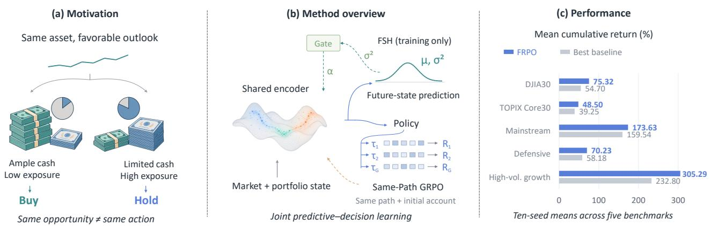
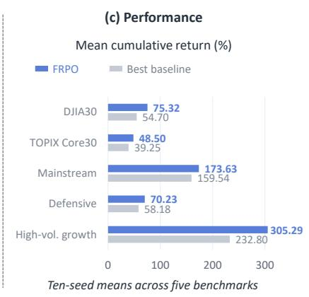
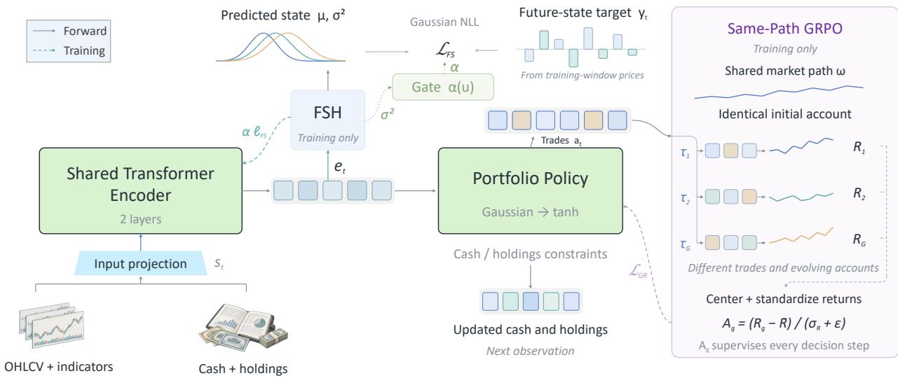
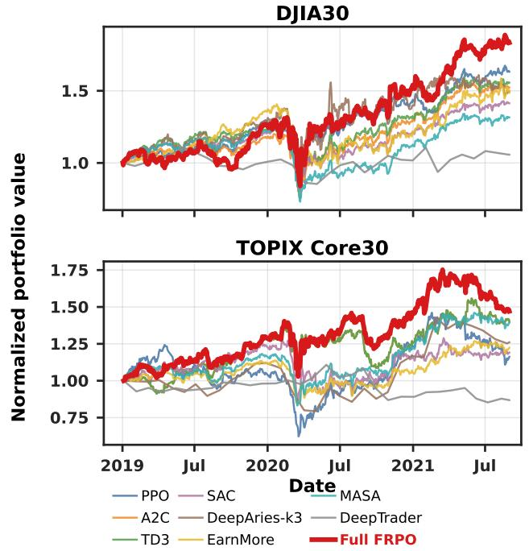
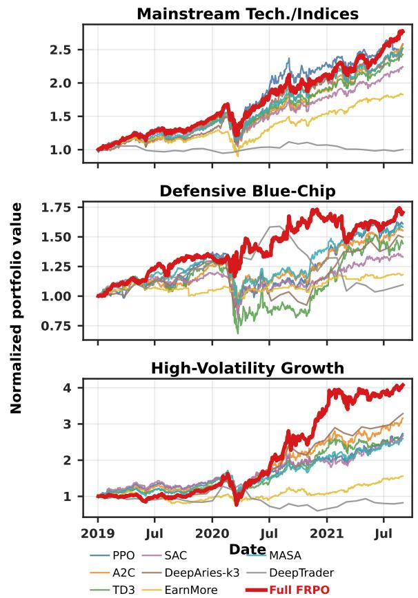
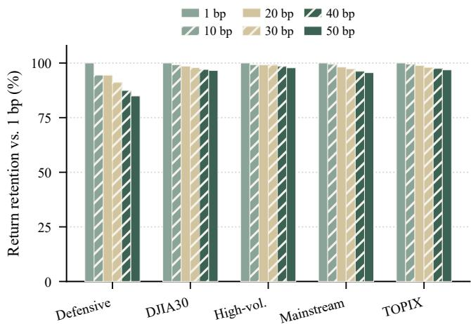

# Foresee to Trade: Forecast-Augmented Policy Optimization for Portfolio Management

Zeyu LIU∗ Xuanzhi FENG∗ Haoran XU∗ LAI Sing Kwong∗ Yang LI Hualei ZHANG

Hao CHEN Jie ZHANG Xiaoyi PANG† Song GUO†

The Hong Kong University of Science and Technology

xypang@whu.edu.cn songguo@ust.hk

## ABSTRACT

Online investment services must translate asset opportunities into investment outcomes for users’ accounts, yet the same market opportunity can warrant diferent account actions. We study how supervision from future asset opportunities can strengthen accountlevel trading decisions and propose Forecast-Augmented Relative Policy Optimization (FRPO). FRPO separately supervises asset opportunities and account decisions through a jointly learned rep resentation: a Financial State Head (FSH) learns future relativereturn targets to provide asset-level opportunity supervision, while Same-Path Group-Relative Optimization compares trading trajectories under the same market path and initial account to provide account-level relative-outcome supervision. An Adaptive Gate coordinates auxiliary supervision using predictive variance and gradient alignment. FSH is used only during training; inference uses the en coder and policy for trading. Across DJIA30, TOPIX Core30, and three investment-style portfolios, ten-seed evaluations show that FRPO achieves the highest mean cumulative and annualized returns among the compared methods in all five settings. These results sup port strengthening investment agents’ trading decisions through joint supervision from asset opportunities and trading outcomes.

## CCS CONCEPTS

• Information systems → Data mining; • Computing methodologies → Machine learning; • Applied computing → Electronic commerce.

## KEYWORDS

financial decision-making, portfolio management, predictive representation learning, reinforcement learning

## 1 INTRODUCTION

Online investment services help users discover opportunities, allocate capital, and rebalance portfolios [23, 25, 26]. Investment agents must translate market information into trading actions that improve account outcomes under existing holdings, available cash, and transaction costs. Connecting asset opportunities with account decisions is therefore central to learning for agent-mediated investment services.

Financial reinforcement learning trains policies on portfolio outcomes [11, 12, 21]. Predictive learning in portfolio selection and market making additionally exploits market regularities [2, 16]. This direction raises the question of how opportunity learning and account-decision learning should interact during policy training.

Under the price-taker assumption, future prices evolve independently of an agent’s trades, determining relative asset opportunities. Account outcomes depend on actions that change cash, holdings, and subsequent trading possibilities. A favorable outlook may support buying for an account with ample cash and low exposure, but holding for one with substantial exposure. Thus, the same opportunity can correspond to diferent actions and investment outcomes. How can supervision from future asset opportunities strengthen account-level trading decisions?

We propose Forecast-Augmented Relative Policy Optimization (FRPO).1 FRPO separately supervises asset opportunities and account decisions through a jointly learned representation. A shared encoder processes market and account observations, supporting a portfolio policy and a Financial State Head (FSH). Opportunity supervision and relative trading-outcome supervision jointly shape the representation used for trading.

FSH learns future relative-return targets from historical training windows, with cross-sectional centering, historical-volatility normalization, and clipping. For account decisions, Same-Path Group-Relative Optimization samples trajectories from an identical initial account over the same recorded market path. Diferent actions produce diferent holdings, cash balances, and returns. Comparing these returns provides relative-outcome supervision under common market conditions, without a separately learned value network.

An Adaptive Gate weights opportunity supervision using FSH predictive variance and gradient alignment with the policy objective. At inference, the encoder and policy use available observations; FSH predictions are not passed to the policy head. Figure 1 summarizes this joint supervision.

Across DJIA30, TOPIX Core30, and three investment-style portfolios, ten-seed evaluations show that FRPO achieves the highest mean cumulative and annualized returns among the compared methods in all five settings.

Our contributions are threefold:

1) We introduce FRPO, connecting asset-opportunity and accountdecision learning through separate supervision and an adaptively weighted shared representation.

2) We develop critic-free group-relative learning for continuous portfolio trading under shared market paths and initial accounts, and analyze when these comparisons reduce common market factors’ influence on relative outcomes.

  
Figure 1: From asset opportunities to portfolio actions. (a) Illustrative accounts link the same favorable asset outlook to diferent actions under diferent cash balances and exposures. (b) Same-path relative outcomes and future-state targets jointly supervise the shared encoder; predictive variance and gradient alignment weight auxiliary learning. The account and representation artwork is schematic. (c) Ten-seed mean cumulative returns exceed the strongest non-FRPO method in each setting (Tables 1 and 2). Solid arrows show forward flow; dashed arrows show training supervision.

3) We demonstrate return advantages across two equity universes and three investment-style portfolios with ten seeds. Component ablations, matched decision-supervision controls, cost sensitivity, and shifted temporal evaluations examine the mechanisms and applicability of the training design.

## 2 RELATED WORK

## 2.1 Web Financial Services and Portfolio Decisions

Financial information systems support opportunity discovery. Fin-GPT adapts language models to financial data [22], and FAST models time-sensitive news and discussions [18]. FinAgent combines market information, tools, and reflection for trading [25]; FinCon [23] and FinThink [1] study multi-agent financial reasoning.

Web research also directly addresses portfolio actions. EarnMore (WWW 2024) learns maskable representations for customizable stock pools [26]; HedgeAgents (WWW 2025 Companion) coordinates a fund manager and asset-class experts for hedging [9]. Agent Market Arena evaluates trading agents on live stock and cryptocurrency data using simulated portfolios [17].

These studies address information processing, investable universes, agent coordination, and evaluation. FRPO strengthens trading decisions through supervision connecting asset opportunities and account trading outcomes.

## 2.2 Financial RL and Predictive Supervision

Rule-based methods use technical indicators and statistical regularities to make trading decisions [7, 15]. Financial RL platforms [11, 12] support PPO [19], A2C [14], TD3 [3], and SAC [5]. Portfolio research explores policy designs including DeepTrader’s market embedding [21], MASA’s multi-agent risk control [10], DeepAries’ rebalancing intervals [8], and ArchetypeTrader’s strategy archetypes [27]. For policy supervision, Financial DAPO combines group-relative updates with news-derived signals [24].

Predictive learning also strengthens financial decisions. Deep-Clair uses forecast outputs for portfolio allocation [2], while IMM uses predictive signals as policy inputs and for expert guidance [16]. Through joint supervision from future asset opportunities and samepath relative trading outcomes, FRPO integrates opportunity learning into the shared representation to strengthen trading decisions.

## 3 METHODOLOGY

## 3.1 FRPO Framework

FRPO learns a portfolio policy from asset-level supervision of future relative opportunities and portfolio-level supervision oftrading outcomes (Figure 2). Observation s� contains historical market features and the current account state, including cash and holdings. Under the price-taker assumption, the market is exogenous; the account evolves with trading actions and determines feasible reallocations. The shared encoder $\mathbf { e } _ { t } = f _ { \phi } ( \mathbf { s } _ { t } ) \in \mathbb { R } ^ { 6 4 }$ supplies the policy $\mathbf { a } _ { t } \sim \pi _ { \theta } ( \cdot \mid \mathbf { e } _ { t } )$ and auxiliary predictor $p _ { \psi } ( \mathbf { y } _ { t } \mid \mathbf { e } _ { t } )$ . The horizontal path executes account-feasible trading actions. The upper auxiliary branch supervises FSH with targets derived from future training-window prices. The right inset compares complete trading trajectories under a shared market path and initial account. The Adaptive Gate weights the auxiliary contribution to the shared encoder. FSH predictions are not inputs to the policy head. At inference, the encoder and policy use available observations alone.

## 3.2 Same-Path Group-Relative Optimization

Why same-path comparisons? Portfolio returns reflect both allocation decisions and external market movements. Their shorthorizon statistical behavior motivates evaluating candidate actions under common market conditions.

Let $x _ { t } = \log p _ { t }$ denote the log price of an asset. Under an Euler– Maruyama discretization of an Itô difusion [6, 13], its short-horizon increment can be approximated as

  
Figure 2: FRPO architecture with shared predictive and decision supervision. Market observations and cash/holdings enter one encoder. Its representation supports a continuous portfolio policy and the upper Financial State Head (FSH). Centered, historical-volatility-normalized, clipped future-return targets supervise FSH through heteroscedastic Gaussian NLL; predictive variance and gradient alignment determine a detached auxiliary weight. The right inset compares full-horizon net returns on a shared market path and initial account, while later accounts diverge. Each group-relative advantage supervises every step of its trajectory. Solid arrows show forward flow, dashed arrows training, and dotted arrows loss weighting. Input artwork and trajectory traces are schematic. Inference uses the encoder and policy alone.

$$
\Delta x _ { t } = \mu _ { t } \Delta t + \sigma _ { t } \Delta W _ { t } , \qquad \Delta W _ { t } = \sqrt { \Delta t } \varepsilon _ { t } .\tag{1}
$$

For locally bounded drift and nonzero finite difusion, the predictable increment in Equation 1 is $O ( \Delta t )$ and the standard deviation of stochastic variation is $O ( \sqrt { \Delta t } )$ . Their ratio is $O ( \sqrt { \Delta t } )$ shortening the interval weakens the drift signal relative to market randomness, making short-horizon realized returns noisy feedback for trading decisions.

Same-path comparison is related to the common-randomnumbers principle in simulation: alternatives share an exogenous realization as their evaluation condition [4]. Diferent actions still create diferent holdings and market exposures. The efect on return diferences depends on the covariance induced by the shared path; it does not guarantee lower total policy-gradient variance.

We adapt group-relative optimization [20] by sampling � trajectories on a fixed historical segment $\omega .$ Each trajectory starts with identical cash and holdings and follows the same price sequence under the old policy:

$$
\tau _ { \omega } ^ { ( g ) } \sim \pi _ { \theta _ { \mathrm { o l d } } } ( \cdot \mid \omega ) , \qquad g = 1 , \ldots , G .\tag{2}
$$

The trajectories in Equation 2 share the external price path but develop diferent actions, cash balances, and holdings. Trajectory � receives the cumulative net trading reward $\begin{array} { r } { R _ { \omega } ^ { ( g ) } = \sum _ { t } \gamma ^ { t } r _ { \omega , t } ^ { ( g ) } } \end{array}$ , where $\gamma \ : = \ : 1$ and $r _ { \omega , t } ^ { ( g ) }$ is $1 0 ^ { - 4 }$ times the account NAV increment after transaction fees.

We center and standardize the trajectory returns within the group to obtain a single relative advantage shared by the entire

trajectory:

$$
\begin{array} { r l r } {  { A _ { \omega } ^ { ( g ) } = \frac { R _ { \omega } ^ { ( g ) } - \overline { { R } } _ { \omega } } { \sigma _ { R , \omega } + \epsilon } , } } & { { } } & { \overline { { R } } _ { \omega } = \frac { 1 } { G } \sum _ { j = 1 } ^ { G } R _ { \omega } ^ { ( j ) } , } \\ & { } & { \sigma _ { R , \omega } ^ { 2 } = \frac { 1 } { G } \sum _ { j = 1 } ^ { G } ( R _ { \omega } ^ { ( j ) } - \overline { { R } } _ { \omega } ) ^ { 2 } , } \end{array}\tag{3}
$$

where $\epsilon > 0$ is a numerical stability constant. Centering focuses the policy update on relative performance among trajectories under the same market condition, while standardization mitigates returnscale diferences across market periods and trajectory groups.

An identical additive return component cancels under group centering. With non-anticipating dynamic holdings, residual factor-innovation variance equals risk-weighted exposure dispersion. Same-path comparison reduces this component when dispersion is small relative to common exposure risk. Appendix D derives the expectation-level comparison before standardization. Efective exposure uses executed holdings and reward scaling, incorporating cash limits, transaction costs, and account feedback. Trading may respond to past prices and portfolio changes but must precede the next market innovation. The comparison concerns the factor-innovation part of returns; other components can remain correlated with it. The trajectory-level advantage in Equation 3 is broadcast to all rebalancing steps, adapting sequence-level GRPO supervision to trading

The continuous rebalancing policy $\pi _ { \theta }$ is Gaussian. Samples pass through tanh and account constraints to form executed trading actions $\mathbf { a } _ { t } ^ { \mathrm { e x e c } } ;$ sells are capped by holdings and buys by available cash, precluding short selling and leverage. Each action therefore changes both immediate exposure and the reallocations available at subsequent steps. Transaction costs enter the realized trading outcome. Cash remains a residual balance with no independent action dimension.

Define the new-to-old policy density ratio and its clipped form as

$$
\begin{array} { r l } & { \rho _ { \omega , t } ^ { ( g ) } = \frac { \pi _ { \theta } ( \mathbf { a } _ { \omega , t } ^ { ( g ) } \mid \mathbf { s } _ { \omega , t } ^ { ( g ) } ) } { \pi _ { \theta _ { \mathrm { o l d } } } ( \mathbf { a } _ { \omega , t } ^ { ( g ) } \mid \mathbf { s } _ { \omega , t } ^ { ( g ) } ) } , } \\ & { \widehat { \rho } _ { \omega , t } ^ { ( g ) } = \mathrm { c l i p } \left( \rho _ { \omega , t } ^ { ( g ) } , 1 - \varepsilon _ { c } , 1 + \varepsilon _ { c } \right) , } \end{array}\tag{4}
$$

In Equation $4 , \varepsilon _ { c }$ is the policy clipping coeficient. We denote the local group-relative policy loss for trajectory � at time � by $\ell _ { \mathrm { G R } , \omega , t } ^ { ( g ) } \colon$

$$
\ell _ { \mathrm { G R } , \omega , t } ^ { ( g ) } = - \operatorname* { m i n } \left( \rho _ { \omega , t } ^ { ( g ) } A _ { \omega } ^ { ( g ) } , \widehat { \rho } _ { \omega , t } ^ { ( g ) } A _ { \omega } ^ { ( g ) } \right) ,\tag{5}
$$

The expectation of Equation 5 defines the overall loss:

$$
\begin{array} { r } { \mathcal { L } _ { \mathrm { G R } } = \mathbb { E } _ { \omega , g , t } \left[ \ell _ { \mathrm { G R } , \omega , t } ^ { ( g ) } \right] , } \end{array}\tag{6}
$$

In Equation 6, the expectation is over market segments, trajectories, and steps. The update uses relative outcomes without a separate value function or generalized advantage estimator [19, 20].

Relative advantages supervise the policy through trajectory outcomes. Future-state targets provide complementary asset-level supervision for the shared encoder.

## 3.3 Financial State Modeling

The Financial State Head provides supervision for future crossasset opportunities. It models future relative-return states and their predictive variance, with � and � suppressed below. For asset �, define the forward log return as $u _ { t , i } ~ = ~ \log ( p _ { t + h _ { t } , i } / p _ { t , i } )$ , where $h _ { t } = \operatorname* { m i n } ( H , T - t )$ for $t < T , H = 5$ trading days, � is the final observed time of the sampled rollout window, and � is the number of assets. The lookahead is fixed at � whenever available and shortened only near the rollout boundary, retaining end-of-window training targets without accessing prices beyond � . We remove the contemporaneous market-wide direction by cross-sectional centering, $\begin{array} { r } { \widetilde { \boldsymbol { u } } _ { t , i } = \boldsymbol { u } _ { t , i } - \boldsymbol { N } ^ { - 1 } \sum _ { j = 1 } ^ { N } \boldsymbol { u } _ { t , j } } \end{array}$ , and then normalize by historical volatility to construct a risk-adjusted Financial State target:

$$
y _ { t , i } = \mathrm { c l i p } \left( \frac { \widetilde { u } _ { t , i } } { \nu _ { t , i } + \epsilon } , - y _ { \operatorname* { m a x } } , y _ { \operatorname* { m a x } } \right) .\tag{7}
$$

Here, $\nu _ { t , i }$ is the historical volatility of asset � at time �, and $y _ { \mathrm { m a x } }$ is the target clipping threshold.

FSH models the conditional distribution of the target in Equation 7. From $\mathbf { e } _ { t } ,$ it outputs a conditional mean and a heteroscedastic predictive variance:

$$
\left( \mu _ { t , i } ^ { \mathrm { F S } } , \log \sigma _ { t , i } ^ { 2 , \mathrm { F S } } \right) = g _ { \psi , i } ( \mathbf { e } _ { t } ) .\tag{8}
$$

In Equation 8, the mean predicts the centered, normalized, and clipped target, and the variance models its residual variability given the current observations.

The per-step Financial State loss uses twice the heteroscedastic Gaussian negative log-likelihood, with its constant term omitted:

$$
\ell _ { \mathrm { F S } , t } = \frac { 1 } { N } \sum _ { i = 1 } ^ { N } \left[ \frac { \left( y _ { t , i } - \mu _ { t , i } ^ { \mathrm { F S } } \right) ^ { 2 } } { \sigma _ { t , i } ^ { 2 , \mathrm { F S } } } + \log \sigma _ { t , i } ^ { 2 , \mathrm { F S } } \right] .\tag{9}
$$

The expectation of Equation 9 gives $\mathcal { L } _ { \mathrm { F S } } ~ = ~ \mathbb { E } _ { t } \left[ \ell _ { \mathrm { F S } , t } \right]$ . The gate below reduces the auxiliary weight for targets with larger predicted variance.

## 3.4 Adaptive Gate

The Adaptive Gate adjusts the contribution of future-state supervision using FSH predictive variance and gradient alignment. In optimization minibatch �, let � index a trajectory–time sample and define $\begin{array} { r } { u _ { k , j } = N ^ { - 1 } \sum _ { i } \sigma _ { k , j , i } ^ { 2 , \mathrm { F S } } } \end{array}$ . The uncertainty scale � is the median $u _ { 1 , j }$ in the first gated minibatch, floored at $1 0 ^ { - 8 }$ and then held fixed throughout training. Let $c _ { k }$ be the cosine similarity between the clipped policy-loss gradient and the unweighted FSH-loss gradient with respect to the shared encoder sequence features of the entire minibatch. We maintain $m _ { 1 } = c _ { 1 }$ and $m _ { k } = 0 . 9 m _ { k - 1 } + 0 . 1 c _ { k }$ , and set

$$
g _ { k } ^ { \mathrm { a l i g n } } = \mathrm { c l i p } \left( { \frac { 1 + m _ { k } } { 2 } } , 0 . 1 , 1 \right) .\tag{10}
$$

The adaptive weight for sample � is

$$
\begin{array} { r } { \alpha _ { k , j } = { \mathrm { s g } } \left[ \alpha _ { 0 } \exp ( - u _ { k , j } / \tau ) g _ { k } ^ { \mathrm { a l i g n } } \right] , } \end{array}\tag{11}
$$

where $\alpha _ { 0 }$ is the base weight and sg[·] denotes the stop-gradient operator. This gives $\alpha _ { \omega , t } ^ { ( g ) }$ for the corresponding sample in the joint objective. The alignment factor is shared within each minibatch, and its moving average persists across updates. Stop-gradient prevents backpropagation through the gate weight.

## 3.5 Joint Training Objective

The complete FRPO objective is

$$
\begin{array} { r l } & { \mathcal { L } _ { \mathrm { F R P O } } = \mathcal { L } _ { \mathrm { G R } } - \lambda _ { \mathcal { H } } \mathbb { E } _ { \omega , g , t } \left[ \mathcal { H } \left( \pi _ { \theta } ( \cdot \mid \mathbf { s } _ { \omega , t } ^ { ( g ) } ) \right) \right] } \\ & { \quad \quad \quad + \mathbb { E } _ { \omega , g , t } \left[ \alpha _ { \omega , t } ^ { ( g ) } \ell _ { \mathrm { F S } , \omega , t } ^ { ( g ) } \right] , } \end{array}\tag{12}
$$

where ${ \mathcal { H } } ( \pi _ { \theta } )$ denotes policy entropy and $\lambda _ { \mathcal { H } } \ge 0$ is the entropyregularization coeficient. Because the objective is minimized, the negative entropy term encourages exploration.

Equation 12 trains predictive and decision features in the same encoder. The group-relative loss rewards trading outcomes, the Financial State loss supervises future relative opportunities, and the gate in Equation 11 controls the auxiliary contribution.

## 4 EXPERIMENTS

## 4.1 Experimental Setup

The experiments evaluate portfolio actions across markets and styles, then examine relative decision supervision, predictive supervision, and their coordination through component controls. Temporal splits and the fee sweep test ofline generalization and sensitivity to trading frictions.

Table 1: Performance on two large market universes. Technical and market baselines are deterministic price-only backtests; learned methods report ten-seed averages. CR and AR are cumulative and annualized returns (%); higher is better for all metrics. Red and blue denote the best and second-best values in each dataset and metric.
<table><tr><td rowspan="2">Method</td><td colspan="5">DJIA30</td><td colspan="5">TOPIX Core30</td></tr><tr><td>CR (%)</td><td>AR (%)</td><td>Sharpe</td><td>Sortino</td><td>Calmar</td><td>CR (%)</td><td>AR (%)</td><td>Sharpe</td><td>Sortino</td><td>Calmar</td></tr><tr><td colspan="2">Technical and Market Baselines</td><td></td><td></td><td></td><td></td><td></td><td></td><td></td><td></td><td></td></tr><tr><td>MACD</td><td>-8.47</td><td>-3.27</td><td>-0.200</td><td>-0.160</td><td>-0.100</td><td>19.23</td><td>7.13</td><td>0.570</td><td>0.550</td><td>0.660</td></tr><tr><td>SMA</td><td>5.63</td><td>2.08</td><td>0.110</td><td>0.090</td><td>0.060</td><td>-2.36</td><td>-0.93</td><td>-0.070</td><td>-0.070</td><td>-0.030</td></tr><tr><td>ZMR</td><td>8.07</td><td>2.96</td><td>0.190</td><td>0.160</td><td>0.100</td><td>21.96</td><td>8.08</td><td>0.670</td><td>0.730</td><td>0.880</td></tr><tr><td>B&amp;H</td><td>51.65</td><td>16.93</td><td>0.690</td><td>0.750</td><td>0.460</td><td>36.36</td><td>12.90</td><td>0.700</td><td>0.930</td><td>0.480</td></tr><tr><td colspan="2">RL-based Baselines</td><td></td><td></td><td></td><td></td><td></td><td></td><td></td><td></td><td></td></tr><tr><td>PPO</td><td>54.70</td><td>17.35</td><td>0.658</td><td>0.802</td><td>0.527</td><td>19.28</td><td>6.99</td><td>0.327</td><td>0.486</td><td>0.221</td></tr><tr><td>A2C</td><td>52.19</td><td>16.99</td><td>0.695</td><td>0.789</td><td>0.485</td><td>32.78</td><td>10.47</td><td>0.295</td><td>0.428</td><td>0.289</td></tr><tr><td>TD3</td><td>50.44</td><td>16.49</td><td>0.674</td><td>0.751</td><td>0.467</td><td>31.68</td><td>10.76</td><td>0.385</td><td>0.562</td><td>0.369</td></tr><tr><td>SAC</td><td>36.78</td><td>12.33</td><td>0.480</td><td>0.552</td><td>0.320</td><td>19.47</td><td>6.41</td><td>0.242</td><td>0.385</td><td>0.181</td></tr><tr><td>DeepAries-k3</td><td>44.05</td><td>13.97</td><td>0.437</td><td>0.530</td><td>0.402</td><td>26.71</td><td>8.59</td><td>0.347</td><td>0.522</td><td>0.259</td></tr><tr><td>EarnMore</td><td>51.53</td><td>16.65</td><td>0.570</td><td>0.709</td><td>0.435</td><td>13.80</td><td>4.76</td><td>0.186</td><td>0.306</td><td>0.149</td></tr><tr><td>DeepTrader</td><td>8.90</td><td>2.27</td><td>0.120</td><td>0.269</td><td>0.194</td><td>-6.98</td><td>-3.35</td><td>-0.182</td><td>-0.235</td><td>-0.019</td></tr><tr><td>MASA</td><td>31.60</td><td>10.86</td><td>0.463</td><td>0.515</td><td>0.267</td><td>39.25</td><td>13.83</td><td>0.717</td><td>1.039</td><td>0.466</td></tr><tr><td colspan="2">Our Method</td><td></td><td></td><td></td><td></td><td></td><td></td><td></td><td></td><td></td></tr><tr><td>Full FRPO</td><td>75.32</td><td>22.78</td><td>0.796</td><td>0.986</td><td>0.620</td><td>48.50</td><td>15.67</td><td>0.624</td><td>0.991</td><td>0.550</td></tr></table>

Datasets. For the main benchmark, we train all methods from January 1, 2013, to December 31, 2018, and evaluate them out of sample from January 1, 2019, to August 31, 2021. The evaluation examines generalization along two complementary axes. First, DJIA30 and TOPIX Core30 represent the U.S. and Japanese equity markets, respectively, and test robustness across countries, market structures, and action-space scales. Second, we construct three nonoverlapping six-asset portfolios to evaluate cross-style robustness under a fixed action dimension. The Mainstream Technology and Indices portfolio contains QQQ, SPY, AAPL, AMZN, Alphabet, and MSFT, following the canonical FinRL setting [12]. The Defensive Blue-Chip portfolio contains BAC, JNJ, JPM, PG, WMT, and XOM, while the High-Volatility Growth portfolio contains AVGO, BRK.B, META, NFLX, NVDA, and TSLA. These portfolios difer in sector exposure, return distributions, and risk profiles.

Implementation and Evaluation Protocol. FRPO uses 16-step observations, a two-layer Transformer encoder, group size 5, and Financial State weight �0 = 4. FRPO uses ten fixed training seeds and 51,200 collected training transitions per seed. Training samples stochastic actions; evaluation uses the deterministic mean. Appendix A.1 gives the full settings and checkpoint schedule.

All methods, including the portfolio-specific baselines, are in tegrated into the shared FinRL evaluation framework and tested with a uniform 1-bp per-side transaction fee. Within each dataset, learned methods share the asset panel, temporal split, trading calendar, initial capital, reward scaling, daily decision frequency, and de terministic evaluation. All methods receive identical asset ordering, technical indicators, and portfolio states. The technical indicators are computed from publicly available OHLCV data and require no proprietary financial signals.

Baselines and Metrics. The RL baselines are PPO [19], A2C [14], TD3 [3], and SAC [5]. The portfolio-specific baselines are DeepAriesk3 [8], EarnMore [26], DeepTrader [21], and MASA [10]. All baselines are reproduced from their oficial GitHub repositories and undergo hyperparameter tuning in our experimental setting. We report results using the tuned configurations.

We additionally evaluate deterministic MACD, SMA, ZMR, and buy-and-hold (B&H) strategies from January 2, 2019, to August 31, 2021, using price returns without dividends and a 1-bp per-side cost. Each is a single backtest, so the tables report point estimates. DIA and 1311.T serve as market proxies for DJIA30 and TOPIX Core30; Mainstream uses SPY, while the other two B&H portfolios hold 100 shares of each constituent.

We report cumulative return, annualized return, Sharpe ratio, Sortino ratio, and Calmar ratio (Appendix A.2); higher values indicate better performance.

## 4.2 Performance Evaluation across Markets and Investment Styles

Tables 1 and 2 summarize performance across markets and investment styles, while Figures 3 and 4 show the corresponding representative portfolio-value trajectories. Full FRPO achieves the highest cumulative and annualized returns in all five datasets. Its cumulative returns are 75.32% and 48.50% on DJIA30 and TOPIX Core30, respectively, and 173.63%, 70.23%, and 305.29% on the Mainstream, Defensive, and High-Volatility Growth portfolios.

Full FRPO also maintains competitive risk-adjusted performance. It attains the best Sharpe, Sortino, and Calmar ratios on DJIA30 and the Defensive portfolio. MASA leads Sharpe and Sortino on TOPIX Core30 and Sharpe on the Mainstream portfolio, ZMR provides the highest TOPIX Calmar ratio, and DeepAries-k3 leads the three riskadjusted metrics on High-Volatility Growth. Together, these results establish a consistent return advantage across the five panels and competitive risk-adjusted performance. Component ablations and same-path controls examine the auxiliary objectives and relative learning design.

Table 2: Performance on three heterogeneous six-asset portfolios. Reporting conventions follow Table 1.
<table><tr><td rowspan="2">Method</td><td colspan="5">Mainstream Tech./Indices</td><td colspan="5">Defensive Blue-Chip</td><td colspan="5">High-Volatility Growth</td></tr><tr><td>CR (%)</td><td>AR (%)</td><td>Sharpe</td><td>Sortino</td><td>Calmar</td><td>CR (%)</td><td>AR (%)</td><td>Sharpe</td><td>Sortino</td><td>Calmar</td><td>CR (%)</td><td>AR (%)</td><td>Sharpe</td><td>Sortino</td><td>Calmar</td></tr><tr><td colspan="2">Technical and Market Baselines</td><td></td><td></td><td></td><td></td><td></td><td></td><td></td><td></td><td></td><td></td><td></td><td></td><td></td><td></td></tr><tr><td>MACD</td><td>15.44</td><td>5.54</td><td>0.400</td><td>0.390</td><td>0.280</td><td>3.88</td><td>1.44</td><td>0.240</td><td>0.270</td><td>0.100</td><td>20.35</td><td>7.20</td><td>0.750</td><td>0.860</td><td>0.640</td></tr><tr><td>SMA</td><td>56.27</td><td>18.25</td><td>0.950</td><td>1.010</td><td>0.790</td><td>6.05</td><td>2.23</td><td>0.340</td><td>0.370</td><td>0.170</td><td>39.16</td><td>13.21</td><td>1.020</td><td>1.130</td><td>0.850</td></tr><tr><td>ZMR</td><td>39.53</td><td>13.33</td><td>0.770</td><td>0.800</td><td>0.490</td><td>10.88</td><td>3.96</td><td>0.240</td><td>0.280</td><td>0.130</td><td>66.49</td><td>21.10</td><td>1.090</td><td>1.200</td><td>0.730</td></tr><tr><td>B&amp;H</td><td>80.48</td><td>24.82</td><td>1.090</td><td>1.180</td><td>0.730</td><td>17.70</td><td>6.31</td><td>0.630</td><td>0.750</td><td>0.390</td><td>62.47</td><td>19.99</td><td>1.440</td><td>1.720</td><td>1.240</td></tr><tr><td colspan="2">RL-based Baselines</td><td></td><td></td><td></td><td></td><td></td><td></td><td></td><td></td><td></td><td></td><td></td><td></td><td></td><td></td></tr><tr><td>PPO</td><td>159.54</td><td>42.87</td><td>1.598</td><td>1.978</td><td>1.585</td><td>55.74</td><td>18.02</td><td>0.728</td><td>0.920</td><td>0.596</td><td>208.08</td><td>49.47</td><td>1.423</td><td>1.838</td><td>1.405</td></tr><tr><td>A2C</td><td>154.38</td><td>41.54</td><td>1.563</td><td>1.887</td><td>1.461</td><td>54.91</td><td>17.75</td><td>0.721</td><td>0.915</td><td>0.572</td><td>198.26</td><td>48.87</td><td>1.427</td><td>1.830</td><td>1.385</td></tr><tr><td>TD3</td><td>149.43</td><td>40.73</td><td>1.565</td><td>1.852</td><td>1.419</td><td>50.55</td><td>16.48</td><td>0.676</td><td>0.836</td><td>0.518</td><td>165.86</td><td>42.44</td><td>1.301</td><td>1.658</td><td>1.221</td></tr><tr><td>SAC</td><td>125.19</td><td>35.54</td><td>1.467</td><td>1.649</td><td>1.156</td><td>32.73</td><td>11.08</td><td>0.491</td><td>0.610</td><td>0.359</td><td>144.43</td><td>36.73</td><td>1.104</td><td>1.414</td><td>1.089</td></tr><tr><td>DeepAries-k3</td><td>149.20</td><td>40.68</td><td>1.663</td><td>1.823</td><td>1.574</td><td>46.46</td><td>15.31</td><td>0.620</td><td>0.702</td><td>0.482</td><td>232.80</td><td>55.72</td><td>1.721</td><td>2.148</td><td>1.779</td></tr><tr><td>EarnMore</td><td>83.52</td><td>22.10</td><td>1.042</td><td>1.235</td><td>1.001</td><td>20.66</td><td>6.77</td><td>0.282</td><td>0.419</td><td>0.312</td><td>104.96</td><td>25.26</td><td>0.700</td><td>0.889</td><td>0.830</td></tr><tr><td>DeepTrader</td><td>-3.11</td><td>-1.50</td><td>-0.114</td><td>-0.023</td><td>0.032</td><td>7.24</td><td>1.19</td><td>0.026</td><td>0.414</td><td>0.284</td><td>-24.27</td><td>-14.18</td><td>-0.306</td><td>-0.332</td><td>-0.147</td></tr><tr><td>MASA</td><td>152.29</td><td>41.56</td><td>1.673</td><td>1.955</td><td>1.541</td><td>58.18</td><td>18.79</td><td>0.837</td><td>1.035</td><td>0.608</td><td>160.04</td><td>43.18</td><td>1.494</td><td>1.693</td><td>1.147</td></tr><tr><td>Our Method</td><td></td><td></td><td></td><td></td><td></td><td></td><td></td><td></td><td></td><td></td><td></td><td></td><td></td><td></td><td></td></tr><tr><td>Full FRPO</td><td>173.63</td><td>45.54</td><td>1.607</td><td>2.009</td><td>1.642</td><td>70.23</td><td>21.96</td><td>0.872</td><td>1.228</td><td>0.937 305.29</td><td></td><td>64.84</td><td>1.604</td><td>2.062</td><td>1.661</td></tr></table>

  
Figure 3: Representative portfolio values on DJIA30 and TOPIX Core30. Each curve uses the seed nearest its method’s ten-seed mean; Full FRPO is thick red.

  
Figure 4: Representative portfolio values for the three sixasset portfolios. Seeds follow Figure 3; Full FRPO is thick red.

Across the 25 dataset–metric comparisons among learned methods (five datasets × five metrics, excluding ablations), Full FRPO ranks first 19 times and has the best average rank of 1.28 on these panels.

## 4.3 Component Ablations

Table 3: Component controls: ten-seed mean CR (%). A: structural ablations on five panels; Gap is Full FRPO minus the stronger ablated variant. B: auxiliary weighting on two markets; Exponential and Fixed repeat Full and w/o Gate from A. Colors rank means within each market and panel.

<table><tr><td colspan="5">A. Structural components</td></tr><tr><td>Market</td><td>Full w/o Gate</td><td></td><td>w/o Gate &amp; FSH</td><td>Gap (pp)</td></tr><tr><td>DJIA30</td><td>75.32</td><td>65.23</td><td>56.06</td><td>+10.09</td></tr><tr><td>TOPIX Core30</td><td>48.50</td><td>40.48</td><td>21.68</td><td>+8.02</td></tr><tr><td>Mainstream</td><td>173.63</td><td>164.23</td><td>158.87</td><td>+9.40</td></tr><tr><td>Defensive</td><td>70.23</td><td>56.08</td><td>57.39</td><td>+12.84</td></tr><tr><td>High-Vol. Growth</td><td>305.29</td><td>214.61</td><td>224.51</td><td>+80.78</td></tr><tr><td colspan="5">B. Auxiliary weighting</td></tr><tr><td>Market</td><td>Exponential</td><td>Fixed</td><td>Inverse</td><td>Kendall-style</td></tr><tr><td>DJIA30</td><td>75.32</td><td>65.23</td><td>43.98</td><td>57.18</td></tr><tr><td>TOPIX Core30</td><td>48.50</td><td>40.48</td><td>31.44</td><td>19.54</td></tr></table>

Structural components. “FRPO w/o Gate” retains the Financial State Head but replaces the adaptive coeficient in Equation 11 with the fixed auxiliary weight $\alpha _ { 0 } = 4 ,$ disabling both variance and alignment gates; “FRPO w/o Gate & FSH” removes both adap tive weighting and Financial State supervision. Panel A of Table 3 compares future-state supervision and its adaptive coordination with the policy objective. Full FRPO has higher mean cumulative return than either variant in each of the five panels. Its margin over the stronger ablated variant ranges from 8.02 to 80.78 percentage points. The comparison supports the complete combination of rela tive decision supervision, forward-looking representation learning, and adaptive coordination under the reported setups.

Auxiliary weighting. Table 3B compares Exponential with Fixed, Inverse, and Kendall-style weighting using ten paired seeds per large market. Inverse changes the variance term while retaining alignment; Kendall-style replaces both gates with a learned scale (Appendix A.3). Exponential has the highest mean CR on both markets.

## 4.4 Decision-Supervision Analysis

Same-path grouping. To examine grouping separately from aux iliary supervision, we disable FSH and Adaptive Gate in both arms and match architecture, initialization, and training budget across ten paired DJIA30 seeds. Independently sampled candidate windows can overlap. Table 4 shows that same-path grouping increases mean CR from 46.45% to 56.06%, with higher AR and Sharpe and lower MDD. The 9.61-percentage-point mean paired return difference supports comparing candidate decisions under a shared realized market window in this configuration. Appendix D analyzes the dynamic factor-innovation risk.

Table 4: Same-path grouping on DJIA30 with FSH and Gate disabled: means over ten paired seeds. Higher CR, AR, and Sharpe and lower MDD are better. Colors follow Table 1.
<table><tr><td>Grouping</td><td>CR (%)</td><td>AR (%)</td><td>Sharpe</td><td>MDD (%)</td></tr><tr><td>Same-path</td><td>56.06</td><td>18.13</td><td>0.656</td><td>39.03</td></tr><tr><td>Independent windows</td><td>46.45</td><td>15.05</td><td>0.557</td><td>40.41</td></tr></table>

Temporal credit assignment. We compare trajectory broadcasting with group-relative reward-to-go (RTG) and immediate-reward signals, and with GAE, keeping the actor, FSH, Gate, same-path sampling, and 51,200-transition budget fixed over ten seeds per market. Returns are undiscounted. GAE uses a value head on detached encoder features $( \gamma = 1 , \lambda = 0 . 9 5 )$ with matched actor updates; Appendix C.1 specifies the configurations. Table 5 shows that broadcasting has the highest mean CR, AR, and Sharpe in both markets. Its mean CR exceeds the strongest alternative by 11.58 percentage points on DJIA30 and 22.90 on TOPIX Core30.

Table 5: Temporal credit assignment: ten-seed finalcheckpoint means. Trajectory repeats Full FRPO; units and colors follow Table 1.
<table><tr><td>Market</td><td>Estimator</td><td>CR (%)</td><td>AR (%)</td><td>Sharpe</td></tr><tr><td>DJIA30</td><td>Trajectory</td><td>75.32</td><td>22.78</td><td>0.796</td></tr><tr><td></td><td>RTG</td><td>63.74</td><td>19.71</td><td>0.784</td></tr><tr><td></td><td>Immediate</td><td>46.89</td><td>15.49</td><td>0.631</td></tr><tr><td></td><td>GAE</td><td>41.43</td><td>13.79</td><td>0.582</td></tr><tr><td>TOPIX Core30</td><td>Trajectory</td><td>48.50</td><td>15.67</td><td>0.624</td></tr><tr><td></td><td>RTG</td><td>15.32</td><td>5.31</td><td>0.231</td></tr><tr><td></td><td>Immediate</td><td>18.02</td><td>6.26</td><td>0.227</td></tr><tr><td></td><td>GAE</td><td>25.60</td><td>9.12</td><td>0.399</td></tr></table>

A supplementary PPO-GAE control retains the same auxiliary components (Appendix C.3). The matched comparison supports FRPO’s complete training design in the tested configuration.

## 4.5 Temporal Robustness

We evaluate FRPO and seven RL baselines on three overlapping temporal splits: the main benchmark w00 and two splits with later training cutofs and test start dates: w01 tests from March 2019 to November 2021, and w02 from June 2019 to February 2022. Each method is evaluated over ten training seeds per market and split. We average metrics within each split and then give the three split means equal weight. Appendix B specifies all dates and individual results.

Table 6 shows that FRPO achieves the highest mean CR and AR in both markets. Its mean CR is 50.52% on TOPIX Core30 and 64.93% on DJIA30, exceeding the strongest return baselines, MASA and

Table 6: Temporal robustness: equal-weight means over the overlapping splits w00, w01, and w02, with ten seeds per split. Aggregation follows Equation 13. CR and AR are percentages; higher is better. Colors follow Table 1.
<table><tr><td></td><td colspan="5">TOPIX Core30</td><td colspan="5">DJIA30</td></tr><tr><td>Method</td><td>CR (%)</td><td>AR (%)</td><td>Sharpe</td><td>Sortino</td><td>Calmar</td><td>CR (%)</td><td>AR (%)</td><td>Sharpe</td><td>Sortino</td><td>Calmar</td></tr><tr><td>FRPO</td><td>50.52</td><td>15.76</td><td>0.592</td><td>0.923</td><td>0.524</td><td>64.93</td><td>19.59</td><td>0.695</td><td>0.855</td><td>0.535</td></tr><tr><td>TD3</td><td>30.77</td><td>10.48</td><td>0.397</td><td>0.583</td><td>0.395</td><td>48.16</td><td>15.40</td><td>0.639</td><td>0.711</td><td>0.448</td></tr><tr><td>SAC</td><td>27.64</td><td>8.88</td><td>0.333</td><td>0.508</td><td>0.284</td><td>37.28</td><td>12.19</td><td>0.474</td><td>0.541</td><td>0.319</td></tr><tr><td>A2C</td><td>26.93</td><td>8.98</td><td>0.313</td><td>0.465</td><td>0.285</td><td>43.26</td><td>13.88</td><td>0.557</td><td>0.639</td><td>0.391</td></tr><tr><td>PPO</td><td>19.51</td><td>6.76</td><td>0.324</td><td>0.482</td><td>0.227</td><td>51.87</td><td>15.78</td><td>0.565</td><td>0.691</td><td>0.453</td></tr><tr><td>EarnMore</td><td>15.92</td><td>5.34</td><td>0.218</td><td>0.359</td><td>0.182</td><td>42.08</td><td>13.44</td><td>0.487</td><td>0.616</td><td>0.403</td></tr><tr><td>DeepAries-k3</td><td>22.11</td><td>6.81</td><td>0.271</td><td>0.421</td><td>0.217</td><td>36.43</td><td>11.51</td><td>0.372</td><td>0.443</td><td>0.333</td></tr><tr><td>MASA</td><td>35.60</td><td>12.32</td><td>0.636</td><td>0.928</td><td>0.415</td><td>25.71</td><td>8.78</td><td>0.376</td><td>0.422</td><td>0.216</td></tr></table>

PPO, by 14.92 and 13.06 percentage points, respectively. FRPO also leads mean Calmar in both markets and mean Sharpe and Sortino on DJIA30; MASA leads mean Sharpe and Sortino on TOPIX Core30. Appendix B reports all split-level results.

## 4.6 Transaction-Cost Sensitivity

Figure 5 shows a smooth degradation as per-side transaction costs increase from 1 to 50 bp. At 50 bp, FRPO retains more than 95% of its 1-bp return in four of the five settings; the Defensive portfolio is more cost-sensitive but still retains 84.9%. This result supports robustness to substantially higher trading frictions while identifying the Defensive setting as the one most afected by turnover costs.

  
Figure 5: Cumulative-return retention relative to the 1-bp setting as per-side transaction costs increase across the five evaluation settings.

Appendix A provides metric definitions and weighting details. Appendix C gives estimator configurations and PPO diagnostics.

## 5 CONCLUSION

Motivated by the needs for capital allocation and dynamic rebalancing in online investment services, this paper studies the opportunityto-action problem in account-constrained portfolio decision learning. The proposed FRPO combines same-path relative supervision of trading trajectories with auxiliary learning of future cross-sectional opportunities, coordinated through a shared encoder and an Adaptive Gate. In experiments covering five portfolio settings, each evaluated with ten random seeds, FRPO achieves the highest mean cumulative and annualized returns among all compared methods. In addition, ablation studies, temporal split tests, and cost-sensitivity analyses further examine the performance of this design under diferent evaluation conditions.

## LIMITATIONS

The theoretical analysis in this paper focuses on the variance of centered factor innovations under non-anticipating trading policies, with the corresponding variance ordering holding in expectation over market and action randomness. Empirical evaluations are based on historical OHLCV data, technical indicators, and account states from 2019 to 2021, and include shifted temporal tests extending through February 2022. The current framework centers on structured financial signals and asset-level targets, with FSH variance characterizing uncertainty in financial targets. Future research could further incorporate multimodal Web information, end-to-end language agents, and user preference modeling.

## REFERENCES

[1] Anonymous. 2025. FinThink: An LLM-Based Multi-Agent System for Financial Reasoning. OpenReview submission. https://openreview.net/forum?id= vm7xqrU345 ICLR 2026 submission, OpenReview: vm7xqrU345.

[2] Donghee Choi, Jinkyu Kim, Mogan Gim, Jinho Lee, and Jaewoo Kang. 2024. Deep Clair: Utilizing Market Forecasts for Efective Portfolio Selection. In Proceedings ofthe 33rd ACM International Conference on Information and Knowledge Management. Association for Computing Machinery, New York, NY, USA, 4414–4422. https://doi.org/10.1145/3627673.3680008

[3] Scott Fujimoto, Herke van Hoof, and David Meger. 2018. Addressing Function Approximation Error in Actor-Critic Methods. In Proceedings ofthe 35th International Conference on Machine Learning (Proceedings ofMachine Learning Research, Vol. 80). 1587–1596.

[4] Paul Glasserman and David D. Yao. 1992. Some Guidelines and Guarantees for Common Random Numbers. Management Science 38, 6 (1992), 884–908. https://doi.org/10.1287/mnsc.38.6.884

[5] Tuomas Haarnoja, Aurick Zhou, Pieter Abbeel, and Sergey Levine. 2018. Soft Actor-Critic: Of-Policy Maximum Entropy Deep Reinforcement Learning with a Stochastic Actor. In Proceedings ofthe 35th International Conference on Machine Learning (Proceedings ofMachine Learning Research, Vol. 80). 1861–1870.

[6] Kiyosi Itô. 1944. Stochastic Integral. Proceedings of the Imperial Academy 20, 8 (1944), 519–524. https://doi.org/10.3792/pia/1195572786

[7] Zura Kakushadze. 2016. 101 Formulaic Alphas. Wilmott 2016, 84 (2016), 72–81. https://doi.org/10.1002/wilm.10525

[8] Jinkyu Kim, Hyungjung Yi, Mogan Gim, Donghee Choi, and Jaewoo Kang. 2025. DeepAries: Adaptive Rebalancing Interval Selection for Enhanced Portfolio Selection. In Proceedings ofthe 34th ACM International Conference on Information and Knowledge Management. 5780–5787. https://doi.org/10.1145/3746252.3761572

[9] Xiangyu Li, Yawen Zeng, Xiaofen Xing, Jin Xu, and Xiangmin Xu. 2025. HedgeAgents: A Balanced-aware Multi-agent Financial Trading System. In Companion Proceedings of the ACM on Web Conference 2025. Association for Computing Machinery, New York, NY, USA, 296–305. https://doi.org/10.1145/3701716.3715232

[10] Zhenglong Li, Vincent Tam, and Kwan L. Yeung. 2024. Developing a Multi-Agent and Self-Adaptive Framework with Deep Reinforcement Learning for Dynamic Portfolio Risk Management. In Proceedings of the 23rd International Conference on Autonomous Agents and Multiagent Systems. 1174–1182. https://doi.org/10.65109/BMRY8759

[11] Xiao-Yang Liu, Ziyi Xia, Jingyang Rui, Jiechao Gao, Hongyang Yang, Ming Zhu, Christina Dan Wang, Zhaoran Wang, and Jian Guo. 2022. FinRL-Meta: Market Environments and Benchmarks for Data-Driven Financial Reinforcement Learn ing. In Advances in Neural Information Processing Systems, Vol. 35. 1835–1849. https://doi.org/10.52202/068431-0134

[12] Xiao-Yang Liu, Hongyang Yang, Jiechao Gao, and Christina Dan Wang. 2021. FinRL: Deep Reinforcement Learning Framework to Automate Trading in Quantitative Finance. In Proceedings ofthe 2nd ACM International Conference on AI in Finance. 1–9. https://doi.org/10.1145/3490354.3494366

[13] Gisiro Maruyama. 1955. Continuous Markov Processes and Stochastic Equations. Rendiconti del Circolo Matematico di Palermo 4, 1 (1955), 48–90. https://doi.org/10.1007/BF02846028

[14] Volodymyr Mnih, Adrià Puigdomènech Badia, Mehdi Mirza, Alex Graves, Timothy Lillicrap, Tim Harley, David Silver, and Koray Kavukcuoglu. 2016. Asynchronous Methods for Deep Reinforcement Learning. In Proceedings ofthe 33rd International Conference on Machine Learning (Proceedings of Machine Learning Research, Vol. 48). 1928–1937.

[15] John J. Murphy. 1999. Technical Analysis of the Financial Markets: A Comprehensive Guide to Trading Methods and Applications. Prentice Hall Press.

[16] Hui Niu, Siyuan Li, Jiahao Zheng, Zhouchi Lin, Bo An, Jian Li, and Jian Guo. 2024. IMM: An Imitative Reinforcement Learning Approach with Predictive Representation Learning for Automatic Market Making. In Proceedings of the Thirty-Third International Joint Conference on Artificial Intelligence. International Joint Conferences on Artificial Intelligence Organization, 5999–6007. https://doi.org/10.24963/ijcai.2024/663

[17] Lingfei Qian, Xueqing Peng, Yan Wang, Vincent Jim Zhang, Huan He, Hanley Smith, Yi Han, Yueru He, Haohang Li, Yupeng Cao, Yangyang Yu, Alejandro Lopez-Lira, Peng Lu, Jian-Yun Nie, Guojun Xiong, Jimin Huang, and Sophia Ananiadou. 2025. When Agents Trade: Live Multi-Market Trading Benchmark for LLM Agents. arXiv preprint arXiv:2510.11695 (2025). https://doi.org/10.48550/arXiv.2510.11695

[18] Ramit Sawhney, Arnav Wadhwa, Shivam Agarwal, and Rajiv Ratn Shah. 2021. FAST: Financial News and Tweet Based Time Aware Network for Stock Trading. In Proceedings ofthe 16th Conference ofthe European Chapter ofthe Association for Computational Linguistics: Main Volume. Association for Computational Linguistics, 2164–2175. https://doi.org/10.18653/v1/2021.eacl-main.185

[19] John Schulman, Filip Wolski, Prafulla Dhariwal, Alec Radford, and Oleg Klimov. 2017. Proximal Policy Optimization Algorithms. arXiv preprint arXiv:1707.06347 (2017). https://doi.org/10.48550/arXiv.1707.06347

[20] Zhihong Shao, Peiyi Wang, Qihao Zhu, Runxin Xu, Junxiao Song, Xiao Bi, Haowei Zhang, Mingchuan Zhang, Y. K. Li, Y. Wu, and Daya Guo. 2024. DeepSeekMath: Pushing the Limits of Mathematical Reasoning in Open Language Models. arXiv preprint arXiv:2402.03300 (2024). https://doi.org/10.48550/arXiv.2402.03300

[21] Zhicheng Wang, Biwei Huang, Shikui Tu, Kun Zhang, and Lei Xu. 2021. DeepTrader: A Deep Reinforcement Learning Approach for Risk-Return Balanced Portfolio Management with Market Conditions Embedding. In Proceedings of the AAAI Conference on Artificial Intelligence, Vol. 35. 643–650. https://doi.org/10.1609/aaai.v35i1.16144

[22] Hongyang Yang, Xiao-Yang Liu, and Christina Dan Wang. 2023. FinGPT: Open-Source Financial Large Language Models. arXiv preprint arXiv:2306.06031 (2023). https://doi.org/10.48550/arXiv.2306.06031

[23] Yangyang Yu, Zhiyuan Yao, Haohang Li, Zhiyang Deng, Yuechen Jiang, Yupeng Cao, Zhi Chen, Jordan W. Suchow, Zhenyu Cui, Rong Liu, Zhaozhuo Xu, Denghui Zhang, Koduvayur Subbalakshmi, Guojun Xiong, Yueru He, Jimin Huang, Dong Li, and Qianqian Xie. 2024. FinCon: A Synthesized LLM Multi-Agent System with Conceptual Verbal Reinforcement for Enhanced Financial Decision Making. In Advances in Neural Information Processing Systems, Vol. 37. 137010–137045. https://doi.org/10.52202/079017-4354

[24] Ruijian Zha and Bojun Liu. 2025. A New DAPO Algorithm for Stock Trading. In Proceedings ofthe 2025 IEEE 11th International Conference on Intelligent Data and Security. IEEE, 46–48. https://doi.org/10.1109/IDS66066.2025.00013

[25] Wentao Zhang, Lingxuan Zhao, Haochong Xia, Shuo Sun, Jiaze Sun, Molei Qin, Xinyi Li, Yuqing Zhao, Yilei Zhao, Xinyu Cai, Longtao Zheng, Xinrun Wang, and Bo An. 2024. A Multimodal Foundation Agent for Financial Trading: Tool-Augmented, Diversified, and Generalist. In Proceedings of the 30th ACM SIGKDD Conference on Knowledge Discovery and Data Mining. 4314–4325. https://doi.org/10.1145/3637528.3671801

[26] Wentao Zhang, Yilei Zhao, Shuo Sun, Jie Ying, Yonggang Xie, Zitao Song, Xinrun Wang, and Bo An. 2024. Reinforcement Learning with Maskable Stock Represen tation for Portfolio Management in Customizable Stock Pools. In Proceedings of the ACMWeb Conference 2024. 187–198. https://doi.org/10.1145/3589334.3645615

[27] Chuqiao Zong, Molei Qin, Haochong Xia, and Bo An. 2026. ArchetypeTrader: Reinforcement Learning for Selecting and Refining Learnable Strategic Archetypes in Quantitative Trading. In Proceedings of the AAAI Conference on Artificial Intelligence, Vol. 40. 29269–29276. https://doi.org/10.1609/aaai.v40i34.40166

## A ADDITIONAL EVIDENCE FOR FRPO

The experiments in this section use final checkpoints on the fixed 2019–2021 test history and the evaluation conventions of the main benchmark unless a comparison specifies otherwise. Reported performance entries are means across the specified training seeds.

## A.1 Implementation Details

Full FRPO uses a 16-step state sequence and a shared two-layer Transformer encoder (model dimension 128, four attention heads, feed-forward dimension 256), followed by LayerNorm(128), Linear(128,64), and GELU to return 64-dimensional features, with Financial State base weight $\alpha _ { 0 } = 4 .$ . Main-benchmark settings are group size 5, 1,024 rollout steps, seven update epochs, batch size 64, learning rate $3 \times 1 0 ^ { - 4 }$ , clipping range 0.3, reward scaling $1 0 ^ { - 4 }$ , and world-loss base 0. Training collects 51,200 transitions per seed over ten policy iterations $( 1 0 \times 5 \times 1 , 0 2 4 )$ ; checkpoints are saved every 25,000 steps. Each configuration uses ten fixed seeds. TOPIX retains four update epochs and clipping range 0.2. Training uses stochastic policy samples; evaluation uses deterministic mean actions. Experiments use an Intel Core i9-13980HX CPU and an NVIDIA GeForce RTX 4090 GPU. The world-loss base is a disabled implementation option, separate from the active FSH objective.

## A.2 Performance Metrics

For evaluation, let $V _ { t }$ be end-of-session NAV net of transaction costs, $q _ { t } = V _ { t } / V _ { t - 1 } - 1$ , and � the number of daily returns; $K = 2 5 2 .$ For same-frequency risk-free returns ${ \boldsymbol { r } } _ { f , t }$ and target return �, write

Table 7: Inclusive training/test calendar boundaries shared by TOPIX Core30 and DJIA30.
<table><tr><td></td><td>Date split Train (both markets)</td><td>Test (both markets)</td></tr><tr><td>w00</td><td>2013-01-01~2018-12-31</td><td> $2 0 1 9 \substack { - 0 1 - 0 1 } \sim 2 0 2 1 \substack { - 0 8 - 3 1 }$ </td></tr><tr><td>w01</td><td> $2 0 1 3 { - } 0 3 { - } 0 1 \sim 2 0 1 9 { - } 0 2 { - } 2 8$ </td><td> $2 0 1 9 \substack { - 0 3 - 0 1 } \sim 2 0 2 1 \substack { - 1 1 - 3 0 }$ </td></tr><tr><td>w02</td><td>2013-06-01~2019-05-31</td><td> $2 0 1 9 \substack { - 0 6 - 0 1 } \sim 2 0 2 2 \substack { - 0 2 - 2 8 }$ </td></tr></table>

$e _ { t } = q _ { t } - r _ { f , t }$ and $d _ { t } = q _ { t } - m$ . Then

$$
\begin{array} { r } { \begin{array} { c c } { \mathrm { C R } = V _ { T } / V _ { 0 } - 1 , } & { \qquad \mathrm { A R } = ( V _ { T } / V _ { 0 } ) ^ { K / T } - 1 , } \\ { \mathrm { S h a r p e } = \sqrt { K } \bar { e } / s _ { e } , } & { \qquad \mathrm { S o r t i n o } = \displaystyle \frac { \sqrt { K } \bar { d } } { \sqrt { T ^ { - 1 } \sum _ { t = 1 } ^ { T } \operatorname* { m i n } ( d _ { t } , 0 ) ^ { 2 } } } . } \end{array} } \end{array}
$$

Here $\begin{array} { r } { s _ { e } ^ { 2 } = ( T - 1 ) ^ { - 1 } \sum _ { t } ( e _ { t } - \bar { e } ) ^ { 2 } ; } \end{array}$ downside deviation includes all � sessions. With positive maximum drawdown,

$$
\mathrm { M D D } = \operatorname* { m a x } _ { 0 \leq t \leq T } \left( 1 - \frac { V _ { t } } { \operatorname* { m a x } _ { 0 \leq s \leq t } V _ { s } } \right) , \mathrm { C a l m a r } = \mathrm { A R / M D D } .
$$

CR and AR are reported in percent; ratios use unscaled returns.

## A.3 Auxiliary Objective Weighting

We compare the original exponential weighting with three alternatives on DJIA30 and TOPIX Core30 using ten fixed paired seeds per market (10 seeds × 2 markets). Fixed uses $\alpha _ { 0 } = 4$ without the uncertainty or alignment gates. Inverse replaces exp(−�/�) with $\tau / ( u + 1 0 ^ { - 8 } )$ while retaining alignment; Kendall-style uses a learned loss scale in place of both gates. Table 3, panel B, reports the results in the main text.

## B TEMPORAL ROBUSTNESS

## B.1 Evaluation across Shifted Temporal Splits

We compare FRPO with seven baselines on TOPIX Core30 and DJIA30 across the main split w00 and the shifted splits w01/w02.

Training and test intervals. Table 7 gives inclusive calendar boundaries shared by both markets; testing uses the available trading sessions. All methods follow the FinRL protocol with a 1-bp per-side fee and ten training seeds per market and split.

Performance across individual splits. Table 8 reports the shifted splits; Table 1 gives w00 results.

FRPO leads mean CR and AR in all six market–split comparisons. Risk-adjusted leaders vary: in w02, TD3 leads Sharpe and PPO leads Calmar on DJIA30, while MASA leads Sharpe and Sortino on TOPIX Core30.

Aggregation across temporal splits. For each method and market, let $m _ { w , s }$ denote a metric measured on split � under training seed �. For $\mathcal { W } = \{ \mathsf { w } \boldsymbol { \theta } \boldsymbol { \Theta } , \mathsf { w } \boldsymbol { \theta } \boldsymbol { 1 } , \mathsf { w } \boldsymbol { \theta } 2 \}$ , we report the equal-weight mean

$$
\bar { m } = \frac { 1 } { 3 } \sum _ { w \in \mathcal { W } } \left( \frac { 1 } { 1 0 } \sum _ { s = 1 } ^ { 1 0 } m _ { w , s } \right) .\tag{13}
$$

Each split receives equal weight after averaging its ten seeds. Sharpe, Sortino, and Calmar are means of split-level metrics, not metrics recomputed from a concatenated return series.

Table 6 reports all five aggregate metrics in the main text.

## C SUPPLEMENTARY DECISION-SUPERVISIONEVIDENCE

## C.1 Temporal Credit Assignment

We compare trajectory broadcasting, group-relative reward-to-go (RTG), group-relative immediate rewards, and GAE, holding the actor, FSH, Gate, same-path sampling, and update budget fixed. All use FinRL, a 1-bp per-side fee, and final 51,200-step checkpoints. DJIA30 uses seven epochs and clipping 0.3; TOPIX uses four epochs and clipping 0.2. GAE fits a 4,225-parameter MLP on detached 64-dimensional encoder features to �-returns $( \gamma = 1 , \lambda = 0 . 9 5 )$ without encoder backpropagation and with matched actor updates. All returns are undiscounted. Table 5 in the main text reports the results.

## C.2 PPO Value-Prediction and Training Diagnostics

For twenty final PPO checkpoints (ten seeds per market), we save a reproducible stochastic trajectory over 2019–2021 in FinRL with a 1-bp per-side fee. Pre-action value predictions are compared with realized reward-to-go using the original reward, $\gamma = 0 . 9 9$ , and zero terminal continuation. Error includes prediction and sampledreturn noise. High/low regimes use the upper/lower quartiles of trailing 20-session equal-weight market volatility, fitted on training data and fixed on test dates. High-regime MSE is about 2.1/2.2 times low-regime MSE on DJIA30/TOPIX; explained variance and correlation show diferent patterns (Table 9, panel A). The same runs provide six online value-loss/EV snapshots per seed (120 total); panel B shows the first and last, at 8,192 and 49,152 logged transitions within the 51,200-transition run. Online targets are rollout �-returns; test targets are realized discounted reward-to-go, so their errors are not directly comparable.

## C.3 Matched PPO-GAE Control with Shared Auxiliary Components

To assess the complete FRPO training design while retaining the same auxiliary prediction and weighting mechanisms, we compare Full FRPO with a matched PPO-GAE variant that retains FSH and Gate.

The DJIA30 ten-seed control in Table 10 retains FRPO’s actor, encoder, FSH, Gate, and optimization configuration, replacing grouprelative advantages with GAE. Final checkpoints use 51,200 collected training transitions per seed over ten iterations. FinRL evaluation uses 1-bp per-side fees and 2019-01-02–2021-08-31.

The added 64–64–1 Tanh value MLP takes the 64-dimensional encoder features and has 4,225 parameters. Its loss backpropagates through the encoder; actor, FSH, and value head share Adam. GAE uses $\gamma = 0 . 9 9 , \lambda = 0 . 9 5$ , zero terminal continuation, and normalization across five concatenated rollouts. Value targets are unnormalized GAE plus rollout value predictions; the objective adds 0.5 times value MSE. Auxiliary weighting follows Equation 11, with gradient alignment measured between the policy loss and the unweighted FSH loss on shared encoder sequence features. Settings are rollout length 1,024, five trajectories, batch size 64, seven epochs, learning rate $3 \times 1 0 ^ { - 4 }$ , and clipping 0.3.

Table 8: Ten-seed mean performance on shifted splits w01 and ${ \mathfrak { w } } { \boldsymbol { \mathsf { 0 } } } 2 ;$ dates follow Table $^ { 7 , }$ and w00 results appear in Table 1. CR and AR are percentages; higher is better. Red/blue mark the best/second-best means per split, market, and metric.
<table><tr><td rowspan="2">Method</td><td colspan="5">TOPIX Core30</td><td colspan="5">DJIA30</td></tr><tr><td>CR (%)</td><td>AR (%)</td><td>Sharpe</td><td>Sortino</td><td>Calmar</td><td>CR (%)</td><td>AR (%)</td><td>Sharpe</td><td>Sortino</td><td>Calmar</td></tr><tr><td>w01</td><td></td><td></td><td></td><td></td><td></td><td></td><td></td><td></td><td></td><td></td></tr><tr><td>FRPO</td><td>55.18</td><td>16.68</td><td>0.593</td><td>0.937</td><td>0.531</td><td>53.26</td><td>16.19</td><td>0.639</td><td>0.761</td><td>0.496</td></tr><tr><td>TD3</td><td>28.89</td><td>9.99</td><td>0.372</td><td>0.553</td><td>0.370</td><td>42.85</td><td>13.50</td><td>0.570</td><td>0.627</td><td>0.408</td></tr><tr><td>SAC</td><td>22.86</td><td>7.53</td><td>0.275</td><td>0.398</td><td>0.235</td><td>30.77</td><td>9.99</td><td>0.393</td><td>0.447</td><td>0.267</td></tr><tr><td>A2C</td><td>21.22</td><td>7.39</td><td>0.272</td><td>0.409</td><td>0.230</td><td>35.81</td><td>11.32</td><td>0.440</td><td>0.504</td><td>0.310</td></tr><tr><td>PPO</td><td>12.37</td><td>4.08</td><td>0.199</td><td>0.306</td><td>0.147</td><td>40.32</td><td>11.51</td><td>0.418</td><td>0.488</td><td>0.336</td></tr><tr><td>EarnMore</td><td>13.59</td><td>4.69</td><td>0.206</td><td>0.322</td><td>0.161</td><td>28.87</td><td>9.20</td><td>0.374</td><td>0.455</td><td>0.316</td></tr><tr><td>DeepAries-k3</td><td>21.27</td><td>6.26</td><td>0.244</td><td>0.393</td><td>0.207</td><td>35.04</td><td>10.90</td><td>0.343</td><td>0.411</td><td>0.307</td></tr><tr><td>MASA</td><td>25.94</td><td>9.10</td><td>0.471</td><td>0.690</td><td>0.307</td><td>18.12</td><td>6.23</td><td>0.269</td><td>0.303</td><td>0.153</td></tr><tr><td>w02</td><td></td><td></td><td></td><td></td><td></td><td></td><td></td><td></td><td></td><td></td></tr><tr><td>FRPO</td><td>47.88</td><td>14.93</td><td>0.559</td><td>0.842</td><td>0.490</td><td>66.21</td><td>19.80</td><td>0.650</td><td>0.818</td><td>0.489</td></tr><tr><td>TD3</td><td>31.75</td><td>10.70</td><td>0.433</td><td>0.635</td><td>0.447</td><td>51.19</td><td>16.20</td><td>0.672</td><td>0.756</td><td>0.469</td></tr><tr><td>SAC</td><td>40.58</td><td>12.69</td><td>0.482</td><td>0.741</td><td>0.437</td><td>44.28</td><td>14.24</td><td>0.550</td><td>0.625</td><td>0.369</td></tr><tr><td>A2C</td><td>26.78</td><td>9.08</td><td>0.373</td><td>0.559</td><td>0.336</td><td>41.79</td><td>13.33</td><td>0.537</td><td>0.623</td><td>0.377</td></tr><tr><td>PPO</td><td>26.89</td><td>9.21</td><td>0.445</td><td>0.654</td><td>0.314</td><td>60.60</td><td>18.47</td><td>0.620</td><td>0.783</td><td>0.496</td></tr><tr><td>EarnMore</td><td>20.36</td><td>6.57</td><td>0.263</td><td>0.449</td><td>0.236</td><td>45.85</td><td>14.47</td><td>0.517</td><td>0.684</td><td>0.458</td></tr><tr><td>DeepAries-k3</td><td>18.35</td><td>5.59</td><td>0.221</td><td>0.347</td><td>0.184</td><td>30.19</td><td>9.66</td><td>0.335</td><td>0.389</td><td>0.289</td></tr><tr><td>MASA</td><td>41.60</td><td>14.04</td><td>0.719</td><td>1.055</td><td>0.473</td><td>27.42</td><td>9.24</td><td>0.396</td><td>0.447</td><td>0.227</td></tr></table>

Table 9: PPO diagnostics, ten-seed means per market. A: finalcheckpoint test predictions; MSE uses squared reward units, EV is $1 - \operatorname { V a r } ( R - V ) / \operatorname { V a r } ( R )$ , and � is Pearson correlation with realized reward-to-go. B: online training snapshots; training ends at 51,200 transitions. Targets difer between panels.
<table><tr><td colspan="5">A. Test reward-to-go prediction</td></tr><tr><td>Market</td><td>Test regime Value MSE</td><td></td><td>EV</td><td>r</td></tr><tr><td>DJIA30</td><td>All</td><td>1.3086</td><td>-0.2204</td><td>0.2995</td></tr><tr><td></td><td>High</td><td>1.6317</td><td>-0.4671</td><td>0.2364</td></tr><tr><td></td><td>Low</td><td>0.7723</td><td>-2.2793</td><td>0.4170</td></tr><tr><td>TOPIX Core30</td><td>All</td><td>1.7173</td><td>-0.0210</td><td>0.0320</td></tr><tr><td></td><td>High</td><td>2.7314</td><td>-0.0170</td><td>0.1219</td></tr><tr><td></td><td>Low</td><td>1.2236</td><td>-0.0122</td><td>-0.0387</td></tr><tr><td colspan="5">B. Online rollout-target fitting</td></tr><tr><td>Market</td><td>Logged transitions</td><td>Value loss</td><td>EV</td><td></td></tr><tr><td>DJIA30</td><td>8,192</td><td>0.096</td><td>0.027</td><td></td></tr><tr><td></td><td>49,152</td><td>0.164</td><td>0.466</td><td></td></tr><tr><td>TOPIX Core30</td><td>8,192</td><td>0.456</td><td>0.116</td><td></td></tr><tr><td></td><td>49,152</td><td>0.585</td><td>0.092</td><td></td></tr></table>

Table 10 reports higher mean CR, AR, and Sharpe for Full FRPO. With the auxiliary components present in both arms, these results provide supplementary evidence for the complete decisionsupervision and update scheme in the tested configuration. The two schemes difer jointly in advantage construction, discounting, normalization, and shared critic gradients.

Table 10: Supplementary DJIA30 control with matched actor and encoder architectures, FSH, and Gate. Ten-seed means at the final 51,200-step checkpoint; Full FRPO repeats Table 1, and units and colors follow that table.
<table><tr><td>Training framework</td><td>CR (%)</td><td>AR (%)</td><td>Sharpe</td></tr><tr><td>Full FRPO</td><td>75.32</td><td>22.78</td><td>0.796</td></tr><tr><td> $\mathrm { P P O - G A E + F S H + G a t e }$ </td><td>53.35</td><td>15.95</td><td>0.545</td></tr></table>

## D DYNAMIC FACTOR-NOISE ANALYSIS OF SAME-PATH COMPARISON

We extend the C, D decomposition to dynamic accounts, analyzing centered factor innovations before group standardization.

Account timing and return units. Let $V _ { g , t } > 0$ be pre-trade wealth, $\mathbf { h } _ { g , i } ^ { + }$ holdings executed at prices $\mathbf { p } _ { t } ,$ , and $K _ { g , t }$ � fees. With interest-free cash and no external flows, trade, deduct fees, then advance prices:

$$
V _ { g , t + 1 } - V _ { g , t } = ( \mathbf { p } _ { t } \odot \mathbf { h } _ { g , t } ^ { + } ) ^ { \top } \mathbf { r } _ { t + 1 } - K _ { g , t } .\tag{14}
$$

Here $\mathbf { r } _ { t + 1 }$ denotes simple asset returns. Training uses $r _ { t } ^ { ( g ) } = c \Delta V _ { g , t }$ where $c = 1 0 ^ { - 4 }$ and $\Delta V _ { g , t } = V _ { g , t + 1 } - V _ { g , t }$ includes fees. Set $\mathbf { x } _ { g , t } ~ =$ $c ( \mathbf { p } _ { t } \odot \mathbf { h } _ { q , t } ^ { + } ) ;$ then $\begin{array} { r } { R _ { g } = \sum _ { t } r _ { t } ^ { ( g ) } = c ( V _ { g , T } - V _ { 0 } ) } \end{array}$ with $\gamma = 1$ . Holdings reflect cash limits, integer fills, fees, and feedback. Equal portfolio proportions can give diferent factor P&L at diferent wealth.

Predictable dynamic exposures. Fix policy parameters within a group. The joint filtration $( \mathcal { F } _ { t } )$ contains market history and all candidates’ accounts, executed trading actions, and action draws through �, but no future information. For $\mathscr { F } _ { t + 1 }$ -measurable innova tions, assume

$$
\begin{array} { c } { \mathbf { r } _ { t + 1 } = \pmb { \mu } _ { t } + B _ { t } \pmb { \varepsilon } _ { t + 1 } + \pmb { \xi } _ { t + 1 } , } \\ { \mathbb { E } [ \pmb { \varepsilon } _ { t + 1 } \ | \ \mathcal { F } _ { t } ] = 0 , \qquad \operatorname { C o v } ( \pmb { \varepsilon } _ { t + 1 } \ | \ \mathcal { F } _ { t } ) = \pmb { \Sigma } _ { t } . } \end{array}\tag{15}
$$

The exogenous $B _ { t } , \Sigma _ { t }$ and exposures $\mathbf { x } _ { g , t }$ are $\mathcal { F } _ { t }$ -measurable, allowing feedback and conditional heteroscedasticity. Predictable raw-factor components enter $\pmb { \mu } _ { t }$ . Define

$$
\mathbf { b } _ { g , t } = B _ { t } ^ { \top } \mathbf { x } _ { g , t } , \qquad M _ { g } = \sum _ { t } \mathbf { b } _ { g , t } ^ { \top } \varepsilon _ { t + 1 } , \quad R _ { g } = U _ { g } + M _ { g } .\tag{16}
$$

Require finite energy $\begin{array} { r } { \mathbb { E } \sum _ { t } \mathbf { b } _ { q , t } ^ { \top } \sum _ { t } \mathbf { b } _ { g , t } < \infty . \ U _ { g } } \end{array}$ collects drift, fees, and other returns; it may covary with $M _ { g } .$

Dynamic variance decomposition. Set $\begin{array} { r } { \bar { \mathbf b } _ { t } = G ^ { - 1 } \sum _ { q } \mathbf b _ { g , t } } \end{array}$ and $\delta _ { g , t } =$ $\mathbf { b } _ { g , t } - \bar { \mathbf { b } } _ { t }$ . Define

$$
\begin{array} { r l } & { C _ { \mathrm { d y n } } = \mathbb { E } \displaystyle \sum _ { t } \bar { \mathbf { b } } _ { t } ^ { \top } \Sigma _ { t } \bar { \mathbf { b } } _ { t } , } \\ & { \mathcal { D } _ { \mathrm { d y n } } = \mathbb { E } \displaystyle \sum _ { t } \frac { 1 } { G } \sum _ { g } \delta _ { g , t } ^ { \top } \Sigma _ { t } \delta _ { g , t } . } \end{array}\tag{17}
$$

Expectations cover market and action randomness with a fixed initial account and starting market condition. Define $\begin{array} { r } { V _ { \mathrm { s a m e ~ } } = G ^ { - 1 } \sum _ { q } \mathrm { V a r } ( M _ { g } - \bar { M } ) , \bar { M } = G ^ { - 1 } \sum _ { q } M _ { g } . } \end{array}$ . Independently retraded paths rebuild accounts and exposures from independent market/action draws, matching each candidate’s same-path trajectory marginal. Define $V _ { \mathrm { i n d } }$ analogously. For $G \ge 2$

$$
\begin{array} { r l } & { \displaystyle V _ { \mathrm { s a m e } } = \mathcal { D } _ { \mathrm { d y n } } , } \\ & { \displaystyle V _ { \mathrm { i n d } } = \left( 1 - \frac { 1 } { G } \right) ( C _ { \mathrm { d y n } } + \mathcal { D } _ { \mathrm { d y n } } ) , } \\ & { \displaystyle V _ { \mathrm { i n d } } - V _ { \mathrm { s a m e } } = \frac { ( G - 1 ) C _ { \mathrm { d y n } } - \mathcal { D } _ { \mathrm { d y n } } } { G } . } \end{array}\tag{18}
$$

Lower average innovation variance holds exactly when $\mathcal { D } _ { \mathrm { d y n } } <$ $( G - 1 ) C _ { \mathrm { d y n } }$ , in expectation rather than for every realized group.

Proof. Conditional zero mean gives $\mathbb { E } [ M _ { q } ] = 0 ;$ ; predictable exposures make diferent-time martingale increments orthogonal. Thus

$$
\begin{array} { c } { { \displaystyle M _ { g } - \bar { M } = \sum _ { t } \delta _ { g , t } ^ { \top } \varepsilon _ { t + 1 } , } } \\ { { { } } } \\ { { \mathrm { V a r } ( M _ { g } - \bar { M } ) = \mathbb { E } \sum _ { t } \delta _ { g , t } ^ { \top } \Sigma _ { t } \delta _ { g , t } . } } \end{array}\tag{19}
$$

Averaging gives $V _ { \mathrm { s a m e } } = \mathcal { D } _ { \mathrm { d y n } } .$ . Let $\begin{array} { r } { q _ { g } = \mathbb { E } \sum _ { t } \mathbf { b } _ { q , t } ^ { \top } \Sigma _ { t } \mathbf { b } _ { g , t } = \mathrm { V a r } ( M _ { g } ) } \end{array}$ also the variance of its matched independent counterpart ${ \widetilde { M } } _ { g }$ . Independence and zero means give

$$
\begin{array} { c } { { \mathrm { V a r } ( \widetilde M _ { g } - \overline { { { \widetilde M } } } ) = \displaystyle \left( 1 - \frac { 1 } { G } \right) ^ { 2 } q _ { g } + \displaystyle \frac { 1 } { G ^ { 2 } } \sum _ { h \neq g } q _ { h } , } } \\ { { { \displaystyle \frac { 1 } { G } \sum _ { g } q _ { g } = C _ { \mathrm { d y n } } + \mathcal D _ { \mathrm { d y n } } } . } } \end{array}\tag{20}
$$

The second identity uses $\mathbf { b } _ { g , t } = \bar { \mathbf { b } } _ { t } + \delta _ { g , t }$ and $\begin{array} { r } { \sum _ { q } \pmb { \delta } _ { g , t } = 0 } \end{array}$ . Averaging the first proves Equation 18.

Residual factor risk between candidates. For $Q _ { t } = B _ { t } \Sigma _ { t } B _ { t } ^ { \top }$ , the pairwise dispersion identity gives

$$
\mathcal { D } _ { \mathrm { d y n } } = \mathbb { E } \sum _ { t } \frac { 1 } { 2 G ^ { 2 } } \sum _ { g , h } ( \mathbf { x } _ { g , t } - \mathbf { x } _ { h , t } ) ^ { \top } \boldsymbol { Q } _ { t } ( \mathbf { x } _ { g , t } - \mathbf { x } _ { h , t } ) .\tag{21}
$$

This is dynamic active factor risk. Equal-beta stocks can cancel a market innovation despite diferent trades if efective exposures match. Diferences in beta, cash allocation, or account wealth can leave residuals; a shared pool, long-only trading, and no leverage do not ensure cancellation. Zero $\Sigma _ { t }$ -seminorm dispersion cancels the innovation; generally $\begin{array} { r } { V _ { \mathrm { s a m e } } \leq \mathbb { E } \sum _ { t } \lambda _ { \operatorname* { m a x } } ( \Sigma _ { t } ) \bar { G } ^ { - 1 } \sum _ { q } \Vert \pmb { \delta } _ { g , t } \Vert _ { 2 } ^ { 2 } . } \end{array}$ . Any identical additive � cancels exactly: $R _ { g } = U _ { g } + M$ implies $R _ { g } - \bar { R } =$ $U _ { g } - \bar { U } .$

Relation to fixed exposures. For fixed stacked exposures $\beta _ { g } ,$ , factor P&L is $\beta _ { q } ^ { \intercal } { \mathbf { F } } \mathrm { w i t h } { \mathbb { E } } [ { \mathbf { F } } ] = 0 , \mathrm { C o v } ( { \mathbf { F } } ) = \Sigma . \mathrm { S e t } C = \bar { \beta } ^ { \intercal } \Sigma \bar { \beta } , \mathcal { D } =$ $G ^ { - 1 } \sum _ { g } ( \bar { \pmb { \beta } } _ { q } - \bar { \pmb { \beta } } ) ^ { \top } \Sigma ( { \pmb { \beta } } _ { q } - \bar { \pmb { \beta } } )$ . The three identities still hold, allowing arbitrary cross-time covariance. The dynamic extension instead requires conditional-zero-mean innovations. Fees and other returns may covary with $M _ { g } ;$ neither model guarantees lower total-return or standardized policy-gradient variance.

## E OPEN-SOURCE RESOURCES

We will release (1) FRPO code for the core algorithm, training, and evaluation; (2) configurations for data processing, models, and training hyperparameters; (3) scripts reproducing main experiments, baseline comparisons, and ablations; and (4) analysis and visualization scripts for aggregating results and generating the paper’s tables and figures. The README will document data sources, environment dependencies, and execution commands to support reproduction and further research.