# How do Transformers Perform Low-Level Control In-Context?

Ebonye Smith1, Aidan Andrews2, Phoenix Wilson1, Alexis Frias3, Ayush Pandey4, and Gireeja Ranade1

Abstract— One of the remarkable abilities of Transformerbased neural networks is in-context learning. This motivates us to think about “in-context” control. Can we control a system knowing only (1) that it belongs to a particular family of systems and (2) some data on system evolution (provided as the context trajectory) but no specific parameter information? Specifically, we investigate the ability of Transformer-models to perform “in-context” control of unstable, nonlinear dynamical systems, where context consists only of the unforced system dynamics. We leverage a multi-head, GPT-2-style architecture, and we evaluate performance for two classical nonlinear systems – the cartpole system and the two-link acrobot system, where the system parameters are unknown to the Transformer. We consider a setting where trajectories from an expert controller are available at training time but not at inference time. Here, we identify training techniques that are essential to train Transformers to perform low-level control. Through an analysis over checkpoints, we show that in-context control is possible, and the learned policy performance generally improves as context increases. Furthermore, the Transformer models can generalize to stabilize systems that are out-of-distribution.

## I. INTRODUCTION

A key property of Transformers driving its performance is in-context learning (ICL), which enables the model to adapt to new tasks at inference time via a context prompt without updating model weights [1]–[4]. While ICL has been studied for linear regression [5], filtering [6], and mid-level robotic control [7], its application to the low-level, closed-loop stabilization of unstable, underactuated, nonlinear systems remains largely unexplored.

Stabilizing an unstable system with partially unknown dynamics traditionally requires system identification [8] or direct synthesis of a data-driven controller [9]. Building on the paradigm of universal control [10], we aim to realize a single policy capable of stabilizing an entire parametric family of systems without explicit parameter estimation or weight updates. Under this setting, parameter identification is shifted from offline pre-processing to an in-context operation at test time.

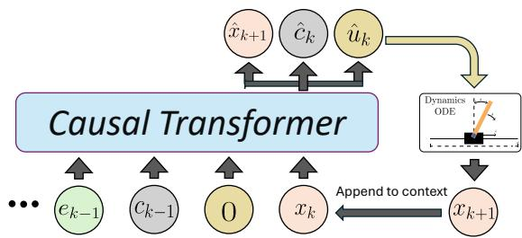  
Fig. 1: Given a context of zero-torque system evolution $u _ { 0 : k - 1 } { = } 0$ and current state $x _ { k } .$ , the Transformer predicts the next state $\hat { x } _ { k + 1 }$ , controller mode $\hat { c } _ { k }$ , and action $\hat { u } _ { k } ,$ , which is applied to the plant.

Reinforcement learning algorithms are commonly used for tasks like stabilization of underactuated systems [11], [12], however we are interested in investigating how ICL capabilities of Transformers along with architectural and training design choices contribute to similar task success. The primary contributions of this work are1:

• Analysis of emergent in-context capabilities: We investigate how stabilization scales with context length and model training demonstrating that ICL emerges as training progresses. Extended training shows evidence of data memorization which contributes to some cases of successful generalization to out-of-distribution data.

• Robustness via Gaussian perturbations: We inject state-level Gaussian noise during expert data generation. Without this, in-distribution stabilization success on the Cartpole collapses to 5% with 50 context examples (from 86% with perturbation), confirming that exposure to driving disturbances proves essential.

• Empirical validation on nonlinear benchmarks: We evaluate our architecture on underactuated Cartpole [13] and Acrobot [14] systems, achieving up to 86% (Cartpole) and 74% (Acrobot) in-distribution stabilization success at the longest context length.

## II. RELATED WORK

The development of a universal controller for unstable, nonlinear systems sits at the intersection of ICL, sequencebased decision-making, and foundation models for robotics.

a) Emergence of In-Context Learning: The capacity for Transformers to perform ICL was initially characterized in simple settings, such as linear regression [5], [15] and Gauss-Markov process prediction [6]. While extensively studied in large language models [1], [16], [17], recent work indicates ICL is an emergent property driven by the distributional properties of training data [18], [19], and [20] investigates how ICL relates to dynamical systems prediction and associative recall. We extend these findings to low-level stabilization of unstable, underactuated nonlinear systems.

b) Transformers for Sequence-Based Control: Decision Transformer [21] and Trajectory Transformer [22] catalyzed the use of Transformers within the sequence-modeling approach to reinforcement learning. Subsequent works applied these models to system identification [23] and task adaptation [24]. Existing approaches focus on high-level planning, however low-level stabilization at unstable equilibria is an interesting case study because of unique sensitivity to compounding errors. We bridge this gap using a multi-task objective for implicit parameter identification and state-perturbed expert demonstrations to ensure stabilization robustness.

c) Universal Controllers and Foundation Models: We build on universal control paradigms [10], which unifies control across plant realizations. Parallel efforts in robotics leverage fine-tuned LLMs [25], [26] or vision-language models [27], [28] for closed-loop control. Unlike foundation models that rely on high-level abstractions, we depart from natural language prompting [26].

## III. PROBLEM FORMULATION

## A. System Representation and Discretization

Consider a family of nonlinear, continuous-time dynamical systems F governed by the ordinary differential equation $\scriptstyle { \dot { \boldsymbol { x } } } ( t ) = f ( { \boldsymbol { x } } ( t ) , u ( t ) ; \omega )$ where $x ( t ) \in \mathcal { X } \subseteq \mathbb { R } ^ { n }$ is the state, $u ( t ) \ \in \mathcal { U } \ \subseteq \mathbb { R } ^ { m }$ is the control input, and $\omega ~ \in ~ \Omega ~ \subset$ $\mathbb { R } ^ { p }$ represents unknown physical parameters. Operating at sampling interval $\delta _ { t } ,$ discrete-time dynamics are given by $\boldsymbol { x } _ { k + 1 } = \Phi _ { \omega } \left( \boldsymbol { x } _ { k } , \boldsymbol { u } _ { k } , \delta _ { t } \right)$ . We can define the system distribution as $\mathcal { D } : = \{ \Phi _ { \omega } \mid \omega \in \Omega \}$ . For each realization $\omega ,$ , an expert controller $\kappa _ { \omega } : \mathbb { R } ^ { n }  \mathbb { R } ^ { m }$ yields the control action given the state $x _ { k }$ as $\boldsymbol { u } _ { k } ^ { * } { = } \kappa _ { \omega } ( \boldsymbol { x } _ { k } )$ . We use $\kappa _ { \omega }$ for offline training data generation; during inference, the learned policy receives state-action history alone without access to ω.

## B. Universal Control via In-Context Learning

Following the idea of universal control [10], our goal is to train a policy $\pi$ capable of stabilizing any system realization $\Phi _ { \omega } \sim { \mathcal { D } }$ without explicit knowledge of $\omega ,$ leveraging ICL via an initial unforced response. Let N be the window of the unforced response, where we impose zero torque $u _ { k } { = } 0 .$ The sequence generated during the unforced phase forms the context prompt: $H _ { 0 : N - 1 } { = } \{ ( \bar { x _ { k } } , e _ { k } , c _ { k } , u _ { k } = \bar { 0 } ) \} _ { k = 0 } ^ { N - 1 }$ . Here, $e _ { k } \in \mathbb { R }$ is the norm distance between the current state and the goal state, and $c _ { k }$ represents the active controller mode, which is necessary in our case as we employ a hybrid expert controller. Because the system model is known, the dynamics can be expressed linearly in the physical parameters $\omega \in$ $\Omega ,$ and estimating ω from a trajectory $H _ { 0 : N - 1 }$ requires a minimum context window N to yield a uniquely solvable system of equations [29]. This motivates our empirical study of stabilization success as a function of N.

The policy π uses $H _ { k - N : k - 1 }$ at step $k \geq N$ to produce an action approximating the expert: $\pi ( H _ { k - N : k - 1 } , x _ { k } )$ ≈ $\kappa _ { \omega } ( x _ { k } )$ . To optimize $\pi ,$ , we first construct the training dataset $\mathscr { T } { = } \{ \tau _ { \kappa _ { \omega } } ^ { ( j ) } \} _ { j { = } 1 } ^ { M } ,$ where each trajectory $\tau _ { \kappa _ { \omega } } ^ { ( j ) }$ is generated by rolling out trajectories of length $N _ { \mathrm { t o t a l } }$ under a sampled realization $\Phi _ { \omega } \sim { \mathcal { D } }$ . Each rollout transitions from an Unforced Response Phase $( 0 \leq k < N _ { ☉ }$ , where $u _ { k } { = } 0 )$ to a Control Phase $( N ~ \le ~ k ~ \le ~ N _ { \mathrm { t o t a l } }$ , where $u _ { k } { = } \kappa _ { \omega } ( x _ { k } ) )$ , stored as $( x _ { k } , e _ { k } , c _ { k } , u _ { k } )$ . Rollouts are sliced to length $L \ll N _ { \mathrm { t o t a l } } ,$ with the starting index sampled with equal probability from the unforced response or the full sequence, ensuring frequent exposure to unforced sequences of varying length.

## IV. MULTI-TASK SEQUENCE MODEL FRAMEWORK

## A. Transformer Models

The universal policy $\pi _ { \gamma } ,$ parameterized by weights $\gamma \in$ Γ, is modeled using a GPT-2-style decoder-only Transformer [30]. The model processes context history via causalself attention masking, only allowing attention to previous tokens [30], [31]. To preserve relative positional awareness across context sequences, we employ Rotary Position Embeddings (RoPE) [32].

To ground the latent embedding in both system dynamics and control law synthesis, the Transformer branches into three Multi-Layer Perceptron (MLP) heads at each step k: (1) Control Head $( \hat { u } _ { k } ) .$ predicts the control action. (2) State Dynamics Head $( \widehat { x } _ { k + 1 } )     \dot { . }$ predicts the state as an auxiliary task, forcing the shared representation to implicitly identify ω. (3) Mode Head $( \hat { c } _ { k } ) .$ : A classifier that predicts the active mode of the controller (e.g., energy-shaping, or stabilization).

## B. Multi-task Learning Objective

We obtain $\pi _ { \gamma }$ by optimizing $\gamma$ across the system distribution D by minimizing a composite loss function $\mathcal { L } \colon$

$$
\operatorname* { m i n } _ { \gamma } \mathbb { E } _ { \Phi _ { \omega } \sim \mathcal { D } } \left[ \sum _ { k = 0 } ^ { T } \mathcal { L } \Big ( \pi _ { \gamma } ( H _ { k - L : k - 1 } , x _ { k } ) , z _ { k } \Big ) \right]\tag{1}
$$

where ${ \boldsymbol { z } } _ { k } { = } ( u _ { k } ^ { * } , x _ { k + 1 } , c _ { k } )$ contains expert action $\boldsymbol { u } _ { k } ^ { * } { = } \kappa _ { \omega } ( \boldsymbol { x } _ { k } )$ the next state $x _ { k + 1 }$ , and the controller mode $c _ { k } .$ , and $\scriptstyle { \mathcal { L } } = \lambda _ { u } \| u _ { k } ^ { * } - { \hat { u } } _ { k } \| _ { 2 } ^ { 2 } + \lambda _ { x } \| x _ { k + 1 } - { \hat { x } } _ { k + 1 } \| _ { 2 } ^ { 2 } + \lambda _ { c } \mathbf { C } \mathbf { E } ( { \hat { c } } _ { k } , c _ { k } )$ , where $\lambda _ { u } , \lambda _ { x } , \lambda _ { c }$ are scalar loss weights and $\operatorname { C E } ( { \mathrm { \cdot } } )$ is cross-entropy loss. By coupling the control task with the state-prediction task, the model is encouraged to leverage the zero-torque context to refine its internal estimate of parameters $\omega .$

## C. Robust Trajectory Generation via State Perturbations

In closed-loop, minor prediction errors compound over time, driving the system outside the training distribution [33]. While methods like DAgger [34], [35] address this via finetuning on corrected exploratory traces, we use an alternative requiring no additional training beyond the initial stage. During the stabilization phase of expert rollouts, where precise actions are key, we use a system with a driving additive Gaussian disturbance, $x _ { k + 1 } = \Phi _ { \omega } \mathopen { } \mathclose \bgroup ( x _ { k } { + } \epsilon _ { k } , \kappa _ { \omega } ( x _ { k } { + }$ $\epsilon _ { k } ) , \delta _ { t } ) , \epsilon _ { k } \sim \mathcal { N } ( 0 , \sigma ^ { 2 } I )$ , forcing $\kappa _ { \omega }$ to generate corrective torques near the stabilization point. Training on these traces equips $\pi _ { \gamma }$ with closed-loop recovery behaviors that prevent error compounding during inference and mitigates numerical issues from vanishing signal magnitudes near the target.

## V. EXPERIMENTAL EVALUATION

We evaluate the proposed in-context control framework on the underactuated Cartpole and Acrobot benchmark systems.

## A. Model Architecture, Training and Inference Protocol

Each model consists of 12 layers, 8 attention heads, a 256-dimensional embedding space, and RoPE. Training: We optimize (1) using AdamW with learning rate $1 0 ^ { - 4 }$ , weight decay $1 0 ^ { - 2 }$ , and batch size 64 of sub-trajectories of length $L { = } 1 2 0$ from $\tau$ as detailed in Section III-B. Inference: At the beginning of inference, the model initially receives context $H _ { 0 : k - 1 } { = } \{ ( x _ { i } , e _ { i } , c _ { i } , u _ { i } { = } 0 ) \} _ { i { = } 0 } ^ { k - 1 }$ and query $x _ { k }$ as a prompt and predicts $( \hat { x } _ { k + 1 } , \hat { c } _ { k } , \hat { u } _ { k } )$ . The predicted action $\hat { u } _ { k }$ is executed in the dynamics to yield $x _ { k + 1 }$ , and the context is updated as $H _ { 1 : k } { = } \{ ( x _ { i } , e _ { i } , c _ { i } , u _ { i } ) \} _ { i = 1 } ^ { k }$ by appending $( \boldsymbol { x } _ { k } , \boldsymbol { e } _ { k } , \hat { \boldsymbol { c } } _ { k } , \hat { \boldsymbol { u } } _ { k } )$ and dropping the oldest entry via a sliding window, as shown in Figure 1. This process is repeated with context $H _ { 1 : k }$ and query $x _ { k + 1 }$ as the new prompt. These steps are followed until the trajectory reaches a desired length.

## B. LSTM Baseline

To test whether stabilization success is specific to ICL capabilities of Transformers rather than a generic benefit of any sequence model, we train an LSTM baseline (3 layers, hidden size 1024) with identical multi-head structure, training data, and loss function. For a fair comparison, its hidden state is constructed from the same sliding context window outlined in Section V-A.

## C. Cartpole System

The cartpole system requires swinging up a pendulum and balancing it upright via horizontal cart forces [13].

1) System Dynamics: The state is $\boldsymbol { x } = [ p , \dot { p } , \theta , \dot { \theta } ] ^ { \intercal }$ , where p is cart position, θ is the pole angle, and the upright equilibrium is $\boldsymbol { x } = [ 0 , 0 , 0 , 0 ] ^ { \top }$ . The dynamical system is governed by physical parameters $\omega = [ M , m , l ] \in \Omega _ { c a r t }$ , where M is cart mass, m is pole mass, and l is pole length:

$$
\begin{array} { r l } & { \ddot { p } = \frac { \left( u + m l \dot { \theta } ^ { 2 } \sin \theta \right) - \left( m l \ddot { \theta } \cos \theta \right) } { M + m } } \\ & { \ddot { \theta } = \frac { g \sin \theta + \cos \theta \left( \frac { - u - m l \dot { \theta } ^ { 2 } \sin \theta } { M + m } \right) } { l \left( \frac { 4 } { 3 } - \frac { m \cos ^ { 2 } \theta } { M + m } \right) } . } \end{array}\tag{2}
$$

2) Parameterized Expert Controller $( \kappa _ { \omega _ { i } } ) \colon$ For each ω , we synthesize a hybrid expert controller $\kappa _ { \omega _ { i } } \colon$ (1) Energy-Shaping Swing-up: pumps mechanical energy $E ( x ; \omega _ { i } ) = { \textstyle { \frac { 1 } { 2 } } } m l ^ { 2 } \dot { \theta } ^ { 2 } + m g l$ cos (θ) toward upright target $E ^ { d } { = } m g l .$ , applying torque $u ^ { * } { = } { - } k { \dot { \theta } } ( E { - } E ^ { d } ) \ ( k { > } 0 )$ [36]. (2) Linear Quadratic Regulator (LQR): near upright, switches to

TABLE I: Cartpole System Parameter Space Distributions
<table><tr><td>Distribution</td><td>M (kg</td><td>m (kg)</td><td>l (m)</td></tr><tr><td>In-Distribution  $( \Omega _ { \mathrm { c a r t } } )$ </td><td> $[ 2 . 0 , 3 . 0 )$ </td><td>[1.1, 2.0)</td><td>[1.6, 2.1)</td></tr><tr><td>OOD Easy  $( \Omega _ { c a r t } ^ { \mathrm { { O O D } , \ e a s y } } )$ </td><td>[1.5, 2.0)</td><td>[0.3, 0.8)</td><td>[1.0, 1.5)</td></tr><tr><td>OOD Hard  $( \Omega _ { \mathrm { c a r t } } ^ { \mathbf { \tilde { o o p } } , \mathbf { h a r d } } )$ </td><td>[3.0, 3.5)</td><td>[2.0, 2.5)</td><td>[2.2, 2.7)</td></tr></table>

LQR torque $u ^ { * } { = } { \mathrm { - } } K ( \omega _ { i } ) x$ , where gain matrix $K ( \omega _ { i } )$ solves the Algebraic Riccati Equation for linearized dynamics.

3) Data Generation: Trajectories $\tau _ { \kappa _ { \omega _ { i } } } ^ { ( i ) } ~ \in ~ \dot { \tau }$ are rolled out using parameter realizations $\omega _ { i }$ from uniform distribution $\begin{array} { r } { \mathcal { U } ( \Omega _ { \mathrm { c a r t } } ) } \end{array}$ , where $\Omega _ { c a r t }$ is defined in Table I. Initial conditions sample $\scriptstyle p _ { 0 } = 0 , \ { \dot { p } } _ { 0 } = 0 , \ \theta _ { 0 } \sim { \mathcal { U } } ( { \frac { \pi } { 2 } } , { \frac { 3 \pi } { 2 } } )$ , and $\dot { \theta } { \sim } \mathcal { U } ( - 1 , 1 )$ . As stated in Section III-B, trajectories $\tau _ { \kappa _ { \omega , i } } ^ { ( i ) }$ are constructed by enforcing $N { = } 5 0$ steps of zero-torque evolution followed by the expert’s response, and $\delta _ { t } = 0 . 0 2 5$ . To handle angular periodicity, states are augmented as $\tilde { x } = [ p , \dot { p } , \cos ( \theta ) , \sin ( \theta ) , \dot { \theta } ]$ Lastly, we leverage the Gaussian Perturbation approach during the LQR regime as detailed in Section IV-C, and failed stabilization traces are filtered out.

4) Main Results: We illustrate stabilization performance at an early (5k steps, 320k training traces) and a late (10k steps, 640k training traces) Transformer checkpoint evaluated on 100 randomly sampled systems from three distributions (Table I). OOD-Easy has lower inertia (lighter, shorter), making it easier to stabilize than OOD-Hard (higher inertia). Stability criterion: $| \theta | { \leq } 0 . 1$ rad and $| \dot { \theta } | { \leq } 0 . 3$ rad/s during the final segment of the roll-out (p converges slower due to underactuation). We compare against a nominal baseline $\kappa _ { \omega _ { \mathrm { a v g } } }$ using average in-distribution parameters $\omega _ { \mathrm { a v g } } = [ 2 . 5 , 1 . 5 , 1 . 8 ]$ and report the fraction of systems stabilized.

Comparing Fig. 2(a) and (b), in-distribution and OOD-Easy success generally increased with context until context 25 with the late-checkpoint Transformer outperforming at context 50. We also see that OOD-Easy performance exceeds in-distribution performance at longer context at both Transformer training points since training on higher-inertia systems transfers to easier, lower-inertia systems. At context 1 for all data regimes, the early checkpoint stabilizes no systems, while the late checkpoint achieves non-zero success. Since one data point cannot identify three unknowns $( \omega =$ $[ M , m , l ] )$ , this indicates the late checkpoint has memorized a default behavior rather than performing identification. The late checkpoint also outperforms the nominal baseline (78% in-distribution, 0% OOD-Easy, 20% OOD-Hard) and is the only checkpoint able to meaningfully stabilize OOD-Hard systems, suggesting this capability likewise benefits from extended training. This needs to be explored in future work. For OOD-Hard systems specifically, success degrades at the longest context (50), consistent with ICL literature showing that additional context can introduce spurious correlations that mislead the model [37], an effect likely amplified since OOD-Hard systems are much harder to stabilize.

We compare the late-checkpoint Transformer against an LSTM baseline (Fig. 2(c)) trained identically. At context 1, the LSTM substantially outperforms the Transformer for in-distribution and OOD-Easy systems, reflecting a stronger memorized default policy rather than superior context utilization. This advantage narrows and reverses with context, and by context 50, the Transformer outperforms the LSTM on both in-distribution and OOD-Easy systems, while the LSTM retains better performance on OOD-Hard systems, where identification is most difficult.

(a) Transformer, Step 5000  
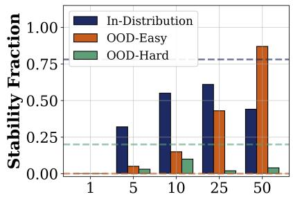  
Context Length (N)

(b) Transformer, Step 10000  
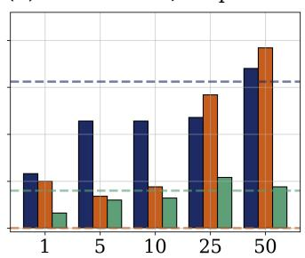  
Context Length (N)

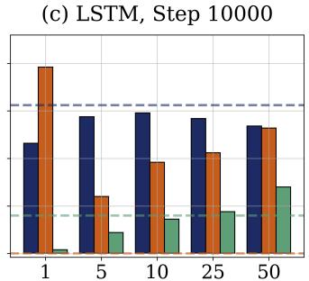  
Context Length (N)  
Fig. 2: Stabilization success rate vs. context length (N) for Cartpole. Left/center: Transformer at an early and late training checkpoint. Right: LSTM baseline at the matched late checkpoint. Dashed lines denote nominal baseline performance. The Transformer’s ability to better exploit long context emerges between checkpoints (a)-(b), while the LSTM (c) outperforms the late-checkpoint Transformer (b) at short context but is overtaken by $N { = } 5 0$ on in-distribution and OOD-Easy systems.

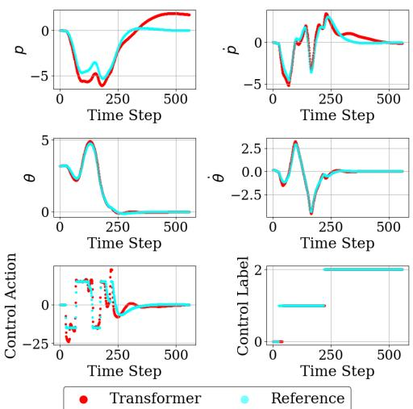  
Fig. 3: One example of swing-up for the cartpole system. Comparison between expert reference $\kappa _ { \omega }$ and Transformer roll out given 25 context examples. States $[ p , \dot { p } , \theta , \dot { \theta } ]$ and actions are shown over time.

Fig. 3 shows one example of a Transformer rollout under $N { = } 2 5$ context steps versus expert reference $\kappa _ { \omega }$ . While the predicted Transformer actions are not perfectly aligned with $\kappa _ { \omega } , \theta$ and ˙θ converge to zero indicating stabilization. Notably, the Transformer nearly perfectly predicts the transition from energy-shaping swing-up to LQR stabilization.

5) Ablation: A key hypothesis in our framework, as discussed in Section IV-C, is that training on traces synthesized by expert controllers $\kappa _ { \omega _ { i } }$ injected with additive Gaussian noise during the LQR phase encourages the Transformer to learn corrective actions necessary to maintain stabilization.

TABLE II: Stabilization Success vs. Context Length N for the Cartpole Transformer (Ablation: Noise-Free Data)
<table><tr><td>Test Distribution</td><td>N=1</td><td>N=5</td><td>N=10</td><td>N=25</td><td>N=50</td></tr><tr><td>In-Distribution</td><td>0.00</td><td>0.02</td><td>0.02</td><td>0.01</td><td>0.05</td></tr><tr><td>Out-of-Distribution (OOD)</td><td>0.00</td><td>0.01</td><td>0.03</td><td>0.04</td><td>0.09</td></tr></table>

To validate this claim, we train a Transformer on “clean” dataset $\tau _ { \mathrm { c l e a n } }$ lacking Gaussian noise. As shown in Table II, the noise-free model fails $\mathrm { o n > 9 0 \% }$ of test systems. Without recovery demonstrations near equilibrium, minor inference errors drive states out-of-distribution, proving expert stochasticity is essential for closed-loop robustness.

## D. Acrobot System

The Acrobot is a two-link planar robot actuated only at the elbow joint, which is a significantly more challenging benchmark to swing up and balance [36].

1) System Dynamics: The state is $\boldsymbol { x } { = } [ \theta _ { 1 } , \theta _ { 2 } , \dot { \theta } _ { 1 } , \dot { \theta } _ { 2 } ] ^ { \top }$ where $\theta _ { 1 }$ first link angle, $\theta _ { 2 }$ is the second link angle relative to the first, and the upright equilibrium is $x { = } [ \bar { \pi } , 0 , 0 , 0 ] ^ { \top }$ Physical parameter vector $\omega = [ m _ { 1 } , m _ { 2 } , l _ { 1 } , l _ { 2 } ]$ denotes link masses $m _ { 1 } , m _ { 2 }$ and link lengths $l _ { 1 } , l _ { 2 }$ . The equations of motion are expressed as:

$$
\mathbf { M } ( \mathbf { q } , \omega ) \ddot { \mathbf { q } } + \mathbf { C } ( \mathbf { q } , \dot { \mathbf { q } } , \omega ) \dot { \mathbf { q } } = \mathbf { G } ( \mathbf { q } , \omega ) + \mathbf { B } u ,\tag{3}
$$

where $\mathbf { q } = [ \theta _ { 1 } , \theta _ { 2 } ] ^ { \top }$ and matrices M, C, G follow standard manipulator notation [36].

2) Parameterized Expert Controller $( \kappa _ { \omega _ { i } } ) \colon$ For each realization $\omega _ { i } ,$ , we synthesize a hybrid expert controller $\kappa _ { \omega , }$ with hysteresis switching logic to prevent chattering: (1) Partial Feedback Linearization Swing-up: $u = \bar { d } _ { 2 2 } v _ { 2 } + \bar { h } _ { 2 } + \bar { \phi } _ { 2 }$ where $\bar { d } _ { 2 2 } , \bar { h } _ { 2 } , \bar { \phi } _ { 2 }$ are reduced-order terms derived from the dynamics, and $\begin{array} { r l r } { v _ { 2 } } & { { } = } & { \mathrm { t a p e r } ( \theta _ { 1 } ^ { d } , \theta _ { 1 } ) \left| k _ { p } ( E ) ( \theta _ { 2 } ^ { d } - \theta _ { 2 } ) - k _ { d } ( E ) \dot { \theta } _ { 2 } \right| } \end{array}$ is an energy-shaping signal [38]. (2) LQR: near upright, switches to LQR torque $u ^ { * } { = } - K ( \omega _ { i } ) ( x - x _ { \mathrm { g o a l } } )$

3) Data Generation: Trajectories $\tau _ { \kappa _ { \omega _ { i } } } ^ { ( i ) } \in \mathcal { T }$ are rolled out using sample realizations $\omega _ { i } \sim \mathcal { U } ( \Omega _ { \mathrm { a c r o } } )$ bounded as in Table III. Initial conditions sample $\theta _ { 1 } \in \mathcal { U } \big ( - \textstyle \frac { \pi } { 2 } , - \frac { \pi } { 4 } \big ) \cup \mathcal { U } \big ( \textstyle \frac { \pi } { 4 } , \frac { \pi } { 2 } \big )$

TABLE III: Acrobot System Parameter Space Distributions
<table><tr><td>Distribution</td><td> $l _ { 1 } ~ ( \mathbf { m } )$ </td><td> $l _ { 2 } \ \mathrm { ~ ( m ) ~ }$ </td><td>m1 (kg)</td><td>m2 (kg)</td></tr><tr><td> $\mathrm { I n - D i s t r . } \ ( \Omega _ { \mathrm { a c r o } } )$ </td><td>[0.5, 1.0)</td><td>[1.0, 1.5)</td><td>[1.5, 2.0)</td><td> $[ 1 . 0 , 1 . 5 )$ </td></tr><tr><td> $\mathrm { O O D } ~ ( \Omega _ { \mathrm { a c r o } } ^ { \mathrm { O O D } } )$ </td><td>[1.0, 1.5)</td><td>[1.5, 2.0)</td><td>[1.0, 1.5)</td><td>[1.0, 1.5)</td></tr></table>

$\theta _ { 2 } = 0 , \dot { \theta } _ { 1 } \sim \mathcal { U } ( - 1 , 1 )$ rad/s, and $\dot { \theta } _ { 2 } = 0$ . Trajectories $\tau _ { \kappa _ { \omega _ { i } } } ^ { ( i ) }$ are constructed by enforcing $N { = } 1 0 0$ steps of zero-torque evolution preceding the expert’s $( \kappa _ { \omega _ { i } } )$ response, and $\delta _ { t } { = } 0 . 0 2$ To accommodate angular periodicity, states are augmented as $\boldsymbol { x } = [ \cos ( \theta _ { 1 } ) , \sin ( \theta _ { 1 } ) , \cos ( \theta _ { 2 } ) , \sin ( \theta _ { 2 } ) , \dot { \theta } _ { 1 } , \dot { \theta } _ { 2 } ]$ . We also apply Gaussian perturbation during the LQR regime addressing concerns mentioned in Section IV-C. Unstabilized traces are filtered out (∼ 33% of trajectories due to system complexity).

4) Main Results: We evaluate performance on 50 indistribution and 50 OOD randomly sampled test systems (Table III). Stability Criterion: given the complexity of the acrobot, a system is stabilized if the state enters and remains within a fixed neighborhood $( | \theta _ { 1 } | ~ < ~ 0 . 2$ rad and $| \theta _ { 2 } | ~ <$ 0.3 rad) of upright equilibrium for at least 3 seconds, indicating that the model can swing up and switch to LQR stabilization, even briefly. We compare against a nominal baseline $\kappa _ { \omega _ { \mathrm { a v g } } }$ using average in-distribution parameters $\omega _ { \mathrm { a v g } } = [ l _ { 1 } =$ $0 . 7 5 , l _ { 2 } = 1 . 2 5 , m _ { 1 } = 1 . 7 5 , m _ { 2 } = 1 . 2 5 ]$ , which stabilizes only 26% of in-distribution and 1% of OOD systems.

Fig. 4(a) indicates that the early-checkpoint Transformer (25k training steps, 1.6 million training trajectories) stabilizes no systems at N=1 but improves up to context 25, confirming context-driven adaptation rather than memorization. The late checkpoint (300k training steps, 20.5 million training traces) shown in Fig. 4(b) achieves strong in-distribution stabilization and increasingly leverages context for OOD systems, exceeding the nominal baseline. Non-zero stabilization success for context 1 indicates memorization which seems to help with OOD stabilization.

Comparing the late checkpoint Transformer with the LSTM in Fig. 4(c), the LSTM matches or exceeds the Transformer’s in-distribution performance at every context length beyond N=1. So, the in-context learning abilities of Transformer models do not outperform LSTM behavior in these examples. On OOD systems, however, the pattern resembles the Cartpole for OOD-Easy: the LSTM has better performance at short context, but the Transformer does better at longer context $N { = } 5 0 \ ( 0 . 2 2 \ \mathrm { v s } . \ 0 . 1 4 )$ . Taken together with the Cartpole OOD-Hard result, where the LSTM retained an advantage even at long context, this suggests that the Transformer’s context driven advantage over the LSTM is not uniform, but perhaps Transformers have an advantage in performing in unfamiliar regimes.

Fig. 5 shows one example of a Transformer rollout under $N { = } 5 0$ context examples versus reference expert controller $\kappa _ { \omega }$ . The Transformer successfully completes the swing-up maneuver, converging $\theta _ { 1 } \to - 5 \pi \equiv \pi$ rad and applies LQR corrective actions to maintain upright stability.

Limitations: Our framework requires an expert controller $\kappa _ { \omega }$ per training realization. This is tractable for Cartpole and

Acrobot since swing-up/LQR expert is parameterized by ω but may not generalize to systems lacking an analytic expert.

## VI. CONCLUSION

We investigated the ICL capabilities of Transformer models for the low-level stabilizing control of underactuated, nonlinear dynamical systems. Provided with a context of zero-torque state-action observations, the Transformer can adapt its control law accordingly. We find that it is not possible to successfully train on data from systems with no driving disturbance. However, training on trajectories from systems with additive Gaussian noise allows the model to learn the corrective actions required for stabilization that are otherwise absent in “clean” expert trajectories. Furthermore, we show that once the Transformer begins to memorize the training data and stabilize systems with no context examples, ICL capabilities seem to emerge for even for OOD systems. Evaluated on cartpole and acrobot benchmarks, the Transformer consistently outperforms naive nominal baselines but has similar performance to an LSTM baseline.

## REFERENCES

[1] T. Brown, B. Mann, N. Ryder, M. Subbiah, J. D. Kaplan, P. Dhariwal, A. Neelakantan, P. Shyam, G. Sastry, A. Askell, et al., “Language models are few-shot learners,” Advances in Neural Information Processing Systems, vol. 33, pp. 1877–1901, 2020.

[2] O. Lieber, O. Sharir, B. Lenz, and Y. Shoham, “Jurassic-1: Technical details and evaluation,” White Paper. AI21 Labs, vol. 1, no. 9, pp. 1–17, 2021.

[3] J. W. Rae, S. Borgeaud, T. Cai, K. Millican, J. Hoffmann, F. Song, J. Aslanides, S. Henderson, R. Ring, S. Young, et al., “Scaling language models: Methods, analysis & insights from training gopher,” arXiv preprint arXiv:2112.11446, 2021.

[4] S. Black, S. Biderman, E. Hallahan, Q. Anthony, L. Gao, L. Golding, H. He, C. Leahy, K. McDonell, J. Phang, et al., “Gpt-neox-20b: An open-source autoregressive language model,” in Proceedings of BigScience Episode# 5–Workshop on Challenges & Perspectives in Creating Large Language Models, pp. 95–136, 2022.

[5] S. Garg, D. Tsipras, P. S. Liang, and G. Valiant, “What can transformers learn in-context? a case study of simple function classes,” Advances in Neural Information Processing Systems, vol. 35, pp. 30583–30598, 2022.

[6] Z. Du, H. Balim, S. Oymak, and N. Ozay, “Can transformers learn optimal filtering for unknown systems?,” IEEE Control Systems Letters, vol. 7, pp. 3525–3530, 2023.

[7] L. Fu, H. Huang, G. Datta, L. Y. Chen, W. C.-H. Panitch, F. Liu, H. Li, and K. Goldberg, “In-context imitation learning via next-token prediction,” arXiv preprint arXiv:2408.15980, 2024.

[8] L. Ljung et al., “Theory for the user,” System identification, 1987.

[9] Z.-S. Hou and Z. Wang, “From model-based control to data-driven control: Survey, classification and perspective,” Information Sciences, vol. 235, pp. 3–35, 2013.

[10] R. Busetto, V. Breschi, M. Forgione, D. Piga, and S. Formentin, “One controller to rule them all,” Proceedings of Machine Learning Research vol vvv, vol. 1, p. 14, 2025.

[11] M. Deisenroth and C. E. Rasmussen, “Pilco: A model-based and data-efficient approach to policy search,” in Proceedings of the 28th International Conference on machine learning (ICML-11), pp. 465– 472, 2011.

[12] J. Kober, J. A. Bagnell, and J. Peters, “Reinforcement learning in robotics: A survey,” The International Journal of Robotics Research, vol. 32, no. 11, pp. 1238–1274, 2013.

[13] K. J. Astr˚ om and R. Murray,¨ Feedback Systems: An Introduction for Scientists and Engineers. Princeton University Press, 2021.

[14] R. M. Murray and J. E. Hauser, A case study in approximate linearization: The acrobot example. Electronics Research Laboratory, College of Engineering, University of California Berkeley, 1991.

Reference  
(a) Transformer, Step 25k  
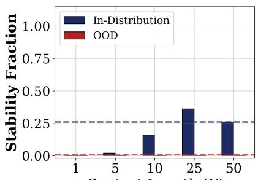  
Context Length (N)

(b) Transformer, Step 300k  
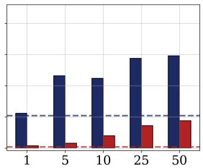  
Context Length (N)

(c) LSTM, Step 300k  
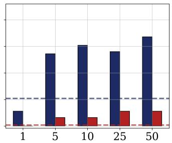  
Context Length (N)  
Fig. 4: Stabilization success rate vs. context length (N) for Acrobot. (a) Transformer, early checkpoint (step 25k). (b) Transformer, late checkpoint (step 300k). (c) LSTM baseline, matched late checkpoint (step 300k). Dashed lines denote nominal baseline performance. The LSTM matches or exceeds the Transformer on in-distribution systems at all context lengths beyond N=1, while the Transformer overtakes the LSTM on OOD systems by N=50.

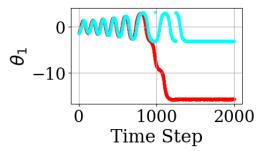

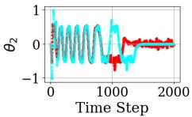

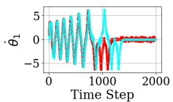

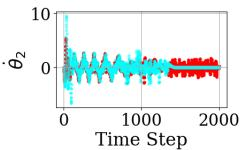

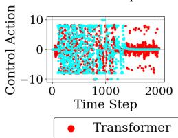

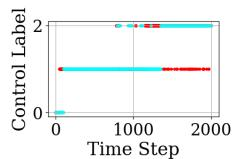  
Fig. 5: One example of acrobot swing-up rollout comparison: Expert $\kappa _ { \omega }$ (light blue) vs. Transformer (red) given N=50 context steps. Angle $\theta _ { 1 }$ converges to $- 5 \pi \equiv \pi$ rad upright.

[15] A. Raventos, M. Paul, F. Chen, and S. Ganguli, “Pretraining task ´ diversity and the emergence of non-bayesian in-context learning for regression,” Advances in Neural Information Processing Systems, vol. 36, pp. 14228–14246, 2023.

[16] C. Olsson, N. Elhage, N. Nanda, N. Joseph, N. DasSarma, T. Henighan, B. Mann, A. Askell, Y. Bai, A. Chen, et al., “In-context learning and induction heads,” arXiv preprint arXiv:2209.11895, 2022.

[17] E. Akyurek, B. Wang, Y. Kim, and J. Andreas, “In-context¨ language learning: Architectures and algorithms,” arXiv preprint arXiv:2401.12973, 2024.

[18] S. Chan, A. Santoro, A. Lampinen, J. Wang, A. Singh, P. Richemond, J. McClelland, and F. Hill, “Data distributional properties drive emergent in-context learning in transformers,” Advances in neural information processing systems, vol. 35, pp. 18878–18891, 2022.

[19] S. C. Raparthy, E. Hambro, R. Kirk, M. Henaff, and R. Raileanu, “Generalization to new sequential decision making tasks with incontext learning,” arXiv preprint arXiv:2312.03801, 2023.

[20] S. Daniels, D. Davis, D. Gautam, W. Liao, G. Ranade, and A. Sahai, “Different simultaneous mechanisms for in-context recall have distinct learning dynamics,” in Workshop on High-dimensional Learning Dynamics, 2025.

[21] L. Chen, K. Lu, A. Rajeswaran, K. Lee, A. Grover, M. Laskin, P. Abbeel, A. Srinivas, and I. Mordatch, “Decision transformer: Reinforcement learning via sequence modeling,” Advances in Neural Information Processing Systems, vol. 34, pp. 15084–15097, 2021.

[22] M. Janner, Q. Li, and S. Levine, “Offline reinforcement learning as one big sequence modeling problem,” in Advances in Neural Information Processing Systems (M. Ranzato, A. Beygelzimer, Y. Dauphin, P. Liang, and J. W. Vaughan, eds.), vol. 34, pp. 1273–1286, Curran Associates, Inc., 2021.

[23] X. Zhang, S. Liu, P. Huang, W. J. Han, Y. Lyu, M. Xu, and D. Zhao, “Dynamics as prompts: In-context learning for sim-to-real system identifications,” 2025.

[24] M. Xu, Y. Shen, S. Zhang, Y. Lu, D. Zhao, J. Tenenbaum, and C. Gan, “Prompting decision transformer for few-shot policy generalization,” in International Conference on Machine Learning, pp. 24631–24645, PMLR, 2022.

[25] X. Zhang, W. Mao, H. Qiu, and T. Bas¸ar, “Decision transformer as a foundation model for partially observable continuous control,” in 2025 American Control Conference (ACC), pp. 239–244, IEEE, 2025.

[26] Y.-J. Wang, B. Zhang, J. Chen, and K. Sreenath, “Prompt a robot to walk with large language models,” in 2024 IEEE 63rd Conference on Decision and Control (CDC), pp. 1531–1538, IEEE, 2024.

[27] X. Li, M. Liu, H. Zhang, C. Yu, J. Xu, H. Wu, C. Cheang, Y. Jing, W. Zhang, H. Liu, et al., “Vision-language foundation models as effective robot imitators,” arXiv preprint arXiv:2311.01378, 2023.

[28] J. Y. Zhu, C. G. Cano, D. V. Bermudez, and M. Drozdzal, “InCoRo: In-Context Learning for Robotics Control with Feedback Loops,” 2024.

[29] C. G. Atkeson, C. H. An, and J. M. Hollerbach, “Estimation of inertial parameters of manipulator loads and links,” The International Journal of Robotics Research, vol. 5, no. 3, pp. 101–119, 1986.

[30] A. Radford, K. Narasimhan, T. Salimans, I. Sutskever, et al., “Improving language understanding by generative pre-training,” 2018.

[31] P. J. Liu\*, M. Saleh\*, E. Pot, B. Goodrich, R. Sepassi, L. Kaiser, and N. Shazeer, “Generating wikipedia by summarizing long sequences,” in International Conference on Learning Representations, 2018.

[32] J. Su, M. Ahmed, Y. Lu, S. Pan, W. Bo, and Y. Liu, “Roformer: Enhanced transformer with rotary position embedding,” Neurocomputing, vol. 568, p. 127063, 2024.

[33] N. Rajaraman, L. Yang, J. Jiao, and K. Ramchandran, “Toward the fundamental limits of imitation learning,” Advances in Neural Information Processing Systems, vol. 33, pp. 2914–2924, 2020.

[34] S. Ross, G. Gordon, and D. Bagnell, “A reduction of imitation learning and structured prediction to no-regret online learning,” in Proceedings of the fourteenth international conference on artificial intelligence and statistics, pp. 627–635, JMLR Workshop and Conference Proceedings, 2011.

[35] D. Celestini, D. Gammelli, T. Guffanti, S. D’Amico, E. Capello, and M. Pavone, “Transformer-Based Model Predictive Control: Trajectory Optimization via Sequence Modeling,” IEEE Robotics and Automation Letters, vol. 9, pp. 9820–9827, Nov. 2024.

[36] R. Tedrake, Underactuated Robotics. 2023.

[37] J. Chen, L. Chen, C. Zhu, and T. Zhou, “How many demonstrations do you need for in-context learning?,” in Findings of the Association for Computational Linguistics: EMNLP 2023, pp. 11149–11159, 2023.

[38] M. W. Spong, “The swing up control problem for the acrobot,” IEEE Control Systems Magazine, vol. 15, no. 1, pp. 49–55, 2002.