Extracting Single-Mode Rayleigh–Taylor Instability dynamics from data via SINDy Chuanxing Wang,1 Hui Luo,1 Guohuai Zhu,2 Hongbo Cai,1, 2 Shaoping Zhu,1, 3 and Mingxing Luo2

1)Graduate School, China Academy of Engineering Physics, Beijing 100088, China

2)Beijing Computational Science Research Center, Beijing 100193, China

3)Institute of Applied Physics and Computational Mathematics, Beijing 100094, China

(\*Electronic mail: hluo@gscaep.ac.cn)

(Dated: 6 November 2026)

Rayleigh-Taylor instability (RTI) is of fundamental importance in fields such as inertial confinement fusion and supernova explosions, and its evolution is commonly described by potential–flow theory and buoyancy–drag models. However, both types of models struggle to accurately capture the overshoot behavior of bubble and spike velocities, as well as the subsequent reacceleration stage. To address these limitations, we develop a physics-constrained, data-driven framework based on the integral formulation of Sparse Identification of Nonlinear Dynamics (SINDy), which extracts low-dimensional dynamical equations for bubble and spike evolution directly from data. By introducing the nondimensional initial amplitude $A _ { 0 } = k \eta _ { 0 }$ as an explicit parameter, we identify distinct dynamical equations for the bubble and the spike based on data spanning multiple Atwood numbers and initial amplitudes. The resulting low-dimensional dynamical equations not only reproduce the overshoot behavior of the velocity with good accuracy, but also capture the reacceleration stage well, while maintaining high predictive accuracy at unseen values of the wavenumber, acceleration, and Atwood number. This work provides a physics-constrained, datadriven framework complementary to conventional potential-flow and buoyancy–drag models, accurately describing the dynamical evolution of the bubble and spike at high Atwood numbers, and provides a new perspective for directly extracting the dynamical equations of interfacial instabilities from data.

## I. INTRODUCTION

Rayleigh-Taylor instability (RTI) refers to the unstable growth of small perturbations at the interface between two fluids of diferent densities when the acceleration points from the lighter fluid to the heavier fluid1,2. As the instability develops, the lighter fluid penetrates into the heavier fluid to form bubbles, whereas the heavier fluid penetrates into the lighter fluid to form spikes. RTI occurs in a broad range of scenarios, including inertial confinement fusion (ICF)3,4 and supernova explosions5,6. During ICF implosions, the growth of RTI drives the mixing between the capsule ablator and fuel, degrading the spherical symmetry and compression eficiency of the implosion and thus severely compromising the ignition performance7–9. A thorough theoretical investigation of RTI evolution is therefore of considerable scientific significance and engineering value, as it elucidates the underlying physical mechanisms and provides a theoretical basis for suppressing instability growth.

Existing theoretical descriptions of RTI are based primarily on potential-flow formulations 10–14 and buoyancy–drag models15,16. Both approaches formulate evolution equations for the velocities of the bubble and spike tips, with the corresponding amplitude evolution obtained through temporal integration. Assuming incompressibility, inviscidity and irrotational flow, Layzer approximated the interfacial profile in the vicinity of the bubble tip by a paraboloid and derived an ordinary diferential equation for the bubble velocity using an expansion of the velocity potential10. However, the model is restricted to the limiting case in which one fluid is replaced by vacuum, corresponding to $A _ { T } = 1$ Goncharov generalized the Layzer-type theory to arbitrary Atwood numbers, obtaining a continuous solution spanning the linear exponential-growth and nonlinear quasi-steady stages, and deriving the terminal velocities of two- and three-dimensional bubbles11, thus extending the description into the nonlinear regime. Liu et al. introduced a double-source velocity potential within the classical potential-flow framework, constructing a coupled dynamical system in terms of tip velocity, curvature, and source distance. This system successfully captures the long-term co-evolution of velocity and curvature17 and reproduces the velocity overshoot, in which the bubble velocity transiently exceeds and subsequently relaxes back toward its late-time asymptotic value. Nevertheless, its predictive accuracy for spike evolution at high Atwood numbers remains limited. Building on this framework, Liu et al. further introduced a bilaterally rotational flow system around the bubble and incorporated vorticity accumulation into the evolution equations, thereby capturing the evolution from the initial saturation of the quasi-steady stage to the reacceleration stage18. Within this framework, the reacceleration is attributed to the progressive breaking of the early buoyancy–drag equilibrium due to vorticity accumulation. Nevertheless, the model remains limited in its ability to predict spike dynamics. More recently, Piriz et al.19 proposed a momentum-based description of the reacceleration stage that treats the bubble and the spike on the same footing: the buoyancy force is taken as the sole source of momentum, and vorticity merely drains momentum from the translational motion into the rotational motion, thereby arresting the lateral expansion (contraction) of the bubble (spike). Once the lateral expansion is arrested at a threshold amplitude20, the participating mass becomes linear in the amplitude and the momentum equation admits a constant-acceleration solution, which reproduces the reacceleration of the interface without introducing any additional force.

Buoyancy–drag models, in contrast, interpret interfacial motion as a competition between buoyancy driven by the density diference and inertial drag associated with momentum exchange, prescribing the specific forms of the buoyancy and drag terms directly via assumption. Based on a uniform approximation within the bubble and spike regions and mass conservation, Dimonte established a buoyancy–drag model for the mixing zone15; Oron et al. further incorporated coeficients derived from potential-flow theory into this buoyancy–drag model to describe the late-time scaling of both Rayleigh–Taylor and Richtmyer–Meshkov instabilities across diferent dimensionalities16.

Potential-flow theory relies on a specific irrotational assumption and yields poor predictive accuracy for spikes at high Atwood numbers. Classical buoyancy–drag models, in turn, treat the coeficients of buoyancy and drag terms as independent of the instantaneous amplitude A and initial amplitude $A _ { 0 }$ , thereby failing to accurately capture the efects of $A _ { 0 }$ on nonlinear evolution. Furthermore, given that both the magnitude and the onset time of the velocity overshoots strongly depend on the initial amplitude, these models cannot reproduce the overshoot phenomenon. In addition, classical buoyancy–drag models fail to recover the linear limit.

To address these limitations, we propose a data-driven dynamical modeling framework for interfacial instabilities that employs the integral-form Sparse Identification of Nonlinear Dynamics (SINDy) method21–24 to infer low-dimensional dynamical equations from RTI data. The central idea of SINDy is as follows: given data on the state variables and their time derivatives, one first constructs a candidate library containing polynomial, trigonometric, rational, or physics-informed basis functions, and then uses sparse regression to select a small subset of dominant terms that constitute an explicit governing equation. Compared with other machine-learning approaches, SINDy-derived models are generally more interpretable and can directly reveal the relative contributions of diferent physical mechanisms to dynamical evolution. In contrast to traditional theoretical derivations, SINDy can automatically extract efective dynamical forms from the data even when the prior assumptions are incomplete. In the present work, we infer separate low-dimensional dynamical equations governing bubble and spike evolution from direct numerical simulation (DNS) data. Building on the classical buoyancy–drag framework, we employ the integral formulation of SINDy to identify state- and parameter-dependent buoyancy and drag coeficients, with explicit dependence on the Atwood number, the instantaneous amplitude, and the initial perturbation amplitude. The resulting equations accurately reproduce the overshoot–relaxation behavior of the bubble and spike velocities and capture their full temporal evolution, including the late-time reacceleration stage. To the best of our knowledge, this is the first application of an integral-form SINDy framework with physical constraints from the buoyancy–drag structure to extract reduced-order dynamical equations for single-mode Rayleigh–Taylor instability. The buoyancy–drag structure is imposed as a physically motivated prior, while the stateand parameter-dependent closure functions are identified from DNS data Because the fluids are treated as incompressible, an incompressible formulation is adopted throughout the simulations.

The remainder of this paper is organized as follows. Section II presents the formulation of the problem and its nondimensionalization, introduces the physics-constrained, datadriven modeling framework for RTI, and describes the datasets used for model training and evaluation. Section III presents the low-dimensional dynamical equations identified for the bubble and spike using the integral formulation of SINDy, together with the corresponding generalization performance and related analyses. Section IV summarizes the main findings and discusses directions for future work.

## II. METHODS

## A. Problem formulation and nondimensionalization

We consider a two-dimensional, incompressible, single-mode Rayleigh–Taylor instability (RTI) subject to constant acceleration $g .$ The initial interfacial disturbance is characterized by wavenumber k and amplitude $\eta _ { 0 }$ . The densities of the heavy and light fluids are denoted by $\rho _ { h }$ and $\rho _ { l }$ , respectively, and the corresponding Atwood number is defined as

$$
A _ { T } = \frac { \rho _ { h } - \rho _ { l } } { \rho _ { h } + \rho _ { l } } .\tag{1}
$$

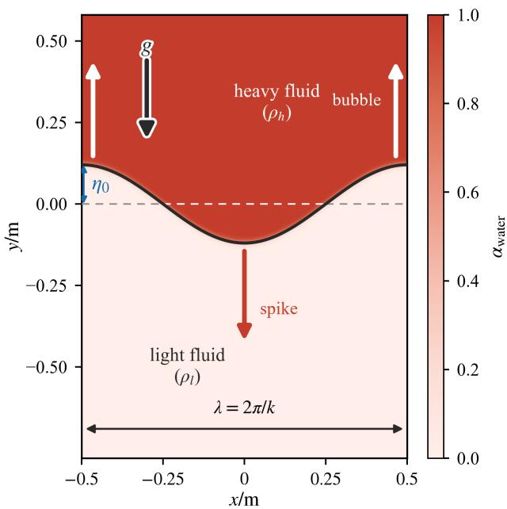  
FIG. 1. Configuration of the single-mode Rayleigh–Taylor instability considered in this work. The heavy fluid $\left( \rho _ { h } \right)$ rests above the light fluid $( \rho _ { l } )$ with $\pmb { g } = ( 0 , - g , 0 )$ , so the light fluid rises as the bubble and the heavy fluid descends as the spike. The panel spans one wavelength in x (lateral boundaries periodic). Following the deposited initialisation, $y _ { \mathrm { i n t } } ( x ) = - \eta _ { 0 } \cos ( 2 \pi x / \lambda )$ : the spike tip lies at $x = 0$ and the bubble tips at $x = \pm \lambda / 2$

The problem geometry is sketched in Fig. 1. A heavy fluid $\left( \rho _ { h } \right)$ rests above a light fluid $( \rho _ { l } )$ with $\pmb { g } = ( 0 , - g , 0 )$ , so the interface is unstable: the light fluid rises as the bubble and the heavy fluid descends as the spike. The interface is perturbed by a single mode, $\eta ( x , 0 ) = - \eta _ { 0 } \cos ( 2 \pi x / \lambda )$ with $\lambda = 2 \pi / k ;$ the lateral boundaries are periodic and span exactly one wavelength. The two fluids are distinguished by the phase fraction αwater.

The following dimensionless variables are introduced:

$$
\tau = t \sqrt { g k } , \quad A = k \eta , \quad U = \frac { V } { \sqrt { g / k } } , \quad A _ { 0 } = k \eta _ { 0 } .\tag{2}
$$

where $\eta ( t )$ and $V ( t ) = \mathrm { d } \eta / \mathrm { d } t$ denote the dimensional amplitude and tip velocity (bubble/spike), respectively, and $A _ { 0 }$ is the dimensionless initial amplitude. In what follows, all

data preprocessing, SINDy identification, and forward integration are performed using the nondimensional variables in Eq. (2) (in particular, $\tau$ and $U )$ . For visualization only, we additionally introduce the rescaled plotting coordinate

$$
\theta = t \sqrt { A _ { T } g k } = \tau \sqrt { A _ { T } } ,\tag{3}
$$

which enables comparison across diferent Atwood numbers at approximately the corresponding instability stages. The coordinate $\theta$ is used only for plotting and does not enter the regression or identified dynamical equations.

Under this nondimensionalization, g and k no longer appear explicitly in the governing equations, and the dynamics are fully described by $( \tau , A _ { T } , A , U , A _ { 0 } )$ . Taking A and $U$ as state variables, the motion of the bubble and spike tips is governed by the following twodimensional dynamical equation:

$$
\frac { \mathrm { d } U } { \mathrm { d } \tau } = f ( U , A , A _ { 0 } , A _ { T } ) , \qquad \frac { \mathrm { d } A } { \mathrm { d } \tau } = U ,\tag{4}
$$

The second equation follows identically from the definition of $U .$ , while the main objective of the present study is to identify the function $f$ in the first equation from the available data.

## B. Data-driven modeling framework

We propose a physics-constrained, data-driven framework for Rayleigh–Taylor instability (RTI) that infers low-dimensional dynamical equations governing bubble and spike evolution directly from the corresponding amplitude and velocity time series. We construct a candidate-function library comprising functions of the state variables A and $U _ { : }$ the initial amplitude $A _ { 0 }$ , and the Atwood number $A _ { T }$ . Within the SINDy framework, sparse regression is then used to identify a parsimonious set of active terms in the governing function $f .$ . In the present RTI problem, an unconstrained search over a broad candidate-function library may produce insuficiently sparse models that are dificult to interpret physically. To reduce the search space and improve the physical interpretability, we parameterize the unknown acceleration term $f$ in Eq. (4) using the following buoyancy–drag form:

$$
\begin{array} { l } { \displaystyle \frac { \mathrm { d } { A } } { \mathrm { d } \tau } = U , } \\ { \displaystyle \frac { \mathrm { d } { U } } { \mathrm { d } \tau } = A _ { T } A \left[ 1 + B ( A ; A _ { 0 } , A _ { T } ) \right] - D ( A ; A _ { 0 } , A _ { T } ) U ^ { 2 } , } \end{array}\tag{5}
$$

where $B ( A ; A _ { 0 } , A _ { T } )$ represents the nonlinear correction relative to the baseline buoyancy term $A _ { T } A$ , and $D ( A ; A _ { 0 } , A _ { T } )$ is the efective drag coeficient. The functions B and $D$ can be expressed as linear combinations of candidate basis functions:

$$
\begin{array} { l } { { \displaystyle { \cal B } ( A ; A _ { 0 } , A _ { T } ) = \sum _ { j = 1 } ^ { N _ { B } } \beta _ { j } \phi _ { j } ^ { ( B ) } ( A ; A _ { 0 } , A _ { T } ) } , } \\ { { \displaystyle { \cal D } ( A ; A _ { 0 } , A _ { T } ) = \sum _ { \ell = 1 } ^ { N _ { D } } \gamma _ { \ell } \phi _ { \ell } ^ { ( D ) } ( A ; A _ { 0 } , A _ { T } ) . } } \end{array}\tag{6}
$$

Here, $\phi _ { j } ^ { ( B ) }$ and $\phi _ { \ell } ^ { ( D ) }$ denote the candidate basis functions for the buoyancy correction and drag coeficient, respectively, and $\beta _ { j }$ and $\gamma _ { \ell }$ are the coeficients to be identified. The corresponding libraries contain $N _ { B }$ and $N _ { D }$ terms. The buoyancy library is further restricted by the linear limit. Since Eq. (5) should reduce to the classical linear RTI equation as $A  0$ and $A _ { 0 }  0$ the pure $A _ { T }$ -monomials are excluded from the buoyancy library so that $B ( 0 ; 0 , A _ { T } ) = 0$ holds identically; the drag library is left unrestricted, as $\dot { D } U ^ { 2 }$ is ${ \dot { O } } ( U ^ { 2 } )$ and does not enter the linear limit. The formal definition is given in Appendix B. The training set comprises $N _ { \mathrm { t r a i n } }$ independent RTI cases. Each case r has a prescribed initial amplitude $A _ { 0 } ^ { ( r ) }$ and Atwood number $A _ { T } ^ { ( r ) }$ . The corresponding state variables $A ^ { ( r ) } ( \tau )$ and $U ^ { ( r ) } ( \tau )$ are sampled at $N _ { r }$ discrete times $\{ \tau _ { i } ^ { ( r ) } \} _ { i = 0 } ^ { N _ { r } - 1 }$ . The values of the candidate basis functions along this trajectory are denoted by

$$
\begin{array} { r l } & { \phi _ { j } ^ { ( B , r ) } ( \tau ) \equiv \phi _ { j } ^ { ( B ) } \left( A ^ { ( r ) } ( \tau ) ; A _ { 0 } ^ { ( r ) } , A _ { T } ^ { ( r ) } \right) , } \\ & { \phi _ { \ell } ^ { ( D , r ) } ( \tau ) \equiv \phi _ { \ell } ^ { ( D ) } \left( A ^ { ( r ) } ( \tau ) ; A _ { 0 } ^ { ( r ) } , A _ { T } ^ { ( r ) } \right) . } \end{array}\tag{7}
$$

Here, the superscript r identifies the corresponding training case.

Compared with the classical buoyancy–drag model, the present formulation allows the efective buoyancy and drag contributions to depend on the instantaneous amplitude, the initial amplitude, and the Atwood number. It is intended to describe the full evolution of the interface, covering the linear stage, the nonlinear saturation of the bubble and spike velocities, and the subsequent reacceleration stage. In the small-amplitude regime $( A , U \ll 1 )$ , the efective buoyancy correction $A _ { T } A B ( A ; A _ { 0 } , A _ { T } )$ and the drag contribution $D ( A ; A _ { 0 } , A _ { T } ) U ^ { 2 }$ remain subdominant to the baseline buoyancy term $A _ { T } A$ . Equation (5) therefore reduces, to leading order, to

$$
\frac { \mathrm { d } U } { \mathrm { d } \tau } \approx A _ { T } A .\tag{8}
$$

Upon restoring dimensions, this relation becomes

$$
\frac { \mathrm { d } ^ { 2 } \eta } { \mathrm { d } t ^ { 2 } } = \frac { \mathrm { d } V } { \mathrm { d } t } \approx A _ { T } g k \eta ,\tag{9}
$$

which is consistent with the classical linear RTI equation.

In the diferential formulation of SINDy, the acceleration $\mathrm { d } U / \mathrm { d } \tau$ must be estimated by numerically diferentiating the velocity time series. Because numerical diferentiation amplifies high-frequency noise and discretization errors, this step may compromise the numerical robustness of the sparse-regression procedure. To mitigate this sensitivity, we adopt an integral formulation of SINDy25,26. Integrating Eq. (5) over the interval between two adjacent sampling times, $\tau _ { i } ^ { ( r ) }$ and $\tau _ { i + 1 } ^ { ( r ) }$ , we define the regression target for a single time interval as

$$
y _ { r , i } \equiv U _ { i + 1 } ^ { ( r ) } - U _ { i } ^ { ( r ) } - A _ { T } ^ { ( r ) } \int _ { \tau _ { i } ^ { ( r ) } } ^ { \tau _ { i + 1 } ^ { ( r ) } } A ^ { ( r ) } ( \tau ) \mathrm { d } \tau .\tag{10}
$$

The quantity $y _ { r , i }$ denotes the regression target associated with time interval i of case r.

Using the expansions in Eq. (6), we obtain

$$
\begin{array} { c l } { { } } & { { y _ { r , i } = \displaystyle \sum _ { j = 1 } ^ { N _ { B } } A _ { T } ^ { ( r ) } \beta _ { j } \int _ { \tau _ { i } ^ { ( r ) } } ^ { \tau _ { i + 1 } ^ { ( r ) } } A ^ { ( r ) } ( \tau ) \phi _ { j } ^ { ( B , r ) } ( \tau ) \mathrm { d } \tau } } \\ { { } } & { { - \displaystyle \sum _ { \ell = 1 } ^ { N _ { D } } \gamma _ { \ell } \int _ { \tau _ { i } ^ { ( r ) } } ^ { \tau _ { i + 1 } ^ { ( r ) } } \left[ U ^ { ( r ) } ( \tau ) \right] ^ { 2 } \phi _ { \ell } ^ { ( D , r ) } ( \tau ) \mathrm { d } \tau + \varepsilon _ { r , i } , } } \end{array}\tag{11}
$$

where $\varepsilon _ { r , i }$ accounts for the model discrepancy, including errors introduced by numerical quadrature and other sources.

The entries of the interval-integrated feature matrices associated with the buoyancy and drag contributions are defined as

$$
\Theta _ { ( r , i ) , j } ^ { ( B ) } \equiv A _ { T } ^ { ( r ) } \int _ { \tau _ { i } ^ { ( r ) } } ^ { \tau _ { i + 1 } ^ { ( r ) } } A ^ { ( r ) } ( \tau ) \phi _ { j } ^ { ( B , r ) } ( \tau ) \mathrm { d } \tau ,\tag{12}
$$

$$
\Theta _ { ( r , i ) , \ell } ^ { ( D ) } \equiv - \int _ { \tau _ { i } ^ { ( r ) } } ^ { \tau _ { i + 1 } ^ { ( r ) } } \left[ U ^ { ( r ) } ( \tau ) \right] ^ { 2 } \phi _ { \ell } ^ { ( D , r ) } ( \tau ) \mathrm { d } \tau .\tag{13}
$$

Across the $N _ { \mathrm { t r a j } }$ training trajectories, the total number of sampling intervals is $N =$ $\sum _ { r = 1 } ^ { N _ { \mathrm { t r a j } } } ( N _ { r } \mathrm { ~ - ~ } 1 )$ , and the candidate library contains $p = N _ { B } + N _ { D }$ terms. Stacking the scalar targets $y _ { r , i }$ in the same order as the rows of the feature matrix gives the target vector $\pmb { y } = \mathrm { s t a c k } \{ y _ { r , i } \} \in \mathbb { R } ^ { N }$ . The buoyancy and drag coeficients are collected into a single vector:

$$
\pmb { c } = \left[ \beta _ { 1 } , \ldots , \beta _ { N _ { B } } , \gamma _ { 1 } , \ldots , \gamma _ { N _ { D } } \right] ^ { \mathsf { T } } \in \mathbb { R } ^ { p } .\tag{14}
$$

The design matrix for the integral SINDy formulation is formed by horizontally concatenating the buoyancy and drag blocks:

$$
\begin{array} { r } { \pmb { \Theta } = \left[ \pmb { \Theta } ^ { ( B ) } \ { \pmb { \Theta } } ^ { ( D ) } \right] \in \mathbb { R } ^ { N \times p } , } \end{array}\tag{15}
$$

where

$$
\begin{array} { r l r } { \boldsymbol { \Theta } ^ { ( B ) } \in \mathbb { R } ^ { N \times N _ { B } } , } & { { } } & { \boldsymbol { \Theta } ^ { ( D ) } \in \mathbb { R } ^ { N \times N _ { D } } . } \end{array}
$$

In each block, rows correspond to sampling intervals and columns correspond to candidate basis functions. Accordingly, Eq. (11) can be written as a linear regression problem for the unknown coeficients:

$$
\pmb { y } = \pmb { \Theta } \pmb { c } + \pmb { \varepsilon } ,\tag{16}
$$

where $ { \varepsilon } \in \mathbb { R } ^ { N }$ is the stacked residual vector. To reduce the sensitivity of the regression to diferences in column magnitude, we normalize each column of the integral-form design matrix Θ to unit $L _ { 2 }$ norm. For $m = 1 , \ldots , p _ { ; }$ let

$$
s _ { m } = \left\| \Theta _ { : , m } \right\| _ { 2 } , \qquad m = 1 , \ldots , p ,\tag{17}
$$

and define

$$
\begin{array} { r } { \pmb { S } = \mathrm { d i a g } ( s _ { 1 } , \ldots , s _ { p } ) , \qquad \widetilde { \Theta } = \pmb { \Theta } \pmb { S } ^ { - 1 } . } \end{array}\tag{18}
$$

To preserve the regression relation, we define the rescaled coeficient vector as

$$
\widetilde { \pmb { c } } = \pmb { S c } , \qquad \Theta \pmb { c } = \widetilde { \Theta } \widetilde { \pmb { c } } .\tag{19}
$$

Using the normalized design matrix, we first solve the following ridge-regularized leastsquares problem:

$$
\widetilde { \pmb { c } } ^ { ( 0 ) } = \underset { z \in \mathbb { R } ^ { p } } { \arg \operatorname* { m i n } } \left. \frac { 1 } { 2 } \left\| \widetilde { \Theta } z - \pmb { y } \right\| _ { 2 } ^ { 2 } + \frac { \lambda _ { r } } { 2 } \left\| z \right\| _ { 2 } ^ { 2 } \right. , \qquad \lambda _ { r } = 1 0 ^ { - 8 } .\tag{20}
$$

We then obtain a sparse model using ridge-regularized sequentially thresholded least squares (Ridge-STLSQ). At each iteration, we evaluate the rescaled coeficient magnitudes $I _ { m } = | \widetilde { c } _ { m } |$ and remove candidate terms with $I _ { m } < \delta _ { I }$ . The coeficients of the retained terms are refitted by ridge regression, and this procedure is repeated until the active set is unchanged between two successive iterations. The optimal threshold can be selected from a candidate set $\Delta _ { I }$ by minimizing the training root-mean-square errors (RMSE) plus a penalty on the number of active terms:

$$
\delta _ { I } ^ { * } = \underset { \delta _ { I } \in \Delta _ { I } } { \arg \operatorname* { m i n } } \left[ \mathrm { R M S E } _ { \mathrm { t r a i n } } ( \delta _ { I } ) + \lambda _ { s } N _ { \mathrm { a c t i v e } } ( \delta _ { I } ) \right] ,\tag{21}
$$

where $N _ { \mathrm { a c t i v e } }$ is the number of terms retained after convergence, and $\lambda _ { s }$ controls the strength of the sparsity penalty. We recover the original coeficients as $\pmb { c } ^ { * } = \pmb { S } ^ { - 1 } \widetilde { \pmb { c } } ( \delta _ { I } ^ { * } )$ and substitute this coeficient vector into Eq. (5) to obtain the identified dynamical system. Further details of threshold selection are provided in the Appendix B, and the complete identification procedure is presented in Algorithm 1.

Algorithm 1: Identification of RTI dynamics using integral-form SINDy   
Input: Training datasets $\mathcal { D } _ { \mathrm { t r a i n } }$ ; candidate library $\{ \phi _ { j } ^ { ( B ) } \} _ { j = 1 } ^ { N _ { B } }$ for buoyancy correction;   
candidate library $\{ \phi _ { \ell } ^ { ( D ) } \} _ { \ell = 1 } ^ { N _ { D } }$ for drag; candidate threshold set $\Delta _ { I } ;$ ridge   
regularization parameter $\lambda _ { r } ;$ sparsity penalty parameter $\lambda _ { s }$   
Output: Sparse coeficient vector $c ^ { * }$ and identified dynamical equations for bubble and   
spike evolution   
1 For each training case, construct the interval targets and integrated candidate features   
2 Combine all training cases to obtain the integral regression system $\pmb { y } = \pmb { \Theta } \pmb { c } + \pmb { \varepsilon }$   
3 Compute $s _ { m } = \| \Theta _ { : , m } \| _ { 2 } , m = 1 , \ldots , p ,$ and define $\mathcal { I } = \{ m : s _ { m } > 0 \}$   
4 Set $s _ { m } = 1$ for m $\notin \mathcal { I }$ , define $\pmb { S } = \mathrm { d i a g } ( s _ { 1 } , \ldots , s _ { p } )$ , and normalize $\widetilde { \Theta } = \Theta S ^ { - 1 }$   
5 for $\delta _ { I } \in \Delta _ { I }$ do   
6 Initialize the active set $s  \mathcal { I }$   
7 repeat   
8 Set $\widetilde { \pmb { c } }  \mathbf { 0 } \in \mathbb { R } ^ { p }$   
9 if $s \neq \emptyset$ then   
10 Fit ridge regression with parameter $\lambda _ { r }$ on $\widetilde { \Theta } _ { : , { \cal S } }$ to obtain $\widetilde { c } _ { S }$   
11 Compute the normalized coeficient magnitudes $I _ { m } = | \widetilde { c } _ { m } | , m \in S .$ , and update   
$S \gets \{ m \in \mathcal { S } : I _ { m } \geq \delta _ { I } \}$   
12 end   
13 until the active set $\boldsymbol { s }$ remains unchanged   
14 Recover and store $\pmb { c } ( \delta _ { I } ) = \pmb { S } ^ { - 1 } \widetilde { \pmb { c } }$   
15 Evaluate $\mathrm { R M S E } _ { \mathrm { t r a i n } } ( \delta _ { I } )$ using $\pmb { c } ( \delta _ { I } )$ on $\mathcal { D } _ { \mathrm { t r a i n } }$   
16 Set $N _ { \mathrm { a c t i v e } } ( \delta _ { I } ) = | S |$ and compute Score $\mathbf { \Phi } ( \delta _ { I } ) = \operatorname { R M S E } _ { \mathrm { t r a i n } } ( \delta _ { I } ) + \lambda _ { s } N _ { \mathrm { a c t i v e } } ( \delta _ { I } )$   
17 end   
18 Select $\delta _ { I } ^ { * } = \arg$ min $\mathrm { S c o r e } ( \delta _ { I } )$ and set ${ \pmb { c } } ^ { * } = { \pmb { c } } ( \delta _ { I } ^ { * } )$   
$\delta _ { I } \in \Delta _ { I }$   
19 Reconstruct B and D from $c ^ { * }$ and substitute them into the buoyancy–drag equations   
20 return $c ^ { * }$ and the resulting bubble and spike dynamical equations

## C. Training and Test Datasets

For the training dataset, the gravitational acceleration and wavenumber were fixed at $g = 9 . 8 \mathrm { { m } / \mathrm { { s } ^ { 2 } } }$ and $k = 2 \pi \mathrm { m } ^ { - 1 }$ , respectively. The Atwood number and initial perturbation amplitude were selected as

$$
A _ { T } \in \{ 0 . 1 , 0 . 3 , 0 . 5 , 0 . 7 , 0 . 9 \}
$$

and

$$
\eta _ { 0 } \in \{ 0 . 0 1 , 0 . 0 3 , 0 . 0 5 , 0 . 0 8 , 0 . 1 0 , 0 . 1 2 , 0 . 1 5 \} \mathrm { m } ,
$$

respectively. Direct numerical simulations of single-mode RTI were performed for all combinations of these parameters, yielding a total of 35 training cases. For each simulation case, the temporal evolutions of the bubble- and spike-tip amplitudes, $\eta _ { b } ( t )$ and $\eta _ { s } ( t )$ , as well as their corresponding velocities, $V _ { b } ( t )$ and $V _ { s } ( t )$ , were extracted from the direct numerical simulation data. These quantities were nondimensionalized according to Eqs. (2), yielding the dimensionless variables $( \tau , A , U , A _ { 0 } )$ . Using these dimensionless data, the regression system was formulated in the interval-integral form defined by Eq. (11). In contrast to a diferential formulation, this approach does not require direct numerical diferentiation of the discrete velocity data and is therefore less susceptible to the amplification of numerical noise.

To assess the generalizability of the identified dynamical equations to parameter regimes not represented in the training data, three independent test datasets were constructed.

The first test dataset was designed to evaluate generalization across Atwood numbers. With the gravitational acceleration and wavenumber fixed at $g = 9 . 8 \mathrm { { m } / \mathrm { { s } ^ { 2 } } }$ and $k = 2 \pi \mathrm { m } ^ { - 1 }$ respectively, four Atwood numbers that were not included in the training dataset were considered:

$$
A _ { T } \in \{ 0 . 2 , 0 . 4 , 0 . 6 , 0 . 8 \} ,
$$

in combination with the seven initial perturbation amplitudes used in the training set, yielding 28 cases in total. This dataset was used to assess the model’s interpolative generalization to previously unseen Atwood numbers.

The second test set was constructed to assess the model’s generalization across gravitational accelerations. With the wavenumber fixed at $k = 2 \pi \mathrm { m } ^ { - 1 }$ and the Atwood number fixed at $A _ { T } = 0 . 5$ , we considered three gravitational accelerations absent from the training data,

$$
g \in \{ 8 , 1 0 , 1 2 \} \mathrm { m } \mathrm { s } ^ { - 2 } ,
$$

in combination with seven initial perturbation amplitudes, yielding 21 cases in total. This test set was used to evaluate the predictive performance of the identified model under gravitational accelerations outside the training range.

The third test dataset was designed to evaluate generalization across wavenumbers. With the gravitational acceleration fixed at $g = 9 . 8 \mathrm { { m } / \mathrm { { s } ^ { 2 } } }$ and the Atwood number fixed at $A _ { T } =$ 0.5, two wavenumbers not encountered during training,

$$
k \in \{ \pi , 3 \pi \} \mathrm { m } ^ { - 1 } ,
$$

were considered together with seven initial perturbation amplitudes, yielding 14 cases in total. The wavenumber $k = 2 \pi \mathrm { m } ^ { - 1 }$ , at which every training case was generated, is excluded from this extrapolation test and appears in the presentation of the results only as a reference. This dataset was employed to assess the model’s ability to generalize across diferent perturbation length scales.

None of the three test datasets was used in identifying the coeficients of the dynamical equations; instead, they were reserved exclusively for independent evaluation of the generalization capability and predictive accuracy of the identified model.

## III. RESULTS AND DISCUSSION

In figure 2, DNS data are compared with predictions from the classical buoyancy–drag model, Liu’s modified potential-flow theory, and the SINDy-identified low-dimensional dynamical model. In the classical buoyancy–drag model15,16, the interfacial motion is described by a balance among buoyancy and quadratic drag,

$$
\begin{array} { l l } { { \displaystyle \left[ \left( 1 - { \cal A } _ { T } \right) + { \cal C } _ { a } \left( 1 + { \cal A } _ { T } \right) \right] \displaystyle \frac { \mathrm { d } U } { \mathrm { d } \tau } = 2 { \cal A } _ { T } - { \cal C } _ { d } \left( 1 + { \cal A } _ { T } \right) U ^ { 2 } } } & { { \mathrm { ( b u b b l e ) , } } } \\ { { \displaystyle \left[ \left( 1 + { \cal A } _ { T } \right) + { \cal C } _ { a } \left( 1 - { \cal A } _ { T } \right) \right] \displaystyle \frac { \mathrm { d } U } { \mathrm { d } \tau } = 2 { \cal A } _ { T } - { \cal C } _ { d } \left( 1 - { \cal A } _ { T } \right) U ^ { 2 } } } & { { \mathrm { ( s p i k e ) , } } } \end{array}\tag{22}
$$

where the coeficient $C _ { a }$ accounts for the added mass and $C _ { d }$ is the drag coeficient; both are constants that do not depend on the instantaneous amplitude A or on the initial amplitude $A _ { 0 }$ . A global fit of the model coeficients to the DNS data from the entire training dataset yielded $C _ { a } = 2 . 6 4 , C _ { d } = 3 . 2 5$ for bubble and $C _ { a } = 3 . 1 5 , C _ { d } = 2 . 4 3$ for spike. Across the compared datasets, the mean RMSE of the dimensionless tip velocity U between the mode prediction and the DNS data was 0.063 for the bubble and 0.155 for the spike. The classical buoyancy–drag model predicts saturation of the tip velocity. But it doesn’t accurately reproduce the exponential growth in the linear regime or the subsequent overshoot and reacceleration. Liu’s modified potential-flow theory incorporates the evolution of tip curvature and partially reproduces the velocity overshoot of both bubbles and spikes. However, the predicted velocity for the high-Atwood-number spike case shown in the figure deviates markedly from DNS, particularly during the reacceleration stage. The mean RMSE of the dimensionless tip velocity U between the mode prediction and the DNS data was 0.063 for the bubble and 0.181 for the spike.

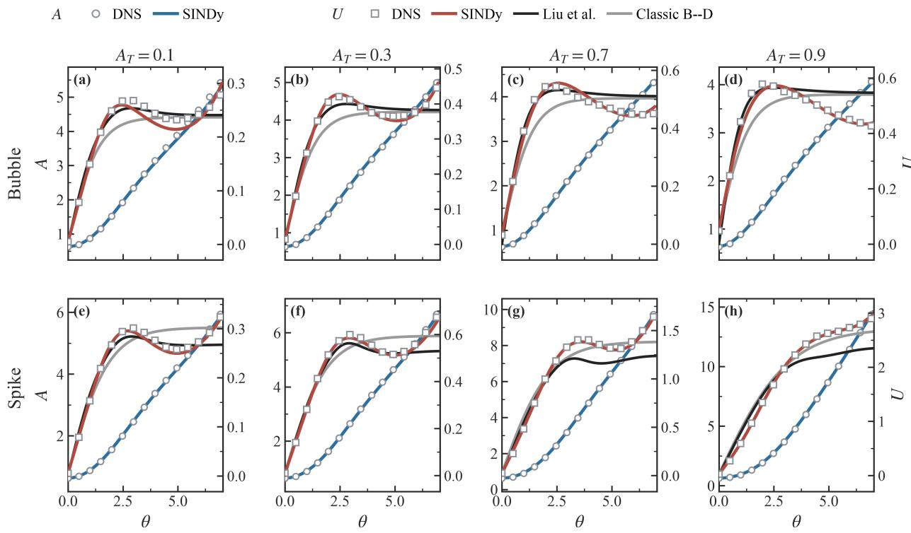  
FIG. 2. Comparison of Liu’s modified potential-flow theory, the classical buoyancy–drag model, and the SINDy-identified dynamical model with the DNS data. The first and second rows correspond to the bubble and spike, respectively, while the first through fourth columns correspond to $A _ { T } = 0 . 1$ 0.3, 0.7, and 0.9, respectively. The initial amplitude is fixed at $\eta _ { 0 } = 0 . 1$ m for all cases.

Subject to the buoyancy–drag structure, the integral-form SINDy method was employed to identify the buoyancy-correction function $B ( A ; A _ { 0 } , A _ { T } )$ and the drag-coeficient function $D ( A ; A _ { 0 } , A _ { T } )$ from a prescribed candidate-function library. Both functions were allowed to vary with the instantaneous amplitude A, the initial amplitude $A _ { 0 }$ , and the Atwood number $A _ { T }$ . Figure 3 presents the dimensionless phase-space trajectories obtained from DNS at a fixed Atwood number of $A _ { T } = 0 . 3$ for diferent values of $A _ { 0 }$ . The trajectories for diferent initial amplitudes exhibit distinct peak velocities and peak times. Furthermore, these trajectories may intersect for diferent $A _ { 0 }$ . Such intersections imply that the projected state $( A , U ; A _ { T } )$ does not uniquely determine the subsequent dynamics: in an identical $( A , U ; A _ { T } )$ trajectories originating from diferent $A _ { 0 }$ may exhibit diferent accelerations $d U / d \tau$ The dependence of the phase-space trajectory on the initial amplitude demonstrates that the dynamics cannot be represented by a single-valued autonomous closure formulated solely in terms of $( A , U ; A _ { T } )$ . To retain the dependence of subsequent evolution on the initial condition, dynamical equations must explicitly include the initial amplitude $A _ { 0 }$ or an equivalent state descriptor. This finding provides both physical and mathematical justification for incorporating $A _ { 0 } .$ -dependent terms into the candidate-function library; the cost of omitting them is quantified by the ablation study in Appendix C.

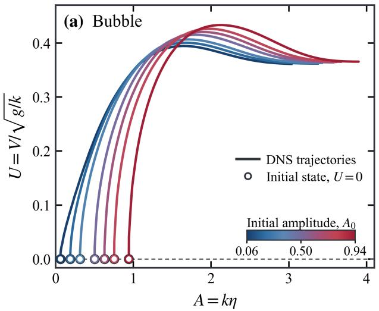

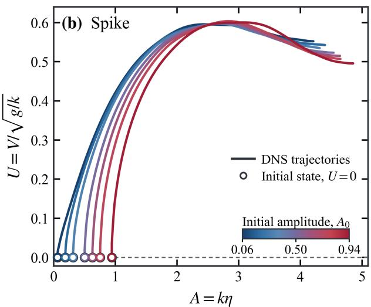  
FIG. 3. DNS-derived dimensionless phase trajectories for diferent initial amplitudes at a fixed Atwood number of $A _ { T } = 0 . 3 \colon$ (a) bubble and (b) spike. The seven initial amplitudes in the training dataset, $A _ { 0 } = k \eta _ { 0 }$ , are distinguished by diferent colors, and the initial states are marked by open circles.

The bubble and spike branches were treated independently in the SINDy-based identification of their respective dynamical systems. For both branches, the identified models were formulated within the unified buoyancy–drag structure given by Eq. (5).

For the bubble branch, within the prescribed candidate-function library and under the imposed sparsity constraints, the identified buoyancy-correction function and efective dragcoeficient function are given, respectively,

$$
\begin{array} { r l } & { B _ { b } ( A ; A _ { 0 } , A _ { T } ) = - 0 . 4 1 9 4 A - 0 . 0 3 3 4 A A _ { T } - 0 . 0 1 6 2 A A _ { 0 } } \\ & { \phantom { A \geq } + 0 . 0 5 8 8 A ^ { 2 } , } \end{array}\tag{23}
$$

$$
D _ { b } ( A ; A _ { 0 } , A _ { T } ) = 1 . 5 5 7 6 A _ { T } + 0 . 6 8 9 0 A + 0 . 8 2 4 5 A _ { T } ^ { 2 }
$$

$$
- 1 . 3 2 3 0 A _ { 0 } A _ { T } - 0 . 3 3 6 3 A A _ { T } - 0 . 0 6 3 1 A ^ { 2 } .\tag{24}
$$

For the spike branch, the corresponding buoyancy-correction function and efective drag-

coeficient function are given, respectively,

$$
\begin{array} { r l } & { B _ { s } ( A ; A _ { 0 } , A _ { T } ) = - 0 . 4 2 1 3 A + 0 . 2 0 7 8 A A _ { T } + 0 . 0 5 7 4 A ^ { 2 } } \\ & { \phantom { A } + 0 . 0 8 4 4 A A _ { T } ^ { 2 } - 0 . 0 5 8 7 A ^ { 2 } A _ { T } } \\ & { \phantom { A } + 0 . 0 0 0 2 A ^ { 3 } , } \end{array}\tag{25}
$$

$$
\begin{array} { r l } & { D _ { s } ( A ; A _ { 0 } , A _ { T } ) = 0 . 6 9 2 4 - 0 . 5 9 2 3 A _ { T } ^ { 2 } - 0 . 6 7 6 6 A _ { 0 } ^ { 2 } } \\ & { \qquad - 0 . 2 3 7 9 A A _ { T } + 0 . 3 0 6 5 A A _ { 0 } + 0 . 0 3 3 7 A ^ { 2 } } \\ & { \qquad + 0 . 7 5 0 4 A _ { 0 } ^ { 2 } A _ { T } + 0 . 3 4 0 9 A A _ { T } ^ { 2 } } \\ & { \qquad - 0 . 3 3 4 2 A A _ { 0 } A _ { T } - 0 . 0 5 8 2 A ^ { 2 } A _ { T } } \\ & { \qquad + 0 . 0 0 1 0 A ^ { 3 } . } \end{array}\tag{26}
$$

Here, the subscripts b and s denote the bubble and spike branches, respectively. Substitution of Eqs. (23)–(24) or Eqs. (25)–(26) into Eq. (5) yields the corresponding closed dynamical equations for each branch.

Over the complete training dataset, the mean RMSE of the dimensionless velocity, denoted as $\overline { { \mathrm { R M S E } } } _ { U }$ , were 0.015 for the bubble branch and 0.027 for the spike branch. The training dataset comprised all combinations of

$$
A _ { T } \in \{ 0 . 1 , 0 . 3 , 0 . 5 , 0 . 7 , 0 . 9 \}
$$

and

$$
\eta _ { 0 } \in \{ 0 . 0 1 , 0 . 0 3 , 0 . 0 5 , 0 . 0 8 , 0 . 1 0 , 0 . 1 2 , 0 . 1 5 \} \mathrm { m } ,
$$

resulting in a total of 35 simulation cases.

For the interpolation test across Atwood numbers, four values not represented in the training dataset, $A _ { T } \in \{ 0 . 2 , 0 . 4 , 0 . 6 , 0 . 8 \}$ , were considered, with the gravitational acceleration and wavenumber held fixed at $g = \mathrm { { \dot { 9 } . 8 m s ^ { - 2 } } }$ and $k = 2 \pi \mathrm { m } ^ { - 1 }$ , respectively. Combined with the seven initial amplitudes, these parameter combinations yielded a total of 28 simulation cases. For brevity, only the cases with $\eta _ { 0 } = 0 . 1 0$ m are presented in Figure 4. The $\overline { { \mathrm { R M S E } } } _ { U }$ , averaged over all 28 cases, were 0.013 and 0.030 for the bubble and spike branches, respectively. These errors remain comparable to their training-set counterparts, demonstrating that the identified dynamical equations generalize accurately to unseen Atwood numbers within the parameter range spanned by the training data.

The results of the generalization tests across gravitational accelerations are shown in the first and second columns of Figure. 5. At a fixed wavenumber of $k = 2 \pi \mathrm { m } ^ { - 1 }$ , gravitational accelerations of $g \in \{ 8 , 1 0 , 1 2 \} \mathrm { { m } \mathrm { { s } ^ { - 2 } } }$ were considered. For brevity, only the cases with $\eta _ { 0 } = 0 . 1$ m are shown. The $\overline { { \mathrm { R M S E } } } _ { U }$ were 0.014 and 0.019 for the bubble and spike branches, respectively. These very small values indicate that the identified equations extrapolate well in g.

The results of the generalization tests across wavenumbers are shown in the third and fourth columns of Figure 5. At a fixed gravitational acceleration of $g = 9 . 8 \mathrm { { m s ^ { - 2 } } }$ , the two wavenumbers not present in the training data, $k \in \{ \pi , 3 \pi \} \mathrm { m } ^ { - 1 }$ . The reference panels for $k = 2 \pi \mathrm { { m } ^ { - 1 } }$ , which is the wavenumber of the training set, are shown for comparison but are excluded from the error statistics. Only the cases with $\eta _ { 0 } ~ = ~ 0 . 1$ 1 m are shown. The corresponding values of $\overline { { \mathrm { R M S E } } } _ { U }$ were 0.041 and 0.050 for the bubble and spike branches, respectively.

The values of $\overline { { \mathrm { R M S E } } } _ { U }$ for all training and test datasets are summarized in Table I, where comparison of trajectory prediction errors for three low-dimensional closure models are shown. Predicted trajectories are obtained by time integration. The RMSE is computed separately for each trajectory, and the reported values are the arithmetic means over all trajectories in each dataset. The adopted nondimensionalization incorporates the characteristic scales associated with $g$ and $k ,$ including the velocity scale $\sqrt { g / k }$ . Across the ranges of gravitational acceleration and wavenumber considered, the results support the conclusion that the identified dynamical equations capture the efective dynamics within a unified dimensionless framework consistent with the underlying similarity scaling, rather than merely providing a case-specific fit tied to a particular combination of dimensional parameters.

TABLE I. Comparison of trajectory prediction errors for three low-dimensional closure models. The model columns correspond to the classical buoyancy–drag model, Liu’s improved potentialflow theory, and the physics-constrained SINDy model, respectively.
<table><tr><td rowspan="3">Branch and dataset</td><td> $\overline { { \mathrm { R M S E } } } _ { U }$ </td></tr><tr><td>Buoyancy-drag Liu SINDy</td></tr><tr><td>0.063 0.063</td></tr><tr><td>Bubble, training Bubble, validation across  $A _ { T }$ </td><td>0.015 0.013</td></tr><tr><td></td><td>0.064 0.063</td></tr><tr><td>Bubble, validation across g</td><td>0.059 0.037 0.014</td></tr><tr><td>Bubble, validation across k</td><td>0.069 0.070 0.041</td></tr><tr><td>Spike, training</td><td>0.155 0.181 0.027</td></tr><tr><td>Spike, validation across  $A _ { T }$ </td><td>0.140 0.163 0.030</td></tr><tr><td>Spike, validation across  $g$ </td><td>0.076 0.092 0.019</td></tr><tr><td>Spike, validation across k</td><td>0.132 0.140 0.050</td></tr></table>

To obtain a physically transparent view of how buoyancy and drag compete throughout the evolution and improve the interpretability of the SINDy-identified dynamics, the efective contributions of buoyancy (denoted as $F _ { \mathrm { B } }$ , see eq.(27)) and drag (denoted as $ { F _ { \mathrm { D } } }$ , see also see eq.(27)) to the acceleration predicted by the identified model are shown separately in Figure 6.

$$
\frac { \mathrm { d } U } { \mathrm { d } \tau } = \underbrace { A _ { T } A \left[ 1 + B ( A ; A _ { 0 } , A _ { T } ) \right] } _ { F _ { \mathrm { B } } } + \underbrace { \left[ - D ( A ; A _ { 0 } , A _ { T } ) U ^ { 2 } \right] } _ { F _ { \mathrm { D } } } .\tag{27}
$$

In particular, this detailed investigation helps to identify when the amplitude-dependent buoyancy correction $B ( A ; A _ { 0 } , A _ { T } )$ versus the velocity-dependent drag term $D ( A ; A _ { 0 } , A _ { T } ) U ^ { 2 }$ dominates key features such as velocity growth and overshoot. As the system enters the nonlinear regime, the modification of the buoyancy term by $B ( A ; A _ { 0 } , A _ { T } )$ becomes increasingly pronounced. Meanwhile, the drag contribution is jointly determined by the efective drag coeficient $D ( A ; A _ { 0 } , A _ { T } )$ and the squared velocity $U ^ { 2 }$ . The evolving balance between these two contributions governs the net acceleration and, consequently, the velocity growth, overshoot, and subsequent dynamical evolution.

As indicated by the DNS results presented in Figure 3, the peak bubble-tip velocity shows a strong dependence on the initial amplitude $\eta _ { 0 }$ , with an overall tendency to increase as $\eta _ { 0 }$ grows.

For the initial interface profile $\eta ( x , 0 ) = - \eta _ { 0 } \cos ( k x )$ , with $\eta _ { 0 } ~ > ~ 0$ , the bubble tip is

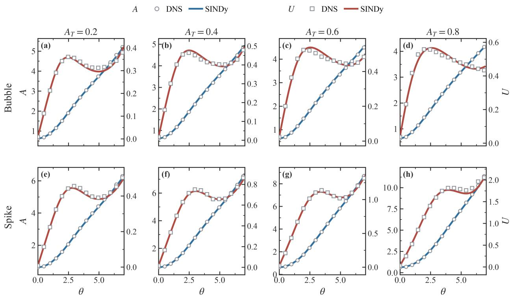  
FIG. 4. Representative interpolation test results for Atwood numbers not included in the training dataset. The first and second rows correspond to the bubble and spike branches, respectively, while the first through fourth columns correspond to $A _ { T } ~ = ~ 0 . 2 , ~ 0 . 4 , ~ 0 . 6 .$ , and 0.8, respectively. The initial amplitude is fixed at $\eta _ { 0 } = 0 . 1 0 \mathrm { m }$ for all cases. Open circles and squares denote the DNS data for the amplitude and velocity, respectively, whereas the blue and red solid curves represent the corresponding predictions obtained by forward integration of the SINDy-identified dynamical equations.

located at $x = \pm \lambda / 2$ . The signed curvature at the bubble tip is given by

$$
\xi _ { 0 } = \left. \frac { \partial ^ { 2 } \eta / \partial x ^ { 2 } } { \left[ 1 + \left( \partial \eta / \partial x \right) ^ { 2 } \right] ^ { 3 / 2 } } \right| _ { x = \pm \lambda / 2 } = - k ^ { 2 } \eta _ { 0 } ,\tag{28}
$$

where the final equality follows directly from

$$
\left. \frac { \partial \eta } { \partial x } \right| _ { x = \pm \lambda / 2 } = 0 , \qquad \left. \frac { \partial ^ { 2 } \eta } { \partial x ^ { 2 } } \right| _ { x = \pm \lambda / 2 } = - k ^ { 2 } \eta _ { 0 } .
$$

Therefore, for a fixed wavenumber k, with all other parameters kept constant, the magnitude of the initial curvature increases with the initial amplitude according to $| \xi _ { 0 } | = k ^ { 2 } \eta _ { 0 }$ . In single-mode RTI, the initial amplitude therefore encodes not only the displacement scale of the initial perturbation but also the associated initial interfacial geometry. This geometric dependence can modify the subsequent interface evolution, thereby influencing the efective buoyancy–drag balance and the resulting velocity overshoot.

During the early linear regime, when the velocity remains small, the contribution of velocity-dependent drag to the acceleration is negligible. Consequently, gravitational driving arising from the density contrast dominates, maintaining a positive bubble acceleration. The bubble velocity therefore increases gradually from zero, while the interfacial perturbation subsequently exhibits approximately exponential growth. In the vicinity of the perturbed interface, the density and pressure gradients are not parallel, providing a source of vorticity through the baroclinic torque. As shown in Figure 7, oppositely signed vorticity layers form on the two sides of the bubble and spike interfaces. The associated vorticity-induced velocity field contributes to the transverse deformation of the interface. For the bubble, the vorticity-induced transverse flows on either side of the tip contribute to its lateral broadening and thereby influence the evolution of the bubble-tip curvature. During the early nonlinear regime, the bubble tip continues to advance upward, accompanied by a progressive increase in the magnitude of its curvature. As the tip subsequently broadens laterally, the curvature magnitude reaches a maximum and then gradually relaxes toward a quasi-steady value. This nonmonotonic evolution reflects the transition from initial tip sharpening to subsequent lateral broadening. Figure 8 illustrates this nonmonotonic evolution. Across the parameter ranges considered, the normalized-curvature histories exhibit only modest variations for diferent values of $A _ { T }$ at fixed $A _ { 0 }$ , whereas substantially diferent extrema and relaxation behaviors are observed for diferent values of $A _ { 0 }$ at fixed $A _ { T }$ . These results suggest that, within the parameter range considered, variations in $A _ { 0 }$ exert a stronger influence on the normalized-curvature evolution than variations in $A _ { T }$

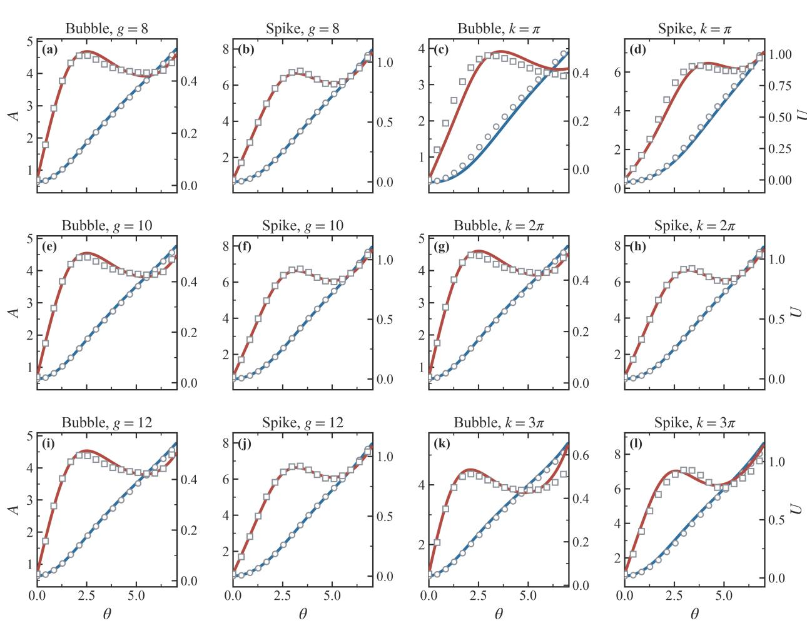  
FIG. 5. Representative generalization tests under wavenumber and gravitational acceleration conditions not included in the training dataset. The first and second columns show the bubble and spike results, respectively, for the generalization test across gravitational accelerations; the first through third rows correspond to $g = 8 , 1 0$ , and $\mathrm { 1 2 m s ^ { - 2 } }$ , respectively, with $k = 2 \pi \mathrm { m } ^ { - 1 } , A _ { T } = 0 . 5$ and $\eta _ { 0 } = 0 . 1 0 \mathrm { m }$ . The third and fourth columns show the bubble and spike results, respectively, for the generalization test across wavenumbers; the first through third rows correspond to $k = \pi$ $2 \pi$ , and $3 \pi \mathrm { m } ^ { - 1 }$ , respectively, with $g = 9 . 8 \mathrm { m s ^ { - 2 } } , A _ { T } = 0 . 5$ , and $\eta _ { 0 } = 0 . 1 0 \mathrm { m } ;$ Open circles and squares denote the DNS data for the amplitude and velocity, respectively, whereas the blue and red solid curves represent the corresponding predictions obtained by forward integration of the SINDyidentified dynamical equations.

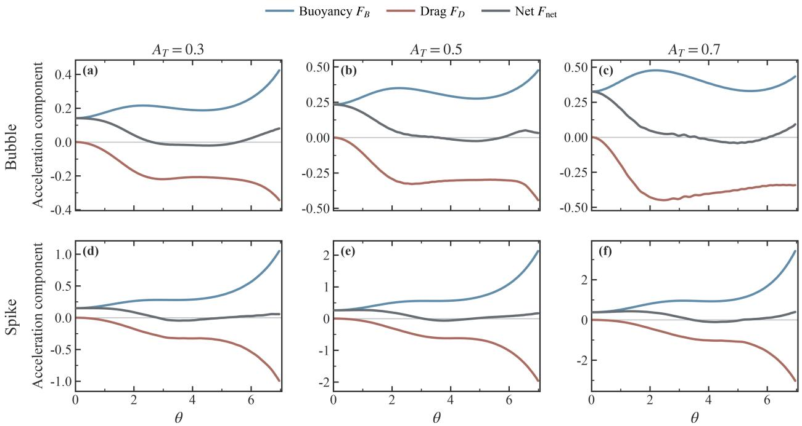  
FIG. 6. Buoyancy–drag decomposition and the resulting net acceleration of the SINDy-identified dynamical equations for $A _ { T } \in \{ 0 . 3 , 0 . 5 , 0 . 7 \}$ . The upper and lower rows correspond to the bubble and spike branches, respectively, with the initial amplitude fixed at $\eta _ { 0 } = 0 . 1 0$ m in all cases. Shown separately are the efective buoyancy contribution, $F _ { \mathrm { B } } = A _ { T } A [ 1 + B ( A ; A _ { 0 } , A _ { T } ) ]$ , the efective drag contribution, $F _ { \mathrm { D } } = - D ( A ; A _ { 0 } , A _ { T } ) U ^ { 2 }$ , and the resulting net acceleration, $F _ { \mathrm { n e t } } = F _ { \mathrm { B } } + F _ { \mathrm { D } } = \mathrm { d } U / \mathrm { d } \tau$

The temporal evolution of the dimensionless velocity is governed by the dynamic balance between the efective buoyancy and drag contributions, see eq. (27). When $F _ { \mathrm { B } } > | F _ { \mathrm { D } } |$ , the net acceleration is positive, and the bubble-tip velocity continues to increase. When $F _ { \mathrm { { B } } } = { }$ $| F _ { \mathrm { D } } |$ , the net acceleration vanishes, $\mathrm { d } U / \mathrm { d } \tau = 0$ . When the net acceleration subsequently changes sign from positive to negative, the velocity attains a local maximum, corresponding to the velocity overshoot. When $F _ { \mathrm { B } } ~ < ~ | F _ { \mathrm { D } } |$ , the net acceleration is negative, and the bubble-tip velocity enters a decelerating regime and subsequently relaxes toward a lower or quasi-steady value.

At a fixed wavenumber, a larger initial amplitude corresponds to a greater magnitude of the initial curvature and may thereby modify the subsequent evolution of the interfacial geometry, ultimately influencing the dynamic balance between buoyancy and drag and the resulting velocity overshoot. Within the parameter range considered, this modulation increases the peak velocity. The integral-form SINDy framework, constrained by the buoyancy–drag structure, extends the classical buoyancy–drag model by introducing efective closure functions that depend on the instantaneous amplitude A, the initial amplitude $A _ { 0 }$ , and the Atwood number $A _ { T }$ . The resulting model is therefore capable of reproducing both the velocity overshoot and the subsequent relaxation process. At later stages of the evolution, the efective buoyancy contribution increases and again exceeds the magnitude of the drag contribution, causing the net acceleration to become positive once more. Consequently, the identified model also captures the dynamical behavior associated with the reacceleration regime.

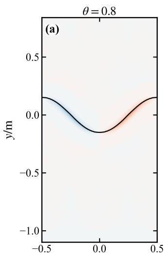

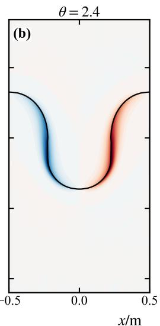

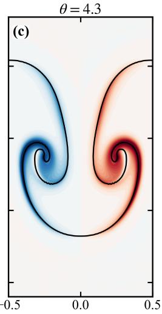

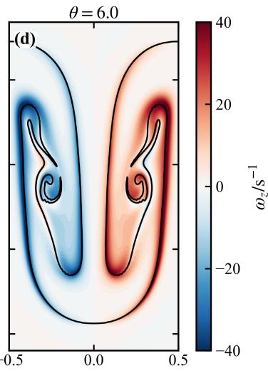  
FIG. 7. Vorticity fields and interfacial morphologies at four instants for $A _ { T } = 0 . 3$ and $\eta _ { 0 } = 0 . 1 0 \mathrm { m }$ (a) $\theta = t \sqrt { A _ { T } g k } = 0 . 8 \mathrm { : }$ (b) $\theta = t \sqrt { A _ { T } g k } = 2 . 4 ;$ (c) $\theta = t \sqrt { A _ { T } g k } = 4 . 3 ;$ and (d) $\theta = t \sqrt { A _ { T } g k } = 6 . 0$ The black curves denote the interface, while red and blue indicate positive and negative vorticity, respectively.

## IV. CONCLUSION

We have developed a physics-constrained, data-driven framework for identifying lowdimensional dynamical equations for the bubble and spike branches from time-resolved data. The framework combines integral-form SINDy with a common buoyancy–drag structure applied separately to the two branches. This formulation enables the sparse identification of branch-specific efective closure functions that explicitly depend on the instantaneous amplitude A, the initial amplitude $A _ { 0 } .$ and the Atwood number $A _ { T }$ . By formulating the regression problem in terms of finite-interval integrals, the method avoids direct numerical diferentiation of the velocity time series and thereby mitigates noise amplification in acceleration estimation.

Over the parameter range considered for single-mode RTI, the identified models accurately reproduce the temporal evolution of the bubble and spike amplitudes and velocities, including the velocity overshoot–relaxation behavior and the subsequent late-time reacceleration. The models also retain high predictive accuracy at Atwood numbers, wavenumbers, and gravitational accelerations not included in the training set. These results demonstrate that the identified formulation generalizes across the considered parameter variations under the adopted nondimensionalization. The explicit dependence on the initial perturbation amplitude enables the models to reproduce the variations in peak velocity and subsequent velocity evolution among diferent initial conditions.

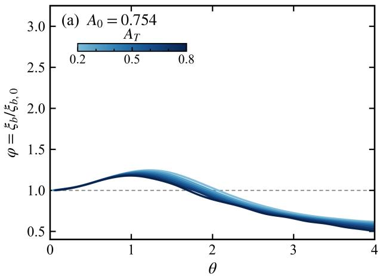

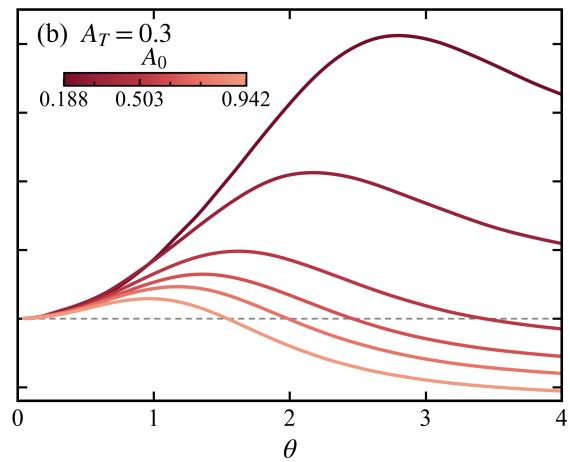  
FIG. 8. Evolution of the normalized bubble-tip curvature, $\varphi ( \tau ) = \xi ( \tau ) / \xi _ { 0 }$ , where $\xi ( \tau )$ denotes the bubble-tip curvature and $\xi _ { 0 } = - k ^ { 2 } \eta _ { 0 }$ is the initial bubble-tip curvature. Panel (a) shows the evolution for diferent $A _ { T }$ at fixed $A _ { 0 } ~ = ~ 0 . 7 5 4$ , whereas panel (b) shows the evolution for diferent $A _ { 0 }$ at fixed $A _ { T } = 0 . 3$ . Following the attainment of an extremum, the normalized curvature gradually relaxes toward a quasi-steady value, reflecting the transition from initial tip sharpening to subsequent lateral broadening of the bubble tip.

The buoyancy–drag decomposition shows that velocity overshoot is closely related to the competition between efective buoyancy and drag. A change in net acceleration from positive to negative corresponds to the velocity peak, whereas a return to positive net acceleration at later times corresponds to reacceleration. The initial amplitude carries information about the interface geometry. Combining this information with analyses of phase trajectories and tip curvature helps interpret the dynamical diferences across initial conditions. The identified state-dependent closures provide a compact dynamical description of these diferences, but their links to curvature and vorticity require further study. Future work will explicitly incorporate variables such as curvature and vorticity into the state space to further assess and refine the physical interpretation of the closure model. The framework will also be extended to RTI and RMI with multimode perturbations and under conditions involving viscosity, compressibility, interfacial tension, and variable acceleration.

## ACKNOWLEDGMENTS

This work is supported by the Science Challenge Project (No. TZ2025012).

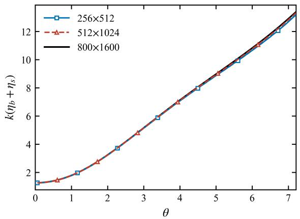  
FIG. 9. Temporal evolution of the bubble–spike distance in the grid-convergence study. The blue squares, red triangles, and black solid line represent the numerical results obtained on the $2 5 6 \times 5 1 2$ $5 1 2 \times 1 0 2 4$ , and $8 0 0 \times 1 6 0 0$ meshes, respectively.

## Appendix A: Numerical Simulation Setup

The numerical simulations are performed using the interFoam solver in OpenFOAM v8. The computational domain is defined by $( x , y ) \in [ - L _ { x } , L _ { x } ] \times [ - L _ { y } , L _ { y } ]$ The initial interface profile is prescribed as a single-mode sinusoidal perturbation, $y _ { \mathrm { i n t e r f a c e } } ( x , 0 ) =$ $- \eta _ { 0 }$ cos $( 2 \pi x / \lambda )$ , where $\eta _ { 0 }$ and λ denote the initial perturbation amplitude and wavelength, respectively. For simulations with diferent wavenumbers $k = 2 \pi / \lambda$ , the computational domain in the transverse direction spans one full wavelength, such that $2 L _ { x } = \lambda$ . The main physical parameters and numerical settings are summarized in Table II.

TABLE II. Parameter settings for the OpenFOAM simulations
<table><tr><td>Parameter</td><td>Setting</td></tr><tr><td>Dynamic viscosity</td><td> $\mu _ { 1 } = \mu _ { 2 } = 0 . 0 0 3 \mathrm { P a \cdot s }$  (approximately inviscid)</td></tr><tr><td>Surface tension</td><td>σ = 0 (no interfacial tension)</td></tr><tr><td>Gravitational acceleration</td><td> $g = 9 . 8 \mathrm { { m s ^ { - 2 } } }$  (directed downward)</td></tr><tr><td>Left and right boundaries</td><td>Periodic boundary conditions</td></tr><tr><td>Top and bottom boundaries (phase fraction) zeroGradient</td><td></td></tr><tr><td>Top and bottom boundaries (velocity)</td><td>noSlip</td></tr><tr><td>Convection-term discretization</td><td>Gauss vanLeer (phase fraction)</td></tr><tr><td>Gradient discretization</td><td>Gauss linear (second-order accurate)</td></tr><tr><td>Time integration</td><td>First-order implicit Euler scheme</td></tr><tr><td>Baseline mesh</td><td> $N _ { x } \times N _ { y } = 2 5 6 \times 5 1 2$ </td></tr></table>

To verify that the baseline mesh provides suficient spatial resolution, a grid-convergence study was performed using three meshes with resolutions of $2 5 6 \times 5 1 2 , 5 1 2 \times 1 0 2 4$ , and $8 0 0 \times 1 6 0 0$ . Figure 9 shows the temporal evolution of the bubble–spike separation. The results demonstrate that the predictions obtained on the $2 5 6 \times 5 1 2$ mesh agree closely with those obtained on the two finer meshes. This resolution is therefore suficient to resolve the principal features of the nonlinear evolution of the RTI and satisfies the spatial-resolution requirements of the present numerical simulations.

## Appendix B: Sensitivity Analysis of Integral-Form SINDy

This appendix examines the sensitivity of the governing equations identified by integralform SINDy to the sparsification threshold and the choice of candidate-function library. In all tests, the buoyancy–drag structure used in the main text is held fixed.

## Selection of the Sparsification Threshold

The sparsification threshold $\delta _ { I }$ is selected by scanning the interval from 0 to 3.0 in increments of 0.1, i.e., $\delta _ { I } \in \{ 0 , 0 . 1 , 0 . 2 , \ldots , 3 . 0 \}$ For each candidate threshold, the score $\mathcal { T } = \mathrm { R M S E } _ { \mathrm { t r a i n } } ( U ) + \lambda _ { s } N _ { \mathrm { a c t i v e } }$ is evaluated according to Eq. (21) to balance the training error against model complexity. Here, $\lambda _ { s } = 2 \times 1 0 ^ { - 3 }$ , and $N _ { \mathrm { a c t i v e } }$ denotes the number of retained candidate terms. Table III summarizes representative results from scans of the sparsification threshold, using a second-order candidate-function library for the bubble $( p = 1 7 )$ and a third-order candidate-function library for the spike $( p = 3 6 )$ According to the scoring criterion defined above, the selected bubble model is obtained at $\delta _ { I } = 0 . 3$ and contains 10 active terms, whereas the selected spike model is obtained at $\delta _ { I } = 2 . 5$ and contains 17 active terms. The corresponding entries are highlighted in boldface in the table.

TABLE III. Representative results from the normalized-coeficient threshold scan. The threshold $\delta _ { I }$ is applied to the indicator $I _ { m } = | \widetilde { c } _ { m } |$ formed from the rescaled coeficient vector of Eq. (19). The score is $\mathcal { T } = \mathrm { R M S E } _ { \mathrm { t r a i n } } ( U ) + 0 . 0 0 2 N _ { \mathrm { a c t i v e } } .$ , where $N _ { \mathrm { a c t i v e } }$ denotes the number of retained candidate terms. The bubble and spike use second-order and third-order candidate-function libraries containing 17 and 36 terms, respectively. Boldface indicates the selected model for each branch.
<table><tr><td rowspan="2"> $\delta _ { I }$  =</td><td colspan="3">Bubble (second-order library)</td><td colspan="3">Spike (third-order library)</td></tr><tr><td> $\overline { { N _ { \mathrm { a c t i v e } } } }$ </td><td> $\dot { \overline { { \mathrm { R M S E } _ { \mathrm { t r a i n } } ( U ) } } }$ </td><td>J</td><td> $\overline { { N _ { \mathrm { a c t i v e } } } }$ </td><td> $\dot { \overline { { \mathrm { R M S E } _ { \mathrm { t r a i n } } ( U ) } } }$ </td><td>J</td></tr><tr><td>0.0</td><td>17</td><td> $\overline { { 0 . 0 1 4 7 } }$ </td><td>0.0487</td><td>36</td><td>0.0193</td><td>0.0913</td></tr><tr><td>0.1</td><td>13</td><td>0.0146</td><td>0.0406</td><td>35</td><td>0.0193</td><td>0.0893</td></tr><tr><td>0.2</td><td>11</td><td>0.0144</td><td>0.0364</td><td>35</td><td>0.0193</td><td>0.0893</td></tr><tr><td>0.3</td><td>10</td><td>0.0145</td><td>0.0345</td><td>34</td><td>0.0193</td><td>0.0873</td></tr><tr><td>0.4</td><td>6</td><td>0.0235</td><td>0.0355</td><td>33</td><td>0.0195</td><td>0.0855</td></tr><tr><td>0.5</td><td>8</td><td>0.0191</td><td>0.0351</td><td>33</td><td>0.0195</td><td>0.0855</td></tr><tr><td>0.6</td><td>6</td><td>0.0235</td><td>0.0355</td><td>31</td><td>0.0199</td><td>0.0819</td></tr><tr><td>0.7</td><td>一</td><td></td><td></td><td>31</td><td>0.0199</td><td>0.0819</td></tr><tr><td>0.8</td><td>一</td><td></td><td></td><td>28</td><td>0.0198</td><td>0.0758</td></tr><tr><td>0.9</td><td></td><td></td><td></td><td>26</td><td>0.0195</td><td>0.0715</td></tr><tr><td>1.0</td><td>3</td><td>0.0498</td><td>0.0558</td><td>26</td><td>0.0201</td><td>0.0721</td></tr><tr><td>1.1</td><td>3</td><td>0.0747</td><td>0.0807</td><td>26</td><td>0.0201</td><td>0.0721</td></tr><tr><td>1.6</td><td>3</td><td>0.0498</td><td>0.0558</td><td>19</td><td>0.0270</td><td>0.0650</td></tr><tr><td>2.1</td><td>3</td><td>0.0498</td><td>0.0558</td><td>19</td><td>0.0270</td><td></td></tr><tr><td>2.5</td><td>3</td><td>0.0498</td><td>0.0558</td><td>17</td><td>0.0271</td><td>0.0650</td></tr><tr><td>2.7</td><td>3</td><td>0.0498</td><td>0.0558</td><td>17</td><td>0.0271</td><td>0.0611</td></tr><tr><td>3.0</td><td>3</td><td>0.0498</td><td>0.0558</td><td>17</td><td>0.0271</td><td>0.0611 0.0611</td></tr></table>

## Selection of the Candidate-Function Library

To isolate the efect of the candidate-function library on the identified equations, we keep fixed the buoyancy–drag structure in Eq. (5), the training/test split, the integralform regression procedure, the normalized coeficient-threshold grid, and the model-selection criterion defined in Eq. (21). For each library, the threshold scan and coeficient identification are performed independently, and the resulting model is evaluated on the train set through forward integration.

For a given polynomial order, the candidate library is constructed from all monomials in the three variables $A , A _ { 0 }$ , and $A _ { T }$ . Here, $A = k \eta$ and $A _ { 0 } = k \eta _ { 0 }$ denote the nondimensional amplitude and nondimensional initial amplitude, respectively, while $A _ { T }$ denotes the Atwood number. The order-n candidate library ${ \mathcal { L } } _ { n }$ is defined by

$$
\begin{array} { r l } { \mathcal { L } _ { n } : } & { \ \{ { B } \in \mathrm { s p a n } \{ { A } ^ { i } { A } _ { 0 } ^ { j } { A } _ { T } ^ { \ell } \middle | i , j , \ell \in \mathbb { Z } _ { \geq 0 } , \ 1 \leq i + j + \ell \leq n , \ i + j \geq 1 \} , } \\ { { D } \in \mathrm { s p a n } ( \{ 1 \} \cup \{ { A } ^ { i } { A } _ { 0 } ^ { j } { A } _ { T } ^ { \ell } \middle | i , j , \ell \in \mathbb { Z } _ { \geq 0 } , \ 1 \leq i + j + \ell \leq n \} ) . } \end{array}\tag{B1}
$$

The buoyancy library excludes the monomials of the form $A _ { T } ^ { \ell }$ with $\ell \geq 1 ;$ these are precisely the terms that survive the limit $A  0 , A _ { 0 }  0$ . Their removal enforces $B ( 0 ; 0 , A _ { T } ) = 0$ exactly, so that Eq. (5) reduces identically to the classical linear RTI equation. The drag library is retained in full, since the drag contribution $D U ^ { 2 }$ is $O ( U ^ { 2 } )$ and does not enter the linear limit.

TABLE IV. Number of terms in the candidate-function libraries of diferent polynomial orders. Here, $N _ { B }$ and $N _ { D }$ denote the numbers of terms in the buoyancy and drag libraries, respectively, with $N _ { D }$ including the constant term; $N _ { \mathrm { t o t a l } } = N _ { B } + N _ { D }$
<table><tr><td>Polynomial order n</td><td>Candidate library</td><td> $N _ { B }$ </td><td> $N _ { D }$ </td><td> $N _ { \mathrm { t o t a l } }$ </td></tr><tr><td>1</td><td> $\mathcal { L } _ { 1 }$ </td><td>2</td><td>4</td><td>6</td></tr><tr><td>2</td><td> $\mathcal { L } _ { 2 }$ </td><td>7</td><td>10</td><td>17</td></tr><tr><td>3</td><td> $\mathcal { L } _ { 3 }$ </td><td>16</td><td>20</td><td>36</td></tr><tr><td>4</td><td> $\mathcal { L } _ { 4 }$ </td><td>30</td><td>35</td><td>65</td></tr><tr><td>5</td><td> $\mathcal { L } _ { 5 }$ </td><td>50</td><td>56</td><td>106</td></tr></table>

Table IV summarizes the number of candidate terms in the library at each polynomial order. Table V summarizes the forward-integration prediction errors for candidate-function libraries of diferent polynomial orders after sparsification. The training set contains 35 trajectories with $A _ { T } \in \{ 0 . 1 , 0 . 3 , 0 . 5 , 0 . 7 , 0 . 9 \}$ , whereas the test set contains 28 trajectories at the held-out values $A _ { T } \in \{ 0 . 2 , 0 . 4 , 0 . 6 , 0 . 8 \}$ . For each dataset, the reported error is the arithmetic mean of the trajectory-wise RMSE(U) values.

The optimal candidate-function library is selected by minimizing an objective function of the same form as that in Eq. (21). When comparing diferent libraries, the trainingset RMSE(U) is used as the error term, while the complexity penalty accounts for model complexity:

$$
\mathcal { T } _ { \mathrm { l i b } } = \mathrm { R M S E } _ { \mathrm { t r a i n } } ( U ) + \lambda _ { s } N _ { \mathrm { a c t i v e } } ,\tag{B2}
$$

Here, $\mathrm { R M S E } _ { \mathrm { t r a i n } } ( U )$ denotes the velocity-reconstruction RMSE evaluated on the train set , $N _ { \mathrm { a c t i v e } }$ is the number of terms retained after threshold-based sparsification, and $\lambda _ { s } = 2 \times 1 0 ^ { - 3 }$ By penalizing both the train error and model complexity, this objective discourages the selection of overly complex high-order models that overfit the data.

Balancing the train error against model complexity, $\mathcal { L } _ { 2 }$ yields the lowest $\mathcal { I } _ { \mathrm { l i b } }$ for the bubble branch (0.0345), whereas $\mathcal { L } _ { 3 }$ yields the lowest value for the spike branch (0.0611). Accordingly, the models identified using $\mathcal { L } _ { 2 }$ and $\mathcal { L } _ { 3 }$ are selected for the bubble and spike branches, respectively. They retain 10 and 17 active terms, with corresponding test RMSE values of 0.0134 and 0.0296.

TABLE V. Forward-integration prediction errors of models identified using candidate-function libraries of orders 1–5. Here, $N _ { \mathrm { a c t i v e } }$ denotes the number of terms retained after threshold-based sparsification. The training and test RMSE(U) values are arithmetic means over individual trajectories in the training set and the test set at held-out $A _ { T }$ values, respectively. $\mathcal { T } _ { \mathrm { l i b } }$ is the libraryselection objective defined in Eq. (B2). On the buoyancy-constrained library, no stable first-order spike model is found, so that entry is left blank. Boldface identifies the library selected for each branch: $\mathcal { L } _ { 2 }$ for the bubble and $\mathcal { L } _ { 3 }$ for the spike.
<table><tr><td colspan="5">Bubble</td><td colspan="4">Spike</td></tr><tr><td>Candidate library</td><td> $\overline { { N _ { \mathrm { a c t i v e } } } }$ </td><td> $\overline { { \mathrm { R M S E } _ { \mathrm { t r a i n } } ( U ) } }$ </td><td> $\overline { { \mathrm { R M S E } _ { \mathrm { t e s t } } ( U ) } }$ </td><td> $\overline { { \frac { \mathcal { I } _ { \mathrm { l i b } } } { \Omega } } }$ </td><td> $\overline { { N _ { \mathrm { a c t i v e } } } }$ </td><td> $\overline { { \mathrm { R M S E } _ { \mathrm { t r a i n } } ( U ) } }$ </td><td> $\overline { { \mathrm { R M S E } _ { \mathrm { t e s t } } ( U ) } }$ </td><td> $\underline { { \mathcal { T } _ { \mathrm { l i b } } } }$ </td></tr><tr><td> $\overline { { \mathcal { L } _ { 1 } } }$ </td><td>3</td><td>0.0483</td><td>0.0465</td><td>0.0543</td><td></td><td></td><td></td><td></td></tr><tr><td> $\mathcal { L } _ { 2 }$ </td><td>10</td><td>0.0145</td><td>0.0134</td><td>0.0345</td><td>11</td><td>0.1210</td><td>0.1202</td><td>0.1430</td></tr><tr><td> $\mathcal { L } _ { 3 }$ </td><td>7</td><td>0.0248</td><td>0.0241</td><td>0.0388</td><td>17</td><td>0.0271</td><td>0.0296</td><td>0.0611</td></tr><tr><td> $\mathcal { L } _ { 4 }$ </td><td>11</td><td>0.0218</td><td>0.0212</td><td>0.0438</td><td>23</td><td>0.0204</td><td>0.0177</td><td>0.0664</td></tr><tr><td> $\underline { { \mathcal { L } _ { 5 } } }$ </td><td>10</td><td>0.0215</td><td>0.0217</td><td>0.0415</td><td>79</td><td>0.0148</td><td>0.0136</td><td>0.1728</td></tr></table>

## Appendix C: Necessity of the Initial Amplitude: Ablation Study

The main text argues, from the intersecting phase-space trajectories of Fig. 3, that $( A , U ; A _ { T } )$ does not uniquely determine the subsequent dynamics, so that $A _ { 0 }$ must enter the identified equations explicitly. To quantify the cost of omitting it, we repeat the identification of Appendix B with every A0-containing monomial $( j \geq 1 )$ deleted from the library ${ \mathcal { L } } _ { n }$ of Eq. (B1), in B and in D alike, so that the ablated model depends on $( A , A _ { T } )$ only. The two libraries are compared best versus best: each is scanned over orders 1–5 and its own optimum under $\mathcal { T } = \mathrm { R M S E } _ { \mathrm { t r a i n } } ( U ) + 2 \times 1 0 ^ { - 3 } N _ { \mathrm { a c t i v e } }$ is retained, with no test-set information entering the selection.

TABLE VI. Efect of removing $A _ { 0 }$ from the candidate-function library. Here n is the polynomial order, $N _ { \mathrm { l i b } }$ the library size, $N _ { \mathrm { a c t i v e } }$ the number of retained terms, and $\mathrm { R M S E } _ { \mathrm { t e s t } } ( U )$ the error over the 28 test trajectories at held-out $A _ { T }$ . Boldface marks the better model of each branch.
<table><tr><td>Branch</td><td>Library</td><td>n  $N _ { \mathrm { l i b } }$ </td><td> $N _ { \mathrm { a c t i v e } }$ </td><td> $\mathrm { R M S E } _ { \mathrm { t e s t } } ( U )$ </td></tr><tr><td rowspan="2">Bubble</td><td>with  $A _ { 0 }$ </td><td>2 17</td><td>10</td><td>0.0134</td></tr><tr><td>without  $A _ { 0 }$ </td><td>2 9</td><td>6</td><td>0.0224</td></tr><tr><td rowspan="2">Spike</td><td>with  $A _ { 0 }$ </td><td>3 36</td><td>17</td><td>0.0296</td></tr><tr><td>without  $A _ { 0 }$ </td><td>3 16</td><td>12</td><td>0.0540</td></tr></table>

Removing $A _ { 0 }$ raises the test error from 0.0134 to 0.0224 for the bubble and from 0.0296 to 0.0540 for the spike. The initial amplitude is therefore not a redundant descriptor that a richer polynomial library could replace.

## REFERENCES

1Rayleigh, “Investigation of the character of the equilibrium of an incompressible heavy fluid of variable density,” Proceedings of the London Mathematical Society s1-14, 170–177 (1882), https://londmathsoc.onlinelibrary.wiley.com/doi/pdf/10.1112/plms/s1-14.1.170.

2G. I. Taylor, “The instability of liquid surfaces when accelerated in a direction perpendicular to their planes. i,” Proceedings of the Royal Society of London. Series A. Mathematical and Physical Sciences 201, 192–196 (1950).

3J. Lindl, O. Landen, J. Edwards, and E. Moses, “Review of the national ignition campaign 2009-2012,” Physics of Plasmas 21, 020501 (2014).

4R. Betti and O. A. Hurricane, “Inertial-confinement fusion with lasers,” Nature Physics 12, 435–448 (2016).

5W. H. Cabot and A. W. Cook, “Reynolds number efects on rayleigh–taylor instability with possible implications for type ia supernovae,” Nature Physics 2, 562–568 (2006).

6M. Zingale, S. Woosley, C. Rendleman, M. Day, and J. Bell, “Three-dimensional numerical simulations of rayleigh-taylor unstable flames in type ia supernovae,” The Astrophysical Journal 632, 1021 (2005).

7D. S. Clark, C. R. Weber, J. L. Milovich, J. D. Salmonson, A. L. Kritcher, S. W. Haan, B. A. Hammel, D. E. Hinkel, O. A. Hurricane, O. S. Jones, M. M. Marinak, P. K. Patel, H. F. Robey, S. M. Sepke, and M. J. Edwards, “Three-dimensional simulations of low foot and high foot implosion experiments on the National Ignition Facility,” Physics of Plasmas 23, 056302 (2016).

8Y. Zhou, T. T. Clark, D. S. Clark, S. G. Glendinning, M. A. Skinner, C. M. Huntington, O. A. Hurricane, A. M. Dimits, and B. A. Remington, “Turbulent mixing and transition criteria of flows induced by hydrodynamic instabilities,” Physics of Plasmas 26, 080901 (2019).

9B. Srinivasan and X.-Z. Tang, “Role of hydrodynamic instability growth in hot-spot mass gain and fusion performance of inertial confinement fusion implosions,” Physics of Plasmas 21, 102702 (2014).

10D. Layzer, “On the instability of superposed fluids in a gravitational field.” Astrophysical Journal, vol. 122, p. 1 122, 1 (1955).

11V. N. Goncharov, “Analytical model of nonlinear, single-mode, classical rayleigh-taylor instability at arbitrary atwood numbers,” Physical review letters 88, 134502 (2002).

12J. A. Zufiria, “Bubble competition in rayleigh–taylor instability,” Physics of Fluids 31, 440–446 (1988).

13H.-J. Kull, “Nonlinear free-surface rayleigh–taylor instability,” Physical Review A 33, 1957–1967 (1986).

14K. O. Mikaelian, “Explicit expressions for the evolution of single-mode rayleigh–taylor and richtmyer–meshkov instabilities at arbitrary atwood numbers,” Physical Review E 67, 026319 (2003).

15G. Dimonte, “Spanwise homogeneous buoyancy-drag model for rayleigh–taylor mixing and experimental evaluation,” Physics of plasmas 7, 2255–2269 (2000).

16D. Oron, L. Arazi, D. Kartoon, A. Rikanati, U. Alon, and D. Shvarts, “Dimensionality dependence of the rayleigh–taylor and richtmyer–meshkov instability late-time scaling laws,” Physics of Plasmas 8, 2883–2889 (2001).

17C. Liu, H. Wu-Wang, Y. Zhang, and Z. Xiao, “A decoupled mechanism of interface growth in single-mode hydrodynamic instabilities,” Journal of Fluid Mechanics 964, A37 (2023).

18C. Liu, H. Wu-Wang, Y. Zhang, and Z. Xiao, “Prediction of long-time single-mode Rayleigh–Taylor bubble evolution: a rotational flow model,” J. Fluid Mech. 1023, A23 (2025).

19A. R. Piriz, S. A. Piriz, N. A. Tahir, and F. Cobos, “Bubble and spike reacceleration in nonlinear, single mode, two-dimensional Rayleigh–Taylor instability,” APS Open Sci. 1, 000149 (2026).

20A. R. Piriz, J. J. López Cela, S. A. Piriz, and N. A. Tahir, “Nonlinear, single-mode, twodimensional Rayleigh–Taylor instability in ideal media,” Physical Review E 110, 025101

(2024).

21S. L. Brunton, J. L. Proctor, and J. N. Kutz, “Discovering governing equations from data by sparse identification of nonlinear dynamical systems,” Proceedings of the national academy of sciences 113, 3932–3937 (2016).

22S. H. Rudy, S. L. Brunton, J. L. Proctor, and J. N. Kutz, “Data-driven discovery of partial diferential equations,” Science Advances 3, e1602614 (2017).

23K. Champion, B. Lusch, J. N. Kutz, and S. L. Brunton, “Data-driven discovery of coordinates and governing equations,” Proceedings of the National Academy of Sciences 116, 22445–22451 (2019).

24S. L. Brunton, B. R. Noack, and P. Koumoutsakos, “Machine learning for fluid mechanics,” Annual Review of Fluid Mechanics 52, 477–508 (2020).

25H. Schaefer and S. G. McCalla, “Sparse model selection via integral terms,” Physical Review E 96, 023302 (2017).

26D. A. Messenger and D. M. Bortz, “Weak SINDy: Galerkin-based data-driven model selection,” Multiscale Model. Simul. 19, 1474–1497 (2021).