# Interpretable many-body interaction laws for collective motion from few trajectories

Timon S. Gutleb

School of Computer Science, University of Leeds, Leeds, UK

T.S.Gutleb@leeds.ac.uk

## Abstract

Models of collective motion usually reduce social interactions to pairwise forces, despite empirical evidence for many-body efects. We introduce the directional atomic cluster expansion (dACE), which adapts the atomic cluster expansion (ACE) of interatomic potentials to self-propelled agents. dACE provides a systematically improvable, exactly equivariant expansion of an agent’s acceleration that splits uniquely into 1-, 2-, 3-body and higher contributions, along with a self term for the agent’s own past motion that is fitted so that it does not absorb the interactions. On simulated collectives in two and three dimensions with known rules, dACE recovers the interaction law body order by body order from little data, while the neural model SocialNet, the current closest competitor, needs more data, has much larger errors on many-body or chiral rules and is restricted to 2D. On real data sets of tracked zebrafish and golden shiners, the laws learned by dACE agree better between disjoint halves of the data than SocialNet’s. The learned laws are interpretable, and in the shiners the 3-body term opposes the pairwise response as neighbourhoods get dense. Finally, we show that next-step prediction accuracy mostly measures self-propulsion and noise rather than the interactions, and suggest more robust combinations of error measures for interaction learning.

Keywords: collective motion, swarms, interaction rules, many-body interactions, atomic cluster expansion (ACE), self-propelled particles, zebrafish, golden shiners

## 1 Introduction

Many animals move collectively, from insect swarms and fish schools to bird flocks and ungulate herds [1], and robotic swarms are engineered to behave similarly [2]. Understanding the rules by which individuals respond to one another is a central question: in biology, to compare species and test evolutionary hypotheses, and in robotics, to design swarms and to defensively anticipate the behaviour of black-box swarms whose rules are not known.

The classical way to model collective motion is to prescribe social forces between pairs of individuals, such as short-range repulsion, alignment and long-range attraction, and to sum or average them over a neighbourhood [3, 4, 5, 6, 7]. Studies that fit such models to tracked trajectories often fix the functional forms in advance and infer only weights, ranges and the neighbourhood model [8, 9]. Pairwise models are interpretable and cheap, but there is mounting evidence that interactions in animal groups do not reduce to sums or averages of pairwise forces. In golden shiner schools, the force on a fish with two neighbours contains substantial three-body contributions beyond the average of the two pairwise forces [10], and marching locusts, the textbook case of a density-driven alignment transition [11], respond to a virtual swarm in ways that no alignment force captures [12]. Robotic swarms, whose rules are designed rather than evolved, have even less reason to be restricted to pairwise rules. What is missing is a systematic way to learn interaction rules of arbitrary body order from trajectory data, without prescribing their form, and to determine how much each body order contributes.

Methods that learn interaction rules without fixing their form include non-parametric inference of pairwise radial kernels [13, 14], force maps and reconstructions built on pairwise or averaged pairwise contributions [10, 15], sparse regression over prescribed libraries [16], and neural networks, among them networks on interaction graphs [17], neural models of pairs of fish [18] and of influence between animals [19], networks that design interaction rules for desired collective patterns [20] and symbolic models distilled from graph networks [21]. Of the learned models tested on animal groups, only the deep attention network of Heras et al. [22], developed to predict the turns of zebrafish in groups of 60 to 100 and released as SocialNet with an option to predict accelerations, handles large groups and has public code, so we compare with it in 2D (as it does not support 3D). SocialNet’s nonlinear aggregation mixes all orders of interaction, so the contribution of each body order is not directly accessible, and, as we show, it needs more data than dACE. Data, however, is scarce in this field, since extracting reliable trajectories of many individuals remains dificult despite much work on tracking [23, 24], and three-dimensional field data require enormous efort and dedicated campaigns [25, 26].

In atomic physics and computational chemistry, the analogous problem of learning manybody interatomic potentials for interacting particles has a rich history of polynomial and bodyordered models [27, 28]. The atomic cluster expansion (ACE) [29] made body-ordered models of atoms eficient at high body order, as a complete, systematically improvable linear expansion in symmetry-adapted basis functions of an atom’s neighbourhood [30, 31]. It underlies some of the most accurate interatomic potentials [32, 33] and the highly successful MACE networks [34]. Recently, the self-interaction-free (pure) formulation of Ho, Gutleb and Ortner [35] made the coeficients of each body order separately identifiable while retaining eficiency.

In this paper we introduce the directional atomic cluster expansion (dACE), a pure, exactly equivariant expansion for self-propelled interacting agents in 2D and 3D with a staged self term for their own past motion (Sections 2 and 2.5). We test it on simulated collectives with known 2-, 3- and 4-body rules and on tracked zebrafish and golden shiners, against SocialNet (Sections 3 to 4), and close with lessons for learning interaction laws in general and directions for future work (Section 5). We also release an open-source Julia implementation, dACE.jl [36].

## 2 Directional atomic cluster expansion

In atomic physics and chemistry the underlying laws are believed to be pairwise, yet many-body expansions substantially improved the learned models of the efective interactions between atoms in complex structures. For the rules of biological collective motion there is little reason to expect them to be pairwise, since the responses of animals pass through perception and time-sensitive decision-making. A many-body rule need not be the complicated nonlinear combination of neighbours it is often taken for [37], since a response to neighbours in loose groupings of twos and threes is a rule of higher body order.

## 2.1 The atomic cluster expansion

Body-ordered expansion. ACE approximates functions V (X) of a multiset $\boldsymbol { X } = \left\{ \left\{ \boldsymbol { x } _ { j } \right\} \right\} _ { j = 1 } ^ { J }$ of J particles $x _ { j } \in \Omega$ , typically the neighbours of a central atom with positions relative to it and chemical species, $\boldsymbol { x } _ { j } = ( r _ { j } , Z _ { j } )$ [29, 35]. The first step is a truncated many-body expansion,

$$
V ( X ) \approx \sum _ { N = 0 } ^ { N } \sum _ { j _ { 1 } < \cdots < j _ { N } } { v _ { N } ( x _ { j _ { 1 } } , \dots , x _ { j _ { N } } ) } ,
$$

in which each permutation-invariant component $v _ { N }$ is expanded in a tensor product of oneparticle basis functions $\phi _ { k } : \Omega \to \mathbb { C }$ . Collecting coeficients gives the canonical, or pure, cluster

expansion

$$
V ( X ) \approx \sum _ { k } c _ { k } \mathcal { A } _ { k } ( X ) , \qquad \mathcal { A } _ { k } ( X ) = \sum _ { j _ { 1 } \neq . . . \neq j _ { N } } \prod _ { t = 1 } ^ { N } \phi _ { k _ { t } } ( x _ { j _ { t } } ) ,
$$

over ordered tuples $\pmb { k } = ( k _ { 1 } \leq \cdots \leq k _ { N } )$ of correlation order N (body order $N + 1$ , counting the central particle). We count body orders throughout this paper, as is usual for collectives: the 1-body term depends on the agent alone, the 2-body terms are the pairwise interactions, and so on. Evaluated naively, the sum over distinct tuples costs ${ \cal O } ( J ^ { N } )$

Self-interaction and purification. Drautz [29] replaced the sum over distinct tuples by the sum over all tuples, which factorises into pooled one-particle features,

$$
A _ { k } ( X ) = \prod _ { t = 1 } ^ { N } A _ { k _ { t } } ( X ) , \qquad A _ { k } ( X ) = \sum _ { j } \phi _ { k } ( x _ { j } ) ,
$$

at a cost of $O ( J )$ per feature $A _ { k }$ plus $O ( N )$ per product. The price of this eficiency gain is the inclusion of tuples with repeated indices, the “self-interactions”. Ho, Gutleb and Ortner [35] showed that the pure basis can be recovered at comparable cost when pointwise products of one-particle functions can be linearised, $\begin{array} { r } { \phi _ { k } \phi _ { k ^ { \prime } } = \sum _ { k ^ { \prime \prime } } \pi _ { k ^ { \prime \prime } } ^ { k k ^ { \prime } } \phi _ { k ^ { \prime \prime } } } \end{array}$ , as is the case for polynomial and trigonometric bases. Then ${ \mathcal { A } } = { \mathcal { P } } A$ for a sparse, precomputed purification operator $\mathcal { P }$ and the pure basis separates the contributions of the body orders. A pure basis function of correlation order N vanishes on every environment with fewer than N neighbours, so the bodyorder decomposition is unique and fixed by the data.

Symmetry. Physical potentials are often invariant under transformations such as rotations and reflections of the whole configuration, and the forces they generate are then equivariant. ACE imposes such symmetries exactly. The one-particle functions $\phi _ { n l m } ( \pmb { r } , Z ) = R _ { n Z } ( | \pmb { r } | ) Y _ { l } ^ { m } ( \hat { \pmb { r } } )$ transform under rotations by known matrices, and their products are coupled to invariant or equivariant combinations, $\boldsymbol { B } = \boldsymbol { \mathcal { C } } \boldsymbol { \mathcal { A } }$ , with generalised Clebsch–Gordan coeficients C computed once [29, 33]. Symmetrisation and purification are both sparse linear maps and compose, $\boldsymbol { B } =$ $\mathcal { C P A }$ [35]. In two dimensions, the spherical harmonics become circular harmonics $e ^ { i m \theta }$ and the coupling reduces to a selection rule: a product carries the total charge $\textstyle \sum _ { t } m _ { t }$ , and the invariant (equivariant) products are those with total charge 0 (that of the output).

## 2.2 From ACE to dACE

At least two important things separate agents from atoms in terms of general modelling. (i) Animals and robots can perceive in which direction their neighbours move and respond relative to their own heading, so the expansion has to include velocities, and the only symmetry left is a joint rotation of positions and velocities. (ii) Atoms do not propel themselves, whereas much of an animal’s or a drone’s motion is its own. A model of collective motion therefore needs a self model next to the interactions that does not absorb them, despite an agent’s own past motion being correlated with its neighbours’. The same correlation makes next-step prediction accuracy a misleading measure of interaction models (Section 3.4). We address (i) below and (ii) in Section 2.5.

Local environments. Agent i at time t has position $\mathbf { \nabla } _ { \mathbf { x } _ { i } }$ and velocity ${ \mathbf { } } v _ { i }$ in $\mathbb { R } ^ { d } , d \in \{ 2 , 3 \}$ . Its environment consists of its own velocity ${ \mathbf { } } v _ { i }$ and the multiset

$$
\begin{array} { r } { \mathcal { X } _ { i } = \{ [ ( \boldsymbol { r } _ { i j } , \boldsymbol { u } _ { i j } ) : 0 < | \boldsymbol { r } _ { i j } | < R \} , \qquad \boldsymbol { r } _ { i j } = \boldsymbol { x } _ { j } - \boldsymbol { x } _ { i } , \quad \boldsymbol { u } _ { i j } = \boldsymbol { v } _ { j } - \boldsymbol { v } _ { i } , } \end{array}
$$

as sketched in Figure 1a. We learn the acceleration $\pmb { a } _ { i } = \pmb { F } ( \pmb { v } _ { i } , \pmb { \chi } _ { i } )$ . Compared with atomistic ACE, each neighbour now carries two vectors. We expand the acceleration directly in equivariant vector-valued basis functions, as ACE expands vectorial and tensorial properties [38]. We assume no potential and construct none, and the acceleration need not be a gradient, since alignment and self-propulsion are not conservative. The symmetries relevant for dACE are permutations of the neighbours and joint rotations of all positions and velocities, $F ( Q { \pmb v } _ { i } , Q \mathcal { X } _ { i } ) = Q F ( { \pmb v } _ { i } , { \pmb \chi } _ { i } )$ Positions and velocities must be rotated together, since agents respond to their neighbours’ directions of motion relative to their own heading. This joint action of one rotation on pairs of vectors, one pair per neighbour, has no current counterpart in atomistic ACE and is of interest in its own right.

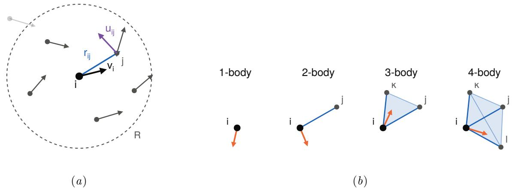  
Figure 1: dACE. (a) The environment of agent i: its velocity ${ \mathbf { } } v _ { i }$ and, for each neighbour within $R ,$ the displacement $\boldsymbol { r } _ { i j }$ and relative velocity $\mathbf { \Delta } \mathbf { u } _ { i j }$ . (b) The force on i, ${ \pmb F } = { \pmb F } ^ { ( 1 ) } + { \pmb F } ^ { ( 2 ) } + \dots .$ with $\pmb { F } ^ { ( N + 1 ) }$ summed over all groups of N neighbours.

Pure body-ordered dACE basis. Given one-particle functions $\phi _ { k } ( \pmb { r } , \pmb { u } )$ and centre functions $\psi ( v )$ (specified for $d = 2 , 3$ below), the dACE basis functions (Figure 1b) are, for a multi-index $\pmb { k } = ( k _ { 1 } \leq \cdots \leq k _ { N } )$

$$
B _ { \psi k } ( \pmb { v } _ { i } , \pmb { \chi } _ { i } ) = \psi ( \pmb { v } _ { i } ) A _ { k } ( \pmb { \chi } _ { i } ) = \psi ( \pmb { v } _ { i } ) \sum _ { j _ { 1 } \neq \ldots \neq j _ { N } } \prod _ { t = 1 } ^ { N } \phi _ { k _ { t } } ( \pmb { r } _ { i j _ { t } } , \pmb { u } _ { i j _ { t } } ) .
$$

The sum over distinct neighbours expands by inclusion–exclusion into products of pooled features, with $\mathcal { T } _ { N }$ the set partitions of $\{ 1 , \ldots , N \}$

$$
\sum _ { j _ { 1 } \neq \dots \neq j _ { N } } \prod _ { t } \phi _ { k _ { t } } ( r _ { i j _ { t } } , u _ { i j _ { t } } ) = \sum _ { \tau \in \mathcal { T } _ { N } } \mu ( \tau ) \prod _ { I \in \tau } A _ { k _ { I } } , \qquad A _ { k _ { I } } = \sum _ { j } \prod _ { t \in I } \phi _ { k _ { t } } ( r _ { i j } , u _ { i j } ) ,
$$

with $\begin{array} { r } { \mu ( \tau ) = \prod _ { I \in \tau } ( - 1 ) ^ { | I | - 1 } ( | I | - 1 ) ! } \end{array}$ . The block sums $A _ { { \pmb k } _ { I } }$ are shared between basis functions and computed once per environment. We compute the multi-element block sums by purification: the product of the one-particle functions in a block is linearised exactly in a basis of pooled features (given below), and the block sums follow by a sparse precomputed linear map analogous to that of Ho, Gutleb and Ortner [35]. All one-particle functions carry the smooth cutof $f _ { c } ( \rho ) = ( 1 - \rho ^ { 2 } / R ^ { 2 } ) ^ { 2 }$ , which is not closed under multiplication, so we pool features separately for each power $h = | I |$ of $f _ { c } .$ . Neighbours then enter only through the pooled features, at a cost $O ( J )$ per feature, and we obtain the pure basis at a cost comparable to the self-interacting one. As in ACE [29], we take the radial dependence through polynomials of a transformed distance, here Legendre polynomials $P _ { n } ( y ( \rho ) )$ of $y ( \rho ) = 1 - 2 ( 1 - e ^ { - \rho / \ell } ) / ( 1 - e ^ { - R / \ell } )$ , which resolves short distances, where interactions are strongest, more finely than a polynomial in $\rho ,$ and scale velocities by a typical speed $v _ { s } , \tilde { { \boldsymbol { u } } } = { \boldsymbol { u } } / v _ { s } , \tilde { { \boldsymbol { v } } } = { \boldsymbol { v } } / v _ { s }$ . We use $\ell = R / 2$

The speed polynomials $P _ { l } ( 2 | \tilde { u } | ^ { 2 } - 1 )$ are orthogonal on $| \tilde { u } | \leq 1$ . When speeds are heavy-tailed, as for animals that alternate bursts and glides, a scale $v _ { s }$ that covers the fast tail leaves most observations at small |u˜|, where the polynomials resolve little. Our implementation therefore also includes an optional saturating map

$$
\tilde { \pmb { w } } = \operatorname { t a n h } ( | \pmb { w } | / v _ { s } ) \hat { \pmb { w } } ,\tag{1}
$$

which places every speed in the unit ball, resolves speeds below $v _ { s }$ finely and saturates above. It keeps directions, so it commutes with rotations and reflections, and velocity factors remain smooth at $w = 0$ , since $\operatorname { t a n h } ( t ) / t$ is an even analytic function. The same map, with a scale $a _ { s }$ applies to the past accelerations of the self term (Section 2.5). Purification uses only identities in the scaled variables and is unchanged. We use the linear scaling throughout, except where stated.

## 2.3 Two dimensions

Complex encoding and rotations. Rotation equivariance in 2D reduces to the charge bookkeeping of Section 2.1, which we now make precise. We identify $\mathbb { R } ^ { 2 } \cong \mathbb { C } , z = x + i y .$ A joint rotation by θ of all positions and velocities acts as $z \mapsto e ^ { i \theta } z$ . A function $f$ has charge $q \in \mathbb { Z }$ if $f \mapsto e ^ { i q \theta } f$ . Writing $z ^ { m } : = \bar { z } ^ { | m | }$ for $m < 0$ , the factor $z ^ { m }$ has charge $m _ { : }$ and charges add under multiplication. The acceleration $a _ { x } + i a _ { y }$ has charge 1.

One-particle and centre bases. With $\rho = | \pmb { r } | , \hat { r } = ( r _ { x } + i r _ { y } ) / \rho \mathrm { ~ a n d ~ } \tilde { u } = \tilde { u } _ { x } + i \tilde { u } _ { y }$

$$
\begin{array} { c } { { \phi _ { n l m _ { r } m _ { u } } ( \pmb { r } , \pmb { u } ) = f _ { c } ( \rho ) P _ { n } ( y ( \rho ) ) P _ { l } ( 2 | \tilde { u } | ^ { 2 } - 1 ) \hat { r } ^ { m _ { r } } \tilde { u } ^ { m _ { u } } , } } \\ { { \psi _ { p m } ( \pmb { v } ) = P _ { p } ( 2 | \tilde { v } | ^ { 2 } - 1 ) \tilde { v } ^ { m } , } } \end{array}
$$

with charges $\begin{array} { r } { q ( \phi ) = m _ { r } + m _ { u } } \end{array}$ and $q ( \psi ) = m$ . Velocity factors are polynomials in u˜ and v˜, so they are smooth at ${ \pmb u } = 0$ and $v = 0$ under either scaling.

Equivariance. We keep only $( \psi , k )$ with total charge $\begin{array} { r } { q ( \psi ) + \sum _ { t } q ( \phi _ { k _ { t } } ) = 1 } \end{array}$ , and a bound on the total degree deg $\begin{array} { r } { \hat { \mathbf { \rho } } ( \psi ) + \sum _ { t } \mathrm { d e g } \big ( \phi _ { k _ { t } } \big ) } \end{array}$ per body order, where deg $\left( \phi _ { n l m _ { r } m _ { u } } \right) = n + 2 l + | m _ { r } | + | m _ { u } |$ and $\deg ( \psi _ { p m } ) = 2 p + | m |$ count the polynomial degree in y, ˜u and ˜v. Then every basis function, and hence $\begin{array} { r } { \pmb { F } = \sum c _ { \psi \pmb { k } } B _ { \psi \pmb { k } } } \end{array}$ for any complex coeficients, is exactly equivariant under joint rotations of positions and velocities, and no Clebsch–Gordan coeficients are needed.

Reflections. A reflection conjugates all positions and velocities, and maps every basis function to its complex conjugate, $B _ { \psi \pmb { k } } ( \sigma \pmb { v } _ { i } , \sigma \mathcal { X } _ { i } ) = \overline { { B _ { \psi \pmb { k } } ( \pmb { v } _ { i } , \mathcal { X } _ { i } ) } }$ Hence $\pmb { F }$ is also equivariant under reflections if and only if all coeficients are real. Real coeficients halve the number of parameters, and we use them for every mirror-symmetric (achiral) collective. Complex coeficients allow chiral rules to be learned, but on achiral collectives they incur an avoidable loss of accuracy and eficiency.

Purification. The pooled features are

$$
\tilde { A } _ { h \nu L M _ { r } M _ { u } } = \sum _ { j } f _ { c } ( \rho _ { i j } ) ^ { h } P _ { \nu } ( y ( \rho _ { i j } ) ) P _ { L } ( 2 | \tilde { u } _ { i j } | ^ { 2 } - 1 ) \hat { r } _ { i j } ^ { M _ { r } } \tilde { u } _ { i j } ^ { M _ { u } } ,
$$

using Legendre linearisation in y and $| \tilde { u } | ^ { 2 } , \tilde { r } ^ { m } \hat { r } ^ { m ^ { \prime } } = \hat { r } ^ { m + m ^ { \prime } }$ , and $\tilde { u } ^ { m } \tilde { u } ^ { m ^ { \prime } } = | \tilde { u } | ^ { | m | + | m ^ { \prime } | - | m + m ^ { \prime } | } \tilde { u } ^ { m + m ^ { \prime } }$

## 2.4 Three dimensions

Heading frame. In 3D each neighbour still carries two directions, $\hat { r }$ and $\hat { \pmb { u } } ,$ but on the sphere their harmonics no longer combine by adding charges, and full symmetrisation would couple them with generalised Clebsch–Gordan coeficients. We use instead that self-propelled agents have a heading: the focal velocity defines a right-handed orthonormal frame $( e _ { 1 } , e _ { 2 } , e _ { 3 } )$ with $e _ { 3 } = { v _ { i } } / { | v _ { i } | }$ , in which every vector w is described by its perpendicular part $w _ { \perp } = { \pmb w } { \cdot } e _ { 1 } + i { \pmb w } { \cdot } e _ { 2 } \in$ $\mathbb { C }$ and its axial part $w _ { \parallel } = \boldsymbol { w } \cdot \boldsymbol { e } _ { 3 }$ . A joint rotation $Q$ maps the frame of ${ \mathbf { } } v _ { i }$ to that of $Q v _ { i }$ up to a rotation by some θ about $e _ { 3 }$ , which multiplies all perpendicular parts by $e ^ { i \theta }$ and leaves the axial parts unchanged. Rotations about the heading are therefore handled by the same charge selection rule as in 2D, and the arbitrary choice of $e _ { 1 }$ afects no prediction. An agent at rest has no heading, so we keep the frame of its latest non-zero velocity, which leaves the model defined everywhere and exactly equivariant under joint rotations whenever $\mathbf { \boldsymbol { v } } _ { i } \neq 0$

One-particle and centre bases. With $\hat { \pmb { r } } = ( \hat { r } _ { \bot } , \hat { r } _ { \parallel } )$ and $\tilde { \pmb { u } } = ( \tilde { u } _ { \perp } , \tilde { u } _ { \parallel } )$

$$
\begin{array} { r l } & { \phi _ { n a m _ { r } l b m _ { u } } ( \pmb { r } , \pmb { u } ) = f _ { c } ( \rho ) P _ { n } ( y ( \rho ) ) P _ { a } ( \hat { r } _ { \| } ) \hat { r } _ { \bot } ^ { m _ { r } } P _ { l } ( 2 | \tilde { u } _ { \bot } | ^ { 2 } - 1 ) P _ { b } ( \tilde { u } _ { \| } ) \tilde { u } _ { \bot } ^ { m _ { u } } , } \\ & { \psi _ { p } ( \pmb { v } ) = P _ { p } ( 2 | \tilde { v } | - 1 ) , } \end{array}
$$

where $\hat { r } _ { \perp } ^ { m _ { r } } P _ { a } ( \hat { r } _ { \parallel } )$ are smooth functions on the sphere, with charges $\begin{array} { r } { q ( \phi ) = m _ { r } + m _ { u } } \end{array}$ and $q ( \psi ) = 0$ and degrees $n \stackrel { . . } { + } a + | m _ { r } | + 2 l + b + | m _ { u } |$ and $p .$ We expand the perpendicular acceleration $a _ { \perp }$ (charge 1) and the axial acceleration $a _ { \parallel }$ (charge 0, real) in separate bases with total charge 1 and 0, and $\pmb { a } _ { i } = \mathrm { R e } ( \pmb { a } _ { \perp } ) \pmb { e } _ { 1 } + \mathrm { I m } ( \pmb { a } _ { \perp } ) \pmb { e } _ { 2 } + a _ { \parallel } \pmb { e } _ { 3 }$

Purification. The pooled features are

$$
\tilde { A } _ { h \nu A M _ { r } L B M _ { u } } = \sum _ { j } f _ { c } ^ { h } P _ { \nu } ( y ) P _ { A } ( \hat { r } _ { \parallel } ) P _ { L } ( 2 | \tilde { u } _ { \perp } | ^ { 2 } - 1 ) P _ { B } ( \tilde { u } _ { \parallel } ) \hat { r } _ { \perp } ^ { M _ { r } } \tilde { u } _ { \perp } ^ { M _ { u } } ,
$$

with linearisation as in 2D and the additional identities $| \hat { r } _ { \perp } | ^ { 2 } = 1 - \hat { r } _ { \parallel } ^ { 2 }$ and $| \tilde { u } _ { \perp } | ^ { 2 } = ( \eta + 1 ) / 2$ $\eta = 2 | \tilde { u } _ { \perp } | ^ { 2 } - 1$ , which keep each factor a polynomial in a single variable.

Gravity. Agents moving under gravity are unlikely to respond symmetrically under rotations that ignore gravity, so they can sensibly be expected to be symmetric only under rotations about the vertical, since full rotation equivariance would equate a neighbour above an agent with one beside it. In such a setting we use the fixed frame $e _ { 3 } = { \hat { z } }$ in place of the heading frame. The one-particle basis is unchanged and the centre basis becomes

$$
\psi _ { p b m } ( \pmb { v } ) = P _ { p } ( 2 | \widetilde { v } _ { \perp } | ^ { 2 } - 1 ) P _ { b } ( \widetilde { v } _ { \parallel } ) \widetilde { v } _ { \perp } ^ { m } , \qquad q ( \psi ) = m .
$$

The selection rule again requires the charges to add up to the output charge, and purification is as before. The model is then exactly equivariant under rotations about the vertical and is defined also for agents at rest.

Reflections. A reflection through a plane that contains $e _ { 3 }$ , with $e _ { 1 }$ chosen in the plane, conjugates the perpendicular parts and leaves the axial parts unchanged, so, as in 2D, real coeficients make both the heading-frame and the vertical-frame model equivariant under it. Composed with the rotations, this gives the heading-frame model equivariance under every reflection and the vertical-frame model equivariance under reflections through vertical planes.

## 2.5 Self-propulsion: the self term

The memoryless model $\pmb { a } _ { i } = \pmb { F } ( \pmb { v } _ { i } , \pmb { \chi } _ { i } )$ describes an agent’s own motion only through its current velocity (the 1-body term $\pmb { F } ^ { ( 1 ) } ( \pmb { v } _ { i } ) )$ , whereas in self-propulsion-driven agents, including the tracked fish of Section 4, the own motion dominates the acceleration. dACE therefore adds a self term, a function of the agent’s own past.

The self term sees the agent’s velocities ${ \pmb v } _ { i } ( t - k \Delta )$ at a set of steps $k \in K$ back, or the past accelerations $( { \pmb v } _ { i } ( t - ( k - 1 ) \Delta ) - { \pmb v } _ { i } ( t - k \Delta ) ) / \Delta$ formed from them, or both, each called a channel c with scaled state $\tilde { \mathbf { x } } _ { c }$ (with the input map of Section 2.2). In 2D we describe every channel in the frame of the current heading $\hat { v } _ { i }$ by $| \tilde { x } _ { c } |$ and $w _ { c } = \bar { \hat { v } } _ { i } \tilde { x } _ { c } ,$ both invariant under rotations. An agent at rest keeps the heading of its latest non-zero velocity, as in 3D, so $S$ is defined but not smooth at rest, and the self functions are

$$
S ( \pmb { v } _ { i } , \underbrace { \{ \tilde { \alpha } _ { c } \} _ { c } } _ { \mathrm { p a s t } } ) = \hat { v } _ { i } P _ { p } ( 2 | \tilde { v } _ { i } | - 1 ) \prod _ { c } P _ { l _ { c } } ( 2 | \tilde { x } _ { c } | - 1 ) w _ { c } ^ { m _ { c } } ,
$$

with the product over a set of $T \in \{ 1 , 2 \}$ distinct channels and total degree bounds for temporal orders $T = 1$ and $T = 2$ . The factor $\hat { v } _ { i }$ of charge 1 makes S equivariant, and products over two channels let the response to one past state depend on another, as in a glide that follows a burst. In 3D we describe the channels by their perpendicular and axial parts in the frame of the basis, as for neighbours. The self term is part of the 1-body term, and the interaction terms stay as before.

Since an agent’s past motion is correlated with its neighbours’, a self term fitted jointly with the interactions risks absorbing part of them (Section 3.4). We therefore fit in stages: the interaction functions alone first, then the self term on their residual, each with its own regularisation. The interactions are then those of the fit without the self term, and the self term models only what they leave unexplained. Our implementation also provides the joint fit and the reverse order for comparison, and any other self model, such as a neural network of the agent’s own past, can replace the self term.

## 2.6 Fitting and software

Coeficients minimise $\begin{array} { r } { \sum _ { ( a , v , \mathcal { X } ) \in \mathcal { D } } | a - F ( v , \mathcal { X } ) | ^ { 2 } + \lambda ^ { 2 } \sum _ { \psi k } \Gamma _ { \psi k } | \tilde { c } _ { \psi k } | ^ { 2 } } \end{array}$ over the training set $\mathcal { D } _ { \mathrm { : } }$ where ˜c are the coeficients of the column-normalised basis (in 3D separately for $a _ { \perp }$ and $a _ { \| } )$ , and $\begin{array} { r } { \Gamma _ { \psi \pmb { k } } = 1 + \deg ( \psi ) ^ { 4 } + \sum _ { t } \deg ( \phi _ { k _ { t } } ) ^ { 4 } } \end{array}$ for $\begin{array} { r } { B _ { \psi \pmb { k } } = \psi \prod _ { t } \phi _ { k _ { t } } } \end{array}$ is adapted from the algebraic smoothness prior of ACE potentials [33], which penalises high polynomial degrees. The regularisation λ maximises the evidence (marginal likelihood) of the fit, as in Bayesian ridge regression for ACE potentials. Unlike cross-validation, this chooses λ from the training fit alone, with no validation set. We set the total degrees of the basis by hand, though this choice could be automated in principle. We solve the least-squares problem by a QR factorisation of the design matrix streamed over chunks of environments [39], so that memory does not grow with the amount of data and the conditioning is that of the design matrix, not of the normal equations. The solutions and the evidence for all λ then follow from one singular value decomposition of the triangular factor, one per stage in a staged fit.

We implemented dACE.jl [36] in Julia [40], building on the ACEsuit ecosystem [33]. The one-particle bases come from Polynomials4ML.jl [41], and the solvers of ACEfit.jl [42] are available for joint fits.

## 3 Numerical experiments on synthetic data

Collectives have no first-principles reference, so an interaction law can only be tested on simulated collectives, where the rule is known, or on tracked data, where it is not. On simulated collectives we compare the learned law with the truth by the relative RMS error $\| \hat { F } - F \| / \| F \|$ over

held-out environments (the relative force error), by the same error of one body-order contribution, and in free-running simulation. We score next-step predictions aˆ of observed accelerations a by $R ^ { 2 } = 1 - \| \hat { \pmb { a } } - \pmb { a } \| ^ { 2 } / \| \pmb { a } \| ^ { 2 }$

## 3.1 Simulated collectives

We generate trajectories with Agents.jl [43] and update all agents synchronously by a semiimplicit Euler step, so that the finite diferences of the recorded data are exact samples of the rule.

All examples build on D’Orsogna-type self-propelled particles [6] with Cucker–Smale-type alignment [7]:

$$
\begin{array} { l } { \displaystyle \mathfrak { a } _ { i } = \underbrace { ( \alpha - \beta | v _ { i } | ^ { 2 } ) v _ { i } } _ { \mathrm { 1 - b o d y } } + \underbrace { \sum _ { j } f _ { c } ( \rho _ { i j } ) \big [ U ^ { \prime } ( \rho _ { i j } ) \hat { r } _ { i j } + \gamma e ^ { - \rho _ { i j } / \ell _ { v } } u _ { i j } \big ] } _ { \mathrm { 2 - b o d y } } + \underbrace { \kappa _ { v } \sum _ { j < k } g _ { i j } g _ { i k } \frac { 1 - \hat { r } _ { i j } \cdot \hat { r } _ { i k } } { 2 } \frac { u _ { i j } + u _ { i k } } { 2 } } _ { \mathrm { 3 - b o d y } } } \\ { \displaystyle + \underbrace { \kappa _ { 4 } \sum _ { j < k < l } g _ { i j } g _ { i k } g _ { i l } \Big ( 1 - \frac { | \hat { r } _ { i j } + \hat { r } _ { i k } + \hat { r } _ { i l } | ^ { 2 } } { 9 } \Big ) \frac { u _ { i j } + u _ { i k } + u _ { i l } } { 3 } } _ { \mathrm { 4 - b o d v } } , } \end{array}\tag{2}
$$

with Morse potential $U ( \rho ) = C _ { r } e ^ { - \rho / \ell _ { r } } - C _ { a } e ^ { - \rho / \ell _ { a } }$ and $g ( \rho ) = f _ { c } ( \rho ) e ^ { - \rho / \ell _ { 3 } }$ . Each term is of exactly one body order, so the true body-order decomposition is known. We consider four collectives:

Pairwise $\kappa _ { v } = \kappa _ { 4 } = 0 \mathrm { : }$ the classical setting, exactly of body order $\leq 2$

3-body flanking $\kappa _ { v } = 2 , \kappa _ { 4 } = 0 \colon$ an agent flanked by two neighbours on opposite sides aligns with their mean velocity, a non-reducible three-body efect in the spirit of Katz et al. [10].

Averaged alignment we replace the alignment term by $\gamma \textstyle \sum _ { j } w _ { i j } \pmb { u } _ { i j } / ( w _ { 0 } + \sum _ { j } w _ { i j } ) , \ w _ { i j } =$ $f _ { c } e ^ { - \rho _ { i j } / \ell _ { v } }$ , as in Vicsek-type and Motsch–Tadmor models [4, 44]. The normalisation makes the rule implicitly many-body at all orders.

2+3+4-body $\kappa _ { v } = 2 , \kappa _ { 4 } = 4 \colon$ adds a 4-body “encirclement” alignment, in which an agent aligns with any three neighbours, weighted by how evenly they surround it. All four body orders contribute with comparable magnitude.

To test dACE on rules outside this family, we add two classical models with discontinuities that a smooth polynomial expansion cannot represent exactly:

Boids a simplified model in the spirit of Reynolds [3] with averaged cohesion, alignment and separation, turning at a finite rate at constant speed, with a hard separation radius and a hard cutof at R.

Zonal a simplified zonal model in the spirit of Couzin et al. [5], without blind angle and noise: neighbours closer than 1 repel with priority, otherwise the agent aligns with neighbours at distance in [1, 3) and is attracted by those in [3, R). Its heading turns towards the resulting direction at a finite rate, at constant speed.

These two are implicitly many-body through averaging, normalisation and the priority rule. Their agents start at the fixed speed at which both models move, so that the data reflects interactions rather than the relaxation of initial speeds.

Chiral rules. All rules above are mirror symmetric. To test whether chirality can be learned, and whether real coeficients then fail, we build chiral rules in 2D: we turn the 2-body term of the pairwise collective by a fixed angle of $1 0 ^ { \circ }$ or $3 0 ^ { \circ }$ , add to it a constant turning $\omega ( - v _ { i } ^ { y } , v _ { i } ^ { x } )$ with $\omega = 0 . 3$ , or weight the alignment term of the averaged-alignment collective by $1 + b \sin \varphi _ { i j }$ with $\varphi _ { i j }$ the bearing of the neighbour, positive to the left, and $b = 0 . 3$ or 0.7, so that agents follow neighbours on their left more strongly.

Stochastic self-propulsion. To test models on data in which the agents’ own motion dominates, as for animals, we add to the pairwise and 2+3+4-body collectives an intrinsic drive $\mathbf { } d _ { i } ( t )$ in each agent’s heading frame, $\pmb { a } _ { i } = \pmb { F } ( \pmb { v } _ { i } , \pmb { \chi } _ { i } ) + \pmb { d } _ { i }$ . Each of its two components has an RMS equal to that of $| F |$ in a simulation without drive, so its mean square is twice that of F. The drive is either an Ornstein–Uhlenbeck process along and across the heading with correlation time 0.5, or burst-and-coast swimming, a thrust along the heading that pulses with a noisy phase of period 1, with the same random turning.

Data. Each data point is one environment with the agent’s finite-diference acceleration as target, with a median of about ten neighbours within R. We train on 32 short simulations of 30 agents from random initial positions, headings and speeds, so that the data samples the transient and not only the settled flock, test on 4 further simulations, and start trajectory predictions from held-out initial conditions and run them to $t = 2 0$ , well beyond the training window. We report medians over 10 independent splits (5 in 3D), with ranges in Figure 2, and trajectory figures show the first split. In 3D the agents start in a cube with headings uniform on the sphere, 40 of them so that the number of neighbours matches 2D.

Models. The dACE models use angular orders $| m _ { r } | , | m _ { u } | \leq 1$ and $l = 0$ , in 3D also $a , b \leq 1$ (so the one-particle functions are linear in the velocities), and the same total degrees per body order for every collective, 6, 12, 8 and 6 for the 1- to 4-body terms in 2D and $6 ,$ 12, 7 and 5 in 3D, decreasing from the 2-body term on, since the basis grows fastest with degree at high body order. We run SocialNet with the authors’ code and training defaults (100 epochs with early stopping on a validation part of the training samples, and as a check 1000 epochs). SocialNet has no radial cutof and takes every other agent in the group as input. Its architecture is twodimensional and mirror symmetric, so we do not run it on the 3D benchmarks, and it cannot represent chiral rules well.

## 3.2 Interaction laws body order by body order

To test whether dACE recovers a rule of known body order, and what each added body order contributes, Figure 2 shows the relative force error of every model on every collective, in 2D with SocialNet and in 3D. On every smooth rule, dACE truncated at the true body order recovers the law, the 2-body model fails as soon as the rule has a many-body component, and SocialNet’s errors stay far larger at either training length. For averaged alignment, which has no finite body order, the error decreases with each added body order. Boids and the zonal model are not smooth. Their discontinuities are approximated only slowly by smooth polynomials, so dACE’s error stays large at every body order, also on the training data, and while SocialNet does slightly better on these two, its error is also large.

To check that the fit assigns each contribution to the right body order, Table 1 gives the error of each learned body-order contribution against the true term. On the pairwise collective the 4-body model adds almost no spurious 3- and 4-body terms, on the 3-body collective almost no 4-body term, and on the 3-body and 2+3+4-body collectives, the latter in 2D and 3D, every contribution matches its true term, so a single linear fit separates the orders.

To show that the learned law can be interpreted, Figure 3 shows the interaction kernels of the 3-body collective, obtained by probing the learned model with one or two neighbours, and the distorted pair interaction by which the 2-body model absorbs part of the 3-body efect. To test the learned laws beyond held-out environments, Figures 4 and 5 show trajectory predictions on the 2+3+4-body collective in 2D and 3D.

Figure 6 shows that with complex coeficients dACE learns the chiral collectives nearly as accurately as their mirror-symmetric versions.

(a) (b) dACE 2-body dACE 3-body dACE 4-body SocialNet  
Table 1: RMS error of each body-order contribution of the learned dACE 4-body model against the true term, relative to the RMS acceleration (median over splits).
<table><tr><td>collective</td><td>1-body</td><td>2-body</td><td>3-body</td><td>4-body</td></tr><tr><td>pairwise</td><td> $3 . 0 \times 1 0 ^ { - 9 }$ </td><td> $1 . 9 \times 1 0 ^ { - 8 }$ </td><td> $2 . 4 \times 1 0 ^ { - 8 }$ </td><td> $1 . 5 \times 1 0 ^ { - 8 }$ </td></tr><tr><td>3-body flanking</td><td> $5 . 8 \times 1 0 ^ { - 7 }$ </td><td> $8 . 1 \times 1 0 ^ { - 6 }$ </td><td> $1 . 8 \times 1 0 ^ { - 5 }$ </td><td> $1 . 3 \times 1 0 ^ { - 5 }$ </td></tr><tr><td>2+3+4-body</td><td> $9 . 0 \times 1 0 ^ { - 5 }$ </td><td> $9 . 2 \times 1 0 ^ { - 4 }$ </td><td> $2 . 2 \times 1 0 ^ { - 3 }$ </td><td> $1 . 9 \times 1 0 ^ { - 3 }$ </td></tr><tr><td>2+3+4-body, 3D</td><td> $1 . 8 \times 1 0 ^ { - 4 }$ </td><td> $1 . 9 \times 1 0 ^ { - 3 }$ </td><td> $3 . 7 \times 1 0 ^ { - 3 }$ </td><td> $3 . 6 \times 1 0 ^ { - 3 }$ </td></tr></table>

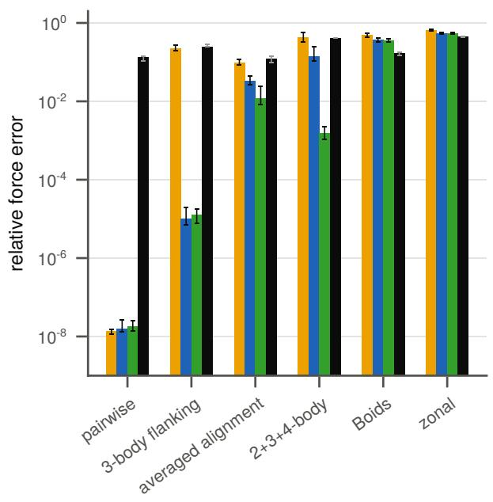

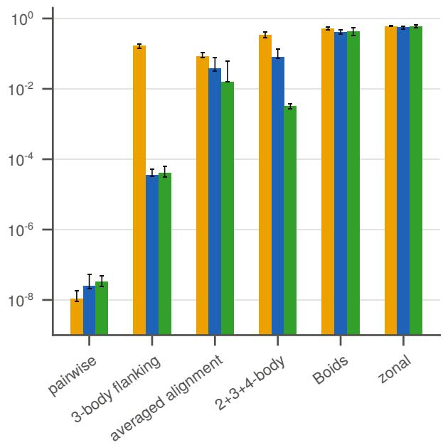

Figure 2: Relative force error of every model on every collective in (a) 2D, with SocialNet, and (b) 3D, median (bar) and range (whisker) over 10 splits in 2D (SocialNet 3) and 5 in 3D. The error drops by orders of magnitude once the model’s body order reaches the rule’s, the 2-body model fails on every many-body rule, and the discontinuous Boids and zonal rules keep every model’s error large.  
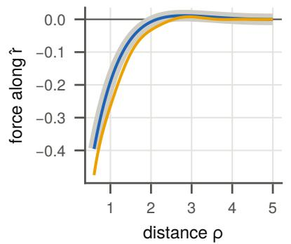  
(a) Radial pair force

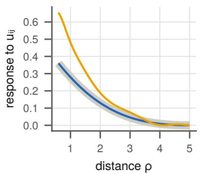  
(b) Pair alignment

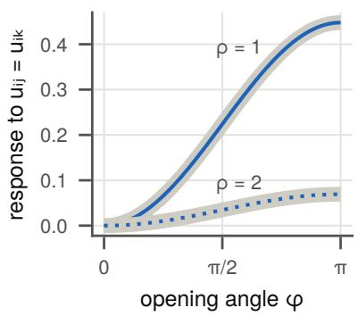  
true dACE 2-body dACE 3-body  
(c) 3-body flanking alignment  
Figure 3: Interaction kernels learned from the 3-body collective: the learned 2-body contribution for one neighbour (a, b) and the 3-body contribution for two neighbours at distance ρ = 1 (solid) or 2 (dotted) and opening angle φ (c), true kernels as wide grey bands.

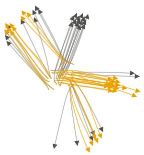  
(a) dACE 2-body

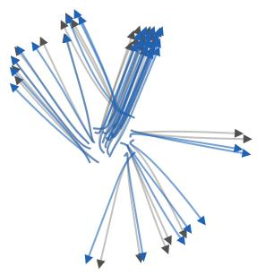  
(b) dACE 3-body

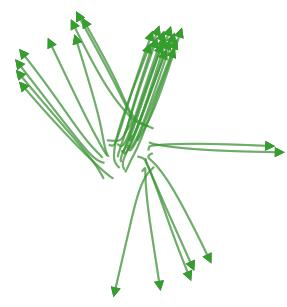

(c) dACE 4-body  
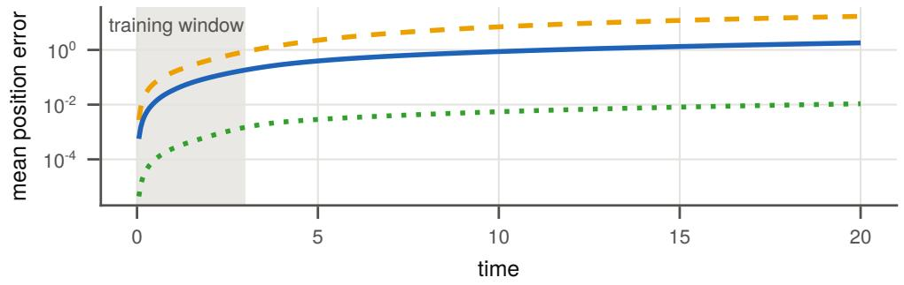  
dACE 2-body dACE 3-body dACE 4-body

(d)  
Figure 4: Trajectory prediction for a held-out initial condition of the 2+3+4-body collective in 2D. (a–c) True (grey) and predicted paths: the 2-body and 3-body models drift away while the 4-body model stays close to the true paths. (d) Mean position error, the training time span shaded. This and other rollout animations are available on figshare [45].  
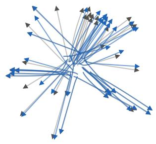  
(a) dACE 3-body

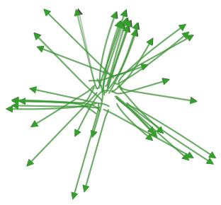

(b) dACE 4-body  
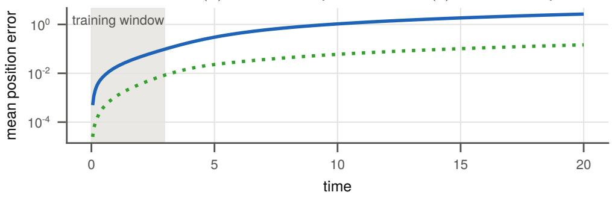  
dACE 3-body dACE 4-body  
(c)  
Figure 5: As Figure 4, in 3D (40 agents) and without the 2-body model, whose rollout diverges, with paths projected onto the two principal axes of the true positions and errors computed in 3D.

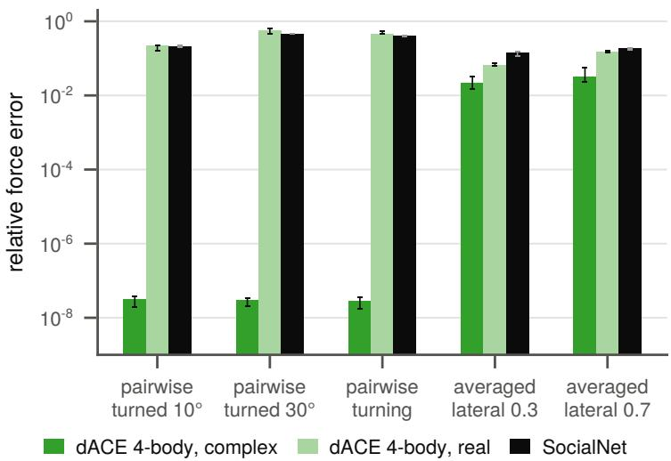  
Figure 6: Relative force error on the chiral collectives for dACE 4-body with complex and with real (mirror-symmetric) coeficients and for SocialNet, median (bar) and range (whisker) over 3 splits. Complex coeficients learn the chiral rules, whereas real coeficients cannot represent chirality.

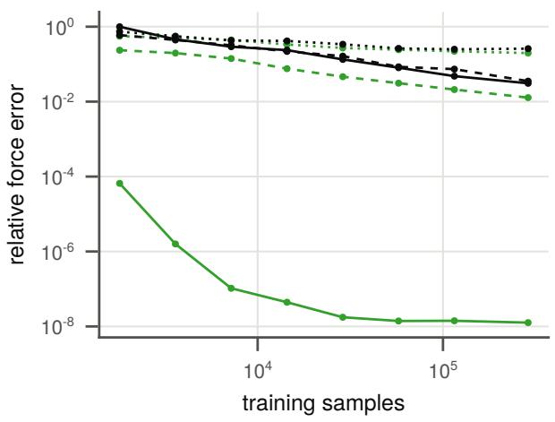  
(a) Pairwise

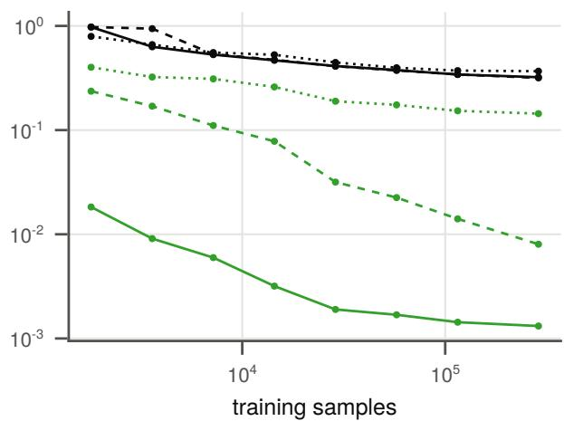  
(b) 2+3+4-body  
dACE 4-body SocialNet ε = 0 ε = 0.01 ε = 0.1  
Figure 7: Relative force error on clean test simulations against the number of training samples, for dACE 4-body and SocialNet, with observation noise ε (line style).

## 3.3 Data eficiency

To test how much data each model needs, and how noise changes that, we train dACE and SocialNet on growing amounts of data with observation noise of size ε, which shifts every recorded position and velocity by an independent vector of random direction and length uniform in [0, ε]. dACE needs less data than SocialNet (Figure 7). On the 2+3+4-body rule, SocialNet improves only slowly with data and hardly changes with the noise level, whereas dACE shows clear gains.

## 3.4 Self-propulsion and next-step prediction

To find out what next-step accuracy measures, we use the stochastic collectives (Section 3.1), where the force F is known and the drive is time-correlated, so an agent’s past predicts much of its next acceleration but nothing about F.

Every model that uses the past, dACE with the past acceleration as an input or SocialNet with its past input, raises next-step $R ^ { 2 }$ several-fold. Alarmingly, however, their relative force errors grow, beyond that of predicting no force at all (Figure 8a). The gain in $R ^ { 2 }$ comes from the agent’s own motion alone, which is correlated with its neighbours’ and can therefore stand in for part of the interactions (the reason we fit the self term in stages). Next-step accuracy thus cannot rank interaction models. On tracked data, where the law cannot be compared with the truth and models are usually compared by held-out prediction accuracy [22], this is a genuine dificulty with no single solution. The best approach available is a combination of checks: prediction under a protocol that shares no frames with the target, gain from adding interactions to the self model, and consistency of the law between disjoint sets of the data (Section 4).

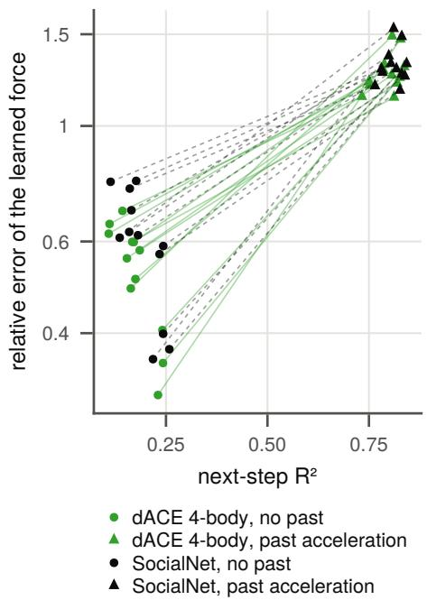  
(a)

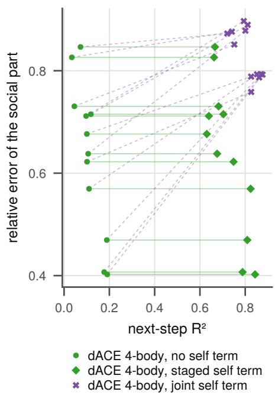  
(b)  
Figure 8: Stochastic self-propulsion. Each point is one data set, a pairwise or 2+3+4-body collective with Ornstein–Uhlenbeck or burst-and-coast drive, in one of 3 splits. (a) The past acceleration raises next-step $R ^ { 2 }$ several-fold while the error of the learned force, for a model with past input its whole prediction, grows beyond that of predicting no force. (b) A self term raises $R ^ { 2 }$ in both fits, but the staged fit (horizontal lines) leaves the social part’s error unchanged, whereas the joint fit (dashed) raises it.

A self term fitted jointly with the interactions behaves the same way. It raises $R ^ { 2 }$ , but its social part, the 2-body and higher terms, ends up further from the true force than that of the memoryless fit. The staged fit keeps the memoryless interactions and still reaches most of the joint $R ^ { 2 }$ (Figure 8b).

## 4 Numerical experiments on tracking data

The zebrafish data we explore in this section is the eight of the reported nine videos of groups of 60 to 100 fish of Heras et al. [22] whose validated idtracker.ai tracking [46] is publicly released, with the 2019 tracking of the same videos [22, 24] as a second data set. The golden shiner data is ten trials with groups of 10 to 151 fish from the experiments of Katz et al. [10], re-tracked by Davidson et al. [47]. We use steps of about 0.1 s, lengths in body lengths (BL), targets away from the walls, and neighbours within 8 BL for zebrafish and 3 BL for shiners. We fit dACE 3-body with the saturating input map (1) and a staged self term, with total degrees 32, 12 and 6 for the zebrafish and 4, 6 and 4 for the shiners, angular orders $| m _ { r } | , | m _ { u } | \leq 4$ and $l \leq 2$ , leaving one video or trial out for testing. Inputs come from frames up to t only and targets from frame $t + 1 + G$ onward, with $G \in \{ 0 , 3 \}$ skipped frames, so that a past input shares no frame, and with it no tracking error, with the target. All fits use real coeficients. Complex coeficients allow chiral rules but improved nothing for either species, which suggests that these fish have no preferred side. We check the learned laws in three ways: the gain in prediction from adding interactions to the self model (Table 2), the consistency of the law between disjoint halves of the data (Figure 9), and for the shiners the learned 3-body term itself (Figure 10).

Table 2: $R ^ { 2 }$ in percent of the self model alone and with interactions, pooled over the videos or trials left out of the fit in turn, and the gain $\Delta$ in percentage points, for G skipped frames. SocialNet’s past input is lagged so that it shares no frame with the target.
<table><tr><td></td><td></td><td colspan="3"> $G = 0$ </td><td colspan="3"> $G = 3$ </td></tr><tr><td>data</td><td>model</td><td>self</td><td>with</td><td>Δ</td><td>self</td><td>with</td><td> $\Delta$ </td></tr><tr><td>zebrafish</td><td>dACE 3-body</td><td>10.5</td><td>11.9</td><td>1.4</td><td>3.8</td><td>4.9</td><td>1.1</td></tr><tr><td></td><td>SocialNet, no past input</td><td>1.2</td><td>3.1</td><td>1.9</td><td>1.5</td><td>3.4</td><td>1.9</td></tr><tr><td></td><td>SocialNet, past input</td><td>5.6</td><td>8.7</td><td>3.1</td><td>2.4</td><td>4.2</td><td>1.8</td></tr><tr><td>golden shiners</td><td>dACE 3-body</td><td>9.4</td><td>11.0</td><td>1.6</td><td>5.7</td><td>7.1</td><td>1.3</td></tr><tr><td></td><td>SocialNet, past input</td><td>4.0</td><td>7.7</td><td>3.7</td><td>3.1</td><td>4.9</td><td>1.7</td></tr></table>

Table 2 gives the $R ^ { 2 }$ of the self model alone and with interactions. Adding interactions improves prediction in both species, at both G, for every zebrafish video and every shiner trial, and the 3-body model beats the 2-body model on every shiner trial. The self term explains far more of the acceleration than the interactions. SocialNet extracts a larger social gain from the zebrafish than dACE, but from a far weaker self model. A larger gain does not mean better interactions (Section 3.4), since whatever the self model misses of the agent’s own motion can be absorbed by the interactions, and with a past input that shares no frame with the target SocialNet predicts worse than dACE on all eight videos.

Laws learned from disjoint halves of the data that disagree cannot both be correct, so we measure the consistency of a learned law as follows. We fit the memoryless force law of a model, with no past input and no self term, to two disjoint halves of the data, alternating blocks of time, dropping the samples whose frames reach across a block boundary, and measure the disagreement of the two learned laws $\hat { F } _ { A }$ and ${ \hat { F } } _ { B } .$ , 1-body term included, on the same held-out environments, $\| \hat { F } _ { A } - \hat { F } _ { B } \| / ( ( \| \hat { F } _ { A } \| ^ { 2 } + \| \hat { F } _ { B } \| ^ { 2 } ) / 2 ) ^ { 1 / 2 }$ (Figure 9). Consistency is meaningful only if neither model is regularised into agreement. Both halves therefore get the same regularisation, for dACE the λ that maximises their summed evidence and for SocialNet the training length with the lowest summed validation error, and the measure is relative, so that a uniform shrinkage does not improve it.

In our experiments, dACE’s law is generally more consistent than SocialNet’s (Figure 9). With 1000 samples per half, SocialNet’s two laws disagree by more than their own size in both species, far more than dACE’s. Regularising each half on its own changes neither model much.

For the shiners, Figure 10 shows the efect of the 3-body term by plotting the 2-body and 3-body parts of the fitted dACE model against the number of neighbours. In sparse neighbourhoods the 3-body term is small. The 2-body sum grows with the number of neighbours, whereas the 3-body term opposes it more and more, so the full response stops growing. With each trial held out of the fit in turn, the 3-body term opposes the 2-body response on every trial with dense neighbourhoods. This agrees with Katz et al. [10], who found three-body forces in groups of three and weaker longer-range forces in larger groups.

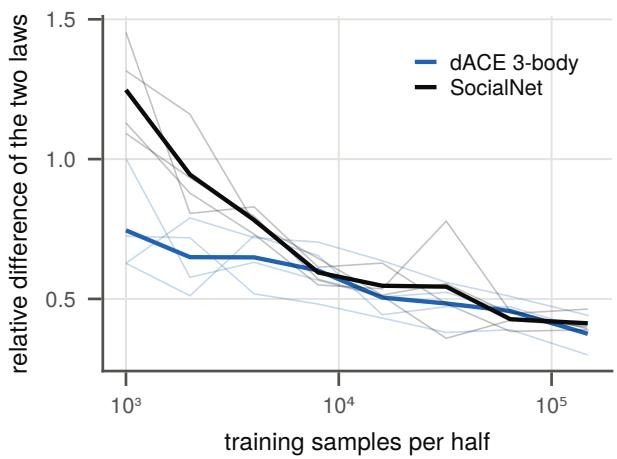  
(a) Zebrafish

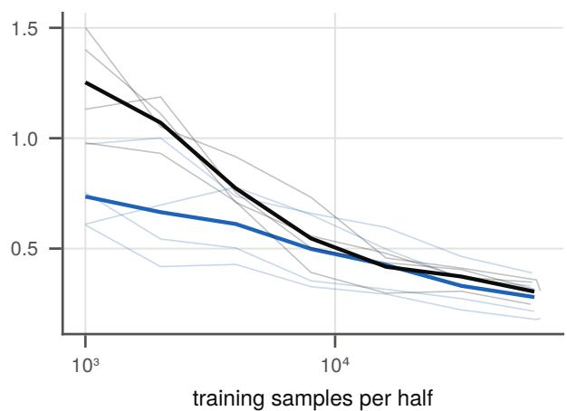  
(b) Golden shiners

Figure 9: Relative diference between the memoryless force laws learned from two disjoint halves of the tracked-fish data, for four held-out groups per species (faint) and their mean (bold).  
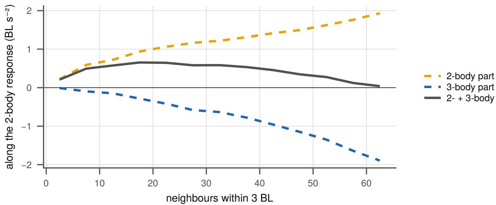  
Figure 10: The 3-body term in the golden shiners. Mean component along the 2-body response of the learned 2-body part, the 3-body part and their sum, against the number of neighbours, at the configurations observed in the ten trials (dACE 3-body, cutof 3 BL).

## 5 Discussion

dACE learns interaction laws body order by body order in 2D or 3D, and with less data than competing models, and on synthetic and tracked data alike the learned laws can be read of and interpreted. Beyond dACE itself, we draw two broader conclusions. First, data can decide whether pairwise interactions sufice. The learned higher-order contributions are negligible where the rule is pairwise and large where it is not, and in the shiners the response to many neighbours is not the sum of the responses to one. Other tracked groups, such as the jackdaw flocks of Ling et al. [26], the surf scoter flocks of Lukeman et al. [8] and the midge swarms of Sinhuber et al. [48], are open to the same tests. Second, next-step accuracy is a poor guide to interaction models. In our simulations it rises while the learned interactions get worse. No single measure is safe on tracked data, so we recommend judging interaction laws by several checks together, such as prediction under a protocol that shares no frames, the gain from adding interactions, and the consistency between disjoint sets or rolled-out trajectories. Several future research directions remain open:

Bounded influence. Atoms respond to forces by their nature. Animals act on perceived information through a limited capacity, so the influence of their neighbours is bounded, by selecting a few of them (starlings appear to interact with their nearest six or seven [49]), by occlusion [47], or by saturation, as in the shiner data discussed above. A fixed metric neighbourhood captures saturation, but selection and occlusion change the shape of the neighbourhood itself. A k-nearest or visibility-based neighbourhood, with the bodyordered expansion on top, would let these mechanisms be compared directly and thus learned from data.

Walls, obstacles and other species. Obstacles could enter as a static second species of particles, as ACE handles chemical elements, and so could predators or the members of mixed-species groups. Free-running tests of tracked groups need such boundaries.

Discontinuous rules. Rules with hard zones or priority switching are approximated slowly by smooth polynomials, as seen in the Boids and zonal experiments. Piecewise polynomial one-particle bases are a natural candidate to fix this and are compatible with purification, but their knots must be known in advance or learned.

## Ethics

This work did not require ethical approval from a human subject or animal welfare committee.

## Data accessibility

dACE.jl and the scripts that generate every figure, table and number of this paper are available under the MIT licence [36]. The paper uses the zebrafish trajectories of Heras et al. [22] in the trackings of Romero-Ferrero et al. [24] and Torrents et al. [46] and the golden shiner trajectories of Davidson et al. [47], all openly available from their original publications.

## Declaration of AI use

We used language models, in particular Claude Opus 5.5 and Fable 5.1 and GPT-6 Luna and Astra, in an assistive role to help with prototyping, to improve readability and in assistant and antagonistic reviewer roles. All ideas, experiments, analysis and conclusions originate with the author who takes full ownership and responsibility for this work.

## Authors’ contributions

T.S.G.: conceptualization, data curation, formal analysis, investigation, methodology, software, validation, visualization, writing—original draft, writing—review and editing.

## Conflict of interest declaration

We declare we have no competing interests.

## Funding

This work received no specific funding.

## Acknowledgements

We thank Leah Edelstein-Keshet, Ryan Lukeman, Cheuk Hin Ho and Christoph Ortner for insightful early discussions about the project.

## References

[1] T. Vicsek and A. Zafeiris. Collective motion. Phys. Rep., 2012.

[2] M. Brambilla, E. Ferrante, M. Birattari, and M. Dorigo. Swarm robotics: a review from the swarm engineering perspective. Swarm Intell., 2013.

[3] C. W. Reynolds. Flocks, herds and schools: a distributed behavioral model. ACM SIG-GRAPH Comput. Graph., 1987.

[4] T. Vicsek, A. Czir´ok, E. Ben-Jacob, I. Cohen, and O. Shochet. Novel type of phase transition in a system of self-driven particles. Phys. Rev. Lett., 1995.

[5] I. D. Couzin, J. Krause, R. James, G. D. Ruxton, and N. R. Franks. Collective memory and spatial sorting in animal groups. J. Theor. Biol., 2002.

[6] M. R. D’Orsogna, Y.-L. Chuang, A. L. Bertozzi, and L. S. Chayes. Self-propelled particles with soft-core interactions: patterns, stability, and collapse. Phys. Rev. Lett., 2006.

[7] F. Cucker and S. Smale. Emergent behavior in flocks. IEEE Trans. Autom. Control, 2007.

[8] R. Lukeman, Y.-X. Li, and L. Edelstein-Keshet. Inferring individual rules from collective behavior. Proc. Natl. Acad. Sci., 2010.

[9] C. J. Torney, M. Lamont, L. Debell, R. J. Angohiatok, L.-M. Leclerc, and A. M. Berdahl. Inferring the rules of social interaction in migrating caribou. Philos. Trans. R. Soc. B: Biol. Sci., 2018.

[10] Y. Katz, K. Tunstrøm, C. C. Ioannou, C. Huepe, and I. D. Couzin. Inferring the structure and dynamics of interactions in schooling fish. Proc. Natl. Acad. Sci., 2011.

[11] C. Buhl, D. J. T. Sumpter, I. D. Couzin, J. J. Hale, E. Despland, E. R. Miller, and S. J. Simpson. From disorder to order in marching locusts. Science, 2006.

[12] S. Sayin, E. Couzin-Fuchs, I. Petelski, Y. G¨unzel, M. Salahshour, C.-Y. Lee, J. M. Graving, L. Li, O. Deussen, G. A. Sword, and I. D. Couzin. The behavioral mechanisms governing collective motion in swarming locusts. Science, 2025.

[13] F. Lu, M. Zhong, S. Tang, and M. Maggioni. Nonparametric inference of interaction laws in systems of agents from trajectory data. Proc. Natl. Acad. Sci., 2019.

[14] F. Lu, M. Maggioni, and S. Tang. Learning interaction kernels in stochastic systems of interacting particles from multiple trajectories. Found. Comput. Math., 2022.

[15] J. E. Herbert-Read, A. Perna, R. P. Mann, T. M. Schaerf, D. J. T. Sumpter, and A. J. W. Ward. Inferring the rules of interaction of shoaling fish. Proc. Natl. Acad. Sci., 2011.

[16] S. L. Brunton, J. L. Proctor, and J. N. Kutz. Discovering governing equations from data by sparse identification of nonlinear dynamical systems. Proc. Natl. Acad. Sci., 2016.

[17] M. Cranmer, A. Sanchez-Gonzalez, P. Battaglia, R. Xu, K. Cranmer, D. Spergel, and S. Ho. Discovering symbolic models from deep learning with inductive biases. In Adv. Neural Inf. Process. Syst., 2020. arXiv:2006.11287.

[18] V. Papaspyros, R. Escobedo, A. Alahi, G. Theraulaz, C. Sire, and F. Mondada. Predicting the long-term collective behaviour of fish pairs with deep learning. J. R. Soc. Interface, 2024.

[19] K. Fujii, N. Takeishi, K. Tsutsui, E. Fujioka, N. Nishiumi, R. Tanaka, M. Fukushiro, K. Ide, H. Kohno, K. Yoda, S. Takahashi, S. Hiryu, and Y. Kawahara. Learning interaction rules from multi-animal trajectories via augmented behavioral models. In Adv. Neural Inf. Process. Syst., 2021. arXiv:2107.05326.

[20] D. Kim, J. Lee, and H.-Y. Kim. Commanding emergent behavior with neural networks. Cell Rep. Phys. Sci., 2025.

[21] S. Powers and C. Pinciroli. Automatic extraction of symbolic models of collective behaviors with graph neural networks and macro-micro evolution. Swarm Intell., 2025.

[22] F. J. H. Heras, F. Romero-Ferrero, R. C. Hinz, and G. G. de Polavieja. Deep attention networks reveal the rules of collective motion in zebrafish. PLOS Comput. Biol., 2019.

[23] A. P´erez-Escudero, J. Vicente-Page, R. C. Hinz, S. Arganda, and G. G. de Polavieja. idTracker: tracking individuals in a group by automatic identification of unmarked animals. Nat. Methods, 2014.

[24] F. Romero-Ferrero, M. G. Bergomi, R. C. Hinz, F. J. H. Heras, and G. G. de Polavieja. idtracker.ai: tracking all individuals in small or large collectives of unmarked animals. Nat. Methods, 2019.

[25] A. Cavagna, I. Giardina, A. Orlandi, G. Parisi, A. Procaccini, M. Viale, and V. Zdravkovic. The STARFLAG handbook on collective animal behaviour: 1. Empirical methods. Anim. Behav., 2008.

[26] H. Ling, G. E. McIvor, K. van der Vaart, R. T. Vaughan, A. Thornton, and N. T. Ouellette. Local interactions and their group-level consequences in flocking jackdaws. Proc. R. Soc. B: Biol. Sci., 2019.

[27] B. J. Braams and J. M. Bowman. Permutationally invariant potential energy surfaces in high dimensionality. Int. Rev. Phys. Chem., 2009.

[28] F. Musil, A. Grisafi, A. P. Bart´ok, C. Ortner, G. Cs´anyi, and M. Ceriotti. Physics-inspired structural representations for molecules and materials. Chem. Rev., 2021.

[29] R. Drautz. Atomic cluster expansion for accurate and transferable interatomic potentials. Phys. Rev. B, 2019.

[30] G. Dusson, M. Bachmayr, G. Cs´anyi, R. Drautz, S. Etter, C. van der Oord, and C. Ortner. Atomic cluster expansion: completeness, eficiency and stability. J. Comput. Phys., 2022.

[31] M. Bachmayr, G. Dusson, C. Ortner, and J. Thomas. Polynomial approximation of symmetric functions. Math. Comput., 2024.

[32] D. P. Kov´acs, C. van der Oord, J. Kucera, A. E. A. Allen, D. J. Cole, C. Ortner, and G. Cs´anyi. Linear atomic cluster expansion force fields for organic molecules: beyond RMSE. J. Chem. Theory Comput., 2021.

[33] W. C. Witt, C. van der Oord, E. Gelˇzinyt˙e, T. J¨arvinen, A. Ross, J. P. Darby, C. H. Ho, W. J. Baldwin, M. Sachs, J. Kermode, N. Bernstein, G. Cs´anyi, and C. Ortner. ACEpotentials.jl: a Julia implementation of the atomic cluster expansion. J. Chem. Phys., 2023.

[34] I. Batatia, D. P. Kov´acs, G. N. C. Simm, C. Ortner, and G. Cs´anyi. MACE: higher order equivariant message passing neural networks for fast and accurate force fields. In Adv. Neural Inf. Process. Syst., 2022.

[35] C. H. Ho, T. S. Gutleb, and C. Ortner. Atomic cluster expansion without self-interaction. J. Comput. Phys., 2024.

[36] T. S. Gutleb. dACE.jl. https://doi.org/10.5281/zenodo.23984430, 2026. Version 0.1.3.

[37] W. Bialek, A. Cavagna, I. Giardina, T. Mora, E. Silvestri, M. Viale, and A. M. Walczak. Statistical mechanics for natural flocks of birds. Proc. Natl. Acad. Sci., 2012.

[38] R. Drautz. Atomic cluster expansion of scalar, vectorial, and tensorial properties including magnetism and charge transfer. Phys. Rev. B, 2020.

[39] G. H. Golub and C. F. Van Loan. Matrix Computations. Johns Hopkins University Press, Baltimore, 4th edition, 2013.

[40] J. Bezanson, A. Edelman, S. Karpinski, and V. B. Shah. Julia: a fresh approach to numerical computing. SIAM Rev., 2017.

[41] C. Ortner and contributors. Polynomials4ML.jl. https://github.com/ACEsuit/ Polynomials4ML.jl, 2026. Version 0.5.10.

[42] W. C. Witt, C. Ortner, and contributors. ACEfit.jl. https://github.com/ACEsuit/ ACEfit.jl, 2026. Version 0.3.1.

[43] G. Datseris, A. R. Vahdati, and T. C. DuBois. Agents.jl: a performant and feature-full agent-based modeling software of minimal code complexity. Simulation, 2024.

[44] S. Motsch and E. Tadmor. A new model for self-organized dynamics and its flocking behavior. J. Stat. Phys., 2011.

[45] T. S. Gutleb. Synthetic trajectory predictions and rollouts using dACE.jl. https://doi. org/10.6084/m9.figshare.34831176, 2026.

[46] J. Torrents, T. Costa, and G. de Polavieja. New idtracker.ai rethinks multi-animal tracking as a representation learning problem to increase accuracy and reduce tracking time. eLife, 2026.

[47] J. D. Davidson, M. M. G. Sosna, C. R. Twomey, V. H. Sridhar, S. P. Leblanc, and I. D. Couzin. Collective detection based on visual information in animal groups. J. R. Soc. Interface, 2021.

[48] M. Sinhuber, K. van der Vaart, R. Ni, J. G. Puckett, D. H. Kelley, and N. T. Ouellette. Three-dimensional time-resolved trajectories from laboratory insect swarms. Sci. Data, 2019.

[49] M. Ballerini, N. Cabibbo, R. Candelier, A. Cavagna, E. Cisbani, I. Giardina, V. Lecomte, A. Orlandi, G. Parisi, A. Procaccini, M. Viale, and V. Zdravkovic. Interaction ruling animal collective behavior depends on topological rather than metric distance: evidence from a field study. Proc. Natl. Acad. Sci., 2008.