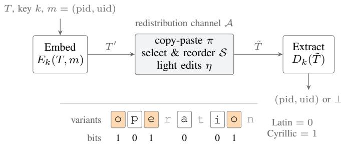
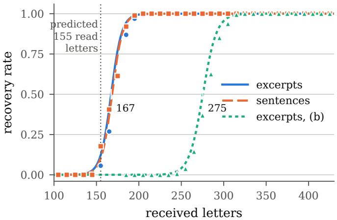
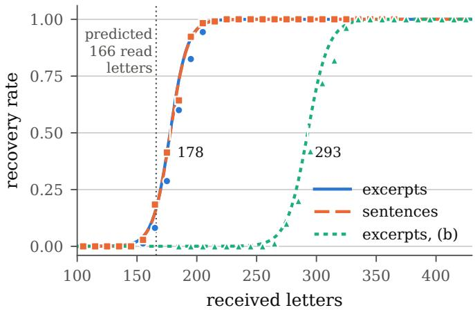
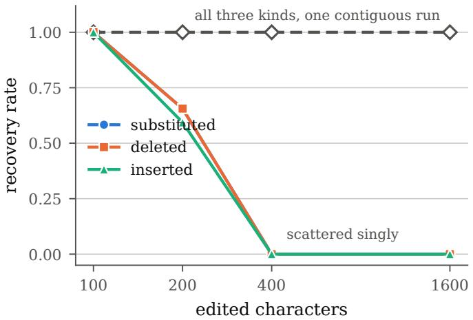
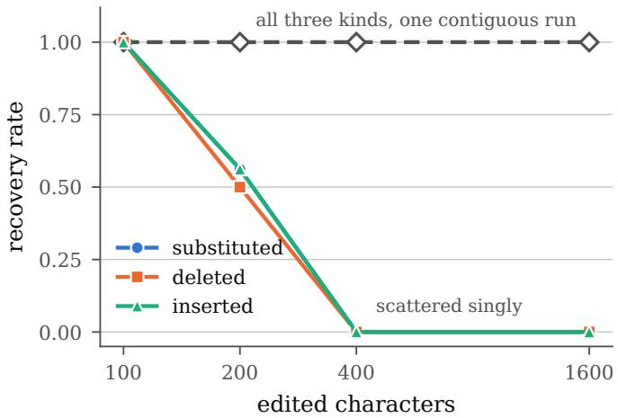
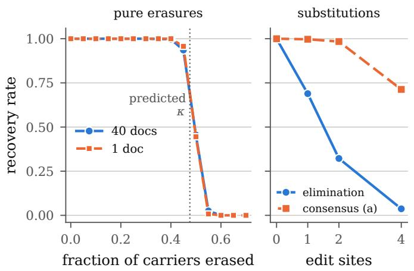
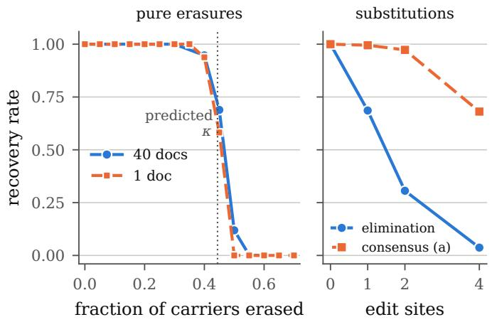
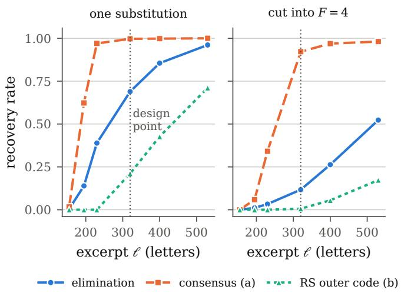
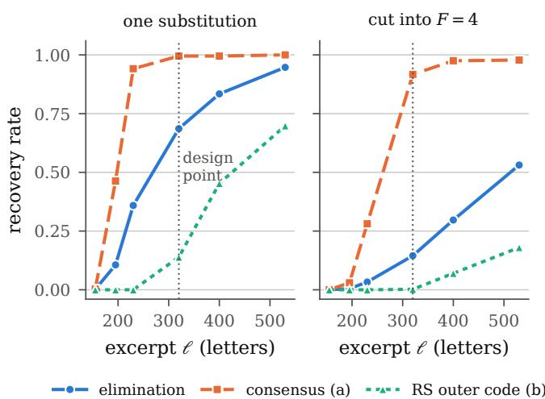

# KeHoSu: Keyed Homoglyph Substitution for Authenticated Text Provenance over Copy-Paste Channels

Andrei Alexandru Draghici ˘ †, Sediola Ruko∗, Briland Hitaj‡ and Dorjan Hitaj∗

∗Department of Computer Science, Sapienza University of Rome, {hitaj.d, ruko}@di.uniroma1.it †Faculty of Mathematics and Informatics, University of Bucharest, andrei-alexandru.draghici@s.unibuc.ro ‡Confidencial Inc, briland.hitaj@confidencial.io

Abstract—Nowadays, large language models produce text at scale, and much of it is redistributed across platforms. A moderator who finds a suspicious comment, post or article may want to know which platform generated it and for which account. In this paper we study attribution over the channel through which such text actually travels, copy-paste, which discards document metadata but keeps Unicode code points. We present KeHoSu, which turns the confusable characters of homoglyph attacks into a keyed attribution channel: the variant chosen for each carrier letter encodes one bit of an identifier made of a platform field, a user field and a truncated authentication tag. Moreover, given that reshared text is often quoted in fragments, and the placement therefore keeps no positional state, we show that KeHoSu is invariant to sentence reordering up to a constant boundary layer and depends on a partial quotation only through the retained length. We characterize the code-point channel by its capacity, removability and detectability, and provide an achievable region that relates the three. We evaluate KeHoSu over a wide range of use cases and show that the mark survived copy-paste across 18 common platforms, attributing the majority of all excerpts to the correct account at 178 letters (about two sentences) on LLM-generated stories and 167 letters (about one sentence) on standard English prose.

Index Terms—Digital watermarking, homoglyphs, LLMgenerated text, provenance attribution

## I. INTRODUCTION

Large language models (LLMs) make fluent text cheap to produce at a large scale, text upon which coordinated influence operations rely [1], [2]. When a suspicious comment, post or article turns up, a moderator or an investigator may want to know which platform generated it and for which account. For files, provenance metadata such as C2PA content credentials [3] answer this question. Text, however, rarely travels as a file. It is quoted, re-posted and forwarded by copy-paste, which drops file-level metadata and, depending on the destination, formatting. Copy-paste keeps the Unicode code points, and these can be used to hold a provenance mark. Many common letters have counterparts in other scripts that look the same. For example, the Latin a (U+0061) and the Cyrillic a (U+0430) are distinct code points. Unicode lists them as confusable [4], and most fonts draw them with the same glyph. As such, homoglyph phishing exploits this property [5] to trick their victims. In this work, we use it to build an attribution mark that can be applicable in the current trend of having LLMs produce text, or for essentially any machine-generated text, to be used as a provenance indicator when needed.

  
Fig. 1: Overview of KeHoSu. The carriers are the letters that have an identical-looking Cyrillic counterpart. A carrier written in Latin encodes bit 0 and its Cyrillic counterpart bit 1. The platform encrypts and authenticates the pair (platform, user), expands it with a rateless code and writes each coded bit into the carriers whose local context hashes, under the key, to the index of that bit. The decoder recomputes the hashes from the received text.

We present KeHoSu, which writes an authenticated provenance identifier into the choice of confusable Unicode variants. The mark is applied to finished text and does not depend on how the text was produced. As a result, KeHoSu can be used wherever a service releases text. A website or publishing platform can mark the copy it serves to each account, and an organization can mark a copy of an internal document, so that a quoted or leaked excerpt can be traced to its recipient. We also focus on LLM platforms, which have drawn particular attention as LLMs are widely adopted for text production. In this setting we consider an LLM platform that serves many accounts and marks each response after generation, without access to the sampling of the model. Note here that generation-time watermarks such as SynthID [6] change the token distribution of one model, whereas KeHoSu writes into the code points, and a platform can apply both.

Our contributions are the following:

• We carry out an analysis of the code-point channel in terms of capacity, removability and detectability. We give a converse for each of the three, and a matching achievability result for capacity.

• We show a joint achievable region for the three quantities. For a weight-w code over L carriers on an erasure channel of rate $p _ { e } ,$ , the recoverable payload is at most $K \leq ( 1 - p _ { e } ) L H _ { 2 } ( w )$ bits, and a mark whose mixedscript detection advantage is held below a constant carries O(log L) covert bits.

• We propose KeHoSu which operates at the abovementioned limits. Its identifier is encrypted and authenticated, and a forger without the key succeeds with probability at most $q 2 ^ { - t } + \mathrm { A d v } ^ { \mathrm { A E A D } }$ ; an asymmetric mode lets anyone holding the public key verify the platform of origin. Carriers are indexed by their local content, and decoding resynchronizes after insertions and deletions. The symbols that the decoder collects are unchanged by any permutation of sentences, apart from a constant-size boundary layer at the two ends of the received text, and depend on a partial quotation only through its length.

• We evaluate KeHoSu on LLM generated text and on three English corpora. The identifier survived copy-paste through 18 platforms; the 50% recovery point of a 72-bit identifier lies at 167 received letters; sentence permutations left the verdict unchanged on all 1524 permutable documents at the threshold; and a consensus decoder recovers the 320-letter design point after four scattered substitutions in 71% of trials.

This paper is organized as follows: Section II describes the threat model. Section III lays out the problem statement and furthermore, Section IV describes KeHoSu, our codepoint provenance identifier. Section V provides the theoretical analysis of the code-point provenance channel and Section VI provides the evaluation details of KeHoSu. Finally Section VII provides the related work and Section VIII concludes the paper.

## II. THREAT MODEL

In our threat model we consider services that release text. A website, a publishing platform or an LLM platform marks every text it returns to its users. The text then travels over a distribution channel: it is selected, copied and pasted elsewhere, as a quote, a repost or a forwarded message. The channel preserves code points. A party that finds a suspicious sample submits it for attribution. Specifically we identify three main actors in our threat model, as follows:

• Embedder. The platform holds a secret key k. Each text that leaves the platform carries the identifier $m =$ (pid, uid) of the platform and of the user account, written by the embedder.

• Extractor. Any party holding k. It receives a sample and outputs either (pid, uid) or “unmarked/invalid”(⊥).

• Resharer. It has no intent to remove or forge the mark. It copies and pastes, and may keep only some of the sentences, reorder them, split them across several posts, mix them with its own text, and make light edits.

• Forger. It wants to link a victim’s identifier to text that the victim never generated. It does not hold k. It can collect text marked for the victim and splice it into other text, unmarked or marked with another identifier.

## III. PROBLEM STATEMENT

Let Σ be the alphabet and $T \in \Sigma ^ { * }$ a text. Position i is a carrier if its character has a set $V _ { i } = \{ u _ { i , 0 } , \ldots , u _ { i , v _ { i } - 1 } \}$ of $v _ { i } \geq 2$ mutually confusable variants that render as one glyph (Section IV-A). The public skeleton map $\sigma : \Sigma ^ { * } \to \Sigma ^ { * }$ folds every variant to its Latin form, and $\sigma ( T )$ therefore does not depend on the variant chosen at any carrier. We write $\mathcal { C } ( T )$ for the set of carrier positions and $L = | { \mathcal { C } } ( T ) |$ |. A labeling assigns carrier i a symbol in $\{ 0 , \ldots , v _ { i } - 1 \}$ , and the mean information per carrier is $\textstyle b = { \frac { 1 } { L } } \sum _ { i \in c }$ log vi. The identifier m has $p + u$ bits, and the sealed payload has $K = p + u + t { \mathrm { ~ b i t s } } $ , t of them an authentication tag (Section IV-B). The scheme is a pair of keyed algorithms. The embedder $E _ { k } ( T , m )  T ^ { \prime }$ chooses carrier variants that encode m and keeps $\sigma ( T ^ { \prime } ) = \sigma ( T )$ ; the extractor $D _ { k } ( \tilde { T } )$ returns an identifier or ⊥. The reader distortion $d ( T , T ^ { \prime } ) = | \{ i : T$ and $T ^ { \prime }$ render differently at i}| measures perceptible change. When every variant set renders as one glyph, $d ( T , E _ { k } ( T , m ) ) = 0 ,$ a pair that some font draws differently is removed from the carrier set. The received text is $\tilde { T } = \ A ( T ^ { \prime } )$ where the channel $\mathcal { A } = \eta \circ S \circ \pi$ models the resharer: a copypaste transport π that preserves code points; a structural stage S that retains a subset of the sentences in an arbitrary order (Equation (6)); and an edit stage η that erases or corrupts each surviving carrier independently, at a total rate $p _ { e } . \ s$ removes whole spans and η acts on single carriers.

Definition 1 (Correctness). A text T is markable if its carriers address enough distinct symbols, $b \nu ( L ) \geq ( 1 + \varepsilon ) K$ , where ε is the overhead of the code (Section IV-D) and $\nu ( L )$ counts the distinct indices among the carriers that the decoder reads. The scheme is correct if $D _ { k } ( E _ { k } ( T , m ) ) = m$ for every markable T and every identifier m.

Definition 2 (Robustness). Let the structural stage $s$ retain carriers that meet the threshold of Proposition 5, and let the edit stage η erase carriers at a rate $p _ { e }$ no larger than the tolerated loss κ of Section V-B. The scheme is robust if recovery then succeeds with probability that tends to one in the number of surviving carriers beyond the threshold.

Definition 3 (Unforgeability). Let an adversary without k run in probabilistic polynomial time and make at most q verification queries. The probability that $D _ { k }$ accepts a text whose payload the embedder never produced is at most $q 2 ^ { - t } + \mathrm { A d v } ^ { \mathrm { \tiny { \dot { A } E A D } } }$ negligible in t.

## IV. KEHOSU

In this section we provide the details of the inner working of KeHoSu.

## A. Carrier surface

The binary carriers of KeHoSu pair a Latin letter with its Cyrillic homoglyph (Table I). To ensure that recasing does not introduce unmarked carriers that the decoder would read as data, a letter is admitted only if both of its cases are carriers (i.e., both the upper and lower case have a Cyrillic homoglyph). This excludes the capitals B, H, K, M and T, whose Cyrillic look-alikes (U+0412, 041D, 041A, 041C, 0422) have no Latinlooking lower case, and N and $Z ,$ which have only Greek lookalikes (U+039D, 0396). A carrier with two variants encodes one bit, and every other character is emitted unchanged.

TABLE I: Homoglyph code points (U+) of the carrier letters.
<table><tr><td>Latin Cyrillic Greek</td><td>a 0430 一</td><td>C 0441 03F2</td><td>e 0435 一</td><td>i 0456 一</td><td>j 0458 一</td><td>0 043E 03BF</td><td>p 0440 03C1</td><td>S 0455 一</td><td>X 0445 03C7</td><td>y 0443 一</td></tr><tr><td>Latin Cyrillic Greek</td><td>A 0410 0391</td><td>C 0421 03F9</td><td>E 0415 0395</td><td>I 0406 0399</td><td>J 0408 一</td><td>0 041E 039F</td><td>P 0420 03A1</td><td>S 0405</td><td>X 0425 03A7</td><td>Y 0423 03A5</td></tr></table>

## B. Bit encoding and payload

The Latin variant of a binary carrier encodes bit 0 and the Cyrillic variant bit 1. The word operation, for example, contains six carriers (its ${ \bf o } , { \bf p } , { \bf e } , { \bf a } ,$ i and o), each of which carries one bit (Figure 1). The identifier is encrypted and authenticated before coding. A key-rotation counter epoch selects the key $k _ { \mathrm { e p o c h } }$ , and the epoch is not transmitted. To keep the payload compact, we omit a random nonce and use deterministic encryption in the style of SIV [7], as opposed to the encrypt-then-MAC composition [8], whose synthetic IV is derived from the identifier itself:

$$
( \mathrm { c t } , \tau ) = \mathrm { S I V } _ { k _ { \mathrm { c p o c h } } } ( \mathrm { p i d } \parallel \mathrm { u i d } ) , \quad \mathrm { p a y l o a d = c t } \parallel \tau _ { 1 : t } ,\tag{1}
$$

with ct the encrypted (p+u)-bit identifier and $\tau _ { 1 : t }$ the tag truncated to t bits (a truncated HMAC [9] tag serves equally well). A SIV mode derives its keystream from the whole tag. We instead derive it from the truncated tag, $\mathrm { c t } = m \oplus F _ { k } ( \tau _ { 1 : t } )$ . Keys rotate with the epoch before $2 ^ { t / 2 }$ identifiers (65,536 at $t = 3 2 )$ are sealed under one key, which bounds keystream collisions. A candidate $( \operatorname { c t } ^ { \prime } , \tau ^ { \prime } )$ is accepted when $\begin{array} { r l } { \mathrm { M A C } _ { k } ( \mathrm { c t } ^ { \prime } \oplus F _ { k } ( \tau ^ { \prime } ) ) _ { 1 : t } = } & { { } } \end{array}$ $\tau ^ { \prime } .$ The truncation to t bits is applied to the HMAC or SIV tag, which can be truncated safely, and the resulting mode is a MAC-then-mask construction that uses the tag function of AES-GCM-SIV [10]. We instantiate it with AES-256-GCM-SIV under a fixed nonce: $\tau _ { 1 : t }$ is the first $t = 3 2$ bits of the GCM-SIV tag over a domain byte and $m$ , and $F _ { k } ( \tau _ { 1 : t } )$ is the GCM-SIV encryption of the domain byte and $\tau _ { 1 : t }$ , truncated to |m|. Verification recomputes the seal from the recovered m and compares it in constant time.

Asymmetric mode. For verification without k, the platform holds a signature key pair (sk, pk) and an encryption key $K _ { P }$ and embeds

$$
\mathrm { p a y l o a d } = \mathrm { p i d } \parallel \mathrm { S i g n } _ { \mathrm { s k } } ( \mathrm { p i d } \parallel h ) \parallel \mathrm { E n c } _ { K _ { P } } ( \mathrm { u i d } ) ,\tag{2}
$$

where $h = H ( \sigma ( T ) )$ hashes the normalized content and Enc $K _ { P }$ is the authenticated encryption of the symmetric mode. Anyone with pk verifies the platform of origin, and only the platform reads the user identifier. A BLS or EdDSA [11] signature takes 384–512 bits and brings the payload to 456–584 bits, which by Corollary 2 fits article-length text of 2000–2600 letters at $r = 0 . 5$ . Hashing a canonical prefix, the first $N _ { 0 }$ normalized tokens, binds the signature to that prefix, and Proposition 10 holds for either hash. The symmetric and asymmetric modes can run together as separate marks on disjoint carrier subsets.

## C. Content-anchored placement

A keyed hash of each carrier’s local context, reduced modulo Λ, gives the index of the coded symbol that the carrier holds. The context is a window of $W _ { \mathrm { c t x } }$ characters around the carrier, with every carrier folded to its skeleton and lower-cased. Normalization removes the variant choice, which makes the index independent of the embedded bit: embedder and decoder derive the same mapping without a circular dependence on the payload. The decoder recomputes every index and passes the collected (index, symbol) pairs to the fountain decoder (Section IV-D). At most Λ distinct symbols can be addressed, and Λ must exceed K with room for the occupancy loss measured in Section VI-A. Two carriers with the same context receive the same index and hence the same coded symbol, and the decoder takes a majority vote over such copies. KeHoSu writes $\nu ( L ) \leq L$ for the number of distinct indices among L carriers and absorb the ratio $\nu ( L ) / L$ into the code rate r. A wider window makes repeated contexts rarer. The index depends only on local content. An insertion or deletion thus changes the indices of the carriers whose window it overlaps and of no others, whereas a hash of the whole text, or an absolute offset, would desynchronize the entire remainder after a single inserted character. A window near a sentence boundary also covers part of the neighboring sentence. Span clipping cuts the window at sentence boundaries. A carrier’s index then depends only on its own sentence and stays the same when other sentences are deleted or reordered (Proposition 4). Two rules keep the clipped spans stable. First, embedder and decoder segment the skeleton $\sigma ( \cdot )$ , whose boundaries do not depend on the embedded bits; a segmenter that reads the marked characters does not recognize a sentence that begins with a Cyrillic capital. Second, a UAX #29 segmenter [12] assigns the whitespace after a sentence to that sentence, and the clipped span excludes this separator.

## D. Error correction and extraction

A rateless fountain code [13], [14] protects the payload: any $( 1 + \varepsilon ) K$ correctly received coded bits on distinct indices decode it, for an overhead ε. Truncation and deletion produce erasures, which the code corrects. An edit that overlaps a carrier’s context window also mis-indexes the carrier: its symbol is assigned to a wrong index, which removes a vote from the right index and adds one at a wrong one. The decoder takes the $K + 1 6$ equations with the largest vote margins, solves them by elimination, and draws new subsets up to eight times until the tag verifies. Given a sample, the extractor (i) locates the carriers by testing each character against the confusable set and reads each variant as a symbol; (ii) recomputes the index of each carrier from its context and k, skipping the carriers within $W _ { \mathrm { c t x } } / 2$ of either end of the sample, whose windows may be incomplete; (iii) solves the fountain code and decrypts a candidate; and (iv) checks the tag, returning (pid, uid) on success and “unmarked/invalid”(⊥) otherwise. The skipped carriers form a boundary layer of about $W _ { \mathrm { c t x } } \alpha _ { c }$ carriers, with $\alpha _ { c }$ the number of carriers per character $( \alpha _ { c } \approx 0 . 3 9$ in English prose, spaces and punctuation). The embedder refuses a text unless its carriers outside the boundary layer address at least

$K + 8$ distinct indices, a margin that covers the tail of the overhead around its mean ε.

## V. THEORETICAL ANALYSIS

In this section we analyse the code-point provenance channel in terms of capacity, removability and detectability.

## A. Capacity

Let a text contain N letters, and let α be the fraction of them that are carriers in the target language. Summing the English letter frequencies [15] of the lower-case carriers gives $1 2 . 4 9 \left( \mathbf { e } \right) + 8 . 0 4 \left( \mathbf { a } \right) + 7 . 6 4 \left( \mathbf { o } \right) + 7 . 5 7 \left( \mathbf { i } \right) + 6 . 5 1 \left( \mathbf { s } \right) + 3 . 3 4 \left( \mathbf { c } \right) +$ $2 . 1 4 \left( \mathrm { p } \right) + 1 . 6 6 \left( \mathrm { y } \right) + 0 . 2 3 \left( \mathrm { x } \right) + 0 . 1 6 \left( \mathrm { j } \right) = 4 9 . 7 8 \%$ of all letters. Capitals are a few percent of the letters in running prose and move this figure by less than one point. A 10% discount for pairs whose glyphs differ in some fonts gives $\alpha \in [ 0 . 4 4 , 0 . 5 0 ]$ A text of N letters has $L \approx \alpha N$ carriers with a raw content of $\begin{array} { r } { R = \sum _ { i \in \mathcal { C } } \log _ { 2 } v _ { i } = b L } \end{array}$ bits.

Proposition 1 (Recoverable payload). Fix a text with L carriers of raw content $R = b L$ bits, and model the reshare as an erasure channel that loses each carrier with probability $p _ { e } ,$ with arbitrary correlation among losses. Any extractor recovers at most the entropy of the surviving carriers,

$$
K \leq \left( 1 - p _ { e } \right) R = \left( 1 - p _ { e } \right) b L \approx \left( 1 - p _ { e } \right) b \alpha N ,\tag{3}
$$

the last form holding for typical text, and a rateless code attains this to within a factor $( 1 + \varepsilon )$ . Writing $r = K / R f o r$ the payload per raw carrier bit, a target K is infeasible if $r > 1 - p _ { e }$ and feasible $i f r \le ( 1 - p _ { e } ) / ( 1 + \varepsilon )$ , that is, if $p _ { e } \leq 1 - ( 1 + \varepsilon ) r ;$ the two conditions coincide as $\varepsilon  0 .$ . We write $C = ( 1 - p _ { e } ) R$ for this bound.

Corollary 2 (Minimum markable length). In the clean channel, where $K \approx b r \alpha N$ , an identifier of $p + u + t$ bits requires

$$
N _ { \mathrm { m i n } } \approx \frac { p + u + t } { b r \alpha }\tag{4}
$$

letters.

For an identifier with $p = 8 , u = 3 2$ and $t = 3 2 \ ( K = 7 2$ bits), $b = 1 , r = 0 . 5$ and $\alpha = 0 . 4 5$ , from Equation (4) we obtain $N _ { \mathrm { m i n } } \approx 3 2 0$ letters, about 68 words. At $r = 0 . 5$ half of the raw carrier content is held in reserve, and a text of this length is attributed after about half of its carriers are erased (Table III). With no reserve, $r \to 1 / ( 1 + \varepsilon )$ , and the carrier statistics of Section VI-A, the decoder reads about 155 letters; with the boundary layer of Section IV-D, the 50% point lies at 167–168 received letters for the English corpora text, and at 178 on LLM-generated stories. For the clean channel at $r = 0 . 9 .$ the binary and the multi-level $( b \approx 1 . 1 6 )$ configurations need 178 and 153 letters; at $r = 0 . 5 .$ , a 40-bit platform-only identifier needs 178 letters and a 128-bit one 569. These lengths hold for one copy of the payload. In a longer text the fountain code uses the extra carriers as redundancy against edits (Section V-B). The scheme targets paragraph- and article-length text, the usual form of a coordinated campaign.

## B. Robustness and keyed placement

Edits by an adversary at up to βN edit sites add to the loss of the channel. Proposition 1 bounds the per-carrier loss that the rateless code tolerates from both sources together:

$$
\kappa = 1 - \left( 1 + \varepsilon \right) r ,\tag{5}
$$

about 0.49 at $r = 0 . 5$ . Keeping the placement secret does not increase this tolerance.

Proposition 3 (Robustness is not affected by keyed placement). Let the carrier code be symbol-symmetric, as a rateless code is, so that the probability of recovery depends only on the number of corrupted carriers. Let $\boldsymbol { B } _ { k }$ be an adversary that knows k and edits at most B positions. Then there is an adversary $B _ { 0 }$ that does not know k, edits at most B positions and makes recovery fail with at least the probability achieved by $B _ { k } .$ . The secret placement therefore does not increase the edit budget needed to prevent recovery.

## C. Structural edits: reordering and partial quotation

The edit stage η corrupts carriers one at a time. Writing $T ^ { \prime } = s _ { 1 } s _ { 2 } \cdot \cdot \cdot s _ { M }$ as a concatenation of M sentences, we model these operations as a structural channel

$$
S _ { \psi , S } ( T ^ { \prime } ) = s _ { \psi ( 1 ) } s _ { \psi ( 2 ) } \cdot \cdot \cdot s _ { \psi ( | S | ) } ,\tag{6}
$$

for a selection $S \subseteq [ M ]$ and an injection $\psi : [ | S | ] \to S$ giving the order of presentation. Dropping half of the sentences loses carriers in a correlated way, and reordering erases nothing but defeats any scheme that reads positions. Our construction keeps no positional state. Reordering has no effect on it, deleting sentences only shortens the text, and a cut damages only the carriers next to it.

Proposition 4 (Invariance to reordering). Under the contentanchored placement (Section IV-C) with span clipping, we assume that (i) sentence boundaries are computed on the skeleton $\sigma ( \cdot ) ; ( i i )$ the clipped span excludes the whitespace that separates one sentence from the next; and (iii) the segmentation of $S _ { \psi , S } ( T ^ { \prime } )$ recovers the same sentences for every ψ. Then the multiset of (index, symbol) pairs that the decoder collects from the interior of the retained text is a function of the selection S alone, independent of the order ψ. If the decoder reads every retained carrier, $D _ { k } ( S _ { \psi , S } ( T ^ { \prime } ) ) ~ = ~ D _ { k } ( S _ { \mathrm { i d } , S } ( T ^ { \prime } ) )$ . A decoder that skips the carriers within $W _ { \mathrm { c t x } } / 2$ of the ends of the received text admits an order dependence confined to $O ( \alpha _ { c } W _ { \mathrm { c t x } } )$ carriers at the two ends, a constant boundary layer that does not depend on the number of sentences.

Proposition 5 (Selection threshold). Under the construction of Section IV, let a sentence-aligned structural edit retain sentences totalling $N _ { S }$ letters, hence $L _ { S } \approx \alpha N _ { S }$ carriers, and let $\nu ( L _ { S } ) \leq L _ { S }$ be the number of distinct placement indices among them (carriers that share an index carry the same coded symbol and contribute one). Then recovery of a K-bit field succeeds with high probability once

$$
b \nu ( L _ { S } ) ~ \geq ~ ( 1 + \varepsilon ) K ,\tag{7}
$$

and is impossible when $b \nu ( L _ { S } ) < K .$

TABLE II: Tolerance and cost of each structural edit.
<table><tr><td>Edit</td><td>Tolerated</td><td>Cost</td></tr><tr><td>Reordering of sentences</td><td>unbounded</td><td>none</td></tr><tr><td>Deletion of sentences</td><td> $b \nu ( L _ { S } ) \geq ( 1 + \varepsilon ) K$ </td><td>length only</td></tr><tr><td>Cuts at sentence bounds</td><td>unbounded F</td><td>none</td></tr><tr><td>Cuts inside sent. (outer code)</td><td> $F \le \theta L _ { S } / 2 W _ { \mathrm { c t x } } \alpha _ { c }$ </td><td> $2 W _ { \mathrm { c t x } } \alpha _ { c } / \mathrm { f r a g . }$ </td></tr><tr><td>Bare threshold, English Literature</td><td>167–168 letters</td><td>no reserve</td></tr><tr><td>Bare threshold, LLM-generated text</td><td>178 letters</td><td>no reserve</td></tr></table>

Contexts repeat in natural language and indices collide modulo Λ, so $\nu ( \ell ) \leq \ell ;$ near the threshold $\nu ( \ell ) / \ell = 0 . 9 6$ (Section $\mathrm { V I - A } ) .$ , and the ratio is absorbed into the code rate r. In the regime $\nu ( \ell ) = \ell ,$ condition (7) reduces to $N _ { S } \ge N _ { \operatorname* { m i n } }$ with the $N _ { \mathrm { m i n } }$ of Corollary 2: any excerpt at least as long as the minimum markable length can be attributed, however it was assembled. For the 72-bit identifier at the design point this means 320 letters of retained text, as one paragraph or as sentences taken from anywhere in the document (two or three sentences of our corpora (Section VI)).

Proposition 6 (Fragment locality). Let $\tilde { T }$ be any concatenation, in any order, of F pairwise-disjoint contiguous fragments of $T ^ { \prime }$ totalling LS carriers. (i) If every cut falls at a sentence boundary of $T ^ { \prime } ,$ , no carrier is damaged and Propositions 4 and 5 apply unchanged: $F$ is unbounded, and splitting the text into any number of pieces loses nothing beyond the discarded text. (ii) If cuts fall inside sentences, only carriers whose context window contains a cut are damaged, at most $W _ { \mathrm { c t x } } \alpha _ { c }$ per cut and $2 W _ { \mathrm { c t x } } \alpha _ { c }$ per fragment. With an outer code of error-correction radius $\theta ,$ recovery holds while

$$
F \leq \frac { \theta L _ { S } } { 2 W _ { \mathrm { c t x } } \alpha _ { c } } .\tag{8}
$$

Part (i) covers quotations cut at sentence boundaries, where the number of fragments plays no role. For example, a post quoted as sentences 1, 2, 5, 7, 14, reordered and split across three replies, reaches the decoder as one excerpt of the same total length. Part (ii) covers a sentence quoted in part, where a cut damages only the carriers in its own window. On long texts bound (8) is pessimistic, since a wrong vote on an index that correctly indexed carriers also address is outvoted. Near the threshold, a decoder that searches for a consistent subset of equations takes the place of the outer code (Section VI-E). Table II summarizes the cost of each structural edit.

## D. Capacity–robustness frontier

Eliminating r between $K = b r \alpha N$ (Proposition 1) and $\kappa = 1 - ( 1 + \varepsilon ) r$ (Equation (5)) yields, for a text of N letters,

$$
K \approx { \frac { b \alpha N } { 1 + \varepsilon } } \big ( 1 - \kappa \big ) .\tag{9}
$$

Payload and tolerated loss trade off linearly: each additional 0.1 of tolerance costs 0.1 bα $N / ( 1 + \varepsilon )$ bits of payload.

## E. Detectability and the achievable region

Definition 4 (Covert security). Against a detector class D, the scheme is ϵ-covert $\mathrm { i f } \ \vert \operatorname* { P r } [ D ( E _ { k } ( T , m ) ) = 1 ] - \operatorname* { P r } [ D ( T ) =$ $1 ] | \leq \epsilon$ for all $D \in { \mathcal { D } } \ [ 1 6 ] , [ 1 7 ]$

Let $q _ { i }$ be the cover probability that carrier i appears in its non-Latin variant. A marked token mixes scripts within the token, whereas multilingual text mixes them between tokens [4].

Proposition 7 (Detectability converse). Let an embedding set carrier i to its non-Latin variant with probability $\delta _ { i } ,$ , the carriers independent. The optimal test distinguishes marked from cover text with advantage equal to the total variation of the two variant distributions, which is bounded below by

$$
\mathrm { A d v } \geq 1 - \prod _ { i } \Big ( \sqrt { \delta _ { i } q _ { i } } + \sqrt { ( 1 - \delta _ { i } ) ( 1 - q _ { i } ) } \Big ) ,\tag{10}
$$

and tends to 1 as the number of carriers with $\delta _ { i } \neq q _ { i }$ grows. Consequently an ϵ-covert scheme has covert capacity at most $\begin{array} { r } { \sum _ { i } H ( q _ { i } ) + O ( L \epsilon ) } \end{array}$ , the cover’s code-point entropy. For crossscript confusables in monolingual text $q _ { i } \approx 0$ and $\begin{array} { r } { \sum _ { i } H ( q _ { i } ) \approx } \end{array}$ 0.

The bound carries an $O ( L \epsilon )$ slack and is informative for $\epsilon = o ( 1 / L )$ ; Proposition 8(iii) gives the sharp form. The three quantities are related through the weight w of the code, the expected fraction of carriers emitted in the non-Latin variant, with binary entropy $H _ { 2 } ( w ) = - w \log _ { 2 } w - ( 1 - w ) \log _ { 2 } ( 1 - w )$ each carrier is non-Latin independently with probability w.

Proposition 8 (Achievable region and covert limit). For the weight-w binary carrier ensemble over L carriers on an erasure channel of rate $p _ { e } .$ (i) the recoverable payload obeys $K \leq$ $\left( 1 - p _ { e } \right) L H _ { 2 } ( w )$ , attained within $( 1 + \varepsilon )$ by a rateless code over the ensemble; (ii) in monolingual cover $( q _ { i } \approx 0 )$ the mixed-script test of Proposition 7 distinguishes the emitted text with advantage $\geq 1 - ( \bar { 1 } - w ) ^ { L / 2 }$ ; (iii) holding that advantage below a constant $a < 1$ therefore forces $w = O ( 1 / L )$ and a covert payload of O(log L) bits.

$\textstyle \mathrm { A t } \ w = { \frac { 1 } { 2 } }$ the region recovers the full binary payload of Proposition 1, and as $w \to 0$ the payload vanishes. A covert mark carries $K = O ( \log L )$ bits, and a fixed identifier of p + u + t bits would require covert text whose length is exponential in the identifier size. KeHoSu uses the maximum-weight code, $\begin{array} { r } { w = { \frac { 1 } { 2 } } } \end{array}$

## F. Security

Proposition 9 (Unforgeability). Let the AEAD have ciphertextintegrity advantage $\mathrm { \check { A } d v } ^ { \mathrm { A E \check { A } D } }$ . An adversary without k that makes q verification attempts forges a valid identifier with probability at most $q 2 ^ { - t } + \dot { \mathrm { A d v } } ^ { \mathrm { A E A D } }$

For the truncated-tag construction (Section IV-B), ${ \mathrm { A d v } } ^ { \mathrm { A E A D } }$ is the PRF advantage of the primitive from which the tag and the keystream are derived. Each epoch key tried on a candidate counts as one query. For $t = 3 2$ and an offline or rate-limited verifier, the forgery probability is $2 ^ { - 3 2 } \approx 2 . 3 \times 1 0 ^ { - 1 0 }$ per attempt. An open verifier uses $t = 6 4$ , which adds 32 payload bits, about 140 letters at $r = 0 . 5$ by Corollary 2. Pure-Latin text decodes to one fixed candidate, and the extractor rejects samples without a non-Latin carrier before decoding (Section VI-F). Acceptance requires a verifying tag, which an adversary without k cannot produce for a new payload. This covers spoofing, in which an adversary attaches a valid-looking attribution to text it did not create [18]. On a spliced sample the extractor returns the identifier whose carriers dominate it (Section VI-G), and decoding groups of sentences separately attributes each span to its own identifier.

  
(a) English corpora.

  
(b) LLM-generated stories.  
Fig. 2: Logistic fits of recovery against received letters for character excerpts and sentence selections with the elimination decoder, and for excerpts with the RS outer code (Section VI-E).

Public verifiability. A scheme is publicly verifiable if a verifier holding only a public key pk accepts every honestly marked text and rejects, except with negligible probability, any text not signed under the matching secret key. KeHoSu in the asymmetric mode, satisfies this property.

Proposition 10 (Public verifiability and private attribution). Under EUF-CMA security of the signature [19], collision resistance of H, and IND-CPA security of the encryption: (i) any verifier holding pk accepts every honestly marked text; (ii) no adversary without sk produces text of different content that verifies as the platform’s, except with negligible probability; (iii) the mark is non-transferable, as a valid signature fails on content whose normalized hash differs from $h ;$ and (iv) the user identifier is hidden from every party without $K _ { P } .$

The symmetric watermarks of Section VII need the issuer’s secret (or, for CredID [20], a trusted third party) to attribute a text. In the asymmetric mode an investigator confirms the platform of origin with the public key alone, and the user identity remains under the platform’s control.

## VI. EVALUATION

## A. Setup

We use the binary carriers described in Section IV-A and the span-clipped placement described in Section IV-C with $W _ { \mathrm { c t x } } = 1 7$ , keyed with BLAKE2b [21] into $\Lambda = 1 0 2 4$ indices. The code is a random linear fountain [22] over GF(2), and the payload is the truncated-tag construction of Section IV-B on AES-256-GCM-SIV [10], with $p = 8 , u = 3 2$ and $t = 3 2$ . Over 3000 random systems the fountain needs 1.62 extra symbols, nearly independent of $K ~ ( \varepsilon = 0 . 0 2 2$ at $K = 7 2 )$ , close to the 1.6 expected for a random binary matrix [22]. Of 49,200 prefixes of 40 documents under 40 keys, the embedder accepted

44,487 under the $K + 8$ margin, and every accepted text was recovered from an unchanged copy.

Corpora. The text comes from three public-domain books [23] and 40 stories generated by Claude Haiku 5.5. Sentences have 142.6 letters on average for the English literature books and 91.3 for the LLM-generated text. The carrier fraction of letters is 0.5050, 0.4879 and 0.5025 in the three books (mean 0.4984) and 0.4681 over the AI stories (0.447 to 0.489 per story), against the 0.498 predicted from letter frequencies (Section V-A). On the binary carrier set the pooled value is $\alpha _ { b o o k s } = 0 . 4 9 5 6$ and $\alpha _ { A I } = 0$ .4609. Both above the design value $\alpha = 0$ .45 of Section V-A.

Protocol. Near the threshold, the books use 40 documents of about 4000 letters (14 Austen, 13 Darwin and 13 Federalist, at evenly spaced offsets), each marked under one of 8 keys, with 320 to 1280 trials per cell and Wilson 95% half-widths of at most 0.04; the stories use the first 3916 to 4146 letters of each story (44.5 sentences on average), with story d marked under key d mod 8 of the same 8 keys and the same number of trials per cell. Received strings are segmented by the extractor, thresholded at 50%.

Distinct indices. For the books the distinct context windows stay between 0.994 and 1.000 of L for documents of 218 to 4104 letters. Distinct indices fall from 0.943 to 0.446 of L, the occupancy of Λ bins under L throws: the estimate $\Lambda ( 1 - ( 1 - 1 / \Lambda ) ^ { L } )$ is within $4 \%$ of the measured counts. Near the threshold (L ≈ 76) the two ratios are 1.00 and 0.96, and we size the scheme with 0.96. For the AI stories the distinct context windows stay between 0.989 and 1.000 of L for documents of 153 to 4053 letters. Distinct indices fall from 0.973 to 0.460 of $L ,$ within 3% of the occupancy estimate. Near the threshold the two ratios are 1.00 and 0.96.

## B. Copy-paste channel

We pasted marked text into 18 platforms, copied it back out and ran the extractor: X/Twitter, Facebook, Facebook Messenger, Instagram (comments and messages), WhatsApp Web, Signal, Telegram, Discord, Microsoft Teams, Gmail,

  
(a) English corpora.

  
(b) LLM-generated stories.  
Fig. 3: Equal numbers of edited characters, scattered or in one contiguous run.

Proton Mail, Tuta Mail, Google Docs, Google Sheets, Apple Notes, NeoVim and KDE Connect clipboard sharing. The identifier was recovered on all 18.

## C. Structural edits

Reordering. All 32 sentence permutations of the 4104- letter (books) and 4053-letter (AI stories) documents were recovered. To test Proposition 4 at the threshold, we marked 300 documents at each of six lengths from 160 to 300 letters; the embedder accepted 237 for the books and 184 for the AI stories of the 300 at 160 letters and all from 205 letters on for the books and 220 for the AI stories. No permutation changed a verdict, including permutations redrawn until they differed from the identity (0 of 1524 for the books / 1560 for the AI stories permutable documents; Wilson upper bounds of 1.3 to 2.2% per length). Documents of 3 to 5 short sentences totalling 160–230 letters changed verdict in 0.4–0.8% of permutations, the boundary layer of Proposition 4. Partial quotation. We reduced marked documents of about 4000 letters, from both the English corpora and the AI-generated stories, to random subsets of their sentences, scattered or as one contiguous run, and to character excerpts. The constants of Section VI-A predict the threshold: $( 1 + \varepsilon ) K = 7 3 . 6$ distinct symbols need 76.7 carriers at $\nu / L = 0 . 9 6 .$ , that is 155 letters read by the decoder at α = 0.4956 on the English corpora and 166 at α = 0.4609 on the AI stories. On the single document of each kind, a logistic fit puts the 50% point at 73.0 distinct read indices and 75.9 read carriers for the English text, and at 73.1 and 76.3 for the AI text. Over the 40 documents of each kind, it lies at 167 [166, 169] received letters for character excerpts and 168 [166, 170] for scattered sentence selections on the English corpora, and at 178 [176, 179] for both selection types on the AI stories (bootstrap 95% intervals). In both cases the difference from the prediction is the boundary layer, about 6 skipped carriers (12 letters) and 5.6 (about 11 letters), respectively, which brings the predictions to 167 and 178 letters, about one sentence of the English corpora and two of the AI stories. Scattered and contiguous selections of the same number of sentences behave alike, as Proposition 5 predicts. Two sentences recover 0.95 and 0.94 on the single English document but only 0.39 and 0.35 on the AI one (100 trials each), and 0.84 and 0.87 versus 0.52 and 0.50 over the 40 documents of each kind (1280 trials each); three sentences recover 0.99 and 0.98 on the English corpora and 0.93 and 0.92 on the AI text.

We split each document into F pieces, either at sentence boundaries or at arbitrary offsets, shuffled the pieces, and measured recovery. Cuts at sentence boundaries had no effect—with up to one piece per sentence—on either corpus, as part (i) of Proposition 6 predicts: a post quoted as scattered sentences, reordered and spread over thirteen replies, is recovered like a single excerpt of the same total length (the retained half contains 13 sentences in the English documents and 22 in the AI stories). With sixteen pieces cut inside sentences, recovery stayed at 1.00 on both corpora, requiring at most four tag checks on the English corpora and one on the AI stories. Near the threshold (Tables V and VI), the two corpora behave alike: at 230 letters, F = 2 leaves recovery at 0.46 and F = 4 at 0.03; at the 320-letter design point, F = 2, 4, 8 leave 0.73, 0.12, 0 on the English corpora and 0.72, 0.14, 0 on the AI stories. Each internal cut creates a join where about six carriers read a context that does not occur in the original.

## D. Character-level editing

Recasing has no effect at any budget, because the context is lower-cased before hashing and a letter is a carrier only if both of its cases are. Scattered substitutions, deletions and insertions behave alike and collapse near 200 edits in the 4000-letter book document, about 5% of its letters, and near 200 edits in the 4053-letter LLM document as well. Over the 40 documents, the book case recovers 0.95, 0.93 and 0.98 for substitutions, deletions and insertions at 150 edits, 0.52, 0.53 and 0.64 at 200, and 0.13, 0.19 and 0.16 at 250; the LLM case recovers 0.92, 0.91 and 0.93 at 150, 0.45, 0.49 and 0.47 at 200, and 0.09, 0.09 and 0.11 at 250. Insertions and deletions shift every later character and do no more harm than substitutions, since the placement follows the content. The same number of edited characters in one run does far less damage (Figures 3a and 3b): editing 400 characters singly prevents recovery, while one run over 4000 characters leaves it at 1.00 (four fifths of the book document). Leaving 800, 350, 300 and 200 characters untouched by a run gives 0.96, 0.55, 0.43 and 0 for the books and 0.95, 0.55, 0.33 and 0 for the LLM case, a 50% point at about 330 and 340 characters, respectively (265 letters).

TABLE III: Pure erasures at the 320-letter design point (40 documents, 8 keys, 640 trials per cell).
<table><tr><td>erased fraction</td><td>0.30</td><td>0.40</td><td>0.45</td><td>0.50</td><td>0.55</td><td>0.60</td></tr><tr><td>recovered</td><td>1.00</td><td>1.00</td><td>0.94</td><td>0.45</td><td>0.03</td><td>0.00</td></tr><tr><td>distinct indices left</td><td>101</td><td>87</td><td>80</td><td>73</td><td>66</td><td>59</td></tr></table>

TABLE IV: Pure erasures at the 320-letter design point on the LLM-generated stories (40 documents, 8 keys, 640 trials per cell).
<table><tr><td>erased fraction</td><td>0.30</td><td>0.40</td><td>0.45</td><td>0.50</td><td>0.55</td><td>0.60</td></tr><tr><td>recovered</td><td>1.00</td><td>0.95</td><td>0.69</td><td>0.12</td><td>0.00</td><td>0.00</td></tr><tr><td>distinct indices left</td><td>95</td><td>82</td><td>75</td><td>68</td><td>62</td><td>55</td></tr></table>

The damage depends on the number of edit sites. An edit damages the carriers whose window it overlaps, about $W _ { \mathrm { c t x } } \alpha _ { c } \approx 6 . 6$ of them (Proposition 6), and a run of any length overlaps one window at each of its two ends. With 400 scattered edits in 5142 characters for the books and 5157 for the AI stories, the predicted fraction of carriers with an edit in their window is $1 - ( 1 - W _ { \mathrm { c t x } } / N ) ^ { 4 0 0 } \approx 0 . 7 3$ . We measured 0.72 and 0.71, respectively (0.46 against a predicted 0.48 at 200 edits). Pure erasures, which drop votes and leave every context intact, reach the predicted tolerance in both cases (Tables III and IV); writing the Greek variant of a letter gives identical results up to the 30% erasure rate this allows. At the 320-letter design point the 50% point lies at 73 surviving indices against the predicted 73.6 in both; for the books recovery is 1.00 up to an erasure rate of 0.40 and 0.45 at 0.50, while for the stories, whose 320 letters hold 132 distinct indices instead of 140, it is 1.00 at 0.30, 0.95 at 0.40 and 0.12 at 0.50. At 640 letters both stay at 1.00 up to an erasure rate of 0.70. At 320 letters, one, two and four scattered substitutions give 0.69, 0.32 and 0.04 for the books and 0.69, 0.31 and 0.04 for the AI stories, and one 10-character run gives 0.69 and 0.66, respectively (Tables V and VI).

## E. Error-tolerant decoding

We evaluate two decoders on the same embedder and format (Tables V and VI; Figures 5a and 5b).

(a) Consensus decoding. The decoder repeatedly draws K+4 equations, keeping the indices on which two or more carriers agree and filling the rest at random. A solution is tag-checked only if it agrees with at least three quarters of the equations left out of the draw, and the search stops after 4000 draws or 64 tag checks. At the 320-letter design point, for the books one, two and four scattered substitutions recover 1.00, 0.98 and 0.71 (elimination: 0.69, 0.32, 0.04), F = 2 and F = 4 pieces 1.00 and 0.92 (0.73, 0.12), and a 50-character run 1.00 (0.56); for the LLM stories the corresponding values are 0.99,

0.97 and 0.68 (0.69, 0.31, 0.04), 1.00 and 0.92 (0.72, 0.14), and 1.00 (0.56). The unedited threshold stays at 167 and 178 letters, respectively, and the collapse under scattered edits moves from about 200 to about 265 edits in both (books: 0.99–1.00 at 200, 0.65–0.70 at 250; LLM: 0.99–1.00 at 200, 0.63–0.71 at 250). With one unmarked sentence inserted, four and eight marked sentences recover 0.51 and 0.89 for the books (elimination: 0.18, 0.73) and 0.42 and 0.76 for the LLM stories (0.03, 0.44); with a 51-letter comment prefixed, two and four marked sentences recover 0.48 and 0.85 (0.05, 0.46) and 0.11 and 0.73 (0.00, 0.05), respectively, where two marked sentences alone recover 0.76 and 0.48. Decoder (a) uses 4.7 and 4.8 tag checks per marked sample with one edit (at most 10) and 18 and 19.8 per unmarked mixed-script sample (at most 72), which raises the per-sample false-accept bound to $7 2 \cdot 2 ^ { - 3 2 }$ None of 1294 unmarked samples was accepted.

(b) Outer code. A Reed–Solomon [15, 9] code [24] over GF(28) (120 bits, three symbol errors corrected) before the fountain raises the threshold to 275 letters for the books and 293 for the LLM stories (Figures 2a and 2b). At 530 letters, 1.9 and 1.8 times its threshold, one substitution recovers 0.71 and 0.70 and F = 4 pieces 0.17 and 0.18, against 0.96/0.52 and 0.95/0.53 for elimination. The outer decoder sees the payload only after elimination, which spreads one wrong equation over the whole solution: in 5000 systems a flipped equation either left the solution unchanged or corrupted 13 to 15 of the 15 symbols. Error correction on the equations, as in (a), is the effective choice.

## F. False accepts

On mixed-script text, unmarked prose with every carrier set at random, none of 844 samples was accepted, against $8 4 4 \cdot 2 ^ { - 3 2 } \approx 2 \times 1 0 ^ { - 7 }$ expected acceptances; the same held for mixed-script text built from the stories. In a second set of 450 samples, the books had 86 rejected before any tag check (82 because random variants cancel the votes on shared indices) and the tag rejected the other 364, while the stories had 261 rejected before any tag check (251 for the same reason) and the tag rejected the other 189. Two sentences of the stories hold fewer carriers than two sentences of the books, so more samples fall below 72 usable symbols. On pure-Latin text every carrier reads 0, and the system decodes to the all-zero payload whenever it reaches full rank (363 of 450 samples for the books, 204 of 450 for the stories). The extractor rejects, before decoding, every sample without a non-Latin carrier. The rule never fired on 8000 marked excerpts, and it removes 5.8 and 2.4 tag checks per pure-Latin sample, respectively, from q in Proposition 9. With it, 0 of 450 pure-Latin and 0 of 844 mixed-script samples were accepted in both cases. With E = 16 epoch keys the tag checks grew by a factor of 15.9 (to 16.1 for the stories) and no sample was accepted; each of 16 marks was recovered under its own key, and none of 240 cross-key extractions was accepted.

## G. Splicing

We concatenated texts marked for two users under one key. With 2000 + 2000 letters, the books had 19 of 20 samples rejected and one attributed to the first mark, while the stories had all 20 rejected. With 2000 + 500 letters, 14 of 20 and 18 of 20 samples were attributed to the longer mark, respectively (2 rejected in the latter case), and with 4000+300 letters all 20 were attributed to the longer mark in both cases. A fragment marked for one user and appended to a longer text of another user was never attributed to the first user.

  
(a) English corpora.

  
(b) LLM-generated stories.  
Fig. 4: Erasures (Figure 4a and Figure 4b (Left)) and scattered substitutions ( Figure 4a and Figure 4b (Right)) at the 320-letter design point.

TABLE V: Recovery of ℓ-letter excerpts of the classical English corpora near the threshold, by decoder (40 documents, 8 keys, 640 trials per cell, the same attacks for every decoder; Wilson 95% half-width $\leq 0 . 0 4 )$
<table><tr><td rowspan="2">excerpt l (letters)</td><td colspan="5">elimination decoder</td><td colspan="4">(a) consensus decoder</td><td colspan="3">(b) RS outer code</td></tr><tr><td>155</td><td>195</td><td>230</td><td>320</td><td>530</td><td>195</td><td>230</td><td>320</td><td>530</td><td>320</td><td>400</td><td>530</td></tr><tr><td>untouched</td><td>0.11</td><td>0.99</td><td>1.00</td><td>1.00</td><td>1.00</td><td>0.99</td><td>1.00</td><td>1.00</td><td>1.00</td><td>1.00</td><td>1.00</td><td>1.00</td></tr><tr><td>cut into  $F = 2$ </td><td>0.03</td><td>0.29</td><td>0.46</td><td>0.73</td><td>0.96</td><td>0.66</td><td>0.99</td><td>1.00</td><td>1.00</td><td>0.28</td><td>0.54</td><td>0.77</td></tr><tr><td>cut into  $F = 4$ </td><td>0.00</td><td>0.01</td><td>0.03</td><td>0.12</td><td>0.52</td><td>0.06</td><td>0.34</td><td>0.92</td><td>0.98</td><td>0.01</td><td>0.06</td><td>0.17</td></tr><tr><td>cut into  $F = 8$ </td><td>0.00</td><td>0.00</td><td>0.00</td><td>0.00</td><td>0.05</td><td>0.00</td><td>0.00</td><td>0.09</td><td>0.83</td><td>0.00</td><td>0.00</td><td>0.00</td></tr><tr><td>1 scattered substitution</td><td>0.01</td><td>0.14</td><td>0.39</td><td>0.69</td><td>0.96</td><td>0.62</td><td>0.97</td><td>1.00</td><td>1.00</td><td>0.21</td><td>0.43</td><td>0.71</td></tr><tr><td>2 scattered substitutions</td><td>0.00</td><td>0.01</td><td>0.08</td><td>0.32</td><td>0.73</td><td>0.17</td><td>0.69</td><td>0.98</td><td>0.99</td><td>0.04</td><td>0.13</td><td>0.31</td></tr><tr><td>4 scattered substitutions</td><td>0.00</td><td>0.00</td><td>0.00</td><td>0.04</td><td>0.30</td><td>0.02</td><td>0.13</td><td>0.71</td><td>0.94</td><td>0.00</td><td>0.01</td><td>0.05</td></tr><tr><td>one run of 10 characters</td><td>0.00</td><td>0.08</td><td>0.34</td><td>0.69</td><td>0.93</td><td>0.48</td><td>0.95</td><td>0.99</td><td>1.00</td><td>0.17</td><td>0.41</td><td>0.70</td></tr><tr><td>one run of 50 characters</td><td>0.00</td><td>0.01</td><td>0.09</td><td>0.56</td><td>0.93</td><td>0.02</td><td>0.53</td><td>1.00</td><td>1.00</td><td></td><td>0.040.29</td><td>0.63</td></tr></table>

TABLE VI: Recovery of ℓ-letter excerpts of the LLM-generated stories near the threshold, by decoder (40 documents, 8 keys, 640 trials per cell).
<table><tr><td rowspan="2">excerpt l (letters)</td><td colspan="5">elimination decoder</td><td colspan="4">(a) consensus decoder</td><td colspan="3">(b) RS outer code</td></tr><tr><td>155</td><td>195</td><td>230</td><td>320</td><td>530</td><td>195</td><td>230</td><td>320</td><td>530</td><td>320</td><td>400</td><td>530</td></tr><tr><td>untouched</td><td>0.03</td><td>0.91</td><td>1.00</td><td>1.00</td><td>1.00</td><td>0.91</td><td>1.00</td><td>1.00</td><td>1.00</td><td>0.96</td><td>1.00</td><td>1.00</td></tr><tr><td>cut into  $F = 2$ </td><td>0.01</td><td>0.25</td><td>0.46</td><td>0.72</td><td>0.94</td><td>0.53</td><td>0.94</td><td>1.00</td><td>1.00</td><td>0.27</td><td>0.53</td><td>0.78</td></tr><tr><td>cut into  $F = 4$ </td><td>0.00</td><td>0.01</td><td>0.03</td><td>0.14</td><td>0.53</td><td>0.03</td><td>0.28</td><td>0.92</td><td>0.98</td><td>0.00</td><td>0.07</td><td>0.18</td></tr><tr><td>cut into  $F = 8$ </td><td>0.00</td><td>0.00</td><td>0.00</td><td>0.00</td><td>0.03</td><td>0.00</td><td>0.00</td><td>0.07</td><td>0.85</td><td>0.00</td><td>0.00</td><td>0.00</td></tr><tr><td>1 scattered substitution</td><td>0.00</td><td>0.11</td><td>0.36</td><td>0.69</td><td>0.95</td><td>0.46</td><td>0.94</td><td>0.99</td><td>1.00</td><td>0.14</td><td>0.45</td><td>0.70</td></tr><tr><td>2 scattered substitutions</td><td>0.00</td><td>0.02</td><td>0.08</td><td>0.31</td><td>0.73</td><td>0.13</td><td>0.59</td><td>0.97</td><td>0.99</td><td>0.02</td><td>0.13</td><td>0.31</td></tr><tr><td>4 scattered substitutions</td><td>0.00</td><td>0.00</td><td>0.00</td><td>0.04</td><td>0.29</td><td>0.01</td><td>0.08</td><td>0.68</td><td>0.95</td><td>0.00</td><td>0.01</td><td>0.03</td></tr><tr><td>one run of 10 characters</td><td>0.00</td><td>0.07</td><td>0.28</td><td>0.66</td><td>0.94</td><td>0.30</td><td>0.90</td><td>1.00</td><td>1.00</td><td>0.10</td><td>0.41</td><td>0.70</td></tr><tr><td>one run of 50 characters</td><td>0.00</td><td>0.01</td><td>0.06</td><td>0.56</td><td>0.91</td><td>0.01</td><td>0.36</td><td>1.00</td><td>1.00</td><td>0.01</td><td>0.34</td><td>0.65</td></tr></table>

## H. Comparison with a positional codec

The codec of the earlier homoglyph scheme [25] writes one digit per carrier in reading order, with no key, code or anchoring. Tables VII and VIII apply the same changes to it and to KeHoSu, on the same carriers, for the books and the stories. The positional codec loses the identifier whenever a deletion falls in the prefix that holds its payload, which happens for 3% of uniformly drawn deletions on the books and 6% on the stories, and under every reordering for the books and in 31 of 32 reorderings for the stories; KeHoSu recovered it in every case.

TABLE VII: Positional codec against this work on the 4104- letter literature document (32 trials)
<table><tr><td></td><td>Positional codec</td><td>This work</td></tr><tr><td>clean copy</td><td>1.000</td><td>1.000</td></tr><tr><td>a carrier deleted, anywhere</td><td>0.969</td><td>1.000</td></tr><tr><td>a carrier deleted in the first K</td><td>0.000</td><td>1.000</td></tr><tr><td>sentences reordered</td><td>0.000</td><td>1.000</td></tr></table>

## VII. RELATED WORK

Hiding data in text has a long history [28], from layout marking of rendered documents [29] to linguistic transformations such as synonym substitution [30] and invariant-feature multi-bit marking [31].

  
(a) English corpora.

  
(b) LLM-generated stories.  
Fig. 5: Recovery by decoder after one substitution (Figure 5a and Figure 5b (Left)) and after cutting into $F = 4$ pieces (Figure 5a and Figure 5b (Right)).

TABLE VIII: Positional codec against this work on the 4053- letter LLM story document (32 trials).
<table><tr><td></td><td>Positional codec</td><td>This work</td></tr><tr><td>clean copy</td><td>1.000</td><td>1.000</td></tr><tr><td>a carrier deleted, anywhere</td><td>0.938</td><td>1.000</td></tr><tr><td>a carrier deleted in the first K</td><td>0.000</td><td>1.000</td></tr><tr><td>sentences reordered</td><td>0.031</td><td>1.000</td></tr></table>

Closer to KeHoSu are methods that hide data in code points: invisible characters, zero-width code points and Unicode space variants [32], and homoglyph substitution that embeds a payload while preserving the rendered appearance [25]. AITSteg [33] writes a secret message as a block of zero-width characters in front of a cover message, under a key derived from the sending time, and carried it through 13 of the 15 messaging applications it tested. The block sits at a single position, so a quotation that starts after it loses the message. The same confusable and invisible code points underlie attacks on source code and NLP pipelines [34], [35]. Zero-width characters injected into words evaded 11 of 12 commercial text services [36]; the countermeasure proposed there, an input filter that strips non-printable characters, also erases any mark carried by such characters, whereas a homoglyph is a printable letter and passes the filter. Homoglyph substitution has also been used to evade detectors of machine-generated text [37]. Another line of work embeds a signal in the token distribution at generation time, for zero- or low-bit detection of machine origin: the green-list logit bias of Kirchenbauer et al. [26], Aaronson’s cryptographic scheme [38] and the production system SynthID [6]. Such a mark remains detectable after human and machine paraphrasing once enough text is observed, about 800 tokens after strong human paraphrasing at a falsepositive rate of $1 0 ^ { - 5 }$ , and a windowed detector finds short watermarked spans mixed into human-written text [39], the setting that our splicing experiments address.

Similarly, multi-bit watermarking of language models [20], [27], [40], also aims at embedding a user identifier. REMARK-LLM [41] marks finished output, with a learned encoder that rewrites the text and a learned decoder, and inserts twice as many signature bits as prior neural watermarks into the same text. It does so by changing the words of the text, and its decoder is a trained network rather than a keyed verifier. FontCode [42] perturbs the glyph of each letter along a font manifold and corrects recognition errors with a Chineseremainder code, so that its mark survives format conversion, printing and photographing. The mark lives in the rendered shape. The signature mode of FontCode [42] lets anyone holding the public key check a document hash embedded in the glyphs, the closest analogue of our asymmetric mode, but it is bound to the rendered glyphs and does not survive copy-paste. On the other end, undetectable [43] and publicly detectable [44] watermarks for language models target the detection of machine origin and do not attribute text to a user.

## VIII. CONCLUSION

This paper presented KeHoSu, which attributes machinegenerated text by writing an authenticated identifier into the choice between Latin letters and their Cyrillic homoglyphs. We derived the capacity of the code-point channel and the minimum length of a markable text, and proved limits on removal and detection. Carrier indices are keyed hashes of sentenceclipped contexts, and the extractor recovers the identifier from reordered sentences, partial quotations and locally edited text. In the asymmetric mode, any holder of the public key verifies the platform of origin, and only the platform can read the user identity. We showed that KeHoSu mark survived copypaste across 18 common platforms, attributing the majority of all excerpts to the correct account at 178 letters (about two sentences) on LLM-generated stories and 167 letters (about one sentence) on standard English prose.

TABLE IX: Related schemes. “Keyed”: recovery needs a secret (“detect”: a zero-bit origin signal; “seeded”: the key seeds generation). “Pub. ver.”: verification without the issuer’s secret (“TTP”: a trusted third party attributes).
<table><tr><td>Method</td><td>Substrate</td><td></td><td>Multi-bit Copy-paste</td><td></td><td>Paraph. Screensh.</td><td>Keyed</td><td></td><td>Pub. ver. Model-agn.</td></tr><tr><td>C2PA [3]</td><td>metadata</td><td>√</td><td>X</td><td>X</td><td>X</td><td>signed</td><td>√</td><td>√</td></tr><tr><td>Kirchenbauer [26]</td><td>token dist.</td><td>×</td><td>√</td><td>partial</td><td>partial</td><td>detect</td><td>×</td><td>×</td></tr><tr><td>SynthID [6]</td><td>token dist.</td><td>low</td><td>√</td><td>partial</td><td>partial</td><td>detect</td><td>×</td><td>×</td></tr><tr><td>Multi-bit LLM WM [20], [27]</td><td>token dist.</td><td>√</td><td>√</td><td>partial</td><td>partial</td><td>seeded</td><td>TTP</td><td>×</td></tr><tr><td>Rizzo et al. [25]</td><td>homoglyph</td><td>√</td><td>√</td><td>×</td><td>×</td><td>×</td><td>×</td><td>√</td></tr><tr><td>This work (symmetric)</td><td>homoglyph+AEAD</td><td>√</td><td>√</td><td>X</td><td>X</td><td>√</td><td>×</td><td>√</td></tr><tr><td>This work (asymmetric)</td><td>homoglyph+sig.</td><td>√</td><td>whole only</td><td>×</td><td>X</td><td>√</td><td>√</td><td>√</td></tr></table>

## ACKNOWLEDGMENTS

This work has been partially supported by the AI-Sec Lab initiative between Sapienza University of Rome and the CYBER 4.0 Competence Center.

## REFERENCES

[1] J. A. Goldstein, G. Sastry, M. Musser, R. DiResta, M. Gentzel, and K. Sedova, “Generative language models and automated influence operations: Emerging threats and potential mitigations,” arXiv preprint arXiv:2301.04246, 2023. [Online]. Available: https: //arxiv.org/abs/2301.04246

[2] E. Ferrara, O. Varol, C. Davis, F. Menczer, and A. Flammini, “The rise of social bots,” Communications of the ACM, vol. 59, no. 7, pp. 96–104, 2016.

[3] Coalition for Content Provenance and Authenticity, “C2PA technical specification,” Coalition for Content Provenance and Authenticity (C2PA), Tech. Rep., 2023. [Online]. Available: https://c2pa.org/specifications/ specifications/1.3/specs/C2PA Specification.html

[4] Unicode Consortium, “Unicode technical standard #39: Unicode security mechanisms,” Unicode Consortium, UTS 39, 2023. [Online]. Available: https://www.unicode.org/reports/tr39

[5] E. Gabrilovich and A. Gontmakher, “The homograph attack,” Communi cations of the ACM, vol. 45, no. 2, p. 128, 2002.

[6] S. Dathathri, A. See, S. Ghaisas, P.-S. Huang, R. McAdam, J. Welbl, V. Bachani, A. Kaskasoli, R. Stanforth, T. Matejovicova, J. Hayes, N. Vyas, M. Al Merey, J. Brown-Cohen, R. Bunel, B. Balle, T. Cemgil, Z. Ahmed, K. Stacpoole, I. Shumailov, C. Baetu, S. Gowal, D. Hassabis, and P. Kohli, “Scalable watermarking for identifying large language model outputs,” Nature, vol. 634, no. 8035, pp. 818–823, 2024.

[7] P. Rogaway and T. Shrimpton, “A provable-security treatment of the key-wrap problem,” in Advances in Cryptology – EUROCRYPT 2006, ser. Lecture Notes in Computer Science, vol. 4004. Springer, 2006, pp. 373–390.

[8] M. Bellare and C. Namprempre, “Authenticated encryption: Relations among notions and analysis of the generic composition paradigm,” in Advances in Cryptology – ASIACRYPT 2000, ser. Lecture Notes in Computer Science, vol. 1976. Springer, 2000, pp. 531–545.

[9] M. Bellare, R. Canetti, and H. Krawczyk, “Keying hash functions for message authentication,” in Advances in Cryptology – CRYPTO ’96, ser. Lecture Notes in Computer Science, vol. 1109. Springer, 1996, pp. 1–15.

[10] S. Gueron, A. Langley, and Y. Lindell, “AES-GCM-SIV: Nonce misuse-resistant authenticated encryption,” RFC Editor, RFC 8452, 2019. [Online]. Available: https://www.rfc-editor.org/rfc/rfc8452

[11] D. J. Bernstein, N. Duif, T. Lange, P. Schwabe, and B.-Y. Yang, “Highspeed high-security signatures,” Journal of Cryptographic Engineering, vol. 2, no. 2, pp. 77–89, 2012.

[12] Unicode Consortium, “Unicode standard annex #29: Unicode text segmentation,” Unicode Consortium, UAX 29, 2023. [Online]. Available: https://www.unicode.org/reports/tr29/

[13] M. Luby, “LT codes,” in Proceedings of the 43rd Annual IEEE Symposium on Foundations of Computer Science (FOCS). IEEE, 2002, pp. 271–280.

[14] A. Shokrollahi, “Raptor codes,” IEEE Transactions on Information Theory, vol. 52, no. 6, pp. 2551–2567, 2006.

[15] P. Norvig, “English letter frequency counts: Mayzner revisited,” https://norvig.com/mayzner.html, 2013. [Online]. Available: https: //norvig.com/mayzner.html

[16] C. Cachin, “An information-theoretic model for steganography,” Information and Computation, vol. 192, no. 1, pp. 41–56, 2004.

[17] N. J. Hopper, J. Langford, and L. von Ahn, “Provably secure steganog raphy,” in Advances in Cryptology – CRYPTO 2002, ser. Lecture Notes in Computer Science, vol. 2442. Springer, 2002, pp. 77–92.

[18] N. Jovanovic, R. Staab, and M. Vechev, “Watermark stealing in large´ language models,” in Proceedings of the 41st International Conference on Machine Learning (ICML), ser. Proceedings of Machine Learning Research, vol. 235. PMLR, 2024, pp. 22 570–22 593.

[19] S. Goldwasser, S. Micali, and R. L. Rivest, “A digital signature scheme secure against adaptive chosen-message attacks,” SIAM Journal on Computing, vol. 17, no. 2, pp. 281–308, 1988.

[20] H. Jiang, X. Wang, P. Yi, S. Lei, and Y. Lin, “CredID: Credible multi-bit watermark for large language models identification,” arXiv preprint arXiv:2412.03107, 2024. [Online]. Available: https: //arxiv.org/abs/2412.03107

[21] J.-P. Aumasson, S. Neves, Z. Wilcox-O’Hearn, and C. Winnerlein, “BLAKE2: Simpler, smaller, fast as MD5,” in Applied Cryptography and Network Security (ACNS 2013), ser. Lecture Notes in Computer Science, vol. 7954. Springer, 2013, pp. 119–135.

[22] D. J. C. MacKay, “Fountain codes,” IEE Proceedings – Communications, vol. 152, no. 6, pp. 1062–1068, 2005.

[23] Project Gutenberg, “Ebooks #1404 (The Federalist Papers), #1342 (Pride and Prejudice), and #1228 (On the Origin of Species),” https: //www.gutenberg.org. [Online]. Available: https://www.gutenberg.org

[24] I. S. Reed and G. Solomon, “Polynomial codes over certain finite fields,” Journal of the Society for Industrial and Applied Mathematics, vol. 8, no. 2, pp. 300–304, 1960.

[25] S. G. Rizzo, F. Bertini, and D. Montesi, “Content-preserving text watermarking through Unicode homoglyph substitution,” in Proceedings of the 20th International Database Engineering & Applications Symposium (IDEAS). ACM, 2016, pp. 97–104.

[26] J. Kirchenbauer, J. Geiping, Y. Wen, J. Katz, I. Miers, and T. Goldstein, “A watermark for large language models,” in Proceedings of the 40th International Conference on Machine Learning (ICML), ser. Proceedings of Machine Learning Research, vol. 202. PMLR, 2023, pp. 17 061– 17 084.

[27] W. Qu, W. Zheng, T. Tao, D. Yin, Y. Jiang, Z. Tian, W. Zou, J. Jia, and J. Zhang, “Provably robust multi-bit watermarking for AI-generated text,” in 34th USENIX Security Symposium (USENIX Security 25). USENIX Association, 2025, pp. 201–220, extended version: arXiv:2401.16820.

[28] K. Bennett, “Linguistic steganography: Survey, analysis, and robustness concerns for hiding information in text,” Center for Education and Research in Information Assurance and Security (CERIAS), Purdue University, CERIAS Tech. Rep. 2004-13, 2004.

[29] J. T. Brassil, S. Low, N. F. Maxemchuk, and L. O’Gorman, “Electronic marking and identification techniques to discourage document copying,” IEEE Journal on Selected Areas in Communications, vol. 13, no. 8, pp. 1495–1504, 1995.

[30] U. Topkara, M. Topkara, and M. J. Atallah, “The hiding virtues of ambiguity: Quantifiably resilient watermarking of natural language text through synonym substitutions,” in Proceedings of the 8th Workshop on Multimedia and Security (MM&Sec). ACM, 2006, pp. 164–174.

[31] K. Yoo, W. Ahn, J. Jang, and N. Kwak, “Robust multi-bit natural language watermarking through invariant features,” in Proceedings of the 61st Annual Meeting of the Association for Computational Linguistics (Volume 1: Long Papers). Association for Computational Linguistics, 2023, pp. 2092–2115.

[32] L. Y. Por, K. Wong, and K. O. Chee, “UniSpaCh: A text-based data hiding method using Unicode space characters,” Journal of Systems and Software, vol. 85, no. 5, pp. 1075–1082, 2012.

[33] M. Taleby Ahvanooey, Q. Li, J. Hou, H. Dana Mazraeh, and J. Zhang, “AITSteg: An innovative text steganography technique for hidden transmission of text message via social media,” IEEE Access, vol. 6, pp. 65 981–65 995, 2018.

[34] N. Boucher and R. Anderson, “Trojan source: Invisible vulnerabilities,” in 32nd USENIX Security Symposium (USENIX Security 23). USENIX Association, 2023, pp. 6507–6524.

[35] N. Boucher, I. Shumailov, R. Anderson, and N. Papernot, “Bad characters: Imperceptible NLP attacks,” in 2022 IEEE Symposium on Security and Privacy (SP). IEEE, 2022, pp. 1987–2004.

[36] L. Pajola and M. Conti, “Fall of giants: How popular text-based MLaaS fall against a simple evasion attack,” in Proceedings of the 6th IEEE European Symposium on Security and Privacy (EuroS&P), 2021.

[37] A. Creo and S. Pudasaini, “SilverSpeak: Evading AI-generated text detectors using homoglyphs,” in Proceedings of the 1st Workshop on GenAI Content Detection (GenAIDetect). International Committee on Computational Linguistics, 2025, pp. 1–16. [Online]. Available: https://arxiv.org/abs/2406.11239

[38] S. Aaronson, “Watermarking of large language models,” Talk at the Simons Institute for the Theory of Computing, 2023.

[39] J. Kirchenbauer, J. Geiping, Y. Wen, M. Shu, K. Saifullah, K. Kong, K. Fernando, A. Saha, M. Goldblum, and T. Goldstein, “On the reliability of watermarks for large language models,” in International Conference on Learning Representations (ICLR), 2024.

[40] G. Pagnotta, D. Hitaj, B. Hitaj, F. Perez-Cruz, and L. V. Mancini, “Tattooed: A robust deep neural network watermarking scheme based on spread-spectrum channel coding,” in 2024 Annual Computer Security Applications Conference (ACSAC), 2024, pp. 1245–1258.

[41] R. Zhang, S. S. Hussain, P. Neekhara, and F. Koushanfar, “REMARK LLM: A robust and efficient watermarking framework for generative large language models,” 2024.

[42] C. Xiao, C. Zhang, and C. Zheng, “FontCode: Embedding information in text documents using glyph perturbation,” ACM Transactions on Graphics, vol. 37, no. 2, 2018.

[43] M. Christ, S. Gunn, and O. Zamir, “Undetectable watermarks for language models,” in Proceedings of Thirty Seventh Conference on Learning Theory (COLT), ser. Proceedings of Machine Learning Research, vol. 247. PMLR, 2024, pp. 1125–1139.

[44] J. Fairoze, S. Garg, S. Jha, S. Mahloujifar, M. Mahmoody, and M. Wang, “Publicly-detectable watermarking for language models,” arXiv preprint arXiv:2310.18491, 2023. [Online]. Available: https://arxiv.org/abs/2310.18491