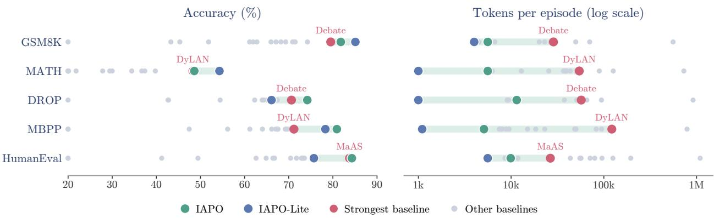
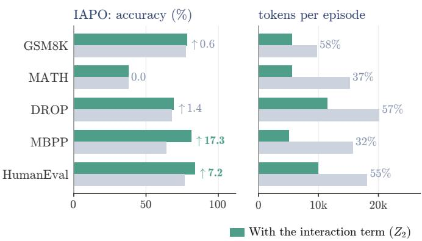
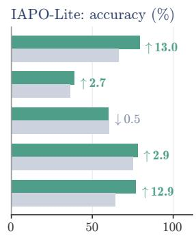
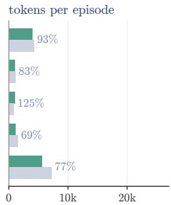
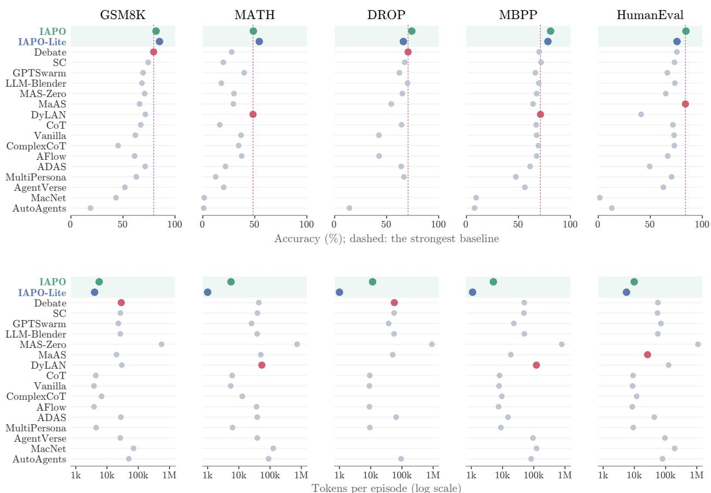
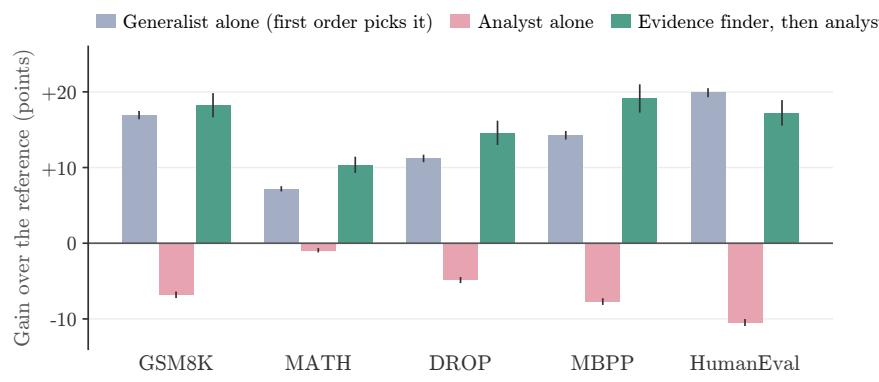
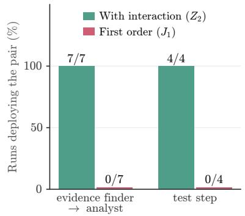

# LEARNING MULTI-AGENT ORCHESTRATION: HIGHER-ORDER INTERACTIONS IN POLICY IMPROVEMENT

Kaixuan Liu   
Department of Computer Science   
Emory University   
Atlanta, GA 30322   
kaixuan.liu@emory.edu

Guojun Xiong<sup>∗</sup>

John Hopcroft Center for Computer Science

Shanghai Jiao Tong University

Shanghai, China

gjxiong@sjtu.edu.cn

November 6, 2026

## Abstract

Learned orchestration has emerged as a promising paradigm for large language model (LLM)-based multi-agent systems, in which a central orchestrator selects agents and controls the information they receive throughout a task. Despite rapid empirical progress, existing methods train the orchestrator by crediting each decision with its own advantage, implicitly assuming that the other decisions in the episode stay fixed. This assumption fails in orchestration, where the contribution of each decision to the final outcome depends on the decisions preceding it, so the gain of a joint update is not the sum of its per-decision effects. To address this challenge, we introduce IAPO, an interaction-aware policy optimization framework that explicitly accounts for interactions among decisions. Specifically, IAPO exactly decomposes the performance difference between two policies into the effects of individual decisions and their interactions, which we prove can account for half of the attainable gain, and then optimizes both from sampled trajectories while certifying that every update is an improvement. On long-input versions of GSM8K, MATH, DROP, MBPP and HumanEval, against fifteen published multi-agent and workflow-search systems on the same 7B executor, IAPO’s deployed plans reach the strongest system’s accuracy with fewer tokens, and removing the interaction term costs 7 to 17 points of accuracy on the two code benchmarks.

Keywords: multi-agent orchestration, policy improvement, interaction effects, certified updates, LLM agents

## 1 Introduction

Large language model (LLM)-based agents have achieved strong results in multi-step reasoning (Yao et al., 2022), code generation (Shinn et al., 2023), and tool use (Schick et al., 2023). Organizing several such agents into a multi-agent system extends these capabilities further, as agents that debate (Du et al., 2023), role-play (Li et al., 2023), or converse (Wu et al., 2023) often outperform each of their members on complex tasks. This benefit, however, depends on how the collaboration is organized: which agent acts next, which artifacts it may read, and when the process terminates (Zhang, 2026). What an agent reads also determines how much it influences the others, and hence what a population of interacting agents comes to believe collectively (Liu et al., 2026a).

Early multi-agent systems specify this organization manually through fixed role assignments and communication pipelines (Hong et al., 2024; Wu et al., 2023), which limits their transfer across tasks and domains. Subsequent work automates parts of the design: GPTSwarm (Zhuge et al., 2024) and G-Designer (Zhang et al., 2024) optimize communication topologies, MasRouter (Yue et al., 2025) learns to route queries among agents, and ADAS (Hu et al., 2025), AFlow (Zhang et al., 2025b), and MaAS (Zhang et al., 2025a) search over entire workflows. Nevertheless, these methods largely fix the organization before execution and cannot adapt it to the intermediate results produced during a task. More recently, orchestration has been cast as a sequential decision problem, in which a central orchestrator observes the evolving state of a task and is trained by reinforcement learning (RL) to decide how to proceed at every step (Dang et al., 2026; Nielsen et al., 2026). The same principle has been extended to training the coordinated agents jointly with the orchestrator (Liu et al., 2026b; Zhao et al., 2026), producing systems that surpass the strongest individual agents at reduced inference cost (Dang et al., 2026; Nielsen et al., 2026).

  
Figure 1: Overview of IAPO. (a) Orchestration decisions depend on one another: a new earlier worker helps only if a later call may read its output, so neither change helps alone. (b) IAPO credits each orchestrator step and every pair of steps in one pass over each training trajectory, and fits one bounded update per step size. (c) With the candidates fixed, IAPO computes two lower bounds on the gain from fresh trajectories, keeps the larger one, and updates the policy only if it is positive.

Although this paradigm has shown clear empirical gains, its training objectives are inherited directly from single-agent policy optimization (Schulman et al., 2017; Shao et al., 2024), which credits each decision with its own advantage while treating all other decisions in the episode as fixed. This approximation is justified by trust-region arguments that bound its error through the per-step policy divergence (Kakade and Langford, 2002; Schulman et al., 2015), and multi-agent extensions control the error in the same per-step manner (Kuba et al., 2021; Zhong et al., 2024). Orchestration violates the premise of these arguments in two ways. First, the decisions within an episode depend on one another, since the effect of each decision on the outcome changes with the decisions made before it. A joint change to several decisions can therefore improve performance even when every single change degrades it, and an objective that adds up per-decision credits cannot detect such joint improvements. Second, an orchestrator makes many decisions in one episode. Even if each decision changes only slightly, the errors add up across decisions, so a per-step trust region no longer keeps the approximation accurate over the length of a whole episode.

To address these challenges, we develop an interaction theory of policy improvement for orchestration and propose IAPO (Interaction-Aware Policy Optimization). We show that the performance difference between two policies is a finite sum of interaction terms among decisions. Each term can be estimated from trajectories without a critic, and the existing objective is the first-order term. This objective has the correct gradient but misses all interactions between organizational decisions, such as which worker to call and which outputs it may read, so any update rule that treats these decisions separately can lose half of the possible gain. We further bound each interaction term by how often the decisions involved are made, which implies that a trust region should limit the policy change weighted by visit counts. Based on this theory, IAPO optimizes the first- and second-order terms in one pass over each trajectory and accepts an update only if a high-confidence lower bound on its gain is positive. We prove that every accepted update improves performance with high probability. On controlled orchestration tasks, IAPO reaches the best possible gain on all three tasks, while the existing objective fails on two, and IAPO never accepts a harmful update. On long-input versions of five benchmarks, against fifteen published multi-agent and workflow-search systems on the same 7B executor, IAPO’s deployed plans reach the strongest system’s accuracy with fewer tokens in every environment and, at that system’s token budget, exceed it significantly on GSM8K, MATH and DROP under at least one cost weight; removing the interaction term costs 7 to 17 points of accuracy on code.

• Exact Interaction Theory: We derive an exact, finite expansion of the performance difference between two orchestration policies, which identifies existing objectives as its single-decision terms and characterizes the omitted interactions through their curvature, visit-count bounds, and sample complexity.

• Practical Algorithm: We propose IAPO, which jointly optimizes the single-decision and pairwise terms in one pass per trajectory and accepts an update only when its gain is certified with high confidence. Its analysis extends to jointly trained agents.

• Theoretical and Empirical Validation: We prove that ignoring interactions can forfeit half of the attainable gain and that IAPO accepts only improving updates with high probability, and we confirm on controlled tasks that IAPO recovers gains missed by existing objectives without accepting harmful updates, and on five LLM orchestration benchmarks that it matches or exceeds the strongest of fifteen baselines at lower cost.

## 2 Problem Formulation

In this section, we formulate multi-agent orchestration as an episodic MDP and define our optimization objective.

## 2.1 Multi-Agent Orchestration

Let Q be a finite set of tasks and Y a finite set of outputs, such as text responses. A task $q \in \mathcal { Q }$ is drawn from a distribution D and solved by the agents $\mathcal { N } = \{ 0 , 1 , . . . , \overset { \bullet } { M } \}$ , where agent 0 is the orchestrator and agents $j \in [ M ]$ are workers, such as LLMs, tools, and verifiers. The orchestrator solves the task through a sequence of worker calls. Let $y _ { 1 } , \dotsc , y _ { k } \in \mathcal { X }$ be the outputs of the first k calls. In the $( k + 1 )$ )-th call, the orchestrator chooses a worker $j \in [ M ]$ and an input set ${ \mathcal { E } } \subseteq \{ y _ { 1 } , \ldots , y _ { k } \}$ of earlier outputs, and worker j reads task q and E and returns a new output $y _ { k + 1 } \in \mathcal { D }$ Each call to worker j costs $c _ { j } \geq 0$ , and at most K calls are allowed. Instead of calling a worker, the orchestrator may stop, and the task and the outputs collected so far are scored by a task reward $R \in [ 0 , \bar { 1 } ]$

## 2.2 Orchestration MDP

We model multi-agent orchestration as an episodic MDP $\mathcal { M } ( S , \mathcal { A } , H , \mathbb { P } , r , d _ { 0 } )$ , where S is the state space, $\mathcal { A }$ is the action space, H is the number of steps in each episode, $\mathbb { P } = \{ \dot { P } _ { t } \} _ { t = 1 } ^ { H }$ with $P _ { t } ( \cdot \mid s , a )$ the distribution of the next state when action a is taken at state s in step $t , r = \{ \bar { r _ { t } } \} _ { t = 1 } ^ { H }$ with $r _ { t } : S \times \mathcal { A }  \mathbb { R }$ the reward function at step t, and $d _ { 0 } = \mathcal { D }$ the initial state distribution.

Episode dynamics. An episode starts from the task, $s _ { 1 } = q \sim \mathcal { D }$ , and each agent $i \in \mathcal N$ selects actions with its own policy $\pi ^ { i }$ . After k calls, the interaction history $h _ { k } = \smash { \bigl ( ( j _ { 1 } , \mathcal { E } _ { 1 } , y _ { 1 } ) , \ldots , ( j _ { k } , \mathcal { E } _ { k } , \bar { y } _ { k } ) \bigr ) }$  records each call as a triple: in the ℓ-th call, worker $j _ { \ell } \in [ M ]$ receives the set $\mathcal E _ { \ell } \subseteq \mathcal { V } _ { \ell - 1 }$ of earlier outputs and returns $y _ { \ell } \in \mathcal { V }$ , where ${ \mathcal { V } } _ { k } = \{ y _ { 1 } , \ldots , y _ { k } \}$ Each call takes two steps.

1. Orchestrator step. At state $s _ { t } = \left( q , h _ { k } \right)$ , the orchestrator acts, $i _ { t } = 0$ . It decides whether to continue, and if so, which worker $j \in [ M ]$ to call and which outputs $\mathcal { E } \subseteq \mathcal { V } _ { k }$ of earlier workers to give it. Formally, it samples $a _ { t } \sim \pi ^ { 0 } ( \cdot \mid s _ { t } )$ from:

$$
{ \mathcal { A } } ( s _ { t } ) = \{ ( j , \mathcal { E } ) : j \in [ M ] , \mathcal { E } \subseteq \mathcal { V } _ { k } \} \cup \{ \mathsf { s t o p } \} .
$$

A call $( j , \mathcal { E } )$ receives reward $r _ { t } = - \lambda c _ { j }$ with cost coefficient $\lambda \geq 0$ and moves the state to $\boldsymbol { s } _ { t + 1 } = ( q , h _ { k } , j , \mathcal { E } )$ and stop receives the task reward $r _ { t } = R ( q , h _ { k } )$ and ends the episode.

2. Worker step. Worker $j$ then receives the call from the orchestrator at state $\boldsymbol { s } _ { t + 1 } = ( q , h _ { k } , j , \mathcal { E } )$ , so $i _ { t + 1 } = j$ . It reads the task q and the outputs in $\mathcal { E }$ and produces a new output. Formally, it samples $a _ { t + 1 } = y \sim \pi ^ { j } ( \cdot \mid q , \mathcal { E } )$ from $\mathcal { V }$ and receives $r _ { t + 1 } = 0$ . The output is added to the history, $h _ { k + 1 } = ( h _ { k } , ( j , \mathcal { E } , y ) )$ , and control returns to the orchestrator at state $s _ { t + 2 } = ( q , h _ { k + 1 } )$

The joint policy is therefore $\pi _ { t } ( a \mid s _ { t } ) = \pi ^ { i _ { t } } ( a \mid s _ { t } )$ , and every trajectory $( s _ { 1 } , a _ { 1 } , \dotsc , s _ { H } , a _ { H } )$ is generated by $\pi .$

Policies and values. A policy $\pi = \{ \pi _ { t } \} _ { t = 1 } ^ { H }$ maps each state s to a distribution $\pi _ { t } ( \cdot \mid s )$ over $\boldsymbol { \mathcal { A } } ( \boldsymbol { s } )$ . The value and action-value functions of π are:

$$
V _ { t } ^ { \pi } ( s ) = \mathbb { E } _ { \pi } \Big [ \sum _ { t ^ { \prime } = t } ^ { H } r _ { t ^ { \prime } } ( s _ { t ^ { \prime } } , a _ { t ^ { \prime } } ) \Big | s _ { t } = s \Big ] ,
$$

$$
Q _ { t } ^ { \pi } ( s , a ) = \mathbb { E } _ { \pi } \Big [ \sum _ { t ^ { \prime } = t } ^ { H } r _ { t ^ { \prime } } ( s _ { t ^ { \prime } } , a _ { t ^ { \prime } } ) \Big | s _ { t } = s , a _ { t } = a \Big ] ,
$$

and the advantage function is $A _ { t } ^ { \pi } = Q _ { t } ^ { \pi } - V _ { t } ^ { \pi }$ . The return-to-go of a trajectory from step t is $\begin{array} { r } { G _ { t } = \sum _ { t ^ { \prime } = t } ^ { H } r _ { t ^ { \prime } } ( s _ { t ^ { \prime } } , a _ { t ^ { \prime } } ) } \end{array}$

## 2.3 Learning Objective

Our goal is to solve each task with high reward at low cost. We keep the worker policies $\pi ^ { 1 } , \dots , \pi ^ { M }$ fixed and optimize the orchestrator policy $\pi ^ { 0 }$ to maximize the expected task reward minus the cost of calls:

$$
\operatorname* { m a x } _ { \pi ^ { 0 } } J ( \pi ) : = \mathbb { E } _ { \pi } { \Big [ } R ( q , h ) - \lambda \sum _ { ( j , \mathcal { E } , y ) \in h } c _ { j } { \Big ] } ,\tag{1}
$$

where h is the interaction history when the episode ends. By the rewards defined in Section 2.2, $J ( \pi ) =$ $\mathbb { E } _ { \pi } [ \sum _ { t = 1 } ^ { H } r _ { t } ( s _ { t } , a _ { t } ) ]$ is the expected return of the MDP, so (1) is a standard RL problem in $\pi ^ { 0 }$ . Our analysis also covers the case where some workers are trained.

## 3 IAPO

To improve the reward–cost objective (1), IAPO constructs policy updates from an exact interaction expansion (Section 3.1), controls their approximation error (Section 3.2), and certifies their performance using independent data (Section 3.3). Figure 1 gives an overview.

## 3.1 An Interaction View of Policy Improvement

An orchestrator decision affects subsequent worker outputs, actions, and call costs. To analyze the resulting interactions, let $\pi$ be the reference policy and $\pi ^ { \prime }$ a candidate that updates only the orchestrator. We impose the following condition to express $J ( \pi ^ { \prime } ) - { J } ( \overline { { { \pi } } } )$ using trajectories from π.

Assumption 3.1 (Overlap). There exists $W \geq 1$ such that $\pi _ { t } ^ { \prime } ( a \mid s ) \leq W \pi _ { t } ( a \mid s )$ for every $t \in [ H ]$ , every state s reachable under π, and every $a \in { \mathcal { A } } ( s )$

For a trajectory sampled from $\pi ,$ define the likelihood ratio $\rho _ { t } = \pi _ { t } ^ { \prime } ( a _ { t } \mid s _ { t } ) / \pi _ { t } ( a _ { t } \mid s _ { t } )$ . Since worker policies and transitions are fixed, their ratios are 1, and the likelihood ratio of a trajectory prefix through t is $\Pi _ { t ^ { \prime } = 1 } ^ { t } \rho _ { t ^ { \prime } }$ . Importance sampling gives the exact improvement in $J \colon$

$$
J ( \pi ^ { \prime } ) - J ( \pi ) = \mathbb { E } _ { \pi } \Big [ \sum _ { t = 1 } ^ { H } \Big ( \prod _ { t ^ { \prime } = 1 } ^ { t } \rho _ { t ^ { \prime } } - 1 \Big ) r _ { t } ( s _ { t } , a _ { t } ) \Big ] .\tag{2}
$$

Expanding the likelihood-ratio product in (2), with all summation indices ranging over [t], gives:

$$
\begin{array}{c} \prod _ { t ^ { \prime } = 1 } ^ { t } \rho _ { t ^ { \prime } } - 1 = \sum _ { t _ { 1 } } ( \rho _ { t _ { 1 } } - 1 ) + \sum _ { t _ { 1 } < t _ { 2 } } ( \rho _ { t _ { 1 } } - 1 ) ( \rho _ { t _ { 2 } } - 1 )  \\ { + \sum _ { \stackrel { t _ { 1 } < t _ { 2 } < t _ { 3 } } { m = 4 } } ( \rho _ { t _ { 1 } } - 1 ) ( \rho _ { t _ { 2 } } - 1 ) ( \rho _ { t _ { 3 } } - 1 ) } \\ { + \sum _ { m = 4 } ^ { t } \sum _ { t _ { 1 } < \cdots < t _ { m } } ( \rho _ { t _ { 1 } } - 1 ) \cdots ( \rho _ { t _ { m } } - 1 ) . } \end{array}
$$

Each factor $\rho _ { t ^ { \prime } } - 1$ represents a decision-level policy change, while products capture interactions across decisions.   
Rearranging (2) by interaction order and replacing returns by advantages yields the exact decomposition below.

Theorem 3.2 (Interaction expansion). Under Assumption $3 . 1 \colon$

$$
J ( \pi ^ { \prime } ) - J ( \pi ) = \sum _ { m = 1 } ^ { H } J ^ { ( m ) } ,\tag{3}
$$

where the order-m interaction is:

$$
J ^ { ( m ) } = \mathbb { E } _ { \boldsymbol \pi } \Big [ \sum _ { 1 \leq t _ { 1 } < \cdots < t _ { m } \leq H } \left( \rho _ { t _ { 1 } } - 1 \right) \cdot \cdot \cdot \left( \rho _ { t _ { m } } - 1 \right)\tag{4}
$$

Moreover, each $J ^ { ( m ) }$ remains unchanged $i f A _ { t _ { m } } ^ { \pi }$ is replaced by $G _ { t _ { m } } - b ( s _ { t _ { m } } )$ for any bounded function b.

The first-order term $J ^ { ( 1 ) }$ recovers the advantage-weighted objective underlying PPO-style optimization (Schulman et al., 2017), and higher orders capture the effects of changing several decisions along the same trajectory.

Frozen workers contribute no likelihood-ratio changes, but repeated orchestrator decisions still interact. Their contribu tion appears in policy curvature.

Corollary 3.3 (Interaction-induced curvature). Let π be a twice continuously differentiable orchestrator policy, with $\pi _ { \theta ^ { 0 } } = \pi$ having full support and all worker policies fixed. Let $J ^ { ( m ) } ( { \dot { \theta } } )$ denote the interaction terms for $\pi ^ { \prime } = \dot { \pi _ { \theta } } . { \cal A } t \theta = \theta ^ { 0 } .$

$$
\begin{array} { r l } & { \nabla _ { \boldsymbol { \theta } } J ( \pi _ { \boldsymbol { \theta } } ) = \nabla _ { \boldsymbol { \theta } } J ^ { ( 1 ) } ( \boldsymbol { \theta } ) , } \\ & { \nabla _ { \boldsymbol { \theta } } ^ { 2 } J ( \pi _ { \boldsymbol { \theta } } ) - \nabla _ { \boldsymbol { \theta } } ^ { 2 } J ^ { ( 1 ) } ( \boldsymbol { \theta } ) = \nabla _ { \boldsymbol { \theta } } ^ { 2 } J ^ { ( 2 ) } ( \boldsymbol { \theta } ) . } \end{array}
$$

Thus, the first-order objective has the correct local gradient but misses interaction-induced curvature that can affect the quality of finite policy updates.

## 3.2 Interaction-Aware Policy Optimization

Second-order truncation. To obtain a tractable update, we retain the first two orders and bound the remainder. With only the orchestrator updated, define:

$$
\beta = 2 ( K + 1 ) \operatorname * { m a x } _ { s } \mathrm { T V } \big ( \pi ^ { \prime 0 } ( \cdot \mid s ) , \pi ^ { 0 } ( \cdot \mid s ) \big ) ,
$$

which upper-bounds the cumulative magnitude of policy changes across repeated orchestrator decisions. Let $\bar { G } =$ $1 + \lambda K \operatorname* { m a x } _ { j } c _ { j }$ bound the total absolute reward of a trajectory.

Theorem 3.4 (Visit-count bound). Under Assumption 3.1, with workers fixed, for every integer $r \geq 1 .$ :

$$
\left| J ( \pi ^ { \prime } ) - J ( \pi ) - \sum _ { m = 1 } ^ { r } J ^ { ( m ) } \right| \leq \bar { G } \sum _ { m > r } \frac { \beta ^ { m } } { m ! } .\tag{5}
$$

Taking $r = 2$ yields:

$$
J ( \pi ^ { \prime } ) - J ( \pi ) \ge J ^ { ( 1 ) } + J ^ { ( 2 ) } - \bar { G } \Big ( e ^ { \beta } - 1 - \beta - \frac { \beta ^ { 2 } } { 2 } \Big ) .\tag{6}
$$

First-order truncation incurs ${ \cal O } ( \bar { G } \beta ^ { 2 } )$ error, and second-order truncation reduces this to ${ \cal O } ( \bar { G } \beta ^ { 3 } )$ . We therefore maximize $J ^ { ( 1 ) } + J ^ { ( 2 ) }$ while controlling β, following trust-region policy improvement (Schulman et al., 2015).

Bounded policy update. Clipping the objective does not bound the policy itself. We instead enforce the visit-count constraint by construction.

For a learned score $f _ { \theta } ( s , a ) \in [ - 1 , 1 ]$ , define its reference-policy-centered form:

$$
u _ { \theta } ( s , a ) = { \frac { 1 } { 2 } } \Bigl ( f _ { \theta } ( s , a ) - \sum _ { a ^ { \prime } } \pi ( a ^ { \prime } \mid s ) f _ { \theta } ( s , a ^ { \prime } ) \Bigr ) .
$$

Algorithm 1 Interaction-Aware Policy Optimization   
Require: Initial policy π, score family $f _ { \theta } ,$ grid Λ, batch sizes $N , n \geq 2 ,$ , confidence level δ   
1: for $\kappa = 1 , 2 , \ldots$ do   
2: Collect $N$ training trajectories $\tau$ under $\pi ,$ and add those of earlier rounds reweighted to π   
3: $b \gets$ mean of $G _ { 1 }$ over the $N$ new trajectories   
4: for each $\eta \in \Lambda$ do   
5: Fit $\theta _ { \eta }$ by approximately maximizing the empirical mean of $Z _ { 2 }$ with baseline b on $\tau$   
6: $\pi _ { \eta } ^ { \prime }  \pi _ { \theta _ { \eta } , \eta } ^ { \prime }$   
7: end for   
8: Collect n fresh validation trajectories V under π   
9: $\delta _ { \kappa } \gets \delta / 2 ^ { \kappa }$   
10: for each $\eta \in \Lambda$ do   
11: Compute $L _ { \eta }$ on $\nu$ using (13), with the fixed $b ,$ at level $\delta _ { \kappa }$   
12: end for   
13: $\eta ^ { \star } \gets$ arg max<sub>η∈Λ</sub> $L _ { \eta }$   
14: if $L _ { \eta ^ { \star } } \leq 0$ then   
15: return π   
16: end if   
17: $\pi  \pi _ { \eta ^ { \star } } ^ { \prime }$   
18: end for

This gives $\textstyle \sum _ { a } \pi ( a \mid s ) u _ { \theta } ( s , a ) = 0$ and $| u _ { \theta } ( s , a ) | \leq 1$ . For $\eta \in [ 0 , 1 ]$ , let:

$$
\pi _ { \theta , \eta } ^ { \prime } ( a \mid s ) = \pi ( a \mid s ) { \bigl ( } 1 + \eta u _ { \theta } ( s , a ) { \bigr ) } .\tag{7}
$$

Only the orchestrator policy is updated, and every worker policy remains fixed.

Proposition 3.5 (Bounded ratios). For any θ and $\underline { { \eta } } \in [ 0 , 1 ]$ , (7) defines a valid action distribution at every orchestrator state s, satisfying $\pi _ { \theta , \eta } ^ { \prime } ( a \mid s ) \stackrel { \cdot } { \geq } \pi ( a \mid s ) ^ { 2 }$ . Moreover, on the support of π, its likelihood ratio satisfies $| \rho _ { t } - 1 | \leq \eta ,$ , and its total variation distance from $\pi ( \cdot \mid s )$ is at most $\eta / 4 .$

Thus, overlap holds with $W = 1 + \eta$ and, with at most $K + 1$ orchestrator decisions, $\beta \leq ( K + 1 ) \eta / 2 .$

Interaction-aware objective. Let $u _ { t } = u _ { \theta } ( s _ { t } , a _ { t } )$ at orchestrator steps and 0 at worker steps. Since $\rho _ { t } - 1 = \eta u _ { t }$ Theorem 3.2 gives:

$$
J ^ { ( 1 ) } + J ^ { ( 2 ) } = \eta \mu _ { 1 } ( \theta ) + \eta ^ { 2 } \mu _ { 2 } ( \theta ) ,\tag{8}
$$

where:

$$
\mu _ { 1 } ( \theta ) = \mathbb { E } _ { \boldsymbol \pi } \Big [ \sum _ { t } u _ { t } G _ { t } \Big ] , \quad \mu _ { 2 } ( \theta ) = \mathbb { E } _ { \boldsymbol \pi } \Big [ \sum _ { t ^ { \prime } < t } u _ { t ^ { \prime } } u _ { t } G _ { t } \Big ] .
$$

Both terms can be estimated from reference-policy trajectories. We subtract a scalar baseline b, estimated from training data and held fixed during validation. By Theorem 3.2, it does not alter the expectation. Grouping pairwise terms by their later decision gives:

$$
Z _ { 2 } = \sum _ { t = 1 } ^ { H } ( \rho _ { t } - 1 ) \Bigl ( 1 + \sum _ { t ^ { \prime } < t } ( \rho _ { t ^ { \prime } } - 1 ) \Bigr ) ( G _ { t } - b ) .\tag{9}
$$

For fixed $b , \mathbb { E } _ { \pi } [ Z _ { 2 } ] = J ^ { ( 1 ) } + J ^ { ( 2 ) }$ . In particular, the return-to-go $G _ { t }$ includes the terminal task reward and all subsequent worker-call costs through the MDP rewards in Section 2.2. Thus, optimizing $Z _ { 2 }$ approximates improvement in the original reward–cost objective (1), not a separate task-accuracy objective. A prefix sum computes $Z _ { 2 }$ and its gradients in $\bar { O } ( H )$ trajectory operations (Algorithm 2 in Appendix E.3).

The bounded update admits the explicit truncation bound:

$$
\epsilon ( \eta ) = \bar { G } \sum _ { m = 3 } ^ { K + 1 } \binom { K + 1 } { m } \Bigl ( \frac { \eta } { 2 } \Bigr ) ^ { m } ,\tag{10}
$$

so that:

$$
J ( \pi _ { \theta , \eta } ^ { \prime } ) - J ( \pi ) \ge J ^ { ( 1 ) } + J ^ { ( 2 ) } - \epsilon ( \eta ) .
$$

For fixed $\eta ,$ maximizing the second-order objective therefore maximizes a valid lower bound on policy improvement.

Theorem 3.6 (Existence of improving steps). Fix θ and write $\mu _ { 1 } = \mu _ { 1 } ( { \boldsymbol { \theta } } )$ and $\mu _ { 2 } = \mu _ { 2 } ( \theta )$

(i) First-order gain. $I f \mu _ { 1 } > 0$ , then any $\eta \in ( 0 , 1 ]$ with $\eta ( | \mu _ { 2 } | + \epsilon ( 1 ) ) \le \mu _ { 1 } / 2$ guarantees:

$$
J ( \pi _ { \theta , \eta } ^ { \prime } ) - J ( \pi ) \geq \eta \mu _ { 1 } / 2 .
$$

(ii) Second-order gain. $H \mu _ { 1 } = 0 < \mu _ { 2 } ,$ , then any $\eta \in ( 0 , 1 ]$ with $\eta \epsilon ( 1 ) \leq \mu _ { 2 } / 2$ guarantees:

$$
J ( \pi _ { \theta , \eta } ^ { \prime } ) - J ( \pi ) \geq \eta ^ { 2 } \mu _ { 2 } / 2 .
$$

Furthermore, if the score class can represent $f _ { \theta } ( s _ { t } , a ) = Q _ { t } ^ { \pi } ( s _ { t } , a ) / \bar { G } ,$ , then:

$$
\mu _ { 1 } = \frac { 1 } { 2 \bar { G } } \mathbb { E } _ { \pi } \Big [ \sum _ { t : i _ { t } = 0 } A _ { t } ^ { \pi } ( s _ { t } , a _ { t } ) ^ { 2 } \Big ] ,
$$

which is positive whenever the advantage is nonzero with positive probability at an orchestrator decision.

Pairwise interactions can yield improvement even when first-order gain vanishes (Appendix E.8). Let $\Lambda \subset ( 0 , 1 ]$ be a finite step-size grid. IAPO optimizes θ separately for each $\eta \in \Lambda$ using empirical $Z _ { 2 } ,$ then independently validates the resulting candidates. The fit may also reuse the trajectories of earlier rounds, reweighted to π by their known likelihood ratios, since the certificate uses only fresh validation trajectories.

## 3.3 Certified Update Selection

Sampling error and higher-order truncation can make an apparently promising update harmful. For each $\eta \in \Lambda$ , let $\boldsymbol { \pi } _ { \eta } ^ { \prime }$ be the trained candidate. After fixing all candidates, we draw n independent validation trajectories under the reference policy π.

Following high-confidence policy improvement (Thomas et al., 2015), we use $Z _ { 2 }$ with truncation error $\epsilon ( \eta )$ and an exact importance-sampling statistic. Using the same fixed baseline b, (2) gives:

$$
Z _ { \mathrm { I S } } = \sum _ { t = 1 } ^ { H } \Big ( \prod _ { t ^ { \prime } \le t } \rho _ { t ^ { \prime } } - 1 \Big ) r _ { t } \big ( s _ { t } , a _ { t } \big ) - b \Big ( \prod _ { t = 1 } ^ { H } \rho _ { t } - 1 \Big ) .\tag{11}
$$

The baseline correction has zero expectation, so $\mathbb { E } _ { \pi } [ Z _ { \mathrm { I S } } ] = J ( \pi _ { \eta } ^ { \prime } ) - J ( \pi )$ , though cumulative importance weights may increase its variance, which the validation sample size must absorb.

Lemma E.3 bounds both statistics:

$$
\begin{array} { l } { { B _ { 2 , \eta } = ( \bar { G } + | b | ) \Bigl ( ( K + 1 ) \eta + \binom { K + 1 } { 2 } \eta ^ { 2 } \Bigr ) , } } \\ { { B _ { \mathrm { I S } , \eta } = ( \bar { G } + | b | ) \bigl ( ( 1 + \eta ) ^ { K + 1 } - 1 \bigr ) . } } \end{array}
$$

Since b is fixed before validation, these bounds apply conditionally on training. For either statistic $Z ,$ let $\bar { Z }$ and $\hat { \sigma } _ { Z }$ be its validation mean and sample standard deviation, and $B _ { Z , \eta }$ its absolute bound. The empirical Bernstein inequality (Maurer and Pontil, 2009) gives the confidence radius:

$$
\xi _ { \eta } ( Z ) = \hat { \sigma } _ { Z } \sqrt { \frac { 2 \log ( 8 | \Lambda | / \delta ) } { n } } + \frac { 1 4 B _ { Z , \eta } \log ( 8 | \Lambda | / \delta ) } { 3 ( n - 1 ) } .\tag{12}
$$

We take the larger of the two valid lower confidence bounds:

$$
\begin{array} { r } { L _ { \eta } = \operatorname* { m a x } \big \{ \bar { Z } _ { 2 } - \xi _ { \eta } ( Z _ { 2 } ) - \epsilon ( \eta ) , ~ \bar { Z } _ { \mathrm { I S } } - \xi _ { \eta } ( Z _ { \mathrm { I S } } ) \big \} . } \end{array}\tag{13}
$$

The first accounts for truncation error, while the second uses unbiased importance sampling. Their maximum remains a lower confidence bound on true policy improvement.

IAPO selects the largest positive certificate, retaining π if all certificates are nonpositive. Let πˆ be the selected policy and define:

$$
c _ { \eta } = \operatorname* { m i n } \left\{ \xi _ { \eta } ( Z _ { 2 } ) + \epsilon ( \eta ) , \xi _ { \eta } ( Z _ { \mathrm { I S } } ) \right\} .
$$

Theorem 3.7 (Certified selection). With probability at least $1 - \delta ,$ the following statements hold simultaneously. (i) Safe selection. For every $\eta \in \Lambda ;$

$$
\begin{array} { r } { L _ { \eta } \leq J ( \pi _ { \eta } ^ { \prime } ) - J ( \pi ) . } \end{array}
$$

Consequently:

$$
J ( { \hat { \pi } } ) \geq J ( \pi ) .
$$

(ii) Oracle inequality. The selected policy satisfies:

$$
J ( \hat { \pi } ) - J ( \pi ) \ge \operatorname* { m a x } \Big \{ 0 , \operatorname* { m a x } _ { \eta \in \Lambda } \big [ J ( \pi _ { \eta } ^ { \prime } ) - J ( \pi ) - 2 c _ { \eta } \big ] \Big \} .
$$

(iii) Detection of improvement. If some $\eta \in \Lambda$ satisfies $J ( \pi _ { \eta } ^ { \prime } ) > J ( \pi )$ and

$$
n - 1 > \frac { 2 5 6 B _ { \mathrm { I S } , \eta } ^ { 2 } \log ( 8 | \Lambda | / \delta ) } { [ J ( \pi _ { \eta } ^ { \prime } ) - J ( \pi ) ] ^ { 2 } } ,
$$

then πˆ $\neq \pi .$

Across successive rounds $\kappa ,$ assigning level $\delta / 2 ^ { \kappa }$ ensures joint coverage by a union bound. Algorithm 1 summarizes the full update procedure, and the trajectory-level computation is given in Appendix E.3. The betting confidence bound of Waudby-Smith and Ramdas (2024) can replace (12) (Appendix E.7), and it admits a per-problem baseline (Appendix I.1). Appendix F extends IAPO to policies far from $\pi ,$ which gain only through coordinated changes.

## 4 Experiments

We evaluate IAPO in two settings. Controlled tasks, whose trajectories can be enumerated exactly, check the theory (Section 4.5). Orchestration over LLM workers on five long-input benchmarks compares accuracy and cost with published systems and ablates the interaction term (Sections 4.1 to 4.4).

## 4.1 Setup

Environments. We build long-input versions of GSM8K (Cobbe et al., 2021), MATH (Hendrycks et al., 2021), DROP (Dua et al., 2019), MBPP (Austin et al., 2021) and HumanEval (Chen et al., 2021). A problem’s own unit (its statements, passage or function specification) is placed among 30 to 90 units of other problems, so one worker reading everything is not already as good as any team. A document holds 81, 91, 31, 61 and 61 units, and the test splits have 790, 220, 800, 333 and 131 problems (Appendix H). These are our own constructions, not the standard benchmarks, so absolute accuracies are not comparable with published numbers on the originals; every system is evaluated on the same constructed inputs. Every system receives the same question text, which includes the opening words of the target unit. The baselines also read the whole document; the orchestrated team reaches it only through an evidence finder, whose BM25 retriever the baselines lack, or a generalist that reads all of it. All workers are Qwen2.5-7B-Instruct (Yang et al., 2024) served by vLLM (Kwon et al., 2023) at temperature 1, following the protocol of MaAS (Zhang et al., 2025a).

Orchestration task. At each of at most five decisions (four on code) the orchestrator calls one of eight roles (planner, evidence finder, analyst, second answerer, calculator, checker, selector) or stops; code adds ${ \bf M a A S } ^ { \prime } \mathrm { s }$ test-and-repair operator. It observes an embedding of the task and a few state flags, never a score. The reward is accuracy minus λ times tokens per 32,768. We train with $\lambda { = } 0 . 0 7 6$ , the protocol’s value (IAPO), and with $\lambda { = } 1$ , which trades accuracy for tokens (IAPO-Lite). Our trajectories are capped at 32,768 tokens; the baselines, which read the whole document, run with 131,072 or 393,216 tokens.

Training and certification. IAPO runs one round from the uniform policy. It fits one bounded update for each step in $\Lambda { = } \{ 0 . 2 5 , 0 . 5 , 1 \}$ on 6,400 proposal episodes (200 training problems, 32 repeats each), adds three certified leaps (Appendix F.1), and certifies every candidate with betting bounds at total level δ=0.05 on 8,000 validation episodes drawn from the remaining training problems. Test problems are never used for fitting or selection. The certificate covers net return on the validation distribution, so test accuracy is an empirical question. Search and training tokens are excluded from the per-problem costs; one MBPP run uses about $1 . 7 \times \mathrm { i 0 } ^ { 8 }$ in total (Appendix I). Each configuration is trained twice (three times for MATH, IAPO), results are averaged over runs, and all rules were fixed before the runs.

Evaluation. Each test problem is run four times, and we report accuracy and tokens per problem for one episode. Since the baselines spend more tokens, we also evaluate at matched budget: a majority vote (on code, MaAS’s selector over programs, with its tokens counted) over the most episodes whose tokens fit the strongest baseline’s. The number of episodes never depends on accuracy. Differences are paired by problem and called significant when z > 2 (Appendix I).

Table 1: Accuracy (%) with its change from Vanilla, and cost (grey, thousand tokens per problem; one episode for baselines, all voted episodes for IAPO) with Qwen2.5-7B-Instruct on long-input versions of five benchmarks. Bold: best; underline: runner-up. IAPO and IAPO-Lite (trained with λ=1) vote (on code, select programs) within the best baseline’s tokens per column. Avg. covers GSM8K, MATH, MBPP and HumanEval. Two-seed baselines are averaged; “–”: not run; <sup>†</sup>better accuracy of the upstream and diagnostic arms.
<table><tr><td rowspan=1 colspan=17>Method                          GSM8K          MATH          DROP          MBPP         HumanEval       Avg.Acc.    Tok.   Acc.    Tok.   Acc.    Tok.   Acc.    Tok.   Acc.    Tok.  Acc.Tok.</td></tr><tr><td rowspan=1 colspan=1>SINGLE-AGENT</td><td rowspan=1 colspan=3></td><td rowspan=1 colspan=1></td><td rowspan=1 colspan=2></td><td rowspan=1 colspan=2></td><td rowspan=1 colspan=3></td><td rowspan=1 colspan=3></td><td rowspan=1 colspan=2></td></tr><tr><td rowspan=1 colspan=1>Vanilla</td><td rowspan=1 colspan=3>61.9       3.8</td><td rowspan=1 colspan=1>36.7</td><td rowspan=1 colspan=2>5.5</td><td rowspan=1 colspan=2>42.6       9.1</td><td rowspan=1 colspan=3>67.5       7.7</td><td rowspan=1 colspan=3>72.9       8.8</td><td rowspan=1 colspan=2>59.8 6.5</td></tr><tr><td rowspan=1 colspan=1>CoT (Wei et al., 2022)</td><td rowspan=1 colspan=3>67.1 ↑5.2  4.4</td><td rowspan=1 colspan=1>16.4↓</td><td rowspan=1 colspan=2>20.3 6.1</td><td rowspan=1 colspan=2>64.3 ↑21.7 9.3</td><td rowspan=1 colspan=3>67.0↓0.5  8.1</td><td rowspan=1 colspan=3>71.8↓1.1   9.1</td><td rowspan=1 colspan=2>55.6 6.9</td></tr><tr><td rowspan=1 colspan=1>ComplexCoT (Fu et al., 2023)</td><td rowspan=1 colspan=2>45.3↓16.6</td><td rowspan=1 colspan=1>6.7</td><td rowspan=1 colspan=1>34.4↓</td><td rowspan=1 colspan=1>2.3</td><td rowspan=1 colspan=1>12.9</td><td rowspan=1 colspan=2></td><td rowspan=1 colspan=3>69.2 ↑1.7  9.5</td><td rowspan=1 colspan=3>73.1 ↑0.2  11.9</td><td rowspan=1 colspan=2>55.5 10.2</td></tr><tr><td rowspan=1 colspan=1>SC (CoT ×5) (Wang et al., 2023)</td><td rowspan=1 colspan=2>74.2 ↑12.3</td><td rowspan=1 colspan=1>26.9</td><td rowspan=1 colspan=1>19.8↓</td><td rowspan=1 colspan=1>16.9</td><td rowspan=1 colspan=1>39.3</td><td rowspan=1 colspan=2>67.4 ↑24.856.5</td><td rowspan=1 colspan=3>71.8 ↑4.3  48.5</td><td rowspan=1 colspan=3>73.3 ↑0.4  55.2</td><td rowspan=1 colspan=2>59.842.5</td></tr><tr><td rowspan=1 colspan=1>HAND-CRAFTED MULTI-AGENT</td><td rowspan=1 colspan=2></td><td rowspan=1 colspan=1></td><td rowspan=1 colspan=1></td><td rowspan=1 colspan=1></td><td rowspan=1 colspan=1></td><td rowspan=1 colspan=2></td><td rowspan=1 colspan=2></td><td rowspan=1 colspan=1></td><td rowspan=1 colspan=3></td><td rowspan=1 colspan=2></td></tr><tr><td rowspan=1 colspan=1>MultiPersona (Wang et al., 2024)</td><td rowspan=1 colspan=1>62.8 ↑</td><td rowspan=1 colspan=1>0.9</td><td rowspan=1 colspan=1>4.5</td><td rowspan=1 colspan=1>12.4↓</td><td rowspan=1 colspan=1>24.3</td><td rowspan=1 colspan=1>6.3</td><td rowspan=1 colspan=2>66.7 ↑24.1 9.4</td><td rowspan=1 colspan=2>47.4↓20.1</td><td rowspan=1 colspan=1>8.8</td><td rowspan=1 colspan=1>70.4↓</td><td rowspan=1 colspan=1>2.5</td><td rowspan=1 colspan=1>9.2</td><td rowspan=1 colspan=2>48.3 7.2</td></tr><tr><td rowspan=1 colspan=1>LLM-Debate (Du et al., 2023)</td><td rowspan=1 colspan=1>79.5 ↑</td><td rowspan=1 colspan=1>17.6</td><td rowspan=1 colspan=1>28.6</td><td rowspan=1 colspan=1>27.8↓</td><td rowspan=1 colspan=1>8.9</td><td rowspan=1 colspan=1>43.5</td><td rowspan=1 colspan=2>70.6 ↑28.057.1</td><td rowspan=1 colspan=2>69.9 ↑2.4</td><td rowspan=1 colspan=1>49.8</td><td rowspan=1 colspan=1>75.6 ↑</td><td rowspan=1 colspan=1>2.7</td><td rowspan=1 colspan=1>56.7</td><td rowspan=1 colspan=1>63.2</td><td rowspan=1 colspan=1>44.6</td></tr><tr><td rowspan=1 colspan=1>LLM-Blender (Jiang et al., 2023)</td><td rowspan=1 colspan=1>68.2 ↑</td><td rowspan=1 colspan=1>6.3</td><td rowspan=1 colspan=1>26.6</td><td rowspan=1 colspan=1>17.8↓</td><td rowspan=1 colspan=1>18.9</td><td rowspan=1 colspan=1>38.6</td><td rowspan=1 colspan=2>70.1 ↑27.556.2</td><td rowspan=1 colspan=3>69.5 ↑2.0 50.1</td><td rowspan=1 colspan=3>73.6 ↑0.7  56.3</td><td rowspan=1 colspan=1>57.3</td><td rowspan=1 colspan=1>42.9</td></tr><tr><td rowspan=1 colspan=1>DyLAN (Liu et al., 2023)</td><td rowspan=1 colspan=1>71.5 ↑</td><td rowspan=1 colspan=1>9.6</td><td rowspan=1 colspan=1>29.8</td><td rowspan=1 colspan=1>48.3 ↑</td><td rowspan=1 colspan=1>11.6</td><td rowspan=1 colspan=1>54.3</td><td rowspan=1 colspan=2></td><td rowspan=1 colspan=3>71.2 ↑3.7  122</td><td rowspan=1 colspan=1>41.2↓</td><td rowspan=1 colspan=2>31.7 125</td><td rowspan=1 colspan=1>58.1</td><td rowspan=1 colspan=1>82.8</td></tr><tr><td rowspan=1 colspan=1>AgentVerse (Chen et al., 2023)</td><td rowspan=1 colspan=1>51.8↓</td><td rowspan=1 colspan=1>10.1</td><td rowspan=1 colspan=1>26.6</td><td rowspan=1 colspan=1>20.1↓</td><td rowspan=1 colspan=1>16.6</td><td rowspan=1 colspan=1>38.9</td><td rowspan=1 colspan=2></td><td rowspan=1 colspan=1>56.2↓</td><td rowspan=1 colspan=1>11.3</td><td rowspan=1 colspan=1>94.5</td><td rowspan=1 colspan=1>62.6↓</td><td rowspan=1 colspan=1>10.3</td><td rowspan=1 colspan=1>95.5</td><td rowspan=1 colspan=1>47.7</td><td rowspan=1 colspan=1>63.9</td></tr><tr><td rowspan=1 colspan=1>MacNet† (Qian et al., 2025)</td><td rowspan=1 colspan=1>43.3↓</td><td rowspan=1 colspan=1>18.6</td><td rowspan=1 colspan=1>70.3</td><td rowspan=1 colspan=1>1.4↓3</td><td rowspan=1 colspan=1>5.3</td><td rowspan=1 colspan=1>126</td><td rowspan=1 colspan=2></td><td rowspan=1 colspan=1>15.9↓</td><td rowspan=1 colspan=1>51.6</td><td rowspan=1 colspan=1>118</td><td rowspan=1 colspan=1>12.2↓</td><td rowspan=1 colspan=1>60.7</td><td rowspan=1 colspan=1>141</td><td rowspan=1 colspan=2>18.2114</td></tr><tr><td rowspan=1 colspan=1>AUTOMATED AGENTIC SYSTEMS</td><td rowspan=1 colspan=1></td><td rowspan=1 colspan=1></td><td rowspan=1 colspan=1></td><td rowspan=1 colspan=1></td><td rowspan=1 colspan=1></td><td rowspan=1 colspan=1></td><td rowspan=1 colspan=2></td><td rowspan=1 colspan=1></td><td rowspan=1 colspan=1></td><td rowspan=1 colspan=1></td><td rowspan=1 colspan=1></td><td rowspan=1 colspan=1></td><td rowspan=1 colspan=1></td><td rowspan=1 colspan=2></td></tr><tr><td rowspan=1 colspan=1>AutoAgents (Chen et al., 2024)</td><td rowspan=1 colspan=1>18.7↓</td><td rowspan=1 colspan=1>43.2</td><td rowspan=1 colspan=1>49.7</td><td rowspan=1 colspan=1>0.9↓3</td><td rowspan=1 colspan=1>5.8</td><td rowspan=1 colspan=1>89.3</td><td rowspan=1 colspan=1>14.2↓</td><td rowspan=1 colspan=1>28.494.2</td><td rowspan=1 colspan=1>7.8↓</td><td rowspan=1 colspan=1>59.7</td><td rowspan=1 colspan=1>82.8</td><td rowspan=1 colspan=1>13.0↓</td><td rowspan=1 colspan=2>59.9 79.7</td><td rowspan=1 colspan=2>10.175.4</td></tr><tr><td rowspan=1 colspan=1>GPTSwarm (Zhuge et al., 2024)</td><td rowspan=1 colspan=1>69.3 ↑</td><td rowspan=1 colspan=1>7.4</td><td rowspan=1 colspan=1>23.0</td><td rowspan=1 colspan=1>39.8 ↑</td><td rowspan=1 colspan=1>3.1</td><td rowspan=1 colspan=1>25.5</td><td rowspan=1 colspan=1>62.3 ↑</td><td rowspan=1 colspan=1>19.737.6</td><td rowspan=1 colspan=1>66.1↓</td><td rowspan=1 colspan=1>1.4</td><td rowspan=1 colspan=1>23.1</td><td rowspan=1 colspan=1>66.4↓</td><td rowspan=1 colspan=2>6.5  71.1</td><td rowspan=1 colspan=2>60.435.7</td></tr><tr><td rowspan=1 colspan=1>ADAS (Hu et al., 2025)</td><td rowspan=1 colspan=1>71.3 ↑</td><td rowspan=1 colspan=1>9.4</td><td rowspan=1 colspan=1>27.8</td><td rowspan=1 colspan=1>21.8↓</td><td rowspan=1 colspan=2>14.938.8</td><td rowspan=1 colspan=1>64.0 ↑</td><td rowspan=1 colspan=1>21.465.5</td><td rowspan=1 colspan=1>61.2↓</td><td rowspan=1 colspan=2>6.3 15.0</td><td rowspan=1 colspan=1>49.4↓</td><td rowspan=1 colspan=2>23.5 43.5</td><td rowspan=1 colspan=2>50.931.3</td></tr><tr><td rowspan=1 colspan=1>AFlow (Zhang et al., 2025b)</td><td rowspan=1 colspan=1>61.1↓</td><td rowspan=1 colspan=1>0.8</td><td rowspan=1 colspan=1>3.8</td><td rowspan=1 colspan=1>37.4 ↑</td><td rowspan=1 colspan=2>0.7 36.7</td><td rowspan=1 colspan=1>42.8 ↑</td><td rowspan=1 colspan=1>0.2  9.1</td><td rowspan=1 colspan=1>67.4↓</td><td rowspan=1 colspan=2>0.1  7.5</td><td rowspan=1 colspan=1>66.8↓</td><td rowspan=1 colspan=2>6.1   8.6</td><td rowspan=1 colspan=2>58.214.2</td></tr><tr><td rowspan=1 colspan=1>MAS-Zero (Ke et al., 2025)</td><td rowspan=1 colspan=1>70.9 ↑</td><td rowspan=1 colspan=1>9.0</td><td rowspan=1 colspan=1>558</td><td rowspan=1 colspan=1>30.0↓</td><td rowspan=1 colspan=2>6.7  729</td><td rowspan=1 colspan=1>65.1 ↑</td><td rowspan=1 colspan=1>22.5 916</td><td rowspan=1 colspan=1>67.6 ↑</td><td rowspan=1 colspan=2>0.1  789</td><td rowspan=1 colspan=1>64.9↓</td><td rowspan=1 colspan=2>8.0 1092</td><td rowspan=1 colspan=2>58.4 792</td></tr><tr><td rowspan=1 colspan=2>MaAS (Zhang et al., 2025a)      66.0 ↑</td><td rowspan=1 colspan=2>4.1 20.1</td><td rowspan=1 colspan=1>29.4</td><td rowspan=1 colspan=2>50.3</td><td rowspan=1 colspan=2>54.5 ↑11.950.9</td><td rowspan=1 colspan=1>64.0</td><td rowspan=1 colspan=2>18.4</td><td rowspan=1 colspan=1>83.8 ↑</td><td rowspan=1 colspan=4>10.926.5  60.828.8</td></tr><tr><td rowspan=1 colspan=2>IAPO                         81.8 ↑</td><td rowspan=1 colspan=3>19.925.1 48.6 ↑</td><td rowspan=1 colspan=2>11.950.8</td><td rowspan=1 colspan=2>74.2 ↑31.646.0</td><td rowspan=1 colspan=3>80.9 ↑13.433.1</td><td rowspan=1 colspan=5>84.3 ↑11.4 20.4  73.932.4</td></tr><tr><td rowspan=1 colspan=2>IAPO-Lite                     85.1 ↑</td><td rowspan=1 colspan=3>23.225.8 54.3 ↑</td><td rowspan=1 colspan=2>17.651.1</td><td rowspan=1 colspan=2>66.1 ↑23.551.7</td><td rowspan=1 colspan=3>78.3 ↑10.829.0</td><td rowspan=1 colspan=5>75.7 ↑2.8  21.6  73.431.9</td></tr></table>

Baselines. We run fifteen published systems on the same executor and splits, each as released, so none has a retriever. The single-agent group is CoT (Wei et al., 2022), ComplexCoT (Fu et al., 2023) and self-consistency (Wang et al., 2023). The hand-crafted multi-agent group is MultiPersona (Wang et al., 2024), LLM-Debate (Du et al., 2023), LLM-Blender (Jiang et al., 2023), DyLAN (Liu et al., 2023), AgentVerse (Chen et al., 2023) and MacNet (Qian et al., 2025). The automated group is AutoAgents (Chen et al., 2024), GPTSwarm (Zhuge et al., 2024), ADAS (Hu et al., 2025), AFlow (Zhang et al., 2025b), MAS-Zero (Ke et al., 2025) and MaAS (Zhang et al., 2025a). Not every system runs on every benchmark, and Appendix H lists the setup of each.

## 4.2 Accuracy and Cost

Accuracy at matched compute. At the strongest baseline’s budget (Table 1), IAPO leads by 2.3 points on GSM8K, 3.6 on DROP and 9.7 on MBPP (z=6.3, against DyLAN), and is level with the strongest baseline on MATH (+0.3) and HumanEval (+0.5). The GSM8K and DROP differences are significant (Appendix J). IAPO-Lite, trained with the higher token price, goes further on GSM8K (+5.6), MATH (+6.0, z=2.6) and MBPP (+7.2, z=4.6), and gives up accuracy on DROP (−4.5) and HumanEval (−8.1) in exchange for fewer tokens.

Cost. One deployed IAPO episode costs 5.1k to 11.5k tokens, against 26.5k to 121.9k for the strongest baselines, that is 2.7 to 24 times fewer (Figure 2); IAPO-Lite costs 1.0k to 5.6k. On code a single episode already matches or beats the strongest baseline: 81.1% on MBPP at 5.1k tokens against DyLAN’s 71.2% at 121.9k, and 83.7% on HumanEval at 9.9k against MaAS’s 83.8% at 26.5k. The matched-budget plans spend 20.4k to 50.8k tokens per problem, each within the strongest baseline’s budget.

## 4.3 Ablation on the Interaction Term

The first-order variant removes J<sup>(2)</sup> from fitting and plan ranking; validation, certification, retriever and roles are the same, so its gap to IAPO comes from the interaction term alone. For IAPO, the interaction term raises accuracy by 17.3 points on MBPP and 7.2 on HumanEval (both z>2), by 1.4 on DROP and 0.6 on GSM8K, and leaves MATH

  
Figure 2: Accuracy (left) and tokens per episode (right, log scale) of IAPO, IAPO-Lite, the strongest baseline of each benchmark and the other baselines. Accuracy is that of the voted plan within the strongest baseline’s budget; tokens are those of a single episode.



  
First order only (J<sub>1</sub>)

  
Figure 3: With the interaction term $\left( Z _ { 2 } \right)$ and with first order only $( J _ { 1 } )$ , for IAPO (left) and IAPO-Lite (right): accuracy with its gain in points (bold: z>2), and tokens per episode with IAPO’s tokens as a share of the first-order variant’s.

unchanged, while IAPO uses 32% to 58% of the first-order variant’s tokens on every benchmark (Figure 3). For IAPO-Lite it raises accuracy by 13.0 points on GSM8K, 12.9 on HumanEval, 2.9 on MBPP and 2.7 on MATH (all z>2) and lowers it by 0.5 on DROP, where its tokens rise to 125%. The paired differences and z-values are in Appendix J.

## 4.4 What the Policies Deploy

The deployed plans show where the interaction term pays (Appendix J). Test-and-repair helps only after a program exists, a pair of decisions. IAPO deploys it in all four code runs; the first-order variant never proposes it, fills the slots with a second programmer, and loses 17 points on MBPP and 7 on HumanEval at 3.1 and 1.8 times the tokens. On question answering and mathematics, all seven IAPO runs follow the evidence finder with the analyst, usually with a checker and the second answerer after it, while the first-order variant never calls the analyst and reads the whole document with the second answerer instead. The analyst alone loses points on every benchmark, so a first-order score never selects it, yet following the evidence finder with the analyst gains (Appendix J).

## 4.5 Controlled Tasks

One probability q is shared by N decisions with frozen binary workers, and all $2 ^ { N }$ trajectories are enumerated (Appendix G). Complementarity is the trap of Proposition E.7, Redundancy has substitutes, and Evidence threshold has N=6.

The first-order score is zero for every step on Complementarity (oracle gain 0.148) and overshoots on Redundancy (0.006 against 0.010), while the second-order score picks the oracle step on both. On Evidence threshold the truncation bound exceeds the second-order gain, so $Z _ { 2 }$ alone deploys a gain of 0.087, and adding $Z _ { \mathrm { { I S } } }$ restores 0.356. Across 6,000 validation runs, no candidate with negative gain was accepted.

## References

Jacob Austin, Augustus Odena, Maxwell Nye, Maarten Bosma, Henryk Michalewski, David Dohan, Ellen Jiang, Carrie Cai, Michael Terry, Quoc Le, and Charles Sutton. Program synthesis with large language models. arXiv preprint arXiv:2108.07732, 2021.

Federico Cassano, John Gouwar, Daniel Nguyen, Sydney Nguyen, Luna Phipps-Costin, Donald Pinckney, Ming-Ho Yee, Yangtian Zi, Carolyn Jane Anderson, Molly Q. Feldman, Arjun Guha, Michael Greenberg, and Abhinav Jangda. MultiPL-E: A scalable and polyglot approach to benchmarking neural code generation. IEEE Transactions on Software Engineering, 49(7), 2023.

Guangyao Chen, Siwei Dong, Yu Shu, Ge Zhang, Jaward Sesay, Börje F. Karlsson, Jie Fu, and Yemin Shi. AutoAgents: A framework for automatic agent generation. In Proceedings of the Thirty-Third International Joint Conference on Artificial Intelligence, 2024.

Mark Chen, Jerry Tworek, Heewoo Jun, Qiming Yuan, et al. Evaluating large language models trained on code. arXiv preprint arXiv:2107.03374, 2021.

Weize Chen, Yusheng Su, Jingwei Zuo, Cheng Yang, Chenfei Yuan, Chi-Min Chan, Yujia Qin, Yaxi Lu, Ruobing Xie, et al. AgentVerse: Facilitating multi-agent collaboration and exploring emergent behaviors in agents. arXiv preprint arXiv:2308.10848, 2023.

Karl Cobbe, Vineet Kosaraju, Mohammad Bavarian, Mark Chen, Heewoo Jun, Lukasz Kaiser, Matthias Plappert, Jerry Tworek, Jacob Hilton, Reiichiro Nakano, et al. Training verifiers to solve math word problems. arXiv preprint arXiv:2110.14168, 2021.

Yufan Dang, Chen Qian, Xueheng Luo, Jingru Fan, Zihao Xie, Ruijie Shi, Weize Chen, Cheng Yang, Xiaoyin Che, Ye Tian, et al. Multi-agent collaboration via evolving orchestration. Advances in neural information processing systems, 38:165025–165059, 2026.

Yilun Du, Shuang Li, Antonio Torralba, Joshua B Tenenbaum, and Igor Mordatch. Improving factuality and reasoning in language models through multiagent debate. arXiv preprint arXiv:2305.14325, 2023.

Dheeru Dua, Yizhong Wang, Pradeep Dasigi, Gabriel Stanovsky, Sameer Singh, and Matt Gardner. DROP: A reading comprehension benchmark requiring discrete reasoning over paragraphs. In Proceedings ofNAACL-HLT, 2019.

Yao Fu, Hao Peng, Ashish Sabharwal, Peter Clark, and Tushar Khot. Complexity-based prompting for multi-step reasoning. In International Conference on Learning Representations, 2023.

Dan Hendrycks, Collin Burns, Saurav Kadavath, Akul Arora, Steven Basart, Eric Tang, Dawn Song, and Jacob Steinhardt. Measuring mathematical problem solving with the MATH dataset. In Advances in Neural Information Processing Systems, Datasets and Benchmarks Track, 2021.

Sirui Hong, Mingchen Zhuge, Jonathan Chen, Xiawu Zheng, Yuheng Cheng, Jinlin Wang, Ceyao Zhang, Steven Yau, Zijuan Lin, Liyang Zhou, et al. Metagpt: Meta programming for a multi-agent collaborative framework. In International Conference on Learning Representations, volume 2024, pages 23247–23275, 2024.

Shengran Hu, Cong Lu, and Jeff Clune. Automated design of agentic systems. In International Conference on Learning Representations, volume 2025, pages 21344–21377, 2025.

Dongfu Jiang, Xiang Ren, and Bill Yuchen Lin. LLM-Blender: Ensembling large language models with pairwise ranking and generative fusion. In Proceedings of the 61st Annual Meeting of the Association for Computational Linguistics, 2023.

Sham Kakade and John Langford. Approximately optimal approximate reinforcement learning. In Proceedings of the nineteenth international conference on machine learning, pages 267–274, 2002.

Zohar Karnin, Tomer Koren, and Oren Somekh. Almost optimal exploration in multi-armed bandits. In International Conference on Machine Learning, pages 1238–1246. PMLR, 2013.

Zixuan Ke, Austin Xu, Yifei Ming, Xuan-Phi Nguyen, Caiming Xiong, and Shafiq Joty. MAS-Zero: Designing multi-agent systems with zero supervision, 2025. Preprint.

Jakub Grudzien Kuba, Ruiqing Chen, Muning Wen, Ying Wen, Fanglei Sun, Jun Wang, and Yaodong Yang. Trust region policy optimisation in multi-agent reinforcement learning. arXiv preprint arXiv:2109.11251, 2021.

Woosuk Kwon, Zhuohan Li, Siyuan Zhuang, Ying Sheng, Lianmin Zheng, Cody Hao Yu, Joseph Gonzalez, Hao Zhang, and Ion Stoica. Efficient memory management for large language model serving with PagedAttention. In Proceedings ofthe 29th Symposium on Operating Systems Principles, 2023.

Guohao Li, Hasan Hammoud, Hani Itani, Dmitrii Khizbullin, and Bernard Ghanem. Camel: Communicative agents for" mind" exploration of large language model society. Advances in neural information processing systems, 36: 51991–52008, 2023.

Kaixuan Liu, Guojun Xiong, Weinan Zhang, and Shengpu Tang. Social networks of LLM agents. arXiv preprint arXiv:2607.03695, 2026a.

Shuo Liu, Zeyu Liang, Xueguang Lyu, and Christopher Amato. Llm collaboration with multi-agent reinforcement learning. In Proceedings of the AAAI Conference on Artificial Intelligence, volume 40, pages 32150–32158, 2026b.

Zijun Liu, Yanzhe Zhang, Peng Li, Yang Liu, and Diyi Yang. Dynamic LLM-agent network: An LLM-agent collaboration framework with agent team optimization, 2023. Preprint.

Andreas Maurer and Massimiliano Pontil. Empirical bernstein bounds and sample variance penalization. arXiv preprint arXiv:0907.3740, 2009.

Stefan Nielsen, Edoardo Cetin, Peter Schwendeman, Qi Sun, Jinglue Xu, and Yujin Tang. Learning to orchestrate agents in natural language with the conductor. In International Conference on Learning Representations, volume 2026, pages 135686–135724, 2026.

Chen Qian, Zihao Xie, YiFei Wang, Wei Liu, Kunlun Zhu, Hanchen Xia, Yufan Dang, Zhuoyun Du, Weize Chen, Cheng Yang, Zhiyuan Liu, and Maosong Sun. Scaling large language model-based multi-agent collaboration. In International Conference on Learning Representations, 2025.

Stephen Robertson and Hugo Zaragoza. The probabilistic relevance framework: BM25 and beyond. Foundations and Trends in Information Retrieval, 3(4), 2009.

Timo Schick, Jane Dwivedi-Yu, Roberto Dessì, Roberta Raileanu, Maria Lomeli, Eric Hambro, Luke Zettlemoyer, Nicola Cancedda, and Thomas Scialom. Toolformer: Language models can teach themselves to use tools. Advances in neural information processing systems, 36:68539–68551, 2023.

John Schulman, Sergey Levine, Pieter Abbeel, Michael Jordan, and Philipp Moritz. Trust region policy optimization. In International conference on machine learning, pages 1889–1897. Pmlr, 2015.

John Schulman, Filip Wolski, Prafulla Dhariwal, Alec Radford, and Oleg Klimov. Proximal policy optimization algorithms. arXiv preprint arXiv:1707.06347, 2017.

Zhihong Shao, Peiyi Wang, Qihao Zhu, Runxin Xu, Junxiao Song, Xiao Bi, Haowei Zhang, Mingchuan Zhang, YK Li, Yang Wu, et al. Deepseekmath: Pushing the limits of mathematical reasoning in open language models. arXiv preprint arXiv:2402.03300, 2024.

Freda Shi, Xinyun Chen, Kanishka Misra, Nathan Scales, David Dohan, Ed H. Chi, Nathanael Schärli, and Denny Zhou. Large language models can be easily distracted by irrelevant context. In Proceedings ofthe 40th International Conference on Machine Learning, 2023.

Noah Shinn, Federico Cassano, Ashwin Gopinath, Karthik Narasimhan, and Shunyu Yao. Reflexion: Language agents with verbal reinforcement learning. Advances in neural information processing systems, 36:8634–8652, 2023.

Yunhao Tang, Michal Valko, and Rémi Munos. Taylor expansion policy optimization. In International Conference on Machine Learning, pages 9397–9406. PMLR, 2020.

Philip Thomas, Georgios Theocharous, and Mohammad Ghavamzadeh. High confidence policy improvement. In International Conference on Machine Learning, pages 2380–2388. PMLR, 2015.

Alexandre B Tsybakov and Vladimir Zaiats. Introduction to nonparametric estimation, volume 11. Springer, 2009.

Jean Ville. Étude critique de la notion de collectif. Gauthier-Villars, Paris, 1939.

Xuezhi Wang, Jason Wei, Dale Schuurmans, Quoc Le, Ed Chi, Sharan Narang, Aakanksha Chowdhery, and Denny Zhou. Self-consistency improves chain of thought reasoning in language models. In International Conference on Learning Representations, 2023.

Zhenhailong Wang, Shaoguang Mao, Wenshan Wu, Tao Ge, Furu Wei, and Heng Ji. Unleashing the emergent cognitive synergy in large language models: A task-solving agent through multi-persona self-collaboration. In Proceedings of the 2024 Conference ofthe North American Chapter ofthe Associationfor Computational Linguistics, 2024.

Ian Waudby-Smith and Aaditya Ramdas. Estimating means of bounded random variables by betting. Journal ofthe Royal Statistical Society Series B: Statistical Methodology, 86(1):1–27, 2024.

Jason Wei, Xuezhi Wang, Dale Schuurmans, Maarten Bosma, Brian Ichter, Fei Xia, Ed Chi, Quoc Le, and Denny Zhou. Chain-of-thought prompting elicits reasoning in large language models. In Advances in Neural Information Processing Systems, 2022.

Qingyun Wu, Gagan Bansal, Jieyu Zhang, Yiran Wu, Beibin Li, Erkang Zhu, Li Jiang, Xiaoyun Zhang, Shaokun Zhang, Jiale Liu, et al. Autogen: Enabling next-gen llm applications via multi-agent conversation. arXiv preprint arXiv:2308.08155, 2023.

An Yang, Baosong Yang, Beichen Zhang, Binyuan Hui, Bo Zheng, Bowen Yu, Chengyuan Li, Dayiheng Liu, Fei Huang, Haoran Wei, et al. Qwen2.5 technical report. arXiv preprint arXiv:2412.15115, 2024.

Shunyu Yao, Jeffrey Zhao, Dian Yu, Nan Du, Izhak Shafran, Karthik Narasimhan, and Yuan Cao. React: Synergizing reasoning and acting in language models. arXiv preprint arXiv:2210.03629, 2022.

Yanwei Yue, Guibin Zhang, Boyang Liu, Guancheng Wan, Kun Wang, Dawei Cheng, and Yiyan Qi. Masrouter: Learning to route llms for multi-agent systems. In Proceedings ofthe 63rd Annual Meeting ofthe Associationfor Computational Linguistics (Volume 1: Long Papers), pages 15549–15572, 2025.

Chenchen Zhang. Reinforcement learning for llm-based multi-agent systems through orchestration traces. arXiv preprint arXiv:2605.02801, 2026.

Guibin Zhang, Yanwei Yue, Xiangguo Sun, Guancheng Wan, Miao Yu, Junfeng Fang, Kun Wang, Tianlong Chen, and Dawei Cheng. G-designer: Architecting multi-agent communication topologies via graph neural networks. arXiv preprint arXiv:2410.11782, 2024.

Guibin Zhang, Luyang Niu, Junfeng Fang, Kun Wang, Lei Bai, and Xiang Wang. Multi-agent architecture search via agentic supernet. arXiv preprint arXiv:2502.04180, 2025a.

Jiayi Zhang, Jinyu Xiang, Zhaoyang Yu, Fengwei Teng, Xionghui Chen, Jiaqi Chen, Mingchen Zhuge, Xin Cheng, Sirui Hong, Jinlin Wang, et al. Aflow: Automating agentic workflow generation. In International Conference on Learning Representations, volume 2025, pages 34040–34077, 2025b.

Yujie Zhao, Lanxiang Hu, Yang Wang, Minmin Hou, Hao Zhang, Ke Ding, and Jishen Zhao. Stronger-mas: Multi-agent reinforcement learning for collaborative llms. In International Conference on Learning Representations, volume 2026, pages 150619–150651, 2026.

Yifan Zhong, Jakub Grudzien Kuba, Xidong Feng, Siyi Hu, Jiaming Ji, and Yaodong Yang. Heterogeneous-agent reinforcement learning. Journal ofMachine Learning Research, 25(32):1–67, 2024.

Mingchen Zhuge, Wenyi Wang, Louis Kirsch, Francesco Faccio, Dmitrii Khizbullin, and Jürgen Schmidhuber. Language agents as optimizable graphs. arXiv preprint arXiv:2402.16823, 2024.

## A Assumptions, Conventions, and Notation

Throughout, π is the current policy, which generates the data, $\pi ^ { \prime }$ is a candidate policy, $\mathbb { E } _ { \pi }$ and $\operatorname* { P r } _ { \pi }$ are over trajectories of π, and all other quantities are as in Sections 2 and 3.

## A.1 The Overlap Assumption

Assumption 3.1 (Overlap). There exists $W \geq 1$ such that $\pi _ { t } ^ { \prime } ( a \mid s ) \leq W \pi _ { t } ( a \mid s )$ for every $t \in [ H ]$ , every state s reachable under π, and every $a \in \mathcal { A } ( s )$

By Lemma B.3, Assumption 3.1 gives $\operatorname* { P r } _ { \pi ^ { \prime } } ( \tau _ { t } ) > 0 \Rightarrow \operatorname* { P r } _ { \pi } ( \tau _ { t } ) > 0$ , and $\rho _ { t ^ { \prime } } \leq W$ gives $\begin{array} { r } { \prod _ { t ^ { \prime } < t } \rho _ { t ^ { \prime } } \leq W ^ { t } } \end{array}$ . Moreover:

• W enters only the estimators, through $\rho _ { t } \in [ 0 , W ]$ ; the expansion of Theorem 3.2 is an identity for every $\pi ^ { \prime }$ and overlap only writes each term as an expectation under π (Remark B.8).

• The bounded update (7) satisfies Assumption 3.1 with $W = 1 + \eta$ (Proposition 3.5); PPO clipping bounds $\rho _ { t }$ only on the sampled actions and does not imply Assumption 3.1 for the returned policy.

• For estimation the assumption cannot be dropped: $\pi _ { t } ^ { \prime } ( a \mid s ) > 0 = \pi _ { t } ( a \mid s )$ at a reachable s implies $\operatorname* { P r } _ { \pi } ( s _ { t } = s , a _ { t } = a ) = 0$ , so no number of trajectories of π identifies the reward that $\pi ^ { \prime }$ collects after $( s , a )$

## A.2 Conventions

Finite trajectories. $| \mathcal { Q } | , | \mathcal { V } | , H < \infty$ , so all state, action, and trajectory sets are finite, every expectation below is a finite sum, and sums, expectations, and derivatives commute.

Fixed horizon. An episode that stops before step H stays until step H in an absorbing state with a single action and zero reward, attributed to no agent in ${ \mathcal { N } } .$ . There $\rho _ { t } = 1$ , so these steps enter no term below and no visit count. With at most K calls of two steps each and one stop, $\dot { H _ { \mathrm { ~ } } } = 2 K + 1$ and the orchestrator acts at most $K + 1$ times.

The state determines the history. Let $\tau _ { t } : = ( s _ { 1 } , a _ { 1 } , \dots , s _ { t } , a _ { t } )$ for $t \geq 1$ and $\tau _ { 0 }$ be empty. An orchestrator state $( q , h _ { k } )$ and a worker state $( q , h _ { k } , j , \mathcal { E } )$ record the task, the earlier calls $( j _ { \ell } , \mathcal { E } _ { \ell } , y _ { \ell } )$ , and the current call, which are the earlier actions; the earlier states are functions of these, so $s _ { t }$ determines $\tau _ { t - 1 }$ . The proofs use only this property and hold for every finite-horizon MDP that has it.

Acting agents. At every non-absorbing step, $i _ { t } = i ( s _ { t } )$ and $\pi _ { t } ( a \mid s ) = \pi ^ { i ( s ) } ( a \mid s )$ . A worker policy $\pi ^ { j } ( \cdot \mid q , \mathcal { E } )$ depends on s only through $( q , \mathcal { E } )$ , a function of s, so we write it as $\pi _ { t } ( \cdot \mid s )$

Reward bounds. Let $\bar { r } _ { t } , \bar { G } \geq 0$ satisfy $| r _ { t } ( s , a ) | \leq \bar { r } _ { t }$ for all $( s , a )$ and ${ \textstyle \sum _ { t = 1 } ^ { H } | r _ { t } ( s _ { t } , a _ { t } ) | \leq \bar { G } }$ on every trajectory. In the orchestration MDP, a trajectory has at most K calls, each with reward $- \lambda c _ { j }$ , and one stop, with reward $\bar { \boldsymbol { R } } \in [ \bar { 0 } , 1 ]$ so:

$$
\sum _ { t = 1 } ^ { H } | r _ { t } ( s _ { t } , a _ { t } ) | \leq \lambda \sum _ { \mathrm { c a l l s } } c _ { j } + R \leq \lambda K \operatorname* { m a x } _ { j } c _ { j } + 1 .
$$

Hence $\bar { G } = 1 + \lambda K$ max<sub>j</sub> c<sub>j</sub> and $\bar { r } _ { t } = \operatorname* { m a x } \{ 1 , \lambda \operatorname* { m a x } _ { j } c _ { j } \}$ are valid.

## A.3 Notation

For distributions $p , p ^ { \prime }$ on a finite set, $\begin{array} { r } { \mathrm { T V } ( p , p ^ { \prime } ) : = \frac { 1 } { 2 } \sum _ { a } | p ( a ) - p ^ { \prime } ( a ) | } \end{array}$ . On a trajectory of π:

$$
\rho _ { t } : = \frac { \pi _ { t } ^ { \prime } ( a _ { t } \mid s _ { t } ) } { \pi _ { t } ( a _ { t } \mid s _ { t } ) } , \qquad G _ { t } : = \sum _ { t ^ { \prime } = t } ^ { H } r _ { t ^ { \prime } } ( s _ { t ^ { \prime } } , a _ { t ^ { \prime } } ) , \qquad G _ { H + 1 } : = 0 .
$$

The policy change of agent i is $\alpha _ { i } : = \operatorname* { m a x } _ { s : i ( s ) = i } \operatorname { T V } ( \pi ^ { \prime i } ( \cdot \mid s ) , \pi ^ { i } ( \cdot \mid s ) )$ . Its visit count is $n _ { i , t } : = \operatorname* { m a x } | \{ t ^ { \prime } \leq t$ $i _ { t ^ { \prime } } = i \} |$ , the maximum over trajectories of $\pi ,$ , and $n _ { i } : = n _ { i , H } ;$ in the orchestration MDP, $n _ { 0 } \le K + 1$ For $S \subseteq [ H ]$ , the agent-count vector $\mathbf { k } ( S ) \in \mathbb { N } ^ { N }$ has entries $k _ { i } ( S ) : = | \{ t \in S : i _ { t } = i \}$ |. For $\begin{array} { r } { \mathbf { k } \in \mathbb { N } ^ { N } , | \mathbf { k } | : = \sum _ { i } k _ { i } } \end{array}$ and $\mathbf { e } _ { i }$ is the unit vector of agent i. The interaction coefficient of k $\dot { \mathbf { \eta } } : \neq \mathbf { 0 }$ is:

$$
J _ { \mathbf { k } } : = \mathbb { E } _ { \pi } \Big [ \sum _ { S : \mathbf { k } ( S ) = \mathbf { k } } \prod _ { t \in S } \bigl ( \rho _ { t } - 1 \bigr ) A _ { t _ { S } } ^ { \pi } \bigl ( s _ { t _ { S } } , a _ { t _ { S } } \bigr ) \Big ] , \qquad t _ { S } : = \operatorname* { m a x } S .\tag{14}
$$

Every $S$ that contains an absorbing step has $\textstyle \prod _ { t \in S } ( \rho _ { t } - 1 ) = 0$ , and every other $S$ has $| \mathbf { k } ( S ) | = | S |$ , so grouping the sets of size m by their counts gives:

$$
J ^ { ( m ) } = \sum _ { | \mathbf { k } | = m } J _ { \mathbf { k } } .\tag{15}
$$

The first-order term $J ^ { ( 1 ) }$ is the objective of PPO. We split it and the second-order term by the acting agents: $L _ { i }$ is the part of $J ^ { ( 1 ) }$ from the steps of agent i, and:

$$
I _ { i \to i ^ { \prime } } : = \mathbb { E } _ { \pi } \Big [ \sum _ { \stackrel { t ^ { \prime } < t : i _ { t ^ { \prime } } = i , } { i _ { t } = i ^ { \prime } } } ( \rho _ { t ^ { \prime } } - 1 ) ( \rho _ { t } - 1 ) A _ { t } ^ { \pi } ( s _ { t } , a _ { t } ) \Big ] ,
$$

so that $\begin{array} { r } { J ^ { ( 1 ) } = \sum _ { i } L _ { i } } \end{array}$ and $\begin{array} { r } { J ^ { ( 2 ) } = \sum _ { i , i ^ { \prime } } I _ { i  i ^ { \prime } } } \end{array}$

## B Proof of Theorem 3.2 (Exact Interaction Expansion)

We prove a general form that also covers mixtures of policies, vanishing coefficients, and the first two orders.

## B.1 The Trajectory Law and the Value Functions

Lemma B.1 (Trajectory law). For every policy π and every $t \in [ H ]$ :

$$
\operatorname* { P r } _ { \pi } ( \tau _ { t } ) = d _ { 0 } ( s _ { 1 } ) \prod _ { t ^ { \prime } = 1 } ^ { t } \pi _ { t ^ { \prime } } ( a _ { t ^ { \prime } } \ | \ s _ { t ^ { \prime } } ) \prod _ { t ^ { \prime } = 1 } ^ { t - 1 } P _ { t ^ { \prime } } ( s _ { t ^ { \prime } + 1 } \ | \ s _ { t ^ { \prime } } , a _ { t ^ { \prime } } ) ,\tag{16}
$$

and the objective is $\begin{array} { r } { J ( \pi ) = \sum _ { t = 1 } ^ { H } \sum _ { \tau _ { t } } \operatorname* { P r } _ { \pi } ( \tau _ { t } ) r _ { t } ( s _ { t } , a _ { t } ) } \end{array}$

Proof. Splitting $\Pr _ { \pi } ( \tau _ { t } )$ in time order:

$$
\begin{array} { r l r } {  { \operatorname* { P r } ( \tau _ { t } ) = \operatorname* { P r } ( s _ { 1 } ) \prod _ { t ^ { \prime } = 1 } ^ { t } \operatorname* { P r } ( a _ { t ^ { \prime } } \mid \tau _ { t ^ { \prime } - 1 } , s _ { t ^ { \prime } } ) \prod _ { t ^ { \prime } = 1 } ^ { t - 1 } \operatorname* { P r } ( s _ { t ^ { \prime } + 1 } \mid \tau _ { t ^ { \prime } } ) } } \\ & { } & { \overset { ( a ) } { = } d _ { 0 } ( s _ { 1 } ) \prod _ { t ^ { \prime } = 1 } ^ { t } \pi _ { t ^ { \prime } } ( a _ { t ^ { \prime } } \mid s _ { t ^ { \prime } } ) \prod _ { t ^ { \prime } = 1 } ^ { t - 1 } P _ { t ^ { \prime } } ( s _ { t ^ { \prime } + 1 } \mid s _ { t ^ { \prime } } , a _ { t ^ { \prime } } ) , } \end{array}
$$

where (a) uses $\operatorname* { P r } ( s _ { 1 } ) = d _ { 0 } ( s _ { 1 } ) , \operatorname* { P r } _ { \pi } ( a _ { t ^ { \prime } } \mid \tau _ { t ^ { \prime } - 1 } , s _ { t ^ { \prime } } ) = \pi _ { t ^ { \prime } } ( a _ { t ^ { \prime } } \mid s _ { t ^ { \prime } } )$ since $s _ { t ^ { \prime } }$ determines $\tau _ { t ^ { \prime } - 1 }$ , and $\operatorname* { P r } ( s _ { t ^ { \prime } + 1 } \mid \tau _ { t ^ { \prime } } ) =$ $\textstyle P _ { t ^ { \prime } } ( s _ { t ^ { \prime } + 1 } \mid s _ { t ^ { \prime } } , a _ { t ^ { \prime } } )$ since $P _ { t ^ { \prime } }$ depends on neither π nor τ ′ $\tau _ { t ^ { \prime } - 1 }$ . This is (16). Since $r _ { t } ( s _ { t } , a _ { t } )$ is a function of $\tau _ { t } .$ , linearity gives:

$$
J ( \pi ) = \sum _ { t = 1 } ^ { H } \mathbb { E } _ { \pi } [ r _ { t } ( s _ { t } , a _ { t } ) ] = \sum _ { t = 1 } ^ { H } \sum _ { \tau _ { t } } \operatorname* { P r } _ { \pi } ( \tau _ { t } ) r _ { t } ( s _ { t } , a _ { t } ) .
$$

Lemma B.2 (Value functions). For every step $t ,$ every prefix $\tau _ { t }$ with $\mathrm { P r } _ { \pi } ( \tau _ { t } ) > 0$ , and every state $s \mathrm { : }$

(a) $\mathbb { E } _ { \pi } [ G _ { t } \mid \tau _ { t } ] = Q _ { t } ^ { \pi } ( s _ { t } , a _ { t } ) ;$

(b) $\begin{array} { r } { V _ { t } ^ { \pi } ( s ) = \sum _ { a } \pi _ { t } ( a \mid s ) Q _ { t } ^ { \pi } ( s , a ) } \end{array}$ , and hence $\begin{array} { r } { \sum _ { a } \pi _ { t } ( a \mid s ) A _ { t } ^ { \pi } ( s , a ) = 0 , } \end{array}$

(c) |Q<sup>π</sup><sub>t</sub> (s, a)| ≤ min  P<sup>H</sup><sub>t′=t</sub> r¯<sub>t</sub>′ , G<sup>¯</sup>	.

Proof. For a completion $\tau _ { H }$ of $\tau _ { t } .$ , dividing (16) at H by (16) at t:

$$
\frac { \operatorname* { P r } _ { \pi } ( \tau _ { H } ) } { \operatorname* { P r } _ { \pi } ( \tau _ { t } ) } = \prod _ { t ^ { \prime } = t } ^ { H - 1 } P _ { t ^ { \prime } } \big ( s _ { t ^ { \prime } + 1 } \mid s _ { t ^ { \prime } } , a _ { t ^ { \prime } } \big ) \pi _ { t ^ { \prime } + 1 } \big ( a _ { t ^ { \prime } + 1 } \mid s _ { t ^ { \prime } + 1 } \big ) ,
$$

which depends on $\tau _ { t }$ only through $( s _ { t } , a _ { t } )$

For $( \mathrm { a } ) , G _ { t }$ is a function of $\left( { { s _ { t } } , { a _ { t } } , \ldots , { s _ { H } } , { a _ { H } } } \right)$ , so its law given $\tau _ { t }$ equals its law given $\left( { { s _ { t } } , { a _ { t } } } \right)$

$$
\mathbb { E } _ { \pi } [ G _ { t } \mid \tau _ { t } ] = \mathbb { E } _ { \pi } [ G _ { t } \mid s _ { t } , a _ { t } ] = Q _ { t } ^ { \pi } ( s _ { t } , a _ { t } ) ,
$$

where the last equality is the definition of $Q _ { t } ^ { \pi }$ (Section 2.2).

For (b), by the tower rule over $a _ { t } \sim \pi _ { t } ( \cdot \mid s )$ and $\textstyle \sum _ { a } \pi _ { t } ( a \mid s ) = 1$

$$
V _ { t } ^ { \pi } ( s ) = \mathbb { E } _ { \pi } [ G _ { t } \mid s _ { t } = s ] = \sum _ { a } { \pi } _ { t } ( a \mid s ) \mathbb { E } _ { \pi } [ G _ { t } \mid s _ { t } = s , a _ { t } = a ] = \sum _ { a } { \pi } _ { t } ( a \mid s ) Q _ { t } ^ { \pi } ( s , a ) ,
$$

$$
\sum _ { a } \pi _ { t } ( a \mid s ) A _ { t } ^ { \pi } ( s , a ) = \sum _ { a } \pi _ { t } ( a \mid s ) Q _ { t } ^ { \pi } ( s , a ) - V _ { t } ^ { \pi } ( s ) \sum _ { a } \pi _ { t } ( a \mid s ) = V _ { t } ^ { \pi } ( s ) - V _ { t } ^ { \pi } ( s ) = 0 .
$$

For (c), since $Q _ { t } ^ { \pi } ( s , a )$ is a conditional mean of $G _ { t }$ and $\begin{array} { r } { \left| G _ { t } \right| \leq \sum _ { t ^ { \prime } = t } ^ { H } \left| r _ { t ^ { \prime } } ( s _ { t ^ { \prime } } , a _ { t ^ { \prime } } ) \right| } \end{array}$

$$
| Q _ { t } ^ { \pi } ( s , a ) | \leq \mathbb { E } _ { \pi } \Big [ \sum _ { t ^ { \prime } = t } ^ { H } | r _ { t ^ { \prime } } ( s _ { t ^ { \prime } } , a _ { t ^ { \prime } } ) | \Big | s _ { t } = s , a _ { t } = a \Big ] \leq \operatorname* { m i n } \Big \{ \sum _ { t ^ { \prime } = t } ^ { H } \bar { r } _ { t ^ { \prime } } , \bar { G } \Big \} .
$$

## B.2 Reweighting and Centering

Lemma B.3 (Reweighting). Under Assumption 3.1, for every step t and every function f of $\tau _ { t }$

$$
\mathbb { E } _ { \pi ^ { \prime } } [ f ( \tau _ { t } ) ] = \mathbb { E } _ { \pi } \Big [ \prod _ { t ^ { \prime } \leq t } \rho _ { t ^ { \prime } } f ( \tau _ { t } ) \Big ] .\tag{17}
$$

Proof. Let $\mathrm { P r } _ { \pi ^ { \prime } } ( \tau _ { t } ) > 0$ . We show $\mathrm { P r } _ { \pi } ( \tau _ { t } ) > 0$ by induction over $t ^ { \prime } \colon d _ { 0 } ( s _ { 1 } ) > 0$ , so $s _ { 1 }$ is reachable under $\pi ,$ and if $s _ { t ^ { \prime } }$ is reachable under $\pi ,$ Assumption 3.1 gives:

$$
0 < \pi _ { t ^ { \prime } } ^ { \prime } ( a _ { t ^ { \prime } } \mid s _ { t ^ { \prime } } ) \le W \pi _ { t ^ { \prime } } ( a _ { t ^ { \prime } } \mid s _ { t ^ { \prime } } ) ,
$$

so $\pi _ { t ^ { \prime } } ( a _ { t ^ { \prime } } \mid s _ { t ^ { \prime } } ) > 0 .$ , and $P _ { t ^ { \prime } } ( s _ { t ^ { \prime } + 1 } \mid s _ { t ^ { \prime } } , a _ { t ^ { \prime } } ) > 0$ makes $s _ { t ^ { \prime } + 1 }$ reachable under π. Hence all factors of (16) under π are positive, and the shared initial and transition factors cancel:

$$
\frac { \operatorname* { P r } _ { \pi ^ { \prime } } ( \tau _ { t } ) } { \operatorname* { P r } _ { \pi } ( \tau _ { t } ) } = \frac { d _ { 0 } ( s _ { 1 } ) \prod _ { t ^ { \prime } } \pi _ { t ^ { \prime } } ^ { \prime } ( a _ { t ^ { \prime } } \mid s _ { t ^ { \prime } } ) \prod _ { t ^ { \prime } } P _ { t ^ { \prime } } ( s _ { t ^ { \prime } + 1 } \mid s _ { t ^ { \prime } } , a _ { t ^ { \prime } } ) } { d _ { 0 } ( s _ { 1 } ) \prod _ { t ^ { \prime } } \pi _ { t ^ { \prime } } ( a _ { t ^ { \prime } } \mid s _ { t ^ { \prime } } ) \prod _ { t ^ { \prime } } P _ { t ^ { \prime } } ( s _ { t ^ { \prime } + 1 } \mid s _ { t ^ { \prime } } , a _ { t ^ { \prime } } ) } = \prod _ { t ^ { \prime } < t } \rho _ { t ^ { \prime } } .
$$

Therefore:

$$
\begin{array} { r l } & { \mathbb { E } _ { \pi ^ { \prime } } [ f ( \tau _ { t } ) ] = \displaystyle \sum _ { \tau _ { t } : \mathrm { P r } _ { \pi ^ { \prime } } ( \tau _ { t } ) > 0 } \operatorname* { P r } ^ { ( \tau _ { t } ) f ( \tau _ { t } ) } = \displaystyle \sum _ { \tau _ { t } : \mathrm { P r } _ { \pi ^ { \prime } } ( \tau _ { t } ) > 0 } \operatorname* { P r } ^ { ( \tau _ { t } ) } \prod _ { \tau ^ { \prime } \le t } \rho _ { t ^ { \prime } } f ( \tau _ { t } ) } \\ & { \stackrel { ( a ) } { = } \displaystyle \sum _ { \tau _ { t } : \mathrm { P r } _ { \pi } ( \tau _ { t } ) > 0 } \operatorname* { P r } ^ { ( \tau _ { t } ) } \displaystyle \prod _ { \pi ^ { \prime } \le t } \rho _ { t ^ { \prime } } f ( \tau _ { t } ) = \mathbb { E } _ { \pi } \Big [ \displaystyle \prod _ { t ^ { \prime } \le t } \rho _ { t ^ { \prime } } f ( \tau _ { t } ) \Big ] , } \end{array}
$$

where (a) holds since $\mathrm { P r } _ { \pi } ( \tau _ { t } ) > 0 = \mathrm { P r } _ { \pi ^ { \prime } } ( \tau _ { t } )$ forces a factor $\pi _ { t ^ { \prime } } ^ { \prime } ( a _ { t ^ { \prime } } \mid s _ { t ^ { \prime } } ) = 0$ in (16), so $\begin{array} { r } { \prod _ { t ^ { \prime } \leq t } \rho _ { t ^ { \prime } } = 0 } \end{array}$

Lemma B.4 (Centering). Under Assumption 3.1, for every step t:

$$
\mathbb { E } _ { \pi } [ \rho _ { t } - 1 \mid \tau _ { t - 1 } , s _ { t } ] = 0 , \qquad \mathbb { E } _ { \pi } \left[ \left| \rho _ { t } - 1 \right| \middle | \tau _ { t - 1 } , s _ { t } \right] = 2 \mathrm { T V } \big ( \pi _ { t } ^ { \prime } ( \cdot \mid s _ { t } ) , \pi _ { t } ( \cdot \mid s _ { t } ) \big ) \leq 2 \alpha _ { i _ { t } } .
$$

with the right side read as 0 at absorbing steps, where $\rho _ { t } = 1$

Proof. Given $( \tau _ { t - 1 } , s _ { t } ) , a _ { t } \sim \pi _ { t } ( \cdot \mid s _ { t } )$ . Write $p _ { a } \ : = \ \pi _ { t } ( a \ | \ s _ { t } )$ and $p _ { a } ^ { \prime } \ : = \ \pi _ { t } ^ { \prime } ( a \ | \ s _ { t } )$ . By Assumption 3.1, $\begin{array} { r } { p _ { a } = 0 \Rightarrow p _ { a } ^ { \prime } = 0 , \sec { \sum _ { a : p _ { a } > 0 } p _ { a } } = \sum _ { a : p _ { a } > 0 } p _ { a } ^ { \prime } = 1 } \end{array}$ and:

$$
\mathbb { E } _ { \pi } [ \rho _ { t } - 1 \mid \tau _ { t - 1 } , s _ { t } ] = \sum _ { a : p _ { a } > 0 } p _ { a } \Big ( \frac { p _ { a } ^ { \prime } } { p _ { a } } - 1 \Big ) = \sum _ { a : p _ { a } > 0 } p _ { a } ^ { \prime } - \sum _ { a : p _ { a } > 0 } p _ { a } = 1 - 1 = 0 ,
$$

$$
\mathbb { E } _ { \boldsymbol \pi } \left[ \left| \rho _ { t } - 1 \right| \Big | \tau _ { t - 1 } , s _ { t } \right] = \sum _ { a : p _ { a } > 0 } p _ { a } \left| \frac { p _ { a } ^ { \prime } } { p _ { a } } - 1 \right| \overset { ( a ) } { = } \sum _ { a } \left| p _ { a } ^ { \prime } - p _ { a } \right| = 2 \mathrm { T V } ( p ^ { \prime } , p ) \overset { ( b ) } { \leq } 2 \alpha _ { i _ { t } } ,
$$

where (a) uses $p _ { a } = 0 \Rightarrow p _ { a } ^ { \prime } = 0$ , and (b) is the definition of $\alpha _ { i _ { t } }$ since $i ( s _ { t } ) = i _ { t }$

Lemma B.5 (Expanding a product). For real numbers $x _ { 1 } , \ldots , x _ { t } .$

$$
\prod _ { t ^ { \prime } = 1 } ^ { t } ( 1 + x _ { t ^ { \prime } } ) = \sum _ { S \subseteq [ t ] } \prod _ { t ^ { \prime } \in S } x _ { t ^ { \prime } } ,
$$

where the empty product equals 1.

Proof. Induction on t. For $\begin{array} { r } { t = 1 , 1 + x _ { 1 } = \prod _ { t ^ { \prime } \in \mathcal { D } } x _ { t ^ { \prime } } + \prod _ { t ^ { \prime } \in \{ 1 \} } x _ { t ^ { \prime } } } \end{array}$ . If the identity holds for $t - 1$ , multiplying by $1 + x _ { t } .$

$$
\prod _ { t ^ { \prime } = 1 } ^ { t } ( 1 + x _ { t ^ { \prime } } ) = \sum _ { S \subseteq [ t - 1 ] } \prod _ { t ^ { \prime } \in S } x _ { t ^ { \prime } } + \sum _ { S \subseteq [ t - 1 ] } x _ { t } \prod _ { t ^ { \prime } \in S } x _ { t ^ { \prime } } = \sum _ { S \subseteq [ t ] , t \notin S } \prod _ { t ^ { \prime } \in S } x _ { t ^ { \prime } } + \sum _ { S \subseteq [ t ] , t \in S } \prod _ { t ^ { \prime } \in S } x _ { t ^ { \prime } } ,
$$

which is the sum over all $S \subseteq [ t ]$ . For example, $( 1 + x _ { 1 } ) ( 1 + x _ { 2 } ) = 1 + x _ { 1 } + x _ { 2 } + x _ { 1 } x _ { 2 }$

## B.3 The Expansion

Theorem 3.2 (Interaction expansion). Under Assumption 3.1:

$$
J ( \pi ^ { \prime } ) - J ( \pi ) = \sum _ { m = 1 } ^ { H } J ^ { ( m ) } ,
$$

where the order-m interaction is:

$$
J ^ { ( m ) } = \mathbb { E } _ { \boldsymbol \pi } \Big [ \sum _ { 1 \le t _ { 1 } < \cdots < t _ { m } \le H } \left( \rho _ { t _ { 1 } } - 1 \right) \cdot \cdot \cdot \left( \rho _ { t _ { m } } - 1 \right) A _ { t _ { m } } ^ { \pi } \left( s _ { t _ { m } } , a _ { t _ { m } } \right) \Big ] .\tag{4}
$$

Moreover, each $J ^ { ( m ) }$ remains unchanged $i f A _ { t _ { m } } ^ { \pi }$ is replaced by $G _ { t _ { m } } - b ( s _ { t _ { m } } )$ for any bounded function b.

By item (ii) below, $J _ { \mathbf { k } }$ is the coefficient of $\textstyle \prod _ { i } \omega _ { i } ^ { k _ { i } }$ in a polynomial in the mixing weights of the agents.

Theorem B.6 (Exact interaction expansion, general form). Under Assumption 3.1, thefollowing hold.

$$
\begin{array} { r } { ( i ) J ( \pi ^ { \prime } ) - J ( \pi ) = \sum _ { \mathbf { k } \neq \mathbf { 0 } } J _ { \mathbf { k } } = \sum _ { m = 1 } ^ { H } J ^ { ( m ) } . } \end{array}
$$

(ii) For $\omega \in [ 0 , 1 ] ^ { \mathcal { N } }$ , let $\pi _ { \omega }$ use $\pi ^ { i } + \omega _ { i } ( \pi ^ { \prime i } - \pi ^ { i } )$ for every agent i. Then:

$$
J ( \pi _ { \omega } ) = J ( \pi ) + \sum _ { \mathbf { k } \neq \mathbf { 0 } } J _ { \mathbf { k } } \prod _ { i \in \mathcal { N } } \omega _ { i } ^ { k _ { i } } .
$$

(iii) The advantage in (14) can be replaced by $G _ { t _ { S } } - \psi ( s _ { t _ { S } } )$ for any bounded function ψ.

(iv) $J _ { \mathbf { k } } = 0 \mathrm { ~ } i f k _ { i } > 0 .$ for some unchanged agent i, or if no trajectory of π contains a set of steps of changed

agents with the counts k in question.

$$
( \nu ) J _ { \mathbf { e } _ { i } } = L _ { i } , J _ { 2 \mathbf { e } _ { i } } = I _ { i  i } , a n d J _ { \mathbf { e } _ { i } + \mathbf { e } _ { i ^ { \prime } } } = I _ { i  i ^ { \prime } } + I _ { i ^ { \prime }  i } f o r i \neq i ^ { \prime } .
$$

Proof. By Lemma B.1 and Lemma B.3 with $f = r _ { t } ( s _ { t } , a _ { t } )$ , we obtain (2):

$$
J ( \pi ^ { \prime } ) - J ( \pi ) = \sum _ { t = 1 } ^ { H } \Big ( \mathbb { E } _ { \pi ^ { \prime } } [ r _ { t } ( s _ { t } , a _ { t } ) ] - \mathbb { E } _ { \pi } [ r _ { t } ( s _ { t } , a _ { t } ) ] \Big ) = \sum _ { t = 1 } ^ { H } \mathbb { E } _ { \pi } \Big [ \Big ( \prod _ { t ^ { \prime } \leq t } \rho _ { t ^ { \prime } } - 1 \Big ) r _ { t } ( s _ { t } , a _ { t } ) \Big ] .\tag{18}
$$

By Lemma B.5 with $x _ { t ^ { \prime } } = \rho _ { t ^ { \prime } } - 1$ , where $S = \emptyset$ contributes 1 and cancels the −1:

$$
\prod _ { t ^ { \prime } \le t } \rho _ { t ^ { \prime } } - 1 = \prod _ { t ^ { \prime } \le t } \left( 1 + ( \rho _ { t ^ { \prime } } - 1 ) \right) - 1 = \sum _ { \sigma \neq S \subseteq [ t ] } \prod _ { t ^ { \prime } \in S } ( \rho _ { t ^ { \prime } } - 1 ) .
$$

Inserting this into (18), dropping the sets $S$ that contain an absorbing step (their products vanish), and splitting the others by k(S) gives the rewardform, used again in Appendix D:

$$
J ( \pi ^ { \prime } ) - J ( \pi ) = \sum _ { \mathbf { k } \neq \mathbf { 0 } } \sum _ { t = 1 } ^ { H } \mathbb { E } _ { \pi } \Big [ \sum _ { S \subseteq [ t ] : \mathbf { k } ( S ) = \mathbf { k } } \prod _ { t ^ { \prime } \in S } \left( \rho _ { t ^ { \prime } } - 1 \right) r _ { t } ( s _ { t } , a _ { t } ) \Big ] .\tag{19}
$$

With S running over $\{ S : \mathbf { k } ( S ) = \mathbf { k } \}$ in the inner sums:

$$
J ( \pi ^ { \prime } ) - J ( \pi ) \overset { ( a ) } { = } \sum _ { \mathbf { k } \neq \mathbf { 0 } } { \mathbb { E } } _ { \pi } \Big [ \sum _ { S } \prod _ { t ^ { \prime } \in S } \left( \rho _ { t ^ { \prime } } - 1 \right) \sum _ { t = t _ { S } } ^ { H } r _ { t } ( s _ { t } , a _ { t } ) \Big ] \overset { ( b ) } { = } \sum _ { \mathbf { k } \neq \mathbf { 0 } } { \mathbb { E } } _ { \pi } \Big [ \sum _ { S } \prod _ { t ^ { \prime } \in S } \left( \rho _ { t ^ { \prime } } - 1 \right) G _ { t s } \Big ] ,\tag{20}
$$

where (a) exchanges the finite sums using $\{ ( t , S ) : S \subseteq [ t ] \} = \{ ( t , S ) : t \geq t _ { S } \}$ , and (b) is the definition of $G _ { t _ { S } }$ Fix S, let $t = t _ { S }$ , and write $\begin{array} { r } { w _ { S } : = \prod _ { t ^ { \prime } \in S } ( \rho _ { t ^ { \prime } } - 1 ) = w _ { S } ^ { - } \left( \rho _ { t } - 1 \right) } \end{array}$ with $\begin{array} { r } { w _ { S } ^ { - } : = \prod _ { t ^ { \prime } \in S , t ^ { \prime } < t } ( \rho _ { t ^ { \prime } } - 1 ) } \end{array}$ , so $w _ { S }$ is a function of $\tau _ { t }$ and $w _ { S } ^ { - }$ of $\tau _ { t - 1 }$ . For every bounded ψ:

$$
\mathbb { E } _ { \pi } [ w _ { S } G _ { t } ] \overset { ( a ) } { = } \mathbb { E } _ { \pi } \left[ w _ { S } \mathbb { E } _ { \pi } [ G _ { t } \mid \tau _ { t } ] \right] \overset { ( b ) } { = } \mathbb { E } _ { \pi } \left[ w _ { S } Q _ { t } ^ { \pi } ( s _ { t } , a _ { t } ) \right] ,\tag{21}
$$

$$
\begin{array} { r } { \mathbb { E } _ { \boldsymbol \pi } [ w _ { S } \psi ( s _ { t } ) ] \stackrel { ( c ) } { = } \mathbb { E } _ { \boldsymbol \pi } \left[ w _ { S } ^ { - } \psi ( s _ { t } ) \mathbb { E } _ { \boldsymbol \pi } [ \rho _ { t } - 1 \mid \tau _ { t - 1 } , s _ { t } ] \right] \stackrel { ( d ) } { = } \mathbb { E } _ { \boldsymbol \pi } \left[ w _ { S } ^ { - } \psi ( s _ { t } ) \cdot 0 \right] = 0 , } \end{array}\tag{22}
$$

where (a) is the tower rule, (b) uses Lemma B.2(a), (c) conditions on $( \tau _ { t - 1 } , s _ { t } )$ , and (d) uses Lemma B.4.

For (i) and (iii), subtracting (22) with $\psi = V _ { t } ^ { \pi }$ from (21) and using $A _ { t } ^ { \pi } = Q _ { t } ^ { \pi } - V _ { t } ^ { \pi }$

$$
\mathbb { E } _ { \pi } [ w _ { S } G _ { t _ { S } } ] = \mathbb { E } _ { \pi } \left[ w _ { S } A _ { t _ { S } } ^ { \pi } ( s _ { t _ { S } } , a _ { t _ { S } } ) \right] .
$$

In (20), the sum over $S$ then gives $J _ { \mathbf { k } }$ in (14), and the sum over k gives the first equality in (i); the second is (15). For an arbitrary bounded ψ, (22) gives $\mathbb { E } _ { \pi } [ w _ { S } G _ { t _ { S } } ] = \mathbb { E } _ { \pi } [ w _ { S } ( G _ { t _ { S } } - \bar { \psi } ( s _ { t _ { S } } ) ) ]$ , which is (iii).

For $( \mathbf { i } \mathbf { i } ) , \pi ^ { i } + \omega _ { i } ( \pi ^ { \prime i } - \pi ^ { i } ) = ( 1 - \omega _ { i } ) \pi ^ { i } + \omega _ { i } \pi ^ { \prime i }$ is a convex combination of distributions, and on reachable states:

$$
( 1 - \omega _ { i } ) \pi ^ { i } + \omega _ { i } \pi ^ { \prime i } \leq ( 1 - \omega _ { i } ) \pi ^ { i } + \omega _ { i } W \pi ^ { i } \leq W \pi ^ { i } ,
$$

so $\pi _ { \omega }$ satisfies Assumption 3.1 with the same $W$ , and its ratio at step $t ^ { \prime }$ is:

$$
\frac { \pi _ { t ^ { \prime } } ( a _ { t ^ { \prime } } \mid s _ { t ^ { \prime } } ) + \omega _ { i _ { t ^ { \prime } } } \left( \pi _ { t ^ { \prime } } ^ { \prime } ( a _ { t ^ { \prime } } \mid s _ { t ^ { \prime } } ) - \pi _ { t ^ { \prime } } ( a _ { t ^ { \prime } } \mid s _ { t ^ { \prime } } ) \right) } { \pi _ { t ^ { \prime } } ( a _ { t ^ { \prime } } \mid s _ { t ^ { \prime } } ) } = 1 + \omega _ { i _ { t ^ { \prime } } } ( \rho _ { t ^ { \prime } } - 1 ) .
$$

Apply (i) to $\pi _ { \omega } .$ , with coefficients under the same π and $A ^ { \pi }$ . Since $| \{ t ^ { \prime } \in S : i _ { t ^ { \prime } } = i \} | = k _ { i } ( S )$

$$
\prod _ { t ^ { \prime } \in S } \omega _ { i _ { t ^ { \prime } } } \bigl ( \rho _ { t ^ { \prime } } - 1 \bigr ) = \biggl ( \prod _ { t ^ { \prime } \in S } \omega _ { i _ { t ^ { \prime } } } \biggr ) \prod _ { t ^ { \prime } \in S } \bigl ( \rho _ { t ^ { \prime } } - 1 \bigr ) = \biggl ( \prod _ { i \in N } \omega _ { i } ^ { k _ { i } ( S ) } \biggr ) \prod _ { t ^ { \prime } \in S } \bigl ( \rho _ { t ^ { \prime } } - 1 \bigr ) .
$$

The factor $\prod _ { i } \omega _ { i } ^ { k _ { i } ( S ) }$ depends on $S$ only through $\mathbf { k } ( S )$ , so it leaves the expectation, and $\begin{array} { r } { J ( \pi _ { \omega } ) - J ( \pi ) = \sum _ { \mathbf { k } } J _ { \mathbf { k } } \prod _ { i } \omega _ { i } ^ { k _ { i } } } \end{array}$ For $(  { \mathbf { i } }  { \mathbf { v } } ) , \pi ^ { \prime } { } ^ { i } = \pi ^ { i } \Rightarrow \rho _ { t ^ { \prime } } = 1$ for all $t ^ { \prime }$ with $i _ { t ^ { \prime } } = i ,$ so $\begin{array} { r } { k _ { i } ( S ) > 0 \Rightarrow \prod _ { t ^ { \prime } \in S } ( \rho _ { t ^ { \prime } } - 1 ) = 0 } \end{array}$ . If no trajectory of π has steps of changed agents with counts k, every S with $\mathbf { k } ( S ) = \mathbf { k }$ contains a step of an unchanged agent, so its product is zero and the term vanishes.

For $( \mathbf { v } ) , | \mathbf { k } | = 1$ gives $S \ = \ \{ t \}$ and ${ \bf k } ( S ) = { \bf e } _ { i } \iff i _ { t } = i ,$ , so $J _ { \mathbf { e } _ { i } } ~ = ~ L _ { i \cdot } ~ | \mathbf { k } | = 2$ gives $S = \{ t ^ { \prime } , t \}$ with $t ^ { \prime } < t = \dot { t } _ { S }$ , and the term $( \rho _ { t ^ { \prime } } - 1 ) ( \rho _ { t } - 1 ) A _ { t } ^ { \pi } ( s _ { t } , a _ { t } )$ belongs to $I _ { i _ { t ^ { \prime } } \to i _ { t } } .$ . Since ${ \mathbf { k } } ( S ) = 2 { \mathbf { e } } _ { i } \iff i _ { t ^ { \prime } } = i _ { t } = i$ and ${ \mathbf { k } } ( S ) = { \mathbf { e } } _ { i } + { \mathbf { e } } _ { i ^ { \prime } } \iff ( i _ { t ^ { \prime } } , i _ { t } ) \in \{ ( \dot { \iota } , i ^ { \prime } ) , ( \dot { i } ^ { \prime } , \dot { i } ) \}$ , we get $J _ { 2 { \bf e } _ { i } } = I _ { i  i }$ and $J _ { \mathbf { e } _ { i } + \mathbf { e } _ { i ^ { \prime } } } = I _ { i  i ^ { \prime } } + I _ { i ^ { \prime }  i } .$ □

## ProofofTheorem 3.2. Items (i) and (iii) of Theorem B.6.

Remark B.7 (No critic is required). Item (iii) with $\psi = 0$ gives:

$$
J ^ { ( m ) } = \mathbb { E } _ { \boldsymbol { \pi } } \Big [ \sum _ { | { \boldsymbol S } | = m } \prod _ { t \in { \boldsymbol S } } ( \rho _ { t } - 1 ) G _ { t _ { s } } \Big ] .
$$

Any state-dependent ψ keeps every term unbiased and changes only the variance; (14) is the choice $\psi = V ^ { \pi }$ Remark B.8 (Overlap is needed only for estimation). For any $\pi ^ { \prime } , ( 1 9 )$ and (20) still hold with $\begin{array} { r } { \operatorname* { P r } _ { \pi } ( \tau _ { t } ) \prod _ { t ^ { \prime } \in S } ( \rho _ { t ^ { \prime } } - 1 ) } \end{array}$ for $S \subseteq [ t ]$ , replaced by the signed measure:

$$
d _ { 0 } ( s _ { 1 } ) \prod _ { \substack { t ^ { \prime } \le t , t ^ { \prime } \notin S } } \pi _ { t ^ { \prime } } ( a _ { t ^ { \prime } } \mid s _ { t ^ { \prime } } ) \prod _ { t ^ { \prime } \in S } \left( \pi _ { t ^ { \prime } } ^ { \prime } ( a _ { t ^ { \prime } } \mid s _ { t ^ { \prime } } ) - \pi _ { t ^ { \prime } } ( a _ { t ^ { \prime } } \mid s _ { t ^ { \prime } } ) \right) \prod _ { t ^ { \prime } < t } P _ { t ^ { \prime } } ( s _ { t ^ { \prime } + 1 } \mid s _ { t ^ { \prime } } , a _ { t ^ { \prime } } ) .
$$

The expansion thus holds for every pair of policies; overlap only makes it an expectation under π, estimable from data of π.

Remark B.9 (Relation to Taylor expansion policy optimization). For a single policy in a γ-discounted MDP, Tang et al. (2020) expand $Q ^ { \pi ^ { \prime } }$ around $Q ^ { \pi }$ in powers of $\pi ^ { \prime } - \pi$ through the resolvent of the transition operator of $\pi ;$ their second-order objective adds to the first-order objective:

$$
\frac { \gamma } { ( 1 - \gamma ) ^ { 2 } } \mathbb { E } \Big [ \big ( \rho ( x , a ) - 1 \big ) \big ( \rho ( x ^ { \prime } , a ^ { \prime } ) - 1 \big ) Q ^ { \pi } ( x ^ { \prime } , a ^ { \prime } ) \Big ] ,
$$

with $( x , a )$ and $( x ^ { \prime } , a ^ { \prime } )$ drawn from discounted visitation distributions of π and $( x ^ { \prime } , a ^ { \prime } )$ strictly later, the discounted analog of $J ^ { ( 2 ) }$ . Theorem B.6 differs as follows: (1) their series is infinite and converges if max $: \textstyle \sum _ { a } | \pi ^ { \prime } ( a \mid x ) - \pi ( a \mid$ $x ) | < ( 1 - \gamma ) / \gamma$ , whereas (4) has at most H terms and is exact under Assumption $3 . 1 ; ( 2 )$ its terms split by acting agents, giving the pair terms of Appendix $\mathrm { C } ; ( 3 )$ the remainder after order r is bounded by visit counts (Theorem D.2), not by a radius on $\pi ^ { \prime } - \pi ;$ (4) the second-order estimate enters a high-confidence certificate (Theorem 3.7).

## C Proof of Corollary 3.3 and Interactions across Agents

Each $J _ { \mathbf { k } }$ with $| \mathbf { k } | \geq 2$ averages products of $| \mathbf { k } |$ factors $\rho _ { t } - 1$ , which vanish at $\pi .$

## C.1 Gradient and Curvature

Theorem C.1 (Gradient and curvature). Let each agent i have parameters $\theta _ { i } ,$ with $\pi _ { \theta } ^ { i }$ depending on θ only through $\theta _ { i }$ and $\theta \mapsto \pi _ { \theta } ( a \mid s )$ in $C ^ { 2 } . L e t \pi ^ { \prime } = \pi _ { \theta }$ and let $\pi = \pi _ { \theta ^ { 0 } }$ have full support. At $\theta = \theta ^ { 0 } , \nabla _ { \theta _ { i } } J ( \pi _ { \theta } ) = \nabla _ { \theta _ { i } } L _ { i }$ , and $f o r i \neq i ^ { \prime } .$

$$
\nabla _ { \theta _ { i } \theta _ { i ^ { \prime } } } ^ { 2 } J ( \pi _ { \theta } ) = \nabla _ { \theta _ { i } \theta _ { i ^ { \prime } } } ^ { 2 } \big ( I _ { i  i ^ { \prime } } + I _ { i ^ { \prime }  i } \big ) , \quad \nabla _ { \theta _ { i } \theta _ { i ^ { \prime } } } ^ { 2 } J ^ { ( 1 ) } = 0 .
$$

Throughout, $\theta = ( \theta _ { i } ) _ { i \in \mathcal { N } } , \theta \mapsto \pi _ { \theta } ( a \mid s )$ is $C ^ { 2 } , \pi = \pi _ { \theta ^ { 0 } }$ has full support, and $\pi ^ { \prime } = \pi _ { \theta }$ . Every coefficient takes the expectation and the advantage under $\pi ,$ so θ enters only through:

$$
\rho _ { t } ( \theta ) : = \frac { \pi _ { \theta } ( a _ { t } \mid s _ { t } ) } { \pi ( a _ { t } \mid s _ { t } ) } , \qquad \nabla _ { \theta _ { i ^ { \prime } } } \rho _ { t } = 0 ( i ^ { \prime } \neq i _ { t } ) .
$$

We write $L _ { i } ( \theta ) , I _ { i \to i ^ { \prime } } ( \theta )$ , and $J _ { \mathbf { k } } ( \theta )$ for the quantities of Appendix A and (14) with $\pi ^ { \prime } = \pi _ { \theta }$ Lemma C.2 (Products of vanishing factors). Let $\begin{array} { r } { f = \prod _ { \ell = 1 } ^ { q } f _ { \ell } } \end{array}$ with $f _ { \ell } \in C ^ { 2 }$ and $f _ { \ell } ( \theta ^ { 0 } ) = 0$ for every ℓ. Then $\begin{array} { r } { \nabla f ( \theta ^ { 0 } ) = 0 i f q \ge 2 , } \end{array}$ , and $\nabla ^ { 2 } f ( \theta ^ { 0 } ) = 0 i f q \ge 3 .$

Proof. By the product rule:

$$
\begin{array} { l } { { \displaystyle \nabla f = \sum _ { \ell = 1 } ^ { q } \nabla f _ { \ell } \prod _ { \ell ^ { \prime } \neq \ell } f _ { \ell ^ { \prime } } } , } \\ { { \displaystyle \nabla ^ { 2 } f = \sum _ { \ell } \nabla ^ { 2 } f _ { \ell } \prod _ { \ell ^ { \prime } \neq \ell } f _ { \ell ^ { \prime } } + \sum _ { \ell \neq \ell ^ { \prime \prime } } \nabla f _ { \ell } \nabla f _ { \ell ^ { \prime \prime } } ^ { \top } \prod _ { \ell ^ { \prime } \neq \ell , \ell ^ { \prime \prime } } f _ { \ell ^ { \prime } } . } } \end{array}
$$

For $q \geq 2 \left( \mathrm { r e s p . } q \geq 3 \right)$ , every summand of $\nabla f ( \mathbf { r e s p } . \nabla ^ { 2 } f )$ contains an undifferentiated factor $f _ { \ell ^ { \prime } }$ , and $f _ { \ell ^ { \prime } } ( \theta ^ { 0 } ) = 0$ .

Theorem C.3 (Gradient and curvature, general form). Let $g _ { t } : = \nabla _ { \theta _ { i _ { t } } } \log \pi _ { \theta } ( a _ { t } \mid s _ { t } ) a t \theta ^ { 0 } . A t \theta = \theta ^ { 0 } .$

(a) $\nabla _ { \theta _ { i } } J ( \pi _ { \theta } ) = \nabla _ { \theta _ { i } } L _ { i } f o r$ every agent $i ;$

(b) $\nabla _ { \theta _ { i } \theta _ { i ^ { \prime } } } ^ { 2 } J ^ { ( 1 ) } = 0 f o r i \neq i ^ { \prime } ;$

(c) $f o r i \neq i ^ { \prime } .$

$$
\nabla _ { \theta _ { i } \theta _ { i ^ { \prime } } } ^ { 2 } J ( \pi _ { \theta } ) = \mathbb { E } _ { \pi } \Big [ \sum _ { t ^ { \prime } < t } \big ( { \bf 1 } \{ i _ { t ^ { \prime } } = i , i _ { t } = i ^ { \prime } \} g _ { t ^ { \prime } } g _ { t } ^ { \top } + { \bf 1 } \{ i _ { t ^ { \prime } } = i ^ { \prime } , i _ { t } = i \} g _ { t } g _ { t ^ { \prime } } ^ { \top } \big ) A _ { t } ^ { \pi } \big ( s _ { t } , a _ { t } \big ) \Big ] ,\tag{23}
$$

which equals $\nabla _ { \theta _ { i } \theta _ { i ^ { \prime } } } ^ { 2 } ( I _ { i  i ^ { \prime } } + I _ { i ^ { \prime }  i } ) ,$ ;

(d) for every agent i:

$$
\nabla _ { \theta _ { i } \theta _ { i } } ^ { 2 } J ( \pi _ { \theta } ) = \mathbb { E } _ { \pi } \Big [ \sum _ { t : i _ { t } = i } \big ( \nabla _ { \theta _ { i } } ^ { 2 } \log \pi _ { \theta } ( a _ { t } \mid s _ { t } ) + g _ { t } g _ { t } ^ { \top } \big ) A _ { t } ^ { \pi } ( s _ { t } , a _ { t } ) + \sum _ { t ^ { \prime } < t : i _ { t ^ { \prime } } = i _ { t } = i } \big ( g _ { t ^ { \prime } } g _ { t } ^ { \top } + g _ { t } g _ { t ^ { \prime } } ^ { \top } \big ) A _ { t } ^ { \pi } ( s _ { t } , a _ { t } ) \Big ] .
$$

Proof. Full support gives Assumption 3.1 with $\begin{array} { r } { W = \operatorname* { m a x } _ { t , s , a } \pi _ { \theta } ( a \mid s ) / \pi ( a \mid s ) < \infty } \end{array}$ , so by Theorem B.6(i):

$$
J ( \pi _ { \theta } ) - J ( \pi ) = \sum _ { \mathbf { k } \neq \mathbf { 0 } } J _ { \mathbf { k } } ( \theta ) , \qquad J _ { \mathbf { k } } ( \theta ) = \mathbb { E } _ { \pi } \Big [ \sum _ { S : \mathbf { k } ( S ) = \mathbf { k } } \prod _ { t \in S } \big ( \rho _ { t } ( \theta ) - 1 \big ) A _ { t _ { S } } ^ { \pi } \big ( s _ { t _ { S } } , a _ { t _ { S } } \big ) \Big ] .
$$

The expectation is a finite sum with θ-free weights and $\rho _ { t } ( \theta ^ { 0 } ) - 1 = 0 \forall t , \mathrm { s o } J _ { \bf k }$ is a finite weighted sum of products of |k| such factors, and Lemma C.2 gives:

$$
\nabla J _ { \mathbf { k } } ( \theta ^ { 0 } ) = 0 { \mathrm { ~ i f ~ } } | \mathbf { k } | \geq 2 , \qquad \nabla ^ { 2 } J _ { \mathbf { k } } ( \theta ^ { 0 } ) = 0 { \mathrm { ~ i f ~ } } | \mathbf { k } | \geq 3 .\tag{24}
$$

For (a):

$$
\nabla _ { \boldsymbol { \theta } _ { i } } J ( \pi _ { \boldsymbol { \theta } } ) \overset { ( a ) } { = } \sum _ { \boldsymbol { \ell } \in \mathcal { N } } \nabla _ { \boldsymbol { \theta } _ { i } } J _ { \mathbf { e } _ { \boldsymbol { \ell } } } \overset { ( b ) } { = } \sum _ { \boldsymbol { \ell } \in \mathcal { N } } \nabla _ { \boldsymbol { \theta } _ { i } } L _ { \boldsymbol { \ell } } \overset { ( c ) } { = } \nabla _ { \boldsymbol { \theta } _ { i } } L _ { i } ,
$$

where (a) uses (24), (b) uses Theorem $\mathrm { B } . 6 ( \mathrm { v } )$ , and (c) uses $\nabla _ { \theta _ { i } } L _ { \ell } = 0$ for $\ell \neq i .$

For (b), $L _ { \ell }$ depends only on $\theta _ { \ell } ,$ so $\begin{array} { r } { \nabla _ { \theta _ { i } \theta _ { i ^ { \prime } } } ^ { 2 } J ^ { ( 1 ) } = \sum _ { \ell } \nabla _ { \theta _ { i } \theta _ { i ^ { \prime } } } ^ { 2 } L _ { \ell } = 0 \mathrm { f o r } i \neq i ^ { \prime } . } \end{array}$

For (c) and (d), let $i _ { t } = i$ . Differentiating ∇ log $\pi _ { \theta } = \nabla \pi _ { \theta } / \pi _ { \theta }$ gives:

$$
\nabla ^ { 2 } \log \pi _ { \theta } = \frac { \nabla ^ { 2 } \pi _ { \theta } } { \pi _ { \theta } } - \frac { \nabla \pi _ { \theta } } { \pi _ { \theta } } \Big ( \frac { \nabla \pi _ { \theta } } { \pi _ { \theta } } \Big ) ^ { \top } .
$$

With $\pi _ { \theta ^ { 0 } } = \pi$ , at θ<sup>0</sup>: $\theta ^ { 0 }$

$$
\nabla _ { \theta _ { i } } \rho _ { t } = \frac { \nabla _ { \theta _ { i } } \pi _ { \theta } ( a _ { t } \mid s _ { t } ) } { \pi _ { \theta } ( a _ { t } \mid s _ { t } ) } \Big | _ { \theta ^ { 0 } } = \nabla _ { \theta _ { i } } \log \pi _ { \theta } ( a _ { t } \mid s _ { t } ) \big | _ { \theta ^ { 0 } } = g _ { t } ,\tag{25}
$$

$$
\nabla _ { \theta _ { i } } ^ { 2 } \rho _ { t } = \frac { \nabla _ { \theta _ { i } } ^ { 2 } \pi _ { \theta } ( a _ { t } \mid s _ { t } ) } { \pi _ { \theta } ( a _ { t } \mid s _ { t } ) } { \Big | } _ { \theta ^ { 0 } } = \nabla _ { \theta _ { i } } ^ { 2 } \log \pi _ { \theta } ( a _ { t } \mid s _ { t } ) { \Big | } _ { \theta ^ { 0 } } + g _ { t } g _ { t } ^ { \top } .\tag{26}
$$

For (c), (24) leaves $| \mathbf { k } | \leq 2$ , and $J _ { \mathbf { k } }$ depends on $\theta _ { j }$ only if $k _ { j } \geq 1$ , so only $\mathbf { k } = \mathbf { e } _ { i } + \mathbf { e } _ { i ^ { \prime } }$ remains:

$$
\nabla _ { \theta _ { i } \theta _ { i ^ { \prime } } } ^ { 2 } J ( \pi _ { \theta } ) = \nabla _ { \theta _ { i } \theta _ { i ^ { \prime } } } ^ { 2 } J _ { { \bf e } _ { i } + { \bf e } _ { i ^ { \prime } } } \stackrel { ( a ) } { = } \nabla _ { \theta _ { i } \theta _ { i ^ { \prime } } } ^ { 2 } ( I _ { i  i ^ { \prime } } + I _ { i ^ { \prime }  i } ) ,\tag{27}
$$

where (a) uses Theorem B.6(v). By (14), ${ \bf k } ( S ) = { \bf e } _ { i } + { \bf e } _ { i ^ { \prime } } \Longleftrightarrow S = \{ t ^ { \prime } , t \}$ with $t ^ { \prime } < t$ and $( i _ { t ^ { \prime } } , i _ { t } ) \in \{ ( i , i ^ { \prime } ) , ( i ^ { \prime } , i ) \}$ , so:

$$
J _ { \mathbf { e } _ { i } + \mathbf { e } _ { \alpha ^ { \prime } } } ( \theta ) = \mathbb { E } _ { \boldsymbol \pi } \Big [ \sum _ { t ^ { \prime } < t } \big ( \mathbf { 1 } \{ i _ { t ^ { \prime } } = i , i _ { t } = i ^ { \prime } \} + \mathbf { 1 } \{ i _ { t ^ { \prime } } = i ^ { \prime } , i _ { t } = i \} \big ) \big ( \rho _ { t ^ { \prime } } ( \theta ) - 1 \big ) \big ( \rho _ { t } ( \theta ) - 1 \big ) A _ { t } ^ { \boldsymbol \pi } \big ( s _ { t } , a _ { t } \big ) \Big ] .
$$

On $\{ i _ { t ^ { \prime } } = i , i _ { t } = i ^ { \prime } \} , \rho _ { t ^ { \prime } }$ depends only on $\theta _ { i }$ and $\rho _ { t }$ only on $\theta _ { i ^ { \prime } }$ , so:

$$
\nabla _ { \theta _ { i } } \nabla _ { \theta _ { i ^ { \prime } } } ^ { \top } \left[ ( \rho _ { t ^ { \prime } } - 1 ) ( \rho _ { t } - 1 ) \right] \Big | _ { \theta ^ { 0 } } = \nabla _ { \theta _ { i } } \rho _ { t ^ { \prime } } \left( \nabla _ { \theta _ { i ^ { \prime } } } \rho _ { t } \right) ^ { \top } \overset { ( a ) } { = } g _ { t ^ { \prime } } g _ { t } ^ { \top } ,
$$

where (a) uses (25); on $\{ i _ { t ^ { \prime } } = i ^ { \prime } , i _ { t } = i \}$ the same computation gives $g _ { t } g _ { t ^ { \prime } } ^ { \top }$ . Differentiating termwise gives (23).

For (d), (24) removes $| \mathbf { k } | \geq 3$ . For $\mathbf { \boldsymbol { \mathsf { k } } } = \mathbf { e } _ { i } + \mathbf { e } _ { \ell }$ with $\ell \neq i ,$ two derivatives in $\theta _ { i }$ leave the factor $\rho - 1$ of agent $\ell ,$ which is 0 at $\theta ^ { 0 }$ . Hence only $L _ { i } = J _ { \mathbf { e } _ { i } }$ and $I _ { i \to i } = J _ { 2 \mathbf { e } }$ contribute, with summands $( \rho _ { t } - 1 ) A _ { t } ^ { \pi }$ over $\{ t : i _ { t } = i \}$ and $( \rho _ { t ^ { \prime } } - 1 ) ( \rho _ { t } - 1 ) A _ { t } ^ { \pi }$ over $\{ t ^ { \prime } < t : i _ { t ^ { \prime } } = i _ { t } = i \}$ . By the product rule:

$$
\begin{array} { r } { \nabla _ { \theta _ { i } } ^ { 2 } \big [ ( \rho _ { t ^ { \prime } } - 1 ) ( \rho _ { t } - 1 ) \big ] = \nabla _ { \theta _ { i } } ^ { 2 } \rho _ { t ^ { \prime } } ( \rho _ { t } - 1 ) + \nabla _ { \theta _ { i } } \rho _ { t ^ { \prime } } \nabla _ { \theta _ { i } } \rho _ { t } ^ { \top } + \nabla _ { \theta _ { i } } \rho _ { t } \nabla _ { \theta _ { i } } \rho _ { t ^ { \prime } } ^ { \top } + ( \rho _ { t ^ { \prime } } - 1 ) \nabla _ { \theta _ { i } } ^ { 2 } \rho _ { t } . } \end{array}
$$

At $\theta ^ { 0 } , \rho _ { t ^ { \prime } } - 1 = \rho _ { t } - 1 = 0$ , so only the middle terms remain:

$$
\begin{array} { l } { \nabla _ { \theta _ { i } \theta _ { i } } ^ { 2 } J ( \pi _ { \theta } ) = \mathbb { E } _ { \pi } \Big [ \displaystyle \sum _ { t : i _ { t } = i } \nabla _ { \theta _ { i } } ^ { 2 } \rho _ { t } A _ { t } ^ { \pi } \big ( s _ { t } , a _ { t } \big ) + \displaystyle \sum _ { t ^ { \prime } < t : i _ { t ^ { \prime } } = i _ { t } = i } \Big ( \nabla _ { \theta _ { i } } \rho _ { t ^ { \prime } } \nabla _ { \theta _ { i } } \rho _ { t } ^ { \top } + \nabla _ { \theta _ { i } } \rho _ { t } \nabla _ { \theta _ { i } } \rho _ { t ^ { \prime } } ^ { \top } \Big ) A _ { t } ^ { \pi } \big ( s _ { t } , a _ { t } \big ) \Big ] } \\ { \overset { ( a ) } { = } \mathbb { E } _ { \pi } \Big [ \displaystyle \sum _ { t : i _ { t } = i } \big ( \nabla _ { \theta _ { i } } ^ { 2 } \log \pi _ { \theta } \big ( a _ { t } \mid s _ { t } \big ) + g _ { t } g _ { t } ^ { \top } \big ) A _ { t } ^ { \pi } \big ( s _ { t } , a _ { t } \big ) + \displaystyle \sum _ { t ^ { \prime } < t : i _ { t ^ { \prime } } = i _ { t } = i } \big ( g _ { t ^ { \prime } } g _ { t } ^ { \top } + g _ { t } g _ { t ^ { \prime } } ^ { \top } \big ) A _ { t } ^ { \pi } \big ( s _ { t } , a _ { t } \big ) \Big ] , } \end{array}
$$

where (a) uses (25) and (26).

Proof of Theorem C.1. It is Theorem C.3(a), (b), and (c).

Proof of Corollary 3.3. With all workers fixed, only the orchestrator has parameters, and full support of π gives Assumption 3.1 for $\pi ^ { \prime } = \pi _ { \theta }$ with $\begin{array} { r } { W = \operatorname* { m a x } _ { s , a } \pi _ { \theta } ( a  { \left| \begin{array} { l } { s } \end{array} \right| } \pi ( a  { \left| \begin{array} { l } { s } \end{array} \right) } < \infty } \end{array}$ . By Theorem B.6(i):

$$
J ( \pi _ { \theta } ) = J ( \pi ) + \sum _ { m = 1 } ^ { H } J ^ { ( m ) } ( \theta ) .
$$

$J ( \pi )$ does not depend on $\theta ,$ and each $J ^ { ( m ) } ( \theta )$ is a finite sum of expectations under π of products of m factors $\rho _ { t } ( \theta ) - 1$ times $A _ { t _ { m } } ^ { \pi }$ , which does not depend on θ. Every factor vanishes at ${ \bf \bar { \theta } } ^ { 0 }$ , so Lemma C.2 gives:

$$
\nabla _ { \theta } J ^ { ( m ) } ( \theta ^ { 0 } ) = 0 ~ ( m \geq 2 ) , \qquad \nabla _ { \theta } ^ { 2 } J ^ { ( m ) } ( \theta ^ { 0 } ) = 0 ~ ( m \geq 3 ) .
$$

Differentiating the finite sum at $\theta ^ { 0 }$ :

$$
\nabla _ { \boldsymbol { \theta } } J ( \pi _ { \boldsymbol { \theta } } ) = \nabla _ { \boldsymbol { \theta } } J ^ { ( 1 ) } ( \boldsymbol { \theta } ) , \qquad \nabla _ { \boldsymbol { \theta } } ^ { 2 } J ( \pi _ { \boldsymbol { \theta } } ) = \nabla _ { \boldsymbol { \theta } } ^ { 2 } J ^ { ( 1 ) } ( \boldsymbol { \theta } ) + \nabla _ { \boldsymbol { \theta } } ^ { 2 } J ^ { ( 2 ) } ( \boldsymbol { \theta } ) .
$$

By Theorem C.3, for $v  0$

$$
J ( \pi _ { \theta ^ { 0 } + v } ) - J ( \pi ) = \sum _ { i } [ \nabla L _ { i } ^ { \top } v _ { i } + \frac { 1 } { 2 } v _ { i } ^ { \top } \nabla ^ { 2 } ( L _ { i } + I _ { i  i } ) v _ { i } ] + \sum _ { i < i ^ { \prime } } v _ { i } ^ { \top } \nabla _ { \theta _ { i } , \theta _ { i ^ { \prime } } } ^ { 2 } ( I _ { i  i ^ { \prime } } + I _ { i ^ { \prime }  i } ) v _ { i ^ { \prime } } + o ( \| v \| ^ { 2 } ) .
$$

The first-order objective $\begin{array} { r } { J ^ { ( 1 ) } = \sum _ { i } L _ { i } } \end{array}$ keeps $\nabla L _ { i } ^ { \top } v _ { i }$ and $\frac { 1 } { 2 } v _ { i } ^ { \top } \nabla ^ { 2 } L _ { i } v _ { i }$ but misses every $I _ { i \to i }$ and every cross block; with frozen workers $( v _ { i } = 0$ for $i \neq 0 )$ it misses $I _ { 0 \to 0 }$

## C.2 Per-Agent Rules Are Blind

For $\omega \in \{ 0 , 1 \} ^ { 2 }$ , let $\Delta ( \omega )$ be the gain of the policy in which agent i adopts $\pi ^ { \prime i } \operatorname { i f } \omega _ { i } = 1$ and keeps $\pi ^ { i }$ otherwise.

Proposition C.4 (Per-agent rules are blind). There exist two problems, each with two agents that act once, with identical $( L _ { i } , \alpha _ { i } , n _ { i } ) _ { i = 1 , 2 }$ and gains:

$$
\Delta ( \omega ) = \omega _ { 1 } L _ { 1 } + \omega _ { 2 } L _ { 2 } + \omega _ { 1 } \omega _ { 2 } I _ { 1  2 } ,
$$

where $I _ { 1 \to 2 } > 0$ in thefirst problem and $I _ { 1 \to 2 } < 0$ in the second. Their best gains are $\Gamma > 0$ and 0. Every rule ωˆ that depends only on $( L _ { i } , \alpha _ { i } , n _ { i } ) _ { i = 1 , 2 }$ has expected regret $\mathbb { E } [ \operatorname* { m a x } _ { \omega } \Delta ( \omega ) - \mathsf { \bar { \Delta } } ( \hat { \omega } ) ] \geq \Gamma / 2$ on at least one of the two problems that it cannot tell apart.

Proof. Fix $p \in ( 0 , 1 ) , \alpha \in ( 0 , 1 - p )$ , and $\zeta , \gamma > 0$ with $\gamma \alpha > 2 \zeta$ , and set:

$$
\Gamma : = \alpha ( \gamma \alpha - 2 \zeta ) > 0 .
$$

Agent 1 draws $x _ { 1 } \sim \mathrm { B e r n } ( \nu _ { 1 } )$ , then agent 2 draws $x _ { 2 } \sim$ Bern $\left( \nu _ { 2 } \right)$ without seeing $x _ { 1 }$ , and the terminal reward is:

$$
- \zeta ( x _ { 1 } + x _ { 2 } ) + \gamma ( x _ { 1 } - p ) ( x _ { 2 } - p ) \mathrm { i n } \mathcal { M } ^ { + } , \qquad - \zeta ( x _ { 1 } + x _ { 2 } ) - \gamma ( x _ { 1 } - p ) ( x _ { 2 } - p ) \mathrm { i n } \mathcal { M } ^ { - } .
$$

By independence, $\mathbb { E } [ ( x _ { 1 } - p ) ( x _ { 2 } - p ) ] = ( \nu _ { 1 } - p ) ( \nu _ { 2 } - p )$ , so:

$$
J ^ { \pm } ( \nu _ { 1 } , \nu _ { 2 } ) = - \zeta ( \nu _ { 1 } + \nu _ { 2 } ) \pm \gamma ( \nu _ { 1 } - p ) ( \nu _ { 2 } - p ) .
$$

The current policy is $( p , p )$ , the candidate is $( p + \alpha , p + \alpha )$ , the two problems of Proposition C.4 are $\mathcal { M } ^ { \pm }$ with gains $\Delta ^ { \pm }$ , and $\pi _ { \omega } = ( p + \omega _ { 1 } \alpha , p + \omega _ { 2 } \alpha )$ switches agent i to the candidate iff $\omega _ { i } = 1$ , so:

$$
\Delta ^ { \pm } ( \omega ) = J ^ { \pm } ( p + \omega _ { 1 } \alpha , p + \omega _ { 2 } \alpha ) - J ^ { \pm } ( p , p ) = - \zeta \alpha \omega _ { 1 } - \zeta \alpha \omega _ { 2 } \pm \gamma \alpha ^ { 2 } \omega _ { 1 } \omega _ { 2 } .\tag{28}
$$

Each agent acts once, so $n _ { 1 } = n _ { 2 } = 1$ and $\alpha _ { 1 } = \alpha _ { 2 } = \mathrm { T V } ( \mathrm { B e r n } ( p ) , \mathrm { B e r n } ( p + \alpha ) ) = \textstyle { \frac { 1 } { 7 } } ( \alpha + \alpha ) = \alpha$ . For $\omega = \mathbf { e } _ { 1 }$ Theorem B.6(ii) keeps only $k _ { 2 } = 0$ and (iv) with $n _ { 1 } = 1$ keeps only ${ \bf k } = { \bf e } _ { 1 }$ , so $L _ { 1 } = J _ { \mathbf { e } _ { 1 } } = \Delta ^ { \pm } ( \mathbf { e } _ { 1 } ) = - \zeta \alpha ;$ likewise $L _ { 2 } = - \zeta \alpha$ . Hence $( L _ { i } , \alpha _ { i } , n _ { i } ) _ { i = 1 , 2 }$ is the same in $\mathcal { M } ^ { + }$ and $\bar { \mathcal { M } } ^ { - }$ . For a general ω, Theorem B.6(ii) and (iv) leave only $\mathbf { k } \in \{ \mathbf { e } _ { 1 } , \mathbf { e } _ { 2 } , \mathbf { e } _ { 1 } + \mathbf { e } _ { 2 } \}$ , so:

$$
\Delta ^ { \pm } ( \omega ) = \omega _ { 1 } L _ { 1 } + \omega _ { 2 } L _ { 2 } + \omega _ { 1 } \omega _ { 2 } \big ( I _ { 1  2 } + I _ { 2  1 } \big ) .
$$

Agent 2 never acts before agent 1, so $I _ { 2 \to 1 } = 0$ , and (28) gives $I _ { 1 \to 2 } = \pm \gamma \alpha ^ { 2 } ;$ hence $\Delta ^ { \pm } ( \omega ) = J ^ { ( 1 ) } + J ^ { ( 2 ) }$ at $\pi _ { \omega }$

The profiles $\mathbf { 0 } , \mathbf { e } _ { 1 } , \mathbf { e } _ { 2 } , ( 1 , 1 )$ have gains $0 , - \zeta \alpha , - \zeta \alpha , - 2 \zeta \alpha \pm \gamma \alpha ^ { 2 }$ , and:

$$
\Delta ^ { + } ( 1 , 1 ) = - 2 \zeta \alpha + \gamma \alpha ^ { 2 } = \alpha ( \gamma \alpha - 2 \zeta ) = \Gamma > 0 , \qquad \Delta ^ { - } ( 1 , 1 ) = - \alpha ( \gamma \alpha + 2 \zeta ) < 0 .
$$

Hence m ${ \mathfrak { a x } } _ { \omega } \Delta ^ { + } ( \omega ) = \Delta ^ { + } ( 1 , 1 ) = \Gamma$ and $\begin{array} { r } { \operatorname* { m a x } _ { \omega } \Delta ^ { - } ( \omega ) = \Delta ^ { - } ( \mathbf { 0 } ) = 0 . } \end{array}$

Since ωˆ receives identical inputs in $\mathcal { M } ^ { \pm } , \mathrm { P r } ( \hat { \omega } = ( 1 , 1 ) ) = \varphi$ in both. In $\mathcal { M } ^ { + } , \Delta ^ { + } ( \omega ) \leq 0$ for $\omega \neq ( 1 , 1 )$ , so the regret is $\geq \Gamma$ on $\{ \hat { \omega } \neq ( 1 , 1 ) \}$ ; in $\mathcal { M } ^ { - } , ( 1 , 1 )$ has regret $\overset { \cdot } { \alpha } ( \gamma \alpha + 2 \zeta ) \geq \Gamma$ . The expected regrets are at least $( 1 - \varphi ) \Gamma$ and $\varphi \Gamma$ , so:

$$
\operatorname* { m a x } _ { \pm } \mathbb { E } \Big [ \operatorname* { m a x } _ { \omega } \Delta ^ { \pm } ( \omega ) - \Delta ^ { \pm } ( \hat { \omega } ) \Big ] \geq \operatorname* { m a x } \{ ( 1 - \varphi ) \Gamma , \varphi \Gamma \} \geq \frac { 1 } { 2 } \big ( ( 1 - \varphi ) \Gamma + \varphi \Gamma \big ) = \frac { \Gamma } { 2 } .
$$

Per-agent inputs coincide for a complementary and a conflicting pair, which differ only in the sign of $I _ { 1  2 } ;$ the order-two score sees this sign and, being exact here, selects the best profile in both problems.

## D Proof of Theorem 3.4 (Visit-Count Bound)

## D.1 A Binomial Identity

For a count vector $\mathbf { m } = ( m _ { i } ) _ { i \in \mathcal { N } }$ and k $\in \mathbb { Z } ^ { \mathcal { N } }$ , define:

$$
B ( \mathbf { k } ; \mathbf { m } ) : = \prod _ { i \in \mathcal { N } } { \binom { m _ { i } } { k _ { i } } } ( 2 \alpha _ { i } ) ^ { k _ { i } } ,
$$

with $B ( \mathbf { k } ; \mathbf { m } ) : = 0$ if $k _ { i } < 0$ or $k _ { i } > m _ { i }$ for some $i ,$ and $0 ^ { 0 } : = 1$

Lemma D.1 (Properties of B). (i) ${ \cal I } f m _ { i } \geq 1 , t h e n ~ B ( { \bf k } ; { \bf m } ) = B ( { \bf k } ; { \bf m } - { \bf e } _ { i } ) + 2 \alpha _ { i } ~ B ( { \bf k } - { \bf e } _ { i } ; { \bf m } - { \bf e } _ { i } ) .$

(ii) $H \mathbf { m } ^ { \prime } \leq$ m entrywise, then $B ( \mathbf { k } ; \mathbf { m ^ { \prime } } ) \le B ( \mathbf { k } ; \mathbf { m } )$

(iii) For every $\begin{array} { r } { r \geq 1 , \sum _ { | \mathbf { k } | = r } B ( \mathbf { k } ; \mathbf { m } ) \leq \frac { 1 } { r ! } \big ( 2 \sum _ { i } m _ { i } \alpha _ { i } \big ) ^ { r } . } \end{array}$

Proof. (i) Only the factor of agent i differs, and Pascal’s rule $\binom { m } { k } = \binom { m - 1 } { k } + \binom { m - 1 } { k - 1 }$ gives:

$$
\binom { m _ { i } } { k _ { i } } ( 2 \alpha _ { i } ) ^ { k _ { i } } = \binom { m _ { i } - 1 } { k _ { i } } ( 2 \alpha _ { i } ) ^ { k _ { i } } + 2 \alpha _ { i } \binom { m _ { i } - 1 } { k _ { i } - 1 } ( 2 \alpha _ { i } ) ^ { k _ { i } - 1 } .
$$

Multiply by $\begin{array} { r } { \prod _ { i ^ { \prime } \neq i } \binom { m _ { i ^ { \prime } } } { k _ { i ^ { \prime } } } ( 2 \alpha _ { i ^ { \prime } } ) ^ { k _ { i ^ { \prime } } } } \end{array}$ ; for $k _ { i } = 0$ the last term is 0.

(ii) $m \mapsto { \binom { m } { k } }$ is nondecreasing and every factor $\mathrm { i s } \geq 0 .$

(iii) With $x _ { i } : = 2 m _ { i } \alpha _ { i }$

$$
\sum _ { | \mathbf { k } | = r } B ( \mathbf { k } ; \mathbf { m } ) \overset { ( a ) } { \leq } \sum _ { | \mathbf { k } | = r } \prod _ { i } { \frac { ( m _ { i } ) ^ { k _ { i } } ( 2 \alpha _ { i } ) ^ { k _ { i } } } { k _ { i } ! } } = { \frac { 1 } { r ! } } \sum _ { | \mathbf { k } | = r } { \frac { r ! } { \prod _ { i } k _ { i } ! } } \prod _ { i } x _ { i } ^ { k _ { i } } \overset { ( b ) } { = } { \frac { 1 } { r ! } } { \Big ( } \sum _ { i } x _ { i } { \Big ) } ^ { r } ,
$$

where (a) uses ${ \binom { m } { k } } \leq m ^ { k } / k !$ and (b) is the multinomial theorem.

## D.2 The Coefficient Bound

Theorem 3.4 (Visit-count bound). Under Assumption 3.1, with workers fixed, for every integer $r \geq 1$

$$
\left| J ( \pi ^ { \prime } ) - J ( \pi ) - \sum _ { m = 1 } ^ { r } J ^ { ( m ) } \right| \leq \bar { G } \sum _ { m > r } \frac { \beta ^ { m } } { m ! } .\tag{5}
$$

We prove a stronger, per-coefficient bound.

Theorem D.2 (Visit-count bound, general form). Under Assumption 3.1, for every k ${ \neq } \mathbf { 0 } .$

$$
| J _ { \mathbf { k } } | \leq \operatorname* { m i n } \Big \{ \sum _ { t = 1 } ^ { H } \bar { r } _ { t } \prod _ { i } { \binom { n _ { i , t } } { k _ { i } } } ( 2 \alpha _ { i } ) ^ { k _ { i } } , \ \bar { G } \prod _ { i } { \binom { n _ { i } } { k _ { i } } } ( 2 \alpha _ { i } ) ^ { k _ { i } } \Big \} .\tag{29}
$$

Consequently, for every $r \geq 1$ :

$$
\left| J ( \pi ^ { \prime } ) - J ( \pi ) - \sum _ { m = 1 } ^ { r } J ^ { ( m ) } \right| \leq \operatorname* { m i n } \left\{ \sum _ { t } \bar { r } _ { t } \sum _ { | \mathbf { k } | > r } B \big ( \mathbf { k } ; ( n _ { i , t } ) _ { i } \big ) , \ \bar { G } \sum _ { | \mathbf { k } | > r } B \big ( \mathbf { k } ; ( n _ { i } ) _ { i } \big ) \right\} \leq \bar { G } \sum _ { m \leq r } \frac { 1 } { m ! } \Big ( 2 \sum _ { i \in \mathcal { N } } n _ { i } \alpha _ { i } \Big ) ^ { m } .\tag{30}
$$

Proof. Fix a reward step t. For $t ^ { \prime } \in [ t ]$ define:

$$
\Phi _ { t ^ { \prime } } ( \mathbf { k } ) : = \mathbb { E } _ { \boldsymbol \pi } \Big [ \sum _ { S \subseteq \{ t ^ { \prime } , \dots , t \} : \mathbf { k } ( S ) = \mathbf { k } } \prod _ { t ^ { \prime \prime } \in S } \left| \rho _ { t ^ { \prime \prime } } - 1 \right| \Big | \tau _ { t ^ { \prime } - 1 } , s _ { t ^ { \prime } } \Big ] , \qquad \Phi _ { t + 1 } ( \mathbf { k } ) : = \mathbf { 1 } \{ \mathbf { k } = \mathbf { 0 } \} ,
$$

and let $m _ { i } ( s _ { t ^ { \prime } } )$ be the maximum of $| \{ t ^ { \prime \prime } \in \{ t ^ { \prime } , \dots , t \} : i _ { t ^ { \prime \prime } } = i \} |$ over trajectories of π through $s _ { t ^ { \prime } }$ . If $s _ { t ^ { \prime } }$ is absorbing, then $\rho _ { t ^ { \prime } } = 1$ , every $S \ni t ^ { \prime }$ contributes $0 , \bar { \Phi _ { t ^ { \prime } } } ( \mathbf { k } ) = \mathbb { E } _ { \pi } [ \Phi _ { t ^ { \prime } + 1 } ( \mathbf { k } ) \mid \tau _ { t ^ { \prime } - 1 } , s _ { t ^ { \prime } } ] ,$ , and $\mathbf { m } ( s _ { t ^ { \prime } } ) \geq \mathbf { m } ( s _ { t ^ { \prime } + 1 } )$ , so the claim (33) below passes from $t ^ { \prime } + 1$ to t<sup>′</sup> by Lemma D.1(ii). Otherwise, let $i = i _ { t ^ { \prime } }$ . Splitting by $t ^ { \prime } \notin S ( S \subseteq \{ t ^ { \prime } + 1 , \dots , t \}$ same counts) and $S = \{ t ^ { \prime } \} \cup S ^ { \prime } ( S ^ { \prime } \subseteq \{ t ^ { \prime } + 1 , \ldots , t \} , \mathbf { k } ( S ^ { \prime } ) = \mathbf { k } - \mathbf { e } _ { i } ) \colon$

$$
\sum _ { S \mathop { \sum } \{ t ^ { \prime } , \ldots , t \} } \prod _ { t ^ { \prime \prime } \in S } | \rho _ { t ^ { \prime \prime } } - 1 | = \sum _ { S ^ { \prime } \mathop { \sum } \{ t ^ { \prime } + 1 , \ldots , t \} } \prod _ { t ^ { \prime \prime } \in S ^ { \prime } } | \rho _ { t ^ { \prime \prime } } - 1 | + | \rho _ { t ^ { \prime } } - 1 | \sum _ { S ^ { \prime } \mathop { \sum } \{ t ^ { \prime } + 1 , \ldots , t \} } \prod _ { t ^ { \prime \prime } \in S ^ { \prime } } | \rho _ { t ^ { \prime \prime } } - 1 | .
$$

Taking $\mathbb { E } _ { \pi } [ \cdot \mid \tau _ { t ^ { \prime } - 1 } , s _ { t ^ { \prime } } ]$ , with the tower rule over $\left( a _ { t ^ { \prime } } , s _ { t ^ { \prime } + 1 } \right)$ and $| \rho _ { t ^ { \prime } } - 1 |$ a function of $( s _ { t ^ { \prime } } , a _ { t ^ { \prime } } ) \colon$

$$
\Phi _ { t ^ { \prime } } ( \mathbf { k } ) = \mathbb { E } _ { \pi } \left[ \Phi _ { t ^ { \prime } + 1 } ( \mathbf { k } ) \mid \tau _ { t ^ { \prime } - 1 } , s _ { t ^ { \prime } } \right] + \mathbb { E } _ { \pi } \left[ \left| \rho _ { t ^ { \prime } } - 1 \right| \Phi _ { t ^ { \prime } + 1 } ( \mathbf { k } - \mathbf { e } _ { i } ) \mid \tau _ { t ^ { \prime } - 1 } , s _ { t ^ { \prime } } \right] .\tag{31}
$$

Since states determine their history, every trajectory of π through a next state $s _ { t ^ { \prime } + 1 }$ passes through $s _ { t ^ { \prime } }$ and has $i _ { t ^ { \prime } } = i ,$ so its counts on $\{ t ^ { \prime } , \ldots , t \}$ are its counts on $\{ t ^ { \prime } + 1 , \ldots , t \}$ plus $\mathbf { e } _ { i }$ . Maximizing:

$$
\mathbf { m } ( s _ { t ^ { \prime } } ) \geq \mathbf { m } ( s _ { t ^ { \prime } + 1 } ) + \mathbf { e } _ { i } , \qquad \mathrm { i n ~ p a r t i c u l a r } \ : m _ { i } ( s _ { t ^ { \prime } } ) \geq 1 .\tag{32}
$$

We show by backward induction on $t ^ { \prime }$ that, for all $t ^ { \prime }$ and k:

$$
\Phi _ { t ^ { \prime } } ( \mathbf { k } ) \leq B \big ( \mathbf { k } ; \mathbf { m } ( s _ { t ^ { \prime } } ) \big ) .\tag{33}
$$

At $t ^ { \prime } = t + 1 , \mathbf { m } = \mathbf { 0 }$ and $B ( \mathbf { k } ; \mathbf { 0 } ) = \mathbf { 1 } \{ \mathbf { k } = \mathbf { 0 } \} = \Phi _ { t + 1 } ( \mathbf { k } )$ . Given (33) at $t ^ { \prime } + 1 , ( 3 2 )$ and Lemma D.1(ii) give, for every next state $s _ { t ^ { \prime } + 1 }$ of a trajectory of π through s<sub>t</sub>′ :

$$
\Phi _ { t ^ { \prime } + 1 } ( \mathbf { k } ) \leq B \big ( \mathbf { k } ; \mathbf { m } ( s _ { t ^ { \prime } + 1 } ) \big ) \leq B \big ( \mathbf { k } ; \mathbf { m } ( s _ { t ^ { \prime } } ) - \mathbf { e } _ { i } \big ) , \qquad \Phi _ { t ^ { \prime } + 1 } ( \mathbf { k } - \mathbf { e } _ { i } ) \leq B \big ( \mathbf { k } - \mathbf { e } _ { i } ; \mathbf { m } ( s _ { t ^ { \prime } } ) - \mathbf { e } _ { i } \big ) .
$$

These bounds are free of $\left( a _ { t ^ { \prime } } , s _ { t ^ { \prime } + 1 } \right)$ , so (31) gives:

$$
\begin{array} { r l } & { \Phi _ { t ^ { \prime } } ( { \bf k } ) \le B \big ( { \bf k } ; { \bf m } ( s _ { t ^ { \prime } } ) - { \bf e } _ { i } \big ) + B \big ( { \bf k } - { \bf e } _ { i } ; { \bf m } \big ( s _ { t ^ { \prime } } \big ) - { \bf e } _ { i } \big ) \mathbb { E } _ { \boldsymbol \pi } \big [ | \rho _ { t ^ { \prime } } - 1 | \mid \tau _ { t ^ { \prime } - 1 } , s _ { t ^ { \prime } } \big ] } \\ & { \mathrm {  ~ \alpha ~ } _ { \le } ^ { ( a ) } B \big ( { \bf k } ; { \bf m } \big ( s _ { t ^ { \prime } } \big ) - { \bf e } _ { i } \big ) + 2 \alpha _ { i } B \big ( { \bf k } - { \bf e } _ { i } ; { \bf m } \big ( s _ { t ^ { \prime } } \big ) - { \bf e } _ { i } \big ) \overset { ( b ) } { = } B \big ( { \bf k } ; { \bf m } \big ( s _ { t ^ { \prime } } \big ) \big ) , } \end{array}
$$

where (a) uses Lemma B.4 and (b) is Lemma D.1(i), valid since $m _ { i } ( s _ { t ^ { \prime } } ) \geq 1$ by (32).

By (20) and (21), which hold for each k separately, the reward form (19) holds termwise:

$$
J _ { \mathbf { k } } = \sum _ { t = 1 } ^ { H } \mathbb { E } _ { \boldsymbol \pi } \Big [ \sum _ { S \subseteq [ t ] : \mathbf { k } ( S ) = \mathbf { k } } \prod _ { t ^ { \prime \prime } \in S } \left( \rho _ { t ^ { \prime \prime } } - 1 \right) r _ { t } ( s _ { t } , a _ { t } ) \Big ] .
$$

First bound in (29):

$$
| J _ { \mathbf { k } } | \overset { ( a ) } { \leq } \sum _ { t = 1 } ^ { H } \bar { r } _ { t } \mathbb { E } _ { \pi } \left[ \Phi _ { 1 } ( \mathbf { k } ) \right] \overset { ( b ) } { \leq } \sum _ { t = 1 } ^ { H } \bar { r } _ { t } \mathbb { E } _ { \pi } \left[ B ( \mathbf { k } ; \mathbf { m } ( s _ { 1 } ) ) \right] \overset { ( c ) } { \leq } \sum _ { t = 1 } ^ { H } \bar { r } _ { t } \prod _ { i } \binom { n _ { i , t } } { k _ { i } } ( 2 \alpha _ { i } ) ^ { k _ { i } } ,
$$

where (a) uses $| r _ { t } | \leq \bar { r } _ { t } , ( { \mathsf { b } } )$ is (33) at $t ^ { \prime } = 1$ for reward step t, and (c) uses $m _ { i } ( s _ { 1 } ) \leq n _ { i , t }$ and Lemma D.1(ii).

Second bound in (29): let $\begin{array} { r } { X _ { t } : = \sum _ { S \subseteq [ t ] , \mathbf { k } ( S ) = \mathbf { k } } \prod _ { t ^ { \prime \prime } \in S } \left| \rho _ { t ^ { \prime \prime } } - 1 \right| } \end{array}$ . The summands are $\geq 0$ and $\{ S \subseteq [ t ] \} \subseteq \{ S \subseteq$ $[ t + 1 ] \}$ , so $X _ { t } \le X _ { H }$ , and the integrand of the reward form satisfies:

$$
\sum _ { t = 1 } ^ { H } | r _ { t } ( s _ { t } , a _ { t } ) | X _ { t } \leq X _ { H } \sum _ { t = 1 } ^ { H } | r _ { t } ( s _ { t } , a _ { t } ) | \leq \bar { G } X _ { H } .
$$

By this display, (33) at $t ^ { \prime } = 1$ with reward step H, and Lemma D.1(ii):

$$
| J _ { \mathbf { k } } | \leq { \bar { G } } \mathbb { E } _ { \pi } [ X _ { H } ] = { \bar { G } } \mathbb { E } _ { \pi } [ \Phi _ { 1 } ( \mathbf { k } ) ] \leq { \bar { G } } \prod _ { i } { \binom { n _ { i } } { k _ { i } } } ( 2 \alpha _ { i } ) ^ { k _ { i } } .
$$

Tail: by Theorem B.6(i) and (15), $\begin{array} { r } { J ( \pi ^ { \prime } ) - J ( \pi ) - \sum _ { m \leq r } J ^ { ( m ) } = \sum _ { | { \bf k } | > r } J _ { { \bf k } } } \end{array}$ , and the triangle inequality with (29) gives both terms of the minimum in (30). For the second term:

$$
\bar { G } \sum _ { | \mathbf { k } | > r } B \big ( \mathbf { k } ; ( n _ { i } ) _ { i } \big ) = \bar { G } \sum _ { m > r } \sum _ { | \mathbf { k } | = m } B \big ( \mathbf { k } ; ( n _ { i } ) _ { i } \big ) \overset { ( a ) } { \leq } \bar { G } \sum _ { m > r } \frac { 1 } { m ! } \Big ( 2 \sum _ { i } n _ { i } \alpha _ { i } \Big ) ^ { m } ,
$$

where (a) is Lemma D.1(iii) with $\mathbf { m } = ( n _ { i } ) _ { i }$

ProofofTheorem 3.4 and of (6). With workers fixed, $\alpha _ { j } = 0 \mathrm { f o r } j \in [ M ]$ , so $2 \textstyle \sum _ { i } n _ { i } \alpha _ { i } = 2 n _ { 0 } \alpha _ { 0 } \leq \beta$ by $n _ { 0 } \le K + 1$ The last inequality of (30) and the monotonicity of $\begin{array} { r } { x ^ { ' } \mapsto \sum _ { m > r } x ^ { \bar { m } } / \bar { m } ! } \end{array}$ on $x \ge 0$ give Theorem 3.4. For $r = 2$ $\begin{array} { r } { \sum _ { m > 2 } \beta ^ { m } / m ! = e ^ { \beta } - 1 - \beta - \beta ^ { 2 } / 2 } \end{array}$ , so (5) gives $J ( \pi ^ { \prime } ) - J ( \pi ) \ge J ^ { ( 1 ) } + J ^ { ( 2 ) } - \bar { G } ( e ^ { \beta } - 1 - \beta - \beta ^ { 2 } / 2 )$ , which is (6). □

Remark D.3 (Two agents that never meet). $\mathrm { I f } \ i \neq i ^ { \prime }$ never act on a common trajectory of π, no S has $\mathbf { k } ( S ) = \mathbf { e } _ { i } + \mathbf { e } _ { i ^ { \prime } } ,$ , so $I _ { i  i ^ { \prime } } + I _ { i ^ { \prime }  i } = 0 \bar { \mathrm { b } } \quad$ Theorem B.6(iv). Otherwise, Theorem B.6(v) and (29) with $\mathbf { k } = \mathbf { e } _ { i } + \mathbf { e } _ { i ^ { \prime } }$ gives $| I _ { i \to i ^ { \prime } } + I _ { i ^ { \prime } \to i } | \leq$ $\bar { G } n _ { i } ( 2 \alpha _ { i } ) n _ { i ^ { \prime } } ( 2 \alpha _ { i ^ { \prime } } ) \dot { = } 4 \bar { G } n _ { i } n _ { i ^ { \prime } } \alpha _ { i } \alpha _ { i ^ { \prime } }$

## D.3 Depth of the Expansion

Corollary D.4 (Depth). If every trajectory of π contains at most r steps of changed agents, then $J ^ { ( m ) } = 0 f o r a l l$ m $> r .$

Proof. On any trajectory of π, at most r steps belong to changed agents, so $\vert S \vert > r$ implies that some $t ^ { \prime } \in S$ has $\pi ^ { \prime } { } ^ { i _ { t ^ { \prime } } } = \pi ^ { i _ { t ^ { \prime } } }$ , hence $\begin{array} { r } { \rho _ { t ^ { \prime } } = 1 \mathrm { a n d } \prod _ { t \in S } ( \rho _ { t } - 1 ) = 0 } \end{array}$ . So every term of $J ^ { ( m ) }$ in (4) with $m > r$ vanishes. □

By Corollary D.4, a one-shot router or workflow designer has $r = 1 ( J ^ { ( 1 ) }$ is exact), a fixed pipeline with each trained agent acting once has $r = | \{ \mathrm { t r a i n e d a g e n t s } \} |$ and only terms across agents, and a multi-turn orchestrator has $r = K + 1$

## E Proofs for the Algorithm

Throughout, $\pi _ { \theta , \eta } ^ { \prime }$ applies (7) to the orchestrator and keeps $\pi ^ { 1 } , \ldots , \pi ^ { M } , \ s \circ \rho _ { t } = 1$ whenever $\ i _ { t } \neq 0$

## E.1 The Bounded Update

Proposition 3.5 (Bounded ratios). For any θ and $\eta \in [ 0 , 1 ] , ( 7 )$ ) defines a valid action distribution at every orchestrator state s, satisfying $\pi _ { \theta , \eta } ^ { \prime } ( a \mid s ) \geq \pi ( a \mid s ) ^ { 2 }$ . Moreover, on the support ofπ, its likelihood ratio satisfies $| \rho _ { t } - 1 | \leq \eta ,$ , and its total variation distancefrom $\pi ( \cdot \mid s )$ is at most $\eta / 4$

Proof. Fix an orchestrator state s and write:

$$
p _ { a } : = \pi ( a \mid s ) , \qquad f _ { a } : = f _ { \theta } ( s , a ) \in [ - 1 , 1 ] , \qquad { \bar { f } } : = \sum _ { a ^ { \prime } } p _ { a ^ { \prime } } f _ { a ^ { \prime } } , \qquad u _ { a } : = { \frac { 1 } { 2 } } ( f _ { a } - { \bar { f } } ) .
$$

Then $\pi _ { \theta , \eta } ^ { \prime } ( a \mid s ) = p _ { a } ( 1 + \eta u _ { a } )$ and:

$$
\sum _ { a } p _ { a } u _ { a } = \frac { 1 } { 2 } \bigg ( \sum _ { a } p _ { a } f _ { a } - \bar { f } \sum _ { a } p _ { a } \bigg ) = \frac { 1 } { 2 } \big ( \bar { f } - \bar { f } \big ) = 0 , \qquad \sum _ { a } \pi _ { \theta , \eta } ^ { \prime } \big ( a \mid s \big ) = \sum _ { a } p _ { a } + \eta \sum _ { a } p _ { a } u _ { a } = 1 .
$$

Since $\begin{array} { r } { f _ { a } - \bar { f } = ( 1 - p _ { a } ) f _ { a } - \sum _ { a ^ { \prime } \neq a } p _ { a ^ { \prime } } f _ { a ^ { \prime } } } \end{array}$ with $| ( 1 - p _ { a } ) f _ { a } | \leq 1 - p _ { a }$ and $| \sum _ { a ^ { \prime } \neq a } p _ { a ^ { \prime } } f _ { a ^ { \prime } } | \leq 1 - p _ { a }$ , and $\eta \leq 1 \colon$

$$
\begin{array} { r l r l r l } & { | f _ { a } - \bar { f } | \leq 2 ( 1 - p _ { a } ) , } & & { | u _ { a } | \leq 1 - p _ { a } \leq 1 , } & & { \pi _ { \theta , \eta } ^ { \prime } ( a \mid s ) = p _ { a } ( 1 + \eta u _ { a } ) \geq p _ { a } \left( 1 - ( 1 - p _ { a } ) \right) = p _ { a } ^ { 2 } . } \end{array}
$$

Hence $\pi _ { \theta , \eta } ^ { \prime } ( \cdot \ | \ s )$ is a distribution on $\mathcal { A } ( s )$ , positive wherever $\pi ( \cdot \mid s )$ is. $\mathrm { I f } \left( s _ { t } , a _ { t } \right) = \left( s , a \right)$ with $i _ { t } = 0 ,$ , then $\rho _ { t } = \pi _ { \theta , \eta } ^ { \prime } ( \dot { a } \mid s ) / p _ { a } = 1 + \eta u _ { a } , \operatorname { s o } \left| \rho _ { t } - 1 \right| = \eta | u _ { a } | \le \eta .$ . Finally:

$$
\begin{array} { l } { \displaystyle \mathrm { T V } = \frac { 1 } { 2 } \sum _ { a } | p _ { a } \eta u _ { a } | = \frac { \eta } { 4 } \sum _ { a } p _ { a } | f _ { a } - \bar { f } | \overset { ( a ) } { \le } \frac { \eta } { 4 } \Big ( \sum _ { a } p _ { a } \bigl ( f _ { a } - \bar { f } \bigr ) ^ { 2 } \Big ) ^ { 1 / 2 } } \\ { \displaystyle \qquad = \frac { \eta } { 4 } \Big ( \sum _ { a } p _ { a } f _ { a } ^ { 2 } - \bar { f } ^ { 2 } \Big ) ^ { 1 / 2 } \overset { ( b ) } { \le } \frac { \eta } { 4 } , } \end{array}
$$

where (a) is the Cauchy–Schwarz inequality with weights $p _ { a }$ and (b) uses $f _ { a } ^ { 2 } \leq 1$

Uniformly over $\theta ,$ , every ratio is a known function of $( \theta , \eta )$ and the logged probabilities of $\pi ,$ , Assumption 3.1 holds with $W = 1 + \eta$ , and $\alpha _ { 0 } \leq \eta / 4 , \alpha _ { j } = 0 \mathrm { f o r } j \in [ M ]$

## E.2 The First Two Orders and the Remainder

Lemma E.1 (Quadratic form and remainder). For the bounded update with parameters $( \theta , \eta )$ , with $\mu _ { 1 } , \mu _ { 2 }$ as in (8):

$$
J ^ { ( 1 ) } = \eta \mu _ { 1 } ( \theta ) , \qquad J ^ { ( 2 ) } = \eta ^ { 2 } \mu _ { 2 } ( \theta ) , \qquad \big | J ( \pi _ { \theta , \eta } ^ { \prime } ) - J ( \pi ) - \eta \mu _ { 1 } ( \theta ) - \eta ^ { 2 } \mu _ { 2 } ( \theta ) \big | \le \tilde { \epsilon } ( \eta ) \le \epsilon ( \eta ) ,
$$

where $\epsilon ( \eta ) i s ( 1 0 )$ and:

$$
\tilde { \epsilon } ( \eta ) : = \operatorname* { m i n } \Big \{ \sum _ { t = 1 } ^ { H } \bar { r } _ { t } \sum _ { m \geq 3 } \binom { n _ { 0 , t } } { m } \Big ( \frac { \eta } { 2 } \Big ) ^ { m } , \ \bar { G } \sum _ { m \geq 3 } \binom { K + 1 } { m } \Big ( \frac { \eta } { 2 } \Big ) ^ { m } \Big \} .
$$

Moreover, $\epsilon ( \eta ) \leq \bar { G } ( e ^ { x } - 1 - x - x ^ { 2 } / 2 ) w i t h x = ( K + 1 ) \eta / 2 .$

Proof. For all $t , \rho _ { t } - 1 = \eta u _ { t }$ , with $u _ { t } = u _ { \theta } ( s _ { t } , a _ { t } )$ if $i _ { t } = 0$ and $\rho _ { t } - 1 = u _ { t } = 0 \mathrm { i f } i _ { t } \neq 0$ . Theorem B.6(iii) with $\psi = 0$ (Remark B.7) for $| S | \in \{ 1 , 2 \}$ , with $S = \{ t ^ { \prime } , t \} , t ^ { \prime } < t , t _ { S } = t$ when $| S | = 2$ , gives:

$$
J ^ { ( 1 ) } = \mathbb { E } _ { \pi } \Big [ \sum _ { t = 1 } ^ { H } ( \rho _ { t } - 1 ) G _ { t } \Big ] = \eta \mathbb { E } _ { \pi } \Big [ \sum _ { t = 1 } ^ { H } u _ { t } G _ { t } \Big ] = \eta \mu _ { 1 } ( \theta ) ,\tag{34}
$$

$$
J ^ { ( 2 ) } = \mathbb { E } _ { \pi } \Big [ \sum _ { t ^ { \prime } < t } ( \rho _ { t ^ { \prime } } - 1 ) ( \rho _ { t } - 1 ) G _ { t } \Big ] = \eta ^ { 2 } \mathbb { E } _ { \pi } \Big [ \sum _ { t ^ { \prime } < t } u _ { t ^ { \prime } } u _ { t } G _ { t } \Big ] = \eta ^ { 2 } \mu _ { 2 } ( \theta ) .
$$

By Proposition $3 . 5 , \alpha _ { 0 } \leq \eta / 4$ and $\alpha _ { j } = 0$ for $j \in [ M ]$ , so $B ( \mathbf { k } ; \cdot ) = 0$ unless $\mathbf { k } = m \mathbf { e } _ { 0 }$ , with orchestrator visit counts ${ \boldsymbol { n } } _ { 0 , t }$ and $n _ { 0 } \le K + 1$ . Hence:

$$
\left| J ( \pi _ { \theta , \eta } ^ { \prime } ) - J ( \pi ) - J ^ { ( 1 ) } - J ^ { ( 2 ) } \right| \overset { ( a ) } { \leq } \operatorname* { m i n } \Big \{ \sum _ { t } \bar { r } _ { t } \sum _ { m \geq 3 } \binom { n _ { 0 , t } } { m } \binom { \eta } { \frac { \eta } { 2 } } ^ { m } , \bar { G } \sum _ { m \geq 3 } \binom { n _ { 0 } } { m } \binom { \eta } { \frac { \eta } { 2 } } ^ { m } \Big \}
$$

where (a) is Theorem D.2 with $r = 2$ and $2 \alpha _ { 0 } \leq \eta / 2$ , and (b) uses $n _ { 0 } \le K + 1$ and Lemma D.1(ii). The second entry of $\tilde { \epsilon } ( \eta )$ equals ϵ(η), as $\binom { K + 1 } { m } = 0$ for m $> K + 1$ . By ${ \binom { K + 1 } { m } } \leq ( K + 1 ) ^ { m } / m !$

$$
\epsilon ( \eta ) \leq \bar { G } \sum _ { m \geq 3 } \frac { x ^ { m } } { m ! } = \bar { G } \Bigl ( e ^ { x } - 1 - x - \frac { x ^ { 2 } } { 2 } \Bigr ) .
$$

Since the proofs below use only the inequality of Lemma E.1, ϵ˜(η) can replace ϵ(η) in (13) with every guarantee intact.

Algorithm 2 One pass over a trajectory   
Require: trajectory $( s _ { 1 } , a _ { 1 } , \ldots , s _ { H } , a _ { H } ) .$ , parameters $\theta ,$ step size η, baseline b   
1: $G _ { H + 1 } \gets 0 ; G _ { t } \gets r _ { t } ( s _ { t } , a _ { t } ) + G _ { t + 1 } \mathrm { ~ f o r ~ } t = H , \dots , 1$   
2: $U , \nabla U , Z _ { 2 } , \nabla Z _ { 2 } , Z _ { \mathrm { I S } } \gets 0 ; w \gets 1$   
3: for ${ \mathrm { \Delta } t = 1 , \dots , H }$ do   
4: if $i _ { t } = 0$ then   
5: $\rho \gets 1 + \eta u _ { \theta } ( s _ { t } , a _ { t } ) ; \nabla \rho \gets \eta \nabla _ { \theta } u _ { \theta } ( s _ { t } , a _ { t } )$   
6: else   
7: $\rho \gets 1 ; \nabla \rho \gets 0$   
8: end if   
9: $Z _ { 2 } \gets Z _ { 2 } + ( \rho - 1 ) ( 1 + U ) ( G _ { t } - b )$   
10: $\nabla Z _ { 2 } \gets \nabla Z _ { 2 } + \big ( ( 1 + U ) \nabla \rho + ( \rho - 1 ) \nabla U \big ) \big ( G _ { t } - b \big )$   
11: $U  U + ( \rho - 1 ) ; \nabla U  \nabla U + \nabla \rho$   
12: $w  w \rho ; Z _ { \mathrm { I S } }  Z _ { \mathrm { I S } } + ( w - 1 ) r _ { t } ( s _ { t } , a _ { t } )$   
13: end for   
14: $Z _ { \mathrm { I S } } \gets Z _ { \mathrm { I S } } - b ( w - 1 )$   
15: return $Z _ { \mathrm { 2 } } , \nabla Z _ { \mathrm { 2 } } , Z _ { \mathrm { I S } }$

## E.3 One-Pass Computation

Lemma E.2 verifies Algorithm 2.

Lemma E.2 (One-pass statistic and gradient). Let $U _ { 1 } = 0$ and $U _ { t + 1 } = U _ { t } + ( \rho _ { t } - 1 )$ . Then:

```latex
(a) $\begin{array} { r } { Z _ { 2 } = \sum _ { t } ( \rho _ { t } - 1 ) ( G _ { t } - b ) + \sum _ { t ^ { \prime } < t } ( \rho _ { t ^ { \prime } } - 1 ) ( \rho _ { t } - 1 ) ( G _ { t } - b ) , } \end{array}$ , and $\begin{array} { r } { \mathbb { E } _ { \pi } [ Z _ { 2 } ] = \eta \mu _ { 1 } ( \theta ) + \eta ^ { 2 } \mu _ { 2 } ( \theta ) } \end{array}$ for every
fixed b;
(b) $\begin{array} { r } { \nabla _ { \theta } Z _ { 2 } = \sum _ { t } \big [ ( 1 + U _ { t } ) \nabla _ { \theta } \rho _ { t } + ( \rho _ { t } - 1 ) \nabla _ { \theta } U _ { t } \big ] ( G _ { t } - b ) } \end{array}$ with $\nabla _ { \theta } U _ { t + 1 } = \nabla _ { \theta } U _ { t } + \nabla _ { \theta } \rho _ { t }$ , and $\nabla _ { \theta } \rho _ { t } ~ =$
$\begin{array} { r l } { \frac { \eta } { 2 } \left[ \nabla _ { \theta } f _ { \theta } \big ( s _ { t } , a _ { t } \big ) - \sum _ { a ^ { \prime } } \pi \big ( a ^ { \prime } \mid s _ { t } \big ) \nabla _ { \theta } f _ { \theta } \big ( s _ { t } , a ^ { \prime } \big ) \right] } & { { } } \end{array}$ at orchestrator steps and $\nabla _ { \theta } \rho _ { t } = 0$ at worker steps;
(c) Algorithm 2 returns $Z _ { 2 } , \nabla _ { \theta } Z _ { 2 } ,$ , and $Z _ { \mathrm { I S } } ,$ , in time linear in H.
```

Proof. By induction, $\begin{array} { r } { U _ { t } = \sum _ { t ^ { \prime } < t } ( \rho _ { t ^ { \prime } } - 1 ) } \end{array}$ , since $\begin{array} { r } { U _ { 1 } = 0 \mathrm { ~ a n d ~ } U _ { t + 1 } = U _ { t } + ( \rho _ { t } - 1 ) = \sum _ { t ^ { \prime } < t } ( \rho _ { t ^ { \prime } } - 1 ) . } \end{array}$

(a) By this identity and (9):

$$
Z _ { 2 } = \sum _ { t } ( \rho _ { t } - 1 ) ( 1 + U _ { t } ) ( G _ { t } - b ) = \sum _ { t } ( \rho _ { t } - 1 ) ( G _ { t } - b ) + \sum _ { t } \sum _ { t ^ { \prime } < t } ( \rho _ { t ^ { \prime } } - 1 ) ( \rho _ { t } - 1 ) ( G _ { t } - b ) .
$$

Since $1 + U _ { t }$ is a function of $\tau _ { t - 1 }$ , Lemma B.4 gives:

$$
\begin{array} { r } { \mathbb { E } _ { \pi } \big [ \big ( \rho _ { t } - 1 \big ) ( 1 + U _ { t } ) b \big ] = b \mathbb { E } _ { \pi } \big [ \big ( 1 + U _ { t } \big ) \mathbb { E } _ { \pi } \big [ \rho _ { t } - 1 \mid \tau _ { t - 1 } , s _ { t } \big ] \big ] = 0 , } \end{array}
$$

so $\mathbb { E } _ { \pi } [ Z _ { 2 } ] = J ^ { ( 1 ) } + J ^ { ( 2 ) } = \eta \mu _ { 1 } + \eta ^ { 2 } \mu _ { 2 }$ by (34). For $\{ t : i _ { t } = 0 \} = \{ 1 , 3 , 5 \}$ and $\rho _ { t } - 1 = \eta u _ { t } \colon$

$$
Z _ { 2 } = \eta \big ( u _ { 1 } G _ { 1 } + u _ { 3 } G _ { 3 } + u _ { 5 } G _ { 5 } \big ) + \eta ^ { 2 } \big ( u _ { 1 } u _ { 3 } G _ { 3 } + u _ { 1 } u _ { 5 } G _ { 5 } + u _ { 3 } u _ { 5 } G _ { 5 } \big )
$$

for $b = 0 .$ , which excludes the third-order term $\eta ^ { 3 } u _ { 1 } u _ { 3 } u _ { 5 } G _ { 5 }$

(b) Only the ratios depend on θ, so by the product rule:

$$
\nabla _ { \theta } Z _ { 2 } = \sum _ { t } \big [ ( 1 + U _ { t } ) \nabla _ { \theta } \rho _ { t } + ( \rho _ { t } - 1 ) \nabla _ { \theta } U _ { t } \big ] ( G _ { t } - b ) , \qquad \nabla _ { \theta } U _ { t } = \sum _ { t ^ { \prime } < t } \nabla _ { \theta } \rho _ { t ^ { \prime } } ,\tag{35}
$$

whence $\nabla _ { \theta } U _ { t + 1 } = \nabla _ { \theta } U _ { t } + \nabla _ { \theta } \rho _ { t }$ . If $i _ { t } = 0 ,$ then $\rho _ { t } = 1 + \eta u _ { \theta } ( s _ { t } , a _ { t } )$ and the weights $\pi ( a ^ { \prime } \mid s _ { t } )$ of the mean $\textstyle \sum _ { a ^ { \prime } } \pi ( a ^ { \prime } \mid s _ { t } ) ^ { \dot { \boldsymbol { f } } _ { \theta } } ( s _ { t } , a ^ { \prime } )$ do not depend on θ, so:

$$
\nabla _ { \theta } \rho _ { t } = \eta \nabla _ { \theta } u _ { \theta } ( s _ { t } , a _ { t } ) = \frac { \eta } { 2 } \Big [ \nabla _ { \theta } f _ { \theta } ( s _ { t } , a _ { t } ) - \sum _ { a ^ { \prime } } \pi ( a ^ { \prime } \mid s _ { t } ) \nabla _ { \theta } f _ { \theta } ( s _ { t } , a ^ { \prime } ) \Big ] .\tag{36}
$$

(c) Line 1 of Algorithm 2 computes $G _ { t }$ backward from $G _ { H + 1 } = 0$ . At the start of iteration t of the loop:

$$
U = U _ { t } , \quad \nabla U = \nabla _ { \theta } U _ { t } , \quad w = \prod _ { \theta ^ { \prime } < t } \rho _ { t ^ { \prime } } , \quad Z _ { 2 } = \sum _ { t ^ { \prime } < t } ( \rho _ { t ^ { \prime } } - 1 ) ( 1 + U _ { t ^ { \prime } } ) ( G _ { t ^ { \prime } } - b ) , \quad Z _ { \mathrm { I S } } = \sum _ { \theta ^ { \prime } < t } \Big ( \prod _ { t ^ { \prime \prime } \le t ^ { \prime \prime } } \rho _ { t ^ { \prime \prime } } - 1 \Big ) r _ { t ^ { \prime } } ( s _ { t ^ { \prime } } , a _ { t ^ { \prime } } ) .
$$

This holds at $t = 1$ by the initialization. If it holds at t, iteration t sets $( \rho , \nabla \rho ) = ( \rho _ { t } , \nabla _ { \theta } \rho _ { t } )$ by (36), adds the t-th terms of (9) and (35) with $\left( U , \nabla U \right) = \left( U _ { t } , \nabla _ { \theta } U _ { t } \right)$ , sets $\left( U , \nabla U \right) = \left( U _ { t + 1 } , \nabla _ { \boldsymbol { \theta } } \bar { U } _ { t + 1 } \right) ^ { * }$ , and sets $\begin{array} { r } { w = \prod _ { t ^ { \prime } < t } \rho _ { t ^ { \prime } } } \end{array}$ before adding the t-th reward term of (11); so it holds at $\begin{array} { r } { t + 1 . \mathrm { A t } t = H + 1 , w = \prod _ { t ^ { \prime } < H } \rho _ { t ^ { \prime } } } \end{array}$ , and the last line subtracts the baseline term of (11). Each iteration costs $O ( 1 )$ , so the time is $O ( H )$ □

## E.4 Improving Steps Exist

Theorem 3.6 (Existence of improving steps). Fix θ and write $\mu _ { 1 } = \mu _ { 1 } ( { \boldsymbol { \theta } } )$ and $\mu _ { 2 } = \mu _ { 2 } ( { \boldsymbol { \theta } } )$ . (i) $H \mu _ { 1 } > 0 ,$ , then any $\eta \in ( 0 , 1 ]$ with $\eta ( | \mu _ { 2 } | + \epsilon ( 1 ) ) \leq \mu _ { 1 } / 2$ guarantees $J ( \pi _ { \theta , \eta } ^ { \prime } ) - J ( \bar { \pi } ) \geq \dot { \eta } \mu _ { 1 } / 2 .$ (ii) $I f \mu _ { 1 } = 0 < \mu _ { 2 }$ , then any $\eta \in ( 0 , 1 ]$ with $\eta \epsilon ( 1 ) \leq \mu _ { 2 } / 2$ guarantees $J ( \pi _ { \theta , \eta } ^ { \prime } ) - J ( \pi ) \geq \eta ^ { 2 } \mu _ { 2 } / 2$

Furthermore, if the score class can represent $f _ { \theta } ( s _ { t } , a ) = Q _ { t } ^ { \pi } ( s _ { t } , a ) / \bar { G }$ , then:

$$
\mu _ { 1 } = \frac { 1 } { 2 \bar { G } } \mathbb { E } _ { \pi } \Big [ \sum _ { t : i _ { t } = 0 } A _ { t } ^ { \pi } ( s _ { t } , a _ { t } ) ^ { 2 } \Big ] ,
$$

which is positive whenever the advantage is nonzero with positive probability at an orchestrator decision.

Proof. By Lemma E.1:

$$
J ( \pi _ { \theta , \eta } ^ { \prime } ) - J ( \pi ) \geq \eta \mu _ { 1 } + \eta ^ { 2 } \mu _ { 2 } - \epsilon ( \eta ) .
$$

For $\eta \in [ 0 , 1 ]$ and $m \geq 3 , ( \eta / 2 ) ^ { m } = \eta ^ { m } 2 ^ { - m } \leq \eta ^ { 3 } 2 ^ { - m }$ , so by (10):

$$
\epsilon ( \eta ) \leq \eta ^ { 3 } \bar { G } \sum _ { m = 3 } ^ { K + 1 } \binom { K + 1 } { m } 2 ^ { - m } = \eta ^ { 3 } \epsilon ( 1 ) .\tag{37}
$$

If $\mu _ { 1 } > 0$ and $\eta ( | \mu _ { 2 } | + \epsilon ( 1 ) ) \le \mu _ { 1 } / 2   $

$$
\eta \mu _ { 1 } + \eta ^ { 2 } \mu _ { 2 } - \epsilon ( \eta ) \stackrel { ( a ) } { \geq } \eta \mu _ { 1 } - \eta ^ { 2 } | \mu _ { 2 } | - \eta ^ { 2 } \epsilon ( 1 ) = \eta \Big [ \mu _ { 1 } - \eta \big ( | \mu _ { 2 } | + \epsilon ( 1 ) \big ) \Big ] \stackrel { ( b ) } { \geq } \frac { \eta \mu _ { 1 } } { 2 } ,
$$

where (a) uses $\eta ^ { 2 } \mu _ { 2 } \geq - \eta ^ { 2 } | \mu _ { 2 } | , ( 3 7 )$ , and $\eta ^ { 3 } \leq \eta ^ { 2 }$ , and (b) uses $\eta ( | \mu _ { 2 } | + \epsilon ( 1 ) ) \le \mu _ { 1 } / 2$

If $\mu _ { 1 } = 0 < \mu _ { 2 }$ and $\eta \epsilon ( 1 ) \leq \mu _ { 2 } / 2$ , then (37) gives:

$$
\eta ^ { 2 } \mu _ { 2 } - \epsilon ( \eta ) \geq \eta ^ { 2 } \mu _ { 2 } - \eta ^ { 3 } \epsilon ( 1 ) = \eta ^ { 2 } \bigl ( \mu _ { 2 } - \eta \epsilon ( 1 ) \bigr ) \geq \frac { \eta ^ { 2 } \mu _ { 2 } } { 2 } .
$$

By Lemma B.2(c), $| Q _ { t } ^ { \pi } | \leq { \bar { G } } ,$ , so $f _ { \theta } \big ( s _ { t } , a \big ) = Q _ { t } ^ { \pi } \big ( s _ { t } , a \big ) / \bar { G } \in [ - 1 , 1 ]$ , a function of $( s , a )$ as s determines t. By Lemma B.2(b), $\begin{array} { r } { \sum _ { a ^ { \prime } } \pi ( a ^ { \prime } \mid s _ { t } ) f _ { \theta } ( s _ { t } , a ^ { \prime } ) = V _ { t } ^ { \pi } ( s _ { t } ) / \bar { G } , \mathrm { s o i f } i _ { t } = 0 ; } \end{array}$

$$
u _ { t } = \frac { 1 } { 2 } \Big ( \frac { Q _ { t } ^ { \pi } ( s _ { t } , a _ { t } ) } { \bar { G } } - \frac { V _ { t } ^ { \pi } ( s _ { t } \big ) } { \bar { G } } \Big ) = \frac { A _ { t } ^ { \pi } ( s _ { t } , a _ { t } ) } { 2 \bar { G } } .
$$

Since $u _ { t }$ is a function of $\tau _ { t }$

$$
\mathbb { E } _ { \pi } [ u _ { t } G _ { t } ] \overset { ( a ) } { = } \mathbb { E } _ { \pi } \left[ u _ { t } Q _ { t } ^ { \pi } ( s _ { t } , a _ { t } ) \right] \overset { ( b ) } { = } \mathbb { E } _ { \pi } \left[ u _ { t } A _ { t } ^ { \pi } ( s _ { t } , a _ { t } ) \right] ,\tag{38}
$$

where (a) uses the tower rule and Lemma B.2(a), and (b) uses $Q _ { t } ^ { \pi } = A _ { t } ^ { \pi } + V _ { t } ^ { \pi }$ and, by Lemma B.2(b):

$$
\mathbb { E } _ { \pi } \big [ A _ { t } ^ { \pi } ( s _ { t } , a _ { t } ) V _ { t } ^ { \pi } ( s _ { t } ) \mid s _ { t } \big ] = V _ { t } ^ { \pi } ( s _ { t } ) \sum _ { a } \pi _ { t } ( a \mid s _ { t } ) A _ { t } ^ { \pi } ( s _ { t } , a ) = 0 .
$$

Summing (38) over t, with $u _ { t } = A _ { t } ^ { \pi } ( s _ { t } , a _ { t } ) / ( 2 \bar { G } ) \mathrm { i f } i _ { t } = 0$ and $u _ { t } = 0$ otherwise:

$$
\mu _ { 1 } = \sum _ { t } \mathbb { E } _ { \boldsymbol { \pi } } \left[ u _ { t } A _ { t } ^ { \pi } ( s _ { t } , a _ { t } ) \right] = \frac { 1 } { 2 \bar { G } } \mathbb { E } _ { \boldsymbol { \pi } } \Big [ \sum _ { t : i _ { t } = 0 } A _ { t } ^ { \pi } ( s _ { t } , a _ { t } ) ^ { 2 } \Big ] ,
$$

which is positive unless $A _ { t } ^ { \pi } ( s _ { t } , a _ { t } ) = 0$ almost surely at every orchestrator step.

## E.5 Means and Ranges of the Statistics

Lemma E.3 (Means and ranges). For the candidate $\pi _ { \eta } ^ { \prime } ,$ let $\Delta _ { \eta } : = J ( \pi _ { \eta } ^ { \prime } ) - J ( \pi )$ , and let b be fixed. Then:

(a) $\begin{array} { r } { \mathbb { E } _ { \pi } [ Z _ { \mathrm { I S } } ] = \Delta _ { \eta } a n d \left| \mathbb { E } _ { \pi } [ Z _ { 2 } ] - \Delta _ { \eta } \right| \le \epsilon ( \eta ) ; } \end{array}$

(b) $| Z _ { 2 } | \le B _ { 2 , \eta }$ and $| Z _ { \mathrm { I S } } | \leq B _ { \mathrm { I S } , \eta } ,$ where:

$$
B _ { 2 , \eta } : = ( \bar { G } + | b | ) \Big ( ( K + 1 ) \eta + { \binom { K + 1 } { 2 } } \eta ^ { 2 } \Big ) , \qquad B _ { \mathrm { I S } , \eta } : = ( \bar { G } + | b | ) \big ( ( 1 + \eta ) ^ { K + 1 } - 1 \big ) .
$$

Proof. For (a), Lemma B.3 with $f = r _ { t } ( s _ { t } , a _ { t } )$ and with $f = 1$ gives:

$$
\mathbb { E } _ { \boldsymbol \pi } \Big [ \Big ( \prod _ { t ^ { \prime } \leq t } \rho _ { t ^ { \prime } } - 1 \Big ) r _ { t } ( s _ { t } , a _ { t } ) \Big ] = \mathbb { E } _ { \boldsymbol \pi _ { \eta } ^ { \prime } } [ r _ { t } ( s _ { t } , a _ { t } ) ] - \mathbb { E } _ { \boldsymbol \pi } [ r _ { t } ( s _ { t } , a _ { t } ) ] , \qquad \mathbb { E } _ { \boldsymbol \pi } \Big [ \prod _ { t \leq t } \rho _ { t } - 1 \Big ] = 1 - 1 = 0 .
$$

Summing over $t ,$ Lemma B.1 gives $\begin{array} { r } { \mathbb { E } _ { \pi } [ Z _ { \mathrm { I S } } ] = J ( \pi _ { \eta } ^ { \prime } ) - J ( \pi ) = \Delta _ { \eta } . } \end{array}$ . For $Z _ { 2 } { \mathrm { : } }$

$$
\left| \mathbb { E } _ { \pi } [ Z _ { 2 } ] - \Delta _ { \eta } \right| \overset { ( a ) } { = } \left| \eta \mu _ { 1 } + \eta ^ { 2 } \mu _ { 2 } - \Delta _ { \eta } \right| \overset { ( b ) } { \leq } \epsilon ( \eta ) ,
$$

where (a) uses Lemma E.2(a) and (b) uses Lemma E.1.

For (b), on every trajectory $| G _ { t } - b | \leq { \bar { G } } + | b | , | \{ t : \rho _ { t } \neq 1 \} | \leq K + 1$ (one per orchestrator step), and $| \rho _ { t } - 1 | \leq \eta$ by Proposition 3.5. By Lemma $\mathrm { E . 2 ( a ) , } Z _ { 2 }$ has at most $K + 1$ nonzero single terms and $\binom { K + 1 } { 2 }$ nonzero pair terms, so:

$$
| Z _ { 2 } | \le ( \bar { G } + | b | ) \Bigl ( ( K + 1 ) \eta + { \binom { K + 1 } { 2 } } \eta ^ { 2 } \Bigr ) = B _ { 2 , \eta } .
$$

Since at most $K + 1$ ratios differ from 1 and $\begin{array} { r } { \rho _ { t ^ { \prime } } \in [ 1 - \eta , 1 + \eta ] , ( 1 - \eta ) ^ { K + 1 } \le \prod _ { t ^ { \prime } < t } \rho _ { t ^ { \prime } } \le ( 1 + \eta ) ^ { K + 1 } } \end{array}$ . By convexity of $\begin{array} { r } { x \mapsto x ^ { K + 1 } , ( 1 + \eta ) ^ { K + 1 } + ( 1 - \eta ) ^ { K + 1 } \geq 2 , \operatorname { s o } \vert \prod _ { t ^ { \prime } < t } \rho _ { t ^ { \prime } } - 1 \vert \leq ( 1 + \eta ) ^ { K + 1 } - 1 } \end{array}$ and:

$$
| Z _ { \mathrm { I S } } | \le \left( \sum _ { t } | r _ { t } | + | b | \right) \left( \left( 1 + \eta \right) ^ { K + 1 } - 1 \right) \le \left( \bar { G } + | b | \right) \left( \left( 1 + \eta \right) ^ { K + 1 } - 1 \right) = B _ { \mathrm { I S } , \eta } .
$$

## E.6 Certified Selection

Theorem 3.7 (Certified selection). With probability at least $1 - \delta ,$ , thefollowing statements hold simultaneously. (i) For every $\eta \in \Lambda , L _ { \eta } \leq J ( \pi _ { \eta } ^ { \prime } ) - J ( \pi ) ;$ consequently, $J ( { \hat { \pi } } ) \geq J ( \pi )$ . (ii) The selected policy satisfies:

$$
J ( \hat { \pi } ) - J ( \pi ) \ge \operatorname* { m a x } \Big \{ 0 , \operatorname* { m a x } _ { \eta \in \Lambda } \big [ J ( \pi _ { \eta } ^ { \prime } ) - J ( \pi ) - 2 c _ { \eta } \big ] \Big \} .
$$

(iii) If some $\eta \in \Lambda$ satisfies $J ( \pi _ { \eta } ^ { \prime } ) > J ( \pi )$ and $n - 1 > 2 5 6 B _ { \mathrm { I S } , \eta } ^ { 2 } \log ( 8 | \Lambda | / \delta ) / [ J ( \pi _ { \eta } ^ { \prime } ) - J ( \pi ) ] ^ { 2 }$ , then ${ \hat { \pi } } \neq \pi .$

Lemma E.4 (Empirical Bernstein bound (Maurer and Pontil, 2009)). Let $Y _ { 1 } , \dots , Y _ { n } , n \ge 2 ,$ , be i.i.d. copies of $Y \in [ - B , B ]$ with sample mean $\bar { Y }$ and sample variance $\begin{array} { r } { \hat { \sigma } ^ { 2 } = \frac { 1 } { n - 1 } \sum _ { \ell = 1 } ^ { n } ( \bar { Y _ { \ell } } - \bar { Y } ) ^ { 2 } } \end{array}$ . For every $\delta ^ { \prime } \in ( 0 , \bar { 1 } )$ , with probability $\ge 1 - \delta ^ { \prime } .$

$$
\mathbb { E } [ Y ] - \bar { Y } \leq \hat { \sigma } \sqrt { \frac { 2 \log ( 2 / \delta ^ { \prime } ) } { n } } + \frac { 1 4 B \log ( 2 / \delta ^ { \prime } ) } { 3 ( n - 1 ) } .
$$

This is Theorem 4 of Maurer and Pontil (2009) applied to $( Y _ { \ell } + B ) / ( 2 B ) \in [ 0 , 1 ]$ and rescaled by 2B.

ProofofTheorem 3.7. Let $\iota : = \log ( 8 | \Lambda | / \delta )$ , so (12) reads $\xi _ { \eta } ( Z ) = \hat { \sigma } _ { Z } \sqrt { 2 \iota / n } + 1 4 B \iota / ( 3 ( n - 1 ) )$ with $B = B _ { Z , \eta } ,$ Set $\pi _ { 0 } ^ { \prime } : = \pi \ \mathrm { a n d } \ \Delta _ { 0 } = L _ { 0 } : = 0 , \mathrm { s o } \ \hat { \pi } \stackrel { . } { = } \pi _ { \hat { \eta } } ^ { \prime }$ with $\begin{array} { r } { \hat { \eta } = \arg \operatorname* { m a x } _ { \eta \in \Lambda \cup \{ 0 \} } L _ { \eta } . } \end{array}$

The candidates are fixed before the n validation trajectories are drawn i.i.d. from π, so each statistic is i.i.d. with bound B from Lemma E.3(b). Lemma E.4, applied to Z and $- Z$ with $\delta ^ { \prime } = 2 e ^ { - \iota } \left( \mathrm { s o } \log ( 2 / \delta ^ { \prime } ) = \iota \right)$ , gives:

$$
\Pr \left( | \bar { Z } - \mathbb { E } [ Z ] | > \xi _ { \eta } ( Z ) \right) \leq 2 \delta ^ { \prime } = 4 e ^ { - \iota } .
$$

By the union bound over the $2 | \Lambda |$ statistics, all intervals hold except with probability:

$$
2 | \Lambda | \cdot 4 e ^ { - \iota } = 8 | \Lambda | \cdot \frac { \delta } { 8 | \Lambda | } = \delta .
$$

On this event:

$$
\bar { Z } _ { 2 } - \xi _ { \eta } ( Z _ { 2 } ) - { \epsilon ( \eta ) } \overset { ( a ) } { \leq } \mathbb { E } [ Z _ { 2 } ] - { \epsilon ( \eta ) } \overset { ( b ) } { \leq } \Delta _ { \eta } \overset { ( b ) } { \leq } \mathbb { E } [ Z _ { 2 } ] + { \epsilon ( \eta ) } \overset { ( a ) } { \leq } \bar { Z } _ { 2 } + \xi _ { \eta } ( Z _ { 2 } ) + { \epsilon ( \eta ) } ,
$$

where (a) uses the event and (b) uses Lemma E.3(a). Hence:

$$
0 \leq \Delta _ { \eta } - \left( \bar { Z } _ { 2 } - \xi _ { \eta } ( Z _ { 2 } ) - \epsilon ( \eta ) \right) \leq 2 \xi _ { \eta } ( Z _ { 2 } ) + 2 \epsilon ( \eta ) .\tag{39}
$$

Likewise, by $\mathbb { E } [ Z _ { \mathrm { I S } } ] = \Delta _ { \eta }$ (Lemma E.3(a)):

$$
0 \leq \Delta _ { \eta } - \left( \bar { Z } _ { \mathrm { I S } } - \xi _ { \eta } ( Z _ { \mathrm { I S } } ) \right) \leq 2 \xi _ { \eta } ( Z _ { \mathrm { I S } } ) .\tag{40}
$$

For $( \mathrm { i } ) , L _ { \eta }$ is the larger of the two lower bounds in (39) and (40), so $L _ { \eta } \le \Delta _ { \eta }$ and:

$$
\Delta _ { \eta } - L _ { \eta } \leq 2 \operatorname* { m i n } \{ \xi _ { \eta } ( Z _ { 2 } ) + \epsilon ( \eta ) , \xi _ { \eta } ( Z _ { \mathrm { I S } } ) \} .\tag{41}
$$

Since $\begin{array} { r } { L _ { \hat { \eta } } \geq L _ { 0 } = 0 \colon } \end{array}$

$$
J ( \hat { \pi } ) - J ( \pi ) = \Delta _ { \hat { \eta } } \geq L _ { \hat { \eta } } \geq 0 .\tag{42}
$$

For (ii), $J ( { \hat { \pi } } ) - J ( \pi ) \geq 0$ by (i), and for every $\eta \in \Lambda$

$$
J ( \hat { \pi } ) - J ( \pi ) \overset { ( a ) } { \geq } L _ { \hat { \eta } } \overset { ( b ) } { \geq } L _ { \eta } \overset { ( c ) } { \geq } \Delta _ { \eta } - 2 \operatorname* { m i n } \{ \xi _ { \eta } ( Z _ { 2 } ) + \epsilon ( \eta ) , \xi _ { \eta } ( Z _ { \mathrm { I S } } ) \} ,
$$

where (a) uses (42), (b) the definition of $\hat { \eta } ,$ and (c) (41). This is $\Delta _ { \eta } - 2 c _ { \eta } ;$ maximizing over η and with 0 gives (ii). For (iii), let $Y _ { 1 } , \dots , Y _ { n } \in [ - B , B ]$ be the validation values of Z, with mean ${ \bar { Z } } ,$ , so $Y _ { \ell } ^ { 2 } \le B ^ { 2 }$ . Averaging over ℓ:

$$
{ \frac { 1 } { n } } \sum _ { \ell = 1 } ^ { n } ( Y _ { \ell } - \bar { Z } ) ^ { 2 } = { \frac { 1 } { n } } \sum _ { \ell = 1 } ^ { n } Y _ { \ell } ^ { 2 } - \bar { Z } ^ { 2 } \leq B ^ { 2 } , \qquad \mathrm { s o } \qquad \hat { \sigma } ^ { 2 } \leq { \frac { n } { n - 1 } } B ^ { 2 } .\tag{43}
$$

Put $x : = \sqrt { \iota / ( n - 1 ) }$ and assume $n - 1 > \iota , \mathrm { s o } x < 1$ and:

$$
\begin{array} { r l r } & { } & { \xi _ { \eta } ( Z ) = \hat { \sigma } \sqrt { \cfrac { 2 \upsilon } { n } } + \frac { 1 4 B \iota } { 3 ( n - 1 ) } \stackrel { ( a ) } { \leq } B \sqrt { \cfrac { 2 \iota } { n - 1 } } + \frac { 1 4 } { 3 } B x ^ { 2 } } \\ & { } & { = \sqrt { 2 } B x + \frac { 1 4 } { 3 } B x ^ { 2 } \stackrel { ( b ) } { \leq } \biggl ( \sqrt { 2 } + \frac { 1 4 } { 3 } \biggr ) B x \leq 8 B x , } \end{array}\tag{44}
$$

where (a) uses (43) and (b) uses $x < 1$ . Since $| \Delta _ { \eta } | = | \mathbb { E } [ Z _ { \mathrm { I S } } ] | \le B , n - 1 > 2 5 6 B ^ { 2 } \iota / \Delta _ { \eta } ^ { 2 } \Rightarrow n - 1 > 2 5 6 \iota > \iota ,$ so (44) applies with $B = B _ { \mathrm { I S } , \eta }$ and:

$$
\Delta _ { \eta } - L _ { \eta } \stackrel { ( a ) } { \leq } 2 \xi _ { \eta } \big ( Z _ { \mathrm { I S } } \big ) \stackrel { ( b ) } { \leq } 1 6 B \sqrt { \frac { \iota } { n - 1 } } \stackrel { ( c ) } { < } \Delta _ { \eta } ,
$$

where (a) uses (41), (b) (44), and (c) $n - 1 > 2 5 6 B ^ { 2 } \iota / \Delta _ { \eta } ^ { 2 }$ . Hence $L _ { \hat { \eta } } \geq L _ { \eta } > 0 = L _ { 0 }$ , so $\hat { \eta } \neq 0$ and πˆ $\neq \pi$

Corollary E.5 (Every update improves). If round κ of Algorithm 1 uses fresh trajectories and level $\delta / 2 ^ { \kappa }$ , then with probability at least $1 - \delta ,$ , every update made by Algorithm 1 strictly improves J.

Proof. In round $\kappa ,$ Theorem 3.7 at level $\delta / 2 ^ { \kappa }$ gives, with probability at least $1 - \delta / 2 ^ { \kappa } , L _ { \eta } > 0 \Rightarrow \Delta _ { \eta } \geq L _ { \eta } > 0$ for every candidate, and updates require $L _ { \hat { \eta } } ~ > ~ 0$ . A union bound over rounds bounds the failure probability by $\begin{array} { r } { \sum _ { \kappa > 1 } \delta \dot { / } 2 ^ { \kappa } = \delta } \end{array}$ □

Theorem 3.7 needs only candidates fixed before the validation data (the split $\tau , \nu$ in Algorithm 1) and known bounds (Lemma E.3(b)), not a good optimizer of $Z _ { 2 }$

## E.7 A Betting Confidence Bound

Item (i) of Theorem 3.7 also holds with $\bar { Z } - \xi _ { \eta } ( Z )$ replaced by a betting lower bound (Waudby-Smith and Ramdas, $2 0 2 4 )$ , often tighter for skewed statistics such as Z . For a statistic $| Z | \le B$ with validation values $Y _ { 1 } , \dots , Y _ { n }$ , a finite set $F \subset ( 0 , 1 ]$ of bet sizes, and $z \in ( - B , B ]$ , define:

$$
\mathcal { W } ( z ) : = \frac { 1 } { | F | } \sum _ { \nu \in F } \prod _ { \ell = 1 } ^ { n } \Big ( 1 + \nu \Big ( \frac { Y _ { \ell } + B } { z + B } - 1 \Big ) \Big ) ,
$$

and:

$$
\bar { Z } ^ { \mathrm { b e t } } : = \operatorname* { s u p } \Big \{ z \in ( - B , B ] : \mathcal { W } ( z ) \geq \frac { 2 | \Lambda | } { \delta } \Big \} ,\tag{45}
$$

with $\bar { Z } ^ { \mathrm { b e t } } : = - B$ if the set is empty.

Proposition E.6 (Validity of the betting bound). For each statistic, $\operatorname* { P r } ( \bar { Z } ^ { \mathrm { b e t } } > \mathbb { E } [ Z ] ) \le \delta / ( 2 | \Lambda | )$ ). Hence item (i) ofTheorem 3.7 holds with $\bar { Z } ^ { \mathrm { b e t } }$ in place of $\bar { Z } - \xi _ { \eta } ( Z )$

Proof. Let $\mu _ { Z } : = \mathbb { E } [ Z ]$ , fix $z \geq \mu _ { Z }$ with $z > - B ,$ , and let $X _ { \ell } : = ( Y _ { \ell } + B ) / ( z + B ) \geq 0 \mathrm { ~ , ~ }$ . For $\nu \in ( 0 , 1 ] \colon$

$$
\mathbb { E } [ X _ { \ell } ] = \frac { \mu _ { Z } + B } { z + B } \le 1 , \qquad 1 + \nu ( X _ { \ell } - 1 ) \ge 1 - \nu \ge 0 .
$$

Hence, for each $\begin{array} { r } { \nu \in F , \big ( \prod _ { \ell < \ell ^ { \prime } } ( 1 + \nu ( X _ { \ell } - 1 ) ) \big ) _ { \ell ^ { \prime } = 0 } ^ { n } } \end{array}$ is a nonnegative supermartingale starting at 1, and so is its average over F. By Ville’s inequality (Ville, 1939) with threshold $2 | \Lambda | / \delta ;$

$$
\operatorname* { P r } \Big ( \mathcal { W } ( z ) \geq \frac { 2 \vert \Lambda \vert } { \delta } \Big ) \leq \frac { \delta } { 2 \vert \Lambda \vert } .
$$

Each factor is nonincreasing in z, so W is nonincreasing and $\bar { Z } ^ { \mathrm { b e t } } > \mu _ { Z } \Rightarrow \exists z > \mu _ { Z } : \mathcal { W } ( z ) \geq 2 | \Lambda | / \delta \Rightarrow \mathcal { W } ( \mu _ { Z } ) \geq$ $2 | \Lambda | / \delta$ . If $\mu _ { Z } = - B$ , then $\dot { Y } _ { \ell } = - B$ almost surely, every factor equals $1 - \nu ,$ and ${ \mathcal { W } } \leq 1 < 2 | \Lambda | / \delta .$ . In both cases, $\operatorname* { P r } ( \bar { Z } ^ { \mathrm { b e t } } > \mu _ { Z } ) \le \operatorname* { P r } ( \mathcal { W } ( \mu _ { Z } ) \ge 2 | \Lambda | / \delta ) \le \delta / ( 2 | \Lambda | )$

By the union bound over the $2 | \Lambda |$ statistics, with probability at least $1 - \delta$ the lower sides of (39) and (40) hold with $\bar { Z } ^ { \mathrm { b e t } }$ in place of $\bar { Z } - \xi _ { \eta } ( Z )$ , so $L _ { \eta } \leq \Delta _ { \eta }$ for every η. Items (ii) and (iii) use the two-sided radius, so they are stated for the empirical Bernstein bound only, and the betting bound is not claimed to satisfy them. □

## E.8 A Stationary Point of the First-Order Objective

Policies at which $J ^ { ( 1 ) }$ has no improving direction (the second case of Theorem 3.6) arise from complementary decisions.

Proposition E.7 (Complementarity). Two agents independently choose 1 with probabilities $\varphi _ { 1 } , \varphi _ { 2 }$ , and $J =$ $3 \varphi _ { 1 } \varphi _ { 2 } - \varphi _ { 1 } - \varphi _ { 2 } .$ . Start from $( p , p )$ with $p \in \left( 0 , \frac { 1 } { 3 } \right)$ , and let both agents move to $p + \alpha$ with $\iota \in ( 0 , 1 - p )$ . Then:

(a) each single move lowers J, and projected gradient flow on $[ 0 , 1 ] ^ { 2 }$ from $( p , p )$ reaches the strict local maximum $( 0 , 0 ) ,$

(b) $J ^ { ( 1 ) } = 2 \alpha ( 3 p - 1 ) < 0$ and $J ^ { ( 2 ) } = 3 \alpha ^ { 2 }$ , and the joint move gains if and only $i f 3 ( 2 p + \alpha ) > 2 ;$

(c) with probability at least $1 - \delta ,$ the sign of J<sup>(2)</sup> is identified from $n \geq 1 / [ 9 \delta p ^ { 2 } ( 1 - p ) ^ { 2 } ]$ trajectories.

Proof. With $r ( 1 , 1 ) = 1 , r ( 0 , 0 ) = 0 , r ( 1 , 0 ) = r ( 0 , 1 ) = - 1$ and independence:

$$
J = \varphi _ { 1 } \varphi _ { 2 } \cdot 1 + \varphi _ { 1 } ( 1 - \varphi _ { 2 } ) \cdot ( - 1 ) + ( 1 - \varphi _ { 1 } ) \varphi _ { 2 } \cdot ( - 1 ) = 3 \varphi _ { 1 } \varphi _ { 2 } - \varphi _ { 1 } - \varphi _ { 2 } .
$$

For (a), since $\begin{array} { r } { p < { \frac { 1 } { 3 } } } \end{array}$ , a single move of agent 1 gives:

$$
J ( p + \alpha , p ) - J ( p , p ) = { \bigl ( } 3 ( p + \alpha ) p - ( p + \alpha ) - p { \bigr ) } - { \bigl ( } 3 p ^ { 2 } - 2 p { \bigr ) } = \alpha ( 3 p - 1 ) < 0 ,
$$

and agent 2 is symmetric. Since $\partial _ { \varphi _ { 1 } } J = 3 \varphi _ { 2 } - 1$ and $\partial _ { \varphi _ { 2 } } J = 3 \varphi _ { 1 } - 1$ , the flow from $( p , p )$ stays on $\varphi _ { 1 } = \varphi _ { 2 } = \varphi$ with $\dot { \varphi } = 3 \varphi - 1 < 0$ for $\varphi < \textstyle { \frac { 1 } { 3 } }$ , so φ reaches 0 in finite time, and the projection keeps it there since $\partial _ { \varphi _ { i } } J = - 1 < 0$

at (0, 0). Near $( 0 , 0 )$ in $[ 0 , 1 ] ^ { 2 } , J = 3 \varphi _ { 1 } \varphi _ { 2 } - \varphi _ { 1 } - \varphi _ { 2 } < 0 = J ( 0 , 0 )$ unless $\varphi _ { 1 } = \varphi _ { 2 } = 0 , \mathrm { { s o } } \left( 0 , 0 \right)$ is a strict local maximum of J on $[ 0 , 1 ] ^ { 2 }$

For (b), a single move changes one decision per trajectory, so by Corollary D.4 its gain is $L _ { i } = \alpha ( 3 p - 1 )$ and $J ^ { ( 1 ) } = L _ { 1 } + L _ { 2 } = 2 \alpha ( 3 p - 1 )$ . The joint move changes two decisions per trajectory, so $J ^ { ( 1 ) } + J ^ { ( 2 ) }$ is exact by Corollary D.4:

$$
J ^ { ( 2 ) } = J ( p + \alpha , p + \alpha ) - J ( p , p ) - 2 \alpha ( 3 p - 1 ) = \left( 3 ( p + \alpha ) ^ { 2 } - 2 ( p + \alpha ) \right) - ( 3 p ^ { 2 } - 2 p ) - 6 p \alpha + 2 \alpha = 3 \alpha ^ { 2 } ,
$$

$$
J ^ { ( 1 ) } + J ^ { ( 2 ) } = 2 \alpha ( 3 p - 1 ) + 3 \alpha ^ { 2 } = \alpha ( 6 p - 2 + 3 \alpha ) = \alpha \big ( 3 ( 2 p + \alpha ) - 2 \big ) ,
$$

$$
\begin{array} { r } { \textsf { s o } J ^ { ( 1 ) } + J ^ { ( 2 ) } > 0 \iff 3 ( 2 p + \alpha ) > 2 . } \end{array}
$$

For (c), under $\begin{array} { r } { \pi , \rho - 1 = \frac { p + \alpha } { p } - 1 = \frac { \alpha } { p } } \end{array}$ with probability p and $\textstyle \rho - 1 = { \frac { 1 - p - \alpha } { 1 - p } } - 1 = - { \frac { \alpha } { 1 - p } }$ with probability $1 - p ,$ so:

$$
\mathbb { E } \big [ ( \rho - 1 ) ^ { 2 } \big ] = p \cdot \frac { \alpha ^ { 2 } } { p ^ { 2 } } + ( 1 - p ) \cdot \frac { \alpha ^ { 2 } } { ( 1 - p ) ^ { 2 } } = \frac { \alpha ^ { 2 } } { p ( 1 - p ) } .
$$

For $Z : = ( \rho _ { 1 } - 1 ) ( \rho _ { 2 } - 1 ) G _ { 2 }$ with $| G _ { 2 } | \le 1$ , independence gives $\mathbb { E } [ Z ] = J ^ { ( 2 ) } = 3 \alpha ^ { 2 }$ and:

$$
\mathbb { E } [ Z ^ { 2 } ] \le \mathbb { E } \big [ ( \rho _ { 1 } - 1 ) ^ { 2 } \big ] \mathbb { E } \big [ ( \rho _ { 2 } - 1 ) ^ { 2 } \big ] = \frac { \alpha ^ { 4 } } { p ^ { 2 } ( 1 - p ) ^ { 2 } } .
$$

The sample mean $\bar { Z }$ of n trajectories satisfies:

$$
\operatorname* { P r } ( \bar { Z } \leq 0 ) \leq \operatorname* { P r } \left( | \bar { Z } - 3 \alpha ^ { 2 } | \geq 3 \alpha ^ { 2 } \right) \overset { ( a ) } { \leq } \frac { \mathbb { E } [ Z ^ { 2 } ] } { 9 n \alpha ^ { 4 } } \leq \frac { 1 } { 9 n p ^ { 2 } ( 1 - p ) ^ { 2 } } ,
$$

where (a) is Chebyshev’s inequality, and the right side is at most δ for $n \geq 1 / [ 9 \delta p ^ { 2 } ( 1 - p ) ^ { 2 } ]$

$\begin{array} { r } { \mathrm { A t } p = \frac { 1 } { 3 } , J ^ { ( 1 ) } = 0 } \end{array}$ for every α while $J ^ { ( 2 ) } = 3 \alpha ^ { 2 } > 0 .$ , the case $\mu _ { 1 } = 0 < \mu _ { 2 }$ of Theorem $3 . 6 ;$ for an orchestrator with frozen workers, the same holds for two complementary decisions, with $I _ { 0 \to 0 }$ in place of $I _ { 1 \to 2 }$

## F Certified Leaps

Throughout, for $p , q \in ( 0 , 1 ) , \operatorname { k l } ( p \| q )$ is the Kullback–Leibler divergence between Bern(p) and $\operatorname { B e r n } ( q )$ . We use two standard facts (Tsybakov and Zaiats, 2009):

• chi-square bound: $\begin{array} { r } { \ker ( p \lVert q ) \leq \chi ^ { 2 } ( p \lVert q ) = ( p - q ) ^ { 2 } / ( q ( 1 - q ) ) ; } \end{array}$

• data processing: for laws P, Q of the data and any event A, $\operatorname { k l } ( \mathbb { P } ( A ) \| \mathbb { Q } ( A ) ) ~ \leq ~ \operatorname { K L } ( \mathbb { P } \| \mathbb { Q } )$ , and $\mathrm { K L } ( \dot { \mathbb { P } } ^ { \otimes n } \lVert \mathbb { Q } ^ { \otimes n } \rVert = n \mathrm { K L } ( \mathbb { P } \lVert \mathbb { Q } )$ ;

For $p \geq q , \operatorname { k l } ( p \Vert q )$ is nondecreasing in p and nonincreasing in q. Hence, ${ \mathrm { i f ~ } } \mathbb { P } ( A ) \geq { \frac { 1 } { 2 } } { \mathrm { ~ a n d ~ } } \mathbb { Q } ( A ) \leq \delta \leq { \frac { 1 } { 2 } }$ :

$$
\mathrm { K L } ( \mathbb { P } \| \mathbb { Q } ) \geq \mathrm { k l } \big ( \frac { 1 } { 2 } \big \| \delta \big ) = \frac { 1 } { 2 } \log \frac { 1 } { 4 \delta ( 1 - \delta ) } \geq \frac { 1 } { 2 } \log \frac { 1 } { 4 \delta } .\tag{46}
$$

## F.1 Certified Leaps

Fix a plan, a sequence of orchestrator actions, and let:

$$
\nu = \operatorname* { P r } _ { \pi } ( \tau \ \mathrm { f o l l o w s ~ t h e ~ p l a n } ) , \qquad R ( \tau ) \sim \operatorname { B e r n } \bigl ( v + g \mathbf { 1 } \{ \tau \ \mathrm { f o l l o w s ~ t h e ~ p l a n } \} \bigr ) , \qquad 0 < v < v + g \leq 1 ,
$$

with return $G _ { 1 } = R$ . Write $F ( \tau ) = \mathbf { 1 } \{ \tau$ follows the plan}, so that $\begin{array} { r } { J ( \pi ) = v + g \nu . } \end{array}$

Proposition F.1 (What a trust region cannot certify). In this setting:

(i) a rule that certifies a gain with probability at most $\delta \leq \frac { 1 } { 2 }$ when $g = 0 ;$ , and with probability at least $\frac { 1 } { 2 }$ here, needs at least $\begin{array} { r } { v ( 1 - v ) \log { \frac { 1 } { 4 \delta } } / ( 2 \nu g ^ { 2 } ) } \end{array}$ trajectories of π;

(ii) a step of (7) gains at most $g \nu \big ( ( 1 + \eta ) ^ { K + 1 } - 1 \big )$ ;

(iii) if the actions of the plan are always legal, the policy that follows it gains $g ( 1 - \nu ) ;$ , andfor every $\nu < 1$ it is certified from n<sup>′</sup> of its own trajectories, paired with trajectories of π on the same initial states, once $n ^ { \prime } - 1 > 2 5 \bar { 6 } \log ( 4 / \delta ) / ( g ( 1 - \nu ) ) ^ { 2 }$

Proof. For (i), let $\mathbb { P } _ { g }$ be the law of one trajectory of π in this setting and $\mathbb { P } _ { 0 }$ the law with $g = 0$ . The two laws share the law of the actions and states, and differ only in the law of R when ${ \dot { F } } = 1 \colon$

$$
\operatorname { K L } ( \mathbb { P } _ { g } \| \mathbb { P } _ { 0 } ) = \nu \operatorname { k l } ( v + g \| v ) \stackrel { ( a ) } { \leq } \frac { \nu g ^ { 2 } } { v ( 1 - v ) } ,
$$

where (a) is the chi-square bound. Let A be the event that the rule certifies a gain from n trajectories. Then $\begin{array} { r } { \mathbb { P } _ { g } ^ { \otimes n } ( A ) \geq \frac { 1 } { 2 } } \end{array}$ and $\mathbb { P } _ { 0 } ^ { \otimes n } ( A ) \leq \delta$ , so by (46) and data processing:

$$
\frac { 1 } { 2 } \log \frac { 1 } { 4 \delta } \leq n \operatorname { K L } ( { \mathbb { P } } _ { g } \| { \mathbb { P } } _ { 0 } ) \leq \frac { n \nu g ^ { 2 } } { v ( 1 - v ) } \quad \Longrightarrow \quad n \geq \frac { v ( 1 - v ) } { 2 \nu g ^ { 2 } } \log \frac { 1 } { 4 \delta } .
$$

For (ii), let $\pi ^ { \prime } = \pi _ { \theta , \eta } ^ { \prime }$ and $\nu ^ { \prime } = \mathrm { P r } _ { \pi ^ { \prime } } ( F = 1 )$ . A trajectory has at most $K + 1$ orchestrator steps, and $\rho _ { t } \le 1 + \eta$ at each of them by Proposition 3.5. Hence, by Lemma B.3:

$$
J ( \pi ^ { \prime } ) - J ( \pi ) = g ( \nu ^ { \prime } - \nu ) = g \mathbb { E } _ { \pi } \left[ F \Big ( \prod _ { \ell \leq H } \rho _ { t } - 1 \Big ) \right] \leq g \mathbb { E } _ { \pi } \left[ F \big ( ( 1 + \eta ) ^ { K + 1 } - 1 \big ) \right] = g \nu \big ( ( 1 + \eta ) ^ { K + 1 } - 1 \big ) .
$$

For (iii), the policy π˜ that follows the plan has $F = 1$ almost surely, so $J ( \tilde { \pi } ) - J ( \pi ) = ( v + g ) - ( v + g \nu ) = g ( 1 - \nu )$ For $i \leq n ^ { \prime } , \tau _ { i }$ and $\tilde { \tau } _ { i }$ share $s _ { 1 } \sim d _ { 0 }$ , and the pairs are i.i.d. Hence $d _ { i } = { \cal G } _ { 1 } ( \tilde { \tau } _ { i } ) - { \cal G } _ { 1 } ( \tau _ { i } ) \in [ - 1 , 1 ]$ are i.i.d. with:

$$
\begin{array} { r } { \mathbb { E } [ d _ { i } ] = \mathbb { E } _ { s _ { 1 } \sim d _ { 0 } } \big [ \mathbb { E } _ { \tilde { \pi } } [ G _ { 1 } \mid s _ { 1 } ] - \mathbb { E } _ { \pi } [ G _ { 1 } \mid s _ { 1 } ] \big ] = J ( \tilde { \pi } ) - J ( \pi ) = g ( 1 - \nu ) . } \end{array}
$$

Let $\iota = \log ( 4 / \delta )$ and let $\xi ( d )$ be (12) with $B = 1 , n ^ { \prime }$ samples, and ι in place of log $( 8 | \Lambda | / \delta )$ . Lemma E.4 applied to d and −d with $\dot { \delta ^ { \prime } } = 2 e ^ { - \iota }$ gives $| \bar { d } - \mathbb { E } [ d ] | \leq \xi ( d )$ except with probability $4 \bar { e } ^ { - \iota } = \delta$ . On this event, $L _ { \tilde { \pi } } = \bar { d } - \xi ( \bar { d } ) \leq \mathbb { E } [ d ]$ and, since $n ^ { \prime } - 1 > 2 5 6 \iota / ( g ( 1 - \nu \bar { ) } ) ^ { \bar { 2 } } \geq 2 5 6 \iota > \iota ,$ (44) with $B = 1 \ { \mathrm { g i v e s } } ;$

$$
L _ { \tilde { \pi } } \geq \mathbb { E } [ d ] - 2 \xi ( d ) \geq g ( 1 - \nu ) - 1 6 \sqrt { \frac { \iota } { n ^ { \prime } - 1 } } > 0 .
$$

As $\nu \to 0 .$ , this threshold stays bounded, while the bound in (i) grows as $1 / \nu$

A leap is a policy π˜ that need not be close to π. The set Π<sup>˜</sup> of leaps is fixed before $\tau _ { 1 } , . . . , \tau _ { n } \sim \pi$ are drawn. For a leap π˜ and $i \le n ^ { \prime } \le n , \tilde { \tau } _ { i } \sim \tilde { \pi }$ starts at the initial state of $\tau _ { i } ,$ and the certificate of π˜ applies (12) to the paired returns:

$$
L _ { \tilde { \pi } } = \bar { d } - \xi ( d ) , \qquad d _ { i } = G _ { 1 } ( \tilde { \tau } _ { i } ) - G _ { 1 } ( \tau _ { i } ) ,\tag{47}
$$

with $\bar { d }$ and $\xi ( d )$ over $i \leq n ^ { \prime }$ and $B = 2 \bar { G } \geq | d _ { i } |$ . Plans are chosen by successive halving (Karnin et al., 2013) on separate trajectories. In practice, a leap plays π with small probability, so that bounded steps from it can still reach every action of $\pi .$

Corollary F.2 (Certified selection with leaps). Theorem 3.7 holds when the leaps are added to the candidates with the certificates (47), 8|Λ| is replaced by $4 ( 2 | \Lambda | + | \tilde { \Pi } | )$ in (12) and in item (iii), and $c _ { \tilde { \pi } } = \xi ( d )$ in item (ii).

Proof. Let $\iota = \log ( 4 ( 2 | \Lambda | + | \tilde { \Pi } | ) / \delta )$ . The leaps are fixed before the validation data, and each d is i.i.d. over $i \leq n ^ { \prime }$ with $\mathbb { E } [ d ] = J ( \tilde { \pi } ) - J ( \pi )$ , as in the proof of Proposition F.1(iii). As in the proof of Theorem 3.7, each of the $2 | \Lambda | + | \tilde { \Pi } |$ statistics violates its two-sided interval with probability at most $4 e ^ { - \iota }$ , so all intervals hold except with probability:

$$
( 2 | \Lambda | + | \tilde { \Pi } | ) \cdot 4 e ^ { - \iota } = \delta .
$$

On this event, $0 \leq \big ( J ( \tilde { \pi } ) - J ( \pi ) \big ) - L _ { \tilde { \pi } } \leq 2 \xi ( d )$ for every leap, which is (40) with d in place of $Z _ { \mathrm { { I S } } }$ . The proof of Theorem 3.7 then applies with the leaps among the candidates. □

## G Controlled Experiments

Each controlled task shares one probability q over N decisions with frozen binary workers, and the reward arrives at the end: Complementarity $( N { = } 2 , \bar { p { = } 1 / 3 } .$ , reward $3 x _ { 0 } x _ { 1 } - x _ { 0 } - x _ { 1 } )$ , Redundancy $( \dot { N } { = } 2 , p { = } 0 . 2$ , reward $- x _ { 0 } x _ { 1 } + 0 . 3 ( x _ { 0 } +$ $x _ { 1 } ) )$ and Evidence threshold $( N { = } \dot { 6 } , p { = } 0 . 3$ , reward $\begin{array} { r } { \mathbf { 1 } \{ \sum _ { t } x _ { t } \geq 3 \} - 0 . 0 5 \sum _ { t } x _ { t } ) } \end{array}$ . A candidate with step $s \in [ - 1 , 1 ]$ plays $q = p + s p ( 1 - p )$ , which is (7) with $\eta = | s |$ , and all $2 ^ { N }$ trajectories are enumerated, with 500 repetitions at $\delta = 0 . 0 5$ . On Complementarity the linear term vanishes at $\begin{array} { r } { p = \frac { 1 } { 3 } } \end{array}$ and a step gains $4 s ^ { 2 } / 2 7 _ { \cdot }$ , so the first-order score keeps the reference while the second-order score reaches 0.148. On Redundancy a step gains $0 . 0 3 2 s - 0 . 0 2 5 6 s ^ { 2 } { : }$ : the first-order score takes $s = 1$ and gains 0.0064, whereas the second-order score takes $\begin{array} { r } { s = \frac { 1 } { 2 } } \end{array}$ on the grid and gains 0.0096. On Evidence threshold the truncation bound ϵ = 1.728 exceeds the second-order gain 0.423 at $s = 1$ , so the order-two certificate rejects that step at every sample size and accepts only a smaller one (gain 0.087); the importance-sampling certificate accepts the oracle step from n = 4096 (gain 0.356). Across the 6,000 validation runs, no candidate with negative gain was accepted.

## H Environments, Roles and Protocol

Benchmarks. Each problem is stored as a target unit and a question in AFlow’s format (Zhang et al., 2025b). Its long input shuffles the target unit among D units of other problems of the same split, using a generator seeded by a hash of the problem text, so that the document is a fixed function of the problem. Units stay whole and numbered, which is what the evidence finder retrieves. The setting follows GSM-IC (Shi et al., 2023), carried to document length. The baselines read the whole document, and the team reaches it only through the evidence finder or the generalist; both receive the same question text, including the opening words of the target unit.

Table 2: The five environments. Prompt tokens are the mean over test of a single call that reads the whole input.
<table><tr><td></td><td>GSM8K</td><td>MATH</td><td>DROP</td><td>MBPP</td><td>HumanEval</td></tr><tr><td>Target unit</td><td>statements</td><td>statements</td><td>passage</td><td>specification</td><td>specification</td></tr><tr><td>Distractors D</td><td>80</td><td>90</td><td>30</td><td>60</td><td>60</td></tr><tr><td>Units per document</td><td>81</td><td>91</td><td>31</td><td>61</td><td>61</td></tr><tr><td>Retrieved units k</td><td>3</td><td>3</td><td>2</td><td>3</td><td>3</td></tr><tr><td>Whole-input prompt tokens</td><td>3.6k</td><td>4.9k</td><td>9.1k</td><td>7.4k</td><td>8.4k</td></tr><tr><td>IAPO training problems proposal / validation</td><td>2,000 200 / 1,800</td><td>1,131 200 / 931</td><td>1,000 200 / 800</td><td>447 200 / 247</td><td>577 200 / 377</td></tr><tr><td>Baseline training problems</td><td>2,000</td><td>1,131</td><td>200</td><td>447</td><td>447 (MBPP)</td></tr><tr><td>Development problems</td><td>252</td><td>96</td><td>200</td><td>100</td><td>33</td></tr><tr><td>Test problems</td><td>790</td><td>220</td><td>800</td><td>333</td><td>131</td></tr><tr><td>Orchestrator decisions K+1</td><td>5</td><td>5</td><td></td><td></td><td></td></tr><tr><td>Declared plans</td><td>2,016</td><td>2,016</td><td>5 2,016</td><td>4</td><td>4</td></tr><tr><td></td><td></td><td></td><td></td><td>432</td><td>432</td></tr><tr><td>Scorer</td><td></td><td>last number MATH equality</td><td>token F1</td><td>hidden asserts</td><td>check</td></tr></table>

Training problems come from the official training splits and test problems from AFlow’s test splits. GSM8K uses the first 2,000 official training problems in SHA-256 order and 800 of AFlow’s 1,055 test problems (790 with a statement before the question). MATH uses 1,131 official level 4 to 5 problems of MaAS’s four subjects (Zhang et al., 2025a) and 336 test problems (220 with at least two sentences). Because AFlow’s DROP training split has only 200 questions, IAPO trains on 1,000 questions of the official split whose passages are disjoint from AFlow’s splits. MBPP keeps the 333 test problems whose first assertion names the function. HumanEval has no training split, so IAPO trains on 577 problems, AFlow’s 33 validation problems and 544 MBPP problems rewritten as HumanEval prompts (Cassano et al., 2023); none of the test problems is in this training pool.

MATH answers are scored by a matcher that takes the last balanced \boxed{...} from prediction and reference and applies MaAS’s MATH equality (identical strings, numbers within $1 0 ^ { - 3 }$ , or a SymPy difference that simplifies to zero). It replaced a matcher that misread some answers, and every MATH arm was rerun with it.

Roles. Question answering and mathematics use eight roles and code adds Test (Table 3). Teams run in a pipeline regime with typed interfaces: a worker’s product reaches only its designated consumer at the next decision, and candidates are combined only when the selector is chosen. The evidence finder ranks the numbered units with BM25 (Robertson and Zaragoza, 2009), and Test is MaAS’s public-test operator as released, with up to three repairs. Which roles are legal depends on the decision index and a few flags, and at the last decision only stopping is legal, which leaves 2,016 open-loop plans at five decisions and 432 at four. The orchestrator observes a MiniLM embedding of the task, the role signals, the previous action, the position and the share of the token budget spent, but never a score.

Table 3: The roles. “Right after X” means at the decision immediately following role X.
<table><tr><td>role</td><td>model calls</td><td>reads</td><td>produces</td></tr><tr><td>Decompose (planner)</td><td>1</td><td>task text only</td><td>at most four sub-questions (QA, math) or requirements (code); they only extend the evidence finder&#x27;s query</td></tr><tr><td>Extract (evidence finder)</td><td>0</td><td>task text (and the planner&#x27;s lines right after Decompose); BM25 over the document&#x27;s units</td><td>the top-k units as evidence</td></tr><tr><td>Reason (analyst / programmer) 1</td><td></td><td>task text; the evidence right after Extract; a solution and its review right after Check (QA,</td><td>a candidate</td></tr><tr><td>ReasonAlt (generalist)</td><td>1</td><td>math) the whole document and the task text</td><td>a candidate</td></tr><tr><td>Calculate</td><td>1</td><td>QA, math: as Reason; code: task text only</td><td>QA, math: an arithmetic expression evaluated by a tool; code: a function written from its name alone</td></tr><tr><td>Check (checker / reviewer)</td><td>1</td><td>task text, the evidence if any, the current solution (code: only the candidate&#x27;s answer key)</td><td>a verdict (supported / unsupported) and review text</td></tr><tr><td>Test (code only)</td><td>0-3</td><td>the current program, its public tests, task text and evidence</td><td>the program after up to three repairs</td></tr><tr><td>ScEnsemble (selector)</td><td>0</td><td>all candidates</td><td>the most common answer key becomes current</td></tr><tr><td>EarlyStop / FinishEnsemble</td><td>0-1</td><td></td><td>submits the current candidate</td></tr></table>

Protocol. Every call is a chat completion of Qwen2.5-7B-Instruct in bfloat16 on vLLM, one engine per H200, with a 24,576-token context window, at most 4,096 completion tokens and temperature 1, and both arms run through one metered environment that follows MaAS’s protocol. Tokens are the prompt and completion tokens of every request, retries included. IAPO’s trajectories are capped at 32,768 tokens and the baselines’ at 131,072 unless Appendix H says otherwise. A trajectory that exhausts its budget or fails with known usage scores 0 at its paid cost, as in MaAS’s evaluator; this happened only on MBPP among IAPO’s test runs (at most 3 of 1,332 episodes per run). The reward is $s - \lambda N / 3 2$ ,768 for score s and N tokens, with λ = 0.076 (config A, IAPO), a value fixed in an early pilot so that one extra revision step of about 1,500 tokens breaks even, or λ = 1 (CW1, IAPO-Lite).

## Baselines. Table 4 lists how each system was run.

Each system runs as released, adapted only where the shared protocol or the 7B executor forces it, and is then frozen. Systems that search or train read only the benchmark’s training split (MBPP’s for HumanEval), and their search cost is not counted in tokens per problem. On DROP the baselines’ training file, AFlow’s validation split, shares 120 of its 161 passages with the test split. For LLM-Blender both the fused output and the top-ranked candidate are kept and the higher is reported. MaAS’s solving prompt for MATH reaches the model with \boxed as a backspace and “oxed”, so prompting baselines on MATH run with the backslash restored. The strongest baseline of each environment received a second seed where one was run (Debate on GSM8K and DROP, DyLAN on MATH and MBPP, LLM-Blender on DROP and HumanEval, the benchmarks where it was the strongest).

## I IAPO Settings, Certificates and Statistics

All 42 IAPO runs (21 pairs of IAPO and its first-order variant) share the settings of Table 5 within each environment family, apart from the draw salt and the interaction switch.

## I.1 Certificates

With three steps and three leaps there are M = 9 statistics per run, each at level $\delta _ { 1 } / 9 \approx 2 . 8 \times 1 0 ^ { - 3 }$ for $\delta _ { 1 } = 0 . 0 2 5$ . A step is certified by $L _ { \eta } = \mathrm { m a x } \{ L ( Z _ { 2 } ) - \epsilon ( \eta ) , L ( Z _ { \mathrm { I S } } ) \}$ with the betting bound of Appendix E.7, found by 48 bisection steps and rounded down; the interval lengths and $\epsilon ( \eta )$ are in Table 6. A leap is certified by the betting bound on the paired differences $d _ { i } = G _ { 1 } ( \tilde { \tau } _ { i } ) - G _ { 1 } ( \tau _ { i } )$ for $i \le 4 , 0 0 0$ , where $\tilde { \tau } _ { i }$ starts from the problem of validation draw $\tau _ { i }$ with its own seeds. The deployed policy is the reference, step or leap with the largest certificate, and a candidate with a positive certificate was deployed in all 42 runs. One MBPP run spends about $2 . 9 \times 1 0 ^ { 7 }$ tokens on proposal trajectories, $\mathrm { 3 . 6 \times 1 0 ^ { 7 } }$ on validation and $\mathrm { { i . 0 7 \times 1 0 ^ { 8 } } }$ on the three leaps, about $1 . 7 \times 1 0 ^ { 8 }$ in total, which Table 1 does not include.

Table 4: How each baseline was run. Budget is the trajectory cap in tokens; “Rep.” is attempts per test problem.
<table><tr><td>System</td><td>Setting</td><td>Budget</td><td>Rep.</td><td>Disclosed issue</td></tr><tr><td>Vanilla, CoT</td><td>one call with MaAS&#x27;s solving prompt for the task type</td><td>131k</td><td>4</td><td></td></tr><tr><td>ComplexCoT</td><td>CoT with the 8 most complex training examples</td><td>131k</td><td>4</td><td>not on DROP</td></tr><tr><td>SC</td><td>five CoT calls and MaAS&#x27;s ScEnsemble</td><td>131k</td><td>4</td><td>invalid ensemble choices</td></tr><tr><td>MultiPersona</td><td>CoT prefixed by the SPP instruction</td><td>131k</td><td>4</td><td>demonstrations</td></tr><tr><td>LLM-Debate</td><td>3 agents, 2 rounds, majority vote</td><td>131k</td><td>4</td><td>omitted</td></tr><tr><td>LLM-Blender</td><td> 5 CoT candidates, PairRM ranking, fusion of the top 3</td><td>131k</td><td>4</td><td>executor fuses; PairRM unmetered</td></tr><tr><td>DyLAN</td><td>released MATH setting (GSM8K, MATH) or HumanEval setting (code)</td><td>131k; 393k on MBPP, HumanEval, MATH s2</td><td>4</td><td>not on DROP</td></tr><tr><td>AgentVerse</td><td>upstream mgsm (math) and humaneval (code) tasks</td><td>131k (math); code uncapped</td><td>4/1</td><td>12 of 131 and 17 of</td></tr><tr><td>MacNet</td><td>Mesh topology, 4 agent nodes; MASLab prompts for math</td><td>131k; 393k on code</td><td>1</td><td>333 code crashes strict parser empties code</td></tr><tr><td>AutoAgents</td><td>upstream explorer, manager and group</td><td>131k</td><td>1</td><td>most problems fail on format</td></tr><tr><td>GPTSwarm</td><td>4 math solvers or 5 code writers; edges by REINFORCE,</td><td>131k; 393k HumanEval; 33k MBPP</td><td>4</td><td>DROP solver is our</td></tr><tr><td>AFlow</td><td>200 iterations upstream optimizer, 7B optimizer, at most 20 rounds</td><td>131k</td><td>4</td><td>adaptation few working rounds</td></tr><tr><td>ADAS</td><td>30 generations from the seed archive</td><td>131k; 33k MBPP</td><td>4</td><td>no agent beat the seeds</td></tr><tr><td>MaAS</td><td>upstream optimizer, 4 layers, threshold 0.3, 200 training</td><td>131k; 33k MBPP</td><td>4</td><td>two evaluator defects</td></tr><tr><td>MAS-Zero</td><td>problems per-problem design by a 7B meta-agent</td><td> $1 0 ^ { 8 }$  ledger</td><td>1</td><td>design fails in 76–94% of iterations</td></tr></table>

Per-problem baseline. A constant baseline removes the mean return but not the spread between problems, so in validation trajectory i we use $b _ { i } \in [ g _ { - } , g _ { + } ]$ , the mean return of the earlier validation trajectories on the same problem, or b if there is none. Because $b _ { i }$ depends only on trajectories $1 , \ldots , i - 1$ and the initial state of trajectory $i ,$ and $\begin{array} { r } { \mathbb { E } _ { \boldsymbol \pi } [ \prod _ { i < t } \rho _ { j } - 1 \mid s _ { 1 } ] = \mathbb { E } _ { \boldsymbol \pi } [ \rho _ { t } - 1 \mid \mathbf { \bar { \tau } } _ { t - 1 } , s _ { t } ] \stackrel { \cdot } { = } 0 } \end{array}$ , the $b _ { i }$ terms have conditional mean zero and each statistic keeps its mean given the earlier trajectories. The payoff then lies in $[ g _ { - } - g _ { + } , g _ { + } - g _ { - } ] ,$ which widens the intervals of Lemma $\mathrm { E } . 3$ . The values are martingale differences rather than i.i.d.; the proof of Proposition E.6 needs only that the conditional mean is at most z, so it holds with $[ z _ { - } , z _ { + } ]$ in place of $[ - B , B ]$ , whereas the empirical Bernstein bound would need independence. On competition mathematics with a seven-operator workflow this baseline lowers the standard deviation of $Z _ { \mathrm { { I S } } }$ by about a quarter at every step of the grid.

Leaps. Every declared plan is scored by the proposal statistic at its leap policy, the plan mixed with $\varepsilon = 0 . 0 0 1$ of the reference, as the mean over the 6,400 proposal trajectories minus two standard errors. On question answering and mathematics the 50 top-ranked plans each run on 1,000 fresh validation draws and the three with the largest mean net return become the leaps; on code the three top-ranked plans become the leaps directly. The certificate never reads the screening draws. The expansion serves here as a proposal heuristic for distant plans, so the remainder bound does not apply to the leap ratios, while their certificates stay valid because they use paired draws of their own.

Matched budget. The frozen deployed policy is rerun on the test split with a fresh salt and 10 to 200 repeats per problem. On answer tasks a vote takes the most common non-empty answer key over the first K episodes, with ties to the earliest; on code the episodes split into groups of K, each reduced to one program by MaAS’s HumanEval-template selector with its tokens added. K is the largest count whose tokens per vote fit the strongest baseline’s tokens per episode, for every listed seed. The budgets are 28.6k (GSM8K), 53.8k (MATH), 57.1k (DROP) and 26.5k tokens (HumanEval); on MBPP it is 35.4k, below DyLAN’s 121.9k.

Statistics. Comparisons are paired by problem on the full test split: per-problem differences of arm means give $\bar { d } ,$ $\mathrm { S E } = s _ { d } / \sqrt { n } \mathrm { a n d } z = \bar { d } / \mathrm { S E }$ , called significant when $z > 2 .$ The ablation is scored on net return s − λ tokens/32,768 with each configuration’s own λ. An arm’s score is averaged over its runs per problem before the differences are taken, and no run of a reported configuration is left out.

Table 5: IAPO settings of every reported run.
<table><tr><td>Setting</td><td>QA / math (GSM8K, MATH, DROP)</td><td>Code (MBPP, HumanEval)</td></tr><tr><td>Orchestrator decisions  $K { + 1 }$ </td><td>5</td><td>4</td></tr><tr><td>Rounds</td><td>1, from the uniform reference</td><td>1</td></tr><tr><td>Proposal sample</td><td>200 problems × 32 repeats = 6,400</td><td>same</td></tr><tr><td>Validation sample</td><td>8,000 i.i.d. draws from the validation pool</td><td>same</td></tr><tr><td>Score model</td><td>MLP on the whole observation:</td><td>MLP on the last 24 (process) features:</td></tr><tr><td>Score range</td><td> $\mathrm { L i n e a r } ( 4 0 5 \to 6 4 ) .$  tanh, Linear(64 → 10), tanh  $f _ { \theta } ( s , a ) \in [ - 1 , 1 ]$  , one output per action, shared</td><td>Linear  $( 2 4  6 4 ) .$  tanh, Linear(64 → 11), tanh same</td></tr><tr><td>Step grid Λ</td><td>across decisions  $\{ 0 . 2 5 , 0 . 5 , 1 \}$  , one fit per step</td><td>same</td></tr><tr><td>Fit</td><td>Àdam, learning rate 0.01, 400 full-batch steps on</td><td>same</td></tr><tr><td>Baseline b</td><td> $- \overline { { Z _ { 2 } } }$  mean proposal return</td><td>same</td></tr><tr><td>Certificate per step</td><td> $L _ { \eta } = \mathrm { \bar { m a x } } \{ L ( Z _ { 2 } ) - \epsilon ( \eta ) , L ( Z _ { \mathrm { I S } } ) \}$  , betting</td><td>same</td></tr><tr><td>Bet sizes</td><td>bounds  $\{ { \textstyle \frac { 1 } { 8 } } , { \frac { 1 } { 4 } } , { \frac { 1 } { 2 } } , 1 \}$ </td><td>same</td></tr><tr><td>Validation baseline</td><td>predictable per-problem mean</td><td>same</td></tr><tr><td>Total level δ</td><td>0.05; round 1 uses  $\delta _ { 1 } = \delta / 2 = 0 . 0 2 5$ </td><td>same</td></tr><tr><td>Leaps L, mixing ε</td><td> $3 , 0 . 0 0 1$ </td><td>3,0.001</td></tr><tr><td>Leap ranking</td><td>mean  $- 2 \mathrm { S E }$  of  $Z _ { 2 }$  - at the plan&#x27;s leap policy</td><td>same</td></tr><tr><td>Screen</td><td> $( J ^ { ( 1 ) }$  in the first-order variant) top  $S = 5 0 .$  1,000 fresh episodes each; the 3</td><td>none; the top 3 by the ranking</td></tr><tr><td>Leap certification</td><td>with the largest mean net return become leaps 4,000 episodes per leap, paired with the first</td><td>same</td></tr><tr><td>Deploy rule</td><td>4,000 validation draws largest certificate among the reference  $( Q = 0 )$ </td><td>same</td></tr><tr><td>Test</td><td>3 steps and 3 leaps deployed policy, every test problem  $\times 4$ </td><td>same</td></tr></table>

Table 6: Known interval lengths b of $Z _ { 2 }$ and $Z _ { \mathrm { I S } }$ (with the per-problem baseline) and the remainder $\epsilon ( \eta )$ , per family and per cost weight of the objective.
<table><tr><td rowspan="2">Family</td><td rowspan="2">η</td><td colspan="3">config  $\mathrm { ~ A ~ } ( \lambda = 0 . 0 7 6 )$ </td><td colspan="3">CW1  $( \lambda = 1 )$ </td></tr><tr><td> $b ( Z _ { 2 } )$ </td><td> $b \big ( Z _ { \mathrm { I S } } \big )$ </td><td>€</td><td> $b ( Z _ { 2 } )$ </td><td> $b \big ( Z _ { \mathrm { I S } } \big )$ </td><td>€</td></tr><tr><td rowspan="3">QA /math  $( K { + } 1 = 5 )$ </td><td>0.25</td><td>4.04</td><td>4.42</td><td>0.0208</td><td>7.50</td><td>8.21</td><td>0.0208</td></tr><tr><td>0.5</td><td>10.76</td><td>14.19</td><td>0.1768</td><td>20.00</td><td>26.38</td><td>0.1768</td></tr><tr><td>1</td><td>32.28</td><td>66.71</td><td>1.5938</td><td>60.00</td><td>124.00</td><td>1.5938</td></tr><tr><td rowspan="3">Code  $( K { + } 1 = 4 )$ </td><td>0.25</td><td>2.96</td><td>3.10</td><td>0.0081</td><td>5.50</td><td>5.77</td><td>0.0081</td></tr><tr><td>0.5</td><td>7.53</td><td>8.74</td><td>0.0664</td><td>14.00</td><td>16.25</td><td>0.0664</td></tr><tr><td>1</td><td>21.52</td><td>32.28</td><td>0.5625</td><td>40.00</td><td>60.00</td><td>0.5625</td></tr></table>

## J Full Results

Table 7 gives one episode of each deployed policy and Table 8 the paired comparisons. Against every baseline, IAPO’s single-episode accuracy on MBPP is higher by at least 8.8 points (best baseline DyLAN, 72.3%), and on HumanEval, apart from MaAS (83.8%), by at least 8.1 points (next best Debate, 75.6%).

Table 7: Single episode of the deployed policy, mean over runs: accuracy (%) and tokens per problem (thousands) of IAPO and of its first-order variant (FO).
<table><tr><td rowspan="2"></td><td colspan="4">config A</td><td colspan="4">CW1</td></tr><tr><td>IAPO acc.</td><td>tokens</td><td>FO acc.</td><td>tokens</td><td>IAPO acc.</td><td>tokens</td><td>FO acc.</td><td>tokens</td></tr><tr><td>GSM8K</td><td>78.1</td><td>5.6</td><td>77.4</td><td>9.7</td><td>79.3</td><td>4.0</td><td>66.4</td><td>4.3</td></tr><tr><td>MATH</td><td>37.7</td><td>5.6</td><td>37.6</td><td>15.2</td><td>39.0</td><td>1.0</td><td>36.4</td><td>1.2</td></tr><tr><td>DROP</td><td>69.2</td><td>11.5</td><td>67.9</td><td>20.1</td><td>59.8</td><td>1.0</td><td>60.3</td><td>0.8</td></tr><tr><td>MBPP</td><td>81.1</td><td>5.1</td><td>63.8</td><td>15.7</td><td>78.2</td><td>1.1</td><td>75.3</td><td>1.6</td></tr><tr><td>HumanEval</td><td>83.7</td><td>9.9</td><td>76.5</td><td>18.1</td><td>77.0</td><td>5.6</td><td>64.1</td><td>7.3</td></tr></table>

Table 8: Paired comparisons, with z in parentheses and bold for $z > 2 .$ (a) Matched budget against the strongest baseline (mean over runs): accuracy (%) and tokens per problem, and the difference in points. <sup>‡</sup>Against DyLAN, at the smaller budget of Appendix I. (b) IAPO minus its first-order variant on net return and accuracy.
<table><tr><td colspan="6">(a) Matched budget</td></tr><tr><td></td><td>Strongest baseline acc. (tokens)</td><td>IAPO acc. (tokens)</td><td>diff.</td><td>IAPO-Lite acc. (tokens)</td><td>diff.</td></tr><tr><td>GSM8K</td><td>Debate 79.5 (28.6k)</td><td>81.8 (25.1k)</td><td>+2.3 (2.2)</td><td>85.1 (25.8k)</td><td>+5.6 (5.5)</td></tr><tr><td>MATH</td><td>DyLAN 48.3 (54.3k)</td><td>48.6 (50.8k)</td><td>+0.3 (0.2)</td><td>54.3 (51.1k)</td><td>+6.0 (2.6)</td></tr><tr><td>DROP</td><td>Debate 70.6 (57.1k)</td><td>74.2 (46.0k)</td><td>+3.6 (3.3)</td><td>66.1 (51.7k)</td><td>−4.5 (−2.9)</td></tr><tr><td>MBPP</td><td>DyLAN 71.2 (121.9k)</td><td>80.9 (33.1k)</td><td> $\mathbf { + 9 . 7 \ ( 6 . 3 ) }$ </td><td>78.3 (29.0k)</td><td>+7.2 (4.6)</td></tr><tr><td></td><td>HumanEval MaAS 83.8 (26.5k)</td><td>84.3 (20.4k)</td><td>+0.5 (0.4)</td><td>75.7 (21.6k)</td><td>-8.1 (−4.4)</td></tr></table>

<table><tr><td rowspan="2">(b) Interaction ablation</td><td colspan="2">IAPO</td><td colspan="2">IAPO-Lite</td></tr><tr><td>net</td><td>acc.</td><td>net</td><td>acc.</td></tr><tr><td>GSM8K</td><td>+1.6 (2.2)</td><td>+0.6 (0.9)</td><td>+13.9 (14.4)</td><td>+13.0 (13.4)</td></tr><tr><td>MATH</td><td>+2.3 (1.8)</td><td>+0.0 (0.0)</td><td>+3.1 (2.5)</td><td>+2.7 (2.2)</td></tr><tr><td>DROP</td><td>+3.4 (4.5)</td><td>+1.4 (1.8)</td><td>-1.3 (-3.7)</td><td>-0.5 (−1.5)</td></tr><tr><td>MBPP</td><td>+19.7 (12.1)</td><td>+17.3 (10.6)</td><td>+4.3 (4.7)</td><td>+2.9 (3.1)</td></tr><tr><td>HumanEval</td><td>+9.1 (5.9)</td><td>+7.2 (4.7)</td><td>+18.0 (10.2)</td><td>+12.9 (7.4)</td></tr></table>

  
Figure 4: Every system on each benchmark. Top: accuracy, with the strongest baseline’s accuracy dashed; bottom: tokens per episode (log scale). IAPO and IAPO-Lite are shaded; as in Figure 2, their accuracy is that of the voted plan within the strongest baseline’s budget.



  
Figure 5: Left: gain over the reference of the generalist alone (the choice of the first-order score), the analyst alone, and the evidence finder followed by the analyst. Right: runs that deploy the pair, with the interaction term and with first order only, for each benchmark.

<table><tr><td rowspan=2 colspan=7>With interaction (Z2)</td><td rowspan=1 colspan=7>First order (J1)</td></tr><tr><td rowspan=1 colspan=1></td><td rowspan=1 colspan=1></td><td rowspan=1 colspan=5></td><td rowspan=1 colspan=1>acc. tok.</td></tr><tr><td rowspan=1 colspan=1>GSM8K 1</td><td rowspan=1 colspan=1>evid.</td><td rowspan=1 colspan=1>analyst</td><td rowspan=1 colspan=1>check</td><td rowspan=1 colspan=1>general.</td><td rowspan=1 colspan=1>stop</td><td rowspan=1 colspan=1>79.7 5.9k</td><td rowspan=1 colspan=1></td><td rowspan=1 colspan=1>general.</td><td rowspan=1 colspan=1>evid.</td><td rowspan=1 colspan=1>check</td><td rowspan=1 colspan=1>general.</td><td rowspan=1 colspan=1>stop</td><td rowspan=1 colspan=1>77.8 9.7k</td></tr><tr><td rowspan=1 colspan=1>GSM8K 2</td><td rowspan=1 colspan=1>general.</td><td rowspan=1 colspan=1>check</td><td rowspan=1 colspan=1>evid.</td><td rowspan=1 colspan=1>analyst</td><td rowspan=1 colspan=1>select</td><td rowspan=1 colspan=1>76.4 5.3k</td><td rowspan=1 colspan=1></td><td rowspan=1 colspan=1>evid.</td><td rowspan=1 colspan=1>general.</td><td rowspan=1 colspan=1>check</td><td rowspan=1 colspan=1>general.</td><td rowspan=1 colspan=1>stop</td><td rowspan=1 colspan=1>77.1 9.7k</td></tr><tr><td rowspan=1 colspan=1>MATH 1</td><td rowspan=1 colspan=1>plan</td><td rowspan=1 colspan=1>evid.</td><td rowspan=1 colspan=1>analyst</td><td rowspan=1 colspan=1>stop</td><td rowspan=1 colspan=1></td><td rowspan=1 colspan=1>38.1 1.0k</td><td rowspan=1 colspan=1></td><td rowspan=1 colspan=1>general.</td><td rowspan=1 colspan=1>general.</td><td rowspan=1 colspan=1>general.</td><td rowspan=1 colspan=1>select</td><td rowspan=1 colspan=1>stop</td><td rowspan=1 colspan=1>38.0 17.8k</td></tr><tr><td rowspan=1 colspan=1>MATH 2</td><td rowspan=1 colspan=1>evid.</td><td rowspan=1 colspan=1>analyst</td><td rowspan=1 colspan=1>check</td><td rowspan=1 colspan=1>general.</td><td rowspan=1 colspan=1>stop</td><td rowspan=1 colspan=1>39.9 8.8k</td><td rowspan=1 colspan=1></td><td rowspan=1 colspan=1>evid.</td><td rowspan=1 colspan=1>general.</td><td rowspan=1 colspan=1>check</td><td rowspan=1 colspan=1>general.</td><td rowspan=1 colspan=1>select</td><td rowspan=1 colspan=1>38.5 13.9k</td></tr><tr><td rowspan=1 colspan=1>MATH 3</td><td rowspan=1 colspan=1>general.</td><td rowspan=1 colspan=1>plan</td><td rowspan=1 colspan=1>evid.</td><td rowspan=1 colspan=1>analyst</td><td rowspan=1 colspan=1>select</td><td rowspan=1 colspan=1>35.0 7.0k</td><td rowspan=1 colspan=1></td><td rowspan=1 colspan=1>evid.</td><td rowspan=1 colspan=1>general.</td><td rowspan=1 colspan=1>check</td><td rowspan=1 colspan=1>general.</td><td rowspan=1 colspan=1>stop</td><td rowspan=1 colspan=1>36.4 13.9k</td></tr><tr><td rowspan=1 colspan=1>DROP 1</td><td rowspan=1 colspan=1>evid.</td><td rowspan=1 colspan=1>analyst</td><td rowspan=1 colspan=1>check</td><td rowspan=1 colspan=1>general.</td><td rowspan=1 colspan=1>select</td><td rowspan=1 colspan=1>69.6 11.5k</td><td rowspan=1 colspan=1></td><td rowspan=1 colspan=1>evid.</td><td rowspan=1 colspan=1>general.</td><td rowspan=1 colspan=1>check</td><td rowspan=1 colspan=1>general.</td><td rowspan=1 colspan=1>select</td><td rowspan=1 colspan=1>68.3 20.1k</td></tr><tr><td rowspan=1 colspan=1>DROP 2</td><td rowspan=1 colspan=1>evid.</td><td rowspan=1 colspan=1>analyst</td><td rowspan=1 colspan=1>check</td><td rowspan=1 colspan=1>general.</td><td rowspan=1 colspan=1>stop</td><td rowspan=1 colspan=1>68.8 11.5k</td><td rowspan=1 colspan=1></td><td rowspan=1 colspan=1>general.</td><td rowspan=1 colspan=1>evid.</td><td rowspan=1 colspan=1>check</td><td rowspan=1 colspan=1>general.</td><td rowspan=1 colspan=1>select</td><td rowspan=1 colspan=1>67.4 20.1k</td></tr><tr><td rowspan=1 colspan=1>MBPP 1</td><td rowspan=1 colspan=1>evid.</td><td rowspan=1 colspan=1>program</td><td rowspan=1 colspan=1>test</td><td rowspan=1 colspan=1>select</td><td rowspan=1 colspan=2>80.8 1.5k</td><td rowspan=1 colspan=1></td><td rowspan=1 colspan=1>evid.</td><td rowspan=1 colspan=1>general.</td><td rowspan=1 colspan=1>general.</td><td rowspan=1 colspan=1>select</td><td rowspan=1 colspan=1></td><td rowspan=1 colspan=1>63.9 15.7k</td></tr><tr><td rowspan=1 colspan=1>MBPP 2</td><td rowspan=1 colspan=1>general.</td><td rowspan=1 colspan=1>evid.</td><td rowspan=1 colspan=1>test</td><td rowspan=1 colspan=1>select</td><td rowspan=1 colspan=2>81.4 8.6k</td><td rowspan=1 colspan=1></td><td rowspan=1 colspan=1>evid.</td><td rowspan=1 colspan=1>general.</td><td rowspan=1 colspan=1>general.</td><td rowspan=1 colspan=1>select</td><td rowspan=1 colspan=1></td><td rowspan=1 colspan=1>63.7 15.7k</td></tr><tr><td rowspan=1 colspan=1>HumanEval 1</td><td rowspan=1 colspan=1>evid.</td><td rowspan=1 colspan=1>general.</td><td rowspan=1 colspan=1>test</td><td rowspan=1 colspan=1>select</td><td rowspan=1 colspan=2>82.69.9k</td><td rowspan=1 colspan=1></td><td rowspan=1 colspan=1>evid.</td><td rowspan=1 colspan=1>general.</td><td rowspan=1 colspan=1>general.</td><td rowspan=1 colspan=1>stop</td><td rowspan=1 colspan=1></td><td rowspan=1 colspan=1>76.3 18.1k</td></tr><tr><td rowspan=1 colspan=1>HumanEval 2</td><td rowspan=1 colspan=1>calc.</td><td rowspan=1 colspan=1>general.</td><td rowspan=1 colspan=1>test</td><td rowspan=1 colspan=1>select</td><td rowspan=1 colspan=2>84.7 9.8k</td><td rowspan=1 colspan=1></td><td rowspan=1 colspan=1>evid.</td><td rowspan=1 colspan=1>general.</td><td rowspan=1 colspan=1>general.</td><td rowspan=1 colspan=1>stop</td><td rowspan=1 colspan=1></td><td rowspan=1 colspan=1>76.7 18.1k</td></tr></table>

Figure 6: Plan deployed by each IAPO run, with the interaction term (left) and with first order only (right): roles in call order, with accuracy and tokens of a single episode. Each row is a separately trained run. evid.: evidence finder; general.: second answerer reading the whole document; calc.: calculator; select: selector.