# Autonomous Continual Learning and Knowledge Transfer via Cortex-Inspired Neural Assemblies

Kevin L. McKee

## Abstract

Unlike the brain, artificial neural networks (ANNs) sufer from "catastrophic forgetting": complete overwriting of solutions when re-training on new functions ("concept shift") or on a disjoint domain of the current function ("domain shift"). ANNs require each batch of data to be roughly representative of the complete distribution, a typically expensive and impractical requirement. In this paper, we introduce Functional Task Networks (FTNs), a method of continual learning and knowledge transfer modeled after several properties of the mammalian neocortex. FTN is formulated as a distributed, stochastic mixture of experts in which a sparse, binary routing mask is computed at inference time using a small support sample of input-output pairs. Per-batch reconfiguration of the router during training, together with mask-overlap-filtered replay, shapes a basis of overlapping, partially trained subnetworks. Unrelated tasks route through mostly separate assemblies, related tasks overlap on shared components. On block-sequentially trained continual learning and knowledge transfer tasks FTN retains solutions nearly as well as disjoint mask isolation and attains the lowest pre-update head-start loss among matched-architecture comparators. The learned mask-overlap geometry tracks the known concept-sharing structure where available. We show experimentally that under correlated concept shift, support-set mask reconfiguration is necessary even for retention. Under domain shift, the distributed bank with replay is suficient to handle retention without the configurer. Forward transfer, or head-start, and backward transfer, are also contributed by support-set mask configuration.

## 1 Introduction

Artifiical neural networks (ANNs) do not inherently include mechanisms to prevent their trained weights from being overwritten when the domain or target of training changes. The term catastrophic forgetting (CF) refers to the sudden loss of functionality due to such changes in the data distribution during training [McCloskey and Cohen, 1989, French, 1999]. One way to prevent catastrophic forgetting is to isolate old, trained parameters to disjoint network subspaces, a class of methods called parameter isolation [Mallya and Lazebnik, 2018, Serra et al., 2018, Wortsman et al., 2020], akin to training separate networks on separate tasks. But parameter isolation is at odds with another priority: knowledge transfer, or how we re-use those networks to solve new tasks. Supposing we have a way to perform knowledge transfer, how do we then continue to train the recycled combination of networks on a new task without overwriting their original respective functions? The number of such questions quickly grows when considering a completely autonomous system, such as the human brain, over its lifespan in a naturalistically complex environment.

In this report, we introduce Functional Task Networks (FTN), a way of using ANNs based on established properties of the human neocortex to jointly and autonomously address parameter isolation and knowledge transfer. FTN enables the continual learning of new tasks as flexible neural assemblies. It is robust to changes in the input domain, or domain shift, and changes in the distribution of target variables, or concept shift, while providing a systematic approach to knowledge transfer. Importantly, FTN autonomously addresses the complete suite of problems associated with continual learning, whereas contemporary comparisons widely tend to address only a subset of such questions and require manual interventions or supervision otherwise.

Concept and domain shift. Continual-learning benchmarks difer in what changes between tasks. Under domain shift the input distribution changes while the labeling rule remains broadly compatible. The most generic way to prevent forgetting under domain shift is shufled replay-based methods [Lopez-Paz and Ranzato, 2017, Chaudhry et al., 2019, Buzzega et al., 2020], in which data from previous tasks are mixed in training minibatches. The gradients over the tasks are averaged, so no single task dominates all of the weight updates. Under concept shift the labeling rule or output function itself changes, so the same input must be mapped to diferent targets in diferent tasks. Figure 1 demonstrates both problems using a neural network in a real nonlinear regression experiment.

Block-sequential training. Block sequential training presents a maximally dificult regime for retention than i.i.d. minibatching: each long stretch of updates is dominated by one task at a time, intensifying forgetting on other tasks. It is also the schedule of most realistic continual deployments (sequential adapter installation, on-the-job fine-tuning, sliding-window streams). The experiments here specifically target this training regime as a necessary part of the continual learning problem definition. Figure 1 illustrates the relationship between block-sequential training and domain or concept shift.

Block-sequential training → domain shift between blocks (each block covers a different X region; E[Y|X] fixed)  
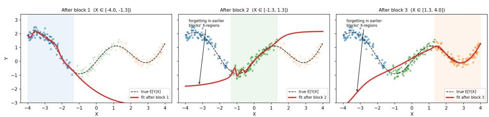  
Each block is a domain shift relative to the last: same concept, new input region. Trained sequentially, the regressor fits the current region and drifts (catastrophically forgets) on regions it no longer sees  
(a) Domain shift: new input regions, fixed target function.

Block-sequential training → concept shift between blocks (same P(X) every block; E[Y|X] flips)  
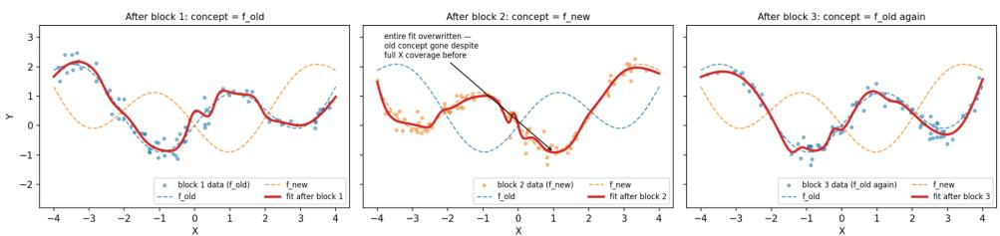  
Each block redefines P(Y|X) on the same inputs, so blocks directly contradict each other. A single regressor can only track the latest concept; without task context it relearns  
(b) Concept shift: new target function, fixed input distribution.

Figure 1: Catastrophic forgetting under block-sequential nonlinear regression. Red curves show predictions after each block. Fitting a new input region degrades earlier regions; fitting a new target function overwrites the previous function.

## 1.1 Functional Task Networks.

The principal idea behind FTN is to solve tasks using a sparse, discrete router over large bank of small, trainable features (or “experts”), with the routing logits directly optimized, rather than computed from input. Specifically, optimization of the router’s logits is performed separately from optimization of the parameters of the processing units that are routed. Each of these design choices above, emphasized in bold, are critical.

The implementation of FTN can vary to address the problem domain, but it necessarily involves a bank of processing units combined with an output decoder. For instance, for simple motor policies, each unit can be a narrow-but-deep multi-layer perceptron (MLP) with a scalar output, and the output policy can be decoded via linear combination of the population activity, illustrated in Figure 3a. Conversely, Figure 3b shows how for Natural Language Processing (NLP) and other large-scale models, a sensible approach is to make each unit a Low-Rank Adapter (LoRA). The combination function is then the pretrained transformer such as a Large Language Model (LLM).

Optimization-based routing First, Mixture-of-Expert (MoE) models already route processing to model subspaces and can be made large, sparse, and discrete, but that does not solve catastrophic forgetting. That is because the router’s trained parameters are equally vulnerable to overwriting, the router itself being a trained function of the inputs.

Routing via optimization allows the network to autonomously detect significant changes in loss on the current data stream and select an appropriate, alternative subspace in response. Which subspace is appropriate: trained, untrained, or some combination, is addressed by the relative performance of those choices to one another in general. Figure 2 lines them up against a hypothetical loss scale. A well-trained model will perform worse than a randomly initialized, untrained network on an unrelated problem. An untrained model performs worse than a set of fixed random features selected via loss minimization, the principle behind random kernel expansion [Rahimi and Recht, 2007] and reservoir computing [Jaeger, 2001, Lukoševičius and Jaeger, 2009]. A mixture of partially trained and random features can be expected to perform better than random features alone, if tasks are structurally related and the features reflect the shared structure. Finally, we expect a network trained to convergence to outperform any of the above on its training task.

When a new task appears to the network, gradients inherently perform parameter isolation by directing the routing mask away from a from a well-trained solution and toward the best-performing randomly intialized features. If some previously trained features are more useful than random ones, they too can be recruited for the new task, providing an even larger head-start. If a diferent but previously well-trained task

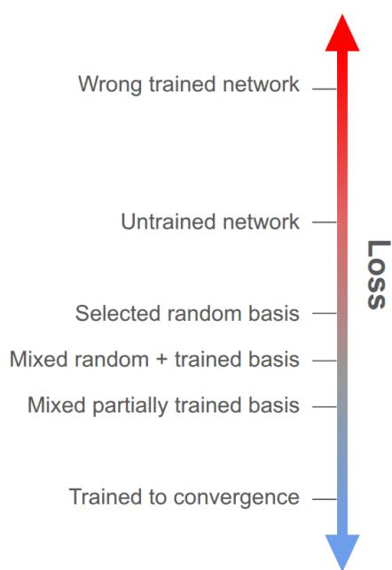  
Figure 2: Schematic loss ordering of candidate neural assemblies. Lower positions indicate lower loss on the target task. Relative performance depends on task structure and feature usefulness.

appears, then the optimizer will select the routing solution corresponding to that trained network. Hence, new network instantiation, parameter isolation, task recall, and knowledge transfer are all controlled by the same mechanism.

For the above network-selection logic, the specific diferences in performance among possible neural assemblies depends on the statistics of the tasks in question. For deeply structured problems, such as image generation, selected random features and previously trained features may provide almost no benefit over random initial weights on a new task. For instance, a model trained only on a variety of human faces does not learn the kinds of geometric forms needed to then generate architectural images. In that case, the only reasonable expectation is nearly disjoint feature spaces, each trained to convergence. Motor control presents a very diferent case: most tasks performed by a robotic arm share broad patterns of motor control and difer only in the final, precise trajectories of object manipulation.

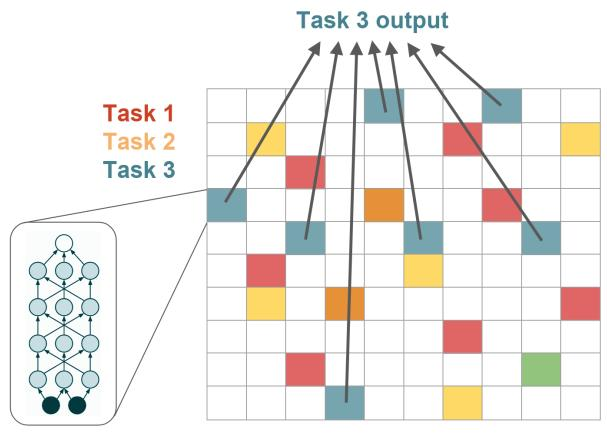  
(a) Linear combination of K gated MLPs

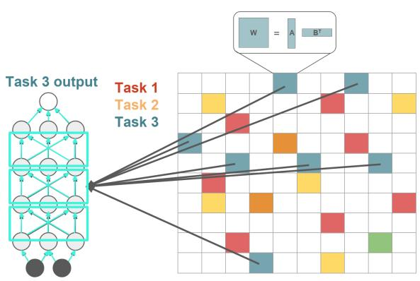  
(b) Rank-K recombinant mixture of LoRAs  
Figure 3: Two possible architectures that implement continual learning via FTN. A large bank of processing units is discretely and sparsely gated into a combination function.

Architecture The most important reason to specify a large bank of features is simply to have a suficient learning capacity for future tasks. However, a large bank of units also allows the same tasks to recruit and train a distribution of possible, composite solutions, a form of ensembling. The experiments to follow will show that learning large, distributed task representations gives the network many more ways to assemble solutions on new tasks.

In addition to using a large network, limiting the complexity of the features being combined can force them to diversify their learned functions, creating more atomic, compositional, and therefore transferable solutions. For instance, the processing units can be narrow-but-deep MLPs or rank-1 LoRAs Figure 3b.

For continual learning to work without catastrophic forgetting, the router requires sparse, discrete routing masks. Foremost, binarizing the routing logits found by the optimizer gates the flow of gradients into the trainable features. Inactive units do not participate in the current task and their parameters remain fixed.

Routing sparsity controls the capacity of the network. A simple sparsification is to set the top k out of N logits to one and all else to zero. If all of the resulting networks are completely disjoint, the FTN can retain N/k tasks.

Biological motivation. FTN is motivated by several features of neocortical computation that suggest a route to sparse, reusable, and partially overlapping task representations. Sparsification via top-k masking has previously served as an abstraction for the efects of inhibitory competition among neurons[Yang et al., 2019, Cichon and Gan, 2015, Mongillo et al., 2018, Rolls, 2010, Khona and Fiete, 2022, Amari, 1977, Maass, 2000, Douglas and Martin, 2004]. Our choice to use a large number of deep networks with low-dimensional output is based on the dendritic model of pyramidal neurons, which can be characterized as deep, multilayer networks[Poirazi et al., 2003, Poirazi and Papoutsi, 2020, Beniaguev et al., 2021]. Alternatively, the LoRA formulation serves as a hypothesis about dendritic redundancy and compartmentalization, as many possible dendritic configurations can be selected via inhibitory networks.

FTN also draws on a statistical property of cortical representations: task-relevant activity is distributed across populations and partially redundant, rather than localized to single reliable units [Georgopoulos et al., 1986, Averbeck et al., 2006, Cohen and Kohn, 2011], while individual cortical neurons are variable across trials and only partially reliable [Tolhurst et al., 1983, Softky and Koch, 1993, Shadlen and Newsome, 1998, Faisal et al., 2008, Churchland et al., 2010, Goris et al., 2014]. Algorithmically, this motivates using a large population of small subnetworks whose contributions are individually weak but heterogeneous, and whose training histories difer across tasks. A new task can then be configured by selecting an assembly from many partially trained units, allowing useful computation before any further weight update. In this view, transfer arises not from retrieving a single stored expert, but from recombining a distributed population of imperfect, task-relevant components.

## 2 Related work

The first class of related models focus primarily on retention of prior solutions. Parameter-isolation methods (PackNet [Mallya and Lazebnik, 2018], HAT [Serra et al., 2018], SupSup [Wortsman et al., 2020]) assign tasks to disjoint parameter subsets; regularizers (EWC [Kirkpatrick et al., 2017], Synaptic Intelligence [Zenke et al., 2017]) penalize drift on parameters important for earlier tasks; replay methods (GEM/A-GEM [Lopez-Paz and Ranzato, 2017, Chaudhry et al., 2019], iCaRL [Rebufi et al., 2017], DER++) use stored exemplars. These target retention; they have no explicit mechanism for forward transfer. Furthermore, methods like Elastic Weight Consolidation (EWC) and Synaptic Intelligence [Kirkpatrick et al., 2017, Zenke et al., 2017] address domain shift but not concept shift. Penalizing drift on parameters that need to compute diferent functions on diferent tasks only blocks learning. Shufled experience replay similarly fails because two replayed labels for the same input contradict each other unless replay is routed through diferent subnetworks.

Other methods target both retention and knowledge transfer. Progressive Networks [Rusu et al., 2016] dedicate a fresh column per task with lateral connections to prior columns, attaining perfect retention at linear-in-tasks parameter cost. PathNet [Fernando et al., 2017] searches paths through a fixed module bank and reuses modules via path overlap, the closest conceptual analog to FTN. Modular networks with task-driven priors [Veniat et al., 2021] make module-reuse-vs-grow explicit; meta-learning approaches such as OML [Javed and White, 2019] target both axes through the meta-objective. We position FTN inside this family: a parallel-bank architecture with a binary support-set-derived mask that uses the same optimization to control isolation and transfer.

Among knowledge transfer methods, the most relevant to FTN are those that use inference-time support-set to determine the router state. Sparse expert models [Shazeer et al., 2017, Fedus et al., 2022] and conditional channel-gated networks [Abati et al., 2020] learn gates over subnetworks. More directly relevant, a family of methods uses a labeled support set to infer task identity or pick from a bank of stored task models: supermask retrieval in SupSup [Wortsman et al., 2020], prompt-pool selection in L2P and DualPrompt [Wang et al., 2022b,a], and learned routers on support-set features. This is the central comparator class.

Finally, Top-k routing requires optimization through a discrete constraint; we compare a sigmoid relaxation, an annealed straight-through estimator [Bengio et al., 2013], and a Gumbel-Sigmoid / Concrete relaxation [Jang et al., 2017, Maddison et al., 2017] as three candidate methods for determining the routing mask.

## 3 Method

FTN-MLP. The basic version of FTN contains H independent scalar-output MLPs $z _ { j } = f _ { j } ( x )$ and a linear readout. For MLP j, with L hidden layers, $h _ { j , 0 } = x , h _ { j , \ell + 1 } = \mathrm { R e L U } ( W _ { j , \ell } h _ { j , \ell } + b _ { j , \ell } )$ 7 and $z _ { j } = \operatorname { t a n h } ( W _ { j , L } h _ { j , L } + b _ { j , L } )$ . A binary mask $m \in \{ 0 , 1 \} ^ { \bar { H } }$ with $\| m \| _ { 0 } = k$ gives

$$
\hat { y } = W _ { \mathrm { o u t } } ( z \odot m ) , \qquad z = ( z _ { 1 } , \dots , z _ { H } ) .
$$

This model was configured to use $H = 4 0 9 6 = 6 4 ^ { 2 } , L = 8$ , hidden width $8 , k = 2 5 6$ . Masks are reconfigured every 4 training batches with AnnealSTE for $S = 3 0$ Adam steps at learning rate 0.3 using 256 support examples; replay uses a 1600-entry bufer, stores 100 examples per task, and draws 2 filtered replay samples per batch. We refer to this implementation as simply “FTN” from here on and use it for all subsequent experiments, diagnostics, and baseline comparisons.

FTN-LoRA. An alternative implementation can apply the FTN concept to a large bank of LoRAs to flexibly modify the weights of a fixed and possibly pretrained model. FTN-LoRA uses one frozen random MLP backbone with trainable LoRA atom banks on every linear layer. For layer q, the masked forward map is

$$
y _ { q } = W _ { q , 0 } x _ { q } + \frac { \alpha } { k } \sum _ { h = 1 } ^ { H } m _ { h } \left( x _ { q } A _ { q , h } B _ { q , h } + b _ { q , h } \right) ,
$$

followed by ReLU between hidden layers; only the atom parameters $( A _ { q , h } , B _ { q , h } , b _ { q , h } )$ are trained. This model was configured to use the same $H = 4 0 9 6 = 6 4 ^ { 2 } , k = 2 5 6 .$ , mask search, and replay settings as FTN-MLP, with a frozen 4-hidden-layer width-256 MLP, rank $r = 1 , \alpha = 2 5 6$ , frozen-backbone weight scale 1, nonzero B and bias initialization scale 0.01, per-atom bias enabled.

Besides an initial, preliminary result to replicate the performance of basic FTN on our synthetic tasks, we leave further examination and application of FTN-LoRA to subsequent work.

Mask reconfiguration A configurer C receives the current model and a labeled support batch and returns a hard top-k mask after S inner steps with model weights fixed. We compare Sigmoid, AnnealSTE, and Gumbel-Sigmoid forms; AnnealSTE with S=30 was chosen as the default after performing sweeps across each of the three methods and values of S (full details in Section A).

To train neurons shared across tasks, each step draws a $( x , y , m )$ triple from a 1600-entry bufer filtered by mask overlap: a stored entry is admitted when its mask overlaps the current mask moderately, $\rho \in ( 0 . 2 , 0 . 8 ]$ . Entries with $\rho \leq 0 . 2$ share too little mass to interfere, while entries with $\rho > 0 . 8$ are likely already trained by the current or proximal minibatches. Filtered replay therefore spends replay supervision only on the overlapping parameters, targeting task interference directly, while the disjoint complement is protected by mask gating. As a comparison, matched-memory uniform-random sampling (NoMask + ER in Section 5.2) ablates the contribution of the filter.

Changepoint-driven reconfiguration As an alternative to reconfiguring at a fixed batch interval, we can allow sharp increases in training loss to trigger reconfiguration. We test this changepoint based method by configuring once on the first batch, then tracking an exponentially weighted mean and variance of the loss under the current mask and reconfigure when the loss exceeds the mean by five standard deviations (found by manual tuning). We used a smoothing factor of 0.9 and suppressed triggers for ten batches after each reconfiguration while the loss statistics recover. Each reconfiguration uses AnnealSTE with 30 Adam steps for FTN and 60 for FTN-LoRA at learning rate 0.3 and a support batch of 256 examples.

Algorithm 1 Functional Task Networks: training and reconfig evaluation   
Require: Tasks $\{ \mathcal { T } _ { t } \} _ { t = 1 } ^ { T }$ arriving block-sequentially; bank of H subnetworks $\{ f _ { j } \}$ with parameters   
$\theta ;$ readout $W _ { \mathrm { o u t } } ;$ active budget $k ;$ configurer $C$ with $S$ inner steps; replay bufer $\boldsymbol { B }$ of capacity   
$N _ { B } ;$ replay overlap window $( \rho _ { \mathrm { l o } } , \rho _ { \mathrm { h i } } ] ;$ ; support size $n _ { s }$   
1: Initialize $\theta , W _ { \mathrm { o u t } } , B \gets \emptyset$   
2: for task $t = 1 , \dots , T$ do   
3: Reset optimizer state for $( \theta , W _ { \mathrm { o u t } } )$   
4: for each training minibatch $( x , y ) \sim \ T _ { t }$ do   
5: Draw support batch $( x _ { s } , y _ { s } ) \sim \mathcal { T } _ { t }$ of size $n _ { s }$   
6: $/ /$ Mask configuration with θ frozen   
7: Initialize mask logits $m _ { 0 } ;$ for $s = 1 , \ldots , S$ do $m _ { s } \gets$ configurer step $C ( m _ { s - 1 } ; x _ { s } , y _ { s } , \theta )$   
8: $m _ { \mathrm { c u r } } \gets \mathrm { T o p K } ( m _ { S } , k ) \in \{ 0 , 1 \} ^ { H }$   
9: $/ /$ Mask-overlap-filtered replay   
10: Sample $\left( x _ { r } , y _ { r } , m _ { r } \right)$ uniformly from $\{ ( x ^ { \prime } , y ^ { \prime } , m ^ { \prime } ) \in \mathcal { B } : ( m ^ { \prime } \cdot m _ { \mathrm { c u r } } ) / k \in ( \rho _ { \mathrm { l o } } , \rho _ { \mathrm { h i } } ] \}$   
11: $/ /$ Gradient step through the active mask, current plus replay   
12: $\mathcal { L } $ loss $( W _ { \mathrm { o u t } } ( z ( x ) \odot m _ { \mathrm { c u r } } ) , y ) + \mathrm { l o s s } ( W _ { \mathrm { o u t } } ( z ( x _ { r } ) \odot m _ { r } ) , y _ { r } )$   
13: Update $( \theta , W _ { \mathrm { o u t } } )$ with $\nabla \mathcal { L }$   
14: Optionally insert $( x , y , m _ { \mathrm { c u r } } )$ into B (evict oldest if $| B | = N _ { B } )$   
15: end for   
16: end for   
17: Evaluation (reconfig protocol). Given any target task $t ^ { \star }$ and an unlabeled query, draw a   
labeled support batch from $\mathcal { T } _ { t ^ { \star } }$ , run the configurer for $S$ inner steps with θ frozen to obtain a   
mask $m ^ { \star }$ , and predict $\hat { y } = W _ { \mathrm { o u t } } ( z ( x ) \odot m ^ { \star } )$ . Task identity is never disclosed.

FTN training and evaluation procedure. Algorithm 1 summarizes the full FTN training and evaluation loop, combining the configurer, the mask-overlap-filtered replay, and the support-setdriven evaluation protocol. The same configurer C is used at every training step and at evaluation time; the only diference between training and evaluation is whether the model parameters θ receive a gradient step.

## 4 Experiments

Training and evaluation. In each of the following experiments, tasks arrive in contiguous blocks. Before every forward pass of FTN, its configurer selects a mask on the current minibatch, then the model updates through that mask only, with one mask-filtered replay sample drawn as described above. At evaluation, all models under comparison receive a small labeled support set from a target task, and for evaluating retention and transfer, a disjoint held-out batch from the same task. The task identity is never disclosed. The configurer selects a mask using the support set, and all metrics are computed on the held-out batch. For FTN, we refer to this as the reconfig protocol. For diagnostics only, we also report a stored protocol that reuses a saved training mask and therefore

Comparator suite. Seven comparators run on the same parallel-MLP backbone and supportset evaluation protocol. NoMask (naive sequential fine-tuning), NoMask+ ER (uniform-random replay bufer matched in capacity to FTN’s filtered bufer), and FixedMask (deterministic disjoint per-task blocks, task identity at eval) are the full-sharing/replay/oracle-isolation baselines. SupSup [Wortsman et al., 2020] freezes a randomly initialized parallel bank and learns a per-task score vector and readout, evaluated by support-set retrieval over stored masks. Progressive Networks [Rusu et al., 2016] use disjoint per-task k-blocks on the same bank with old columns frozen and lateral access from prior columns into the new readout, evaluated by support-set retrieval over the stored cumulative-column masks. FixedMask + Router is the simpler PackNet-style retrieval baseline; FTN + Router (FTN training, retrieval at eval) asks whether the FTN inner loop beats simple retrieval over the FTN-trained bank.

Several standard continual-learning methods, including EWC, SI, LwF, GEM/A-GEM, DER++, HAT, and PackNet, optimize primarily for retention under diferent architectural and evaluation assumptions than the support-conditioned routing setting studied here. In particular, many assume explicit task identity, fixed task boundaries, or architectures that do not naturally map onto FTN’s large sparse-bank setting. Rather than presenting potentially misleading reimplementations under mismatched constraints, we construct architecture-matched controls that isolate the underlying mechanisms most relevant to FTN: replay-based full sharing (NoMask+ER), oracle parameter isolation (FixedMask), and support-set retrieval over isolated subnetworks (FixedMask+Router). PathNet, MNTDP, and L2P/DualPrompt require a non-MLP backbone and are deferred to the LoRA-bank instantiation. Per-benchmark mean±std tables are in Section F.

## 4.1 Benchmarks and metrics

An class-label generating function of arbitrary dificulty for artificial neural networks can be generated by composing sinusoids of random input-conditioned frequencies. The synthetic task family has $T { = } 1 2$ binary classification tasks in $d { = } 2$ generated from a fixed-encoder sinusoidal mixture over $C { = } 6$ latent concept components: $x \sim \mathcal { N } ( 0 , I _ { d } ) , \ : \tilde { z } ( x ; t ) = \sin ( f ( W _ { \mathrm { e n c } } x \odot m _ { t } ) ) \odot m _ { t } , y ( x ; t ) = \mathcal { k } ^ { \prime } [ \sum _ { l } \tilde { z } _ { l } > 0 ]$ with $f { = } 8$ and $m _ { t } \in \{ 0 , 1 \} ^ { L }$ a binary task-component selector. The correlated variant has $m _ { t }$ select two of $C { = } 6$ components (one of $( _ { 2 } ^ { 6 } ) { = } 1 5$ pairs, uniquely per task), so each component is shared by exactly two tasks; the orthogonal variant uses $C { = } 2 T { = } 2 4$ components partitioned into disjoint pairs (zero of-diagonal sharing). Figure 4 shows three example tasks mapping $( x _ { 0 } , x _ { 1 } )$ to y.

The MNIST suite [LeCun et al., 1998] spans concept and domain shift: shared-shufle MNIST (6 tasks) gives each task a digit-to-label permutation that is the union of two component subpermutations, exposing ground-truth concept overlap; Permuted MNIST and Rotated MNIST (10 tasks each) are domain-incremental, applying a fixed random pixel permutation or a fixed rotation in equal steps from 0 to $1 8 0 ^ { \circ }$ . Each MLP cell trains 1,000 Adam steps per task at lr $3 \times 1 0 ^ { - 4 }$ , train minibatch size 256, and optimizer-state reset at task boundaries.

We report (1) accuracy (ACC) as the average classification accuracy across all tasks trained block-sequentially, (2) forgetting measure (FM) [Chaudhry et al., 2019] i.e, the loss retroactively contributed by new tasks, and (3) backward transfer (BWT) [Lopez-Paz and Ranzato, 2017] on the lower-triangular performance matrix under the reconfig protocol; (4) head-start loss is the loss on a held-out batch from a new task after support-set mask configuration but before any weight update on that task, and lower values indicate stronger forward transfer. On the synthetic and shared-shufle MNIST families, where ground-truth overlap is known, $r _ { \mathrm { s h a r e } }$ is the Pearson correlation between

Orthogonal Tasks

Correlated Tasks  
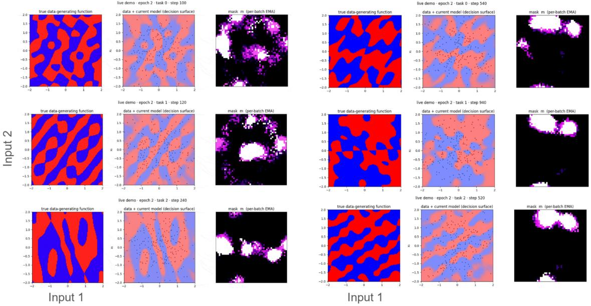  
Figure 4: Visualizations of randomly chosen batches, model expectations, and corresponding routing masks during training of FTN on the synthetic classification tasks. Masks implemented a weak spatial cohesion bias for easier visual inspection of their structure. Rows: Examples from each of 3 orthogonal (column 1) and 3 correlated (column 2) data-generating functions being trained in sequence. Each left-most pane shows the binary class-generating decision surface over 2 inputs. Each middle pane shows a random batch of data during training superimposed on the model’s estimate of that decision surface. The right-most pane shows the active routing mask (white pixels) superimposed on a colored exponential moving average (purple) of previous activations, show the distributed variation in the active mask.

of-diagonal entries of the row-normalized mask-overlap matrix and the ground-truth concept-sharing matrix.

## 5 Results

## 5.1 Synthetic concept sharing

The correlated synthetic family is the only benchmark where ground-truth concept overlap is known by construction, so retention, forward transfer, and the recovered routing geometry can all be checked against a defined target. Table 1 shows that unmasked sequential training collapses (FM=0.396 for NoMask) and matched-memory random replay only partly recovers (ACC=0.65). The four parameter-isolation methods reach FM=0 to within sample noise (by construction for three; within 0.03 for FTN despite no provided task identities), so retention does not separate the masked methods. The diferences are on the other axes.

ACC reflects how much each isolation strategy lets the model learn: SupSup at 0.768 is bottlenecked by its frozen random backbone, Progressive and FixedMask reach the oracle’s ≈ 0.95 by allocating fresh trained capacity per task, and FTN sits a few points below (0.92) because its bank weights are shared rather than partitioned.

Head-start loss measures how well the active subnetwork is already configured for a new task before any weight update (averaged across tasks in the sequence): FTN at 0.40 is below every other comparator, including Progressive (1.42, ∼3.5×) and SupSup (0.66). Interestingly, FTN + Router reproduces FTN’s number (0.394 vs. 0.399) while the same retrieval on top of FixedMask, SupSup, or Progressive cannot. For the router version, which retrieved masks from an explicit memory, the per-batch reconfiguration during training is what populates that memory with a large variety of partly-trained overlapping subnetworks. It follows from these results that taking the arg min of the loss over that bank is a viable but much more computationally expensive alternative to the reconfiguration’s gradient-based search, which only used 30 steps.

Table 1: Correlated synthetic family (12 tasks) under the reconfig (no-task-identity) protocol. Mean±std over 5 seeds. Higher ACC and BWT, lower FM and head-start (HS) loss, are better.
<table><tr><td>Method</td><td>ACC↑</td><td>FM↓</td><td>BWT↑</td><td>HS↓</td></tr><tr><td>NoMask (naive seq.)</td><td> $0 . 6 0 7 \pm 0 . 0 1 9$ </td><td> $0 . 3 9 6 \pm 0 . 0 1 7$ </td><td> $- 0 . 3 9 6 \pm 0 . 0 1 7$ </td><td> $2 . 8 6 8 \pm 0 . 3 3 9$ </td></tr><tr><td>NoMask + ER (random replay)</td><td> $0 . 6 5 1 \pm 0 . 0 2 9$ </td><td> $0 . 1 6 5 \pm 0 . 0 1 1$ </td><td> $- 0 . 1 6 4 \pm 0 . 0 1 0$ </td><td> $1 . 0 7 4 \pm 0 . 0 8 1$ </td></tr><tr><td>FixedMask (oracle ID at eval)</td><td> $0 . 9 4 8 \pm 0 . 0 2 2$ </td><td> $0 . 0 0 0 \pm 0 . 0 0 0$ </td><td> $0 . 0 0 0 \pm 0 . 0 0 0$ </td><td> $0 . 7 0 2 \pm 0 . 0 0 3$ </td></tr><tr><td>FixedMask + retrieval router</td><td> $0 . 9 4 8 \pm 0 . 0 2 1$ </td><td> $0 . 0 0 0 \pm 0 . 0 0 0$ </td><td> $0 . 0 0 0 \pm 0 . 0 0 0$ </td><td> $0 . 7 0 2 \pm 0 . 0 0 4$ </td></tr><tr><td>FTN (ours)</td><td> $0 . 9 1 9 \pm 0 . 0 2 0$ </td><td> $0 . 0 2 9 \pm 0 . 0 0 7$ </td><td> $- 0 . 0 2 1 \pm 0 . 0 1 5$ </td><td> $0 . 3 9 9 \pm 0 . 0 6 4$ </td></tr><tr><td>FTN, random masks (ablation)</td><td> $0 . 7 7 4 \pm 0 . 0 8 9$ </td><td> $0 . 1 1 9 \pm 0 . 0 4 2$ </td><td> $- 0 . 1 1 3 \pm 0 . 0 4 5$ </td><td> $1 . 1 9 4 \pm 0 . 1 9 8$ </td></tr><tr><td>FTN + retrieval router</td><td> $0 . 9 0 4 \pm 0 . 0 2 8$ </td><td> $0 . 0 4 5 \pm 0 . 0 0 8$ </td><td> $- 0 . 0 4 3 \pm 0 . 0 1 1$ </td><td> $0 . 3 9 4 \pm 0 . 0 7 8$ </td></tr><tr><td>FTN, no replay</td><td> $0 . 7 8 0 \pm 0 . 0 3 6$ </td><td> $0 . 1 9 5 \pm 0 . 0 2 8$ </td><td> $- 0 . 1 9 2 \pm 0 . 0 3 1$ </td><td> $0 . 5 2 1 \pm 0 . 0 6 4$ </td></tr></table>

The no-replay ablation raises FM about seven-fold (to 0.195) and drops ACC to 0.78, which localizes retention to the filtered-replay channel that protects shared neurons. Random per-batch masks (FTN training pipeline, configurer replaced by a fresh random k-of-H mask each step) retain and transfer substantially worse than FTN under correlated concept shift, with ACC dropping from 0.919 to 0.774, FM rising from 0.029 to 0.119, and head-start loss rising from 0.399 to 1.194, showing that stochastic sparse-bank training plus replay is insuficient when tasks share latent components and that the support-conditioned configurer is necessary to route around the resulting cross-task mask collisions.

16-task retention and transfer Figure 5 contrasts a generic MLP with experience replay with two FTN implementations on the same task family, same seed, and otherwise identical pipeline. All three panels are 16×16 task-vs-task evaluation matrices obtained by training each model sequentially on 16 tasks from the synthetic data generator and then evaluating the resulting model on each task’s held-out batch at every intermediate checkpoint. Figure 5a is the null result, with no masking and full network capacity. Only the diagonal displays high accuracy: the model performs well its most recent task, with no retention (low scores in the lower triangle) and no forward transfer (low scores in the upper triangle). Figure 5b shows the FTN linear routed mixture of MLPs, while Figure 5c shows the FTN routed mixture of LoRAs applied to one large MLP. Both FTN implementations recover substantially better retention and forward transfer than the null result.

In Figure 5, the null result shows that as the MLP trains on each task, held-out correlated tasks get a small to moderate boost in performance, but both current and hold-out task performance disappears as soon as the network retrains on the next task. By contrast, both FTN models retain the current task and maintain their head start on held-out tasks after retraining on subsequent tasks. Where task-invariant representations did not exist, the distributed and stochastic training of the network produced a large repertoire of random and partially-trained task bases that nonetheless allowed rapid construction of solutions on each new task.

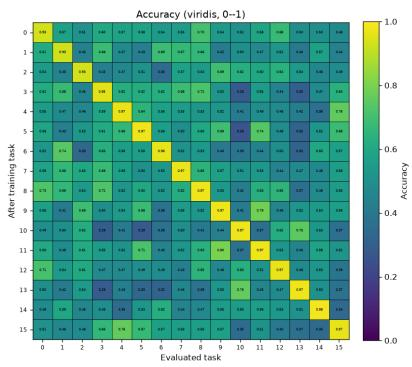  
(a) Null result with the full network capacity and replay but no masking.

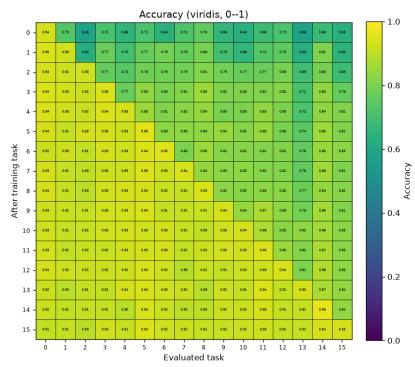  
(b) FTN linear routed mixture of MLPs.

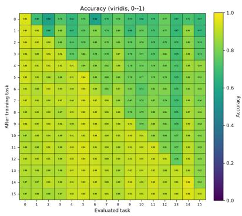  
(c) FTN routed mixture of LoRAs applied to one large MLP.  
Figure 5: Per-task evaluation matrices on the 16-task synthetic sequence, same seed and same pipeline evaluating a generic model versus two implementations of FTN. Rows index training task; columns index evaluation task. The null illustrates expected behavior of generic MLPs under block-sequential training; the FTN implementations recover retention and forward transfer on the same task family.

Replay-free, changepoint-driven routing. In a previous iteration of this work, we show that tasks can be retained and recalled efectively without experience replay when reconfiguration is triggered only at task boundaries [McKee et al., 2026]. The current version has some design diferences, including the annealed straight-through estimator and no spatial consolidation bias. We therefore tested the version of FTN presented here but with filtered experience replay disabled and with reconfiguration triggered only by sharp changes in loss, which was expected at task boundaries.

We compared the MLP and LoRA implementations across fixed-interval and changepoint-driven mask reconfiguration, each with filtered replay or no replay. In this single-seed, 16-task run, all runs without replay performed worse overall on average eval accuracy for current and previous tasks than runs that used replay. However, switching the replay-free models to changepoint-driven reconfiguration (i.e., reconfiguring once per task rather than every four batches), recovered 0.081 points of accuracy in the base FTN model and 0.230 in the LoRA model. Both changepoint-driven reconfiguration and disabling replay reduced average mask overlap and forward transfer, supporting the hypothesis that more distributed task representations led to more transferable learning.

A more thorough comparison of the two strategies will require more seeds to allow statistical testing of diferences. On this seed, the diferences were small but accorded with our expectations given the hypothesized roles of distributed representation and replay. Replay allows direct training of cross-task representations by mixing gradients from diferent task losses. Distributed representation, i.e. overlapping, redundant, and varied routing masks achieved by frequent within-task reconfiguration, should produce an ensembling efect: multiple ways to construct assemble a solution from the pool of trainable units.

Sparsity, support size, and the orthogonal control. Three diagnostic sweeps are summarized here; full tables and figures are in Sections C and E. (i) The top-k budget controls how much overlap is possible: sweeping k ∈ {512, 128, 32, 8} reveals an isolation-transfer trade-of. FM falls from 0.056 at k=512 to 0.032 at k=32 while head-start rises from ≈0.42 to ≈0.60; sharing fidelity peaks at moderate sparsity $( r _ { \mathrm { { s h a r e } } } { = } 0 . 6 2 4 ~ \mathrm { { a t } } ~ k { = } 3 2 )$ . (ii) Support-set size afects transfer more than retention: shrinking the support from 256 to 4 raises head-start from $0 . 4 2 5 { \pm } 0 . 0 8 0$ to $1 . 3 3 9 { \pm } 0 . 0 9 5$ while FM stays at or below 0.060 and ACC at 0.86 to 0.89. (iii) The orthogonal variant, which removes latent sharing while preserving the task format, raises FTN head-start from 0.423±0.077 to 0.568±0.045 with low forgetting in both regimes; $r _ { \mathrm { s h a r e } }$ is zero by construction for the orthogonal task family.

Table 2: Recorded continual-learning metrics on the 16-task sequence. Each condition is one seed. “Fixed” denotes fixed-interval mask reconfiguration; Reactive-Low uses loss-triggered reconfiguration. Recall and forward-transfer accuracy are averaged over the corresponding task evaluations; forwardtransfer change is the mean change per task block.
<table><tr><td>Model</td><td>Routing</td><td>Replay</td><td>Recall↑</td><td>Forward↑</td><td>FT change↑</td><td>Train↑</td><td>Current↑</td><td>Overlap (%)</td></tr><tr><td>MLP</td><td>Fixed</td><td>Filtered</td><td>0.922</td><td>0.785</td><td>0.0118</td><td>0.950</td><td>0.941</td><td>15.78</td></tr><tr><td>MLP</td><td>Fixed</td><td>None</td><td>0.805</td><td>0.735</td><td>0.0055</td><td>0.954</td><td>0.946</td><td>14.76</td></tr><tr><td>MLP</td><td>Changepoint-Driven</td><td>Filtered</td><td>0.912</td><td>0.771</td><td>0.0107</td><td>0.952</td><td>0.923</td><td>13.45</td></tr><tr><td>MLP</td><td>Changepoint-Driven</td><td>None</td><td>0.886</td><td>0.756</td><td>0.0111</td><td>0.947</td><td>0.929</td><td>12.40</td></tr><tr><td>LoRA</td><td>Fixed</td><td>Filtered</td><td>0.906</td><td>0.780</td><td>0.0093</td><td>0.908</td><td>0.916</td><td>16.93</td></tr><tr><td>LoRA</td><td>Fixed</td><td>None</td><td>0.656</td><td>0.663</td><td>0.0012</td><td>0.825</td><td>0.853</td><td>40.38</td></tr><tr><td>LoRA</td><td>Changepoint-Driven</td><td>Filtered</td><td>0.911</td><td>0.776</td><td>0.0070</td><td>0.937</td><td>0.920</td><td>10.03</td></tr><tr><td>LoRA</td><td>Changepoint-Driven</td><td>None</td><td>0.890</td><td>0.775</td><td>0.0078</td><td>0.936</td><td>0.917</td><td>7.89</td></tr></table>

Recovered sharing geometry. Figure 6 compares the ground-truth sharing matrix with the rownormalized neuron-sharing matrix for a high-fidelity AnnealSTE configuration $( S { = } 4 0 , r _ { \mathrm { s h a r e } } { = } 0 . 6 1 7 ;$ the primary sweep reaches 0.622). The recovered matrix is not binary, but its high-overlap regions align with the concept-sharing pattern. BWT stays close to zero across the 18 primary-search configurations, ranging from −0.061 to +0.005, against −0.392 for NoMask on synthetic and −0.656 on MNIST.

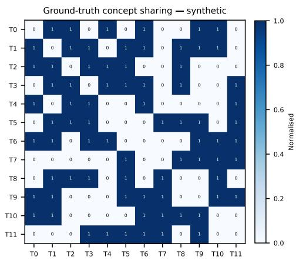  
(a) Ground-truth.

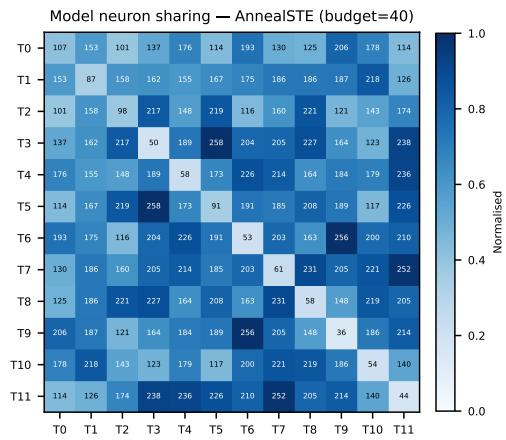  
(b) Model, AnnealSTE S=40, $r _ { \mathrm { s h a r e } } { = } 0 . 6 1 7 .$  
Figure 6: Recovered task structure on the correlated synthetic family. Of-diagonal entries S[i, j] count neurons (left) or concept components (right) shared between tasks $i \neq j ;$ the diagonal counts neurons $/$ components used only by task i. $r _ { \mathrm { s h a r e } }$ is computed on row-normalized of-diagonal entries.

Table 3: Compressed MNIST suite under the reconfig protocol. Means over 5 seeds; full mean±std tables are in Section F. Higher ACC and lower FM/HS are better.
<table><tr><td rowspan="2">Method</td><td colspan="3">Shared-shuffle</td><td colspan="3">Permuted</td><td colspan="3">Rotated</td></tr><tr><td>ACC↑</td><td>FM↓</td><td>HS↓</td><td>ACC↑</td><td>FM↓</td><td>HS↓</td><td></td><td>ACC↑ FM↓</td><td>HS↓</td></tr><tr><td>NoMask</td><td>0.444</td><td>0.644</td><td>10.397</td><td>0.928</td><td>0.053</td><td>5.207</td><td>0.523</td><td>0.509</td><td>0.360</td></tr><tr><td>NoMask+ER</td><td>0.442</td><td>0.630</td><td>8.524</td><td>0.960</td><td>0.018</td><td>5.270</td><td>0.912</td><td>0.075</td><td>0.667</td></tr><tr><td>SupSup</td><td>0.886</td><td>0.000</td><td>3.535</td><td>0.894</td><td>0.000</td><td>2.683</td><td>0.894</td><td>0.000</td><td>0.861</td></tr><tr><td>Progressive Nets</td><td>0.979</td><td>0.000</td><td>8.330</td><td>0.977</td><td>0.000</td><td>3.096</td><td>0.977</td><td>0.000</td><td>0.381</td></tr><tr><td>FixedMask</td><td>0.979</td><td>0.000</td><td>2.309</td><td>0.979</td><td>0.000</td><td>2.321</td><td>0.979</td><td>0.000</td><td>2.322</td></tr><tr><td>FixedMask+Router</td><td>0.978</td><td>0.000</td><td>2.311</td><td>0.979</td><td>0.000</td><td>2.320</td><td>0.979</td><td>0.000</td><td>2.321</td></tr><tr><td>FTN, random per-batch masks (ablation)</td><td>0.923</td><td>0.027</td><td>6.652</td><td>0.915</td><td>0.017</td><td>3.411</td><td>0.867</td><td>0.087</td><td>0.621</td></tr><tr><td>FTN (ours)</td><td>0.960</td><td>0.023</td><td>0.562</td><td>0.954</td><td>0.024</td><td>1.616</td><td>0.941</td><td>0.043</td><td>0.324</td></tr></table>

## 5.2 MNIST concept and domain shift

MNIST provides a non-synthetic validation that the transfer pattern is not an artifact of the sinusoidal generator. Table 3 compresses the three variants. On shared-shufle MNIST (concept shift), random replay fails as predicted, NoMask and NoMask+ER collapse relative to the masked methods and have severe forgetting, while FTN retains within 0.023 FM and has much lower head-start loss than all isolation/retrieval baselines (0.562 vs. 2.309 for FixedMask and 8.330 for Progressive Networks; Progressive’s lateral inputs carry the old digit-to-label map, which actively conflicts with the new permutation). On Permuted MNIST (non-smooth domain shift), replay and isolation already retain well, but FTN still has the lowest head-start loss. On Rotated MNIST (smooth domain shift), Progressive comes close (0.381 vs. FTN’s 0.324), the expected case where smooth lateral transfer is useful. Across all three MNIST families, FTN gives up a small amount of final accuracy to Progressive/FixedMask but has the lowest head-start loss among the matched-backbone comparators. The FTN-with-random-per-batch-masks ablation row holds the FTN training pipeline fixed (filtered replay, the same step budget, same parameter budget) and replaces the support-conditioned configurer with a fresh random k-of-H mask each step. This ablation retains nearly as well as FTN on all three MNIST variants (0.92/0.92/0.87 ACC) but pays a head-start cost that depends on input-shift type (∼ 12× worse on shared-shufle MNIST, 6.65 vs. 0.56; ∼ 2× worse on Permuted, 3.41 vs. 1.62; and Rotated, 0.62 vs. 0.32). FTN+Router and no-replay diagnostics, together with the per-benchmark mean±std tables, are in Section F.

## 6 Discussion

In this paper we presented a brain-inspired, unified, and autonomous approach to continual learning and knowledge transfer. We compared the novel method on both synthetic tasks to conduct diagnostics and on applied tasks to examine generality. We find that FTN, as a general design principle of autonomous, distributed representation, can be efectively implemented in at least two ways: either as a routed linear combination of small but deep MLPs, or as a population of recombinant LoRAs applied to a fixed model.

Both methods result in (1) retention and recovery of previously trained solutions when either the domain or the target changes, (2) transfer of training improvements across tasks both to held-out tasks and backward to previously trained tasks, (3) successful autonomous determination of when and which assemblies to recruit such that the above benefits are realized. By comparison, regularization methods such as EWC and Synaptic Intelligence primarily protect parameters important to earlier tasks and are not designed for concept shift, while replay methods such as GEM/A-GEM, iCaRL, and DER++ primarily target retention and can encounter contradictory labels when the target function changes [Kirkpatrick et al., 2017, Zenke et al., 2017, Lopez-Paz and Ranzato, 2017, Chaudhry et al., 2019, Rebufi et al., 2017, Buzzega et al., 2020]. Parameter-isolation methods such as PackNet, HAT, and SupSup protect prior solutions by restricting which parameters can be trained, but do not by themselves provide FTN’s flexible recombination mechanism [Mallya and Lazebnik, 2018, Serra et al., 2018, Wortsman et al., 2020]. Progressive Networks and related modular methods add transfer through lateral connections, path reuse, or task-driven module selection, but use task-specific columns, paths, or stored task structure rather than one shared support-conditioned mechanism [Rusu et al., 2016, Fernando et al., 2017, Veniat et al., 2021]. Finally, many routing and retrieval systems require task-specific supervision or additional selection machinery: FixedMask and Progressive Networks use task-specific allocation, while SupSup, L2P, and DualPrompt retrieve task-associated masks, prompts, or modules [Wortsman et al., 2020, Rusu et al., 2016, Wang et al., 2022b,a]. FTN combines parameter protection, transfer through overlapping assemblies, and support-conditioned selection in one procedure, without exposing task identity or requiring manual intervention at task boundaries. FTN was designed to meet all three and be deployable as a “hands-of” system, making minimal assumptions about the data and requiring only the data stream itself.

Comparison to other parameter isolation baselines. The ablative retrieval routers play two diagnostic roles. FixedMask + Router (parameter-isolation training, arg min-loss retrieval at eval) matches the task-identity oracle on retention but pays a high head-start cost because every retrieved block is fixed and untrained for a new task. FTN + Router (FTN training, retrieval at eval) inherits FTN’s training-time benefit and produces a head-start loss comparable to FTN itself, so the head-start advantage stems from training-time per-batch reconfiguration that builds a broad basis of partially trained subnetworks rather than from the inner-loop optimization at evaluation. The head-start gap between FTN and FixedMask + Router is the central empirical signal, and it is largest on benchmarks whose tasks share transferable structure and smallest where the input shift carries the least such structure (Permuted MNIST). SupSup, Progressive, and FixedMask each pay a diferent transfer cost: SupSup is capped by its frozen random features; Progressive’s columns are task-specialized, so its head-start is useful only when smoothly-parameterized lateral transfer happens to apply (helpful on Rotated MNIST, counterproductive on shared-shufle); FTN’s single shared bank with overlapping training masks delivers the lowest head-start on every benchmark. The cost is a modest accuracy and forgetting gap to Progressive on the MNIST families, which closes as the support set grows.

Random-per-batch-mask ablations. Holding the FTN training pipeline fixed and replacing the support-conditioned configurer with a fresh random k-of-H mask each step splits the configurer’s role along input-shift type. Under correlated concept shift on the synthetic family the configurer is necessary even for retention, because the bank’s atoms see colliding gradients across tasks that share latent components and only the configurer routes around the collisions. Under domain shift (Permuted MNIST, Rotated MNIST) random masks match FTN on retention, so the distributed bank with replay handles input-shift retention without the configurer; the configurer’s contribution there is confined to head-start. On shared-shufle MNIST (concept shift via component-shared label permutations) retention is nearly identical between FTN and the random-mask ablation while head-start is far worse without the configurer, because the bank absorbs the digit-label conflicts but only the configurer recovers a useful pre-update mask on a new permutation.

Neither replay nor masking are suficient for general retention. Removing the maskoverlap-filtered bufer markedly increases forgetting in the fixed-schedule reconfiguration models across every task family, with the largest jumps on the families whose tasks share latent structure: the mask alone is partial protection. Conversely, replay alone (NoMask + ER, matched memory) is suficient under domain shift but collapses on shared-shufle MNIST, since concept shift presents contradictory replay targets on the same input. FTN’s combination of mask-filtered replay and per-batch reconfiguration is what produces strong retention and non-trivial transfer across al four families. High mean of-diagonal mask overlap occurs in both correlated and orthogonal synthetic regimes (Section G); the diagnostic signal is the correlation rshare between the model’s pairwise-overlap matrix and the ground-truth concept-sharing matrix, not the absolute overlap level.

Limitations and future directions The largest limitation of the FTN models tested here is the extra computation required for reconfiguration of the router between gradient steps, particularly if used during inference. In the FTN-MLP model, reconfiguration can take the fixed latent outputs of the MLPs and recompute only the final linear combination, and is thus cheap even for many router optimization steps. In the FTN-LoRA model, the cost is much greater because a fixed, deep network serves as the combination function, and thus the entire model has to be evaluated at each step of router optimization.

One cheap alternative is to use the changepoint-driven replay-free versions, which we found here in the 16-task preliminary result and considered more extensively elsewhere?? to perform only slightly worse overall. In theory, the drawbacks of the that version are (1) the lack of ensembling per-task, which is expected to both limit forward knowledge transfer and reduce robustness of recall to overwriting and search hardness, particularly in the LoRA model where the fixed network may have many layers or recurrent steps, and (2) no recourse to a replay bufer to repair regions of overlap among routing masks, further exacerbating the possibility of overwriting. In practice, neither drawback presented strongly in our synthetic experiment.

Another way to improve the scalability of FTN is to reformulate it around approximate Bayesian updating of the mask. That is, treat the mask logits as a distributional prior such that each reconfiguration stage need only produce a posterior update. Changepoint detection can then be implemented as a conditionally flat prior. At time of writing, we have implemented such an approach for large-scale problems and will present those results in a subsequent report. For the current study, we chose to focus on the theoretical grounding and present the original optimization-driven prototype for its algorithic simplicity.

## References

Davide Abati, Jakub Tomczak, Tijmen Blankevoort, Simone Calderara, Rita Cucchiara, and Babak Ehteshami Bejnordi. Conditional channel gated networks for task-aware continual learning. In IEEE/CVF Conference on Computer Vision and Pattern Recognition (CVPR), 2020.

Shun-ichi Amari. Dynamics of pattern formation in lateral-inhibition type neural fields. Biological Cybernetics, 27(2):77–87, 1977.

Bruno B. Averbeck, Peter E. Latham, and Alexandre Pouget. Neural correlations, population coding and computation. Nature Reviews Neuroscience, 7(5):358–366, 2006. doi: 10.1038/nrn1888.

Yoshua Bengio, Nicholas Léonard, and Aaron Courville. Estimating or propagating gradients through stochastic neurons for conditional computation. arXiv preprint arXiv:1308.3432, 2013.

David Beniaguev, Idan Segev, and Michael London. Single cortical neurons as deep artificial neural networks. Neuron, 109(17):2727–2739, 2021.

Pietro Buzzega, Matteo Boschini, Angelo Porrello, Davide Abati, and Simone Calderara. Dark experience for general continual learning: A strong, simple baseline. In NeurIPS, 2020.

Arslan Chaudhry, Marc’Aurelio Ranzato, Marcus Rohrbach, and Mohamed Elhoseiny. Eficient lifelong learning with a-GEM. In International Conference on Learning Representations (ICLR), 2019.

Mark M. Churchland, Byron M. Yu, John P. Cunningham, Leo P. Sugrue, Marlene R. Cohen, Greg S. Corrado, William T. Newsome, Andrew M. Clark, Paymon Hosseini, Benjamin B. Scott, David C. Bradley, Matthew A. Smith, Adam Kohn, J. Anthony Movshon, Katherine M. Armstrong, Tirin Moore, Steve W. Chang, Lawrence H. Snyder, Stephen G. Lisberger, Nicholas J. Priebe, Ian M. Finn, David Ferster, Stephen I. Ryu, Gopal Santhanam, Maneesh Sahani, and Krishna V. Shenoy. Stimulus onset quenches neural variability: A widespread cortical phenomenon. Nature Neuroscience, 13(3):369–378, 2010. doi: 10.1038/nn.2501.

Joseph Cichon and Wen-Biao Gan. Branch-specific dendritic ca2+ spikes cause persistent synaptic plasticity. Nature, 520(7546):180–185, 2015.

Marlene R. Cohen and Adam Kohn. Measuring and interpreting neuronal correlations. Nature Neuroscience, 14(7):811–819, 2011. doi: 10.1038/nn.2842.

Rodney J Douglas and Kevan AC Martin. Neuronal circuits of the neocortex. Annual Review of Neuroscience, 27:419–451, 2004.

A. Aldo Faisal, Luc P. J. Selen, and Daniel M. Wolpert. Noise in the nervous system. Nature Reviews Neuroscience, 9(4):292–303, 2008.

William Fedus, Barret Zoph, and Noam Shazeer. Switch transformers: Scaling to trillion parameter models with simple and eficient sparsity. Journal of Machine Learning Research, 23:1–39, 2022.

Chrisantha Fernando, Dylan Banarse, Charles Blundell, Yori Zwols, David Ha, Andrei A. Rusu, Alexander Pritzel, and Daan Wierstra. Pathnet: Evolution channels gradient descent in super neural networks. arXiv preprint arXiv:1701.08734, 2017.

Robert M French. Catastrophic forgetting in connectionist networks. Trends in cognitive sciences, 3 (4):128–135, 1999.

Apostolos P. Georgopoulos, Andrew B. Schwartz, and Ronald E. Kettner. Neuronal population coding of movement direction. Science, 233(4771):1416–1419, 1986. doi: 10.1126/science.3749885.

Robbe L. T. Goris, J. Anthony Movshon, and Eero P. Simoncelli. Partitioning neuronal variability. Nature Neuroscience, 17(6):858–865, 2014. doi: 10.1038/nn.3711.

Herbert Jaeger. The “echo state” approach to analysing and training recurrent neural networks. GMD Report 148, German National Research Center for Information Technology, 2001. URL https://publica-rest.fraunhofer.de/server/api/core/bitstreams/ d789440a-da1a-4749-b225-49fd4035073a/content.

Eric Jang, Shixiang Gu, and Ben Poole. Categorical reparameterization with gumbel-softmax. In International Conference on Learning Representations (ICLR), 2017.

Khurram Javed and Martha White. Meta-learning representations for continual learning. In NeurIPS, 2019.

Mikail Khona and Ila R. Fiete. Attractor and integrator networks in the brain. Nature Reviews Neuroscience, 23(12):744–766, 2022.

James Kirkpatrick, Razvan Pascanu, Neil Rabinowitz, Joel Veness, Guillaume Desjardins, Andrei A Rusu, Kieran Milan, John Quan, Tiago Ramalho, Agnieszka Grabska-Barwinska, et al. Overcoming catastrophic forgetting in neural networks. Proceedings of the national academy of sciences, 114 (13):3521–3526, 2017.

Yann LeCun, Léon Bottou, Yoshua Bengio, and Patrick Hafner. Gradient-based learning applied to document recognition. Proceedings of the IEEE, 86(11):2278–2324, 1998.

David Lopez-Paz and Marc’Aurelio Ranzato. Gradient episodic memory for continual learning. Advances in neural information processing systems, 30, 2017.

Mantas Lukoševičius and Herbert Jaeger. Reservoir computing approaches to recurrent neural network training. Computer Science Review, 3(3):127–149, 2009. doi: 10.1016/j.cosrev.2009.03.005.

Wolfgang Maass. On the computational power of winner-take-all. Neural computation, 12(11): 2519–2535, 2000.

Chris J. Maddison, Andriy Mnih, and Yee Whye Teh. The concrete distribution: A continuous relaxation of discrete random variables. In International Conference on Learning Representations (ICLR), 2017.

Arun Mallya and Svetlana Lazebnik. Packnet: Adding multiple tasks to a single network by iterative pruning. In IEEE Conference on Computer Vision and Pattern Recognition (CVPR), 2018.

Michael McCloskey and Neal J Cohen. Catastrophic interference in connectionist networks: The sequential learning problem. Psychology of learning and motivation, 24:109–165, 1989.

Kevin McKee, Thomas Hazy, Yicong Zheng, Zacharie Bugaud, and Thomas Miconi. Cortex-inspired continual learning: Unsupervised instantiation and recovery of functional task networks. arXiv preprint arXiv:2604.24637, 2026.

Gianluigi Mongillo, Simon Rumpel, and Yonatan Loewenstein. Inhibitory connectivity defines the realm of excitatory plasticity. Nature neuroscience, 21(10):1463–1470, 2018.

Panayiota Poirazi and Athanasia Papoutsi. Illuminating dendritic function with computational models. Nature Reviews Neuroscience, 21(6):303–321, 2020.

Panayiota Poirazi, Terrence Brannon, and Bartlett W. Mel. Pyramidal neuron as two-layer neural network. Neuron, 37(6):989–999, 2003.

Ali Rahimi and Benjamin Recht. Random features for large-scale kernel machines. In Advances in Neural Information Processing Systems, volume 20, 2007. URL https://papers.nips.cc/ paper\_files/paper/2007/hash/013a006f03dbc5392effeb8f18fda755-Abstract.html.

Sylvestre-Alvise Rebufi, Alexander Kolesnikov, Georg Sperl, and Christoph H Lampert. icarl: Incremental classifier and representation learning. In IEEE Conference on Computer Vision and Pattern Recognition (CVPR), 2017.

Edmund T Rolls. Attractor networks. Wiley Interdisciplinary Reviews: Cognitive Science, 1(1): 119–134, 2010.

Andrei A Rusu, Neil C Rabinowitz, Guillaume Desjardins, Hubert Soyer, James Kirkpatrick, Koray Kavukcuoglu, Razvan Pascanu, and Raia Hadsell. Progressive neural networks. arXiv preprint arXiv:1606.04671, 2016.

Joan Serra, Didac Suris, Marius Miron, and Alexandros Karatzoglou. Overcoming catastrophic forgetting with hard attention to the task. In International Conference on Machine Learning, pages 4548–4557. PMLR, 2018.

Michael N. Shadlen and William T. Newsome. The variable discharge of cortical neurons: Implications for connectivity, computation, and information coding. Journal of Neuroscience, 18(10):3870–3896, 1998. doi: 10.1523/JNEUROSCI.18-10-03870.1998.

Noam Shazeer, Azalia Mirhoseini, Krzysztof Maziarz, Andy Davis, Quoc Le, Geofrey Hinton, and Jef Dean. Outrageously large neural networks: The sparsely-gated mixture-of-experts layer. ICLR, 2017.

William R. Softky and Christof Koch. The highly irregular firing of cortical cells is inconsistent with temporal integration of random EPSPs. Journal of Neuroscience, 13(1):334–350, 1993. doi: 10.1523/JNEUROSCI.13-01-00334.1993.

D. J. Tolhurst, J. A. Movshon, and A. F. Dean. The statistical reliability of signals in single neurons in cat and monkey visual cortex. Vision Research, 23(8):775–785, 1983. doi: 10.1016/ 0042-6989(83)90200-6.

Tom Veniat, Ludovic Denoyer, and Marc’Aurelio Ranzato. Eficient continual learning with modular networks and task-driven priors. In ICLR, 2021.

Zifeng Wang, Zizhao Zhang, Sayna Ebrahimi, Ruoxi Sun, Han Zhang, Chen-Yu Lee, Xiaoqi Ren, Guolong Su, Vincent Perot, Jennifer Dy, and Tomas Pfister. Dualprompt: Complementary prompting for rehearsal-free continual learning. In ECCV, 2022a.

Zifeng Wang, Zizhao Zhang, Chen-Yu Lee, Han Zhang, Ruoxi Sun, Xiaoqi Ren, Guolong Su, Vincent Perot, Jennifer Dy, and Tomas Pfister. Learning to prompt for continual learning. In CVPR, 2022b.

Mitchell Wortsman, Vivek Ramanujan, Rosanne Liu, Aniruddha Kembhavi, Mohammad Rastegari, Jason Yosinski, and Ali Farhadi. Supermasks in superposition. Advances in Neural Information Processing Systems, 33:15173–15184, 2020.

Guangyu Robert Yang, Madhura R Joglekar, H Francis Song, William T Newsome, and Xiao-Jing Wang. Task representations in neural networks trained to perform many diferent tasks. Nature neuroscience, 22(2):297–306, 2019.

Friedemann Zenke, Ben Poole, and Surya Ganguli. Continual learning through synaptic intelligence. In International Conference on Machine Learning, pages 3987–3995. PMLR, 2017.

## A Implementation details

Configurers. All three configurers expose the same external interface and difer in the soft-mask form, optimizer, logit initialization, and auxiliary loss. AnnealSTE uses SGD, zero initialization, hard k-WTA with a straight-through estimator, and no auxiliary term. Sigmoid uses RMSprop, zero initialization, a soft mask $\sigma ( m )$ , and post-hoc top-k projection. Gumbel-Sigmoid uses Adam, initialization at $\sigma ^ { - 1 } ( k / H ) , \sigma ( ( m + g _ { i } ) / \tau _ { i } )$ with logistic noise, and the budget penalty $( \sum \sigma ( m ) -$ $k ) ^ { 2 } / k ^ { 2 }$

Replay bufer. The replay bufer stores 200 $( x , y , m )$ triples. On every gradient step we sample one triple whose stored mask has fractional overlap $\rho = ( m _ { \mathrm { c u r } } \cdot m _ { j } ) / \| m _ { \mathrm { c u r } } \| _ { 1 } \in ( 0 . 2 , 0 . 8 ]$ with the current mask. Entries with $\rho \leq 0 . 2$ are skipped because they are unlikely to share useful computation with the current update; entries with $\rho > 0 . 8$ are skipped because the current minibatch already trains a very similar mask.

Reconfig protocol. At evaluation time we draw a labeled support set from the target task and run the configurer on it to obtain a recall mask. The model is not told which task generated the support set. Metrics are computed on a larger held-out batch from the same task, disjoint from the support set.

SupSup baseline. We instantiate SupSup [Wortsman et al., 2020] on the same parallel-MLP bank $( H = 8 1 9 2$ slots, per-MLP topology identical to FTN’s). The bank’s parallel-MLP weights are initialized once and frozen for the rest of training; dropout on the bank output is disabled for SupSup so the frozen features are deterministic. For each task t we instantiate (i) a fresh score vector $s _ { t } \in \mathbb { R } ^ { H }$ and (ii) a fresh per-task readout head $W _ { t } \in \mathbb { R } ^ { \mathrm { o u t } \times H }$ initialized by Xavier-uniform. The forward pass uses a hard top-k mask via the straight-through estimator mask $= \mathrm { t o p k } ( s _ { t } , k ) + s _ { t } - \mathrm { d e t a c h } ( s _ { t } )$ both $s _ { t }$ and $W _ { t }$ receive gradient through the task loss, the bank does not. Optimisers: Adam, $\mathrm { l r } = 1 0 ^ { - 2 }$ on $s _ { t }$ and $3 \times 1 0 ^ { - 4 }$ on $W _ { t }$ . Per-task storage is the pair $( \mathrm { t o p k } ( s _ { t } , k ) , W _ { t } )$ . At evaluation (no task identity) the support-set retrieval scans every stored pair, swaps in the candidate readout, computes the support cross-entropy, and returns the lowest-loss pair; the held-out batch is then evaluated under that pair. This is the deterministic, one-hot version of SupSup’s GG retrieval.

Progressive Networks baseline. We instantiate Progressive Networks [Rusu et al., 2016] on the same parallel-MLP bank. Task t owns a disjoint k-block “column” covering slots $[ t \cdot k , ( t + 1 ) \cdot k )$ During training of task t: (i) the parallel-MLP weights for slots outside that range are frozen (gradients zeroed before the optimizer step), so all prior columns are untouched; (ii) the active mask is the cumulative mask $m _ { t } = \mathcal { H } [ \mathrm { s l o t } < ( t + 1 ) \cdot k ]$ ], so the per-task readout head $W _ { t }$ takes input from the new column and all previously trained frozen columns (the lateral channel); (iii) only $W _ { t }$ and the new-column slot weights receive gradient. Per-task storage is the pair $( m _ { t } , W _ { t } )$ where $m _ { t }$ is the cumulative mask. At evaluation the same support-set retrieval as SupSup is used: scan stored pairs, return the lowest-support-loss pair, evaluate held-out under it. Hyperparameters match FTN $( k = 5 1 2$ , Adam $\mathrm { l r } = 3 \times 1 0 ^ { - 4 }$ , no replay). For task counts up to $\lfloor H / k \rfloor = 1 6$ no slot wraps; the four benchmarks here use 6, 10, 10, and 12 tasks respectively, so column allocation never collides. This adaptation preserves the two defining properties of Progressive Networks (frozen prior capacity and lateral access for forward transfer); the only deviations from Rusu et al. [2016] are that the columns are sub-blocks of a single backbone (rather than separately allocated networks) and that we use support-set retrieval at evaluation rather than task identity, since our protocol forbids task identity.

## B Per-task performance matrix snapshots

We include the lower-triangular performance matrices R at the default configuration on both task families.

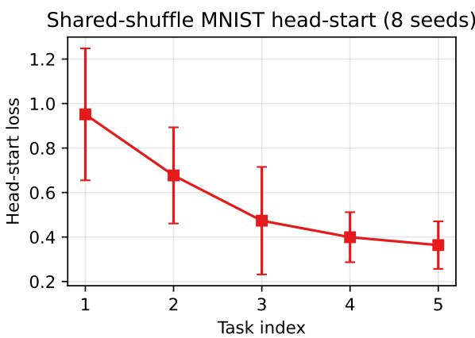  
(a) Head-start per task, $S = 3 0$

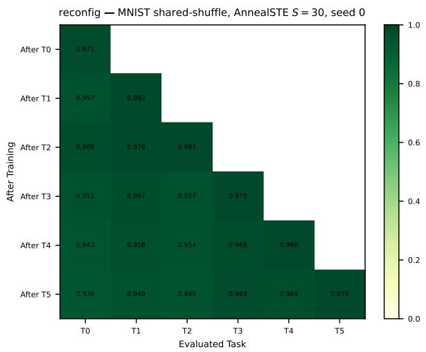  
(b) Reconfig protocol performance matrix.  
Figure 7: Shared-shufle MNIST with the default FTN configuration over 8 seeds. The top-k mask supports continual learning under concept shift; the reconfig protocol recovers prior tasks from a small support set without task identity.

## C Secondary Experiments

## C.1 Primary search and baselines

We first sweep configurer type in {Sigmoid, AnnealSTE, Gumbel-Sigmoid} and inner-step budget $S \in \{ 1 0 , 2 0 , 3 0 , 4 0 , 5 0 , 6 0 \}$ on the correlated synthetic family with $k = 5 1 2$ , support size 256, and per-batch reconfiguration. The sweep uses one shared seed to compare the 18 configurations within seed; subsequent ablations report mean and standard deviation over 8 seeds. All three configurers reach low forgetting (FM in [0.04, 0.06] across the sweep) and similar accuracy (ACC in [0.89, 0.92]). The discriminating axis is head-start: AnnealSTE attains the best head-start loss at every budget (mean 0.37 across S, vs. 0.46 for Sigmoid and 0.55 for Gumbel-Sigmoid) and is stable across budgets, while Gumbel-Sigmoid improves steadily with S but does not reach AnnealSTE’s level. AnnealSTE at $S = 3 0$ gives head-start 0.358, $\mathrm { F M } = 0 . 0 4 9 , r _ { \mathrm { s h a r e } } = 0 . 5 0 9$ ; doubling the budget to $S = 6 0$ yields no head-start gain (0.386) at twice the inner-loop cost. We therefore adopt AnnealSTE, $S = 3 0$ $k = 5 1 2$ , support size 256, and per-batch reconfiguration as the default. The full $3 \times 6$ sweep table is in Section D; Figure 8 plots head-start and forgetting against budget.

Tables 4 and 5 compare FTN with two endpoints using the same parallel bank. NoMask trains the full bank on every task, representing full sharing. FixedMask assigns deterministic disjoint blocks of k neurons, representing oracle isolation with no mask inference or sharing. FTN lies between these endpoints. On synthetic tasks, NoMask has $\mathrm { F M } = 0 . 3 9 2 \pm 0 . 0 1 6$ , FixedMask has 0 by construction, and FTN obtains $0 . 0 5 5 \pm 0 . 0 1 5$ , closing about 86% of the forgetting gap. On shared-shufle MNIST, FTN closes about 97% of the gap. Unlike FixedMask, FTN also improves head-start loss on correlated tasks and recovers nonzero concept-sharing structure.

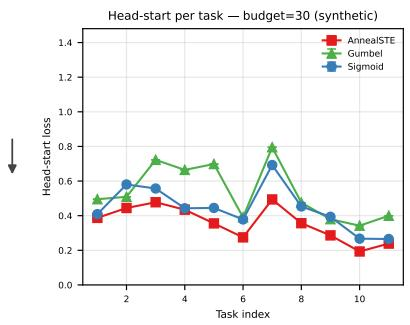  
(a) Head-start per task, $S = 3 0 .$

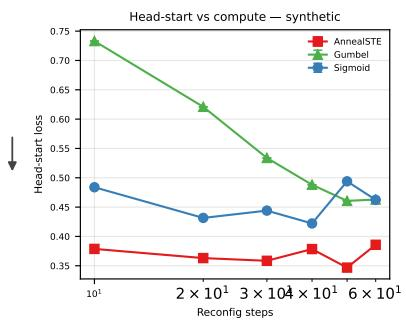  
(b) Head-start vs. budget.

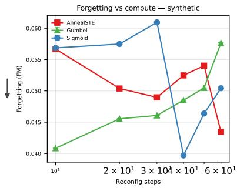  
(c) Forgetting vs. budget.  
Figure 8: Head-start loss and forgetting on the correlated synthetic family. Lower is better in both metrics. AnnealSTE obtains strong head-start loss at small budget, and all configurers reach low forgetting under per-batch reconfiguration.

Table 4: Baseline comparison on synthetic. NoMask trains the full network without any per-task mask (full parameter sharing); FixedMask uses deterministic disjoint blocks of size k per task (no transfer, oracle no-forgetting). FTN closes the FM gap between NoMask and FixedMask while recovering non-trivial concept-sharing structure that both baselines lack $( r _ { \mathrm { s h a r e } } = 0$ by construction). Mean±std over 8 seeds.
<table><tr><td>Method</td><td>ACC↑</td><td>FM↓</td><td>BWT↑</td><td>Head-start↓</td><td> $r _ { \mathrm { s h a r e } } \uparrow$ </td></tr><tr><td>NoMask</td><td> $0 . 6 1 0 \pm 0 . 0 1 9$ </td><td> $0 . 3 9 2 \pm 0 . 0 1 6$ </td><td> $- 0 . 3 9 2 \pm 0 . 0 1 6$ </td><td> $2 . 8 3 0 \pm 0 . 2 9 3$ </td><td> $0 . 0 0 0 \pm 0 . 0 0 0$ </td></tr><tr><td>FixedMask</td><td> $0 . 9 4 5 \pm 0 . 0 2 0$ </td><td> $0 . 0 0 0 \pm 0 . 0 0 0$ </td><td> $+ 0 . 0 0 0 \pm 0 . 0 0 0$ </td><td> $0 . 7 0 2 \pm 0 . 0 0 3$ </td><td> $0 . 0 0 0 \pm 0 . 0 0 0$ </td></tr><tr><td>FTN  $\mathrm { ( A n n e a l S T E , ~ } S { = } 3 0 )$ </td><td> $0 . 8 8 6 \pm 0 . 0 4 2$ </td><td> $0 . 0 5 5 \pm 0 . 0 1 5$ </td><td> $- 0 . 0 5 3 \pm 0 . 0 1 7$ </td><td> $0 . 4 2 3 \pm 0 . 0 7 7$ </td><td> $0 . 4 5 4 \pm 0 . 2 1 3$ </td></tr></table>

## C.2 Reconfiguration frequency

Per-batch reconfiguration is central to FTN’s transfer behavior. A natural alternative is to configure once at the beginning of a task block and reuse that mask for the entire task. This per-task variant creates cleaner stored masks, but it also trains a narrower set of subnetworks. In contrast, per-batch reconfiguration exposes many nearby masks to gradient signal, creating a broader pool of partially trained assemblies that future support-set optimizations can recombine.

Empirically, per-batch reconfiguration gives lower head-start loss and lower forgetting on the correlated synthetic family (Figure 9). Per-batch obtains head-start loss $0 . 4 2 5 \pm 0 . 0 8 1$ and $\mathrm { F M } =$ $0 . 0 5 5 \pm 0 . 0 1 4$ , while per-task gives $0 . 5 4 8 \pm 0 . 1 0 3$ and $0 . 1 0 0 \pm 0 . 0 2 5$ . Per-task has higher $r _ { \mathrm { s h a r e } }$ $( 0 . 6 1 1 \pm 0 . 1 0 5$ versus $0 . 4 2 9 \pm 0 . 1 9 5 )$ , consistent with a more stable stored mask, but the per-batch regime is better for forward transfer under support-set reconfiguration.

## C.3 Sparsity and support-set size

The top-k budget controls how much overlap is possible. Sweeping $k \in \{ 5 1 2 , 1 2 8 , 3 2 , 8 \}$ shows a clear isolation-transfer trade-of (Figure 10). Reducing k lowers FM from 0.056 at $k = 5 1 2$ to 0.032 at $k = 3 2$ , then 0.039 at k = 8, while head-start loss rises from about 0.42 to 0.60. Sharing fidelity improves from 0.455 to 0.624 as k decreases to 32, then falls slightly at $k = 8$ . Moderate sparsity gives the cleanest structured overlap; extreme sparsity improves isolation but leaves less reusable basis for future tasks.

The support size used by the configurer afects transfer more than retention (Figure 11). When support size decreases from 256 to 4, head-start loss rises from $0 . 4 2 5 \pm 0 . 0 8 0$ to $1 . 3 3 9 \pm 0 . 0 9 5$ reflecting poorer generalization from the support set to held-out examples. In contrast, FM remains at or below 0.060 across the sweep, and ACC stays in the 0.86 to 0.89 range. Thus the continuallearning protection is robust to small supports, while forward transfer depends on enough examples to infer a useful mask.

Table 5: Baseline comparison on MNIST shared-shufle. NoMask trains the full network without any per-task mask (full parameter sharing); FixedMask uses deterministic disjoint blocks of size k per task (no transfer, oracle no-forgetting). FTN closes the FM gap between NoMask and FixedMask while recovering non-trivial concept-sharing structure that both baselines lack $( r _ { \mathrm { s h a r e } } = 0$ by construction). Mean±std over 8 seeds.
<table><tr><td>Method</td><td>ACC↑</td><td>FM↓</td><td>BWT↑</td><td>Head-start↓</td><td> $r _ { \mathrm { s h a r e } } \uparrow$ </td></tr><tr><td>NoMask</td><td> $0 . 4 3 3 \pm 0 . 0 5 6$ </td><td> $0 . 6 5 6 \pm 0 . 0 6 7$ </td><td> $- 0 . 6 5 6 \pm 0 . 0 6 7$ </td><td> $1 0 . 8 4 0 \pm 0 . 8 8 1$ </td><td> $0 . 0 0 0 \pm 0 . 0 0 0$ </td></tr><tr><td>FixedMask</td><td> $0 . 9 7 8 \pm 0 . 0 0 1$ </td><td> $0 . 0 0 0 \pm 0 . 0 0 0$ </td><td> $+ 0 . 0 0 0 \pm 0 . 0 0 0$ </td><td> $2 . 3 1 2 \pm 0 . 0 1 6$ </td><td> $0 . 0 0 0 \pm 0 . 0 0 0$ </td></tr><tr><td>FTN  $\mathrm { ( A n n e a l S T E , ~ } S { = } 3 0 )$ </td><td> $0 . 9 6 2 \pm 0 . 0 0 4$ </td><td> $0 . 0 2 1 \pm 0 . 0 0 5$ </td><td> $- 0 . 0 2 1 \pm 0 . 0 0 5$ </td><td> $0 . 5 7 3 \pm 0 . 0 3 9$ </td><td> $0 . 3 9 8 \pm 0 . 1 2 7$ </td></tr></table>

## D Primary configurer sweep

Table 6 reports the full $3 \times 6$ sweep over configurer type and inner-step budget summarised in Section C.1. All three configurers reach low forgetting $( \mathrm { F M } \in [ 0 . 0 4 , 0 . 0 6 ] )$ and comparable accuracy; the discriminating axis is head-start loss, where AnnealSTE attains the lowest values at every budget and Gumbel-Sigmoid improves with S but does not catch up. AnnealSTE at $S = 3 0$ is the chosen default: head-start 0.358, $\mathrm { F M } = 0 . 0 4 9 , r _ { \mathrm { s h a r e } } = 0 . 5 0 9$ , with no head-start gain from doubling the budget.

## E Detailed ablation tables

This appendix collects the numerical tables underlying the secondary-experiment plots in Section C. The tables cover the task-structure ablation contrasting the correlated synthetic family with an orthogonal control (under orthogonal task generation the configurer’s mask-sharing structure collapses to chance, whereas under correlated generation it tracks the ground-truth concept-sharing matrix), the per-batch versus per-task reconfiguration comparison on the correlated synthetic family (showing the head-start and forgetting penalty incurred by holding the mask fixed across a task block), and the top-k budget and support-size sweeps that source the trade-of curves in Figures 10 and 11. All entries are mean±std over 8 seeds at the default AnnealSTE configuration (S=30, k=512, support size 256, except along the swept axis).

## F Per-benchmark tables (full mean±std)

The body Table 3 and the synthetic Table 1 compress the per-benchmark tables to means; the full mean±std tables, including FTN+Router and no-replay diagnostics for every family, are below. Each table covers one MNIST task family (shared-shufle, Permuted, Rotated) and reports ACC, FM, BWT, and head-start NLL with standard deviations across seeds for every comparator. These are the source tables for the per-family claims in Section 5.2 and the discussion of how the configurer’s contribution shifts between concept- and domain-shift regimes.

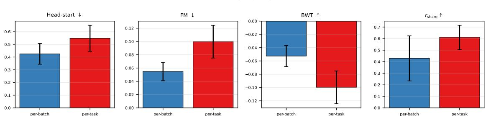  
(a) Head-start, FM, BWT, and sharing fidelity.

Head-start per task Reconfig frequency  
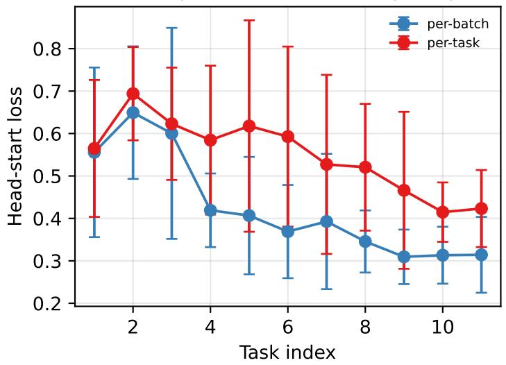  
(b) Head-start vs. task index.  
Figure 9: Reconfiguration frequency on the correlated synthetic family over 8 seeds. Per-batch reconfiguration lowers head-start loss relative to one mask per task, supporting the view that mask variation during training builds a broader reusable basis.

## G Mask overlap statistics

Table 10 reports the pairwise mask-overlap fraction $S [ i , j ] / K$ averaged over of-diagonal entries and at its largest of-diagonal pair. $S [ i , j ]$ is the count of neurons active in both task i’s and task $j ^ { \prime } \mathrm { s }$ stored mask; K is the per-task budget. The chance baseline for uniformly random $K \mathrm { - o f - } H$ subsets is $K / H$ with $H = 8 1 9 2$ . Across the AnnealSTE configurations, overlap is well above chance, confirming that the configurer reuses neurons rather than reducing to fixed disjoint subnetworks. The NoMask and FixedMask baselines bracket the range at 1.0 and 0.0.

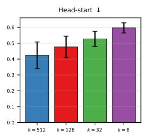

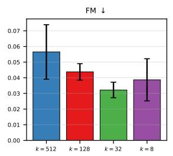

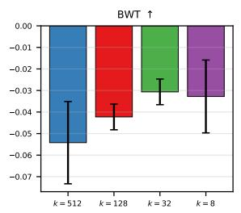  
(a) Sweep over k.

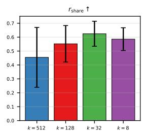

Head-start per task KWTA winners k  
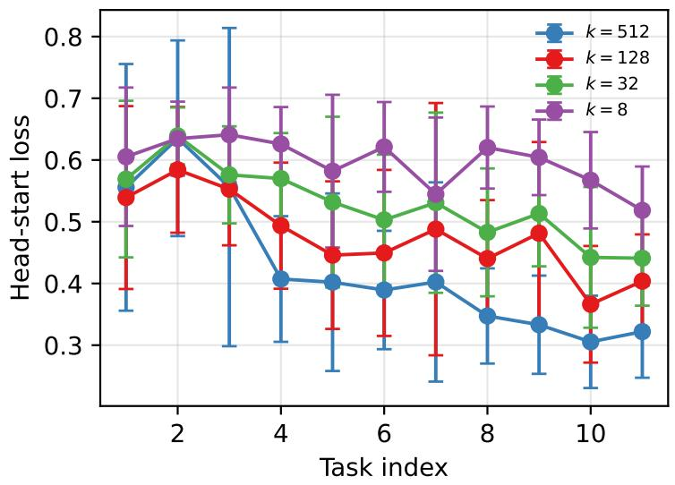  
(b) Head-start vs. task index, by k.  
Figure 10: Head-start loss, FM, BWT, and sharing fidelity versus top-k budget k on the correlated synthetic family over 8 seeds. The per-task head-start curve shows how forward transfer evolves as the bank fills out across tasks. Detailed tables are in Section E.

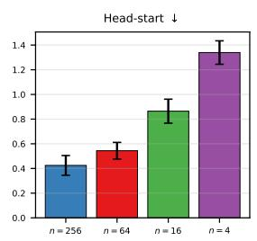

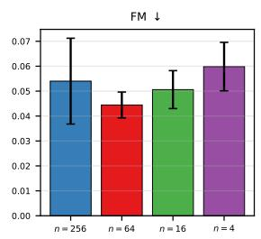

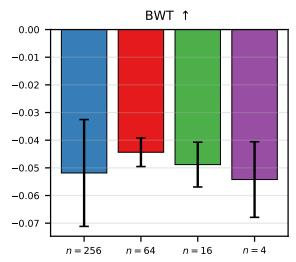  
(a) Sweep over support size.

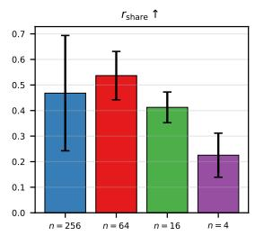

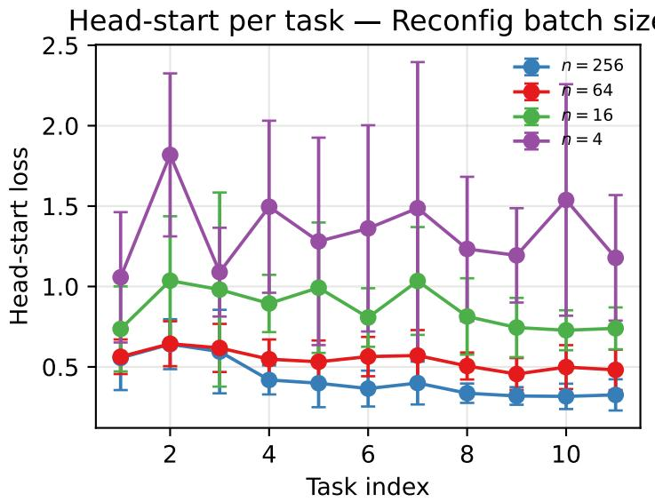  
(b) Head-start vs. task index, by support size.

Figure 11: Head-start loss, FM, BWT, and sharing fidelity versus support-set size on the correlated synthetic family over 8 seeds. The per-task head-start curve shows how forward transfer evolves as the bank fills out across tasks. Detailed tables are in Section E.

Table 6: Knowledge-transfer results on synthetic (single shared seed across all 18 method, budget configurations): ACC, forgetting (FM), backward transfer (BWT), neuron-sharing fidelity $\left( r _ { \mathrm { s h a r e } } \right)$ and pre-training mask-only loss (head-start) averaged over tasks 2 to N.
<table><tr><td>Method</td><td>Budget</td><td>ACC↑</td><td>FM↓</td><td>BWT↑</td><td>Head-start↓</td><td> $r _ { \mathrm { s h a r e } } \uparrow$ </td></tr><tr><td>Sigmoid</td><td>10</td><td>0.900</td><td>0.057</td><td>-0.057</td><td>0.484</td><td>0.491</td></tr><tr><td>Sigmoid</td><td>20</td><td>0.897</td><td>0.057</td><td>-0.057</td><td>0.432</td><td>0.581</td></tr><tr><td>Sigmoid</td><td>30</td><td>0.894</td><td>0.061</td><td>-0.061</td><td>0.444</td><td>0.477</td></tr><tr><td>Sigmoid</td><td>40</td><td>0.920</td><td>0.040</td><td>-0.040</td><td>0.422</td><td>0.226</td></tr><tr><td>Sigmoid</td><td>50</td><td>0.914</td><td>0.046</td><td>-0.046</td><td>0.494</td><td>0.221</td></tr><tr><td>Sigmoid</td><td>60</td><td>0.912</td><td>0.050</td><td>-0.050</td><td>0.462</td><td>0.262</td></tr><tr><td>AnnealSTE</td><td>10</td><td>0.907</td><td>0.057</td><td>-0.057</td><td>0.379</td><td>0.622</td></tr><tr><td>AnnealSTE</td><td>20</td><td>0.913</td><td>0.050</td><td>-0.050</td><td>0.363</td><td>0.564</td></tr><tr><td>AnnealSTE</td><td>30</td><td>0.909</td><td>0.049</td><td>-0.049</td><td>0.358</td><td>0.509</td></tr><tr><td>AnnealSTE</td><td>40</td><td>0.913</td><td>0.052</td><td>-0.052</td><td>0.378</td><td>0.617</td></tr><tr><td>AnnealSTE</td><td>50</td><td>0.909</td><td>0.054</td><td>-0.054</td><td>0.347</td><td>0.575</td></tr><tr><td>AnnealSTE</td><td>60</td><td>0.916</td><td>0.043</td><td>-0.043</td><td>0.386</td><td>0.601</td></tr><tr><td>Gumbel</td><td>10</td><td>0.893</td><td>0.041</td><td>-0.041</td><td>0.733</td><td>0.422</td></tr><tr><td>Gumbel</td><td>20</td><td>0.908</td><td>0.046</td><td>-0.045</td><td>0.621</td><td>0.179</td></tr><tr><td>Gumbel</td><td>30</td><td>0.911</td><td>0.046</td><td>-0.046</td><td>0.534</td><td>0.365</td></tr><tr><td>Gumbel</td><td>40</td><td>0.910</td><td>0.049</td><td>-0.049</td><td>0.488</td><td>0.484</td></tr><tr><td>Gumbel</td><td>50</td><td>0.904</td><td>0.050</td><td>-0.050</td><td>0.461</td><td>0.507</td></tr><tr><td>Gumbel</td><td>60</td><td>0.906</td><td>0.058</td><td>-0.058</td><td>0.463</td><td>0.508</td></tr></table>

Table 7: Shared-shufle MNIST (6 tasks) under the reconfig (no-task-identity) protocol. Mean±std over 5 seeds. Higher ACC and BWT, lower FM and head-start (HS) loss, are better.
<table><tr><td>Method</td><td>ACC↑</td><td>FM↓</td><td>BWT↑</td><td>HS↓</td></tr><tr><td>NoMask (naive seq.)</td><td> $0 . 4 4 4 \pm 0 . 0 6 5$ </td><td> $0 . 6 4 4 \pm 0 . 0 7 7$ </td><td> $- 0 . 6 4 4 \pm 0 . 0 7 7$ </td><td> $1 0 . 3 9 7 \pm 0 . 8 1 1$ </td></tr><tr><td>NoMask + ER (random replay)</td><td> $0 . 4 4 2 \pm 0 . 0 6 4$ </td><td> $0 . 6 3 0 \pm 0 . 0 7 5$ </td><td> $- 0 . 6 3 0 \pm 0 . 0 7 5$ </td><td> $8 . 5 2 4 \pm 0 . 6 2 5$ </td></tr><tr><td>FixedMask (oracle ID at eval)</td><td> $0 . 9 7 9 \pm 0 . 0 0 0$ </td><td> $0 . 0 0 0 \pm 0 . 0 0 0$ </td><td> $0 . 0 0 0 \pm 0 . 0 0 0$ </td><td> $2 . 3 0 9 \pm 0 . 0 1 8$ </td></tr><tr><td>FixedMask + retrieval router</td><td> $0 . 9 7 8 \pm 0 . 0 0 0$ </td><td> $0 . 0 0 0 \pm 0 . 0 0 0$ </td><td> $0 . 0 0 0 \pm 0 . 0 0 0$ </td><td> $2 . 3 1 1 \pm 0 . 0 1 7$ </td></tr><tr><td>FTN, random per-batch masks (ablation)</td><td> $0 . 9 2 3 \pm 0 . 0 0 6$ </td><td> $0 . 0 2 7 \pm 0 . 0 0 6$ </td><td> $- 0 . 0 2 4 \pm 0 . 0 0 5$ </td><td> $6 . 6 5 2 \pm 0 . 6 2 8$ </td></tr><tr><td>FTN (ours)</td><td> $0 . 9 6 0 \pm 0 . 0 0 5$ </td><td> $0 . 0 2 3 \pm 0 . 0 0 5$ </td><td> $- 0 . 0 2 3 \pm 0 . 0 0 5$ </td><td> $0 . 5 6 2 \pm 0 . 0 2 8$ </td></tr><tr><td>FTN + retrieval router (eval-only)</td><td> $0 . 9 6 1 \pm 0 . 0 0 2$ </td><td> $0 . 0 2 2 \pm 0 . 0 0 3$ </td><td> $- 0 . 0 2 2 \pm 0 . 0 0 3$ </td><td> $0 . 5 6 1 \pm 0 . 0 1 9$ </td></tr><tr><td>FTN, no replay</td><td> $0 . 8 8 1 \pm 0 . 0 2 1$ </td><td> $0 . 1 1 9 \pm 0 . 0 2 5$ </td><td> $- 0 . 1 1 9 \pm 0 . 0 2 5$ </td><td> $0 . 7 6 1 \pm 0 . 0 5 3$ </td></tr></table>

Table 8: PermutedMNIST (10 tasks) under the reconfig (no-task-identity) protocol. Mean±std over 5 seeds. Higher ACC and BWT, lower FM and head-start (HS) loss, are better.
<table><tr><td>Method</td><td>ACC↑</td><td>FM↓</td><td>BWT↑</td><td>HS↓</td></tr><tr><td>NoMask (naive seq.)</td><td> $0 . 9 2 8 \pm 0 . 0 0 7$ </td><td> $0 . 0 5 3 \pm 0 . 0 0 8$ </td><td> $- 0 . 0 5 3 \pm 0 . 0 0 8$ </td><td> $5 . 2 0 7 \pm 0 . 1 9 5$ </td></tr><tr><td>NoMask + ER (random replay)</td><td> $0 . 9 6 0 \pm 0 . 0 0 2$ </td><td> $0 . 0 1 8 \pm 0 . 0 0 2$ </td><td> $- 0 . 0 1 8 \pm 0 . 0 0 2$ </td><td> $5 . 2 7 0 \pm 0 . 1 5 3$ </td></tr><tr><td>FixedMask (oracle ID at eval)</td><td> $0 . 9 7 9 \pm 0 . 0 0 0$ </td><td> $0 . 0 0 0 \pm 0 . 0 0 0$ </td><td> $0 . 0 0 0 \pm 0 . 0 0 0$ </td><td> $2 . 3 2 1 \pm 0 . 0 0 5$ </td></tr><tr><td>FixedMask + retrieval router</td><td> $0 . 9 7 9 \pm 0 . 0 0 0$ </td><td> $0 . 0 0 0 \pm 0 . 0 0 0$ </td><td> $0 . 0 0 0 \pm 0 . 0 0 0$ </td><td> $2 . 3 2 0 \pm 0 . 0 0 6$ </td></tr><tr><td>FTN, random per-batch masks (ablation)</td><td> $0 . 9 1 5 \pm 0 . 0 0 3$ </td><td> $0 . 0 1 7 \pm 0 . 0 0 4$ </td><td> $- 0 . 0 1 6 \pm 0 . 0 0 4$ </td><td> $3 . 4 1 1 \pm 0 . 0 9 6$ </td></tr><tr><td>FTN (ours)</td><td> $0 . 9 5 4 \pm 0 . 0 0 1$ </td><td> $0 . 0 2 4 \pm 0 . 0 0 1$ </td><td> $- 0 . 0 2 4 \pm 0 . 0 0 1$ </td><td> $1 . 6 1 6 \pm 0 . 0 2 6$ </td></tr><tr><td>FTN + retrieval router (eval-only)</td><td> $0 . 9 5 2 \pm 0 . 0 0 4$ </td><td> $0 . 0 2 7 \pm 0 . 0 0 4$ </td><td> $- 0 . 0 2 7 \pm 0 . 0 0 4$ </td><td> $1 . 5 9 3 \pm 0 . 0 1 3$ </td></tr><tr><td> $\mathrm { F T N } ,$  no replay</td><td> $0 . 9 4 5 \pm 0 . 0 0 1$ </td><td> $0 . 0 3 4 \pm 0 . 0 0 1$ </td><td> $- 0 . 0 3 4 \pm 0 . 0 0 1$ </td><td> $1 . 5 7 7 \pm 0 . 0 2 9$ </td></tr></table>

Table 9: RotatedMNIST (10 tasks) under the reconfig (no-task-identity) protocol. Mean±std over 5 seeds. Higher ACC and BWT, lower FM and head-start (HS) loss, are better.
<table><tr><td>Method</td><td>ACC↑</td><td>FM↓</td><td>BWT↑</td><td>HS↓</td></tr><tr><td>NoMask (naive seq.)</td><td> $0 . 5 2 3 \pm 0 . 0 0 7$ </td><td> $0 . 5 0 9 \pm 0 . 0 0 8$ </td><td> $- 0 . 5 0 9 \pm 0 . 0 0 8$ </td><td> $0 . 3 6 0 \pm 0 . 0 1 0$ </td></tr><tr><td>NoMask + ER (random replay)</td><td> $0 . 9 1 2 \pm 0 . 0 0 3$ </td><td> $0 . 0 7 5 \pm 0 . 0 0 3$ </td><td> $- 0 . 0 7 5 \pm 0 . 0 0 3$ </td><td> $0 . 6 6 7 \pm 0 . 0 2 5$ </td></tr><tr><td>FixedMask (oracle ID at eval)</td><td> $0 . 9 7 9 \pm 0 . 0 0 0$ </td><td> $0 . 0 0 0 \pm 0 . 0 0 0$ </td><td> $0 . 0 0 0 \pm 0 . 0 0 0$ </td><td> $2 . 3 2 2 \pm 0 . 0 0 7$ </td></tr><tr><td>FixedMask + retrieval router</td><td> $0 . 9 7 9 \pm 0 . 0 0 0$ </td><td> $0 . 0 0 0 \pm 0 . 0 0 0$ </td><td> $0 . 0 0 0 \pm 0 . 0 0 0$ </td><td> $2 . 3 2 1 \pm 0 . 0 0 7$ </td></tr><tr><td>FTN, random per-batch masks (ablation)</td><td> $0 . 8 6 7 \pm 0 . 0 0 2$ </td><td> $0 . 0 8 7 \pm 0 . 0 0 2$ </td><td> $- 0 . 0 8 7 \pm 0 . 0 0 2$ </td><td> $0 . 6 2 1 \pm 0 . 0 3 0$ </td></tr><tr><td>FTN (ours)</td><td> $0 . 9 4 1 \pm 0 . 0 0 0$ </td><td> $0 . 0 4 3 \pm 0 . 0 0 1$ </td><td> $- 0 . 0 4 3 \pm 0 . 0 0 1$ </td><td> $0 . 3 2 4 \pm 0 . 0 0 7$ </td></tr><tr><td>FTN + retrieval router (eval-only)</td><td> $0 . 9 3 6 \pm 0 . 0 0 3$ </td><td> $0 . 0 4 9 \pm 0 . 0 0 3$ </td><td> $- 0 . 0 4 9 \pm 0 . 0 0 3$ </td><td> $0 . 3 1 1 \pm 0 . 0 0 2$ </td></tr><tr><td>FTN, no replay</td><td> $0 . 7 6 7 \pm 0 . 0 0 4$ </td><td> $0 . 2 3 8 \pm 0 . 0 0 4$ </td><td> $- 0 . 2 3 8 \pm 0 . 0 0 4$ </td><td> $0 . 2 7 5 \pm 0 . 0 0 5$ </td></tr></table>

Table 10: Pairwise mask-overlap fraction $S [ i , j ] / K$ across configurations. “mean of-diag” averages over all $i \neq j$ entries; “max of-diag” is the largest pair per run, then averaged over seeds. Chance is the expected overlap for uniformly random K-of-H subsets.
<table><tr><td>Condition</td><td>n</td><td>K</td><td>mean off-diag</td><td>max off-diag</td><td>chance  $( K / H )$ </td></tr><tr><td>Task structure</td><td></td><td></td><td></td><td></td><td></td></tr><tr><td>Correlated</td><td>8</td><td>512</td><td> $0 . 3 8 7 \pm 0 . 0 5 2$ </td><td> $0 . 5 7 7 \pm 0 . 0 2 2$ </td><td>0.062</td></tr><tr><td>Orthogonal</td><td>8</td><td>512</td><td> $0 . 3 6 5 \pm 0 . 0 2 5$ </td><td> $0 . 5 5 4 \pm 0 . 0 2 5$ </td><td>0.062</td></tr><tr><td>Reconfig freq</td><td></td><td></td><td></td><td></td><td></td></tr><tr><td>per-batch</td><td>8</td><td>512</td><td> $0 . 3 9 0 \pm 0 . 0 5 0$ </td><td> $0 . 5 8 5 \pm 0 . 0 3 1$ </td><td>0.062</td></tr><tr><td>per-task</td><td>8</td><td>512</td><td> $0 . 1 4 2 \pm 0 . 0 3 4$ </td><td> $0 . 3 1 3 \pm 0 . 0 6 9$ </td><td>0.062</td></tr><tr><td>Budget K</td><td></td><td></td><td></td><td></td><td></td></tr><tr><td> $\mathrm { K } { = } 5 1 2$ </td><td>8</td><td>512</td><td> $0 . 3 9 1 \pm 0 . 0 6 1$ </td><td> $0 . 5 8 9 \pm 0 . 0 4 2$ </td><td>0.062</td></tr><tr><td> $\mathrm { K } { = } 1 2 8$ </td><td>8</td><td>128</td><td> $0 . 4 2 4 \pm 0 . 0 3 4$ </td><td> $0 . 6 1 5 \pm 0 . 0 4 1$ </td><td>0.016</td></tr><tr><td> $\mathrm { K } { = } 3 2$ </td><td>8</td><td>32</td><td> $0 . 4 3 7 \pm 0 . 0 2 0$ </td><td> $0 . 6 8 8 \pm 0 . 0 2 2$ </td><td>0.004</td></tr><tr><td> $\mathrm { K } { = } 8$ </td><td>8</td><td>8</td><td> $0 . 3 4 6 \pm 0 . 0 4 2$ </td><td> $0 . 8 1 2 \pm 0 . 0 8 8$ </td><td>0.001</td></tr><tr><td>Reconfig batch</td><td></td><td></td><td></td><td></td><td></td></tr><tr><td> $\mathrm { n { = } 2 5 6 }$ </td><td>8</td><td>512</td><td> $0 . 3 8 6 \pm 0 . 0 5 7$ </td><td> $0 . 5 7 9 \pm 0 . 0 4 5$ </td><td>0.062</td></tr><tr><td> $\mathrm { n { = } 6 4 }$ </td><td>8</td><td>512</td><td> $0 . 4 1 3 \pm 0 . 0 2 0$ </td><td> $0 . 5 6 7 \pm 0 . 0 3 4$ </td><td>0.062</td></tr><tr><td> $\mathrm { n } { = } 1 6$ </td><td>8</td><td>512</td><td> $0 . 4 2 4 \pm 0 . 0 2 3$ </td><td> $0 . 5 9 5 \pm 0 . 0 3 6$ </td><td>0.062</td></tr><tr><td> $\mathrm { n } { = } 4$ </td><td>8</td><td>512</td><td> $0 . 3 9 7 \pm 0 . 0 1 4$ </td><td> $0 . 5 6 8 \pm 0 . 0 3 7$ </td><td>0.062</td></tr><tr><td>MNIST</td><td></td><td></td><td></td><td></td><td></td></tr><tr><td>default</td><td>8</td><td>512</td><td> $0 . 5 0 1 \pm 0 . 0 2 9$ </td><td> $0 . 6 6 5 \pm 0 . 0 4 5$ </td><td>0.062</td></tr><tr><td>Baselines  $( s y n t h )$ </td><td></td><td></td><td></td><td></td><td></td></tr><tr><td>NoMask</td><td>8</td><td>512</td><td> $1 . 0 0 0 \pm 0 . 0 0 0$ </td><td> $1 . 0 0 0 \pm 0 . 0 0 0$ </td><td>0.062</td></tr><tr><td>FixedMask</td><td>8</td><td>512</td><td> $0 . 0 0 0 \pm 0 . 0 0 0$ </td><td> $0 . 0 0 0 \pm 0 . 0 0 0$ </td><td>0.062</td></tr><tr><td>Baselines (MNIST)</td><td></td><td></td><td></td><td></td><td></td></tr><tr><td>NoMask</td><td>8</td><td>512</td><td> $1 . 0 0 0 \pm 0 . 0 0 0$ </td><td> $1 . 0 0 0 \pm 0 . 0 0 0$ </td><td>0.062</td></tr><tr><td>FixedMask</td><td>8</td><td>512</td><td> $0 . 0 0 0 \pm 0 . 0 0 0$ </td><td> $0 . 0 0 0 \pm 0 . 0 0 0$ </td><td>0.062</td></tr></table>