# Beyond Flat Walks: Compositional Abstraction for Autoregressive Graph Generation

Kaiwen Bian\*,1,2 Andrew H. Yang\*,1 Yusu Wang†,1

Ali Parviz†,1 Gal Mishne†,1

1University of California San Diego 2Salk Institute for Biological Studies \*Equal contribution. †Equal supervision.

{kbian, any012, yusuwang, alparviz, gmishne}@ucsd.edu

Website: kbian.org/MOSAIC-website Code: github.com/KevinBian107/MOSAIC

## Abstract

Autoregressive graph generators typically linearize graphs through flat node-edge walks, which can obscure higher-order structure in large and complex graphs. We introduce a hierarchical graph abstraction and coarse-to-fine generation pipeline that separates coarsening, tokenization, and decoding. This exposes three design axes: community coarsening, hierarchical tokenization, and order randomization. Across these axes, traversal-based hierarchy consistently improves distributional and structural fidelity, while its V.U.N. cost depends strongly on the coarsening and randomization policy. In particular, the fidelity-V.U.N. trade-off observed under within-community randomization is substantially reduced when traversal order is randomized across the full hierarchy. With a fixed backbone, training protocol, and matched training time across five molecular and five non-molecular benchmarks, hierarchical serialization yields consistent distributional and structural gains on all molecular datasets, while the non-molecular results further show that these gains depend on how well the supplied hierarchy aligns with structure in the target distribution. Together, these results characterize when and how hierarchical serialization benefits autoregressive graph generation.

## 1 Introduction

Recent progress in generative modeling has been driven by scalable architectures such as transformers and diffusion models, together with the availability of increasingly large-scale datasets. These advances have transformed generation across multiple modalities, including images [Rombach et al., 2022], natural language [Brown et al., 2020, Touvron et al., 2023a,b], and audio [Dhariwal et al., 2020, Huang et al., 2024]. Motivated by the importance of graphs in scientific applications, recent work has extended diffusion-based generation to graph-structured data, achieving strong performance on molecular and general graph synthesis tasks [Jo et al., 2022, Vignac et al., 2023, Mathiasen et al., 2024, Ingraham et al., 2019, Brockschmidt et al., 2018]. However, most diffusion-based graph models rely on dense adjacency representations and iterative denoising procedures, resulting in quadratic memory complexity and additional computational overhead from structural encodings such as spectral features, limiting their scalability to large graphs.

Autoregressive graph generation provides an alternative paradigm in which graphs are constructed sequentially through node and edge generation decisions [Liao et al., 2019, You et al., 2018]. Early approaches relied on handcrafted sequentializations and recurrent architectures, enabling structurally valid generation on small graphs but struggling to capture long-range dependencies and global topology, which led to weaker performance compared to recent diffusion-based methods [Vignac et al., 2023, Jo et al., 2023, Lim et al., 2020]. More recent work has explored adapting autoregressive transformers to graph generation by representing graphs as token sequences compatible with causal language modeling [Chen et al., 2025]. Existing tokenization strategies typically linearize graphs through random walks [Bojchevski et al., 2018] or depth-first traversals [Goyal et al., 2020]. Although these representations preserve local connectivity, they often fail to capture the hierarchical and compositional structure of graphs, such as motifs, rings, and communities [Jin et al., 2018 Newman and Girvan, 2004], making it increasingly difficult to model large and structurally complex graphs using flat token sequences alone.

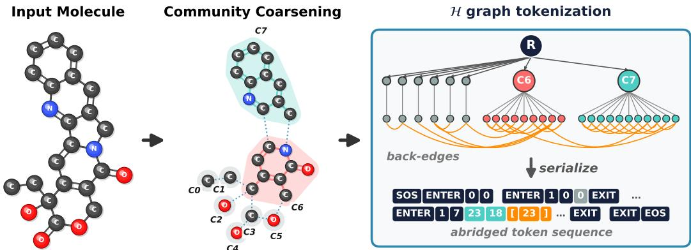  
Figure 1: Encoding pipeline, illustrated on camptothecin. Motif coarsening gives two nonsingleton communities (C6, C7) and six singleton communities (C0–C5), defining H. HDT serializes the hierarchy depth-first: [ENTER]/[EXIT] delimit communities, and back-edge brackets connect each atom to previously emitted neighbors within or across communities (orange arcs). The sequence is abridged, retains original atom indices, and omits atom- and bond-type tokens.

In this work, we introduce a hierarchical graph abstraction, H, and a coarse-to-fine framework for autoregressive graph generation (Figures 1 and 2). The framework first coarsens a graph into a hierarchy of communities, then serializes that hierarchy into a token sequence, and finally decodes the sequence exactly back into graph space. This formulation exposes three design axes: how the graph is coarsened, how the hierarchy is tokenized, and how ordering is randomized during training. We study domain-agnostic and chemistry-aware coarsening strategies together with several hierarchical tokenizers. Our main tokenizer, Hierarchical Depth Traversal (HDT), traverses the hierarchy depthfirst while representing both intra- and inter-community connectivity through standard back edges. We also consider Hierarchical SENT (HSENT), which represents communities and cross-community connectivity explicitly, and HDTC, a chemistry-aware variant of HDT that augments community blocks with semantic type labels. All representations are lossless and compatible with standard causal transformers.

Our contributions are threefold and concern the serialization rather than a new model architecture: we keep a standard causal transformer throughout and compare how graphs are structured and presented to it. First, we introduce a generic hierarchical framework for autoregressive graph generation that decomposes generation into graph coarsening, hierarchical tokenization, and exactly invertible decoding, making it applicable across molecular, biological, and synthetic graph domains. Second we propose simple and scalable coarse-to-fine hierarchical tokenization schemes that expose global community structure before local connectivity, and show that they substantially improve distributional and structural fidelity over flat tokenization across five molecular benchmarks and non-molecular datasets when meaningful hierarchy is present, while in some settings introducing a trade-off with V.U.N. Third, and critically, we study the three design axes exposed by this framework (coarsening strategy, hierarchical serialization scheme, and order-randomization strategy) showing how the quality of the recovered hierarchy, the way it is represented, and the extent of order randomization together determine the gains, with hierarchy-wide randomization largely removing the V.U.N. cost of more restricted hierarchical orderings.

The remainder of the paper is structured as follows: we review related work in Section 2, formalize the pipeline in Section 3, report empirical results in Section 4, and conclude in Section 5.

## 2 Related work

Graph generation and tokenization. Existing graph generation methods broadly fall into two categories: autoregressive models, which construct graphs sequentially by adding nodes and edges [You et al., 2018, Jang et al., 2024], and one-shot approaches that generate the entire graph simultaneously while preserving permutation equivariance, including graph VAEs [Kipf and Welling, 2016], GANs [Martinkus et al., 2022], and more recently diffusion-based models [Ho et al., 2020, Song et al., 2021, Lipman et al., 2023]. Within the autoregressive setting, prior work such as GraphRNN [You et al., 2018], GRAN [Liao et al., 2019], GraphGen [Goyal et al., 2020], and AutoGraph/SENT [Chen et al., 2025] typically linearizes graphs using traversals such as BFS, DFS, or random walks. While these approaches are lossless and computationally efficient, they flatten the graph into a single sequential view, leaving higher-order structures such as motifs and communities implicit in the token stream. Our work builds on this sequence-based autoregressive paradigm and investigates whether hierarchical tokenization can expose global graph structure while retaining exact graph reconstruction. This direction is complementary to diffusion and score-based graph generators [Niu et al., 2020, Jo et al., 2022, Vignac et al., 2023, Kong et al., 2023], which operate under a fundamentally different modeling framework.

Recent efforts have also explored latent diffusion architectures for graph generation [Rombach et al., 2022, Peebles and Xie, 2023, Gaiński et al., 2025, Esser et al., 2024, Joshi et al., 2025], motivated by the efficiency gains of performing diffusion in compressed latent spaces. However, existing graph latent diffusion methods remain limited in scalability and reconstruction fidelity. Prior work either focuses on small molecular graphs [Nguyen et al., 2024], relies on dense attention or adjacency representations with quadratic complexity [Nguyen et al., 2024, Zhou et al., 2024], or targets specialized downstream tasks such as molecular generation, link prediction, or regression [Fu et al., 2024, Ketata et al., 2025, Sghaier et al., 2026, Parviz and Yoshida, 2026, Huang et al., 2025, Wang et al., 2024, Bian et al., 2024, Zhou et al., 2024, Yang et al., 2024]. In contrast, our approach introduces a hierarchical autoregressive representation in which the graph structure remains losslessly recoverable while avoiding explicit dense adjacency modeling.

Hierarchical representations. Hierarchical structure is pervasive in graph domains such as chemistry and biology, where low-level components organize into higher-order motifs and functional substructures [Jin et al., 2018, Maziarz et al., 2022, Dobson and Doig, 2003]. Prior work has leveraged this property through hierarchical and multiscale architectures for both representation learning and generation, including JT-VAE [Jin et al., 2018], HiGen [Karami, 2024], and domainspecific serializations such as T-SMILES [Wu et al., 2024]. Unlike our setting, however, T-SMILES operates over SMILES strings rather than native graphs. Motif-aware generators such as MoLeR [Maziarz et al., 2022] likewise build the structural prior into the model. More broadly, these approaches rely on specialized generative architectures that are difficult to scale with modern transformer-based modeling [Chen et al., 2025]. In contrast, our work introduces hierarchy directly at the tokenization level while retaining a standard autoregressive transformer backbone, so the structural prior is a property of the input encoding rather than of the model. Its reach beyond chemistry and biology is set by the coarsening step, for which a domain-specific detector can be substituted where interpretable units exist and a domain-agnostic one used where they do not (Section 4.6).

We formulate autoregressive graph generation as next-token prediction over a hierarchical sequence representation of the input graph. Our pipeline (Figures 1 and 2) proceeds in three stages: coarsening, which builds a partition tree H from the input graph G; tokenization, which serializes G using H into a flat token sequence in coarse-before-fine order; and decoding, which losslessly reconstructs the graph from its complete encoding.

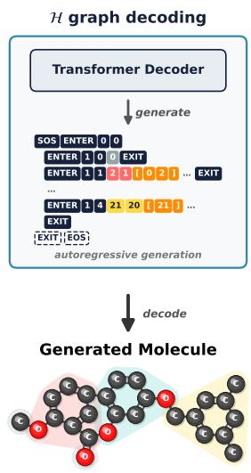  
Figure 2: Decoding pipeline illustration. A causal transformer generates an HDT sequence; community nesting and back-edge brackets specify the graph structure. The schematic shows an abridged sequence and molecular output, with atom- and bond-type tokens omitted.

## 3 Methods

## 3.1 Autoregressive setting

We serialize a graph G into a token sequence $\mathbf { t } = ( t _ { 1 } , \dots , t _ { L } ) \in \mathcal { V } ^ { L }$ over a finite vocabulary V and model it with a causal transformer parameterized by θ. Thus, once the graph has been serialized, the learning problem is ordinary next-token prediction:

$$
p _ { \theta } ( \mathbf { t } ) = \prod _ { i = 1 } ^ { L } p _ { \theta } ( t _ { i } \mid \mathbf { t } _ { < i } ) , \qquad \mathbf { t } _ { < i } = ( t _ { 1 } , \ldots , t _ { i - 1 } ) .
$$

Equivalently, for a single training example we minimize the negative log-likelihood

$$
\mathcal { L } ( \boldsymbol { \theta } ; \mathbf { t } ) = - \sum _ { i = 1 } ^ { L } \log p _ { \boldsymbol { \theta } } ( t _ { i } \mid \mathbf { t } _ { < i } ) .
$$

The transformer architecture and training objective are standard; our contribution lies in how the graph is serialized into t. We represent each input token by the sum of its token and position embeddings. A causal attention mask ensures that the prediction of $t _ { i }$ depends only on the preceding tokens t<i. The next subsections define the hierarchical representation and tokenization scheme that produce sequences in a coarse-before-fine order

## 3.2 Hierarchical graph as a partition tree

Let $G = ( V , E )$ be a finite simple undirected graph with $n = | V |$ nodes and $m = | E |$ edges, optionally carrying discrete node and edge attributes. A partition $\sigma : V  [ k ]$ , where $[ k ] { \stackrel { - } { = } } \left\{ 1 , \dots , k \right\}$ , assigns each node to one of k communities $C _ { 1 } , \ldots , C _ { k }$ with $C _ { i } = \sigma ^ { - 1 } ( i )$ . Each community induces the subgraph $G [ C _ { i } ] = ( \dot { C } _ { i } , E [ C _ { i } ] )$ where $\bar { E } [ C _ { i } ] = \{ ( u , v ) \in \bar { E } :$ $u , v \in C _ { i } \}$ collects intra-community edges, and the remaining edges $B _ { i j } = \{ ( u , v ) \in E : u \in C _ { i } , v \in C _ { j } \}$ for $i \neq j$ are cross-community edges. We define the hierarchical graph H as a rooted partition tree: the root corresponds to $\hat { V }$ and encloses the top-level partition, with one terminal child when no split is made. For recursive HAC, the same coarsening rule is reapplied to induced subgraphs G[C]. The threshold τ is the minimum community size at which splitting is attempted; recursion stops when $| C | < \tau$ or no split into at least two nonempty child communities is found. The leaves of H form a partition of V at the finest scale, while internal nodes encode coarser-scale community struc-

Algorithm 1 HDT tokenization (topology shown)   
Require: Graph G; partition tree H with root R;   
R/FR traversal policy   
Ensure: Token sequence t   
1: t ← [[SOS]]; Vseen ← ∅   
2: ρ ← ∅ node-ID map   
3: TRAVERSE(R, l = 0)   
4: t.append([EOS]); return t   
5: procedure TRAVERSE(C, l)   
6:  t.append([ENTER], ${ \dot { \ell } } , \operatorname { i d } ( C ) )$   
7: if C is a leaf of H then   
8: for v ∈ C in traversal order do   
9: ρ(v) ← |Vseen|; t.append(ρ(v))   
10: B ← NG(v)∩ Vseen   
11: if B ≠ ∅ then   
12: B ← sorted({ρ(u) : u ∈ B})   
13: t.append([LEDGE], B, [REDGE])   
14: end if   
15: $V _ { \mathrm { s e n } }  V _ { \mathrm { s e n } } \cup \{ v \}$   
16: end for   
17: else internal node   
18: for child C' of C in traversal order do   
19: TRAVERSE(C', l + 1)   
20: end for   
21: end if   
22: t.append([EXIT])   
23: end procedure

ture. We use $\tau = 4$ by default, with block-model threshold interventions reported in Appendix F.4; empirical depth distributions are reported in Appendix D.2, and a visualization of H on cholesterol is shown in Appendix C.2.

## 3.3 Coarsening

The coarsening step determines the partition tree H. We consider one domain-agnostic strategy that applies to every benchmark and one chemistry-aware strategy used only on molecular graphs; a second, typed chemistry-aware strategy is used only by $H D T \bar { C }$ and is described with that tokenizer (Appendix C.4.4). The domain-agnostic option is hierarchical agglomerative clustering (HAC) with average linkage on pairwise dissimilarities derived from edge affinities. A finite non-edge penalty discourages merging nonadjacent nodes, and the cut maximizes weighted modularity over the candidate community counts [Newman and Girvan, 2004].

For molecular graphs, the natural unit is the ring system, motivated by the observation that molecular validity and function are organized around rings and functional groups. Motif Community (MC) detects ring systems via SMARTS substructure queries [Weininger, 1988], merges overlapping rings into a single motif community, and absorbs leftover atoms into adjacent motif communities when possible. HAC derives a recursive hierarchy from graph structure, whereas MC uses a fixed catalog of molecular substructures and supplies one community level below the root. HAC communities need not correspond to recognizable motifs, while MC's granularity depends on the motifs present. Section 4.5 compares their generation performance. We name a configuration tokenizer-coarsening (so HDT-MC is the traversal tokenizer with Motif Community coarsening, HDT-HAC the same with agglomerative clustering) and append a suffix for the order-randomization policy defined in Section 3.5.

## 3.4 Tokenization

Given G and H, we serialize the graph into a one-dimensional token sequence $\textbf { t } \in \mathcal { V } ^ { L }$ over a discrete vocabulary V. All hierarchical tokenizers we consider follow a coarse-before-fine principle. They emit higher-level community structure before the node-level detail within each community. The purpose of introducing hierarchy is to expose large-scale organization early in the sequence, so that later local decisions are made in that context. A fine-to-coarse order would weaken this benefit, because the model would have to generate low-level structure before seeing the higher-level organization meant to guide it. The design axis is then how explicit the hierarchy is in the token stream (Table 1). Two more explicit alternatives, the declarative HSENT and the typed molecular HDTC, are defined in Appendix C.4 and evaluated in Appendix E.6; the tokenizer we introduce here and use throughout the paper, and the strongest of the three in our experiments, is the traversal-based HDT.

HDT performs a single depth-first traversal of H (Algorithm 1). Each tree node opens a community block with [ENTER], followed by its recursion depth l and community identifier, and closes it with [EXIT]. Internal blocks contain their child communities; leaf blocks emit their original graph nodes in the order specified by the randomization policy. When a node v is emitted, HDT lists its previously emitted neighbors $N _ { G } ( v ) \cap V _ { \mathrm { s e e n } }$ in a back-edge bracket, where $N _ { G } ( v )$ is the full neighbor set. The map ρ assigns global serialization IDs in first-visit order; node tokens and targets use these IDs. Community IDs are local to each sibling set, with root ID 0. Targets may lie in the same or another community. This is the central design choice: cross-community edges are emitted as ordinary back edges, syntactically indistinguishable from intra-community ones. Cross-community connectivity therefore uses the same edge syntax as within-community connectivity, while nested traversal of H expresses the community structure. The resulting sequence length is $O ( n + m )$ . For molecular graphs, atom-type tokens follow node identifiers and bond-type tokens follow edge targets. Algorithm 1 shows the traversal structure and omits these attribute tokens.

Table 1: Tokenizer characteristics. MC+FG means Motif plus Functional Group; $R / F / S$ denote ring, functional-group and singleton type labels. The design axis is how explicitly hierarchy appears in the token stream. n, m, c, k denote number of nodes, edges, cross-community edges, and top-level communities. For HSENT, the sum counts catalog-emitting community blocks. Length ratios are means over the molecular benchmarks (Appendix D.3); Section 4.5 reports what each degree of explicitness is worth.
<table><tr><td>Tokenizer</td><td>Hierarchy</td><td>Coarsening</td><td>Cross-community edges</td><td>Token cost</td><td>Length vs SENT</td></tr><tr><td>SENT</td><td>flat (single walk)</td><td>not used</td><td>N/A (no communities)</td><td> $O ( n + m )$ </td><td>1×</td></tr><tr><td>HSENT</td><td>declarative (catalog + wiring)</td><td>any</td><td>explicit bipartite block (i, j)</td><td> $\begin{array} { r } { O ( m ^ { * } ) \mathop { \sum _ { C } | C | } ) } \end{array}$ </td><td>~3×</td></tr><tr><td>HDT</td><td>traversal-based (DFS of H)</td><td>any</td><td>DFS back edges (implicit)</td><td> $O ( n + \bar { m } )$ </td><td>~2×</td></tr><tr><td>HDTC</td><td>traversal-based, typed blocks  $( R / F / S )$ </td><td> $\mathbf { M } \mathbf { \bar { C } } \mathbf { + } \mathbf { F } \mathbf { G } \ \mathrm { o n l y }$ </td><td>explicit super-graph tuple</td><td> $O ( n + m + c )$ </td><td>~2×</td></tr></table>

## 3.5 Order randomization

A graph admits many valid serializations. For HDT, we augment the training data as follows: we resample traversal choices at each presentation while holding the graph, its attributes, community memberships, and partition hierarchy H fixed. Within-Community Randomization (-R) preserves community order and randomizes traversal within each terminal community. Full Hierarchy-Wide Randomization (-FR) also samples an adjacency-constrained depth-first traversal between communities at each hierarchy level. Communities with a traversal parent are entered through a node adjacent to that parent, and traversal within terminal communities is randomized. Both policies assign node identifiers in first-visit order. Table 2 summarizes the policies; Appendix C.3 specifies the traversal, identifier assignment, and handling of disconnected components, and gives a worked example.

Table 2: Order-randomization policies. Traversal choices are resampled at each training presentation. Both policies preserve the graph and its partition hierarchy and assign node identifiers in first-visit order. FR additionally changes community order, entry constraints, and community identifier assignment; its comparison with R therefore evaluates the complete traversal policy.
<table><tr><td>Choice</td><td>Within-community (-R)</td><td>Hierarchy-wide (-FR)</td></tr><tr><td>Community order</td><td>Stored order</td><td>Randomized DFS over sibling-community adja- cency graphs</td></tr><tr><td>Leaf traversal</td><td>Random-root BFS with randomized neighbor order</td><td>Randomized BFS with entry constrained by the traversal parent, when one exists</td></tr><tr><td>Community identifiers Hierarchy levels</td><td>Stored identifiers Randomization within terminal commu-</td><td>Encounter order within each sibling set Community traversal at every available level, plus</td></tr><tr><td></td><td>nities</td><td>traversal within terminal communities</td></tr></table>

## 3.6 Decoding

Decoding inverts each tokenization by parsing community boundaries, node records and edge records then unifying the recovered intra- and inter-community edge sets to reconstruct G, including its encoded node and edge attributes. All three schemes are lossless (exactly invertible up to node relabeling) for complete, untruncated encodings:

$$
{ \mathcal { H } } = \operatorname { c o a r s e n } ( G ) , \qquad \operatorname* { d e c o d e } ( \operatorname { t o k e n i z e } ( G , { \mathcal { H } } ) ) \cong G ,
$$

where the isomorphism preserves the encoded attributes. The leaves form an exhaustive, disjoint partition of V, and every node and edge is recorded, so the coarsen-tokenize-decode pipeline is information preserving. HDT and HSENT record each edge once; legacy HDTC additionally repeats cross-community edges in its super-graph record, and decoding coalesces these duplicates. Round-trip tests check this reconstruction property on representative graph fixtures, including labeled graphs.

Losslessness is a property of the encoder-decoder pair on its encodings, not a guarantee that arbitrary model-generated sequences describe valid graphs. Validity is measured separately for every method, including SENT; Appendix C.4.5 explains the distinction and the treatment of malformed generated sequences.

## 4 Results

## 4.1 Experimental setup

Model and training. Our main comparisons use the same GPT2-XS backbone (～11M parameters); a larger training regime is examined in Figure 4 and Appendix G.1.1. Architecture settings are listed in Table 9, and training schedules in Tables 10 and 11. SENT's update budgets are calibrated using measured training time rather than matched epochs or steps, accounting for the longer hierarchical sequences (Appendix D.3). The calibration targets comparable training budgets, with achieved runtimes and update counts reported separately.

Benchmarks. We evaluate five molecular benchmarks: GuacaMol [Brown et al., 2019], MOSES [Polykovskiy et al., 2020], COCONUT 2.0 [Nainala et al., 2024], a disjoint split of GEOM-Drugs [Axelrod and Gómez-Bombarelli, 2022], and and Macrocycle, derived from Macrocycle-DB [Jiang et al., 2026]. Their training sets range from 27,392 to 499,968 examples, with unconditional generation evaluated against each benchmark's held-out reference set (Table 6). Beyond molecules, we evaluate Proteins (D&D) [Dobson and Doig, 2003], Planar [Martinkus et al., 2022] and the three synthetic block-model families defined below.

Synthetic block models. In a stochastic block model (SBM), nodes belong to planted communities, and each edge is sampled independently with a probability determined by its endpoints'memberships. Our SBM benchmark [Martinkus et al., 2022] has 2–5 communities of 20–40 nodes, with withinand between-community edge probabilities 0.30 and 0.005. Sparse SBM (SSBM) retains these probabilities but uses 6–10 smaller communities of 12–20 nodes, producing lower mean degree Recursive SBM (RSBM) introduces two planted levels: each of 2–5 coarse communities contains 2–5 fine communities of 8–9 nodes. Its contrast parameter R is the ratio of within-fine to between-fine edge probabilities inside a coarse community. These probabilities preserve the expected internal edge count of an SBM community of the same size; edges between coarse communities retain probability 0.005. We use R = 4 here. All three families have 128/32/40 train/validation/test graphs. Connectivity filtering, including the distinction between original and connected RSBM populations, and complete generator settings are specified in Appendix F.3. Recorded community memberships provide a planted-hierarchy (PH) control, which supplies the generator's partition during training; generation remains unconditional.

Table 3: Unconditional generation across the five molecular benchmarks. Comparison of flat baseline to our two hierarchical configurations fixed in advance: HDT-HAC-R (HAC-R), which randomizes atom order within each community, and HDT-HAC-FR (HAC-FR), which randomizes traversal across the hierarchy. The main GPT2-XS protocol uses training-time-calibrated update budgets rather than matched epochs. The achieved runtimes vary and both runtimes and epoch counts are given. Values are means over three generation seeds; bold = best within a dataset. Standard deviations, additional variants, training-sample reference and novel-only protocol are detailed in Appendix E.
<table><tr><td></td><td colspan="3">GuacaMol</td><td colspan="3">MOSES</td><td colspan="3">COCONUT 2.0</td><td colspan="3">GEOM-Drugs</td><td colspan="3">Macrocycle</td></tr><tr><td></td><td>SENT</td><td>HAC-R</td><td>HAC-FR</td><td>SENT</td><td>HAC-R</td><td>HAC-FR</td><td>SENT</td><td>HAC-R</td><td>HAC-FR</td><td>SENT</td><td>HAC-R</td><td>HAC-FR</td><td>SENT</td><td>HAC-R</td><td>HAC-FR</td></tr><tr><td>Time (h) Epochs</td><td>4.98 83.2</td><td>6.70 51.2</td><td>5.92 51.2</td><td>3.35 51.2</td><td>4.50 32.0</td><td>1.36 32.0</td><td>4.30 82.3</td><td>4.25 41.8</td><td>4.42 41.8</td><td>0.98 187.8</td><td>1.00 102.0</td><td>1.05 102.0</td><td>1.80 439.3</td><td>1.85 233.6</td><td>1.94 233.6</td></tr><tr><td></td><td></td><td></td><td></td><td></td><td></td><td></td><td></td><td></td><td></td><td></td><td></td><td></td><td></td><td></td><td></td></tr><tr><td>Val ↑</td><td>0.967</td><td>0.943</td><td>0.966</td><td>0.977</td><td>0.978</td><td>0.985</td><td>0.932</td><td>0.860</td><td>0.908</td><td>0.949</td><td>0.913</td><td>0.957</td><td>0.855</td><td>0.819</td><td>0.790</td></tr><tr><td>Uniq ↑</td><td>1.000</td><td>1.000</td><td>1.000</td><td>1.000</td><td>0.999</td><td>1.000</td><td>1.000</td><td>0.997</td><td>0.999</td><td>1.000</td><td>0.995</td><td>0.999</td><td>1.000</td><td>0.970</td><td>0.991</td></tr><tr><td>Nov ↑</td><td>0.998</td><td>0.987</td><td>0.996</td><td>0.990</td><td>0.950</td><td>0.971</td><td>0.979</td><td>0.880</td><td>0.924</td><td>0.997</td><td>0.925</td><td>0.988</td><td>0.999</td><td>0.658</td><td>0.967</td></tr><tr><td>V.U.N. ↑ FCD ↓</td><td>0.965</td><td>0.931</td><td>0.961</td><td>0.967</td><td>0.929</td><td>0.956</td><td>0.912</td><td>0.757</td><td>0.839</td><td>0.945</td><td>0.842</td><td>0.945</td><td>0.854</td><td>0.537</td><td>0.762</td></tr><tr><td>PGD ↓</td><td>1.799</td><td>0.871</td><td>0.989</td><td>0.696</td><td>0.246</td><td>0.260</td><td>1.173</td><td>0.551</td><td>0.563</td><td>2.742</td><td>1.196</td><td>1.353</td><td>2.711</td><td>1.064</td><td>1.501</td></tr><tr><td></td><td>0.309 0.410</td><td>0.176</td><td>0.196 0.445</td><td>0.217</td><td>0.130 0.583</td><td>0.137 0.560</td><td>0.386</td><td>0.202 0.463</td><td>0.212 0.428</td><td>0.456</td><td>0.300</td><td>0.326</td><td>0.639</td><td>0.085</td><td>0.204 0.522</td></tr><tr><td>SNN↑</td><td>0.994</td><td>0.472 0.999</td><td>0.998</td><td>0.506</td><td>0.999</td><td>0.999</td><td>0.385 0.991</td><td>0.996</td><td>0.997</td><td>0.362 0.991</td><td>0.430</td><td>0.407</td><td>0.352</td><td>0.650 0.994</td><td>0.987</td></tr><tr><td>Frag ↑ Scaff ↑</td><td>0.890</td><td>0.932</td><td>0.925</td><td>0.998 0.962</td><td>0.981</td><td>0.979</td><td>0.861</td><td>0.913</td><td>0.906</td><td>0.839</td><td>0.996 0.863</td><td>0.997 0.846</td><td>0.963 0.035</td><td>0.537</td><td>0.368</td></tr><tr><td>IntDiv ↑</td><td>0.886</td><td>0.885</td><td>0.884</td><td>0.867</td><td>0.863</td><td>0.864</td><td>0.896</td><td>0.892</td><td>0.892</td><td>0.879</td><td>0.876</td><td>0.876</td><td>0.869</td><td>0.854</td><td>0.851</td></tr><tr><td>FG MMD2</td><td>0.0020</td><td>0.0020</td><td>0.0020</td><td>0.0030</td><td>0.0031</td><td>0.0030</td><td>0.0003</td><td>0.0002</td><td>0.0002</td><td>0.0021</td><td>0.0021</td><td>0.0021</td><td>0.0023</td><td>0.0020</td><td>0.0021</td></tr><tr><td>BRICS L2↓</td><td></td><td>0.0184</td><td>0.0193</td><td>0.0521</td><td>0.0509</td><td>0.0498</td><td>0.0178</td><td>0.0112</td><td>0.0105</td><td>0.0241</td><td>0.0220</td><td>0.0210</td><td>0.0384 0.0184</td><td></td><td></td></tr><tr><td></td><td>0.0243</td><td></td><td></td><td></td><td></td><td></td><td></td><td></td><td></td><td></td><td></td><td></td><td></td><td></td><td>0.0238</td></tr></table>

Metrics. Unconditional molecular evaluation combines the following benchmark and structural metrics: Validity, Uniqueness, Novelty, and their combined V.U.N. score; Fréchet ChemNet Distance (FCD); Similarity to Nearest Neighbor (SNN); fragment and scaffold similarity (Frag / Scaff); Internal Diversity (IntDiv); motif discrepancies over functional-group, SMARTS, ring, and BRICS features; and PolyGraph Discrepancy (PGD). Non-molecular benchmarks report generation-quality scores using a dataset-specific structural validity test, together with MMD on degree, clustering, orbit, and spectral statistics and the derived Ratio. We emphasize V.U.N., using its decomposition to distinguish invalid generation from repetition and training-set memorization. PGD uses the official MoleculePGD interval estimator, and motif discrepancies use fixed, equal arms, both defined in Appendix D.6. Generation results report means and sample standard deviations over three generation seeds from one trained checkpoint per configuration. These SDs describe generation and, where applicable, reference-sampling variability, rather than variation across independently trained models; we interpret small mean differences cautiously.

We report standard unconditional evaluations and, where available, novel-only evaluations. Standard evaluation follows conventional benchmark scoring, while novel-only evaluation recomputes metrics on valid generations absent from the training set (Appendices E and F). RSBM is reported under the standard protocol only. Both are compared with a training-sample reference formed from an independently permuted prefix of the training set, up to the evaluation size. This reference is used only for calibration and is excluded from all rankings.

## 4.2 Unconditional molecular generation

Hierarchical serializations improve distributional fidelity across the molecular benchmarks, while their V.U.N. depends on the randomization policy. We first examine the distributional improvements, then assess how hierarchy-wide randomization changes the accompanying V.U.N. deficit.

Hierarchy improves distributional fidelity. The gap between the flat and hierarchical serializations is largest, and most consistent, on the metrics that compare distributions rather than count successes. Against SENT, HDT-HAC-R lowers FCD by between 51.6% and 64.6% and MoleculePGD by between 34.3% and 86.6% on all five benchmarks, and improves SNN, fragment and scaffold similarity on all five as well (Table 3, Appendix E). These gains are large relative to the variation across generation seeds, whereas internal diversity changes only marginally, suggesting that the improved fidelity is not obtained simply by collapsing the generated distribution. All four hierarchical configurations have lower FCD and MoleculePGD than SENT on every benchmark. These improvements persist under novel-only evaluation (Figure 7, Appendix E), so they cannot be explained solely by reproducing training molecules.

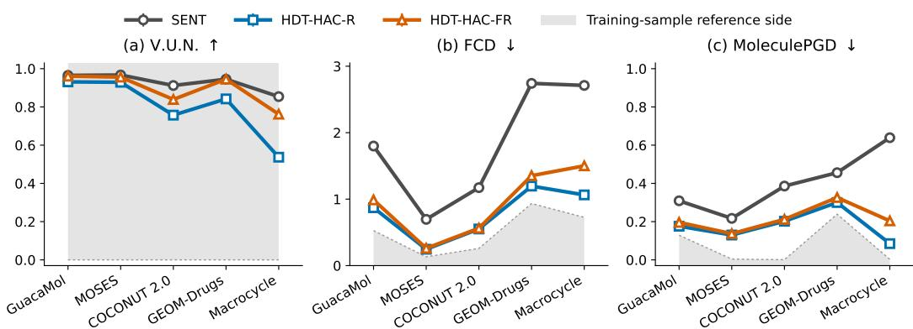  
Figure 3: Hierarchy improves distributional fidelity across all five molecular benchmarks. Markers are means over thee generation seeds; error bars are sample SD. Gray marks the metricimproving side of the training-sample reference, which for V.U.N. indicates direction rather than an attainable ceiling. Panel (a): the V.U.N. lead SENT holds over -R and that -FR largely closes. Panels (b, c): the distributional gap, large on every benchmark. Remaining variants and metrics are in Appendix E.

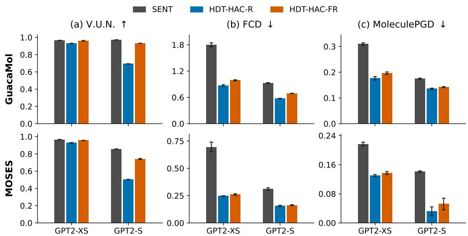  
Figure 4: Training-regime scaling on GuacaMol (top) and MOSES (bottom). Bars are means over three generation seeds; error bars are sample SD. Model size, data volume, and schedule change together (Tables 37 and 38).

## Hierarchy-wide randomization reduces the V.U.N. deficit.

The main cost of community-wise randomization is in V.U.N., driven primarily by reduced novelty on some benchmarks. For HDT-HAC-R, the deficit relative to SENT ranges from 3.6% to 37.2%, with the largest drop on Macrocycle. Hierarchy-wide randomization substantially narrows this gap: across the fully randomized configurations, the largest V.U.N. deficit is 10.85%, and for HDT-MC-FR the largest deficit across benchmarks is only 2.98%. MC-FR also improves FCD, MoleculePGD, SNN, and fragment similarity over SENT on all five benchmarks, while achieving slightly higher mean V.U.N. on GuacaMol. These results show that the hierarchy-wide FR policy can substantially reduce the V.U.N. deficit while retaining lower FCD and MoleculePGD. The comparison concerns the complete policy, including its entry constraints and community-ID assignment (Section 3.5).

Training-regime scaling. On both GuacaMol and MOSES, HDT-HAC-R at GPT2-XS has lower FCD and comparable or lower MoleculePGD than SENT at GPT2-S (Figure 4). Within each regime, both variants have lower FCD and MoleculePGD than SENT, whereas SENT has higher V.U.N and novelty. In the larger GPT2-S regime, both variants still achieve lower FCD and MoleculePGD, but at the cost of reduced novelty and V.U.N., suggesting potential overfitting. For both HAC and MC, FR has smaller declines than the R version. SENT's mean V.U.N. increases slightly on GuacaMol and decreases on MOSES. These are joint training-regime comparisons: backbone size, training population and schedule change together, GuacaMol GPT2-S SENT retains different context and dropout settings, and novelty is evaluated against each regime's own training population. They therefore do not isolate model size, data efficiency or memorization (Tables 37and 38; Appendix G.1.1).

Table 4: Placement within the graph-generation literature. Layout follows Chen et al. [2025]; methods marked \* are transcribed as published. Included for context, not as a superiority claim: budgets and evaluation lineages differ. Our controlled comparison is Table 3. Validity, uniqueness, novelty, Filters and the GuacaMol KL score are percentages; FCD and SNN are unscaled. Harmonization in Appendix G.2.
<table><tr><td></td><td colspan="2">MOSES</td><td></td><td></td><td></td><td></td></tr><tr><td>Model</td><td>Valid↑</td><td>Unique↑</td><td>Novel↑</td><td>Filters↑</td><td>FCD↓</td><td>SNN↑</td></tr><tr><td>VAE - SMILES*</td><td>97.7</td><td>99.8</td><td>69.5</td><td>99.7</td><td>0.57</td><td>0.58</td></tr><tr><td>JT-VAE - FRAGMENTS*</td><td>100.0</td><td>100.0</td><td>99.9</td><td>97.8</td><td>1.00</td><td>0.53</td></tr><tr><td>GraphINVENT*</td><td>96.4</td><td>99.8</td><td>n/a</td><td>95.0</td><td>1.22</td><td>0.54</td></tr><tr><td>DiGress*</td><td>85.7</td><td>100.0</td><td>95.0</td><td>97.1</td><td>1.19</td><td>0.52</td></tr><tr><td>SENT ( GPT2-S)*</td><td>87.4</td><td>100.0</td><td>85.9</td><td>98.6</td><td>0.91</td><td>0.55</td></tr><tr><td>SENT ( GPT2-XS)</td><td>97.7</td><td>100.0</td><td>99.0</td><td>94.2</td><td>0.70</td><td>0.506</td></tr><tr><td>HDT-HAC-R (GPT2-XS)</td><td>97.8</td><td>99.9</td><td>95.0</td><td>98.1</td><td>0.25</td><td>0.583</td></tr><tr><td>HDT-HAC-FR ( GPT2-XS)</td><td>98.5</td><td>100.0</td><td>97.1</td><td>97.5</td><td>0.26</td><td>0.560</td></tr></table>

<table><tr><td>Model</td><td>Valid↑</td><td>Unique↑</td><td>Novel↑</td><td>KL score↑</td><td>FCD↓</td></tr><tr><td>LSTM - SMILES*</td><td>95.9</td><td>100.0</td><td>91.2</td><td>99.1</td><td>0.46</td></tr><tr><td>NAGVAE*</td><td>92.7</td><td>95.5</td><td>100.0</td><td>38.4</td><td>23.55</td></tr><tr><td>MCTS*</td><td>100.0</td><td>100.0</td><td>99.4</td><td>52.2</td><td>21.00</td></tr><tr><td>DiGress*</td><td>85.2</td><td>100.0</td><td>99.9</td><td>92.9</td><td>1.93</td></tr><tr><td>SENT (GPT2-S)*</td><td>91.6</td><td>100.0</td><td>97.7</td><td>97.5</td><td>1.17</td></tr><tr><td>SENT (GPT2-XS)</td><td>96.7</td><td>100.0</td><td>99.8</td><td>93.8</td><td>1.80</td></tr><tr><td>HDT-HAC-R (GPT2-XS)</td><td>94.3</td><td>100.0</td><td>98.7</td><td>98.1</td><td>0.87</td></tr><tr><td>HDT-HAC-FR ( GPT2-XS)</td><td>96.6</td><td>100.0</td><td>99.6</td><td>96.3</td><td>0.99</td></tr></table>

<table><tr><td colspan="6">Proteins</td></tr><tr><td>Model</td><td>Deg↓</td><td>Clus↓</td><td>Orbit↓</td><td>Spec↓</td><td>Ratio↓</td></tr><tr><td>Training set</td><td>0.0003</td><td>0.0068</td><td>0.0032</td><td>0.0005</td><td>1.00</td></tr><tr><td>GraphRNN*</td><td>0.0040</td><td>0.1475</td><td>0.5851</td><td>0.0152</td><td>62.10</td></tr><tr><td>GRAN*</td><td>0.0479</td><td>0.1234</td><td>0.3458</td><td>0.0125</td><td>77.70</td></tr><tr><td>SPECTRE*</td><td>0.0056</td><td>0.0843</td><td>0.0267</td><td>0.0052</td><td>12.50</td></tr><tr><td>EDGE*</td><td>0.1863</td><td>0.3406</td><td>0.6786</td><td>0.1075</td><td>274.50</td></tr><tr><td>GraphGen*</td><td>0.0159</td><td>0.1677</td><td>0.3789</td><td>0.0181</td><td>58.10</td></tr><tr><td>BiGG*</td><td>0.0070</td><td>0.1150</td><td>0.4696</td><td>0.0067</td><td>50.10</td></tr><tr><td>DiGress*</td><td>0.0041</td><td>0.0489</td><td>0.1286</td><td>0.0018</td><td>16.20</td></tr><tr><td>GruM*</td><td>0.0019</td><td>0.0660</td><td>0.0345</td><td>0.0030</td><td>8.20</td></tr><tr><td>GEEL*</td><td>0.2110</td><td>0.3753</td><td>0.1768</td><td>0.1689</td><td>287.90</td></tr><tr><td>ESGG*</td><td>0.0030</td><td>0.0309</td><td>0.0047</td><td>0.0013</td><td>4.70</td></tr><tr><td>SENT ( GPT2-S)*</td><td>0.0004</td><td>0.0244</td><td>0.0056</td><td>0.0013</td><td>2.30</td></tr><tr><td>SENT (GPT2-XS)</td><td>0.0039</td><td>0.0820</td><td>0.0278</td><td>0.0047</td><td>10.72</td></tr><tr><td>HDT-HAC-R (GPT2-XS)</td><td>0.0003</td><td>0.0128</td><td>0.0060</td><td>0.0007</td><td>1.57</td></tr></table>

## 4.3 Motif-conditioned molecular generation

We prompt the unconditionally trained SENT, HDT-HAC-R and HDT-HAC-FR checkpoints with an isolated chemical motif, without conditional fine-tuning. Unlike unconditional evaluation, this task uses motif-specific training-derived reference pools and retains the first 500 chemically valid outputs per motif and seed, including duplicates and prompt copies (Appendix H). The unconditional fidelity advantage of hierarchy does not carry over. On all five benchmarks, SENT has the lowest mean values on all four motif discrepancies, the highest mean fragment similarity, and the highest mean V.U.N. HDT-HAC-R often repeats completions with mean uniqueness around 0.378–0.456 on GuacaMol, COCONUT 2.0 and GEOM-Drugs. FR narrows this gap and has the highest mean validity on four benchmarks and scaffold similarity on all five, but still trails SENT on the motif discrepancies and V.U.N. These results characterize zero-shot motif prompting rather than demonstrating a conditionalgeneration advantage for hierarchical serialization. We will further explore conditional generation in the hierarchical setting in future work. Full results are in Tables 41–45.

## 4.4 Beyond molecules

The graph benchmarks show that hierarchical serialization can help outside chemistry, but its benefit depends on the supplied hierarchy. On Proteins, HDT-HAC-R improves V.U.N. by 62.8% over SENT. On SSBM, it improves V.U.N. by 59.3% and reduces Degree MMD, Orbit MMD, and Ratio by more than 90%. The effect of randomization depends on the dataset and metric. On Proteins, FR raises V.U.N. further to 0.960 but has higher means on all four graph MMDs than R; on SSBM, FR's V.U.N. is 0.485, below SENT's 0.527. The HAC-R gains are consistent with our molecularly tuned coarsening transferring to smaller, sparser communities, but these datasets do not constitute a controlled density or community-size ablation.

The block models expose two distinct failure modes (Table 31). On SBM, default HDT-HAC-R reaches validity 0.926, but uniqueness and novelty fall to approximately 0.41: its V.U.N. is only 0.276, compared with SENT's 0.669. HDT-HAC-FR instead maintains uniqueness and novelty near 1 but reaches V.U.N. 0.445 because of lower validity. The same contrast appears on the original RSBM population. High validity alone therefore does not establish successful generation.

Hierarchy diagnostics suggest that the main failure on SBM is over-refinement rather than poor recovery of the coarse partition. Default HAC recovers the top-level communities well, but recursively subdivides them into leaves that are much smaller than the planted blocks (Table 30). Increasing the stopping threshold substantially improves V.U.N. for R/FR, while supplying the planted hierarchy (PH) yields a further gain. A similar pattern appears on connected RSBM: with a better-aligned stopping threshold, HAC-R nearly matches PH-R in V.U.N.†, whereas the corresponding FR configuration remains substantially weaker than PH-FR († denotes compatibility with the original RSBM validity gate, as detailed in Appendix F.3). These results are consistent with a benefit from hierarchy alignment, whose effect also depends on the randomization policy. Experiment settings and population differences are reported in Appendix F.4.

## 4.5 Coarsening and tokenization ablations

Coarsening. The relative performance of HAC and motif-based coarsening depends on the metric and randomization policy. Under within-community randomization, HDT-HAC-R has lower MoleculePGD and higher SNN and scaffold similarity than HDT-MC-R on all five molecular benchmarks, and lower FCD on four. Under hierarchy-wide randomization, neither coarsener dominates across metrics, although MC-FR has higher mean V.U.N. on four of five datasets. Both coarsenings improve FCD and MoleculePGD over SENT across all five benchmarks. The block-model experiments further suggest that alignment with the data's community structure matters. On connected RSBM (R = 4), PH-FR reaches V.U.N.† 0.744, compared with 0.083 for HAC-FR at τ = 10, a difference of 66.2 percentage points. The tokenizer and randomization policy are unchanged, although the context lengths differ (Appendix F.4).

Hierarchy explicitness. On GuacaMol and MOSES, both HSENT configurations have lower validity and V.U.N. and higher MoleculePGD than their corresponding HDT-R configurations; HDTC-R also has lower validity and V.U.N. and higher MoleculePGD than both HDT-R configurations (Appendix E, Table 23). Both HSENT configurations additionally have higher FCD on GuacaMol. The ranking varies across metrics: on MOSES, HSENT-HAC-R achieves lower FCD than HDT-HAC-R. HSENT sequences also average roughly 2.9× SENT's length, compared with 1.9× for HDT (Appendix D.3). These earlier runs predate the current protocol, so they provide supporting evidence for traversal-based serialization rather than a controlled isolation of hierarchy explicitness. Appendix C.1 discusses possible explanations.

## 4.6 Limitations

Two limitations qualify our results. First, hierarchical serialization does not guarantee improved distributional fidelity, as demonstrated by the Planar benchmark, highlighting the importance of choosing an appropriate coarsening strategy for each dataset. Second, hierarchical serialization increases sequence length: HDT uses roughly twice as many tokens as SENT in the measured benchmarks (Appendix D.3). Longer sequences increase attention cost and context requirements; actual training times are reported in Tables 10 and 11. SENT's update budgets are calibrated using measured training time, while achieved runtimes vary across configurations. Appendix B discusses these limitations further.

## 5 Conclusion

We introduced a hierarchical framework for autoregressive graph generation that separates coarsening, tokenization, and decoding, enabling lossless graph reconstruction while retaining a standard causal transformer. In the main regime, all four HDT configurations lower FCD and MoleculePGD over SENT across five molecular benchmarks under standard and novel-only evaluation, sometimes at a V.U.N. cost. Under standard molecular evaluation, hierarchy-wide FR substantially reduces within-community R's V.U.N. deficit, with remaining deficits depending on coarsening and dataset. HDT-HAC-R improves V.U.N. over SENT on Proteins and SSBM, while R versus FR performance depends on dataset and metric. SBM and RSBM threshold and planted-hierarchy controls are consistent with hierarchy-alignment benefits that depend on policy and configuration. The reported Planar configurations do not improve graph MMDs over SENT. These findings support hierarchical serialization when partitions capture useful structure, with coarsening, tokenization and traversal assessed jointly through fidelity and V.U.N.

## References

S. Axelrod and R. Gómez-Bombarelli. GEOM, energy-annotated molecular conformations for property prediction and molecular generation. Scientific Data, 9(1):185, 2022.

T. Bian, Y. Niu, H. Chang, D. Yan, J. Huang, Y. Rong, T. Xu, J. Li, and H. Cheng. Hierarchical graph latent diffusion model for conditional molecule generation. In Proceedings of the 33rd ACM International Conference on Information and Knowledge Management, CIKM '24, 2024. ISBN 9798400704369.

A. Bojchevski, O. Shchur, D. Zügner, and S. Günnemann. NetGAN: Generating graphs via random walks. In International Conference on Machine Learning, pages 610–619, 2018.

M. Brockschmidt, M. Allamanis, A. L. Gaunt, and O. Polozov. Generative code modeling with graphs. arXiv preprint arXiv:1805.08490, 2018.

N. Brown, M. Fiscato, M. H. S. Segler, and A. C. Vaucher. GuacaMol: Benchmarking models for de novo molecular design. Journal of Chemical Information and Modeling, 59(3):1096–1108, 2019.

T. Brown, B. Mann, N. Ryder, M. Subbiah, J. D. Kaplan, P. Dhariwal, A. Neelakantan, P. Shyam G. Sastry, A. Askell, et al. Language models are few-shot learners. Advances in neural information processing systems, 33:1877–1901, 2020.

D. Chen, M. Krimmel, and K. Borgwardt. Flatten graphs as sequences: Transformers are scalable graph generators. In Advances in Neural Information Processing Systems, 2025. arXiv:2502.02216.

P. Dhariwal, H. Jun, C. Payne, J. W. Kim, A. Radford, and I. Sutskever. Jukebox: A generative model for music. arXiv preprint arXiv:2005.00341, 2020.

P. D. Dobson and A. J. Doig. Distinguishing enzyme structures from non-enzymes without alignments. Journal of Molecular Biology, 330(4):771–783, 2003.

P. Esser, S. Kulal, A. Blattmann, R. Entezari, J. Müller, H. Saini, Y. Levi, D. Lorenz, A. Sauer, F. Boesel, D. Podell, T. Dockhorn, Z. English, and R. Rombach. Scaling rectified flow transformers for high-resolution image synthesis. In International Conference on Machine Learning, 2024.

X. Fu, Y. Gao, Y. Wei, Q. Sun, H. Peng, J. Li, and X. Li. Hyperbolic geometric latent diffusion model for graph generation. In International Conference on Machine Learning, 2024.

P. Gaiński, O. Boussif, A. Rekesh, D. Shevchuk, A. Parviz, M. Tyers, R. Batey, and M. Koziarski. Scalable and Cost-Efficient de Novo Template-Based Molecular Generation. In D. Belgrave, C. Zhang, H. Lin, R. Pascanu, P. Koniusz, M. Ghassemi, and N. Chen, editors, Advances in Neural Information Processing Systems, volume 38, Main Conference, pages 35787–35822. Curran Associates, Inc., 2025. doi: 10.52202/085713-1202.

N. Goyal, H. V. Jain, and S. Ranu. GraphGen: A scalable approach to domain-agnostic labeled graph generation. In Proceedings of The Web Conference 2020, pages 1253–1263, 2020.

J. Ho, A. Jain, and P. Abbeel. Denoising diffusion probabilistic models. In Advances in Neural Information Processing Systems 33, 2020.

R. Huang, M. Li, D. Yang, J. Shi, X. Chang, Z. Ye, Y. Wu, Z. Hong, J. Huang, J. Liu, et al. Audiogpt: Understanding and generating speech, music, sound, and talking head. In Proceedings of the AAAI Conference on Artificial Intelligence, pages 23802–23804, 2024.

S. Huang, A. Parviz, E. Kondrup, Z. Yang, Z. Ding, M. Bronstein, R. Rabbany, and G. Rabusseau. Are large language models good temporal graph learners? arXiv preprint arXiv:2506.05393, 2025.

J. Ingraham, V. Garg, R. Barzilay, and T. Jaakkola. Generative models for graph-based protein design. Advances in neural information processing systems, 32, 2019.

Y. Jang, S. Lee, and S. Ahn. A simple and scalable representation for graph generation. In International Conference on Learning Representations, 2024.

M. Jiang, T. Liu, M. Hussain, Y. Luo, R. Zheng, T. Hou, X. Lu, and Y. Zhou. Macrocycle-DB: a comprehensive database for macrocycle-based drug discovery. Nucleic Acids Research, 54 (D1):D1469–D1476, Jan. 2026. ISSN 1362-4962. doi: 10.1093/nar/gkaf1107. URL https: //doi.org/10.1093/nar/gkaf1107.

W. Jin, R. Barzilay, and T. Jaakkola. Junction tree variational autoencoder for molecular graph generation. In Proceedings of the 35th International Conference on Machine Learning, pages 2323–2332, 2018.

J. Jo, S. Lee, and S. J. Hwang. Score-based generative modeling of graphs via the system of stochastic differential equations. In Proceedings of the 39th International Conference on Machine Learning, pages 10362–10383, 2022.

J. Jo, D. Kim, and S. J. Hwang. Graph generation with diffusion mixture. arXiv preprint arXiv:2302.03596, 2023.

C. K. Joshi, X. Fu, Y.-L. Liao, V. Gharakhanyan, B. K. Miller, A. Sriram, and Z. W. Ulissi. All-atom diffusion transformers: Unified generative modelling of molecules and materials. In International Conference on Machine Learning, 2025.

M. Karami. HiGen: Hierarchical graph generative networks. In The Twelfth International Conference on Learning Representations, 2024.

M. A. Ketata, N. Gao, J. Sommer, T. Wollschläger, and S. Günnemann. Lift your molecules: Molecular graph generation in latent euclidean space. In International Conference on Learning Representations, 2025.

T. N. Kipf and M. Welling. Variational graph auto-encoders. ArXiv preprint, 2016.

L. Kong, J. Cui, H. Sun, Y. Zhuang, B. A. Prakash, and C. Zhang. Autoregressive diffusion model for graph generation. In Proceedings of the 40th International Conference on Machine Learning, pages 17391–17408, 2023.

M. Krimmel, P. Hartout, K. Borgwardt, and D. Chen. PolyGraph discrepancy: A classifier-based metric for graph generation. arXiv preprint arXiv:2510.06122, 2025.

R. Liao, Y. Li, Y. Song, S. Wang, W. Hamilton, D. K. Duvenaud, R. Urtasun, and R. Zemel. Efficient graph generation with graph recurrent attention networks. Advances in neural information processing systems, 32, 2019.

J. Lim, S.-Y. Hwang, S. Moon, S. Kim, and W. Y. Kim. Scaffold-based molecular design with a graph generative model. Chemical science, 11(4):1153–1164, 2020.

Y. Lipman, R. T. Q. Chen, H. Ben-Hamu, M. Nickel, and M. Le. Flow matching for generative modeling. In International Conference on Learning Representations, 2023.

K. Martinkus, A. Loukas, N. Perraudin, and R. Wattenhofer. SPECTRE: Spectral conditioning helps to overcome the expressivity limits of one-shot graph generators. In Proceedings of the 39th International Conference on Machine Learning, pages 15159–15179, 2022.

A. Mathiasen, H. Helal, P. Balanca, A. Krzywaniak, A. Parviz, F. Hvilshøj, B. Banaszewski, C. Luschi, and A. W. Fitzgibbon. Reducing the cost of quantum chemical data by backpropagating through density functional theory. arXiv preprint arXiv:2402.04030, 2024.

K. Maziarz, H. Jackson-Flux, P. Cameron, F. Sirockin, N. Schneider, N. Stiefl, M. Segler, and M. Brockschmidt. Learning to extend molecular scaffolds with structural motifs. In International Conference on Learning Representations, 2022.

V. Nainala, K. Rajan, S. Kanakam, N. Sharma, V. Weißenborn, J. Schaub, and C. Steinbeck. Coconut 2.0: A comprehensive overhaul and curation of the collection of open natural products database. 10 2024. doi: 10.26434/chemrxiv-2024-fxq2s-v2.

M. E. J. Newman and M. Girvan. Finding and evaluating community structure in networks. Physical Review E, 69(2):026113, 2004.

V. K. Nguyen, Y. Boget, F. Lavda, and A. Kalousis. Glad: improving latent graph generative modeling with simple quantization. In Proceedings of the ICML 2024 Workshop SPIGM. OpenReview. net, 2024.

C. Niu, Y. Song, J. Song, S. Zhao, A. Grover, and S. Ermon. Permutation invariant graph generation via score-based generative modeling. In Proceedings of the Twenty Third International Conference on Artificial Intelligence and Statistics, pages 4474–4484, 2020.

A. Parviz and Y. Yoshida. Nonlinear laplacians improve signed-directed graph learning. arXiv preprint arXiv:2608.00836, 2026.

W. Peebles and S. Xie. Scalable diffusion models with transformers. In IEEE/CVF International Conference on Computer Vision, ICCV 2023, Paris, France, October 1-6, 2023, 2023.

D. Polykovskiy, A. Zhebrak, B. Sanchez-Lengeling, S. Golovanov, O. Tatanov, S. Belyaev, R. Kurbanov, A. Artamonov, V. Aladinskiy, M. Veselov, A. Kadurin, S. Johansson, H. Chen, S. Nikolenko, A. Aspuru-Guzik, and A. Zhavoronkov. Molecular Sets (MOSES): A Benchmarking Platform for Molecular Generation Models. Frontiers in Pharmacology, Volume 11 - 2020, 2020. ISSN 1663-9812. doi: 10.3389/fphar.2020.565644.

K. Preuer, P. Renz, T. Unterthiner, S. Hochreiter, and G. Klambauer. Fréchet ChemNet distance: A metric for generative models for molecules in drug discovery. Journal of Chemical Information and Modeling, 58(9):1736–1741, 2018.

RDKit contributors. RDKit: Open-source cheminformatics. https://www.rdkit.org, 2024. URL https://github.com/rdkit/rdkit/releases/tag/Release\_2024\_03\_6.Version 2024.03.6.

R. Rombach, A. Blattmann, D. Lorenz, P. Esser, and B. Ommer. High-resolution image synthesis with latent diffusion models. In Proceedings of the IEEE/CVF conference on computer vision and pattern recognition, pages 10684–10695, 2022.

A. Sghaier, A. Parviz, and A. Jolicoeur-Martineau. Probabilistic tiny recursive model. arXiv preprint arXiv:2605.19943, 2026.

Y. Song, J. Sohl-Dickstein, D. P. Kingma, A. Kumar, S. Ermon, and B. Poole. Score-based generative modeling through stochastic differential equations. In International Conference on Learning Representations, 2021.

H. Touvron, T. Lavril, G. Izacard, X. Martinet, M.-A. Lachaux, T. Lacroix, B. Rozière, N. Goyal, E. Hambro, F. Azhar, et al. Llama: Open and efficient foundation language models. arXiv preprint arXiv:2302.13971, 2023a.

H. Touvron, L. Martin, K. Stone, P. Albert, A. Almahairi, Y. Babaei, N. Bashlykov, S. Batra, P. Bhargava, S. Bhosale, et al. Llama 2: Open foundation and fine-tuned chat models. arXiv preprint arXiv:2307.09288, 2023b.

C. Vignac, I. Krawczuk, A. Siraudin, B. Wang, V. Cevher, and P. Frossard. DiGress: Discrete denoising diffusion for graph generation. In International Conference on Learning Representations, 2023.

C. Wang, H. H. Ong, S. Chiba, and J. C. Rajapakse. Gldm: hit molecule generation with constrained graph latent diffusion model. Briefings in Bioinformatics, 25(3), 2024. ISSN 1477-4054.

D. Weininger. Smiles, a chemical language and information system. 1. introduction to methodology and encoding rules. Journal of Chemical Information and Computer Sciences, 28(1):31–36, 1988.

J.-N. Wu, T. Wang, Y. Chen, L.-J. Tang, H.-L. Wu, and R.-Q. Yu. t-SMILES: A fragment-based molecular representation framework for de novo ligand design. Nature Communications, 15(1): 4993, 2024. doi: 10.1038/s41467-024-49388-6.

L. Yang, Z. Huang, Z. Zhang, Z. Liu, S. Hong, W. Zhang, W. Yang, B. Cui, and L. Zhang. Graphusion: Latent diffusion for graph generation. TKDE, 36(11), 2024.

J. You, R. Ying, X. Ren, W. L. Hamilton, and J. Leskovec. GraphRNN: Generating realistic graphs with deep auto-regressive models. In Proceedings of the 35th International Conference on Machine Learning, pages 5708–5717, 2018.

C. Zhou, X. Wang, and M. Zhang. Unifying generation and prediction on graphs with latent graph diffusion. In The Thirty-eighth Annual Conference on Neural Information Processing Systems, 2024. URL https://openreview.net/forum?id=lvibangnAs.

## Appendix contents

A Funding 16   
B Limitations 16   
C Tokenization details 16   
C.1 Traversal vs. declaration of hierarchy 16   
C.2 Tokenization schemes illustrated 17   
C.3 Order randomization details 17   
C.4 Tokenization grammar: notation and reference frames 18   
C.5 Coarsening visualizations across datasets 20   
D Training, evaluation, and data details 21   
D.1 Training populations and evaluation reference sets 21   
D.2 Hierarchy depths under recursive coarsening 21   
D.3 Token sequence lengths 22   
D.4 Training inventory 22   
Evaluation protocols 23   
D.5 Generation details 25   
D.6 Evaluation metrics 26   
E Molecular unconditional generation 27   
E.1 GuacaMol 29   
E.2 MOSES 30   
E.3 COCONUT 2.0 31   
E.4 GEOM-Drugs (disjoint) 32   
E.5 Macrocycle 33   
E.6 Declarative and typed variants 34   
F Non-molecular unconditional generation 34   
F.1 Proteins 35   
F.2 Planar 36   
F.3 Block-model datasets and the planted-hierarchy control 37   
F.4 Block-model hierarchy interventions 38   
F.5 SBM 40   
F.6 SSBM 41   
F.7 Connected RSBM (R = 4) 42   
G Additional experiments 42   
G.1 Scaling and baseline controls 42   
G.2 AutoGraph-comparable metrics 44   
H Motif-conditioned molecular generation 45   
H.1 GuacaMol 46   
H.2 MOSES 46   
H.3 COCONUT 2.0 47   
H.4 GEOM-Drugs (disjoint) 47   
H.5 Macrocycle 48   
Unconditional generation galleries 49

## A Funding

This work was supported in part by the National Science Foundation under grant CIF-2403452, CCF-2112665 and CCF-2217058.

## B Limitations

Sequence length and compute cost. Hierarchy carries a computational cost. HDT's lossless coarsebefore-fine encoding uses roughly 2× as many tokens as SENT on small molecules and proportionally more on large graphs. Doubling sequence length increases the quadratic attention component fourfold. Total runtime and memory also depend on the rest of the model, padding, context limits and batching. We therefore calibrate update budgets using measured training time rather than equating steps or epochs. Tables 10 and 11 report achieved runtimes and update counts. Calibration does not guarantee equal achieved runtime.

Novelty, validity, and augmentation. A deterministic linearization admits only one serialization per graph. SENT instead resamples its walk at each training presentation, exposing the model to multiple serializations of each graph. We use order randomization to expose the model to different serializations (Section 3.5). Within-community randomization leaves a V.U.N. deficit relative to SENT ranging from 3.6% on GuacaMol to 37.2% on Macrocycle. Hierarchy-wide randomization reduces most of this deficit (Section 4.2). On Macrocycle, HDT-HAC-FR still has lower V.U.N. than SENT (0.762 versus 0.854). This remaining deficit mainly reflects lower validity rather than novelty. We report this as an observed limitation rather than attributing it to a mechanism.

Scope and hierarchy transfer. The framework requires a coarsening, and its value depends on whether the resulting communities are meaningful in the target domain. On the reported Planar benchmark, both hierarchical configurations are worse than the flat walk on every graph MMD (Section 4.4). This establishes a limitation of these configurations, not the absence of useful community structure in all planar graphs. Conversely, Proteins shows that the benefit does not require a chemical catalog. Where a domain does define interpretable units, a domain-specific detector may be substituted for the motif detector without further modification. The choice of coarsening depends on the meaning of the nodes and edges in each dataset, so it may need to change across domains. We compute the partitions separately for each dataset. This preprocessing is inexpensive.

## C Tokenization details

## C.1 Traversal vs. declaration of hierarchy

This appendix expands the declarative-versus-traversal comparison summarized in Section 4.5. The two tokenizers expose the same hierarchy in qualitatively different ways: HSENT lists communities and then separately specifies the inter-community wiring, whereas HDT linearizes the hierarchy through a single DFS traversal so cross-community edges are handled within the same sequential process as every other edge.

One possible explanation for the observed gap is that the declarative grammar introduces an additional consistency requirement. The earlier-protocol comparison does not isolate this mechanism. In HDT, [ENTER]/[EXIT] nesting specifies community membership. Each cross-community edge is emitted once as a back edge, using the same syntax as an intra-community edge. There is no separate coarse wiring record to reconcile with the node-level edges. HSENT and HDTC instead emit an explicit cross-community section. Their grammars do not enforce agreement between this section and the community blocks, so sampled records can conflict (Section 3.6).

The evidence for the gap itself is in Table 23, on the two benchmarks where the declarative and typed variants were evaluated. On GuacaMol, the SENT reference is unchanged between the earlier and current protocols. However, the legacy runs do not isolate the effect of the tokenizer. Both HSENT configurations and HDTC-R have larger validity and V.U.N. deficits relative to SENT than any HDT configuration in Table 3. HSENT-MC-R also has higher FCD and MoleculePGD than SENT. HSENT sequences run roughly 3× SENT's length against $H D T \mathrm { > } 2 \times$ (Table 8a). At those lengths, the quadratic attention component is about 2.25× larger for HSENT than HDT; this is not a measurement of total compute.

Two caveats qualify this conclusion. The comparison is limited to these particular tokenizers and this training setup, and therefore does not establish that traversal is preferable to declaration in general. What the evidence does support is the narrower practical conclusion drawn in Section 4.5: these legacy declarative and typed variants use longer sequences without a consistent advantage over HDT. They are weaker on the emphasized V.U.N./MoleculePGD trade-off, while individual fidelity metrics have exceptions, including the lower MOSES FCD of HSENT-HAC-R.

## C.2 Tokenization schemes illustrated

Figure 5 compares HSENT and HDT on cholesterol. HSENT lists community blocks and a separate cross-community wiring section; HDT traverses the hierarchy and uses back-edge brackets for both intra- and inter-community edges. The schematic shows the top-level partition and omits its deeper subdivisions.

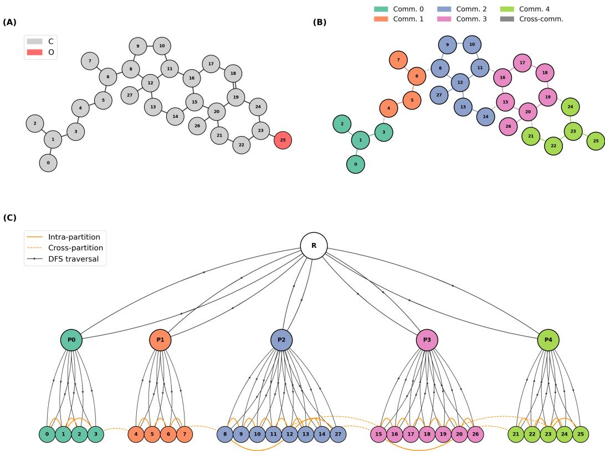  
Figure 5: Hierarchical tokenization schemes on cholesterol. (A) The molecule. (B) HSENT: community blocks (colored) and explicit cross-community wiring. (C) HDT: a schematic traversal of the same top-level partition; deeper subdivisions are omitted. Solid orange curves mark intracommunity edges, dashed curves mark cross-community edges, and gray arrows indicate traversal structure. Original atom indices are retained for correspondence across panels.

## C.3 Order randomization details

At each training presentation, we resample traversal choices while keeping the graph, its attributes, and partition hierarchy H fixed.

Within-community randomization (-R). Communities retain their stored order and identifiers. Within each terminal community, we sample a BFS root and shuffle neighbor order. If the leaf is disconnected, nodes outside the root's component are appended in shuffled order.

Hierarchy-wide randomization (-FR). At each hierarchy level, we sample a DFS forest over the adjacency graph of sibling communities. A community with a traversal parent is entered through a node adjacent to that parent; this constraint is propagated through nested communities to the leaf BFS root. Disconnected components start new traversals. Community identifiers follow encounter order within each sibling set. The sampled DFS forest determines visitation order, not the containment hierarchy H.

Identifiers and reconstruction. Both policies assign node identifiers globally in first-visit order. Each node lists all previously emitted neighbors as back-edge targets, including those in other communities. Thus, a complete, untruncated encoding emits each node and edge once and reconstructs the input graph up to relabeling. Table 5 illustrates the ordering difference.

Table 5: Randomization on a fixed graph. Consider the path $a - b - c - d - e - f$ with communities $C _ { 1 } = \{ a , b \} , C _ { 2 } = \{ c , d \}$ , and $C _ { 3 } = \{ e , f \}$ R preserves community order; FR also changes that order subject to adjacency and entry constraints. Bars separate communities. Letters denote original nodes; emitted node identifiers are reassigned as $0 , \ldots , 5$ in visitation order. Delimiters and back-edge brackets are omitted.

<table><tr><td>Policy</td><td>Community order</td><td>Node order</td></tr><tr><td>-R</td><td> $C _ { 1 } , C _ { 2 } , C _ { 3 }$ </td><td> $( a , b ) \mid ( c , d ) \mid ( e , f )$ </td></tr><tr><td>-R</td><td> $C _ { 1 } , C _ { 2 } , C _ { 3 }$ </td><td> $( b , a ) \mid ( d , c ) \mid ( f , e )$ </td></tr><tr><td>-FR</td><td> $C _ { 2 } , C _ { 3 } , C _ { 1 }$ </td><td> $( c , d ) \mid ( e , f ) \mid ( b , a )$ </td></tr><tr><td>-FR</td><td> $C _ { 3 } , C _ { 2 } , C _ { 1 }$ </td><td> $( f , e ) \mid ( d , c ) \mid ( b , a )$ </td></tr></table>

## C.4 Tokenization grammar: notation and reference frames

This appendix presents the grammars of HSENT, HDT, and HDTC using shared notation. They differ in how explicitly they encode hierarchy. We also explain the scope of their lossless reconstruction guarantee. Appendix E.6 compares their performance on GuacaMol and MOSES.

## C.4.1 Notation and partition tree

Terminal symbols in TYPEwRITER are special vocabulary tokens; non-terminals are italicized. Across all three grammars, l denotes the recursion depth level emitted at each [ENTER] token, atoms in the HDTC grammar expands to a sequence of atom non-terminals as defined for $H D T ,$ v is a node identifier, and targets is a list of previously visited node identifiers. The displayed grammars suppress attribute tokens: labeled encodings also emit the atom type after each node and the bond type with each edge record.

Partition tree. The top-level partition $\sigma : V  [ k ]$ assigns each node to one of k communities, with induced subgraph $G [ \dot { C } _ { i } ] = ( \dot { C } _ { i } , E [ C _ { i } ] )$ on community $\bar { C } _ { i } = \sigma ^ { - 1 } ( i )$ and cross-community edge sets $B _ { i j } \subseteq E$ between communities i and $j$ . The hierarchical graph H is then a rooted partition tree: the root corresponds to $V .$ , and coarsening recursively partitions $G [ C ]$ . Splitting is attempted when $| C | \geq \tau ;$ a community becomes a leaf below this size or when no proper split is found. We use $\tau = 4$ by default, with block-model threshold interventions reported in Appendix F.4.

## C.4.2 HSENT: declarative hierarchy

HSENT declares the hierarchy rather than traversing it: it writes a catalog of community blocks followed by a separate bipartite section that wires the communities together. Each community block stores the community's global node identifiers followed by a SENT-style [Chen et al., 2025] walk over its intra-community edges; the bipartite section then encodes every cross-community edge as an explicit pair $( i , j )$ of community indices and an atom-pair list. HSENT therefore differs from the flat baseline SENT in exactly two respects, the community catalog and the bipartite section, making these additional hierarchy records explicit.

Here $n _ { C } = | C |$ and $\mathbf { g } _ { C }$ is an ordered catalog mapping local indices to global node IDs. Community IDs are unique within each sibling set; each bipartite section uses that scope. A leaf walk and the endpoint list pairs use the corresponding local node indices. The star denotes repetition, the vertical bar denotes a choice, and a question mark denotes an optional group.

```autohotkey
seq := [SOS] hier [EOS]
hier := k part* bip*
part ::= [LCOM] id nC gc [SEP] (walkC |hier) [RCOM]
bip ::= [LBIP] i j |Bij| pairs [RBIP]
```

Every internal block emits the child count, child catalogs, and wiring between its children. An edge is recorded at the lowest hierarchy node whose children separate its endpoints. The recursive catalog cost is $\begin{array} { r } { O ( m + \sum _ { C } | C | ) } \end{array}$ , where the sum runs over catalog-emitting community blocks; for bounded depth this is $O ( n + m )$ . Nonempty wiring blocks are bounded by the number of cross-community edges, so they do not require a separate quadratic token term.

Algorithm 2 HSENT tokenization   
Require: Graph $G = ( V , E ) ;$ partition tree H with root R   
Ensure: Token sequence t   
1: t ← [[SOS]]   
2: EMITHIERARCHY(R)   
3: t.append([EOS]); return t   
4: procedure EMITHIERARCHY(C)   
5: Let $C _ { 1 } , \ldots , C _ { k }$ be the children of C (or C itself if terminal)   
6: t.append(k)   
7: for $i = 1 , \ldots , k$ do ▶ community catalog   
8: EMITPART $( C _ { i } , i )$   
9: end for   
10: for each pair $( i , j )$ with $i < j$ and $B _ { i j } \neq \varnothing$ do ▶ bipartite wiring   
11: t.append([LBIP], i, j, |Bij|)   
12: for $( u , v ) \in B _ { i j }$ with $u \in \check { C } _ { i } , v \in C _ { j } ,$ in canonical order do   
13: $a _ { u } \gets$ local index of u in $\begin{array} { r l } { C _ { i } ; } & { { } \ a _ { v } } \end{array}$ ← local index of v in $C _ { j }$   
14: t.append $( a _ { u } , a _ { v } )$   
15: end for   
16: t.append([RBIP])   
17: end for   
18: end procedure   
19: procedure EMITPART(C, id)   
20: t.append([LCOM], id, |C|, gc) gC: global node IDs in C   
21: t.append([SEP])   
22: if C is a leaf of H then SENT walk over G[C]   
23: t.append(SENTWALK(G[C]))   
24: else child catalogs and their wiring   
25: EMITHIERARCHY(C)   
26: end if   
27: t.append([RCOM])   
28: end procedure

## C.4.3 HDT: traversal-based hierarchy

HDT encodes hierarchy implicitly through DFS nesting and emits no separate bipartite block.

seq ::= [SOS] hier [EOS]   
hier ::= [ENTER] l id (hier | atom)\* [EXIT]   
atom ::= v ([LEDGE] targets [REDGE])?

When DFS visits atom $v \in C _ { j }$ and v neighbors a previously visited atom $u \in C _ { i }$ with $i \neq j ,$ the cross-community edge $( u , v )$ is emitted as a back edge to u inside $v ^ { \circ } \mathrm { s }$ edge bracket. This makes intra- and inter-community edges syntactically identical and gives $O ( n + m )$ tokens (about 33% shorter than HSENT on MOSES). For the randomized configurations, node identifiers and back-edge targets use serialization identifiers assigned globally in first-visit order. R retains stored community identifiers, whereas FR assigns them by encounter order within each sibling set (Appendix C.3). The full pseudocode is given as Algorithm 1 in the body of the paper (Section 3.4).

## C.4.4 HDTC: typed molecular hierarchy

HDTC is the one configuration that brings its own coarsening. Motif plus Functional Group (MC+FG) extends the Motif Community coarsening of Section 3.3 with a functional-group detector, resolving overlaps by a fixed priority: rings first, then multi-atom functional groups, then single-atom functional groups. Every resulting community therefore carries a type label recording whether it is a ring (R), a functional group (F), or a singleton (S), and it is this typed hierarchy that HDTC consumes.

For a community C, the type token is $\tau _ { C } \in \{ \mathrm { T Y P E \_ R I N G } , \mathrm { T Y P E \_ F U N C } , \mathrm { T Y P E \_ S I N G L E T O N } \}$ , abbreviated R, F and S. The tokenizer opens each community block with this token before listing its atoms, and closes with a single trailing super-graph block enumerating the inter-community bonds. Like HDT, HDTC uses a traversal-based ordering. It additionally encodes community types and a separate cross-community wiring record. The legacy comparison in Section 4.5 shows no consistent advantage over HDT.

$$
\begin{array}{c} \begin{array} { r } { \begin{array} { r l } { s e q : : = } & { [ \mathrm { S 0 S } ] ~ c o m m ^ { * } ~ s u p e r ? ~ [ \mathrm { E 0 S } ] } \\ { c o m m : : = } & { [ \mathrm { C 0 M M \_ S T A R T } ] ~ \tau _ { C } ~ \mathrm { i d } ~ a t o m s ~ [ \mathrm { C O M M \_ E N D } ] } \end{array} } \\ { s u p e r : : = } & { [ \mathrm { S U P E R \_ S T A R T } ] ~ \left( c _ { s } ~ c _ { t } ~ a _ { s } ~ a _ { t } \right) ^ { * } ~ [ \mathrm { S U P E R \_ E N D } ] } \end{array}  \end{array}
$$

Each typed block gives the community ID and the atoms in traversal order. Legacy HDTC uses graph-global atom IDs and a global seen set: back-edge brackets record all previously emitted neighbors, including those in other communities. In each super-graph tuple $( c _ { s } , c _ { t } , a _ { s } , a _ { t } ) , c _ { s } , c _ { t }$ identify the endpoint communities and $a _ { s } , a _ { t }$ are global atom IDs. The super-graph therefore repeats cross-community bonds, which decoding coalesces. With c cross-community edges, the total cost is $O ( n + m + c )$ tokens.

## C.4.5 What invertibility does and does not guarantee

All three schemes support lossless reconstruction from their complete, untruncated encodings (Section 3.6). This guarantee does not extend to arbitrary sequences sampled from the transformer. Samples can contain unbalanced [ENTER]/[EXIT] nesting, references to nodes that were never emitted, or truncated blocks. The parser is permissive, so even malformed or incomplete sequences may yield a graph. After the evaluation protocol's normalization, we assess that graph using the dataset-specific structural or RDKit checks. A syntax violation therefore does not automatically make a sample invalid.

The same limitation applies to SENT. Its complete encodings support lossless reconstruction, but sampled sequences can be malformed or decode to disconnected or chemically invalid graphs. For every method, validity must therefore be measured empirically.

As discussed in Appendix C.1, HDT has no separate coarse wiring record that can conflict with its node-level edges. HSENT and HDTC can produce such conflicts because they encode crosscommunity connectivity separately. This is a possible explanation for their weaker performance, but the experiments do not isolate this mechanism.

## C.5 Coarsening visualizations across datasets

Figure 6 shows HAC partitions for representative graphs from each benchmark. Node colors indicate community membership. These examples illustrate the coarsening used in the quantitative comparisons of Section 4.5.

Algorithm 3 HDTC tokenization (molecular benchmarks)   
Require: Molecular graph $G = ( V , E )$ ; MC+FG partition $\sigma : V  [ k ]$ with type labels $\tau _ { C }$   
Ensure: Token sequence t   
1: t ← [[SOS]]; $\bar { V } _ { \mathrm { s e e n } } \gets \emptyset$   
2: Let $\dot { C } _ { 1 } , \dots , \dot { C } _ { k }$ be the communities under σ, each with type $\tau _ { C _ { i } }$   
3: for $i = 1 , \ldots , k$ do ▶ typed community blocks   
4: t.append([COMM\_START], $\tau _ { C _ { i } } , i )$   
5: for $v \in C _ { i }$ in traversal order do   
6: t.append(v) global atom ID   
7: B $\overleftarrow {  } N _ { G } \backslash ( \dot { v } ) \cap V _ { \mathrm { s e e n } }$   
8: if $B \neq \varnothing$ then   
9: t.append([LEDGE], sorted(B), [REDGE])   
10: end if   
11: $V _ { \mathrm { s e e n } }  V _ { \mathrm { s e e n } } \cup \{ v \}$   
12: end for   
13: t.append([COMM\_END])   
14: end for   
15: i $\textstyle \mathbf { f } \bigcup _ { i < j } B _ { i j } \neq \varnothing$ then super-graph block: cross-community bonds   
16: t.append([SUPER\_START])   
17: for each $( u , v ) \in E$ with $\boldsymbol { \sigma } ( u ) \neq \boldsymbol { \sigma } ( v )$ , in canonical order do   
18: $c _ { s }  \sigma ( u ) ; \quad c _ { t }  \sigma ( v )$   
19: $a _ { s } \gets u ; \quad a _ { t } \gets v$ global atom IDs   
20: t.append $( c _ { s } , c _ { t } , a _ { s } , a _ { t } )$   
21: end for   
22: t.append([SUPER\_END])   
23: end if   
24: t.append([EOS]); return t

## D Training, evaluation, and data details

## D.1 Training populations and evaluation reference sets

Dataset sources and software. For COCONUT 2.0 [Nainala et al., 2024], we use the September 2024 snapshot archived at https://doi.org/10.5281/zenodo.13692394, specifically coconut-09-2024.csv.zip. This archive is distributed under CC BY 4.0. For Macrocycle we use the Macrocycle-DB [Jiang et al., 2026] A11.csv export accessed on 15 August 2026 from https://macro-db.dpbio.tech/Downloads/All.csv. The downloaded export contains 50,653 records, rather than the 45,525 reported in the database publication. Both datasets are processed using canonical, non-isomeric, implicit-hydrogen molecular identities and filtered for compatibility with our lossless graph codec. The training and evaluation environments pin RDKit [RDKit contributors, 2024] version 2024.03.6, distributed under the BSD 3-Clause license.

Table 6 lists the training populations, held-out reference sets, and evaluation draw sizes for the five molecular benchmarks. Standard and novel-only evaluation use the same held-out references. They differ only in which generated molecules are scored. Each MoleculePGD draw uses half the evaluation-arm size. The training-sample reference uses an independently permuted prefix of the exact training population, with its size matched to the evaluation population. This controls sample size when interpreting the training-sample reference in Figure 3.

## D.2 Hierarchy depths under recursive coarsening

HAC is applied recursively: a split is attempted for communities of at least $\tau = 4$ nodes, and recursion stops below this size or when no proper split is found. HDTC's hierarchy is two-level by construction (community plus super graph) and therefore not part of this analysis. Table 7 reports the observed depth distribution from 200 randomly sampled graphs per benchmark. Its depth counts levels below the top-level communities; add one to obtain maximum leaf depth under the rootdepth-zero convention of the algorithms and Table 30. Depth grows with mean graph size: MOSES has mean depth 1.13, whereas the larger Macrocycle graphs have mean depth 1.86; the maximum observed depth is 2 and 3, respectively.

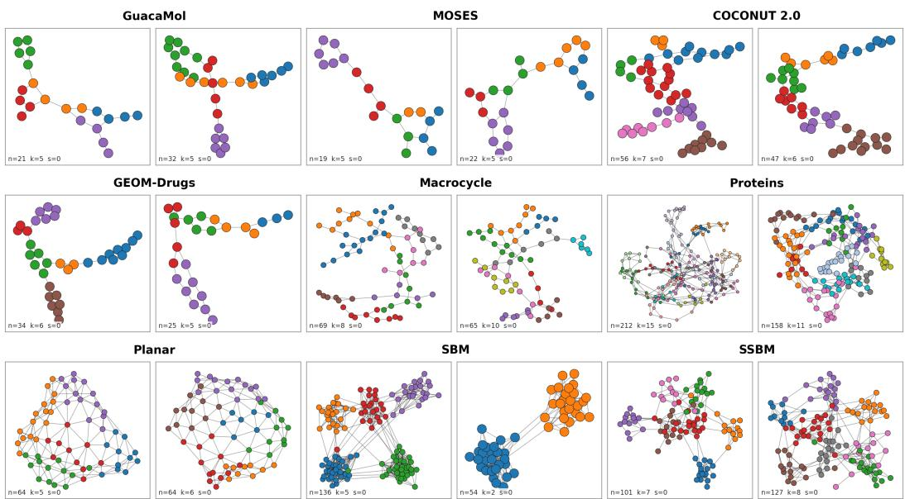  
Figure 6: Production HAC coarsening across the benchmarks. Two held-out examples per dataset use the average-linkage HAC implementation and modularity-selected cut used in training, with stopping threshold $\tau = 4$ . Molecular affinities use kekulized bond orders; other graphs use unit edge weights. Colors distinguish top-level communities within each panel, with no shared meaning across graphs. Labels give the node count n, community count k, and singleton count s.

Table 6: Molecular training populations and evaluation reference sets. The standard and novelonly evaluations both score against the listed held-out reference arm. Official MoleculePGD uses ten no-replacement draws of the listed per-arm size. The training-sample reference column independently permutes the exact training population for each generation seed before taking the same evaluationsized prefix, so it measures how close an in-distribution sample of the training data itself lands on each metric. These figures are properties of the data and the protocol, and are independent of tokenizer and model.
<table><tr><td>Dataset</td><td>Training n</td><td>Reference arm</td><td>Evaluation n</td><td>PGD draw</td><td>Training samples n</td></tr><tr><td>GuacaMol</td><td>499,968</td><td>Held-out test</td><td>10,000</td><td>5,000</td><td>10,000</td></tr><tr><td>MOSES</td><td>499,968</td><td>Held-out test</td><td>10,000</td><td>5,000</td><td>10,000</td></tr><tr><td>COCONUT 2.0</td><td>367,104</td><td>Dedicated held-out test</td><td>10,000</td><td>5,000</td><td>10,000</td></tr><tr><td>GEOM-Drugs (disjoint)</td><td>62,720</td><td>Audited disjoint held-out test</td><td>8,235</td><td>4,117</td><td>8,235</td></tr><tr><td>Macrocycle</td><td>27,392</td><td>Dedicated held-out test</td><td>3,328</td><td>1,664</td><td>3,328</td></tr></table>

## D.3 Token sequence lengths

Sequence length affects the quadratic attention component, but total compute also depends on model operations, padding, context limits and batching. Table 8a reports mean lengths from the molecular sample audit and historical full-population audits described in its caption: HSENT is roughly 3× SENT and HDT roughly 2×, motivating training-time calibration of update budgets rather than equal-step training. The achieved runtimes are reported separately. Table 8b records the main context caps; configuration-specific block-model and scaling settings are referenced in its caption. Comparing a configuration's cap with its length distribution indicates its truncation headroom.

## D.4 Training inventory

The main comparisons use GPT2-XS (\~11M parameters) across ten benchmarks. Table 9 lists the defaults for this regime; Tables 10 and 11 report configuration-specific schedules, contexts, batch sizes and achieved runtimes. Warmup and decay are scaled to each run's calibrated update budget (Section 4.1); calibration targets comparable training time rather than equal updates and does not guarantee equal achieved runtime. Presentations are optimizer steps times effective batch size. Legacy tokenizers use the context limits in Table 8; block-model interventions are detailed in Appendix F.4, the larger GPT2-S regime in Appendix G.1.1, and conditional generation in Appendix H.

Table 7: Observed hierarchy depth under recursive HAC coarsening. We sample 200 graphs without replacement from each frozen training population at $\tau = 4 ,$ seed = 42. k counts communities in the top-level partition. Depth counts levels below these top-level communities; add one to obtain maximum leaf depth with root depth zero, as used in the algorithms and Table 30.
<table><tr><td>Dataset</td><td>Mean nodes</td><td>Mean k</td><td>Mean depth</td><td>Max depth</td></tr><tr><td>GuacaMol</td><td>27.9</td><td>5.3</td><td>1.29</td><td>2</td></tr><tr><td>MOSES</td><td>21.7</td><td>4.8</td><td>1.13</td><td>2</td></tr><tr><td>COCONUT 2.0</td><td>37.2</td><td>5.9</td><td>1.51</td><td>3</td></tr><tr><td>GEOM-Drugs (disjoint)</td><td>25.5</td><td>5.1</td><td>1.21</td><td>3</td></tr><tr><td>Macrocycle</td><td>58.5</td><td>8.0</td><td>1.86</td><td>3</td></tr></table>

Table 8: Token sequence lengths. (a) Molecular SENT/HDT means use 200 sampled training graphs. Legacy HSENT/HDTC means use 499,968 graphs per dataset; the historical non-molecular cohorts contain 587 Proteins and 128 Planar/SBM training graphs. Each audit uses three deterministic serialization draws per graph. HSENT/HDT family means average the audited coarsenings, including Louvain in the historical audit. (b) Main GPT2-XS context caps, with legacy tokenizer exceptions. The SBM column denotes default SENT/HAC; adjusted HAC and PH use 1440. SSBM and RSBM contexts are given in Tables 11 and 31; GPT2-S settings are in Tables 37and 38. HSENT/HDTC results are reported only for GuacaMol and MOSES; HDTC is molecular only.
<table><tr><td></td><td>GuacaMol</td><td>MOSES</td><td>COCONUT 2.0</td><td>GEOM- Drugs</td><td>Macrocycle</td><td>Proteins</td><td>Planar</td><td>SBM</td></tr><tr><td>(a) Mean tokenization length</td><td></td><td></td><td></td><td></td><td></td><td></td><td></td><td></td></tr><tr><td>SENT</td><td>121.6</td><td>94.3</td><td>161.4</td><td>111.0</td><td>255.2</td><td>964.3</td><td>258.7</td><td>656.5</td></tr><tr><td>HSENT</td><td>357.3</td><td>274.8</td><td>n/a</td><td>n/a</td><td>n/a</td><td>n/a</td><td>n/a</td><td>n/a</td></tr><tr><td>HDT</td><td>227.6</td><td>178.2</td><td>300.6</td><td>209.4</td><td>497.0</td><td>2046.5</td><td>509.2</td><td>1081.8</td></tr><tr><td>HDTC</td><td>275.3</td><td>215.8</td><td>n/a</td><td>n/a</td><td>n/a</td><td>n/a</td><td>n/a</td><td>n/a</td></tr><tr><td>(b) Maximum token length</td><td></td><td></td><td></td><td></td><td></td><td></td><td></td><td></td></tr><tr><td>SENT</td><td>512</td><td>512</td><td>1024</td><td>1024</td><td>2048</td><td>5120</td><td>2048</td><td>2048</td></tr><tr><td>HSENT</td><td>768</td><td>512</td><td>n/a</td><td>n/a</td><td>n/a</td><td>n/a</td><td>n/a</td><td>n/a</td></tr><tr><td>HDT</td><td>512</td><td>512</td><td>1024</td><td>1024</td><td>2048</td><td>5120</td><td>2048</td><td>2048</td></tr><tr><td>HDTC</td><td>768</td><td>512</td><td>n/a</td><td>n/a</td><td>n/a</td><td>n/a</td><td>n/a</td><td>n/a</td></tr></table>

Hardware and timing. Models are trained from scratch on NVIDIA H200 NVL GPUs (143 GB). The main GPT2-XS runs use one GPU without gradient accumulation. Their achieved runtimes are given in Table 3 and Tables 10 and 11. Scaling training times are stated on a one-GPU basis in Appendix G.1.1. The bf16-mixed precision setting describes training; evaluation uses its recorded sampling configuration.

## Evaluation protocols

• Standard. Molecular metrics are computed on every valid generated molecule against the held-out reference arm of Table 6. For graph benchmarks, the four MMDs and Ratio are computed on decoded graphs and dataset-specific structural validity is reported separately, so the distributional rows remain defined even when validity is low. This is the conventional protocol and the one summarized in the body.

• Novel-only. For molecules, the distributional and structural metrics are recomputed on valid generations whose canonical SMILES is absent from the exact training population. For graphs, a sample must pass the dataset-specific validity test and be exactly non-isomorphic to every training graph. We decode a prespecified oversampled pool and take the first fixed number of qualifying graphs per seed: 184 for Proteins, 40 for Planar, and 1,000 for SBM and SSBM. Graph tables report the raw valid-novel yield and uniqueness of the selected population; validity and novelty are one by construction and V.U.N. is redundant. All metrics use the same held-out reference arms as the standard protocol (Appendices E and F).

Table 9: Defaults for the main GPT2-XS regime. Per-configuration schedules, contexts and achieved runtimes are in Tables 10 and 11. Legacy, scaling and block-intervention settings are described in Appendices E.6, G.1.1 and F.4; conditional generation follows Appendix H. Shared defaults do not remove these differences.
<table><tr><td>Setting</td><td>Default choice</td></tr><tr><td>Backbone</td><td>GPT2-XS (6 layers, hidden 384, 12 heads, ~11M parameters)</td></tr><tr><td>Optimizer</td><td>AdamW, weight decay 0.1, gradient clipping 1.0, cosine decay</td></tr><tr><td>Training precision</td><td>bf16 mixed</td></tr><tr><td>Regularization</td><td>attention dropout 0.5</td></tr><tr><td>Molecular batch</td><td>256 per GPU; one GPU; no gradient accumulation</td></tr><tr><td>Batching</td><td>length-aware / bucketed batching disabled</td></tr><tr><td>Molecular unconditional decoding</td><td>top-k 5; temperature 1.0</td></tr><tr><td>Checkpoint seed</td><td>42</td></tr><tr><td>Evaluation seeds</td><td>42, 43, 44 from the same checkpoint</td></tr><tr><td>Reporting</td><td>mean ± sample SD over the three generation seeds</td></tr><tr><td>Budget calibration</td><td>measured hierarchical training throughput; achieved times vary</td></tr><tr><td>Coarsening recursion threshold τ</td><td>4 by default; 44 for adjusted SBM; 10 for adjusted RSBM</td></tr></table>

Table 10: Molecular training inventory. Presentations are optimizer steps times effective batch size. Runtime is active wall-clock time inferred from each run's resolved configuration and its final checkpoint timestamps. Update budgets were calibrated using measured training time rather than equal steps. The achieved runtimes shown here can differ from those calibration targets; both update counts and runtimes are given. All runs use GPT2-XS on a single GPU with no gradient accumulation (Table 9).
<table><tr><td>Dataset</td><td>Variant</td><td>Context</td><td>Batch</td><td>Steps</td><td>Presentations</td><td>Epochs</td><td>Runtime (h)</td></tr><tr><td rowspan="5">GuacaMol</td><td>SENT</td><td>512</td><td>256</td><td>162,500</td><td>41.6M</td><td>83.2</td><td>4.98</td></tr><tr><td>HDT-MC-R</td><td>512</td><td>256</td><td>100,000</td><td>25.6M</td><td>51.2</td><td>5.65</td></tr><tr><td>HDT-HAC-R</td><td>512</td><td>256</td><td>100,000</td><td>25.6M</td><td>51.2</td><td>6.70</td></tr><tr><td>HDT-MC-FR</td><td>512</td><td>256</td><td>100,000</td><td>25.6M</td><td>51.2</td><td>4.24</td></tr><tr><td>HDT-HAC-FR</td><td>512</td><td>256</td><td>100,000</td><td>25.6M</td><td>51.2</td><td>5.92</td></tr><tr><td rowspan="5">MOSES</td><td>SENT</td><td>512</td><td>256</td><td>100,000</td><td>25.6M</td><td>51.2</td><td>3.35</td></tr><tr><td>HDT-MC-R</td><td>512</td><td>256</td><td>62,500</td><td>16M</td><td>32.0</td><td>3.31</td></tr><tr><td>HDT-HAC-R</td><td>512</td><td>256</td><td>62,500</td><td>16M</td><td>32.0</td><td>4.50</td></tr><tr><td>HDT-MC-FR</td><td>512</td><td>256</td><td>62,500</td><td>16M</td><td>32.0</td><td>1.41</td></tr><tr><td>HDT-HAC-FR</td><td>512</td><td>256</td><td>62,500</td><td>16M</td><td>32.0</td><td>1.36</td></tr><tr><td rowspan="5">COCONUT 2.0</td><td>SENT</td><td>1,024</td><td>256</td><td>118,000</td><td>30.2M</td><td>82.3</td><td>4.30</td></tr><tr><td>HDT-MC-R</td><td>1,024</td><td>256</td><td>60,000</td><td>15.4M</td><td>41.8</td><td>4.35</td></tr><tr><td>HDT-HAC-R</td><td>1,024</td><td>256</td><td>60,000</td><td>15.4M</td><td>41.8</td><td>4.25</td></tr><tr><td>HDT-MC-FR</td><td>1,024</td><td>256</td><td>60,000</td><td>15.4M</td><td>41.8</td><td>4.40</td></tr><tr><td>HDT-HAC-FR</td><td>1,024</td><td>256</td><td>60,000</td><td>15.4M</td><td>41.8</td><td>4.42</td></tr><tr><td rowspan="5">GEOM-Drugs (disjoint)</td><td>SENT</td><td>1,024</td><td>256</td><td>46,000</td><td>11.8M</td><td>187.8</td><td>0.98</td></tr><tr><td>HDT-MC-R</td><td>1,024</td><td>256</td><td>25,000</td><td>6.4M</td><td>102.0</td><td>1.00</td></tr><tr><td>HDT-HAC-R</td><td>1,024</td><td>256</td><td>25,000</td><td>6.4M</td><td>102.0</td><td>1.00</td></tr><tr><td>HDT-MC-FR</td><td>1,024</td><td>256</td><td>25,000</td><td>6.4M</td><td>102.0</td><td>1.02</td></tr><tr><td>HDT-HAC-FR</td><td>1,024</td><td>256</td><td>25,000</td><td>6.4M</td><td>102.0</td><td>1.05</td></tr><tr><td rowspan="5">Macrocycle</td><td>SENT</td><td>2,048</td><td>256</td><td>47,000</td><td>12M</td><td>439.3</td><td>1.80</td></tr><tr><td>HDT-MC-R</td><td>2,048</td><td>256</td><td>25,000</td><td>6.4M</td><td>233.6</td><td>2.10</td></tr><tr><td>HDT-HAC-R</td><td>2,048</td><td>256</td><td>25,000</td><td>6.4M</td><td>233.6</td><td>1.85</td></tr><tr><td>HDT-MC-FR</td><td>2,048</td><td>256</td><td>25,000</td><td>6.4M</td><td>233.6</td><td>2.12</td></tr><tr><td>HDT-HAC-FR</td><td>2,048</td><td>256</td><td>25,000</td><td>6.4M</td><td>233.6</td><td>1.94</td></tr></table>

• Training-sample reference. Both protocols are read against an independently permuted prefix of the exact training population, up to the evaluation size. When fewer training objects are available, as for the 128-graph SBM and SSBM splits, all available training graphs are used in a fresh order for each seed. This is a calibration rather than a target and is excluded from every ranking and change-relative-to-SENT panel. Because training objects have zero novelty by construction, their V.U.N. is zero.

Table 11: Non-molecular training inventory. Presentations are steps × effective batch. SENT update budgets were calibrated using benchmark timings; achieved runtimes vary and can be lower than those of hierarchical configurations. Contexts differ by row because each was set from that configuration's own hierarchy bounds.
<table><tr><td>Dataset</td><td>Variant</td><td>Context</td><td>Batch</td><td>Steps</td><td>Presentations</td><td>Epochs</td><td>Runtime (h)</td></tr><tr><td rowspan="3">Proteins</td><td>SENT</td><td>5,120</td><td>32</td><td>955,000</td><td>30.6M</td><td>52061.3</td><td>24.45</td></tr><tr><td>HDT-HAC-R</td><td>5,120</td><td>32</td><td>400,000</td><td>12.8M</td><td>21805.8</td><td>24.39</td></tr><tr><td>HDT-HAC-FR</td><td>5,120</td><td>32</td><td>400,000</td><td>12.8M</td><td>21805.8</td><td>25.72</td></tr><tr><td rowspan="3">Planar</td><td>SENT</td><td>2,048</td><td>128</td><td>13,000</td><td>1.66M</td><td>162.5</td><td>0.20</td></tr><tr><td>HDT-HAC-R</td><td>2,048</td><td>128</td><td>10,000</td><td>1.28M</td><td>125.0</td><td>0.29</td></tr><tr><td>HDT-HAC-FR</td><td>2,048</td><td>128</td><td>10,000</td><td>1.28M</td><td>125.0</td><td>0.30</td></tr><tr><td rowspan="5">SBM</td><td>SENT</td><td>2,048</td><td>64</td><td>458,500</td><td>29.3M</td><td>229250.0</td><td>17.15</td></tr><tr><td>HDT-HAC-R</td><td>2,048</td><td>64</td><td>200,000</td><td>12.8M</td><td>100000.0</td><td>17.74</td></tr><tr><td>HDT-HAC-FR</td><td>2,048</td><td>64</td><td>200,000</td><td>12.8M</td><td>100000.0</td><td>20.44</td></tr><tr><td>HDT-PH-R</td><td>1,440</td><td>64</td><td>200,000</td><td>12.8M</td><td>100000.0</td><td>4.02</td></tr><tr><td>HDT-PH-FR</td><td>1,440</td><td>64</td><td>200,000</td><td>12.8M</td><td>100000.0</td><td>4.03</td></tr><tr><td rowspan="3">Sparse SBM (SSBM)</td><td>SENT</td><td>2,048</td><td>64</td><td>63,000</td><td>4.03M</td><td>31500.0</td><td>1.56</td></tr><tr><td>HDT-HAC-R</td><td>2,048</td><td>64</td><td>20,000</td><td>1.28M</td><td>10000.0</td><td>1.62</td></tr><tr><td>HDT-HAC-FR</td><td>2,048</td><td>64</td><td>20,000</td><td>1.28M</td><td>10000.0</td><td>1.88</td></tr><tr><td rowspan="5">Connected RSBM (R = 4)</td><td>SENT</td><td>1,600</td><td>64</td><td>245,000</td><td>15.7M</td><td>122500.0</td><td>4.77</td></tr><tr><td>HDT-HAC-R</td><td>1,664</td><td>64</td><td>200,000</td><td>12.8M</td><td>100000.0</td><td>4.55</td></tr><tr><td>HDT-HAC-FR</td><td>1,664</td><td>64</td><td>200,000</td><td>12.8M</td><td>100000.0</td><td>4.56</td></tr><tr><td>HDT-PH-R</td><td>1,600</td><td>64</td><td>200,000</td><td>12.8M</td><td>100000.0</td><td>4.46</td></tr><tr><td>HDT-PH-FR</td><td>1,600</td><td>64</td><td>200,000</td><td>12.8M</td><td>100000.0</td><td>4.46</td></tr></table>

## D.5 Generation details

Table 12 separates generation-attempt budgets from metric-specific draw sizes. Molecular attempt budgets equal the reference counts in Table 6, but invalid attempts reduce the valid generated population available to distributional metrics. Motif discrepancies use fixed 1000-valid-molecule arms, and MoleculePGD uses its specified subsampling protocol. Proteins and Planar use 184 and 40 attempts per seed, respectively; SBM, SSBM and RSBM use 1000, with independently generated 1000-graph reference arms rather than the 40-graph dataset test split. Molecular unconditional decoding uses top-k = 5 and temperature 1.0; graph settings are dataset-specific. Conditional generation instead uses the valid-output stopping rule and top-k = 10 in Appendix H. Tokenizerspecific sequence limits are in Table 8b, with RSBM settings in Table 31.

Table 12: Unconditional generation parameters per dataset. Attempts counts all generation attempts per seed, including invalid outputs; the valid population available for molecular metrics can be smaller. PGD draw is the per-arm size of a no-replacement MoleculePGD draw; Motif ref. is the fixed valid reference-arm size for motif discrepancies. Molecular reference counts are in Table 6; block models use independent 1000-graph reference arms. Top-k and temperature are fixed across variants within each reported unconditional comparison. Context limits are in Table 8b and, for RSBM, Table 31. Conditional generation uses its separate protocol in Appendix H.
<table><tr><td>Dataset</td><td>Attempts</td><td>Top-k</td><td>Temperature</td><td>PGD draw</td><td>Motif ref.</td></tr><tr><td>GuacaMol</td><td>10,000</td><td>5</td><td>1.0</td><td>5,000</td><td>1,000</td></tr><tr><td>MOSES</td><td>10,000</td><td>5</td><td>1.0</td><td>5,000</td><td>1,000</td></tr><tr><td>COCONUT 2.0</td><td>10,000</td><td>5</td><td>1.0</td><td>5,000</td><td>1,000</td></tr><tr><td>GEOM-Drugs (disjoint)</td><td>8,235</td><td>5</td><td>1.0</td><td>4,117</td><td>1,000</td></tr><tr><td>Macrocycle</td><td>3,328</td><td>5</td><td>1.0</td><td>1,664</td><td>1,000</td></tr><tr><td>Proteins</td><td>184</td><td>40</td><td>1.0</td><td>N/A</td><td>N/A</td></tr><tr><td>Planar</td><td>40</td><td>10</td><td>1.0</td><td>N/A</td><td>N/A</td></tr><tr><td>SBM</td><td>1,000</td><td>60</td><td>1.0</td><td>N/A</td><td>N/A</td></tr><tr><td>Sparse SBM (SSBM)</td><td>1,000</td><td>60</td><td>1.0</td><td>N/A</td><td>N/A</td></tr><tr><td>Original/connected RSBM (R = 4)</td><td>1,000</td><td>60</td><td>1.0</td><td>N/A</td><td>N/A</td></tr></table>

## D.6 Evaluation metrics

We compare generated samples against reference sets using a hierarchy of metrics drawn from MOSES [Polykovskiy et al., 2020], AutoGraph [Chen et al., 2025], and the GraphRNN/SPECTRE convention [Martinkus et al., 2022]. The molecular benchmarks (GuacaMol, MOSES, COCONUT 2.0, GEOM-Drugs, Macrocycle) use the molecular suite; the graph benchmarks (Proteins, Planar SBM, SSBM, RSBM) use graph-statistic MMDs paired with dataset-specific structural validity tests. The categories below measure complementary aspects of generation quality.

## Molecular metrics

• Core generation quality (Validity, Uniqueness, Novelty, V.U.N.). Baseline filter for decoding competence. Validity confirms the model has learned basic chemical valency rules; for the molecular benchmarks Validity is the fraction of generated SMILES that RDKit parses with valid valences. Uniqueness checks that the model avoids generating duplicates within a sample, computed as the fraction of distinct canonical SMILES among the valid set. Novelty ensures the model is not merely memorizing training data, computed as the fraction of valid generations whose canonical SMILES is absent from the training set. V.U.N. is the number of distinct valid canonical molecules absent from the full training population, divided by the number of generation attempts. We compute this joint count for each seed before reporting its mean and sample SD; it is not the product of the marginal V, U and N scores. Low validity indicates chemical decoding failures, whereas low uniqueness or novelty indicates repetition or training-set overlap. As discussed in Section 4.2, uniqueness and novelty are sensitive to the strength of the structural prior and to how freely the serialization is randomized, so they are necessary but not sufficient measures of generation quality.

• Global distribution (FCD, SNN). These metrics test whether generated molecules “look like" real ones in aggregate. Fréchet ChemNet Distance (FCD) [Preuer et al., 2018] is the distance between generated and reference distributions in the hidden space of a pre-trained ChemNet, and captures high-level biological and chemical features. Nearest neighbor similarity (SNN) is the average Tanimoto similarity between each generated molecule and its closest reference; low SNN indicates lower similarity to the chosen reference set.

• Structural identity (Frag, Scaff, IntDiv). These zoom in on local and global topology. Fragment similarity (Frag) is the cosine similarity between BRICS fragment-frequency vectors. Scaffold similarity (Scaff) is the cosine similarity between Bemis-Murcko scaffoldfrequency vectors, comparing molecular cores after side chains are removed. Internal diversity (IntDiv) is the mean pairwise Tanimoto distance within the generated set; together with novelty it detects mode collapse where the model repeats a small set of safe structures.

• Motif fidelity (FG, SMARTS and Ring MMD2; BRICS L2). Functional-group features use RDKit fragment counters; SMARTS features count curated patterns such as carbonyl, amide, ether and halogen; ring features count sizes 3-8 and aromatic, aliphatic and heterocyclic rings. For these three count-vector distributions we report the squared-MMD V-statistic with a unit-bandwidth Gaussian kernel. BRICS L2 is the Euclidean distance between normalized BRICS fragment-frequency vectors. Lower values indicate closer agreement with the reference features. Both arms use exactly 1,000 valid molecules: the first qualifying generations in frozen order and 1,000 molecules from the fixed test pool. Fewer valid generations cause the metric to fail rather than silently reducing an arm.

• PolyGraph Discrepancy (MoleculePGD). PGD [Krimmel et al., 2025] approximates the Jensen-Shannon distance between the reference and generated distributions by training a binary classifier to tell them apart and deriving a score from its held-out class probabilities via log-likelihood; lower means harder to distinguish. We use the official MoleculePGD implementation from the public PolyGraph benchmark, which computes the discrepancy over molecular descriptors that retain chemical information rather than over unlabeled graph topology, at a pinned package version with audited source hashes. We report the interval form: ten replicates, each drawing reference and generated molecules without replacement, splitting each arm into a descriptor-selection half and a held-out half, so the reported value carries resampling uncertainty and a record of which descriptor was selected. The official estimator clips finite-sample divergence estimates before taking a square root, including within each interval replicate. A zero score therefore does not establish distributional equality. The interval quantifies resampling variability; we retain full numerical precision for aggregation and round only for display.

## Graph theoretic metrics

• Distribution distance MMDs (Degree, Spectral, Clustering, Orbit). For non-molecular benchmarks (SBM, SSBM, RSBM, Planar, Proteins) we follow the GraphRNN and SPEC-TRE conventions [Martinkus et al., 2022]. We summarize degree, normalized-Laplacian eigenvalues and clustering coefficients by histograms, and ORCA node-orbit counts by their per-graph average vector. We compare these graph-feature distributions with the benchmark Gaussian kernels, using total-variation distance for the reported runs. As in the benchmark convention, rows labeled MMD report the squared-MMD V-statistic. Degree MMD compares degree distribution histograms; Spectral MMD compares the eigenvalue spectra of the graph Laplacian; Clustering MMD compares the distribution of local clustering coefficients; Orbit MMD compares counts of small subgraph orbits computed by ORCA. Lower is better on all four.

• Ratio. A single dimensionless summary statistic over the four MMDs above, following AutoGraph's evaluation protocol [Chen et al., 2025]. For each statistic i ∈ {Deg, Spec, Clust, Orbit} we compute the ratio of the generated-vs-reference MMD to the train-vs-reference MMD, $r _ { i } = \mathrm { M M D } _ { i } ^ { \mathrm { g e n } } / \mathrm { M M D } _ { i } ^ { \mathrm { t r a i n } }$ , and Ratio is the mean of the finite ri. A value near 1 would indicate that generated samples are statistically as close to the reference as the training set itself; large values indicate the generated distribution drifts away from reference more than train does on average. Lower is better. On Proteins, the denominator uses the full training population, whereas the training-sample column evaluates an independently drawn subset of that population against the same held-out references; its Ratio need not equal one. The published values transcribed in Table 4instead use a train-normalized geometric-mean convention. These Ratio columns are not on a common scale, so we do not rank across them.

• Structural validity. Validity on the graph benchmarks is a dataset-specific structural test rather than a chemical one: a connected graph with at least one edge for Proteins; a nonempty, connected planar graph for Planar; and fitted community structure consistent with the corresponding generator for SBM, SSBM and original RSBM. Connected-RSBM scores measure compatibility with the original RSBM gate, without an additional connectivity requirement (Appendix F.3). Higher is better.

• Set-level novelty (Novelty) and V.U.N. Graph identity is tested by exact graph isomorphism, with inexpensive signatures used as candidate filters where applicable. Uniqueness counts distinct generated graph classes; Novelty counts generations absent from training. Both use the number of attempts as denominator; Proteins additionally requires validity for its Novelty count, whereas block-model and Planar Novelty are not validity-gated. V.U.N. counts distinct valid graph classes absent from training, divided by attempts. These are the counting rows in Appendix F. Near-zero validity, as on Planar, limits the resolution of V.U.N.; the distributional MMD rows remain informative (Appendix F.2).

## E Molecular unconditional generation

Each dataset subsection pairs the standard and novel-only results for the same configurations, making it possible to compare distributional fidelity before and after excluding reproduced training molecules. The paired tables use the following reporting conventions throughout this section.

Reading the tables. The upper panel reports absolute performance as mean ± sample SD over generation seeds 42–44 from one trained checkpoint per configuration. Bold and underlining mark the best and second-best generated model in each row; \* identifies our variants. The training-sample reference is an independently permuted prefix of the training population (Appendix D.6) and is excluded from ranking. It remains unfiltered in the novel-only tables. The lower panel reports percentage change relative to SENT, with the sign chosen so that positive is better. Green and red shading are scaled separately within each row, so color intensity is not comparable across rows. Changes are computed from unrounded aggregates and may differ from values recomputed from the displayed rounded means. The legacy configurations in Table 23 retain their separate protocol caveat.

Standard evaluation. We follow the evaluation protocol of Chen et al. [2025]: (i) largest-connectedcomponent salvage at validity time; (ii) the per-dataset decoding parameters of Table 12; (iii) datasetspecific extras (GuacaMol KL Div); and (iv) the held-out reference arm of Table 6 as the reference for SNN, Frag, Scaff, and PGD. For the labeled-graph SENT tokenizer we apply AutoGraph's LabeledGraph LogitsProcessor FSM at sampling time on MOSES; on the other molecular benchmarks we disable it, because the constraint admits out-of-walk-order position indices that drive the decoder to emit unlabeled phantom nodes, and disabling it matches the SMILES-LSTM and pre-FSM SENT baselines in the literature. Table 4 preserves single-value reporting for the cited methods only.

Novel-only evaluation. The novel-only tables evaluate valid generated molecules absent from the exact training population (Appendix D.6). All four hierarchical variants retain lower FCD and MoleculePGD than SENT on all five benchmarks. These gains therefore persist after reproduced training molecules are removed.

Some similarity and motif comparisons change. On GuacaMol, both hierarchy-wide randomization variants have lower SNN and scaffold similarity than SENT under novel-only evaluation, with deficits of up to 17.9% and 15.6%. Under standard evaluation, HDT-MC-FR had higher SNN than SENT. On COCONUT 2.0, HDT-HAC-R has higher values on all four motif discrepancies than SENT under novel-only evaluation, despite having lower values under standard evaluation. Motif-level conclusions on this benchmark therefore depend on the evaluation protocol.

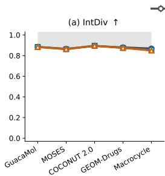

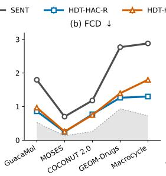

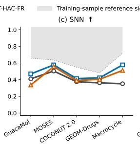

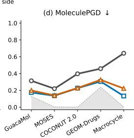  
Figure 7: Novel-only unconditional summary panels. Metrics are recomputed on the valid generated molecules absent from the exact training population. Markers report means over three generation seeds and error bars the sample SD. The gray training-sample reference is unfiltered and is shown only as an in-distribution reference. Compare Figure 3.

## E.1 GuacaMol

Table 13 reports GuacaMol. Validity ranges from 0.943 to 0.976 across the five generated configurations, and uniqueness is 1.000 for all five. Distributional metrics show larger differences. FCD ranges from 0.871 to 1.799, and MoleculePGD ranges from 0.176 to 0.309. HDT-HAC-R has the best FCD, SNN, fragment similarity, scaffold similarity, MoleculePGD, and GuacaMol KL score. HDT-MC-FR is the only configuration with higher V.U.N. than SENT, by 0.58%.

Table 13: GuacaMol: standard unconditional generation. Mean ± sample SD; lower panel: improvement over SENT. Shared conventions: Appendix E.
<table><tr><td></td><td>SENT</td><td>HDT-MC-R*</td><td>HDT-MC-FR*</td><td>HDT-HAC-R*</td><td>HDT-HAC-FR*</td><td>Training samples</td></tr><tr><td colspan="7">Absolute performance</td></tr><tr><td>Validity ↑</td><td> $0 . 9 6 7 \pm 0 . 0 0 1$ </td><td> $0 . 9 4 7 \pm 0 . 0 0 1$ </td><td> $\mathbf { 0 . 9 7 6 \pm 0 . 0 0 2 }$ </td><td> $0 . 9 4 3 \pm 0 . 0 0 1$ </td><td> $0 . 9 6 6 \pm 0 . 0 0 2$ </td><td> $1 . 0 0 0 \pm 0 . 0 0 0$ </td></tr><tr><td>Uniqueness ↑</td><td> $\mathbf { 1 . 0 0 0 \pm 0 . 0 0 0 }$ </td><td> $\underline { { 1 . 0 0 0 \pm 0 . 0 0 0 } }$ </td><td> $1 . 0 0 0 \pm 0 . 0 0 0$ </td><td> $1 . 0 0 0 \pm 0 . 0 0 0$ </td><td> $1 . 0 0 0 \pm 0 . 0 0 0$ </td><td> $1 . 0 0 0 \pm 0 . 0 0 0$ </td></tr><tr><td> $\mathrm { N o v e l t y } \uparrow$ </td><td> $\mathbf { 0 . 9 9 8 \pm 0 . 0 0 1 }$ </td><td> $\overline { { 0 . 9 9 0 \pm 0 . 0 0 1 } }$ </td><td> $0 . 9 9 5 \pm 0 . 0 0 1$ </td><td> $0 . 9 8 7 \pm 0 . 0 0 1$ </td><td> $0 . 9 9 6 \pm 0 . 0 0 1$ </td><td> $0 . 0 0 0 \pm 0 . 0 0 0$ </td></tr><tr><td> ${ \bf V . U . N . } \dagger$ </td><td> $0 . 9 6 5 \pm 0 . 0 0 0$ </td><td> $0 . 9 3 7 \pm 0 . 0 0 1$ </td><td> $\mathbf { 0 . 9 7 1 \pm 0 . 0 0 1 }$ </td><td> $0 . 9 3 1 \pm 0 . 0 0 1$ </td><td> $\overline { { 0 . 9 6 1 \pm 0 . 0 0 3 } }$ </td><td> $0 . 0 0 0 \pm 0 . 0 0 0$ </td></tr><tr><td> $\mathrm { F C D \downarrow }$ </td><td> $1 . 7 9 9 \pm 0 . 0 4 5$ </td><td> $0 . 9 3 6 \pm 0 . 0 1 5$ </td><td> $0 . 9 9 7 \pm 0 . 0 1 4$ </td><td> $\mathbf { 0 . 8 7 1 \pm 0 . 0 1 9 }$ </td><td> $0 . 9 8 9 \pm 0 . 0 1 3$ </td><td>0.527 ± 0.004</td></tr><tr><td>SNN↑</td><td> $0 . 4 1 0 \pm 0 . 0 0 1$ </td><td> $\overline { { 0 . 4 5 8 \pm 0 . 0 0 2 } }$ </td><td> $0 . 4 4 8 \pm 0 . 0 0 0$ </td><td> $\mathbf { 0 . 4 7 2 \pm 0 . 0 0 0 }$ </td><td> $0 . 4 4 5 \pm 0 . 0 0 1$ </td><td> $0 . 6 5 8 \pm 0 . 0 0 1$ </td></tr><tr><td>Frag ↑</td><td> $0 . 9 9 4 \pm 0 . 0 0 0$ </td><td> $\overline { { 0 . 9 9 8 \pm 0 . 0 0 0 } }$ </td><td> $0 . 9 9 8 \pm 0 . 0 0 0$ </td><td> $\mathbf { 0 . 9 9 9 \pm 0 . 0 0 0 }$ </td><td> $0 . 9 9 8 \pm 0 . 0 0 0$ </td><td> $0 . 9 9 9 \pm 0 . 0 0 0$ </td></tr><tr><td> ${ \dot { \operatorname { s c a f f } } } \uparrow$ </td><td> $0 . 8 9 0 \pm 0 . 0 0 7$ </td><td> $\overline { { 0 . 9 0 6 \pm 0 . 0 0 4 } }$ </td><td> $0 . 8 8 7 \pm 0 . 0 0 2$ </td><td> $\mathbf { 0 . 9 3 2 \pm 0 . 0 0 4 }$ </td><td> $0 . 9 2 5 \pm 0 . 0 0 6$ </td><td> $0 . 9 3 7 \pm 0 . 0 0 8$ </td></tr><tr><td>IntDiv ↑</td><td> $\mathbf { 0 . 8 8 6 \pm 0 . 0 0 1 }$ </td><td> $0 . 8 8 4 \pm 0 . 0 0 1$ </td><td> $0 . 8 8 4 \pm 0 . 0 0 1$ </td><td> $0 . 8 8 5 \pm 0 . 0 0 1$ </td><td> $\overline { { 0 . 8 8 4 \pm 0 . 0 0 1 } }$ </td><td> $0 . 8 8 7 \pm 0 . 0 0 1$ </td></tr><tr><td> $\mathbf { M o l e c u l e P G D \downarrow }$ </td><td> $0 . 3 0 9 \pm 0 . 0 0 5$ </td><td> $0 . 1 7 9 \pm 0 . 0 0 5$ </td><td> $0 . 1 8 6 \pm 0 . 0 0 4$ </td><td> $\mathbf { 0 . 1 7 6 \pm 0 . 0 0 7 }$ </td><td> $0 . 1 9 6 \pm 0 . 0 0 5$ </td><td> $0 . 1 2 9 \pm 0 . 0 0 5$ </td></tr><tr><td>KL score ↑</td><td> $0 . 9 3 8 \pm 0 . 0 1 0$ </td><td> $\overline { { 0 . 9 7 8 \pm 0 . 0 0 1 } }$ </td><td> $0 . 9 6 9 \pm 0 . 0 0 1$ </td><td> $\mathbf { 0 . 9 8 1 \pm 0 . 0 0 1 }$ </td><td> $0 . 9 6 3 \pm 0 . 0 0 2$ </td><td> $0 . 9 9 8 \pm 0 . 0 0 1$ </td></tr><tr><td> $\mathrm { F G \ M M D ^ { 2 } \downarrow }$ </td><td> $\mathbf { 0 . 0 0 2 0 \pm 0 . 0 0 0 0 }$ </td><td> $\underline { { 0 . 0 0 2 0 \pm 0 . 0 0 0 0 } }$ </td><td> $0 . 0 0 2 0 \pm 0 . 0 0 0 0$ </td><td> $0 . 0 0 2 0 \pm 0 . 0 0 0 0$ </td><td> $0 . 0 0 2 0 \pm 0 . 0 0 0 0$ </td><td> $0 . 0 0 2 0 \pm 0 . 0 0 0 0$ </td></tr><tr><td> $\mathbf { S M A R T S \ M M D ^ { 2 } \downarrow }$ </td><td> $0 . 0 0 2 3 \pm 0 . 0 0 0 1$ </td><td> $\mathbf { 0 . 0 0 2 1 \pm 0 . 0 0 0 0 }$ </td><td> $0 . 0 0 2 1 \pm 0 . 0 0 0 1$ </td><td> $0 . 0 0 2 1 \pm 0 . 0 0 0 1$ </td><td> $0 . 0 0 2 2 \pm 0 . 0 0 0 1$ </td><td> $0 . 0 0 1 9 \pm 0 . 0 0 0 0$ </td></tr><tr><td> ${ \mathrm { R i n g ~ M M D } ^ { 2 } \downarrow }$ </td><td> $0 . 0 0 3 6 \pm 0 . 0 0 0 3$ </td><td> $0 . 0 0 2 4 \pm 0 . 0 0 0 3$ </td><td> $\mathbf { 0 . 0 0 2 1 \pm 0 . 0 0 0 5 }$ </td><td> $0 . 0 0 2 4 \pm 0 . 0 0 0 3$ </td><td> $0 . 0 0 2 2 \pm 0 . 0 0 0 3$ </td><td> $0 . 0 0 1 9 \pm 0 . 0 0 0 2$ </td></tr><tr><td> $\mathrm { B R i C S } \ \mathrm { L } 2 \downarrow$ </td><td> $0 . 0 2 4 3 \pm 0 . 0 0 1 8$ </td><td> $0 . 0 1 9 1 \pm 0 . 0 0 1 3$ </td><td> $\mathbf { 0 . 0 1 8 1 \pm 0 . 0 0 0 3 }$ </td><td> $\underline { { 0 . 0 1 8 4 \pm 0 . 0 0 0 8 } }$ </td><td> $\overline { { 0 . 0 1 9 3 \pm 0 . 0 0 0 8 } }$ </td><td> $0 . 0 1 8 4 \pm 0 . 0 0 0 5$ </td></tr></table>

Direction-normalized change relative to SENT

<table><tr><td colspan="5">Direction-normalized change relative to SENT</td><td rowspan="2"></td><td rowspan="2">-0.19%</td><td rowspan="2"></td></tr><tr><td>Validity ↑</td><td>0.00%</td><td>-2.14%</td><td>+0.89%</td><td>-2.53%</td></tr><tr><td>Uniqueness ↑</td><td>0.00%</td><td>–0.04%</td><td>0.00%</td><td>-0.02%</td><td>0.00%</td><td></td></tr><tr><td>Novelty ↑</td><td>0.00%</td><td>–0.72%</td><td>-0.30%</td><td>-1.06%</td><td>-0.18%</td><td></td></tr><tr><td> ${ \bf V . U . N . } \dagger$ </td><td>0.00%</td><td>–2.87%</td><td>+0.58%</td><td>–3.58%</td><td>-0.37%</td><td></td></tr><tr><td>FCD↓</td><td>0.00%</td><td>+47.94%</td><td>+44.57%</td><td>+51.56%</td><td>+45.03%</td><td></td></tr><tr><td>SNN↑</td><td>0.00%</td><td>+11.67%</td><td>+9.32%</td><td>+14.95%</td><td>+8.40%</td><td></td></tr><tr><td>Frag ↑</td><td>0.00%</td><td>+0.45%</td><td>+0.47%</td><td>+0.50%</td><td>+0.46%</td><td></td></tr><tr><td>Scaff ↑</td><td>0.00%</td><td>+1.78%</td><td>-0.35%</td><td>+4.70%</td><td>+3.84%</td><td></td></tr><tr><td>IntDiv ↑</td><td>0.00%</td><td>-0.24%</td><td>-0.28%</td><td>-0.12%</td><td>-0.26%</td><td></td></tr><tr><td> $\mathbf { M o l e c u l e P G D \downarrow }$ </td><td>0.00%</td><td>+42.02%</td><td>+39.80%</td><td>+43.18%</td><td>+36.51%</td><td></td></tr><tr><td> $\mathrm { K L \ s c o r e \uparrow }$ </td><td>0.00%</td><td>+4.21%</td><td>+3.26%</td><td>+4.61%</td><td>+2.70%</td><td></td></tr><tr><td> $\mathrm { F G \ M M D ^ { 2 } \downarrow }$ </td><td>0.00%</td><td>+0.60%</td><td>+0.31%</td><td>+0.56%</td><td>+0.82%</td><td></td></tr><tr><td> $\mathrm { S M A R T S ~ M M D ^ { 2 } \downarrow }$ </td><td>0.00%</td><td>+9.05%</td><td>+9.80%</td><td>+8.43%</td><td>+7.66%</td><td></td></tr><tr><td> ${ \mathrm { R i n g ~ M M D } ^ { 2 } \downarrow }$ </td><td>0.00%</td><td>+32.89%</td><td>+42.57%</td><td>+32.59%</td><td>+38.65%</td><td></td></tr><tr><td> $\mathrm { B R I C S } \ \mathrm { L } 2 \downarrow$ </td><td>0.00%</td><td>+21.47%</td><td>+25.28%</td><td>+24.00%</td><td>+20.28%</td><td></td></tr></table>

Table 14: GuacaMol: novel-only unconditional generation. Mean ± sample SD; lower panel: improvement over SENT. Shared conventions: Appendix E.
<table><tr><td></td><td>SENT</td><td>HDT-MC-R*</td><td>HDT-MC-FR*</td><td>HDT-HAC-R*</td><td>HDT-HAC-FR*</td><td>Training samples</td></tr><tr><td colspan="7">Absolute performance</td></tr><tr><td>FCD↓</td><td> $1 . 7 9 8 \pm 0 . 0 1 4$ </td><td> $\underline { { 0 . 9 4 1 \pm 0 . 0 1 1 } }$ </td><td> $0 . 9 8 2 \pm 0 . 0 1 7$ </td><td> $\mathbf { 0 . 8 6 2 \pm 0 . 0 1 0 }$ </td><td> $0 . 9 7 0 \pm 0 . 0 1 4$ </td><td> $0 . 5 2 7 \pm 0 . 0 0 4$ </td></tr><tr><td>SNN↑</td><td> $0 . 4 1 0 \pm 0 . 0 0 0$ </td><td> $\overline { { 0 . 4 5 6 \pm 0 . 0 0 0 } }$ </td><td> $0 . 3 3 9 \pm 0 . 0 0 1$ </td><td> $\mathbf { 0 . 4 6 9 \pm 0 . 0 0 0 }$ </td><td> $0 . 3 3 7 \pm 0 . 0 0 1$ </td><td> $0 . 6 5 8 \pm 0 . 0 0 1$ </td></tr><tr><td>Frag ↑</td><td> $0 . 9 9 4 \pm 0 . 0 0 0$ </td><td> $\overline { { 0 . 9 9 8 \pm 0 . 0 0 0 } }$ </td><td> $0 . 9 9 8 \pm 0 . 0 0 0$ </td><td> $\mathbf { 0 . 9 9 9 \pm 0 . 0 0 0 }$ </td><td> $0 . 9 9 8 \pm 0 . 0 0 0$ </td><td> $0 . 9 9 9 \pm 0 . 0 0 0$ </td></tr><tr><td>Scaff ↑</td><td> $0 . 8 9 4 \pm 0 . 0 1 0$ </td><td> $\overline { { 0 . 9 0 0 \pm 0 . 0 0 5 } }$ </td><td> $0 . 7 5 4 \pm 0 . 0 0 3$ </td><td> $\mathbf { 0 . 9 3 2 \pm 0 . 0 0 3 }$ </td><td> $0 . 7 8 4 \pm 0 . 0 0 4$ </td><td> $0 . 9 3 7 \pm 0 . 0 0 8$ </td></tr><tr><td>IntDiv ↑</td><td> $\mathbf { 0 . 8 8 5 \pm 0 . 0 0 1 }$ </td><td> $\overline { { 0 . 8 8 3 \pm 0 . 0 0 1 } }$ </td><td> $0 . 8 8 2 \pm 0 . 0 0 0$ </td><td> $0 . 8 8 4 \pm 0 . 0 0 1$ </td><td> $0 . 8 8 3 \pm 0 . 0 0 1$ </td><td> $0 . 8 8 7 \pm 0 . 0 0 1$ </td></tr><tr><td>MoleculePGD ↓</td><td> $0 . 3 1 4 \pm 0 . 0 0 9$ </td><td>0.185 ± 0.004</td><td> $0 . 1 8 9 \pm 0 . 0 0 3$ </td><td>0.175 ± 0.004</td><td> $0 . 1 9 9 \pm 0 . 0 0 3$ </td><td> $0 . 1 2 9 \pm 0 . 0 0 5$ </td></tr><tr><td> ${ \mathrm { K L ~ s c o r e ~ } } \uparrow$ </td><td> $0 . 9 4 3 \pm 0 . 0 0 4$ </td><td> $\overline { { 0 . 9 7 5 \pm 0 . 0 0 1 } }$ </td><td> $0 . 9 6 5 \pm 0 . 0 0 1$ </td><td> $\mathbf { 0 . 9 7 7 \pm 0 . 0 0 2 }$ </td><td> $0 . 9 6 3 \pm 0 . 0 0 2$ </td><td> $0 . 9 9 8 \pm 0 . 0 0 1$ </td></tr><tr><td> $\mathrm { F G M M D ^ { 2 } \downarrow }$ </td><td> $\mathbf { 0 . 0 0 2 0 \pm 0 . 0 0 0 0 }$ </td><td> $\underline { { 0 . 0 0 2 0 \pm 0 . 0 0 0 0 } }$ </td><td> $0 . 0 0 2 0 \pm 0 . 0 0 0 0$ </td><td> $0 . 0 0 2 0 \pm 0 . 0 0 0 0$ </td><td> $0 . 0 0 2 0 \pm 0 . 0 0 0 0$ </td><td> $0 . 0 0 2 0 \pm 0 . 0 0 0 0$ </td></tr><tr><td> $\mathrm { S M A R T S ~ M M D ^ { 2 } \downarrow }$ </td><td> $0 . 0 0 2 4 \pm 0 . 0 0 0 1$ </td><td> $0 . 0 0 2 2 \pm 0 . 0 0 0 1$ </td><td> $0 . 0 0 2 2 \pm 0 . 0 0 0 1$ </td><td> $0 . 0 0 2 1 \pm 0 . 0 0 0 0$ </td><td> $\mathbf { 0 . 0 0 2 0 \pm 0 . 0 0 0 1 }$ </td><td> $0 . 0 0 1 9 \pm 0 . 0 0 0 0$ </td></tr><tr><td> $\mathrm { R i n g ~ M M D ^ { 2 } \downarrow }$ </td><td> $0 . 0 0 4 0 \pm 0 . 0 0 0 7$ </td><td> $0 . 0 0 2 3 \pm 0 . 0 0 0 2$ </td><td> $0 . 0 0 2 2 \pm 0 . 0 0 0 1$ </td><td> $\overline { { 0 . 0 0 2 4 \pm 0 . 0 0 0 3 } }$ </td><td> $\mathbf { 0 . 0 0 2 1 \pm 0 . 0 0 0 1 }$ </td><td> $0 . 0 0 1 9 \pm 0 . 0 0 0 2$ </td></tr><tr><td> $\mathrm { B R i C S } \mathrm { L } 2 \downarrow$ </td><td> $0 . 0 2 4 9 \pm 0 . 0 0 1 6$ </td><td> $0 . 0 1 9 9 \pm 0 . 0 0 2 0$ </td><td> $0 . 0 1 8 8 \pm 0 . 0 0 0 9$ </td><td> $\underline { { 0 . 0 1 8 1 \pm 0 . 0 0 0 4 } }$ </td><td> $\mathbf { 0 . 0 1 8 0 \pm 0 . 0 0 1 0 }$ </td><td> $0 . 0 1 8 4 \pm 0 . 0 0 0 5$ </td></tr></table>

<table><tr><td colspan="6">Direction-normalized change relative to SENT</td><td rowspan="2"></td></tr><tr><td>FCD↓</td><td>0.00%</td><td>+47.63%</td><td>+45.37%</td><td>+52.05%</td><td>+46.02%</td></tr><tr><td>SNN↑</td><td>0.00%</td><td>+11.08%</td><td>–17.47%</td><td>+14.29%</td><td>-17.85%</td><td></td></tr><tr><td>Frag ↑</td><td>0.00%</td><td>+0.40%</td><td>+0.34%</td><td>+0.44%</td><td>+0.35%</td><td></td></tr><tr><td>Scaff ↑</td><td>0.00%</td><td>+0.71%</td><td>-15.64%</td><td>+4.26%</td><td>–12.28%</td><td></td></tr><tr><td>IntDiv ↑</td><td>0.00%</td><td>–0.24%</td><td>–0.30%</td><td>-0.13%</td><td>-0.25%</td><td></td></tr><tr><td>MoleculePGD ↓</td><td>0.00%</td><td>+41.05%</td><td>+39.88%</td><td>+44.12%</td><td>+36.47%</td><td></td></tr><tr><td>KL score ↑</td><td>0.00%</td><td>+3.44%</td><td>+2.41%</td><td>+3.66%</td><td>+2.16%</td><td></td></tr><tr><td> $\mathrm { F G M M D ^ { 2 } \downarrow }$ </td><td>0.00%</td><td>+0.46%</td><td>–0.34%</td><td>+0.77%</td><td>+0.42%</td><td></td></tr><tr><td> $\mathbf { S M A R T S \ M M D ^ { 2 } \downarrow }$ </td><td>0.00%</td><td>+9.10%</td><td>+10.15%</td><td>+13.97%</td><td>+16.67%</td><td></td></tr><tr><td> $\mathrm { R i n g ~ M M D ^ { 2 } \downarrow }$ </td><td>0.00%</td><td>+42.24%</td><td>+45.14%</td><td>+40.76%</td><td>+47.91%</td><td></td></tr><tr><td> $\mathrm { B R i C S } \mathrm { L } 2 \downarrow$ </td><td>0.00%</td><td>+19.99%</td><td>+24.48%</td><td>+27.19%</td><td>+27.60%</td><td></td></tr></table>

## E.2 MOSES

Table 15 reports MOSES, which is the benchmark on which the hierarchical serializations are least costly and most uniformly ahead. Every hierarchical variant except HDT-MC-R improves on SENT's validity, all four reduce FCD by more than 62% and MoleculePGD by more than 35%, and all four improve SNN, fragment and scaffold similarity. The residual V.U.N. deficit is the smallest in the paper, between 0.91% and 3.99%, with novelty the main contributor; validity and uniqueness also contribute for some variants. The functional-group MMD is the one row where SENT leads more often than not, by margins at or below 0.0001 in absolute terms.

Table 15: MOSES: standard unconditional generation. Mean ± sample SD; lower panel: improvement over SENT. Shared conventions: Appendix E.
<table><tr><td></td><td>SENT</td><td>HDT-MC-R*</td><td>HDT-MC-FR*</td><td>HDT-HAC-R*</td><td>HDT-HAC-FR*</td><td>Training samples</td></tr><tr><td colspan="7">Absolute performance</td></tr><tr><td>Validity ↑</td><td> $0 . 9 7 7 \pm 0 . 0 0 1$ </td><td> $0 . 9 7 3 \pm 0 . 0 0 2$ </td><td> $0 . 9 8 7 \pm 0 . 0 0 1$ </td><td> $0 . 9 7 8 \pm 0 . 0 0 1$ </td><td> $0 . 9 8 5 \pm 0 . 0 0 0$ </td><td> $1 . 0 0 0 \pm 0 . 0 0 0$ </td></tr><tr><td> ${ \mathrm { U n i q u e n e s s } } \uparrow$ </td><td> $\mathbf { 1 . 0 0 0 \pm 0 . 0 0 0 }$ </td><td> $1 . 0 0 0 \pm 0 . 0 0 0$ </td><td> $\overline { { 1 . 0 0 0 \pm 0 . 0 0 0 } }$ </td><td> $0 . 9 9 9 \pm 0 . 0 0 0$ </td><td> $1 . 0 0 0 \pm 0 . 0 0 0$ </td><td> $1 . 0 0 0 \pm 0 . 0 0 0$ </td></tr><tr><td>Novelty ↑</td><td> $\mathbf { 0 . 9 9 0 \pm 0 . 0 0 2 }$ </td><td> $0 . 9 6 3 \pm 0 . 0 0 1$ </td><td> $0 . 9 7 1 \pm 0 . 0 0 1$ </td><td> $0 . 9 5 0 \pm 0 . 0 0 2$ </td><td> $0 . 9 7 1 \pm 0 . 0 0 2$ </td><td> $0 . 0 0 0 \pm 0 . 0 0 0$ </td></tr><tr><td> $\mathrm { V . U . N . } \^$ </td><td> $\mathbf { 0 . 9 6 7 \pm 0 . 0 0 1 }$ </td><td>0.936 ± 0.002</td><td> $0 . 9 5 8 \pm 0 . 0 0 2$ </td><td> $0 . 9 2 9 \pm 0 . 0 0 3$ </td><td> $0 . 9 5 6 \pm 0 . 0 0 2$ </td><td> $0 . 0 0 0 \pm 0 . 0 0 0$ </td></tr><tr><td>FCD↓</td><td> $0 . 6 9 6 \pm 0 . 0 4 4$ </td><td> $0 . 2 5 6 \pm 0 . 0 1 3$ </td><td> $\mathbf { 0 . 2 3 5 \pm 0 . 0 1 4 }$ </td><td> $0 . 2 4 6 \pm 0 . 0 0 3$ </td><td> $0 . 2 6 0 \pm 0 . 0 0 8$ </td><td> $0 . 1 3 2 \pm 0 . 0 0 1$ </td></tr><tr><td>SNN↑</td><td> $0 . 5 0 6 \pm 0 . 0 0 2$ </td><td> $0 . 5 6 9 \pm 0 . 0 0 1$ </td><td> $0 . 5 6 1 \pm 0 . 0 0 2$ </td><td> $\mathbf { 0 . 5 8 3 \pm 0 . 0 0 0 }$ </td><td> $0 . 5 6 0 \pm 0 . 0 0 3$ </td><td> $0 . 6 3 6 \pm 0 . 0 0 1$ </td></tr><tr><td>Frag ↑</td><td> $0 . 9 9 8 \pm 0 . 0 0 0$ </td><td> $\mathbf { 0 . 9 9 9 } \pm \mathbf { 0 . 0 0 0 }$ </td><td> $\underline { { 0 . 9 9 9 \pm 0 . 0 0 0 } }$ </td><td> $0 . 9 9 9 \pm 0 . 0 0 0$ </td><td> $0 . 9 9 9 \pm 0 . 0 0 0$ </td><td> $1 . 0 0 0 \pm 0 . 0 0 0$ </td></tr><tr><td>Scaff ↑</td><td> $0 . 9 6 2 \pm 0 . 0 0 4$ </td><td> $\underline { { 0 . 9 7 9 \pm 0 . 0 0 2 } }$ </td><td> $\overline { { 0 . 9 7 7 \pm 0 . 0 0 1 } }$ </td><td> $\mathbf { 0 . 9 8 1 \pm 0 . 0 0 1 }$ </td><td> $0 . 9 7 9 \pm 0 . 0 0 2$ </td><td> $0 . 9 8 3 \pm 0 . 0 0 1$ </td></tr><tr><td>IntDiv ↑</td><td> $\mathbf { 0 . 8 6 7 \pm 0 . 0 0 2 }$ </td><td> $\overline { { 0 . 8 6 2 \pm 0 . 0 0 3 } }$ </td><td> $0 . 8 6 4 \pm 0 . 0 0 0$ </td><td> $0 . 8 6 3 \pm 0 . 0 0 1$ </td><td> $0 . 8 6 4 \pm 0 . 0 0 2$ </td><td> $0 . 8 6 5 \pm 0 . 0 0 0$ </td></tr><tr><td> $\mathbf { M o l e c u l e P G D \downarrow }$ </td><td> $0 . 2 1 7 \pm 0 . 0 0 5$ </td><td> $0 . 1 3 9 \pm 0 . 0 0 7$ </td><td> $\mathbf { 0 . 1 0 7 \pm 0 . 0 0 2 }$ </td><td> $\underline { { 0 . 1 3 0 \pm 0 . 0 0 3 } }$ </td><td> $0 . 1 3 7 \pm 0 . 0 0 4$ </td><td> $0 . 0 0 4 \pm 0 . 0 0 4$ </td></tr><tr><td> $\mathrm { F G M M D ^ { 2 } \downarrow }$ </td><td> $\mathbf { 0 . 0 0 3 0 \pm 0 . 0 0 0 1 }$ </td><td> $0 . 0 0 3 1 \pm 0 . 0 0 0 0$ </td><td> $0 . 0 0 3 1 \pm 0 . 0 0 0 0$ </td><td> $0 . 0 0 3 1 \pm 0 . 0 0 0 1$ </td><td> $\underline { { 0 . 0 0 3 0 \pm 0 . 0 0 0 0 } }$ </td><td> $0 . 0 0 3 0 \pm 0 . 0 0 0 0$ </td></tr><tr><td> $\mathbf { S M A R T S \ M M D ^ { 2 } \downarrow }$ </td><td> $0 . 0 1 4 5 \pm 0 . 0 0 0 7$ </td><td> $0 . 0 1 3 2 \pm 0 . 0 0 0 9$ </td><td> $\mathbf { 0 . 0 1 2 1 \pm 0 . 0 0 1 7 }$ </td><td> $0 . 0 1 3 7 \pm 0 . 0 0 1 5$ </td><td> $0 . 0 1 2 6 \pm 0 . 0 0 0 3$ </td><td> $0 . 0 1 1 6 \pm 0 . 0 0 1 3$ </td></tr><tr><td> ${ \mathrm { R i n g ~ M M D } ^ { 2 } \downarrow }$ </td><td> $0 . 0 2 0 1 \pm 0 . 0 0 1 8$ </td><td> $\mathbf { 0 . 0 1 4 1 \pm 0 . 0 0 2 2 }$ </td><td> $\underline { { 0 . 0 1 4 5 \pm 0 . 0 0 1 0 } }$ </td><td> $0 . 0 1 8 2 \pm 0 . 0 0 3 1$ </td><td> $0 . 0 1 7 1 \pm 0 . 0 0 0 1$ </td><td> $0 . 0 1 6 9 \pm 0 . 0 0 2 8$ </td></tr><tr><td> $\mathrm { B R I C S } \ \mathrm { L } 2 \downarrow$ </td><td> $0 . 0 5 2 1 \pm 0 . 0 0 2 0$ </td><td> $\mathbf { 0 . 0 4 7 7 \pm 0 . 0 0 1 6 }$ </td><td> $\overline { { 0 . 0 5 2 1 \pm 0 . 0 0 2 0 } }$ </td><td>0.0509 ± 0.0018</td><td> $0 . 0 4 9 8 \pm 0 . 0 0 3 3$ </td><td> $0 . 0 4 9 2 \pm 0 . 0 0 1 0$ </td></tr></table>

<table><tr><td colspan="6">Direction-normalized change relative to SENT</td></tr><tr><td>Validity ↑</td><td>0.00%</td><td>-0.37%</td><td>+1.10%</td><td>+0.18%</td><td>+0.86%</td></tr><tr><td>Uniqueness ↑</td><td>0.00%</td><td>-0.03%</td><td>0.00%</td><td>-0.07%</td><td>-0.04%</td></tr><tr><td>Novelty ↑</td><td>0.00%</td><td>–2.79%</td><td>-1.98%</td><td>–4.10% –2.00%</td><td></td></tr><tr><td>V.U.N.↑</td><td>0.00%</td><td>-3.17%</td><td>-0.91%</td><td>–3.99%</td><td>-1.19%</td></tr><tr><td>FCD↓</td><td>0.00%</td><td>+63.27%</td><td>+66.20%</td><td>+64.64%</td><td>+62.69%</td></tr><tr><td>SNN↑</td><td>0.00%</td><td>+12.45%</td><td>+10.84%</td><td>+15.19%</td><td>+10.67%</td></tr><tr><td>Frag ↑</td><td>0.00%</td><td>+0.16%</td><td>+0.17%</td><td>+0.18%</td><td>+0.18%</td></tr><tr><td>Scaff ↑</td><td>0.00%</td><td>+1.85%</td><td>+1.58%</td><td>+2.02% +1.80%</td><td></td></tr><tr><td>IntDiv ↑</td><td>0.00%</td><td>-0.57%</td><td>-0.26%</td><td>-0.37%</td><td>-0.36%</td></tr><tr><td> $\mathbf { M o l e c u l e P G D \downarrow }$ </td><td>0.00%</td><td>+35.88%</td><td>+50.82%</td><td>+40.10%</td><td>+36.62%</td></tr><tr><td>FG MMD2↓</td><td>0.00%</td><td>-1.92%</td><td>-1.21%</td><td>–2.23%</td><td>-0.09%</td></tr><tr><td> $\mathbf { S M A R T S \ M M D ^ { 2 } \downarrow }$ </td><td>0.00%</td><td>+8.99%</td><td>+16.75%</td><td> $+ 5 . 1 5 \%$ </td><td>+12.87%</td></tr><tr><td> ${ \mathrm { R i n g ~ M M D } ^ { 2 } \downarrow }$ </td><td>0.00%</td><td>+30.20%</td><td>+28.10%</td><td> $+ 9 . 8 0 \%$ </td><td> $+ 1 5 . 3 4 \%$ </td></tr><tr><td> $\mathbf { B R i C S } \mathbf { L } 2 \downarrow$ </td><td>0.00%</td><td>+8.59%</td><td>+0.16%</td><td> $+ 2 . 3 1 \%$ </td><td>+4.56%</td></tr></table>

Table 16: MOSES: novel-only unconditional generation. Mean ± sample SD; lower panel: improvement over SENT. Shared conventions: Appendix E.
<table><tr><td></td><td>SENT</td><td>HDT-MC-R*</td><td>HDT-MC-FR*</td><td>HDT-HAC-R*</td><td>HDT-HAC-FR*</td><td>Training samples</td></tr><tr><td colspan="7">Absolute performance</td></tr><tr><td>FCD ↓</td><td>0.702 ± 0.044</td><td> $0 . 2 5 7 \pm 0 . 0 1 1$ </td><td> $\mathbf { 0 . 2 4 0 \pm 0 . 0 1 4 }$ </td><td> $0 . 2 4 7 \pm 0 . 0 0 4$ </td><td> $0 . 2 5 8 \pm 0 . 0 0 8$ </td><td> $0 . 1 3 2 \pm 0 . 0 0 1$ </td></tr><tr><td>SNN↑</td><td> $0 . 5 0 4 \pm 0 . 0 0 2$ </td><td> $0 . 5 6 4 \pm 0 . 0 0 2$ </td><td> $0 . 5 5 7 \pm 0 . 0 0 1$ </td><td> $\mathbf { 0 . 5 7 7 \pm 0 . 0 0 0 }$ </td><td> $0 . 5 5 6 \pm 0 . 0 0 3$ </td><td> $0 . 6 3 6 \pm 0 . 0 0 1$ </td></tr><tr><td>Frag ↑</td><td> $0 . 9 9 8 \pm 0 . 0 0 0$ </td><td> $\mathbf { 0 . 9 9 9 } \pm \mathbf { 0 . 0 0 0 }$ </td><td> $0 . 9 9 9 \pm 0 . 0 0 0$ </td><td> $0 . 9 9 9 \pm 0 . 0 0 0$ </td><td> $0 . 9 9 9 \pm 0 . 0 0 0$ </td><td> $1 . 0 0 0 \pm 0 . 0 0 0$ </td></tr><tr><td>Scaff↑</td><td> $0 . 9 6 2 \pm 0 . 0 0 3$ </td><td> $0 . 9 7 9 \pm 0 . 0 0 3$ </td><td> $\overline { { 0 . 9 7 7 \pm 0 . 0 0 1 } }$ </td><td> $\mathbf { 0 . 9 8 0 \pm 0 . 0 0 1 }$ </td><td> $0 . 9 7 9 \pm 0 . 0 0 2$ </td><td> $0 . 9 8 3 \pm 0 . 0 0 1$ </td></tr><tr><td>IntDiv ↑</td><td> $\mathbf { 0 . 8 6 6 \pm 0 . 0 0 1 }$ </td><td> $\overline { { 0 . 8 6 4 \pm 0 . 0 0 1 } }$ </td><td> $0 . 8 6 4 \pm 0 . 0 0 1$ </td><td> $0 . 8 6 2 \pm 0 . 0 0 1$ </td><td> $0 . 8 6 4 \pm 0 . 0 0 1$ </td><td> $0 . 8 6 5 \pm 0 . 0 0 0$ </td></tr><tr><td> $\mathbf { M o l e c u l e P G D \downarrow }$ </td><td> $0 . 2 2 0 \pm 0 . 0 1 0$ </td><td> $\overline { { 0 . 1 5 2 \pm 0 . 0 1 3 } }$ </td><td> $\mathbf { 0 . 1 1 3 \pm 0 . 0 0 2 }$ </td><td> $\underline { { 0 . 1 3 6 \pm 0 . 0 0 6 } }$ </td><td> $0 . 1 4 0 \pm 0 . 0 0 6$ </td><td> $0 . 0 0 4 \pm 0 . 0 0 4$ </td></tr><tr><td> $\mathrm { F G \ M M D ^ { 2 } \downarrow }$ </td><td> $0 . 0 0 3 1 \pm 0 . 0 0 0 1$ </td><td> $0 . 0 0 3 1 \pm 0 . 0 0 0 1$ </td><td> $0 . 0 0 3 1 \pm 0 . 0 0 0 1$ </td><td> $0 . \overline { { 0 0 3 2 \pm 0 . 0 0 0 1 } }$ </td><td> $\mathbf { 0 . 0 0 3 0 \pm 0 . 0 0 0 0 }$ </td><td> $0 . 0 0 3 0 \pm 0 . 0 0 0 0$ </td></tr><tr><td> $\mathbf { S M A R T S \ M M D ^ { 2 } \downarrow }$ </td><td> $0 . 0 1 4 6 \pm 0 . 0 0 0 7$ </td><td> $0 . 0 1 3 0 \pm 0 . 0 0 1 0$ </td><td> $\mathbf { 0 . 0 1 2 1 \pm 0 . 0 0 1 6 }$ </td><td> $0 . 0 1 4 4 \pm 0 . 0 0 1 9$ </td><td> $0 . 0 1 2 7 \pm 0 . 0 0 0 3$ </td><td> $0 . 0 1 1 6 \pm 0 . 0 0 1 3$ </td></tr><tr><td> ${ \mathrm { R i n g ~ M M D } ^ { 2 } \downarrow }$ </td><td> $0 . 0 2 0 3 \pm 0 . 0 0 2 1$ </td><td> $\mathbf { 0 . 0 1 3 8 \pm 0 . 0 0 2 1 }$ </td><td> $\underline { { 0 . 0 1 5 1 \pm 0 . 0 0 1 1 } }$ </td><td> $0 . 0 1 9 5 \pm 0 . 0 0 2 6$ </td><td> $0 . 0 1 7 3 \pm 0 . 0 0 0 3$ </td><td> $0 . 0 1 6 9 \pm 0 . 0 0 2 8$ </td></tr><tr><td> $\mathrm { B R i C S } \ \mathrm { L } 2 \downarrow$ </td><td> $0 . 0 5 2 3 \pm 0 . 0 0 1 7$ </td><td> $\mathbf { 0 . 0 4 7 9 \pm 0 . 0 0 2 2 }$ </td><td> $\overline { { 0 . 0 5 2 4 \pm 0 . 0 0 2 1 } }$ </td><td> $0 . 0 5 2 0 \pm 0 . 0 0 2 1$ </td><td> $0 . 0 4 9 6 \pm 0 . 0 0 2 8$ </td><td> $0 . 0 4 9 2 \pm 0 . 0 0 1 0$ </td></tr></table>

Direction-normalized change relative to SENT

<table><tr><td colspan="7">Direction-normalized change relative to SENT</td></tr><tr><td>FCD↓</td><td>0.00%</td><td>+63.40%</td><td>+65.78%</td><td>+64.82%</td><td>+63.22%</td><td></td></tr><tr><td>SNN↑</td><td>0.00%</td><td>+11.97%</td><td>+10.51%</td><td>+14.51%</td><td>+10.31%</td><td></td></tr><tr><td>Frag ↑</td><td>0.00%</td><td>+0.16%</td><td>+0.17%</td><td>+0.17%</td><td>+0.18%</td><td></td></tr><tr><td>Scaff ↑</td><td>0.00%</td><td>+1.72%</td><td>+1.58%</td><td>+1.90%</td><td>+1.77%</td><td></td></tr><tr><td>IntDiv ↑</td><td>0.00%</td><td>-0.25%</td><td>-0.23%</td><td>–0.46%</td><td>-0.21%</td><td></td></tr><tr><td>MoleculePGD ↓</td><td>0.00%</td><td>+31.26%</td><td>+48.60%</td><td>+38.54%</td><td>+36.48%</td><td></td></tr><tr><td>FG MMD2↓</td><td>0.00%</td><td>-1.05%</td><td>-1.51%</td><td>–3.44%</td><td>+0.44%</td><td></td></tr><tr><td> $\mathrm { S M A R T S ~ M M D ^ { 2 } \downarrow }$ </td><td>0.00%</td><td>+10.51%</td><td>+17.08%</td><td>+1.23%</td><td>+13.07%</td><td></td></tr><tr><td> ${ \mathrm { R i n g ~ M M D ^ { 2 } \downarrow } }$ </td><td>0.00%</td><td>+31.96%</td><td>+25.56%</td><td>+3.94%</td><td>+14.63%</td><td></td></tr><tr><td> $\mathrm { B R I C S } \ \mathrm { L } 2 \downarrow$ </td><td>0.00%</td><td>+8.49%</td><td>–0.16%</td><td>+0.69%</td><td>+5.23%</td><td></td></tr></table>

## E.3 COCONUT 2.0

Table 17 reports COCONUT 2.0. Every hierarchical variant improves all four motif discrepancies over SENT. SMARTS MMD, ring MMD, and BRICS L2 improve by up to 68.2%, 82.9%, and 49.9% respectively. These gains come with a V.U.N. cost. HDT-HAC-R has 17.0% lower V.U.N. than SENT, with novelty of 0.880 versus 0.979. Hierarchy-wide randomization reduces this deficit. HDT-MC-FR has V.U.N. within 2.98% of SENT while reducing FCD by 50.4% and MoleculePGD by 59.5%. The latter is the largest MoleculePGD improvement among the variants on this benchmark.

Table 17: COCONUT 2.0: standard unconditional generation. Mean ± sample SD; lower panel: improvement over SENT. Shared conventions: Appendix E
<table><tr><td></td><td>SENT</td><td>HDT-MC-R*</td><td>HDT-MC-FR*</td><td>HDT-HAC-R*</td><td>HDT-HAC-FR*</td><td>Training samples</td></tr><tr><td colspan="7">Absolute performance</td></tr><tr><td>Validity ↑</td><td> $0 . 9 3 2 \pm 0 . 0 0 0$ </td><td> $0 . 9 1 9 \pm 0 . 0 0 2$ </td><td> $\mathbf { 0 . 9 4 6 \pm 0 . 0 0 1 }$ </td><td> $0 . 8 6 0 \pm 0 . 0 0 2$ </td><td> $0 . 9 0 8 \pm 0 . 0 0 2$ </td><td> $1 . 0 0 0 \pm 0 . 0 0 0$ </td></tr><tr><td> ${ \mathrm { U n i q u e n e s s } } \uparrow$ </td><td> $\mathbf { i . 0 0 0 \pm 0 . 0 0 0 }$ </td><td> $0 . 9 9 8 \pm 0 . 0 0 0$ </td><td> $0 . 9 9 8 \pm 0 . 0 0 1$ </td><td> $0 . 9 9 7 \pm 0 . 0 0 0$ </td><td> $0 . 9 9 9 \pm 0 . 0 0 0$ </td><td> $1 . 0 0 0 \pm 0 . 0 0 0$ </td></tr><tr><td> $\mathbf { N o v e l t y } \uparrow$ </td><td> $\mathbf { 0 . 9 7 9 \pm 0 . 0 0 1 }$ </td><td> $0 . 9 2 7 \pm 0 . 0 0 4$ </td><td> $0 . 9 3 6 \pm 0 . 0 0 3$ </td><td> $0 . 8 8 0 \pm 0 . 0 0 2$ </td><td> $\overline { { 0 . 9 2 4 \pm 0 . 0 0 1 } }$ </td><td> $0 . 0 0 0 \pm 0 . 0 0 0$ </td></tr><tr><td> ${ \bf V . U . N . } \dagger$ </td><td> $\mathbf { 0 . 9 1 2 \pm 0 . 0 0 1 }$ </td><td> $0 . 8 5 1 \pm 0 . 0 0 2$ </td><td> $\overline { { 0 . 8 8 5 \pm 0 . 0 0 3 } }$ </td><td> $0 . 7 5 7 \pm 0 . 0 0 2$ </td><td> $0 . 8 3 9 \pm 0 . 0 0 3$ </td><td> $0 . 0 0 0 \pm 0 . 0 0 0$ </td></tr><tr><td> $\mathrm { F C D \downarrow }$ </td><td> $1 . 1 7 3 \pm 0 . 0 5 9$ </td><td> $0 . 5 4 0 \pm 0 . 0 0 8$ </td><td> $\overline { { 0 . 5 8 2 \pm 0 . 0 1 0 } }$ </td><td> $0 . 5 5 1 \pm 0 . 0 0 8$ </td><td> $0 . 5 6 3 \pm 0 . 0 1 2$ </td><td> $0 . 2 5 9 \pm 0 . 0 0 5$ </td></tr><tr><td> $\mathbf { S N N } \uparrow$ </td><td> $0 . 3 8 5 \pm 0 . 0 0 2$ </td><td> $\overline { { 0 . 4 5 7 \pm 0 . 0 0 2 } }$ </td><td> $0 . 4 6 0 \pm 0 . 0 0 2$ </td><td> $\mathbf { 0 . 4 6 3 \pm 0 . 0 0 3 }$ </td><td> $0 . 4 2 8 \pm 0 . 0 0 1$ </td><td> $0 . 5 4 9 \pm 0 . 0 0 1$ </td></tr><tr><td> $\mathrm { F r a g \uparrow }$ </td><td> $0 . 9 9 1 \pm 0 . 0 0 0$ </td><td> $0 . 9 9 7 \pm 0 . 0 0 0$ </td><td> $\overline { { 0 . 9 9 5 \pm 0 . 0 0 0 } }$ </td><td> $0 . 9 9 6 \pm 0 . 0 0 1$ </td><td> $0 . 9 9 7 \pm 0 . 0 0 0$ </td><td> $0 . 9 9 9 \pm 0 . 0 0 0$ </td></tr><tr><td> ${ \operatorname { S c a f f } } \uparrow$ </td><td> $0 . 8 6 1 \pm 0 . 0 0 6$ </td><td> $\overline { { 0 . 9 1 0 \pm 0 . 0 0 2 } }$ </td><td> $0 . 8 9 9 \pm 0 . 0 1 3$ </td><td> $\mathbf { 0 . 9 1 3 \pm 0 . 0 0 2 }$ </td><td>0.906 ± 0.002</td><td> $0 . 9 2 4 \pm 0 . 0 0 5$ </td></tr><tr><td>IntDiv ↑</td><td> $\mathbf { 0 . 8 9 6 \pm 0 . 0 0 1 }$ </td><td> $\overline { { 0 . 8 9 2 \pm 0 . 0 0 1 } }$ </td><td> $0 . 8 9 1 \pm 0 . 0 0 2$ </td><td> $0 . 8 9 2 \pm 0 . 0 0 1$ </td><td> $0 . 8 9 2 \pm 0 . 0 0 1$ </td><td> $0 . 8 9 7 \pm 0 . 0 0 1$ </td></tr><tr><td> $\mathbf { M o l e c u l e P G D \downarrow }$ </td><td> $0 . 3 8 6 \pm 0 . 0 0 4$ </td><td> $\overline { { 0 . 2 3 0 \pm 0 . 0 0 9 } }$ </td><td> $\mathbf { 0 . 1 5 6 \pm 0 . 0 0 5 }$ </td><td> $0 . 2 0 2 \pm 0 . 0 0 8$ </td><td> $0 . 2 1 2 \pm 0 . 0 0 4$ </td><td> $0 . 0 0 1 \pm 0 . 0 0 1$ </td></tr><tr><td> $\mathrm { F G \ M M D ^ { 2 } \downarrow }$ </td><td> $0 . 0 0 0 3 \pm 0 . 0 0 0 0$ </td><td> $\mathbf { 0 . 0 0 0 2 \pm 0 . 0 0 0 0 }$ </td><td> $\underline { { 0 . 0 0 0 2 \pm 0 . 0 0 0 0 } }$ </td><td> $0 . 0 0 0 2 \pm 0 . 0 0 0 0$ </td><td> $0 . 0 0 0 2 \pm 0 . 0 0 0 0$ </td><td> $0 . 0 0 2 0 \pm 0 . 0 0 0 1$ </td></tr><tr><td> $\mathbf { S M A R T S \ M M D ^ { 2 } \downarrow }$ </td><td> $0 . 0 0 1 1 \pm 0 . 0 0 0 1$ </td><td> $0 . 0 0 0 5 \pm 0 . 0 0 0 0$ </td><td> $\overline { { 0 . 0 0 0 8 \pm 0 . 0 0 0 1 } }$ </td><td> $0 . 0 0 0 5 \pm 0 . 0 0 0 1$ </td><td> $\mathbf { 0 . 0 0 0 4 \pm 0 . 0 0 0 0 }$ </td><td> $0 . 0 0 2 1 \pm 0 . 0 0 0 4$ </td></tr><tr><td> ${ \mathrm { R i n g ~ M M D ^ { 2 } \downarrow } }$ </td><td> $0 . 0 0 2 8 \pm 0 . 0 0 0 2$ </td><td> $0 . 0 0 0 8 \pm 0 . 0 0 0 1$ </td><td> $\mathbf { 0 . 0 0 0 5 \pm 0 . 0 0 0 0 }$ </td><td> $0 . 0 0 1 1 \pm 0 . 0 0 0 2$ </td><td> $0 . 0 0 0 8 \pm 0 . 0 0 0 0$ </td><td> $0 . 0 0 1 9 \pm 0 . 0 0 0 1$ </td></tr><tr><td>BRICS L2↓</td><td> $0 . 0 1 7 8 \pm 0 . 0 0 0 5$ </td><td> $0 . 0 1 0 4 \pm 0 . 0 0 0 9$ </td><td> $0 . 0 1 3 8 \pm 0 . 0 0 0 2$ </td><td> $0 . 0 1 1 2 \pm 0 . 0 0 1 4$ </td><td> $0 . 0 1 0 5 \pm 0 . 0 0 0 1$ </td><td> $0 . 0 2 0 1 \pm 0 . 0 0 2 3$ </td></tr></table>

<table><tr><td colspan="5">Direction-normalized change relative to SENT</td><td colspan="3"></td></tr><tr><td>Validity ↑</td><td>0.00%</td><td>-1.40%</td><td>+1.49%</td><td>-7.66%</td><td>-2.58%</td><td></td><td></td></tr><tr><td>Uniqueness ↑</td><td>0.00%</td><td>-0.18%</td><td>-0.19%</td><td>–0.29%</td><td>-0.11%</td><td></td><td></td></tr><tr><td>Novelty ↑</td><td>0.00%</td><td>–5.30%</td><td>-4.36%</td><td>–10.05%</td><td>–5.56%</td><td></td><td></td></tr><tr><td>V.U.N. ↑</td><td>0.00%</td><td>-6.68%</td><td>-2.98%</td><td>–17.01%</td><td>-8.02%</td><td></td><td></td></tr><tr><td>FCD↓</td><td>0.00%</td><td>+53.97%</td><td>+50.37%</td><td>+53.05%</td><td>+52.01%</td><td></td><td></td></tr><tr><td>SNN↑</td><td>0.00%</td><td>+18.64%</td><td>+19.43%</td><td>+20.14%</td><td></td><td>+11.23%</td><td></td></tr><tr><td>Frag ↑</td><td>0.00%</td><td>+0.59%</td><td>+0.38%</td><td>+0.53%</td><td>+0.58%</td><td></td><td></td></tr><tr><td>Scaff ↑</td><td>0.00%</td><td>+5.65%</td><td>+4.41%</td><td>+6.00%</td><td></td><td>+5.17%</td><td></td></tr><tr><td>IntDiv ↑</td><td>0.00%</td><td>-0.43%</td><td>-0.58%</td><td>-0.49%</td><td></td><td>-0.43%</td><td></td></tr><tr><td>MoleculePGD ↓</td><td>0.00%</td><td>+40.38%</td><td>+59.54%</td><td>+47.75%</td><td></td><td>+45.25%</td><td></td></tr><tr><td>FG MMD2↓</td><td>0.00%</td><td>+10.97%</td><td>+7.92%</td><td>+14.85%</td><td>+11.29%</td><td></td><td></td></tr><tr><td> $\mathrm { S M A R T S ~ M M D ^ { 2 } \downarrow }$ </td><td>0.00%</td><td>+53.52%</td><td>+30.87%</td><td>+55.23%</td><td></td><td>+68.17%</td><td></td></tr><tr><td> ${ \mathrm { R i n g ~ M M D } ^ { 2 } \downarrow }$ </td><td>0.00%</td><td>+72.62%</td><td>+82.87%</td><td>+59.00%</td><td></td><td>+69.46%</td><td>一</td></tr><tr><td>BRICS L2 ↓</td><td>0.00%</td><td>+41.48%</td><td>+22.17%</td><td>+37.28%</td><td>+40.71%</td><td></td><td>一</td></tr></table>

Table 18: COCONUT 2.0: novel-only unconditional generation. Mean ± sample SD; lower panel: improvement over SENT. Shared conventions: Appendix E
<table><tr><td></td><td>SENT</td><td>HDT-MC-R*</td><td>HDT-MC-FR*</td><td>HDT-HAC-R*</td><td>HDT-HAC-FR*</td><td>Training samples</td></tr><tr><td colspan="7">Absolute performance</td></tr><tr><td>FCD↓</td><td> $1 . 1 8 2 \pm 0 . 0 4 0$ </td><td> $0 . 5 7 4 \pm 0 . 0 2 5$ </td><td> $\mathbf { 0 . 5 6 6 \pm 0 . 0 1 3 }$ </td><td> $0 . 7 7 2 \pm 0 . 0 2 3$ </td><td> $0 . 7 4 9 \pm 0 . 0 2 5$ </td><td> $0 . 2 5 9 \pm 0 . 0 0 5$ </td></tr><tr><td>SNN↑</td><td> $0 . 3 7 5 \pm 0 . 0 0 1$ </td><td> $\overline { { 0 . 4 3 2 \pm 0 . 0 0 2 } }$ </td><td> $\mathbf { 0 . 4 3 8 \pm 0 . 0 0 1 }$ </td><td> $0 . 4 1 3 \pm 0 . 0 0 3$ </td><td> $0 . 3 9 1 \pm 0 . 0 0 1$ </td><td> $0 . 5 4 9 \pm 0 . 0 0 1$ </td></tr><tr><td>Frag ↑</td><td> $0 . 9 9 2 \pm 0 . 0 0 0$ </td><td> $\mathbf { 0 . 9 9 7 \pm 0 . 0 0 0 }$ </td><td> $0 . 9 9 6 \pm 0 . 0 0 0$ </td><td> $0 . 9 9 0 \pm 0 . 0 0 2$ </td><td> $0 . 9 9 2 \pm 0 . 0 0 0$ </td><td> $0 . 9 9 9 \pm 0 . 0 0 0$ </td></tr><tr><td>Scaff ↑</td><td> $0 . 8 4 7 \pm 0 . 0 0 4$ </td><td> $0 . 8 9 1 \pm 0 . 0 0 2$ </td><td> $\overline { { 0 . 8 8 0 \pm 0 . 0 1 7 } }$ </td><td> $\mathbf { 0 . 9 0 3 \pm 0 . 0 0 2 }$ </td><td> $0 . 8 9 9 \pm 0 . 0 0 3$ </td><td> $0 . 9 2 4 \pm 0 . 0 0 5$ </td></tr><tr><td>IntDiv ↑</td><td> $0 . 8 9 3 \pm 0 . 0 0 1$ </td><td> $0 . 8 9 4 \pm 0 . 0 0 1$ </td><td> $0 . 8 9 2 \pm 0 . 0 0 1$ </td><td> $0 . 8 9 5 \pm 0 . 0 0 0$ </td><td> $\mathbf { 0 . 8 9 6 \pm 0 . 0 0 1 }$ </td><td> $0 . 8 9 7 \pm 0 . 0 0 1$ </td></tr><tr><td> $\mathbf { M o l e c u l e P G D \downarrow }$ </td><td> $0 . 3 9 7 \pm 0 . 0 0 1$ </td><td> $0 . 2 4 8 \pm 0 . 0 0 8$ </td><td> $\mathbf { 0 . 1 6 6 \pm 0 . 0 0 7 }$ </td><td> $\overline { { 0 . 2 2 6 \pm 0 . 0 0 8 } }$ </td><td> $0 . 2 2 8 \pm 0 . 0 0 2$ </td><td> $0 . 0 0 1 \pm 0 . 0 0 1$ </td></tr><tr><td> $\mathrm { F G M M D ^ { 2 } \downarrow }$ </td><td> $0 . 0 0 2 1 \pm 0 . 0 0 0 0$ </td><td> $0 . 0 0 2 0 \pm 0 . 0 0 0 0$ </td><td> $\mathbf { 0 . 0 0 0 2 \pm 0 . 0 0 0 0 }$ </td><td> $0 . 0 0 2 1 \pm 0 . 0 0 0 0$ </td><td> $\underline { { 0 . 0 0 0 3 \pm 0 . 0 0 0 0 } }$ </td><td> $0 . 0 0 2 0 \pm 0 . 0 0 0 1$ </td></tr><tr><td> $\mathrm { S M A R T S ~ M M D ^ { 2 } \downarrow }$ </td><td> $0 . 0 0 2 2 \pm 0 . 0 0 0 2$ </td><td> $0 . 0 0 2 1 \pm 0 . 0 0 0 1$ </td><td> $\mathbf { 0 . 0 0 0 5 \pm 0 . 0 0 0 1 }$ </td><td> $0 . 0 0 3 9 \pm 0 . 0 0 0 2$ </td><td> $\overline { { 0 . 0 0 1 8 \pm 0 . 0 0 0 0 } }$ </td><td> $0 . 0 0 2 1 \pm 0 . 0 0 0 4$ </td></tr><tr><td> $ { \mathrm { R i n g } }  { \mathrm { M M D ^ { 2 } \downarrow } }$ </td><td> $0 . 0 0 4 5 \pm 0 . 0 0 0 2$ </td><td> $0 . 0 0 3 5 \pm 0 . 0 0 0 6$ </td><td> $\mathbf { 0 . 0 0 0 8 \pm 0 . 0 0 0 0 }$ </td><td> $0 . 0 0 5 8 \pm 0 . 0 0 0 8$ </td><td> $0 . 0 0 2 8 \pm 0 . 0 0 0 2$ </td><td> $0 . 0 0 1 9 \pm 0 . 0 0 0 1$ </td></tr><tr><td> $\mathrm { B R i C S } \mathrm { L } 2 \downarrow$ </td><td> $0 . 0 2 4 4 \pm 0 . 0 0 0 5$ </td><td></td><td>0.0201 ± 0.0009 0.0120 ± 0.0003</td><td> $0 . 0 2 8 5 \pm 0 . 0 0 0 6$ </td><td> $0 . 0 1 6 5 \pm 0 . 0 0 0 6$ </td><td> $0 . 0 2 0 1 \pm 0 . 0 0 2 3$ </td></tr></table>

<table><tr><td colspan="6">Direction-normalized change relative to SENT</td><td rowspan="2"></td></tr><tr><td>FCD↓</td><td>0.00%</td><td>+51.46%</td><td>+52.14%</td><td>+34.65%</td><td>+36.66%</td></tr><tr><td>SNN↑</td><td>0.00%</td><td>+15.17%</td><td>+16.73%</td><td>+10.09%</td><td>+4.30%</td><td></td></tr><tr><td>Frag ↑</td><td>0.00%</td><td>+0.44%</td><td>+0.37%</td><td>-0.22%</td><td>-0.04%</td><td></td></tr><tr><td>Scaff↑</td><td>0.00%</td><td>+5.23%</td><td>+3.89%</td><td>+6.59%</td><td>+6.09%</td><td></td></tr><tr><td>IntDiv ↑</td><td>0.00%</td><td>+0.07%</td><td>-0.11%</td><td>+0.19%</td><td>+0.27%</td><td></td></tr><tr><td>MoleculePGD ↓</td><td>0.00%</td><td>+37.40%</td><td>+58.12%</td><td>+43.12%</td><td>+42.47%</td><td></td></tr><tr><td>FG MMD2↓</td><td>0.00%</td><td>+3.38%</td><td>+88.93%</td><td>–1.63%</td><td>+86.18%</td><td></td></tr><tr><td> $\mathbf { S M A R T S \ M M D ^ { 2 } \downarrow }$ </td><td>0.00%</td><td>+1.72%</td><td>+78.97%</td><td>–81.88%</td><td>+19.06%</td><td></td></tr><tr><td> $ { \mathrm { R i n g } }  { \mathrm { M M D ^ { 2 } \downarrow } }$ </td><td>0.00%</td><td>+21.67%</td><td>+82.67%</td><td>–29.54%</td><td>+37.71%</td><td></td></tr><tr><td> $\mathrm { B R I C S } \mathrm { L } 2 \downarrow$ </td><td>0.00%</td><td>+17.79%</td><td>+50.71%</td><td>–16.95%</td><td>+32.45%</td><td></td></tr></table>

## E.4 GEOM-Drugs (disjoint)

Table 19 reports the audited disjoint split of GEOM-Drugs. Similar distributional gains occur with roughly one eighth of the training population of GuacaMol and MOSES. Relative to SENT, every hierarchical variant reduces FCD by roughly half, MoleculePGD by 28.6%–34.3%, and ring MMD by 52.3%–61.7%. The randomization policies differ more clearly on V.U.N. The -R variants have deficits of 7.7% and 10.9%, while both -FR variants are within 0.18% of SENT. On this benchmark, hierarchy-wide randomization therefore retains the distributional gains with little V.U.N. loss.

Table 19: GEOM-Drugs (disjoint): standard unconditional generation. Mean ± sample SD; lower panel: improvement over SENT. Shared conventions: Appendix E.
<table><tr><td></td><td>SENT</td><td>HDT-MC-R*</td><td>HDT-MC-FR*</td><td>HDT-HAC-R*</td><td>HDT-HAC-FR*</td><td>Training samples</td></tr><tr><td colspan="7">Absolute performance</td></tr><tr><td>Validity ↑</td><td> $0 . 9 4 9 \pm 0 . 0 0 2$ </td><td> $0 . 9 2 9 \pm 0 . 0 0 1$ </td><td> $0 . 9 5 5 \pm 0 . 0 0 2$ </td><td> $0 . 9 1 3 \pm 0 . 0 0 4$ </td><td> $0 . 9 5 7 \pm 0 . 0 0 2$ </td><td> $1 . 0 0 0 \pm 0 . 0 0 0$ </td></tr><tr><td> ${ \mathrm { U n i q u e n e s s } } \uparrow$ </td><td> $\mathbf { 1 . 0 0 0 \pm 0 . 0 0 0 }$ </td><td> $0 . 9 9 5 \pm 0 . 0 0 1$ </td><td> $0 . 9 9 9 \pm 0 . 0 0 0$ </td><td> $0 . 9 9 5 \pm 0 . 0 0 1$ </td><td> $\overline { { 0 . 9 9 9 \pm 0 . 0 0 0 } }$ </td><td> $1 . 0 0 0 \pm 0 . 0 0 0$ </td></tr><tr><td> $\mathbf { N o v e l t y } \uparrow$ </td><td> $\mathbf { 0 . 9 9 7 \pm 0 . 0 0 0 }$ </td><td> $0 . 9 4 2 \pm 0 . 0 0 3$ </td><td> $\overline { { 0 . 9 8 9 \pm 0 . 0 0 1 } }$ </td><td> $0 . 9 2 5 \pm 0 . 0 0 4$ </td><td> $0 . 9 8 8 \pm 0 . 0 0 1$ </td><td> $0 . 0 0 0 \pm 0 . 0 0 0$ </td></tr><tr><td> ${ \bf V . U . N . } \dagger$ </td><td> $0 . 9 4 5 \pm 0 . 0 0 2$ </td><td> $0 . 8 7 3 \pm 0 . 0 0 4$ </td><td> $\overline { { 0 . 9 4 4 \pm 0 . 0 0 1 } }$ </td><td> $0 . 8 4 2 \pm 0 . 0 0 6$ </td><td> $0 . 9 4 5 \pm 0 . 0 0 2$ </td><td> $0 . 0 0 0 \pm 0 . 0 0 0$ </td></tr><tr><td> $\mathrm { F C D \downarrow }$ </td><td> $2 . 7 4 2 \pm 0 . 0 5 2$ </td><td> $1 . 3 5 3 \pm 0 . 0 2 7$ </td><td> $1 . 3 2 6 \pm 0 . 0 3 3$ </td><td> $\mathbf { 1 . 1 9 6 \pm 0 . 0 1 8 }$ </td><td> $1 . 3 5 3 \pm 0 . 0 2 7$ </td><td> $0 . 9 3 4 \pm 0 . 0 0 4$ </td></tr><tr><td> $\mathbf { S N N } \uparrow$ </td><td> $0 . 3 6 2 \pm 0 . 0 0 2$ </td><td> $0 . 4 2 4 \pm 0 . 0 0 1$ </td><td> $\overline { { 0 . 4 1 3 \pm 0 . 0 0 1 } }$ </td><td> $\mathbf { 0 . 4 3 0 \pm 0 . 0 0 2 }$ </td><td> $0 . 4 0 7 \pm 0 . 0 0 1$ </td><td> $0 . 4 8 1 \pm 0 . 0 0 1$ </td></tr><tr><td> $\mathrm { F r a g \uparrow }$ </td><td> $0 . 9 9 1 \pm 0 . 0 0 0$ </td><td> $0 . 9 9 6 \pm 0 . 0 0 0$ </td><td> $\mathbf { 0 . 9 9 7 \pm 0 . 0 0 0 }$ </td><td> $0 . 9 9 6 \pm 0 . 0 0 0$ </td><td> $0 . 9 9 7 \pm 0 . 0 0 0$ </td><td> $0 . 9 9 8 \pm 0 . 0 0 0$ </td></tr><tr><td> ${ \operatorname { S c a f f } } \uparrow$ </td><td> $0 . 8 3 9 \pm 0 . 0 0 8$ </td><td> $\underline { { 0 . 8 5 7 \pm 0 . 0 0 7 } }$ </td><td> $0 . 8 5 6 \pm 0 . 0 0 4$ </td><td> $\mathbf { 0 . 8 6 3 \pm 0 . 0 0 8 }$ </td><td> $\overline { { 0 . 8 4 6 \pm 0 . 0 0 9 } }$ </td><td> $0 . 8 6 9 \pm 0 . 0 0 5$ </td></tr><tr><td>IntDiv ↑</td><td> $\mathbf { 0 . 8 7 9 \pm 0 . 0 0 0 }$ </td><td> $\overline { { 0 . 8 7 5 \pm 0 . 0 0 1 } }$ </td><td> $\underline { { 0 . 8 7 6 \pm 0 . 0 0 1 } }$ </td><td> $0 . 8 7 6 \pm 0 . 0 0 1$ </td><td> $0 . 8 7 6 \pm 0 . 0 0 1$ </td><td> $0 . 8 7 7 \pm 0 . 0 0 2$ </td></tr><tr><td> $\mathbf { M o l e c u l e P G D \downarrow }$ </td><td> $0 . 4 5 6 \pm 0 . 0 0 5$ </td><td> $\underline { { 0 . 3 1 4 \pm 0 . 0 0 2 } }$ </td><td> $\overline { { 0 . 3 1 6 \pm 0 . 0 0 5 } }$ </td><td> $\mathbf { 0 . 3 0 0 \pm 0 . 0 0 6 }$ </td><td> $0 . 3 2 6 \pm 0 . 0 0 5$ </td><td> $0 . 2 3 9 \pm 0 . 0 0 5$ </td></tr><tr><td> $\mathrm { F G M M D ^ { 2 } \downarrow }$ </td><td> $\mathbf { 0 . 0 0 2 1 \pm 0 . 0 0 0 0 }$ </td><td> $0 . 0 0 2 1 \pm 0 . 0 0 0 0$ </td><td> $0 . 0 0 2 1 \pm 0 . 0 0 0 0$ </td><td> $0 . 0 0 2 1 \pm 0 . 0 0 0 0$ </td><td> $0 . 0 0 2 1 \pm 0 . 0 0 0 0$ </td><td> $0 . 0 0 2 0 \pm 0 . 0 0 0 0$ </td></tr><tr><td> $\mathbf { S M A R T S \ M M D ^ { 2 } \downarrow }$ </td><td> $0 . 0 0 3 9 \pm 0 . 0 0 0 1$ </td><td> $\overline { { 0 . 0 0 3 2 \pm 0 . 0 0 0 1 } }$ </td><td> $\mathbf { 0 . 0 0 3 1 \pm 0 . 0 0 0 4 }$ </td><td> $0 . 0 0 3 2 \pm 0 . 0 0 0 2$ </td><td> $0 . 0 0 3 3 \pm 0 . 0 0 0 3$ </td><td> $0 . 0 0 3 0 \pm 0 . 0 0 0 3$ </td></tr><tr><td> ${ \mathrm { R i n g ~ M M D } ^ { 2 } \downarrow }$ </td><td> $0 . 0 0 5 9 \pm 0 . 0 0 0 3$ </td><td> $0 . 0 0 2 8 \pm 0 . 0 0 0 4$ </td><td> $\mathbf { 0 . 0 0 2 3 \pm 0 . 0 0 0 1 }$ </td><td> $0 . 0 0 2 3 \pm 0 . 0 0 0 3$ </td><td> $0 . 0 0 2 4 \pm 0 . 0 0 0 3$ </td><td> $0 . 0 0 2 1 \pm 0 . 0 0 0 3$ </td></tr><tr><td>BRICS L2 ↓</td><td> $0 . 0 2 4 1 \pm 0 . 0 0 0 4$ </td><td> $0 . 0 2 1 8 \pm 0 . 0 0 1 0$ </td><td> $0 . 0 2 2 1 \pm 0 . 0 0 1 8$ </td><td> $\overline { { 0 . 0 2 2 0 \pm 0 . 0 0 1 5 } }$ </td><td> $\mathbf { 0 . 0 2 1 0 \pm 0 . 0 0 1 3 }$ </td><td> $0 . 0 1 9 9 \pm 0 . 0 0 0 4$ </td></tr></table>

<table><tr><td colspan="7">Direction-normalized change relative to SENT</td><td rowspan="2"></td></tr><tr><td>Validity ↑</td><td>0.00%</td><td>-2.09%</td><td>+0.64%</td><td>-3.76%</td><td>+0.85%</td></tr><tr><td>Uniqueness ↑</td><td>0.00%</td><td>–0.43%</td><td>-0.04%</td><td>–0.45%</td><td>-0.04%</td><td></td></tr><tr><td>Novelty ↑</td><td>0.00%</td><td>-5.48%</td><td>-0.78%</td><td>–7.21%</td><td>-0.85%</td><td></td></tr><tr><td>V.U.N.↑</td><td>0.00%</td><td>–7.70%</td><td>-0.18%</td><td>–10.87%</td><td>-0.03%</td><td></td></tr><tr><td>FCD↓</td><td>0.00%</td><td>+50.66%</td><td>+51.65%</td><td>+56.39%</td><td>+50.64%</td><td></td></tr><tr><td>SNN↑</td><td>0.00%</td><td>+16.97%</td><td>+14.02%</td><td>+18.75%</td><td>+12.33%</td><td></td></tr><tr><td> $\mathrm { F r a g } \uparrow$ </td><td>0.00%</td><td>+0.48%</td><td>+0.52%</td><td>+0.50%</td><td>+0.54%</td><td></td></tr><tr><td> ${ \dot { \operatorname { s c a f f } } } \uparrow$ </td><td>0.00%</td><td>+2.10%</td><td>+2.06%</td><td>+2.82%</td><td>+0.89%</td><td></td></tr><tr><td>IntDiv ↑</td><td>0.00%</td><td>–0.51%</td><td>-0.32%</td><td>-0.29%</td><td>-0.33%</td><td></td></tr><tr><td> $\mathbf { M o l e c u l e P G D \downarrow }$ </td><td>0.00%</td><td>+31.18%</td><td>+30.88%</td><td>+34.33%</td><td>+28.61%</td><td></td></tr><tr><td> $\mathrm { F G \ M M D ^ { 2 } \downarrow }$ </td><td>0.00%</td><td>+2.43%</td><td>+2.48%</td><td>+2.50%</td><td>+2.41%</td><td></td></tr><tr><td> $\mathrm { S M A R T S ~ M M D ^ { 2 } \downarrow }$ </td><td>0.00%</td><td>+17.98%</td><td>+19.74%</td><td>+18.16%</td><td>+14.33%</td><td></td></tr><tr><td> ${ \mathrm { R i n g ~ M M D ^ { 2 } \downarrow } }$ </td><td>0.00%</td><td>+52.26%</td><td>+61.65%</td><td>+61.15%</td><td>+58.54%</td><td></td></tr><tr><td>BRICS L2 ↓</td><td>0.00%</td><td>+9.55%</td><td>+8.33%</td><td>+8.58%</td><td>+12.98%</td><td></td></tr></table>

Table 20: GEOM-Drugs (disjoint): novel-only unconditional generation. Mean ± sample SD; lower panel: improvement over SENT. Shared conventions: Appendix E.
<table><tr><td></td><td>SENT</td><td>HDT-MC-R*</td><td>HDT-MC-FR*</td><td>HDT-HAC-R</td><td>HDT-HAC-FR*</td><td>Training samples</td></tr><tr><td colspan="7"> $A b s o l u t e p e r f o r m a n c e$ </td></tr><tr><td>FCD↓</td><td> $2 . 7 6 9 \pm 0 . 0 6 5$ </td><td> $1 . 3 8 0 \pm 0 . 0 2 9$ </td><td> $1 . 3 6 0 \pm 0 . 0 3 8$ </td><td> $\mathbf { 1 . 2 6 5 \pm 0 . 0 2 3 }$ </td><td> $1 . 3 9 7 \pm 0 . 0 1 7$ </td><td> $0 . 9 3 4 \pm 0 . 0 0 4$ </td></tr><tr><td>SNN↑</td><td> $0 . 3 6 2 \pm 0 . 0 0 2$ </td><td> $0 . 4 1 8 \pm 0 . 0 0 1$ </td><td> $\overline { { 0 . 4 1 1 \pm 0 . 0 0 1 } }$ </td><td> $\mathbf { 0 . 4 2 2 \pm 0 . 0 0 1 }$ </td><td> $0 . 4 0 5 \pm 0 . 0 0 1$ </td><td> $0 . 4 8 1 \pm 0 . 0 0 1$ </td></tr><tr><td>Frag ↑</td><td> $0 . 9 9 1 \pm 0 . 0 0 1$ </td><td> $0 . 9 9 6 \pm 0 . 0 0 0$ </td><td> $\mathbf { 0 . 9 9 7 \pm 0 . 0 0 0 }$ </td><td> $0 . 9 9 6 \pm 0 . 0 0 0$ </td><td> $\underline { { 0 . 9 9 7 \pm 0 . 0 0 0 } }$ </td><td> $0 . 9 9 8 \pm 0 . 0 0 0$ </td></tr><tr><td>Scaff↑</td><td> $0 . 8 3 0 \pm 0 . 0 1 1$ </td><td> $0 . 8 4 2 \pm 0 . 0 1 0$ </td><td> $\underline { { 0 . 8 4 7 \pm 0 . 0 0 3 } }$ </td><td> $\mathbf { 0 . 8 5 7 \pm 0 . 0 0 6 }$ </td><td> $\overline { { 0 . 8 3 6 \pm 0 . 0 1 3 } }$ </td><td> $0 . 8 6 9 \pm 0 . 0 0 5$ </td></tr><tr><td>IntDiv ↑</td><td> $\mathbf { 0 . 8 8 0 \pm 0 . 0 0 0 }$ </td><td> $0 . 8 7 5 \pm 0 . 0 0 1$ </td><td> $\overline { { 0 . 8 7 5 \pm 0 . 0 0 1 } }$ </td><td> $0 . 8 7 4 \pm 0 . 0 0 0$ </td><td> $0 . 8 7 5 \pm 0 . 0 0 1$ </td><td> $0 . 8 7 7 \pm 0 . 0 0 2$ </td></tr><tr><td>MoleculePGD ↓</td><td> $0 . 4 5 8 \pm 0 . 0 0 7$ </td><td> $\overline { { 0 . 3 1 1 \pm 0 . 0 0 3 } }$ </td><td> $0 . 3 1 5 \pm 0 . 0 0 6$ </td><td> $\mathbf { 0 . 3 0 6 \pm 0 . 0 0 5 }$ </td><td> $0 . 3 2 5 \pm 0 . 0 0 2$ </td><td> $0 . 2 3 9 \pm 0 . 0 0 5$ </td></tr><tr><td> $\mathrm { F G M M D ^ { 2 } \downarrow }$ </td><td> $\mathbf { 0 . 0 0 2 1 \pm 0 . 0 0 0 0 }$ </td><td> $0 . 0 0 2 1 \pm 0 . 0 0 0 0$ </td><td> $0 . 0 0 2 1 \pm 0 . 0 0 0 0$ </td><td> $0 . 0 0 2 1 \pm 0 . 0 0 0 0$ </td><td> $0 . 0 0 2 1 \pm 0 . 0 0 0 0$ </td><td> $0 . 0 0 2 0 \pm 0 . 0 0 0 0$ </td></tr><tr><td> $\mathbf { S M A R T S \ M M D ^ { 2 } \downarrow }$ </td><td> $0 . 0 0 3 9 \pm 0 . 0 0 0 1$ </td><td> $\mathbf { 0 . 0 0 3 2 \pm 0 . 0 0 0 0 }$ </td><td> $0 . 0 0 3 2 \pm 0 . 0 0 0 4$ </td><td> $0 . 0 0 3 4 \pm 0 . 0 0 0 4$ </td><td> $0 . 0 0 3 4 \pm 0 . 0 0 0 3$ </td><td> $0 . 0 0 3 0 \pm 0 . 0 0 0 3$ </td></tr><tr><td> ${ \mathrm { R i n g ~ M M D ^ { 2 } \downarrow } }$ </td><td> $0 . 0 0 5 9 \pm 0 . 0 0 0 3$ </td><td> $0 . 0 0 2 9 \pm 0 . 0 0 0 4$ </td><td> $\mathbf { 0 . 0 0 2 2 \pm 0 . 0 0 0 0 }$ </td><td> $0 . 0 0 2 5 \pm 0 . 0 0 0 4$ </td><td> $0 . 0 0 2 6 \pm 0 . 0 0 0 4$ </td><td> $0 . 0 0 2 1 \pm 0 . 0 0 0 3$ </td></tr><tr><td> $\mathrm { B R i C S } \ \mathrm { L } 2 \downarrow$ </td><td> $0 . 0 2 4 1 \pm 0 . 0 0 0 4$ </td><td> $0 . 0 2 1 9 \pm 0 . 0 0 0 9$ </td><td> $0 . 0 2 2 0 \pm 0 . 0 0 1 8$ </td><td> $\overline { { 0 . 0 2 3 0 \pm 0 . 0 0 1 8 } }$ </td><td> $\mathbf { 0 . 0 2 1 0 \pm 0 . 0 0 1 2 }$ </td><td> $0 . 0 1 9 9 \pm 0 . 0 0 0 4$ </td></tr></table>

<table><tr><td colspan="6">Direction-normalized change relative to SENT</td><td rowspan="2"></td></tr><tr><td>FCD↓</td><td>0.00%</td><td>+50.15%</td><td>+50.89%</td><td>+54.30%</td><td>+49.54%</td></tr><tr><td>SNN↑</td><td>0.00%</td><td>+15.67%</td><td>+13.78%</td><td>+16.63%</td><td>+11.90%</td><td></td></tr><tr><td>Frag ↑</td><td>0.00%</td><td>+0.46%</td><td>+0.52%</td><td>+0.48%</td><td>+0.54%</td><td></td></tr><tr><td>Scaff ↑</td><td>0.00%</td><td>+1.41%</td><td>+1.96%</td><td>+3.25%</td><td>+0.72%</td><td></td></tr><tr><td>IntDiv ↑</td><td>0.00%</td><td>-0.59%</td><td>-0.49%</td><td>-0.66%</td><td>-0.59%</td><td></td></tr><tr><td>MoleculePGD ↓</td><td>0.00%</td><td>+32.02%</td><td>+31.20%</td><td>+33.07%</td><td>+29.01%</td><td></td></tr><tr><td>FG MMD2↓</td><td>0.00%</td><td>+2.37%</td><td>+2.32%</td><td>+1.63%</td><td>+2.33%</td><td></td></tr><tr><td> $\mathrm { S M A R T S ~ M M D ^ { 2 } \downarrow }$ </td><td>0.00%</td><td>+16.99%</td><td>+18.74%</td><td>+12.86%</td><td>+13.07%</td><td></td></tr><tr><td> ${ \mathrm { R i n g ~ M M D ^ { 2 } \downarrow } }$ </td><td>0.00%</td><td>+50.57%</td><td>+62.58%</td><td>+58.00%</td><td>+56.81%</td><td></td></tr><tr><td> $\mathrm { B R i C S } \ \mathrm { L } 2 \downarrow$ </td><td>0.00%</td><td>+9.27%</td><td>+8.77%</td><td>+4.71%</td><td>+12.87%</td><td></td></tr></table>

## E.5 Macrocycle

Table 21 reports Macrocycle. Relative to SENT, MoleculePGD improves by up to 86.6%, FCD by up to 60.8%, and SNN by up to 84.7%. Every hierarchical variant has roughly eight to fifteen times SENT's scaffold similarity, although SENT's score is low at $0 . 0 3 5 \pm 0 . 0 0 1$

The within-community variants also have substantial V.U.N. deficits. HDT-MC-R and HDT-HAC-R have 35.4% and 37.2% lower V.U.N. than SENT. These deficits mainly reflect novelty, which falls to 0.657 and 0.658 from SENT's 0.999. HDT-MC-FR reaches novelty 0.987 and V.U.N. within 1.49% of SENT while retaining a 45.9% FCD reduction. HDT-HAC-FR still has a 10.9%V.U.N. deficit, mainly because of lower validity rather than novelty. Macrocycle therefore shows both substantial fidelity gains and a remaining V.U.N. cost.

Table 21: Macrocycle: standard unconditional generation. Mean ± sample SD; lower panel: improvement over SENT. Shared conventions: Appendix E.
<table><tr><td></td><td>SENT</td><td>HDT-MC-R*</td><td>HDT-MC-FR*</td><td>HDT-HAC-R*</td><td>HDT-HAC-FR*</td><td>Training samples</td></tr><tr><td colspan="7">Absolute performance</td></tr><tr><td>Validity ↑</td><td> $\mathbf { 0 . 8 5 5 \pm 0 . 0 0 4 }$ </td><td> $0 . 8 4 6 \pm 0 . 0 0 3$ </td><td> $0 . 8 5 4 \pm 0 . 0 0 2$ </td><td> $0 . 8 1 9 \pm 0 . 0 0 9$ </td><td> $0 . 7 9 0 \pm 0 . 0 0 3$ </td><td> $1 . 0 0 0 \pm 0 . 0 0 0$ </td></tr><tr><td> ${ \mathrm { U n i q u e n e s s } } \uparrow$ </td><td> $\mathbf { 1 . 0 0 0 \pm 0 . 0 0 0 }$ </td><td> $0 . 9 6 6 \pm 0 . 0 0 0$ </td><td> $\overline { { 0 . 9 9 7 \pm 0 . 0 0 1 } }$ </td><td> $0 . 9 7 0 \pm 0 . 0 0 3$ </td><td> $0 . 9 9 1 \pm 0 . 0 0 2$ </td><td> $1 . 0 0 0 \pm 0 . 0 0 0$ </td></tr><tr><td> $\mathrm { N o v e l t y } \uparrow$ </td><td> $\mathbf { 0 . 9 9 9 \pm 0 . 0 0 0 }$ </td><td> $0 . 6 5 7 \pm 0 . 0 1 1$ </td><td> $\overline { { 0 . 9 8 7 \pm 0 . 0 0 1 } }$ </td><td> $0 . 6 5 8 \pm 0 . 0 0 8$ </td><td> $0 . 9 6 7 \pm 0 . 0 0 1$ </td><td> $0 . 0 0 0 \pm 0 . 0 0 0$ </td></tr><tr><td> ${ \bf V . U . N . } \dagger$ </td><td> $\mathbf { 0 . 8 5 4 \pm 0 . 0 0 4 }$ </td><td> $0 . 5 5 2 \pm 0 . 0 0 9$ </td><td> $\overline { { 0 . 8 4 2 \pm 0 . 0 0 2 } }$ </td><td> $0 . 5 3 7 \pm 0 . 0 1 1$ </td><td> $0 . 7 6 2 \pm 0 . 0 0 4$ </td><td> $0 . 0 0 0 \pm 0 . 0 0 0$ </td></tr><tr><td> $\mathrm { F C D \downarrow }$ </td><td> $2 . 7 1 1 \pm 0 . 0 1 3$ </td><td> $1 . 2 3 8 \pm 0 . 0 4 5$ </td><td> $\overline { { 1 . 4 6 6 \pm 0 . 0 1 3 } }$ </td><td> $\mathbf { 1 . 0 6 4 \pm 0 . 0 3 3 }$ </td><td> $1 . 5 0 1 \pm 0 . 0 4 6$ </td><td> $0 . 7 2 6 \pm 0 . 0 1 5$ </td></tr><tr><td> $\mathbf { S N N } \uparrow$ </td><td> $0 . 3 5 2 \pm 0 . 0 0 1$ </td><td> $0 . 6 3 3 \pm 0 . 0 0 6$ </td><td> $0 . 4 9 1 \pm 0 . 0 0 2$ </td><td> $\mathbf { 0 . 6 5 0 \pm 0 . 0 0 3 }$ </td><td> $0 . 5 2 2 \pm 0 . 0 0 1$ </td><td> $0 . 7 1 8 \pm 0 . 0 0 0$ </td></tr><tr><td> $\mathrm { F r a g \uparrow }$ </td><td> $0 . 9 6 3 \pm 0 . 0 0 1$ </td><td> $\mathbf { 0 . 9 9 4 } \pm \mathbf { 0 . 0 0 1 }$ </td><td> $0 . 9 9 4 \pm 0 . 0 0 0$ </td><td> $0 . 9 9 4 \pm 0 . 0 0 1$ </td><td> $0 . 9 8 7 \pm 0 . 0 0 1$ </td><td> $0 . 9 9 7 \pm 0 . 0 0 1$ </td></tr><tr><td> ${ \mathrm { S c a f f ~ } } \uparrow$ </td><td> $0 . 0 3 5 \pm 0 . 0 0 1$ </td><td> $0 . 4 9 7 \pm 0 . 0 0 3$ </td><td> $\overline { { 0 . 2 7 6 \pm 0 . 0 0 3 } }$ </td><td> $\mathbf { 0 . 5 3 7 \pm 0 . 0 1 1 }$ </td><td> $0 . 3 6 8 \pm 0 . 0 0 5$ </td><td> $0 . 6 0 8 \pm 0 . 0 0 5$ </td></tr><tr><td>IntDiv ↑</td><td> $\mathbf { 0 . 8 6 9 \pm 0 . 0 0 0 }$ </td><td> $\overline { { 0 . 8 5 5 \pm 0 . 0 0 1 } }$ </td><td> $0 . 8 5 8 \pm 0 . 0 0 2$ </td><td> $0 . 8 5 4 \pm 0 . 0 0 0$ </td><td> $0 . 8 5 1 \pm 0 . 0 0 2$ </td><td> $0 . 8 6 3 \pm 0 . 0 0 3$ </td></tr><tr><td> $\mathbf { M o l e c u l e P G D \downarrow }$ </td><td> $0 . 6 3 9 \pm 0 . 0 0 3$ </td><td> $0 . 1 2 4 \pm 0 . 0 1 2$ </td><td> $\overline { { 0 . 2 3 2 \pm 0 . 0 0 2 } }$ </td><td> $\mathbf { 0 . 0 8 5 \pm 0 . 0 0 2 }$ </td><td> $0 . 2 0 4 \pm 0 . 0 0 8$ </td><td> $0 . 0 0 3 \pm 0 . 0 0 1$ </td></tr><tr><td> $\mathrm { F G M M D ^ { 2 } \downarrow }$ </td><td> $0 . 0 0 2 3 \pm 0 . 0 0 0 0$ </td><td> $\underline { { 0 . 0 0 2 1 \pm 0 . 0 0 0 0 } }$ </td><td> $0 . 0 0 2 2 \pm 0 . 0 0 0 0$ </td><td> $\mathbf { 0 . 0 0 2 0 \pm 0 . 0 0 0 0 }$ </td><td> $0 . 0 0 2 1 \pm 0 . 0 0 0 0$ </td><td> $0 . 0 0 2 0 \pm 0 . 0 0 0 0$ </td></tr><tr><td> $\mathrm { S M A R T S \ M M D ^ { 2 } \ , }$ </td><td> $0 . 0 0 3 1 \pm 0 . 0 0 0 1$ </td><td>0.0022 ± 0.0001</td><td> $0 . 0 0 2 5 \pm 0 . 0 0 0 2$ </td><td>0.0021 ± 0.0001 0.0023 ± 0.0001</td><td></td><td> $0 . 0 0 2 0 \pm 0 . 0 0 0 0$ </td></tr><tr><td> $ { \mathrm { R i n g } }  { \mathrm { M M D ^ { 2 } \downarrow } }$ </td><td> $0 . 0 0 4 8 \pm 0 . 0 0 0 3$ </td><td></td><td>0.0025 ± 0.0002 0.0029 ± 0.0002 0.0020 ± 0.0002 0.0027 ± 0.0002</td><td></td><td></td><td> $0 . 0 0 1 9 \pm 0 . 0 0 0 3$ </td></tr><tr><td> $\mathrm { B R I C S } \mathrm { L } 2 \downarrow$ </td><td> $0 . 0 3 8 4 \pm 0 . 0 0 0 8$ </td><td>0.0186 ± 0.0011</td><td>0.0191 ± 0.0012 0.0184 ± 0.0010 0.0238 ± 0.0018</td><td></td><td></td><td> $0 . 0 1 6 9 \pm 0 . 0 0 1 2$ </td></tr></table>

Direction-normalized change relative to SENT

<table><tr><td colspan="5">Direction-normalized change relative to SENT</td><td colspan="3"></td></tr><tr><td>Validity ↑</td><td>0.00%</td><td>-1.10%</td><td>-0.17%</td><td>–4.17%</td><td>–7.62%</td><td></td><td></td></tr><tr><td>Uniqueness ↑</td><td>0.00%</td><td>-3.38%</td><td>-0.32%</td><td>-2.94%</td><td>-0.90%</td><td></td><td></td></tr><tr><td>Novelty ↑</td><td>0.00%</td><td>–34.22%</td><td>-1.22%</td><td>–34.16%</td><td>-3.27%</td><td></td><td></td></tr><tr><td> $\mathrm { V . U . N . \bar { \Lambda } } \mathrm { \Omega }$ </td><td>0.00%</td><td>-35.39%</td><td>-1.49%</td><td>–37.20%</td><td>-10.85%</td><td></td><td></td></tr><tr><td>FCD↓</td><td>0.00%</td><td>+54.34%</td><td>+45.91%</td><td>+60.75%</td><td>+44.62%</td><td></td><td></td></tr><tr><td>SNN↑</td><td>0.00%</td><td>+79.74%</td><td>+39.48%</td><td>+84.67%</td><td>+48.11%</td><td></td><td></td></tr><tr><td>Frag ↑</td><td>0.00%</td><td>+3.26%</td><td>+3.25%</td><td>+3.23%</td><td>+2.47%</td><td></td><td></td></tr><tr><td>Scaff↑</td><td>0.00%</td><td>+1314.18%</td><td>+684.24%</td><td>+1428.84%</td><td>+947.58%</td><td></td><td></td></tr><tr><td>IntDiv ↑</td><td>0.00%</td><td>-1.59%</td><td>-1.27%</td><td>-1.69%</td><td>–2.07%</td><td></td><td></td></tr><tr><td> $\mathbf { M o l e c u l e P G D \downarrow }$ </td><td>0.00%</td><td>+80.59%</td><td>+63.79%</td><td>+86.64%</td><td>+68.12%</td><td></td><td></td></tr><tr><td>FG MMD2↓</td><td>0.00%</td><td>+8.84%</td><td>+4.26%</td><td> $+ 1 1 . 1 9 \%$ </td><td>+6.33%</td><td></td><td></td></tr><tr><td> $\mathbf { S M A R T S \ M M D ^ { 2 } \downarrow }$ </td><td>0.00%</td><td>+28.05%</td><td>+17.96%</td><td> $+ 3 1 . 2 1 \%$ </td><td>+23.99%</td><td></td><td></td></tr><tr><td> $ { \mathrm { R i n g } }  { \mathrm { M M D ^ { 2 } \downarrow } }$ </td><td>0.00%</td><td>+47.77%</td><td>+39.70%</td><td> $+ 5 7 . 2 8 \%$ </td><td>+43.16%</td><td></td><td></td></tr><tr><td>BRICS L2 ↓</td><td>0.00%</td><td>+51.50%</td><td>+50.17%</td><td> $+ 5 1 . 9 7 \%$ </td><td>+38.09%</td><td></td><td></td></tr></table>

Table 22: Macrocycle: novel-only unconditional generation. Mean ± sample SD; lower panel: improvement over SENT. Shared conventions: Appendix E.

<table><tr><td></td><td>SENT</td><td>HDT-MC-R*</td><td>HDT-MC-FR*</td><td>HDT-HAC-R*</td><td>HDT-HAC-FR*</td><td>Training samples</td></tr><tr><td colspan="7">Absolute performance</td></tr><tr><td>FCD↓</td><td> $2 . 8 8 0 \pm 0 . 0 4 3$ </td><td> $\mathbf { 1 . 1 6 9 \pm 0 . 0 4 4 }$ </td><td> $1 . 7 7 9 \pm 0 . 0 6 8$ </td><td> $1 . 3 0 0 \pm 0 . 0 3 9$ </td><td> $1 . 7 9 8 \pm 0 . 0 5 7$ </td><td> $0 . 7 2 6 \pm 0 . 0 1 5$ </td></tr><tr><td>SNN↑</td><td> $0 . 3 5 1 \pm 0 . 0 0 1$ </td><td> $0 . 5 5 8 \pm 0 . 0 0 3$ </td><td> $0 . 4 8 9 \pm 0 . 0 0 3$ </td><td> $\mathbf { 0 . 5 7 7 \pm 0 . 0 0 1 }$ </td><td> $0 . 5 1 1 \pm 0 . 0 0 2$ </td><td> $0 . 7 1 8 \pm 0 . 0 0 0$ </td></tr><tr><td>Frag ↑</td><td> $0 . 9 6 2 \pm 0 . 0 0 1$ </td><td> $\mathbf { 0 . 9 9 4 \pm 0 . 0 0 0 }$ </td><td> $0 . 9 9 2 \pm 0 . 0 0 0$ </td><td> $0 . 9 8 9 \pm 0 . 0 0 1$ </td><td> $0 . 9 8 3 \pm 0 . 0 0 2$ </td><td> $0 . 9 9 7 \pm 0 . 0 0 1$ </td></tr><tr><td>Scaff ↑</td><td> $0 . 0 2 3 \pm 0 . 0 0 5$ </td><td> $\underline { { 0 . 3 2 6 \pm 0 . 0 1 7 } }$ </td><td> $\overline { { 0 . 1 8 5 \pm 0 . 0 0 8 } }$ </td><td> $\mathbf { 0 . 3 5 6 \pm 0 . 0 2 4 }$ </td><td> $0 . 1 9 3 \pm 0 . 0 1 8$ </td><td> $0 . 6 0 8 \pm 0 . 0 0 5$ </td></tr><tr><td>IntDiv ↑</td><td> $\mathbf { 0 . 8 6 9 \pm 0 . 0 0 2 }$ </td><td> $\overline { { 0 . 8 6 7 \pm 0 . 0 0 1 } }$ </td><td> $0 . 8 5 3 \pm 0 . 0 0 3$ </td><td> $0 . 8 5 6 \pm 0 . 0 0 1$ </td><td> $0 . 8 4 9 \pm 0 . 0 0 1$ </td><td> $0 . 8 6 3 \pm 0 . 0 0 3$ </td></tr><tr><td> $\mathbf { M o l e c u l e P G D \downarrow }$ </td><td> $0 . 6 4 1 \pm 0 . 0 0 4$ </td><td> $\overline { { 0 . 1 6 5 \pm 0 . 0 1 2 } }$ </td><td> $0 . 2 3 7 \pm 0 . 0 0 4$ </td><td> $\mathbf { 0 . 1 3 3 \pm 0 . 0 1 7 }$ </td><td> $0 . 2 2 3 \pm 0 . 0 1 3$ </td><td> $0 . 0 0 3 \pm 0 . 0 0 1$ </td></tr><tr><td> $\mathrm { F G M M D ^ { 2 } \downarrow }$ </td><td> $0 . 0 0 2 3 \pm 0 . 0 0 0 0$ </td><td> $\mathbf { 0 . 0 0 2 1 \pm 0 . 0 0 0 0 }$ </td><td> $0 . 0 0 2 2 \pm 0 . 0 0 0 0$ </td><td> $\underline { { 0 . 0 0 2 1 \pm 0 . 0 0 0 0 } }$ </td><td> $0 . 0 0 2 2 \pm 0 . 0 0 0 0$ </td><td> $0 . 0 0 2 0 \pm 0 . 0 0 0 0$ </td></tr><tr><td> $\mathbf { S M A R T S \ M M D ^ { 2 } \downarrow }$ </td><td> $0 . 0 0 3 1 \pm 0 . 0 0 0 1$ </td><td> $\mathbf { 0 . 0 0 2 2 \pm 0 . 0 0 0 0 }$ </td><td> $0 . 0 0 2 5 \pm 0 . 0 0 0 1$ </td><td> $\underline { { 0 . 0 0 2 2 } } \pm 0 . 0 0 0 1$ </td><td> $0 . 0 0 2 4 \pm 0 . 0 0 0 0$ </td><td> $0 . 0 0 2 0 \pm 0 . 0 0 0 0$ </td></tr><tr><td> ${ \mathrm { R i n g ~ M M D } ^ { 2 } \downarrow }$ </td><td> $0 . 0 0 4 8 \pm 0 . 0 0 0 3$ </td><td> $0 . 0 0 3 1 \pm 0 . 0 0 0 2$ </td><td> $0 . 0 0 2 9 \pm 0 . 0 0 0 2$ </td><td> $\mathbf { 0 . 0 0 2 2 \pm 0 . 0 0 0 0 }$ </td><td> $0 . 0 0 2 8 \pm 0 . 0 0 0 1$ </td><td> $0 . 0 0 1 9 \pm 0 . 0 0 0 3$ </td></tr><tr><td> $\mathrm { B R i C S } \ \mathrm { L } 2 \downarrow$ </td><td> $0 . 0 3 8 4 \pm 0 . 0 0 0 8$ </td><td> $\underline { { 0 . 0 2 0 0 \pm 0 . 0 0 0 1 } }$ </td><td> $\mathbf { 0 . 0 1 9 2 \pm 0 . 0 0 1 4 }$ </td><td> $0 . 0 2 1 3 \pm 0 . 0 0 0 7$ </td><td> $0 . 0 2 5 4 \pm 0 . 0 0 0 8$ </td><td> $0 . 0 1 6 9 \pm 0 . 0 0 1 2$ </td></tr></table>

<table><tr><td colspan="7">Direction-normalized change relative to SENT</td></tr><tr><td>FCD↓</td><td>0.00%</td><td>+59.41%</td><td>+38.23%</td><td>+54.85%</td><td>+37.58%</td><td></td></tr><tr><td>SNN↑</td><td>0.00%</td><td>+59.00%</td><td>+39.22%</td><td>+64.25%</td><td>+45.61%</td><td></td></tr><tr><td>Frag ↑</td><td>0.00%</td><td>+3.29%</td><td>+3.11%</td><td>+2.77%</td><td>+2.16%</td><td></td></tr><tr><td>Scaff ↑</td><td>0.00%</td><td>+1317.74%</td><td>+703.84%</td><td>+1449.10%</td><td>+741.09%</td><td></td></tr><tr><td>IntDiv ↑</td><td>0.00%</td><td>-0.25%</td><td>-1.85%</td><td>-1.46%</td><td>-2.26%</td><td></td></tr><tr><td>MoleculePGD ↓</td><td>0.00%</td><td>+74.30%</td><td>+62.95%</td><td>+79.28%</td><td>+65.28%</td><td></td></tr><tr><td>FG MMD2 ↓</td><td>0.00%</td><td>+9.30%</td><td>+4.25%</td><td>+7.99%</td><td>+5.20%</td><td></td></tr><tr><td> $\mathbf { S M A R T S \ M M D ^ { 2 } \downarrow }$ </td><td>0.00%</td><td>+27.46%</td><td>+17.10%</td><td>+29.58%</td><td>+21.62%</td><td></td></tr><tr><td> ${ \mathrm { R i n g ~ M M D } ^ { 2 } \downarrow }$ </td><td>0.00%</td><td>+35.25%</td><td>+38.40%</td><td>+53.98%</td><td>+42.06%</td><td></td></tr><tr><td> $\mathrm { B R I C S } \ \mathrm { L } 2 \downarrow$ </td><td>0.00%</td><td>+47.97%</td><td>+49.93%</td><td>+44.49%</td><td>+33.78%</td><td></td></tr></table>

## E.6 Declarative and typed variants

Table 23 reports HSENT-HAC-R, HSENT-MC-R and HDTC-R on GuacaMol and MOSES, the two benchmarks on which they were evaluated. Appendix C.1 draws the conclusion.

Table 23: Declarative and typed hierarchy on GuacaMol and MOSES. Reference points for the explicitness axis (Section 4.5), not entries in the main matrix. These configurations predate the current protocol and do not isolate hierarchy explicitness. The GuacaMol SENT reference is unchanged, whereas the MOSES reference differs; cross-protocol comparisons are supporting evidence, not controlled causal estimates.
<table><tr><td rowspan="2"></td><td colspan="4">GuacaMol</td><td colspan="4">MOSES</td></tr><tr><td>SENT</td><td>HSENT- HAC-R*</td><td>HSENT- MC-R*</td><td>HDTC-R*</td><td>SENT</td><td>HSENT- HAC-R*</td><td>HSENT- MC-R*</td><td>HDTC-R*</td></tr><tr><td colspan="9">Absolute performance</td></tr><tr><td>Validity ↑</td><td>0.967 ± 0.001</td><td>0.898 ± 0.004</td><td>0.872 ± 0.002</td><td>0.850 ± 0.003</td><td>0.977 ± 0.001</td><td>0.958 ± 0.001</td><td>0.934 ± 0.001</td><td>0.938 ± 0.001</td></tr><tr><td>Uniqueness ↑</td><td>1.000 ± 0.000</td><td>1.000 ± 0.000</td><td>1.000 ± 0.000</td><td>1.000 ± 0.000</td><td>1.000 ± 0.000</td><td>0.998 ± 0.000</td><td>0.996 ± 0.000</td><td>0.998 ± 0.000</td></tr><tr><td>Novelty ↑</td><td>0.998 ± 0.001</td><td>0.989 ± 0.001</td><td>0.994 ± 0.001</td><td>0.994 ± 0.000</td><td>0.990 ± 0.002</td><td>0.938 ± 0.002</td><td>0.951 ± 0.001</td><td>0.963 ± 0.002</td></tr><tr><td>V.U.N.↑</td><td>0.965 ± 0.000</td><td>0.889 ± 0.005</td><td>0.867 ± 0.003</td><td>0.845 ± 0.003</td><td>0.967 ± 0.001 0.696 ± 0.044</td><td>0.897 ± 0.002</td><td>0.885 ± 0.000</td><td>0.903 ± 0.002</td></tr><tr><td>FCD↓ SNN↑</td><td>1.799 ± 0.045 0.410 ± 0.001</td><td>1.371 ± 0.005 0.464 ± 0.003</td><td>2.578 ± 0.054 0.457 ± 0.002</td><td>1.341 ± 0.037 0.427 ± 0.002</td><td>0.506 ± 0.002</td><td>0.225 ± 0.003 0.584 ± 0.000</td><td>1.221 ± 0.018 0.581 ± 0.001</td><td>0.245 ± 0.013</td></tr><tr><td>Frag ↑</td><td>0.994 ± 0.000</td><td>0.996 ± 0.000</td><td>0.995 ± 0.000</td><td>0.988 ± 0.000</td><td>0.998 ± 0.000</td><td>0.999 ± 0.000</td><td>0.996 ± 0.000</td><td>0.560 ± 0.001 0.996 ± 0.000</td></tr><tr><td>Scaff↑</td><td>0.890 ± 0.007</td><td>0.930 ± 0.006</td><td>0.955 ± 0.001</td><td>0.920 ± 0.010</td><td>0.962 ± 0.004</td><td>0.991 ± 0.000</td><td>0.981 ± 0.000</td><td>0.988 ± 0.001</td></tr><tr><td>IntDiv ↑</td><td>0.886 ± 0.001</td><td>0.884 ± 0.001</td><td>0.875 ± 0.001</td><td>0.885 ± 0.001</td><td>0.867 ± 0.002</td><td>0.862 ± 0.001</td><td>0.858 ± 0.001</td><td>0.865 ± 0.002</td></tr><tr><td>MoleculePGD ↓</td><td>0.309 ± 0.005</td><td>0.241 ± 0.006</td><td>0.473 ± 0.011</td><td>0.323 ± 0.005</td><td>0.217 ± 0.005</td><td>0.515 ± 0.006</td><td>0.563 ± 0.012</td><td>0.517 ± 0.003</td></tr><tr><td>KL score ↑</td><td>0.938 ± 0.010</td><td>0.948 ± 0.004</td><td>0.857 ± 0.006</td><td>0.962 ± 0.001</td><td></td><td></td><td></td><td></td></tr><tr><td>FG MMD2↓</td><td>0.0020 ± 0.0000</td><td>0.0020 ± 0.0000</td><td>0.0022 ± 0.0000</td><td>0.0020 ± 0.0000</td><td>0.0030 ± 0.0001</td><td>0.0031 ± 0.0001</td><td>0.0031 ± 0.0000</td><td></td></tr><tr><td>SMARTS MMD2</td><td>0.0023 ± 0.0001</td><td>0.0026 ± 0.0001</td><td>0.0037 ± 0.0001</td><td>0.0021 ± 0.0001</td><td>0.0145 ± 0.0007</td><td>0.0119 ± 0.0015</td><td>0.0087 ± 0.0007</td><td>0.0031 ± 0.0001</td></tr><tr><td>Ring MMD2 ↓</td><td>0.0036 ± 0.0003</td><td>0.0045 ± 0.0002</td><td>0.0127 ± 0.0017</td><td>0.0039 ± 0.0002</td><td>0.0201 ± 0.0018</td><td>0.0158 ± 0.0011</td><td></td><td>0.0104 ± 0.0011</td></tr><tr><td>BRICS L2 ↓</td><td>0.0243 ± 0.0018</td><td>0.0211 ± 0.0019</td><td>0.0242 ± 0.0021</td><td>0.0286 ± 0.0013</td><td>0.0521 ± 0.0020</td><td>0.0501 ± 0.0020</td><td>0.0161 ± 0.0010</td><td>0.0128 ± 0.0001</td></tr><tr><td></td><td></td><td></td><td></td><td></td><td></td><td></td><td>0.0458 ± 0.0012</td><td>0.0504 ± 0.0019</td></tr><tr><td colspan="9">Direction-normalized change relative to SENT</td></tr><tr><td>Validity ↑</td><td>0.00%</td><td>-7.14%</td><td>-9.82%</td><td>–12.10%</td><td>0.00%</td><td>-1.94%</td><td>-4.40%</td><td>-3.99%</td></tr><tr><td>Uniqueness ↑</td><td>0.00%</td><td>0.00%</td><td>0.00%</td><td>0.00%</td><td>0.00%</td><td>-0.20%</td><td>–0.40%</td><td>-0.20%</td></tr><tr><td>Novelty ↑</td><td>0.00%</td><td>-0.90%</td><td>-0.40%</td><td>-0.40%</td><td>0.00%</td><td>–5.25%</td><td>-3.94%</td><td>–2.73%</td></tr><tr><td>V.U.N.↑</td><td>0.00%</td><td>-7.88%</td><td>–10.16%</td><td>–12.44%</td><td>0.00%</td><td>-7.24%</td><td>–8.48%</td><td>–6.62%</td></tr><tr><td>FCD↓</td><td>0.00%</td><td>+23.79%</td><td>-43.30%</td><td>+25.46%</td><td>0.00%</td><td>+67.67%</td><td>-75.43%</td><td>+64.80%</td></tr><tr><td>SNN↑</td><td>0.00%</td><td>+13.17%</td><td>+11.46%</td><td>+4.15%</td><td>0.00%</td><td>+15.42%</td><td>+14.82%</td><td>+10.67%</td></tr><tr><td>Frag ↑</td><td>0.00%</td><td>+0.20%</td><td>+0.10%</td><td>–0.60%</td><td>0.00%</td><td>+0.10%</td><td>–0.20%</td><td>-0.20%</td></tr><tr><td>Scaff↑</td><td>0.00%</td><td>+4.49%</td><td>+7.30%</td><td>+3.37%</td><td>0.00%</td><td>+3.01%</td><td>+1.98%</td><td>+2.70%</td></tr><tr><td>IntDiv ↑</td><td>0.00%</td><td>-0.23%</td><td>-1.24%</td><td>-0.11%</td><td>0.00%</td><td>–0.58%</td><td>-1.04%</td><td>-0.23%</td></tr><tr><td>MoleculePGD ↓</td><td>0.00%</td><td>+22.01%</td><td>–53.07%</td><td>-4.53%</td><td>0.00%</td><td>-137.33%</td><td>–159.45%</td><td>–138.25%</td></tr><tr><td>KL score ↑</td><td>0.00%</td><td>+1.07%</td><td>–8.64%</td><td>+2.56%</td><td></td><td></td><td></td><td></td></tr><tr><td>FG MMD2↓</td><td>0.00%</td><td>0.00%</td><td>–10.00%</td><td>0.00%</td><td>0.00%</td><td>-3.33%</td><td>-3.33%</td><td>-3.33%</td></tr><tr><td>SMARTS MMD2 ↓</td><td>0.00%</td><td>-13.04%</td><td>–60.87%</td><td>+8.70%</td><td>0.00%</td><td>+17.93%</td><td>+40.00%</td><td>+28.28%</td></tr><tr><td>Ring MMD2 ↓</td><td>0.00%</td><td>-25.00%</td><td>–252.78%</td><td>-8.33%</td><td>0.00%</td><td>+21.39%</td><td>+19.90%</td><td>+36.32%</td></tr><tr><td>BRICS L2 ↓</td><td>0.00%</td><td>+13.17%</td><td>+0.41%</td><td>-17.70%</td><td>0.00%</td><td>+3.84%</td><td>+12.09%</td><td>+3.26%</td></tr></table>

## F Non-molecular unconditional generation

Each dataset subsection places its standard and novel-only results together where both are available. The block-model generator definitions and hierarchy interventions are reported separately from the per-dataset distributional comparisons.

Reading the tables. Generated-model entries report mean ± sample SD over generation seeds 42–44 from one trained checkpoint per configuration. Bold and underlining identify the best and second-best generated model in each row; \* marks our variants. Where present, the training-sample column is an unfiltered calibration reference and is excluded from ranking, including in the novel-only tables. The upper panel reports absolute performance; the lower panel reports percentage change relative to SENT, signed so that positive is better. Green and red shading are scaled separately within each row. Metric arrows indicate the favorable direction.

Standard and novel-only evaluation. Standard distributional metrics are computed on decoded graphs, with structural validity reported separately (Appendix D.6). For graphs, the novel-only protocol first enforces the dataset-specific structural validity criterion and exact non-isomorphism to every training graph, then evaluates a fixed qualifying population while retaining duplicates. The raw yield therefore records how often a model reaches that population, and selected uniqueness records repetition within it. Validity and novelty are one by construction in the selected novel-only population, so those tables report raw qualifying yield and selected uniqueness instead.

## F.1 Proteins

Table 24 reports Proteins, the largest graphs we evaluate. This benchmark also requires the largest context limit (Table 8b). HDT-HAC-R improves every reported metric over SENT. V.U.N. improves by 62.8%, and the four graph MMDs improve by 78.6%–91.6%. Its Ratio is 1.568 ± 0.668, compared with 1.421 ± 0.263 for the training-sample reference. These gains show that the approach can help outside molecular graphs without a chemical motif catalog.

Hierarchy-wide randomization raises V.U.N. further to $0 . 9 6 0 \pm 0 . 0 0 6 .$ However, it has higher values on all four graph MMDs than HDT-HAC-R, and its clustering MMD is effectively unchanged from SENT's. Within-community randomization therefore performs better on structural fidelity in this comparison.

Novel-only evaluation. On Proteins, the large Degree, Orbit and Ratio improvements of HDT-HAC-R persist after filtering; HDT-HAC-FR also improves those measures but not Clustering MMD (Table 25).

Table 24: Proteins: standard graph evaluation. Mean ± sample SD; lower panel: improvement over SENT. Shared conventions: Appendix F.
<table><tr><td></td><td>SENT</td><td>HDT-HAC-R*</td><td>HDT-HAC-FR*</td><td>Training samples</td></tr><tr><td colspan="5">Absolute performance</td></tr><tr><td>Validity ↑</td><td> $0 . 5 4 0 \pm 0 . 0 3 1$ </td><td> $0 . 8 7 9 \pm 0 . 0 1 9$ </td><td> $\mathbf { 0 . 9 6 0 \pm 0 . 0 0 6 }$ </td><td> $0 . 9 8 4 \pm 0 . 0 0 5$ </td></tr><tr><td>Uniqueness ↑</td><td> $\mathbf { 1 . 0 0 0 \pm 0 . 0 0 0 }$ </td><td> $\mathbf { i . 0 0 0 \pm 0 . 0 0 0 }$ </td><td> $\mathbf { 1 . 0 0 0 \pm 0 . 0 0 0 }$ </td><td> $1 . 0 0 0 \pm 0 . 0 0 0$ </td></tr><tr><td>Novelty ↑</td><td> $0 . 5 4 0 \pm 0 . 0 3 1$ </td><td> $\underline { { 0 . 8 7 9 \pm 0 . 0 1 9 } }$ </td><td> $\mathbf { 0 . 9 6 0 \pm 0 . 0 0 6 }$ </td><td> $0 . 0 0 0 \pm 0 . 0 0 0$ </td></tr><tr><td> $\mathrm { V . U . N . \bar { \Omega } \dag }$ </td><td> $0 . 5 4 0 \pm 0 . 0 3 1$ </td><td> $\overline { { 0 . 8 7 9 \pm 0 . 0 1 9 } }$ </td><td> $\mathbf { 0 . 9 6 0 \pm 0 . 0 0 6 }$ </td><td> $0 . 0 0 0 \pm 0 . 0 0 0$ </td></tr><tr><td>Degree MMD ↓</td><td> $0 . 0 0 3 9 \pm 0 . 0 0 1 6$ </td><td> $\mathbf { 0 . 0 0 0 3 \pm 0 . 0 0 0 2 }$ </td><td> $0 . 0 0 0 5 \pm 0 . 0 0 0 1$ </td><td> $0 . 0 0 0 3 \pm 0 . 0 0 0 1$ </td></tr><tr><td>Clustering MMD ↓</td><td> $0 . 0 8 2 0 \pm 0 . 0 0 5 2$ </td><td> $\mathbf { 0 . 0 1 2 8 \pm 0 . 0 0 0 5 }$ </td><td> $\overline { { 0 . 0 8 2 7 \pm 0 . 0 0 4 2 } }$ </td><td> $0 . 0 1 1 8 \pm 0 . 0 0 1 7$ </td></tr><tr><td>Orbit MMD ↓</td><td> $\overline { { 0 . 0 2 7 8 \pm 0 . 0 0 6 4 } }$ </td><td> $\mathbf { 0 . 0 0 6 0 \pm 0 . 0 0 5 7 }$ </td><td> $0 . 0 1 3 1 \pm 0 . 0 0 3 8$ </td><td> $0 . 0 0 4 3 \pm 0 . 0 0 2 1$ </td></tr><tr><td>Spectral MMD ↓</td><td> $0 . 0 0 4 7 \pm 0 . 0 0 0 6$ </td><td> $\mathbf { 0 . 0 0 0 7 \pm 0 . 0 0 0 1 }$ </td><td> $0 . 0 0 4 0 \pm 0 . 0 0 0 1$ </td><td> $0 . 0 0 0 8 \pm 0 . 0 0 0 0$ </td></tr><tr><td>Ratio ↓</td><td> $1 0 . 7 1 8 \pm 1 . 7 6 3$ </td><td> $\mathbf { 1 . 5 6 8 \pm 0 . 6 6 8 }$ </td><td> $\overline { { 6 . 5 2 5 \pm 0 . 3 1 6 } }$ </td><td> $1 . 4 2 1 \pm 0 . 2 6 3$ </td></tr><tr><td></td><td></td><td></td><td></td><td></td></tr><tr><td colspan="5">Direction-normalized change relative to SENT</td></tr><tr><td>Validity ↑</td><td>0.00%</td><td>+62.75%</td><td>+77.85%</td><td></td></tr><tr><td>Uniqueness ↑</td><td>0.00%</td><td>0.00%</td><td>0.00%</td><td></td></tr><tr><td>Novelty ↑</td><td>0.00%</td><td>+62.75%</td><td>+77.85%</td><td></td></tr><tr><td>V.U.N.↑</td><td>0.00%</td><td>+62.75%</td><td>+77.85%</td><td></td></tr><tr><td>Degree MMD ↓</td><td>0.00%</td><td>+91.59%</td><td>+87.77%</td><td></td></tr><tr><td>Clustering MMD ↓</td><td>0.00%</td><td>+84.40%</td><td>-0.82%</td><td></td></tr><tr><td>Orbit MMD ↓</td><td>0.00%</td><td>+78.56%</td><td>+52.81%</td><td></td></tr><tr><td>Spectral MMD ↓</td><td>0.00%</td><td>+84.89%</td><td>+14.74%</td><td></td></tr><tr><td>Ratio ↓</td><td>0.00%</td><td>+85.37%</td><td>+39.12%</td><td></td></tr></table>

Table 25: Proteins: novel-only graph evaluation. Mean ± sample SD; lower panel: improvement over SENT. Shared conventions: Appendix F.
<table><tr><td></td><td>SENT</td><td>HDT-HAC-R*</td><td>HDT-HAC-FR*</td><td>Training samples</td></tr><tr><td colspan="5">Absolute performance</td></tr><tr><td>Raw valid-novel yield ↑ Selected uniqueness ↑</td><td> $0 . 6 1 2 \pm 0 . 0 0 6$   $\mathbf { 1 . 0 0 0 \pm 0 . 0 0 0 }$ </td><td> $\mathbf { 0 . 9 7 2 \pm 0 . 0 0 7 }$   $\mathbf { 1 . 0 0 0 \pm 0 . 0 0 0 }$ </td><td> $0 . 9 6 2 \pm 0 . 0 1 5$   $\mathbf { i . 0 0 0 \pm 0 . 0 0 0 }$ </td><td> $1 . 0 0 0 \pm 0 . 0 0 0$ </td></tr><tr><td>Degree MMD ↓</td><td> $0 . 0 0 9 2 \pm 0 . 0 0 1 8$ </td><td> $\mathbf { 0 . 0 0 0 4 \ : \pm 0 . 0 0 0 3 }$ </td><td> $0 . 0 0 0 5 \pm 0 . 0 0 0 2$ </td><td> $0 . 0 0 0 3 \pm 0 . 0 0 0 1$ </td></tr><tr><td>Clustering MMD ↓</td><td> $0 . 0 6 3 8 \pm 0 . 0 0 5 8$ </td><td> $\mathbf { 0 . 0 1 2 7 \pm 0 . 0 0 0 6 }$ </td><td> $0 . 0 8 0 6 \pm 0 . 0 0 4 7$ </td><td> $0 . 0 1 1 8 \pm 0 . 0 0 1 7$ </td></tr><tr><td>Orbit MMD ↓</td><td> $\overline { { 0 . 0 6 5 8 \pm 0 . 0 1 0 5 } }$ </td><td> $\mathbf { 0 . 0 0 7 0 \pm 0 . 0 0 6 7 }$ </td><td> $0 . 0 1 3 8 \pm 0 . 0 0 5 1$ </td><td> $0 . 0 0 4 3 \pm 0 . 0 0 2 1$ </td></tr><tr><td>Spectral MMD ↓</td><td> $0 . 0 0 4 4 \pm 0 . 0 0 0 5$ </td><td> $\mathbf { 0 . 0 0 0 7 \pm 0 . 0 0 0 1 }$ </td><td> $\overline { { 0 . 0 0 4 0 \pm 0 . 0 0 0 0 } }$ </td><td> $0 . 0 0 0 8 \pm 0 . 0 0 0 0$ </td></tr><tr><td>Ratio ↓</td><td> $1 7 . 1 3 7 \pm 2 . 6 2 1$ </td><td> $\mathbf { 1 . 6 8 0 \pm 0 . 8 0 3 }$ </td><td> $\overline { { 6 . 4 8 3 \pm 0 . 4 7 5 } }$ </td><td> $1 . 4 2 1 \pm 0 . 2 6 3$ </td></tr><tr><td colspan="5"></td></tr><tr><td>Direction-normalized change relative to SENT</td><td></td><td></td><td></td><td></td></tr><tr><td>Raw valid-novel yield ↑</td><td>0.00%</td><td>+58.83%</td><td>+57.13%</td><td></td></tr><tr><td>Selected uniqueness ↑</td><td>0.00%</td><td>0.00%</td><td>0.00%</td><td></td></tr><tr><td>Degree MMD ↓</td><td>0.00%</td><td>+95.89%</td><td>+94.79%</td><td></td></tr><tr><td>Clustering MMD ↓</td><td>0.00%</td><td>+80.10%</td><td>-26.35%</td><td></td></tr><tr><td>Orbit MMD ↓</td><td>0.00%</td><td>+89.44%</td><td>+78.99%</td><td></td></tr><tr><td>Spectral MMD ↓</td><td>0.00%</td><td>+84.07%</td><td>+10.35%</td><td></td></tr><tr><td>Ratio ↓</td><td>0.00%</td><td>+90.19%</td><td>+62.17%</td><td></td></tr><tr><td></td><td></td><td></td><td></td><td></td></tr></table>

## F.2 Planar

Table 26 reports Planar, and it is a negative result. Neither hierarchical configuration produces a planar graph across 120 attempts, and both are worse than SENT on all four graph MMDs and on the derived Ratio. One qualification is essential: the SENT run yields only 2 valid planar graphs from 120 attempts, a mean validity of 0.0167, so the validity and V.U.N. rows compare two near-zero quantities and carry little weight on their own. The MMD rows do not depend on the validity filter and they favor the flat walk unambiguously, by between 14.7% and 195.1%. These results show that the reported coarsening and training configurations do not improve fidelity on this Planar benchmark. They do not establish that planar graphs lack community structure or that a different coarsening could not help.

Novel-only evaluation. Planar remains a negative result: only 0.7%, 0.1% and 0.3% of the raw SENT, HDT-HAC-R and HDT-HAC-FR pools qualify, respectively, and both hierarchical variants are worse on every MMD (Table 27).

Table 26: Planar: standard graph evaluation. Mean ± sample SD; lower panel: improvement over SENT. Shared conventions: Appendix F.
<table><tr><td></td><td>SENT</td><td>HDT-HAC-R*</td><td>HDT-HAC-FR*</td><td>Training samples</td></tr><tr><td colspan="5">Absolute performance</td></tr><tr><td>Validity ↑</td><td> $\mathbf { 0 . 0 1 7 \pm 0 . 0 2 9 }$ </td><td> $0 . 0 0 0 \pm 0 . 0 0 0$ </td><td> $0 . 0 0 0 \pm 0 . 0 0 0$ </td><td> $1 . 0 0 0 \pm 0 . 0 0 0$ </td></tr><tr><td>Uniqueness ↑</td><td> $\mathbf { 1 . 0 0 0 \pm 0 . 0 0 0 }$ </td><td> $\overline { { 1 . 0 0 0 \pm 0 . 0 0 0 } }$ </td><td> $1 . 0 0 0 \pm 0 . 0 0 0$ </td><td> $1 . 0 0 0 \pm 0 . 0 0 0$ </td></tr><tr><td>Novelty ↑</td><td> $\mathbf { 1 . 0 0 0 \pm 0 . 0 0 0 }$ </td><td> $\overline { { 1 . 0 0 0 \pm 0 . 0 0 0 } }$ </td><td> $1 . 0 0 0 \pm 0 . 0 0 0$ </td><td> $0 . 0 0 0 \pm 0 . 0 0 0$ </td></tr><tr><td>V.U.N.↑</td><td> $\mathbf { 0 . 0 1 7 \pm 0 . 0 2 9 }$ </td><td> $\overline { { 0 . 0 0 0 \pm 0 . 0 0 0 } }$ </td><td> $0 . 0 0 0 \pm 0 . 0 0 0$ </td><td> $0 . 0 0 0 \pm 0 . 0 0 0$ </td></tr><tr><td>Degree MMD ↓</td><td> $\mathbf { 0 . 0 0 1 6 \pm 0 . 0 0 1 2 }$ </td><td> $0 . 0 0 3 4 \pm 0 . 0 0 0 5$ </td><td> $0 . 0 0 3 1 \pm 0 . 0 0 0 7$ </td><td> $0 . 0 0 0 6 \pm 0 . 0 0 0 3$ </td></tr><tr><td>Clustering MMD ↓</td><td> $\mathbf { 0 . 0 7 2 3 \pm 0 . 0 1 1 7 }$ </td><td>0.1545 ± 0.0034</td><td> $\overline { { 0 . 0 8 2 9 \pm 0 . 0 1 3 3 } }$ </td><td> $0 . 0 4 8 1 \pm 0 . 0 1 8 2$ </td></tr><tr><td>Orbit MMD ↓</td><td> $\mathbf { 0 . 0 1 1 4 \pm 0 . 0 0 1 9 }$ </td><td> $0 . 0 3 3 8 \pm 0 . 0 0 1 1$ </td><td> $\underline { { 0 . 0 2 3 5 \pm 0 . 0 0 8 4 } }$ </td><td> $0 . 0 0 0 5 \pm 0 . 0 0 0 2$ </td></tr><tr><td>Spectral MMD ↓</td><td> $\mathbf { 0 . 0 1 3 5 \pm 0 . 0 0 2 7 }$ </td><td> $0 . 0 2 1 4 \pm 0 . 0 0 2 0$ </td><td> $\overline { { 0 . 0 1 6 1 \pm 0 . 0 0 0 1 } }$ </td><td> $0 . 0 0 7 9 \pm 0 . 0 0 1 1$ </td></tr><tr><td>Ratio ↓</td><td> ${ \bf 6 . 2 1 7 \pm 1 . 5 9 5 }$ </td><td> $1 6 . 3 3 3 \pm 0 . 6 6 4$ </td><td> $\overline { { 1 1 . 7 8 6 \pm 2 . 6 2 8 } }$ </td><td> $1 . 2 2 4 \pm 0 . 3 2 1$ </td></tr><tr><td colspan="5">Direction-normalized change relative to SENT</td></tr><tr><td>Validity ↑</td><td>0.00%</td><td>-100.00%</td><td>-100.00%</td><td></td></tr><tr><td>Uniqueness ↑</td><td>0.00%</td><td>0.00%</td><td>0.00%</td><td></td></tr><tr><td>Novelty ↑</td><td>0.00%</td><td>0.00%</td><td>0.00%</td><td></td></tr><tr><td>V.U.N.↑</td><td>0.00%</td><td>-100.00%</td><td>-100.00%</td><td></td></tr><tr><td>Degree MMD ↓</td><td>0.00%</td><td>–114.36%</td><td>-95.73%</td><td></td></tr><tr><td>Clustering MMD ↓</td><td>0.00%</td><td>–113.74%</td><td>-14.71%</td><td></td></tr><tr><td>Orbit MMD ↓</td><td>0.00%</td><td>-195.10%</td><td>-105.47%</td><td></td></tr><tr><td>Spectral MMD ↓</td><td>0.00%</td><td>–59.22%</td><td>-19.98%</td><td></td></tr><tr><td>Ratio ↓</td><td>0.00%</td><td>–162.72%</td><td>-89.59%</td><td></td></tr><tr><td></td><td></td><td></td><td></td><td></td></tr></table>

Table 27: Planar: novel-only graph evaluation. Mean ± sample SD; lower panel: improvement over SENT. Yields are near zero for every model, so the MMD rows rather than the counting rows carry the comparison. Shared conventions: Appendix F.
<table><tr><td></td><td>SENT</td><td>HDT-HAC-R*</td><td>HDT-HAC-FR*</td><td>Training samples</td></tr><tr><td colspan="5">Absolute performance</td></tr><tr><td>Raw valid-novel yield ↑</td><td> $\mathbf { 0 . 0 0 7 \pm 0 . 0 0 0 }$ </td><td> $0 . 0 0 1 \pm 0 . 0 0 0$ </td><td> $0 . 0 0 3 \pm 0 . 0 0 0$ </td><td></td></tr><tr><td>Selected uniqueness ↑</td><td> $\mathbf { 1 . 0 0 0 \pm 0 . 0 0 0 }$ </td><td> $0 . 9 9 2 \pm 0 . 0 1 4$ </td><td> $\mathbf { i . 0 0 0 \pm 0 . 0 0 0 }$ </td><td> $1 . 0 0 0 \pm 0 . 0 0 0$ </td></tr><tr><td>Degree MMD ↓</td><td> $\mathbf { 0 . 0 0 0 8 \pm 0 . 0 0 0 4 }$ </td><td> $0 . 1 7 8 2 \pm 0 . 0 1 0 8$ </td><td> $0 . 0 2 8 9 \pm 0 . 0 0 9 8$ </td><td> $0 . 0 0 0 6 \pm 0 . 0 0 0 3$ </td></tr><tr><td>Clustering MMD ↓</td><td> $\mathbf { 0 . 0 3 9 7 \pm 0 . 0 0 2 3 }$ </td><td> $0 . 2 5 7 6 \pm 0 . 0 0 8 2$ </td><td> $\overline { { 0 . 0 7 4 6 \pm 0 . 0 2 4 9 } }$ </td><td> $0 . 0 4 8 1 \pm 0 . 0 1 8 2$ </td></tr><tr><td>Orbit MMD ↓</td><td> $\mathbf { 0 . 0 1 2 1 \pm 0 . 0 0 5 5 }$ </td><td> $1 . 5 9 0 9 \pm 0 . 0 2 8 2$ </td><td> $0 . 2 5 4 3 \pm 0 . 0 9 6 4$ </td><td> $0 . 0 0 0 5 \pm 0 . 0 0 0 2$ </td></tr><tr><td>Spectral MMD ↓</td><td> $\mathbf { 0 . 0 1 0 9 \pm 0 . 0 0 0 2 }$ </td><td> $0 . 2 2 2 9 \pm 0 . 0 0 2 6$ </td><td> $0 . 0 3 8 7 \pm 0 . 0 1 2 0$ </td><td> $0 . 0 0 7 9 \pm 0 . 0 0 1 1$ </td></tr><tr><td>Ratio ↓</td><td> $\mathbf { 5 . 5 6 2 \pm 2 . 0 8 0 }$ </td><td> $7 0 4 . 3 4 8 \pm 5 . 9 7 6$ </td><td> $1 1 3 . 2 0 0 \pm 4 0 . 0 6 8$ </td><td> $1 . 2 2 4 \pm 0 . 3 2 1$ </td></tr><tr><td></td><td></td><td></td><td></td><td></td></tr><tr><td colspan="5">Direction-normalized change relative to SENT</td></tr><tr><td>Raw valid-novel yield ↑</td><td>0.00% 0.00%</td><td>-84.27%</td><td>-65.22%</td><td></td></tr><tr><td>Selected uniqueness ↑</td><td></td><td>–0.83% –22067.54%</td><td>0.00%</td><td></td></tr><tr><td>Degree MMD ↓</td><td>0.00%</td><td></td><td>-3493.91%</td><td></td></tr><tr><td>Clustering MMD ↓</td><td>0.00%</td><td>–549.04%</td><td>-88.00%</td><td></td></tr><tr><td>Orbit MMD ↓</td><td>0.00%</td><td>–13065.21%</td><td>-2004.01%</td><td></td></tr><tr><td>Spectral MMD ↓</td><td>0.00%</td><td>–1938.31%</td><td>-254.03%</td><td></td></tr><tr><td>Ratio ↓</td><td>0.00%</td><td>–12562.68%</td><td>-1935.09%</td><td></td></tr></table>

## F.3 Block-model datasets and the planted-hierarchy control

Each family contains 128/32/40 train/validation/test graphs. Table 28specifies the generators; Table 29 summarizes the realized populations. SBM is unfiltered for connectivity. SSBM rejects disconnected graphs and deduplicates the population. For RSBM, we distinguish the original, unfiltered population from the connected population used in the threshold and PH experiments. These families differ in community sizes and sampling conditions, so they do not constitute a density-only or depth-only ablation.

RSBM samples 2–5 coarse communities. Community counts and sizes are sampled independently; U denotes the discrete-uniform law over each indicated inclusive integer range. Coarse community i contains $F _ { i } \sim U \{ 2 , \dots , 5 \}$ fine communities with sizes $L _ { i j } \sim U \{ 8 , 9 \}$ , giving $\begin{array} { r } { S _ { i } = \sum _ { j = 1 } ^ { F _ { i } } L _ { i j } } \end{array}$ Define the numbers of within-fine and between-fine pairs by

$$
A _ { i } = \sum _ { j = 1 } ^ { F _ { i } } { \binom { L _ { i j } } { 2 } } , \qquad B _ { i } = { \binom { S _ { i } } { 2 } } - A _ { i } .
$$

Edges are independent Bernoulli draws with probabilities

$$
p _ { \mathrm { m i d d l e } , i } = { \frac { 0 . 3 0 { ( A _ { i } + B _ { i } ) } } { R A _ { i } + B _ { i } } } , \qquad p _ { \mathrm { f i n e } , i } = R p _ { \mathrm { m i d d l e } , i } , \qquad p _ { \mathrm { o u t s i d e } } = 0 . 0 0 5 .
$$

Thus $R = 4$ redistributes the expected internal edges toward fine communities while preserving $0 . 3 0 { \binom { S _ { i } } { 2 } }$ expected edges inside each coarse community. It does not preserve SBM's community-size or degree distributions.

PH and validity. PH uses recorded planted memberships during training: one level for SBM and two for RSBM. Sampling remains unconditional. PH provides a privileged training-structure control, rather than a theoretical upper bound on HAC. Validity is assessed from decoded graph topology, not emitted community annotations. For connected RSBM, $V ^ { \dagger }$ and $\mathrm { V . U . N . } ^ { \dagger }$ use the original unconditional validity gate; generated connectivity is not an additional validity requirement.

Table 28: Block-model generator laws. Counts and sizes are drawn independently from the discreteuniform law $U$ over each inclusive integer range. SBM and SSBM share edge probabilities and differ in how many communities are planted and how large; RSBM builds coarse blocks from fine ones. Each supplies 128/32/40 graphs.
<table><tr><td>Dataset</td><td>Coarse count</td><td>Coarse size</td><td>Fine structure</td><td> $p _ { \mathrm { i n } } / p _ { \mathrm { o u t } }$ </td><td>Connected filter</td></tr><tr><td>SBM</td><td> $U \{ 2 , \ldots , 5 \}$ </td><td> $U \{ 2 0 , \ldots , 4 0 \}$ </td><td>none</td><td>0.30/0.005</td><td>no</td></tr><tr><td>SSBM</td><td> $U \{ 6 , \ldots , 1 0 \}$ </td><td> $U \tilde { \{ 1 2 , . . . , 2 0 \} }$ </td><td>none</td><td>0.30/0.005</td><td>yes</td></tr><tr><td>Connected RSBM  $( R = 4 )$ </td><td> $U \{ 2 , \ldots , 5 \}$ </td><td> $\textstyle \sum _ { j = 1 } ^ { F _ { i } } L _ { i j }$ </td><td> $F _ { i } \sim U \{ 2 , . . . , 5 \} , L _ { i j } \sim U \{ 8 , 9 \}$ </td><td>two-level</td><td>yes</td></tr></table>

Table 29: Realized properties of the frozen 200-graph populations. For each graph, mean degree is 2m/n. Means and sample variances are computed across the 200 graphs; variances use denominator 199. Degree variance refers to variation in graph-level mean degree. Similar means do not imply matched spread: RSBM carries roughly twice SBM's degree variance and SSBM is markedly sparser.
<table><tr><td>Dataset</td><td>Mean nodes</td><td>Node variance</td><td>Mean edges</td><td>Edge variance</td><td>Mean degree</td><td>Degree variance</td><td>Connected</td></tr><tr><td>SBM</td><td>104.01</td><td>1397.30</td><td>500.41</td><td>44771.24</td><td>9.449</td><td>1.246</td><td>196/200</td></tr><tr><td>SSBM</td><td>126.92</td><td>550.78</td><td>333.77</td><td>5726.56</td><td>5.230</td><td>0.149</td><td>200/200</td></tr><tr><td>Connected RSBM  $( R = 4 )$ </td><td>104.32</td><td>1376.40</td><td>517.65</td><td>53681.15</td><td>9.638</td><td>2.543</td><td>200/200</td></tr></table>

## F.4 Block-model hierarchy interventions

Table 30 measures partition recovery on training graphs using adjusted Rand index (ARI; 1 denotes identical partitions). SBM's τ = 44 was selected to maximize terminal-partition ARI while retaining the root partition. Connected RSBM's τ = 10 was selected in the initial sweep to maximize the fraction of nodes in 8–9-node leaves. Both choices use planted training information.

Table 31 separates validity, uniqueness, novelty, their joint U.N. score, and V.U.N. The joint scores are measured directly, not obtained by multiplying the marginal columns. Default HAC-R exhibits repetition and training-set memorization; HAC-FR largely avoids these failures but loses validity Threshold adjustment improves SBM under both policies. On connected RSBM, adjusted HAC-R approaches PH-R, while the corresponding FR configurations remain far apart.

These comparisons include configuration changes beyond the hierarchy. On SBM, default runs use context 2048, whereas threshold-adjusted and PH runs use 1440; the latter also use the updated runtime and a node capacity of 200 rather than 187. On connected RSBM, adjusted HAC uses context 1664 and PH uses 1600. We therefore interpret the results as evidence for hierarchy alignment without attributing every gain solely to the partition.

Table 30: Hierarchy alignment on the training graphs. Each population contains 128 graphs Leaf size is averaged over leaves; maximum depth and ARI are averaged over graphs, with root depth zero. Top-level ARI compares the first partition with planted coarse communities. Leaf ARI compares terminal leaves with planted SBM communities or RSBM fine communities. PH has ARI 1 by construction. The connected-RSBM τ = 4 row is a hierarchy diagnostic, not an additional trained-model result.
<table><tr><td>Population</td><td>Hierarchy</td><td>Mean leaf size</td><td>Mean maximum depth</td><td>Top-level ARI</td><td>Leaf ARI</td></tr><tr><td>SBM</td><td>HAC (τ = 4)</td><td>2.247</td><td>4.977</td><td>0.942</td><td>0.065</td></tr><tr><td></td><td>HAC (τ = 44)</td><td>30.419</td><td>1.000</td><td>0.942</td><td>0.942</td></tr><tr><td></td><td>PH</td><td>30.625</td><td>1.000</td><td>1.000</td><td>1.000</td></tr><tr><td>Connected RSBM (R = 4)</td><td>HAC (τ = 4)</td><td>2.119</td><td>5.570</td><td>0.846</td><td>0.194</td></tr><tr><td></td><td>HAC (τ = 10)</td><td>5.234</td><td>2.930</td><td>0.846</td><td>0.522</td></tr><tr><td></td><td>PH</td><td>8.497</td><td>2.000</td><td>1.000</td><td>1.000</td></tr></table>

Table 31: Block-model V.U.N. decomposition. All HAC and PH rows are HDT variants. Values are mean±sample SD over generation seeds 42–44 from one training seed, with 1000 attempts per seed, top-k = 60, and temperature 1. Novelty uses the corresponding full 128-graph training set. All hierarchical runs use 200k updates; SENT uses 458.5k, 365k, and 245k updates in panels A, B, and C, respectively, based on training-time calibration. Contexts are 2048 for panel-A SENT/default HAC and 1440 for adjusted HAC/PH; 2816 throughout panel B; and 1664 for panel-C HAC versus 1600 for SENT/PH. Panel C's validity and V.U.N. are compatibility scores under the original unconditional RSBM gate (†). Panels B and C use different populations and should be compared within panel.
<table><tr><td>Configuration</td><td>V</td><td>U</td><td>N</td><td>U.N.</td><td>V.U.N.</td></tr><tr><td>A. Original SBM</td><td></td><td></td><td></td><td></td><td></td></tr><tr><td>SENT</td><td> $0 . 6 6 9 \pm 0 . 0 2 2$ </td><td> $1 . 0 0 0 \pm 0 . 0 0 0$ </td><td> $1 . 0 0 0 \pm 0 . 0 0 0$ </td><td> $1 . 0 0 0 \pm 0 . 0 0 0$ </td><td> $0 . 6 6 9 \pm 0 . 0 2 2$ </td></tr><tr><td> $\mathrm { H A C - R } \left( \tau = 4 \right)$ </td><td> $0 . 9 2 6 \pm 0 . 0 0 3$ </td><td> $0 . 4 0 6 \pm 0 . 0 1 4$ </td><td> $0 . 4 0 8 \pm 0 . 0 0 7$ </td><td> $0 . 2 9 0 \pm \mathbf { 0 . 0 1 3 }$ </td><td> $0 . 2 7 6 \pm 0 . 0 0 9$ </td></tr><tr><td> $\mathrm { H A C - F R } \left( \tau = 4 \right)$ </td><td> $0 . 4 4 5 \pm 0 . 0 2 2$ </td><td> $0 . 9 9 9 \pm 0 . 0 0 1$ </td><td> $0 . 9 9 9 \pm 0 . 0 0 1$ </td><td> $0 . 9 9 9 \pm 0 . 0 0 1$ </td><td> $0 . 4 4 5 \pm 0 . 0 2 2$ </td></tr><tr><td> $\mathrm { H A C - R } \left( \tau = 4 4 \right)$ </td><td> $0 . 7 0 9 \pm 0 . 0 1 1$ </td><td> $1 . 0 0 0 \pm 0 . 0 0 1$ </td><td> $1 . 0 0 0 \pm 0 . 0 0 1$ </td><td> $1 . 0 0 0 \pm 0 . 0 0 1$ </td><td> $0 . 7 0 9 \pm 0 . 0 1 1$ </td></tr><tr><td> $\mathrm { H A C - F R } \left( \tau = 4 4 \right)$ </td><td> $0 . 6 9 4 \pm 0 . 0 0 6$ </td><td> $1 . 0 0 0 \pm 0 . 0 0 0$ </td><td> $1 . 0 0 0 \pm 0 . 0 0 0$ </td><td> $1 . 0 0 0 \pm 0 . 0 0 0$ </td><td> $0 . 6 9 4 \pm 0 . 0 0 6$ </td></tr><tr><td>PH-R</td><td> $0 . 8 8 7 \pm 0 . 0 1 0$ </td><td> $1 . 0 0 0 \pm 0 . 0 0 0$ </td><td> $1 . 0 0 0 \pm 0 . 0 0 0$ </td><td> $1 . 0 0 0 \pm 0 . 0 0 0$ </td><td> $0 . 8 8 7 \pm 0 . 0 1 0$ </td></tr><tr><td>PH-FR</td><td> $0 . 8 4 8 \pm 0 . 0 0 5$ </td><td> $1 . 0 0 0 \pm 0 . 0 0 0$ </td><td> $1 . 0 0 0 \pm 0 . 0 0 0$ </td><td> $1 . 0 0 0 \pm 0 . 0 0 0$ </td><td> $0 . 8 4 8 \pm 0 . 0 0 5$ </td></tr><tr><td colspan="6">B. Original RSBM (R = 4)</td></tr><tr><td>SENT</td><td> $0 . 4 0 8 \pm 0 . 0 1 8$ </td><td> $1 . 0 0 0 \pm 0 . 0 0 0$ </td><td> $1 . 0 0 0 \pm 0 . 0 0 0$ </td><td> $1 . 0 0 0 \pm 0 . 0 0 0$ </td><td> $0 . 4 0 8 \pm 0 . 0 1 8$ </td></tr><tr><td> $\mathrm { H A C - R } \left( \tau = 4 \right)$ </td><td> $0 . 9 2 9 \pm 0 . 0 0 2$ </td><td> $0 . 4 5 9 \pm 0 . 0 0 8$ </td><td> $0 . 5 2 9 \pm 0 . 0 0 7$ </td><td> $0 . 3 4 6 \pm 0 . 0 0 3$ </td><td> $0 . 3 1 6 \pm 0 . 0 0 8$ </td></tr><tr><td> $\mathrm { H A C - F R } \left( \tau = 4 \right)$ </td><td> $0 . 1 9 7 \pm 0 . 0 0 7$ </td><td> $0 . 9 9 9 \pm 0 . 0 0 2$ </td><td> $0 . 9 9 9 \pm 0 . 0 0 2$ </td><td> $0 . 9 9 9 \pm 0 . 0 0 2$ </td><td> $0 . 1 9 7 \pm 0 . 0 0 7$ </td></tr><tr><td colspan="6"></td></tr><tr><td>C. Connected RSBM</td><td> $( R = 4 ) \colon V ^ { \dagger }$ </td><td>and V.U.N.†</td><td></td><td></td><td></td></tr><tr><td>SENT</td><td> $0 . 3 7 3 \pm 0 . 0 1 9$ </td><td> $1 . 0 0 0 \pm 0 . 0 0 0$ </td><td> $1 . 0 0 0 \pm 0 . 0 0 0$   $0 . 9 9 4 \pm 0 . 0 0 2$ </td><td> $1 . 0 0 0 \pm 0 . 0 0 0$ </td><td> $0 . 3 7 3 \pm 0 . 0 1 9$ </td></tr><tr><td> $\mathrm { H A C - R } \left( \tau = 1 0 \right)$ </td><td> $0 . 8 6 0 \pm 0 . 0 1 2$   $0 . 0 8 3 \pm 0 . 0 0 9$ </td><td> $0 . 9 9 5 \pm 0 . 0 0 2$   $0 . 9 9 8 \pm 0 . 0 0 1$ </td><td> $0 . 9 9 8 \pm 0 . 0 0 1$ </td><td> $0 . 9 9 4 \pm 0 . 0 0 2$   $0 . 9 9 8 \pm 0 . 0 0 1$ </td><td> $0 . 8 5 4 \pm 0 . 0 1 1$ </td></tr><tr><td> $\mathrm { H A C - F R } \left( \tau = 1 0 \right)$ </td><td> $0 . 8 5 8 \pm 0 . 0 0 6$ </td><td> $1 . 0 0 0 \pm 0 . 0 0 0$ </td><td> $1 . 0 0 0 \pm 0 . 0 0 0$ </td><td> $1 . 0 0 0 \pm 0 . 0 0 0$ </td><td> $0 . 0 8 3 \pm 0 . 0 0 9$ </td></tr><tr><td>PH-R PH-FR</td><td> $0 . 7 4 4 \pm 0 . 0 1 7$ </td><td> $1 . 0 0 0 \pm 0 . 0 0 0$ </td><td> $1 . 0 0 0 \pm 0 . 0 0 0$ </td><td> $1 . 0 0 0 \pm 0 . 0 0 0$ </td><td> $0 . 8 5 8 \pm 0 . 0 0 6$   $0 . 7 4 4 \pm 0 . 0 1 7$ </td></tr></table>

<table><tr><td></td><td>SENT</td><td>HDT-HAC-R*</td><td>HDT-PH-R</td><td>HDT-HAC-FR*</td><td>HDT-PH-FR</td><td>Training samples</td></tr><tr><td colspan="7">Absolute performance</td></tr><tr><td>V.U.N. ↑</td><td> $0 . 6 6 9 \pm 0 . 0 2 2$ </td><td> $0 . 2 7 6 \pm 0 . 0 0 9$ </td><td> $\mathbf { 0 . 8 8 7 \pm 0 . 0 1 0 }$ </td><td> $0 . 4 4 5 { \pm } 0 . 0 2 2$ </td><td> $0 . 8 4 8 \pm 0 . 0 0 5$ </td><td>0.000</td></tr><tr><td>Validity ↑</td><td> $0 . 6 6 9 \pm 0 . 0 2 2$ </td><td> $\mathbf { 0 . 9 2 6 \pm 0 . 0 0 3 }$ </td><td> $0 . 8 8 7 \pm 0 . 0 1 0$ </td><td> $0 . 4 4 5 { \pm } 0 . 0 2 2$ </td><td> $\overline { { 0 . 8 4 8 \pm 0 . 0 0 5 } }$ </td><td>0.930</td></tr><tr><td>Uniqueness ↑</td><td> $\mathbf { 1 . 0 0 0 \pm 0 . 0 0 0 }$ </td><td> $0 . 4 0 6 \pm 0 . 0 1 4$ </td><td> $\overline { { 1 . 0 0 0 \pm 0 . 0 0 0 } }$ </td><td> $0 . 9 9 9 \pm 0 . 0 0 1$ </td><td> $1 . 0 0 0 \pm 0 . 0 0 0$ </td><td>1.000</td></tr><tr><td>Novelty ↑</td><td> $\mathbf { 1 . 0 0 0 \pm 0 . 0 0 0 }$ </td><td> $0 . 4 0 8 \pm 0 . 0 0 7$ </td><td> $\overline { { 1 . 0 0 0 \pm 0 . 0 0 0 } }$ </td><td> $0 . 9 9 9 \pm 0 . 0 0 1$ </td><td> $1 . 0 0 0 \pm 0 . 0 0 0$ </td><td>0.000</td></tr><tr><td>U.N. ↑</td><td> $\mathbf { 1 . 0 0 0 \pm 0 . 0 0 0 }$ </td><td> $0 . 2 9 0 \pm 0 . 0 1 3$ </td><td> $\overline { { 1 . 0 0 0 \pm 0 . 0 0 0 } }$ </td><td> $0 . 9 9 9 \pm 0 . 0 0 1$ </td><td> $1 . 0 0 0 \pm 0 . 0 0 0$ </td><td>0.000</td></tr><tr><td>Degree MMD ↓</td><td> $0 . 0 0 6 0 \pm 0 . 0 0 0 1$ </td><td> $\mathbf { 0 . 0 0 0 9 \pm 0 . 0 0 0 1 }$ </td><td> $\underline { { 0 . 0 0 1 1 \pm 0 . 0 0 0 2 } }$ </td><td> $0 . 0 0 5 4 \pm 0 . 0 0 0 8$ </td><td> $0 . 0 0 2 1 \pm 0 . 0 0 0 3$ </td><td>0.0008</td></tr><tr><td>Spectral MMD ↓</td><td> $0 . 0 0 1 6 \pm 0 . 0 0 0 2$ </td><td> $0 . 0 0 1 0 \pm 0 . 0 0 0 0$ </td><td> $\mathbf { 0 . 0 0 0 4 \pm 0 . 0 0 0 1 }$ </td><td> $0 . 0 0 4 3 \pm 0 . 0 0 0 2$ </td><td> $0 . 0 0 0 7 \pm 0 . 0 0 0 1$ </td><td>0.0011</td></tr><tr><td>Clustering MMD ↓</td><td> $0 . 0 0 4 9 \pm 0 . 0 0 0 3$ </td><td> $0 . 0 0 9 3 \pm 0 . 0 0 0 1$ </td><td> $\mathbf { 0 . 0 0 2 3 \pm 0 . 0 0 0 0 }$ </td><td> $0 . 0 0 9 4 \pm 0 . 0 0 0 6$ </td><td> $\overline { { 0 . 0 0 2 7 \pm 0 . 0 0 0 1 } }$ </td><td>0.0091</td></tr><tr><td>Orbit MMD ↓</td><td> $0 . 0 3 5 1 \pm 0 . 0 0 3 1$ </td><td> $\underline { { 0 . 0 1 2 3 \pm 0 . 0 0 0 7 } }$ </td><td> $\mathbf { 0 . 0 1 1 3 \pm 0 . 0 0 1 2 }$ </td><td> $0 . 0 3 4 7 \pm 0 . 0 0 2 2$ </td><td> $0 . 0 1 6 5 \pm 0 . 0 0 1 9$ </td><td>0.0122</td></tr><tr><td>Ratio ↓</td><td> $3 . 0 5 3 \pm 0 . 3 2 0$ </td><td> $\overline { { 1 . 0 0 0 \pm 0 . 0 4 6 } }$ </td><td> $\mathbf { 0 . 7 4 2 \pm 0 . 0 2 1 }$ </td><td> $3 . 5 7 9 \pm 0 . 2 0 4$ </td><td> $1 . 2 2 3 \pm 0 . 2 5 9$ </td><td>1.000</td></tr><tr><td colspan="7">Direction-normalized change relative to SENT</td></tr><tr><td>V.U.N. ↑</td><td>0.00%</td><td>-58.67%</td><td>+32.70%</td><td>-33.40%</td><td>+26.82%</td><td></td></tr><tr><td>Validity ↑</td><td>0.00%</td><td>+38.53%</td><td>+32.70%</td><td>-33.40%</td><td>+26.82%</td><td></td></tr><tr><td>Uniqueness ↑</td><td>0.00%</td><td>-59.37%</td><td>0.00%</td><td>-0.07%</td><td>0.00%</td><td></td></tr><tr><td>Novelty ↑</td><td>0.00%</td><td>–59.23%</td><td>0.00%</td><td>-0.07%</td><td>0.00%</td><td></td></tr><tr><td>U.N. ↑</td><td>0.00%</td><td>–71.00%</td><td>0.00%</td><td>-0.07%</td><td>0.00%</td><td></td></tr><tr><td>Degree MMD ↓</td><td>0.00%</td><td>+85.46%</td><td>+80.92%</td><td>+10.53%</td><td>+65.68%</td><td></td></tr><tr><td>Spectral MMD ↓</td><td>0.00%</td><td>+36.39%</td><td>+72.09%</td><td>-173.27%</td><td>+52.32%</td><td></td></tr><tr><td>Clustering MMD ↓</td><td>0.00%</td><td>-91.96%</td><td>+51.84%</td><td>–94.27%</td><td>+44.56%</td><td></td></tr><tr><td>Orbit MMD ↓</td><td>0.00%</td><td>+65.01%</td><td>+67.86%</td><td>+1.35%</td><td>+53.11%</td><td></td></tr><tr><td>Ratio ↓</td><td>0.00%</td><td>+67.25%</td><td>+75.70%</td><td>-17.24%</td><td>+59.95%</td><td></td></tr></table>

## F.5 SBM

On SBM, default HAC-R trades uniqueness and novelty for higher validity, whereas PH-R retains both while improving V.U.N. over SENT. Default HAC-FR instead loses validity. Table 32 includes PH as a privileged control using the generator's memberships. Novel-only results are available for SENT and the two HAC variants, as shown in Table 33. Canonical SBM remains mixed: both hierarchical variants improve Degree MMD, Orbit MMD and Ratio but worsen Clustering and Spectral MMD, while HDT-HAC-R has selected uniqueness 0.598 ± 0.015 (Table 33).  
Table 32: SBM: standard graph evaluation. Mean ± sample SD; lower panel: improvement over SENT. PH uses generator memberships as a privileged control. Shared conventions: Appendix F.  
Table 33: SBM: novel-only graph evaluation. Mean ± sample SD; lower panel: improvement over SENT. Shared conventions: Appendix F.
<table><tr><td></td><td>SENT</td><td>HDT-HAC-R*</td><td>HDT-HAC-FR*</td></tr><tr><td colspan="4">Absolute performance</td></tr><tr><td>Raw valid-novel yield ↑</td><td> $\mathbf { 0 . 6 6 9 \pm 0 . 0 1 6 }$ </td><td> $0 . 3 9 8 \pm 0 . 0 0 8$ </td><td> $0 . 4 4 5 \pm 0 . 0 0 6$ </td></tr><tr><td>Selected uniqueness ↑</td><td> $\mathbf { 1 . 0 0 0 \pm 0 . 0 0 0 }$ </td><td> $0 . 5 9 8 \pm 0 . 0 1 5$ </td><td> $\overline { { 1 . 0 0 0 \pm 0 . 0 0 0 } }$ </td></tr><tr><td>Degree MMD ↓</td><td> $0 . 0 0 4 6 \pm 0 . 0 0 0 2$ </td><td> $0 . 0 0 1 7 \pm 0 . 0 0 0 4$ </td><td> $\mathbf { 0 . 0 0 1 5 \pm 0 . 0 0 0 1 }$ </td></tr><tr><td>Spectral MMD ↓</td><td> $\mathbf { 0 . 0 0 1 0 \pm 0 . 0 0 0 1 }$ </td><td> $\overline { { 0 . 0 0 1 7 \pm 0 . 0 0 0 1 } }$ </td><td> $0 . 0 0 2 0 \pm 0 . 0 0 0 1$ </td></tr><tr><td>Clustering MMD ↓</td><td> $\mathbf { 0 . 0 0 3 7 \pm 0 . 0 0 0 2 }$ </td><td> $\overline { { 0 . 0 1 2 5 \pm 0 . 0 0 0 5 } }$ </td><td> $0 . 0 0 5 1 \pm 0 . 0 0 0 2$ </td></tr><tr><td>Orbit MMD ↓</td><td> $0 . 0 3 0 6 \pm 0 . 0 0 1 7$ </td><td> $0 . 0 1 9 4 \pm 0 . 0 0 0 6$ </td><td> $\mathbf { 0 . 0 1 6 4 \pm 0 . 0 0 0 8 }$ </td></tr><tr><td>Ratio ↓</td><td> $2 . 3 6 8 \pm 0 . 1 6 6$ </td><td> $\overline { { 1 . 6 3 7 \pm 0 . 0 7 4 } }$ </td><td> $\mathbf { 1 . 3 9 7 \pm 0 . 0 2 3 }$ </td></tr><tr><td colspan="4">Direction-normalized change relative to SENT</td></tr><tr><td>Raw valid-novel yield ↑</td><td>0.00%</td><td>40.61%</td><td>-33.61%</td></tr><tr><td>Selected uniqueness ↑</td><td>0.00%</td><td>–40.17%</td><td>0.00%</td></tr><tr><td>Degree MMD ↓</td><td>0.00%</td><td>+63.27%</td><td>+67.34%</td></tr><tr><td>Spectral MMD ↓</td><td>0.00%</td><td>-68.32%</td><td>-102.49%</td></tr><tr><td>Clustering MMD ↓</td><td>0.00%</td><td>-237.31%</td><td>-38.51%</td></tr><tr><td>Orbit MMD ↓</td><td>0.00%</td><td>+36.52%</td><td>+46.51%</td></tr><tr><td>Ratio ↓</td><td>0.00%</td><td>+30.88%</td><td>+41.04%</td></tr></table>

## F.6 SSBM

Inferred coarsening succeeds when blocks are small. Within-community randomization leads; hierarchy-wide randomization is the weaker policy here (Table 34). On SSBM, the HDT-HAC-R improvements in raw yield, Degree MMD, Orbit MMD and Ratio persist, whereas hierarchy-wide randomization remains worse than SENT on most measures (Table 35).

Table 34: Sparse SBM: standard graph evaluation. Mean ± sample SD; lower panel: improvement over SENT. Shared conventions: Appendix F.
<table><tr><td></td><td>SENT</td><td>HDT-HAC-R*</td><td>HDT-HAC-FR*</td><td>Training samples</td></tr><tr><td colspan="5">Absolute performance</td></tr><tr><td>V.U.N. ↑</td><td> $0 . 5 2 7 \pm 0 . 0 0 2$ </td><td> $\mathbf { 0 . 8 4 0 \pm 0 . 0 0 3 }$ </td><td> $0 . 4 8 5 \pm 0 . 0 1 2$ </td><td>0.000</td></tr><tr><td>Validity ↑</td><td> $\overline { { 0 . 5 2 7 \pm 0 . 0 0 2 } }$ </td><td> $\mathbf { 0 . 8 4 2 \pm 0 . 0 0 4 }$ </td><td> $0 . 4 8 5 \pm 0 . 0 1 2$ </td><td>0.883</td></tr><tr><td> ${ \mathrm { U n i q u e n e s s } } \uparrow$ </td><td> $\mathbf { i . 0 0 0 \pm 0 . 0 0 0 }$ </td><td> $1 . 0 0 0 \pm 0 . 0 0 1$ </td><td> $\underline { { 1 . 0 0 0 \pm 0 . 0 0 0 } }$ </td><td>1.000</td></tr><tr><td>Novelty ↑</td><td> $\mathbf { 1 . 0 0 0 \pm 0 . 0 0 0 }$ </td><td> $0 . 9 9 8 \pm 0 . 0 0 1$ </td><td> $\overline { { 1 . 0 0 0 \pm 0 . 0 0 0 } }$ </td><td>0.000</td></tr><tr><td>U.N.↑</td><td> $\mathbf { 1 . 0 0 0 \pm 0 . 0 0 0 }$ </td><td> $0 . 9 9 8 \pm 0 . 0 0 1$ </td><td> $\overline { { 1 . 0 0 0 \pm 0 . 0 0 0 } }$ </td><td>0.000</td></tr><tr><td> $\mathrm { D e g r e e \ M M D \downarrow }$ </td><td> $0 . 0 0 1 8 \pm 0 . 0 0 0 1$ </td><td> $\mathbf { 0 . 0 0 0 1 \pm 0 . 0 0 0 0 }$ </td><td> $0 . 0 0 2 1 \pm 0 . 0 0 0 4$ </td><td>0.0000</td></tr><tr><td>Spectral MMD ↓</td><td> $\mathbf { 0 . 0 0 0 7 \pm 0 . 0 0 0 0 }$ </td><td> $\underline { { 0 . 0 0 0 7 \pm 0 . 0 0 0 1 } }$ </td><td> $0 . 0 0 7 3 \pm 0 . 0 0 0 4$ </td><td>0.0011</td></tr><tr><td>Clustering MMD ↓</td><td> $\mathbf { 0 . 0 0 4 4 \pm 0 . 0 0 0 3 }$ </td><td> $\overline { { 0 . 0 0 5 9 \pm 0 . 0 0 0 3 } }$ </td><td> $0 . 0 0 9 3 \pm 0 . 0 0 0 2$ </td><td>0.0090</td></tr><tr><td>Orbit MMD ↓</td><td> $\underline { { 0 . 0 5 1 7 \pm 0 . 0 1 0 3 } }$ </td><td> $\mathbf { 0 . 0 0 3 2 \pm 0 . 0 0 1 0 }$ </td><td> $0 . 1 2 3 8 \pm 0 . 0 0 5 2$ </td><td>0.0032</td></tr><tr><td>Ratio ↓</td><td> $\overline { { 1 5 . 6 4 0 \pm 7 . 5 5 6 } }$ </td><td> $\mathbf { 1 . 2 7 0 \pm 0 . 2 6 9 }$ </td><td> $2 6 . 0 9 5 \pm 1 4 . 7 1 7$ </td><td>1.000</td></tr><tr><td></td><td></td><td></td><td></td><td></td></tr><tr><td colspan="5">Direction-normalized change relative to SENT</td></tr><tr><td>V.U.N. ↑</td><td>0.00%</td><td>+59.29%</td><td>-8.09%</td><td></td></tr><tr><td>Validity ↑</td><td>0.00%</td><td>+59.67%</td><td>-8.09%</td><td></td></tr><tr><td>Uniqueness ↑</td><td>0.00%</td><td>-0.03%</td><td>0.00%</td><td></td></tr><tr><td></td><td>0.00%</td><td>–0.20%</td><td></td><td></td></tr><tr><td>Novelty ↑</td><td></td><td></td><td>0.00%</td><td></td></tr><tr><td>U.N. ↑</td><td>0.00%</td><td>–0.20%</td><td>0.00%</td><td></td></tr><tr><td> $\mathrm { D e g r e e \thinspace M M D \downarrow }$ </td><td>0.00%</td><td>+93.10%</td><td>-16.00%</td><td></td></tr><tr><td>Spectral MMD ↓</td><td>0.00%</td><td>-0.88%</td><td>–1009.91%</td><td></td></tr><tr><td>Clustering MMD ↓</td><td>0.00%</td><td>-33.26%</td><td>–109.61%</td><td></td></tr><tr><td>Orbit MMD ↓</td><td>0.00%</td><td>+93.84%</td><td>–139.36%</td><td></td></tr><tr><td>Ratio ↓</td><td>0.00%</td><td>+91.88%</td><td>–66.85%</td><td></td></tr></table>

Table 35: Sparse SBM: novel-only graph evaluation. Mean ± sample SD; lower panel: improvement over SENT. Shared conventions: Appendix F.
<table><tr><td></td><td>SENT</td><td>HDT-HAC-R*</td><td>HDT-HAC-FR*</td></tr><tr><td>Absolute performance</td><td></td><td></td><td></td></tr><tr><td>Raw valid-novel yield ↑</td><td> $0 . 5 2 6 \pm 0 . 0 0 8$ </td><td> $\mathbf { 0 . 8 3 9 \pm 0 . 0 0 2 }$ </td><td> $0 . 4 7 7 \pm 0 . 0 0 5$ </td></tr><tr><td>Selected uniqueness ↑</td><td> $\mathbf { i . 0 0 0 \pm 0 . 0 0 0 }$ </td><td> $1 . 0 0 0 \pm 0 . 0 0 1$ </td><td> $1 . 0 0 0 \pm 0 . 0 0 0$ </td></tr><tr><td>Degree MMD ↓</td><td> $0 . 0 0 1 6 \pm 0 . 0 0 0 1$ </td><td> $\mathbf { 0 . 0 0 0 1 \pm 0 . 0 0 0 0 }$ </td><td> $0 . 0 0 2 5 \pm 0 . 0 0 0 2$ </td></tr><tr><td>Spectral MMD ↓</td><td> $\mathbf { 0 . 0 0 0 8 \pm 0 . 0 0 0 0 }$ </td><td> $\underline { { 0 . 0 0 0 8 } } \pm 0 . 0 0 0 1$ </td><td> $0 . 0 0 5 0 \pm 0 . 0 0 0 4$ </td></tr><tr><td>Clustering MMD ↓</td><td> $\mathbf { 0 . 0 0 5 4 \pm 0 . 0 0 0 3 }$ </td><td> $0 . 0 0 6 3 \pm 0 . 0 0 0 6$ </td><td> $0 . 0 0 8 9 \pm 0 . 0 0 0 4$ </td></tr><tr><td>Orbit MMD ↓</td><td> $\underline { { 0 . 0 4 0 5 \pm 0 . 0 0 7 3 } }$ </td><td> $\mathbf { 0 . 0 0 2 9 \pm 0 . 0 0 0 8 }$ </td><td> $0 . 1 0 6 3 \pm 0 . 0 1 0 0$ </td></tr><tr><td>Ratio ↓</td><td> $\overline { { 1 3 . 4 2 2 \pm 6 . 8 3 8 } }$ </td><td> $\mathbf { 1 . 2 2 5 \pm 0 . 3 0 9 }$ </td><td> $2 5 . 7 2 2 \pm 1 3 . 5 9 1$ </td></tr><tr><td>Direction-normalized change relative to SENT</td><td></td><td></td><td></td></tr><tr><td colspan="4"></td></tr><tr><td>Raw valid-novel yield ↑</td><td>0.00%</td><td>+59.51%</td><td>-9.23%</td></tr><tr><td>Selected uniqueness ↑</td><td>0.00%</td><td>-0.03%</td><td>0.00%</td></tr><tr><td>Degree MMD ↓</td><td>0.00%</td><td>+93.16%</td><td>–54.76%</td></tr><tr><td>Spectral MMD&#x27;↓</td><td>0.00%</td><td>-11.17%</td><td>–557.43%</td></tr><tr><td>Clustering MMD ↓</td><td>0.00%</td><td>-17.92%</td><td>–66.29%</td></tr><tr><td>Orbit MMD ↓</td><td>0.00%</td><td>+92.84%</td><td>–162.52%</td></tr><tr><td>Ratio ↓</td><td>0.00%</td><td>+90.87%</td><td>–91.63%</td></tr></table>

## F.7 Connected RSBM (R = 4)

Connected RSBM extends the comparison to two planted levels. Adjusted HAC-R nearly matches PH-R on V.U.N.† (0.854 versus 0.858), whereas adjusted HAC-FR remains far below PH-FR (0.083 versus 0.744; Table 36). This is a comparison of generation scores, not equivalent partition recovery. PH is a privileged training-structure control, and the daggered scores use the original validity gate, as described in Appendix F.3. RSBM has no novel-only panel in the completed inventory, so the standard evaluation is the only one reported for it.

Table 36: Connected RSBM (R = 4): standard graph evaluation. Mean ± sample SD; lower panel: improvement over SENT. PH uses generator memberships as a privileged control. †: compatibility scores under the original validity gate; no recalibrated gate is available. Shared conventions: Appendix F.
<table><tr><td></td><td>SENT</td><td>HDT-HAC-R*</td><td>HDT-PH-R</td><td>HDT-HAC-FR*</td><td>HDT-PH-FR</td></tr><tr><td colspan="6">Absolute performance</td></tr><tr><td> ${ \tt V } . { \tt U } . { \tt N } . ^ { \dagger } \stackrel { . } { \uparrow }$ </td><td> $0 . 3 7 3 \pm 0 . 0 1 9$ </td><td> $0 . 8 5 4 \pm 0 . 0 1 1$ </td><td> $\mathbf { 0 . 8 5 8 \pm 0 . 0 0 6 }$ </td><td> $0 . 0 8 3 \pm 0 . 0 0 9$ </td><td> $0 . 7 4 4 \pm 0 . 0 1 7$ </td></tr><tr><td> ${ \mathrm { V a l i d i t y } } ^ { \dagger } \uparrow$ </td><td> $0 . 3 7 3 \pm 0 . 0 1 9$ </td><td> $\mathbf { 0 . 8 6 0 \pm 0 . 0 1 2 }$ </td><td> $0 . 8 5 8 \pm 0 . 0 0 6$ </td><td> $0 . 0 8 3 \pm 0 . 0 0 9$ </td><td> $0 . 7 4 4 \pm 0 . 0 1 7$ </td></tr><tr><td> ${ \mathrm { U n i q u e n e s s } } \uparrow$ </td><td> $\mathbf { 1 . 0 0 0 \pm 0 . 0 0 0 }$ </td><td> $0 . 9 9 5 \pm 0 . 0 0 2$ </td><td> $\overline { { 1 . 0 0 0 \pm 0 . 0 0 0 } }$ </td><td> $0 . 9 9 8 \pm 0 . 0 0 1$ </td><td> $1 . 0 0 0 \pm 0 . 0 0 0$ </td></tr><tr><td> $\mathrm { N o v e l t y } \uparrow$ </td><td> $\mathbf { 1 . 0 0 0 \pm 0 . 0 0 0 }$ </td><td> $0 . 9 9 4 \pm 0 . 0 0 2$ </td><td> $\overline { { 1 . 0 0 0 \pm 0 . 0 0 0 } }$ </td><td> $0 . 9 9 8 \pm 0 . 0 0 1$ </td><td> $1 . 0 0 0 \pm 0 . 0 0 0$ </td></tr><tr><td>U.N. ↑</td><td> $\mathbf { 1 . 0 0 0 \pm 0 . 0 0 0 }$ </td><td> $0 . 9 9 4 \pm 0 . 0 0 2$ </td><td> $\overline { { 1 . 0 0 0 \pm 0 . 0 0 0 } }$ </td><td> $0 . 9 9 8 \pm 0 . 0 0 1$ </td><td> $1 . 0 0 0 \pm 0 . 0 0 0$ </td></tr><tr><td> $\mathrm { D e g r e e \ M M D \downarrow }$ </td><td> $0 . 0 0 9 6 \pm 0 . 0 0 0 7$ </td><td> $\mathbf { 0 . 0 0 0 3 \pm 0 . 0 0 0 1 }$ </td><td> $0 . \overline { { 0 0 0 6 \pm 0 . 0 0 0 2 } }$ </td><td> $0 . 0 1 2 2 \pm 0 . 0 0 0 7$ </td><td> $0 . 0 0 3 2 \pm 0 . 0 0 0 7$ </td></tr><tr><td> $\mathbf { S p e c t r a l \ M M D \downarrow }$ </td><td> $0 . 0 0 1 3 \pm 0 . 0 0 0 2$ </td><td> $\mathbf { 0 . 0 0 0 5 \pm 0 . 0 0 0 1 }$ </td><td>0.0014 ± 0.0002</td><td> $0 . 0 0 5 2 \pm 0 . 0 0 0 5$ </td><td> $0 . 0 0 0 6 \pm 0 . 0 0 0 0$ </td></tr><tr><td>Clustering MMD ↓</td><td> $0 . 0 0 3 1 \pm 0 . 0 0 0 1$ </td><td> $\mathbf { 0 . 0 0 2 3 \pm 0 . 0 0 0 1 }$ </td><td>0.0024 ± 0.0001</td><td> $0 . 0 1 1 9 \pm 0 . 0 0 0 5$ </td><td> $\overline { { 0 . 0 0 3 6 \pm 0 . 0 0 0 1 } }$ </td></tr><tr><td>Orbit MMD ↓</td><td> $0 . 0 1 1 9 \pm 0 . 0 0 0 2$ </td><td> $\mathbf { 0 . 0 0 6 9 \pm 0 . 0 0 0 5 }$ </td><td>0.0078 ± 0.0011</td><td>0.0411 ± 0.0011</td><td> $0 . 0 1 4 5 \pm 0 . 0 0 2 3$ </td></tr><tr><td>Ratio ↓</td><td> $5 . 9 5 8 \pm 1 . 0 9 5$ </td><td> $\mathbf { 0 . 5 6 1 \pm 0 . 0 4 5 }$ </td><td> $\overline { { 0 . 9 8 5 \pm 0 . 1 8 3 } }$ </td><td> $9 . 4 4 7 \pm 1 . 3 6 8$ </td><td> $2 . 3 3 7 \pm 0 . 1 1 0$ </td></tr><tr><td colspan="6">Direction-normalized change relative to SENT</td></tr><tr><td> ${ \bf V . U . N . ^ { \dagger } \uparrow }$ </td><td>0.00%</td><td>+129.04%</td><td>+130.03%</td><td>–77.84%</td><td>+99.55%</td></tr><tr><td> ${ \mathrm { V a l i d i t y } } ^ { \dagger } \uparrow$ </td><td>0.00%</td><td>+130.56%</td><td>+130.03%</td><td>–77.84%</td><td>+99.55%</td></tr><tr><td> ${ \mathrm { U n i q u e n e s s } } \uparrow$ </td><td>0.00%</td><td>–0.47%</td><td>0.00%</td><td>-0.17%</td><td>0.00%</td></tr><tr><td> $\mathrm { N o v e l t y } \uparrow$ </td><td>0.00%</td><td>–0.60%</td><td>0.00%</td><td>-0.17%</td><td>0.00%</td></tr><tr><td> $\mathrm { U . N . \dag }$ </td><td>0.00%</td><td>–0.60%</td><td>0.00%</td><td>-0.17%</td><td>0.00%</td></tr><tr><td>Degree MMD ↓</td><td>0.00%</td><td>+96.62%</td><td>+93.58%</td><td>-27.48%</td><td>+67.06%</td></tr><tr><td>Spectral MMD ↓</td><td>0.00%</td><td>+62.99%</td><td>-6.25%</td><td>-284.83%</td><td>+57.72%</td></tr><tr><td>Clustering MMD ↓</td><td>0.00%</td><td>+25.45%</td><td>+22.88%</td><td>–285.21%</td><td>-14.88%</td></tr><tr><td>Orbit MMD ↓</td><td>0.00%</td><td>+42.15%</td><td>+34.63%</td><td>–245.94%</td><td>-22.16%</td></tr><tr><td>Ratio ↓</td><td>0.00%</td><td>+90.59%</td><td>+83.47%</td><td>–58.56%</td><td>+60.77%</td></tr></table>

## G Additional experiments

## G.1 Scaling and baseline controls

This appendix reports training-regime scaling and a reproduction of the flat baseline. Appendix G.1.1 compares each serialization under a larger training regime. Appendix G.1.2 compares our SENT reproduction with the published AutoGraph results. Training times and epoch counts for the main comparisons appear in Tables 3 and 10.

## G.1.1 Scaling across training regimes

Tables 37 and 38 compare SENT, HDT-HAC-R and HDT-HAC-FR across the GPT2-XS and GPT2-S regimes on GuacaMol and MOSES, where a regime is the backbone together with its data volume and schedule. The GPT2-XS columns repeat the main-matrix runs (Tables 13, 15 and 10). The final columns re-express the same numbers as a within-serialization comparison, giving for each metric the change from the smaller to the larger regime, signed so that a positive value always means the larger regime is better. The regime columns establish which serialization is better at each scale; the change columns establish which benefits more from scaling. Figure 4 plots the V.U.N., FCD and MoleculePGD rows. Backbone size, data volume and schedule all change together between regimes, so this is an efficiency observation rather than a controlled estimate of the effect of any one factor.

The GPT2-S runs use 1,201,664 GuacaMol and 1,584,640 MOSES training molecules, against 499,968 for GPT2-XS; within each regime, all variants share the training population and held-out reference pool. GuacaMol uses effective batch 256, with 800,000 SENT updates and 438,807 updates for each HAC variant; historical SENT retains context 256 and attention dropout 0, while both HAC variants use context 512 and dropout 0.5. MOSES uses effective batch 512, 400,000 SENT updates and 203,000 updates per HAC variant, all with context 512 and attention dropout 0.5. AdamW uses learning rate $6 \times 1 0 ^ { - 4 }$ , weight decay 0.1, momentum coefficients 0.9 and 0.95, 1% warmup, and cosine decay over 90% of the update budget to 0.1 of the initial learning rate. Training times are stated on a one-GPU basis; historical GuacaMol times sum logged active segments, and other GPT2-S times span dataset setup through final checkpoint save, excluding evaluation.

Each GPT2-S standard evaluation contains 10,000 attempts per seed, with top-k = 5, temperature 1.0 and generation batch 128, from one seed-42 trained checkpoint per variant. MoleculePGD aggregates the three seed-specific official interval means, each using 10,000 valid generated molecules and 10,000 held-out references, with 5,000 per distribution per draw and 10 draws; supplementary generation supplies only this PGD pool, and the other metrics retain the original standard generations. The motif discrepancies use 1,000 valid molecules per arm (Appendix D.6). Changes are computed from the printed means, so those in the four-decimal motif rows are coarse.

Table 37: Training-regime scaling on GuacaMol. SENT, HDT-HAC-R and HDT-HAC-FR under both regimes, as mean ± sample SD over generation seeds 42–44; bold marks the best mean within each regime. The final columns give each serialization's change from GPT2-XS to GPT2-S, signed so positive is better. Model size, training population (499,968 to 1,201,664 molecules) and schedule change together, and GPT2-S SENT keeps its historical context 256 and attention dropout 0, so this is an efficiency observation rather than a controlled estimate of any one factor.
<table><tr><td rowspan="2"></td><td colspan="3">GPT2-XS</td><td colspan="3">GPT2-S</td><td colspan="3">XS → S change</td></tr><tr><td>SENT</td><td>HDT- HAC-R</td><td>HDT- HAC-FR</td><td>SENT</td><td>HDT- HAC-R</td><td>HDT. HAC-FR</td><td>SENT</td><td>HDT- HAC-R</td><td>HDT- HAC-FR</td></tr><tr><td>Time (1 GPU, h)</td><td>4.98</td><td>6.70</td><td>5.92</td><td>69.88</td><td>65.46</td><td>67.12</td><td></td><td></td><td></td></tr><tr><td>Epochs</td><td>83.2</td><td>51.2</td><td>51.2</td><td>170.4</td><td>93.5</td><td>93.5</td><td></td><td></td><td></td></tr><tr><td>Val ↑</td><td>0.967 ± 0.001</td><td>0.943 ± 0.001</td><td>0.966 ± 0.002</td><td>0.987 ± 0.001</td><td>0.985 ± 0.001</td><td>0.989 ± 0.002</td><td>+2.1%</td><td>+4.5%</td><td>+2.4%</td></tr><tr><td>Uniq ↑</td><td>1.000 ± 0.000</td><td>1.000 ± 0.000</td><td>1.000 ± 0.000</td><td>1.000 ± 0.000</td><td>0.999 ± 0.001</td><td>1.000 ± 0.000</td><td>0.0%</td><td>-0.1%</td><td>0.0%</td></tr><tr><td>Nov ↑</td><td>0.998 ± 0.001</td><td>0.987 ± 0.001</td><td>0.996 ± 0.001</td><td>0.984 ± 0.000</td><td>0.704 ± 0.002</td><td>0.942 ± 0.001</td><td>-1.4%</td><td>-28.7%</td><td>-5.4%</td></tr><tr><td>V.U.N. ↑</td><td>0.965 ± 0.000</td><td>0.931 ± 0.001</td><td>0.961 ± 0.003</td><td>0.971 ± 0.001</td><td>0.693 ± 0.002</td><td>0.932 ± 0.001</td><td>+0.6%</td><td>-25.6%</td><td>-3.0%</td></tr><tr><td>FCD↓</td><td>1.799 ± 0.045</td><td>0.871 ± 0.019</td><td>0.989 ± 0.013</td><td>0.927 ± 0.010</td><td>0.577 ± 0.002</td><td>0.691 ± 0.004</td><td>+48.5%</td><td>+33.8%</td><td>+30.1%</td></tr><tr><td>MoleculePGD ↓</td><td>0.309 ± 0.005</td><td>0.176 ± 0.007</td><td>0.196 ± 0.005</td><td>0.175 ± 0.002</td><td>0.136 ± 0.002</td><td>0.142 ± 0.002</td><td>+43.4%</td><td>+22.7%</td><td>+27.6%</td></tr><tr><td>SNN↑</td><td>0.410 ± 0.001</td><td>0.472 ± 0.000</td><td>0.445 ± 0.001</td><td>0.459 ± 0.000</td><td>0.587 ± 0.000</td><td>0.521 ± 0.000</td><td>+12.0%</td><td>+24.4%</td><td>+17.1%</td></tr><tr><td>Frag ↑</td><td>0.994 ± 0.000</td><td>0.999 ± 0.000</td><td>0.998 ± 0.000</td><td>0.997 ± 0.000</td><td>0.999 ± 0.000</td><td>0.999 ± 0.000</td><td>+0.3%</td><td>0.0%</td><td>+0.1%</td></tr><tr><td>Scaff ↑</td><td>0.890 ± 0.007</td><td>0.932 ± 0.004</td><td>0.925 ± 0.006</td><td>0.914 ± 0.006</td><td>0.917 ± 0.009</td><td>0.912 ± 0.008</td><td>+2.7%</td><td>-1.6%</td><td>-1.4%</td></tr><tr><td>IntDiv ↑</td><td>0.886 ± 0.001</td><td>0.885 ± 0.001</td><td>0.884 ± 0.001</td><td>0.887 ± 0.001</td><td>0.885 ± 0.001</td><td>0.885 ± 0.001</td><td>+0.1%</td><td>0.0%</td><td>+0.1%</td></tr><tr><td>KL score ↑</td><td>0.938 ± 0.010</td><td>0.981 ± 0.001</td><td>0.963 ± 0.002</td><td>0.963 ± 0.002</td><td>0.995 ± 0.000</td><td>0.983 ± 0.002</td><td>+2.7% 0.0%</td><td>+1.4% 0.0%</td><td>+2.1% 0.0%</td></tr><tr><td>FG MMD2↓</td><td>0.0020 ± 0.0000 0.0023 ± 0.0001</td><td>0.0020 ± 0.0000 0.0021 ± 0.0001</td><td>0.0020 ± 0.0000 0.0022 ± 0.0001</td><td>0.0020 ± 0.0000 0.0023 ± 0.0000</td><td>0.0020 ± 0.0000 0.0019 ± 0.0000</td><td>0.0020 ± 0.0000 0.0020 ± 0.0001</td><td>0.0%</td><td>+9.5%</td><td>+9.1%</td></tr><tr><td>SMARTS MMD2 ↓ Ring MMD2 ↓</td><td>0.0036 ± 0.0003</td><td>0.0024 ± 0.0003</td><td>0.0022 ± 0.0003</td><td>0.0026 ± 0.0005</td><td>0.0021 ± 0.0003</td><td>0.0023 ± 0.0004</td><td>+27.8%</td><td>+12.5%</td><td>-4.5%</td></tr><tr><td></td><td></td><td>0.0184 ± 0.0008</td><td>0.0193 ± 0.0008</td><td>0.0202 ± 0.0004</td><td></td><td>0.0193 ± 0.0018</td><td>+16.9%</td><td>-0.5%</td><td>0.0%</td></tr><tr><td>BRICS L2 ↓</td><td>0.0243 ± 0.0018</td><td></td><td></td><td></td><td>0.0185 ± 0.0004</td><td></td><td></td><td></td><td></td></tr></table>

Table 38: Training-regime scaling on MOSES. SENT, HDT-HAC-R and HDT-HAC-FR under both regimes, as mean ± sample SD over generation seeds 42–44; bold marks the best mean within each regime. The final columns give each serialization's change from GPT2-XS to GPT2-S, signed so positive is better. Model size, training population (499,968 to 1,584,640 molecules), effective batch (256 to 512) and schedule change together, so this is an efficiency observation rather than a controlled estimate of any one factor.
<table><tr><td rowspan="2"></td><td colspan="3">GPT2-XS</td><td colspan="3">GPT2-S</td><td colspan="3">XS → S change</td></tr><tr><td>SENT</td><td>HDT- HAC-R</td><td>HDT- HAC-FR</td><td>SENT</td><td>HDT. HAC-R</td><td>HDT. HAC-FR</td><td>SENT</td><td>HDT- HAC-R</td><td>HDT- HAC-FR</td></tr><tr><td>Time (1 GPU, h)</td><td>3.35</td><td>4.50</td><td>1.36</td><td>30.60</td><td>29.13</td><td>30.55</td><td></td><td></td><td></td></tr><tr><td>Epochs</td><td>51.2</td><td>32.0</td><td>32.0</td><td>129.2</td><td>65.6</td><td>65.6</td><td></td><td></td><td></td></tr><tr><td>Val ↑</td><td>0.977 ± 0.001</td><td>0.978 ± 0.001</td><td>0.985 ± 0.000</td><td>0.991 ± 0.001</td><td>0.998 ± 0.000</td><td>0.998 ± 0.001</td><td>+1.4%</td><td>+2.0%</td><td>+1.3%</td></tr><tr><td>Uniq ↑</td><td>1.000 ± 0.000</td><td>0.999 ± 0.000</td><td>1.000 ± 0.000</td><td>1.000 ± 0.000</td><td>0.998 ± 0.001</td><td>0.999 ± 0.000</td><td>0.0%</td><td>-0.1%</td><td>-0.1%</td></tr><tr><td>Nov↑</td><td>0.990 ± 0.002</td><td>0.950 ± 0.002</td><td>0.971 ± 0.002</td><td>0.866 ± 0.002</td><td>0.505 ± 0.002</td><td>0.743 ± 0.005</td><td>-12.5%</td><td>-46.8%</td><td>-23.5%</td></tr><tr><td>V.U.N. ↑</td><td>0.967 ± 0.001</td><td>0.929 ± 0.003</td><td>0.956 ± 0.002</td><td>0.857 ± 0.001</td><td>0.503 ± 0.002</td><td>0.741 ± 0.006</td><td>-11.4%</td><td>-45.9%</td><td>-22.5%</td></tr><tr><td>FCD↓</td><td>0.696 ± 0.044</td><td>0.246 ± 0.003</td><td>0.260 ± 0.008</td><td>0.310 ± 0.012</td><td>0.155 ± 0.006</td><td>0.163 ± 0.004</td><td>+55.5%</td><td>+37.0%</td><td>+37.3%</td></tr><tr><td>MoleculePGD ↓</td><td>0.217 ± 0.005</td><td>0.130 ± 0.003</td><td>0.137 ± 0.004</td><td>0.141 ± 0.002</td><td>0.032 ± 0.012</td><td>0.052 ± 0.016</td><td>+35.0%</td><td>+75.4%</td><td>+62.0%</td></tr><tr><td>SNN↑</td><td>0.506 ± 0.002</td><td>0.583 ± 0.000</td><td>0.560 ± 0.003</td><td>0.580 ± 0.002</td><td>0.633 ± 0.001</td><td>0.617 ± 0.001</td><td>+14.6%</td><td>+8.6%</td><td>+10.2%</td></tr><tr><td>Frag ↑</td><td>0.998 ± 0.000</td><td>0.999 ± 0.000</td><td>0.999 ± 0.000</td><td>0.999 ± 0.000</td><td>0.999 ± 0.000</td><td>1.000 ± 0.000</td><td>+0.1%</td><td>0.0%</td><td>+0.1%</td></tr><tr><td>Scaff ↑</td><td>0.962 ± 0.004</td><td>0.981 ± 0.001</td><td>0.979 ± 0.002</td><td>0.968 ± 0.002</td><td>0.984 ± 0.001</td><td>0.981 ± 0.002</td><td>+0.6%</td><td>+0.3%</td><td>+0.2%</td></tr><tr><td>IntDiv ↑</td><td>0.867 ± 0.002</td><td>0.863 ± 0.001</td><td>0.864 ± 0.002</td><td>0.864± 0.000</td><td>0.862 ± 0.000</td><td>0.863 ± 0.001</td><td>-0.3%</td><td>-0.1%</td><td>-0.1%</td></tr><tr><td>FG MMD2 ↓</td><td>0.0030 ± 0.0001</td><td>0.0031 ± 0.0001</td><td>0.0030 ± 0.0000</td><td>0.0030 ± 0.0000</td><td>0.0030 ± 0.0001</td><td>0.0030 ± 0.0000</td><td>0.0%</td><td>+3.2%</td><td>0.0%</td></tr><tr><td>SMARTS MMD2 ↓</td><td>0.0145 ± 0.0007</td><td>0.0137 ± 0.0015</td><td>0.0126 ± 0.0003</td><td>0.0127 ± 0.0015</td><td>0.0120 ± 0.0015</td><td>0.0113 ± 0.0008</td><td>+12.4%</td><td>+12.4%</td><td>+10.3%</td></tr><tr><td>Ring MMD2 ↓</td><td>0.0201 ± 0.0018</td><td>0.0182 ± 0.0031</td><td>0.0171 ± 0.0001</td><td>0.0168 ± 0.0005</td><td>0.0145 ± 0.0023</td><td>0.0143 ± 0.0016</td><td>+16.4%</td><td>+20.3%</td><td>+16.4%</td></tr><tr><td>BRICS L2 ↓</td><td>0.0521 ± 0.0020</td><td>0.0509 ± 0.0018</td><td>0.0498 ± 0.0033</td><td>0.0505 ± 0.0002</td><td>0.0501 ± 0.0009</td><td>0.0505 ± 0.0010</td><td>+3.1%</td><td>+1.6%</td><td>-1.4%</td></tr></table>

## G.1.2 Reproduction of the flat baseline

We check our SENT implementation using the full-data AutoGraph training protocol. Table 39 compares the reproduction with the published results where available. Validity is higher by 0.071, novelty is higher by 0.007, and FCD is lower by 0.243. Uniqueness is identical at 1.000. The GuacaMol KL score is the only reported metric on which the reproduction performs worse, by 0.012.

Table 39: Reproduction of the flat baseline under its own full protocol (sanity check). Published SENT is transcribed from AutoGraph [Chen et al., 2025] where reported; our row is the current online-SENT GuacaMol reproduction under the full protocol. The purpose is narrow: our controlled comparisons are made against our SENT, so the flat baseline should not be weakened. $\mathtt { n / a } = \mathtt { n o t }$ reported by the source. Bold = better where both are available.
<table><tr><td>Val ↑</td><td>Uniq ↑</td><td>Nov ↑</td><td>V.U.N. ↑</td><td></td><td>FCD↓</td><td>KL score ↑</td><td>PGD↓</td><td>SNN↑</td><td>Scaff ↑</td></tr><tr><td>Published SENT</td><td>0.916</td><td>1.000</td><td>0.977</td><td>n/a</td><td>1.170</td><td>0.975</td><td>n/a</td><td>n/a</td><td>n/a</td></tr><tr><td>Our SENT (repro)</td><td>0.987 ± 0.001</td><td>1.000 ± 0.000</td><td>0.984 ± 0.000</td><td>0.971 ± 0.001 0.927 ± 0.010</td><td></td><td>0.963 ± 0.002</td><td>0.154 ± 0.005 0.459 ± 0.000 0.914 ± 0.006</td><td></td><td></td></tr></table>

These results support the quality of our SENT implementation. This check uses the full AutoGraph protocol rather than the controlled settings in Table 9. Its absolute scores should therefore not be directly compared with those from the main controlled experiments.

## G.2 AutoGraph-comparable metrics

Table 4 includes a small number of metrics and reporting conventions that are not direct outputs of our main evaluation pipeline. For comparability with Chen et al. [2025] we report the GuacaMol KL score [Brown et al., 2019], which measures how closely the distribution of generated molecules matches the reference set in standard molecular descriptors. For MOSES, Filters [Polykovskiy et al., 2020] is the fraction of valid generations passing the benchmark's MCF/PAINS, allowed-atom, and charge checks; we compute it with the official MOSES implementation. One entry does not harmonize and is marked rather than forced. The Proteins Ratio we report is the mean-of-ratios form defined in Appendix D.6, whereas the transcribed rows use AutoGraph's train-normalized geometric mean:

$$
\mathrm { R a t i o } = \frac { \mathrm { g e o m e a n } ( \mathrm { D e g } , \mathrm { C l u s t } , \mathrm { O r b i t } , \mathrm { S p e c } ) _ { \mathrm { m o d e l } } } { \mathrm { g e o m e a n } ( \mathrm { D e g } , \mathrm { C l u s t } , \mathrm { O r b i t } , \mathrm { S p e c } ) _ { \mathrm { t r a i n } } } .
$$

This convention places the training set at 1.00 by construction; the two Ratio columns are therefore on different scales and we bold no Ratio cell. We do place all FCD results in Table 4 on the same raw-FCD scale. AutoGraph's published GuacaMol FCD scores are converted via $\mathrm { F C D } _ { \mathrm { r a w } } = - 5 \ln ( \mathrm { s c o r e } / 1 0 0 )$ while our GuacaMol FCD values are reported directly in the raw form produced by our pipeline. This harmonization is only for scale matching in the comparison table and does not otherwise change the underlying evaluations.

## H Motif-conditioned molecular generation

Task and checkpoints. SENT, HDT-HAC-R and HDT-HAC-FR complete the same isolated chemical motif using existing unconditionally trained GPT2-XS checkpoints, without conditional fine-tuning. Every attempt, including retries, serializes the prompt afresh under the variant's native randomization policy. Hierarchical prefixes leave the final leaf open for continuation.

Motifs, references and sampling. We retain motifs with at least 1,000 full-training-population matches from a fixed catalog of 29 (Table 40). All variants share fixed, training-derived motif-specific references: canonical-deduplicated unions of the earlier source and reference pools, capped at 2,000 molecules per motif. Source molecules are allowed. These pools differ from the unconditional held-out references; novelty uses the entire corresponding training population.

Sampling uses top- $. k = 1 0$ , temperature 1, FP32 without autocast, highest matmul precision, matmul TF32 disabled, and batch cap 256. Table 40 lists contexts. Each motif/variant/seed cell retains the first 500 chemically valid outputs within 10,000 attempts; every cell reached this target. Duplicates, prompt copies, disconnected outputs and outputs that lose the motif remain accepted if chemically valid, without growth or novelty filters. Batch overshoot after the 500th success is excluded from all scores.

Table 40: Motif-conditioned evaluation populations. A cell is one motif, variant and generation seed, with 500 selected valid outputs. Reference sizes count distinct motif-matching molecules. Training counts identify the full populations used for novelty.
<table><tr><td>Dataset</td><td>Training</td><td>Motifs</td><td>Context</td><td>Reference/motif</td><td>Cells</td><td>Valid outputs</td></tr><tr><td>GuacaMol</td><td>499,968</td><td>23</td><td>512</td><td>1,029–2,000</td><td>207</td><td>103,500</td></tr><tr><td>MOSES</td><td>499,968</td><td>20</td><td>512</td><td>1,153–2,000</td><td>180</td><td>90,000</td></tr><tr><td>COCONUT 2.0</td><td>367,104</td><td>20</td><td>1,024</td><td>1,351-2,000</td><td>180</td><td>90,000</td></tr><tr><td>GEOM-Drugs (disjoint)</td><td>62,720</td><td>14</td><td>1,024</td><td>1,076–2,000</td><td>126</td><td>63,000</td></tr><tr><td>Macrocycle</td><td>27,392</td><td>11</td><td>2,048</td><td>1,140–2,000</td><td>99</td><td>49,500</td></tr><tr><td>Total</td><td></td><td>88</td><td></td><td></td><td>792</td><td>396,000</td></tr></table>

Metrics and aggregation. Metric names follow Appendix D.6; FCD, IntDiv, MoleculePGD and the GuacaMol KL score are omitted. All metrics and variants use the same retained motifs within each dataset. FG, SMARTS and Ring $\mathrm { { \bf M M D } ^ { 2 } }$ use unit-bandwidth Gaussian-kernel V-statistics; BRICS L2 is the Euclidean distance between normalized fragment-frequency vectors. These scores, SNN, Frag and Scaff compare all 500 selected outputs, retaining duplicate multiplicity, against the motif-specific training reference. They are therefore not comparable with unconditional scores.

Validity, uniqueness, novelty and V.U.N. For each cell, let A count attempts through the 500th valid output, B be the multiset of 500 selected valid molecules, S its set of distinct canonical molecules, and T the full training-molecule set. We report

$$
{ \begin{array} { r l } & { { \mathrm { V a l i d i t y } } = { \frac { 5 0 0 } { A } } , \quad \quad { \mathrm { U n i q u e n e s s } } = { \frac { | S | } { 5 0 0 } } , } \\ & { { \mathrm { N o v e l t y } } = { \frac { \sum _ { b \in B } \mathbf { 1 } [ b \notin T ] } { 5 0 0 } } , \quad \quad { \mathrm { V . U . N . } } = { \frac { | S \setminus T | } { A } } . } \end{array} }
$$

Validity uses attempts through the stopping point rather than a fixed sample; novelty counts repeated outputs each time. V.U.N. uses the joint set-based definition in Appendix D.6, with the stopping-prefix attempt count as denominator. Deduplication is within cells, not across motifs or seeds. These scores do not require prompt retention or growth; a prompt copy absent from the full-molecule training set counts as novel.

Reporting conventions. Tables 41–45 report absolute scores and percent change relative to SENT. Values are mean ± sample SD over generation seeds 42–44 after equal-motif averaging within each seed, using one checkpoint per variant. Bold and underline mark the best and second-best generated models; \* marks ours. Means and SDs are rounded directly from full-precision aggregates. Lowerpanel changes use the displayed means, are signed so positive is better, and are shaded separately within each row.

## H.1 GuacaMol

Motifs (23; context 512): benzene, pyridine, pyrimidine, cyclohexane, thiophene, quinoline, thiazole, furan, pyrrole, cyclopropane, cyclopentane, naphthalene, indole, imidazole, pyrazine, cyclohexene, oxazole, benzofuran, cyclobutane, benzothiophene, cyclopentene, acridine, fluorene.

Table 41: GuacaMol: motif-conditioned generation. Protocol and reporting conventions: Appendix H.
<table><tr><td></td><td>SENT</td><td>HDT-HAC-R*</td><td>HDT-HAC-FR*</td></tr><tr><td colspan="4">Absolute performance</td></tr><tr><td>Validity ↑</td><td> $0 . 9 6 5 \pm 0 . 0 0 1$ </td><td> $0 . 9 7 2 \pm 0 . 0 0 2$ </td><td> $\mathbf { 0 . 9 8 8 \pm 0 . 0 0 1 }$ </td></tr><tr><td> ${ \mathrm { U n i q u e n e s s } } \uparrow$ </td><td> $\mathbf { 0 . 9 8 6 \pm 0 . 0 0 1 }$ </td><td> $\overline { { 0 . 4 4 6 \pm 0 . 0 0 2 } }$ </td><td> $0 . 8 0 2 \pm 0 . 0 0 3$ </td></tr><tr><td> $\mathrm { N o v e l t y \uparrow }$ </td><td> $\mathbf { 0 . 9 9 1 \pm 0 . 0 0 1 }$ </td><td> $0 . 6 9 4 \pm 0 . 0 0 2$ </td><td> $\overline { { 0 . 9 0 4 \pm 0 . 0 0 0 } }$ </td></tr><tr><td> $\mathrm { V . U . N . \dag }$ </td><td> $\mathbf { 0 . 9 4 7 \pm 0 . 0 0 2 }$ </td><td> $0 . 4 2 3 \pm 0 . 0 0 1$ </td><td> $\overline { { 0 . 7 6 9 \pm 0 . 0 0 3 } }$ </td></tr><tr><td> $\mathrm { S N N } \uparrow$ </td><td> $0 . 3 3 9 \pm 0 . 0 0 1$ </td><td> $0 . 3 5 2 \pm 0 . 0 0 1$ </td><td> $\mathbf { 0 . 3 7 2 \pm 0 . 0 0 0 }$ </td></tr><tr><td> $\mathrm { F r a g \uparrow }$ </td><td> $\mathbf { 0 . 9 4 3 \pm 0 . 0 0 3 }$ </td><td> $\overline { { 0 . 2 4 0 \pm 0 . 0 0 2 } }$ </td><td> $0 . 6 1 5 \pm 0 . 0 0 6$ </td></tr><tr><td> $\operatorname { S c a f f } \uparrow$ </td><td> $0 . 3 3 6 \pm 0 . 0 0 2$ </td><td> $0 . 4 3 3 \pm 0 . 0 0 2$ </td><td> $\mathbf { 0 . 4 6 4 \pm 0 . 0 0 3 }$ </td></tr><tr><td> $\mathrm { F G M M D ^ { 2 } \downarrow }$ </td><td> $\mathbf { 0 . 0 0 5 4 \pm 0 . 0 0 0 3 }$ </td><td> $0 . 3 6 7 6 \pm 0 . 0 0 0 4$ </td><td> $\underline { { 0 . 0 6 7 9 \pm 0 . 0 0 0 7 } }$ </td></tr><tr><td> $\mathrm { S M A R T S ~ M M D ^ { 2 } \downarrow }$ </td><td> $\mathbf { 0 . 0 1 1 5 \pm 0 . 0 0 0 7 }$ </td><td> $0 . 5 0 0 3 \pm 0 . 0 0 3 9$ </td><td> $\underline { { 0 . 1 6 5 6 \pm 0 . 0 0 1 2 } }$ </td></tr><tr><td> $\mathrm { R i n g ~ M M D ^ { 2 } \downarrow }$ </td><td> $\mathbf { 0 . 0 1 3 7 \pm 0 . 0 0 0 4 }$ </td><td> $0 . 3 8 3 2 \pm 0 . 0 0 3 1$ </td><td> $0 . 3 6 8 5 \pm 0 . 0 0 2 2$ </td></tr><tr><td> $\mathrm { B R I C S } \mathrm { L } 2 \downarrow$ </td><td>0.0484 ± 0.0008 0.4134 ± 0.0013</td><td></td><td>0.1299 ± 0.0008</td></tr><tr><td colspan="4">Direction-normalized change relative to SENT</td></tr><tr><td>Validity ↑</td><td>0.00%</td><td>+0.73%</td><td>+2.38%</td></tr><tr><td>Uniqueness ↑</td><td>0.00%</td><td>–54.77%</td><td>-18.66%</td></tr><tr><td>Novelty ↑</td><td>0.00%</td><td>–29.97%</td><td>-8.78%</td></tr><tr><td> $\mathrm { V . U . N . \dag }$ </td><td>0.00%</td><td>–55.33%</td><td>-18.80%</td></tr><tr><td> $\mathrm { S N N } \uparrow$ </td><td>0.00%</td><td>+3.83%</td><td>+9.73%</td></tr><tr><td> $\mathrm { F r a g } \uparrow$ </td><td>0.00%</td><td>–74.55%</td><td>-34.78%</td></tr><tr><td> $\bar { \mathrm { { s c a f f } \dagger } }$ </td><td>0.00%</td><td>+28.87%</td><td>+38.10%</td></tr><tr><td> $\mathrm { F G M M D ^ { 2 } \downarrow }$ </td><td>0.00%</td><td>–6707.41%</td><td>-1157.41%</td></tr><tr><td> $\mathrm { S M A R T S ~ M M D ^ { 2 } \downarrow }$ </td><td>0.00%</td><td>–4250.43%</td><td>-1340.00%</td></tr><tr><td> $\mathrm { R i n g ~ M M D ^ { 2 } \downarrow }$ </td><td>0.00%</td><td>-2697.08%</td><td>-2589.78%</td></tr><tr><td> $\mathrm { B R i C S } \ \mathrm { L } 2 \downarrow$ </td><td>0.00%</td><td>–754.13%</td><td>-168.39%</td></tr></table>

## H.2 MOSES

Motifs (20; context 512): benzene, pyridine, pyrimidine, thiazole, thiophene, cyclopropane, furan, cyclohexane, cyclopentane, pyrrole, quinoline, pyrazine, oxazole, imidazole, indole, cyclobutane, naphthalene, benzofuran, cyclohexene, cyclopentene.

Table 42: MOSES: motif-conditioned generation. Protocol and reporting conventions: Appendix H.
<table><tr><td></td><td>SENT</td><td>HDT-HAC-R*</td><td>HDT-HAC-FR*</td></tr><tr><td colspan="4">Absolute performance</td></tr><tr><td>Validity ↑</td><td> $\mathbf { 0 . 9 7 1 \pm 0 . 0 0 2 }$ </td><td> $0 . 7 8 5 \pm 0 . 0 0 5$ </td><td> $\underline { { 0 . 9 5 6 \pm 0 . 0 0 3 } }$ </td></tr><tr><td> ${ \mathrm { U n i q u e n e s s } } \uparrow$ </td><td> $\mathbf { 1 . 0 0 0 \pm 0 . 0 0 0 }$ </td><td> $0 . 8 9 7 \pm 0 . 0 0 1$ </td><td> $\overline { { 0 . 9 9 0 \pm 0 . 0 0 1 } }$ </td></tr><tr><td> $\mathrm { N o v e l t y } \uparrow$ </td><td> $\mathbf { 0 . 9 9 3 \pm 0 . 0 0 1 }$ </td><td> $0 . 9 9 2 \pm 0 . 0 0 1$ </td><td> $\overline { { 0 . 9 8 8 \pm 0 . 0 0 2 } }$ </td></tr><tr><td> $\mathrm { V . U . N . \uparrow }$ </td><td> $\mathbf { 0 . 9 6 4 \pm 0 . 0 0 2 }$ </td><td> $\overline { { 0 . 7 1 1 \pm 0 . 0 0 4 } }$ </td><td> $0 . 9 3 6 \pm 0 . 0 0 3$ </td></tr><tr><td>SNN↑</td><td> $\mathbf { 0 . 4 0 6 \pm 0 . 0 0 0 }$ </td><td> $0 . 3 4 1 \pm 0 . 0 0 1$ </td><td> $\overline { { 0 . 3 7 3 \pm 0 . 0 0 0 } }$ </td></tr><tr><td>Frag ↑</td><td> $\mathbf { 0 . 9 6 7 \pm 0 . 0 0 0 }$ </td><td> $0 . 6 6 5 \pm 0 . 0 0 5$ </td><td> $\overline { { 0 . 8 7 3 \pm 0 . 0 0 1 } }$ </td></tr><tr><td>Scaff ↑</td><td> $0 . 4 1 0 \pm 0 . 0 1 1$ </td><td> $0 . 3 0 0 \pm 0 . 0 1 3$ </td><td> $\mathbf { 0 . 4 7 0 \pm 0 . 0 0 3 }$ </td></tr><tr><td> $\mathrm { F G M M D ^ { 2 } \downarrow }$ </td><td> $\mathbf { 0 . 0 0 4 3 \pm 0 . 0 0 0 0 }$ </td><td> $0 . 0 2 7 4 \pm 0 . 0 0 0 4$ </td><td> $0 . 0 1 3 2 \pm 0 . 0 0 0 2$ </td></tr><tr><td> $\mathbf { S M A R T S \ M M D ^ { 2 } \downarrow }$ </td><td> $\mathbf { 0 . 0 1 0 6 \pm 0 . 0 0 0 5 }$ </td><td> $0 . 1 0 1 1 \pm 0 . 0 0 1 2$ </td><td> $\overline { { 0 . 0 4 4 1 \pm 0 . 0 0 0 3 } }$ </td></tr><tr><td> $\mathrm { R i n g ~ M M D ^ { 2 } \downarrow }$ </td><td> $\mathbf { 0 . 0 1 0 6 \pm 0 . 0 0 0 8 }$ </td><td> $0 . 0 6 0 4 \pm 0 . 0 0 0 4$ </td><td> $0 . 1 7 0 3 \pm 0 . 0 0 1 7$ </td></tr><tr><td> $\mathrm { B R I C S } \mathrm { L } 2 \downarrow$ </td><td> $\mathbf { 0 . 0 4 6 7 \pm 0 . 0 0 0 3 }$ </td><td> $\overline { { 0 . 1 4 9 5 \pm 0 . 0 0 1 1 } }$ </td><td> $\underline { { 0 . 0 8 7 9 \pm 0 . 0 0 0 3 } }$ </td></tr><tr><td colspan="4">Direction-normalized change relative to SENT</td></tr><tr><td>Validity ↑</td><td>0.00%</td><td>-19.16%</td><td>-1.54%</td></tr><tr><td> ${ \mathrm { U n i q u e n e s s } } \uparrow$ </td><td>0.00%</td><td>-10.30%</td><td>-1.00%</td></tr><tr><td> $\mathrm { N o v e l t y \uparrow }$ </td><td>0.00%</td><td>-0.10%</td><td>-0.50%</td></tr><tr><td> $\mathrm { V . U . N . } \^$ </td><td>0.00%</td><td>–26.24%</td><td>-2.90%</td></tr><tr><td> $\mathrm { S N N } \uparrow$ </td><td>0.00%</td><td>–16.01%</td><td>-8.13%</td></tr><tr><td> $\mathrm { F r a g \uparrow }$ </td><td>0.00%</td><td>–31.23%</td><td>-9.72%</td></tr><tr><td>Scaff ↑</td><td>0.00%</td><td>–26.83%</td><td>+14.63%</td></tr><tr><td> $\mathrm { F G M M D ^ { 2 } \downarrow }$ </td><td>0.00%</td><td>–537.21%</td><td>-206.98%</td></tr><tr><td> $\mathrm { S M A R T S ~ M M D ^ { 2 } \downarrow }$ </td><td>0.00%</td><td>–853.77%</td><td>-316.04%</td></tr><tr><td> $\mathrm { R i n g ~ M M D ^ { 2 } \downarrow }$ </td><td>0.00%</td><td>-469.81%</td><td>-1506.60%</td></tr><tr><td> $\mathrm { B R i C S } \ \mathrm { L } 2 \downarrow$ </td><td>0.00%</td><td>-220.13%</td><td> $- 8 8 . 2 2 \%$ </td></tr></table>

## H.3 COCONUT 2.0

Motifs (20; context 1,024): benzene, cyclohexane, cyclopentane, cyclohexene, pyridine, pyrrole, furan, indole, pyrimidine, cyclopentene, naphthalene, cyclopropane, benzofuran, quinoline, imidazole thiazole, thiophene, cyclobutane, pyrazine, oxazole.

Table 43: COCONUT 2.0: motif-conditioned generation. Protocol and reporting conventions: Appendix H.
<table><tr><td></td><td>SENT</td><td>HDT-HAC-R*</td><td>HDT-HAC-FR*</td></tr><tr><td colspan="4">Absolute performance</td></tr><tr><td>Validity ↑</td><td> $0 . 9 2 9 \pm 0 . 0 0 2$ </td><td> $0 . 8 9 9 \pm 0 . 0 0 3$ </td><td> $\mathbf { 0 . 9 6 7 \pm 0 . 0 0 1 }$ </td></tr><tr><td> ${ \mathrm { U n i q u e n e s s } } \uparrow$ </td><td> $\mathbf { 0 . 9 8 9 \pm 0 . 0 0 1 }$ </td><td> $0 . 3 7 8 \pm 0 . 0 0 1$ </td><td> $0 . 6 9 2 \pm 0 . 0 0 2$ </td></tr><tr><td> $\mathrm { N o v e l t y \uparrow }$ </td><td> $\mathbf { 0 . 9 7 7 \pm 0 . 0 0 1 }$ </td><td> $0 . 6 0 2 \pm 0 . 0 0 3$ </td><td> $\overline { { 0 . 7 6 7 \pm 0 . 0 0 3 } }$ </td></tr><tr><td> $\mathrm { V . U . N . \dag }$ </td><td> $\mathbf { 0 . 9 0 5 \pm 0 . 0 0 2 }$ </td><td> $0 . 3 1 3 \pm 0 . 0 0 2$ </td><td> $\overline { { 0 . 6 0 8 \pm 0 . 0 0 4 } }$ </td></tr><tr><td> $\mathrm { S N N } \uparrow$ </td><td> $0 . 3 1 5 \pm 0 . 0 0 1$ </td><td> $0 . 3 7 8 \pm 0 . 0 0 2$ </td><td> $\mathbf { 0 . 4 0 5 \pm 0 . 0 0 2 }$ </td></tr><tr><td> $\mathrm { F r a g \uparrow }$ </td><td> $\mathbf { 0 . 9 2 8 \pm 0 . 0 0 1 }$ </td><td> $\overline { { 0 . 1 1 3 \pm 0 . 0 0 4 } }$ </td><td> $0 . 4 1 9 \pm 0 . 0 0 2$ </td></tr><tr><td> $\operatorname { S c a f f } \uparrow$ </td><td> $0 . 4 4 1 \pm 0 . 0 0 4$ </td><td> $0 . 4 9 2 \pm 0 . 0 0 1$ </td><td> $\mathbf { 0 . 5 0 6 \pm 0 . 0 0 1 }$ </td></tr><tr><td> $\mathrm { F G M M D ^ { 2 } \downarrow }$ </td><td> $\mathbf { 0 . 0 0 4 9 \pm 0 . 0 0 0 1 }$ </td><td> $0 . 3 8 4 8 \pm 0 . 0 0 3 3$ </td><td> $\underline { { 0 . 1 3 0 1 \pm 0 . 0 0 2 1 } }$ </td></tr><tr><td> $\mathrm { S M A R T S ~ M M D ^ { 2 } \downarrow }$ </td><td> $\mathbf { 0 . 0 1 0 8 \pm 0 . 0 0 0 3 }$ </td><td> $0 . 5 4 7 4 \pm 0 . 0 0 1 7$ </td><td> $\underline { { 0 . 2 8 6 2 \pm 0 . 0 0 2 1 } }$ </td></tr><tr><td> $\mathrm { R i n g ~ M M D ^ { 2 } \downarrow }$ </td><td> $\mathbf { 0 . 0 2 0 5 \pm 0 . 0 0 1 3 }$ </td><td> $0 . 4 5 4 2 \pm 0 . 0 0 5 4$ </td><td> $\underline { { 0 . 4 0 7 1 \pm 0 . 0 0 1 9 } }$ </td></tr><tr><td> $\mathrm { B R I C S } \mathrm { L } 2 \downarrow$ </td><td>0.0530 ± 0.0004 0.4407 ± 0.0025</td><td></td><td> $\overline { { 0 . 1 7 1 5 \pm 0 . 0 0 1 4 } }$ </td></tr><tr><td colspan="4">Direction-normalized change relative to SENT</td></tr><tr><td>Validity ↑</td><td>0.00%</td><td>-3.23%</td><td>+4.09%</td></tr><tr><td>Uniqueness ↑</td><td>0.00%</td><td>–61.78%</td><td>-30.03%</td></tr><tr><td>Novelty ↑</td><td>0.00%</td><td>–38.38%</td><td>-21.49%</td></tr><tr><td> $\mathrm { V . U . N . \dag }$ </td><td>0.00%</td><td>–65.41%</td><td>-32.82%</td></tr><tr><td> $\mathrm { S N N } \uparrow$ </td><td>0.00%</td><td>+20.00%</td><td>+28.57%</td></tr><tr><td> $\mathrm { F r a g } \uparrow$ </td><td>0.00%</td><td>-87.82%</td><td>-54.85%</td></tr><tr><td> $\bar { \mathrm { { s c a f f } \dagger } }$ </td><td>0.00%</td><td>+11.56%</td><td>+14.74%</td></tr><tr><td> $\mathrm { F G M M D ^ { 2 } \downarrow }$ </td><td>0.00%</td><td>–7753.06%</td><td>-2555.10%</td></tr><tr><td> $\mathrm { S M A R T S ~ M M D ^ { 2 } \downarrow }$ </td><td>0.00%</td><td>–4968.52%</td><td>-2550.00%</td></tr><tr><td> $\mathrm { R i n g ~ M M D ^ { 2 } \downarrow }$ </td><td>0.00%</td><td>–2115.61%</td><td>-1885.85%</td></tr><tr><td> $\mathrm { B R i C S } \ \mathrm { L } 2 \downarrow$ </td><td>0.00%</td><td>–731.51%</td><td>-223.58%</td></tr></table>

## H.4 GEOM-Drugs (disjoint)

Motifs (14; context 1,024): benzene, pyridine, pyrimidine, furan, thiophene, cyclohexane, quinoline, thiazole, imidazole, cyclopentane, pyrrole, cyclohexene, indole, naphthalene.

Table 44: GEOM-Drugs (disjoint): motif-conditioned generation. Protocol and reporting conventions: Appendix H.
<table><tr><td></td><td>SENT</td><td>HDT-HAC-R*</td><td>HDT-HAC-FR*</td></tr><tr><td colspan="4">Absolute performance</td></tr><tr><td>Validity ↑</td><td> $\underline { { 0 . 9 4 6 \pm 0 . 0 0 2 } }$ </td><td> $0 . 8 9 3 \pm 0 . 0 0 2$ </td><td> $\mathbf { 0 . 9 8 4 \pm 0 . 0 0 1 }$ </td></tr><tr><td> ${ \mathrm { U n i q u e n e s s } } \uparrow$ </td><td> $\mathbf { 0 . 9 9 9 } \pm \mathbf { 0 . 0 0 0 }$ </td><td> $0 . 4 5 6 \pm 0 . 0 0 3$ </td><td> $0 . 8 5 7 \pm 0 . 0 0 8$ </td></tr><tr><td>Novelty ↑</td><td> $\mathbf { 0 . 9 9 8 \pm 0 . 0 0 0 }$ </td><td> $0 . 9 8 9 \pm 0 . 0 0 1$ </td><td> $\overline { { 0 . 9 8 6 \pm 0 . 0 0 1 } }$ </td></tr><tr><td> $\mathrm { V . U . N . \uparrow }$ </td><td> $\mathbf { 0 . 9 4 3 \pm 0 . 0 0 2 }$ </td><td> $\overline { { 0 . 3 8 7 \pm 0 . 0 0 4 } }$ </td><td> $0 . 8 3 5 \pm 0 . 0 0 9$ </td></tr><tr><td>SNN↑</td><td> $0 . 3 5 8 \pm 0 . 0 0 1$ </td><td> $0 . 3 2 3 \pm 0 . 0 0 1$ </td><td> $\mathbf { 0 . 3 6 7 \pm 0 . 0 0 1 }$ </td></tr><tr><td>Frag ↑</td><td> $\mathbf { 0 . 9 3 8 \pm 0 . 0 0 4 }$ </td><td> $0 . 3 5 4 \pm 0 . 0 0 4$ </td><td> $0 . 6 9 8 \pm 0 . 0 0 5$ </td></tr><tr><td>Scaff ↑</td><td> $0 . 2 6 9 \pm 0 . 0 1 0$ </td><td> $0 . 3 1 4 \pm 0 . 0 0 2$ </td><td> $\mathbf { 0 . 3 8 8 \pm 0 . 0 0 1 }$ </td></tr><tr><td> $\mathrm { F G M M D ^ { 2 } \downarrow }$ </td><td> $\mathbf { 0 . 0 0 4 1 \pm 0 . 0 0 0 0 }$ </td><td> $0 . { \overline { { 3 1 0 7 \pm 0 . 0 0 0 8 } } }$ </td><td> $0 . 0 4 4 7 \pm 0 . 0 0 1 6$ </td></tr><tr><td> $\mathbf { S M A R T S \ M M D ^ { 2 } \downarrow }$ </td><td> $\mathbf { 0 . 0 0 9 9 } \pm \mathbf { 0 . 0 0 0 4 }$ </td><td> $0 . 4 3 1 4 \pm 0 . 0 0 1 3$ </td><td> $\overline { { 0 . 1 3 5 7 \pm 0 . 0 0 1 9 } }$ </td></tr><tr><td> $\mathrm { R i n g ~ M M D ^ { 2 } \downarrow }$ </td><td> $\mathbf { 0 . 0 1 6 9 \pm 0 . 0 0 0 1 }$ </td><td> $0 . 3 8 0 0 \pm 0 . 0 0 0 6$ </td><td> $0 . 3 1 5 1 \pm 0 . 0 0 3 0$ </td></tr><tr><td> $\mathrm { B R I C S } \mathrm { L } 2 \downarrow$ </td><td> $\mathbf { 0 . 0 5 2 6 \pm 0 . 0 0 1 7 }$ </td><td> $0 . 3 7 7 4 \pm 0 . 0 0 5 0$ </td><td> $\overline { { 0 . 1 1 7 6 \pm 0 . 0 0 1 4 } }$ </td></tr><tr><td colspan="4">Direction-normalized change relative to SENT</td></tr><tr><td>Validity ↑</td><td>0.00%</td><td>–5.60%</td><td>+4.02%</td></tr><tr><td>Uniqueness ↑</td><td>0.00%</td><td>–54.35%</td><td>-14.21%</td></tr><tr><td> $\mathrm { N o v e l t y \uparrow }$ </td><td>0.00%</td><td>-0.90%</td><td>-1.20%</td></tr><tr><td> $\mathrm { V . U . N . } \^$ </td><td>0.00%</td><td>-58.96%</td><td>-11.45%</td></tr><tr><td> $\mathrm { S N N } \uparrow$ </td><td>0.00%</td><td>–9.78%</td><td>+2.51%</td></tr><tr><td> $\mathrm { F r a g \uparrow }$ </td><td>0.00%</td><td>–62.26%</td><td>-25.59%</td></tr><tr><td>Scaff ↑</td><td>0.00%</td><td>+16.73%</td><td>+44.24%</td></tr><tr><td> $\mathrm { F G M M D ^ { 2 } \downarrow }$ </td><td>0.00%</td><td>–7478.05%</td><td>-990.24%</td></tr><tr><td> $\mathrm { S M A R T S ~ M M D ^ { 2 } \downarrow }$ </td><td>0.00%</td><td>–4257.58%</td><td>-1270.71%</td></tr><tr><td> $\mathrm { R i n g ~ M M D ^ { 2 } \downarrow }$ </td><td>0.00%</td><td>–2148.52%</td><td>-1764.50%</td></tr><tr><td> $\mathrm { B R i C S } \ \mathrm { L } 2 \downarrow$ </td><td>0.00%</td><td>–617.49%</td><td> $- 1 2 3 . 5 7 \%$ </td></tr><tr><td></td><td></td><td></td><td></td></tr></table>

## H.5 Macrocycle

Motifs (11; context 2,048): benzene, pyridine, pyrrole, indole, cyclohexane, cyclopropane, pyrimidine, cyclobutane, cyclopentane, imidazole, naphthalene.

Table 45: Macrocycle: motif-conditioned generation. Protocol and reporting conventions: Appendix H.
<table><tr><td></td><td>SENT</td><td>HDT-HAC-R*</td><td>HDT-HAC-FR*</td></tr><tr><td colspan="4">Absolute performance</td></tr><tr><td>Validity ↑</td><td> $0 . 7 8 2 \pm 0 . 0 0 2$ </td><td> $0 . 5 7 8 \pm 0 . 0 0 7$ </td><td> $\mathbf { 0 . 8 0 1 \pm 0 . 0 0 3 }$ </td></tr><tr><td>Uniqueness ↑</td><td> $\mathbf { 1 . 0 0 0 \pm 0 . 0 0 0 }$ </td><td> $0 . 9 1 9 \pm 0 . 0 0 6$ </td><td> $0 . 9 6 3 \pm 0 . 0 0 1$ </td></tr><tr><td> $\mathrm { N o v e l t y \uparrow }$ </td><td> $\mathbf { 1 . 0 0 0 \pm 0 . 0 0 0 }$ </td><td> $0 . 9 9 8 \pm 0 . 0 0 0$ </td><td> $\overline { { 0 . 9 9 5 \pm 0 . 0 0 0 } }$ </td></tr><tr><td> $\mathrm { V . U . N . \dag }$ </td><td> $\mathbf { 0 . 7 8 2 \pm 0 . 0 0 2 }$ </td><td> $\overline { { 0 . 5 2 8 \pm 0 . 0 1 1 } }$ </td><td> $0 . 7 6 8 \pm 0 . 0 0 2$ </td></tr><tr><td>SNN↑</td><td> $\mathbf { 0 . 3 3 8 \pm 0 . 0 0 2 }$ </td><td> $0 . 2 5 2 \pm 0 . 0 0 1$ </td><td> $\overline { { 0 . 2 7 9 \pm 0 . 0 0 2 } }$ </td></tr><tr><td> $\mathrm { F r a g \uparrow }$ </td><td> $\mathbf { 0 . 8 6 4 \pm 0 . 0 0 1 }$ </td><td> $0 . 4 2 6 \pm 0 . 0 0 6$ </td><td> $\overline { { 0 . 6 0 8 \pm 0 . 0 0 4 } }$ </td></tr><tr><td> $\operatorname { S c a f f } \uparrow$ </td><td> $0 . 0 0 5 \pm 0 . 0 0 2$ </td><td> $0 . 0 0 0 \pm 0 . 0 0 0$ </td><td> $\mathbf { 0 . 0 2 0 \pm 0 . 0 0 1 }$ </td></tr><tr><td> $\mathrm { F G M M D ^ { 2 } \downarrow }$ </td><td> $\mathbf { 0 . 0 0 7 1 \pm 0 . 0 0 0 0 }$ </td><td> $0 . 0 2 2 1 \pm 0 . 0 0 0 5$ </td><td> $\underline { { 0 . 0 1 7 8 \pm 0 . 0 0 1 0 } }$ </td></tr><tr><td> $\mathrm { S M A R T S ~ M M D ^ { 2 } \downarrow }$ </td><td> $\mathbf { 0 . 0 1 2 8 \pm 0 . 0 0 0 3 }$ </td><td> $\underline { { 0 . 0 8 6 3 \pm 0 . 0 0 1 6 } }$ </td><td> $0 . 1 0 6 2 \pm 0 . 0 0 2 2$ </td></tr><tr><td> ${ \mathrm { R i n g ~ M M D ^ { 2 } \downarrow } }$ </td><td> $\mathbf { 0 . 0 3 1 8 \pm 0 . 0 0 0 6 }$ </td><td> $\underline { { 0 . 0 9 2 3 \pm 0 . 0 0 1 2 } }$ </td><td> $0 . 1 1 5 1 \pm 0 . 0 0 2 0$ </td></tr><tr><td> $\mathrm { B R I C S } \mathrm { L } 2 \downarrow$ </td><td> $\mathbf { 0 . 0 7 6 5 \pm 0 . 0 0 0 1 }$ </td><td> $\overline { { 0 . 1 7 2 1 \pm 0 . 0 0 1 4 } }$ </td><td> $\underline { { 0 . 1 2 3 4 \pm 0 . 0 0 0 4 } }$ </td></tr></table>

<table><tr><td rowspan=3 colspan=4>Direction-normalized change relative to SENTValidity ↑              0.00%                          +2.43%Uniqueness ↑           0.00%</td></tr><tr><td rowspan=1 colspan=1>–26.09%</td><td rowspan=1 colspan=1>+2.43%</td></tr><tr><td rowspan=1 colspan=1>–8.10%</td><td rowspan=1 colspan=1>-3.70%</td></tr><tr><td rowspan=1 colspan=2>Novelty ↑              0.00%</td><td rowspan=1 colspan=1>-0.20%</td><td rowspan=1 colspan=1>-0.50%</td></tr><tr><td rowspan=1 colspan=2> $\mathrm { V . U . N . \dag }$               0.00%</td><td rowspan=1 colspan=1>-32.48%</td><td rowspan=1 colspan=1>-1.79%</td></tr><tr><td rowspan=6 colspan=2>SNN↑                0.00%Frag ↑                0.00%Scaff ↑                0.00% $\mathrm { F G M M D ^ { 2 } \downarrow }$            0.00% $\mathrm { S M A R T S ~ M M D ^ { 2 } \downarrow }$       0.00% $\mathrm { R i n g ~ M M D ^ { 2 } \downarrow }$ </td><td rowspan=1 colspan=1>–25.44%</td><td rowspan=1 colspan=1>-17.46%</td></tr><tr><td rowspan=1 colspan=1>–50.69%</td><td rowspan=1 colspan=1>-29.63%</td></tr><tr><td rowspan=1 colspan=1>-100.00%</td><td rowspan=1 colspan=1>+300.00%</td></tr><tr><td rowspan=1 colspan=1>–211.27%</td><td rowspan=1 colspan=1>-150.70%</td></tr><tr><td rowspan=2 colspan=1>S MMD² ↓0.00%</td><td rowspan=1 colspan=1>–574.22%</td><td rowspan=1 colspan=1>-729.69%</td></tr><tr><td rowspan=1 colspan=1>MD2↓0.00%</td><td rowspan=1 colspan=1>-190.25%</td><td rowspan=1 colspan=1>–261.95%</td></tr><tr><td rowspan=1 colspan=2> $\mathrm { B R i C S } \ \mathrm { L } 2 \downarrow$            0.00%</td><td rowspan=1 colspan=1>-124.97%</td><td rowspan=1 colspan=1>-61.31%</td></tr></table>

## I Unconditional generation galleries

Figures 8-19 qualitatively complement the full unconditional-generation results in Appendix E. Each row contains five deterministic samples drawn without replacement. Generated rows use the seed-42 evaluation arm of the corresponding model, while the reference row uses the benchmark's held-out evaluation arm. The molecular evaluation artifacts contain valid decoded molecules; their galleries therefore illustrate chemical composition rather than the frequency of valid decoding, which is reported quantitatively in the benchmark tables.

The block-model galleries distinguish original SBM, SSBM, original RSBM, and connected RSBM. Generated examples are selected before structural assessment, without filtering by validity, uniqueness, or novelty. For a common visual comparison, node colors show a topology-derived HAC partition computed with the default threshold τ = 4 in every row; these colors do not represent planted memberships or the hierarchy emitted by the model. Columns contain independent examples, and generated connectivity is not an additional acceptance requirement. Reference borders are neutral. Connected-RSBM borders use compatibility with the original RSBM gate, as in Table 31, rather than a separately calibrated connected-population validity test.

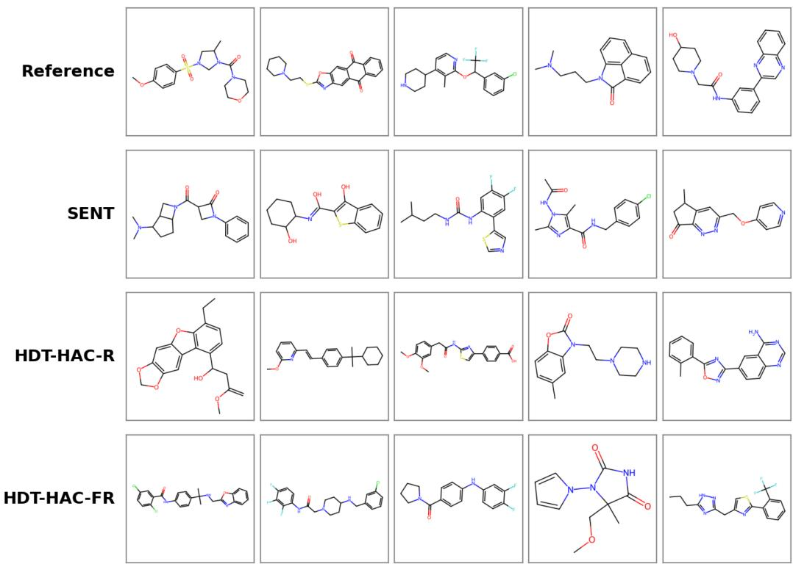  
Figure 8: GuacaMol unconditional generation. Held-out reference molecules and generations from SENT, HDT-HAC-R, and HDT-HAC-FR.

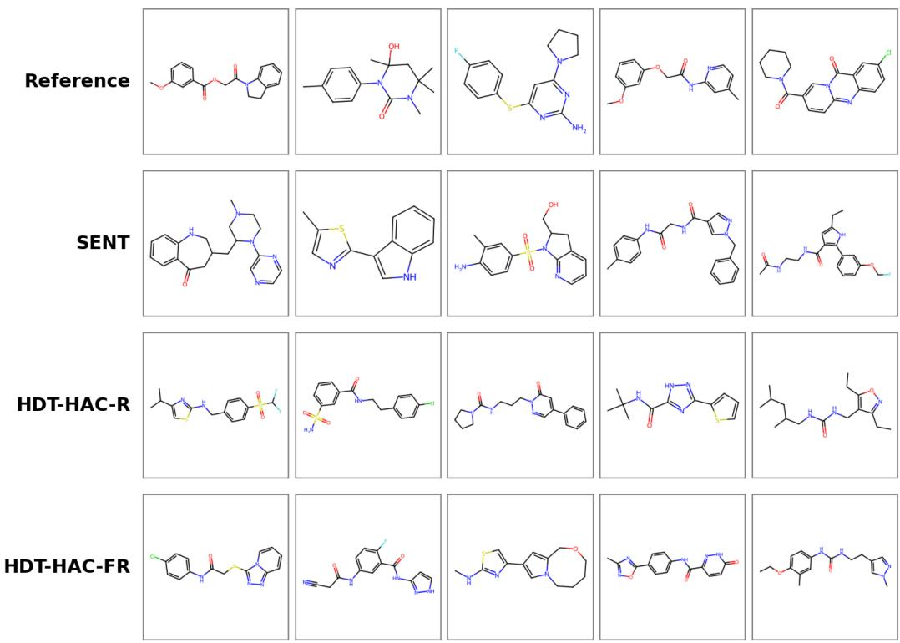  
Figure 9: MOSES unconditional generation. Held-out reference molecules and generations from SENT, HDT-HAC-R, and HDT-HAC-FR.

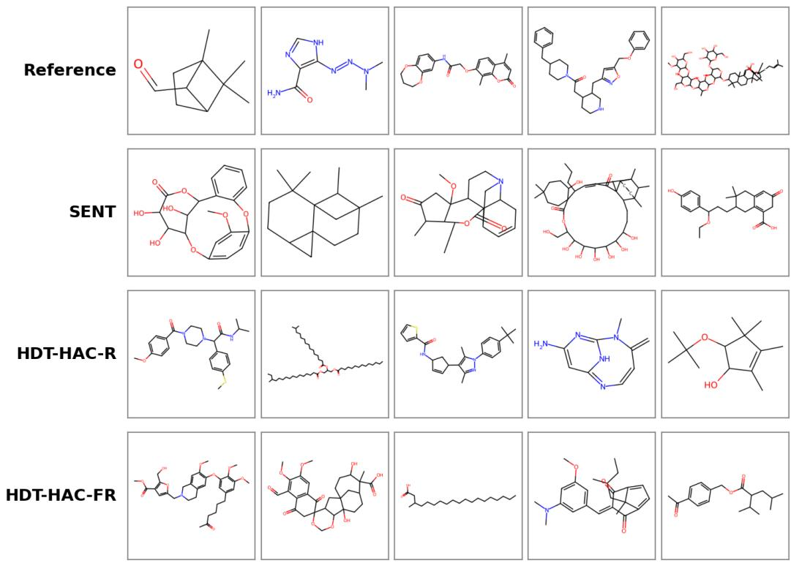  
Figure 10: COCONUT 2.0 unconditional generation. Held-out reference molecules and generations from SENT, HDT-HAC-R, and HDT-HAC-FR.

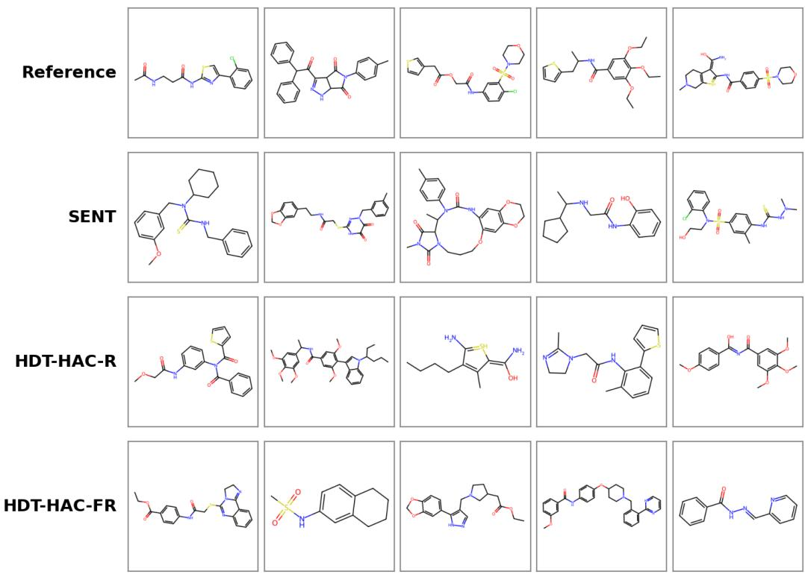  
Figure 11: GEOM-Drugs (disjoint) unconditional generation. Held-out reference molecules and generations from SENT, HDT-HAC-R, and HDT-HAC-FR.

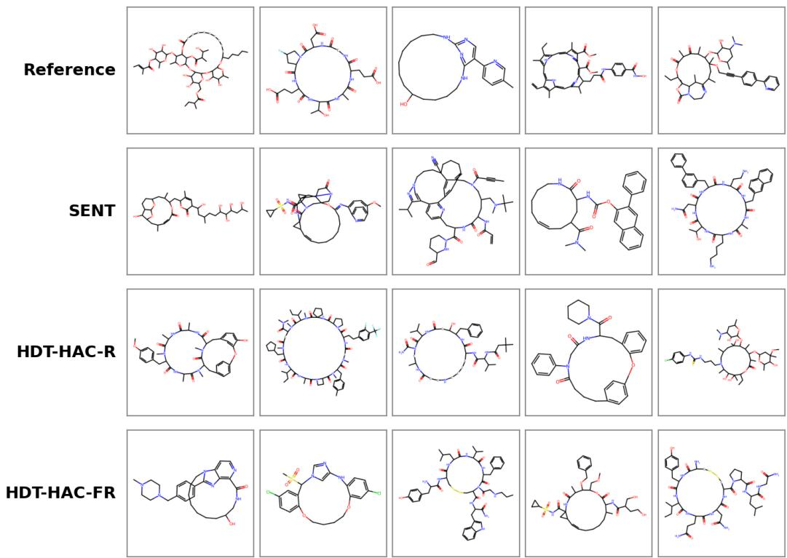  
Figure 12: Macrocycle unconditional generation. Held-out reference molecules and generations from SENT, HDT-HAC-R, and HDT-HAC-FR.

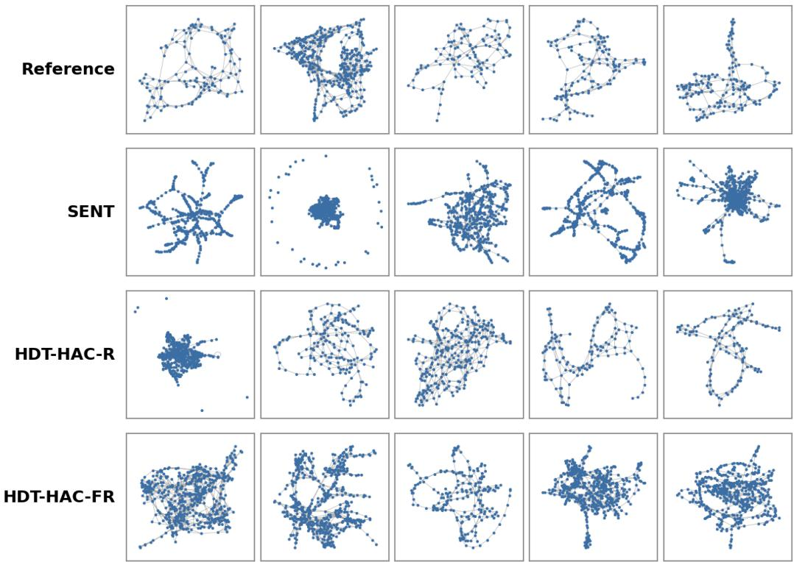  
Figure 13: Proteins unconditional generation. Held-out reference graphs and generations from SENT, HDT-HAC-R, and HDT-HAC-FR.

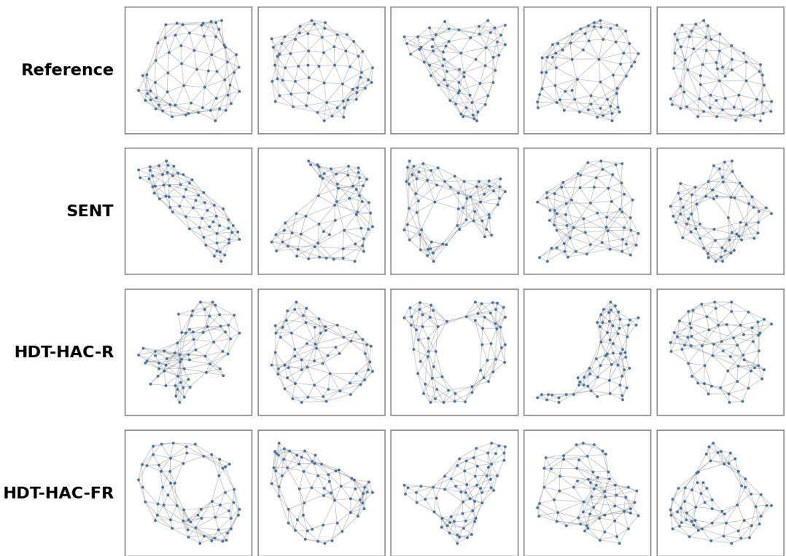  
Figure 14: Planar unconditional generation. Held-out reference graphs and generations from SENT, HDT-HAC-R, and HDT-HAC-FR.

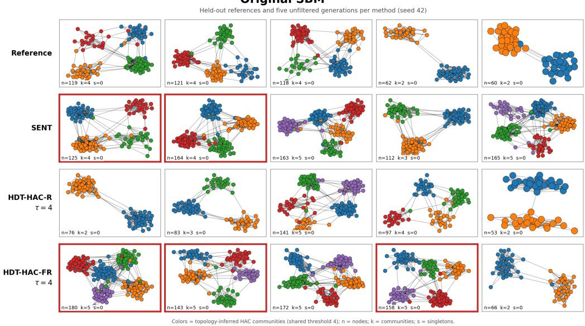  
Colors = topology-inferred HAC communities (shared threshold 4); n = nodes; k = communities; s = singletons. Red borders = failure under the frozen structural-validity test. Reference borders are neutral.

Figure 15: Original SBM: default coarsening. Rows show held-out references, SENT, HDT-HAC-R, and HDT-HAC-FR, with five examples per row. The hierarchical models use the default stopping threshold τ = 4. Node colors show inferred HAC communities; red borders mark generations that fail the frozen SBM community-structure check.  
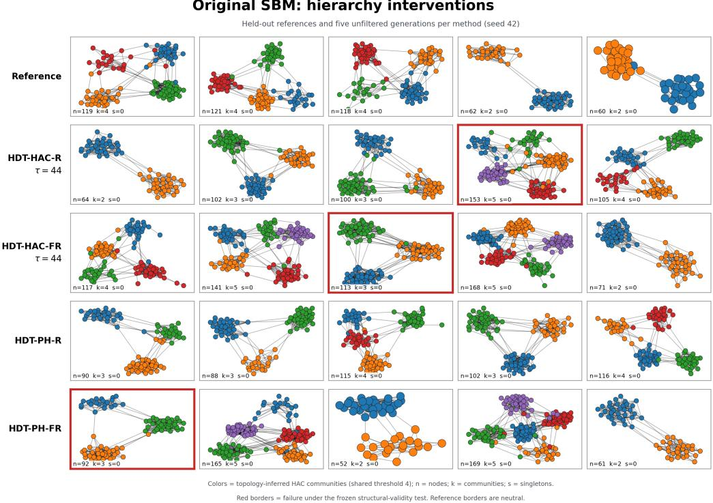  
Figure 16: Original SBM: coarsening interventions. The reference row matches Figure 15; generated rows show HDT-HAC-R and HDT-HAC-FR trained with stopping threshold τ = 44, followed by HDT-PH-R and HDT-PH-FR trained with the generator's planted memberships. Display colors remain the shared inferred HAC partition, not the training hierarchy. Red borders indicate failure of the same frozen SBM check.

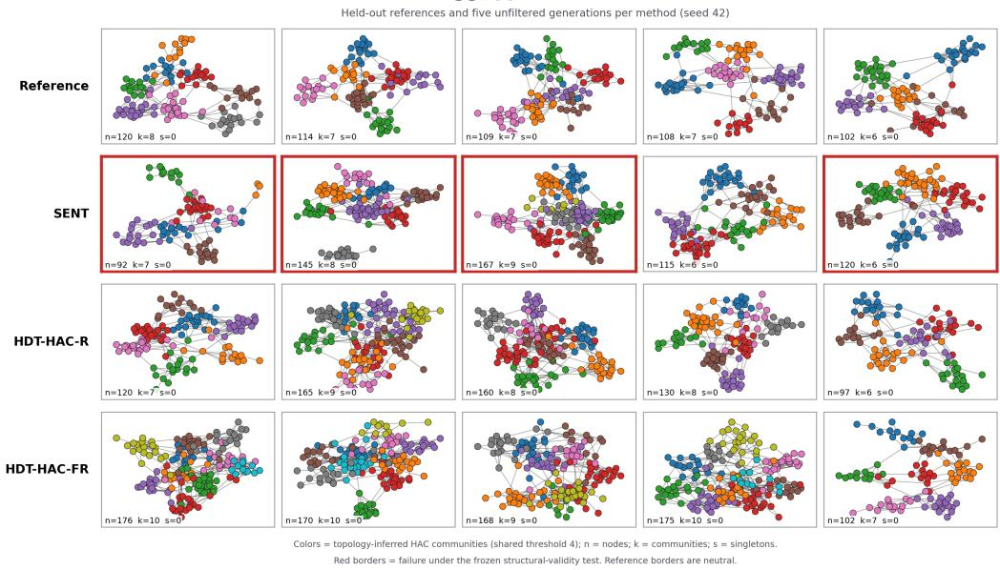  
Figure 17: Sparse SBM (SSBM) generation gallery. Rows show held-out references, SENT, HDT-HAC-R, and HDT-HAC-FR, with five examples per row. Node colors show inferred HAC communities; red borders mark generations that fail the frozen SSBM community-structure check.

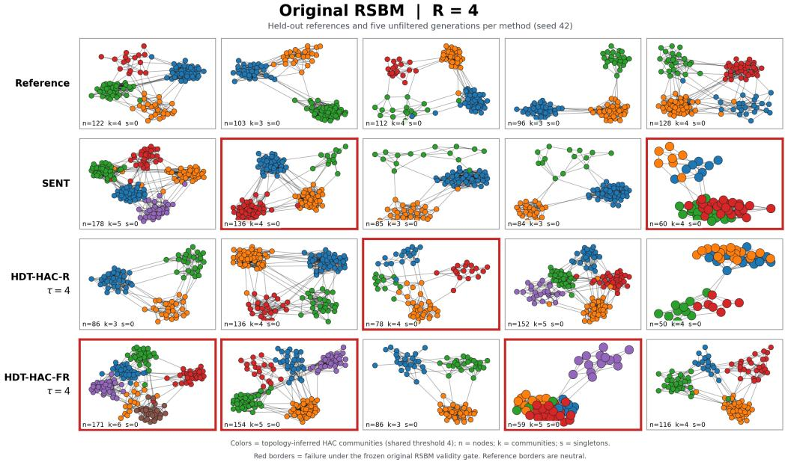  
Figure 18: Original RSBM (R = 4): default coarsening. Rows show references from the original population, which retains disconnected graphs, followed by SENT, HDT-HAC-R, and HDT-HAC-FR. The hierarchical models use τ = 4. Node colors show inferred HAC communities; red borders mark generations that fail the frozen original-RSBM validity gate.

## Connected RSBM | R = 4

Held-out references and five unfiltered generations per method (seed 42)  
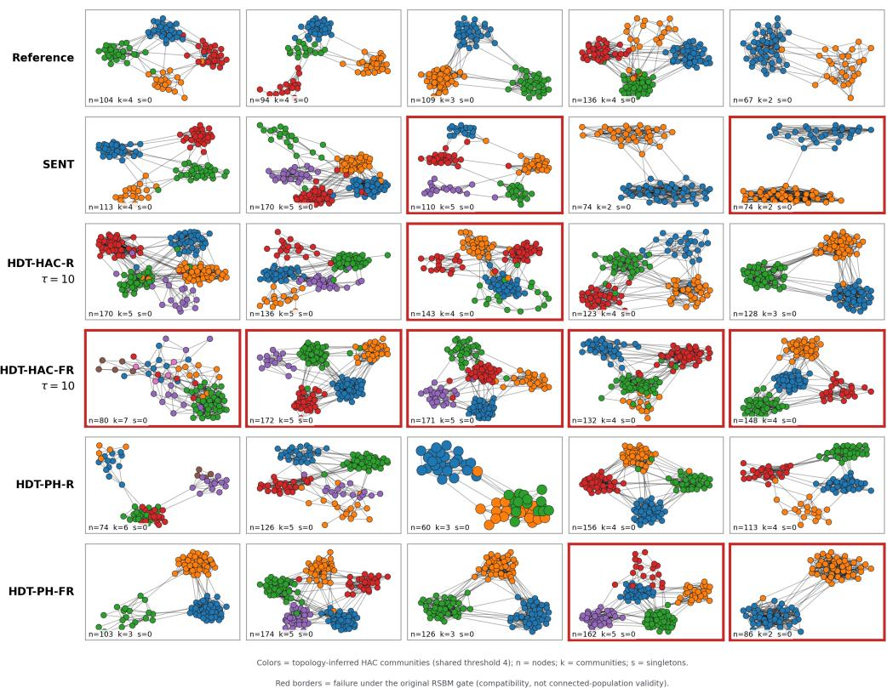  
Figure 19: Connected RSBM (R = 4): coarsening interventions. Rows show connected-population references, SENT, HDT-HAC-R and HDT-HAC-FR with τ = 10, and HDT-PH-R and HDT-PH-FR trained with planted coarse and fine memberships. Node colors show the shared inferred HAC partition. Red borders indicate failure of compatibility with the original RSBM gate $( V ^ { \dagger }$ in Table 31). This population is separate from Figure 18.

## NeurIPS Paper Checklist

## 1. Claims

Question: Do the main claims made in the abstract and introduction accurately reflect the paper's contributions and scope?

Answer: [Yes]

Justification: Sections 1 and 4 state the empirical contributions and their scope; Section 4.6 and Appendix B discuss their limitations.

Guidelines:

• The answer [N/A] means that the abstract and introduction do not include the claims made in the paper.

• The abstract and/or introduction should clearly state the claims made, including the contributions made in the paper and important assumptions and limitations. A [No] or [N/A] answer to this question will not be perceived well by the reviewers.

• The claims made should match theoretical and experimental results, and reflect how much the results can be expected to generalize to other settings.

• It is fine to include aspirational goals as motivation as long as it is clear that these goals are not attained by the paper.

## 2. Limitations

Question: Does the paper discuss the limitations of the work performed by the authors?

Answer: [Yes]

Justification: Section 4.6 and Appendix B discuss sequence costs, novelty and the dependence on coarsening and dataset.

Guidelines:

• The answer [N/A] means that the paper has no limitation while the answer [No] means that the paper has limitations, but those are not discussed in the paper.

• The authors are encouraged to create a separate “Limitations" section in their paper.

• The paper should point out any strong assumptions and how robust the results are to violations of these assumptions (e.g., independence assumptions, noiseless settings, model well-specification, asymptotic approximations only holding locally). The authors should reflect on how these assumptions might be violated in practice and what the implications would be.

• The authors should reflect on the scope of the claims made, e.g., if the approach was only tested on a few datasets or with a few runs. In general, empirical results often depend on implicit assumptions, which should be articulated.

• The authors should reflect on the factors that influence the performance of the approach For example, a facial recognition algorithm may perform poorly when image resolution is low or images are taken in low lighting. Or a speech-to-text system might not be used reliably to provide closed captions for online lectures because it fails to handle technical jargon.

• The authors should discuss the computational efficiency of the proposed algorithms and how they scale with dataset size.

• If applicable, the authors should discuss possible limitations of their approach to address problems of privacy and fairness.

• While the authors might fear that complete honesty about limitations might be used by reviewers as grounds for rejection, a worse outcome might be that reviewers discover limitations that aren't acknowledged in the paper. The authors should use their best judgment and recognize that individual actions in favor of transparency play an important role in developing norms that preserve the integrity of the community. Reviewers will be specifically instructed to not penalize honesty concerning limitations.

## 3. Theory assumptions and proofs

Question: For each theoretical result, does the paper provide the full set of assumptions and a complete (and correct) proof?

## Answer: [N/A]

Justification: N/A

## Guidelines:

• The answer [N/A] means that the paper does not include theoretical results.

• All the theorems, formulas, and proofs in the paper should be numbered and crossreferenced.

• All assumptions should be clearly stated or referenced in the statement of any theorems.

• The proofs can either appear in the main paper or the supplemental material, but if they appear in the supplemental material, the authors are encouraged to provide a short proof sketch to provide intuition.

• Inversely, any informal proof provided in the core of the paper should be complemented by formal proofs provided in appendix or supplemental material.

• Theorems and Lemmas that the proof relies upon should be properly referenced.

## 4. Experimental result reproducibility

Question: Does the paper fully disclose all the information needed to reproduce the main experimental results of the paper to the extent that it affects the main claims and/or conclusions of the paper (regardless of whether the code and data are provided or not)?

Answer: [Yes]

Justification: Sections 3 and 4.1, together with Appendices D.4, D.6 and H, specify the serialization, training and evaluation protocols.

Guidelines:

• The answer [N/A] means that the paper does not include experiments.

• If the paper includes experiments, a [No] answer to this question will not be perceived well by the reviewers: Making the paper reproducible is important, regardless of whether the code and data are provided or not.

• If the contribution is a dataset and/or model, the authors should describe the steps taken to make their results reproducible or verifiable.

• Depending on the contribution, reproducibility can be accomplished in various ways. For example, if the contribution is a novel architecture, describing the architecture fully might suffice, or if the contribution is a specific model and empirical evaluation, it may be necessary to either make it possible for others to replicate the model with the same dataset, or provide access to the model. In general. releasing code and data is often one good way to accomplish this, but reproducibility can also be provided via detailed instructions for how to replicate the results, access to a hosted model (e.g., in the case of a large language model), releasing of a model checkpoint, or other means that are appropriate to the research performed.

• While NeurIPS does not require releasing code, the conference does require all submissions to provide some reasonable avenue for reproducibility, which may depend on the nature of the contribution. For example

(a) If the contribution is primarily a new algorithm, the paper should make it clear how to reproduce that algorithm.

(b) If the contribution is primarily a new model architecture, the paper should describe the architecture clearly and fully.

(c) If the contribution is a new model (e.g., a large language model), then there should either be a way to access this model for reproducing the results or a way to reproduce the model (e.g., with an open-source dataset or instructions for how to construct the dataset).

(d) We recognize that reproducibility may be tricky in some cases, in which case authors are welcome to describe the particular way they provide for reproducibility. In the case of closed-source models, it may be that access to the model is limited in some way (e.g., to registered users), but it should be possible for other researchers to have some path to reproducing or verifying the results.

## 5. Open access to data and code

Question: Does the paper provide open access to the data and code, with sufficient instructions to faithfully reproduce the main experimental results, as described in supplemental material?

Answer: [Yes]

Justification: We will release the code upon acceptance.

Guidelines:

• The answer [N/A] means that paper does not include experiments requiring code.

• Please see the NeurIPS code and data submission guidelines (https : //neurips. cc/ public/guides/CodeSubmissionPolicy) for more details.

• While we encourage the release of code and data, we understand that this might not be possible, so [No] is an acceptable answer. Papers cannot be rejected simply for not including code, unless this is central to the contribution (e.g., for a new open-source benchmark).

• The instructions should contain the exact command and environment needed to run to reproduce the results. See the NeurIPS code and data submission guidelines (https : //neurips.cc/public/guides/CodeSubmissionPolicy) for more details.

• The authors should provide instructions on data access and preparation, including how to access the raw data, preprocessed data, intermediate data, and generated data, etc.

• The authors should provide scripts to reproduce all experimental results for the new proposed method and baselines. If only a subset of experiments are reproducible, they should state which ones are omitted from the script and why.

• At submission time, to preserve anonymity, the authors should release anonymized versions (if applicable).

• Providing as much information as possible in supplemental material (appended to the paper) is recommended, but including URLs to data and code is permitted.

## 6. Experimental setting/details

Question: Does the paper specify all the training and test details (e.g., data splits, hyperparameters, how they were chosen, type of optimizer) necessary to understand the results?

Answer: [Yes]

Justification: Section 4.1 and Appendices D.1, D.4 and D.5 give the populations, splits, optimizer, schedules, context caps and generation settings; hierarchy-selection rules are in Appendix F.4.

Guidelines:

• The answer [N/A] means that the paper does not include experiments.

• The experimental setting should be presented in the core of the paper to a level of detail that is necessary to appreciate the results and make sense of them.

• The full details can be provided either with the code, in appendix, or as supplemental material.

## 7. Experiment statistical significance

Question: Does the paper report error bars suitably and correctly defined or other appropriate information about the statistical significance of the experiments?

Answer: [Yes]

Justification: Our graph generators are trained from scratch. For each evaluated checkpoint, we report the mean and sample SD of its three generation-seed scores (42–44), with variance denominator 2. These SDs describe generation and, where applicable, reference-sampling variability, not variation across independently trained models; we do not claim significance across training runs.

Guidelines:

• The answer [N/A] means that the paper does not include experiments.

• The authors should answer [Yes] if the results are accompanied by error bars, confidence intervals, or statistical significance tests, at least for the experiments that support the main claims of the paper.

• The factors of variability that the error bars are capturing should be clearly stated (for example, train/test split, initialization, random drawing of some parameter, or overall run with given experimental conditions).

• The method for calculating the error bars should be explained (closed form formula, call to a library function, bootstrap, etc.)

• The assumptions made should be given (e.g., Normally distributed errors).

• It should be clear whether the error bar is the standard deviation or the standard error of the mean.

• It is OK to report 1-sigma error bars, but one should state it. The authors should preferably report a 2-sigma error bar than state that they have a 96% CI, if the hypothesis of Normality of errors is not verified.

• For asymmetric distributions, the authors should be careful not to show in tables or figures symmetric error bars that would yield results that are out of range (e.g., negative error rates).

• If error bars are reported in tables or plots, the authors should explain in the text how they were calculated and reference the corresponding figures or tables in the text.

## 8. Experiments compute resources

Question: For each experiment, does the paper provide sufficient information on the computer resources (type of compute workers, memory, time of execution) needed to reproduce the experiments?

Answer: [Yes]

Justification: Appendix D.4 reports the hardware, memory capacity and achieved training times. Scaling times are stated on a one-GPU basis in Appendix G.1.1.

Guidelines:

• The answer [N/A] means that the paper does not include experiments.

• The paper should indicate the type of compute workers CPU or GPU, internal cluster, or cloud provider, including relevant memory and storage.

• The paper should provide the amount of compute required for each of the individual experimental runs as well as estimate the total compute.

• The paper should disclose whether the full research project required more compute than the experiments reported in the paper (e.g., preliminary or failed experiments that didn't make it into the paper).

## 9. Code of ethics

Question: Does the research conducted in the paper conform, in every respect, with the NeurIPS Code of Ethics https://neurips.cc/public/EthicsGuidelines?

Answer: [Yes]

Justification: The research adheres to ethics guidelines.

Guidelines:

• The answer [N/A] means that the authors have not reviewed the NeurIPS Code of Ethics.

• If the authors answer [No], they should explain the special circumstances that require a deviation from the Code of Ethics.

• The authors should make sure to preserve anonymity (e.g., if there is a special consideration due to laws or regulations in their jurisdiction).

## 10. Broader impacts

Question: Does the paper discuss both potential positive societal impacts and negative societal impacts of the work performed?

Answer: [Yes]

Justification: This paper studies graph generation as a machine-learning method. Potential applications include molecular design and biological modeling; we do not deploy the models or make clinical claims.

## Guidelines:

• The answer [N/A] means that there is no societal impact of the work performed.

• If the authors answer [N/A] or [No], they should explain why their work has no societal impact or why the paper does not address societal impact.

• Examples of negative societal impacts include potential malicious or unintended uses (e.g., disinformation, generating fake profiles, surveillance), fairness considerations (e.g., deployment of technologies that could make decisions that unfairly impact specific groups), privacy considerations, and security considerations.

• The conference expects that many papers will be foundational research and not tied to particular applications, let alone deployments. However, if there is a direct path to any negative applications, the authors should point it out. For example, it is legitimate to point out that an improvement in the quality of generative models could be used to generate Deepfakes for disinformation. On the other hand, it is not needed to point out that a generic algorithm for optimizing neural networks could enable people to train models that generate Deepfakes faster.

• The authors should consider possible harms that could arise when the technology is being used as intended and functioning correctly, harms that could arise when the technology is being used as intended but gives incorrect results, and harms following from (intentional or unintentional) misuse of the technology.

• If there are negative societal impacts, the authors could also discuss possible mitigation strategies (e.g., gated release of models, providing defenses in addition to attacks, mechanisms for monitoring misuse, mechanisms to monitor how a system learns from feedback over time, improving the efficiency and accessibility of ML).

## 11. Safeguards

Question: Does the paper describe safeguards that have been put in place for responsible release of data or models that have a high risk for misuse (e.g., pre-trained language models image generators, or scraped datasets)?

Answer: [N/A]

Justification: N/A

Guidelines:

• The answer [N/A] means that the paper poses no such risks.

• Released models that have a high risk for misuse or dual-use should be released with necessary safeguards to allow for controlled use of the model, for example by requiring that users adhere to usage guidelines or restrictions to access the model or implementing safety filters.

• Datasets that have been scraped from the Internet could pose safety risks. The authors should describe how they avoided releasing unsafe images.

• We recognize that providing effective safeguards is challenging, and many papers do not require this, but we encourage authors to take this into account and make a best faith effort.

## 12. Licenses for existing assets

Question: Are the creators or original owners of assets (e.g., code, data, models), used in the paper, properly credited and are the license and terms of use explicitly mentioned and properly respected?

Answer: [Yes]

Justification: We credit the original datasets and software in Sections 2 and 4.1, with dataset provenance and preprocessing in Appendix D.1.

Guidelines:

• The answer [N/A] means that the paper does not use existing assets.

• The authors should cite the original paper that produced the code package or dataset.

• The authors should state which version of the asset is used and, if possible, include a URL.

• The name of the license (e.g., CC-BY 4.0) should be included for each asset.

• For scraped data from a particular source (e.g., website), the copyright and terms of service of that source should be provided.

• If assets are released, the license, copyright information, and terms of use in the package should be provided. For popular datasets, paperswithcode. com/datasets has curated licenses for some datasets. Their licensing guide can help determine the license of a dataset.

• For existing datasets that are re-packaged, both the original license and the license of the derived asset (if it has changed) should be provided.

• If this information is not available online, the authors are encouraged to reach out to the asset's creators.

## 13. New assets

Question: Are new assets introduced in the paper well documented and is the documentation provided alongside the assets?

Answer: [Yes]

Justification: Public archives of dataset caches, selected final checkpoints and raw results provide repository cards, scope manifests and restore metadata. Generator laws are documented in Appendix F.3.

Guidelines:

• The answer [N/A] means that the paper does not release new assets.

• Researchers should communicate the details of the dataset/code/model as part of their submissions via structured templates. This includes details about training, license, limitations, etc.

• The paper should discuss whether and how consent was obtained from people whose asset is used.

• At submission time, remember to anonymize your assets (if applicable). You can either create an anonymized URL or include an anonymized zip file.

## 14. Crowdsourcing and research with human subjects

Question: For crowdsourcing experiments and research with human subjects, does the paper include the full text of instructions given to participants and screenshots, if applicable, as well as details about compensation (if any)?

Answer: [N/A]

Justification: N/A

Guidelines:

• The answer [N/A] means that the paper does not involve crowdsourcing nor research with human subjects.

• Including this information in the supplemental material is fine, but if the main contribution of the paper involves human subjects, then as much detail as possible should be included in the main paper.

• According to the NeurIPS Code of Ethics, workers involved in data collection, curation, or other labor should be paid at least the minimum wage in the country of the data collector.

## 15. Institutional review board (IRB) approvals or equivalent for research with human subjects

Question: Does the paper describe potential risks incurred by study participants, whether such risks were disclosed to the subjects, and whether Institutional Review Board (IRB) approvals (or an equivalent approval/review based on the requirements of your country or institution) were obtained?

Answer: [N/A]

Justification: N/A

Guidelines:

• The answer [N/A] means that the paper does not involve crowdsourcing nor research with human subjects.

• Depending on the country in which research is conducted, IRB approval (or equivalent) may be required for any human subjects research. If you obtained IRB approval, you should clearly state this in the paper.

• We recognize that the procedures for this may vary significantly between institutions and locations, and we expect authors to adhere to the NeurIPS Code of Ethics and the guidelines for their institution.

• For initial submissions, do not include any information that would break anonymity (if applicable), such as the institution conducting the review.

## 16. Declaration of LLM usage

Question: Does the paper describe the usage of LLMs if it is an important, original, or non-standard component of the core methods in this research? Note that if the LLM is used only for writing, editing, or formatting purposes and does not impact the core methodology, scientific rigor, or originality of the research, declaration is not required.

Answer: [Yes]

Justification: We used LLM coding agents to organize code, reimplement prior SOTA baselines, and generate figures, tables, and plots.

Guidelines:

• The answer [N/A] means that the core method development in this research does not involve LLMs as any important, original, or non-standard components.

• Please refer to our LLM policy in the NeurIPS handbook for what should or should not be described.