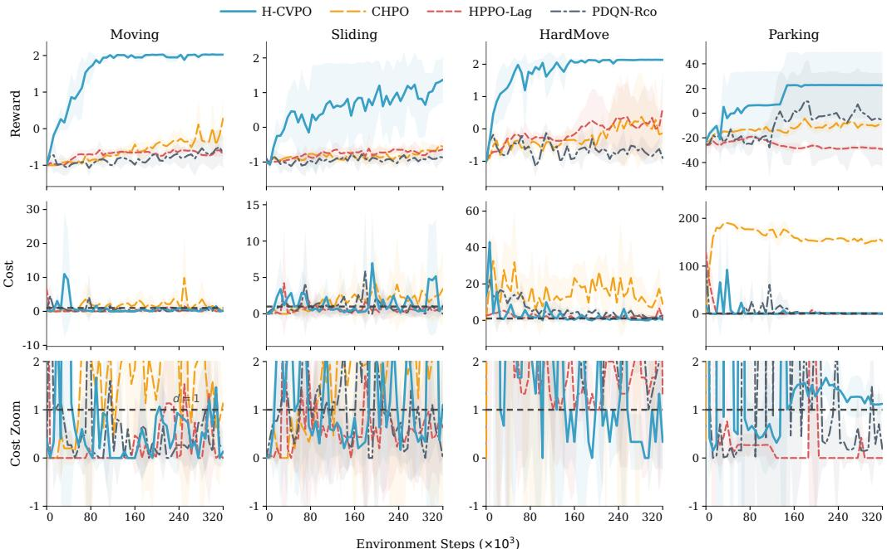
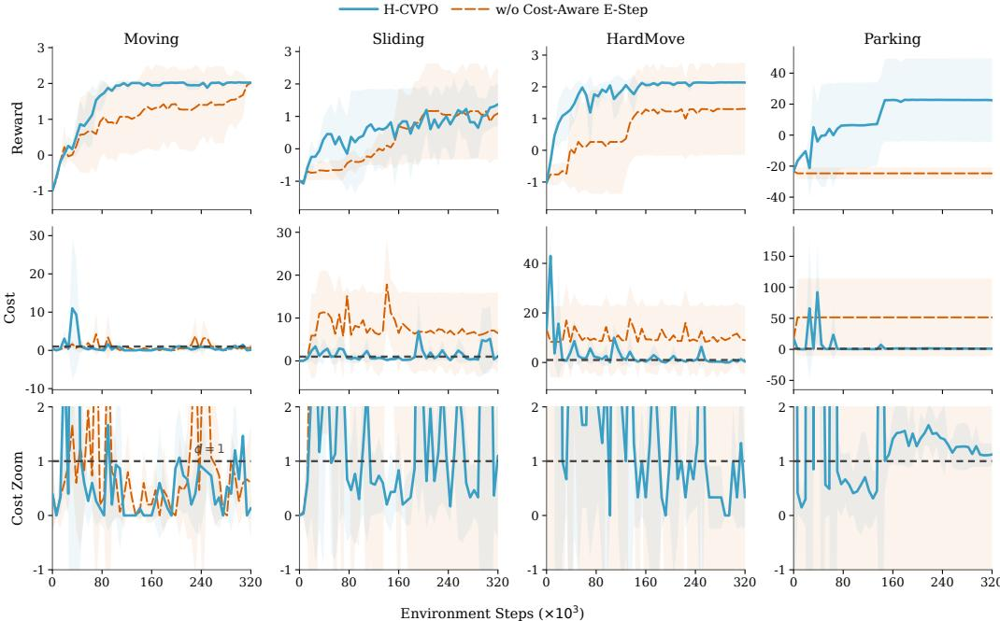
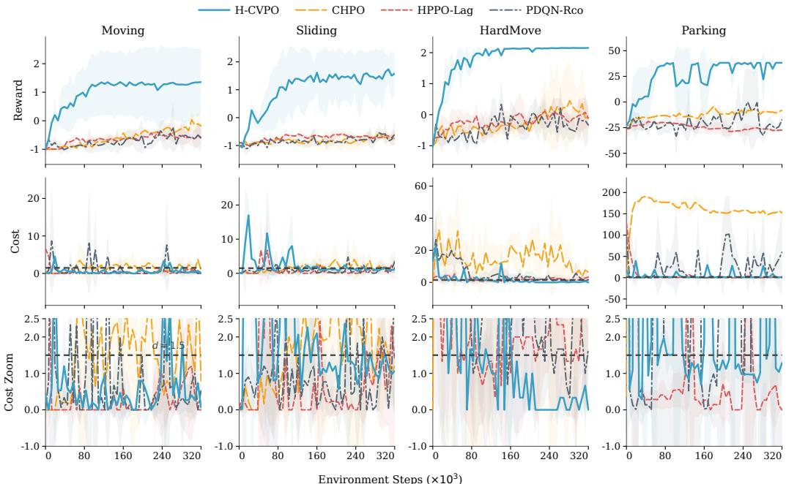
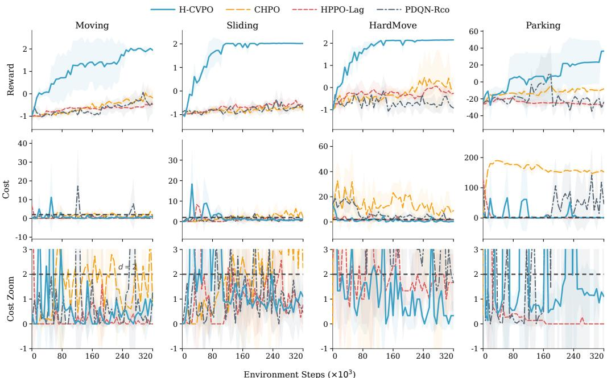
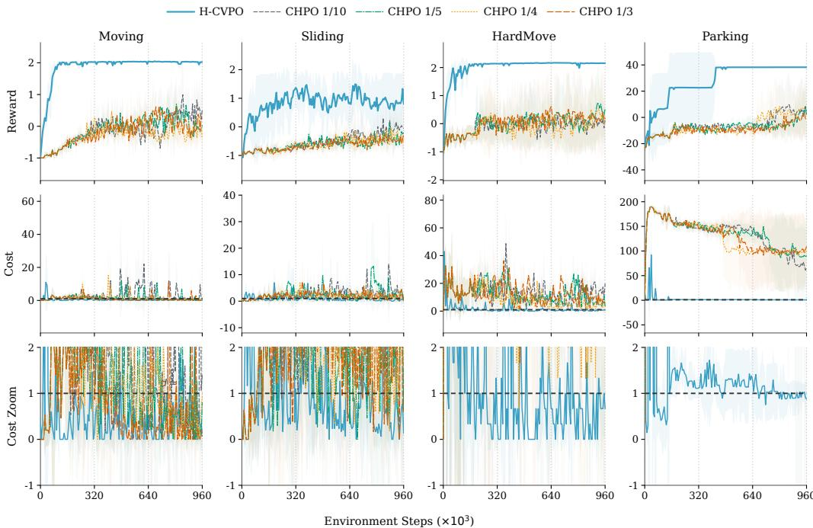
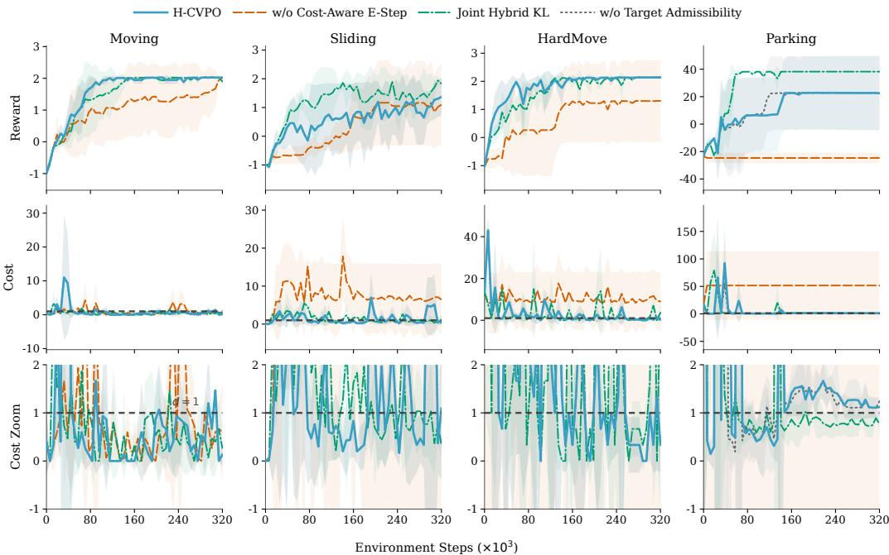
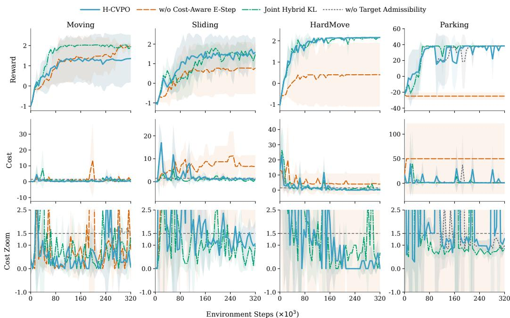
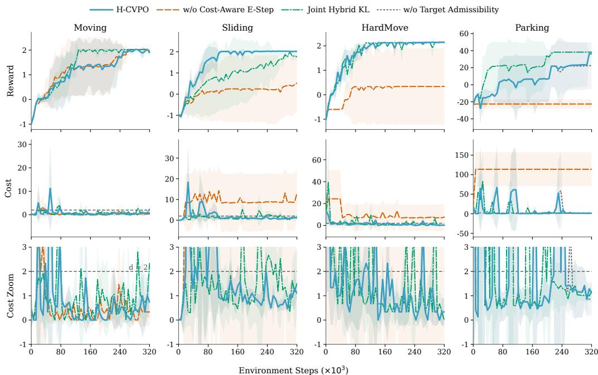

# CONSTRAINED VARIATIONAL POLICY OPTIMIZATIONFOR HYBRID ACTION SPACES

Shuchang Yan

ycyan@connect.hku.hk

## ABSTRACT

Constrained reinforcement learning in hybrid action spaces must coordinate discrete modes and mode-conditioned continuous controls under long-horizon cost constraints. Existing constrained hybrid-action methods typically optimize factorized policies directly in parameter space, whereas Constrained Variational Policy Optimization (CVPO) separates nonparametric improvement from parametric projection in its original continuous-action formulation. We introduce Hybrid Constrained Variational Policy Optimization (H-CVPO), extending this variational framework to hybrid action spaces. Under boundedness and strict feasibility, its constrained E-step has zero duality gap and, when the dual optimum is attained at positive temperature, yields a closed-form joint target distribution over hybrid actions through exponential reward–cost reweighting. Using the exact hybrid KL decomposition, we formulate a factorized M-step that fits both policy components to this target under separate discrete and conditional-continuous trust regions. For exact E/M updates, we prove fixed-reference surrogate improvement and conditional reward–cost bounds with a sufficient feasibility-margin condition. For approximate updates, we establish the existence of a dual minimizer under continuity on a compact domain and use residual-based admissibility to determine whether to project the target. Ablations identify cost-aware reweighting as an important contributor to constraint control. Extensive experiments in simulated hybrid-control environments show that H-CVPO achieves favorable reward–cost trade-offs compared with hybrid-action baselines.

## 1 INTRODUCTION

Many real-world control systems are inherently hybrid: each decision couples a discrete operating mode with a mode-conditioned continuous control action. Hybrid electric vehicles illustrate this structure: a multi-mode powertrain selects an electric or engine-assisted mode and continuously allocates power between the engine and electric machines (Zhuang et al., 2017; Fan et al., 2021). Similar structures arise in power systems, where unit commitment determines generator on/off states and economic dispatch sets continuous generation levels (Montero et al., 2022; Swarup & Simi, 2006); in steel-plant oxygen supply, where production scheduling combines equipment start-up and shutdown decisions with continuous oxygen output (Li et al., 2023); in autonomous driving, where decisions to keep or change lanes are coupled with continuous longitudinal acceleration (Lin et al., 2024); and in robotic assembly, where selecting between coarse and fine motion control can be coupled with continuous velocity commands (Neunert et al., 2020). Such problems are neither purely discrete nor purely continuous and require coordinated optimization of mode selection and mode-conditioned control under operational constraints.

Constrained reinforcement learning (CRL) is commonly formalized as a constrained Markov decision process (CMDP), which maximizes long-horizon performance subject to cumulative cost limits (Altman, 1999). Representative methods enforce these constraints through primal–dual optimization (Tessler et al., 2019), trust-region constrained updates (Achiam et al., 2017), projection-based methods (Yang et al., 2020), or Lyapunov-based approaches (Chow et al., 2019). These methods address constrained policy optimization but do not explicitly account for factorized, mode-conditioned hybrid actions or coordinate their discrete and continuous updates. A complementary perspective on policy optimization comes from reinforcement learning as probabilistic inference (Levine, 2018). Maximum a Posteriori Policy Optimization (MPO) constructs an improved nonparametric action distribution and projects it onto a parametric policy through an expectation–maximization (EM) procedure (Abdolmaleki et al., 2018). Constrained Variational Policy Optimization (CVPO) incorporates constraints through a nonparametric E-step and a KL-controlled M-step, connecting constrained policy optimization and probabilistic inference (Liu et al., 2022).

Extending this variational framework to hybrid control, however, requires a joint nonparametric target over discrete modes and mode-conditioned continuous controls. Projecting this target onto a factorized policy requires divergence controls that account for the dependence between mode selection and mode conditioned continuous control. Complementary to variational methods, CHPO addresses constrained hybrid control by formulating constrained parameterized-action Markov decision processes and optimizing factorized hybrid policies through feasibility-dependent objective switching (Zhou et al., 2025a). Its updates remain in parametric policy space rather than constructing a joint nonparametric target, and do not provide separate divergence controls for discrete-mode and continuous-action updates.

Building on the constrained variational framework, we develop Hybrid Constrained Variational Policy Optimization (H-CVPO) for hybrid action spaces. Its constrained E-step constructs a joint nonparametric target, and its M-step projects this target onto a factorized policy under separate discrete and conditional-continuous KL constraints.

Our contributions are summarized as follows:

• We formulate constrained variational policy improvement for hybrid action spaces, extending the continuous-action formulation to a joint nonparametric target that couples discrete mode selection with mode-conditioned continuous control.

• Under stated assumptions, we derive the resulting hybrid E/M update. The constrained E-step has strong duality and, for attained positive-temperature dual optima, yields a closedform reward–cost-reweighted target. The exact hybrid KL decomposition then yields a factorized M-step with separate discrete and conditional-continuous trust regions.

• We establish fixed-reference surrogate improvement for exact E/M updates and conditional reward–cost bounds with a sufficient feasibility margin. For approximate updates, we prove existence of a dual minimizer under continuity on a compact domain and introduce residual-based target-admissibility conditions.

• We compare H-CVPO with hybrid-action baselines across four tasks and three cost limits under matched interaction budgets, and use component-wise ablations to examine the effects of cost-aware reweighting, separate hybrid KL controls, and target-admissibility filtering on reward and cost.

## 2 RELATED WORK

H-CVPO builds on variational policy optimization to address constrained reinforcement learning in hybrid action spaces.

Hybrid-action reinforcement learning. Hybrid-action methods couple a discrete choice with associated continuous parameters. Q-PAMDP learns action-selection and parameter-selection policies (Masson et al., 2016); PADDPG embeds parameterized actions in deterministic actor–critic learning (Hausknecht & Stone, 2016); P-DQN combines value-based discrete selection with continuous parameter optimization (Xiong et al., 2018); and HPPO separates discrete and continuous policy branches (Fan et al., 2019). Hybrid SAC further extends entropy-regularized actor–critic learning to hybrid actions (Delalleau et al., 2019). Neunert et al. extend MPO to native hybrid action spaces, jointly optimizing discrete and continuous actions, and demonstrate the approach in robotic control (Neunert et al., 2020). These methods do not explicitly impose cumulative cost constraints.

Constrained reinforcement learning. Within the CMDP framework, RCPO and PID Lagrangian methods handle constraints through multiplier updates (Tessler et al., 2019; Stooke et al., 2020), whereas CPO and PCPO use trust-region and projection-based updates (Achiam et al., 2017; Yang et al., 2020). Their formulations do not explicitly address the coupling between discrete mode selection and mode-conditioned continuous control.

Variational policy optimization. Probabilistic-inference formulations derive policy-improvement updates from inference objectives (Levine, 2018). MPO alternates nonparametric action-distribution improvement with parametric policy projection (Abdolmaleki et al., 2018). CVPO incorporates cumulative constraints into this E/M procedure through a constraint-aware E-step and a KL-controlled M-step (Liu et al., 2022). More recently, SafeMPO extends MPO-style nonparametric policy improvement to CMDPs through a probabilistic incremental safety-improvement constraint, followed by policy cloning (Mattick et al., 2026). Its reported experiments use continuous action spaces and do not explicitly represent discrete modes or mode-conditioned continuous controls. Neither CVPO nor SafeMPO explicitly formulates a joint hybrid-action target or its projection onto a factorized policy with separate discrete and conditional-continuous KL constraints.

Constrained hybrid-action reinforcement learning. Under the assumptions of its analysis, CHPO derives finite-iteration bounds on the policy-objective gap and the excess of expected cost over its threshold (Zhou et al., 2025a). To complement this theoretical result, we include two constrained hybrid baselines: HPPO-Lag and PDQN-Rco, formed by augmenting HPPO and P-DQN with Lagrangian and reward-constrained updates, respectively. We report their empirical reward and cost under the same interaction budget used for H-CVPO.

## 3 PRELIMINARIES

## 3.1 CMDP FORMULATION

We consider a discounted CMDP (Altman, 1999), ${ \mathfrak { M } } = ( S , { \mathcal { A } } , P , r , c , \rho _ { 0 } , \gamma )$ , with cumulative cost limit d. Here, $s$ and A are standard Borel state and action spaces, $P$ is a stochastic transition kernel from $s \times { \mathcal A }$ to $s , \rho _ { 0 }$ is the initial-state distribution, and $\gamma \in \mathsf { \Gamma } ( 0 , 1 )$ is the discount factor. The measurable reward and cost functions $r : S \times \mathcal { A }  \mathbb { R }$ and $c : { \mathcal { S } } \times { \mathcal { A } }  \mathbb { R } _ { + }$ satisfy $| r ( s , a ) | \leq R _ { \operatorname* { m a x } }$ and $0 \leq c ( s , a ) \leq C _ { \mathrm { m a x } }$ for finite $R _ { \mathrm { m a x } } , C _ { \mathrm { m a x } } .$ . We restrict attention to stationary randomized Markov policies π, each a stochastic kernel from $s$ to A.

Under π, a trajectory $\tau = ( s _ { 0 } , a _ { 0 } , s _ { 1 } , a _ { 1 } , \ldots ) $ is generated by $s _ { 0 } \sim \rho _ { 0 } , a _ { t } \sim \pi ( \cdot | s _ { t } )$ , and $s _ { t + 1 } \sim P ( \cdot \mid s _ { t } , a _ { t } )$ . The expected discounted reward and cost returns are

$$
J _ { r } ( \pi ) = \mathbb { E } _ { \tau \sim ( \rho _ { 0 } , P , \pi ) } \left[ \sum _ { t = 0 } ^ { \infty } \gamma ^ { t } r ( s _ { t } , a _ { t } ) \right] , \qquad J _ { c } ( \pi ) = \mathbb { E } _ { \tau \sim ( \rho _ { 0 } , P , \pi ) } \left[ \sum _ { t = 0 } ^ { \infty } \gamma ^ { t } c ( s _ { t } , a _ { t } ) \right] .\tag{1}
$$

The constrained policy-optimization problem is

$$
\operatorname* { m a x } _ { \pi } J _ { r } ( \pi ) \qquad \mathrm { s . t . } \qquad J _ { c } ( \pi ) \leq d .\tag{2}
$$

A policy is feasible if $J _ { c } ( \pi ) \leq d .$ We next specialize A to a hybrid action space.

## 3.2 HYBRID ACTION SPACE AND POLICY REPRESENTATION

For hybrid control, the generic CMDP action space is instantiated as $\mathcal { A } = \mathcal { H }$ . A hybrid action $h = ( m , a _ { c } )$ consists of a discrete mode m and a mode-conditioned continuous action $\boldsymbol { a } _ { c } .$ . Let $\mathcal { M } = \left\{ 1 , \ldots , M \right\}$ be the finite mode set and let $\mathcal { A } _ { c } ^ { m } \subseteq \mathbb { R } ^ { p _ { m } }$ be the Borel continuous action domain for mode m, with mode-dependent dimension $p _ { m } \in  { \mathbb { N } } _ { 0 }$ and positive Lebesgue measure when $p _ { m } > 0$ For $p _ { m } = 0$ , we set $\mathcal { A } _ { c } ^ { m } = \mathbb { R } ^ { 0 }$ , a singleton, and interpret $d a _ { c }$ as its unit mass, thereby covering modes without a free continuous parameter. The hybrid action space is the disjoint union

$$
{ \mathcal { H } } = \bigcup _ { m \in { \mathcal { M } } } \left( \left\{ m \right\} \times { \mathcal { A } } _ { c } ^ { m } \right) .\tag{3}
$$

For any nonnegative measurable function $\varphi : \mathcal { H }  [ 0 , \infty ]$ , define the sum–integral reference measure $\mu$ by

$$
\int _ { \mathcal { H } } \varphi ( h ) \mu ( d h ) = \sum _ { m \in \mathcal { M } } \int _ { \mathcal { A } _ { c } ^ { m } } \varphi ( m , a _ { c } ) d a _ { c } .\tag{4}
$$

Thus, $\mu$ combines summation over modes with Lebesgue integration on each continuous action space, allowing its dimension and domain to depend on the mode. We restrict the hybrid action distributions

considered below to those that are absolutely continuous with respect to $\mu .$ Their densities, and hence all KL divergences, are defined relative to $\mu .$

Accordingly, a stochastic hybrid policy is represented by its $\mu \cdot$ -density

$$
\pi _ { \boldsymbol { \theta } } ( m , a _ { c } \mid s ) = \pi _ { \boldsymbol { \theta } _ { m } } ( m \mid s ) \pi _ { \boldsymbol { \theta } _ { c } } ( a _ { c } \mid s , m ) ,\tag{5}
$$

where $\theta = \left( \theta _ { m } , \theta _ { c } \right)$ collects the discrete- and continuous-policy parameters. For any measurable function $f : \mathcal { S } \times \mathcal { H } $ R that is integrable under $\pi _ { \boldsymbol { \theta } } ( \cdot \mid s )$ , its conditional expectation is

$$
\mathbb { E } _ { ( m , a _ { c } ) \sim \pi _ { \theta } ( \cdot | s ) } [ f ( s , m , a _ { c } ) ] = \sum _ { m \in \mathcal { M } } \pi _ { \theta _ { m } } ( m \mid s ) \int _ { A _ { c } ^ { m } } f ( s , m , a _ { c } )\tag{6}
$$

Although factorized, the continuous component remains conditioned on the selected mode, so the policy defines a joint distribution over hybrid actions.

When $\mathcal { A } _ { c } ^ { m } = \mathcal { A } _ { c }$ for every $m ,$ , the hybrid action space reduces to $\mathcal { M } \times \mathcal { A } _ { c }$ . If $\pi _ { \theta _ { c } } ( a _ { c } \mid s , m ) =$ $\pi _ { \theta _ { c } } ( a _ { c } \mid s )$ as well, the policy further reduces to an independent discrete–continuous factorization. Thus, the formulation covers the general variable-domain case, the fixed-domain special case, and the further special case of independent discrete–continuous policies.

## 3.3 VARIATIONAL POLICY IMPROVEMENT

Following MPO and CVPO (Abdolmaleki et al., 2018; Liu et al., 2022), variational policy optimization introduces an intermediate nonparametric action distribution between consecutive parametric policies. At iteration i, the E-step optimizes a target $q _ { i } ^ { \star } ( \cdot \mid s )$ while holding the current policy $\pi _ { i }$ fixed, and the M-step projects this target onto the policy class to obtain $\pi _ { i + 1 }$ . The resulting update is

$$
\pi _ { i } \longrightarrow q _ { i } ^ { \star } \longrightarrow \pi _ { i + 1 } .
$$

This separation decouples target optimization from parametric policy fitting. For hybrid actions, however, $q _ { i } ^ { \star } ( \cdot \mid s )$ is a probability measure on H rather than a pair of independently optimized action distributions, so its construction and projection must preserve the mode-conditioned policy structure and the associated hybrid KL geometry.

## 4 HYBRID CONSTRAINED VARIATIONAL POLICY OPTIMIZATION

We now formulate the preceding variational update for the hybrid CMDP. The constrained E-step constructs a joint nonparametric target $q _ { i } ^ { \star } ( m , a _ { c } \mid s )$ on $\mathcal { H }$ relative to the current policy $\pi _ { i } .$ , and the factorized M-step projects the same target onto a parameterized hybrid policy.

## 4.1 HYBRID-ACTION VARIATIONAL E-STEP

At iteration $i ,$ fix a reference probability measure $d _ { i }$ on $s ,$ the current hybrid policy $\pi _ { i } .$ , and measurable reward and cost action-value functions $Q _ { r } ^ { i } , Q _ { c } ^ { i } : \mathcal { S } \times \mathcal { H }  \mathbb { R }$ . We write $\pi _ { i } ( m , a _ { c } \mid s )$ for the $\mu \cdot$ density of $\pi _ { i } ( \cdot \mid s )$ . The reference measure $d _ { i }$ , current policy $\pi _ { i }$ , and action-value functions $Q _ { r } ^ { i }$ and $Q _ { c } ^ { i }$ remain fixed throughout one E/M cycle. Let $q$ be a measurable stochastic kernel from $s$ to $\mathcal { H }$ such that $q ( \cdot \mid s ) \ll \pi _ { i } \bar { ( } { } \cdot \mid s )$ for di-almost every $\mathrm { ( a . e . ) }$ state s, where $\ll$ denotes absolute continuity. The conditional KL divergence is $\begin{array} { r } { D _ { \mathrm { K L } } ( q \| \pi _ { i } ) \stackrel { \cdot } { = } \int _ { \mathcal { H } } \log ( d q / d \pi _ { i } ) d q } \end{array}$ , with the state conditioning suppressed; since $\pi _ { i } ( \cdot \mid s ) \ll \mu .$ , every admissible $q ( \cdot \mid s )$ also admits a $\mu \cdot$ -density. For an E-step cost threshold $\epsilon _ { E , i } > 0$ and KL radius $\epsilon _ { \mathrm { K L } } > 0$ , the E-step solves

$$
\begin{array} { r l } { \displaystyle \operatorname* { m a x } _ { q } } & { \mathbb { E } _ { s \sim d _ { i } , h \sim q ( \cdot \vert s ) } \left[ Q _ { r } ^ { i } ( s , h ) \right] } \\ { \mathrm { s . t . } } & { \mathbb { E } _ { s \sim d _ { i } , h \sim q ( \cdot \vert s ) } \left[ Q _ { c } ^ { i } ( s , h ) \right] \le \epsilon _ { E , i } , } \\ & { \mathbb { E } _ { s \sim d _ { i } } D _ { \mathrm { K L } } ( q ( \cdot \vert s ) \Vert \pi _ { i } ( \cdot \vert s ) ) \le \epsilon _ { \mathrm { K L } } . } \end{array}\tag{7}
$$

Here, $\epsilon _ { E , i }$ bounds the fixed-reference surrogate cost and is distinct from the global CMDP limit d.

Assumption 1 (E-step regularity). There exist finite constants $M _ { r } , M _ { c } \ > \ 0$ such that, for $d _ { i } ( d s ) \pi _ { i } ( d h \mid s ) \ – a . e . ( s , h ) , \mid Q _ { r } ^ { i } ( s , h ) \mid \ \leq \ M _ { r }$ and $0 \leq Q _ { c } ^ { i } ( s , h ) \leq M _ { c } .$ . Moreover, there exists a measurable stochastic kernel q¯ from S to H such that $\bar { q } _ { i } ( \cdot \mid s ) \ll \pi _ { i } ( \cdot \mid s ) f o r d _ { i } – a . e . ~ s ,$ whose expected cost is strictly below $\epsilon _ { E , i }$ and whose averaged KL divergencefrom $\pi _ { i }$ is strictly below $\epsilon _ { \mathrm { K L } }$

The associated Lagrangian, with cost multiplier $\lambda \geq 0$ and KL multiplier $\eta \geq 0 ,$ , is

$$
\begin{array} { r l } & { \mathcal { L } _ { i } ( q , \eta , \lambda ) = \mathbb { E } _ { s \sim d _ { i } , h \sim q ( \cdot | s ) } \left[ Q _ { r } ^ { i } ( s , h ) - \lambda Q _ { c } ^ { i } ( s , h ) \right] } \\ & { \quad \quad \quad - \eta \mathbb { E } _ { s \sim d _ { i } } D _ { \mathrm { K L } } ( q ( \cdot \mid s ) \parallel \pi _ { i } ( \cdot \mid s ) ) + \lambda \epsilon _ { E , i } + \eta \epsilon _ { \mathrm { K L } } . } \end{array}\tag{8}
$$

For $\eta > 0$ and $\lambda \geq 0$ , define, for $d _ { i } { \mathrm { - a . e . ~ } } s ,$ , the hybrid partition function

$$
Z _ { i } ( s ; \eta , \lambda ) = \sum _ { m \in { \cal M } } \int _ { { \cal A } _ { c } ^ { m } } \pi _ { i } ( m , a _ { c } \mid s ) \exp \left( \frac { Q _ { r } ^ { i } ( s , m , a _ { c } ) - \lambda Q _ { c } ^ { i } ( s , m , a _ { c } ) } { \eta } \right) d a _ { c } .\tag{9}
$$

The corresponding dual objective $g _ { i } : ( 0 , \infty ) \times [ 0 , \infty ) \to \mathbb { R }$ is

$$
g _ { i } ( \eta , \lambda ) = \eta \epsilon _ { \mathrm { K L } } + \lambda \epsilon _ { E , i } + \eta \mathbb { E } _ { s \sim d _ { i } } \left[ \log Z _ { i } ( s ; \eta , \lambda ) \right] .\tag{10}
$$

Theorem 1 (Strong duality and closed-form hybrid E-step). Under Assumption 1, the E-step has zero duality gap, and gi is jointly convex on $( 0 , \infty ) \times [ 0 , \infty )$ . $H g _ { i }$ attains its infimum over this domain at $( \eta _ { i } ^ { \star } , \lambda _ { i } ^ { \star } )$ with $\eta _ { i } ^ { \star } > 0$ , then an optimal variational target, defined for di-a.e. s, has the µ-density

$$
q _ { i } ^ { \star } ( m , a _ { c } \mid s ) = \frac { \pi _ { i } ( m , a _ { c } \mid s ) \exp \left( \frac { Q _ { r } ^ { i } ( s , m , a _ { c } ) - \lambda _ { i } ^ { \star } Q _ { c } ^ { i } ( s , m , a _ { c } ) } { \eta _ { i } ^ { \star } } \right) } { Z _ { i } ( s ; \eta _ { i } ^ { \star } , \lambda _ { i } ^ { \star } ) } .\tag{11}
$$

This target isfeasiblefor Equation (7) and satisfies complementary slackness with $( \eta _ { i } ^ { \star } , \lambda _ { i } ^ { \star } )$

The reward term favors hybrid actions with larger $Q _ { r } ^ { i }$ , while the cost term discounts those with larger $Q _ { c } ^ { i }$ according to ${ \boldsymbol { \lambda } } _ { i } ^ { \star }$ . The E-step therefore reallocates probability jointly over modes and their conditional controls before projection.

## 4.2 HYBRID-ACTION KL GEOMETRY AND VARIATIONAL PROJECTION

For a fixed state s, write $q ( m , a _ { c } \mid s ) = q _ { m } ( m \mid s ) q _ { c } ( a _ { c } \mid s , m )$ and $\pi ( m , a _ { c } \mid s ) = \pi _ { m } ( m \mid$ $s ) \pi _ { c } ( a _ { c } \mid s , m )$ , where $q _ { m } , \pi _ { m }$ are mode marginals and $q _ { c } , \pi _ { c }$ are mode-conditioned continuous densities. If $q ( \cdot \mid s ) \ll \pi ( \cdot \mid s )$ , the KL chain rule gives

$$
\begin{array} { r l } & { D _ { \mathrm { K L } } ( q ( \cdot  { | } s )  { | | } \pi ( \cdot  { | } s ) ) = D _ { \mathrm { K L } } ( q _ { m } ( \cdot  { | } s )  { | | } \pi _ { m } ( \cdot  { | } s ) ) } \\ & { \phantom { D _ { \mathrm { K L } } ( q ( \cdot  { | } s )  { | | } \pi ( \cdot  { | } s )  { | | } \pi ( \cdot  { | } s , m ) ) = D _ { \mathrm { K L } } ( q _ { m } ( \cdot  { | } s ) D _ { \mathrm { K L } } ( q _ { c } ( \cdot  { | } s , m )  { | | } \pi _ { c } ( \cdot  { | } s , m ) ) . } } \end{array}\tag{12}
$$

Under the corresponding absolute-continuity conditions, the decomposition applies to the targetto-policy pair $( q _ { i } ^ { \star } , \pi _ { \theta } )$ and the old-to-new pair $( \pi _ { i } , \pi _ { \theta } )$ . Let $\pi _ { i , m } , \pi _ { i , c }$ be the factors of $\pi _ { i }$ , and let $\epsilon _ { m } , \epsilon _ { c } > 0$ be the mode and conditional-continuous trust-region radii. Assuming finite log-density expectations, the M-step solves

$$
\begin{array} { r l } { \displaystyle \operatorname* { m a x } _ { \theta } } & { \mathbb { E } _ { s \sim d _ { i } , h \sim q _ { i } ^ { \star } ( \cdot \vert s ) } \left[ \log \pi _ { \theta } ( h \mid s ) \right] } \\ { \mathrm { s . t . } } & { \mathbb { E } _ { s \sim d _ { i } } D _ { \mathrm { K L } } ( \pi _ { i , m } ( \cdot \vert s ) \parallel \pi _ { \theta _ { m } } ( \cdot \vert s ) ) \le \epsilon _ { m } , } \\ & { \mathbb { E } _ { s \sim d _ { i } , m \sim \pi _ { i , m } ( \cdot \vert s ) } D _ { \mathrm { K L } } ( \pi _ { i , c } ( \cdot \vert s , m ) \parallel \pi _ { \theta _ { c } } ( \cdot \vert s , m ) ) \le \epsilon _ { c } . } \end{array}\tag{13}
$$

Let $q _ { i , m } ^ { \star }$ be the mode marginal of $q _ { i } ^ { \star }$ . Using the policy factorization in Equation (5), the projection objective decomposes as

$$
\begin{array} { r l } & { \quad \mathbb { E } _ { s \sim d _ { i } , ( m , a _ { c } ) \sim q _ { i } ^ { \star } ( \cdot \mid s ) } \left[ \log \pi _ { \theta } ( m , a _ { c } \mid s ) \right] } \\ & { = \mathbb { E } _ { s \sim d _ { i } , m \sim q _ { i , m } ^ { \star } ( \cdot \mid s ) } \left[ \log \pi _ { \theta _ { m } } ( m \mid s ) \right] } \\ & { \quad ~ + \mathbb { E } _ { s \sim d _ { i } , ( m , a _ { c } ) \sim q _ { i } ^ { \star } ( \cdot \mid s ) } \left[ \log \pi _ { \theta _ { c } } ( a _ { c } \mid s , m ) \right] . } \end{array}\tag{14}
$$

Thus, both policy factors are fitted to the same joint variational target.

## 4.3 BOUNDED APPROXIMATE DUAL AND TARGET ADMISSIBILITY

For approximate value functions and expectations, restrict the dual variables to

$$
( \eta , \lambda ) \in \mathcal { D } _ { i } = [ \eta _ { \mathrm { m i n } } , \eta _ { \mathrm { m a x } } ] \times [ 0 , \lambda _ { \mathrm { m a x } } ] ,\tag{15}
$$

where $0 < \eta _ { \mathrm { m i n } } \le \eta _ { \mathrm { m a x } } < \infty$ and $0 < \lambda _ { \mathrm { m a x } } < \infty .$ . Let $\widehat { g } _ { i } : \mathcal { D } _ { i } $ R be a continuous approximation of $g _ { i }$ . By compactness, it attains a minimizer $( \widehat { \eta } _ { i } , \widehat { \lambda } _ { i } ) \in { \mathcal { D } } _ { i } ;$ Appendix A.4 proves this existence claim.

For $( \eta , \lambda ) \in \mathcal { D } _ { i }$ , let the normalized approximate E-step kernel $\widehat { q } _ { i , \eta , \lambda }$ satisfy $\widehat { q } _ { i , \eta , \lambda } ( \cdot \mid s ) \ll \pi _ { i } ( \cdot \mid s )$ for $d _ { i } { \mathrm { - a . e . ~ } } s$ , and set $\widehat { q } _ { i } = \widehat { q } _ { i , \widehat { \eta } _ { i } , \widehat { \lambda } _ { i } }$ . For the fixed approximate cost action-value function $\widehat { Q } _ { c } ^ { i } : \mathcal { S } \times \mathcal { H } $ $\mathbb { R } ,$ define the violation residuals, using $[ x ] _ { + } = \operatorname* { m a x } \{ x , 0 \}$ , by

$$
\begin{array} { r l } & { \quad r _ { c , i } ( q ) = \left[ \mathbb { E } _ { s \sim d _ { i } , h \sim q ( \cdot \vert s ) } \left[ \widehat { Q } _ { c } ^ { i } ( s , h ) \right] - \epsilon _ { E , i } \right] _ { + } , } \\ & { \quad r _ { \mathrm { K L } , i } ( q ) = \left[ \mathbb { E } _ { s \sim d _ { i } } D _ { \mathrm { K L } } ( q ( \cdot \vert s ) \Vert \pi _ { i } ( \cdot \vert s ) ) - \epsilon _ { \mathrm { K L } } \right] _ { + } . } \end{array}\tag{16}
$$

For prescribed cost- and KL-residual tolerances $\tau _ { c } , \tau _ { \mathrm { K L } } \ge 0 .$ , let $\mathcal { Q } _ { i , \mathrm { v a l i d } }$ comprise kernels q with finite cost and KL expectations, $q ( \cdot \mid s ) \ll \pi _ { i } ( \cdot \mid s )$ for $d _ { i } { \mathrm { - a . e . ~ } } s ,$ and $r _ { c , i } ( q ) \leq \tau _ { c }$ and $r _ { \mathrm { K L } , i } ( q ) \leq \tau _ { \mathrm { K L } }$ Run the M-step only if $\widehat { q } _ { i } \in \mathcal { Q } _ { i , \mathrm { v a l i d } } ;$ otherwise $\pi _ { i + 1 } = \pi _ { i }$

## 4.4 THEORETICAL PROPERTIES

For a positive-temperature optimal E-step dual pair $( \eta _ { i } ^ { \star } , \lambda _ { i } ^ { \star } )$ satisfying Theorem 1, define, for a stochastic kernel q and hybrid policy π, the fixed-reference surrogate

$$
\begin{array} { r l } & { { \mathcal F } _ { i } ( \boldsymbol { q } , \pi ) = \mathbb { E } _ { s \sim d _ { i } , h \sim \boldsymbol { q } ( \cdot \vert s ) } \left[ Q _ { r } ^ { i } ( s , h ) - \lambda _ { i } ^ { \star } Q _ { c } ^ { i } ( s , h ) \right] } \\ & { \qquad - \eta _ { i } ^ { \star } \mathbb { E } _ { s \sim d _ { i } } D _ { \mathrm { K L } } ( \boldsymbol { q } ( \cdot \vert s ) \Vert \pi ( \cdot \vert s ) ) . } \end{array}\tag{17}
$$

Proposition 1 (Fixed-reference E/M surrogate improvement). Assume exact E/M solutions and finiteness ofthe displayed quantities. Then,for every stochastic kernel q with $q ( \cdot \mid s ) \ll \pi _ { i } ( \cdot \mid s )$ for $d _ { i } – a . e .$ s and finite $\mathcal { F } _ { i } ( q , \pi _ { i } )$

$$
\mathcal { F } _ { i } ( q _ { i } ^ { \star } , \pi _ { i + 1 } ) \geq \mathcal { F } _ { i } ( q _ { i } ^ { \star } , \pi _ { i } ) \geq \mathcal { F } _ { i } ( q , \pi _ { i } ) .\tag{18}
$$

The inequalities are the exact M- and E-step improvements, respectively, with $d _ { i } , Q _ { r } ^ { i } , Q _ { c } ^ { i } , \eta _ { i } ^ { \star }$ , and $\lambda _ { i } ^ { \star }$ held fixed.

The outer CMDP analysis instead uses the true normalized discounted occupancy measure of $\pi _ { i }$

$$
d _ { \pi _ { i } } = ( 1 - \gamma ) \sum _ { t = 0 } ^ { \infty } \gamma ^ { t } \operatorname* { P r } _ { \pi _ { i } } ( s _ { t } \in \cdot ) .\tag{19}
$$

For $x \in \{ r , c \}$ , let $Q _ { x } ^ { \pi _ { i } }$ and $V _ { x } ^ { \pi _ { i } }$ be the true discounted action- and state-value functions, and define $A _ { x } ^ { \pi _ { i } } ( s , h ) \bar { = } \bar { Q } _ { x } ^ { \pi _ { i } } ( s , \bar { h } ) - \bar { V } _ { x } ^ { \pi _ { i } } ( s )$ . Define

$$
\Delta _ { i } = \operatorname* { s u p } _ { s \in { \mathcal { S } } } D _ { \mathrm { T V } } ( \pi _ { i + 1 } ( \cdot \mid s ) , \pi _ { i } ( \cdot \mid s ) ) ,\tag{20}
$$

where, for probability measures $P , Q$ on a common measurable space, $D _ { \mathrm { T V } } ( P , Q ) = \operatorname* { s u p } _ { C } | P ( C ) -$ $Q ( C ) |$ , with $C$ ranging over measurable sets. Define also

$$
B _ { x , i + 1 } = \operatorname* { s u p } _ { s \in { \cal S } } \left. \mathbb { E } _ { h \sim \pi _ { i + 1 } ( \cdot \vert s ) } \left[ A _ { x } ^ { \pi _ { i } } ( s , h ) \right] \right. , \qquad x \in \{ r , c \} .\tag{21}
$$

The following proposition adapts the performance bounds of Achiam et al. (2017).

Proposition 2 (Conditional reward and cost bounds). Assume $B _ { r , i + 1 }$ and $B _ { c , i + 1 }$ are finite. Then

$$
J _ { r } ( \pi _ { i + 1 } ) \ge J _ { r } ( \pi _ { i } ) + \frac { 1 } { 1 - \gamma } \mathbb { E } _ { \stackrel { s \sim d _ { \pi _ { i } } } { h \sim \pi _ { i + 1 } ( \cdot | s ) } } \left[ A _ { r } ^ { \pi _ { i } } ( s , h ) \right] - \frac { 2 \gamma B _ { r , i + 1 } } { ( 1 - \gamma ) ^ { 2 } } \Delta _ { i } ,\tag{22}
$$

$$
J _ { c } ( \pi _ { i + 1 } ) \le J _ { c } ( \pi _ { i } ) + \frac { 1 } { 1 - \gamma } \mathbb { E } _ { \underset { h \sim \pi _ { i + 1 } ( \cdot \vert s ) } { s \sim d _ { \pi _ { i } } } } \left[ A _ { c } ^ { \pi _ { i } } ( s , h ) \right] + \frac { 2 \gamma B _ { c , i + 1 } } { ( 1 - \gamma ) ^ { 2 } } \Delta _ { i } .
$$

Define the cost-increase upper bound

$$
U _ { c , i } = \frac { 1 } { 1 - \gamma } \mathbb { E } _ { \underset { h \sim \pi _ { i + 1 } ( \cdot | s ) } { s \sim d _ { \pi _ { i } } } } [ A _ { c } ^ { \pi _ { i } } ( s , h ) ] + \frac { 2 \gamma B _ { c , i + 1 } } { ( 1 - \gamma ) ^ { 2 } } \Delta _ { i } .\tag{23}
$$

If $J _ { c } ( \pi _ { i } ) \le d - \zeta$ for some constraint margin $\zeta > 0$ and $U _ { c , i } \leq \zeta$ , then $J _ { c } ( \pi _ { i + 1 } ) \leq d ,$ giving a sufficient feasibility margin condition.

Proposition 1 establishes exact fixed-reference surrogate improvement. Proposition 2 and the margin condition characterize the outer CMDP update using true occupancies and advantages. These bounds are conditional on the statewise shift $\Delta _ { i } .$ which is not controlled by the averaged M-step KL constraints.

## 5 EXPERIMENTS

We compare H-CVPO with constrained hybrid-action baselines at three cost limits under matched interaction budgets and conduct component-wise ablations. The main text presents the experimental setup, baseline comparisons, and main ablation results. Appendix B provides training and task details, learning curves at additional cost limits, late-stage trends, an extended-training comparison with CHPO, and complete ablation results.

## 5.1 EXPERIMENTAL SETUP

Tasks and baselines. To support fair and reproducible comparisons, we follow CHPO (Zhou et al., 2025a) in evaluating constrained versions of Moving, Sliding, HardMove, and Parking, which respectively test mode–parameter coordination, inertial dynamics, combinatorial mode spaces, and collision-aware maneuvering. We compare H-CVPO with CHPO, HPPO-Lag, and PDQN-Rco: CHPO switches between reward and cost objectives, while HPPO-Lag and PDQN-Rco use Lagrangian and reward-constrained updates. The public CHPO implementation is available in its source-code repository (Zhou et al., 2025b). Appendix B.2 provides task details and clarifies the scope of the theoretical and empirical comparisons.

Protocol. Unless stated otherwise, all experiments use training seeds 11, 22, and 33, with matched environments, interaction budgets, cost limits, and evaluation protocols across methods. For the standard 320k experiments, all tabulated final-policy results use the policy obtained at the fixed training endpoint for every method and seed. We do not select checkpoints after training, keeping both the training budget and checkpoint-selection rule matched across methods.

## 5.2 COMPARISON WITH BASELINES

Performance across hybrid-control tasks. Figure 1 compares H-CVPO with the baselines under the primary cost limit d = 1.0. By roughly 120k environment steps, mean rewards on Moving and HardMove approach 2 and subsequently stabilize, while their pronounced initial cost spikes largely subside. Parking undergoes a second stage of improvement around 140–160k steps, when reward rises from its intermediate plateau to above 20; mean cost is below the limit at several earlier checkpoints but rises above it during this reward increase. Sliding improves more gradually, with reward fluctuations and recurrent cost spikes throughout the 320k-step budget.

CHPO shows modest late-stage reward gains on Moving and HardMove, but continues to incur substantial costs on HardMove and especially Parking through 320k steps. HPPO-Lag and PDQN-Rco generally maintain lower costs, but achieve substantially lower rewards than H-CVPO on Moving, Sliding, and HardMove. On Parking, both baselines also achieve substantially lower late-stage rewards than H-CVPO.

Feasibility requires mean episodic evaluation cost not exceeding d. Evaluations during training identify multiple feasible H-CVPO checkpoints per task (Figure 1). Following Section 5.1, we compare only 320k-endpoint policies in Table 1, with matched training budgets and uniform checkpointselection and evaluation protocols, without post-hoc selection of earlier feasible checkpoints.

  
Figure 1: Learning curves for H-CVPO and the baselines under the primary cost limit d = 1.0. Lines and shaded regions show the mean and one standard deviation over the three training seeds. Rows report reward, cost on the full scale, and cost near the constraint boundary; horizontal dashed lines mark the cost limit.

Table 1: Final performance after 320k environment steps under different cost limits. For each training seed, we average 40 deterministic evaluation episodes using fixed evaluation seeds 22000–22039 and report the mean and sample standard deviation across the three training seeds.
<table><tr><td></td><td></td><td colspan="2">H-CVPO</td><td colspan="2">CHPO</td><td colspan="2">HPPO-Lag</td><td colspan="2">PDQN-Rco</td></tr><tr><td>Environment d</td><td></td><td>Reward</td><td>Cost</td><td>Reward</td><td>Cost</td><td>Reward</td><td>Cost</td><td>Reward</td><td>Cost</td></tr><tr><td rowspan="3">Moving</td><td>1.0</td><td>2.07±0.03</td><td>0.85±0.97</td><td>-0.04±0.19</td><td>0.98±0.73</td><td>-0.69±0.09</td><td>1.30±1.51</td><td>-0.72±0.43</td><td>0.12±0.20</td></tr><tr><td>1.5</td><td>1.41±1.18</td><td>1.07±0.60</td><td>-0.12±0.35</td><td>1.83±0.52</td><td>-0.62±0.08</td><td>1.33±1.50</td><td>-0.60±0.49</td><td>0.28±0.30</td></tr><tr><td>2.0</td><td>2.08±0.02</td><td>1.00±0.43</td><td>-0.12±0.35</td><td>1.83±0.52</td><td>-0.46±0.10</td><td>0.37±0.16</td><td>0.02±0.43</td><td>5.83±7.87</td></tr><tr><td rowspan="3">Sliding</td><td>1.0</td><td>1.08±0.61</td><td>0.67±0.47</td><td>-0.63±0.21</td><td>3.79±1.71</td><td>-0.67±0.16</td><td>0.61±0.38</td><td>-0.95±0.05</td><td>0.49±0.48</td></tr><tr><td>1.5</td><td>1.55±0.85</td><td>0.68±0.30</td><td>-0.62±0.26</td><td>2.06±0.55</td><td>-0.64±0.04</td><td>1.07±1.24</td><td>-0.43±0.38</td><td>2.19±0.83</td></tr><tr><td>2.0</td><td>1.99±0.10</td><td>0.84±0.06</td><td>-0.79±0.15</td><td>2.08±0.46</td><td>-0.64±0.09</td><td>0.46±0.14</td><td>-0.63±0.10</td><td>3.52±5.55</td></tr><tr><td rowspan="3">HardMove</td><td>1.0</td><td>2.05±0.00</td><td>0.42±0.52</td><td>-0.33±0.43</td><td>10.58±4.93</td><td>0.34±1.25</td><td>1.17±0.38</td><td>-0.73±0.12</td><td>2.25±2.17</td></tr><tr><td>1.5</td><td>2.06±0.01</td><td>2.17±3.32</td><td>-0.29±0.39</td><td>9.00±2.22</td><td>-0.31±0.22</td><td>3.25±2.61</td><td>-0.31±0.39</td><td>2.00±2.38</td></tr><tr><td>2.0</td><td>2.05±0.02</td><td>0.50±0.43</td><td>-0.31±0.42</td><td>13.00±6.01</td><td>-0.33±0.18</td><td>1.67±0.38</td><td>-0.85±0.15</td><td>2.33±0.88</td></tr><tr><td rowspan="3">Parking</td><td>1.0</td><td>23.26±26.94</td><td>1.06±0.16</td><td>7.45±3.31</td><td>91.98±3.59</td><td>-23.78±2.12</td><td>0.15±0.05</td><td>0.37±33.49</td><td>0.19±0.29</td></tr><tr><td>1.5</td><td>38.82±0.01</td><td>0.85±0.28</td><td>7.45±3.31</td><td>91.98±3.59</td><td>-23.36±0.35</td><td>0.12±0.00</td><td>-14.60±9.24</td><td>63.83±104.30</td></tr><tr><td>2.0</td><td>35.92±5.03</td><td>1.23±0.13</td><td>7.45±3.31</td><td>91.98±3.59</td><td>-22.54±0.59</td><td>0.12±0.02</td><td>-22.86±9.95</td><td>59.64±49.87</td></tr></table>

Performance under different cost limits. Table 1 reports final-policy performance across 12 task–limit settings with $d \in \{ 1 . 0 , 1 . 5 , 2 . 0 \}$ . Under the evaluation-based feasibility criterion above, H-CVPO satisfies the limit in 10 settings and achieves the highest mean reward in all 12. Its two endpoint cost violations occur on Parking at d = 1.0, where the mean cost is 1.06, and on HardMove at d = 1.5, where the mean cost is 2.17. No evaluated method is feasible in the latter setting.

CHPO is feasible only on Moving at d = 1.0 and 2.0, with costs of 9.00–13.00 on HardMove and 91.98 on Parking. Its Sliding cost of 2.08 at d = 2.0, like H-CVPO’s Parking cost of 1.06 at d = 1.0, counts as infeasible despite the small exceedance. HPPO-Lag is feasible in 9 settings but has lower mean rewards than H-CVPO in all 12, often with costs well below the limits. PDQN-Rco is feasible in 4 settings, with large cost exceedances and cross-seed variability in several cases. Thus, H-CVPO has both the highest feasibility count and the highest mean rewards.

An additional observation concerns the identical CHPO statistics reported under different cost limits. In both the final-policy results (Table 1) and the late-stage averages (Table 4), CHPO reports identical reward and cost means and standard deviations on Moving at $d = 1 .$ 5 and 2.0, and on Parking across all three cost limits. This behavior can be understood from CHPO’s feasibility-dependent objective switching. Specifically, CHPO selects cost minimization when its estimated undiscounted cost return exceeds the prescribed limit, and reward maximization otherwise. For example, when the estimated cost return exceeds 2.0, both d = 1.5 and $d = 2 . 0$ select the cost-minimization branch. Consequently, different cost limits may induce the same optimization branch along a training trajectory, leading to identical policy updates and reported statistics. Further investigation of CHPO’s internal update dynamics is beyond the scope of this work, which focuses on H-CVPO.

## 5.3 ABLATION STUDIES

We examine three single-component variants under d = 1.0. w/o Cost-Aware E-Step removes only the cost term from the joint target in Equation (11); the E-step itself, the cost critic, and all other update components are retained. Joint Hybrid KL replaces the two old-to-new M-step KL constraints in Equation (13) with a single joint KL constraint at the same total KL allowance. w/o Target Admissibility removes only the pre-projection filter based on the cost and KL residuals in Equation (16), disabling the Skip branch in Algorithm 1 while retaining post-update acceptance checks. All other training and evaluation settings remain fixed. We focus on the cost-aware E-step here; Appendix B.4 reports all three variants across d ∈ {1.0, 1.5, 2.0}.

  
Figure 2: Ablation of the cost-aware variational E-step under the primary cost limit d = 1.0. Curves compare full H-CVPO with the variant removing the cost contribution from the variational target. Curves and shading denote the mean and one standard deviation over the three training seeds; dashed lines mark the cost limit.

Figure 2 compares full H-CVPO with the reward-only E-step variant. The ablation’s mean cost exceeds $d = 1 . 0$ for most of training on Sliding, HardMove, and Parking. Full H-CVPO has substantially lower costs on these tasks, although Sliding and HardMove retain cost spikes and Parking remains above the limit late in training. Removing cost awareness also delays reward improvement on Moving and yields lower rewards on HardMove and Parking; Sliding has broadly comparable rewards later in training.

The fixed 320k-endpoint evaluations in Table 5 provide a complementary comparison. At d = 1.0, removing cost awareness changes Moving and HardMove from feasible to infeasible, raising mean costs from 0.85 to 1.73 and from 0.42 to 3.25, respectively. On Parking, full H-CVPO already slightly exceeds the limit; the ablation lowers mean reward from 23.26 to −18.30 and raises mean cost from 1.06 to 51.39. Sliding is an exception: both endpoint policies are feasible, and the ablation raises mean reward from 1.08 to 1.31 while lowering mean cost from 0.67 to 0.52, but increases the across-seed reward standard deviation from 0.61 to 1.32. Across all three cost limits, removing cost-aware reweighting changes eight of the twelve task–limit settings from feasible to infeasible. These results support cost-aware variational reweighting as an important contributor to constraint control, with task- and limit-dependent exceptions.

## 6 CONCLUSION

We develop H-CVPO to address constrained reinforcement learning in hybrid action spaces, coordinating mode selection and mode-conditioned control under long-horizon cost constraints. Its E-step forms a reward–cost-aware joint nonparametric target, while its M-step fits both policy components under separate discrete and conditional-continuous KL controls. Under the stated assumptions, exact E/M updates yield fixed-reference surrogate improvement and conditional reward–cost bounds; approximate updates use cost and KL residuals to determine target projection. Across four tasks and three cost limits, H-CVPO shows favorable reward–cost trade-offs against hybrid-action baselines. Ablations identify cost-aware reweighting as important for constraint control, while the effects of separate KL controls and target-admissibility filtering vary by task and cost limit. As discrete– continuous decision structures arise broadly in engineered systems, we expect H-CVPO to offer a general approach to constrained hybrid control across industrial systems and beyond.

## REFERENCES

Abbas Abdolmaleki, Jost Tobias Springenberg, Yuval Tassa, Remi Munos, Nicolas Heess, and Martin Riedmiller. Maximum a posteriori policy optimisation. arXiv preprint arXiv:1806.06920, 2018. URL https://arxiv.org/abs/1806.06920.

Joshua Achiam, David Held, Aviv Tamar, and Pieter Abbeel. Constrained policy optimization. In Doina Precup and Yee Whye Teh (eds.), Proceedings of the 34th International Conference on Machine Learning, volume 70 of Proceedings ofMachine Learning Research, pp. 22–31. PMLR, 06–11 Aug 2017. URL https://proceedings.mlr.press/v70/achiam17a.html.

Eitan Altman. Constrained Markov Decision Processes. Chapman & Hall/CRC, 1999. ISBN 978-0-8493-0382-1.

Yinlam Chow, Ofir Nachum, Aleksandra Faust, Edgar Duenez-Guzman, and Mohammad Ghavamzadeh. Lyapunov-based safe policy optimization for continuous control. arXiv preprint arXiv:1901.10031, 2019. URL https://arxiv.org/abs/1901.10031.

Olivier Delalleau, Maxim Peter, Eloi Alonso, and Adrien Logut. Discrete and continuous action representation for practical RL in video games. arXiv preprint arXiv:1912.11077, 2019. URL https://arxiv.org/abs/1912.11077.

Jingzheng Fan, Bingfeng Zu, Jianwei Zhou, Zhen Wang, and Haopeng Wang. Adaptive mode selection strategy for series-parallel hybrid electric vehicles based on variable power reserve. Energies, 14(11):3171, 2021. doi: 10.3390/en14113171.

Zhou Fan, Rui Su, Weinan Zhang, and Yong Yu. Hybrid actor–critic reinforcement learning in parameterized action space. In Proceedings ofthe Twenty-Eighth International Joint Conference on Artificial Intelligence, pp. 2279–2285, 2019. doi: 10.24963/ijcai.2019/316.

Matthew Hausknecht and Peter Stone. Deep reinforcement learning in parameterized action space. In Proceedings ofthe International Conference on Learning Representations, San Juan, Puerto Rico, May 2016. URL https://arxiv.org/abs/1511.04143.

Sergey Levine. Reinforcement learning and control as probabilistic inference: Tutorial and review. arXiv preprint arXiv:1805.00909, 2018. URL https://arxiv.org/abs/1805.00909.

Lijuan Li, Xue Yang, Shipin Yang, and Xiaowei Xu. Optimization of oxygen system scheduling in hybrid action space based on deep reinforcement learning. Computers & Chemical Engineering, 171:108168, 2023. doi: 10.1016/j.compchemeng.2023.108168.

Yuan Lin, Xiao Liu, and Zishun Zheng. Discretionary lane-change decision and control via parameterized soft actor–critic for hybrid action space. Machines, 12(4):213, 2024. doi: 10.3390/machines12040213.

Zuxin Liu, Zhepeng Cen, Vladislav Isenbaev, Wei Liu, Steven Wu, Bo Li, and Ding Zhao. Constrained variational policy optimization for safe reinforcement learning. In Kamalika Chaudhuri, Stefanie Jegelka, Le Song, Csaba Szepesvari, Gang Niu, and Sivan Sabato (eds.), Proceedings ofthe 39th International Conference on Machine Learning, volume 162 of Proceedings ofMachine Learning Research, pp. 13644–13668. PMLR, 17–23 Jul 2022. URL https://proceedings.mlr. press/v162/liu22b.html.

Warwick Masson, Pravesh Ranchod, and George Konidaris. Reinforcement learning with parameterized actions. In Proceedings of the Thirtieth AAAI Conference on Artificial Intelligence, pp. 1934–1940. AAAI Press, 2016. doi: 10.1609/aaai.v30i1.10226.

Alexander Mattick, Dominik Seuß, and Christopher Mutschler. SafeMPO: Constrained reinforcement learning with probabilistic incremental improvement. In International Conference on Learning Representations, 2026. URL https://openreview.net/forum?id=1m0EU6QXj6.

Luis Montero, Antonio Bello, and Javier Reneses. A review on the unit commitment problem: Approaches, techniques, and resolution methods. Energies, 15(4):1296, 2022. doi: 10.3390/ en15041296.

Michael Neunert, Abbas Abdolmaleki, Markus Wulfmeier, Thomas Lampe, Tobias Springenberg, Roland Hafner, Francesco Romano, Jonas Buchli, Nicolas Heess, and Martin Riedmiller. Continuous-discrete reinforcement learning for hybrid control in robotics. In Leslie Pack Kaelbling, Danica Kragic, and Komei Sugiura (eds.), Proceedings of the Conference on Robot Learning, volume 100 of Proceedings ofMachine Learning Research, pp. 735–751. PMLR, 30 Oct–01 Nov 2020. URL https://proceedings.mlr.press/v100/neunert20a.html.

Adam Stooke, Joshua Achiam, and Pieter Abbeel. Responsive safety in reinforcement learning by PID lagrangian methods. In Hal Daume III and Aarti Singh (eds.),´ Proceedings ofthe 37th International Conference on Machine Learning, volume 119 of Proceedings of Machine Learning Research, pp. 9133–9143. PMLR, 13–18 Jul 2020. URL https://proceedings.mlr.press/v119/ stooke20a.html.

K. Shanti Swarup and P. V. Simi. Neural computation using discrete and continuous Hopfield networks for power system economic dispatch and unit commitment. Neurocomputing, 70(1–3): 119–129, 2006. doi: 10.1016/j.neucom.2006.05.002.

Chen Tessler, Daniel J. Mankowitz, and Shie Mannor. Reward constrained policy optimization. In International Conference on Learning Representations, 2019. URL https://openreview. net/forum?id=SkfrvsA9FX.

Jiechao Xiong, Qing Wang, Zhuoran Yang, Peng Sun, Lei Han, Yang Zheng, Haobo Fu, Tong Zhang, Ji Liu, and Han Liu. Parametrized deep Q-networks learning: Reinforcement learning with discrete–continuous hybrid action space. arXiv preprint arXiv:1810.06394, 2018. URL https://arxiv.org/abs/1810.06394.

Tsung-Yen Yang, Justinian Rosca, Karthik Narasimhan, and Peter J. Ramadge. Projection-based constrained policy optimization. In International Conference on Learning Representations, 2020. URL https://openreview.net/forum?id=rke3TJrtPS.

Ao Zhou, Jiayi Guan, Li Shen, Fan Lu, Sanqing Qu, Junqiao Zhao, Ziqiao Wang, Ya Wu, and Guang Chen. CHPO: Constrained hybrid-action policy optimization for reinforcement learning. In Advances in Neural Information Processing Systems, volume 38, pp. 73157–73185, 2025a. doi: 10.52202/085713-2201.

Ao Zhou, Jiayi Guan, Li Shen, Fan Lu, Sanqing Qu, Junqiao Zhao, Ziqiao Wang, Ya ${ \mathrm { W u , } }$ , and Guang Chen. CHPO source code. GitHub repository, 2025b. URL https://github.com/ aozhouza/CHPO.

Weichao Zhuang, Xiaowu Zhang, Daofei Li, Liangmo Wang, and Guodong Yin. Mode shift map design and integrated energy management control of a multi-mode hybrid electric vehicle. Applied Energy, 204:476–488, 2017. doi: 10.1016/j.apenergy.2017.07.059.

## A PROOFS AND DERIVATIONS

We provide full proofs and derivations of the results in Section 4.

## A.1 PROOF OF STRONG DUALITY AND CLOSED-FORM HYBRID E-STEP

We retain the notation of Section 4.1, including the reference measure $d _ { i }$ , current policy $\pi _ { i }$ , actionvalue functions $Q _ { r } ^ { i } , Q _ { c } ^ { i }$ , hybrid reference measure $\mu ,$ and E-step bounds $\epsilon _ { E , i } , \epsilon _ { \mathrm { K L } }$ .

Density-ratio formulation. Define the joint probability measure $\nu _ { i }$ on $\boldsymbol { S } \times \mathcal { H }$ by

$$
\nu _ { i } ( d s , d h ) = d _ { i } ( d s ) \pi _ { i } ( d h \mid s ) .\tag{24}
$$

For an admissible kernel $q ,$ write $q ( h \mid s )$ and $\pi _ { i } ( h \mid s )$ for their $\mu \cdot$ -densities. Absolute continuity gives the density ratio

$$
w ( s , h ) = \frac { q ( h \mid s ) } { \pi _ { i } ( h \mid s ) } ,\tag{25}
$$

defined $\nu _ { i } { \cdot } { \mathrm { a . c . } }$ . Let $L ^ { 1 } ( \nu _ { i } )$ denote the space of $\nu _ { i }$ -integrable functions identified up to $\nu _ { i } { \cdot } \mathrm { a . e }$ . equality, with norm $\begin{array} { r } { \| w \| _ { L ^ { 1 } ( \nu _ { i } ) } = \int | w | d \nu _ { i } ; } \end{array}$ define $L ^ { 1 } ( d _ { i } )$ analogously. Let $\mathcal { W } _ { i }$ denote the admissible density ratios:

$$
\mathcal { W } _ { i } = \left\{ w \in L ^ { 1 } ( \nu _ { i } ) : w \geq 0 , \quad \int _ { \mathcal { H } } w ( s , h ) \pi _ { i } ( d h \mid s ) = 1 \mathrm { f o r } d _ { i } \mathbf { - a } . \mathbf { e } . \ s \right\} .\tag{26}
$$

For each $w \in \mathcal { W } _ { i }$ , choose a jointly measurable nonnegative representative and set $q ( h \mid s ) =$ w $( s , h ) \pi _ { i } ( h \mid s )$ on the states where the normalization holds. On the exceptional measurable $d _ { i }$ -null set, set $q ( \cdot \mid s ) = \pi _ { i } ( \cdot \mid s )$ . This defines an admissible kernel without changing any ν -integral. We use the same null-set convention for subsequent kernel constructions. The conditional-integration map is bounded and linear from $L ^ { 1 } ( \nu _ { i } )$ to $L ^ { 1 } ( \dot { d } _ { i } )$ . Together with the weak closedness of the nonnegative cone, this shows that $\mathcal { W } _ { i }$ is weakly closed and convex.

For $w \in \mathcal W _ { i }$ , define

$$
\begin{array} { l l } { { \displaystyle R _ { i } ( w ) = \int _ { s \times \mathcal { H } } w ( s , h ) Q _ { r } ^ { i } ( s , h ) \nu _ { i } ( d s , d h ) , } } \\ { { \displaystyle C _ { i } ( w ) = \int _ { s \times \mathcal { H } } w ( s , h ) Q _ { c } ^ { i } ( s , h ) \nu _ { i } ( d s , d h ) , } } \\ { { \displaystyle H _ { i } ( w ) = \int _ { s \times \mathcal { H } } w ( s , h ) \log w ( s , h ) \nu _ { i } ( d s , d h ) , } } \end{array}\tag{27}
$$

with $0 \log 0 = 0$ . Here, $R _ { i } ( w )$ and $C _ { i } ( w )$ are the fixed-reference expectations of the reward and cost action-values, while $H _ { i } ( w )$ is the averaged KL divergence in Equation (7).

Primal attainment. Assumption 1 makes $R _ { i }$ and $C _ { i }$ weakly continuous linear functionals on $L ^ { 1 } ( \nu _ { i } )$ . The entropy functional $H _ { i }$ is proper, convex, and weakly lower semicontinuous. Every $w \in \mathcal { W }$ i satisfies $\textstyle \int w d \nu _ { i } = 1$ . For a finite entropy bound $K \geq 0$ and a tail threshold $t > 1$

$$
\operatorname* { s u p } _ { w \in \mathcal { W } _ { i } } \int _ { \{ w > t \} } w d \nu _ { i } \leq \frac { K + 1 / e } { \log t } ,\tag{28}
$$

since w log $w \ge - 1 / e$ . Thus, these sublevel sets are uniformly integrable and hence relatively weakly compact by the Dunford–Pettis theorem. They are also weakly closed, by the weak lower semicontinuity of $H _ { i }$ and weak closedness of $\mathcal { W } _ { i }$ , and are therefore weakly compact. Let $p _ { i } ^ { \star }$ denote the optimal E-step value:

$$
\begin{array} { r l } { p _ { i } ^ { \star } = \underset { w \in \mathcal { W } _ { i } } { \operatorname* { s u p } } } & { R _ { i } ( w ) } \\ { \mathrm { s . t . } } & { C _ { i } ( w ) \leq \epsilon _ { E , i } , \qquad H _ { i } ( w ) \leq \epsilon _ { \mathrm { K L } } } \end{array}\tag{29}
$$

The feasible set is nonempty by strict feasibility and weakly compact by the preceding argument and weak continuity of $C _ { i }$ . Hence the weakly continuous objective $R _ { i }$ attains its supremum.

Strong duality. To establish strong duality, let $u _ { c }$ and $u _ { \mathrm { K L } }$ denote perturbed upper bounds on cost and KL divergence, respectively, and let $u _ { r }$ denote a perturbed reward level. Define

$$
\begin{array} { r } { \mathcal { V } _ { i } = \left\{ ( u _ { c } , u _ { \mathrm { K L } } , u _ { r } ) \in \mathbb { R } ^ { 3 } : \begin{array} { l } { \mathrm { t h e r e ~ e x i s t s ~ } w \in \mathcal { W } _ { i } \mathrm { ~ s u c h ~ t h a t ~ } } \\ { C _ { i } ( w ) \leq u _ { c } , H _ { i } ( w ) \leq u _ { \mathrm { K L } } , R _ { i } ( w ) \geq u _ { r } } \end{array} \right\} . } \end{array}\tag{30}
$$

Convexity of $H _ { i }$ makes $\nu _ { i }$ convex. To see that it is closed, consider a convergent sequence in $\nu _ { i }$ . Its entropy coordinates are bounded, so the corresponding witnesses lie in a common weakly compact entropy sublevel set. Passing to a weakly convergent subsequence gives a limit in $\mathcal { W } _ { i } ;$ weak continuity of $R _ { i } , C _ { i }$ and weak lower semicontinuity of $H _ { i }$ preserve the three defining inequalities.

The point $( \epsilon _ { E , i } , \epsilon _ { \mathrm { K L } } , p _ { i } ^ { \star } )$ lies on the boundary of $\nu _ { i }$ . Its monotonicity in the three coordinates implies that a supporting hyperplane can be written with the cost, KL, and objective coefficients $\lambda , \eta , \alpha \geq 0$ not all zero, as

$$
\lambda ( u _ { c } - \epsilon _ { E , i } ) + \eta ( u _ { \mathrm { K L } } - \epsilon _ { \mathrm { K L } } ) - \alpha ( u _ { r } - p _ { i } ^ { \star } ) \geq 0 , \qquad ( u _ { c } , u _ { \mathrm { K L } } , u _ { r } ) \in \mathcal { V } _ { i } .\tag{31}
$$

If $\alpha = 0$ , evaluating this inequality at the density ratio associated with the strictly feasible kernel in Assumption 1 forces $\lambda = \eta = 0 .$ , a contradiction. Thus, $\alpha > 0$ , and rescaling gives $\alpha = 1$ Consequently, for every $w \in \mathcal W _ { i }$ with finite $H _ { i } ( w )$

$$
R _ { i } ( w ) - \lambda \big ( C _ { i } ( w ) - \epsilon _ { E , i } \big ) - \eta \big ( H _ { i } ( w ) - \epsilon _ { \mathrm { K L } } \big ) \leq p _ { i } ^ { \star } .\tag{32}
$$

This inequality extends to the full Lagrangian domain. If $\eta > 0 .$ , ratios with $H _ { i } ( w ) = \infty$ have Lagrangian value $- \infty . \operatorname { I f } \eta = 0$ , the entropy term is omitted, and finite-entropy ratios suffice by the following approximation. For any $w \in \mathcal W _ { i }$ and integer $n \geq 1$ , define the retained conditional mass and a bounded density ratio by

$$
b _ { n } ( s ) = \int _ { \mathcal { H } } \operatorname* { m i n } \{ w ( s , h ) , n \} \pi _ { i } ( d h \mid s ) , \qquad w _ { n } ( s , h ) = \operatorname* { m i n } \{ w ( s , h ) , n \} + 1 - b _ { n } ( s ) .\tag{33}
$$

Then $w _ { n } \in \mathcal { W } _ { i }$ and $0 \leq w _ { n } \leq n + 1$ almost everywhere. Moreover,

$$
\| w _ { n } - w \| _ { L ^ { 1 } ( \nu _ { i } ) } \leq 2 \int \left( w - \operatorname* { m i n } \{ w , n \} \right) d \nu _ { i } \longrightarrow 0 .\tag{34}
$$

Thus, $H _ { i } ( w _ { n } ) < \infty$ , while boundedness of $Q _ { r } ^ { i }$ and $Q _ { c } ^ { i }$ gives $R _ { i } ( w _ { n } )  R _ { i } ( w )$ and $C _ { i } ( w _ { n } ) $ $C _ { i } ( w )$ . This extends the inequality to every w $\in \ \mathcal { W } _ { i }$ when $\eta \ : = \ : 0 ,$ , without requiring entropy convergence. The dual objective at the supporting multipliers is therefore at most $p _ { i } ^ { \star }$ ; weak duality gives the reverse inequality. Hence the E-step has zero duality gap on the full multiplier domain.

The positive-temperature Gibbs target. We next identify the Lagrangian maximizer. For fixed $\eta > 0$ and $\lambda \geq 0$ , define the probability kernel $q _ { \eta , \lambda }$ , with the fixed iteration index i suppressed, using the partition function $Z _ { i }$ from Equation (9). Its µ-density is

$$
q _ { \eta , \lambda } ( h \mid s ) = \frac { \pi _ { i } ( h \mid s ) \exp \Bigl ( \frac { Q _ { r } ^ { i } ( s , h ) - \lambda Q _ { c } ^ { i } ( s , h ) } { \eta } \Bigr ) } { Z _ { i } ( s ; \eta , \lambda ) } .\tag{35}
$$

The boundedness in Assumption 1 makes the partition function finite and strictly positive for $d _ { i ^ { - } }$ a.e. s. With the null-set convention above, this defines a measurable probability kernel with $q _ { \eta , \lambda } ( \cdot \mid s ) \ll \pi _ { i } ( \cdot \mid s )$ . Its log-density ratio relative to $\pi _ { i }$ is bounded $\nu _ { i } \mathrm { - a . e }$ . for fixed $( \eta , \lambda )$ , so its averaged KL divergence is finite. For any admissible kernel q with finite averaged KL divergence, direct expansion gives, for $d _ { i } { \mathrm { - a . e . ~ } } s .$

$$
\begin{array} { r l } & { \mathbb { E } _ { h \sim q ( \cdot \vert s ) } \left[ Q _ { r } ^ { i } ( s , h ) - \lambda Q _ { c } ^ { i } ( s , h ) \right] - \eta D _ { \mathrm { K L } } ( q ( \cdot \vert s ) \| \pi _ { i } ( \cdot \vert s ) ) } \\ & { \quad \quad \quad = \eta \log Z _ { i } ( s ; \eta , \lambda ) - \eta D _ { \mathrm { K L } } ( q ( \cdot \vert s ) \| q _ { \eta , \lambda } ( \cdot \vert s ) ) . } \end{array}\tag{36}
$$

The last term is nonpositive and vanishes precisely at $q = q _ { \eta , \lambda }$ up to null sets. Hence $q _ { \eta , \lambda }$ maximizes the Lagrangian; kernels of infinite averaged KL divergence have Lagrangian value $- \infty$ . Substitution yields the dual objective $g _ { i } ( \eta , \lambda )$ in Equation (10).

The zero-temperature boundary. The multiplier domain of the Lagrange dual includes $\eta = 0$ whereas Equation (10) is written for $\eta > 0$ . We verify that its boundary limit equals the actual Lagrangian supremum with the entropy term omitted. For fixed $\lambda \geq 0$ , define

$$
S _ { i , \lambda } ( s ) = \operatorname * { e s s } _ { h \sim \pi _ { i } ( \cdot | s ) } \left\{ Q _ { r } ^ { i } ( s , h ) - \lambda Q _ { c } ^ { i } ( s , h ) \right\} .\tag{37}
$$

The Laplace principle gives, for $d _ { i }$ -a.e. s,

$$
\eta \log Z _ { i } ( s ; \eta , \lambda ) \longrightarrow S _ { i , \lambda } ( s ) \qquad \mathrm { a s } \ \eta \downarrow \ 0 .\tag{38}
$$

This limit provides a measurable version of $S _ { i , \lambda }$ . Both sides are bounded in absolute value by $M _ { r } + \lambda M _ { c } ,$ so dominated convergence permits integration over $d _ { i }$ . Every admissible kernel has expected reward–cost action-value at most $\mathbb { E } _ { s \sim d _ { i } } [ S _ { i , \lambda } \overline { { ( } } s ) ]$ ]. Conversely, evaluating the Gibbs identity at $q _ { \eta , \lambda }$ and using nonnegativity of KL gives

$$
\begin{array} { r l } & { \eta \mathbb { E } _ { s \sim d _ { i } } [ \log Z _ { i } ( s ; \eta , \lambda ) ] \le \mathbb { E } _ { s \sim d _ { i } , h \sim q _ { \eta , \lambda } ( \cdot \vert s ) } [ Q _ { r } ^ { i } ( s , h ) - \lambda Q _ { c } ^ { i } ( s , h ) ] } \\ & { \quad \quad \quad \quad \quad \le \mathbb { E } _ { s \sim d _ { i } } [ S _ { i , \lambda } ( s ) ] . } \end{array}\tag{39}
$$

Letting $\eta \downarrow 0$ proves that these kernels approach the upper bound. Therefore the boundary dual objective is

$$
\begin{array} { l } { { g _ { i } ( 0 , \lambda ) = \lambda \epsilon _ { E , i } + \operatorname* { s u p } _ { w \in \mathcal { W } _ { i } } \{ R _ { i } ( w ) - \lambda C _ { i } ( w ) \} } } \\ { { \ = \lambda \epsilon _ { E , i } + \mathbb { E } _ { s \sim d _ { i } } [ S _ { i , \lambda } ( s ) ] = \operatorname* { l i m } _ { \eta \downarrow 0 } g _ { i } ( \eta , \lambda ) . } } \end{array}\tag{40}
$$

Thus, including the boundary value $\eta ~ = ~ 0$ leaves the dual optimal value unchanged: it is $\mathrm { i n f } _ { \eta > 0 , \lambda \ge 0 } g _ { i } ( \eta , \lambda )$ . However, this does not guarantee that an optimizer exists with $\eta > 0$

Convexity and optimality conditions. It remains to establish convexity and the optimality conditions. For $d _ { i } { \bf - a . e }$ . state $s ,$ let $\widetilde { q } ( \cdot \mid s )$ range over probability measures on H that are absolutely continuous with respect to $\pi _ { i } ( \cdot \mid s )$ . The preceding KL identity is equivalently the Gibbs variational formula

$$
\eta \log Z _ { i } ( s ; \eta , \lambda ) = \operatorname* { s u p } _ { \tilde { q } ( \cdot | s ) \ll \pi _ { i } ( \cdot | s ) } \left\{ \mathbb { E } _ { h \sim \tilde { q } ( \cdot | s ) } \left[ Q _ { r } ^ { i } ( s , h ) - \lambda Q _ { c } ^ { i } ( s , h ) \right] - \eta D _ { \mathrm { K L } } ( \tilde { q } ( \cdot | s ) \| \pi _ { i } ( \cdot | s ) ) \right\} .\tag{41}
$$

Measures with infinite KL divergence contribute $- \infty$ and may be excluded from the supremum. For each remaining ${ \widetilde { q } } ,$ the expression in braces is affine in $( \eta , \lambda ) ;$ its supremum is therefore jointly convex. Averaging over $d _ { i }$ and adding the affine terms $\eta \epsilon _ { \mathrm { K L } } + \lambda \epsilon _ { E , i }$ preserves convexity. Consequently, $g _ { i }$ is jointly convex on $( 0 , \infty ) \times [ 0 , \infty )$ . Moreover, the boundedness of $Q _ { r } ^ { i }$ and $Q _ { c } ^ { i }$ supplies local dominating functions, so differentiation may pass through the state and action integrals for $\eta > 0$ The Gibbs kernel gives

$$
\begin{array} { r l } & { \displaystyle \frac { \partial g _ { i } } { \partial \eta } = \epsilon _ { \mathrm { K L } } - \mathbb { E } _ { s \sim d _ { i } } D _ { \mathrm { K L } } \bigl ( q _ { \eta , \lambda } ( \cdot \mid s ) \parallel \pi _ { i } ( \cdot \mid s ) \bigr ) , } \\ & { \displaystyle \frac { \partial g _ { i } } { \partial \lambda } = \epsilon _ { E , i } - \mathbb { E } _ { s \sim d _ { i } , h \sim q _ { \eta , \lambda } ( \cdot \mid s ) } \left[ Q _ { c } ^ { i } ( s , h ) \right] . } \end{array}\tag{42}
$$

Suppose that $( \eta _ { i } ^ { \star } , \lambda _ { i } ^ { \star } )$ minimizes $g _ { i }$ with $\eta _ { i } ^ { \star } > 0$ , and set $q _ { i } ^ { \star } = q _ { \eta _ { i } ^ { \star } , \lambda _ { i } ^ { \star } }$ . The temperature variable is interior, whereas λ is constrained to be nonnegative. First-order optimality therefore yields

$$
\begin{array} { r l } & { \mathbb { E } _ { s \sim d _ { i } } D _ { \mathrm { K L } } \big ( q _ { i } ^ { \star } \big ( \cdot \mid s \big ) \big \| \pi _ { i } \big ( \cdot \mid s \big ) \big ) = \epsilon _ { \mathrm { K L } } , } \\ & { \qquad \mathbb { E } _ { s \sim d _ { i } , h \sim q _ { i } ^ { \star } ( \cdot \mid s ) } \left[ Q _ { c } ^ { i } ( s , h ) \right] \leq \epsilon _ { E , i } , } \\ & { \lambda _ { i } ^ { \star } \left( \mathbb { E } _ { s \sim d _ { i } , h \sim q _ { i } ^ { \star } ( \cdot \mid s ) } \left[ Q _ { c } ^ { i } ( s , h ) \right] - \epsilon _ { E , i } \right) = 0 . } \end{array}\tag{43}
$$

These are primal feasibility and complementary slackness. Since $q _ { i } ^ { \star }$ maximizes the Lagrangian at the dual optimum, zero duality gap establishes its primal optimality and completes the proof of Theorem 1.

## A.2 DERIVATION OF HYBRID-ACTION KL DECOMPOSITION

Consider the joint densities $q , \pi$ and their factors $q _ { m } , \pi _ { m } , q _ { c } , \pi _ { c }$ introduced in Section 4.2. The mode set $\mathcal { M } ,$ conditional action spaces $A _ { c } ^ { m } ,$ , dimensions $p _ { m }$ , and reference-measure convention are as defined in Equations $\textcircled { 3 } - \textcircled { 4 }$ . Fix a state s such that $q ( \cdot \mid s ) \ll \pi ( \cdot \mid s )$ . This absolute continuity implies $q _ { m } ( \cdot ^ { \cdot } \mid s ) \ll \pi _ { m } ( \cdot \mid s )$ and, for every mode satisfying $q _ { m } ( \dot { m } \mid s ) > 0 , q _ { c } ( \cdot \mid s , m ) \ll \pi _ { c } ( \cdot \mid$ $s , m )$ . Hence, for $q ( \cdot \mid s ) – \mathrm { a . e . } ( m , a _ { c } )$

$$
\log { \frac { q ( m , a _ { c } \mid s ) } { \pi ( m , a _ { c } \mid s ) } } = \log { \frac { q _ { m } ( m \mid s ) } { \pi _ { m } ( m \mid s ) } } + \log { \frac { q _ { c } ( a _ { c } \mid s , m ) } { \pi _ { c } ( a _ { c } \mid s , m ) } } .\tag{44}
$$

Integrating this identity under $q ( \cdot \mid s )$ and using $\begin{array} { r } { \int _ { A _ { c } ^ { m } } q _ { c } ( a _ { c } \mid s , m ) d a _ { c } = 1 } \end{array}$ gives

$$
\begin{array} { r l } & { \quad D _ { \mathrm { K L } } ( q ( \cdot \mid s ) \parallel \pi ( \cdot \mid s ) ) } \\ & { = \displaystyle \sum _ { m \in \mathcal { M } } q _ { m } ( m \mid s ) \int _ { A _ { c } ^ { m } } q _ { c } ( a _ { c } \mid s , m ) \left[ \log \frac { q _ { m } ( m \mid s ) } { \pi _ { m } ( m \mid s ) } + \log \frac { q _ { c } ( a _ { c } \mid s , m ) } { \pi _ { c } ( a _ { c } \mid s , m ) } \right] d a _ { c } } \\ & { = \displaystyle \sum _ { m \in \mathcal { M } } q _ { m } ( m \mid s ) \log \frac { q _ { m } ( m \mid s ) } { \pi _ { m } ( m \mid s ) } } \\ & { \quad + \displaystyle \sum _ { m \in \mathcal { M } } q _ { m } ( m \mid s ) D _ { \mathrm { K L } } ( q _ { c } ( \cdot \mid s , m ) \parallel \pi _ { c } ( \cdot \mid s , m ) ) . } \end{array}\tag{45}
$$

The first sum is $D _ { \mathrm { K L } } ( q _ { m } ( \cdot  { | } s ) \| \pi _ { m } ( \cdot  { | } s ) )$ , and the second is the $q _ { m } ( \cdot \mid s )$ -expectation of the mode-conditioned KL divergence. Terms with $q _ { m } ( m \mid s ) = 0$ are assigned value zero. The identity also holds when a KL divergence is infinite: the negative parts of the log-density ratios are integrable, since $- t \log t \leq 1 / e$ for $0 < t \leq 1$ , so the decomposition involves no subtraction of infinities. This proves Equation (12); the unit-mass convention also covers modes with $p _ { m } = 0$

## A.3 DERIVATION OF FACTORIZED VARIATIONAL PROJECTION

As in Section 4.2, assume finite log-density expectations under $d _ { i } ( d s ) q _ { i } ^ { \star } ( d h \mid s )$ . By Equation (5), the hybrid policy satisfies the following identity almost everywhere under this measure:

$$
\begin{array} { r } { \log \pi _ { \theta } ( m , a _ { c } \mid s ) = \log \pi _ { \theta _ { m } } ( m \mid s ) + \log \pi _ { \theta _ { c } } ( a _ { c } \mid s , m ) . } \end{array}\tag{46}
$$

Recall that $q _ { i , m } ^ { \star }$ is the mode marginal of the joint target $q _ { i } ^ { \star }$ in Equation (11); for $d _ { i }$ -a.e. s,

$$
q _ { i , m } ^ { \star } ( m \mid s ) = \int _ { A _ { c } ^ { m } } q _ { i } ^ { \star } ( m , a _ { c } \mid s ) d a _ { c } .\tag{47}
$$

Since log $\pi _ { \theta _ { m } } ( m \mid s )$ is independent of $a _ { c } ,$ , linearity of expectation and the preceding marginalization give

$$
\begin{array} { r l } & { \quad \mathbb { E } _ { s \sim d _ { i } , ( m , a _ { c } ) \sim q _ { i } ^ { \star } ( \cdot \mid s ) } \left[ \log \pi _ { \theta } ( m , a _ { c } \mid s ) \right] } \\ & { = \mathbb { E } _ { s \sim d _ { i } , m \sim q _ { i , m } ^ { \star } ( \cdot \mid s ) } \left[ \log \pi _ { \theta _ { m } } ( m \mid s ) \right] } \\ & { \quad ~ + \mathbb { E } _ { s \sim d _ { i } , ( m , a _ { c } ) \sim q _ { i } ^ { \star } ( \cdot \mid s ) } \left[ \log \pi _ { \theta _ { c } } ( a _ { c } \mid s , m ) \right] . } \end{array}\tag{48}
$$

The discrete-policy term therefore depends only on $q _ { i , m } ^ { \star } ,$ , whereas the conditional-continuous term retains the full joint target $q _ { i } ^ { \star }$ . This is Equation (14).

## A.4 EXISTENCE OF AN APPROXIMATE DUAL MINIMIZER

By Equation (15), $\mathcal { D } _ { i }$ is the Cartesian product of the nonempty closed intervals $[ \eta _ { \mathrm { m i n } } , \eta _ { \mathrm { m a x } } ]$ and $[ 0 , \lambda _ { \mathrm { m a x } } ]$ . It is therefore closed and bounded in $\mathbb { R } ^ { 2 }$ , and hence compact by the Heine–Borel theorem. The approximate dual objective $\widehat { g } _ { i } : { \mathcal { D } } _ { i } $ R is assumed continuous in Section 4.3. The extreme-value theorem then yields a pair $( \widehat { \eta } _ { i } , \widehat { \lambda } _ { i } ) \in { \mathcal { D } } _ { i }$ satisfying

$$
\widehat { g } _ { i } ( \widehat { \eta } _ { i } , \widehat { \lambda } _ { i } ) = \operatorname* { m i n } _ { ( \eta , \lambda ) \in \mathcal { D } _ { i } } \widehat { g } _ { i } ( \eta , \lambda ) .\tag{49}
$$

Thus, the bounded approximate dual admits a minimizer, as claimed in Section 4.3.

## A.5 PROOF OF FIXED-REFERENCE E/M SURROGATE IMPROVEMENT

We use the exact-update and finiteness assumptions of Proposition 1, including the finite M-step logdensity expectations specified in Section 4.2. All quantities defining the fixed-reference surrogate— $- d _ { i } ,$ $Q _ { r } ^ { i } , \bar { Q } _ { c } ^ { i }$ , the KL multiplier $\eta _ { i } ^ { \star } > 0$ , and the cost multiplier ${ \bar { \lambda } } _ { i } ^ { \star } \geq 0 -$ are held fixed throughout the E/M cycle. Let $q$ be any stochastic kernel from S to H satisfying $q ( \cdot \mid s ) \ll \pi _ { i } ( \cdot \mid s )$ for $d _ { i } \mathbf { - a . e . }$ s and having finite $\mathcal { F } _ { i } ( q , \pi _ { i } )$ . Equations (8) and (17) give

$$
\mathcal { L } _ { i } ( \boldsymbol { q } , \eta _ { i } ^ { \star } , \boldsymbol { \lambda } _ { i } ^ { \star } ) = \mathcal { F } _ { i } ( \boldsymbol { q } , \pi _ { i } ) + \lambda _ { i } ^ { \star } \epsilon _ { E , i } + \eta _ { i } ^ { \star } \epsilon _ { \mathrm { K L } } .\tag{50}
$$

The last two terms are independent of $q ,$ so the Lagrangian and $\mathcal { F } _ { i } ( \cdot , \pi _ { i } )$ have the same maximizers on this domain. By Theorem 1, the exact E-step target $q _ { i } ^ { \star }$ is such a maximizer. Therefore,

$$
{ \mathcal { F } } _ { i } ( q _ { i } ^ { \star } , \pi _ { i } ) \geq { \mathcal { F } } _ { i } ( q , \pi _ { i } )\tag{51}
$$

for every such $q .$

Next fix $q _ { i } ^ { \star }$ . The current policy $\pi _ { i }$ is M-step feasible because both old-to-new component KL divergences in Equation (13) vanish when evaluated at $\pi _ { i }$ . Hence the exact M-step solution $\pi _ { i + 1 }$ satisfies

$$
\begin{array} { r } { \mathbb { E } _ { s \sim d _ { i } , h \sim q _ { i } ^ { \star } ( \cdot | s ) } \left[ \log \pi _ { i + 1 } ( h \mid s ) - \log \pi _ { i } ( h \mid s ) \right] \ge 0 . } \end{array}\tag{52}
$$

For fixed $q _ { i } ^ { \star }$ , only the KL term in $\mathcal { F } _ { i } ( q _ { i } ^ { \star } , \pi )$ depends on $\pi .$ Expanding its difference gives

$$
\begin{array} { r l } & { \quad \mathcal { F } _ { i } ( q _ { i } ^ { \star } , \pi _ { i + 1 } ) - \mathcal { F } _ { i } ( q _ { i } ^ { \star } , \pi _ { i } ) } \\ & { = \eta _ { i } ^ { \star } \mathbb { E } _ { s \sim d _ { i } , h \sim q _ { i } ^ { \star } ( \cdot \vert s ) } \left[ \log \pi _ { i + 1 } ( h \mid s ) - \log \pi _ { i } ( h \mid s ) \right] \geq 0 . } \end{array}\tag{53}
$$

Combining the two inequalities gives the chain in Proposition 1.

## A.6 PROOF OF CONDITIONAL REWARD AND COST BOUNDS

We use the occupancies $d _ { \pi _ { i } } , d _ { \pi _ { i + 1 } }$ , returns $J _ { x } ,$ , advantages $A _ { x } ^ { \pi _ { i } }$ , and statewise policy shift $\Delta _ { i }$ from Section 4.4, with $x \in \{ r , c \}$ indexing reward and cost. These are true normalized discounted occupancies, distinct from the fixed reference $d _ { i }$ . The transition kernel $P ,$ , initial-state distribution $\rho _ { 0 } .$ , discount factor $\gamma ,$ and cost limit d are as defined in Section 3. Define the new-policy expected advantage relative to $\pi _ { i }$ by

$$
\bar { A } _ { x , i + 1 } ( s ) = \mathbb { E } _ { h \sim \pi _ { i + 1 } ( \cdot | s ) } \left[ A _ { x } ^ { \pi _ { i } } ( s , h ) \right] .\tag{54}
$$

By the definition of $B _ { x , i + 1 }$ in Section 4 $. 4 , | \bar { A } _ { x , i + 1 } ( s ) | \leq B _ { x , i + 1 }$ for every $s \in S$ . The performancedifference identity, followed by adding and subtracting the old-policy occupancy term, gives

$$
\begin{array} { r l } & { J _ { x } ( \pi _ { i + 1 } ) - J _ { x } ( \pi _ { i } ) = \displaystyle \frac { 1 } { 1 - \gamma } \mathbb { E } _ { s \sim d _ { \pi _ { i + 1 } } } \left[ \bar { A } _ { x , i + 1 } ( s ) \right] } \\ & { \quad \quad \quad \quad = \displaystyle \frac { 1 } { 1 - \gamma } \mathbb { E } _ { s \sim d _ { \pi _ { i } } } \left[ \bar { A } _ { x , i + 1 } ( s ) \right] + \mathcal { R } _ { x , i } , } \end{array}\tag{55}
$$

where the occupancy correction is

$$
\mathcal { R } _ { x , i } = \frac { 1 } { 1 - \gamma } \int _ { S } \bar { A } _ { x , i + 1 } ( s ) \left( d _ { \pi _ { i + 1 } } - d _ { \pi _ { i } } \right) ( d s ) .\tag{56}
$$

For a finite signed measure σ on $s ,$ let |σ| denote its variation measure and define its total-variation norm by $\bar { | \sigma | | _ { 1 } = | \sigma | ( S ) }$ . The preceding pointwise bound gives

$$
\left| \mathcal { R } _ { x , i } \right| \leq \frac { B _ { x , i + 1 } } { 1 - \gamma } \left\| d _ { \pi _ { i + 1 } } - d _ { \pi _ { i } } \right\| _ { 1 } .\tag{57}
$$

It remains to control this occupancy shift. For a policy π and a measurable state set $E \subseteq S .$ , define the induced state transition kernel by

$$
P _ { \pi } ( E \mid s ) = \int _ { \mathcal { H } } P ( E \mid s , h ) \pi ( d h \mid s ) .\tag{58}
$$

For such a signed measure $\sigma ,$ define its propagation under $P _ { \pi }$ by

$$
\left( P _ { \pi } ^ { \top } \sigma \right) ( E ) = \int _ { S } P _ { \pi } ( E \mid s ) \sigma ( d s ) .\tag{59}
$$

Thus, $P _ { \pi } ^ { \top }$ is the measure-propagation operator associated with the policy-induced transition kernel. As a Markov operator, it contracts total variation:

$$
\left\| P _ { \pi } ^ { \top } \sigma \right\| _ { 1 } \leq \| \sigma \| _ { 1 } .\tag{60}
$$

Moreover, the data-processing inequality for total variation gives, for every $s \in S ,$

$$
\begin{array} { r l } & { \left\| P _ { \pi _ { i + 1 } } ( \cdot  { | } s ) - P _ { \pi _ { i } } ( \cdot  { | } s ) \right\| _ { 1 } = 2 D _ { \mathrm { T V } } \big ( P _ { \pi _ { i + 1 } } ( \cdot  { | } s ) , P _ { \pi _ { i } } ( \cdot  { | } s ) \big ) } \\ & { \qquad \le 2 D _ { \mathrm { T V } } \big ( \pi _ { i + 1 } ( \cdot  { | } s ) , \pi _ { i } ( \cdot  { | } s ) \big ) \le 2 \Delta _ { i } . } \end{array}\tag{61}
$$

Because $d _ { \pi _ { i } }$ is a probability measure, this statewise bound implies

$$
\begin{array} { r l } & { \left\| \left( P _ { \pi _ { i + 1 } } ^ { \top } - P _ { \pi _ { i } } ^ { \top } \right) d _ { \pi _ { i } } \right\| _ { 1 } } \\ & { \qquad \leq \displaystyle \int _ { S } \left\| P _ { \pi _ { i + 1 } } ( \cdot \mid s ) - P _ { \pi _ { i } } ( \cdot \mid s ) \right\| _ { 1 } d _ { \pi _ { i } } ( d s ) \leq 2 \Delta _ { i } . } \end{array}\tag{62}
$$

The normalized discounted occupancy obeys the fixed-point equation

$$
d _ { \pi } = ( 1 - \gamma ) \rho _ { 0 } + \gamma P _ { \pi } ^ { \top } d _ { \pi } .\tag{63}
$$

Subtracting the equations for $\pi _ { i + 1 }$ and $\pi _ { i }$ gives

$$
\begin{array} { r l } & { d _ { \pi _ { i + 1 } } - d _ { \pi _ { i } } = \gamma P _ { \pi _ { i + 1 } } ^ { \top } \left( d _ { \pi _ { i + 1 } } - d _ { \pi _ { i } } \right) } \\ & { \qquad + \gamma \left( P _ { \pi _ { i + 1 } } ^ { \top } - P _ { \pi _ { i } } ^ { \top } \right) d _ { \pi _ { i } } . } \end{array}\tag{64}
$$

Applying the two preceding bounds yields

$$
\begin{array} { r l } & { \left\| d _ { \pi _ { i + 1 } } - d _ { \pi _ { i } } \right\| _ { 1 } \leq \gamma \left\| d _ { \pi _ { i + 1 } } - d _ { \pi _ { i } } \right\| _ { 1 } } \\ & { \qquad + \gamma \left\| \left( P _ { \pi _ { i + 1 } } ^ { \top } - P _ { \pi _ { i } } ^ { \top } \right) d _ { \pi _ { i } } \right\| _ { 1 } } \\ & { \qquad \leq \gamma \left\| d _ { \pi _ { i + 1 } } - d _ { \pi _ { i } } \right\| _ { 1 } + 2 \gamma \Delta _ { i } . } \end{array}\tag{65}
$$

Rearranging gives

$$
\bigl \| d _ { \pi _ { i + 1 } } - d _ { \pi _ { i } } \bigr \| _ { 1 } \leq \frac { 2 \gamma } { 1 - \gamma } \Delta _ { i } .\tag{66}
$$

Substitution into the occupancy-correction bound yields

$$
\begin{array} { r } { | \mathcal { R } _ { x , i } | \leq \displaystyle \frac { 2 \gamma B _ { x , i + 1 } } { ( 1 - \gamma ) ^ { 2 } } \Delta _ { i } . } \end{array}\tag{67}
$$

Finally, the definition of $\bar { A } _ { x , i + 1 }$ gives

$$
\begin{array} { r } { \mathbb { E } _ { s \sim d _ { \pi _ { i } } } \left[ \bar { A } _ { { x } , i + 1 } ( s ) \right] = \mathbb { E } _ { \stackrel { s \sim d _ { \pi _ { i } } } { h \sim \pi _ { i + 1 } ( \cdot | s ) } } \left[ A _ { x } ^ { \pi _ { i } } ( s , h ) \right] . } \end{array}\tag{68}
$$

Using $\mathcal { R } _ { r , i } \geq - 2 \gamma B _ { r , i + 1 } \Delta _ { i } / ( 1 - \gamma ) ^ { 2 }$ for reward and $\mathcal { R } _ { c , i } \leq 2 \gamma B _ { c , i + 1 } \Delta _ { i } / ( 1 - \gamma ) ^ { 2 }$ for cost therefore proves both stated inequalities.

With $U _ { c , i }$ denoting the cost-increase upper bound defined in Section $4 . 4 ,$ Proposition 2 gives $J _ { c } ( \pi _ { i + 1 } ) \leq J _ { c } ( \pi _ { i } ) \overline { { + } } U _ { c , i \cdot } \mathrm { I f } \ J _ { c } ( \pi _ { i } ) \leq \hat { d } \ \overline { { - } } \ \zeta$ for a margin $\zeta > 0$ and $U _ { c , i } \leq \zeta _ { \cdot }$ , then

$$
J _ { c } ( \pi _ { i + 1 } ) \leq J _ { c } ( \pi _ { i } ) + U _ { c , i } \leq ( d - \zeta ) + \zeta = d .\tag{69}
$$

This proves the sufficient feasibility-margin statement following Proposition 2.

## B TRAINING AND EXPERIMENTAL DETAILS

This section details the implementation of H-CVPO developed in Section 4 and summarized in Algorithm 1. It also specifies the tasks and shared training and evaluation settings used in Section 5.

## B.1 H-CVPO TRAINING PROCEDURE

H-CVPO combines off-policy critic learning with the fixed-reference E/M update in Section 4. Algorithm 1 summarizes transition collection, critic and target-critic updates, and scheduled variational updates after the prescribed critic warm-up.

Fixed-reference cycle. Each E/M cycle uses a uniform reference batch $\left\{ s _ { b } \right\} _ { b = \mathrm { \ i } } ^ { B }$ drawn from replay, separately from the samples used for critic regression. This batch provides the empirical counterpart of $d _ { i } \mathbf { : }$ the same batch averages are used in the E-step, M-step, and empirical KL checks, regardless of the critic sampling scheme. At Freeze, the current actor is copied to $\pi _ { i }$ , and the reference batch, $\pi _ { i } .$ , and critic estimates $Q _ { r } ^ { i } , Q _ { c } ^ { i }$ are held fixed throughout the cycle. The sampled particles remain fixed throughout the probe and any subsequent dual solve; the resulting target $\widehat { q _ { i } }$ remains fixed during actor fitting. Thus, actor parameters may change in the M-step, but the reference policy does not. Throughout this subsection, $Q _ { c } ^ { i }$ denotes the frozen cost critic and plays the role of $\widehat { Q } _ { c } ^ { i }$ in Equation (16).

E-step: joint target construction. For each reference state $s _ { b }$ and mode m $\in \mathcal { M }$ , draw a positive integer number $K _ { b , m }$ of continuous particles from the old conditional policy:

$$
a _ { b , m , j } \sim \pi _ { i , c } ( \cdot \mid s _ { b } , m ) , \qquad j = 1 , \ldots , K _ { b , m } .\tag{70}
$$

The corresponding hybrid candidate $h _ { b , m , j } = ( m , a _ { b , m , j } )$ is assigned the old-policy quadrature mass

$$
\omega _ { b , m , j } ^ { i } = \frac { \pi _ { i , m } ( m \mid s _ { b } ) } { K _ { b , m } } .\tag{71}
$$

The masses for a given mode sum to its old-policy probability, preserving the discrete marginal rather than replacing it with a uniform distribution. The Draw and Form steps therefore provide a quadrature rule for the hybrid sum–integral in Equation (9). The Evaluate step applies the frozen critics to every candidate.

The reward-oriented probe sets $\lambda = 0 ;$ ; let $\widehat { C } _ { i } ^ { ( 0 ) }$ denote the resulting batch-weighted cost used to test the E-step constraint. The algorithm uses the probe solution with $\widehat { \lambda } _ { i } = 0$ when $\widehat { C } _ { i } ^ { ( 0 ) } \le \rho \epsilon _ { E , i }$ , where $\rho \in ( 0 , 1 )$ is a dead-zone fraction that places the probe acceptance threshold below $\epsilon _ { E , i }$ . Otherwise, the algorithm solves the bounded approximate dual over $\mathcal { D } _ { i } ,$ yielding $( \widehat { \eta } _ { i } , \widehat { \lambda } _ { i } ) \in { \mathcal { D } } _ { i }$ for the reference batch. This bounded solve approximates Equation (10) on the domain in Equation (15). In either branch, $\widehat { \eta _ { i } }$ controls the sharpness of reweighting; a positive $\widehat { \lambda } _ { i }$ discounts costly candidates. The surrogate threshold $\epsilon _ { E , i }$ is distinct from the episodic CMDP limit d. When enabled, the prior-support safeguard is applied only in the inactive-cost branch $( \widehat { \lambda } _ { i } = 0 )$ , before target construction. For each reference state $s _ { b }$ , the particle weights are normalized as

$$
\widehat { w } _ { b , m , j } ^ { i } = \frac { \omega _ { b , m , j } ^ { i } \exp \left( \frac { Q _ { r } ^ { i } ( s _ { b } , h _ { b , m , j } ) - \widehat { \lambda } _ { i } Q _ { c } ^ { i } ( s _ { b } , h _ { b , m , j } ) } { \widehat { \eta } _ { i } } \right) } { \displaystyle \sum _ { m ^ { \prime } \in M } \sum _ { j ^ { \prime } = 1 } ^ { K _ { b , m ^ { \prime } } } \omega _ { b , m ^ { \prime } , j ^ { \prime } } ^ { i } \exp \left( \frac { Q _ { r } ^ { i } ( s _ { b } , h _ { b , m ^ { \prime } , j ^ { \prime } } ) - \widehat { \lambda } _ { i } Q _ { c } ^ { i } ( s _ { b } , h _ { b , m ^ { \prime } , j ^ { \prime } } ) } { \widehat { \eta } _ { i } } \right) } .\tag{72}
$$

These weights sum to one over $( m , j )$ for each b. The Construct $\widehat { q _ { i } }$ step uses them to approximate expectations under the joint target in Equation (11). The particles serve as quadrature points; the absolute-continuity requirement in Section 4.3 concerns the underlying target kernel, not the atomic empirical measure formed by the sampled points.

M-step: target validation and projection. Before projection, the algorithm evaluates empirical counterparts of the cost and target-to-old-policy KL residuals in Equation (16) on the fixed reference batch. The target must satisfy the finiteness and support conditions in Section 4.3, with residuals no larger than $\tau _ { c }$ and τKL, respectively. If this admissibility test fails, the Skip step leaves the actor unchanged for the cycle. Selecting the reward-oriented probe does not bypass this test.

For an admissible target, the algorithm saves the current actor parameters and performs $M _ { \mathrm { M } }$ updates using the empirical weighted log-likelihood in Equation (14). Both actor factors are fitted to the same fixed joint target. The Measure step then evaluates the old-to-new KL divergences in Equation (13) on the reference batch. The discrete term compares mode probabilities; the conditional-continuous term averages the mode-conditioned KL divergences under the old mode probabilities $\pi _ { i , m } .$ , as required by Equation (12). The candidate is accepted only when all measured quantities are finite and both trust-region limits hold; otherwise, the saved actor parameters are restored. These post-update checks are distinct from the pre-projection target-admissibility test. The continuous mean and standarddeviation controls used in the experiments are reported in Table 3. The algorithm returns the policy at the predefined training endpoint, consistent with the checkpoint protocol in Section 5.1.

## B.2 EXPERIMENTAL DETAILS

Comparison protocol. We compare all methods empirically and separately discuss their theoretical guarantees. Under the stated assumptions, Theorem 1 establishes E-step strong duality for H-CVPO, while Section 4.4 provides fixed-reference surrogate improvement and conditional reward–cost bounds for its exact E/M updates. CHPO switches between reward and cost optimization; its analysis derives finite-iteration bounds on the policy-objective gap and the excess of expected cost over its threshold under its own assumptions (Zhou et al., 2025a). We make no additional convergence or feasibility claims for HPPO-Lag or PDQN-Rco.

For the standard 320k-step experiments, every final-policy table evaluates the policy obtained at that fixed endpoint for each method and training seed, following Section 5.1. We do not substitute an earlier checkpoint on the basis of its reward or estimated feasibility. This keeps the interaction budget and checkpoint-selection rule matched across methods.

Following the task setup of CHPO (Zhou et al., 2025a), we use constrained versions of Moving, Sliding, and HardMove, three hybrid-action benchmarks from DI-engine, together with the parameterized

Algorithm 1 Practical H-CVPO training procedure.   
Require: Hybrid actor $\pi \theta$ with factors $\pi _ { \theta _ { m } } , \pi _ { \theta _ { c } } ;$ reward and cost critics and their target copies; replay buffer   
$B _ { \mathrm { r e p } } ;$ reference batch size $B ;$ E-step limits $\epsilon _ { E , i } , \epsilon _ { \mathrm { K L } }$ ; admissibility tolerances $\tau _ { c } , \tau _ { \mathrm { K L } } ;$ M-step limits $\epsilon _ { m } , \epsilon _ { c } ;$   
dual domain $\mathcal { D } _ { i } ;$ dead-zone fraction $\rho \in ( 0 , 1 ) ;$ particle counts $\{ \dot { K } _ { b , m } \}$ ; M-step update count $M _ { \mathrm { M } }$   
Ensure: Hybrid policy $\pi \theta$ at the predefined final training step   
1: Initialize the actor, critics, target critics, replay buffer, and optimization states   
2: while the training interaction budget is not exhausted do   
3: Collect complete transitions $\left( s _ { t } , h _ { t } , r _ { t } , c _ { t } , s _ { t + 1 } \right)$ and termination flags using πθ   
4: Append the transitions to $\boldsymbol { B } _ { \mathrm { r e p } }$   
5: Update the reward and cost critics from replay   
6: Update the target critics by Polyak averaging   
7: if a variational update is scheduled and the prescribed critic warm-up is complete then   
8: Sample a uniform reference batch $\{ s _ { b } \} _ { b = 1 } ^ { \hat { B } }$ from $\boldsymbol { B } _ { \mathrm { r e p } }$   
9: Freeze $\pi _ { i }  \pi _ { \theta } .$ , the reference batch, and $Q _ { r } ^ { i } , Q _ { c } ^ { i }$ for this E/M cycle   
E-step: construct the joint hybrid target   
10: for $b = 1 , \dots , B$ and each m $\in \mathcal { M }$ do   
11: Draw the particles in Equation (70)   
12: Form $h _ { b , m , j } = ( m , a _ { b , m , j } )$ and assign the masses in Equation (71)   
13: Evaluate $Q _ { r } ^ { i } ( s _ { b } , h _ { b , m , j } )$ and $Q _ { c } ^ { i } ( s _ { b } , h _ { b , m , j } )$   
14: end for   
15: Solve the reward-oriented probe with $\lambda = 0$ and compute its batch-weighted cost $\widehat { C } _ { i } ^ { ( 0 ) }$   
16: If $\widehat { C } _ { i } ^ { ( 0 ) } \le \rho \epsilon _ { E , i }$ , use the probe solution with $\widehat { \lambda } _ { i } = 0 ;$ otherwise solve the bounded approximate dual   
over $\mathcal { D } _ { i }$   
17: When enabled, apply a prior-support safeguard within the inactive-cost branch $( \widehat { \lambda } _ { i } = 0 )$   
18: Construct $\widehat { q _ { i } }$ using the weights in Equation (72)   
M-step: validate and project the joint target   
19: if qb $\not \in \mathcal { Q } _ { i , \mathrm { v a l i d } }$ then   
20: Skip the projection and leave the actor unchanged   
21: else   
22: Save the current actor parameters   
23: Perform $M _ { \mathrm { M } }$ updates of both actor factors by weighted joint maximum likelihood on the fixed   
target and reference batch   
24: Measure the empirical discrete and conditional-continuous old-to-new KL divergences   
25: if all measured quantities are finite and both trust-region limits hold then   
26: Accept the candidate   
27: else   
28: Restore the saved actor parameters   
29: end if   
30: end if   
31: end if   
32: end while   
33: return the policy at the predefined final training step

Parking task considered in that work. Each task pairs a discrete mode with a continuous control valid for that mode, consistent with Equation (3). The tasks differ in observation and action dimensions, dynamics, and cost definitions. Table 2 summarizes their interfaces, effective episode horizons, and primary experimental settings. The primary cost limits are denoted by d, as in Equation (2).

Table 2: Task interfaces and primary experimental settings.
<table><tr><td rowspan=1 colspan=1>Task</td><td rowspan=1 colspan=1>Observationdimension</td><td rowspan=1 colspan=1>Modes</td><td rowspan=1 colspan=1>Continuous action</td><td rowspan=1 colspan=1>Episodehorizon</td><td rowspan=1 colspan=1>Primary d</td><td rowspan=1 colspan=1>Training steps</td></tr><tr><td rowspan=1 colspan=1>Moving</td><td rowspan=1 colspan=1>18</td><td rowspan=1 colspan=1>3</td><td rowspan=1 colspan=1> $\overline { { 2 \mathrm { - D } , [ 0 , 1 ] \times [ - 1 , 1 ] } }$ </td><td rowspan=1 colspan=1>201</td><td rowspan=1 colspan=1>1</td><td rowspan=1 colspan=1>320,000</td></tr><tr><td rowspan=1 colspan=1>Sliding</td><td rowspan=1 colspan=1>20</td><td rowspan=1 colspan=1>3</td><td rowspan=1 colspan=1> $\overline { { 2 \mathrm { - D } , [ 0 , 1 ] \times [ - 1 , 1 ] } }$ </td><td rowspan=1 colspan=1>201</td><td rowspan=1 colspan=1>1</td><td rowspan=1 colspan=1>320,000</td></tr><tr><td rowspan=1 colspan=1>HardMove</td><td rowspan=1 colspan=1>18</td><td rowspan=1 colspan=1>16</td><td rowspan=1 colspan=1> $\overline { { 4 \mathrm { - } \mathrm { { D } } , [ \mathrm { - } 1 , 1 ] ^ { 4 } } } ,$ mode-masked</td><td rowspan=1 colspan=1>26</td><td rowspan=1 colspan=1>1</td><td rowspan=1 colspan=1>320,000</td></tr><tr><td rowspan=1 colspan=1>Parking</td><td rowspan=1 colspan=1>17</td><td rowspan=1 colspan=1>3</td><td rowspan=1 colspan=1>1-D, [−1, 1]</td><td rowspan=1 colspan=1>50</td><td rowspan=1 colspan=1>1</td><td rowspan=1 colspan=1>320,000</td></tr></table>

We next describe the task-specific dynamics and reward–cost definitions used in our experiments.

Moving. The agent must reach and stop within a target region while avoiding circular hazards. Each action selects acceleration, turning, or braking and includes $a _ { c } \in [ 0 , 1 ] \times [ - \bar { 1 } , 1 ]$ . Acceleration uses the first continuous component, turning uses the second, and braking uses neither; inactive components do not affect actuation. Let $\delta _ { t }$ denote the distance to the target. On ordinary transitions, the reward $r _ { t } = \delta _ { t - 1 } - \delta _ { t }$ measures progress toward the target. The per-step cost equals twice the number of circular hazard regions occupied by the agent. Success requires the agent to be within the target radius with zero speed. Episodes end on success, departure from the field, or expiry of the time limit.

Sliding. Sliding retains Moving’s objective, three modes, and two-dimensional continuous control, but adds inertia: motion combines the vector induced by the current action with the previous velocity vector. The experimental observation has 20 dimensions, augmenting the underlying 18-dimensional observation with $( v _ { x } , v _ { y } ) = ( v \cos \phi , v \sin \phi )$ , where v and ϕ denote speed and heading. Rewards and success conditions are unchanged from Moving, as are the out-of-bounds and time-limit conditions for ending an episode. The per-step cost, however, equals the number of circular hazard regions occupied by the agent, without Moving’s factor of two.

HardMove. HardMove expands the discrete mode space through four binary actuators. Its 16 modes enumerate all on–off masks, paired with continuous control $\bar { a } _ { c } \in [ - 1 , 1 ] ^ { 4 }$ . The selected mask determines which continuous components are active; the others are set to zero and do not affect actuation. Motion is the sum of the displacement vectors generated by the active actuators. The agent must reach the target while avoiding circular hazards. Reward is based on distance reduction, with a success bonus and a negative terminal reward for failure or timeout. The per-step cost is ten times the number of circular hazard regions occupied by the agent. Reaching the target constitutes success; episodes end on success, departure from the field, or expiry of the time limit.

Parking. Parking requires perpendicular parking within prescribed position and heading tolerances. Its three modes are right, straight, and left, with $a _ { c } \in [ - 1 , 1 ]$ specifying travel under the selected maneuver. Right and left produce radius-5 arc motion through a kinematic center update; straight produces linear travel. Let $d _ { \mathrm { t a r } }$ denote the distance to the target, $\Delta \psi$ the heading error, and $r _ { \mathrm { t a r g e t } }$ the successful-parking indicator. The per-step reward is

$$
r _ { t } = 0 . 5 \left( - \frac { d _ { \mathrm { t a r } } } { \sqrt { 1 0 ^ { 2 } + 1 7 . 6 ^ { 2 } } } \right) - \frac { | \Delta \psi | } { \pi } + 4 r _ { \mathrm { t a r g e t } } .\tag{73}
$$

Collision, overlap, and timeout penalties have zero weight in the reward. The per-step cost combines collision and proximity penalties with an overall scale factor of $1 / 1 0 ;$ the proximity penalty activates when the obstacle distance is below 0.2. Let $\Delta x$ and $\Delta y$ denote target-relative position errors. Successful parking requires $| \Delta x | < 0 . 1 5 , | \Delta y | < 0 . 3 5 .$ , and $| \Delta \psi | < \bar { 1 0 ^ { \circ } }$ . Success terminates the episode, whereas collision or proximity cost alone does not. Episodes that do not end in success are truncated after 50 steps.

Training configuration. All experiments are run on CPU using 32 vCPUs of an AMD EPYC 9654 processor and 60 GB of memory. Table 3 reports the H-CVPO network architecture and selected training settings for Algorithm 1. The mode-policy M-step limit is $\epsilon _ { m } .$ . Separate limits on the continuous mean and standard deviation implement the conditional-continuous trust-region checks represented abstractly by $\epsilon _ { c }$ in Equation (13).

Table 3: H-CVPO network architecture and selected training settings.
<table><tr><td rowspan=1 colspan=1>Setting</td><td rowspan=1 colspan=2>Value</td></tr><tr><td rowspan=1 colspan=1>Policy network</td><td rowspan=1 colspan=1></td><td rowspan=1 colspan=1>[128, 128], ReLU</td></tr><tr><td rowspan=1 colspan=1>Reward critic network</td><td rowspan=1 colspan=1></td><td rowspan=1 colspan=1>[256, 256], ReLU</td></tr><tr><td rowspan=1 colspan=1>Cost critic network</td><td rowspan=1 colspan=1></td><td rowspan=1 colspan=1>[256, 256], ReLU</td></tr><tr><td rowspan=1 colspan=1>Optimizer</td><td rowspan=1 colspan=2>Adam</td></tr><tr><td rowspan=1 colspan=1>Learning rates</td><td rowspan=1 colspan=2>actor 3 $\overline { { \times 1 0 ^ { - 4 } } } ;$ reward and cost critics $\overline { { 1 0 ^ { - 3 } } }$ </td></tr><tr><td rowspan=1 colspan=1>Critic / reference batch size</td><td rowspan=1 colspan=2>256/256</td></tr><tr><td rowspan=1 colspan=1>Replay capacity / critic warm-up</td><td rowspan=1 colspan=2>100,000 transitions / 5,000 environment steps</td></tr><tr><td rowspan=1 colspan=1>Discount factor</td><td rowspan=1 colspan=2> $\gamma = 0 . 9 9$ </td></tr><tr><td rowspan=1 colspan=1>Target-network update rate</td><td rowspan=1 colspan=2>0.005</td></tr><tr><td rowspan=1 colspan=1>E-step KL radius</td><td rowspan=1 colspan=2> $\overline { { \epsilon _ { \mathrm { K L } } = 0 . 0 2 } }$ </td></tr><tr><td rowspan=1 colspan=1>M-step KL controls</td><td rowspan=1 colspan=2>mode $\overline { { \epsilon _ { m } = 0 . 0 1 } } ;$ continuous mean 0.005; continuous standard deviation0.0005</td></tr></table>

## B.3 ADDITIONAL BASELINE COMPARISONS

We complement the main empirical comparison with three additional analyses. First, we present complete learning trajectories under the cost limits d = 1.5 and d = 2.0 to supplement the final-policy results. Second, we compare the fixed-endpoint results with performance averaged over the last five periodic evaluation checkpoints. These averages characterize late-stage training behavior across successive policies; they do not establish the feasibility of any single policy. Third, we evaluate H-CVPO and CHPO over an extended training horizon while varying the fraction of CHPO policy updates devoted to cost minimization, as specified by the C/A ratio. This analysis assesses CHPO’s sensitivity to update allocation and whether the observed reward–cost differences between the two methods persist under a larger interaction budget.

## B.3.1 LEARNING PERFORMANCE UNDER ADDITIONAL COST LIMITS

Figures 3 and 4 show the reward and cost learning curves under the additional cost limits d = 1.5 and d = 2.0, complementing the final-policy results in Table 1. We analyze the reward and cost trends shown in these two figures as follows.

Results at d = 1.5. In Figure 3, H-CVPO’s mean reward settles near 1.3 on Moving after about 100k steps and fluctuates around 1.3–1.6 on Sliding. HardMove exceeds 2.0 around 110k steps and stays slightly above that level. Parking reaches 35.0–38.0 by 80–100k steps and later stays near 38.0 with some fluctuations. Later mean costs are mostly below d = 1.5 on Moving and HardMove, although Moving has spikes near 240k, 260k, and 280k steps. HardMove’s cost is near zero around 210–260k steps. Sliding’s cost falls from early peaks but still sometimes exceeds the limit. Parking’s later cost is often 1.0–1.5, with spikes near 30.0.

All baselines have substantially lower late-stage rewards. CHPO’s costs fluctuate above and below the limit on Moving and Sliding and remain above it on HardMove and Parking, with Parking near 150.0–160.0 later in training. HPPO-Lag’s later costs stay below the limit on Moving, sometimes exceed it on Sliding and Parking, and frequently exceed it on HardMove. PDQN-Rco’s later Moving cost is usually below the limit, with a spike near 250k steps; Sliding’s cost fluctuates above and below the limit, and HardMove’s often exceeds it. Parking has repeated large cost increases, including a peak near 100.0 around 200–210k steps.

Results at d = 2.0. In Figure 4, H-CVPO’s mean reward on Moving rises from about 1.3 around 110k steps to 2.0 around 230–250k. Sliding and HardMove reach about 2.0 around 120k steps, with HardMove staying slightly higher. Parking reaches about 22.0 around 210k and exceeds 35.0 near the end. Mean costs on Moving and Sliding are at or below d = 2.0 throughout the second half of training; HardMove is mostly below it, with occasional spikes. Parking has early cost spikes above 50.0 and another near 230k, but after about 250k its cost stays below the limit, mostly around 1.0–1.5.

All baselines have substantially lower late-stage rewards. CHPO’s Moving cost crosses d = 2.0, while Sliding stays above it over roughly the last 80k steps. HardMove costs range from about 5.0 to 15.0 over that interval, and Parking stays near 150.0–160.0 in the second half. HPPO-Lag’s later costs are below the limit on Moving, mostly below it on Sliding, between 1.0 and 2.0 on HardMove over the last 80k, and near zero on Parking. PDQN-Rco’s later costs are mostly below the limit on Moving and Sliding but often above it on HardMove. Parking’s reward increase is not sustained; costs repeatedly exceed 100.0 and stay above 2.0 over roughly the last 80k steps.

Overall, under both cost limits, H-CVPO achieves higher late-stage mean rewards than the baselines across all four tasks. Its mean costs are often below the corresponding limits later in training, although some tasks still show cost spikes and exceed the limits at certain checkpoints. The baselines have lower rewards without consistently better constraint control.

## B.3.2 LATE-STAGE PERFORMANCE TRENDS

To assess whether the final checkpoint reflects nearby training behavior, we average reward and cost over the five periodic evaluation checkpoints at 294.4k, 300.8k, 307.2k, 313.6k, and 320k environment steps for each training seed, then report the mean and standard deviation across three seeds. These averages combine different policies and describe late-stage performance, not the feasibility of a single deployed policy.

  
Figure 3: Learning curves for H-CVPO and the baselines under the cost limit d = 1.5. Lines and shaded regions show the mean and one standard deviation over the three training seeds. Rows report reward, cost on the full scale, and cost near the constraint boundary; horizontal dashed lines mark the cost limit.

Table 4: Late-stage performance over the final five periodic evaluation checkpoints (294.4k–320k environment steps). For each training seed, we average the five periodic evaluations, each computed from 10 deterministic episodes with fixed evaluation seeds 21000–21009, and report the mean and sample standard deviation across the three training seeds.
<table><tr><td rowspan="2" colspan="2">Environment d</td><td colspan="2">H-CVPO</td><td colspan="2">CHPO</td><td colspan="2">HPPO-Lag</td><td colspan="2">PDQN-Rco</td></tr><tr><td>Reward</td><td>Cost</td><td>Reward</td><td>Cost</td><td>Reward</td><td>Cost</td><td>Reward</td><td>Cost</td></tr><tr><td rowspan="3">Moving</td><td>1.0</td><td>2.02±0.01</td><td>0.69±0.29</td><td>-0.14±0.19</td><td>1.03±0.85</td><td>-0.67±0.05</td><td>0.37±0.65</td><td>-0.62±0.44</td><td>0.48±0.49</td></tr><tr><td>1.5</td><td>1.33±1.22</td><td>0.35±0.10</td><td>-0.15±0.18</td><td>1.91±1.24</td><td>-0.58±0.30</td><td>0.55±0.95</td><td>-0.58±0.20</td><td>0.48±0.25</td></tr><tr><td>2.0</td><td>1.95±0.05</td><td>0.72±0.84</td><td>-0.15±0.18</td><td>1.91±1.24</td><td>-0.50±0.14</td><td>0.04±0.07</td><td>-0.30±0.45</td><td>0.35±0.18</td></tr><tr><td rowspan="3">Sliding</td><td>1.0</td><td>1.20±0.57</td><td>3.21±4.35</td><td>-0.62±0.17</td><td>2.42±3.47</td><td>-0.68±0.14</td><td>0.66±0.94</td><td>-0.88±0.13</td><td>0.55±0.30</td></tr><tr><td>1.5</td><td>1.57±0.79</td><td>1.21±0.55</td><td>-0.72±0.21</td><td>1.38±1.00</td><td>-0.67±0.10</td><td>1.31±2.14</td><td>-0.67±0.14</td><td>1.59±0.46</td></tr><tr><td>2.0</td><td>2.02±0.00</td><td>0.97±0.37</td><td>-0.73±0.13</td><td>3.71±1.53</td><td>-0.55±0.01</td><td>0.85±0.43</td><td>-0.66±0.11</td><td>0.95±0.36</td></tr><tr><td rowspan="3">HardMove</td><td>1.0</td><td>2.14±0.00</td><td>0.60±0.60</td><td>0.01±0.85</td><td>10.40±4.33</td><td>0.24±0.86</td><td>2.53±1.70</td><td>-0.78±0.21</td><td>1.73±1.15</td></tr><tr><td>1.5</td><td>2.15±0.01</td><td>0.27±0.23</td><td>0.07±0.77</td><td>6.13±4.71</td><td>-0.03±0.40</td><td>2.33±2.14</td><td>-0.28±0.37</td><td>2.73±2.50</td></tr><tr><td>2.0</td><td>2.15±0.01</td><td>0.27±0.46</td><td>0.09±0.78</td><td>9.67±6.52</td><td>-0.23±0.18</td><td>1.60±1.04</td><td>-0.66±0.30</td><td>3.00±1.91</td></tr><tr><td rowspan="3">Parking</td><td>1.0</td><td>22.63±27.00</td><td>1.15±0.19</td><td>-9.59±1.85</td><td>152.82±4.22</td><td>-28.55±1.57</td><td>0.00±0.00</td><td>-4.61±37.20</td><td>0.56±0.60</td></tr><tr><td>1.5</td><td>37.05±2.06</td><td>2.88±3.24</td><td>-9.59±1.85</td><td>152.82±4.22</td><td>-27.42±1.06</td><td>0.37±0.51</td><td>-22.47±4.15</td><td>35.62±50.98</td></tr><tr><td>2.0</td><td>28.54±16.80</td><td>1.16±0.51</td><td>-9.59±1.85</td><td>152.82±4.22</td><td>-27.07±1.13</td><td>0.00±0.00</td><td>-24.49±3.27</td><td>54.28±58.51</td></tr></table>

Table 4 shows that H-CVPO has the highest mean reward in all 12 task–limit settings, with mean costs below the limits in nine. On HardMove, rewards are 2.14–2.15 and costs are 0.27–0.60 across all three limits. Three settings differ from the final-policy evaluation in whether mean cost exceeds the limit. On HardMove at d = 1.5, the late-stage mean cost is 0.27, below the limit, while the final-policy mean cost is 2.17, above it. On Sliding at d = 1.0 and Parking at $d = 1 . 5$ , the late-stage mean costs are 3.21 and 2.88, respectively, both above the limits. Their corresponding final-policy mean costs are 0.67 and 0.85, both below the limits. Parking at d = 1.0 remains above the limit in both summaries. The cost standard deviations of 4.35 on Sliding at $d = 1 . 0$ and 3.24 on Parking at $d = 1 . 5$ also show substantial differences across training seeds.

  
Figure 4: Learning curves for H-CVPO and the baselines under the cost limit $d = 2 . 0 .$ Lines and shaded regions show the mean and one standard deviation over the three training seeds. Rows report reward, cost on the full scale, and cost near the constraint boundary; horizontal dashed lines mark the cost limit.

The broader reward–cost pattern remains similar to the final-policy results. CHPO’s mean costs are 6.13–10.40 on HardMove and 152.82 on Parking, above every tested limit. HPPO-Lag stays below the limits on Moving, Sliding, and Parking, but all its mean rewards on these tasks are negative; its HardMove costs exceed $d = 1 . 0$ and 1.5. PDQN-Rco stays below all three limits on Moving, but exceeds them on HardMove. Its Parking costs at $d = 1 . 5$ and 2.0 are 35.62 and 54.28, respectively, with negative mean rewards.

Overall, the late-stage averages support the main reward–cost comparison beyond the final checkpoint alone. They include the final policy but also average over four earlier checkpoints and use different evaluation episodes. Differences between the two summaries therefore do not reflect training changes alone. The final-policy evaluation remains the basis for assessing policy feasibility.

## B.3.3 EXTENDED-TRAINING COMPARISON WITH CHPO

We examine whether the reward–cost differences between H-CVPO and CHPO persist when both methods are trained for more steps and CHPO’s update allocation is varied. In CHPO, the C/A ratio is the fraction of policy-update iterations devoted to cost minimization and therefore controls the reward–cost update balance (Zhou et al., 2025a). We extend both methods to 960k environment steps under the primary cost limit $d = 1 . 0$ and evaluate CHPO with C/A ratios $1 / 1 0 , 1 / 5 , 1 / 4$ , and $1 / 3$ where 1/4 is used for CHPO in the main-text comparison in Figure 1. At 320k steps, these runs recover the corresponding trajectories from the main experiment and thus provide direct continuations of the matched-budget comparison.

Figure 5 shows that the separation between H-CVPO and CHPO persists as training is extended. On Moving, H-CVPO reaches a reward near 2.0 within roughly the first 120k steps and maintains this level thereafter; following the initial transients, its mean cost fluctuates mostly around or below the constraint boundary. HardMove follows a similar pattern, approaching a reward of 2.0 by approximately 160k steps and remaining slightly above 2.0 through 960k, while its mean cost declines toward the boundary over the first 200k steps and stays comparatively low thereafter.

  
Figure 5: Extended-budget comparison between H-CVPO and CHPO under d = 1.0 over 960k environment steps. CHPO uses C/A ratios 1/10, 1/5, 1/4, and 1/3. Lines and shaded regions show the mean and one standard deviation over the three training seeds. Rows report reward, cost on the full scale, and cost near the constraint boundary; vertical dotted lines mark 320k, 640k, and 960k steps, and horizontal dashed lines mark the cost limit.

Parking improves in two distinct stages: its reward first rises to about 22.0 by roughly 160k steps, then increases to approximately 38.0 around 420k and remains near that level. Its mean cost settles around 1.2–1.5 over much of the middle training period before approaching 1.0 near the end. Sliding exhibits a different trade-off. Its reward rises to approximately 1.0 by 240k steps and reaches roughly 1.3 around 320k, before fluctuating mostly between 0.6 and 1.4. Despite substantial variation, its mean cost falls from about 1.1 at 320k to near 0.1 at 960k.

The CHPO trajectories vary substantially with the C/A ratio, and no ratio provides a consistent reward–cost advantage across the four tasks. On Moving and Sliding, some configurations exhibit late-stage mean costs that oscillate around the constraint boundary, but their rewards remain below those of H-CVPO. On HardMove and Parking, all four configurations maintain mean costs well above the limit through 960k steps despite gradual reward improvement, with the largest and most persistent gap occurring on Parking.

Overall, extending training from 320k to 960k steps and varying the C/A ratio do not eliminate the performance differences observed at 320k. The extended trajectories instead show distinct longhorizon behavior: H-CVPO sustains high reward as mean cost trends toward or below the constraint boundary, whereas CHPO remains sensitive to its update allocation and retains substantial costs on HardMove and Parking.

## B.4 ABLATION STUDIES

We examine three components of H-CVPO: cost-aware E-step reweighting, separate hybrid KL controls, and target-admissibility filtering. Following Section 5.3, we compare full H-CVPO with three variants that respectively remove the cost term from the E-step target, replace the separate discrete and conditional-continuous M-step KL constraints with a single joint KL constraint at the same total KL allowance, or disable the pre-projection target-admissibility filter. Each variant changes only one component and is evaluated under $d \in \{ 1 . 0 , 1 . 5 , 2 . 0 \}$ , with all other training and evaluation settings unchanged. Figures 6, 7, and 8 show the full reward and cost learning curves. Table 5 summarizes final-policy performance across the three cost limits.

Table 5: Final-policy performance of H-CVPO and its three single-component ablations across cost limits. The ablations are A1 (w/o Cost-Aware E-Step), A2 (Joint Hybrid KL), and A3 (w/o Target Admissibility). Entries report the mean and sample standard deviation across training seeds 11, 22, and 33, with each final policy evaluated over 40 deterministic episodes. † marks a mean episodic cost above the corresponding cost limit.
<table><tr><td rowspan="2">Environment d</td><td rowspan="2"></td><td colspan="2">H-CVPO</td><td colspan="2"> $_ { \mathrm { A l } }$ </td><td colspan="2"> $_ { \mathbf { A } 2 }$ </td><td colspan="2"> $_ { \mathbf { A } 3 }$ </td></tr><tr><td>Reward</td><td> $\mathbf { C o s t }$ </td><td>Reward</td><td>Cost</td><td>Reward</td><td>Cost</td><td>Reward</td><td>Cost</td></tr><tr><td>Moving</td><td>1.0</td><td> $2 . 0 7 \pm 0 . 0 3$ </td><td> $0 . 8 5 \pm 0 . 9 7$ </td><td> $1 . 8 8 \pm 0 . 2 9$ </td><td> $1 . 7 3 \pm 0 . 6 8 ^ { \dagger }$ </td><td> $2 . 0 1 \pm 0 . 0 4$ </td><td> $0 . 4 3 \pm 0 . 2 9$ </td><td> $2 . 0 7 \pm 0 . 0 3$ </td><td> $0 . 8 5 \pm 0 . 9 7$ </td></tr><tr><td>Moving</td><td>1.5</td><td> $1 . 4 1 \pm 1 . 1 8$ </td><td> $1 . 0 7 \pm 0 . 6 0$ </td><td> $2 . 0 2 \pm 0 . 1 3$ </td><td> $6 . 5 8 \pm 9 . 3 2 ^ { \dagger }$ </td><td> $2 . 0 6 \pm 0 . 0 4$ </td><td> $1 . 3 3 \pm 0 . 9 7$ </td><td> $1 . 4 1 \pm 1 . 1 8$ </td><td> $1 . 0 7 \pm 0 . 6 0$ </td></tr><tr><td>Moving</td><td>2.0</td><td> $2 . 0 8 \pm 0 . 0 2$ </td><td> $1 . 0 0 \pm 0 . 4 3$ </td><td> $1 . 9 7 \pm 0 . 1 5$ </td><td> $0 . 8 7 \pm 0 . 9 3$ </td><td> $2 . 0 7 \pm 0 . 0 3$ </td><td> $1 . 7 8 \pm 0 . 5 1$ </td><td> $2 . 0 8 \pm 0 . 0 2$ </td><td> $1 . 0 0 \pm 0 . 4 3$ </td></tr><tr><td>Sliding</td><td>1.0</td><td> $1 . 0 8 \pm 0 . 6 1$ </td><td> $0 . 6 7 \pm 0 . 4 7$ </td><td> $1 . 3 1 \pm 1 . 3 2$ </td><td> $0 . 5 2 \pm 0 . 4 5$ </td><td> $1 . 7 1 \pm 0 . 4 4$ </td><td> $0 . 9 1 \pm 0 . 1 2$ </td><td> $1 . 0 8 \pm 0 . 6 1$ </td><td> $0 . 6 7 \pm 0 . 4 7$ </td></tr><tr><td>Sliding</td><td>1.5</td><td> $1 . 5 5 \pm 0 . 8 5$ </td><td> $0 . 6 8 \pm 0 . 3 0$ </td><td> $0 . 6 6 \pm 1 . 2 8$ </td><td> $4 . 9 9 \pm 7 . 4 1 ^ { \dagger }$ </td><td> $1 . 1 5 \pm 0 . 8 1$ </td><td> $0 . 5 5 \pm 0 . 4 2$ </td><td> $1 . 5 5 \pm 0 . 8 5$ </td><td> $0 . 6 8 \pm 0 . 3 0$ </td></tr><tr><td>Sliding</td><td>2.0</td><td> $1 . 9 9 \pm 0 . 1 0$ </td><td> $0 . 8 4 \pm 0 . 0 6$ </td><td> $0 . 5 6 \pm 1 . 3 4$ </td><td> $2 . 1 4 \pm 1 . 9 0 ^ { \dagger }$ </td><td> $1 . 9 6 \pm 0 . 0 4$ </td><td> $0 . 8 3 \pm 0 . 1 3$ </td><td> $1 . 9 9 \pm 0 . 1 0$ </td><td> $0 . 8 4 \pm 0 . 0 6$ </td></tr><tr><td>HardMove</td><td>1.0</td><td> $2 . 0 5 \pm 0 . 0 0$ </td><td> $0 . 4 2 \pm 0 . 5 2$ </td><td> $1 . 1 7 \pm 1 . 5 0$ </td><td> $3 . 2 5 \pm 4 . 9 9 ^ { \dagger }$ </td><td> $2 . 0 4 \pm 0 . 0 1$ </td><td> $1 . 4 2 \pm 0 . 9 5 ^ { \dagger }$ </td><td> $2 . 0 5 \pm 0 . 0 0$ </td><td> $0 . 4 2 \pm 0 . 5 2$ </td></tr><tr><td>HardMove</td><td>1.5</td><td> $2 . 0 6 \pm 0 . 0 1$ </td><td> $2 . 1 7 \pm 3 . 3 2 ^ { \dagger }$ </td><td> $0 . 3 1 \pm 1 . 4 5$ </td><td> $9 . 1 7 \pm 8 . 4 3 ^ { \dagger }$ </td><td> $1 . 9 7 \pm 0 . 1 4$ </td><td> $0 . 5 0 \pm 0 . 5 0$ </td><td> $2 . 0 6 \pm 0 . 0 1$ </td><td> $2 . 1 7 \pm 3 . 3 2 ^ { \dagger }$ </td></tr><tr><td>HardMove</td><td>2.0</td><td> $2 . 0 5 \pm 0 . 0 2$ </td><td> $0 . 5 0 \pm 0 . 4 3$ </td><td> $0 . 3 0 \pm 1 . 5 1$ </td><td> $1 3 . 0 0 \pm { 1 1 . 9 2 } ^ { \dagger }$ </td><td> $1 . 9 8 \pm 0 . 1 1$ </td><td> $0 . 7 5 \pm 0 . 6 6$ </td><td> $2 . 0 5 \pm 0 . 0 2$ </td><td> $0 . 5 0 \pm 0 . 4 3$ </td></tr><tr><td>Parking</td><td>1.0</td><td> $2 3 . 2 6 \pm 2 6 . 9 4$ </td><td></td><td> $1 . 0 6 \pm 0 . 1 6 ^ { \dag } - 1 8 . 3 0 \pm 4 . 4 6$ </td><td> $5 1 . 3 9 \pm 6 4 . 3 2 ^ { \dagger }$ </td><td> $3 8 . 8 1 \pm 0 . 0 2$ </td><td> $0 . 7 8 \pm 0 . 1 9$ </td><td> $2 3 . 2 7 \pm 2 6 . 9 5$ </td><td> $1 . 0 7 \pm 0 . 1 5 ^ { \dagger }$ </td></tr><tr><td>Parking</td><td>1.5</td><td> $3 8 . 8 2 \pm 0 . 0 1$ </td><td></td><td> $0 . 8 5 \pm 0 . 2 8 - 1 8 . 6 4 \pm 5 . 3 1$ </td><td> $5 1 . 7 5 \pm 7 2 . 0 3 ^ { \dagger }$ </td><td> $3 8 . 8 3 \pm 0 . 0 0$ </td><td> $0 . 7 5 \pm 0 . 2 7$ </td><td> $3 8 . 8 2 \pm 0 . 0 1$ </td><td> $0 . 7 8 \pm 0 . 2 7$ </td></tr><tr><td>Parking</td><td>2.0</td><td> $3 5 . 9 2 \pm 5 . 0 3$ </td><td></td><td> $1 . 2 3 \pm 0 . 1 3 - 1 6 . 7 8 \pm 6 . 2 4$ </td><td> $1 0 8 . 0 5 \pm 3 2 . 2 7 ^ { \dagger }$ </td><td> $3 8 . 8 1 \pm 0 . 0 2$ </td><td> $1 . 2 5 \pm 0 . 3 8$ </td><td> $2 3 . 3 1 \pm 2 6 . 8 7$ </td><td> $0 . 9 7 \pm 0 . 5 7$ </td></tr></table>

  
Figure 6: Complete ablation learning curves under the cost limit $d = 1 . 0 .$ The variants remove the cost contribution from the E-step target, replace the separate discrete and conditional-continuous KL controls with a single joint KL constraint, or disable target-admissibility filtering. Curves and shaded regions show the mean and one standard deviation, respectively, over three training seeds; dashed lines mark the cost limit.

Cost-aware E-step reweighting. The variant labeled w/o Cost-Aware E-Step in the figures removes only the cost term $- \lambda _ { i } ^ { \star } Q _ { c } ^ { i } ( s , m , a _ { c } )$ from the E-step target in Equation (11), corresponding to the target-construction step in Algorithm 1; the E-step itself is retained. Figures 6, 7, and 8 show taskdependent effects of removing cost-aware reweighting. On Moving, the ablation learns more slowly at $d = 1 . 0$ but reaches a mean reward of about 1.9 at the final checkpoint. $\mathrm { { A t } } d = 1 . 5$ , the reward curves remain close over much of training, with the ablation reaching a higher mean reward near the end. A $\cdot d = 2 . 0$ , both methods reach similar reward levels near the end. By contrast, on Sliding at $d = 2 . 0 .$ , the ablation’s mean reward rises to about 0.5 near the end, compared with about 2.0 for full H-CVPO. On HardMove at $d = 1 . 5$ and 2.0, the ablation’s mean reward plateaus below 0.5, whereas full H-CVPO reaches about 2.1. On both tasks, the ablation’s mean cost remains above the corresponding limit late in training for all three cost limits. Parking shows the clearest deterioration: the ablation’s mean reward remains negative, while its late-stage mean cost stays around 50 at $d = 1 . 0$ and 1.5 and above 100 at $d = 2 . 0$ . Full H-CVPO achieves positive rewards and much lower costs on Parking, although cost spikes and periods above the limits remain.

  
Figure 7: Complete ablation learning curves under the cost limit $d = 1 . 5$ . The variants remove the cost contribution from the E-step target, replace the separate discrete and conditional-continuous KL controls with a single joint KL constraint, or disable target-admissibility filtering. Curves and shaded regions show the mean and one standard deviation, respectively, over three training seeds; dashed lines mark the cost limit.

  
Figure 8: Complete ablation learning curves under the cost limit $d = 2 . 0 .$ The variants remove the cost contribution from the E-step target, replace the separate discrete and conditional-continuous KL controls with a single joint KL constraint, or disable target-admissibility filtering. Curves and shaded regions show the mean and one standard deviation, respectively, over three training seeds; dashed lines mark the cost limit.

Table 5 reports the separate final-policy evaluation: the ablation exceeds the cost limit in ten of the twelve settings, compared with two for full H-CVPO. Eight settings change from below-limit to above-limit mean costs: Moving at $d = 1 . 0$ and 1.5, Sliding at $d = 1 . 5$ and 2.0, HardMove at $d = 1 . 0$ and 2.0, and Parking at $d = 1 . 5$ and 2.0. Where full H-CVPO already exceeds the limit, the ablation further raises mean cost from 2.17 to 9.17 on HardMove at $d = 1 . 5$ and from 1.06 to 51.39 on Parking at $d = 1 . 0$ . Moving at $d = 2 . 0$ and Sliding at $d = 1 . 0$ remain below the limit under both methods. The ablation’s final-policy mean cost on Sliding at $d = 1 . 0$ is 0.52, despite its above-limit late-stage curve. The evaluations use different episodes; final-policy feasibility is assessed from the table. These results support cost-aware reweighting as an important contributor to constraint control, although removing it does not lead to a final-policy cost-limit violation in every setting.

Separate hybrid KL controls. Figures 6, 7, and 8 show mixed effects of replacing the separate controls with a joint KL constraint at the same total allowance. On Moving at $d = 1 . 5$ and 2.0, the joint-KL variant reaches a mean reward of about 2.0 earlier than full H-CVPO. $\displaystyle \mathrm { A t } d = 1 . 5 ,$ , its mean reward remains higher through the end of training. $\mathrm { \bf A t } d = 2 . 0 $ , full H-CVPO approaches the joint-KL variant’s mean reward near the end, leaving both at similar levels. On Sliding, the variant generally has higher rewards at $d = 1 . 0 .$ , whereas at $d = 2 . 0$ its reward improves more slowly and remains below full H-CVPO for most of training. HardMove shows broadly similar reward curves under both methods across the three limits, with cost spikes still present. On Parking at $d = 1 . 0$ and $2 . 0 ,$ the joint-KL variant reaches positive rewards earlier and maintains higher rewards over much of training. $\mathrm { ~ A t ~ } d = 1 . 5$ , both methods reach similar reward levels, although full H-CVPO exhibits larger temporary declines in reward.

Table 5 reports the separate final-policy evaluation. Mean costs remain below the limits under both methods in nine settings. On HardMove at $d = 1 . 0$ , the joint-KL variant raises mean cost from 0.42 to 1.42, exceeding the limit. In contrast, it lowers mean cost from 2.17 to 0.50 on HardMove at $d = 1 . 5$ and from 1.06 to 0.78 on Parking at $d = 1 . 0$ , bringing both below their limits. On Parking at $d = 1 . 0$ , mean reward also rises from 23.26 to 38.81. On Sliding at $d = 1 . 5 ,$ however, mean reward falls from 1.55 to 1.15, while mean cost decreases from 0.68 to 0.55. Overall, the final-policy mean cost is below the limit in eleven of the twelve settings for the joint-KL variant and ten for full H-CVPO. Thus, the joint budget meets the mean-cost limit in one more setting, but this does not imply higher rewards or lower costs in every setting. Neither design achieves both higher reward and lower cost across all settings; their relative performance depends on the task and cost limit.

Target-admissibility filtering. H-CVPO assesses the approximate target $\widehat { q _ { i } }$ using the cost and KL residuals in Equation (16) and skips its projection when $\widehat { q } _ { i } \notin \mathcal { Q } _ { i , \mathrm { v a l i d } }$ . The ablation removes only this pre-projection filter. The ablation also retains the post-update checks in Algorithm 1 for finiteness of the measured quantities and compliance with the discrete and conditional-continuous M-step KL limits. Across Figures $6 , 7 ,$ and 8, the reward and cost curves for Moving, Sliding, and HardMove overlap between the full method and this ablation; visible differences appear only on Parking. $\mathrm { ~ A t ~ } d = 2 . 0$ , the Parking reward curves follow similar trajectories, but separate near the end: full H-CVPO rises to a higher reward level while the ablation remains near its preceding plateau. The cost curves still show spikes, so retaining the filter does not eliminate cost-limit violations during training.

For the final policies, both methods have identical reported reward and cost statistics on Moving, Sliding, and HardMove, as shown in Table 5. On Parking at $d = 1 . 0 ,$ removing the filter changes mean reward only from 23.26 to 23.27 and mean cost from 1.06 to 1.07, with both costs above the limit. At d = 1.5, mean reward remains 38.82, while mean cost decreases from 0.85 to 0.78. The largest reward difference occurs at d = 2.0: removing the filter lowers mean reward from 35.92 to 23.31 and mean cost from 1.23 to 0.97, with both costs below the limit. These results show a reward benefit from retaining the filter on Parking at $d = 2 . 0$ , but not a general reduction in final-policy mean cost. Its role is to check targets before projection, not to guarantee better performance.

## B.5 COMPUTATIONAL AND REPRODUCIBILITY CONSIDERATIONS

CPU execution and resource allocation. All experiments were conducted on an AMD EPYC 9654 processor with 32 logical CPUs allocated to the container (CPU IDs 128–159). We used process-level parallelism with singleton CPU affinity: each independent training worker was assigned one logical CPU. Within each worker, numerical-library threading and PyTorch’s internal CPU computation were each restricted to one thread. This configuration allocates parallelism across independent training processes while avoiding nested CPU threading within each worker. Our runtime reproducibility checks also indicate that matching the algorithmic configuration and source code alone may not guarantee identical training trajectories when CPU execution settings differ. Therefore, reproducing the reported results requires attention to both worker-to-CPU allocation and thread configuration.

Training seeds and computational budget. We use three training seeds (11, 22, and 33) to maintain a consistent comparison protocol with CHPO and the other baselines and to report variability across independent runs. At 320k environment steps, H-CVPO already achieves the highest mean reward in all 12 task–limit settings and the highest feasibility count. Although CHPO shows modest late-stage reward gains on Moving and HardMove, we extended both methods to 960k steps and varied CHPO’s C/A ratio to examine whether a longer training horizon could narrow the gap. The extended results show that the performance separation persists: H-CVPO sustains favorable reward–cost behavior, whereas CHPO retains substantial cost violations on HardMove and Parking, with no C/A ratio providing a consistent reward–cost advantage across tasks. We therefore did not extend the training budget further. Three seeds provide a practical balance between cross-run variability assessment, experimental comparability, and computational cost.

Perspective on integer–continuous hybrid control. More broadly, we view the extension from continuous-action control to integer–continuous hybrid control as an important step toward addressing a wider class of constrained decision-making problems. Many engineered systems require discrete operating decisions to be coordinated with continuous control variables. We believe that developing optimization principles that jointly accommodate these two types of decisions is an important direction for constrained control and reinforcement learning.