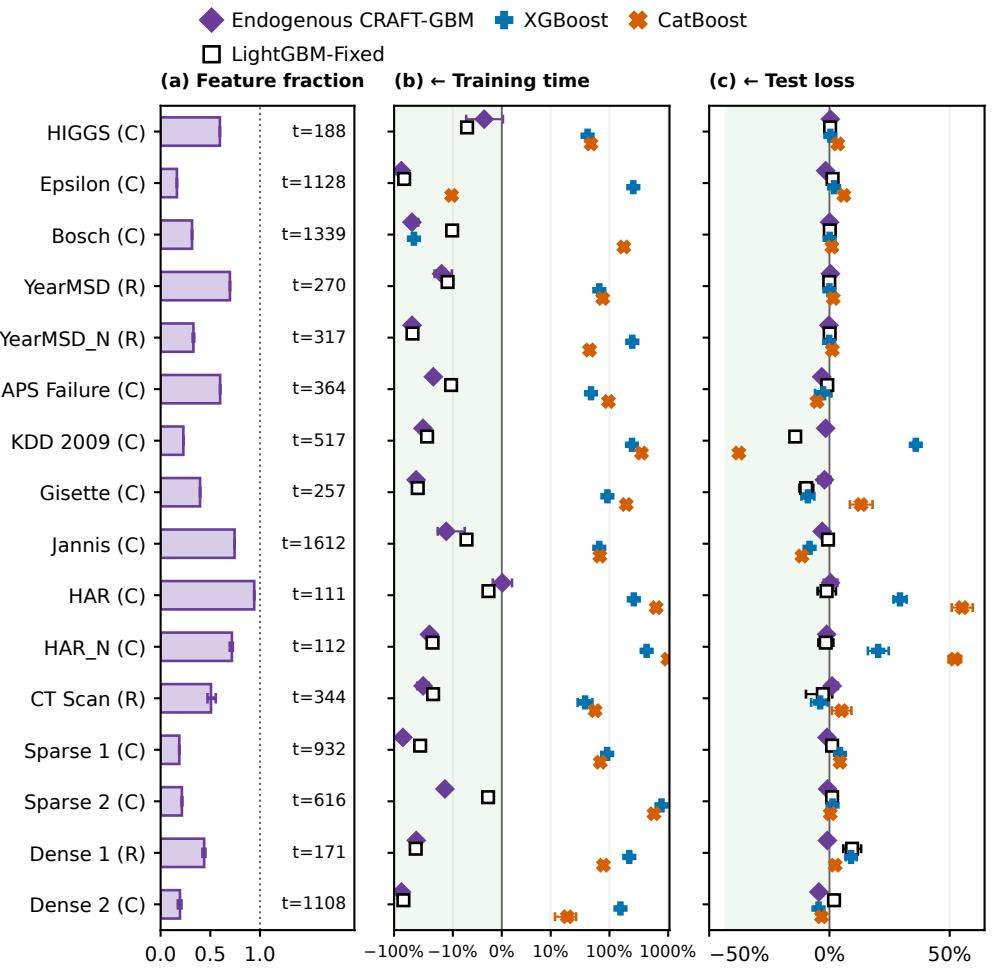
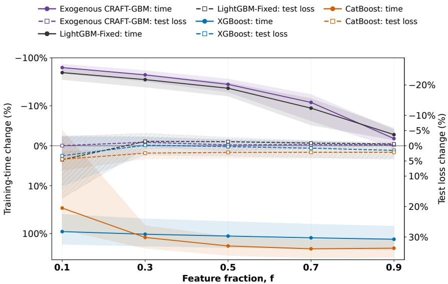

# CRAFT-GBM: Selecting Best Features for Gradient-Boosted Machine Learning

Basil Kuok1,2,3 Yi Zhou2,3 Yao Xuan2,3 Shuping Li2,3 Ke-Wei Huang2,3

1Massachusetts Institute of Technology (MIT) 2National University of Singapore (NUS) 3Asian Institute of Digital Finance (AIDF)

basil\_k@mit.edu zhouyi02@nus.edu.sg yaoxuan@nus.edu.sg aidf.li@nus.edu.sg dishkw@nus.edu.sg

## Abstract

Feature subsampling is used to accelerate gradient-boosted trees, yet standard approaches fix the feature count in advance and largely ignore the split-gain evidence accumulated during training. We introduce CRAFT-GBM (Confidence-Ranked Adaptive Feature Tracking), a native LightGBM extension that uses this evidence to adapt which—and, by default, how many—features are searched each boosting round. CRAFT GBM transforms root-split gains into bounded observations and constructs joint time-uniform bounds valid under adaptive, non-stationary training histories. In its default endogenous mode, after initialization, CRAFT-GBM retains exactly the features that cannot yet be ruled out as best, letting the selected feature-set size Kt emerge from training history rather than a pre-specified fraction. With probability at least 1 − δ, every feature with the largest expected gain is retained jointly across all rounds after initialization. When a feature fraction f is specified instead, CRAFT-GBM ranks features by their interval point estimates and provides an approximate top-K guarantee for feature budget K . We implement CRAFT-GBM within LightGBM while preserving its native feature-bundling representation, and evaluate it across 14 public and synthetic dataset families and four noise-augmented settings. In the fully endogenous setting, CRAFT GBM reduces per-fit training time by 39.74% with 1.04% lower test loss in the geometric mean across all 18 RQ1 experiments. Under pre-specified feature fraction f, Exogenous CRAFT-GBM also yields aggregate training-time reductions up to 13.52 percentage points larger than random feature subsampling, with no increase in aggregate test loss relative to full-feature LightGBM. Accumulated training evidence can thus support adaptive feature search with statistical guarantees while retaining the practical advantages of native gradient boosting.

CRAFT-GBM model source code: https://github.com/basilkuok/CRAFT-GBM

## 1 Introduction

Gradient-boosted decision trees (GBDTs) remain a strong choice for tabular learning (Grinsztajn et al., 2022; McElfresh et al., 2023), but high-dimensional training is expensive across hyperparameter search, cross-validation and retraining. Histogram-based boosting builds and scans every searched feature’s split statistics each round (Ke et al., 2017), although many features are weak, redundant, or rarely competitive for the best split. Random feature subsampling reduces this work, but fixes the fraction in advance and ignores earlier split-gain evidence. Related work addresses ensemble-wide sparsity (Ibrahim et al., 2024) and feature-rank uncertainty (Neuhof and Benjamini, 2024). We ask: can a boosting algorithm use its accumulated split-gain evidence to decide whichfeatures still need to be searched and, by default, how many?

Historical gain rankings alone are an obvious but insufficient solution. A valid screening rule must address four challenges: (C1) native split gains are unbounded and their scale drifts as the ensemble fits; (C2) a feature’s gain is observed only when it is searched, so missing observations are caused by earlier screening decisions; (C3) gains are non-stationary because they depend on the current learner; and (C4) screening decisions and the stopping round depend on the training history, so guarantees must hold at every round and for all features at once. Classical best-arm and subset identification handles adaptive sampling and stopping under fixed arm means (Even-Dar et al., 2006; Kalyanakrishnan et al., 2012). Racing handles adaptive sampling (Tiwari et al., 2022), while rising-bandit identification assumes nondecreasing, concave rewards (Mussi et al., 2024). Our target needs no such shape assumptions.

We introduce CRAFT-GBM (Confidence-Ranked Adaptive Feature Tracking), a native LightGBM extension that treats per-round feature screening as sequential inference. Its design is theory-driven: each component is the construction a formal guarantee requires under one of these challenges. For (C1), a feature gain transformation maps each searched feature’s best root-split gain to [0, 1] using a scale fixed before the round, so observations are bounded and comparable across rounds. For (C2) and (C3), each feature’s accumulated expected gain averages its conditional expected transformed gains over the rounds in which it was actually searched, a target that follows the evolving learner without imputing gains for skipped rounds. For (C4), empirical-Bernstein confidence sequences (Howard et al., 2020; 2021) bound these targets jointly over all features and rounds under history-dependent selection and stopping, without independence or stationarity assumptions (Theorem 1). The empirical-Bernstein construction uses squared prediction errors to control deviations from conditional expected feature gains, with confidence interval widths adapting to both native LightGBM’s GOSS sampling variance and the accuracy of the historical predictor.

In CRAFT-GBM, two screening rules turn these bounds into a search policy. In the default Endogenous mode, after a 20-round full-feature warm-up, CRAFT-GBM searches exactly the features that the joint intervals still allow to be best (Proposition 1). The feature budget $K _ { t }$ is therefore set by the evidence: a feature stays in while it is uncertain, is skipped once it is confidently dominated, and can re-enter later. With probability at least $1 - \delta ,$ , jointly over all rounds, no feature with the largest expected gain is dropped and every searched feature has a bounded gap to the best (Theorem 2); the set-level guarantee holds for the random budget $K _ { t }$ without an additional union bound (Corollary 1). When the user specifies a feature fraction $f ,$ the Exogenous mode searches the corresponding $K _ { f }$ features with the largest point estimates and bounds their gap to the best size-K set (Theorem 3).

CRAFT-GBM runs inside LightGBM’s training loop and uses its Exclusive Feature Bundling layout unchanged. Both modes are compared with LightGBM-Fixed’s random subsampling and the native samplers of XGBoost and CatBoost, using LightGBM-Full (no feature selection) as the baseline comparison. RQ2 additionally includes two ablations: greedy mean-gain ranking (evidence without uncertainty) and exposure balancing (exploration without evidence). Across all 18 RQ1 experiments, Endogenous CRAFT-GBM reduces aggregate training time by 39.7% relative to the baseline LightGBM-Full, and its aggregate test loss is 1.0% lower. At feature fraction $f = 0 . 1 0$ Exogenous CRAFT-GBM reduces aggregate training time by 62.7% with essentially unchanged test loss $( - 0 . 0 4 \% )$ The two ablations are about as fast, reducing training time by 63.8% and 64.7%, but they raise aggregate test loss by 12.7% (greedy mean-gain ranking) and 5.7% (exposure balancing). Random subsampling by LightGBM-Fixed reduces aggregate training time by 30.9% in RQ1 and 49.2% at $f = 0 . 1 0$ in RQ2. All values in Figures 1 and 2 are relative to the baseline LightGBM-Full; test loss is log loss for classification and RMSE for regression.

Our contributions are:

1. Sequential inference for adaptive feature screening. We formulate feature screening in boosting as inference on adaptively observed, path-dependent gains, and introduce a predictable bounded-gain construction and training-path target that make joint time-uniform confidence sequences applicable (Theorem 1).

2. Evidence-determined feature budgets with guarantees. The Endogenous rule lets uncertainty determine how many features are searched and provides simultaneous best-feature retention and near-best guarantees (Theorem 2). For a user-specified budget, the Exogenous rule provides an approximate top-K guarantee (Theorem 3).

3. Native integration and empirical efficiency. We integrate CRAFT-GBM directly into LightGBM while preserving its native EFB representation. Across all 18 RQ1 experiments, it reduces aggregate training time by 39.7% with 1.0% lower aggregate test loss relative to full-feature LightGBM.

## 2 Method

Setup and notation. Let $p \geq 1$ count the valid features after native preprocessing by LightGBM, indexed by $[ p ] = \{ 1 , \dotsc , p \}$ . At boosting round t, CRAFT-GBM selects a set of features (columns) $S _ { t } \subseteq [ p ]$ , with $K _ { t } = | S _ { t } |$ before the native GOSS sampling of rows. Each evaluated feature contributes its best eligible root-split gain $G _ { j , m , t }$ whether or not it wins the split. The observed root-split gains $G _ { j , m , t }$ are mapped to the bounded interval $[ 0 , 1 ]$ via Feature Gain Transformation (FGT). A feature’s expected gain $\overline { { \nu } } _ { j , t - 1 }$ is the conditional expectation of gain averaged across boosting rounds in which the feature is selected, whereas its empirical mean $\widehat { \mu } _ { j , t - 1 }$ is the average of its observed values. A best feature has the largest expected gain $\nu _ { t } ^ { \star }$ , not necessarily the largest observed gain in the current round. At round $t ,$ confidence sequences provide confidence intervals $[ L _ { j , t } , U _ { j , t } ]$ of expected gains $\overline { { \nu } } _ { j , t - 1 }$ jointly across features and rounds through round $t - 1$ , which endogenous feature selection uses to retain a set of possible-best features $S _ { t }$ whose size $K _ { t }$ is a random variable. When a feature fraction $f$ is specified, Exogenous CRAFT-GBM selects the $K _ { f } = \operatorname* { m a x } \{ 1 , \lfloor f p + 1 / 2 \rfloor \}$ features with the largest interval point estimates $c _ { j , t }$ . Algorithm 1 in Appendix F gives the selection and update procedure.

## 2.1 Feature Gain Transformation (FGT)

Let $M \geq 1$ be the fixed number of native output trees in one boosting round. For selected feature $j ,$ output component $m ,$ and round $t ,$ define

$$
G _ { j , m , t } = \operatorname* { m a x } \ ( \{ 0 \} \cup \left\{ \Delta _ { m , t } ^ { \mathrm { r o o t } } ( j , \theta ) : \theta \in \Theta _ { j , m , t } ^ { \mathrm { r o o t } } \right\} ) .\tag{1}
$$

Here $\Theta _ { j , m , t } ^ { \mathrm { r o o t } }$ is the native eligible candidate set $\Theta _ { j , m , t } ^ { \mathrm { r o o t } }$ for feature $j ,$ and $\Delta$ is LightGBM’s net eligible split gain $\Delta _ { m , t } ^ { \mathrm { r o o t } } ( j , \theta )$ calculated by its native tree algorithm (Chen and Guestrin, 2016; Ke et al., 2017). The union with zero covers a selected feature with no positive eligible candidate. Hence, given a feature, Equation (1) gives the feature’s best root opportunity $G _ { j , m , t }$ in a boosting round $t ,$ evaluated at the current learner state, row sample, and native candidate eligibility criteria without requiring that feature to win against other features in that round.

For output component m, initialize $s _ { m , 1 } = \perp$ . Thereafter, let the scale $s _ { m , t } \in ( 0 , \infty ) \cup \{ \perp \}$ be fixed before round t, and set

$$
\phi ( g ; s ) = \left\{ \begin{array} { l l } { g / ( g + s ) , } & { s > 0 , } \\ { \mathbf { 1 } \{ g > 0 \} , } & { s = \bot , } \end{array} \right. \quad \quad R _ { j , t } = \frac { 1 } { M } \sum _ { m = 1 } ^ { M } \phi ( G _ { j , m , t } ; s _ { m , t } ) .\tag{2}
$$

Then $R _ { j , t } \in [ 0 , 1 ]$ . For $s > 0$ , the transformation $\phi ( g ; s )$ is strictly increasing, and $\phi ( a g ; a s ) = \phi ( g ; s )$ for every $a > 0$ After an accepted round, the next scale $s _ { m , t + 1 }$ for output m is the median of

$$
\{ G _ { j , m , t } : j \in S _ { t } , G _ { j , m , t } > 0 \} ,
$$

using the midpoint for an even number of values. This multiset contributes at most one value per selected feature. If it is empty, the previous scale $s _ { m , t }$ is retained. Current gains cannot affect their same-round transformation $\phi ( G _ { j , m , t } ; s _ { m , t } )$

## 2.2 Uniform Moment Statistics (UMS)

Uniform Moment Statistics (UMS) maintain an equal-weight transformed-gain sum $A _ { j , t }$ , an observation count $N _ { j , t }$ and the squared-error sum $V _ { j , t }$ used below for each feature over its selected rounds. Let

$$
I _ { j , t } = \mathbf { 1 } \{ j \in S _ { t } \} , \qquad Y _ { j , t } = { \left\{ \begin{array} { l l } { R _ { j , t } , } & { j \in S _ { t } , } \\ { 0 , } & { j \not \in S _ { t } . } \end{array} \right. }
$$

When a feature is omitted from boosting round $t ,$ the assigned zero is for bookkeeping, not to indicate that the counterfactual gain is zero. Then, starting from $A _ { j , 1 } = N _ { j , 1 } = 0$ , for $t \geq 2$ define

$$
A _ { j , t } = A _ { j , t - 1 } + Y _ { j , t } , \qquad N _ { j , t } = N _ { j , t - 1 } + I _ { j , t } .\tag{3}
$$

Equivalently,

$$
A _ { j , t } = \sum _ { s = 2 } ^ { t } Y _ { j , s } , \qquad N _ { j , t } = \sum _ { s = 2 } ^ { t } I _ { j , s } .
$$

For $N _ { j , t } > 0$ , define the empirical mean $\widehat { \mu } _ { j , t }$ over feature $j ^ { \circ } \mathrm { s }$ selected rounds as

$$
\widehat { \mu } _ { j , t } = \frac { A _ { j , t } } { N _ { j , t } } .
$$

Let $( \mathcal { F } _ { t } ) _ { t \geq 1 }$ describe the training history $\mathcal { F } _ { t }$ through each accepted round. $\mathcal { F } _ { t - 1 }$ contains the fixed data and configuration, the fixed feature mapping and native EFB representation, every committed learner and CRAFT-GBM update through $t - 1$ , the scale $s _ { m , t }$ for round t, and all earlier GOSS draws before accepted round t. Selection is completed before the current-round GOSS sampling. Hence, $I _ { j , t }$ is $\mathcal { F } _ { t - 1 }$ -measurable. The recorded value $Y _ { j , t }$ is $\mathcal { F } _ { t }$ -measurable. In particular, $\mathcal { F } _ { 1 }$ contains the data, configuration, feature map, and native EFB representation fixed before training, together with the committed round-1 learner $F _ { 1 }$ and the scales $s _ { m , 2 }$ for round 2. It describes the history $\mathcal { F } _ { 1 }$ after round 1 and before round 2.

Define the conditional gain $\nu _ { j , t }$ and, for $N _ { j , t } > 0$ , its accumulated average $\overline { { \nu } } _ { j , t } \mathrm { : }$

$$
\nu _ { j , t } = \mathbb { E } [ Y _ { j , t } \mid \mathcal { F } _ { t - 1 } ] , \qquad \overline { { \nu } } _ { j , t } = \frac { \sum _ { s = 2 } ^ { t } \nu _ { j , s } } { N _ { j , t } } .\tag{4}
$$

We call ${ \overline { { \nu } } } _ { j , }$ t the expected gain $\overline { { \nu } } _ { j , t }$ t, while $\widehat { \mu } _ { j , \mathrm { i } }$ t is its empirical estimator $\widehat { \mu } _ { j , t }$ . The target $\overline { { \nu } } _ { j , t }$ is the expected transformed root gain $\overline { { \nu } } _ { j , t }$ , conditional on the preceding training history $\mathcal { F } _ { s - 1 }$ , averaged over the rounds in which that feature was evaluated. If $I _ { j , s } = 0$ , then $Y _ { j , s } = 0$ and consequently $\nu _ { j , s } = 0$ , so the target averages conditional transformed root gains $\nu _ { j , s }$ only over that feature’s realized selected rounds. Different features may therefore be evaluated in different learner states. Predictability and $0 \leq Y _ { j , t } \leq I _ { j , t }$ imply $0 \leq \overline { { \nu } } _ { j , t } \leq 1$ . This target need not be stationary: it is an average of the conditional expectations over the accumulated rounds in which the feature was selected, not an instantaneous or recent-gain target.

## 2.3 Joint Time-Uniform Bounds

The confidence bounds $[ L _ { j , t } , U _ { j , t } ]$ adapt to how well past gains predict subsequent gains. Before observing round t, form the smoothed historical prediction $a _ { j , t } = ( 1 / 2 + A _ { j , t - 1 } ) / ( 1 + N _ { j , t - 1 } )$ . Accumulate its squared errors:

$$
V _ { j , u } = \sum _ { t = 2 } ^ { u } ( Y _ { j , t } - I _ { j , t } a _ { j , t } ) ^ { 2 } .\tag{5}
$$

Only selected features contribute, since $Y _ { j , t } = I _ { j , t } = 0$ for an omitted feature. Crucially, $a _ { j , t }$ is computed before the current gain updates A and N. This error sum $V _ { j , u }$ is observable and does not assume stationary gains or estimate an unobserved gain for an omitted feature.

Set the per-tail error level $\alpha = \delta / ( 2 p )$ . Freeze a positive mixture scale ρ before round 1 using a prespecified reference count $n _ { \mathrm { r e f } }$ (default $n _ { \mathrm { r e f } } = 3 0 0 )$ , independently of the stopping rule or any maximum-round ceiling (Appendix B). Let $u _ { \rho } ( v ; \alpha )$ be the gamma-exponential mixture boundary $u _ { \rho } ( v ; \alpha )$ defined in that appendix. The radius $r _ { j , u }$ is

$$
r _ { j , u } = \frac { u _ { \rho } ( V _ { j , u } ; \delta / ( 2 p ) ) } { N _ { j , u } } , \qquad N _ { j , u } > 0 .\tag{6}
$$

This is an empirical-Bernstein confidence sequence (Howard et al., 2021, Theorem 4 and Proposition 9): smaller accumulated prediction errors $V _ { j , u }$ give smaller radii $r _ { j , u }$ at the same observation count $N _ { j , u }$ . It does not require replacing a worst-case variance by a sample variance in an otherwise unchanged formula.

Theorem 1 (Joint time-uniform bounds). Condition on $\mathcal { F } _ { 1 }$ , including the native feature map, native EFB representation, realizedfinite p, and the positive ρ frozen before round 1. For every $t \geq 2 ,$ , suppose $I _ { j , t }$ is $\mathcal { F } _ { t - 1 }$ -measurable, $Y _ { j , t }$ is $\mathcal { F } _ { t }$ -measurable, and $0 \leq Y _ { j , t } \leq I _ { j , t }$ . Use the predictable predictions ${ a } _ { j , i }$ and error sums $V _ { j , u }$ in Equation $( 5 )$ , and the radii $r _ { j , u }$ in Equation (6). Almost surely,

$$
\begin{array} { r } { \operatorname* { P r } ( \forall j \leq p , \forall u \geq 2 : N _ { j , u } > 0 \Longrightarrow | \widehat { \mu } _ { j , u } - \overline { { \nu } } _ { j , u } | \leq r _ { j , u } | \mathcal { F } _ { 1 } ) \geq 1 - \delta . } \end{array}
$$

For each feature, two nonnegative mixture supermartingales control the upper and lower errors over all rounds through Ville’s inequality. A union bound over these 2p events explains $\alpha = \delta / ( 2 p )$ , and fixing the mixture scale ρ consumes no additional error probability. The theorem therefore covers every boosting round, any history-adapted stopping endpoint, and valid continuation beyond $n _ { \mathrm { r e f } } .$ , on the condition that the fixed feature universe [p], bounded transformation, and other stated invariants persist. No independence is required among features, native EFB bundles, GOSS sampling draws, or multiclass output trees.

## 2.4 Endogenous Feature Selection

Endogenous feature selection can begin at any boosting round $t ^ { \star } \geq 3$ . Preceding rounds $1 \leq t < t ^ { \star }$ use all features $S _ { t } = [ p ]$ : round 1 initializes the transformation scales $s _ { m , 2 }$ , and rounds $2 \leq t < t ^ { \star }$ accumulate confidence statistics $( A _ { j , t } , N _ { j , t } , V _ { j , t } )$ . The theorems below hold for any such starting round $t ^ { \star } \geq 3 .$ , and the Endogenous CRAFT-GBM uses $t ^ { \star } = 2 1$ by default.

At the beginning of round t, use only statistics through $t - 1$ . Define the bounded interval $[ L _ { j , t } , U _ { j , t } ]$

$$
( L _ { j , t } , U _ { j , t } ) = \left\{ \begin{array} { l l } { \left( \operatorname* { m a x } \{ 0 , \widehat { \mu } _ { j , t - 1 } - r _ { j , t - 1 } \} , \operatorname* { m i n } \{ 1 , \widehat { \mu } _ { j , t - 1 } + r _ { j , t - 1 } \} \right) , } & { N _ { j , t - 1 } > 0 , } \\ { ( 0 , 1 ) , } & { N _ { j , t - 1 } = 0 . } \end{array} \right.\tag{7}
$$

Intersecting the raw interval $\left[ \widehat { \mu } _ { j , t - 1 } - r _ { j , t - 1 } , \widehat { \mu } _ { j , t - 1 } + r _ { j , t - 1 } \right]$ with the known range $[ 0 , 1 ]$ preserves coverage. An unseen feature receives the complete parameter range. For endogenous rounds $t \geq 2 1$ , let

$$
C _ { t } = \operatorname* { m a x } _ { 1 \leq c \leq p } L _ { c , t } , \qquad S _ { t } = \{ j : 1 \leq j \leq p , U _ { j , t } \geq C _ { t } \} , \qquad K _ { t } = | S _ { t } | .\tag{8}
$$

All features are reconsidered each round, with omitted features retaining their statistics and confidence intervals unchanged to the next round, so re-entry is possible but not guaranteed. At least one feature attaining $C _ { t }$ is retained, so $1 \leq K _ { t } \leq p .$ . All features, and hence every best feature, are retained during initialization. Let the joint rectangular confidence region $\mathcal { C } _ { t }$ be

$$
\mathcal { C } _ { t } = \prod _ { j = 1 } ^ { p } [ L _ { j , t } , U _ { j , t } ] .
$$

Proposition $\textbf { 1 } ( S _ { t }$ is the set of possible-best features in round $t ) .$ . For $t \geq 2 1$ and any nonempty intervals in $\mathcal { C } _ { t } ,$

$$
S _ { t } = \left\{ j : \exists v \in \mathcal { C } _ { t } s u c h t h a t v _ { j } = \operatorname* { m a x } _ { 1 \leq c \leq p } v _ { c } \right\} .
$$

Thus $S _ { t }$ is the smallest set containing everyfeature that can be a maximizerfor some parameter vector allowed by the rectangular region $\mathcal { C } _ { t }$

For $t \geq 2 1$ , define

$$
\nu _ { t } ^ { \star } = \operatorname* { m a x } _ { j \in [ p ] } \overline { { \nu } } _ { j , t - 1 } , \qquad \mathcal { M } _ { t } ^ { \star } = \mathop { \arg \operatorname* { m a x } } _ { j \in [ p ] } \overline { { \nu } } _ { j , t - 1 } , \qquad r _ { t } ^ { \star } = \operatorname* { m i n } _ { j \in \mathcal { M } _ { t } ^ { \star } } r _ { j , t - 1 } .
$$

Theorem 2 (Endogenous feature selection guarantee). Conditional on $\mathcal { F } _ { 1 }$ , with probability at least $1 - \delta ,$ , the following statements holdjointlyfor every boosting round $t \geq 2 1$

1. No true maximizer is omitted:

$$
\mathcal { M } _ { t } ^ { \star } \subseteq S _ { t } , \qquad K _ { t } \geq | \mathcal { M } _ { t } ^ { \star } | .
$$

2. For every omittedfeature $j \notin S _ { t }$ , there is a retainedfeature $c \in S _ { t }$ such that

$$
\overline { { \nu } } _ { c , t - 1 } > \overline { { \nu } } _ { j , t - 1 } .
$$

3. Every retained feature $j \in S _ { t }$ is approximately best:

$$
0 \leq \nu _ { t } ^ { \star } - \overline { { \nu } } _ { j , t - 1 } \leq 2 r _ { j , t - 1 } + 2 r _ { t } ^ { \star } .\tag{9}
$$

Consequently,

$$
\begin{array} { r l r } {  { 0 \leq \nu _ { t } ^ { \star } - \frac { 1 } { K _ { t } } \sum _ { j \in S _ { t } } \overline { { \nu } } _ { j , t - 1 } } } \\ & { } & { \leq 2 r _ { t } ^ { \star } + \frac { 2 } { K _ { t } } \sum _ { j \in S _ { t } } r _ { j , t - 1 } \leq 4 \operatorname* { m a x } _ { j \in S _ { t } } r _ { j , t - 1 } . } \end{array}\tag{10}
$$

4. If $K _ { t } = 1$ , the sole retainedfeature is the unique maximizer. More generally, $i f \mathcal { M } _ { t } ^ { \star } = \{ 1 , \ldots , p \}$ , exact recovery is automatic. Otherwise the sufficient separation condition

$$
\operatorname* { m a x } _ { j \notin \mathcal { M } _ { t } ^ { \star } } U _ { j , t } < \operatorname* { m a x } _ { c \in \mathcal { M } _ { t } ^ { \star } } L _ { c , t }\tag{11}
$$

implies $S _ { t } = \mathcal { M } _ { t } ^ { \star }$

Hence, the theorem guarantees selection of all features “not ruled out as best” in each boosting round.

Corollary 1 (Guarantee of selecting a set of possible-best features $S _ { t } )$ . At every round covered by Theorem $^ { 2 , }$ let

$$
S _ { t } ^ { \star , K _ { t } } \in \operatorname * { a r g m a x } _ { S \subseteq \{ 1 , \dots , p \} , \ | S | = K _ { t } } \sum _ { j \in S } \overline { { \nu } } _ { j , t - 1 } .
$$

Then, jointly,

$$
0 \leq \frac { 1 } { K _ { t } } \left( \sum _ { j \in S _ { t } ^ { \star , K _ { t } } } \bar { \nu } _ { j , t - 1 } - \sum _ { j \in S _ { t } } \bar { \nu } _ { j , t - 1 } \right) \leq 2 \operatorname* { m a x } _ { j \in S _ { t } } r _ { j , t - 1 } .\tag{12}
$$

No additional union bound over possible realized values of $K _ { t }$ is needed.

## 2.5 Exogenous Feature Selection

Users can instead fix a feature fraction $f$ before training. After initialization, Exogenous CRAFT-GBM selects an approximate best- $K _ { f }$ set in each round, with $K _ { f }$ defined below.

Exogenous K through feature\_fraction. A value $f = \mathtt { f e a t u r e \_ f r a c t i o n } \in ( 0 , 1 )$ , fixed before training, instead specifies

$$
K _ { f } = \operatorname* { m a x } \left\{ 1 , \left\lfloor f p + \frac { 1 } { 2 } \right\rfloor \right\} ,\tag{13}
$$

using LightGBM’s native feature-count rounding rule. Rounds 1 and 2 still evaluate all p features: round 1 initializes the FGT scales $s _ { m , 2 }$ , and round 2 supplies the first confidence observation $R _ { j , 2 }$ for every feature. For every round $t \geq 3$ , define the interval point estimate $c _ { j , t }$ and half-width $h _ { j , t }$

$$
c _ { j , t } = \frac { L _ { j , t } + U _ { j , t } } { 2 } , \qquad h _ { j , t } = \frac { U _ { j , t } - L _ { j , t } } { 2 } .
$$

CRAFT-GBM selects exactly the $K _ { f }$ features with the largest $c _ { j , t }$ . This confidence interval point estimate $c _ { j , t }$ is generally different from the empirical mean $\widehat { \mu } _ { j , t - 1 }$ because bounding the endpoints $L _ { j , t } , U _ { j , t }$ can make the interval $[ L _ { j , t } , U _ { j , t } ]$ asymmetric around that mean $\widehat { \mu } _ { j , t - 1 }$ . Equal interval point estimates $c _ { j , t }$ are resolved by smaller observation count $N _ { j , t - 1 }$ , followed by smaller canonical feature identifier $\operatorname { i d } ( j )$ . This tie rule favors a less-observed feature but does not alter the theorem below. Exogenous CRAFT-GBM feature selection is deterministic given the training history, so native LightGBM’s parameter feature\_fraction\_seed has no effect, but the per-node parameter feature\_fraction\_bynode must remain one: additional node-level sampling could remove a selected feature at the root while its observation count $N _ { j , t }$ was still incremented.

Let $S _ { t } ^ { ( f ) }$ denote the resulting size- $K _ { f }$ set $S _ { t } ^ { ( f ) }$ and let

$$
S _ { t } ^ { \star , K _ { f } } \in \operatorname * { a r g m a x } _ { S \subseteq \{ 1 , \dots , p \} , \ | S | = K _ { f } } \sum _ { j \in S } \overline { { \nu } } _ { j , t - 1 } .
$$

Theorem 3 (Exogenous top-K selection). Under the assumptions of Theorem $^ { l , }$ conditional on $\mathcal { F } _ { 1 }$ , with probability at least $1 - \delta ,$ jointly at every boosting round $t \geq 3$

$$
\begin{array} { r l } & { 0 \leq \displaystyle \frac { 1 } { K _ { f } } \left( \displaystyle \sum _ { j \in S _ { t } ^ { \star , K _ { f } } } \overline { { \nu } } _ { j , t - 1 } - \displaystyle \sum _ { j \in S _ { t } ^ { ( f ) } } \overline { { \nu } } _ { j , t - 1 } \right) } \\ & { \leq \displaystyle \frac { 1 } { K _ { f } } \left( \displaystyle \sum _ { j \in S _ { t } ^ { \star , K _ { f } } \backslash S _ { t } ^ { ( f ) } } h _ { j , t } + \displaystyle \sum _ { j \in S _ { t } ^ { ( f ) } \backslash S _ { t } ^ { \star , K _ { f } } } h _ { j , t } \right) \leq 2 \displaystyle \operatorname* { m a x } _ { j \leq p } h _ { j , t } \leq 1 . } \end{array}\tag{14}
$$

For fixed $f ,$ this joint guarantee bounds the selected set’s average expected-gain gap from the best size- $K _ { f }$ set $S _ { t } ^ { \star , K _ { f } }$ in that run, starting at round 3. Exogenous selection may omit a best feature even when at most $K _ { f }$ remain possiblebest. The bound accounts for uncertainty in both selected and omitted features, while targets exclude unobserved omitted-round gains. No additional error allocation over rounds or sets is needed.

## 3 Experimental Evaluation

• RQ1: Can Endogenous CRAFT-GBM reduce training time while maintaining test loss relative to competitor models, using the same pre-run-determined settings?

• RQ2: How does Exogenous CRAFT-GBM compare with competitor models across a set of pre-specified feature fractions, using LightGBM-Full as the baseline reference?

## 3.1 Experimental Setup and Design

Datasets and evaluation. Ten public benchmark datasets cover binary/multiclass classification and regression. Four synthetic dataset families cover sparse inputs (Sparse 1), categorical indicators (Sparse 2), nonlinear regression (Dense 1), and redundant-feature classification (Dense 2), each with 2,000 features and 100,000 rows per training/test split. All competitor models share the same fixed training/test partitions for each dataset, with subject-disjoint HAR splits and patient-disjoint CT folds. Each experiment has five paired measurements. The test set is withheld from training and test labels are never used to select features or any other training settings. Test loss is log loss for classification (C) and RMSE for regression (R). RQ2 uses these 14 families. Figure 1 adds HAR\_N and YearMSD\_N, which are expanded HAR and YearMSD datasets with noise. This is done by appending eight row-permuted copies of every feature column, which expands the column size of each dataset by nine times. However, added row-permuted columns need not have zero gain and are expected to have augmented noise.

RQ1: endogenous feature selection. At the beginning of the training, for each dataset, one untimed Endogenous CRAFT-GBM pre-run is carried out to determine the total number of boosting rounds t and average feature fraction $\begin{array} { r } { \bar { f } = ( p t ) ^ { - 1 } \sum _ { s = 1 } ^ { t ^ { - } } K _ { s } , } \end{array}$ , which include initialization. Endogenous CRAFT-GBM is configured to stop independently at $\tau = t ,$ , which is after ten boosting rounds without a training-loss improvement exceeding $0 . 0 0 1 L _ { 0 }$ over its previous round’s loss, where $L _ { 0 }$ is initial training loss. The same pre-run-determined t¯and $\bar { f }$ are then used for all competitor models and the baseline LightGBM-Full model for fair comparison. LightGBM-Full, the baseline reference, uses all features for t¯ boosting rounds. LightGBM-Fixed also runs for a total of t¯ rounds, but randomly samples a fixed fraction $\bar { f }$ of features in each round. XGBoost (Chen and Guestrin, 2016) and CatBoost (Prokhorenkova et al., 2018) receive ${ \bar { f } } ,$ t through native samplers. Hence, both competitor models also match the feature and total running budgets of Endogenous CRAFT-GBM. All models use a learning rate of 0.05 without tuning. Figure 1 compares each competitor model’s training time and test loss with those of LightGBM-Full.

RQ2: exogenous feature selection. Exogenous CRAFT-GBM, LightGBM-Fixed, XGBoost, CatBoost, and two ablations use $f \in \{ 0 . 1 0 , 0 . 3 0 , 0 . 5 0 , 0 . 7 0 , 0 . 9 0 \}$ . For each training dataset, a 20-trial Bayesian hyperparameter search tunes for LightGBM-Full’s optimal rounds $T ^ { \star }$ in [50, 2000] and optimal learning rate $\eta ^ { \star }$ in [0.01, 0.20], minimizing loss on an 80/20 inner split. Then, all competitor models (Exogenous CRAFT-GBM, LightGBM-Fixed, XGBoost, CatBoost) are trained with the same hyperparameter-tuned $T ^ { \star }$ and $\eta ^ { \star }$ for each dataset, across all feature fractions $f \in \{ 0 . 1 0 , 0 . 3 0 , 0 . 5 0 , 0 . 7 0 , 0 . 9 0 \}$ . Their performance results in Figure 2 are all relative changes compared to the baseline LightGBM-Full. There are two ablation models running on the same settings. Mean ablation greedily ranks empirical gain means $\widehat { \mu } _ { j , t - 1 }$ (evidence without uncertainty), whereas Exposure ablation selects the least-observed features in each boosting round (exploration without gain evidence).

Shared settings and reporting. All LightGBM-derived models share the same native LightGBM preprocessing, EFB bundling, and GOSS sampling at depth 6 and at most 64 leaves. CRAFT-GBM uses $\delta = 0 . 0 5$ , with $n _ { \mathrm { r e f } } = 3 0 0$ in RQ1 and $n _ { \mathrm { r e f } } = 1 0 0 0$ in RQ2. All models use equal CPU core counts and a standardized computational environment within each RQ. Total training time includes launch, loading, selection, boosting, and saving, but excludes preparation, pre-runs, tuning, and test prediction. In both Figure 1 and Figure 2, training time and test loss changes are reported as $1 0 0 ( r - 1 ) \%$ , where r averages Competitor model / LightGBM-Full ratios geometrically within and then equally across experiments. Hence, for all competitor models, negative values indicate improvements in training time/test loss relative to LightGBM-Full, and the opposite holds for positive values. LightGBM-Full is not plotted on both figures because it is used as the baseline comparison in the performance metric above (its ratios = 1 trivially).

## 3.2 RQ1: Endogenous Feature Selection

<table><tr><td></td><td colspan="2">16-experiment aggregate change</td><td colspan="3">Wins across 16 experiments</td></tr><tr><td>Model</td><td>Time (%)</td><td>Test loss (%)</td><td>Faster</td><td>Lower loss</td><td>Both</td></tr><tr><td>Endogenous CRAFT-GBM</td><td>-40.36</td><td>-1.10</td><td>15</td><td>11</td><td>11</td></tr><tr><td>LightGBM-Fixed</td><td>-30.65</td><td>-1.10</td><td>16</td><td>8</td><td>8</td></tr><tr><td>XGBoost</td><td>+135.77</td><td>+3.95</td><td>1</td><td>7</td><td>0</td></tr><tr><td>CatBoost</td><td>+140.52</td><td>+3.51</td><td>1</td><td>4</td><td>0</td></tr></table>

Figure 1: Endogenous CRAFT-GBM reduces training time in 15 of the 16 displayed experiments. Endogenous CRAFT-GBM reduces aggregate training time by 40.36% and test loss by 1.10%. LightGBM-Fixed saves 30.65% of training time and has the same aggregate loss change, so endogenous CRAFT-GBM delivers a further 9.70 percentage points of time reduction. Endogenous CRAFT-GBM improves both outcomes in 11/16 experiments, compared with 8/16 for random LightGBM-Fixed. Across almost all datasets, XGBoost and CatBoost are slower and incur higher test loss in some datasets.

Time savings span 3.6–75.4% in the 15 faster experiments, while HAR takes 0.11% longer. Loss falls 4.41% on Dense 2 but rises 1.09% on CT. Including both +4 expansions leaves the overall finding similar, with 39.74% less time and 1.04% lower loss across all 18 experiments. The HAR\_N pre-run retains about 72% of features, so faster training need not remove every added column. Together, these results support Endogenous CRAFT-GBM as an evidence-determined alternative to fixing a feature fraction f in advance, without implying uniformly better predictions or recovery of only useful features.

## 3.3 RQ2: Performance Across Feature Fractions

Aggregate change across 14 source families (%)
<table><tr><td rowspan="3">f</td><td colspan="2">Exogenous CRAFT-GBM</td><td colspan="2">LightGBM Fixed</td><td colspan="2">XGBoost</td><td colspan="2">CatBoost</td><td colspan="2">Mean ablation</td><td colspan="2">Exposure ablation</td></tr><tr><td colspan="2">Time</td><td colspan="2">Time</td><td colspan="2"></td><td colspan="2"></td><td colspan="2">Time</td><td colspan="2">Time</td></tr><tr><td></td><td>Loss</td><td></td><td>Loss</td><td>Time</td><td>Loss</td><td>Time</td><td>Loss</td><td></td><td>Loss</td><td></td><td>Loss</td></tr><tr><td>0.10</td><td>-62.74</td><td>-0.04</td><td>-49.22</td><td>+4.60</td><td>+90.61</td><td>+3.31</td><td>+29.20</td><td>+4.44</td><td>-63.83</td><td>+12.69</td><td>-64.71</td><td>+5.71</td></tr><tr><td>0.30</td><td>-44.20</td><td>-1.16</td><td>-35.17</td><td>-1.44</td><td>+102.74</td><td>-0.17</td><td>+120.07</td><td>+2.42</td><td>-45.08</td><td>+7.73</td><td>-47.00</td><td>+2.16</td></tr><tr><td>0.50</td><td>-28.02</td><td>-0.27</td><td>-23.25</td><td>-1.34</td><td>+112.23</td><td>+0.28</td><td>+180.62</td><td>+2.20</td><td>-29.72</td><td>+4.40</td><td>-31.73</td><td>+1.94</td></tr><tr><td>0.70</td><td>-11.77</td><td>-0.38</td><td>-9.41</td><td>-0.88</td><td>+122.12</td><td>+0.79</td><td>+207.04</td><td>+2.15</td><td>-13.19</td><td>+3.53</td><td>-13.82</td><td>-0.99</td></tr><tr><td>0.90</td><td>-1.81</td><td>-0.26</td><td>-2.79</td><td>-0.59</td><td>+130.74</td><td>+1.52</td><td>+201.02</td><td>+2.14</td><td>-3.63</td><td>+0.41</td><td>-4.38</td><td>-0.41</td></tr></table>

Figure 2: At $f = 0 . 1 0 ,$ Exogenous CRAFT-GBM substantially reduces training time with essentially unchanged aggregate test loss. Shaded bands show pointwise 95% dataset-resampling intervals, reflecting sensitivity to the composition of the 14 dataset families. At $f = 0 . 1 0 ,$ Exogenous CRAFT-GBM reduces aggregate training time by 62.74% with essentially unchanged test loss $( - 0 . 0 4 \% )$ . Random subsampling by LightGBM-Fixed saves 49.22% time but raises loss by 4.60%. Thus CRAFT-GBM delivers 13.52 percentage points more time reduction without the aggregate loss increase seen with LightGBM-Fixed. Greedy mean-gain ranking (Mean ablation) and exposure balancing of features (Exposure ablation) save the same training time (63.83% and 64.71%), but incur greater test los especially at smaller feature fractions (12.69% and 5.71% more test loss at $f = 0 . 1 0 )$ . This contrast is consistent with the expected benefit of combining gain evidence with uncertainty in CRAFT-GBM, especially when the feature budget $K _ { f }$ is restrictive.

Exogenous CRAFT-GBM also has the largest training-time reduction among non-ablated competitor models— LightGBM-Fixed, XGBoost, and CatBoost—dominating at $f \leq 0 . 7 0$ , while its negative test loss changes indicate lower test loss than the baseline LightGBM-Full’s across all feature fractions. As expected, the advantage gained by all competitor models narrows as feature fraction increases.

## 4 Conclusion

CRAFT-GBM turns accumulated split-gain evidence into statistically guided feature search, deciding which features to search and, by default, how many. Joint confidence bounds support possible-best retention and approximate top-K selection. Relative to LightGBM-Full, Endogenous CRAFT-GBM reduces aggregate training time by 39.74% with 1.04% lower test loss across all 18 RQ1 experiments. Exogenous CRAFT-GBM saves up to 62.74% of training time at $f = 0 . 1 0$ with essentially unchanged test loss, demonstrating efficient feature search even under restrictive feature budgets.

## Reproducibility Statement

The appendices provide full proofs, model parameters, dataset specifications, and complete numerical results. The supplementary source package (attached as the CRAFT-GBM\_Supplementary\_Source\_Code.zip file in the submission) includes model implementations, data acquisition and generation scripts, fixed experimental settings, and benchmark and analysis code. The CRAFT-GBM model source is also available at https://github.com/basilkuok/ CRAFT-GBM. Dependency versions and execution instructions are provided to support reproduction of the experiments. While we expect the relative performance between competitor models to be fully reproduced, the absolute training times may vary depending on the hardware and execution environment.

## References

Takuya Akiba, Shotaro Sano, Toshihiko Yanase, Takeru Ohta, and Masanori Koyama. Optuna: A next-generation hyperparameter optimization framework. In Proceedings of the 25th ACM SIGKDD International Conference on Knowledge Discovery & Data Mining, pages 2623–2631. Association for Computing Machinery, 2019. doi: 10.1145/3292500.3330701. URL https://doi.org/10.1145/3292500.3330701.

James Bergstra, Rémi Bardenet, Yoshua Bengio, and Balázs Kégl. Algorithms for hyper-parameter optimization. In Advances in Neural Information Processing Systems, volume 24, pages 2546–2554. Curran Associates, Inc., 2011. URL https://papers.nips.cc/paper\_files/paper/2011/hash/ 86e8f7ab32cfd12577bc2619bc635690-Abstract.html.

Róbert Busa-Fekete and Balázs Kégl. Accelerating adaboost using ucb. In JMLR Workshop and Conference Proceedings, volume 7, pages 111–122, 2009. URL https://proceedings.mlr.press/v7/busa09.html.

Tianqi Chen and Carlos Guestrin. XGBoost: A scalable tree boosting system. In Proceedings of the 22nd ACM SIGKDD International Conference on Knowledge Discovery and Data Mining, pages 785–794, 2016. doi: 10.1145/2939672. 2939785. URL https://arxiv.org/abs/1603.02754v3.

Eyal Even-Dar, Shie Mannor, and Yishay Mansour. Action elimination and stopping conditions for the multi-armed bandit and reinforcement learning problems. Journal ofMachine Learning Research, 7(39):1079–1105, 2006. URL https://www.jmlr.org/papers/v7/evendar06a.html.

Figshare. Bosch production line performance: Numeric training table. Figshare, version 4, file 37613486, 2022. URL https://doi.org/10.6084/m9.figshare.21118804.v4.

Jerome H. Friedman. Multivariate adaptive regression splines. The Annals of Statistics, 19(1):1–67, 1991. doi: 10.1214/aos/1176347963. URL https://doi.org/10.1214/aos/1176347963.

Jeremy Goldwasser and Giles Hooker. Statistical significance of feature importance rankings. In Proceedings of the Forty-First Conference on Uncertainty in Artificial Intelligence, volume 286 of Proceedings of Machine Learning Research, pages 1476–1496. PMLR, 2025. URL https://proceedings.mlr.press/v286/ goldwasser25a.html.

Leo Grinsztajn, Edouard Oyallon, and Gael Varoquaux. Why do tree-based models still outperform deep learning on typical tabular data? In Advances in Neural Information Processing Systems, volume 35, pages 507–520. Curran Associates, Inc., 2022. doi: 10.52202/068431-0037. URL https://proceedings.neurips.cc/ paper\_files/paper/2022/file/0378c7692da36807bdec87ab043cdadc-Paper-Datasets\_ and\_Benchmarks.pdf.

Steven R. Howard, Aaditya Ramdas, Jon McAuliffe, and Jasjeet Sekhon. Time-uniform chernoff bounds via nonnegative supermartingales. Probability Surveys, 17:257–317, 2020. doi: 10.1214/18-PS321. URL https://arxiv.org/ abs/1808.03204v8.

Steven R. Howard, Aaditya Ramdas, Jon McAuliffe, and Jasjeet Sekhon. Time-uniform, nonparametric, nonasymptotic confidence sequences. The Annals of Statistics, 49(2):1055–1080, 2021. doi: 10.1214/20-AOS1991. URL https://arxiv.org/abs/1810.08240v9.

Shibal Ibrahim, Kayhan Behdin, and Rahul Mazumder. End-to-end feature selection approach for learning skinny trees. In Proceedings ofthe 27th International Conference on Artificial Intelligence and Statistics, volume 238 of Proceedings of Machine Learning Research, pages 2863–2871. PMLR, 2024. URL https://proceedings. mlr.press/v238/ibrahim24a.html.

Shivaram Kalyanakrishnan, Ambuj Tewari, Peter Auer, and Peter Stone. PAC subset selection in stochastic multi-armed bandits. In John Langford and Joelle Pineau, editors, Proceedings ofthe 29th International Conference on Machine Learning, pages 655–662. Omnipress, 2012. URL https://icml.cc/2012/papers/359.pdf.

KDD Cup. KDD Cup 2009: Customer relationship prediction, small dataset, 2009. URL https://www.kdd.org/ kdd-cup/view/kdd-cup-2009/Data. Appetency task.

Guolin Ke, Qi Meng, Thomas Finley, Taifeng Wang, Wei Chen, Weidong Ma, Qiwei Ye, and Tie-Yan Liu. LightGBM: A highly efficient gradient boosting decision tree. In Advances in Neural Information Processing Systems, volume 30, 2017. URL https://papers.nips.cc/paper/2017/hash/ 6449f44a102fde848669bdd9eb6b76fa-Abstract.html.

LIBSVM Dataset Repository. Epsilon (normalized) binary-classification benchmark, 2026. URL https://www. csie.ntu.edu.tw/\~cjlin/libsvmtools/datasets/binary.html#epsilon. Exact training and test artifacts accessed 2026-09-03.

Oded Maron and Andrew W. Moore. Hoeffding races: Accelerating model selection search for classification and function approximation. In Advances in Neural Information Processing Systems, volume 6, pages 59–66. Morgan-Kaufmann, 1993. URL https://proceedings.neurips.cc/paper\_files/paper/1993/ file/02a32ad2669e6fe298e607fe7cc0e1a0-Paper.pdf.

Duncan McElfresh, Sujay Khandagale, Jonathan Valverde, Vishak Prasad C, Ganesh Ramakrishnan, Micah Goldblum, and Colin White. When do neural nets outperform boosted trees on tabular data? In Advances in Neural Information Processing Systems, volume 36, pages 76336–76369. Curran Associates, Inc., 2023. doi: 10.52202/075280-3337. URL https://proceedings.neurips.cc/paper\_files/paper/2023/ hash/f06d5ebd4ff40b40dd97e30cee632123-Abstract.html.

Marco Mussi, Alessandro Montenegro, Francesco Trovò, Marcello Restelli, and Alberto Maria Metelli. Best arm identification for stochastic rising bandits. In Proceedings of the 41st International Conference on Machine Learning, volume 235 of Proceedings ofMachine Learning Research, pages 36953–36989. PMLR, 2024. URL https://proceedings.mlr.press/v235/mussi24b.html.

Bitya Neuhof and Yuval Benjamini. Confident feature ranking. In Proceedings ofthe 27th International Conference on Artificial Intelligence and Statistics, volume 238 of Proceedings ofMachine Learning Research, pages 1468–1476. PMLR, 2024. URL https://proceedings.mlr.press/v238/neuhof24a.html.

OpenML. Jannis: Dataset 41168, version 1, and task 168792, 2026. URL https://www.openml.org/ t/168792. Dataset: https://www.openml.org/d/41168; task: https://www.openml.org/t/ 168792; exact artifacts accessed 2026-09-03.

Fabian Pedregosa, Gaël Varoquaux, Alexandre Gramfort, Vincent Michel, Bertrand Thirion, Olivier Grisel, Mathieu Blondel, Peter Prettenhofer, Ron Weiss, Vincent Dubourg, Jake Vanderplas, Alexandre Passos, David Cournapeau, Matthieu Brucher, Matthieu Perrot, and Édouard Duchesnay. Scikit-learn: Machine learning in Python. Journal of Machine Learning Research, 12(85):2825–2830, 2011. URL https://jmlr.org/papers/v12/ pedregosa11a.html.

Liudmila Prokhorenkova, Gleb Gusev, Aleksandr Vorobev, Anna Veronika Dorogush, and Andrey Gulin. CatBoost: Unbiased boosting with categorical features. In Advances in Neural Information Processing Systems, volume 31, 2018. URL https://proceedings.neurips.cc/paper/2018/hash/ 14491b756b3a51daac41c24863285549-Abstract.html.

Mo Tiwari, Ryan Kang, Jaeyong Lee, Chris Piech, Ilan Shomorony, Sebastian Thrun, and Martin J Zhang. MABSplit: Faster forest training using multi-armed bandits. In Advances in Neural Information Processing Systems, volume 35, pages 1223–1237. Curran Associates, Inc., 2022. doi: 10. 52202/068431-0090. URL https://proceedings.neurips.cc/paper\_files/paper/2022/hash/ 08857467641ad82f635023d530605b4c-Abstract-Conference.html.

UCI Machine Learning Repository. APS Failure at Scania Trucks. Dataset 421, 2023a. URL https://doi.org/ 10.24432/C51S51.

UCI Machine Learning Repository. Relative location of CT slices on the axial axis. Dataset 206, 2023b. URL https://doi.org/10.24432/C5CP6G.

UCI Machine Learning Repository. Gisette. Dataset 170, 2023c. URL https://doi.org/10.24432/C5HP5B.

UCI Machine Learning Repository. Human activity recognition using smartphones. Dataset 240, 2023d. URL https://doi.org/10.24432/C54S4K.

UCI Machine Learning Repository. YearPredictionMSD. Dataset 203, 2023e. URL https://doi.org/10. 24432/C50K61.

Daniel Whiteson. HIGGS. UCI Machine Learning Repository, 2014. URL https://doi.org/10.24432/ C5V312.

## A Properties of Feature Gain Transformation (FGT)

Proof. The claims in Section 2.1 follow directly from the definition in Equation (2).

Boundedness. For $g \geq 0$ and $s > 0 ,$

$$
0 \leq \frac { g } { g + s } < 1 .
$$

When $s = \bot , \phi ( g ; \bot ) = \mathbf { 1 } \{ g > 0 \} \in \{ 0 , 1 \}$ . Hence every summand in $R _ { j , t }$ lies in $[ 0 , 1 ]$ , and averaging over the M output trees gives $R _ { j , t } \in [ 0 , 1 ]$

Monotonicity and positive-rescaling invariance. For a finite positive scale $s ,$

$$
\frac \partial { \partial g } \frac g { g + s } = \frac s { ( g + s ) ^ { 2 } } > 0 ,
$$

so the transformation $\phi ( g ; s )$ is strictly increasing in $g .$ For every $a > 0 ,$

$$
\phi ( a g ; a s ) = \frac { a g } { a g + a s } = \frac { g } { g + s } = \phi ( g ; s ) .
$$

Thus a common positive rescaling of the gain g and its scale s leaves the transformed value $\phi ( g ; s )$ unchanged.

Predictability of the scale. By construction, $s _ { m , t }$ is committed before accepted round t and is therefore $\mathcal { F } _ { t - 1 } -$ measurable. The current gains $\{ G _ { j , m , t } : j \in S _ { t } \}$ may update only $s _ { m , t + 1 }$ , after every output tree in round t succeeds Consequently, a current gain $G _ { j , m , t }$ cannot affect its own same-round FGT scale $s _ { m , t }$ □

## B Empirical-Bernstein Boundary and Fixed Scale

Fixed scale. After native preprocessing fixes $p ,$ fix $n _ { \mathrm { r e f } } > 0$ (default 300) and choose $z > 0$ and $\rho > 0$ by

$$
z - \log ( 1 + z ) = 2 \log ( p / \delta ) , \qquad \rho = \frac { n _ { \mathrm { r e f } } } { 4 z } .\tag{15}
$$

The left side increases strictly from zero to infinity, so z exists uniquely. This normal-reference scale $\rho$ uses the normal-mixture calibration convention of Howard et al. (2021, Proposition 3) at the reference variance $n _ { \mathrm { r e f } } / 4$ . It is a fixed design choice, not an optimum for the gamma-exponential boundary $u _ { \rho } ( v ; \alpha )$ . The value $n _ { \mathrm { r e f } } / 4$ is not an upper bound on the observed squared-error sum $V _ { j , t }$ . Coverage holds for every fixed positive $\rho .$ . The reference $n _ { \mathrm { r e f } }$ may be configured before training, but is never chosen from observed gains, losses, or stopping times. The stopping constants $\epsilon = 0 . 0 0 1 , P = 1 0$ , and their derived $n _ { \star } = 1 0 0 0 0$ are separate from this confidence calibration.

Boundary. For $0 \leq \lambda < 1$ , write $\psi _ { E } ( \lambda ) = - \log ( 1 - \lambda ) - \lambda$ . Let $P ( a , x ) = \gamma ( a , x ) / \Gamma ( a )$ be the regularized lower incomplete gamma function. Mix $\exp \{ \lambda s - \psi _ { E } ( \lambda ) v \}$ against the density

$$
f _ { \rho } ( \lambda ) = \frac { \rho ^ { \rho } } { \Gamma ( \rho ) P ( \rho , \rho ) } ( 1 - \lambda ) ^ { \rho - 1 } e ^ { - \rho ( 1 - \lambda ) } , \qquad 0 < \lambda < 1 .
$$

This is the distribution of $1 - G$ conditional on $G < 1$ , for a gamma variable $G$ with shape and rate $\rho .$ For every real s and $v \geq 0$ , define

$$
M _ { \rho } ( s , v ) = \int _ { 0 } ^ { 1 } e ^ { \lambda s - \psi _ { E } ( \lambda ) v } f _ { \rho } ( \lambda ) d \lambda .
$$

For $s \geq 0 ,$ , the domain needed for boundary inversion, integration gives

$$
M _ { \rho } ( s , v ) = \frac { \rho ^ { \rho } \Gamma ( v + \rho ) P ( v + \rho , s + v + \rho ) e ^ { s + v } } { \Gamma ( \rho ) P ( \rho , \rho ) ( s + v + \rho ) ^ { v + \rho } } .\tag{16}
$$

For $v \geq 0$ and $\alpha \in ( 0 , 1 )$ , define $u _ { \rho } ( v ; \alpha )$ as the unique nonnegative solution of $M _ { \rho } ( u _ { \rho } ( v ; \alpha ) , v ) = 1 / \alpha$ . Uniqueness follows because the mixture $M _ { \rho } ( s , v )$ is continuous and strictly increasing in $s ,$ starts at a value of at most one at $s = 0$ and diverges as s increases. The boundary $u _ { \rho } ( v ; \alpha )$ is nondecreasing in $v ,$ since every mixture integrand decreases with v.

Numerical evaluation. The implementation evaluates the log mixture log $M _ { \rho } ( s , v )$ and brackets its root, returning the upper endpoint with an outward numerical margin. It caches boundaries $u _ { \rho } ( v ^ { + } ; \alpha )$ on an upward-rounded logarithmic grid for v: writing $e = \lfloor \log _ { 2 } ( 1 + v ) \rfloor$ , use $\Delta = 2 ^ { e } / 1 2 8$ and $v ^ { + } = \lceil ( 1 + v ) / \Delta \rceil \Delta - 1 \geq v$ . Monotonicity makes $u _ { \rho } ( v ^ { + } ; \alpha )$ conservative for the exact boundary $u _ { \rho } ( v ; \alpha )$ . Division still uses the current $N _ { \ast }$ , including when a new observation adds zero squared error. Unsupported numerical inputs return the full interval [0, 1] rather than a narrowed bound. Numerical tests compare the implementation against high-precision roots. These tests are not a formal certification of floating-point special functions. All coverage and selection guarantees also hold with any conservative numerical radius $\widetilde r \geq r$ in place of $^ { r , }$ , provided the endpoints $L _ { j , t } , U _ { j , t }$ , interval point estimates $c _ { j , t } ,$ , half-widths $h _ { j , t } .$ and selected sets $S _ { t } , S _ { t } ^ { ( f ) }$ are all computed from ${ \widetilde { r } } .$ The selection-gap bounds then use these implemented radii re and half-widths $h _ { j , t }$

## C Proof of Theorem 1

Proof. Condition throughout on $\mathcal { F } _ { 1 }$ . Under the resulting conditional law, $p , \alpha = \delta / ( 2 p )$ , and $\rho > 0$ are fixed.

Predictable squared-error control. Fix feature $j ,$ suppress its index, and put $\widehat { Y } _ { t } = I _ { t } a _ { t } , D _ { t } = Y _ { t } - \nu _ { t }$ , and $m _ { t } = \hat { Y } _ { t } - \nu _ { t }$ . Both $\widehat { Y } _ { t }$ and $m _ { t }$ are predictable, $\mathbb { E } [ D _ { t } \ | \ \mathcal { F } _ { t - 1 } ] = 0 ,$ and $D _ { t } - m _ { t } = Y _ { t } - \hat { Y _ { t } } \in [ - 1 , 1 ]$ . The empirical-Bernstein exponential inequality used in Howard et al. (2021, Theorem 4 and Appendix A.8) gives, for $0 \leq \lambda < 1$ and $x \geq - 1$

$$
e ^ { \lambda x - \psi _ { E } ( \lambda ) x ^ { 2 } } \leq 1 + \lambda x .
$$

Consequently,

$$
\mathbb { E } \Big [ e ^ { \lambda D _ { t } - \psi _ { E } ( \lambda ) ( Y _ { t } - \widehat { Y } _ { t } ) ^ { 2 } } \mid \mathcal { F } _ { t - 1 } \Big ] \leq e ^ { \lambda m _ { t } } ( 1 - \lambda m _ { t } ) \leq 1 .
$$

Since $\begin{array} { r } { V _ { u } = \sum _ { t = 2 } ^ { u } ( Y _ { t } - \widehat { Y } _ { t } ) ^ { 2 } } \end{array}$ , multiplication over rounds makes exp ${ \{ \lambda S _ { u } - \psi _ { E } ( \lambda ) V _ { u } \} }$ a nonnegative supermartingale starting at one, where $\begin{array} { r } { S _ { u } ~ = ~ \sum _ { t = 2 } ^ { u } D _ { t } } \end{array}$ . Applying the same argument $\mathrm { t o ~ } - Y _ { t }$ and $- \widehat { Y } _ { t }$ gives the corresponding supermartingale for $- S _ { u }$ , with exactly the same $V _ { u }$

Mixture, inversion, and joint coverage. Integration against the fixed density $f _ { \rho }$ preserves the supermartingale property by conditional Tonelli’s theorem. Ville’s inequality therefore bounds the probability that either $M _ { \rho } ( S _ { u } , V _ { u } )$ or $M _ { \rho } ( - S _ { u } , V _ { u } )$ ever reaches $1 / \alpha$ by at most 2α. Monotonicity in the first argument yields $| S _ { u } | < u _ { \rho } ( V _ { u } ; \alpha )$ simultaneously at all rounds outside these events. For $N _ { u } > 0$ , the identity

$$
S _ { u } = A _ { u } - \sum _ { t = 2 } ^ { u } \nu _ { t } = N _ { u } ( \widehat { \mu } _ { u } - \overline { { \nu } } _ { u } )
$$

gives the radius $r _ { u }$ in Equation (6). A conditional union bound over the fixed $p$ features has total error at most $2 p \alpha = \delta$ Random observation counts $N _ { u }$ and adaptive stopping cause no additional error allocation because the event already covers every round. No independence across features, rounds, native EFB groups, GOSS draws, or multiclass outputs is used. □

## D Proofs for Feature Selection

Relation to feature-rank inference. Statistical racing uses uncertainty to allocate observations adaptively (Maron and Moore, 1993; Busa-Fekete and Kégl, 2009). MABSplit allocates samples to candidate splits within a tree node (Tiwari et al., 2022), whereas CRAFT-GBM accumulates root-gain evidence across boosting rounds. Simultaneous rank intervals yield confidence sets containing top-ranked features (Neuhof and Benjamini, 2024), while sequential sampling procedures can verify feature-importance rankings (Goldwasser and Hooker, 2025). These guarantees concern feature-importance targets under their respective sampling assumptions. Here, joint coverage of accumulated expected gains $\overline { { \nu } } _ { j , t - 1 }$ implies possible-best retention for the Endogenous rule and an approximate top-K gap bound for the Exogenous rule. The latter does not assert exact recovery of the top-K set.

Proof of Proposition 1. Write $C _ { t } = \operatorname* { m a x } _ { c } L _ { c , t }$

Suppose first that $U _ { j , t } < C _ { t }$ . Choose c with $L _ { c , t } = C _ { t }$ . Every $v \in { \mathcal { C } } _ { t }$ satisfies

$$
v _ { j } \leq U _ { j , t } < L _ { c , t } \leq v _ { c } ,
$$

so feature j cannot maximize any parameter vector v in the rectangular confidence region $\mathcal { C } _ { t }$

Conversely, suppose $U _ { j , t } \geq C _ { t }$ . Define $v \in \mathbb { R } ^ { p }$ by

$$
v _ { j } = U _ { j , t } , \qquad v _ { c } = L _ { c , t } \quad ( c \neq j ) .
$$

The intervals $[ L _ { j , t } , U _ { j , t } ]$ are nonempty, so $v _ { j } \in [ L _ { j , t } , U _ { j , t } ]$ , and all other coordinates also lie in their intervals $[ L _ { c , t } , U _ { c , t } ]$ Moreover, $v _ { c } = L _ { c , t } \leq C _ { t } \leq U _ { j , t } = v _ { j }$ for every $c \neq j$ . Thus $v \in { \mathcal { C } } _ { t }$ and feature $j$ is a maximizer of v. The two sets are therefore equal. Since every member of $S _ { t }$ is a maximizer for at least one allowed vector v, deleting any member would remove a possible-best feature. This proves the stated sharpness relative to $\mathcal { C } _ { t }$ □

ProofofTheorem 2. Let $\Omega _ { \delta }$ be the joint time-uniform coverage event $\Omega _ { \delta }$ from Theorem 1. This event has conditional probability at least $1 - \delta$ . Fix any boosting round $t \geq 2 1$ and work on $\Omega _ { \delta }$ . Round 2 selected every feature, so $N _ { j , t - 1 } > 0$ for all $j .$

A useful bounded-interval sandwich. Coverage gives $| \widehat { \mu } _ { j , t - 1 } - \overline { { \nu } } _ { j , t - 1 } | \leq r _ { j , t - 1 }$ , and $\overline { { \nu } } _ { j , t - 1 } \in [ 0 , 1 ]$ . From the definition of the bounded endpoints $L _ { j , t } , U _ { j , t }$

$$
L _ { j , t } \le \overline { { \nu } } _ { j , t - 1 } \le U _ { j , t } , \qquad L _ { j , t } \ge \overline { { \nu } } _ { j , t - 1 } - 2 r _ { j , t - 1 } , \qquad U _ { j , t } \le \overline { { \nu } } _ { j , t - 1 } + 2 r _ { j , t - 1 } .\tag{17}
$$

Indeed, $\widehat { \mu } _ { j , t - 1 } - r _ { j , t - 1 } \ \leq \ \overline { { \nu } } _ { j , t - 1 }$ and $0 \leq \overline { { \nu } } _ { j , t - 1 }$ , which proves the first lower-endpoint inequality. The other coverage inequality and $\overline { { \nu } } _ { j , t - 1 } ~ \leq ~ 1$ give the upper-endpoint inequality. Also, $\widehat { \mu } _ { j , t - 1 } \geq \overline { { \nu } } _ { j , t - 1 } - r _ { j , t - 1 }$ implies $L _ { j , t } \geq \overline { { \nu } } _ { j , t - 1 } - 2 r _ { j , t - 1 }$ , while $\widehat { \mu } _ { j , t - 1 } \leq \overline { { \nu } } _ { j , t - 1 } + r _ { j , t - 1 }$ implies $U _ { j , t } \leq \overline { { \nu } } _ { j , t - 1 } + 2 r _ { j , t - 1 } .$

1. No true maximizer is omitted. Let $j ^ { \star } \in \mathcal { M } _ { t } ^ { \star }$ . By Equation (17), $U _ { j ^ { \star } , t } \geq \overline { { \nu } } _ { j ^ { \star } , t - 1 } = \nu _ { t } ^ { \star }$ . For every feature $c ,$ $L _ { c , t } \leq \overline { { \nu } } _ { c , t - 1 } \leq \nu _ { t } ^ { \star }$ , so $C _ { t } = \operatorname* { m a x } _ { c } L _ { c , t } \leq \nu _ { t } ^ { \star }$ . Hence $U _ { j ^ { \star } , t } \geq C _ { t }$ , and $j ^ { \star } \in S _ { t }$ . Since this holds for every true maximizer $j ^ { \star } \in \mathcal { M } _ { t } ^ { \star }$

$$
\mathcal { M } _ { t } ^ { \star } \subseteq S _ { t } , \qquad K _ { t } \geq | \mathcal { M } _ { t } ^ { \star } | .
$$

2. Every omitted feature is strictly suboptimal. $\operatorname { I f } j \notin S _ { t }$ , then $U _ { j , t } < C _ { t }$ . Choose c attaining $C _ { t } = L _ { c , t }$ . Since $U _ { c , t } \geq L _ { c , t } = C _ { t }$ , feature c is retained. Equation (17) then gives

$$
\overline { { \nu } } _ { j , t - 1 } \leq U _ { j , t } < C _ { t } = L _ { c , t } \leq \overline { { \nu } } _ { c , t - 1 } ,
$$

which is the claimed strict comparison.

3. Approximate-best guarantee for each retained feature. Choose $j ^ { \star } \in \mathcal { M } _ { t } ^ { \star }$ such that $r _ { j ^ { \star } , t - 1 } = r _ { t } ^ { \star } . \mathrm { I f } \ j \in S _ { t }$ then

$$
U _ { j , t } \geq C _ { t } \geq L _ { j ^ { \star } , t } \geq \nu _ { t } ^ { \star } - 2 r _ { t } ^ { \star } ,
$$

where the final inequality is Equation (17). The same equation also gives $U _ { j , t } \leq \overline { { \nu } } _ { j , t - 1 } + 2 r _ { j , t - 1 }$ . Combining the two displays yields

$$
0 \leq \nu _ { t } ^ { \star } - \overline { { \nu } } _ { j , t - 1 } \leq 2 r _ { j , t - 1 } + 2 r _ { t } ^ { \star } ,
$$

which is Equation (9). Summing over $j \in S _ { t }$ and dividing by $K _ { t }$ gives

$$
0 \leq \nu _ { t } ^ { \star } - \frac { 1 } { K _ { t } } \sum _ { j \in S _ { t } } \overline { { \nu } } _ { j , t - 1 } \leq 2 r _ { t } ^ { \star } + \frac { 2 } { K _ { t } } \sum _ { j \in S _ { t } } r _ { j , t - 1 } .
$$

The minimum-radius maximizer $j ^ { \star }$ is retained by part 1, so $r _ { t } ^ { \star } \le \operatorname* { m a x } _ { j \in S _ { t } } r _ { j , t - 1 }$ , and the selected-set average of the radii $r _ { j , t - 1 }$ is bounded by the same maximum. Therefore the right-hand side is at most $4 \operatorname* { m a x } _ { j \in S _ { t } } r _ { j , t - 1 }$ , proving Equation (10).

4. Exact recovery. If $K _ { t } = 1$ , part 1 places the nonempty maximizer set $\mathcal { M } _ { t } ^ { \star }$ inside a singleton, so the sole retained feature is the unique maximizer. If $\mathcal { M } _ { t } ^ { \star } = \{ 1 , \ldots , p \}$ , part 1 directly gives $S _ { t } = \mathcal { M } _ { t } ^ { \star }$

Now suppose $\mathcal { M } _ { t } ^ { \star } \neq \{ 1 , \ldots , p \}$ and the separation condition in Equation (11) holds. Let

$$
L _ { t } ^ { \star } = \operatorname* { m a x } _ { c \in \mathcal { M } _ { t } ^ { \star } } L _ { c , t } .
$$

For every nonmaximizer $j \notin \mathcal { M } _ { t } ^ { \star } , L _ { j , t } \leq U _ { j , t } < L _ { t } ^ { \star }$ . Hence the global lower-endpoint maximum is $C _ { t } = L _ { t } ^ { \star }$ , and every nonmaximizer satisfies $U _ { j , t } < C _ { t }$ and is omitted. Every maximizer $j \in \mathcal { M } _ { t } ^ { \star }$ is retained by part 1, so $S _ { t } = \mathcal { M } _ { t } ^ { \star }$ All four conclusions hold for every boosting round All four conclusions hold for every boosting round $t \geq 2 1$ on the single event on the single event $\Omega _ { \delta }$ , which completes the proof. , which completes the proof.

Proof of Corollary 1. Fix a round covered by Theorem 2 and work on the same joint coverage event $\Omega _ { \delta }$ . By optimality of $S _ { t } ^ { \check { \star } , \check { K _ { t } } }$ t

$$
\sum _ { j \in S _ { t } ^ { \star , K _ { t } } } \overline { { \nu } } _ { j , t - 1 } \geq \sum _ { j \in S _ { t } } \overline { { \nu } } _ { j , t - 1 } ,
$$

which proves the lower bound in Equation (12).

The selection rule retains every feature with $U _ { j , t } \geq C _ { t }$ and omits only features with $U _ { j , t } < C _ { t }$ . Therefore every selected upper endpoint $U _ { j , t } , j \in S _ { t }$ , is strictly larger than every omitted upper endpoint $U _ { j , t } , j \notin S _ { t }$ . All ties at the boundary $C _ { t }$ are retained. Let

$$
A = S _ { t } ^ { \star , K _ { t } } \setminus S _ { t } , \qquad B = S _ { t } \setminus S _ { t } ^ { \star , K _ { t } } .
$$

The two sets $A , B$ have the same size. If they are empty, the result is immediate. Otherwise choose any bijection $\pi : A  B$ . For each $j \in A$ , feature j is omitted and $\pi ( j )$ is selected, so coverage and Equation (17) imply

$$
\begin{array} { r } { \overline { { \nu } } _ { j , t - 1 } \leq U _ { j , t } < U _ { \pi ( j ) , t } \leq \overline { { \nu } } _ { \pi ( j ) , t - 1 } + 2 r _ { \pi ( j ) , t - 1 } . } \end{array}
$$

Since the common elements of $S _ { t } ^ { \star , K _ { t } }$ and $S _ { t }$ cancel,

$$
\begin{array} { r l r } {  { \sum _ { j \in S _ { t } ^ { \star , K _ { t } } } \overline { { \nu } } _ { j , t - 1 } - \sum _ { j \in S _ { t } } \overline { { \nu } } _ { j , t - 1 } } } \\ & { } & { \qquad = \displaystyle \sum _ { j \in A } ( \overline { { \nu } } _ { j , t - 1 } - \overline { { \nu } } _ { \pi ( j ) , t - 1 } ) } \\ & { } & { \qquad \leq 2 \sum _ { i \in B } r _ { i , t - 1 } \leq 2 K _ { t } \operatorname* { m a x } _ { i \in S _ { t } } r _ { i , t - 1 } . } \end{array}
$$

Dividing by $K _ { t }$ proves the upper bound in Equation (12). The set $S _ { t }$ and its selection size $K _ { t }$ are measurable with respect to the committed past $\mathcal { F } _ { t - 1 }$ , and this exchange argument is deterministic on the already joint event $\Omega _ { \delta }$ . No further union bound over realized values of $K _ { t }$ is required. □

ProofofTheorem 3. Work on the joint event $\Omega _ { \delta }$ from Theorem 1. Fix $t \geq 3 ,$ , and write

$$
A = S _ { t } ^ { \star , K _ { f } } \setminus S _ { t } ^ { ( f ) } , \qquad B = S _ { t } ^ { ( f ) } \setminus S _ { t } ^ { \star , K _ { f } } .
$$

These sets $A , B$ have equal size. Choose any bijection $\pi : A  B$ . Because $S _ { t } ^ { ( f ) }$ contains the $K _ { f }$ largest interval point estimates $c _ { j , t } , c _ { j , t } \leq c _ { \pi ( j ) , t }$ for every $j \in A$ . Coverage and the known target range $[ 0 , 1 ]$ imply $\overline { { \nu } } _ { j , t - 1 } ~ \in$ $[ c _ { j , t } - h _ { j , t } , c _ { j , t } + h _ { j , t } ] .$ , so

$$
\begin{array} { r } { \overline { { \nu } } _ { j , t - 1 } - \overline { { \nu } } _ { \pi ( j ) , t - 1 } \leq c _ { j , t } + h _ { j , t } - c _ { \pi ( j ) , t } + h _ { \pi ( j ) , t } \leq h _ { j , t } + h _ { \pi ( j ) , t } . } \end{array}
$$

Canceling common members and summing proves the middle bound in Equation (14). Since $| A | = | B | \leq K _ { f }$ and $0 \leq h _ { j , t } \leq 1 / 2 ,$ the remaining upper bounds follow. The lower bound follows from the optimality of $S _ { t } ^ { \star , K _ { f } }$ . The argument is deterministic on the joint coverage event $\Omega _ { \delta }$ and applies at every selection round, so no further union bound over rounds or selected sets $S _ { t } ^ { ( f ) }$ is needed. □

## E Training-Loss Stopping and Returned Endpoint

The RQ1 endogenous controller uses only the complete training set. There is no stopping-validation set, and final-test data are unavailable to it. Let $F _ { 0 }$ be the objective’s training-derived initial predictor $F _ { 0 }$ before any boosting tree, and let $F _ { t }$ be the predictor $F _ { t }$ after t successfully completed boosting rounds. Write $L _ { t }$ for its prespecified empirical training loss $L _ { t } \colon$ native binary or multiclass log loss, or RMSE for regression. The objective transform, weights, and aggregation remain fixed.

Evaluate $L _ { 0 }$ once. The protocol rejects $L _ { 0 } = 0$ as a degenerate case rather than returning a zero-tree model. For finite $L _ { 0 } > 0 .$ , set

$$
\ell _ { t } = \frac { L _ { t } } { L _ { 0 } } , \qquad \epsilon = 0 . 0 0 1 , \qquad P = 1 0 .
$$

Thus $\ell _ { 0 } = 1$ , and the fixed raw-scale improvement threshold η is $\eta = \epsilon L _ { 0 } ,$ , not a fraction of a moving incumbent. Nonfinite or negative losses $L _ { t } ,$ , or a nonpositive or nonfinite computed threshold $\eta ,$ are failures rather than plateau evidence.

The stopping controller starts after round 2, even during the endogenous full-feature initialization. Set

$$
a _ { 2 } = \operatorname * { m i n } \{ \ell _ { 0 } , \ell _ { 1 } , \ell _ { 2 } \} , \qquad h _ { 2 } = 2 .
$$

The anchor $a _ { t }$ controls clock resets, not checkpoint selection. For every completed $t \geq 3 ,$ , first update

$$
( a _ { t } , h _ { t } ) = \left\{ \begin{array} { l l } { ( \ell _ { t } , t ) , } & { \ell _ { t } < a _ { t - 1 } - \epsilon , } \\ { ( a _ { t - 1 } , h _ { t - 1 } ) , } & { \mathrm { o t h e r w i s e } , } \end{array} \right.\tag{18}
$$

and only then test $t - h _ { t } \geq P$ . Equality at the threshold $a _ { t - 1 } - \epsilon$ does not reset the clock. The stopping round $\tau$ is

$$
\tau = \operatorname* { i n f } \{ t \geq 3 : t - h _ { t } \geq P \} .\tag{19}
$$

The measured endogenous fit returns $F _ { \tau }$ , not the loss minimizer over earlier rounds. In RQ1, its untimed pre-run reports the round count $t ^ { ( 0 ) }$ and average selected feature fraction $\bar { f }$ but is discarded without test prediction. No external round cap is supplied to an endogenous fit. Fixed-horizon comparators instead return the model at their prescribed round count. Passive patience bookkeeping does not shorten those fits.

Theorem 4 (Finite training-loss stopping). Assume $L _ { 0 }$ is finite and positive and native training can continue while producing a finite nonnegative training-loss sequence $( L _ { t } )$ . For $\epsilon \in ( 0 , 1 )$ , integer $P \geq 1$ , and Equations (18)–(19):

1. τ is a stopping timefor the completed-round training history $\mathcal { F } _ { t }$

2.

$$
\tau \leq 2 + P \left\lceil { \frac { 1 } { \epsilon } } \right\rceil ;
$$

3. for every completed $t \geq 2 ,$

$$
0 \leq a _ { t } - \operatorname* { m i n } _ { 0 \leq s \leq t } \ell _ { s } \leq \epsilon ;
$$

4. at a patience stop, $\ell _ { s } \geq a _ { \tau } - \epsilon f o r s = \tau - P + 1 , \dots , \tau .$

For thefixed $\epsilon = 0 . 0 0 1$ and $P = 1 0 ,$ , the deterministic upper bound is 10,002 completed rounds.

Proof. Every update and decision uses only the completed-round history $\mathcal { F } _ { t }$ , proving the stopping-time statement. Initially $0 \leq a _ { 2 } \leq 1$ , and every reset decreases the anchor $a _ { t }$ by strictly more than ϵ, so if J resets occur then $J < 1 / \epsilon$ hence $J + 1 \le \lceil 1 / \epsilon \rceil$ . There are at most $P$ completed rounds before the first reset, between successive resets, and between the final reset and stopping because a qualifying improvement on the P-th round is processed first. This gives the finite bound. Induction on Equation (18) gives the anchor inequality. During the final P rounds no reset occurs and the anchor $a _ { t }$ is constant, which gives the last assertion. □

The bound is neither a recommended training length nor a certificate that later unevaluated rounds cannot improve. The anchor inequality concerns the internal anchor $a _ { t }$ , not the returned model’s loss $L _ { \tau }$ . The $n _ { \star } = P \lceil 1 / \epsilon \rceil = 1 0 0 0 0$ term describes the stopping rule, not the separate confidence reference $n _ { \mathrm { r e f } } = 3 0 0$ . Training is not instructed to reach either value. The implementation checks the 10,002-round limit as an integrity condition after testing patience, not as an independently chosen training budget.

Because Theorem 1 is joint over all completed rounds, its feature statements remain valid through τ without another error allocation. If native training cannot complete another round before the required endpoint, the fit is unavailable rather than a successful patience stop. A completed round that reaches patience or a prescribed fixed endpoint is accepted. Cancellation, timeout, and numerical failure remain separate from normal stopping. Predictive quality is evaluated on the held-out test set after the endpoint models are frozen.

## F Algorithm and Execution Details

At the beginning of training, after native Dataset construction has fixed the feature map and revealed the feature coun $p ,$ CRAFT-GBM computes the per-tail error allocation α and the positive mixture scale $\rho$ defined in Appendix B. Both are frozen before round 1. The calibration uses the prespecified reference count $n _ { \mathrm { r e f } }$ , not the stopping tolerance $\epsilon ,$ patience $P ,$ , requested or realized training length, observed gains, or losses. The fixed feature map, native EFB bundling map, and storage representation are included in $\mathcal { F } _ { 1 }$ and are not recalibrated during training. RQ1 endogenous fits receive no external round limit, while fixed-horizon fits receive the endpoint prescribed by their experimental protocol. Neither endpoint enters the mixture scale $\rho .$

Round 1 initializes scales $s _ { m }$ only, and round 2 supplies the first confidence observation $R _ { j , 2 }$ for every feature. Endogenous fits remain full-feature through round 20 if reached, while updating statistics $A _ { j } , N _ { j } , V _ { j }$ normally. A selected feature with zero gain still increments its observation count $N _ { j }$ , whereas an omitted feature changes none of $A , N , V$ . The median median $\left( H _ { m } \right)$ uses the midpoint for an even number of values. The training-loss controller in Appendix E accepts the patience-triggering round τ and returns that model $F _ { \tau }$ . Fixed-horizon fits return their prescribed endpoint. An incomplete attempt is not a successful stop.

## Algorithm 1 CRAFT-GBM

Inputs: fixed features $[ p ] = \{ 1 , \dotsc , p \}$ and canonical identifiers, error level $\delta \in ( 0 , 1 )$ , fraction $f \in ( 0 , 1 ]$ , native learner, and endpoint controller.

Output: model at the controller’s accepted endpoint.

1. Initialize: $A _ { j } = N _ { j } = V _ { j } = 0 { \mathrm { ~ f o r ~ } } j \in [ p ] , s _ { m } = \perp { \mathrm { ~ f o r ~ } } m \in [ M ]$ , and $\alpha = \delta / ( 2 p )$ . Freeze $\rho$ by Equation (15). Set $K _ { f } = \operatorname* { m a x } \{ 1 , \lfloor f p + \mathrm { 1 } / 2 \rfloor \}$ and $t = 1$

2. While the controller requests round t:

(a) Select from committed history. For $t \geq 3 ,$ compute $( L _ { j } , U _ { j } )$ by Equations (6) and $( 7 )$ , and set the interval point estimate $c _ { j } = ( L _ { j } + U _ { j } ) / 2$ . Set

$$
S = \left\{ \begin{array} { l l } { [ p ] , } & { t \leq 2 \mathrm { o r } ( f = 1 , t \leq 2 0 ) , } \\ { \{ j : U _ { j } \geq \operatorname* { m a x } _ { c } L _ { c } \} , } & { t \geq 2 1 , f = 1 , } \\ { \mathrm { F i r s t } _ { K _ { f } } \big ( \mathrm { s o r t } _ { j \in [ p ] } ( - c _ { j } , N _ { j } , \mathrm { i d } ( j ) ) \big ) , } & { t \geq 3 , f < 1 . } \end{array} \right.
$$

Here $\operatorname { i d } ( j )$ is the canonical feature identifier $\operatorname { i d } ( j )$ . Sorting is ascending lexicographic, and $\mathrm { F i r s t } _ { K _ { f } }$ returns the first $K _ { f }$ feature indices.

(b) Build a tentative round. Fix $S$ before GOSS and use it for all M output trees. Record $G _ { j , m , t }$ from Equation (1) for every $j \in S$ and $m \in [ M ]$

(c) If the native round is discarded or an exception occurs: abort pending selector updates and restore its committed mask, leaving statistics $A _ { j } , N _ { j } , V _ { j }$ , scales $s _ { m }$ , and the endpoint controller unchanged. Do not advance t. Native code handles model termination, and exceptions fail the fit rather than resuming from a partially built round.

(d) Otherwise, stage the updates. For $t \geq 2$ and $j \in S$ , using the pre-round scales $s _ { m }$ and pre-update statistics $A _ { j } , N _ { j } , V _ { j }$ , compute

$$
R _ { j } = \frac { 1 } { M } \sum _ { m = 1 } ^ { M } \phi ( G _ { j , m , t } ; s _ { m } ) , \qquad a _ { j } = \frac { 1 / 2 + A _ { j } } { 1 + N _ { j } } ,
$$

$$
( A _ { j } ^ { + } , N _ { j } ^ { + } , V _ { j } ^ { + } ) = ( A _ { j } + R _ { j } , N _ { j } + 1 , V _ { j } + ( R _ { j } - a _ { j } ) ^ { 2 } ) .
$$

For $t = 1 \mathrm { o r } j \notin S .$ , set $( A _ { j } ^ { + } , N _ { j } ^ { + } , V _ { j } ^ { + } ) = ( A _ { j } , N _ { j } , V _ { j } )$ . For each output $m ,$ let $H _ { m }$ be the multiset of positive $G _ { j , m , t }$ values, one per selected feature $j \in S$ , and set

$$
s _ { m } ^ { + } = \left\{ \begin{array} { l l } { \operatorname { m e d i a n } ( H _ { m } ) , } & { H _ { m } \neq \emptyset , } \\ { s _ { m } , } & { H _ { m } = \emptyset . } \end{array} \right.
$$

(e) Commit the completed model $F _ { t } , S _ { t } = S , K _ { t } = | S | , \operatorname { a n d } \left( A , N , V , s \right) \gets ( A ^ { + } , N ^ { + } , V ^ { + } , s ^ { + } )$ ). Update the endpoint controller from this round and set $t \gets t + 1$

## G Native Execution

Native LightGBM constructs EFB groups before boosting (Ke et al., 2017). Loading a binary Dataset restores the same fixed representation. Let $\mathcal { E } = \{ 1 , \ldots , B \}$ index these groups and let $D _ { b } \subseteq \{ 1 , \dots , p \}$ contain the valid features stored in group b. For any selected feature set S, define its direct EFB-group closure $\mathcal { E } ( S )$

$$
{ \mathcal { E } } ( S ) = \{ b \in { \mathcal { E } } : D _ { b } \cap S \neq \emptyset \} .\tag{20}
$$

In the validated forced-column-wise CPU path, a group is invoked exactly when it belongs to this closure $\mathcal { E } ( S )$ . The closure $\mathcal { E } ( S )$ is nevertheless a coarse work descriptor: an ordinary packed group constructs its shared histogram when any member is enabled, and the unchanged multi-value subcolumn heuristic may process all member columns in an implicated group. This physical processing does not make features outside the exact mask S eligible or update their statistics. CRAFT-GBM neither rebuilds EFB nor changes native binning, packed storage, subset construction, or histogram arithmetic.

Native GOSS selects and reweights rows (Ke et al., 2017). The selected feature mask S and its direct group closure $\mathcal { E } ( S )$ are fixed before the current row draw. Rows and weights then determine root gains $G _ { j , m , t }$ . No per-feature row sample or additional histogram pass is introduced.

## H Model Parameters of CRAFT-GBM

Table 1 lists the model parameters and conventions. The experiments fix $n _ { \mathrm { r e f } } = 3 0 0$ in RQ1 and 1000 in RQ2.

Supported execution. The extension supports fresh, continuous, single-machine fits with native objectives and boosting=gbdt, device\_type=cpu, tree\_learner=serial, force\_col\_wise=true, force\_ row\_wise=false, enable\_bundle=true, is\_enable\_sparse=true, and feature\_fraction\_ bynode=1.0. Row sampling is native GOSS or no sampling, with ordinary and query bagging disabled. Unsupported configurations include custom objectives, GPU or distributed training, warm starts, native early stopping, linear trees, quantized gradients, extra trees, CEGB, monotone or interaction constraints, feature contributions, and forced splits.

The native extension implements feature selection and confidence updates. The supplied benchmark driver separately implements the RQ1 training-loss stopping rule: it updates the booster one round at a time, evaluates training loss, applies patience, and saves the completed endpoint. Enabling the selector alone does not install this stopping rule.

The joint-confidence error level δ may be any $\mathcal { F } _ { 1 }$ -measurable value fixed at the beginning of training, but changing it after training begins to obtain a preferred selection size $K _ { t }$ invalidates the stated guarantee. Each interval width $2 h _ { j , t }$ uses the fixed feature count p and that feature’s actual selection history. The feature-selector controls are $\delta$ (adaptive\_ feature\_confidence\_delta), native feature\_fraction $f ,$ , and the confidence reference $n _ { \mathrm { r e f } }$ adaptive\_ feature\_calibration\_reference\_count. The feature count $p$ follows from native construction. The fraction $f$ is fixed for the fit. Training-time reconfiguration is not a supported way to choose a preferred selection size $K _ { t } .$ . The internal $\epsilon , P$ values and the fixed mixture-scale calibration convention are disclosed design choices rather than parameter-free scientific consequences.

Table 1: Model parameters and conventions of CRAFT-GBM
<table><tr><td>Quantity</td><td>Value</td><td>Role and limitation</td></tr><tr><td>Enable selector</td><td>true for</td><td>Set</td></tr><tr><td></td><td>CRAFT-GBM</td><td>adaptive_feature_selection=true. The native default is  $\mathtt { f a l s e . }$ </td></tr><tr><td>Feature count</td><td>p</td><td>Number of features retained by native preprocessing, fixed before covered gains. Joint-confidence error level δ over the fixed</td></tr><tr><td>Joint-confidence error level</td><td> $\delta = 0 . 0 5 ( \mathrm { d e f a u l t } )$ </td><td>features for all boosting rounds, fixed at the beginning of training.</td></tr><tr><td>Per-tail error level</td><td> $\alpha = \delta / ( 2 p )$ </td><td>Derived from the fixed feature count  $p$  and joint-confidence error level δ, not from observed gains.</td></tr><tr><td>Boosting-round endpoint</td><td>endogenous or protocol-fixed</td><td>RQ1 endogenous fits use training-loss patience P without an external cap. Fixed-horizon fits use their prescribed endpoint. Neither determines the feature-confidence boundary  $u _ { \rho } ( v ; \alpha )$ </td></tr><tr><td>feature_ fraction</td><td>1.0 (default) or  $f \in ( 0 , 1 )$ </td><td>With the selector enabled, 1.0 invokes the endogenous rule for the selection size  $K _ { t }$  while  $f < 1$  invokes Exogenous  $K _ { f }$  as defined in</td></tr><tr><td>Confidence reference</td><td> $n _ { \mathrm { r e f } } = 3 0 0 ( \mathrm { d e f a u l t } )$ </td><td>Equation (13). A scale reference  $n _ { \mathrm { r e f } }$  configurable before training, not a training horizon.</td></tr><tr><td>Mixture scale</td><td> $\rho = n _ { \mathrm { r e f } } / ( 4 z )$ </td><td>Derived by Equation (15) and frozen before round 1. The training horizon, gains, and losses</td></tr><tr><td>Stopping rule</td><td> $\epsilon = 0 . 0 0 1 , P =$   $1 0 , n _ { \star } = 1 0 0 0 0$ </td><td>are excluded. Fixed training-loss improvement tolerance € and patience  $P .$  The derived  $n _ { \star } = P \lceil 1 / \epsilon \rceil$  = 10000 is their deterministic stopping-bound term, not a</td></tr></table>

## I Synthetic Data Generation

The four synthetic families complement the public datasets with controlled signal and input structures. Every generated replicate has 2,000 numerical features and 100,000 training, 20,000 validation, and 100,000 test observations. The release contains ten replicates per family, indexed 00–09, while the publication benchmark retains the prespecified IDs 00–04, chosen by index before model results were inspected. All models share the same observed arrays within a replicate and use model seed 314159. Replicates are separate learning problems and are never concatenated or replaced according to their outcomes. The generated validation splits are unused, and RQ2 instead creates its inner validation split from the training file. All four families enter RQ1 and RQ2

Below, coordinates refer to the canonical representation before a replicate-specific random column permutation, shared across its three splits. All stored inputs are float32: Sparse 1/2 use sparse CSR matrices and Dense 1/2 use dense arrays. Binary labels are uint8, whereas Dense 1 labels and all supplied oracle targets are float64. Native preprocessing is fitted on training data only. Sparse zeros remain observed values, with zero\_as\_missing=false.

Sparse 1: independent sparse Gaussian inputs. For each row and coordinate, independently draw

$$
B _ { j } \sim \mathrm { B e r n o u l l i } ( a ) , \qquad Z _ { j } \sim N ( 0 , 1 ) , \qquad X _ { j } = B _ { j } Z _ { j } / \sqrt { a } , \qquad a = 0 . 0 5 .
$$

The first 100 canonical coordinates have independent signs $b _ { j } \in \{ - 1 , + 1 \}$ , drawn uniformly once per replicate and held fixed across splits. With $\sigma ( z ) = ( 1 + e ^ { - z } ) ^ { - 1 }$ , define

$$
f _ { * } ( X ) = { \frac { 2 } { \sqrt { 1 0 0 } } } \sum _ { j = 1 } ^ { 1 0 0 } b _ { j } X _ { j } , \qquad p _ { * } ( X ) = \sigma ( f _ { * } ( X ) ) , \qquad Y \mid X \sim \mathrm { B e r n o u l l i } ( p _ { * } ( X ) ) .
$$

The other 1,900 coordinates are nuisance features. The Bernoulli mask $B _ { j }$ is sampled entrywise, giving density a of 0.05 in expectation rather than a fixed nonzero count. Under the ideal real-valued law, each coordinate $X _ { j }$ has variance one, $\operatorname { V a r } ( f _ { * } ( X ) ) = 4$ , and $\operatorname* { P r } ( Y = 1 ) = 1 / 2$ . The probability of no active signal coordinate is $0 . 9 5 ^ { 1 0 0 } \overset { \cdot } { \approx } 0 . 0 0 5 9 2$

Sparse 2: exclusive categorical indicators. Draw 100 independent fields $C _ { g } ,$ , each uniform on $\{ 1 , \ldots , 2 0 \}$ , and release the numerical indicators $X _ { g , c } = \mathbf { 1 } \{ C _ { g } = c \}$ . Every row has exactly 100 ones, hence density 0.05. Select five signal fields $\mathcal { G } _ { * }$ uniformly without replacement. For each, randomly permute ten +1 and ten −1 category effects $\theta _ { g , c } ,$ once per replicate, and set

$$
f _ { * } ( X ) = \frac { 2 } { \sqrt { 5 } } \sum _ { g \in \mathcal { G } _ { * } } \theta _ { g , C _ { g } } , \qquad p _ { * } ( X ) = \sigma ( f _ { * } ( X ) ) , \qquad Y \mid X \sim \mathrm { B e r n o u l l i } ( p _ { * } ( X ) ) .
$$

Thus 100 indicator columns are signal-bearing and 1,900 are nuisance. The five selected effects $\theta _ { g , C _ { g } } , g \in { \mathcal { G } } _ { * }$ , are independent Rademacher variables, giving score $f _ { * } ( X )$ variance four and marginal class probability $\operatorname* { P r } ( Y = 1 )$ one-half. Sparse 1/2 sample rows and splits independently conditional on their fixed replicate metadata, with separate label streams. Their scores $f _ { * } ( X )$ and probabilities $p _ { * } ( X )$ are evaluated in float64 from the stored float32 inputs X before sampling labels Y. All models receive the same numerical one-hot representation for Sparse 2.

Dense 1: dense nonlinear regression. We implement the Friedman-1 response (Friedman, 1991) with 1,995 additional nuisance coordinates. Draw independent $U _ { j } \sim \mathrm { U n i f o r m } ( 0 , 1 )$ , store $X _ { j }$ as their float32 values, and compute

$$
f _ { * } ( X ) = 1 0 \sin ( \pi X _ { 1 } X _ { 2 } ) + 2 0 ( X _ { 3 } - 0 . 5 ) ^ { 2 } + 1 0 X _ { 4 } + 5 X _ { 5 } , \qquad Y = f _ { * } ( X ) + \xi ,
$$

where $\xi \sim N ( 0 , 1 )$ is independent of the inputs. Each split uses separate covariate and noise streams. The response function $f _ { * } ( X )$ is evaluated in float64 after input rounding, so the saved $f _ { * }$ corresponds to the released inputs. The signal-coordinate map preserves formula order when undoing the column permutation.

Dense 2: dense classification with redundant features. One call to make\_classification in scikit-learn 1.8.0 (Pedregosa et al., 2011) generates the complete 220,000-row pool for each replicate. The parameters are 2,000 features, five original informative coordinates, 15 redundant linear combinations, no repeated coordinates, two equally weighted classes, and 16 clusters per class, with class\_sep=1, hypercube=True, shift=0, scale=1, and $\mathtt { s h u f f l e = F a l s e }$ . The remaining 1,980 coordinates are independent standard-normal nuisance features. The 32 clusters occupy all vertices of $\{ - 1 , + 1 \} ^ { 5 }$ , initially with 6,875 rows per cluster. Within each cluster, standard-normal coordinates undergo a random linear transformation before translation to the vertex, while the redundant coordinates use a shared random linear map. Both types of map have entries drawn independently from $\mathrm { U n i f o r m } ( - 1 , 1 )$ . The pinned implementation assigns class k mod 2 to vertex k in binary order, $k = 0 , \ldots , 3 1$ , giving the fifth canonical coordinate a class-dependent mean before label randomization. With $\mathtt { f l i p \_ y = 0 . 0 1 }$ , selected labels are reassigned uniformly to either class, so the expected changed-label fraction is 0.005.

A separate outcome-blind row permutation partitions the pool into the fixed training, validation, and test sizes, without stratification or rebalancing. These splits are disjoint partitions of a pool with fixed initial cluster counts, rather than independent unconditional mixture samples. Float32 storage makes the linear redundancy approximate, but all 20 informative or redundant coordinates count as signal-bearing. Dense 2 is MADELON-style, not the original UCI MADELON dataset, and supplies no Bayes-posterior oracle.

Reproducibility. The root seed is 20260909. NumPy streams use PCG64 initialized by SeedSequence with key (family, replicate, split, role). Family IDs are 1–4 for Sparse 1, Sparse 2, Dense 1, and Dense 2, and split IDs are 0 for metadata and 1–3 for training, validation, and test. Metadata role 0 determines the column permutation and, for Sparse 1/2, signs $b _ { j }$ or field contrasts $\theta _ { g , c } .$ Within splits, Sparse 1 uses roles 0/1/2 for masks/values/labels $( B _ { j } , Z _ { j } , Y )$ Sparse 2 uses 0/2 for categories/labels $( C _ { g } , Y )$ , and Dense 1 uses 0/1 for covariates/noise $( U _ { j } , \xi )$ . Dense 2 derives its scikit-learn integer seed from the first uint32 state value of key $( 4 , r , 0 , 1 )$ for replicate r, and uses key $( 4 , r , 0 , 2 )$ for the pool-row permutation. Generation pins Python 3.12.14, NumPy 2.3.5, SciPy 1.17.0, and scikit-learn 1.8.0 for Dense 1/2. Sparse 1 and Dense 1 use 1,024-row generation blocks. Release records bind source and environment information to artifact hashes and validation reports, and no replicate is rejected for distributional fluctuations.

Oracle evaluation and scope. Oracle targets and feature-role maps are unavailable to fitting, stopping, and featurefraction selection. After all scheduled models for the experimental arm are frozen, evaluation uses each replicate’s n test inputs. For Sparse $1 / 2 .$ , let $q _ { i }$ be the fitted model’s predicted probability $q _ { i }$ at $X _ { i }$ , clipped to $[ 1 0 ^ { - 1 5 } , 1 - 1 0 ^ { - 1 5 } ]$ . We additionally report conditional cross-entropy

$$
{ \frac { 1 } { n } } \sum _ { i = 1 } ^ { n } [ - p _ { * } ( X _ { i } ) \log q _ { i } - ( 1 - p _ { * } ( X _ { i } ) ) \log ( 1 - q _ { i } ) ]
$$

and mean $\mathrm { K L } ( \mathrm { B e r n o u l l i } ( p _ { * } ( X _ { i } ) ) | | \mathrm { B e r n o u l l i } ( q _ { i } ) )$ . Dense 1 reports direct known-function MSE, $n ^ { - 1 } \textstyle \sum _ { i } ( { \widehat { f } } ( X _ { i } ) -$ $f _ { * } ( X _ { i } ) ) ^ { 2 }$ , alongside test RMSE. We do not substitute test MSE minus one for this quantity. These diagnostics concern prediction, not confidence coverage for accumulated transformed root gains $\overline { { \nu } } _ { j , t }$ . Sparse $1 / 2$ have additive logits $f _ { * } ( X )$ and equal density and score variance do not imply equal Bayes difficulty. Sparse 2’s within-field exclusivity does not establish native EFB grouping or a unique minimal indicator support. Cross-family comparisons do not isolate a causal effect of density.

## J Experimental Details and Numerical Results

The following tables give all reported dataset–configuration combinations. Unlike the 16-experiment main RQ1 display, these complete results retain both +4 expansions and summarize all 18 measured experiments in RQ1. The main-paper omission is a post-run presentation choice, not an experimental exclusion. Both expansion sizes remain in the appendix. The ten public datasets are HIGGS, Epsilon, Bosch, YearMSD, APS Failure, KDD 2009, Gisette, Jannis, HAR, and CT Scan (Whiteson, 2014; LIBSVM Dataset Repository, 2026; Figshare, 2022; UCI Machine Learning Repository, 2023e;a; KDD Cup, 2009; UCI Machine Learning Repository, 2023c; OpenML, 2026; UCI Machine Learning Repository, 2023d;b). Together with Sparse 1/2 and Dense 1/2 (Appendix I), they form 14 source families. RQ1 adds two expansions each of HAR and YearMSD, giving 18 experiments. Each has five paired measurements: model seeds for nine fixed public splits, patient folds for CT, and generated replicates 00–04 for synthetic and expanded experiments. RQ1 reports 450 completed training/test evaluations. The original RQ2 campaign comprises 1,470 evaluations. RQ2 replaces the original exogenous results with 350 point-estimate-ranking fits and 70 fresh paired Full fits. A further 770 fits supply the two ablations and their Full references. Replaced results are not pooled with their replacements. YearMSD, CT, Dense 1, and the YearMSD expansions are regression experiments, while the others are classification experiments.

Table 2: Public datasets and fixed outer splits. C denotes classification with log loss, and R denotes regression with RMSE. Training counts include any inner validation split used for RQ2 tuning.
<table><tr><td>Dataset</td><td>Task</td><td>Training rows</td><td>Test rows</td><td>Outer split</td></tr><tr><td>HIGGS</td><td>C</td><td>10,500,000</td><td>500,000</td><td>First/last rows</td></tr><tr><td>Epsilon</td><td>C</td><td>400,000</td><td>100,000</td><td>Official</td></tr><tr><td>Bosch</td><td>C</td><td>946,997</td><td>236,750</td><td>Stratified</td></tr><tr><td>YearMSD</td><td>R</td><td>463,715</td><td>51,630</td><td>First/last rows</td></tr><tr><td>APS Failure</td><td>C</td><td>60,000</td><td>16,000</td><td>Official</td></tr><tr><td>KDD 2009</td><td>C</td><td>40,000</td><td>10,000</td><td>Stratified</td></tr><tr><td>Gisette</td><td>C</td><td>6,000</td><td>1,000</td><td>Official labeled files</td></tr><tr><td>Jannis</td><td>C</td><td>56,102</td><td>27,631</td><td>OpenML task 168792</td></tr><tr><td>HAR</td><td>C</td><td>7,352</td><td>2,947</td><td>Subject-disjoint</td></tr><tr><td>CT Scan</td><td>R</td><td>Fold-dependent</td><td>Fold-dependent</td><td>Patient-disjoint</td></tr></table>

Table 2 identifies the ten public families. Bosch uses numeric inputs only, KDD 2009 is the Appetency task, and YearMSD denotes YearPredictionMSD. Bosch and KDD use frozen, class-stratified splits ranked by SHA-256 with seed 271828. Gisette uses its official training file for fitting and its labeled file named validation exclusively for final testing. HAR is the smartphone activity dataset, with 21 training and nine test subjects. CT Scan denotes Relative Location of CT Slices and excludes patient IDs from the features. Its five training/test row-count pairs are 42,792/10,708, 42,784/10,716, 42,781/10,719, 42,851/10,649, and 42,792/10,708.

Reproducibility seeds. The nine fixed-split public datasets use measured model seeds 73001–73005. CT fold $i \in \{ 1 , \ldots , 5 \}$ uses seed 73000 + i, with one measurement per fold. Synthetic and expanded experiments use generated replicates 00–04 and measured model seed 314159. Every RQ1 pre-run uses model seed 271828.

The expanded experiments append four or eight independently row-permuted copies of each source feature, giving five or nine times the original width before native preprocessing. Their official train/test row assignments are preserved. The permutations are label-blind but use pooled covariates, and finite-sample split gains of the added columns need not be zero.

Absolute training times and test losses are arithmetic means with sample standard deviations across five measurements. These are not standard errors. CT instead uses the mean and fold range because its training folds overlap. Loss is in its native units: natural-log loss per observation for classification and RMSE for regression. Raw losses are not pooled across datasets. Rounds count boosting iterations, not individual class-specific trees. A retained fraction averages selected feature counts $K _ { s }$ over all rounds, including initialization.

Separate oracle tables report Sparse 1/2 conditional cross-entropy and KL divergence, and Dense 1 error against its known regression function $f _ { * }$ . These use evaluation-only generator information. They do not measure coverage of the feature-gain confidence bounds $[ L _ { j , t } , U _ { j , t } ]$

Paired percentage changes use the geometric mean of the five candidate/reference ratios, followed by $1 0 0 ( r - 1 )$ They are not ratios of the arithmetic means in the absolute-outcome tables. Brackets in paired tables apply the same transformation to 95% Student-t intervals on log ratios, or to CT’s descriptive fold range. Seed intervals condition on the fixed split. Synthetic intervals vary generated problems, and expansion intervals condition on the shared source data. RQ2 intervals also condition on its fixed tuning split and selected settings. None incorporates uncertainty from new test samples.

Aggregate figures give equal weight to each experiment after within-experiment geometric averaging. RQ2 resamples its 14 families, using 10,000 shared resamples across all settings and both outcomes (PCG64 seed 20260919), with pointwise 2.5th and 97.5th percentiles. These ranges describe sensitivity to benchmark composition conditional on the measured effects, not a joint confidence region, a simultaneous band, or a significance test.

Implementation and evaluation details. LightGBM-based models share native preprocessing and EFB, depth $^ { 6 , }$ at most 64 leaves, maximum bin count 255, minimum leaf size 20, L2 penalty 1, and GOSS rates 0.2/0.1 (Ke et al., 2017). XGBoost uses CPU histogram training with depth $^ { 6 , }$ and CatBoost uses depth-6 symmetric trees. Their different samplers do not imply identical realized feature counts. Fits run serially on fixed physical cores of an Intel Xeon Gold 6242 server: eight cores for RQ1 and sixteen for RQ2, identically for all models within each arm. Resource checks accept or retry each fit separately. RQ1 fixes learning rate 0.05 and $n _ { \mathrm { r e f } } = 3 0 0$ , with $\delta = 0 . 0 5$ . Identical lightweight 25-round timing markers are included within each arm’s training measurements, without alternative-mask diagnostics. Untimed resource admission precedes each fit. A two-second monitor checks residual CPU activity, I/O and memory pressure, swap activity, and CPU affinity. Only the first accepted fit is retained. Final-test prediction and scoring use saved models after training is complete and do not enter the training-time comparison.

## J.1 RQ1: Endogenous and Matched-Control Results

One untimed Endogenous CRAFT-GBM pre-run per training set supplies its round count $t ^ { ( 0 ) }$ and average feature fraction $\begin{array} { r } { y ^ { ( 0 ) } = ( p t ^ { ( 0 ) } ) ^ { - 1 } \sum _ { s = 1 } ^ { t ^ { ( 0 ) } } K _ { s } . } \end{array}$ . LightGBM-Full is the paired reference, using all features for $t ^ { ( 0 ) }$ rounds. LightGBM-Fixed uses this endpoint $t ^ { ( 0 ) }$ and an integer feature count chosen to minimize cumulative feature-count mismatch. XGBoost and CatBoost receive the same round count $t ^ { ( 0 ) }$ and fraction $y ^ { ( 0 ) }$ through native sampling parameters, without exact-count matching. The measured Endogenous CRAFT-GBM fit selects and stops independently, without receiving the pre-run’s fraction $y ^ { ( 0 ) }$ or horizon $t ^ { ( 0 ) }$ . Both endogenous pre-runs and measured fits use 20 full-feature rounds, if reached. The training-loss stopping rule is unchanged.

Table 3: RQ1: aggregate paired percentage changes. The 18 experiments receive equal weight and belong to 14 source families, and this aggregate is descriptive.
<table><tr><td>Model</td><td> $\Delta$  time (%)</td><td> $\Delta$  loss (%)</td></tr><tr><td>Endogenous CRAFT-GBM</td><td>-39.74</td><td>-1.04</td></tr><tr><td>LightGBM-Fixed</td><td>-30.91</td><td>-1.18</td></tr><tr><td>XGBoost</td><td>148.74</td><td>4.57</td></tr><tr><td>CatBoost</td><td>153.23</td><td>5.56</td></tr></table>

Table 4: RQ1: frozen pre-run feature budgets and horizons. Values are means [minimum, maximum] across the five paired blocks per experiment. Fixed-split public datasets share one pre-run across model seeds, while other blocks use their own pre-run.
<table><tr><td>Dataset</td><td>p</td><td>Pre-run rounds  $t ^ { ( 0 ) }$ </td><td>Pre-run fraction  $y ^ { ( 0 ) }$  (%)</td></tr><tr><td>HIGGS</td><td>28</td><td>188.0</td><td>59.65</td></tr><tr><td>Epsilon</td><td>2000</td><td>1128.0</td><td>16.40</td></tr><tr><td>Bosch</td><td>968</td><td>1339.0</td><td>31.64</td></tr><tr><td>YearMSD</td><td>90</td><td>270.0</td><td>69.77</td></tr><tr><td>APS Failure</td><td>170</td><td>364.0</td><td>59.90</td></tr><tr><td>KDD 2009</td><td>212</td><td>517.0</td><td>22.89</td></tr><tr><td>Gisette</td><td>4326</td><td>257.0</td><td>39.73</td></tr><tr><td>Jannis</td><td>54</td><td>1612.0</td><td>74.42</td></tr><tr><td>HAR</td><td>561</td><td>111.0</td><td>94.21</td></tr><tr><td>CT Scan</td><td>378</td><td>343.8 [289.0, 400.0]</td><td>50.69 [47.16, 55.50]</td></tr><tr><td>Sparse 1</td><td>2000</td><td>932.2 [910.0, 955.0]</td><td>18.80 [18.62, 19.11]</td></tr><tr><td>Sparse 2</td><td>2000</td><td>615.6 [576.0, 656.0]</td><td>21.42 [21.01, 21.93]</td></tr><tr><td>Dense 1</td><td>2000</td><td>171.2 [164.0, 181.0]</td><td>43.83 [42.07, 45.12]</td></tr><tr><td>Dense 2</td><td>2000</td><td>1108.2 [967.0, 1192.0]</td><td>19.48 [17.31, 20.97]</td></tr><tr><td>HAR +4</td><td>2805</td><td>111.2 [110.0, 112.0]</td><td>72.26 [71.71, 72.89]</td></tr><tr><td>HAR_N</td><td>5049</td><td>111.6 [110.0, 116.0]</td><td>71.74 [69.56, 72.68]</td></tr><tr><td>YearMSD +4</td><td>450</td><td>326.8 [299.0, 346.0]</td><td>37.80 [36.61, 39.33]</td></tr><tr><td> $\mathrm { Y e a r M S D \_ N }$ </td><td>810</td><td>316.8 [302.0, 326.0]</td><td>32.99 [32.22, 33.85]</td></tr></table>

Table 5: RQ1: absolute outcomes for every reported configuration. Each row summarizes five replicates: mean ± sample SD, except CT, which uses mean [minimum, maximum].
<table><tr><td>Model</td><td>Mean rounds</td><td>Training (s)</td><td>Test loss</td></tr><tr><td colspan="4">HIGGS — Binary log loss (nats/observation)</td></tr><tr><td>LightGBM-Full</td><td>188.0</td><td> $5 2 . 9 1 \pm 0 . 1 3$ </td><td> $0 . 5 2 6 8 \pm 1 . 8 9 \times 1 0 ^ { - 4 }$ </td></tr><tr><td>Endogenous CRAFT-GBM</td><td>199.4</td><td> $5 1 . 0 3 \pm 1 . 4 9$ </td><td> $0 . 5 2 8 8 \pm 9 . 7 2 \times 1 0 ^ { - 4 }$ </td></tr><tr><td>LightGBM-Fixed</td><td>188.0</td><td> $4 9 . 1 6 \pm 0 . 3 4$ </td><td> $0 . 5 2 8 2 \pm 2 . 0 0 \times 1 0 ^ { - 4 }$ </td></tr><tr><td>XGBoost</td><td>188.0</td><td> $7 5 . 3 7 \pm 0 . 2 9$ </td><td> $0 . 5 2 8 8 \pm 5 . 0 8 \times 1 0 ^ { - 4 }$ </td></tr><tr><td>CatBoost</td><td>188.0</td><td> $7 8 . 5 7 \pm 0 . 2 1$ </td><td> $0 . 5 4 4 9 \pm 4 . 2 2 \times 1 0 ^ { - 5 }$ </td></tr><tr><td colspan="4">Epsilon — Binary log loss (nats/observation)</td></tr><tr><td>LightGBM-Full</td><td>1128.0</td><td> $2 2 1 . 5 5 \pm 0 . 2 4$ </td><td> $0 . 2 8 4 9 \pm 1 . 9 6 \times 1 0 ^ { - 4 }$ </td></tr><tr><td>Endogenous CRAFT-GBM</td><td>1139.6</td><td> $5 4 . 5 8 \pm 0 . 6 2$ </td><td> $0 . 2 8 0 4 \pm 6 . 2 9 \times 1 0 ^ { - 4 }$ </td></tr><tr><td>LightGBM-Fixed</td><td>1128.0</td><td> $7 2 . 2 1 \pm 0 . 1 9$ </td><td> $0 . 2 8 8 6 \pm 1 . 7 8 \times 1 0 ^ { - 4 }$ </td></tr><tr><td>XGBoost</td><td>1128.0</td><td> $7 8 6 . 4 8 \pm 1 . 4 2$ </td><td> $0 . 2 9 0 4 \pm 3 . 5 2 \times 1 0 ^ { - 4 }$ </td></tr><tr><td>CatBoost</td><td>1128.0</td><td> $1 9 8 . 3 2 \pm 0 . 4 8$ </td><td> $0 . 3 0 2 0 \pm 1 . 0 5 \times 1 0 ^ { - 4 }$ </td></tr><tr><td colspan="4">Bosch — Binary log loss (nats/observation)</td></tr><tr><td>LightGBM-Full</td><td>1339.0</td><td> $1 9 6 . 2 2 \pm 0 . 2 0$ </td><td> $0 . 0 3 1 3 \pm 4 . 0 4 \times 1 0 ^ { - 5 }$ </td></tr><tr><td>Endogenous CRAFT-GBM</td><td>1470.8</td><td> $9 9 . 8 4 \pm 1 5 . 1 8$ </td><td> $0 . 0 3 1 4 \pm 8 . 9 3 \times 1 0 ^ { - 5 }$ </td></tr><tr><td>LightGBM-Fixed</td><td>1339.0</td><td> $1 7 6 . 0 8 \pm 0 . 2 3$ </td><td> $0 . 0 3 1 4 \pm 3 . 0 4 \times 1 0 ^ { - 5 }$ </td></tr><tr><td>XGBoost</td><td>1339.0</td><td> $1 0 5 . 9 7 \pm 0 . 6 9$ </td><td> $0 . 0 3 1 4 \pm 2 . 3 6 \times 1 0 ^ { - 5 }$ </td></tr><tr><td>CatBoost</td><td>1339.0</td><td> $5 4 1 . 0 7 \pm 0 . 9 9$ </td><td> $0 . 0 3 1 7 \pm 1 . 6 8 \times 1 0 ^ { - 5 }$ </td></tr><tr><td colspan="4">YearMSD — RMSE (target units)</td></tr><tr><td>LightGBM-Full</td><td>270.0</td><td> $5 . 3 6 \pm 0 . 0 2$ </td><td> $9 . 0 2 5 9 \pm 0 . 0 0 2 2$ </td></tr><tr><td>Endogenous CRAFT-GBM</td><td>252.4</td><td> $4 . 5 3 \pm 0 . 2 1$ </td><td> $9 . 0 6 3 0 \pm 0 . 0 0 6 2$ </td></tr><tr><td>LightGBM-Fixed</td><td>270.0</td><td> $4 . 7 0 \pm 0 . 0 2$ </td><td> $9 . 0 1 9 1 \pm 0 . 0 0 3 7$ </td></tr><tr><td>XGBoost</td><td>270.0</td><td> $8 . 9 6 \pm 0 . 1 5$ </td><td> $9 . 0 2 5 5 \pm 0 . 0 0 2 9$ </td></tr><tr><td>CatBoost</td><td>270.0</td><td> $9 . 4 8 \pm 0 . 0 1$ </td><td> $9 . 1 6 8 8 \pm 0 . 0 0 3 5$ </td></tr><tr><td colspan="4">APS Failure — Binary log loss (nats/observation)</td></tr><tr><td colspan="4">LightGBM-Full 364.0  $3 . 2 1 \pm 0 . 0 2$   $0 . 0 2 1 0 \pm 2 . 1 3 \times 1 0 ^ { - 4 }$ </td></tr><tr><td>Endogenous CRAFT-GBM</td><td>347.2</td><td> $2 . 5 2 \pm 0 . 0 4$ </td><td> $0 . 0 2 0 3 \pm 1 . 0 2 \times 1 0 ^ { - 4 }$ </td></tr><tr><td>LightGBM-Fixed</td><td>364.0</td><td> $2 . 8 7 \pm 0 . 0 2$ </td><td> $0 . 0 2 0 8 \pm 3 . 2 0 \times 1 0 ^ { - 4 }$ </td></tr><tr><td>XGBoost</td><td>364.0</td><td> $4 . 7 7 \pm 0 . 0 4$ </td><td> $0 . 0 2 0 4 \pm 4 . 1 5 \times 1 0 ^ { - 4 }$ </td></tr><tr><td>CatBoost</td><td>364.0</td><td> $6 . 3 0 \pm 0 . 1 1$ </td><td> $0 . 0 1 9 9 \pm 2 . 4 5 \times 1 0 ^ { - 4 }$ </td></tr><tr><td colspan="4">KDD 2009 — Binary log loss (nats/observation)</td></tr><tr><td colspan="4">LightGBM-Full</td></tr><tr><td>Endogenous CRAFT-GBM</td><td>517.0 536.0</td><td> $3 . 4 1 \pm 0 . 0 2$   $2 . 3 1 \pm 0 . 0 3$ </td><td> $0 . 1 1 6 4 \pm 6 . 0 1 \times 1 0 ^ { - 4 }$   $0 . 1 1 4 6 \pm 9 . 7 7 \times 1 0 ^ { - 4 }$ </td></tr><tr><td>LightGBM-Fixed</td><td>517.0</td><td> $2 . 4 7 \pm 0 . 0 2$ </td><td> $0 . 0 9 9 9 \pm 6 . 8 0 \times 1 0 ^ { - 4 }$ </td></tr><tr><td>XGBoost</td><td>517.0</td><td> $1 1 . 6 4 \pm 0 . 2 1$ </td><td> $0 . 1 5 8 3 \pm 4 . 6 5 \times 1 0 ^ { - 4 }$ </td></tr><tr><td>CatBoost</td><td>517.0</td><td> $1 5 . 3 7 \pm 0 . 2 4$ </td><td> $0 . 0 7 2 6 \pm 3 . 2 2 \times 1 0 ^ { - 4 }$ </td></tr><tr><td colspan="4">Gisette — Binary log loss (nats/observation)</td></tr><tr><td>LightGBM-Full</td><td>257.0</td><td> $1 2 . 5 1 \pm 0 . 0 2$ </td><td> $0 . 0 7 1 5 \pm 0 . 0 0 1 5$ </td></tr><tr><td>Endogenous CRAFT-GBM</td><td>262.2</td><td> $7 . 2 4 \pm 0 . 0 9$ </td><td> $0 . 0 7 0 0 \pm 0 . 0 0 2 2$ </td></tr><tr><td>LightGBM-Fixed</td><td>257.0</td><td> $7 . 5 6 \pm 0 . 0 4$ </td><td> $0 . 0 6 4 6 \pm 6 . 5 6 \times 1 0 ^ { - 4 }$ </td></tr><tr><td>XGBoost</td><td>257.0</td><td> $2 4 . 0 6 \pm 0 . 0 4$ </td><td> $0 . 0 6 5 1 \pm 0 . 0 0 1 6$ </td></tr><tr><td>CatBoost</td><td>257.0</td><td> $3 6 . 6 9 \pm 0 . 3 3$ </td><td> $0 . 0 8 0 9 \pm 0 . 0 0 1 8$ </td></tr><tr><td colspan="4">Jannis — Multiclass log loss (nats/observation)</td></tr><tr><td>LightGBM-Full</td><td>1612.0</td><td> $1 5 . 3 1 \pm 0 . 0 5$ </td><td> $0 . 7 6 7 7 \pm 0 . 0 0 1 6$ </td></tr><tr><td>Endogenous CRAFT-GBM</td><td>1559.2</td><td> $1 3 . 3 4 \pm 0 . 6 5$ </td><td> $0 . 7 4 4 6 \pm 0 . 0 0 6 4$ </td></tr><tr><td>LightGBM-Fixed</td><td>1612.0</td><td> $1 4 . 2 1 \pm 0 . 1 2$ </td><td> $0 . 7 6 3 3 \pm 0 . 0 0 1 8$ </td></tr><tr><td>XGBoost</td><td>1612.0</td><td> $2 5 . 5 9 \pm 0 . 1 0$ </td><td> $0 . 7 0 4 2 \pm 7 . 0 2 \times 1 0 ^ { - 4 }$ </td></tr><tr><td>CatBoost</td><td>1612.0</td><td> $2 5 . 8 3 \pm 0 . 0 9$ </td><td> $0 . 6 8 0 1 \pm 3 . 9 8 \times 1 0 ^ { - 4 }$ </td></tr><tr><td colspan="4">HAR — Multiclass log loss (nats/observation)</td></tr><tr><td>LightGBM-Full</td><td>111.0</td><td> $2 . 6 7 \pm 0 . 0 1$ </td><td> $0 . 1 6 8 7 \pm 0 . 0 0 3 6$ </td></tr><tr><td>Endogenous CRAFT-GBM</td><td>114.6</td><td> $2 . 6 7 \pm 0 . 0 4$ </td><td> $0 . 1 6 9 4 \pm 0 . 0 0 1 7$ </td></tr><tr><td>LightGBM-Fixed</td><td>111.0</td><td> $2 . 6 0 \pm 0 . 0 0$ </td><td> $0 . 1 6 6 7 \pm 0 . 0 0 3 0$ </td></tr><tr><td>XGBoost</td><td>111.0</td><td> $9 . 6 2 \pm 0 . 0 2$ </td><td> $0 . 2 1 8 1 \pm 0 . 0 0 1 6$ </td></tr><tr><td>CatBoost</td><td>111.0</td><td> $1 9 . 3 8 \pm 0 . 0 6$ </td><td> $0 . 2 6 1 7 \pm 0 . 0 0 2 9$ </td></tr><tr><td colspan="4">CT Scan — RMSE (target units)</td></tr><tr><td>LightGBM-Full</td><td>343.8</td><td>5.10 [4.40, 5.72]</td><td>6.1844 [4.6835, 7.2040]</td></tr><tr><td>Endogenous CRAFT-GBM</td><td>319.2</td><td>3.46 [3.26, 3.71]</td><td>6.2439 [4.8497, 7.1849]</td></tr><tr><td>LightGBM-Fixed</td><td>343.8</td><td>3.99 [3.58, 4.36]</td><td>6.0185 [4.4152, 6.9385]</td></tr><tr><td>XGBoost</td><td>343.8</td><td>7.05 [6.66, 7.87]</td><td>5.9382 [4.5108, 6.8590]</td></tr><tr><td>CatBoost</td><td>343.8</td><td>8.01 [7.06, 9.18]</td><td>6.4751 [5.1111, 7.2789]</td></tr><tr><td colspan="4">Sparse 1 — Binary log loss (nats/observation)</td></tr><tr><td>LightGBM-Full</td><td>932.2</td><td> $5 6 . 7 5 \pm 0 . 9 7$ </td><td> $0 . 5 0 4 1 \pm 0 . 0 0 1 2$ </td></tr><tr><td>Endogenous CRAFT-GBM</td><td>913.2</td><td> $1 6 . 5 8 \pm 0 . 2 2$ </td><td> $0 . 4 9 9 1 \pm 0 . 0 0 1 3$ </td></tr><tr><td>LightGBM-Fixed</td><td>932.2</td><td> $3 6 . 3 2 \pm 0 . 5 2$ </td><td> $0 . 5 0 9 8 \pm 0 . 0 0 1 5$ </td></tr><tr><td>XGBoost</td><td>932.2</td><td> $1 0 8 . 6 3 \pm 2 . 2 8 $ </td><td> $0 . 5 2 6 2 \pm 0 . 0 0 1 4$ </td></tr><tr><td>CatBoost</td><td>932.2</td><td> $9 6 . 4 3 \pm 0 . 9 9$ </td><td> $0 . 5 2 6 2 \pm 0 . 0 0 1 6$ </td></tr><tr><td colspan="4">Sparse 2 — Binary log loss (nats/observation)</td></tr><tr><td>LightGBM-Full</td><td>615.6</td><td> $2 . 9 7 \pm 0 . 1 1$ </td><td> $0 . 4 6 8 6 \pm 0 . 0 0 1 6$ </td></tr><tr><td>Endogenous CRAFT-GBM</td><td>579.6</td><td> $2 . 5 7 \pm 0 . 0 7$ </td><td> $0 . 4 6 5 0 \pm 0 . 0 0 1 6$ </td></tr><tr><td>LightGBM-Fixed</td><td>615.6</td><td> $2 . 8 9 \pm 0 . 1 0$ </td><td> $0 . 4 7 3 8 \pm 0 . 0 0 2 1$ </td></tr><tr><td>XGBoost</td><td>615.6</td><td> $2 5 . 8 4 \pm 0 . 5 2$ </td><td> $0 . 4 7 4 8 \pm 0 . 0 0 2 3$ </td></tr><tr><td>CatBoost</td><td>615.6</td><td> $2 0 . 0 1 \pm 0 . 5 5$ </td><td> $0 . 4 7 0 3 \pm 0 . 0 0 2 1$ </td></tr><tr><td colspan="4">Dense 1 — RMSE (target units)</td></tr><tr><td>LightGBM-Full</td><td>171.2</td><td> $1 5 . 7 1 \pm 0 . 5 9$ </td><td> $1 . 0 6 5 9 \pm 0 . 0 0 2 9$ </td></tr><tr><td>Endogenous CRAFT-GBM</td><td>176.2</td><td> $9 . 1 1 \pm 0 . 0 8$ </td><td> $1 . 0 5 6 5 \pm 0 . 0 0 3 9$ </td></tr><tr><td>LightGBM-Fixed</td><td>171.2</td><td> $8 . 9 7 \pm 0 . 1 4$ </td><td> $1 . 1 6 6 4 \pm 0 . 0 3 1 6$ </td></tr><tr><td>XGBoost</td><td>171.2</td><td> $4 9 . 8 7 \pm 1 . 6 3$ </td><td> $1 . 1 6 2 0 \pm 0 . 0 2 1 2$ </td></tr><tr><td>CatBoost</td><td>171.2</td><td> $2 8 . 1 0 \pm 0 . 7 3$ </td><td> $1 . 0 9 1 3 \pm 0 . 0 1 0 1$ </td></tr><tr><td colspan="4">Dense 2 — Binary log loss (nats/observation)</td></tr><tr><td>LightGBM-Full</td><td>1108.2</td><td> $7 8 . 6 7 \pm 6 . 6 7$ </td><td> $0 . 3 8 6 0 \pm 0 . 0 1 9 0$ </td></tr><tr><td>Endogenous CRAFT-GBM</td><td>1170.8</td><td> $1 9 . 6 8 \pm 1 . 3 3$ </td><td> $0 . 3 6 9 1 \pm 0 . 0 2 0 5$ </td></tr><tr><td>LightGBM-Fixed</td><td>1108.2</td><td> $2 4 . 0 1 \pm 2 . 3 2$ </td><td> $0 . 3 9 3 3 \pm 0 . 0 1 8 5$ </td></tr><tr><td>XGBoost</td><td>1108.2</td><td> $1 9 9 . 5 9 \pm 1 3 . 3 0$ </td><td> $0 . 3 6 8 4 \pm 0 . 0 1 6 9$ </td></tr><tr><td>CatBoost</td><td>1108.2</td><td> $9 3 . 9 2 \pm 1 0 . 2 7$ </td><td> $0 . 3 7 3 3 \pm 0 . 0 1 7 2$ </td></tr><tr><td colspan="4">HAR +4 — Multiclass log loss (nats/observation)</td></tr><tr><td>LightGBM-Full</td><td>111.2</td><td> $9 . 6 3 \pm 0 . 0 8$ </td><td> $0 . 1 7 2 7 \pm 0 . 0 0 3 9$ </td></tr><tr><td>Endogenous CRAFT-GBM</td><td>113.8</td><td> $7 . 4 2 \pm 0 . 0 7$ </td><td> $0 . 1 7 1 0 \pm 0 . 0 0 1 0$ </td></tr><tr><td>LightGBM-Fixed</td><td>111.2</td><td> $7 . 5 6 \pm 0 . 0 3$ </td><td> $0 . 1 6 6 5 \pm 0 . 0 0 3 4$ </td></tr><tr><td>XGBoost</td><td>111.2</td><td> $4 7 . 9 6 \pm 1 . 2 5$ </td><td> $0 . 2 0 8 2 \pm 0 . 0 0 4 2$ </td></tr><tr><td>CatBoost</td><td>111.2</td><td> $9 2 . 6 2 \pm 1 . 0 5$ </td><td> $0 . 2 5 9 9 \pm 0 . 0 0 2 8$ </td></tr><tr><td colspan="4">HAR_N — Multiclass log loss (nats/observation)</td></tr><tr><td>LightGBM-Full</td><td>111.6</td><td> $1 6 . 5 1 \pm 0 . 3 3$ </td><td> $0 . 1 7 3 4 \pm 0 . 0 0 3 1$ </td></tr><tr><td>Endogenous CRAFT-GBM</td><td>112.0</td><td> $1 2 . 3 8 \pm 0 . 2 1$ </td><td> $0 . 1 7 1 4 \pm 0 . 0 0 3 4$ </td></tr><tr><td>LightGBM-Fixed</td><td>111.6</td><td> $1 2 . 8 5 \pm 0 . 0 5$ </td><td> $0 . 1 7 0 8 \pm 0 . 0 0 4 9$ </td></tr><tr><td>XGBoost</td><td>111.6</td><td> $8 7 . 4 6 \pm 1 . 1 5$ </td><td> $0 . 2 0 8 5 \pm 0 . 0 0 5 5$ </td></tr><tr><td>CatBoost</td><td>111.6</td><td> $1 7 9 . 8 6 \pm 3 . 1 9$ </td><td> $0 . 2 6 3 8 \pm 0 . 0 0 4 1$ </td></tr><tr><td colspan="4">YearMSD +4 — RMSE (target units)</td></tr><tr><td>LightGBM-Full</td><td>326.8</td><td> $1 9 . 7 0 \pm 1 . 0 6$ </td><td> $9 . 0 2 4 5 \pm 0 . 0 0 5 9$ </td></tr><tr><td>Endogenous CRAFT-GBM</td><td>322.0</td><td> $1 0 . 9 5 \pm 0 . 4 7$ </td><td> $9 . 0 0 9 3 \pm 0 . 0 0 5 0$ </td></tr><tr><td>LightGBM-Fixed</td><td>326.8</td><td> $1 1 . 2 7 \pm 0 . 2 6$ </td><td> $9 . 0 2 4 8 \pm 0 . 0 0 4 1$ </td></tr><tr><td>XGBoost</td><td>326.8</td><td> $5 7 . 6 1 \pm 2 . 4 4$ </td><td> $9 . 0 0 8 6 \pm 0 . 0 0 7 8$ </td></tr><tr><td>CatBoost</td><td>326.8</td><td> $2 9 . 9 2 \pm 1 . 1 5$ </td><td> $9 . 1 3 6 2 \pm 0 . 0 1 0 9$ </td></tr><tr><td colspan="4">YearMSD_N — RMSE (target units)</td></tr><tr><td>LightGBM-Full</td><td>316.8</td><td> $3 2 . 3 8 \pm 1 . 1 3$ </td><td> $9 . 0 3 3 7 \pm 0 . 0 0 5 0$ </td></tr><tr><td>Endogenous CRAFT-GBM</td><td>321.8</td><td> $1 6 . 3 8 \pm 1 . 0 7$ </td><td> $9 . 0 1 2 9 \pm 0 . 0 0 8 5$ </td></tr><tr><td>LightGBM-Fixed</td><td>316.8</td><td> $1 6 . 6 5 \pm 1 . 0 1$ </td><td> $9 . 0 4 2 1 \pm 0 . 0 0 5 2$ </td></tr><tr><td>XGBoost</td><td>316.8</td><td> $1 1 1 . 6 7 \pm 2 . 2 0$ </td><td> $9 . 0 2 2 2 \pm 0 . 0 0 5 9$ </td></tr><tr><td>CatBoost</td><td>316.8</td><td> $4 7 . 2 2 \pm 0 . 8 8$ </td><td> $9 . 1 4 3 8 \pm 0 . 0 0 6 9$ </td></tr></table>

Table 6: RQ1: paired percentage changes relative to LightGBM-Full. Entries apply 100(r − 1) to geometric-mean ratios and pointwise paired 95% interval endpoints, whereas CT brackets are descriptive fold ranges. Negative values are favorable.
<table><tr><td>Model</td><td>∆ time (%)</td><td>Interval</td><td>∆ 1oss (%)</td><td>Interval</td></tr><tr><td>HIGGS</td><td></td><td></td><td></td><td></td></tr><tr><td>Endogenous CRAFT-GBM</td><td>-3.59</td><td>[-7.27, 0.23]</td><td>0.39</td><td>[0.14, 0.64]</td></tr><tr><td>LightGBM-Fixed</td><td>-7.09</td><td>[-8.05, -6.11]</td><td>0.28</td><td>[0.20, 0.35]</td></tr><tr><td>XGBoost</td><td>42.44</td><td>[41.36, 43.53]</td><td>0.39</td><td>[0.27, 0.51]</td></tr><tr><td>CatBoost</td><td>48.49</td><td>[48.01, 48.97]</td><td>3.44</td><td>[3.39, 3.50]</td></tr><tr><td>Epsilon</td><td></td><td></td><td></td><td></td></tr><tr><td>Endogenous CRAFT-GBM</td><td>-75.37</td><td>[-75.72, -75.01]</td><td>-1.58</td><td>[-1.81, -1.35]</td></tr><tr><td>LightGBM-Fixed</td><td>-67.41</td><td>[-67.49, -67.33]</td><td>1.31</td><td>[1.16, 1.46]</td></tr><tr><td>XGBoost</td><td>255.00</td><td>[254.45, 255.55]</td><td>1.93</td><td>[1.72, 2.15]</td></tr><tr><td>CatBoost</td><td>-10.49</td><td>[-10.73, -10.24]</td><td>6.00</td><td>[5.87, 6.12]</td></tr><tr><td>Bosch</td><td></td><td></td><td></td><td></td></tr><tr><td>Endogenous CRAFT-GBM</td><td>-49.61</td><td>[-58.50, -38.81]</td><td>0.05</td><td>[-0.40, 0.51]</td></tr><tr><td>LightGBM-Fixed</td><td>-10.26</td><td>[-10.32, -10.20]</td><td>0.14</td><td>[-0.07, 0.35]</td></tr><tr><td>XGBoost</td><td>-45.99</td><td>[-46.38, -45.61]</td><td>0.08</td><td>[-0.08, 0.25]</td></tr><tr><td>CatBoost</td><td>175.75</td><td>[175.17, 176.34]</td><td>1.04</td><td>[0.89, 1.19]</td></tr><tr><td>YearMSD</td><td></td><td></td><td></td><td></td></tr><tr><td>Endogenous CRAFT-GBM</td><td>-15.55</td><td>[-20.44, -10.36]</td><td>0.41</td><td>[0.35, 0.47]</td></tr><tr><td>LightGBM-Fixed</td><td>-12.28</td><td>[-12.52, -12.04]</td><td>-0.08</td><td>[-0.13, -0.02]</td></tr><tr><td>XGBoost</td><td>67.20</td><td>[64.10, 70.37]</td><td>0.00</td><td>[-0.07, 0.06]</td></tr><tr><td>CatBoost</td><td>76.86</td><td>[76.36, 77.35]</td><td>1.58</td><td>[1.52, 1.65]</td></tr><tr><td>APS Failure</td><td></td><td></td><td></td><td></td></tr><tr><td>Endogenous CRAFT-GBM</td><td>-21.48</td><td>[-22.91, -20.02]</td><td>-3.20</td><td>[-4.85, -1.53]</td></tr><tr><td>LightGBM-Fixed</td><td>-10.71</td><td>[-11.80, -9.60]</td><td>-0.90</td><td>[-3.06, 1.31]</td></tr><tr><td>XGBoost</td><td>48.51</td><td>[46.12, 50.93]</td><td>-2.65</td><td>[-6.00, 0.82]</td></tr><tr><td>CatBoost</td><td>96.18</td><td>[91.19, 101.31]</td><td>-5.13</td><td>[-6.46, -3.78]</td></tr><tr><td>KDD 2009</td><td></td><td></td><td></td><td></td></tr><tr><td>Endogenous CRAFT-GBM</td><td>-32.19</td><td>[-33.26, -31.10]</td><td>-1.58</td><td>[-3.04, -0.10]</td></tr><tr><td>LightGBM-Fixed</td><td>-27.45</td><td>[-28.35, -26.55]</td><td>-14.23</td><td>[-14.88, -13.58]</td></tr><tr><td>XGBoost</td><td>241.64</td><td>[233.78, 249.68]</td><td>35.91</td><td>[35.04, 36.78]</td></tr><tr><td>CatBoost</td><td>351.08</td><td>[341.58, 360.77]</td><td>-37.67</td><td>[-38.21,-37.14]</td></tr><tr><td>Gisette</td><td></td><td></td><td></td><td></td></tr><tr><td>Endogenous CRAFT-GBM</td><td>-42.17</td><td>[-43.17, -41.15]</td><td>-2.05</td><td>[-4.50, 0.45]</td></tr><tr><td>LightGBM-Fixed</td><td>-39.59</td><td>[-40.01, -39.16]</td><td>-9.66</td><td>[-12.49, -6.74]</td></tr><tr><td>XGBoost</td><td>92.29</td><td>[91.94, 92.64]</td><td>-8.99</td><td>[-11.63, -6.26]</td></tr><tr><td>CatBoost</td><td>193.21</td><td>[190.08, 196.38]</td><td>13.13</td><td>[8.51, 17.94]</td></tr><tr><td>Jannis</td><td></td><td></td><td></td><td></td></tr><tr><td>Endogenous CRAFT-GBM</td><td>-12.96</td><td>[-18.02, -7.57]</td><td>-3.02</td><td>[-4.15, -1.87]</td></tr><tr><td>LightGBM-Fixed</td><td>-7.21</td><td>[-8.19, -6.21]</td><td>-0.58</td><td>[-1.06, -0.10]</td></tr><tr><td>XGBoost</td><td>67.12</td><td>[66.50, 67.75]</td><td>-8.27</td><td>[-8.57, -7.97]</td></tr><tr><td>CatBoost</td><td>68.66</td><td>[68.09, 69.22]</td><td>-11.41</td><td>[-11.70, -11.12]</td></tr><tr><td>Model</td><td>∆ time (%)</td><td>Interval</td><td>∆ loss (%)</td><td>Interval</td></tr><tr><td colspan="5">HAR</td></tr><tr><td>Endogenous CRAFT-GBM</td><td>0.11</td><td>[-1.83, 2.09]</td><td>0.44</td><td>[-2.35, 3.32]</td></tr><tr><td>LightGBM-Fixed</td><td>-2.72</td><td>[-2.96, -2.48]</td><td>-1.19</td><td>[-4.92, 2.69]</td></tr><tr><td>XGBoost</td><td>260.01</td><td>[258.58, 261.44]</td><td>29.33</td><td>[26.62, 32.09]</td></tr><tr><td>CatBoost</td><td>625.35</td><td>[622.02, 628.69]</td><td>55.16</td><td>[50.84, 59.60]</td></tr><tr><td colspan="5">CT Scan — descriptive fold ranges</td></tr><tr><td>Endogenous CRAFT-GBM</td><td>-31.99</td><td>[-40.37, -25.90]</td><td>1.09</td><td>[-0.26, 3.55]</td></tr><tr><td>LightGBM-Fixed</td><td>-21.68</td><td>[-23.74, -18.62]</td><td>-2.73</td><td>[-9.77, 1.16]</td></tr><tr><td>XGBoost</td><td>38.56</td><td>[28.77, 51.24]</td><td>-3.88</td><td>[-7.60, -0.63]</td></tr><tr><td>CatBoost</td><td>57.10</td><td>[48.12, 60.59]</td><td>5.07</td><td>[1.04, 9.13]</td></tr><tr><td colspan="5">Sparse 1</td></tr><tr><td>Endogenous CRAFT-GBM</td><td>-70.78</td><td>[-71.80, -69.72]</td><td>-1.01</td><td>[-1.40, -0.61]</td></tr><tr><td>LightGBM-Fixed</td><td>-36.00</td><td>[-36.23, -35.76]</td><td>1.12</td><td>[0.97, 1.26]</td></tr><tr><td>XGBoost</td><td>91.40</td><td>[87.51, 95.37]</td><td>4.38</td><td>[4.25, 4.51]</td></tr><tr><td>CatBoost</td><td>69.93</td><td>[68.38, 71.49]</td><td>4.38</td><td>[4.24, 4.51]</td></tr><tr><td colspan="5">Sparse 2</td></tr><tr><td>Endogenous CRAFT-GBM</td><td>-13.64</td><td>[-14.95, -12.31]</td><td>-0.78</td><td>[-0.85, -0.72]</td></tr><tr><td>LightGBM-Fixed</td><td>-2.80</td><td>[-3.93, -1.65]</td><td>1.11</td><td>[0.94, 1.27]</td></tr><tr><td>XGBoost</td><td>769.83</td><td>[735.33, 805.75]</td><td>1.30</td><td>[1.08, 1.53]</td></tr><tr><td>CatBoost</td><td>573.55</td><td>[562.27, 585.03]</td><td>0.36</td><td>[0.16, 0.56]</td></tr><tr><td colspan="5">Dense 1</td></tr><tr><td>Endogenous CRAFT-GBM</td><td>-41.96</td><td>[-44.36, -39.46]</td><td>-0.87</td><td>[-1.29, -0.46]</td></tr><tr><td>LightGBM-Fixed</td><td>-42.84</td><td>[-44.46, -41.17]</td><td>9.40</td><td>[5.77, 13.16]</td></tr><tr><td>XGBoost</td><td>217.58</td><td>[213.57, 221.65]</td><td>9.00</td><td>[6.78, 11.27]</td></tr><tr><td>CatBoost</td><td>78.99</td><td>[76.16, 81.87]</td><td>2.38</td><td>[1.37, 3.41]</td></tr><tr><td colspan="5">Dense 2</td></tr><tr><td>Endogenous CRAFT-GBM</td><td>-74.95</td><td>[-77.85, -71.68]</td><td>-4.41</td><td>[-5.62, -3.18]</td></tr><tr><td>LightGBM-Fixed</td><td>-69.50</td><td>[-70.79, -68.16]</td><td>1.91</td><td>[0.91, 2.92]</td></tr><tr><td>XGBoost</td><td>153.99</td><td>[147.68, 160.46]</td><td>-4.55</td><td>[-5.08, -4.02]</td></tr><tr><td>CatBoost</td><td>19.16</td><td>[11.82, 26.99]</td><td>-3.28</td><td>[-4.19, -2.36]</td></tr><tr><td colspan="5">HAR +4</td></tr><tr><td>Endogenous CRAFT-GBM</td><td>-22.96</td><td>[-24.34, -21.55]</td><td>-0.96</td><td>[-3.24, 1.38]</td></tr><tr><td>LightGBM-Fixed</td><td>-21.46</td><td>[-22.19, -20.73]</td><td>-3.56</td><td>[-8.20, 1.32]</td></tr><tr><td>XGBoost</td><td>398.04</td><td>[378.67, 418.20]</td><td>20.59</td><td>[16.61, 24.72]</td></tr><tr><td>CatBoost</td><td>861.97</td><td>[854.57, 869.43]</td><td>50.53</td><td>[45.02, 56.25]</td></tr><tr><td colspan="5">HAR_N</td></tr><tr><td>Endogenous CRAFT-GBM</td><td>-24.99</td><td>[-27.44, -22.47]</td><td>-1.15</td><td>[-2.32, 0.03]</td></tr><tr><td>LightGBM-Fixed</td><td>-22.14</td><td>[-23.71, -20.55]</td><td>-1.54</td><td>[-4.59, 1.61]</td></tr><tr><td>XGBoost</td><td>429.84</td><td>[409.06, 451.47]</td><td>20.24</td><td>[15.99, 24.65]</td></tr><tr><td>CatBoost</td><td>989.54</td><td>[980.86, 998.29]</td><td>52.13</td><td>[49.53, 54.77]</td></tr><tr><td colspan="5">YearMSD +4</td></tr><tr><td>Endogenous CRAFT-GBM</td><td>-44.39</td><td>[-48.91, -39.48]</td><td>-0.17</td><td>[-0.24, -0.10]</td></tr><tr><td>LightGBM-Fixed</td><td>-42.70</td><td>[-47.72, -37.19]</td><td>0.00</td><td>[-0.06, 0.07]</td></tr><tr><td>XGBoost</td><td>192.66</td><td>[177.38, 208.78]</td><td>-0.18</td><td>[-0.26, -0.09]</td></tr><tr><td>CatBoost</td><td>51.99</td><td>[46.87, 57.29]</td><td>1.24</td><td>[1.13, 1.34]</td></tr><tr><td>YearMSD_N</td><td></td><td></td><td></td><td></td></tr><tr><td>Endogenous CRAFT-GBM</td><td>-49.47</td><td>[-54.55, -43.81]</td><td>-0.23</td><td>[-0.31, -0.15]</td></tr><tr><td>LightGBM-Fixed</td><td>-48.62</td><td>[-53.61, -43.10]</td><td>0.09</td><td>[0.02, 0.17]</td></tr><tr><td>XGBoost</td><td>245.01</td><td>[230.90, 259.73]</td><td>-0.13</td><td>[-0.20, -0.05]</td></tr><tr><td>CatBoost</td><td>45.89</td><td>[40.66, 51.32]</td><td>1.22</td><td>[1.13, 1.30]</td></tr></table>

Table 7: RQ1: synthetic oracle diagnostics used only for evaluation. Values are mean ± sample SD over five generated problems. The first metric is oracle cross-entropy for Sparse 1/2 and function MSE for Dense 1, while Bernoulli KL is defined only for Sparse 1/2. These quantities do not guide training or selection.
<table><tr><td>Model</td><td>Oracle CE / function MSE</td><td>Bernoulli KL</td></tr><tr><td colspan="3">Sparse 1 — Oracle cross-entropy and Bernoulli KL (nats/observation)</td></tr><tr><td>LightGBM-Full</td><td> $0 . 5 0 3 5 \pm 0 . 0 0 1 3$ </td><td> $0 . 0 3 1 2 \pm 5 . 5 0 \times 1 0 ^ { - 4 }$ </td></tr><tr><td>Endogenous CRAFT-GBM</td><td> $0 . 4 9 8 4 \pm 0 . 0 0 1 8$ </td><td> $0 . 0 2 6 0 \pm 0 . 0 0 1 3$ </td></tr><tr><td>LightGBM-Fixed</td><td> $0 . 5 0 9 4 \pm 0 . 0 0 1 4$ </td><td> $0 . 0 3 7 0 \pm 7 . 0 4 \times 1 0 ^ { - 4 }$ </td></tr><tr><td>XGBoost</td><td> $0 . 5 2 5 9 \pm 0 . 0 0 1 6$ </td><td> $0 . 0 5 3 5 \pm 9 . 6 4 \times 1 0 ^ { - 4 }$ </td></tr><tr><td>CatBoost</td><td> $0 . 5 2 5 8 \pm 0 . 0 0 1 6$ </td><td> $0 . 0 5 3 4 \pm 0 . 0 0 1 1$ </td></tr><tr><td colspan="3">Sparse 2 — Oracle cross-entropy and Bernoulli KL (nats/observation)</td></tr><tr><td>LightGBM-Full</td><td> $0 . 4 6 8 1 \pm 8 . 1 7 \times 1 0 ^ { - 4 }$ </td><td> $0 . 0 1 3 5 \pm 9 . 0 8 \times 1 0 ^ { - 4 }$ </td></tr><tr><td>Endogenous CRAFT-GBM</td><td> $0 . 4 6 4 6 \pm 7 . 0 4 \times 1 0 ^ { - 4 }$ </td><td> $0 . 0 0 9 9 \pm 7 . 5 5 \times 1 0 ^ { - 4 }$ </td></tr><tr><td>LightGBM-Fixed</td><td> $0 . 4 7 3 3 \pm 0 . 0 0 1 3$ </td><td> $0 . 0 1 8 7 \pm 0 . 0 0 1 6$ </td></tr><tr><td>XGBoost</td><td> $0 . 4 7 4 4 \pm 0 . 0 0 1 6$ </td><td> $0 . 0 1 9 7 \pm 0 . 0 0 1 8$ </td></tr><tr><td>CatBoost</td><td> $0 . 4 6 9 9 \pm 0 . 0 0 1 5$ </td><td> $0 . 0 1 5 3 \pm 0 . 0 0 1 7$ </td></tr><tr><td colspan="3">Dense 1 — Function MSE (squared target units)</td></tr><tr><td>LightGBM-Full</td><td> $0 . 1 3 5 5 \pm 0 . 0 0 5 0$ </td><td></td></tr><tr><td>Endogenous CRAFT-GBM</td><td> $0 . 1 1 6 2 \pm 0 . 0 0 7 8$ </td><td></td></tr><tr><td>LightGBM-Fixed</td><td> $0 . 3 6 3 3 \pm 0 . 0 7 6 1$ </td><td></td></tr><tr><td>XGBoost</td><td> $0 . 3 5 2 0 \pm 0 . 0 4 3 9$ </td><td></td></tr><tr><td>CatBoost</td><td> $0 . 1 9 1 8 \pm 0 . 0 1 9 6$ </td><td></td></tr></table>

## J.2 RQ2: Exogenous Fractions and Frozen Tuning Selections

Within each campaign, the same LightGBM-Full reference serves all five fractions f in a paired comparison. Exogenous CRAFT-GBM uses interval point estimates $c _ { j , t }$ and its fresh same-campaign Full reference, while the other non-ablated models retain their original paired reference. The original, updated CRAFT-GBM, and ablation Full references are listed separately in the absolute-outcome tables. Data, tuning selections, and training settings are shared across these campaigns. CRAFT-GBM’s first two rounds use all features, whereas its later rounds and LightGBM-Fixed use the same target $K _ { f } = \operatorname* { m a x } \{ 1 , \lfloor f p + 1 / 2 \rfloor \}$ , encoded through each implementation’s native fraction parameter $f .$ XGBoost/CatBoost instead receive $f$ directly. RQ2 fixes $\delta = 0 . 0 5$ and $n _ { \mathrm { r e f } } = 1 0 0 0$ . LightGBM-Full’s round count $T ^ { \star }$ and learning rate $\eta ^ { \star }$ are selected on an 80/20 inner training/validation split, group-disjoint for HAR and CT. All measured models then refit on the full training set with that selected pair $( T ^ { \star } , \eta ^ { \star } )$ . The 34 tuning studies use 20 trials each: rounds in [50, 2000] and learning rate in [0.01, 0.20], both searched on logarithmic scales. Optuna’s seeded TPE search (Akiba et al., 2019; Bergstra et al., 2011) includes (300, 0.05), uses five startup trials, and selects by inner-validation loss at the requested endpoint, without early stopping. The inner-split seed is 20260916, the TPE seed is 20260917, and the tuning model seed is 20260918. Measured refits use the measurement seeds above. Tuning uses eight cores and is excluded from measured sixteen-core times. Selected rates $\eta ^ { \star }$ below are rounded only for display, while fitting uses full precision.

Table 8: RQ2: aggregate paired percentage changes. The 14 original families receive equal weight. Brackets are pointwise 95% family-resampling bands describing benchmark-composition sensitivity.
<table><tr><td>Model</td><td> $f$ </td><td>∆ time (%)</td><td>∆ loss (%)</td></tr><tr><td>Exogenous CRAFT-GBM</td><td>0.1</td><td>-62.74 [-73.74, -47.52]</td><td>-0.04 [-2.83, 2.70]</td></tr><tr><td>Exogenous CRAFT-GBM</td><td>0.3</td><td>-44.20 [-54.21, -32.29]</td><td>-1.16 [-2.76, 0.29]</td></tr><tr><td>Exogenous CRAFT-GBM</td><td>0.5</td><td>-28.02 [-36.05, -19.37]</td><td>-0.27 [-1.77, 1.71]</td></tr><tr><td>Exogenous CRAFT-GBM</td><td>0.7</td><td>-11.77 [-17.23, -6.25]</td><td>-0.38 [-1.48, 0.96]</td></tr><tr><td>Exogenous CRAFT-GBM</td><td>0.9</td><td>-1.81 [-4.02, 0.51]</td><td>-0.26 [-0.49, -0.05]</td></tr><tr><td>LightGBM-Fixed</td><td>0.1</td><td>-49.22 [-60.91, -35.28]</td><td>4.60 [-3.04, 17.28]</td></tr><tr><td>LightGBM-Fixed</td><td>0.3</td><td>-35.17 [-44.82, -24.58]</td><td>-1.44 [-4.11, 1.05]</td></tr><tr><td>LightGBM-Fixed</td><td>0.5</td><td>-23.25 [-30.28, -15.96]</td><td>-1.34 [-2.76, -0.12]</td></tr><tr><td>LightGBM-Fixed</td><td>0.7</td><td>-9.41 [-14.16, -5.19]</td><td>-0.88 [-1.72, -0.20]</td></tr><tr><td>LightGBM-Fixed</td><td>0.9</td><td>-2.79 [-4.37, -1.42]</td><td>-0.59 [-1.10, -0.15]</td></tr><tr><td>XGBoost</td><td>0.1</td><td>90.61 [39.57, 166.55]</td><td>3.31 [-3.31, 13.25]</td></tr><tr><td>XGBoost</td><td>0.3</td><td>102.74 [49.16, 182.34]</td><td>-0.17 [-3.01, 3.11]</td></tr><tr><td>XGBoost</td><td>0.5</td><td>112.23 [55.84, 194.82]</td><td>0.28 [-2.09, 3.43]</td></tr><tr><td>XGBoost</td><td>0.7</td><td>122.12 [63.47, 207.78]</td><td>0.79 [-1.40, 3.88]</td></tr><tr><td>XGBoost</td><td>0.9</td><td>130.74 [69.92, 218.10]</td><td>1.52 [-0.60, 4.48]</td></tr><tr><td>CatBoost</td><td>0.1</td><td>29.20 [-3.88, 82.51]</td><td>4.44 [1.86, 8.10]</td></tr><tr><td>CatBoost</td><td>0.3</td><td>120.07 [68.11, 201.68]</td><td>2.42 [0.92, 4.28]</td></tr><tr><td>CatBoost</td><td>0.5</td><td>180.62 [114.59, 285.03]</td><td>2.20 [0.54, 4.12]</td></tr><tr><td>CatBoost</td><td>0.7</td><td>207.04 [134.29, 321.14]</td><td>2.15 [0.49, 4.07]</td></tr><tr><td>CatBoost</td><td>0.9</td><td>201.02 [129.26, 313.24]</td><td>2.14 [0.42, 4.15]</td></tr><tr><td>Mean ablation</td><td>0.1</td><td>-63.83 [-74.42, -49.53]</td><td>12.69 [0.13, 35.01]</td></tr><tr><td>Mean ablation</td><td>0.3</td><td>-45.08 [-54.84, -33.65]</td><td>7.73 [-0.31, 22.75]</td></tr><tr><td>Mean ablation</td><td>0.5</td><td>-29.72 [-37.36, -21.46]</td><td>4.40 [-0.43, 13.28]</td></tr><tr><td>Mean ablation</td><td>0.7</td><td>-13.19 [-18.46, -8.08]</td><td>3.53 [-0.51, 11.47]</td></tr><tr><td>Mean ablation</td><td>0.9</td><td>-3.63 [-5.59, -1.65]</td><td>0.41 [-0.14, 1.20]</td></tr><tr><td>Exposure ablation</td><td>0.1</td><td>-64.71 [-75.48, -49.48]</td><td>5.71 [-0.90, 16.49]</td></tr><tr><td>Exposure ablation</td><td>0.3</td><td>-47.00 [-56.87, -34.68]</td><td>2.16 [-2.98, 10.67]</td></tr><tr><td>Exposure ablation</td><td>0.5</td><td>-31.73 [-39.55, -22.95]</td><td>1.94 [-1.86, 8.39]</td></tr><tr><td>Exposure ablation</td><td>0.7</td><td>-13.82 [-18.94, -8.93]</td><td>-0.99 [-2.02, -0.10]</td></tr><tr><td>Exposure ablation</td><td>0.9</td><td>-4.38 [-6.47, -2.39]</td><td>-0.41 [-0.81, -0.08]</td></tr></table>

Table 9: RQ2: all 34 frozen tuning selections. Each study has 20 valid, unique trials (680 total). $T ^ { \star }$ and $\eta ^ { \star }$ are transferred to every measured method and fraction. Boundary marks a selected search limit, while tuning wall time is separate from measured training time.
<table><tr><td>Dataset / identity</td><td> $T ^ { \star }$ </td><td> $\eta ^ { \star }$ </td><td>Validation loss</td><td>Boundary</td><td>Tuning (s)</td></tr><tr><td>HIGGS</td><td>1955</td><td>0.152296</td><td>0.48986</td><td>none</td><td>4504.9</td></tr><tr><td>Epsilon</td><td>1842</td><td>0.066851</td><td>0.27077</td><td>none</td><td>3556.7</td></tr><tr><td>Bosch</td><td>1780</td><td>0.013433</td><td>0.03087</td><td>none</td><td>2448.3</td></tr><tr><td>YearMSD</td><td>1865</td><td>0.065079</td><td>8.72367</td><td>none</td><td>436.4</td></tr><tr><td>APS Failure</td><td>571</td><td>0.023038</td><td>0.01752</td><td>none</td><td>146.5</td></tr><tr><td>KDD 2009</td><td>93</td><td>0.022992</td><td>0.07730</td><td>none</td><td>116.2</td></tr><tr><td>Gisette</td><td>1652</td><td>0.010419</td><td>0.06000</td><td>none</td><td>668.9</td></tr><tr><td>Jannis</td><td>862</td><td>0.013581</td><td>0.70006</td><td>none</td><td>348.4</td></tr><tr><td>HAR</td><td>449</td><td>0.101535</td><td>0.14463</td><td>none</td><td>411.6</td></tr><tr><td>CT Scan / fold 01</td><td>1319</td><td>0.032177</td><td>7.61767</td><td>none</td><td>270.0</td></tr><tr><td>CT Scan / fold 02</td><td>1122</td><td>0.026032</td><td>4.82242</td><td>none</td><td>256.9</td></tr><tr><td>CT Scan / fold 03</td><td>666</td><td>0.194719</td><td>8.74659</td><td>none</td><td>236.0</td></tr><tr><td>CT Scan / fold 04</td><td>857</td><td>0.029059</td><td>4.23218</td><td>none</td><td>266.4</td></tr><tr><td>CT Scan / fold 05</td><td>1704</td><td>0.021218</td><td>7.72786</td><td>none</td><td>273.9</td></tr><tr><td>Sparse 1 / rep. 00</td><td>1625</td><td>0.037491</td><td>0.50314</td><td>none</td><td>1150.8</td></tr><tr><td>Sparse 1 / rep. 01</td><td>1246</td><td>0.056201</td><td>0.50218</td><td>none</td><td>918.6</td></tr><tr><td>Sparse 1 / rep. 02</td><td>1940</td><td>0.034574</td><td>0.50015</td><td>none</td><td>1173.7</td></tr><tr><td>Sparse 1 / rep. 03</td><td>1940</td><td>0.034574</td><td>0.49865</td><td>none</td><td>1211.6</td></tr><tr><td>Sparse 1 / rep. 04</td><td>938</td><td>0.084292</td><td>0.49886</td><td>none</td><td>960.7</td></tr><tr><td>Sparse 2 / rep. 00</td><td>1894</td><td>0.022050</td><td>0.46350</td><td>none</td><td>173.5</td></tr><tr><td>Sparse 2 / rep. 01</td><td>577</td><td>0.053795</td><td>0.46514</td><td>none</td><td>158.6</td></tr><tr><td>Sparse 2 / rep. 02</td><td>1705</td><td>0.023268</td><td>0.46185</td><td>none</td><td>178.7</td></tr><tr><td>Sparse 2 / rep. 03</td><td>816</td><td>0.047642</td><td>0.46192</td><td>none</td><td>160.0</td></tr><tr><td>Sparse 2 / rep. 04</td><td>1705</td><td>0.023268</td><td>0.46700</td><td>none</td><td>186.0</td></tr><tr><td>Dense 1 / rep. 00</td><td>1787</td><td>0.013074</td><td>1.04110</td><td>none</td><td>1206.0</td></tr><tr><td>Dense 1 / rep. 01</td><td>1667</td><td>0.010415</td><td>1.04943</td><td>none</td><td>1193.2</td></tr><tr><td>Dense 1 / rep. 02</td><td>1667</td><td>0.010415</td><td>1.05503</td><td>none</td><td>1213.0</td></tr><tr><td>Dense 1 / rep. 03</td><td>1780</td><td>0.013433</td><td>1.05663</td><td>none</td><td>1427.5</td></tr><tr><td>Dense 1 / rep. 04</td><td>1395</td><td>0.012046</td><td>1.05622</td><td>none</td><td>1214.3</td></tr><tr><td>Dense 2 / rep. 00</td><td>1944</td><td>0.012398</td><td>0.37479</td><td>none</td><td>1237.1</td></tr><tr><td>Dense 2 / rep. 01</td><td>1780</td><td>0.013433</td><td>0.38733</td><td>none</td><td>1322.5</td></tr><tr><td>Dense 2 / rep. 02</td><td>1780</td><td>0.013433</td><td>0.36559</td><td>none</td><td>2538.6</td></tr><tr><td>Dense 2 / rep. 03</td><td>1780</td><td>0.013433</td><td>0.36908</td><td>none</td><td>2466.3</td></tr><tr><td>Dense 2 / rep. 04</td><td>1780</td><td>0.013433</td><td>0.41292</td><td>none</td><td>1838.3</td></tr></table>

Table 10: RQ2: absolute outcomes for every measured configuration. Each row summarizes five replicates: mean ± sample SD, except CT, which uses mean [minimum, maximum]. Full (CRAFT-GBM ref.) is the reference for Exogenous CRAFT-GBM, Full (ablation ref.) serves Mean and Exposure ablations, and the unqualified Full row serves the remaining models. Each reference was measured in its own campaign.
<table><tr><td>Model</td><td>f Mean rounds</td><td>Training (s)</td><td>Test loss</td></tr><tr><td>HIGGS — Binary log loss (nats/observation)</td><td></td><td></td><td></td></tr><tr><td>LightGBM-Full</td><td></td><td>1955.0  $2 8 2 . 2 4 \pm 0 . 4 8$ </td><td> $0 . 4 8 7 3 \pm 1 . 4 5 \times 1 0 ^ { - 4 }$ </td></tr><tr><td>LightGBM-Full</td><td>1955.0</td><td> $2 8 1 . 9 7 \pm 0 . 5 0$ </td><td> $0 . 4 8 7 3 \pm 1 . 4 5 \times 1 0 ^ { - 4 }$ </td></tr><tr><td>(CRAFT-GBM ref.) LightGBM-Full (ablation</td><td>1955.0</td><td> $2 8 1 . 0 5 \pm 0 . 2 8$ </td><td> $0 . 4 8 7 3 \pm 1 . 4 5 \times 1 0 ^ { - 4 }$ </td></tr><tr><td>ref.)</td><td></td><td></td><td></td></tr><tr><td>Exogenous CRAFT-GBM</td><td>0.1 1955.0</td><td> $2 1 9 . 9 5 \pm 1 . 4 8$ </td><td> $0 . 5 3 4 3 \pm 0 . 0 0 2 8$ </td></tr><tr><td>Exogenous CRAFT-GBM</td><td>0.3 1955.0</td><td> $2 3 2 . 8 5 \pm 0 . 4 3$ </td><td> $0 . 5 0 7 1 \pm 0 . 0 0 2 2$ </td></tr><tr><td>Exogenous CRAFT-GBM</td><td>0.5 1955.0</td><td> $2 4 3 . 1 4 \pm 1 . 0 9$ </td><td> $0 . 5 0 0 0 \pm 3 . 3 2 \times 1 0 ^ { - 4 }$ </td></tr><tr><td>Exogenous CRAFT-GBM</td><td>0.7 1955.0</td><td> $2 6 6 . 2 5 \pm 0 . 8 8$ </td><td> $0 . 4 9 0 3 \pm 4 . 4 6 \times 1 0 ^ { - 4 }$ </td></tr><tr><td>Exogenous CRAFT-GBM</td><td>0.9 1955.0</td><td> $2 7 3 . 9 8 \pm 0 . 3 6$ </td><td> $0 . 4 8 9 7 \pm 5 . 1 5 \times 1 0 ^ { - 4 }$ </td></tr><tr><td>LightGBM-Fixed</td><td>0.1 1955.0</td><td> $2 4 0 . 4 5 \pm 0 . 9 9$ </td><td>0.5156 ± 4.35 × 10−4</td></tr><tr><td>LightGBM-Fixed</td><td>0.3 1955.0</td><td> $2 4 9 . 2 6 \pm 1 . 7 1$ </td><td> $0 . 4 9 6 5 \pm 8 . 8 5 \times 1 0 ^ { - 4 }$ </td></tr><tr><td>LightGBM-Fixed</td><td>0.5 1955.0</td><td> $2 6 2 . 3 2 \pm 0 . 3 8$ </td><td> $0 . 4 9 0 8 \pm 1 . 9 3 \times 1 0 ^ { - 4 }$ </td></tr><tr><td>LightGBM-Fixed</td><td>0.7 1955.0</td><td> $2 7 4 . 8 6 \pm 0 . 7 9$ </td><td> $0 . 4 8 8 8 \pm 2 . 3 7 \times 1 0 ^ { - 4 }$ </td></tr><tr><td>LightGBM-Fixed</td><td>0.9 1955.0</td><td> $2 7 8 . 9 3 \pm 0 . 4 9$ </td><td>0.4879 ± 3.15×10−4</td></tr><tr><td>XGBoost</td><td>0.1 1955.0</td><td> $3 8 1 . 1 6 \pm 0 . 9 1$ </td><td> $0 . 5 2 7 6 \pm 9 . 2 7 \times 1 0 ^ { - 4 }$ </td></tr><tr><td>XGBoost</td><td>0.3 1955.0</td><td> $3 8 9 . 5 7 \pm 1 . 5 5$ </td><td> $0 . 4 9 0 6 \pm 2 . 1 3 \times 1 0 ^ { - 4 }$ </td></tr><tr><td>XGBoost</td><td>0.5 1955.0</td><td> $3 8 5 . 1 2 \pm 1 . 1 3$ </td><td> $0 . 4 8 4 5 \pm 1 . 8 1 \times 1 0 ^ { - 4 }$ </td></tr><tr><td>XGBoost</td><td>0.7 1955.0</td><td> $3 8 5 . 0 1 \pm 3 . 7 5$ </td><td> $0 . 4 8 2 6 \pm 1 . 7 5 \times 1 0 ^ { - 4 }$ </td></tr><tr><td>XGBoost</td><td>0.9 1955.0</td><td> $3 8 4 . 2 6 \pm 3 . 7 5$ </td><td> $0 . 4 8 1 2 \pm 3 . 0 0 \times 1 0 ^ { - 4 }$ </td></tr><tr><td>CatBoost</td><td>0.1 1955.0</td><td> $3 7 6 . 2 0 \pm 2 . 1 7$ </td><td> $0 . 5 0 3 8 \pm 2 . 7 5 \times 1 0 ^ { - 4 }$ </td></tr><tr><td>CatBoost</td><td>0.3 1955.0</td><td> $4 6 7 . 0 0 \pm 1 . 3 9$ </td><td> $0 . 4 9 3 6 \pm 1 . 3 3 \times 1 0 ^ { - 4 }$ </td></tr><tr><td>CatBoost</td><td>0.5 1955.0</td><td> $5 2 4 . 7 5 \pm 2 . 7 6$ </td><td> $0 . 4 9 1 8 \pm 9 . 2 3 \times 1 0 ^ { - 5 }$ </td></tr><tr><td>CatBoost</td><td>0.7 1955.0</td><td> $5 5 2 . 8 3 \pm 3 . 1 4$ </td><td> $0 . 4 9 1 0 \pm 9 . 7 0 \times 1 0 ^ { - 5 }$ </td></tr><tr><td>CatBoost</td><td>0.9 1955.0</td><td> $5 5 5 . 9 1 \pm 2 . 8 4$ </td><td> $0 . 4 9 0 7 \pm 5 . 8 9 \times 1 0 ^ { - 5 }$ </td></tr><tr><td>Mean ablation</td><td>0.1 1955.0</td><td> $2 1 8 . 6 3 \pm 0 . 3 7$ </td><td> $0 . 5 3 3 5 \pm 0 . 0 0 2 9$ </td></tr><tr><td>Mean ablation</td><td>0.3 1955.0</td><td>228.80 ± 1.33</td><td> $0 . 5 2 5 4 \pm 0 . 0 0 2 0$ </td></tr><tr><td>Mean ablation</td><td>0.5</td><td>1955.0  $2 5 4 . 3 6 \pm 2 . 1 8$ </td><td> $0 . 5 0 1 9 \pm 1 . 4 1 \times 1 0 ^ { - 4 }$ </td></tr><tr><td>Mean ablation</td><td>0.7 1955.0</td><td> $2 7 1 . 3 1 \pm 0 . 3 2$ </td><td> $0 . 4 9 4 8 \pm 1 . 2 4 \times 1 0 ^ { - 4 }$ </td></tr><tr><td>Mean ablation</td><td>0.9 1955.0</td><td> $2 7 3 . 3 8 \pm 0 . 7 3$ </td><td> $0 . 4 8 8 7 \pm 4 . 6 7 \times 1 0 ^ { - 5 }$ </td></tr><tr><td>Exposure ablation</td><td>0.1 1955.0</td><td> $2 2 5 . 9 0 \pm 1 . 0 2$ </td><td> $0 . 5 3 0 7 \pm 1 . 7 5 \times 1 0 ^ { - 5 }$ </td></tr><tr><td></td><td></td><td></td><td></td></tr><tr><td>Exposure ablation</td><td>0.3 1955.0</td><td> $2 3 7 . 1 7 \pm 0 . 4 2$ </td><td> $0 . 5 0 5 8 \pm 6 . 9 6 \times 1 0 ^ { - 5 }$ </td></tr><tr><td>Exposure ablation</td><td>0.5 1955.0</td><td> $2 5 0 . 6 4 \pm 0 . 4 6$ </td><td> $0 . 5 0 2 5 \pm 6 . 3 4 \times 1 0 ^ { - 5 }$ </td></tr><tr><td>Exposure ablation</td><td>0.7 1955.0</td><td> $2 6 9 . 6 8 \pm 0 . 6 8$ </td><td> $0 . 4 8 8 0 \pm 2 . 2 0 \times 1 0 ^ { - 4 }$ </td></tr><tr><td>Exposure ablation</td><td>0.9 1955.0</td><td> $2 7 5 . 6 2 \pm 1 . 4 7$ </td><td> $0 . 4 8 7 7 \pm 1 . 6 3 \times 1 0 ^ { - 4 }$ </td></tr><tr><td>Epsilon — Binary log loss (nats/observation)</td><td></td><td></td><td></td></tr><tr><td>LightGBM-Full</td><td>1842.0</td><td> $2 1 4 . 7 8 \pm 0 . 3 6$ </td><td> $0 . 2 7 3 8 \pm 3 . 7 2 \times 1 0 ^ { - 4 }$ </td></tr><tr><td>LightGBM-Full</td><td>1842.0</td><td> $2 1 4 . 5 8 \pm 0 . 5 8$ </td><td> $0 . 2 7 3 8 \pm 3 . 7 2 \times 1 0 ^ { - 4 }$ </td></tr><tr><td>(CRAFT-GBM ref.)</td><td>1842.0</td><td></td><td></td></tr><tr><td>LightGBM-Full (ablation ref.)</td><td></td><td> $2 1 3 . 9 6 \pm 0 . 2 9$ </td><td> $0 . 2 7 3 8 \pm 3 . 7 2 \times 1 0 ^ { - 4 }$ </td></tr><tr><td>Exogenous CRAFT-GBM</td><td>0.1 1842.0</td><td> $3 4 . 0 1 \pm 0 . 1 6$ </td><td> $0 . 2 6 7 4 \pm 3 . 9 7 \times 1 0 ^ { - 4 }$ </td></tr><tr><td>Exogenous CRAFT-GBM</td><td>0.3 1842.0</td><td> $7 5 . 8 4 \pm 0 . 1 9$ </td><td> $0 . 2 6 9 9 \pm 7 . 1 9 \times 1 0 ^ { - 4 }$ </td></tr><tr><td>Exogenous CRAFT-GBM</td><td>0.5 1842.0</td><td> $1 1 5 . 7 3 \pm 0 . 3 2$ </td><td> $0 . 2 7 1 0 \pm 7 . 1 6 \times 1 0 ^ { - 4 }$ </td></tr><tr><td>Exogenous CRAFT-GBM</td><td>0.7 1842.0</td><td>155.82 ± 0.48</td><td> $0 . 2 7 2 0 \pm 4 . 9 2 \times 1 0 ^ { - 4 }$ </td></tr><tr><td>Exogenous CRAFT-GBM</td><td>0.9 1842.0</td><td>196.85 ± 0.29</td><td> $0 . 2 7 2 8 \pm 4 . 4 9 \times 1 0 ^ { - 4 }$ </td></tr><tr><td>LightGBM-Fixed</td><td>0.1 1842.0</td><td>58.05 ± 0.07</td><td>0.2754± 3.76×10−4</td></tr><tr><td>LightGBM-Fixed</td><td>0.3 1842.0</td><td>94.84 ± 0.14</td><td>0.2731 ± 3.87× 10−4</td></tr><tr><td>LightGBM-Fixed</td><td>0.5 1842.0</td><td>130.22 ± 0.41</td><td>0.2732 ± 5.28× 10−4</td></tr><tr><td>LightGBM-Fixed</td><td>0.7 1842.0</td><td>164.79 ± 0.26</td><td>0.2731± 1.74×10−4</td></tr><tr><td>LightGBM-Fixed</td><td>0.9 1842.0</td><td>199.10 ± 0.26</td><td>0.2731 ± 3.50 × 10−4</td></tr><tr><td>XGBoost</td><td>0.1 1842.0</td><td>770.94±1.85</td><td>0.2718 ± 1.86× 10−4</td></tr><tr><td>XGBoost</td><td>0.3 1842.0</td><td>772.47±2.82</td><td>0.2720± 4.20×10−4</td></tr><tr><td>XGBoost</td><td>0.5 1842.0</td><td>784.94 ± 1.40</td><td>0.2727 ± 1.14×10−4</td></tr><tr><td>XGBoost</td><td>0.7 1842.0</td><td>800.80 ± 1.29</td><td>0.2723 ± 3.32× 10−4</td></tr><tr><td>XGBoost</td><td>0.9 1842.0</td><td>817.53 ± 2.23</td><td>0.2727±2.45×10−4</td></tr><tr><td>CatBoost</td><td>0.1 1842.0</td><td>148.04 ± 0.34</td><td>0.2760 ± 9.85×10−5</td></tr><tr><td>CatBoost</td><td>0.3 1842.0</td><td>331.78 ± 0.41</td><td>0.2754 ± 2.02 × 10−4</td></tr><tr><td>CatBoost</td><td>0.5 1842.0</td><td>456.68 ± 0.69</td><td></td></tr><tr><td>CatBoost</td><td></td><td>515.14 ± 0.71</td><td>0.2753 ± 1.63×10−4</td></tr><tr><td>CatBoost</td><td>0.7 1842.0 0.9 1842.0</td><td>516.03 ± 0.53</td><td>0.2753 ± 1.86× 10</td></tr><tr><td>Mean ablation</td><td>1842.0</td><td></td><td>0.2752 ± 2.14× 10−4</td></tr><tr><td></td><td>0.1</td><td>32.27 ± 0.06</td><td>0.2766 ± 5.39 × 10−4</td></tr><tr><td>Mean ablation</td><td>0.3 1842.0</td><td>74.29 ± 0.18</td><td> $0 . 2 7 0 2 \pm 3 . 6 9 \times 1 0 ^ { - 4 }$ </td></tr><tr><td>Mean ablation</td><td>0.5 1842.0</td><td>114.14 ± 0.18</td><td> $0 . 2 7 1 5 \pm 5 . 2 2 \times 1 0 ^ { - 4 }$ </td></tr><tr><td>Mean ablation</td><td>0.7 1842.0</td><td>154.71 ± 0.27</td><td> $0 . 2 7 2 3 \pm 6 . 0 1 \times 1 0 ^ { - 4 }$ </td></tr><tr><td>Mean ablation</td><td>0.9 1842.0</td><td>195.03 ± 0.50</td><td> $0 . 2 7 2 9 \pm 5 . 1 0 \times 1 0 ^ { - 4 }$ </td></tr><tr><td>Exposure ablation</td><td>0.1 1842.0</td><td>33.10 ± 0.07</td><td> $0 . 2 7 8 6 \pm 4 . 6 8 \times 1 0 ^ { - 4 }$ </td></tr><tr><td>Exposure ablation</td><td>0.3 1842.0</td><td> $7 4 . 5 0 \pm 0 . 0 8$ </td><td> $0 . 2 7 3 8 \pm 2 . 4 3 \times 1 0 ^ { - 4 }$ </td></tr><tr><td>Exposure ablation</td><td>0.5 1842.0</td><td> $1 1 4 . 8 1 \pm 0 . 3 3$ </td><td> $0 . 2 7 3 6 \pm 3 . 3 0 \times 1 0 ^ { - 4 }$ </td></tr><tr><td>Exposure ablation</td><td>0.7 1842.0</td><td> $1 5 4 . 7 4 \pm 0 . 1 7$ </td><td> $0 . 2 7 3 1 \pm 1 . 8 8 \times 1 0 ^ { - 4 }$ </td></tr><tr><td>Exposure ablation</td><td>0.9 1842.0</td><td> $1 9 4 . 5 0 \pm 0 . 3 2$ </td><td> $0 . 2 7 3 1 \pm 5 . 4 8 \times 1 0 ^ { - 4 }$ </td></tr></table>

Continued on next page

Table 10 (continued)
<table><tr><td>Model</td><td>f</td><td>Mean rounds</td><td>Training (s)</td><td>Test loss</td></tr><tr><td>Bosch — Binary log loss (nats/observation)</td><td></td><td></td><td></td><td></td></tr><tr><td>LightGBM-Full</td><td></td><td>1780.0</td><td> $1 5 4 . 0 8 \pm 0 . 5 5$ </td><td> $0 . 0 3 1 2 \pm 1 . 3 3 \times 1 0 ^ { - 5 }$ </td></tr><tr><td>LightGBM-Full</td><td></td><td>1780.0</td><td> $1 5 3 . 8 9 \pm 0 . 3 8$ </td><td> $0 . 0 3 1 2 \pm 1 . 3 3 \times 1 0 ^ { - 5 }$ </td></tr><tr><td>(CRAFT-GBM ref.)</td><td></td><td></td><td></td><td> $0 . 0 3 1 2 \pm 1 . 3 3 \times 1 0 ^ { - 5 }$ </td></tr><tr><td>LightGBM-Full (ablation ref.)</td><td></td><td>1780.0</td><td> $1 5 3 . 4 6 \pm 0 . 1 8$ </td><td></td></tr><tr><td>Exogenous CRAFT-GBM</td><td>0.1</td><td>1780.0</td><td> $4 4 . 1 6 \pm 0 . 3 7$ </td><td> $0 . 0 3 1 5 \pm 7 . 2 6 \times 1 0 ^ { - 6 }$ </td></tr><tr><td>Exogenous CRAFT-GBM</td><td>0.3</td><td>1780.0</td><td> $7 2 . 4 6 \pm 0 . 3 3$ </td><td> $0 . 0 3 1 3 \pm 1 . 4 5 \times 1 0 ^ { - 5 }$ </td></tr><tr><td>Exogenous CRAFT-GBM</td><td>0.5</td><td>1780.0</td><td> $1 0 3 . 8 4 \pm 0 . 4 2$ </td><td> $0 . 0 3 1 3 \pm 1 . 2 7 \times 1 0 ^ { - 5 }$ </td></tr><tr><td>Exogenous CRAFT-GBM</td><td>0.7</td><td>1780.0</td><td> $1 2 8 . 6 8 \pm 0 . 3 5$ </td><td> $0 . 0 3 1 2 \pm 1 . 9 9 \times 1 0 ^ { - 5 }$ </td></tr><tr><td>Exogenous CRAFT-GBM</td><td>0.9</td><td>1780.0</td><td> $1 4 5 . 5 1 \pm 0 . 1 3$ </td><td> $0 . 0 3 1 2 \pm 1 . 1 1 \times 1 0 ^ { - 5 }$ </td></tr><tr><td>LightGBM-Fixed</td><td>0.1</td><td>1780.0</td><td>117.15 ± 0.12</td><td> $0 . 0 3 1 4 \pm 9 . 8 1 \times 1 0 ^ { - 6 }$ </td></tr><tr><td>LightGBM-Fixed</td><td>0.3</td><td>1780.0</td><td>127.63 ± 0.45</td><td> $0 . 0 3 1 3 \pm 3 . 5 3 \times 1 0 ^ { - 5 }$ </td></tr><tr><td>LightGBM-Fixed</td><td>0.5</td><td>1780.0</td><td>138.13 ± 0.25</td><td> $0 . 0 3 1 2 \pm 1 . 0 2 \times 1 0 ^ { - 5 }$ </td></tr><tr><td>LightGBM-Fixed</td><td>0.7</td><td>1780.0</td><td>146.77 ± 0.49</td><td> $0 . 0 3 1 2 \pm 1 . 4 0 \times 1 0 ^ { - 5 }$ </td></tr><tr><td>LightGBM-Fixed</td><td>0.9</td><td>1780.0</td><td>151.19 ± 0.19</td><td> $0 . 0 3 1 2 \pm 1 . 9 8 \times 1 0 ^ { - 5 }$ </td></tr><tr><td>XGBoost</td><td>0.1</td><td>1780.0</td><td>97.29 ± 0.17</td><td>0.0314± 1.79×10−5</td></tr><tr><td>XGBoost</td><td>0.3</td><td>1780.0</td><td>99.67 ± 0.41</td><td>0.0313 ± 1.74× 10−5</td></tr><tr><td>XGBoost</td><td>0.5</td><td>1780.0</td><td>103.61 ± 0.38</td><td> $0 . 0 3 1 3 \pm 1 . 7 8 \times 1 0 ^ { - 5 }$ </td></tr><tr><td>XGBoost</td><td>0.7</td><td>1780.0</td><td>107.35 ± 0.59</td><td> $0 . 0 3 1 3 \pm 1 . 2 4 \times 1 0 ^ { - 5 }$ </td></tr><tr><td>XGBoost</td><td>0.9</td><td>1780.0</td><td>111.22 ± 0.35</td><td></td></tr><tr><td>CatBoost</td><td>0.1</td><td>1780.0</td><td>187.09 ± 0.97</td><td> $0 . 0 3 1 3 \pm 1 . 3 5 \times 1 0 ^ { - 5 }$ </td></tr><tr><td>CatBoost</td><td>0.3</td><td>1780.0</td><td>406.46 ± 1.70</td><td> $0 . 0 3 1 9 \pm 9 . 5 7 \times 1 0 ^ { - 6 }$ </td></tr><tr><td>CatBoost</td><td>0.5</td><td>1780.0</td><td>536.06 ± 0.72</td><td> $0 . 0 3 1 8 \pm 1 . 1 0 \times 1 0 ^ { - 5 }$ </td></tr><tr><td>CatBoost</td><td>0.7</td><td></td><td>563.26 ± 1.96</td><td> $0 . 0 3 1 8 \pm 5 . 3 8 \times 1 0 ^ { - 6 }$ </td></tr><tr><td>CatBoost</td><td>0.9</td><td>1780.0 1780.0</td><td></td><td> $0 . 0 3 1 8 \pm 7 . 5 5 \times 1 0 ^ { - 6 }$ </td></tr><tr><td>Mean ablation</td><td>0.1</td><td>1780.0</td><td>495.47 ± 1.96</td><td> $0 . 0 3 1 8 \pm 1 . 0 2 \times 1 0 ^ { - 5 }$ </td></tr><tr><td>Mean ablation</td><td>0.3</td><td>1780.0</td><td> $4 3 . 5 7 \pm 0 . 2 0$ </td><td> $0 . 0 3 1 6 \pm 8 . 7 1 \times 1 0 ^ { - 6 }$ </td></tr><tr><td></td><td>0.5</td><td></td><td>77.52 ± 0.08</td><td> $0 . 0 3 1 3 \pm 1 . 4 9 \times 1 0 ^ { - 5 }$ </td></tr><tr><td>Mean ablation</td><td></td><td>1780.0</td><td> $1 0 3 . 1 9 \pm 0 . 1 5$ </td><td> $0 . 0 3 1 2 \pm 1 . 9 9 \times 1 0 ^ { - 5 }$ </td></tr><tr><td>Mean ablation</td><td>0.7</td><td>1780.0</td><td>127.26 ± 0.14</td><td> $0 . 0 3 1 2 \pm 2 . 4 6 \times 1 0 ^ { - 5 }$ </td></tr><tr><td>Mean ablation</td><td>0.9</td><td>1780.0</td><td> $1 4 4 . 1 0 \pm 0 . 1 9$ </td><td> $0 . 0 3 1 2 \pm 3 . 0 9 \times 1 0 ^ { - 5 }$ </td></tr><tr><td>Exposure ablation</td><td>0.1</td><td>1780.0</td><td> $3 9 . 6 5 \pm 0 . 0 9$ </td><td> $0 . 0 3 1 5 \pm 9 . 0 2 \times 1 0 ^ { - 6 }$ </td></tr><tr><td>Exposure ablation</td><td>0.3</td><td>1780.0</td><td> $6 8 . 4 0 \pm 0 . 0 9$ </td><td> $0 . 0 3 1 3 \pm 6 . 1 8 \times 1 0 ^ { - 6 }$ </td></tr><tr><td>Exposure ablation</td><td>0.5</td><td>1780.0</td><td> $9 8 . 7 7 \pm 0 . 3 0$ </td><td> $0 . 0 3 1 4 \pm 3 . 3 0 \times 1 0 ^ { - 6 }$ </td></tr><tr><td>Exposure ablation</td><td>0.7</td><td>1780.0</td><td> $1 2 3 . 1 0 \pm 0 . 0 6$ </td><td> $0 . 0 3 1 2 \pm 9 . 8 4 \times 1 0 ^ { - 6 }$ </td></tr><tr><td>Exposure ablation</td><td>0.9</td><td>1780.0</td><td> $1 4 2 . 3 3 \pm 0 . 3 7$ </td><td> $0 . 0 3 1 2 \pm 1 . 2 4 \times 1 0 ^ { - 5 }$ </td></tr><tr><td>YearMSD — RMSE (target units)</td><td></td><td></td><td></td><td></td></tr><tr><td>LightGBM-Full</td><td></td><td>1865.0</td><td> $1 6 . 9 5 \pm 0 . 0 4$ </td><td> $8 . 9 4 4 0 \pm 0 . 0 0 4 5$ </td></tr><tr><td>LightGBM-Full</td><td></td><td>1865.0</td><td> $1 6 . 9 0 \pm 0 . 1 0$ </td><td> $8 . 9 4 4 0 \pm 0 . 0 0 4 5$ </td></tr><tr><td>(CRAFT-GBM ref.) LightGBM-Full (ablation</td><td></td><td>1865.0</td><td> $1 6 . 8 5 \pm 0 . 0 8$ </td><td> $8 . 9 4 4 0 \pm 0 . 0 0 4 5$ </td></tr><tr><td>ref.)</td><td></td><td></td><td></td><td></td></tr><tr><td>Exogenous CRAFT-GBM</td><td>0.1</td><td>1865.0</td><td> $9 . 4 0 \pm 0 . 0 9$ </td><td> $9 . 1 0 9 3 \pm 0 . 0 1 1 4$ </td></tr><tr><td>Exogenous CRAFT-GBM</td><td>0.3</td><td>1865.0</td><td> $1 1 . 0 0 \pm 0 . 1 0$ </td><td> $9 . 0 0 8 8 \pm 0 . 0 1 1 2$ </td></tr><tr><td>Exogenous CRAFT-GBM</td><td>0.5</td><td>1865.0</td><td> $1 2 . 5 4 \pm 0 . 0 3$ </td><td> $8 . 9 9 4 2 \pm 0 . 0 1 0 5$ </td></tr><tr><td>Exogenous CRAFT-GBM</td><td>0.7</td><td>1865.0</td><td> $1 4 . 2 9 \pm 0 . 0 5$ </td><td> $8 . 9 4 1 1 \pm 0 . 0 0 8 1$ </td></tr><tr><td>Exogenous CRAFT-GBM</td><td>0.9</td><td>1865.0</td><td> $1 6 . 4 3 \pm 0 . 0 6$ </td><td> $8 . 9 4 5 8 \pm 0 . 0 0 6 8$ </td></tr><tr><td>LightGBM-Fixed</td><td>0.1</td><td>1865.0</td><td> $1 1 . 1 4 \pm 0 . 0 3$ </td><td> $8 . 9 6 9 8 \pm 0 . 0 0 7 7$ </td></tr><tr><td>LightGBM-Fixed</td><td>0.3</td><td>1865.0</td><td> $1 2 . 5 3 \pm 0 . 0 4$ </td><td> $8 . 9 3 7 3 \pm 0 . 0 0 9 0$ </td></tr><tr><td>LightGBM-Fixed</td><td>0.5</td><td>1865.0</td><td> $1 3 . 7 0 \pm 0 . 0 8$ </td><td> $8 . 9 3 3 9 \pm 0 . 0 0 4 5$ </td></tr><tr><td>LightGBM-Fixed</td><td>0.7</td><td>1865.0</td><td> $1 5 . 1 1 \pm 0 . 0 8$ </td><td> $8 . 9 3 7 8 \pm 0 . 0 0 4 6$ </td></tr><tr><td>LightGBM-Fixed</td><td>0.9</td><td>1865.0</td><td> $1 6 . 6 4 \pm 0 . 0 8$ </td><td>8.9478 ± 0.0067</td></tr><tr><td>XGBoost</td><td>0.1</td><td>1865.0</td><td> $2 6 . 1 4 \pm 0 . 3 9$ </td><td> $8 . 9 2 5 1 \pm 0 . 0 0 2 9$ </td></tr><tr><td>XGBoost</td><td>0.3</td><td>1865.0</td><td> $2 4 . 9 4 \pm 0 . 1 4$ </td><td> $8 . 8 9 6 9 \pm 0 . 0 0 5 4$ </td></tr><tr><td>XGBoost</td><td>0.5</td><td>1865.0</td><td> $2 5 . 2 2 \pm 0 . 1 3$ </td><td> $8 . 8 9 5 9 \pm 0 . 0 0 6 5$ </td></tr><tr><td>XGBoost</td><td>0.7</td><td>1865.0</td><td> $2 5 . 9 4 \pm 0 . 1 4$ </td><td> $8 . 9 0 9 1 \pm 0 . 0 0 5 7$ </td></tr><tr><td>XGBoost</td><td>0.9</td><td>1865.0</td><td> $2 6 . 3 9 \pm 0 . 0 6$ </td><td> $8 . 9 0 5 1 \pm 0 . 0 0 7 2$ </td></tr><tr><td>CatBoost</td><td>0.1</td><td>1865.0</td><td> $2 1 . 5 7 \pm 0 . 1 1$ </td><td> $8 . 9 3 6 2 \pm 0 . 0 0 2 5$ </td></tr><tr><td>CatBoost</td><td>0.3</td><td>1865.0</td><td> $3 0 . 5 7 \pm 0 . 1 5$ </td><td></td></tr><tr><td>CatBoost</td><td>0.5</td><td>1865.0</td><td> $3 6 . 1 0 \pm 0 . 4 0$ </td><td> $8 . 9 2 1 0 \pm 0 . 0 0 5 3$ </td></tr><tr><td>CatBoost</td><td>0.7</td><td>1865.0</td><td> $3 9 . 0 4 \pm 0 . 5 2$ </td><td> $8 . 9 1 6 2 \pm 0 . 0 0 3 4$ </td></tr><tr><td>CatBoost</td><td>0.9</td><td>1865.0</td><td> $3 7 . 9 4 \pm 0 . 2 8$ </td><td> $8 . 9 1 6 5 \pm 0 . 0 0 4 8$ </td></tr><tr><td>Mean ablation</td><td>0.1</td><td>1865.0</td><td> $9 . 0 5 \pm 0 . 1 6$ </td><td>8.9160 ± 0.0034</td></tr><tr><td>Mean ablation</td><td>0.3</td><td>1865.0</td><td> $1 0 . 6 8 \pm 0 . 0 5$ </td><td> $9 . 4 5 4 3 \pm 0 . 0 1 6 5$ </td></tr><tr><td>Mean ablation</td><td>0.5</td><td>1865.0</td><td> $1 2 . 4 5 \pm 0 . 1 2$ </td><td> $9 . 3 1 7 0 \pm 0 . 0 1 9 8$ </td></tr><tr><td>Mean ablation</td><td>0.7</td><td>1865.0</td><td> $1 4 . 1 5 \pm 0 . 1 0$ </td><td> $9 . 1 9 5 4 \pm 0 . 0 2 0 4$ </td></tr><tr><td>Mean ablation</td><td>0.9</td><td>1865.0</td><td></td><td> $9 . 1 3 8 4 \pm 0 . 0 0 8 1$ </td></tr><tr><td></td><td>0.1</td><td></td><td> $1 6 . 3 9 \pm 0 . 0 6$ </td><td> $9 . 0 8 8 3 \pm 0 . 0 0 9 9$ </td></tr><tr><td>Exposure ablation</td><td>0.3</td><td>1865.0</td><td> $9 . 3 5 \pm 0 . 0 2$ </td><td> $9 . 1 0 3 1 \pm 0 . 0 0 7 1$ </td></tr><tr><td>Exposure ablation</td><td></td><td>1865.0</td><td> $1 1 . 0 7 \pm 0 . 0 6$ </td><td> $8 . 9 8 2 5 \pm 0 . 0 0 7 1$ </td></tr><tr><td>Exposure ablation</td><td>0.5</td><td>1865.0</td><td> $1 2 . 6 5 \pm 0 . 0 5$ </td><td> $8 . 9 6 6 1 \pm 0 . 0 0 3 6$ </td></tr><tr><td>Exposure ablation</td><td>0.7</td><td>1865.0</td><td> $1 4 . 3 8 \pm 0 . 0 5$ </td><td> $8 . 9 4 6 1 \pm 0 . 0 0 5 1$ </td></tr><tr><td>Exposure ablation</td><td>0.9</td><td>1865.0</td><td> $1 6 . 4 2 \pm 0 . 0 9$ </td><td> $8 . 9 4 4 4 \pm 0 . 0 0 9 4$ </td></tr><tr><td>Model</td><td>f Mean rounds</td><td></td><td>Training (s)</td><td>Test loss</td></tr><tr><td>APS Failure — Binary log loss (nats/observation)</td><td></td><td></td><td></td><td></td></tr><tr><td>LightGBM-Full</td><td></td><td>571.0</td><td> $3 . 5 1 \pm 0 . 0 2$ </td><td> $0 . 0 2 0 2 \pm 1 . 3 2 \times 1 0 ^ { - 4 }$ </td></tr><tr><td>LightGBM-Full</td><td></td><td>571.0</td><td> $3 . 5 2 \pm 0 . 0 3$ </td><td> $0 . 0 2 0 2 \pm 1 . 3 2 \times 1 0 ^ { - 4 }$ </td></tr><tr><td>(CRAFT-GBM ref.)</td><td></td><td></td><td></td><td></td></tr><tr><td>LightGBM-Full (ablation ref.)</td><td></td><td>571.0</td><td> $3 . 4 9 \pm 0 . 0 3$ </td><td> $0 . 0 2 0 2 \pm 1 . 3 2 \times 1 0 ^ { - 4 }$ </td></tr><tr><td>Exogenous CRAFT-GBM</td><td>0.1</td><td>571.0</td><td> $2 . 0 8 \pm 0 . 0 2$ </td><td> $0 . 0 1 9 9 \pm 1 . 2 0 \times 1 0 ^ { - 4 }$ </td></tr><tr><td>Exogenous CRAFT-GBM</td><td>0.3</td><td>571.0</td><td> $2 . 4 5 \pm 0 . 0 3$ </td><td> $0 . 0 1 9 5 \pm 1 . 2 6 \times 1 0 ^ { - 4 }$ </td></tr><tr><td>Exogenous CRAFT-GBM</td><td>0.5</td><td>571.0</td><td> $2 . 7 3 \pm 0 . 0 2$ </td><td> $0 . 0 1 9 6 \pm 2 . 4 0 \times 1 0 ^ { - 4 }$ </td></tr><tr><td>Exogenous CRAFT-GBM</td><td>0.7</td><td>571.0</td><td> $3 . 1 1 \pm 0 . 0 4$ </td><td> $0 . 0 1 9 4 \pm 1 . 2 1 \times 1 0 ^ { - 4 }$ </td></tr><tr><td>Exogenous CRAFT-GBM</td><td>0.9</td><td>571.0</td><td> $3 . 5 0 \pm 0 . 0 2$ </td><td> $0 . 0 2 0 0 \pm 1 . 7 9 \times 1 0 ^ { - 4 }$ </td></tr><tr><td>LightGBM-Fixed</td><td>0.1</td><td>571.0</td><td> $2 . 3 1 \pm 0 . 0 3$ </td><td> $0 . 0 1 9 6 \pm 1 . 5 8 \times 1 0 ^ { - 4 }$ </td></tr><tr><td>LightGBM-Fixed</td><td>0.3</td><td>571.0</td><td>2.74 ± 0.04</td><td> $0 . 0 1 9 1 \pm 1 . 5 9 \times 1 0 ^ { - 4 }$ </td></tr><tr><td>LightGBM-Fixed</td><td>0.5</td><td>571.0</td><td>3.04 ± 0.03</td><td> $0 . 0 1 9 4 \pm 3 . 6 1 \times 1 0 ^ { - 4 }$ </td></tr><tr><td>LightGBM-Fixed</td><td>0.7</td><td>571.0</td><td>3.28 ± 0.03</td><td> $0 . 0 1 9 6 \pm 9 . 3 0 \times 1 0 ^ { - 5 }$ </td></tr><tr><td>LightGBM-Fixed</td><td>0.9</td><td>571.0</td><td>3.45 ± 0.01</td><td>0.0199 ± 2.10× 10−4</td></tr><tr><td>XGBoost</td><td>0.1</td><td>571.0</td><td>4.52 ± 0.17</td><td>0.0195 ± 1.35×10−4</td></tr><tr><td>XGBoost</td><td>0.3</td><td>571.0</td><td>4.74 ± 0.02</td><td>0.0190 ± 1.76× 10−4</td></tr><tr><td>XGBoost</td><td>0.5</td><td>571.0</td><td>5.14 ± 0.05</td><td>0.0193 ± 2.25 × 10−4</td></tr><tr><td>XGBoost</td><td>0.7</td><td>571.0</td><td>5.47 ± 0.05</td><td>0.0195 ± 1.55×10−4</td></tr><tr><td>XGBoost</td><td>0.9</td><td>571.0</td><td>5.83 ± 0.03</td><td></td></tr><tr><td></td><td>0.1</td><td>571.0</td><td>4.50 ± 0.07</td><td>0.0198 ± 2.23×10−4</td></tr><tr><td>CatBoost</td><td>0.3</td><td>571.0</td><td>6.15 ± 0.06</td><td> $0 . 0 2 0 7 \pm 1 . 0 2 \times 1 0 ^ { - 4 }$ </td></tr><tr><td>CatBoost</td><td>0.5</td><td></td><td></td><td> $0 . 0 2 0 6 \pm 6 . 7 6 \times 1 0 ^ { - 5 }$ </td></tr><tr><td>CatBoost</td><td>0.7</td><td>571.0</td><td>7.18 ± 0.20</td><td> $0 . 0 2 0 5 \pm 1 . 2 8 \times 1 0 ^ { - 4 }$ </td></tr><tr><td>CatBoost CatBoost</td><td>0.9</td><td>571.0 571.0</td><td>7.68 ± 0.20</td><td>0.0206 ± 1.45× 10−4</td></tr><tr><td>Mean ablation</td><td>0.1</td><td>571.0</td><td>7.06 ± 0.09</td><td>0.0206 ± 6.32 × 10−5</td></tr><tr><td>Mean ablation</td><td>0.3</td><td>571.0</td><td>1.83 ± 0.06</td><td> $0 . 0 2 6 0 \pm 4 . 3 2 \times 1 0 ^ { - 4 }$ </td></tr><tr><td>Mean ablation</td><td>0.5</td><td></td><td>2.34 ± 0.03</td><td> $0 . 0 2 1 3 \pm 2 . 7 3 \times 1 0 ^ { - 4 }$ </td></tr><tr><td></td><td>0.7</td><td>571.0</td><td>2.70 ± 0.02</td><td> $0 . 0 2 1 2 \pm 1 . 5 8 \times 1 0 ^ { - 4 }$ </td></tr><tr><td>Mean ablation</td><td></td><td>571.0</td><td>3.15 ± 0.01</td><td> $0 . 0 2 0 3 \pm 9 . 0 9 \times 1 0 ^ { - 5 }$ </td></tr><tr><td>Mean ablation</td><td>0.9</td><td>571.0</td><td>3.39 ± 0.03</td><td> $0 . 0 2 0 1 \pm 9 . 8 2 \times 1 0 ^ { - 5 }$ </td></tr><tr><td>Exposure ablation</td><td>0.1</td><td>571.0</td><td>2.02 ± 0.02</td><td> $0 . 0 2 0 6 \pm 6 . 2 9 \times 1 0 ^ { - 5 }$ </td></tr><tr><td>Exposure ablation</td><td>0.3</td><td>571.0</td><td> $2 . 4 3 \pm 0 . 0 2$ </td><td> $0 . 0 1 9 3 \pm 1 . 3 3 \times 1 0 ^ { - 4 }$ </td></tr><tr><td>Exposure ablation</td><td>0.5</td><td>571.0</td><td> $2 . 7 9 \pm 0 . 0 2$ </td><td> $0 . 0 1 9 2 \pm 1 . 4 0 \times 1 0 ^ { - 4 }$ </td></tr><tr><td>Exposure ablation</td><td>0.7</td><td>571.0</td><td> $3 . 1 1 \pm 0 . 0 3$ </td><td> $0 . 0 1 9 3 \pm 1 . 2 6 \times 1 0 ^ { - 4 }$ </td></tr><tr><td>Exposure ablation</td><td>0.9</td><td>571.0</td><td> $3 . 3 6 \pm 0 . 0 3$ </td><td> $0 . 0 1 9 8 \pm 1 . 6 0 \times 1 0 ^ { - 4 }$ </td></tr></table>

Continued on next page

Table 10 (continued)
<table><tr><td>Model</td><td>f Mean rounds</td><td>Training (s)</td><td>Test loss</td></tr><tr><td>KDD 2009 — Binary log loss (nats/observation)</td><td></td><td></td><td></td></tr><tr><td>LightGBM-Full</td><td>93.0</td><td> $1 . 2 2 \pm 0 . 0 1$ </td><td> $0 . 0 7 7 0 \pm 1 . 8 2 \times 1 0 ^ { - 4 }$ </td></tr><tr><td>LightGBM-Full</td><td>93.0</td><td> $1 . 2 0 \pm 0 . 0 0$ </td><td> $0 . 0 7 7 0 \pm 1 . 8 2 \times 1 0 ^ { - 4 }$ </td></tr><tr><td>(CRAFT-GBM ref.) LightGBM-Full (ablation</td><td>93.0</td><td></td><td> $0 . 0 7 7 0 \pm 1 . 8 2 \times 1 0 ^ { - 4 }$ </td></tr><tr><td>ref.)</td><td></td><td> $1 . 2 1 \pm 0 . 0 0$ </td><td></td></tr><tr><td>Exogenous CRAFT-GBM</td><td>0.1 93.0</td><td> $0 . 9 9 \pm 0 . 0 0$ </td><td> $0 . 0 8 0 4 \pm 5 . 6 0 \times 1 0 ^ { - 5 }$ </td></tr><tr><td>Exogenous CRAFT-GBM</td><td>0.3 93.0</td><td> $1 . 1 1 \pm 0 . 0 3$ </td><td> $0 . 0 7 5 5 \pm 1 . 9 1 \times 1 0 ^ { - 4 }$ </td></tr><tr><td>Exogenous CRAFT-GBM</td><td>0.5 93.0</td><td> $1 . 1 7 \pm 0 . 0 1$ </td><td> $0 . 0 7 5 9 \pm 1 . 0 4 \times 1 0 ^ { - 4 }$ </td></tr><tr><td>Exogenous CRAFT-GBM</td><td>0.7 93.0</td><td> $1 . 2 4 \pm 0 . 0 1$ </td><td> $0 . 0 7 6 2 \pm 1 . 2 0 \times 1 0 ^ { - 4 }$ </td></tr><tr><td>Exogenous CRAFT-GBM</td><td>0.9 93.0</td><td> $1 . 2 6 \pm 0 . 0 0$ </td><td> $0 . 0 7 6 9 \pm 4 . 9 6 \times 1 0 ^ { - 5 }$ </td></tr><tr><td>LightGBM-Fixed</td><td>0.1 93.0</td><td>1.02 ± 0.10</td><td> $0 . 0 8 0 9 \pm 2 . 4 8 \times 1 0 ^ { - 4 }$ </td></tr><tr><td>LightGBM-Fixed</td><td>0.3 93.0</td><td>1.08 ± 0.05</td><td> $0 . 0 7 7 5 \pm 4 . 7 4 \times 1 0 ^ { - 4 }$ </td></tr><tr><td>LightGBM-Fixed</td><td>0.5 93.0</td><td>1.13 ± 0.01</td><td> $0 . 0 7 6 7 \pm 2 . 5 6 \times 1 0 ^ { - 4 }$ </td></tr><tr><td>LightGBM-Fixed</td><td>0.7 93.0</td><td>1.17 ± 0.01</td><td>0.0765 ± 1.19×10−4</td></tr><tr><td>LightGBM-Fixed</td><td>0.9 93.0</td><td>1.20 ± 0.01</td><td>0.0770 ± 2.97× 10−4</td></tr><tr><td>XGBoost</td><td>0.1 93.0</td><td>2.23 ± 0.04</td><td>0.0835 ± 7.47× 10−4</td></tr><tr><td>XGBoost</td><td>0.3 93.0</td><td>3.30 ± 0.05</td><td>0.0895 ± 7.61× 10−4</td></tr><tr><td>XGBoost</td><td>0.5 93.0</td><td>4.22 ± 0.04</td><td>0.0914 ± 5.02 × 10−4</td></tr><tr><td>XGBoost</td><td>0.7 93.0</td><td>4.82 ± 0.07</td><td>0.0916 ± 4.75 × 10−4</td></tr><tr><td>XGBoost</td><td>0.9 93.0</td><td> $5 . 0 4 \pm 0 . 0 4$ </td><td>0.0915 ± 5.27 × 10−4</td></tr><tr><td>CatBoost</td><td>0.1 93.0</td><td> $2 . 5 9 \pm 0 . 1 2$ </td><td>0.0879 ± 2.97× 10−4</td></tr><tr><td>CatBoost</td><td>0.3 93.0</td><td> $2 . 8 0 \pm 0 . 1 9$ </td><td> $0 . 0 8 6 1 \pm 3 . 9 5 \times 1 0 ^ { - 4 }$ </td></tr><tr><td>CatBoost</td><td>0.5 93.0</td><td>2.95 ± 0.06</td><td> $0 . 0 8 5 1 \pm 4 . 9 5 \times 1 0 ^ { - 4 }$ </td></tr><tr><td>CatBoost</td><td>0.7 93.0</td><td> $3 . 2 4 \pm 0 . 3 2$ </td><td> $0 . 0 8 4 6 \pm 7 . 2 1 \times 1 0 ^ { - 4 }$ </td></tr><tr><td>CatBoost</td><td>0.9 93.0</td><td>3.28 ± 0.19</td><td> $0 . 0 8 4 5 \pm 1 . 8 6 \times 1 0 ^ { - 4 }$ </td></tr><tr><td>Mean ablation</td><td>0.1 93.0</td><td> $0 . 9 9 \pm 0 . 0 1$ </td><td> $0 . 0 7 6 5 \pm 9 . 4 8 \times 1 0 ^ { - 5 }$ </td></tr><tr><td>Mean ablation</td><td>0.3 93.0</td><td>1.08 ± 0.01</td><td> $0 . 0 7 6 7 \pm 8 . 3 5 \times 1 0 ^ { - 5 }$ </td></tr><tr><td>Mean ablation</td><td>0.5</td><td></td><td> $0 . 0 7 7 2 \pm 1 . 7 2 \times 1 0 ^ { - 4 }$ </td></tr><tr><td>Mean ablation</td><td>93.0</td><td>1.13 ± 0.01 1.19 ± 0.00</td><td> $0 . 0 7 7 0 \pm 9 . 7 5 \times 1 0 ^ { - 5 }$ </td></tr><tr><td>Mean ablation</td><td>0.7</td><td>93.0 93.0</td><td></td></tr><tr><td></td><td>0.9</td><td>1.20 ± 0.00</td><td>0.0770 ± 7.91×10−5</td></tr><tr><td>Exposure ablation</td><td>0.1</td><td>93.0 0.93 ± 0.00</td><td> $0 . 0 8 0 4 \pm 5 . 6 0 \times 1 0 ^ { - 5 }$ </td></tr><tr><td>Exposure ablation</td><td>0.3 93.0</td><td> $1 . 0 2 \pm 0 . 0 0$ </td><td> $0 . 0 7 6 8 \pm 1 . 4 1 \times 1 0 ^ { - 4 }$ </td></tr><tr><td>Exposure ablation</td><td>0.5 93.0</td><td> $1 . 0 9 \pm 0 . 0 1$ </td><td> $0 . 0 7 6 3 \pm 9 . 7 0 \times 1 0 ^ { - 5 }$ </td></tr><tr><td>Exposure ablation</td><td>0.7</td><td>93.0  $1 . 1 5 \pm 0 . 0 0$ </td><td> $0 . 0 7 5 8 \pm 8 . 5 1 \times 1 0 ^ { - 5 }$ </td></tr><tr><td>Exposure ablation</td><td>0.9</td><td>93.0  $1 . 1 9 \pm 0 . 0 0$ </td><td> $0 . 0 7 6 7 \pm 1 . 0 7 \times 1 0 ^ { - 4 }$ </td></tr></table>

Continued on next page

Table 10 (continued)
<table><tr><td>Model</td><td>f</td><td>Mean rounds</td><td>Training (s)</td><td>Test loss</td></tr><tr><td>Gisette — Binary log loss (nats/observation)</td><td></td><td></td><td></td><td></td></tr><tr><td>LightGBM-Full</td><td></td><td>1652.0</td><td> $6 2 . 9 2 \pm 0 . 3 4$ </td><td> $0 . 0 6 9 7 \pm 4 . 5 2 \times 1 0 ^ { - 4 }$ </td></tr><tr><td>LightGBM-Full</td><td></td><td>1652.0</td><td> $6 2 . 8 5 \pm 0 . 3 0$ </td><td> $0 . 0 6 9 7 \pm 4 . 5 2 \times 1 0 ^ { - 4 }$ </td></tr><tr><td>(CRAFT-GBM ref.) LightGBM-Full (ablation</td><td></td><td>1652.0</td><td> $6 2 . 9 2 \pm 0 . 1 6$ </td><td> $0 . 0 6 9 7 \pm 4 . 5 2 \times 1 0 ^ { - 4 }$ </td></tr><tr><td>ref.)</td><td></td><td></td><td></td><td></td></tr><tr><td>Exogenous CRAFT-GBM</td><td>0.1</td><td>1652.0</td><td> $1 3 . 7 9 \pm 0 . 0 4$ </td><td> $0 . 0 6 1 4 \pm 4 . 8 4 \times 1 0 ^ { - 4 }$ </td></tr><tr><td>Exogenous CRAFT-GBM</td><td>0.3</td><td>1652.0</td><td> $3 0 . 1 7 \pm 0 . 0 8$ </td><td> $0 . 0 6 3 8 \pm 9 . 5 0 \times 1 0 ^ { - 4 }$ </td></tr><tr><td>Exogenous CRAFT-GBM</td><td>0.5</td><td>1652.0</td><td> $5 2 . 8 2 \pm 0 . 1 4$ </td><td> $0 . 0 6 6 6 \pm 8 . 2 8 \times 1 0 ^ { - 4 }$ </td></tr><tr><td>Exogenous CRAFT-GBM</td><td>0.7</td><td>1652.0</td><td> $6 1 . 8 0 \pm 0 . 0 9$ </td><td> $0 . 0 6 7 6 \pm 4 . 1 7 \times 1 0 ^ { - 4 }$ </td></tr><tr><td>Exogenous CRAFT-GBM</td><td>0.9</td><td>1652.0</td><td> $6 4 . 0 8 \pm 0 . 1 3$ </td><td> $0 . 0 6 9 1 \pm 6 . 0 2 \times 1 0 ^ { - 4 }$ </td></tr><tr><td>LightGBM-Fixed</td><td>0.1</td><td>1652.0</td><td>18.17 ± 0.03</td><td> $0 . 0 6 0 2 \pm 0 . 0 0 1 2$ </td></tr><tr><td>LightGBM-Fixed</td><td>0.3</td><td>1652.0</td><td> $3 0 . 7 3 \pm 0 . 0 6$ </td><td> $0 . 0 6 2 5 \pm 3 . 3 6 \times 1 0 ^ { - 4 }$ </td></tr><tr><td>LightGBM-Fixed</td><td>0.5</td><td>1652.0</td><td> $4 1 . 1 0 \pm 0 . 0 6$ </td><td> $0 . 0 6 4 4 \pm 7 . 8 6 \times 1 0 ^ { - 4 }$ </td></tr><tr><td>LightGBM-Fixed</td><td>0.7</td><td>1652.0</td><td> $6 0 . 2 3 \pm 0 . 1 6$ </td><td> $0 . 0 6 6 5 \pm 3 . 2 1 \times 1 0 ^ { - 4 }$ </td></tr><tr><td>LightGBM-Fixed</td><td>0.9</td><td>1652.0</td><td>62.21 ± 0.14</td><td> $0 . 0 6 8 0 \pm 4 . 9 5 \times 1 0 ^ { - 4 }$ </td></tr><tr><td>XGBoost</td><td>0.1</td><td>1652.0</td><td>98.91 ± 0.18</td><td>0.0615 ± 3.75×10−4</td></tr><tr><td>XGBoost</td><td>0.3</td><td>1652.0</td><td> $1 0 7 . 1 5 \pm 0 . 1 9$ </td><td>0.0626 ± 6.76 × 10−4</td></tr><tr><td>XGBoost</td><td>0.5</td><td>1652.0</td><td> $1 1 5 . 5 4 \pm 0 . 7 7$ </td><td> $0 . 0 6 5 0 \pm 7 . 6 3 \times 1 0 ^ { - 4 }$ </td></tr><tr><td>XGBoost</td><td>0.7</td><td>1652.0</td><td> $1 2 3 . 7 4 \pm 0 . 5 0$ </td><td>0.0673 ± 3.93× 10−4</td></tr><tr><td>XGBoost</td><td>0.9</td><td>1652.0</td><td> $1 3 2 . 2 4 \pm 0 . 5 0$ </td><td>0.0717 ± 0.0012</td></tr><tr><td>CatBoost</td><td>0.1</td><td>1652.0</td><td> $6 1 . 2 3 \pm 0 . 1 7$ </td><td> $0 . 0 7 2 5 \pm 7 . 8 4 \times 1 0 ^ { - 4 }$ </td></tr><tr><td>CatBoost</td><td>0.3</td><td>1652.0</td><td> $1 4 8 . 7 7 \pm 3 . 6 6$ </td><td> $0 . 0 7 2 5 \pm 0 . 0 0 1 2$ </td></tr><tr><td>CatBoost</td><td>0.5</td><td>1652.0</td><td> $2 4 0 . 6 3 \pm 0 . 3 7$ </td><td> $0 . 0 7 2 2 \pm 8 . 0 8 \times 1 0 ^ { - 4 }$ </td></tr><tr><td>CatBoost</td><td>0.7</td><td>1652.0</td><td> $2 6 8 . 3 9 \pm 0 . 4 8$ </td><td> $0 . 0 7 2 2 \pm 0 . 0 0 1 1$ </td></tr><tr><td>CatBoost</td><td>0.9</td><td>1652.0</td><td> $2 6 2 . 3 8 \pm 0 . 5 5$ </td><td> $0 . 0 7 1 4 \pm 6 . 5 4 \times 1 0 ^ { - 4 }$ </td></tr><tr><td>Mean ablation</td><td>0.1</td><td>1652.0</td><td> $1 4 . 9 8 \pm 0 . 0 8$ </td><td> $0 . 0 6 1 2 \pm 0 . 0 0 1 2$ </td></tr><tr><td>Mean ablation</td><td>0.3</td><td>1652.0</td><td> $2 9 . 8 0 \pm 0 . 0 8$ </td><td> $0 . 0 6 5 3 \pm 6 . 7 2 \times 1 0 ^ { - 4 }$ </td></tr><tr><td>Mean ablation</td><td>0.5</td><td>1652.0</td><td> $4 0 . 9 9 \pm 0 . 0 8$ </td><td> $0 . 0 6 7 7 \pm 0 . 0 0 1 0$ </td></tr><tr><td>Mean ablation</td><td>0.7</td><td>1652.0</td><td> $6 0 . 5 2 \pm 0 . 1 7$ </td><td> $0 . 0 6 8 6 \pm 6 . 8 5 \times 1 0 ^ { - 4 }$ </td></tr><tr><td>Mean ablation</td><td>0.9</td><td>1652.0</td><td> $6 3 . 1 9 \pm 0 . 1 8$ </td><td> $0 . 0 6 9 6 \pm 9 . 2 5 \times 1 0 ^ { - 4 }$ </td></tr><tr><td>Exposure ablation</td><td>0.1</td><td>1652.0</td><td> $1 0 . 1 7 \pm 0 . 0 7$ </td><td> $0 . 0 6 4 2 \pm 6 . 6 9 \times 1 0 ^ { - 4 }$ </td></tr><tr><td>Exposure ablation</td><td>0.3</td><td>1652.0</td><td> $2 2 . 0 2 \pm 0 . 0 9$ </td><td> $0 . 0 6 3 2 \pm 7 . 2 0 \times 1 0 ^ { - 4 }$ </td></tr><tr><td></td><td>0.5</td><td></td><td></td><td></td></tr><tr><td>Exposure ablation</td><td></td><td>1652.0</td><td> $3 3 . 4 8 \pm 0 . 1 0$ </td><td> $0 . 0 6 5 1 \pm 7 . 2 5 \times 1 0 ^ { - 4 }$ </td></tr><tr><td>Exposure ablation</td><td>0.7</td><td>1652.0</td><td> $5 8 . 9 1 \pm 0 . 1 3$ </td><td> $0 . 0 6 6 1 \pm 7 . 2 2 \times 1 0 ^ { - 4 }$ </td></tr><tr><td>Exposure ablation</td><td>0.9</td><td>1652.0</td><td> $6 1 . 7 9 \pm 0 . 0 6$ </td><td> $0 . 0 6 8 3 \pm 8 . 5 1 \times 1 0 ^ { - 4 }$ </td></tr><tr><td>Jannis — Multiclass log loss (nats/observation)</td><td></td><td></td><td></td><td></td></tr><tr><td>LightGBM-Full</td><td></td><td>862.0</td><td> $7 . 2 7 \pm 0 . 1 2$ </td><td> $0 . 6 9 6 3 \pm 6 . 1 6 \times 1 0 ^ { - 4 }$ </td></tr><tr><td>LightGBM-Full</td><td></td><td>862.0</td><td> $7 . 2 2 \pm 0 . 0 5$ </td><td> $0 . 6 9 6 3 \pm 6 . 1 6 \times 1 0 ^ { - 4 }$ </td></tr><tr><td>(CRAFT-GBM ref.)</td><td></td><td></td><td></td><td></td></tr><tr><td>LightGBM-Full (ablation ref.)</td><td></td><td>862.0</td><td> $7 . 2 9 \pm 0 . 1 0$ </td><td> $0 . 6 9 6 3 \pm 6 . 1 6 \times 1 0 ^ { - 4 }$ </td></tr><tr><td>Exogenous CRAFT-GBM</td><td>0.1</td><td>862.0</td><td> $4 . 9 6 \pm 0 . 0 3$ </td><td> $0 . 7 5 2 1 \pm 0 . 0 0 1 5$ </td></tr><tr><td>Exogenous CRAFT-GBM</td><td>0.3</td><td>862.0</td><td> $5 . 6 0 \pm 0 . 0 8$ </td><td> $0 . 6 8 2 2 \pm 9 . 1 0 \times 1 0 ^ { - 4 }$ </td></tr><tr><td>Exogenous CRAFT-GBM</td><td>0.5</td><td>862.0</td><td> $6 . 0 6 \pm 0 . 1 2$ </td><td> $0 . 6 7 6 7 \pm 3 . 9 1 \times 1 0 ^ { - 4 }$ </td></tr><tr><td>Exogenous CRAFT-GBM</td><td>0.7</td><td>862.0</td><td> $6 . 6 5 \pm 0 . 1 3$ </td><td> $0 . 6 8 8 0 \pm 2 . 9 5 \times 1 0 ^ { - 4 }$ </td></tr><tr><td>Exogenous CRAFT-GBM</td><td>0.9</td><td>862.0</td><td> $7 . 0 6 \pm 0 . 0 4$ </td><td> $0 . 6 9 4 6 \pm 4 . 2 6 \times 1 0 ^ { - 4 }$ </td></tr><tr><td>LightGBM-Fixed</td><td>0.1</td><td>862.0</td><td> $5 . 1 1 \pm 0 . 1 5$ </td><td> $0 . 7 5 5 0 \pm 0 . 0 0 2 6$ </td></tr><tr><td>LightGBM-Fixed</td><td>0.3</td><td>862.0</td><td> $5 . 8 6 \pm 0 . 0 9$ </td><td> $0 . 7 0 4 2 \pm 4 . 5 1 \times 1 0 ^ { - 4 }$ </td></tr><tr><td></td><td>0.5</td><td>862.0</td><td> $6 . 3 7 \pm 0 . 1 2$ </td><td> $0 . 6 9 8 6 \pm 8 . 2 5 \times 1 0 ^ { - 4 }$ </td></tr><tr><td>LightGBM-Fixed</td><td>0.7</td><td>862.0</td><td> $6 . 7 6 \pm 0 . 1 4$ </td><td> $0 . 6 9 7 1 \pm 3 . 4 3 \times 1 0 ^ { - 4 }$ </td></tr><tr><td>LightGBM-Fixed</td><td>0.9</td><td>862.0</td><td>7.15 ± 0.15</td><td> $0 . 6 9 6 1 \pm 2 . 9 1 \times 1 0 ^ { - 4 }$ </td></tr><tr><td>LightGBM-Fixed</td><td>0.1</td><td>862.0</td><td></td><td></td></tr><tr><td>XGBoost XGBoost</td><td>0.3</td><td>862.0</td><td> $9 . 6 9 \pm 0 . 0 4$ </td><td> $0 . 7 6 0 1 \pm 0 . 0 0 1 4$ </td></tr><tr><td></td><td>0.5</td><td>862.0</td><td> $1 0 . 2 5 \pm 0 . 0 3$ </td><td> $0 . 6 9 9 4 \pm 1 . 3 8 \times 1 0 ^ { - 4 }$ </td></tr><tr><td>XGBoost</td><td>0.7</td><td></td><td> $1 0 . 6 6 \pm 0 . 0 3$ </td><td> $0 . 6 9 3 2 \pm 2 . 4 3 \times 1 0 ^ { - 4 }$ </td></tr><tr><td>XGBoost</td><td>0.9</td><td>862.0</td><td> $1 1 . 1 5 \pm 0 . 0 9$ </td><td> $0 . 6 9 2 8 \pm 1 . 7 6 \times 1 0 ^ { - 4 }$ </td></tr><tr><td>XGBoost</td><td>0.1</td><td>862.0</td><td> $1 1 . 5 4 \pm 0 . 0 4$ </td><td> $0 . 6 9 3 7 \pm 1 . 6 5 \times 1 0 ^ { - 4 }$ </td></tr><tr><td>CatBoost</td><td></td><td>862.0</td><td> $7 . 4 3 \pm 0 . 1 0$ </td><td> $0 . 7 3 4 4 \pm 5 . 2 1 \times 1 0 ^ { - 4 }$ </td></tr><tr><td>CatBoost</td><td>0.3</td><td>862.0</td><td> $9 . 1 9 \pm 0 . 0 5$ </td><td> $0 . 7 2 1 7 \pm 3 . 7 2 \times 1 0 ^ { - 4 }$ </td></tr><tr><td>CatBoost</td><td>0.5</td><td>862.0</td><td> $1 0 . 8 6 \pm 0 . 1 4$ </td><td> $0 . 7 1 9 2 \pm 3 . 2 3 \times 1 0 ^ { - 4 }$ </td></tr><tr><td>CatBoost</td><td>0.7</td><td>862.0</td><td> $1 1 . 6 1 \pm 0 . 3 1$ </td><td> $0 . 7 1 8 3 \pm 3 . 8 6 \times 1 0 ^ { - 4 }$ </td></tr><tr><td>CatBoost</td><td>0.9</td><td>862.0</td><td> $1 1 . 8 1 \pm 0 . 2 4$ </td><td> $0 . 7 1 7 8 \pm 3 . 5 9 \times 1 0 ^ { - 4 }$ </td></tr><tr><td>Mean ablation</td><td>0.1</td><td>862.0</td><td> $4 . 8 4 \pm 0 . 0 7$ </td><td> $0 . 7 5 0 4 \pm 0 . 0 0 3 3$ </td></tr><tr><td>Mean ablation</td><td>0.3</td><td>862.0</td><td> $5 . 2 6 \pm 0 . 1 3$ </td><td> $0 . 7 0 9 3 \pm 4 . 1 5 \times 1 0 ^ { - 4 }$ </td></tr><tr><td>Mean ablation</td><td>0.5</td><td>862.0</td><td> $5 . 8 5 \pm 0 . 1 2$ </td><td> $0 . 6 7 5 7 \pm 7 . 9 8 \times 1 0 ^ { - 4 }$ </td></tr><tr><td>Mean ablation</td><td>0.7</td><td>862.0</td><td> $6 . 5 7 \pm 0 . 0 9$ </td><td> $0 . 6 8 7 6 \pm 2 . 8 8 \times 1 0 ^ { - 4 }$ </td></tr><tr><td>Mean ablation</td><td>0.9</td><td>862.0</td><td> $6 . 8 8 \pm 0 . 1 0$ </td><td> $0 . 6 9 4 5 \pm 3 . 5 9 \times 1 0 ^ { - 4 }$ </td></tr><tr><td>Exposure ablation</td><td>0.1</td><td>862.0</td><td> $4 . 8 0 \pm 0 . 0 9$ </td><td> $0 . 7 3 2 4 \pm 4 . 3 5 \times 1 0 ^ { - 4 }$ </td></tr><tr><td>Exposure ablation</td><td>0.3</td><td>862.0</td><td> $5 . 4 0 \pm 0 . 1 8$ </td><td> $0 . 7 0 3 9 \pm 9 . 1 9 \times 1 0 ^ { - 4 }$ </td></tr><tr><td>Exposure ablation</td><td>0.5</td><td>862.0</td><td> $6 . 0 8 \pm 0 . 0 6$ </td><td> $0 . 6 9 7 6 \pm 4 . 3 9 \times 1 0 ^ { - 4 }$ </td></tr><tr><td>Exposure ablation</td><td>0.7</td><td>862.0</td><td> $6 . 4 7 \pm 0 . 0 4$ </td><td> $0 . 6 9 5 7 \pm 4 . 7 7 \times 1 0 ^ { - 4 }$ </td></tr><tr><td>Exposure ablation</td><td>0.9</td><td>862.0</td><td> $6 . 9 0 \pm 0 . 2 1$ </td><td> $0 . 6 9 6 2 \pm 3 . 9 0 \times 1 0 ^ { - 4 }$ </td></tr></table>

Continued on next page

Table 10 (continued)
<table><tr><td>Model</td><td>f Mean rounds</td><td>Training (s)</td><td>Test loss</td></tr><tr><td>HAR — Multiclass log loss (nats/observation)</td><td></td><td></td><td></td></tr><tr><td>LightGBM-Full</td><td></td><td>449.0  $4 . 6 6 \pm 0 . 0 6$ </td><td> $0 . 1 5 6 5 \pm 0 . 0 0 3 0$ </td></tr><tr><td>LightGBM-Full</td><td>449.0</td><td> $4 . 6 4 \pm 0 . 0 5$ </td><td> $0 . 1 5 6 5 \pm 0 . 0 0 3 0$ </td></tr><tr><td>(CRAFT-GBM ref.) LightGBM-Full (ablation</td><td>449.0</td><td> $4 . 5 7 \pm 0 . 0 2$ </td><td> $0 . 1 5 6 5 \pm 0 . 0 0 3 0$ </td></tr><tr><td>ref.)</td><td></td><td></td><td></td></tr><tr><td>Exogenous CRAFT-GBM</td><td>0.1 449.0</td><td> $2 . 4 1 \pm 0 . 0 4$ </td><td> $0 . 1 4 7 5 \pm 0 . 0 0 6 1$ </td></tr><tr><td>Exogenous CRAFT-GBM</td><td>0.3 449.0</td><td> $2 . 9 0 \pm 0 . 0 4$ </td><td> $0 . 1 6 1 0 \pm 0 . 0 0 3 3$ </td></tr><tr><td>Exogenous CRAFT-GBM</td><td>0.5 449.0</td><td> $3 . 4 0 \pm 0 . 0 4$ </td><td> $0 . 1 7 3 4 \pm 0 . 0 0 6 1$ </td></tr><tr><td>Exogenous CRAFT-GBM</td><td>0.7 449.0</td><td> $3 . 9 8 \pm 0 . 0 4$ </td><td> $0 . 1 6 7 4 \pm 0 . 0 0 3 3$ </td></tr><tr><td>Exogenous CRAFT-GBM</td><td>0.9 449.0</td><td> $4 . 6 2 \pm 0 . 0 5$ </td><td> $0 . 1 5 5 0 \pm 0 . 0 0 2 6$ </td></tr><tr><td>LightGBM-Fixed</td><td>0.1 449.0</td><td> $2 . 6 1 \pm 0 . 0 4$ </td><td> $0 . 1 3 5 5 \pm 0 . 0 1 1 7$ </td></tr><tr><td>LightGBM-Fixed</td><td>0.3 449.0</td><td> $3 . 1 3 \pm 0 . 0 3$ </td><td> $0 . 1 3 7 9 \pm 0 . 0 0 3 4$ </td></tr><tr><td>LightGBM-Fixed</td><td>0.5 449.0</td><td> $3 . 6 7 \pm 0 . 0 4$ </td><td> $0 . 1 4 8 2 \pm 0 . 0 0 4 6$ </td></tr><tr><td>LightGBM-Fixed</td><td>0.7 449.0</td><td> $4 . 0 9 \pm 0 . 0 3$ </td><td> $0 . 1 5 3 2 \pm 0 . 0 0 1 9$ </td></tr><tr><td>LightGBM-Fixed</td><td>0.9 449.0</td><td> $4 . 4 9 \pm 0 . 0 4$ </td><td>0.1524 ± 0.0024</td></tr><tr><td>XGBoost</td><td>0.1 449.0</td><td> $1 3 . 9 0 \pm 0 . 0 7$ </td><td>0.1316 ± 0.0055</td></tr><tr><td>XGBoost</td><td>0.3 449.0</td><td> $1 3 . 4 0 \pm 0 . 0 3$ </td><td> $0 . 1 4 8 5 \pm 0 . 0 0 5 7$ </td></tr><tr><td>XGBoost</td><td>0.5 449.0</td><td> $1 3 . 6 5 \pm 0 . 0 4$ </td><td> $0 . 1 6 1 0 \pm 0 . 0 0 6 0$ </td></tr><tr><td>XGBoost</td><td>0.7 449.0</td><td> $1 4 . 0 4 \pm 0 . 0 2$ </td><td> $0 . 1 6 5 4 \pm 0 . 0 0 2 7$ </td></tr><tr><td>XGBoost</td><td>0.9 449.0</td><td> $1 4 . 5 5 \pm 0 . 1 4$ </td><td> $0 . 1 6 6 6 \pm 0 . 0 0 2 4$ </td></tr><tr><td>CatBoost</td><td>0.1 449.0</td><td> $1 7 . 7 8 \pm 0 . 1 3$ </td><td> $0 . 1 5 7 7 \pm 0 . 0 0 3 6$ </td></tr><tr><td>CatBoost</td><td>0.3 449.0</td><td> $4 1 . 3 1 \pm 0 . 1 1$ </td><td> $0 . 1 6 7 4 \pm 0 . 0 0 5 3$ </td></tr><tr><td>CatBoost</td><td>0.5 449.0</td><td> $5 8 . 9 5 \pm 0 . 3 5$ </td><td> $0 . 1 7 0 9 \pm 0 . 0 0 5 7$ </td></tr><tr><td>CatBoost</td><td>0.7 449.0</td><td> $6 5 . 6 9 \pm 0 . 4 4$ </td><td> $0 . 1 7 1 6 \pm 0 . 0 0 7 8$ </td></tr><tr><td>CatBoost</td><td>0.9 449.0</td><td> $6 5 . 1 5 \pm 0 . 1 7$ </td><td>0.1735 ± 0.0063</td></tr><tr><td>Mean ablation</td><td>0.1 449.0</td><td> $2 . 1 6 \pm 0 . 0 4$ </td><td> $0 . 5 0 4 4 \pm 0 . 0 1 0 5$ </td></tr><tr><td>Mean ablation</td><td>0.3</td><td>449.0  $3 . 1 0 \pm 0 . 0 2$ </td><td> $0 . 3 7 5 1 \pm 0 . 0 0 4 5$ </td></tr><tr><td>Mean ablation</td><td>0.5</td><td>449.0</td><td></td></tr><tr><td>Mean ablation</td><td></td><td> $3 . 8 3 \pm 0 . 0 3$ </td><td> $0 . 2 6 9 3 \pm 0 . 0 0 4 3$ </td></tr><tr><td>Mean ablation</td><td>0.7</td><td>449.0  $3 . 8 1 \pm 0 . 0 4$ </td><td> $0 . 2 5 8 3 \pm 0 . 0 0 3 3$ </td></tr><tr><td></td><td>0.9</td><td>449.0  $4 . 4 1 \pm 0 . 0 2$ </td><td> $0 . 1 6 4 0 \pm 0 . 0 0 2 4$ </td></tr><tr><td>Exposure ablation</td><td>0.1</td><td>449.0  $2 . 3 5 \pm 0 . 0 4$ </td><td> $0 . 1 3 6 2 \pm 0 . 0 0 5 8$ </td></tr><tr><td>Exposure ablation</td><td>0.3</td><td>449.0  $3 . 0 6 \pm 0 . 0 4$ </td><td> $0 . 1 4 1 2 \pm 0 . 0 0 2 2$ </td></tr><tr><td>Exposure ablation</td><td>0.5 449.0</td><td> $3 . 5 6 \pm 0 . 0 3$ </td><td> $0 . 1 5 2 1 \pm 0 . 0 0 3 9$ </td></tr><tr><td>Exposure ablation</td><td>0.7</td><td>449.0  $4 . 0 6 \pm 0 . 0 3$ </td><td> $0 . 1 5 1 1 \pm 0 . 0 0 4 5$ </td></tr><tr><td>Exposure ablation</td><td>0.9</td><td>449.0  $4 . 5 1 \pm 0 . 0 3$ </td><td> $0 . 1 5 6 6 \pm 0 . 0 0 2 0$ </td></tr></table>

Continued on next page

Table 10 (continued)
<table><tr><td>Model</td><td>f</td><td>Mean rounds</td><td>Training (s)</td><td></td><td>Test loss</td></tr><tr><td>CT Scan — RMSE (target units)</td><td></td><td></td><td></td><td></td><td></td></tr><tr><td>LightGBM-Full</td><td></td><td>1133.6</td><td>11.65 [6.77, 17.22]</td><td></td><td>6.0271 [4.7394, 6.6746]</td></tr><tr><td>LightGBM-Full</td><td></td><td>1133.6</td><td>11.66 [6.80, 17.31]</td><td></td><td>6.0271 [4.7394, 6.6746]</td></tr><tr><td>(CRAFT-GBM ref.) LightGBM-Full (ablation</td><td></td><td>1133.6</td><td>11.61 [6.77, 17.19]</td><td></td><td>6.0271 [4.7394,6.6746]</td></tr><tr><td>ref.)</td><td></td><td></td><td></td><td></td><td></td></tr><tr><td>Exogenous CRAFT-GBM</td><td>0.1</td><td>1133.6</td><td>3.91 [2.58, 5.50]</td><td></td><td>6.1973 [4.6741, 6.9082]</td></tr><tr><td>Exogenous CRAFT-GBM</td><td>0.3</td><td>1133.6</td><td>5.95 [3.86, 8.67]</td><td></td><td>5.8415 [4.4166, 6.6305]</td></tr><tr><td>Exogenous CRAFT-GBM</td><td>0.5</td><td>1133.6</td><td>7.85 [4.97, 11.33]</td><td></td><td>5.8922 [4.3699, 6.6348]</td></tr><tr><td>Exogenous CRAFT-GBM</td><td>0.7</td><td>1133.6</td><td>10.93 [6.49, 16.14]</td><td></td><td>5.9481 [4.4811, 6.6416]</td></tr><tr><td>Exogenous CRAFT-GBM</td><td>0.9</td><td>1133.6</td><td>11.61 [6.78, 17.08]</td><td></td><td>6.0239 [4.7292, 6.7180]</td></tr><tr><td>LightGBM-Fixed</td><td>0.1</td><td>1133.6</td><td>5.22 [3.31, 7.47]</td><td></td><td>5.9570 [4.2750, 6.9592]</td></tr><tr><td>LightGBM-Fixed</td><td>0.3</td><td>1133.6</td><td>6.88 [4.30, 9.98]</td><td></td><td>5.8224 [4.1977, 6.7020]</td></tr><tr><td>LightGBM-Fixed</td><td>0.5</td><td>1133.6</td><td>8.37 [5.16, 12.23]</td><td></td><td>5.8768 [4.4525, 6.7008]</td></tr><tr><td>LightGBM-Fixed</td><td>0.7</td><td>1133.6</td><td>11.26 [6.63, 16.62]</td><td></td><td>5.9766 [4.4187, 6.6770]</td></tr><tr><td>LightGBM-Fixed</td><td>0.9</td><td>1133.6</td><td>11.50 [6.69, 16.91]</td><td></td><td>5.9779 [4.6965, 6.5546]</td></tr><tr><td>XGBoost</td><td>0.1</td><td>1133.6</td><td>11.48 [7.02, 16.59]</td><td></td><td>5.9310 [4.3268, 6.7232]</td></tr><tr><td>XGBoost</td><td>0.3</td><td>1133.6</td><td>12.70 [8.07, 18.43]</td><td></td><td>5.8669 [4.2006, 6.6701]</td></tr><tr><td>XGBoost</td><td>0.5</td><td>1133.6</td><td>13.21 [7.99, 19.35]</td><td></td><td>5.9068 [4.4750, 6.7424]</td></tr><tr><td>XGBoost</td><td>0.7</td><td>1133.6</td><td>14.42 [8.77, 21.33]</td><td></td><td>5.9725 [4.6502, 6.7465]</td></tr><tr><td>XGBoost</td><td>0.9</td><td>1133.6</td><td>15.58 [9.48, 22.92]</td><td></td><td>6.0420 [4.8552, 6.8699]</td></tr><tr><td>CatBoost</td><td>0.1</td><td>1133.6</td><td>7.26 [4.86, 10.04]</td><td>6.2353 </td><td>[4.7208, 7.0001]</td></tr><tr><td>CatBoost</td><td>0.3</td><td>1133.6</td><td>12.24 [7.67, 18.87]</td><td></td><td>6.1669 [4.9025, 6.8974]</td></tr><tr><td>CatBoost</td><td>0.5</td><td>1133.6</td><td>16.50 [11.23, 23.02]</td><td></td><td>6.1774 [4.7892, 6.9687]</td></tr><tr><td>CatBoost</td><td>0.7</td><td>1133.6</td><td>18.64 [11.28, 28.93]</td><td></td><td>6.1575 [4.9248, 6.9048]</td></tr><tr><td>CatBoost</td><td>0.9</td><td>1133.6</td><td>17.29 [10.73, 25.21]</td><td></td><td>6.1831 [4.9640, 7.0183]</td></tr><tr><td>Mean ablation</td><td>0.1</td><td>1133.6</td><td>3.65 [2.54, 4.75]</td><td></td><td>7.3850 [6.2800, 8.7861]</td></tr><tr><td>Mean ablation</td><td>0.3</td><td>1133.6</td><td>5.57 [3.68, 7.91]</td><td></td><td>6.5659 [5.0137, 7.6150]</td></tr><tr><td>Mean ablation</td><td>0.5</td><td>1133.6</td><td>7.69 [4.66, 10.97]</td><td></td><td>6.2275 [4.8044, 7.0996]</td></tr><tr><td>Mean ablation</td><td>0.7</td><td>1133.6</td><td>10.75 [6.32, 15.90]</td><td>5.9488 </td><td>[4.5501, 6.6749]</td></tr><tr><td>Mean ablation</td><td>0.9</td><td>1133.6</td><td>11.59 [6.59, 16.59]</td><td></td><td>6.0854 [4.7297, 6.7443]</td></tr><tr><td>Exposure ablation</td><td>0.1</td><td>1133.6</td><td>3.67 [2.45, 5.04]</td><td>6.4033 </td><td>[4.7410, 7.2426]</td></tr><tr><td>Exposure ablation</td><td>0.3</td><td>1133.6</td><td>5.40 [3.54, 7.70]</td><td></td><td>6.0037 [4.4365, 6.7595]</td></tr><tr><td>Exposure ablation</td><td>0.5</td><td>1133.6</td><td>7.29 [4.54, 10.59]</td><td></td><td>6.0590 [4.2883, 7.1772]</td></tr><tr><td></td><td>0.7</td><td>1133.6</td><td>10.59 [6.14, 15.68]</td><td></td><td>6.0294 [4.5875, 6.7078]</td></tr><tr><td>Exposure ablation</td><td></td><td></td><td></td><td></td><td></td></tr><tr><td>Exposure ablation</td><td>0.9</td><td>1133.6</td><td>11.27 [6.58, 16.66]</td><td></td><td>5.9799 [4.6135, 6.7541]</td></tr></table>

Continued on next page

Table 10 (continued)
<table><tr><td>Model</td><td>f</td><td>Mean rounds</td><td>Training (s)</td><td>Test loss</td></tr><tr><td>Sparse 1 — Binary log loss (nats/observation)</td><td></td><td></td><td></td><td></td></tr><tr><td>LightGBM-Full</td><td></td><td>1537.8</td><td> $6 9 . 9 0 \pm 1 9 . 6 9$ </td><td> $0 . 4 9 7 6 \pm 0 . 0 0 1 7$ </td></tr><tr><td>LightGBM-Full</td><td></td><td>1537.8</td><td> $6 9 . 8 7 \pm 1 9 . 6 2$ </td><td> $0 . 4 9 7 6 \pm 0 . 0 0 1 7$ </td></tr><tr><td>(CRAFT-GBM ref.)</td><td></td><td></td><td></td><td></td></tr><tr><td>LightGBM-Full (ablation ref.)</td><td></td><td>1537.8</td><td> $6 9 . 7 9 \pm 1 9 . 6 7$ </td><td> $0 . 4 9 7 6 \pm 0 . 0 0 1 7$ </td></tr><tr><td>Exogenous CRAFT-GBM</td><td>0.1</td><td>1537.8</td><td> $1 2 . 8 4 \pm 3 . 4 6$ </td><td> $0 . 4 8 9 8 \pm 0 . 0 0 1 4$ </td></tr><tr><td>Exogenous CRAFT-GBM</td><td>0.3</td><td>1537.8</td><td> $2 4 . 9 6 \pm 6 . 8 4$ </td><td> $0 . 4 9 3 9 \pm 9 . 8 5 \times 1 0 ^ { - 4 }$ </td></tr><tr><td>Exogenous CRAFT-GBM</td><td>0.5</td><td>1537.8</td><td> $3 7 . 4 6 \pm 1 0 . 4 9$ </td><td> $0 . 4 9 5 6 \pm 0 . 0 0 1 3$ </td></tr><tr><td>Exogenous CRAFT-GBM</td><td>0.7</td><td>1537.8</td><td> $6 3 . 8 3 \pm 1 7 . 9 8$ </td><td> $0 . 4 9 6 4 \pm 0 . 0 0 1 3$ </td></tr><tr><td>Exogenous CRAFT-GBM</td><td>0.9</td><td>1537.8</td><td> $6 8 . 4 3 \pm 1 9 . 2 0$ </td><td> $0 . 4 9 7 4 \pm 0 . 0 0 1 4$ </td></tr><tr><td>LightGBM-Fixed</td><td>0.1</td><td>1537.8</td><td> $3 1 . 3 1 \pm 8 . 6 6$ </td><td> $0 . 5 0 6 7 \pm 0 . 0 0 1 6$ </td></tr><tr><td>LightGBM-Fixed</td><td>0.3</td><td>1537.8</td><td> $3 9 . 2 6 \pm 1 1 . 0 0$ </td><td> $0 . 4 9 9 0 \pm 0 . 0 0 1 2$ </td></tr><tr><td>LightGBM-Fixed</td><td>0.5</td><td>1537.8</td><td> $4 7 . 3 0 \pm 1 3 . 2 7$ </td><td> $0 . 4 9 8 5 \pm 0 . 0 0 1 3$ </td></tr><tr><td>LightGBM-Fixed</td><td>0.7</td><td>1537.8</td><td> $6 9 . 0 0 \pm 1 9 . 4 5$ </td><td></td></tr><tr><td></td><td>0.9</td><td>1537.8</td><td> $6 9 . 6 0 \pm 1 9 . 5 4$ </td><td> $0 . 4 9 8 0 \pm 0 . 0 0 1 3$  0.4975 ± 0.0015</td></tr><tr><td>LightGBM-Fixed XGBoost</td><td>0.1</td><td>1537.8</td><td></td><td></td></tr><tr><td>XGBoost</td><td>0.3</td><td>1537.8</td><td> $1 2 1 . 5 8 \pm 3 3 . 2 1$   $1 2 8 . 0 1 \pm 3 5 . 1 4$ </td><td> $0 . 5 0 9 2 \pm 0 . 0 0 3 6$ </td></tr><tr><td></td><td>0.5</td><td>1537.8</td><td></td><td> $0 . 5 1 0 3 \pm 0 . 0 0 3 5$ </td></tr><tr><td>XGBoost</td><td>0.7</td><td>1537.8</td><td> $1 3 4 . 9 3 \pm 3 6 . 8 7$ </td><td> $0 . 5 1 1 2 \pm 0 . 0 0 3 7$ </td></tr><tr><td>XGBoost</td><td>0.9</td><td></td><td> $1 4 2 . 3 1 \pm 3 9 . 2 3$ </td><td> $0 . 5 1 1 9 \pm 0 . 0 0 3 8$ </td></tr><tr><td>XGBoost</td><td>0.1</td><td>1537.8</td><td> $1 4 9 . 9 3 \pm 4 1 . 2 4$ </td><td> $0 . 5 1 2 2 \pm 0 . 0 0 3 7$ </td></tr><tr><td>CatBoost</td><td>0.3</td><td>1537.8</td><td> $6 5 . 7 6 \pm 1 8 . 2 4$ </td><td> $0 . 5 0 7 8 \pm 0 . 0 0 3 9$ </td></tr><tr><td>CatBoost</td><td>0.5</td><td>1537.8</td><td> $1 4 4 . 1 7 \pm 4 0 . 9 1$ </td><td> $0 . 5 0 8 0 \pm 0 . 0 0 3 8$ </td></tr><tr><td>CatBoost</td><td></td><td>1537.8</td><td> $1 9 7 . 3 6 \pm 5 6 . 3 9$ </td><td> $0 . 5 0 8 2 \pm 0 . 0 0 3 7$ </td></tr><tr><td>CatBoost</td><td>0.7</td><td>1537.8</td><td> $2 1 8 . 7 4 \pm 6 2 . 1 3$ </td><td> $0 . 5 0 8 3 \pm 0 . 0 0 3 8$ </td></tr><tr><td>CatBoost</td><td>0.9</td><td>1537.8</td><td> $2 1 8 . 8 0 \pm 6 1 . 8 5$ </td><td> $0 . 5 0 8 5 \pm 0 . 0 0 3 7$ </td></tr><tr><td>Mean ablation</td><td>0.1</td><td>1537.8</td><td> $1 3 . 2 8 \pm 3 . 4 8$ </td><td> $0 . 4 8 9 0 \pm 0 . 0 0 1 1$ </td></tr><tr><td>Mean ablation</td><td>0.3</td><td>1537.8</td><td> $2 4 . 9 5 \pm 6 . 8 2$ </td><td> $0 . 4 9 3 9 \pm 0 . 0 0 1 4$ </td></tr><tr><td>Mean ablation</td><td>0.5</td><td>1537.8</td><td> $3 7 . 0 2 \pm 1 0 . 3 3$ </td><td> $0 . 4 9 5 3 \pm 0 . 0 0 1 5$ </td></tr><tr><td>Mean ablation</td><td>0.7</td><td>1537.8</td><td> $6 3 . 4 9 \pm 1 7 . 9 2$ </td><td> $0 . 4 9 6 7 \pm 0 . 0 0 1 7$ </td></tr><tr><td>Mean ablation</td><td>0.9</td><td>1537.8</td><td> $6 8 . 0 1 \pm 1 9 . 1 9$ </td><td> $0 . 4 9 7 2 \pm 0 . 0 0 1 5$ </td></tr><tr><td>Exposure ablation</td><td>0.1</td><td>1537.8</td><td> $1 0 . 5 3 \pm 2 . 6 5$ </td><td> $0 . 5 0 5 7 \pm 0 . 0 0 1 8$ </td></tr><tr><td>Exposure ablation</td><td>0.3</td><td>1537.8</td><td> $2 2 . 2 4 \pm 6 . 0 4$ </td><td> $0 . 4 9 9 5 \pm 0 . 0 0 1 3$ </td></tr><tr><td>Exposure ablation</td><td>0.5</td><td>1537.8</td><td> $3 4 . 5 4 \pm 9 . 6 3$ </td><td> $0 . 4 9 8 6 \pm 0 . 0 0 1 1$ </td></tr><tr><td>Exposure ablation</td><td>0.7</td><td>1537.8</td><td> $6 2 . 7 0 \pm 1 7 . 6 7$ </td><td> $0 . 4 9 7 7 \pm 0 . 0 0 1 4$ </td></tr><tr><td>Exposure ablation</td><td>0.9</td><td>1537.8</td><td> $6 7 . 2 6 \pm 1 8 . 9 7$ </td><td> $0 . 4 9 7 5 \pm 0 . 0 0 1 2$ </td></tr><tr><td>Model</td><td>f Mean rounds</td><td></td><td>Training (s)</td><td>Test loss</td></tr><tr><td colspan="5">Sparse 2 — Binary log loss (nats/observation)</td></tr><tr><td>LightGBM-Full</td><td></td><td>1339.4</td><td> $4 . 2 3 \pm 1 . 5 6$ </td><td> $0 . 4 6 5 6 \pm 0 . 0 0 1 6$ </td></tr><tr><td>LightGBM-Full</td><td></td><td>1339.4</td><td> $4 . 2 3 \pm 1 . 5 5$ </td><td> $0 . 4 6 5 6 \pm 0 . 0 0 1 6$ </td></tr><tr><td>(CRAFT-GBM ref.) LightGBM-Full (ablation</td><td></td><td>1339.4</td><td> $4 . 2 3 \pm 1 . 5 5$ </td><td> $0 . 4 6 5 6 \pm 0 . 0 0 1 6$ </td></tr><tr><td>ref.) Exogenous CRAFT-GBM</td><td>0.1</td><td>1339.4</td><td> $3 . 8 6 \pm 1 . 3 0$ </td><td> $0 . 4 6 3 6 \pm 0 . 0 0 1 6$ </td></tr><tr><td>Exogenous CRAFT-GBM</td><td>0.3</td><td>1339.4</td><td> $4 . 3 7 \pm 1 . 5 6$ </td><td> $0 . 4 6 4 6 \pm 0 . 0 0 1 5$ </td></tr><tr><td>Exogenous CRAFT-GBM</td><td>0.5</td><td>1339.4</td><td> $4 . 4 7 \pm 1 . 5 9$ </td><td></td></tr><tr><td></td><td>0.7</td><td>1339.4</td><td> $4 . 5 5 \pm 1 . 6 1$ </td><td> $0 . 4 6 5 2 \pm 0 . 0 0 1 5$ </td></tr><tr><td>Exogenous CRAFT-GBM</td><td>0.9</td><td>1339.4</td><td></td><td> $0 . 4 6 5 4 \pm 0 . 0 0 1 8$ </td></tr><tr><td>Exogenous CRAFT-GBM</td><td>0.1</td><td>1339.4</td><td> $4 . 5 6 \pm 1 . 6 7$   $3 . 9 4 \pm 1 . 3 9$ </td><td> $0 . 4 6 5 4 \pm 0 . 0 0 1 7$ </td></tr><tr><td>LightGBM-Fixed</td><td>0.3</td><td>1339.4</td><td></td><td> $0 . 4 7 5 4 \pm 0 . 0 0 2 6$ </td></tr><tr><td>LightGBM-Fixed</td><td>0.5</td><td>1339.4</td><td> $4 . 1 3 \pm 1 . 4 7$ </td><td> $0 . 4 6 7 5 \pm 0 . 0 0 2 2$ </td></tr><tr><td>LightGBM-Fixed</td><td>0.7</td><td>1339.4</td><td> $4 . 1 8 \pm 1 . 5 3$ </td><td> $0 . 4 6 6 5 \pm 0 . 0 0 1 9$ </td></tr><tr><td>LightGBM-Fixed</td><td></td><td></td><td> $4 . 2 4 \pm 1 . 5 1$ </td><td> $0 . 4 6 6 0 \pm 0 . 0 0 1 7$ </td></tr><tr><td>LightGBM-Fixed</td><td>0.9 0.1</td><td>1339.4</td><td> $4 . 2 5 \pm 1 . 5 3$ </td><td>0.4656 ± 0.0016</td></tr><tr><td>XGBoost</td><td>0.3</td><td>1339.4</td><td>33.32 ± 12.30</td><td> $0 . 4 7 0 5 \pm 0 . 0 0 2 9$ </td></tr><tr><td>XGBoost</td><td></td><td>1339.4</td><td> $3 3 . 8 5 \pm 1 2 . 3 8$ </td><td> $0 . 4 6 9 0 \pm 0 . 0 0 2 0$ </td></tr><tr><td>XGBoost</td><td>0.5</td><td>1339.4</td><td> $3 3 . 5 2 \pm 1 2 . 3 1$ </td><td> $0 . 4 6 7 6 \pm 0 . 0 0 1 5$ </td></tr><tr><td>XGBoost</td><td>0.7</td><td>1339.4</td><td> $3 3 . 7 5 \pm 1 2 . 2 9$ </td><td> $0 . 4 6 7 0 \pm 0 . 0 0 1 4$ </td></tr><tr><td>XGBoost</td><td>0.9</td><td>1339.4</td><td> $3 4 . 1 4 \pm 1 2 . 0 2$ </td><td> $0 . 4 6 7 2 \pm 0 . 0 0 1 3$ </td></tr><tr><td>CatBoost</td><td>0.1</td><td>1339.4</td><td> $2 7 . 2 2 \pm 1 1 . 1 4$ </td><td> $0 . 4 6 6 8 \pm 0 . 0 0 2 1$ </td></tr><tr><td>CatBoost</td><td>0.3</td><td>1339.4</td><td> $2 8 . 4 3 \pm 1 1 . 6 9$ </td><td> $0 . 4 6 6 0 \pm 0 . 0 0 1 7$ </td></tr><tr><td>CatBoost</td><td>0.5</td><td>1339.4</td><td> $2 7 . 6 7 \pm 1 1 . 3 9$ </td><td> $0 . 4 6 5 8 \pm 0 . 0 0 1 5$ </td></tr><tr><td>CatBoost</td><td>0.7</td><td>1339.4</td><td> $2 8 . 2 5 \pm 1 1 . 3 3$ </td><td> $0 . 4 6 5 9 \pm 0 . 0 0 1 4$ </td></tr><tr><td>CatBoost</td><td>0.9</td><td>1339.4</td><td> $2 7 . 7 6 \pm 1 1 . 4 0$ </td><td> $0 . 4 6 5 9 \pm 0 . 0 0 1 4$ </td></tr><tr><td>Mean ablation</td><td>0.1</td><td>1339.4</td><td> $3 . 6 7 \pm 1 . 2 5$ </td><td> $0 . 4 6 3 3 \pm 9 . 9 4 \times 1 0 ^ { - 4 }$ </td></tr><tr><td>Mean ablation</td><td>0.3</td><td>1339.4</td><td> $4 . 2 0 \pm 1 . 5 0$ </td><td> $0 . 4 6 4 6 \pm 0 . 0 0 1 4$ </td></tr><tr><td>Mean ablation</td><td>0.5</td><td>1339.4</td><td> $4 . 2 2 \pm 1 . 5 5$ </td><td> $0 . 4 6 5 1 \pm 0 . 0 0 1 6$ </td></tr><tr><td>Mean ablation</td><td>0.7</td><td>1339.4</td><td> $4 . 3 1 \pm 1 . 5 6$ </td><td> $0 . 4 6 5 5 \pm 0 . 0 0 1 8$ </td></tr><tr><td>Mean ablation</td><td>0.9</td><td>1339.4</td><td> $4 . 3 8 \pm 1 . 5 3$ </td><td> $0 . 4 6 5 5 \pm 0 . 0 0 1 8$ </td></tr><tr><td>Exposure ablation</td><td>0.1</td><td>1339.4</td><td> $3 . 8 6 \pm 1 . 3 7$ </td><td> $0 . 4 7 6 6 \pm 0 . 0 0 3 7$ </td></tr><tr><td>Exposure ablation</td><td>0.3</td><td>1339.4</td><td> $4 . 1 6 \pm 1 . 5 0$ </td><td> $0 . 4 6 8 7 \pm 0 . 0 0 2 3$ </td></tr><tr><td>Exposure ablation</td><td>0.5</td><td>1339.4</td><td> $4 . 2 0 \pm 1 . 5 3$ </td><td> $0 . 4 6 7 5 \pm 0 . 0 0 1 9$ </td></tr><tr><td>Exposure ablation</td><td>0.7</td><td>1339.4</td><td> $4 . 2 9 \pm 1 . 5 5$ </td><td> $0 . 4 6 6 1 \pm 0 . 0 0 1 7$ </td></tr><tr><td>Exposure ablation</td><td>0.9</td><td>1339.4</td><td> $4 . 3 7 \pm 1 . 6 0$ </td><td> $0 . 4 6 5 6 \pm 0 . 0 0 1 8$ </td></tr><tr><td>Model</td><td>f</td><td>Mean rounds</td><td>Training (s)</td><td>Test loss</td></tr><tr><td>Dense 1 — RMSE (target units)</td><td></td><td></td><td></td><td></td></tr><tr><td>LightGBM-Full</td><td></td><td>1659.2</td><td> $7 6 . 1 5 \pm 6 . 1 4$ </td><td> $1 . 0 4 4 9 \pm 0 . 0 0 2 6$ </td></tr><tr><td>LightGBM-Full</td><td></td><td>1659.2</td><td> $7 5 . 4 2 \pm 6 . 0 8$ </td><td> $1 . 0 4 4 9 \pm 0 . 0 0 2 6$ </td></tr><tr><td>(CRAFT-GBM ref.) LightGBM-Full (ablation</td><td></td><td>1659.2</td><td> $7 5 . 6 4 \pm 6 . 0 0$ </td><td> $1 . 0 4 4 9 \pm 0 . 0 0 2 6$ </td></tr><tr><td>ref.)</td><td></td><td></td><td></td><td></td></tr><tr><td>Exogenous CRAFT-GBM</td><td>0.1</td><td>1659.2</td><td> $1 1 . 0 4 \pm 0 . 7 6$ </td><td> $1 . 0 4 0 7 \pm 0 . 0 0 3 1$ </td></tr><tr><td>Exogenous CRAFT-GBM</td><td>0.3</td><td>1659.2</td><td> $2 4 . 8 1 \pm 1 . 8 0$ </td><td> $1 . 0 3 7 0 \pm 0 . 0 0 2 3$ </td></tr><tr><td>Exogenous CRAFT-GBM</td><td>0.5</td><td>1659.2</td><td> $4 0 . 1 0 \pm 3 . 0 2$ </td><td> $1 . 0 3 9 1 \pm 0 . 0 0 2 5$ </td></tr><tr><td>Exogenous CRAFT-GBM</td><td>0.7</td><td>1659.2</td><td> $5 5 . 4 0 \pm 4 . 3 3$ </td><td> $1 . 0 4 2 3 \pm 0 . 0 0 2 4$ </td></tr><tr><td>Exogenous CRAFT-GBM</td><td>0.9</td><td>1659.2</td><td> $7 0 . 2 1 \pm 5 . 5 3$ </td><td> $1 . 0 4 3 5 \pm 0 . 0 0 1 5$ </td></tr><tr><td>LightGBM-Fixed</td><td>0.1</td><td>1659.2</td><td> $1 7 . 0 2 \pm 1 . 5 4$ </td><td> $2 . 0 7 1 5 \pm 0 . 2 5 3 5$ </td></tr><tr><td>LightGBM-Fixed</td><td>0.3</td><td>1659.2</td><td> $3 0 . 2 5 \pm 2 . 3 4$ </td><td> $1 . 1 2 5 9 \pm 0 . 0 1 3 4$ </td></tr><tr><td>LightGBM-Fixed</td><td>0.5</td><td>1659.2</td><td> $4 4 . 6 2 \pm 3 . 3 0$ </td><td> $1 . 0 5 1 8 \pm 0 . 0 0 3 9$ </td></tr><tr><td>LightGBM-Fixed</td><td>0.7</td><td>1659.2</td><td> $5 8 . 4 0 \pm 4 . 5 2$ </td><td> $1 . 0 3 9 2 \pm 0 . 0 0 2 8$ </td></tr><tr><td>LightGBM-Fixed</td><td>0.9</td><td>1659.2</td><td> $7 0 . 1 3 \pm 5 . 6 7$ </td><td> $1 . 0 4 1 0 \pm 0 . 0 0 1 8$ </td></tr><tr><td>XGBoost</td><td>0.1</td><td>1659.2</td><td> $2 2 2 . 0 5 \pm 2 0 . 4 3$ </td><td> $1 . 7 7 2 4 \pm 0 . 1 3 2 4$ </td></tr><tr><td>XGBoost</td><td>0.3</td><td>1659.2</td><td> $2 4 7 . 6 6 \pm 1 9 . 8 1$ </td><td> $1 . 1 2 5 3 \pm 0 . 0 2 3 5$ </td></tr><tr><td>XGBoost</td><td>0.5</td><td>1659.2</td><td> $2 5 3 . 6 4 \pm 2 0 . 3 8$ </td><td> $1 . 0 4 5 4 \pm 0 . 0 0 5 9$ </td></tr><tr><td>XGBoost</td><td>0.7</td><td>1659.2</td><td> $2 5 9 . 8 6 \pm 2 1 . 5 0$ </td><td> $1 . 0 3 7 3 \pm 0 . 0 0 2 6$ </td></tr><tr><td>XGBoost</td><td>0.9</td><td>1659.2</td><td> $2 6 7 . 4 6 \pm 2 2 . 9 1$ </td><td> $1 . 0 3 9 3 \pm 0 . 0 0 2 1$ </td></tr><tr><td>CatBoost</td><td>0.1</td><td>1659.2</td><td> $5 7 . 4 6 \pm 4 . 7 5$ </td><td>1.3006 ± 0.0598</td></tr><tr><td>CatBoost</td><td>0.3</td><td>1659.2</td><td> $1 3 3 . 7 4 \pm 1 2 . 8 3$ </td><td> $1 . 0 3 0 3 \pm 0 . 0 0 3 8$ </td></tr><tr><td>CatBoost</td><td>0.5</td><td>1659.2</td><td> $1 9 1 . 3 4 \pm 1 7 . 5 5$ </td><td> $1 . 0 1 5 5 \pm 0 . 0 0 1 5$ </td></tr><tr><td>CatBoost</td><td>0.7</td><td>1659.2</td><td> $2 1 9 . 7 5 \pm 2 0 . 4 7$ </td><td> $1 . 0 1 2 6 \pm 0 . 0 0 1 2$ </td></tr><tr><td>CatBoost</td><td>0.9</td><td>1659.2</td><td> $2 2 4 . 0 3 \pm 2 1 . 7 7$ </td><td> $1 . 0 1 1 5 \pm 0 . 0 0 1 2$ </td></tr><tr><td>Mean ablation</td><td>0.1</td><td>1659.2</td><td> $1 0 . 7 4 \pm 0 . 7 1$ </td><td> $1 . 0 3 8 3 \pm 0 . 0 0 1 6$ </td></tr><tr><td>Mean ablation</td><td>0.3</td><td>1659.2</td><td> $2 4 . 0 4 \pm 1 . 7 6$ </td><td> $1 . 0 4 1 6 \pm 0 . 0 0 1 9$ </td></tr><tr><td>Mean ablation</td><td>0.5</td><td>1659.2</td><td> $3 8 . 9 6 \pm 2 . 9 7$ </td><td> $1 . 0 4 2 8 \pm 0 . 0 0 1 8$ </td></tr><tr><td>Mean ablation</td><td>0.7</td><td>1659.2</td><td> $5 3 . 8 6 \pm 4 . 1 8$ </td><td> $1 . 0 4 4 1 \pm 0 . 0 0 1 2$ </td></tr><tr><td>Mean ablation</td><td>0.9</td><td>1659.2</td><td> $6 8 . 5 6 \pm 5 . 5 5$ </td><td></td></tr><tr><td>Exposure ablation</td><td>0.1</td><td>1659.2</td><td> $1 1 . 0 8 \pm 0 . 8 0$ </td><td> $1 . 0 4 4 3 \pm 0 . 0 0 2 3$ </td></tr><tr><td>Exposure ablation</td><td>0.3</td><td>1659.2</td><td></td><td> $1 . 8 8 4 5 \pm 0 . 0 6 9 4$ </td></tr><tr><td></td><td></td><td></td><td> $2 4 . 4 7 \pm 1 . 6 8$ </td><td> $1 . 6 8 1 4 \pm 0 . 0 0 2 3$ </td></tr><tr><td>Exposure ablation</td><td>0.5</td><td>1659.2</td><td> $3 9 . 3 3 \pm 2 . 9 7$ </td><td> $1 . 5 4 8 3 \pm 0 . 2 9 1 6$ </td></tr><tr><td>Exposure ablation</td><td>0.7</td><td>1659.2</td><td> $5 4 . 0 7 \pm 4 . 1 0$ </td><td> $1 . 0 5 5 6 \pm 0 . 0 0 9 3$ </td></tr><tr><td>Exposure ablation</td><td>0.9</td><td>1659.2</td><td> $6 7 . 6 1 \pm 5 . 4 6$ </td><td> $1 . 0 4 2 9 \pm 0 . 0 0 2 4$ </td></tr></table>

Continued on next page

Table 10 (continued)
<table><tr><td>Model</td><td>f Mean rounds</td><td>Training (s)</td><td>Test loss</td></tr><tr><td>Dense 2 — Binary log loss (nats/observation)</td><td></td><td></td><td></td></tr><tr><td>LightGBM-Full</td><td></td><td>1812.8</td><td> $7 7 . 9 2 \pm 2 . 2 8$   $0 . 3 7 7 4 \pm 0 . 0 1 7 8$ </td></tr><tr><td>LightGBM-Full</td><td>1812.8</td><td> $7 7 . 7 3 \pm 2 . 2 1$ </td><td> $0 . 3 7 7 4 \pm 0 . 0 1 7 8$ </td></tr><tr><td>(CRAFT-GBM ref.)</td><td></td><td></td><td></td></tr><tr><td>LightGBM-Full (ablation ref.)</td><td>1812.8</td><td> $7 7 . 6 5 \pm 2 . 4 5$ </td><td> $0 . 3 7 7 4 \pm 0 . 0 1 7 8$ </td></tr><tr><td>Exogenous CRAFT-GBM</td><td>0.1 1812.8</td><td> $1 2 . 0 8 \pm 0 . 4 7$ </td><td> $0 . 3 6 9 4 \pm 0 . 0 1 7 7$ </td></tr><tr><td>Exogenous CRAFT-GBM</td><td>0.3 1812.8</td><td> $2 6 . 2 7 \pm 0 . 8 7$ </td><td> $0 . 3 7 3 5 \pm 0 . 0 1 7 9$ </td></tr><tr><td>Exogenous CRAFT-GBM</td><td>0.5 1812.8</td><td> $4 1 . 7 7 \pm 1 . 3 9$ </td><td> $0 . 3 7 5 2 \pm 0 . 0 1 8 4$ </td></tr><tr><td>Exogenous CRAFT-GBM</td><td>0.7 1812.8</td><td> $5 7 . 4 8 \pm 1 . 7 2$ </td><td> $0 . 3 7 6 3 \pm 0 . 0 1 7 9$ </td></tr><tr><td>Exogenous CRAFT-GBM</td><td>0.9 1812.8</td><td> $7 2 . 3 1 \pm 1 . 9 8$ </td><td> $0 . 3 7 7 0 \pm 0 . 0 1 7 9$ </td></tr><tr><td>LightGBM-Fixed</td><td>0.1 1812.8</td><td> $1 9 . 3 2 \pm 0 . 9 1$ </td><td> $0 . 3 9 8 1 \pm 0 . 0 1 6 6$ </td></tr><tr><td>LightGBM-Fixed</td><td>0.3 1812.8</td><td> $3 1 . 5 2 \pm 1 . 0 4$ </td><td> $0 . 3 8 1 3 \pm 0 . 0 1 7 3$ </td></tr><tr><td>LightGBM-Fixed</td><td>0.5 1812.8</td><td> $4 5 . 6 4 \pm 1 . 4 0$ </td><td> $0 . 3 7 8 3 \pm 0 . 0 1 7 4$ </td></tr><tr><td>LightGBM-Fixed</td><td>0.7 1812.8</td><td> $5 9 . 4 2 \pm 1 . 8 2$ </td><td> $0 . 3 7 7 9 \pm 0 . 0 1 7 9$ </td></tr><tr><td>LightGBM-Fixed</td><td>0.9 1812.8</td><td> $7 1 . 7 9 \pm 2 . 3 2$ </td><td> $0 . 3 7 7 6 \pm 0 . 0 1 7 7$ </td></tr><tr><td>XGBoost</td><td>0.1 1812.8</td><td> $2 3 5 . 9 3 \pm 1 0 . 4 4$ </td><td> $0 . 3 8 0 0 \pm 0 . 0 1 5 9$ </td></tr><tr><td>XGBoost</td><td>0.3 1812.8</td><td> $2 4 5 . 2 3 \pm 9 . 3 0$ </td><td> $0 . 3 6 7 1 \pm 0 . 0 1 6 9$ </td></tr><tr><td>XGBoost</td><td>0.5 1812.8</td><td></td><td></td></tr><tr><td>XGBoost</td><td>0.7 1812.8</td><td> $2 5 1 . 8 4 \pm 1 0 . 1 4$ </td><td> $0 . 3 6 4 7 \pm 0 . 0 1 7 8$ </td></tr><tr><td>XGBoost</td><td>0.9 1812.8</td><td> $2 6 3 . 7 8 \pm 9 . 3 1$ </td><td> $0 . 3 6 3 8 \pm 0 . 0 1 8 2$ </td></tr><tr><td></td><td>1812.8</td><td> $2 7 5 . 2 4 \pm 1 0 . 4 0$ </td><td> $0 . 3 6 3 7 \pm 0 . 0 1 7 8$ </td></tr><tr><td>CatBoost</td><td>0.1 1812.8</td><td> $6 7 . 0 1 \pm 2 . 6 7$ </td><td> $0 . 3 8 4 4 \pm 0 . 0 1 5 8$ </td></tr><tr><td>CatBoost</td><td>0.3</td><td> $1 4 9 . 8 1 \pm 5 . 0 8$ </td><td> $0 . 3 7 5 7 \pm 0 . 0 1 7 3$ </td></tr><tr><td>CatBoost</td><td>0.5 1812.8</td><td> $2 1 3 . 0 3 \pm 8 . 3 9$ </td><td> $0 . 3 7 4 1 \pm 0 . 0 1 7 4$ </td></tr><tr><td>CatBoost</td><td>0.7 1812.8</td><td> $2 4 6 . 2 4 \pm 1 1 . 8 6$ </td><td> $0 . 3 7 3 3 \pm 0 . 0 1 7 5$ </td></tr><tr><td>CatBoost</td><td>0.9 1812.8</td><td> $2 5 2 . 6 7 \pm 1 1 . 3 7$ </td><td> $0 . 3 7 2 5 \pm 0 . 0 1 7 7$ </td></tr><tr><td>Mean ablation</td><td>0.1 1812.8</td><td> $1 1 . 5 2 \pm 0 . 4 6$ </td><td> $0 . 3 6 7 1 \pm 0 . 0 1 8 0$ </td></tr><tr><td>Mean ablation</td><td>0.3</td><td>1812.8  $2 5 . 5 4 \pm 0 . 8 7$ </td><td> $0 . 3 7 3 8 \pm 0 . 0 1 8 0$ </td></tr><tr><td>Mean ablation</td><td>0.5 1812.8</td><td> $4 0 . 6 3 \pm 1 . 3 6$ </td><td> $0 . 3 7 5 4 \pm 0 . 0 1 8 3$ </td></tr><tr><td>Mean ablation</td><td>0.7 1812.8</td><td> $5 6 . 2 6 \pm 2 . 0 1$ </td><td> $0 . 3 7 6 8 \pm 0 . 0 1 8 3$ </td></tr><tr><td>Mean ablation</td><td>0.9 1812.8</td><td> $7 0 . 8 0 \pm 2 . 3 9$ </td><td> $0 . 3 7 7 3 \pm 0 . 0 1 7 7$ </td></tr><tr><td>Exposure ablation</td><td>0.1 1812.8</td><td> $1 2 . 6 3 \pm 0 . 4 6$ </td><td> $0 . 4 0 5 4 \pm 0 . 0 1 7 5$ </td></tr><tr><td>Exposure ablation</td><td>0.3 1812.8</td><td> $2 5 . 5 1 \pm 0 . 9 7$ </td><td> $0 . 3 8 2 7 \pm 0 . 0 1 7 2$ </td></tr><tr><td>Exposure ablation</td><td>0.5 1812.8</td><td> $3 9 . 8 3 \pm 1 . 1 6$ </td><td> $0 . 3 8 1 3 \pm 0 . 0 1 7 4$ </td></tr><tr><td>Exposure ablation</td><td>0.7 1812.8</td><td> $5 4 . 7 0 \pm 1 . 6 9$ </td><td> $0 . 3 7 7 8 \pm 0 . 0 1 7 9$ </td></tr><tr><td>Exposure ablation</td><td>0.9</td><td>1812.8  $6 8 . 9 3 \pm 2 . 1 9$ </td><td> $0 . 3 7 7 5 \pm 0 . 0 1 8 1$ </td></tr></table>

Table 11: RQ2: paired percentage changes relative to LightGBM-Full. Entries apply 100(r − 1) to geometric-mean ratios and pointwise paired 95% interval endpoints, whereas CT brackets are descriptive fold ranges. Negative values are favorable. Exogenous CRAFT-GBM and the ablations each use their same-campaign Full reference, while the remaining models use the original Full reference.
<table><tr><td>Model</td><td>f</td><td>∆ time (%)</td><td>Interval</td><td>∆ loss (%)</td><td>Interval</td></tr><tr><td>HIGGS</td><td></td><td></td><td></td><td></td><td></td></tr><tr><td>Exogenous CRAFT-GBM</td><td>0.1</td><td>-22.00</td><td>[-22.72, -21.27]</td><td>9.66</td><td>[8.94, 10.38]</td></tr><tr><td>Exogenous CRAFT-GBM</td><td>0.3</td><td>-17.42</td><td>[-17.73, -17.11]</td><td>4.07</td><td>[3.53, 4.62]</td></tr><tr><td>Exogenous CRAFT-GBM</td><td>0.5</td><td>-13.77</td><td>[-14.36, -13.18]</td><td>2.60</td><td>[2.48, 2.72]</td></tr><tr><td>Exogenous CRAFT-GBM</td><td>0.7</td><td>-5.57</td><td>[-5.98, -5.17]</td><td>0.63</td><td>[0.49, 0.76]</td></tr><tr><td>Exogenous CRAFT-GBM</td><td>0.9</td><td>-2.83</td><td>[-3.09, -2.57]</td><td>0.49</td><td>[0.34, 0.65]</td></tr><tr><td>LightGBM-Fixed</td><td>0.1</td><td>-14.81</td><td>[-15.38, -14.23]</td><td>5.82</td><td>[5.72, 5.92]</td></tr><tr><td>LightGBM-Fixed</td><td>0.3</td><td>-11.68</td><td>[-12.54, -10.82]</td><td>1.89</td><td>[1.69, 2.10]</td></tr><tr><td>LightGBM-Fixed</td><td>0.5</td><td>-7.06</td><td>[-7.32, -6.79]</td><td>0.72</td><td>[0.67, 0.77]</td></tr><tr><td>LightGBM-Fixed</td><td>0.7</td><td>-2.61</td><td>[-3.04, -2.18]</td><td>0.31</td><td>[0.27, 0.35]</td></tr><tr><td>LightGBM-Fixed</td><td>0.9</td><td>-1.17</td><td>[-1.48, -0.86]</td><td>0.13</td><td>[0.06, 0.19]</td></tr><tr><td>XGBoost</td><td>0.1</td><td>35.05</td><td>[34.57, 35.53]</td><td>8.28</td><td>[8.07, 8.50]</td></tr><tr><td>XGBoost</td><td>0.3</td><td>38.03</td><td>[37.55, 38.51]</td><td>0.67</td><td>[0.61, 0.74]</td></tr><tr><td>XGBoost</td><td>0.5</td><td>36.45</td><td>[35.97, 36.94]</td><td>-0.58</td><td>[-0.64, -0.52]</td></tr><tr><td>XGBoost</td><td>0.7</td><td>36.41</td><td>[34.66, 38.18]</td><td>-0.96</td><td>[-1.00, -0.93]</td></tr><tr><td>XGBoost</td><td>0.9</td><td>36.14</td><td>[34.53, 37.78]</td><td>-1.24</td><td>[-1.32, -1.16]</td></tr><tr><td>CatBoost</td><td>0.1</td><td>33.29</td><td>[32.46, 34.13]</td><td>3.39</td><td>[3.33, 3.44]</td></tr><tr><td>CatBoost</td><td>0.3</td><td>65.46</td><td>[65.06, 65.87]</td><td>1.30</td><td>[1.28, 1.32]</td></tr><tr><td>CatBoost</td><td>0.5</td><td>85.92</td><td>[85.06, 86.79]</td><td>0.93</td><td>[0.88, 0.97]</td></tr><tr><td>CatBoost</td><td>0.7</td><td>95.87</td><td>[94.25, 97.51]</td><td>0.77</td><td>[0.73, 0.81]</td></tr><tr><td>CatBoost</td><td>0.9</td><td>96.96</td><td>[95.85, 98.09]</td><td>0.70</td><td>[0.66, 0.73]</td></tr><tr><td>Mean ablation</td><td>0.1</td><td>-22.21</td><td>[-22.46, -21.96]</td><td>9.49</td><td>[8.75, 10.24]</td></tr><tr><td>Mean ablation</td><td>0.3</td><td>-18.59</td><td>[-19.20, -17.98]</td><td>7.81</td><td>[7.33, 8.30]</td></tr><tr><td>Mean ablation</td><td>0.5</td><td>-9.50</td><td>[-10.38, -8.61]</td><td>3.00</td><td>[2.95, 3.05]</td></tr><tr><td>Mean ablation</td><td>0.7</td><td>-3.47</td><td>[-3.60, -3.34]</td><td>1.55</td><td>[1.50, 1.59]</td></tr><tr><td>Mean ablation</td><td>0.9</td><td>-2.73</td><td>[-3.17, -2.29]</td><td>0.30</td><td>[0.26, 0.34]</td></tr><tr><td>Exposure ablation</td><td>0.1</td><td>-19.63</td><td>[-20.00, -19.25]</td><td>8.91</td><td>[8.87, 8.95]</td></tr><tr><td>Exposure ablation</td><td>0.3</td><td>-15.61</td><td>[-15.89, -15.33]</td><td>3.81</td><td>[3.76, 3.85]</td></tr><tr><td>Exposure ablation</td><td>0.5</td><td>-10.82</td><td>[-10.96, -10.68]</td><td>3.13</td><td>[3.09, 3.16]</td></tr><tr><td>Exposure ablation</td><td>0.7</td><td>-4.05</td><td>[-4.31, -3.79]</td><td>0.15</td><td>[0.06, 0.25]</td></tr><tr><td>Exposure ablation</td><td>0.9</td><td>-1.93</td><td>[-2.54, -1.33]</td><td>0.09</td><td>[0.03, 0.15]</td></tr><tr><td></td><td></td><td></td><td></td><td></td><td></td></tr><tr><td></td><td></td><td></td><td></td><td></td><td></td></tr><tr><td>Epsilon</td><td>0.1</td><td>-84.15</td><td>[-84.20,-84.10]</td><td>-2.33</td><td>[-2.60, -2.06]</td></tr><tr><td>Exogenous CRAFT-GBM Exogenous CRAFT-GBM</td><td>0.3</td><td>-64.66</td><td>[-64.70, -64.62]</td><td>-1.40</td><td>[-1.81, -0.99]</td></tr><tr><td>Exogenous CRAFT-GBM</td><td>0.5</td><td>-46.07</td><td>[-46.30, -45.84]</td><td>-1.00</td><td>[-1.28, -0.71]</td></tr><tr><td>Exogenous CRAFT-GBM</td><td>0.7</td><td>-27.38</td><td>[-27.55, -27.22]</td><td>-0.63</td><td>[-0.91, -0.36]</td></tr><tr><td>Exogenous CRAFT-GBM</td><td>0.9</td><td>-8.26</td><td>[-8.50, -8.02]</td><td>-0.35</td><td>[-0.67, -0.02]</td></tr><tr><td>LightGBM-Fixed</td><td>0.1</td><td>-72.97</td><td>[-73.02, -72.93]</td><td>0.59</td><td>[0.25, 0.93]</td></tr><tr><td>LightGBM-Fixed</td><td>0.3</td><td>-55.84</td><td>[-55.97, -55.72]</td><td>-0.23</td><td>[-0.45, 0.00]</td></tr><tr><td>LightGBM-Fixed</td><td>0.5</td><td>-39.37</td><td>[-39.65, -39.09]</td><td>-0.19</td><td>[-0.56, 0.17]</td></tr><tr><td>LightGBM-Fixed</td><td>0.7</td><td>-23.28</td><td>[-23.44, -23.11]</td><td>-0.23</td><td>[-0.41, -0.04]</td></tr><tr><td>LightGBM-Fixed</td><td>0.9</td><td>-7.30</td><td>[-7.47, -7.14]</td><td>-0.23</td><td>[-0.42, -0.04]</td></tr><tr><td>XGBoost</td><td>0.1</td><td>258.93</td><td>[257.42, 260.45]</td><td>-0.72</td><td>[-0.83, -0.61]</td></tr><tr><td>XGBoost</td><td>0.3</td><td>259.64</td><td>[257.48, 261.83]</td><td>-0.65</td><td>[-0.97, -0.33]</td></tr><tr><td>XGBoost</td><td>0.5</td><td>265.45</td><td>[264.20, 266.71]</td><td>-0.39</td><td>[-0.55, -0.23]</td></tr><tr><td>XGBoost</td><td>0.7</td><td>272.84</td><td>[272.23, 273.45]</td><td>-0.53</td><td>[-0.68, -0.37]</td></tr><tr><td>XGBoost</td><td>0.9</td><td>280.63</td><td>[278.89, 282.37]</td><td>-0.38</td><td>[-0.55, -0.21]</td></tr><tr><td>CatBoost</td><td>0.1</td><td>-31.07</td><td>[-31.17, -30.98]</td><td>0.81</td><td>[0.62, 1.01]</td></tr><tr><td>CatBoost</td><td>0.3</td><td>54.47</td><td>[54.06, 54.88]</td><td>0.59</td><td>[0.47, 0.72]</td></tr><tr><td>CatBoost</td><td>0.5</td><td>112.62</td><td>[111.93, 113.31]</td><td>0.56</td><td>[0.35, 0.77]</td></tr><tr><td>CatBoost</td><td>0.7</td><td>139.84</td><td>[139.51, 140.17]</td><td>0.55</td><td>[0.37, 0.73]</td></tr><tr><td>CatBoost</td><td>0.9</td><td>140.26</td><td>[139.85, 140.66]</td><td>0.52</td><td>[0.35, 0.68]</td></tr><tr><td>Mean ablation</td><td>0.1</td><td>-84.92</td><td>[-84.96, -84.87]</td><td>1.03</td><td>[0.77, 1.29]</td></tr><tr><td>Mean ablation</td><td>0.3</td><td>-65.28</td><td>[-65.36, -65.20]</td><td>-1.32</td><td>[-1.54, -1.09]</td></tr><tr><td>Mean ablation</td><td>0.5</td><td>-46.65</td><td>[-46.74, -46.57]</td><td>-0.83</td><td>[-0.93, -0.73]</td></tr><tr><td>Mean ablation</td><td>0.7</td><td>-27.69</td><td>[-27.96, -27.42]</td><td>-0.52</td><td>[-0.82, -0.22]</td></tr><tr><td>Mean ablation</td><td>0.9</td><td>-8.85</td><td>[-9.20, -8.50]</td><td>-0.31</td><td>[-0.58, -0.05]</td></tr><tr><td>Exposure ablation</td><td>0.1</td><td>-84.53</td><td>[-84.57, -84.49]</td><td>1.77</td><td>[1.51, 2.03]</td></tr><tr><td>Exposure ablation</td><td>0.3</td><td>-65.18</td><td>[-65.26, -65.09]</td><td>0.02</td><td>[-0.11,0.15]</td></tr><tr><td>Exposure ablation</td><td>0.5</td><td>-46.34</td><td>[-46.50, -46.18]</td><td>-0.04</td><td>[-0.25, 0.17]</td></tr><tr><td>Exposure ablation</td><td>0.7</td><td>-27.68</td><td>[-27.85, -27.50]</td><td>-0.23</td><td>[-0.42, -0.04]</td></tr><tr><td>Exposure ablation</td><td>0.9</td><td>-9.09</td><td>[-9.30, -8.88]</td><td>-0.23</td><td>[-0.63, 0.17]</td></tr><tr><td></td><td></td><td></td><td></td><td></td><td></td></tr><tr><td>Bosch</td><td></td><td></td><td></td><td></td><td></td></tr><tr><td>Exogenous CRAFT-GBM</td><td>0.1</td><td>-71.30</td><td>[-71.55, -71.05]</td><td>0.71</td><td>[0.66, 0.77]</td></tr><tr><td>Exogenous CRAFT-GBM</td><td>0.3</td><td>-52.91</td><td>[-53.08, -52.74]</td><td>0.15</td><td>[0.06, 0.24]</td></tr><tr><td>Exogenous CRAFT-GBM</td><td>0.5</td><td>-32.52</td><td>[-33.00, -32.05]</td><td>0.09</td><td>[0.03, 0.15]</td></tr><tr><td>Exogenous CRAFT-GBM</td><td>0.7</td><td>-16.38</td><td>[-16.89, -15.87]</td><td>-0.01</td><td>[-0.11,0.10]</td></tr><tr><td>Exogenous CRAFT-GBM</td><td>0.9</td><td>-5.44</td><td>[-5.78, -5.10]</td><td>0.01</td><td>[-0.08, 0.10]</td></tr><tr><td>LightGBM-Fixed</td><td>0.1</td><td>-23.97</td><td>[-24.32, -23.61]</td><td>0.40</td><td>[0.34, 0.46]</td></tr><tr><td>LightGBM-Fixed</td><td>0.3</td><td>-17.17</td><td>[-17.64, -16.69]</td><td>0.17</td><td>[0.04, 0.31]</td></tr><tr><td>LightGBM-Fixed</td><td>0.5</td><td>-10.35</td><td>[-10.82, -9.88]</td><td>0.02</td><td>[-0.05, 0.09]</td></tr><tr><td>LightGBM-Fixed</td><td>0.7</td><td>-4.74</td><td>[-4.99, -4.49]</td><td>0.00</td><td>[-0.10, 0.09]</td></tr><tr><td>LightGBM-Fixed</td><td>0.9</td><td>-1.87</td><td>[-2.20, -1.54]</td><td>-0.03</td><td>[-0.15, 0.09]</td></tr><tr><td>XGBoost</td><td>0.1</td><td>-36.86</td><td>[-37.24, -36.47]</td><td>0.65</td><td>[0.55, 0.74]</td></tr><tr><td>XGBoost</td><td>0.3</td><td>-35.31</td><td>[-35.88, -34.75]</td><td>0.31</td><td>[0.25, 0.38]</td></tr><tr><td>XGBoost</td><td>0.5</td><td>-32.76</td><td>[-32.98, -32.53]</td><td>0.28</td><td>[0.17, 0.38]</td></tr><tr><td>XGBoost</td><td>0.7</td><td>-30.33</td><td>[-30.62, -30.04]</td><td>0.26</td><td>[0.22, 0.31]</td></tr><tr><td>XGBoost</td><td>0.9</td><td>-27.82</td><td>[-27.99, -27.65]</td><td>0.27</td><td>[0.20, 0.35]</td></tr><tr><td>CatBoost</td><td>0.1</td><td>21.43</td><td>[20.71, 22.15]</td><td>2.16</td><td>[2.09, 2.23]</td></tr><tr><td>CatBoost</td><td>0.3</td><td>163.80</td><td>[161.65, 165.97]</td><td>1.93</td><td>[1.86, 2.00]</td></tr><tr><td>CatBoost</td><td>0.5</td><td>247.92</td><td>[246.57, 249.27]</td><td>1.91</td><td>[1.85, 1.97]</td></tr><tr><td>CatBoost</td><td>0.7</td><td>265.57</td><td>[264.69, 266.45]</td><td>1.91</td><td>[1.84, 1.99]</td></tr><tr><td>CatBoost</td><td>0.9</td><td>221.57</td><td>[219.89, 223.27]</td><td>1.92</td><td>[1.84, 1.99]</td></tr><tr><td>Mean ablation</td><td>0.1</td><td>-71.61</td><td>[-71.78, -71.44]</td><td>1.24</td><td>[1.17, 1.31]</td></tr><tr><td>Mean ablation</td><td>0.3</td><td>-49.49</td><td>[-49.56, -49.41]</td><td>0.11</td><td>[0.03, 0.19]</td></tr><tr><td>Mean ablation</td><td>0.5</td><td>-32.75</td><td>[-32.94, -32.57]</td><td>-0.04</td><td>[-0.14, 0.07]</td></tr><tr><td>Mean ablation</td><td>0.7</td><td>-17.07</td><td>[-17.28, -16.86]</td><td>-0.03</td><td>[-0.14, 0.07]</td></tr><tr><td>Mean ablation</td><td>0.9</td><td>-6.10</td><td>[-6.37, -5.83]</td><td>0.00</td><td>[-0.11,0.11]</td></tr><tr><td>Exposure ablation</td><td>0.1</td><td>-74.16</td><td>[-74.21, -74.12]</td><td>0.70</td><td>[0.64, 0.76]</td></tr><tr><td>Exposure ablation</td><td>0.3</td><td>-55.43</td><td>[-55.53, -55.32]</td><td>0.29</td><td>[0.23, 0.35]</td></tr><tr><td>Exposure ablation</td><td>0.5</td><td>-35.64</td><td>[-35.88, -35.39]</td><td>0.39</td><td>[0.35, 0.44]</td></tr><tr><td>Exposure ablation</td><td>0.7</td><td>-19.78</td><td>[-19.89, -19.67]</td><td>-0.07</td><td>[-0.11, -0.02]</td></tr><tr><td>Exposure ablation</td><td>0.9</td><td>-7.25</td><td>[-7.57, -6.92]</td><td>-0.02</td><td>[-0.10, 0.06]</td></tr><tr><td></td><td></td><td></td><td></td><td></td><td></td></tr><tr><td></td><td></td><td></td><td></td><td></td><td></td></tr><tr><td>YearMSD Exogenous CRAFT-GBM</td><td>0.1</td><td>-44.39</td><td>[-45.15, -43.62]</td><td>1.85</td><td>[1.69, 2.01]</td></tr><tr><td>Exogenous CRAFT-GBM</td><td>0.3</td><td>-34.87</td><td>[-35.38, -34.37]</td><td>0.72</td><td>[0.58, 0.87]</td></tr><tr><td>Exogenous CRAFT-GBM</td><td>0.5</td><td>-25.78</td><td>[-26.41, -25.13]</td><td>0.56</td><td>[0.43, 0.69]</td></tr><tr><td>Exogenous CRAFT-GBM</td><td>0.7</td><td>-15.42</td><td>[-16.15, -14.68]</td><td>-0.03</td><td>[-0.20, 0.14]</td></tr><tr><td>Exogenous CRAFT-GBM</td><td>0.9</td><td>-2.74</td><td>[-3.73, -1.74]</td><td>0.02</td><td>[-0.09, 0.13]</td></tr><tr><td>LightGBM-Fixed</td><td>0.1</td><td>-34.30</td><td>[-34.55, -34.06]</td><td>0.29</td><td>[0.15, 0.43]</td></tr><tr><td>LightGBM-Fixed</td><td>0.3</td><td>-26.07</td><td>[-26.60, -25.52]</td><td>-0.07</td><td>[-0.16, 0.01]</td></tr><tr><td>LightGBM-Fixed</td><td>0.5</td><td>-19.18</td><td>[-19.96, -18.39]</td><td>-0.11</td><td>[-0.22, -0.01]</td></tr><tr><td>LightGBM-Fixed</td><td>0.7</td><td>-10.88</td><td>[-11.39, -10.37]</td><td>-0.07</td><td>[-0.15, 0.01]</td></tr><tr><td>LightGBM-Fixed</td><td>0.9</td><td>-1.83</td><td>[-2.47, -1.19]</td><td>0.04</td><td>[-0.05, 0.13]</td></tr><tr><td>XGBoost</td><td>0.1</td><td>54.21</td><td>[51.19, 57.30]</td><td>-0.21</td><td>[-0.28, -0.14]</td></tr><tr><td>XGBoost</td><td>0.3</td><td>47.12</td><td>[46.08, 48.16]</td><td>-0.53</td><td>[-0.64, -0.41]</td></tr><tr><td>XGBoost</td><td>0.5</td><td>48.75</td><td>[47.44, 50.07]</td><td>-0.54</td><td>[-0.61, -0.46]</td></tr><tr><td>XGBoost</td><td>0.7</td><td>53.01</td><td>[52.29, 53.74]</td><td>-0.39</td><td>[-0.42, -0.36]</td></tr><tr><td>XGBoost</td><td>0.9</td><td>55.65</td><td>[54.80, 56.50]</td><td>-0.43</td><td>[-0.53, -0.34]</td></tr><tr><td>CatBoost</td><td>0.1</td><td>27.26</td><td>[26.64, 27.89]</td><td>-0.09</td><td>[-0.18, 0.01]</td></tr><tr><td>CatBoost</td><td>0.3</td><td>80.31</td><td>[78.76, 81.88]</td><td>-0.26</td><td>[-0.37, -0.14]</td></tr><tr><td>CatBoost</td><td>0.5</td><td>112.91</td><td>[109.54, 116.34]</td><td>-0.31</td><td>[-0.41, -0.21]</td></tr><tr><td>CatBoost</td><td>0.7</td><td>130.27</td><td>[126.21, 134.40]</td><td>-0.31</td><td>[-0.40, -0.22]</td></tr><tr><td>CatBoost</td><td>0.9</td><td>123.77</td><td>[121.75, 125.82]</td><td>-0.31</td><td>[-0.37, -0.26]</td></tr><tr><td>Mean ablation</td><td>0.1</td><td>-46.31</td><td>[-47.24, -45.37]</td><td>5.71</td><td>[5.46, 5.96]</td></tr><tr><td>Mean ablation</td><td>0.3</td><td>-36.61</td><td>[-37.17, -36.04]</td><td>4.17</td><td>[3.85, 4.49]</td></tr><tr><td>Mean ablation</td><td>0.5</td><td>-26.16</td><td>[-27.16, -25.13]</td><td>2.81</td><td>[2.56, 3.06]</td></tr><tr><td>Mean ablation</td><td>0.7</td><td>-16.01</td><td>[-17.09, -14.92]</td><td>2.17</td><td>[2.06, 2.28]</td></tr><tr><td>Mean ablation</td><td>0.9</td><td>-2.74</td><td>[-3.14, -2.33]</td><td>1.61</td><td>[1.43, 1.80]</td></tr><tr><td>Exposure ablation</td><td>0.1</td><td>-44.51</td><td>[-44.79, -44.24]</td><td>1.78</td><td>[1.69, 1.87]</td></tr><tr><td>Exposure ablation</td><td>0.3</td><td>-34.32</td><td>[-34.89, -33.74]</td><td>0.43</td><td>[0.36, 0.50]</td></tr><tr><td>Exposure ablation</td><td>0.5</td><td>-24.91</td><td>[-25.34, -24.48]</td><td>0.25</td><td>[0.15, 0.35]</td></tr><tr><td>Exposure ablation</td><td>0.7</td><td>-14.70</td><td>[-15.42, -13.98]</td><td>0.02</td><td>[-0.09, 0.14]</td></tr><tr><td>Exposure ablation</td><td>0.9</td><td>-2.59</td><td>[-3.51, -1.67]</td><td>0.00</td><td>[-0.16, 0.17]</td></tr><tr><td></td><td></td><td></td><td></td><td></td><td></td></tr><tr><td>APS Failure</td><td></td><td></td><td></td><td></td><td></td></tr><tr><td>Exogenous CRAFT-GBM</td><td>0.1</td><td>-40.84</td><td>[-41.94, -39.72]</td><td>-1.39</td><td>[-2.52, -0.25]</td></tr><tr><td>Exogenous CRAFT-GBM</td><td>0.3</td><td>-30.45</td><td>[-32.24, -28.61]</td><td>-3.61</td><td>[-4.94, -2.26]</td></tr><tr><td>Exogenous CRAFT-GBM</td><td>0.5</td><td>-22.44</td><td>[-23.14, -21.74]</td><td>-3.10</td><td>[-4.16, -2.03]</td></tr><tr><td>Exogenous CRAFT-GBM</td><td>0.7</td><td>-11.51</td><td>[-13.10, -9.90]</td><td>-4.25</td><td>[-5.66, -2.83]</td></tr><tr><td>Exogenous CRAFT-GBM</td><td>0.9</td><td>-0.50</td><td>[-1.62, 0.65]</td><td>-1.08</td><td>[-2.84, 0.72]</td></tr><tr><td>LightGBM-Fixed</td><td>0.1</td><td>-34.16</td><td>[-35.19, -33.11]</td><td>-3.02</td><td>[-4.26, -1.76]</td></tr><tr><td>LightGBM-Fixed</td><td>0.3</td><td>-21.84</td><td>[-22.84, -20.83]</td><td>-5.46</td><td>[-6.10, -4.81]</td></tr><tr><td>LightGBM-Fixed</td><td>0.5</td><td>-13.25</td><td>[-13.99, -12.51]</td><td>-4.14</td><td>[-5.78, -2.47]</td></tr><tr><td>LightGBM-Fixed</td><td>0.7</td><td>-6.53</td><td>[-7.48, -5.57]</td><td>-3.32</td><td>[-4.20, -2.43]</td></tr><tr><td>LightGBM-Fixed</td><td>0.9</td><td>-1.70</td><td>[-2.73, -0.66]</td><td>-1.69</td><td>[-3.32, -0.04]</td></tr><tr><td>XGBoost</td><td>0.1</td><td>28.74</td><td>[22.57, 35.21]</td><td>-3.57</td><td>[-4.33, -2.81]</td></tr><tr><td>XGBoost</td><td>0.3</td><td>35.03</td><td>[33.82, 36.25]</td><td>-5.94</td><td>[-7.40, -4.46]</td></tr><tr><td>XGBoost</td><td>0.5</td><td>46.45</td><td>[44.70, 48.22]</td><td>-4.68</td><td>[-6.74, -2.58]</td></tr><tr><td>XGBoost</td><td>0.7</td><td>55.84</td><td>[53.23, 58.49]</td><td>-3.59</td><td>[-5.16, -2.00]</td></tr><tr><td>XGBoost</td><td>0.9</td><td>66.12</td><td>[64.64, 67.62]</td><td>-2.18</td><td>[-3.98, -0.34]</td></tr><tr><td>CatBoost</td><td>0.1</td><td>28.22</td><td>[25.52, 30.97]</td><td>2.39</td><td>[1.01, 3.80]</td></tr><tr><td>CatBoost</td><td>0.3</td><td>75.19</td><td>[72.51, 77.92]</td><td>2.09</td><td>[1.10, 3.10]</td></tr><tr><td>CatBoost</td><td>0.5</td><td>104.71</td><td>[97.90, 111.75]</td><td>1.16</td><td>[0.09, 2.25]</td></tr><tr><td>CatBoost</td><td>0.7</td><td>118.88</td><td>[110.95, 127.12]</td><td>1.93</td><td>[0.65, 3.23]</td></tr><tr><td>CatBoost</td><td>0.9</td><td>101.14</td><td>[97.44, 104.91]</td><td>1.78</td><td>[0.98, 2.59]</td></tr><tr><td>Mean ablation</td><td>0.1</td><td>-47.48</td><td>[-49.66, -45.20]</td><td>28.38</td><td>[25.06, 31.78]</td></tr><tr><td>Mean ablation</td><td>0.3</td><td>-33.09</td><td>[-34.36, -31.80]</td><td>5.49</td><td>[3.89, 7.11]</td></tr><tr><td>Mean ablation</td><td>0.5</td><td>-22.64</td><td>[-23.68, -21.58]</td><td>5.04</td><td>[3.53, 6.58]</td></tr><tr><td>Mean ablation</td><td>0.7</td><td>-9.67</td><td>[-10.60, -8.72]</td><td>0.19</td><td>[-0.62, 1.01]</td></tr><tr><td>Mean ablation</td><td>0.9</td><td>-2.83</td><td>[-4.68, -0.95]</td><td>-0.79</td><td>[-1.95, 0.39]</td></tr><tr><td>Exposure ablation</td><td>0.1</td><td>-42.20</td><td>[-43.21, -41.16]</td><td>1.98</td><td>[1.13, 2.83]</td></tr><tr><td>Exposure ablation</td><td>0.3</td><td>-30.40</td><td>[-31.34, -29.45]</td><td>-4.43</td><td>[-5.56, -3.28]</td></tr><tr><td>Exposure ablation</td><td>0.5</td><td>-20.10</td><td>[-21.22, -18.96]</td><td>-5.19</td><td>[-5.99, -4.39]</td></tr><tr><td>Exposure ablation</td><td>0.7</td><td>-10.80</td><td>[-11.89, -9.71]</td><td>-4.37</td><td>[-5.35, -3.39]</td></tr><tr><td>Exposure ablation</td><td>0.9</td><td>-3.75</td><td>[-4.89, -2.61]</td><td>-1.96</td><td>[-3.59, -0.30]</td></tr><tr><td></td><td></td><td></td><td></td><td></td><td></td></tr><tr><td>KDD 2009</td><td></td><td></td><td></td><td></td><td></td></tr><tr><td>Exogenous CRAFT-GBM</td><td>0.1</td><td>-17.93</td><td>[-18.39, -17.47]</td><td>4.39</td><td>[4.10, 4.67]</td></tr><tr><td>Exogenous CRAFT-GBM</td><td>0.3</td><td>-8.21</td><td>[-11.08, -5.24]</td><td>-2.00</td><td>[-2.48, -1.51]</td></tr><tr><td>Exogenous CRAFT-GBM</td><td>0.5</td><td>-2.90</td><td>[-3.61, -2.18]</td><td>-1.43</td><td>[-1.69, -1.18]</td></tr><tr><td>Exogenous CRAFT-GBM</td><td>0.7</td><td>2.87</td><td>[2.08, 3.67]</td><td>-1.03</td><td>[-1.28, -0.78]</td></tr><tr><td>Exogenous CRAFT-GBM</td><td>0.9</td><td>4.72</td><td>[4.31, 5.13]</td><td>-0.23</td><td>[-0.58, 0.13]</td></tr><tr><td>LightGBM-Fixed</td><td>0.1</td><td>-16.43</td><td>[-25.14, -6.71]</td><td>5.03</td><td>[4.46, 5.60]</td></tr><tr><td>LightGBM-Fixed</td><td>0.3</td><td>-11.14</td><td>[-16.08, -5.90]</td><td>0.63</td><td>[-0.21, 1.47]</td></tr><tr><td>LightGBM-Fixed</td><td>0.5</td><td>-7.56</td><td>[-8.22, -6.90]</td><td>-0.45</td><td>[-1.05, 0.15]</td></tr><tr><td>LightGBM-Fixed</td><td>0.7</td><td>-4.08</td><td>[-5.62, -2.51]</td><td>-0.73</td><td>[-0.95, -0.50]</td></tr><tr><td>LightGBM-Fixed</td><td>0.9</td><td>-1.44</td><td>[-2.30, -0.57]</td><td>-0.11</td><td>[-0.40, 0.18]</td></tr><tr><td>XGBoost</td><td>0.1</td><td>83.46</td><td>[79.64, 87.36]</td><td>8.33</td><td>[6.85, 9.84]</td></tr><tr><td>XGBoost</td><td>0.3</td><td>171.25</td><td>[165.28, 177.35]</td><td>16.16</td><td>[14.81, 17.52]</td></tr><tr><td>XGBoost</td><td>0.5</td><td>246.89</td><td>[241.76, 252.10]</td><td>18.66</td><td>[17.71, 19.61]</td></tr><tr><td>XGBoost</td><td>0.7</td><td>296.13</td><td>[288.04, 304.39]</td><td>18.86</td><td>[18.08, 19.64]</td></tr><tr><td>XGBoost</td><td>0.9</td><td>313.98</td><td>[309.40, 318.61]</td><td>18.75</td><td>[17.67, 19.84]</td></tr><tr><td>CatBoost</td><td>0.1</td><td>112.42</td><td>[100.72, 124.81]</td><td>14.11</td><td>[13.69, 14.53]</td></tr><tr><td>CatBoost</td><td>0.3</td><td>129.68</td><td>[111.75, 149.14]</td><td>11.77</td><td>[10.87, 12.68]</td></tr><tr><td>CatBoost</td><td>0.5</td><td>142.41</td><td>[135.45, 149.59]</td><td>10.46</td><td>[9.57, 11.36]</td></tr><tr><td>CatBoost</td><td>0.7</td><td>164.94</td><td>[136.73, 196.51]</td><td>9.81</td><td>[8.54, 11.10]</td></tr><tr><td>CatBoost</td><td>0.9</td><td>169.38</td><td>[150.95, 189.16]</td><td>9.67</td><td>[9.13, 10.22]</td></tr><tr><td>Mean ablation</td><td>0.1</td><td>-17.99</td><td>[-18.50, -17.46]</td><td>-0.66</td><td>[-0.98, -0.33]</td></tr><tr><td>Mean ablation</td><td>0.3</td><td>-10.76</td><td>[-12.28, -9.22]</td><td>-0.40</td><td>[-0.78, -0.01]</td></tr><tr><td>Mean ablation</td><td>0.5</td><td>-6.93</td><td>[-7.47, -6.38]</td><td>0.23</td><td>[-0.31, 0.78]</td></tr><tr><td>Mean ablation</td><td>0.7</td><td>-1.79</td><td>[-2.19, -1.39]</td><td>-0.03</td><td>[-0.42, 0.36]</td></tr><tr><td>Mean ablation</td><td>0.9</td><td>-0.75</td><td>[-1.59, 0.10]</td><td>-0.09</td><td>[-0.38, 0.20]</td></tr><tr><td>Exposure ablation</td><td>0.1</td><td>-22.93</td><td>[-23.57, -22.28]</td><td>4.39</td><td>[4.10, 4.67]</td></tr><tr><td>Exposure ablation</td><td>0.3</td><td>-15.87</td><td>[-16.46, -15.29]</td><td>-0.37</td><td>[-0.70, -0.03]</td></tr><tr><td>Exposure ablation</td><td>0.5</td><td>-10.04</td><td>[-10.98, -9.09]</td><td>-0.94</td><td>[-1.28, -0.60]</td></tr><tr><td>Exposure ablation</td><td>0.7</td><td>-4.67</td><td>[-5.27, -4.07]</td><td>-1.65</td><td>[-1.90, -1.39]</td></tr><tr><td>Exposure ablation</td><td>0.9</td><td>-1.96</td><td>[-2.45, -1.47]</td><td>-0.42</td><td>[-0.73, -0.12]</td></tr><tr><td></td><td></td><td></td><td></td><td></td><td></td></tr><tr><td></td><td></td><td></td><td></td><td></td><td></td></tr><tr><td>Gisette Exogenous CRAFT-GBM</td><td>0.1</td><td>-78.06</td><td>[-78.26, -77.85]</td><td>-12.00</td><td>[-13.40, -10.57]</td></tr><tr><td>Exogenous CRAFT-GBM</td><td>0.3</td><td>-52.00</td><td>[-52.41, -51.59]</td><td>-8.56</td><td>[-10.35, -6.73]</td></tr><tr><td>Exogenous CRAFT-GBM</td><td>0.5</td><td>-15.97</td><td>[-16.46, -15.47]</td><td>-4.46</td><td>[-5.94, -2.97]</td></tr><tr><td>Exogenous CRAFT-GBM</td><td>0.7</td><td>-1.68</td><td>[-2.32, -1.04]</td><td>-3.03</td><td>[-4.22, -1.83]</td></tr><tr><td>Exogenous CRAFT-GBM</td><td>0.9</td><td>1.95</td><td>[1.58, 2.33]</td><td>-0.99</td><td>[-1.73, -0.23]</td></tr><tr><td>LightGBM-Fixed</td><td>0.1</td><td>-71.13</td><td>[-71.35, -70.90]</td><td>-13.71</td><td>[-16.24, -11.11]</td></tr><tr><td>LightGBM-Fixed</td><td>0.3</td><td>-51.16</td><td>[-51.42, -50.89]</td><td>-10.40</td><td>[-10.82, -9.97]</td></tr><tr><td>LightGBM-Fixed</td><td>0.5</td><td>-34.68</td><td>[-35.12, -34.24]</td><td>-7.66</td><td>[-9.27, -6.04]</td></tr><tr><td>LightGBM-Fixed</td><td>0.7</td><td>-4.28</td><td>[-5.18, -3.38]</td><td>-4.68</td><td>[-5.71, -3.64]</td></tr><tr><td>LightGBM-Fixed</td><td>0.9</td><td>-1.13</td><td>[-1.57, -0.69]</td><td>-2.50</td><td>[-3.82, -1.15]</td></tr><tr><td>XGBoost</td><td>0.1</td><td>57.19</td><td>[55.98, 58.41]</td><td>-11.85</td><td>[-12.59, -11.11]</td></tr><tr><td>XGBoost</td><td>0.3</td><td>70.28</td><td>[69.09, 71.48]</td><td>-10.26</td><td>[-11.26, -9.25]</td></tr><tr><td>XGBoost</td><td>0.5</td><td>83.61</td><td>[81.23, 86.02]</td><td>-6.82</td><td>[-8.25, -5.37]</td></tr><tr><td>XGBoost</td><td>0.7</td><td>96.65</td><td>[95.01, 98.30]</td><td>-3.45</td><td>[-4.49, -2.39]</td></tr><tr><td>XGBoost</td><td>0.9</td><td>110.16</td><td>[108.05, 112.31]</td><td>2.79</td><td>[0.22, 5.42]</td></tr><tr><td>CatBoost</td><td>0.1</td><td>-2.70</td><td>[-3.46, -1.93]</td><td>3.92</td><td>[3.07, 4.77]</td></tr><tr><td>CatBoost</td><td>0.3</td><td>136.38</td><td>[128.50, 144.53]</td><td>3.92</td><td>[1.86, 6.03]</td></tr><tr><td>CatBoost</td><td>0.5</td><td>282.42</td><td>[280.38, 284.48]</td><td>3.55</td><td>[2.18, 4.93]</td></tr><tr><td>CatBoost</td><td>0.7</td><td>326.53</td><td>[323.09, 330.00]</td><td>3.46</td><td>[1.25, 5.72]</td></tr><tr><td>CatBoost</td><td>0.9</td><td>316.98</td><td>[314.42, 319.55]</td><td>2.36</td><td>[1.14, 3.59]</td></tr><tr><td>Mean ablation</td><td>0.1</td><td>-76.20</td><td>[-76.32, -76.08]</td><td>-12.32</td><td>[-14.36, -10.24]</td></tr><tr><td>Mean ablation</td><td>0.3</td><td>-52.64</td><td>[-52.85, -52.43]</td><td>-6.31</td><td>[-7.79, -4.81]</td></tr><tr><td>Mean ablation</td><td>0.5</td><td>-34.86</td><td>[-35.17, -34.54]</td><td>-2.90</td><td>[-5.35, -0.38]</td></tr><tr><td>Mean ablation</td><td>0.7</td><td>-3.83</td><td>[-4.37, -3.27]</td><td>-1.71</td><td>[-3.45, 0.07]</td></tr><tr><td>Mean ablation</td><td>0.9</td><td>0.42</td><td>[0.09, 0.75]</td><td>-0.14</td><td>[-2.04, 1.79]</td></tr><tr><td>Exposure ablation</td><td>0.1</td><td>-83.84</td><td>[-83.97, -83.71]</td><td>-7.90</td><td>[-9.33, -6.45]</td></tr><tr><td>Exposure ablation</td><td>0.3</td><td>-65.00</td><td>[-65.28, -64.72]</td><td>-9.45</td><td>[-10.40, -8.49]</td></tr><tr><td>Exposure ablation</td><td>0.5</td><td>-46.80</td><td>[-47.09, -46.50]</td><td>-6.62</td><td>[-7.82, -5.40]</td></tr><tr><td>Exposure ablation</td><td>0.7</td><td>-6.38</td><td>[-6.55, -6.22]</td><td>-5.17</td><td>[-6.26, -4.07]</td></tr><tr><td>Exposure ablation</td><td>0.9</td><td>-1.80</td><td>[-2.04, -1.56]</td><td>-2.03</td><td>[-4.25, 0.24]</td></tr><tr><td></td><td></td><td></td><td></td><td></td><td></td></tr><tr><td>Jannis</td><td></td><td></td><td></td><td></td><td></td></tr><tr><td>Exogenous CRAFT-GBM</td><td>0.1</td><td>-31.20</td><td>[-31.89, -30.51]</td><td>8.00</td><td>[7.79, 8.21]</td></tr><tr><td>Exogenous CRAFT-GBM</td><td>0.3</td><td>-22.35</td><td>[-23.86, -20.81]</td><td>-2.03</td><td>[-2.28, -1.78]</td></tr><tr><td>Exogenous CRAFT-GBM</td><td>0.5</td><td>-16.07</td><td>[-18.16, -13.91]</td><td>-2.81</td><td>[-2.94, -2.69]</td></tr><tr><td>Exogenous CRAFT-GBM</td><td>0.7</td><td>-7.82</td><td>[-10.50, -5.07]</td><td>-1.20</td><td>[-1.28, -1.12]</td></tr><tr><td>Exogenous CRAFT-GBM</td><td>0.9</td><td>-2.19</td><td>[-3.51, -0.84]</td><td>-0.24</td><td>[-0.30, -0.19]</td></tr><tr><td>LightGBM-Fixed</td><td>0.1</td><td>-29.81</td><td>[-32.16, -27.39]</td><td>8.43</td><td>[7.94, 8.91]</td></tr><tr><td>LightGBM-Fixed</td><td>0.3</td><td>-19.42</td><td>[-21.95, -16.81]</td><td>1.13</td><td>[0.99, 1.28]</td></tr><tr><td>LightGBM-Fixed</td><td>0.5</td><td>-12.46</td><td>[-14.13,-10.76]</td><td>0.32</td><td>[0.10, 0.54]</td></tr><tr><td>LightGBM-Fixed</td><td>0.7</td><td>-7.09</td><td>[-11.14, -2.85]</td><td>0.11</td><td>[-0.02, 0.25]</td></tr><tr><td>LightGBM-Fixed</td><td>0.9</td><td>-1.69</td><td>[-5.10, 1.84]</td><td>-0.04</td><td>[-0.18, 0.10]</td></tr><tr><td>XGBoost</td><td>0.1</td><td>33.16</td><td>[30.22, 36.18]</td><td>9.16</td><td>[8.96, 9.36]</td></tr><tr><td>XGBoost</td><td>0.3</td><td>40.89</td><td>[37.86, 43.98]</td><td>0.43</td><td>[0.32, 0.55]</td></tr><tr><td>XGBoost</td><td>0.5</td><td>46.52</td><td>[43.44, 49.67]</td><td>-0.45</td><td>[-0.55, -0.35]</td></tr><tr><td>XGBoost</td><td>0.7</td><td>53.21</td><td>[49.74, 56.76]</td><td>-0.51</td><td>[-0.64, -0.37]</td></tr><tr><td>XGBoost</td><td>0.9</td><td>58.63</td><td>[55.80, 61.51]</td><td>-0.37</td><td>[-0.49, -0.26]</td></tr><tr><td>CatBoost</td><td>0.1</td><td>2.20</td><td>[-1.18, 5.70]</td><td>5.46</td><td>[5.32, 5.60]</td></tr><tr><td>CatBoost</td><td>0.3</td><td>26.32</td><td>[23.29, 29.42]</td><td>3.64</td><td>[3.52, 3.76]</td></tr><tr><td>CatBoost</td><td>0.5</td><td>49.23</td><td>[44.13, 54.52]</td><td>3.28</td><td>[3.14, 3.43]</td></tr><tr><td>CatBoost</td><td>0.7</td><td>59.60</td><td>[55.70, 63.60]</td><td>3.16</td><td>[2.98, 3.33]</td></tr><tr><td>CatBoost</td><td>0.9</td><td>62.37</td><td>[56.55, 68.40]</td><td>3.08</td><td>[2.94, 3.22]</td></tr><tr><td>Mean ablation</td><td>0.1</td><td>-33.57</td><td>[-34.39, -32.73]</td><td>7.76</td><td>[7.16, 8.36]</td></tr><tr><td>Mean ablation</td><td>0.3</td><td>-27.79</td><td>[-30.62, -24.85]</td><td>1.87</td><td>[1.74, 1.99]</td></tr><tr><td>Mean ablation</td><td>0.5</td><td>-19.74</td><td>[-20.95, -18.52]</td><td>-2.96</td><td>[-3.17, -2.76]</td></tr><tr><td>Mean ablation</td><td>0.7</td><td>-9.93</td><td>[-12.66, -7.12]</td><td>-1.25</td><td>[-1.41, -1.10]</td></tr><tr><td>Mean ablation</td><td>0.9</td><td>-5.57</td><td>[-8.16, -2.92]</td><td>-0.26</td><td>[-0.39, -0.13]</td></tr><tr><td>Exposure ablation</td><td>0.1</td><td>-34.12</td><td>[-35.55, -32.65]</td><td>5.19</td><td>[5.01, 5.36]</td></tr><tr><td>Exposure ablation</td><td>0.3</td><td>-25.92</td><td>[-29.61, -22.04]</td><td>1.09</td><td>[0.86, 1.31]</td></tr><tr><td>Exposure ablation</td><td>0.5</td><td>-16.61</td><td>[-18.00, -15.21]</td><td>0.18</td><td>[0.09, 0.27]</td></tr><tr><td>Exposure ablation</td><td>0.7</td><td>-11.23</td><td>[-12.39, -10.05]</td><td>-0.10</td><td>[-0.27, 0.08]</td></tr><tr><td>Exposure ablation</td><td>0.9</td><td>-5.32</td><td>[-8.14, -2.41]</td><td>-0.02</td><td>[-0.14, 0.10]</td></tr><tr><td></td><td></td><td></td><td></td><td></td><td></td></tr><tr><td>HAR</td><td></td><td></td><td></td><td></td><td></td></tr><tr><td>Exogenous CRAFT-GBM</td><td>0.1</td><td>-47.99</td><td>[-49.65, -46.27]</td><td>-5.74</td><td>[-10.48, -0.76]</td></tr><tr><td>Exogenous CRAFT-GBM</td><td>0.3</td><td>-37.44</td><td>[-37.93, -36.95]</td><td>2.91</td><td>[-0.12, 6.02]</td></tr><tr><td>Exogenous CRAFT-GBM</td><td>0.5</td><td>-26.82</td><td>[-27.42, -26.21]</td><td>10.81</td><td>[7.53, 14.18]</td></tr><tr><td>Exogenous CRAFT-GBM</td><td>0.7</td><td>-14.18</td><td>[-15.74, -12.58]</td><td>6.99</td><td>[2.87, 11.28]</td></tr><tr><td>Exogenous CRAFT-GBM</td><td>0.9</td><td>-0.43</td><td>[-2.09, 1.25]</td><td>-0.94</td><td>[-4.78, 3.05]</td></tr><tr><td>LightGBM-Fixed</td><td>0.1</td><td>-43.98</td><td>[-45.63, -42.27]</td><td>-13.62</td><td>[-24.08, -1.72]</td></tr><tr><td>LightGBM-Fixed</td><td>0.3</td><td>-32.76</td><td>[-33.67, -31.84]</td><td>-11.84</td><td>[-14.83, -8.74]</td></tr><tr><td>LightGBM-Fixed</td><td>0.5</td><td>-21.10</td><td>[-23.13, -19.02]</td><td>-5.28</td><td>[-10.37, 0.09]</td></tr><tr><td>LightGBM-Fixed</td><td>0.7</td><td>-12.14</td><td>[-13.33, -10.94]</td><td>-2.08</td><td>[-5.37, 1.33]</td></tr><tr><td>LightGBM-Fixed</td><td>0.9</td><td>-3.68</td><td>[-5.62, -1.69]</td><td>-2.57</td><td>[-5.61, 0.57]</td></tr><tr><td>XGBoost</td><td>0.1</td><td>198.41</td><td>[192.85, 204.08]</td><td>-15.91</td><td>[-21.70, -9.70]</td></tr><tr><td>XGBoost</td><td>0.3</td><td>187.78</td><td>[183.25, 192.38]</td><td>-5.15</td><td>[-10.87, 0.93]</td></tr><tr><td>XGBoost</td><td>0.5</td><td>193.20</td><td>[187.94, 198.55]</td><td>2.84</td><td>[-2.03, 7.96]</td></tr><tr><td>XGBoost</td><td>0.7</td><td>201.45</td><td>[196.81, 206.16]</td><td>5.73</td><td>[1.27, 10.39]</td></tr><tr><td>XGBoost</td><td>0.9</td><td>212.34</td><td>[208.75, 215.97]</td><td>6.48</td><td>[2.64, 10.47]</td></tr><tr><td>CatBoost</td><td>0.1</td><td>281.78</td><td>[273.56, 290.19]</td><td>0.76</td><td>[-3.29, 4.98]</td></tr><tr><td>CatBoost</td><td>0.3</td><td>787.10</td><td>[771.66, 802.80]</td><td>6.96</td><td>[4.20, 9.79]</td></tr><tr><td>CatBoost</td><td>0.5</td><td>1165.74</td><td>[1144.36, 1187.49]</td><td>9.17</td><td>[4.00, 14.61]</td></tr><tr><td>CatBoost</td><td>0.7</td><td>1310.60</td><td>[1284.09, 1337.62]</td><td>9.62</td><td>[5.21, 14.20]</td></tr><tr><td>CatBoost</td><td>0.9</td><td>1298.89</td><td>[1273.10, 1325.17]</td><td>10.87</td><td>[5.04, 17.03]</td></tr><tr><td>Mean ablation</td><td>0.1</td><td>-52.76</td><td>[-53.64, -51.87]</td><td>222.42</td><td>[216.23, 228.74]</td></tr><tr><td>Mean ablation</td><td>0.3</td><td>-32.27</td><td>[-33.27, -31.26]</td><td>139.77</td><td>[134.71, 144.94]</td></tr><tr><td>Mean ablation</td><td>0.5</td><td>-16.20</td><td>[-17.03, -15.37]</td><td>72.13</td><td>[69.12, 75.19]</td></tr><tr><td>Mean ablation</td><td>0.7</td><td>-16.60</td><td>[-17.86, -15.33]</td><td>65.11</td><td>[61.04, 69.29]</td></tr><tr><td>Mean ablation</td><td>0.9</td><td>-3.64</td><td>[-4.42, -2.85]</td><td>4.81</td><td>[2.62, 7.04]</td></tr><tr><td>Exposure ablation</td><td>0.1</td><td>-48.62</td><td>[-49.97, -47.23]</td><td>-13.00</td><td>[-17.63, -8.10]</td></tr><tr><td>Exposure ablation</td><td>0.3</td><td>-33.04</td><td>[-34.08, -31.99]</td><td>-9.71</td><td>[-12.15, -7.21]</td></tr><tr><td>Exposure ablation</td><td>0.5</td><td>-22.16</td><td>[-23.17, -21.13]</td><td>-2.80</td><td>[-3.87, -1.71]</td></tr><tr><td>Exposure ablation</td><td>0.7</td><td>-11.34</td><td>[-11.73, -10.96]</td><td>-3.41</td><td>[-8.94, 2.45]</td></tr><tr><td>Exposure ablation</td><td>0.9</td><td>-1.39</td><td>[-2.44, -0.32]</td><td>0.09</td><td>[-2.94, 3.20]</td></tr><tr><td></td><td></td><td></td><td></td><td></td><td></td></tr><tr><td>CT Scan — descriptive fold ranges</td><td></td><td></td><td></td><td></td><td></td></tr><tr><td>Exogenous CRAFT-GBM</td><td>0.1</td><td>-65.91</td><td>[-68.21, -62.02]</td><td>2.76</td><td>[-1.38, 11.99]</td></tr><tr><td>Exogenous CRAFT-GBM</td><td>0.3</td><td>-48.42</td><td>[-50.57, -43.19]</td><td>-3.13</td><td>[-9.04, 6.98]</td></tr><tr><td>Exogenous CRAFT-GBM</td><td>0.5</td><td>-32.08</td><td>[-34.52, -26.96]</td><td>-2.52</td><td>[-7.80, 0.81]</td></tr><tr><td>Exogenous CRAFT-GBM</td><td>0.7</td><td>-6.06</td><td>[-7.49, -4.57]</td><td>-1.49</td><td>[-5.45, 1.32]</td></tr><tr><td>Exogenous CRAFT-GBM</td><td>0.9</td><td>-0.30</td><td>[-1.34, 0.77]</td><td>-0.05</td><td>[-1.42, 2.07]</td></tr><tr><td>LightGBM-Fixed</td><td>0.1</td><td>-54.67</td><td>[-56.60, -51.07]</td><td>-1.59</td><td>[-9.80, 8.07]</td></tr><tr><td>LightGBM-Fixed</td><td>0.3</td><td>-40.47</td><td>[-42.05, -36.44]</td><td>-3.77</td><td>[-11.43, 3.79]</td></tr><tr><td>LightGBM-Fixed</td><td>0.5</td><td>-27.73</td><td>[-29.79, -23.84]</td><td>-2.76</td><td>[-6.05, 1.81]</td></tr><tr><td>LightGBM-Fixed</td><td>0.7</td><td>-3.16</td><td>[-4.25, -2.06]</td><td>-1.18</td><td>[-6.77, 0.70]</td></tr><tr><td>LightGBM-Fixed</td><td>0.9</td><td>-1.24</td><td>[-1.78, -0.66]</td><td>-0.78</td><td>[-1.93, 0.36]</td></tr><tr><td>XGBoost</td><td>0.1</td><td>-1.00</td><td>[-5.27, 3.68]</td><td>-1.88</td><td>[-8.71, 5.77]</td></tr><tr><td>XGBoost</td><td>0.3</td><td>10.22</td><td>[5.84, 19.24]</td><td>-3.11</td><td>[-11.37, 2.48]</td></tr><tr><td>XGBoost</td><td>0.5</td><td>13.85</td><td>[11.24, 17.97]</td><td>-2.21</td><td>[-5.58, 2.44]</td></tr><tr><td>XGBoost</td><td>0.7</td><td>24.23</td><td>[21.56, 29.45]</td><td>-1.18</td><td>[-6.34, 1.62]</td></tr><tr><td>XGBoost</td><td>0.9</td><td>34.34</td><td>[30.73, 40.05]</td><td>0.27</td><td>[-2.68, 2.93]</td></tr><tr><td>CatBoost</td><td>0.1</td><td>-36.43</td><td>[-42.05, -28.27]</td><td>3.20</td><td>[-0.39, 6.36]</td></tr><tr><td>CatBoost</td><td>0.3</td><td>5.07</td><td>[-4.29, 13.24]</td><td>2.34</td><td>[-1.10, 4.56]</td></tr><tr><td>CatBoost</td><td>0.5</td><td>43.85</td><td>[33.73, 65.77]</td><td>2.42</td><td>[-0.91, 5.64]</td></tr><tr><td>CatBoost</td><td>0.7</td><td>60.05</td><td>[47.06, 68.04]</td><td>2.03</td><td>[-3.73, 4.67]</td></tr><tr><td>CatBoost</td><td>0.9</td><td>49.34</td><td>[44.46, 58.44]</td><td>2.49</td><td>[-2.93, 6.39]</td></tr><tr><td>Mean ablation</td><td>0.1</td><td>-67.78</td><td>[-72.34, -62.48]</td><td>22.62</td><td>[3.45, 33.19]</td></tr><tr><td>Mean ablation</td><td>0.3</td><td>-51.42</td><td>[-53.96, -45.64]</td><td>8.75</td><td>[-2.55, 15.44]</td></tr><tr><td>Mean ablation</td><td>0.5</td><td>-33.55</td><td>[-36.51, -28.90]</td><td>3.28</td><td>[-1.89, 7.62]</td></tr><tr><td>Mean ablation</td><td>0.7</td><td>-7.35</td><td>[-9.23, -6.17]</td><td>-1.43</td><td>[-3.99, 1.19]</td></tr><tr><td>Mean ablation</td><td>0.9</td><td>-0.60</td><td>[-4.04, 9.41]</td><td>0.93</td><td>[-0.21, 1.86]</td></tr><tr><td>Exposure ablation</td><td>0.1</td><td>-67.83</td><td>[-70.68, -63.77]</td><td>6.00</td><td>[0.03, 12.63]</td></tr><tr><td>Exposure ablation</td><td>0.3</td><td>-52.89</td><td>[-55.20, -47.76]</td><td>-0.58</td><td>[-6.39, 8.00]</td></tr><tr><td>Exposure ablation</td><td>0.5</td><td>-36.69</td><td>[-38.38, -32.99]</td><td>-0.24</td><td>[-9.52, 7.53]</td></tr><tr><td>Exposure ablation</td><td>0.7</td><td>-8.83</td><td>[-9.32, -8.20]</td><td>-0.10</td><td>[-3.21, 2.05]</td></tr><tr><td>Exposure ablation</td><td>0.9</td><td>-2.88</td><td>[-3.25, -2.49]</td><td>-0.96</td><td>[-2.67, 2.62]</td></tr><tr><td></td><td></td><td></td><td></td><td></td><td></td></tr><tr><td></td><td></td><td></td><td></td><td></td><td></td></tr><tr><td>Sparse 1 Exogenous CRAFT-GBM</td><td>0.1</td><td>-81.57</td><td>[-81.88, -81.25]</td><td>-1.58</td><td>[-1.88, -1.28]</td></tr><tr><td>Exogenous CRAFT-GBM</td><td>0.3</td><td>-64.20</td><td>[-64.75, -63.65]</td><td>-0.74</td><td>[-0.98, -0.50]</td></tr><tr><td>Exogenous CRAFT-GBM</td><td>0.5</td><td>-46.36</td><td>[-46.58, -46.14]</td><td>-0.40</td><td>[-0.56, -0.23]</td></tr><tr><td>Exogenous CRAFT-GBM</td><td>0.7</td><td>-8.67</td><td>[-8.83, -8.50]</td><td>-0.25</td><td>[-0.42, -0.07]</td></tr><tr><td>Exogenous CRAFT-GBM</td><td>0.9</td><td>-2.05</td><td>[-2.31, -1.79]</td><td>-0.05</td><td>[-0.16, 0.06]</td></tr><tr><td>LightGBM-Fixed</td><td>0.1</td><td>-55.14</td><td>[-55.62, -54.66]</td><td>1.82</td><td>[1.29, 2.34]</td></tr><tr><td>LightGBM-Fixed</td><td>0.3</td><td>-43.80</td><td>[-44.04, -43.56]</td><td>0.28</td><td>[0.08, 0.48]</td></tr><tr><td>LightGBM-Fixed</td><td>0.5</td><td>-32.31</td><td>[-32.46, -32.17]</td><td>0.17</td><td>[-0.01, 0.35]</td></tr><tr><td>LightGBM-Fixed</td><td>0.7</td><td>-1.29</td><td>[-1.59, -1.00]</td><td>0.07</td><td>[-0.06, 0.21]</td></tr><tr><td>LightGBM-Fixed</td><td>0.9</td><td>-0.41</td><td>[-0.73, -0.09]</td><td>-0.03</td><td>[-0.10, 0.03]</td></tr><tr><td>XGBoost</td><td>0.1</td><td>74.36</td><td>[71.80, 76.95]</td><td>2.33</td><td>[1.18, 3.50]</td></tr><tr><td>XGBoost</td><td>0.3</td><td>83.50</td><td>[81.28, 85.74]</td><td>2.55</td><td>[1.43, 3.68]</td></tr><tr><td>XGBoost</td><td>0.5</td><td>93.48</td><td>[90.99, 96.01]</td><td>2.73</td><td>[1.55, 3.93]</td></tr><tr><td>XGBoost</td><td>0.7</td><td>103.93</td><td>[101.97, 105.90]</td><td>2.86</td><td>[1.65, 4.09]</td></tr><tr><td>XGBoost</td><td>0.9</td><td>114.86</td><td>[112.73, 117.01]</td><td>2.94</td><td>[1.73, 4.16]</td></tr><tr><td>CatBoost</td><td>0.1</td><td>-5.79</td><td>[-6.97, -4.60]</td><td>2.05</td><td>[0.83, 3.28]</td></tr><tr><td>CatBoost</td><td>0.3</td><td>106.16</td><td>[104.79, 107.52]</td><td>2.08</td><td>[0.89, 3.29]</td></tr><tr><td>CatBoost</td><td>0.5</td><td>182.09</td><td>[179.66, 184.53]</td><td>2.13</td><td>[0.96, 3.32]</td></tr><tr><td>CatBoost</td><td>0.7</td><td>212.79</td><td>[210.86, 214.72]</td><td>2.15</td><td>[0.96, 3.35]</td></tr><tr><td>CatBoost</td><td>0.9</td><td>212.96</td><td>[211.32, 214.61]</td><td>2.18</td><td>[1.04, 3.34]</td></tr><tr><td>Mean ablation</td><td>0.1</td><td>-80.87</td><td>[-81.42, -80.32]</td><td>-1.74</td><td>[-2.07, -1.41]</td></tr><tr><td>Mean ablation</td><td>0.3</td><td>-64.16</td><td>[-64.61, -63.71]</td><td>-0.76</td><td>[-0.92, -0.59]</td></tr><tr><td>Mean ablation</td><td>0.5</td><td>-46.91</td><td>[-47.15, -46.67]</td><td>-0.47</td><td>[-0.65, -0.28]</td></tr><tr><td>Mean ablation</td><td>0.7</td><td>-9.05</td><td>[-9.32, -8.78]</td><td>-0.18</td><td>[-0.26, -0.10]</td></tr><tr><td>Mean ablation</td><td>0.9</td><td>-2.57</td><td>[-2.73, -2.40]</td><td>-0.08</td><td>[-0.17,0.01]</td></tr><tr><td>Exposure ablation</td><td>0.1</td><td>-84.79</td><td>[-85.46, -84.09]</td><td>1.63</td><td>[1.13, 2.12]</td></tr><tr><td>Exposure ablation</td><td>0.3</td><td>-68.05</td><td>[-68.53, -67.56]</td><td>0.38</td><td>[0.18, 0.59]</td></tr><tr><td>Exposure ablation</td><td>0.5</td><td>-50.46</td><td>[-50.88, -50.04]</td><td>0.19</td><td>[0.03, 0.35]</td></tr><tr><td>Exposure ablation</td><td>0.7</td><td>-10.17</td><td>[-10.39, -9.94]</td><td>0.03</td><td>[-0.10, 0.15]</td></tr><tr><td>Exposure ablation</td><td>0.9</td><td>-3.63</td><td>[-3.79, -3.47]</td><td>-0.02</td><td>[-0.17, 0.14]</td></tr><tr><td></td><td></td><td></td><td></td><td></td><td></td></tr><tr><td>Sparse 2 Exogenous CRAFT-GBM</td><td>0.1</td><td>-7.69</td><td>[-11.96, -3.22]</td><td>-0.44</td><td>[-0.66, -0.23]</td></tr><tr><td>Exogenous CRAFT-GBM</td><td>0.3</td><td>3.68</td><td>[1.61, 5.78]</td><td>-0.22</td><td>[-0.31, -0.14]</td></tr><tr><td>Exogenous CRAFT-GBM</td><td>0.5</td><td>6.27</td><td>[3.50, 9.11]</td><td>-0.10</td><td>[-0.17, -0.04]</td></tr><tr><td>Exogenous CRAFT-GBM</td><td>0.7</td><td>8.20</td><td>[5.59, 10.87]</td><td>-0.05</td><td>[-0.12, 0.01]</td></tr><tr><td>Exogenous CRAFT-GBM</td><td>0.9</td><td>8.00</td><td>[5.84, 10.20]</td><td>-0.05</td><td>[-0.10, 0.01]</td></tr><tr><td>LightGBM-Fixed</td><td>0.1</td><td>-6.22</td><td>[-9.02, -3.33]</td><td>2.10</td><td>[1.69, 2.51]</td></tr><tr><td>LightGBM-Fixed</td><td>0.3</td><td>-1.77</td><td>[-3.91, 0.41]</td><td>0.39</td><td>[0.12, 0.66]</td></tr><tr><td>LightGBM-Fixed</td><td>0.5</td><td>-0.86</td><td>[-1.75, 0.05]</td><td>0.18</td><td>[-0.04, 0.40]</td></tr><tr><td>LightGBM-Fixed</td><td>0.7</td><td>0.90</td><td>[-1.72, 3.59]</td><td>0.08</td><td>[-0.03, 0.18]</td></tr><tr><td>LightGBM-Fixed</td><td>0.9</td><td>0.79</td><td>[-1.26, 2.89]</td><td>-0.01</td><td>[-0.10, 0.08]</td></tr><tr><td>XGBoost</td><td>0.1</td><td>688.13</td><td>[667.53, 709.28]</td><td>1.04</td><td>[0.51, 1.57]</td></tr><tr><td>XGBoost</td><td>0.3</td><td>701.49</td><td>[675.64, 728.20]</td><td>0.72</td><td>[0.38, 1.07]</td></tr><tr><td>XGBoost</td><td>0.5</td><td>693.64</td><td>[686.75, 700.60]</td><td>0.42</td><td>[0.16, 0.69]</td></tr><tr><td>XGBoost</td><td>0.7</td><td>699.93</td><td>[687.45, 712.60]</td><td>0.28</td><td>[-0.01, 0.58]</td></tr><tr><td>XGBoost</td><td>0.9</td><td>712.60</td><td>[677.08, 749.74]</td><td>0.33</td><td>[0.03, 0.63]</td></tr><tr><td>CatBoost</td><td>0.1</td><td>532.81</td><td>[487.78, 581.30]</td><td>0.25</td><td>[-0.12, 0.62]</td></tr><tr><td>CatBoost</td><td>0.3</td><td>560.12</td><td>[509.30, 615.18]</td><td>0.08</td><td>[-0.21, 0.38]</td></tr><tr><td>CatBoost</td><td>0.5</td><td>542.24</td><td>[493.57, 594.90]</td><td>0.03</td><td>[-0.25, 0.31]</td></tr><tr><td>CatBoost</td><td>0.7</td><td>559.08</td><td>[518.93, 601.84]</td><td>0.06</td><td>[-0.21, 0.32]</td></tr><tr><td>CatBoost</td><td>0.9</td><td>544.71</td><td>[495.51, 597.97]</td><td>0.07</td><td>[-0.23, 0.36]</td></tr><tr><td>Mean ablation</td><td>0.1</td><td>-12.25</td><td>[-16.58, -7.70]</td><td>-0.50</td><td>[-0.74, -0.26]</td></tr><tr><td>Mean ablation</td><td>0.3</td><td>-0.41</td><td>[-2.13, 1.35]</td><td>-0.23</td><td>[-0.31, -0.15]</td></tr><tr><td>Mean ablation</td><td>0.5</td><td>-0.32</td><td>[-1.49, 0.86]</td><td>-0.12</td><td>[-0.20, -0.04]</td></tr><tr><td>Mean ablation</td><td>0.7</td><td>1.97</td><td>[0.14, 3.84]</td><td>-0.03</td><td>[-0.11, 0.04]</td></tr><tr><td>Mean ablation</td><td>0.9</td><td>4.27</td><td>[0.47, 8.22]</td><td>-0.02</td><td>[-0.12, 0.08]</td></tr><tr><td>Exposure ablation</td><td>0.1</td><td>-8.34</td><td>[-10.51, -6.11]</td><td>2.35</td><td>[1.60, 3.10]</td></tr><tr><td>Exposure ablation</td><td>0.3</td><td>-1.46</td><td>[-3.83, 0.96]</td><td>0.65</td><td>[0.33, 0.96]</td></tr><tr><td>Exposure ablation</td><td>0.5</td><td>-0.49</td><td>[-2.19, 1.24]</td><td>0.40</td><td>[0.16, 0.65]</td></tr><tr><td>Exposure ablation</td><td>0.7</td><td>1.49</td><td>[-0.49, 3.51]</td><td>0.10</td><td>[0.03, 0.17]</td></tr><tr><td>Exposure ablation</td><td>0.9</td><td>3.21</td><td>[2.14, 4.28]</td><td>-0.01</td><td>[-0.08, 0.05]</td></tr><tr><td></td><td></td><td></td><td></td><td></td><td></td></tr><tr><td>Dense 1 Exogenous CRAFT-GBM</td><td>0.1</td><td>-85.35</td><td>[-85.72, -84.97]</td><td>-0.41</td><td>[-0.60, -0.21]</td></tr><tr><td>Exogenous CRAFT-GBM</td><td>0.3</td><td>-67.08</td><td>[-67.56, -66.59]</td><td>-0.76</td><td>[-0.99, -0.53]</td></tr><tr><td>Exogenous CRAFT-GBM</td><td>0.5</td><td>-46.80</td><td>[-47.23, -46.38]</td><td>-0.55</td><td>[-0.67, -0.43]</td></tr><tr><td>Exogenous CRAFT-GBM</td><td>0.7</td><td>-26.53</td><td>[-27.26, -25.79]</td><td>-0.25</td><td>[-0.40, -0.09]</td></tr><tr><td>Exogenous CRAFT-GBM</td><td>0.9</td><td>-6.89</td><td>[-7.80, -5.97]</td><td>-0.14</td><td>[-0.27, 0.00]</td></tr><tr><td>LightGBM-Fixed</td><td>0.1</td><td>-77.66</td><td>[-78.23, -77.07]</td><td>97.08</td><td>[69.43, 129.24]</td></tr><tr><td>LightGBM-Fixed</td><td>0.3</td><td>-60.27</td><td>[-60.72, -59.81]</td><td>7.74</td><td>[5.86, 9.66]</td></tr><tr><td>LightGBM-Fixed</td><td>0.5</td><td>-41.38</td><td>[-42.07, -40.68]</td><td>0.66</td><td>[-0.09, 1.41]</td></tr><tr><td>LightGBM-Fixed</td><td>0.7</td><td>-23.29</td><td>[-23.93, -22.66]</td><td>-0.55</td><td>[-0.85, -0.24]</td></tr><tr><td>LightGBM-Fixed</td><td>0.9</td><td>-7.90</td><td>[-8.56, -7.23]</td><td>-0.38</td><td>[-0.56, -0.19]</td></tr><tr><td>XGBoost</td><td>0.1</td><td>191.37</td><td>[184.16, 198.76]</td><td>69.23</td><td>[53.78, 86.24]</td></tr><tr><td>XGBoost</td><td>0.3</td><td>225.26</td><td>[223.11, 227.44]</td><td>7.68</td><td>[4.75, 10.69]</td></tr><tr><td>XGBoost</td><td>0.5</td><td>233.10</td><td>[231.35, 234.87]</td><td>0.04</td><td>[-0.59, 0.68]</td></tr><tr><td>XGBoost</td><td>0.7</td><td>241.22</td><td>[238.54, 243.92]</td><td>-0.73</td><td>[-0.91, -0.54]</td></tr><tr><td>XGBoost</td><td>0.9</td><td>251.12</td><td>[246.81, 255.49]</td><td>-0.54</td><td>[-0.73, -0.35]</td></tr><tr><td>CatBoost</td><td>0.1</td><td>-24.55</td><td>[-26.46, -22.58]</td><td>24.37</td><td>[17.24, 31.93]</td></tr><tr><td>CatBoost</td><td>0.3</td><td>75.43</td><td>[70.43, 80.59]</td><td>-1.40</td><td>[-1.99, -0.80]</td></tr><tr><td>CatBoost</td><td>0.5</td><td>151.08</td><td>[145.61, 156.67]</td><td>-2.81</td><td>[-3.17, -2.45]</td></tr><tr><td>CatBoost</td><td>0.7</td><td>188.32</td><td>[181.71, 195.10]</td><td>-3.09</td><td>[-3.40, -2.79]</td></tr><tr><td>CatBoost</td><td>0.9</td><td>193.84</td><td>[186.37,201.49]</td><td>-3.20</td><td>[-3.50, -2.89]</td></tr><tr><td>Mean ablation</td><td>0.1</td><td>-85.78</td><td>[-86.05, -85.51]</td><td>-0.63</td><td>[-0.81, -0.45]</td></tr><tr><td>Mean ablation</td><td>0.3</td><td>-68.20</td><td>[-68.51, -67.89]</td><td>-0.32</td><td>[-0.48, -0.16]</td></tr><tr><td>Mean ablation</td><td>0.5</td><td>-48.48</td><td>[-48.89, -48.07]</td><td>-0.20</td><td>[-0.32, -0.08]</td></tr><tr><td>Mean ablation</td><td>0.7</td><td>-28.78</td><td>[-29.74, -27.80]</td><td>-0.08</td><td>[-0.25, 0.10]</td></tr><tr><td>Mean ablation</td><td>0.9</td><td>-9.36</td><td>[-10.01, -8.71]</td><td>-0.06</td><td>[-0.23, 0.12]</td></tr><tr><td>Exposure ablation</td><td>0.1</td><td>-85.34</td><td>[-85.55, -85.14]</td><td>80.26</td><td>[71.92, 89.00]</td></tr><tr><td>Exposure ablation</td><td>0.3</td><td>-67.63</td><td>[-68.23, -67.02]</td><td>60.91</td><td>[60.24, 61.59]</td></tr><tr><td>Exposure ablation</td><td>0.5</td><td>-47.99</td><td>[-48.96, -47.01]</td><td>45.61</td><td>[10.84, 91.29]</td></tr><tr><td>Exposure ablation</td><td>0.7</td><td>-28.50</td><td>[-29.20, -27.79]</td><td>1.02</td><td>[-0.02, 2.08]</td></tr><tr><td>Exposure ablation</td><td>0.9</td><td>-10.62</td><td>[-11.38, -9.86]</td><td>-0.19</td><td>[-0.34, -0.03]</td></tr><tr><td></td><td></td><td></td><td></td><td></td><td></td></tr><tr><td>Dense 2 Exogenous CRAFT-GBM</td><td>0.1</td><td>-84.47</td><td>[-84.81,-84.12]</td><td>-2.13</td><td>[-2.58, -1.68]</td></tr><tr><td>Exogenous CRAFT-GBM</td><td>0.3</td><td>-66.20</td><td>[-66.62, -65.78]</td><td>-1.03</td><td>[-1.17, -0.89]</td></tr><tr><td>Exogenous CRAFT-GBM</td><td>0.5</td><td>-46.27</td><td>[-47.02, -45.52]</td><td>-0.60</td><td>[-0.88, -0.32]</td></tr><tr><td>Exogenous CRAFT-GBM</td><td>0.7</td><td>-26.05</td><td>[-26.89, -25.20]</td><td>-0.29</td><td>[-0.43, -0.14]</td></tr><tr><td>Exogenous CRAFT-GBM</td><td>0.9</td><td>-6.97</td><td>[-7.78, -6.15]</td><td>-0.10</td><td>[-0.15, -0.06]</td></tr><tr><td>LightGBM-Fixed</td><td>0.1</td><td>-75.22</td><td>[-75.93, -74.48]</td><td>5.49</td><td>[3.17, 7.87]</td></tr><tr><td>LightGBM-Fixed</td><td>0.3</td><td>-59.55</td><td>[-60.04, -59.07]</td><td>1.05</td><td>[0.46, 1.64]</td></tr><tr><td>LightGBM-Fixed</td><td>0.5</td><td>-41.43</td><td>[-41.90, -40.95]</td><td>0.24</td><td>[-0.11, 0.58]</td></tr><tr><td>LightGBM-Fixed</td><td>0.7</td><td>-23.74</td><td>[-24.23, -23.25]</td><td>0.12</td><td>[0.03, 0.21]</td></tr><tr><td>LightGBM-Fixed</td><td>0.9</td><td>-7.87</td><td>[-8.85, -6.89]</td><td>0.06</td><td>[-0.16, 0.27]</td></tr><tr><td>XGBoost</td><td>0.1</td><td>202.67</td><td>[195.48, 210.04]</td><td>0.70</td><td>[-0.67, 2.09]</td></tr><tr><td>XGBoost</td><td>0.3</td><td>214.66</td><td>[206.02, 223.53]</td><td>-2.74</td><td>[-3.14, -2.33]</td></tr><tr><td>XGBoost</td><td>0.5</td><td>223.12</td><td>[217.08, 229.26]</td><td>-3.38</td><td>[-4.04, -2.72]</td></tr><tr><td>XGBoost</td><td>0.7</td><td>238.49</td><td>[233.24, 243.82]</td><td>-3.62</td><td>[-4.42, -2.81]</td></tr><tr><td>XGBoost</td><td>0.9</td><td>253.17</td><td>[247.12, 259.34]</td><td>-3.62</td><td>[-4.40, -2.84]</td></tr><tr><td>CatBoost</td><td>0.1</td><td>-14.02</td><td>[-15.34, -12.67]</td><td>1.88</td><td>[0.84, 2.93]</td></tr><tr><td>CatBoost</td><td>0.3</td><td>92.24</td><td>[88.68, 95.87]</td><td>-0.46</td><td>[-1.11, 0.19]</td></tr><tr><td>CatBoost</td><td>0.5</td><td>173.34</td><td>[169.57, 177.16]</td><td>-0.88</td><td>[-1.65, -0.10]</td></tr><tr><td>CatBoost</td><td>0.7</td><td>215.85</td><td>[207.97, 223.93]</td><td>-1.10</td><td>[-1.82, -0.37]</td></tr><tr><td>CatBoost</td><td>0.9</td><td>224.14</td><td>[217.00, 231.44]</td><td>-1.31</td><td>[-2.16, -0.44]</td></tr><tr><td>Mean ablation</td><td>0.1</td><td>-85.17</td><td>[-85.63, -84.69]</td><td>-2.73</td><td>[-3.25, -2.21]</td></tr><tr><td>Mean ablation</td><td>0.3</td><td>-67.11</td><td>[-67.64, -66.57]</td><td>-0.97</td><td>[-1.17, -0.77]</td></tr><tr><td>Mean ablation</td><td>0.5</td><td>-47.68</td><td>[-48.11, -47.25]</td><td>-0.54</td><td>[-0.78, -0.29]</td></tr><tr><td>Mean ablation</td><td>0.7</td><td>-27.56</td><td>[-28.35, -26.76]</td><td>-0.16</td><td>[-0.42, 0.10]</td></tr><tr><td>Mean ablation</td><td>0.9</td><td>-8.83</td><td>[-9.32, -8.34]</td><td>-0.01</td><td>[-0.14, 0.11]</td></tr><tr><td>Exposure ablation</td><td>0.1</td><td>-83.74</td><td>[-84.36, -83.09]</td><td>7.43</td><td>[4.30, 10.66]</td></tr><tr><td>Exposure ablation</td><td>0.3</td><td>-67.16</td><td>[-67.45, -66.86]</td><td>1.41</td><td>[0.49, 2.33]</td></tr><tr><td>Exposure ablation</td><td>0.5</td><td>-48.70</td><td>[-48.95, -48.45]</td><td>1.03</td><td>[0.36, 1.70]</td></tr><tr><td>Exposure ablation</td><td>0.7</td><td>-29.55</td><td>[-30.66, -28.42]</td><td>0.12</td><td>[0.03, 0.21]</td></tr><tr><td>Exposure ablation</td><td>0.9</td><td>-11.24</td><td>[-11.82, -10.64]</td><td>0.03</td><td>[-0.09, 0.14]</td></tr><tr><td></td><td></td><td></td><td></td><td></td><td></td></tr></table>

Table 12: RQ2: synthetic oracle diagnostics used only for evaluation. Values are mean ± sample SD over five generated problems. The first metric is oracle cross-entropy for Sparse 1/2 and function MSE for Dense 1, while Bernoulli KL is defined only for Sparse 1/2. These quantities do not guide training or selection. Full (CRAFT-GBM ref.) identifies the fresh Exogenous CRAFT-GBM reference. Full (ablation ref.) identifies the reference shared by Mean and Exposure ablations.
<table><tr><td>Model</td><td>f Oracle CE / function MSE</td><td></td><td>Bernoulli KL</td></tr><tr><td colspan="4">Sparse 1 — Oracle cross-entropy and Bernoulli KL (nats/observation)</td></tr><tr><td>LightGBM-Full (CRAFT-GBM ref.)</td><td></td><td>0.4969 ± 0.0011</td><td>0.0245 ± 0.0010</td></tr><tr><td>LightGBM-Full (ablation ref.)</td><td></td><td>0.4969 ± 0.0011</td><td>0.0245 ± 0.0010</td></tr><tr><td>LightGBM-Full</td><td></td><td>0.4969 ± 0.0011</td><td>0.0245 ± 0.0010</td></tr><tr><td>Exogenous CRAFT-GBM</td><td>0.1</td><td>0.4889 ± 0.0014</td><td>0.0165 ± 8.63×10−4</td></tr><tr><td>Exogenous CRAFT-GBM</td><td>0.3</td><td>0.4932 ± 0.0012</td><td>0.0208±7.72×10−4</td></tr><tr><td>Exogenous CRAFT-GBM</td><td>0.5</td><td>0.4951 ± 9.26×10−4</td><td>0.0227±7.03×10−4</td></tr><tr><td>Exogenous CRAFT-GBM</td><td>0.7</td><td>0.4959 ± 9.45× 10−4</td><td>0.0235 ± 8.55× 10−4</td></tr><tr><td>Exogenous CRAFT-GBM</td><td>0.9</td><td>0.4968 ± 0.0011</td><td>0.0244 ± 0.0012</td></tr><tr><td>LightGBM-Fixed</td><td>0.1</td><td>0.5059 ± 0.0020</td><td>0.0335 ± 0.0012</td></tr><tr><td>LightGBM-Fixed</td><td>0.3</td><td>0.4985 ± 0.0012</td><td>0.0261 ± 7.38×10−4</td></tr><tr><td>LightGBM-Fixed</td><td>0.5</td><td>0.4977 ± 0.0012</td><td>0.0253 ± 7.43×10−4</td></tr><tr><td>LightGBM-Fixed</td><td>0.7</td><td>0.4973 ± 0.0012</td><td>0.0249 ± 8.93×10−4</td></tr><tr><td>LightGBM-Fixed</td><td>0.9</td><td>0.4970 ± 0.0012</td><td>0.0246 ± 0.0013</td></tr><tr><td>XGBoost</td><td>0.1</td><td>0.5086 ± 0.0040</td><td>0.0362 ± 0.0032</td></tr><tr><td>XGBoost</td><td>0.3</td><td>0.5097 ± 0.0040</td><td>0.0374 ± 0.0032</td></tr><tr><td>XGBoost</td><td>0.5</td><td>0.5106 ± 0.0041</td><td>0.0382 ± 0.0033</td></tr><tr><td>XGBoost</td><td>0.7</td><td>0.5112 ± 0.0041</td><td>0.0389 ± 0.0033</td></tr><tr><td>XGBoost</td><td>0.9</td><td>0.5116 ± 0.0042</td><td>0.0393 ± 0.0034</td></tr><tr><td>CatBoost</td><td>0.1</td><td>0.5073 ± 0.0044</td><td>0.0349 ± 0.0036</td></tr><tr><td>CatBoost</td><td>0.3</td><td>0.5076 ± 0.0042</td><td>0.0352 ± 0.0034</td></tr><tr><td>CatBoost</td><td>0.5</td><td>0.5078 ± 0.0041</td><td>0.0354 ± 0.0033</td></tr><tr><td>CatBoost</td><td>0.7</td><td>0.5079 ± 0.0041</td><td>0.0355 ± 0.0034</td></tr><tr><td>CatBoost</td><td>0.9</td><td>0.5080 ± 0.0042</td><td>0.0356 ± 0.0034</td></tr><tr><td>Mean ablation</td><td>0.1</td><td>0.4880 ± 0.0013</td><td>0.0157± 5.64×10−4</td></tr><tr><td>Mean ablation</td><td>0.3</td><td>0.4931 ± 0.0011</td><td>0.0207±8.74×10−4</td></tr><tr><td>Mean ablation</td><td>0.5</td><td>0.4948 ± 0.0011</td><td>0.0224 ± 9.20× 10−4</td></tr><tr><td>Mean ablation</td><td>0.7</td><td>0.4959 ± 0.0010</td><td>0.0235 ± 9.94× 10−4</td></tr><tr><td>Mean ablation</td><td>0.9</td><td>0.4966 ± 0.0010</td><td>0.0242± 9.90×10−4</td></tr><tr><td>Exposure ablation</td><td>0.1</td><td>0.5051 ± 0.0023</td><td>0.0327 ± 0.0016</td></tr><tr><td>Exposure ablation</td><td>0.3</td><td>0.4988 ± 0.0012</td><td>0.0264 ± 7.72×10−4</td></tr><tr><td>Exposure ablation</td><td>0.5</td><td></td><td>0.0255± 8.45×10−4</td></tr><tr><td></td><td>0.7</td><td>0.4979 ± 0.0011</td><td></td></tr><tr><td>Exposure ablation</td><td></td><td>0.4971 ± 0.0011</td><td>0.0248 ± 0.0010</td></tr><tr><td>Exposure ablation</td><td>0.9</td><td>0.4970 ± 0.0011</td><td>0.0247 ± 9.67×10−4</td></tr></table>

Continued on next page

Table 12 (continued)
<table><tr><td>Model</td><td>f Oracle CE / function MSE</td><td>Bernoulli KL</td></tr><tr><td colspan="3">Sparse 2 — Oracle cross-entropy and Bernoulli KL (nats/observation)</td></tr><tr><td>LightGBM-Full (CRAFT-GBM ref.)</td><td>0.4652 ± 0.0021</td><td>0.0105 ± 0.0019</td></tr><tr><td>LightGBM-Full (ablation ref.)</td><td>0.4652 ± 0.0021</td><td>0.0105 ± 0.0019</td></tr><tr><td>LightGBM-Full</td><td>0.4652 ± 0.0021</td><td>0.0105 ± 0.0019</td></tr><tr><td>Exogenous CRAFT-GBM 0.1</td><td>0.4628 ± 0.0022</td><td>0.0082 ± 0.0019</td></tr><tr><td>Exogenous CRAFT-GBM 0.3</td><td>0.4643 ± 0.0019</td><td>0.0096 ± 0.0016</td></tr><tr><td>Exogenous CRAFT-GBM 0.5</td><td>0.4647 ± 0.0020</td><td>0.0101 ± 0.0018</td></tr><tr><td>Exogenous CRAFT-GBM 0.7</td><td>0.4648 ± 0.0020</td><td>0.0102 ± 0.0017</td></tr><tr><td>Exogenous CRAFT-GBM 0.9</td><td>0.4651 ± 0.0021</td><td>0.0104 ± 0.0019</td></tr><tr><td>LightGBM-Fixed 0.1</td><td>0.4751 ± 0.0032</td><td>0.0205 ± 0.0030</td></tr><tr><td>LightGBM-Fixed 0.3</td><td>0.4671 ± 0.0029</td><td>0.0125 ± 0.0027</td></tr><tr><td>LightGBM-Fixed 0.5</td><td>0.4661 ± 0.0026</td><td>0.0115 ± 0.0024</td></tr><tr><td>LightGBM-Fixed 0.7</td><td>0.4655 ± 0.0024</td><td>0.0109 ± 0.0022</td></tr><tr><td>LightGBM-Fixed 0.9</td><td>0.4651 ± 0.0022</td><td>0.0105 ± 0.0020</td></tr><tr><td>XGBoost 0.1</td><td>0.4701 ± 0.0037</td><td>0.0154 ± 0.0034</td></tr><tr><td>XGBoost 0.3</td><td>0.4685 ± 0.0026</td><td>0.0139 ± 0.0024</td></tr><tr><td>XGBoost</td><td>0.5 0.4671 ± 0.0020</td><td>0.0124 ± 0.0017</td></tr><tr><td>XGBoost</td><td>0.7 0.4664 ± 0.0017</td><td>0.0118 ± 0.0014</td></tr><tr><td>XGBoost</td><td>0.9 0.4666 ± 0.0016</td><td>0.0120 ± 0.0013</td></tr><tr><td>CatBoost</td><td>0.1 0.4663 ± 0.0027</td><td>0.0117 ± 0.0025</td></tr><tr><td>CatBoost</td><td>0.3 0.4655 ± 0.0023</td><td>0.0109 ± 0.0021</td></tr><tr><td>CatBoost</td><td>0.5 0.4653 ± 0.0021</td><td>0.0107 ± 0.0019</td></tr><tr><td>CatBoost</td><td>0.7 0.4654 ± 0.0019</td><td>0.0107 ± 0.0017</td></tr><tr><td>CatBoost</td><td>0.9 0.4654 ± 0.0020</td><td>0.0108 ± 0.0017</td></tr><tr><td>Mean ablation</td><td>0.1 0.4627 ± 0.0013</td><td>0.0081 ± 9.63× 10−4</td></tr><tr><td>Mean ablation</td><td>0.3 0.4642 ± 0.0017</td><td>0.0096 ± 0.0015</td></tr><tr><td>Mean ablation</td><td>0.5 0.4646 ± 0.0019</td><td>0.0100 ± 0.0016</td></tr><tr><td>Mean ablation</td><td>0.7 0.4649 ± 0.0020</td><td>0.0103 ± 0.0018</td></tr><tr><td>Mean ablation</td><td>0.9 0.4650 ± 0.0021</td><td>0.0104 ± 0.0019</td></tr><tr><td>Exposure ablation</td><td>0.1 0.4762 ± 0.0043</td><td>0.0215 ± 0.0041</td></tr><tr><td>Exposure ablation</td><td>0.3 0.4682 ± 0.0029</td><td>0.0136 ± 0.0027</td></tr><tr><td>Exposure ablation</td><td>0.5 0.4670 ± 0.0027</td><td>0.0124 ± 0.0025</td></tr><tr><td>Exposure ablation</td><td>0.7 0.4655 ± 0.0023</td><td>0.0109 ± 0.0021</td></tr><tr><td></td><td></td><td></td></tr><tr><td>Exposure ablation</td><td>0.9 0.4652 ± 0.0022</td><td>0.0106 ± 0.0020</td></tr><tr><td colspan="3">Dense 1 — Function MSE (squared target units)</td></tr><tr><td>LightGBM-Full (CRAFT-GBM ref.)</td><td>0.0922 ± 0.0052</td><td></td></tr><tr><td>LightGBM-Full (ablation ref.)</td><td>0.0922 ± 0.0052</td><td></td></tr><tr><td>LightGBM-Full</td><td>0.0922 ± 0.0052</td><td></td></tr><tr><td>Exogenous CRAFT-GBM</td><td>0.1 0.0833 ± 0.0053</td><td></td></tr><tr><td>Exogenous CRAFT-GBM</td><td>0.3 0.0750 ± 0.0032</td><td></td></tr><tr><td>Exogenous CRAFT-GBM</td><td>0.5 0.0797 ± 0.0045</td><td></td></tr><tr><td>Exogenous CRAFT-GBM</td><td>0.7 0.0862 ± 0.0038</td><td></td></tr><tr><td>Exogenous CRAFT-GBM</td><td>0.9 0.0893 ± 0.0029</td><td></td></tr><tr><td>LightGBM-Fixed</td><td>0.1 3.3435 ± 1.0670</td><td></td></tr><tr><td>LightGBM-Fixed</td><td>0.3 0.2683 ± 0.0323</td><td></td></tr><tr><td>LightGBM-Fixed</td><td>0.5 0.1069 ± 0.0095</td><td></td></tr><tr><td>LightGBM-Fixed</td><td>0.7 0.0803 ± 0.0042</td><td></td></tr><tr><td>LightGBM-Fixed</td><td>0.9 0.0837 ± 0.0036</td><td></td></tr><tr><td>XGBoost</td><td>0.1 2.1595 ± 0.4601</td><td></td></tr><tr><td>XGBoost</td><td>0.3 0.2679 ± 0.0537</td><td></td></tr><tr><td>XGBoost</td><td>0.5 0.0938 ± 0.0098</td><td></td></tr><tr><td>XGBoost</td><td>0.7 0.0766 ± 0.0043</td><td></td></tr><tr><td>XGBoost</td><td>0.9 0.0799 ± 0.0041</td><td></td></tr><tr><td>CatBoost</td><td>0.1 0.6961 ± 0.1549</td><td></td></tr><tr><td>CatBoost</td><td>0.3 0.0616 ± 0.0089</td><td></td></tr><tr><td>CatBoost</td><td>0.5 0.0312 ± 0.0017</td><td></td></tr><tr><td>CatBoost</td><td>0.7 0.0250± 9.57×10−4</td><td></td></tr><tr><td>CatBoost</td><td>0.9</td><td>0.0234 ± 0.0014</td></tr><tr><td>Mean ablation</td><td>0.1</td><td>0.0776 ± 0.0022</td></tr><tr><td>Mean ablation</td><td>0.3</td><td>0.0852 ± 0.0043</td></tr><tr><td>Mean ablation</td><td>0.5</td><td>0.0871 ± 0.0035</td></tr><tr><td>Mean ablation</td><td>0.7</td><td>0.0901 ± 0.0027</td></tr><tr><td>Mean ablation</td><td>0.9</td><td>0.0908 ± 0.0035</td></tr><tr><td>Exposure ablation</td><td>0.1</td><td>2.5590 ± 0.2552</td></tr><tr><td>Exposure ablation</td><td>0.3</td><td>1.8285 ± 0.0059</td></tr><tr><td></td><td></td><td></td></tr><tr><td>Exposure ablation</td><td>0.5</td><td>1.4653 ± 0.7896</td></tr><tr><td>Exposure ablation</td><td>0.7</td><td>0.1145 ± 0.0189</td></tr><tr><td>Exposure ablation</td><td>0.9</td><td>0.0875 ± 0.0045</td></tr></table>

## K When Can Dynamic Feature Screening Reduce Work?

Forming all bounded endpoints $L _ { j , t } , U _ { j , \imath }$ from cached boundary values $u _ { \rho } ( v ^ { + } ; \alpha )$ costs $O ( p )$ . New boundary-cache entries require the numerical root calculation described in Appendix B. The default rule for a set of possible-best features $S _ { t }$ then finds $C _ { t } = \operatorname* { m a x } _ { j } L _ { j , t }$ and retains every $U _ { j , t } \geq C _ { t }$ in two linear scans, without sorting. In Exogenous K mode, the implementation applies $\mathtt { s t d } \colon : \mathtt { n t h \_ e } \mathtt { l }$ lement with the total point-estimate $c _ { j , t }$ ordering, then sorts the $K _ { f }$ retained internal positions for the downstream mask. Its expected selection cost is $O ( p + K _ { f } \log K _ { f } )$ , with $O ( p )$ reusable scratch. This is not a worst-case linear-time claim. Boundary numerators $u _ { \rho } ( v ^ { + } ; \alpha )$ are memoized on the upward-rounded squared-error grid $v ^ { + }$ , shared across features, so each occupied grid point requires a root calculation only once. The current observation count $N _ { j , t - 1 }$ remains the radius $r _ { j , t - 1 }$ denominator.

Before each output tree, the implementation clears and collects the root-gain $G _ { j , m , t }$ slots for the $K _ { t } = | S _ { t } |$ selected features. Collecting and transforming these gains costs $O ( M K _ { t } )$ . When the selection $S _ { t }$ changes, the incremental mask update costs $O ( K _ { t - 1 } + K _ { t } )$ , whereas an unchanged set requires no mask or list rebuild. One-time feature initialization costs $O ( p \log p )$ , including the sort of canonical feature IDs. The gain histories, endpoint scratch, and top-K scratch require $O ( p )$ storage, and the shared boundary cache requires $O ( 1 2 8 [ 1 + \log ( 1 + V _ { \operatorname* { m a x } } ) ] )$ entries, where $V _ { \operatorname* { m a x } } = \operatorname* { m a x } _ { j } V _ { j , t }$ . Updating the squared-error sums $V _ { j , i }$ t costs $O ( K _ { t } )$ per completed round. The selected-count history additionally stores one value per completed round, requiring $O ( t )$ space. The root-gain buffer and fixed feature mappings require $O ( p )$ , in addition to native Dataset storage. CRAFT-GBM stores no modified or rebuilt EFB representation.

Let $e _ { a }$ be method $\boldsymbol { a } ^ { \prime } \boldsymbol { s }$ realized completed-round endpoint, $F _ { a , t }$ its feature-dependent histogram and split-search work, and $m _ { a , t }$ its training-loss evaluation and endpoint-controller work. Let $b _ { a , i }$ include remaining native per-round work, such as gradient and Hessian calculation, row sampling, and prediction updates. For CRAFT-GBM, let $a _ { a , t } \geq 0$ be mapping, interval, selection, masking, and gain-collection work, which is zero for native LightGBM. If $C _ { a } ^ { ( 0 ) }$ contains dataset loading, initial-loss evaluation, model materialization, and other method-specific endpoint costs, the honest decomposition is

$$
C _ { a } = C _ { a } ^ { ( 0 ) } + \sum _ { t = 1 } ^ { e _ { a } } \bigl ( F _ { a , t } + b _ { a , t } + m _ { a , t } + a _ { a , t } \bigr ) , \qquad a _ { \mathrm { L G B M } , t } = 0 .\tag{21}
$$

In RQ1, the endogenous endpoint is $e _ { a } = \tau _ { a }$ , whereas fixed-horizon comparators use the transferred pre-run endpoint $t ^ { ( 0 ) }$ . At a common fixed endpoint, CRAFT-GBM is faster only when its saved histogram and split-search work $F _ { a , t }$ exceeds its added selector work ${ a } _ { a , t }$ and the net change in other native, metric/controller, and endpoint costs $C _ { a } ^ { ( 0 ) }$ Under adaptive stopping, tail length also enters. The measured runtime consequently includes the entire executed prefix, any patience tail, training-loss $L _ { t }$ evaluations, the controller, and model serialization. Final-test prediction is outside this timing scope.

For physical accounting, let $\mathcal { H } _ { a , t } \subseteq \mathcal { E }$ be the EFB groups actually visited and $\mathcal { T } _ { a , t } \subseteq \{ 1 , \dots , p \}$ the features actually considered as split candidates in arm $a \in \{ \mathrm { L } , \mathrm { J } \}$ . One may decompose feature-dependent native work as

$$
F _ { a , t } = \sum _ { b \in \mathcal { H } _ { a , t } } g _ { b , t } ^ { a } + \sum _ { j \in \mathcal { T } _ { a , t } } e _ { j , t } ^ { a } ,
$$

where the first term includes shared packed-storage and histogram work and the second includes feature-specific split evaluation. Native LightGBM has ${ \mathcal { T } } _ { \mathrm { L } , t }$ t equal to its native candidate set, and to $\{ 1 , \ldots , p \}$ with all native features eligible. A conforming CRAFT-GBM implementation has

$$
\mathcal { I } _ { \mathrm { J } , t } = S _ { t } .
$$

Its directly implicated groups, and exactly the groups invoked in the validated forced-column-wise scope, are $\mathcal { H } _ { \mathrm { J } , t } =$ $\mathcal E ( S _ { t } )$ . Unchanged native heuristics may still process bins of unselected features inside an implicated group. Physical costs differ with group membership, density, bin width, feature fraction, candidate count, memory traffic, and native sharing. Thus neither the selection size $K _ { t }$ nor the feature fraction $K _ { t } / p ,$ , nor even $| \mathcal { E } ( S _ { t } ) | / B$ , is by itself a physicalwork guarantee. $\mathrm { I f } \ p = 1$ , both models make the sole feature eligible while CRAFT-GBM still pays controller overhead, ruling out a universal no-slowdown theorem.