# CoilStellaration: A Dataset and Benchmark for Engineering-Aware Stellarator Coilset Generation

Jan-Hendrik Ewers Proxima Fusion Munich, Germany jhewers@proximafusion.com

Nicolò Foppiani Proxima Fusion Munich, Germany nfoppiani@proximafusion.com

Santiago A. Cadena Proxima Fusion Munich, Germany scadena@proximafusion.com

Andrea Merlo Proxima Fusion Munich, Germany amerlo@proximafusion.com

## Abstract

Stellarators are fusion devices that use externally generated, three-dimensional magnetic fields to confine hot plasma and offer a promising route to commercial fusion. Their electromagnetic coils pose a challenging design problem: they must reproduce the target magnetic field while satisfying engineering constraints and remaining practical and cost-effective to manufacture. Finding suitable geometries is a highly nonlinear inverse problem that generally has neither a closed-form nor a unique solution. This problem lies at the heart of stellarator design. We introduce CoilStellaration, a dataset and benchmark for learning the mapping between coil geometries from target plasma magnetic fields and engineering requirements. The dataset (https://huggingface.co/datasets/proxima-fusion/ coilstellaration) contains 177,000 optimized filamentary coilsets targeting plasma equilibria from ConStellaration, with sampled engineering requirements and achieved geometric and magnetic-field metrics. It spans multiple coil counts and field-period numbers, supporting studies of both specialized and shared models across configurations. The benchmark asks models to predict a coilset in a single forward pass, conditioned on a target equilibrium and requirements on coil–coil spacing, coil–plasma spacing, curvature, and magnetic-field error. We evaluate how often models satisfy all constraints and how much they violate those they fail to meet. We show that magnetic-field accuracy remains the main challenge, with learned models rarely satisfying all requirements simultaneously. However, using learned predictions to initialize conventional coil optimization can accelerate early progress. We release baseline models and evaluation code to support reproducible research on both direct coil generation and learned optimization initializations. By lowering the barrier for machine learning and optimization researchers to engage with stellarator coil design, we aim to accelerate progress toward practical, cost-effective stellarator power plants.

## 1 Introduction

Stellarators are magnetic confinement devices for hot plasma and currently stand as one of the primary contenders for commercial fusion energy on Earth [3, 2]. First proposed in 1951 [25], they remained in the shadow of tokamaks for decades due to their engineering complexity. However, recent breakthroughs have renewed their appeal as reactor candidates. Discoveries of highly optimized stellarators [16, 9] demonstrate vastly improved plasma confinement. Wendelstein 7-X (W7-X)

has demonstrated that optimized stellarators can be built and operated, and has confirmed several predicted confinement properties [29, 5, 28].

The core element determining the quality of a stellarator’s confinement field is its magnetic equilibrium. This equilibrium is primarily generated by the set of coils, the coilset, which is a series of complex, non-planar magnets that wind around the plasma. The coilset dictates the majority of the stellarator’s overall geometry and represents one of the most critical physical components that must be engineered.

The filamentary approximation represents each coil by a current-carrying curve. It is useful for initial design, but neglects finite winding-pack dimensions, which can affect the magnetic field and require subsequent validation [24]. This simplification allows designers to focus directly on key engineering constraints. These constraints include the coil-to-plasma distance, dictated by the need to fit internal components, the minimum coil-to-coil distance, driven by magnet technology and assembly space, and the maximum coil curvature, limited by the bending properties of the cable used in the coils. Crucially, these engineering limits are entirely dependent on the target machine. The requirements for a physics experiment such as W7-X differ drastically from those of a commercial power plant.

Coilset design is an intrinsically complex problem. Although computing the magnetic field from a given coilset geometry has a closed solution, the problem of determining the coil geometry that produces a given field does not. Therefore, optimization is the primary method used in the field [26, 30, 8]. Moreover, according to physics first principles, infinitely many coilset geometries can produce the same confining magnetic field. They differ in geometrical features such as length, curvature, and relative spacing.

This complex inverse problem is well-suited for data-driven approaches. A model can learn a conditional mapping from a target plasma boundary and engineering requirements to candidate coil geometries and currents. This approach allows for rapid exploration of the design space and clearly outlines technological trade-offs. It also enables fast iteration during the conceptual design phase, when engineering requirements frequently shift.

In this paper we introduce CoilStellaration12, a comprehensive dataset of optimized stellarator coilsets. Alongside the data, we propose a machine learning benchmark for conditional coilset generation: mapping a target plasma boundary and a specific set of engineering requirements to a viable coilset.

This benchmark is part of a broader vision for data-driven stellarator design. The ConStellaration dataset was a first step targeting stellarator equilibria (without coilset), the inclusion of coilset (this work) represents a second foundational step, and generative models for other critical reactor components will follow. Ultimately, this will enable joint optimization across the entire stellarator, allowing engineers to balance trade-offs and requirements across entirely different physical subsystems.

## 1.1 Background

Stellarator design traditionally follows a two-stage optimization process. In the first stage, the plasma equilibrium is optimized to satisfy specific physics properties. This involves defining a 3D toroidal surface, usually parameterized via a truncated Fourier series, to act as the boundary condition for an ideal-magnetohydrodynamics (MHD) PDE model (see Fig. 1). Physics codes like VMEC++ [11, 23] solve these equations to determine the resulting magnetic field within that volume. Through an iterative optimization loop, the boundary shape is modified until the field reaches the target properties. One important property is called omnigenity: on average, trapped particles do not drift outward or inward in the radial direction of the magnetic field. As a result, they remain confined. If a magnetic field is omnigenous and its strength contours form closed loops in the poloidal direction, then that magnetic field is a quasi-isodynamic (QI) field.

The second stage, and the primary focus of this work, shifts to engineering. The goal is to design the electromagnetic coils required to generate the magnetic field defined in the first stage. This requires identifying coil geometries that accurately reproduce the target field while satisfying engineering constraints on curvature, length, and spacing.

A flux surface is a surface where magnetic field lines remain perfectly tangent. The input plasma boundary defined in the first stage is usually a flux surface of the target equilibrium. The primary optimization objective is to design coils that realize this surface by minimizing the quadratic flux: the magnetic field component perpendicular (normal) to the plasma. A successful design drives this normal component towards zero while simultaneously satisfying engineering constraints required for physical feasibility (see Fig. 1).

A Poincaré plot is a visual diagnostic used to verify the existence and quality of nested magnetic flux surfaces. It is generated by tracing magnetic field lines over many toroidal transits: each time a line intersects a fixed cross-sectional plane (the Poincaré section), a point is plotted. In a successful design, these intersections form smooth, nested contours (the nested flux surfaces). Conversely, poorly behaved field lines appear scattered, forming chaotic regions or distinct "island chains" that might lead to degraded confinement (see Fig. 4).

## 1.2 Related work

Prior work has predominantly focused on datasets for stellarator plasma equilibria. Large-scale databases of quasi-symmetric (QS) and QI configurations have been constructed using near-axis expan sion frameworks [15, 22]. Expanding beyond near-axis approximations, the ConStellaration [4] dataset provides diverse, QI-like configurations with ideal-MHD equilibrium solutions computed for the entire plasma volume, in vacuum and at finite $\beta .$

Regarding stellarator coilset datasets, the QUAsi-symmetric Stellarator Repository (QUASR) [7] provides a database comprising nearly 370,000 quasi-axisymmetric (QA) and quasi-helically (QH) symmetric devices paired with their optimized coilsets. The dataset explores configurations with different aspect ratios, rotational transforms, and coil lengths, subject to geometric constraints on the coils.

Understanding how the target plasma boundary’s geometry dictates the complexity of the generating coilset is a central question for the engineering feasibility of fusion power plants. Recent work [13, 21, 20] has shown how specific coil properties, such as coil-to-plasma distance and coil non-planarity, can be captured by local magnetic field properties.

CoilStellaration complements these resources by providing multiple coilsets for prescribed QIlike plasma boundaries under different coil-to-coil distance, coil-to-plasma distance, and curvature requirements. This enables the exploration of trade-offs between engineering requirements and magnetic field accuracy for a given target boundary. A comparison of the three datasets is provided in Appx. A. Alongside the dataset, we introduce a standardized machine learning benchmark and baseline architectures for conditional coilset generation. This framework challenges models to directly map target plasma boundaries and engineering requirements to viable coil geometries and currents.

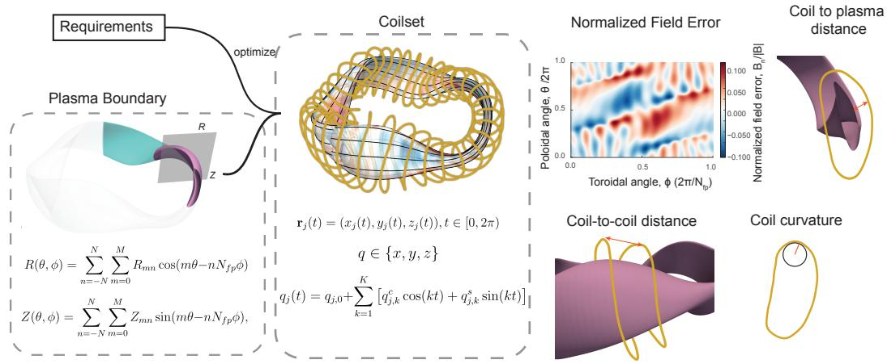  
Figure 1: Left: The target plasma boundary, parameterized as a truncated Fourier surface in θ and ϕ. Center: The generated coilset. Each filamentary coil is modeled as a closed 3D curve using a Fourier series in t, a parameter that runs along the curve. Solid black lines on the stellarator surface trace the equilibrium magnetic field lines, which are tangent to the boundary. Right: Key evaluation metrics. The heatmap displays the normalized magnetic field error across one plasma field period. The diagrams below illustrate the three physical engineering constraints used in this work: minimum coil-to-plasma distance, coil-to-coil spacing, and maximum coil curvature.

## 2 Dataset

The dataset is generated through a comprehensive, multi-stage pipeline designed to sample and optimize coilsets across a diverse range of engineering requirements. The process begins by selecting a target plasma boundary and solving for its magnetic equilibrium. We then sample a unique set of engineering constraints from a predefined distribution. A preliminary coilset is initialized using REGCOIL [14] and subsequently refined through a constrained optimization using the DESC framework [6, 19]. Finally, the coilset is geometrically normalized, its currents are rescaled to a target on-axis magnetic field strength, and all relevant physical and engineering metrics are evaluated.

Equilibria filtering We retain QI-optimized target boundaries with a solved VMEC++ equilibrium and available QI diagnostics (Appx. C).

Sampling pipeline For each filtered boundary, we sample a unique set of simplified engineering requirements. The chosen values are informed from reference stellarator designs: from small, compact devices to large, reactor-sized machines, and they include both high-field designs using hightemperature superconductors (HTS) and low-field designs using low-temperature superconductors (LTS) (see Sect. D.1). These constraints are sampled from predefined ranges: the number of unique coils per half-period $( N _ { \mathrm { C } } \in [ 4 , 8 ] )$ , the normalized minimum coil-to-plasma distance $( \tilde { d } _ { \mathrm { C P } } = d _ { \mathrm { C P } } / a \in$ [0.5, 1.0]), the normalized minimum coil-to-coil distance $( \tilde { d } _ { \mathrm { C C } } = d _ { \mathrm { C C } } / a \in [ 0 . 3 , 0 . 7 ] )$ , and the normalized maximum curvature $( \tilde { \kappa } ^ { \operatorname* { m a x } } = a \kappa ^ { \operatorname* { m a x } } \in [ 1 . 5 , 5 . 0 ] )$ , where a denotes the minor radius of the target boundary.

Coilsets are generated using a twostage optimization approach. Each coil is represented by the Fourier coefficients describing its central filaments (see Fig. 1) and by the value of the current flowing through it. We include Fourier modes up to $k = 7$ with variable coil currents, totaling 46 degrees of freedom per coil. All optimizations fit a vacuum coil field to the prescribed target boundary. Matching the boundary does not by itself establish that the source equilibrium’s pressure, current, or stability properties are reproduced.

In the first stage, we use REGCOIL to solve for a regularized surface current potential on a winding surface placed at a fixed distance d from the plasma. To enhance the diversity of the resulting dataset, we sample the

$$
\mathbf { x } ^ { * } = \arg \operatorname* { m i n } _ { \mathbf { x } } \mathcal { I } ( \mathbf { x } ) ,
$$

$$
\begin{array} { r } { \mathcal { I } ( \mathbf { x } ) = \frac { 1 } { 2 } \left[ \lambda ^ { 2 } \mathcal { I } _ { L } ( \mathbf { x } ) + ( 1 - \lambda ) ^ { 2 } \mathcal { I } _ { \Phi } ( \mathbf { x } ) \right] , } \end{array}
$$

$$
\mathrm { s . t . } \quad d _ { i } ^ { c c } ( \mathbf { x } ) \geq d _ { \operatorname* { m i n } } ^ { c c } , \quad d _ { i } ^ { c p } ( \mathbf { x } ) \geq d _ { \operatorname* { m i n } } ^ { c p } ,
$$

$$
R _ { i } ^ { \kappa } ( { \bf x } ) = 0 , \quad i = 1 , \ldots , N _ { c } , \qquad \sum _ { i = 1 } ^ { N _ { c } } I _ { i } = I ^ { 0 } ,
$$

$$
\mathcal { T } _ { L } ( \mathbf { x } ) = \sum _ { i = 1 } ^ { N _ { c } } \left( \frac { L _ { i } ( \mathbf { x } ) } { \ell _ { * } } \right) ^ { 2 } ,
$$

$$
\mathcal { I } _ { \Phi } ( \mathbf { x } ) = \sum _ { j } W _ { j } \left( \frac { \mathbf { B } _ { j } ( \mathbf { x } ) \cdot \mathbf { n } _ { j } } { B _ { * } R _ { * } a _ { * } } \right) ^ { 2 } ,
$$

$$
R _ { i } ^ { \kappa } ( \mathbf { x } ) = \frac { \sum _ { j } w _ { j } \operatorname* { m a x } \{ | \kappa _ { i j } | - \kappa _ { \operatorname* { m a x } } , 0 \} ^ { 2 } } { \sum _ { j } w _ { j } } .
$$

Equation 1: Formulation of the coil optimization problem. $L _ { i }$ is coil length and $\mathbf { B } _ { j } \cdot \mathbf { n } _ { j }$ the normal field at surface node $j , W _ { j }$ and $w _ { j }$ are surface and coil-parameter weights, respectively. The fixed DESC normalization scales and weighting conventions are defined in Sect. D.4.

plasma to winding surface distance, dWP, independently from the coil-to-plasma distance $d _ { \mathrm { C P } }$ . Moreover, the regularization strength is uniformly sampled between two mechanisms: we either limit the maximum surface current density or the maximum magnetic field error. A set of $N _ { c }$ coils is then extracted from this optimized surface current potential to serve as the initial condition for the subsequent refinement.

In the second stage, we refine the coilset directly using the DESC framework with the optimization equation defined in Eq. 1. The optimization enforces the sampled minimum coil-to-plasma distance, minimum coil-to-coil distance, and maximum curvature as explicit constraints. We minimize a weighted least-squares combination of normalized coil-length and normal-field residuals [31], solved using an augmented Lagrangian method.

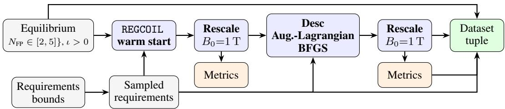  
Figure 2: End-to-end coilset generation pipeline. A sampled requirement vector parameterizes a Regcoil warm start that is current-rescaled and then refined by a constrained Desc optimization (length vs. quadratic-flux trade-off, subject to coil–coil, coil–plasma, curvature, and total-current constraints). Metrics on both the warm start and the refined coilset are emitted as part of the dataset tuple.

To further enhance the diversity of the dataset, we optimize with different scalings of the design variables following an exponential scaling law with various norms [12]. Following the optimization, each coilset is normalized to a physical major radius of 1 m. The coil currents are then rescaled to yield an average on-axis field strength of $\bar { B _ { \mathrm { t a r g e t } } } = 1 \mathrm { T }$

Eventually, for each generated coil pair, a complete metric record is computed (detailed in Appx. E). Each record includes the main physics and engineering diagnostics and reports the coilset’s feasibility with respect to the initially sampled requirements. A visual summary of the generation pipeline is illustrated in Fig. 2.

Dataset generation is computationally intensive, with the majority of the runtime consumed by REGCOIL initialization and DESC refinement. Computing the regularized surface current potential requires roughly 0.1 CPUh, while the more demanding filamentary optimization stage takes approxi mately 1.3 CPUh. The pipeline is executed on virtual machines configured with either 8 vCPU/20 GB RAM or 16 vCPU/40 GB RAM.

Dataset description Each dataset sample contains one plasma boundary, one sampled requirement set, a REGCOIL coilset, and, for 66.5% of the samples, the refined DESC coilset (Sect. D.3 discusses the missing ones). The dataset contains 266,549 samples, 177,341 DESC coilsets, and 14,496 unique plasma boundaries. A more detailed breakdown is reported in Sect. D.2. The dataset covers $\bar { N } _ { \mathrm { F P } } \in \{ 2 , 3 , 4 , 5 \}$ and $N _ { \mathrm { C } } \in \{ 4 , \dots , 8 \}$ , with $N _ { \mathrm { F P } } = 3$ deliberately oversampled; not every combination survives quality filtering.

To evaluate the quality of these coilsets for further benchmark and model development, we focus on coilsets that reproduce the target boundary correctly. The gold standard metric in the stellarator community is the average normalized field error, defined as:

$$
\epsilon _ { \mathrm { m e a n } } = \frac { \int _ { \Sigma } | \mathbf { B } \cdot \mathbf { n } | / \| \mathbf { B } \| \mathrm { d } S } { \int _ { \Sigma } \mathrm { d } S } ,\tag{2}
$$

where Σ is the target plasma boundary surface, B is the magnetic field generated by the coilset, n is the unit normal vector to the surface, and dS is the differential area element. Values below 1% are typically considered good enough to reproduce the target field. Because the REGCOIL coilset almost never achieve this value, we restrict every further analysis to DESC coilset only.

We also evaluated how well the optimization pipeline met the requirements. Fig. 3 shows measured quantities against the requirements, outlining two distinct populations: the samples that sit around the measured=target line (black) and the sample for which the measure value is close to zero for $\tilde { d } _ { \mathrm { C C } } ^ { \mathrm { m i n } }$ and $\tilde { d } _ { \mathrm { C P } } ^ { \mathrm { m i n } }$ or very large for $\tilde { \kappa } ^ { \mathrm { m a x } }$ . This second population contains coilsets for which the optimization completely missed the requirements, which we filter out by requiring $e _ { \tilde { d } _ { \mathrm { C C } } ^ { \mathrm { m i n } } } > - 0 . 5$ and $e _ { \tilde { d } _ { \mathrm { C P } } ^ { \mathrm { m i n } } } > - 0 . 5$ and $e _ { \tilde { \kappa } ^ { \mathrm { m a x } } } < 1 . 0$ , with the relative error e defined as $e = ( x _ { \mathrm { m e a s u r e d } } - x _ { \mathrm { t a r g e t } } ) / x _ { \mathrm { t a r g e t } } .$ The selection filters out 21.8% of the DESC coilsets, with 7.6% for which the metrics calculation failed, leaving a clean dataset of coilsets spanning a wide range of metrics Fig. 4. A more detailed breakdown of the filter efficiency is reported in Sect. D.3.

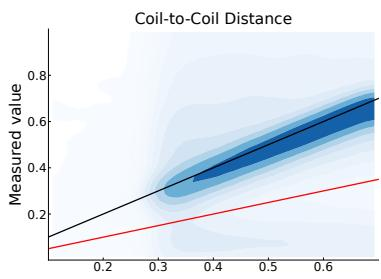

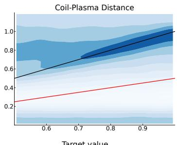

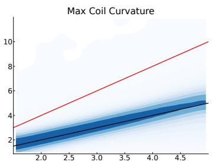  
Figure 3: Measured vs. target values for the three geometric constraints. Colour scale is logarithmic. Black line: requirement equals measured. Red line: selection cut threshold.

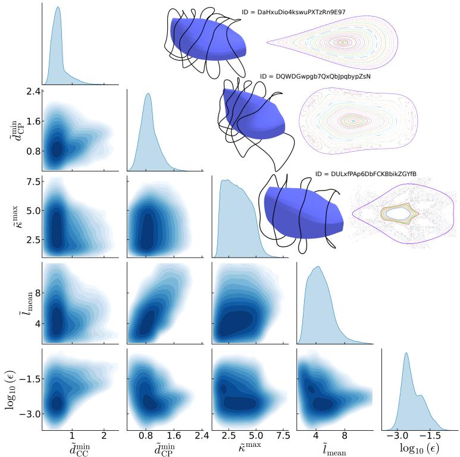  
Figure 4: The filtered dataset spans a broad range of geometric metrics and magnetic-field errors. The pairwise plots show how these quantities vary together. The dataset covers a large range in $\tilde { d } _ { \mathrm { C C } } ^ { \mathrm { m i n } } , \tilde { d } _ { \mathrm { C P } } ^ { \mathrm { m i n } }$ $\tilde { \kappa } ^ { \mathrm { m a x } }$ $\tilde { l } _ { m e a n }$ and field error. The three coilsets are sampled at increasing field error $\epsilon ,$ reproducing the target plasma boundary with different accuracy. The Poincare plot of the first coilset presents a clean set of flux surface till the plasma boundary, the second one has flux surfaces in the core, but degraded at the boundary, while the third one displays almost no flux surface.

## 3 Benchmark & Baselines

We introduce a benchmark to test if a model can generate engineerable coilsets in a single forward pass. The difficulty of this task is exactly what makes it valuable: traditional optimization is computationally expensive. A sufficiently accurate model could reduce the cost of exploring candidate coil designs by predicting a coilset in a single forward pass.

## 3.1 Benchmark

Task. Given a target plasma boundary b and an engineering requirements vector $\begin{array} { r l } { \mathbf { r } } & { { } = } \end{array}$ $( \tilde { d } _ { \mathrm { C C } } ^ { \operatorname* { m i n } } , \tilde { d } _ { \mathrm { C P } } ^ { \operatorname* { m i n } } , \tilde { \kappa } ^ { \operatorname* { m a x } } , \epsilon ^ { \operatorname* { m a x } } )$ , a model $f _ { \theta }$ must produce a coilset $\mathbf { c } = f _ { \theta } ( \mathbf { b } , \mathbf { r } )$ in a single forward pass — no time-consuming optimization is allowed at inference. The first two requirements are lower bounds the achieved value must exceed; the latter two are upper bounds it must not exceed. We re-evaluate the achieved metrics $g _ { i }$ on c via the same DESC filamentary pipeline used during dataset generation (Sect. 2) and grade them against r.

Per-metric soft-feasibility. For each metric we compute a normalized violation $v _ { i } \geq 0$ that is zero iff the constraint holds:

$$
\begin{array} { r l } { v _ { i } = \operatorname* { m a x } \Biggl ( 0 , \frac { g _ { i } - \tau _ { i } } { \operatorname* { m a x } ( | \tau _ { i } | , 1 0 ^ { - 6 } ) } \Biggr ) } & { \mathrm { ( u p p e r ~ b o u n d ) } , } \\ { v _ { i } = \operatorname* { m a x } \Biggl ( 0 , \frac { \tau _ { i } - g _ { i } } { \operatorname* { m a x } ( | \tau _ { i } | , 1 0 ^ { - 6 } ) } \Biggr ) } & { \mathrm { ( l o w e r ~ b o u n d ) } . } \end{array}\tag{3}
$$

A saturating exponential maps each violation to a soft-feasibility score on [0, 1],

$$
s _ { i } = \exp ( - v _ { i } / \alpha _ { i } ) \in [ 0 , 1 ] ,\tag{4}
$$

where $\alpha _ { i }$ is a per-metric tolerance frozen before any baseline run (Tbl. 9). Saturation prevents trading surplus on one metric against slack on another. The score decreases continuously as a violation grows, and the common [0, 1] scale makes the four metrics comparable. When the denominator floor is inactive, the tolerance has a physical reading: violating constraint i by $\alpha _ { i } { \cdot } 1 0 0 \%$ of the threshold reduces $s _ { i }$ to $1 / e \approx 0 . 3 7$

Aggregation across metrics. We collapse the four per-metric scores into a per-instance score with an unweighted geometric mean,

$$
S = \Big ( \prod _ { i = 1 } ^ { 4 } s _ { i } \Big ) ^ { 1 / 4 } .\tag{5}
$$

Geometric mean is unforgiving by design: any single $s _ { i }$ ≈ 0 collapses $S ,$ irrespective of the other three. This matches engineering reality: a coilset that fails one requirement is not feasible. We avoid the arithmetic mean as the headline because an arithmetic $\bar { S } = \dot { 0 } .$ .8 can hide “feasible on three, collapsed on one”, which is the failure mode the benchmark must surface.

Aggregation across test instances. For a test set $\mathcal { T } = \{ ( \mathbf { b } _ { n } , \mathbf { r } _ { n } ) \} _ { n = 1 } ^ { N }$ with per-instance scores $\{ \bar { S } _ { n } \}$ , we report the mean $\bar { S }$ as the headline ranking column, the median as a typical-instance diagnostic, the soft-feasibility rate $\operatorname* { P r } [ S _ { n } \geq 0 . 9 ]$ , and the strict-feasibility rate $\operatorname* { P r } [ \forall i : \dot { v _ { n , i } } \leq 1 \times 1 0 ^ { - 3 } ]$ Together these distinguish models that are consistently feasible from those that nail a few easy instances and collapse on the rest. Strict feasibility allows normalized violation up to $1 0 ^ { - 3 } ;$ this is 0.1% relative tolerance when the denominator floor is inactive.

Split by boundary. A training and evaluation data split is constructed to be disjoint by the plasma boundary: each boundary has a unique ConStellaration-based hash (the ID) on which a 95%/5% split was done. The hash-binning guarantees that there is no boundary overlap between the datasets, even though there are multiple entries per boundary. This resulted in 253,000 and 13,000 rows in the training and evaluation splits respectively.

Two tracks. A test instance has both a continuous component (b, r) and a discrete topology $( N _ { \mathrm { F P } } , N _ { \mathrm { C } } )$ . We expose two tracks. Thefixed-shape track evaluates models on a single discrete topol ogy $( N _ { \mathrm { F P } } { = } 3 , \ N _ { \mathrm { C } } { = } 5 )$ — the most common configuration in the dataset, oversampled at generation time — to test whether models can specialize on one of the recurring discrete choices in real reactor design. The variable-shape track evaluates models across the full range of $( N _ { \mathrm { F P } } , N _ { \mathrm { C } } )$ in the training distribution, testing whether one model can handle the joint topology–continuous space.

Stratification by requirement tightness. For each boundary in the evaluation split, we extracted multiple requirement vectors derived from the metrics our data-generation pipeline achieved on different DESC reference coilsets. Because the pipeline is biased toward low normalized field error, we stratify each track into three tiers — tight, medium, loose — by tertiles of the mean normalized field error $\left. \varepsilon _ { B } \right.$ that DESC achieved on the reference coilset: with $q _ { 1 / 3 }$ and $q _ { 2 / 3 }$ the corresponding quantiles over all generated instances, an instance is tight if $\langle \varepsilon _ { B } \rangle \leq q _ { 1 / 3 }$ , medium if $q _ { 1 / 3 } < \langle \varepsilon _ { B } \rangle \leq q _ { 2 / 3 }$ , and loose otherwise. Tiers are defined by the reference coilset’s mean normalized field error. The field-error requirement instead bounds the maximum sampled normalized field error. The tiers do not jointly order all four requirements.

Benchmark challenges. The benchmark exposes the joint difficulty of (i) conditioning a generator on a continuous engineering vector r, (ii) discrete topology choices $( N _ { \mathrm { F P } } , N _ { \mathrm { C } } )$ , and (iii) physical constraints whose feasibility surfaces in 3D coil geometry are strongly non-convex. The geometricmean aggregation is intolerant of partial feasibility, which is the right primitive for downstream engineering use. Stratification by $\left. \varepsilon _ { B } \right.$ lets us read off how feasibility scales with constraint tightness rather than collapse to a single average. The single-forward-pass constraint cleanly separates the benchmark from classical optimization, so progress is unambiguously progress on amortized reactorcoil design.

## 3.2 Baselines

We propose four baselines, all sharing a bidirectional spectral-scaling interface that maps Fourierparameterized boundaries and coilsets to flat vectors and back (full architecture details in Appx. G): MLP, a feed-forward net with GELU activations producing both spatial coil arrays and scalar currents; ResMLP, pre-norm residual blocks with split heads (a primary linear head for geometry and a zero-initialized currents head conditioned on the predicted geometry); and EnsembleMLP / EnsembleResMLP. Each ensemble contains five independently initialized networks trained on shared minibatches. We average their individual supervised losses during training and their predicted coil coefficients and currents at inference. We repeat each single-model or ensemble run with three seeds and report variation across those runs, on 2,771 fixed-shape instances. Each candidate took approximately 0.5 h to train on a machine with 32 CPU cores and 64 GB of RAM.

All baselines are far from saturated. The best mean score $\bar { S }$ is only 0.13, and even the best strictfeasibility rate is only 4.4% (Tbl. 1). These rates come almost entirely from the loosest requirements: on the tight tier not a single baseline produces one strictly feasible coilset (Fig. 5). The low feasibility rates leave substantial room for improvement.

Difficulty grows sharply with requirement tightness. Fig. 5 stratifies strict feasibility and mean S by the tight/medium/loose tiers. Strict feasibility is 0% on the tight tier for every architecture on both tracks and essentially zero on the medium tier $( < 0 . 3 \% ) ;$ ; nearly all strictly feasible coilsets fall in the loose tier (fixed-shape: $7 - 1 2 \% ;$ variable-shape: 7–9%). Mean S follows the same ordering, dropping by more than an order of magnitude from the loose to the tight tier. The aggregate leaderboard numbers therefore reflect loosetier performance. No evaluated baseline achieves strict feasibility in the tight reference-field-error tier.

EnsembleResMLP is the strongest baseline. Two effects compound (Tbl. 1). Ensembling raises the mean score for both backbones, and the residual backbone adds feasibility: both residual variants (ResMLP, EnsembleResMLP) beat their plain-MLP counterparts on strict feasibility. Combining the two, EnsembleResMLP attains the best mean S¯, soft- and strict-

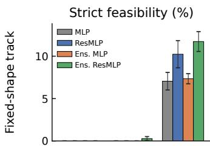

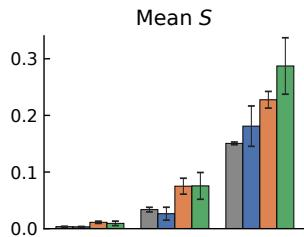

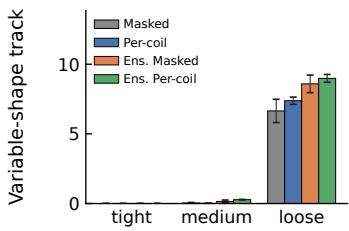

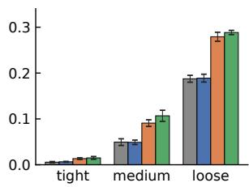  
Figure 5: Strict feasibility (%) and mean score $S$ by requirement tier (tight / medium / loose), for the fixed-shape track (top) and the variable-shape track (bottom). Each track shows its own four architectures. Bars are the mean over three training seeds with ±1σ error bars. Across both tracks and all architectures, strict feasibility is 0% on the tight tier and nearzero on the medium tier: nearly all strictly feasible coilsets fall in the loose tier. Strict feasibility uses the benchmark tolerance $v _ { i } \leq 1 \times 1 0 ^ { - 3 }$

feasibility rates; EnsembleMLP retains the best median S. The difference in mean score between MLP and ResMLP is small relative to the variation across the three training runs. Field-error-only changes preserve the ranking; uniform scaling can change it (Sect. F.3).

Table 1: Leaderboard on the fixed-shape track $( N _ { \mathrm { F P } } { = } 3$ , N =5, N=2,771), mean $\pm 1 \sigma$ over three training seeds, ranked by $\bar { S } . \quad \cdots \mathrm { S o f t } ^ { \prime \prime }$ is $\operatorname* { P r } [ S \geq 0 . 9 ] ( \bar { \% } ) ; \mathrm { \ s t r i c t ^ { 9 } { i s } \ P r [ \Breve { \forall i } : } v _ { i } \leq 1 \times 1 0 ^ { - 3 } ]$ (%). Best per column in bold.  
Table 2: Leaderboard on the variable-shape track $\scriptstyle ( N = 8 , 0 5 8$ instances spanning $N _ { \mathrm { F P } } \in \{ 2 , \ldots , 5 \}$ $N _ { \mathrm { C } } \in \{ 4 , \ldots , 8 \} ,$ ), mean $\pm 1 \sigma$ over three training seeds, ranked by S¯. Columns as in Tbl. 1. Best per column in bold.
<table><tr><td>Architecture</td><td>S</td><td>med S</td><td>Soft (%)</td><td>Strict (%)</td></tr><tr><td>EnsembleResMLP</td><td> ${ \bf 0 . 1 3 3 \pm 0 . 0 2 7 }$ </td><td> $5 . 9 \times 1 0 ^ { - 3 }$ </td><td> ${ \bf 6 . 5 \pm 0 . 7 }$ </td><td> ${ \bf 4 . 4 \pm 0 . 5 }$ </td></tr><tr><td>EnsembleMLP</td><td> $0 . 1 1 1 \pm 0 . 0 0 3$ </td><td> ${ \bf 7 . 1 \times 1 0 ^ { - 3 } }$ </td><td> $3 . 5 \pm 0 . 2$ </td><td> $2 . 7 \pm 0 . 2$ </td></tr><tr><td>ResMLP</td><td> $0 . 0 7 6 \pm 0 . 0 1 7$ </td><td> $2 . 1 \times 1 0 ^ { - 4 }$ </td><td> $5 . 2 \pm 0 . 9$ </td><td> $3 . 8 \pm 0 . 6$ </td></tr><tr><td>MLP</td><td> $0 . 0 6 7 \pm 0 . 0 0 2$ </td><td> $4 . 9 \times 1 0 ^ { - 4 }$ </td><td> $3 . 3 \pm 0 . 5$ </td><td> $2 . 6 \pm 0 . 4$ </td></tr></table>

<table><tr><td>Architecture</td><td>S</td><td>med S</td><td>Soft (%)</td><td>Strict (%)</td></tr><tr><td>EnsemblePerCoilMLP</td><td> $\mathbf { 0 . 1 3 7 \pm 0 . 0 0 6 }$ </td><td> $\overline { { { \bf 1 . 8 \times 1 0 ^ { - 2 } } } }$ </td><td>4.6 ± 0.2</td><td> ${ \bf 3 . 1 \pm 0 . 1 }$ </td></tr><tr><td>EnsembleMaskedMLP</td><td> $0 . 1 2 8 \pm 0 . 0 0 5$ </td><td> $1 . 4 \times 1 0 ^ { - 2 }$ </td><td>4.3 ± 0.3</td><td> $2 . 9 \pm 0 . 2$ </td></tr><tr><td>PerCoilMLP</td><td> $0 . 0 8 2 \pm 0 . 0 0 5$ </td><td> $2 . 3 \times 1 0 ^ { - 3 }$ </td><td> $3 . 6 \pm 0 . 1$ </td><td> $2 . 5 \pm 0 . 1$ </td></tr><tr><td>MaskedMLP</td><td> $0 . 0 8 1 \pm 0 . 0 0 5$ </td><td> $2 . 3 \times 1 0 ^ { - 3 }$ </td><td> $3 . 3 \pm 0 . 4$ </td><td> $2 . 2 \pm 0 . 3$ </td></tr></table>

Field error is the dominant failure mode. Decomposing S into its four soft-score components (Tbl. 10) shows the geometric-mean collapse is overwhelmingly driven by the field-error term: median normalized field-error violations are 2.1–2.9 across all architectures, driving $s _ { \epsilon }$ into the $1 0 ^ { - 5 } - 1 0 ^ { - 4 }$ range. Both ensembles have median soft scores near one for coil–plasma distance and curvature, while every architecture has a positive median coil–coil spacing violation. Field-error reproduction is the highest-leverage research direction we identify for this benchmark.

## 3.3 Variable-shape baselines

The fixed-shape baselines specialize to a single topology. The variable-shape track instead asks one model to cover the full range of field periods $N _ { \mathrm { F P } } \in \{ 2 , 3 , 4 , 5 \}$ and coil counts $N _ { \mathrm { C } } \in \{ 4 , \dots , 8 \}$ in the training distribution. We condition on the discrete topology by appending one-hot encodings of $N _ { \mathrm { F P } }$ and $\bar { N } _ { \mathrm { C } }$ to the input, and introduce two architectures that emit a variable number of coils (full details in Appx. G). The MaskedMLP predicts a fixed maximum of eight coil slots in one forward pass and masks the slots beyond the requested $N _ { \mathrm { C } } .$ . The PerCoilMLP instead applies one weight-shared MLP to each coil slot, conditioned on the shared design context plus the slot’s one-hot index and normalized position $\left( { \mathrm { s l o t } } + { \frac { 1 } { 2 } } \right) / N _ { \mathrm { C } }$ , so it represents any coil count by construction. As in the fixed-shape track we also evaluate ensembles (EnsembleMaskedMLP, and EnsemblePerCoilMLP) that average M=5 members in coilset space.

Fig. 5 (bottom) and Tbl. 2 report results on the $N { = } 8 { , } 0 5 8$ variable-shape instances. The qualitative picture matches the fixed-shape track: strict feasibility is 0% on the tight and medium tiers, with every feasible coilset in the loose tier. Ensembling again lifts mean S¯ substantially (Per-CoilMLP: 0.082 → 0.137), and EnsemblePerCoilMLP is the strongest variable-shape model on every aggregate metric $( { \bar { S } } \ = \ 0 . 1 3 7 ,$ , strict 3.1%). Notably, evaluated on the fixed-shape subset these topologygeneral models match or exceed the dedicated fixed-shape baselines — En-

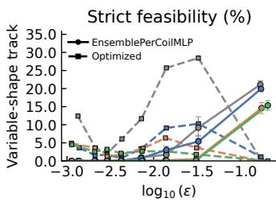

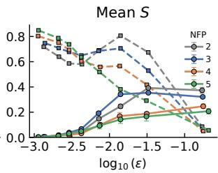  
Figure 6: Strict feasibility (left) and mean score $S \ ( \mathrm { r i g h t } )$ grouped by reference mean normalized field error and field periods. Solid: EnsemblePerCoilMLP, mean ± one standard deviation across three training seeds. Dashed: DESC coilsets. DESC uses the three original geometric bounds; the model uses all four reference-achieved requirements.

semblePerCoilMLP reaches $\bar { S } = 0 . 1 8$ at $( N _ { \mathrm { F P } } { = } 3 , N _ { \mathrm { C } } { = } 5 ) \mathrm { ~ - ~ } { \mathrm { s o } }$ sharing capacity across the full topology distribution, in which $N _ { \mathrm { F P } } { = } 3$ is oversampled, does not hurt and can help. The per-coil ensemble is the model we carry forward as an optimization warm start (Sect. 3.4).

Field error remains the dominant failure mode. The reference coilset’s mean normalized field error has the strongest correlation with both strict feasibility and score S (Tbl. 11). Requirements are derived from the reference coilsets’ achieved metrics; the field-error requirement uses their maximum sampled normalized error. Instances with larger reference mean field errors generally achieve higher feasibility and mean scores (Fig. 6).

## 3.4 Learned coilsets as optimization warm starts

A trained model can also initialize a conventional coil optimization. On 1,289 evaluation instances from the tight stratum of the variable-shape evaluation split, we run the DESC-based optimization used to generate the dataset (Sect. 2) from two starts: the per-coil ensemble’s single-pass prediction (learned start) and the REGCOIL coilset the pipeline normally uses (REGCOIL start). We stop each run at a fixed iteration budget and score the result (Fig. 7).

Up to 300 iterations, the learned start achieves a higher mean score and wins on most instances. In 100 iterations it beats the mean score of the REGCOIL start after 200, and after 200 iterations it is strictly feasible more often than the REGCOIL start after the dataset’s full budget of 500 (22% vs. 18%).3

The REGCOIL start overtakes on mean score between 300 and 400 iterations and is ahead at 500 (0.83 vs. 0.76), but is still less often strictly feasible (18% vs. 27%). By 1000 iterations the feasibility gap is no longer significant (26% vs. 25%, $p = 0 . 4 ) $ : the learned start levels off at about 26% from 300 iterations on, whereas the REGCOIL start keeps improving. The per-requirement results explain this split (Appx. B): the two starts have opposite weaknesses. REGCOIL coils are well separated but too close to the plasma, whereas learned coils more often clear the plasma but sit too close together. Infeasible REGCOIL - start runs tend to miss several requirements narrowly, which keeps their score high; infeasible learned-start runs more often miss one requirement by a wide margin. The learned start is therefore most useful under a limited budget, such as inside an outer

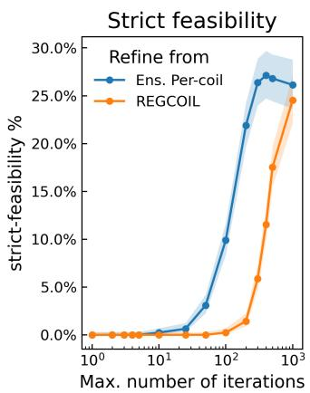

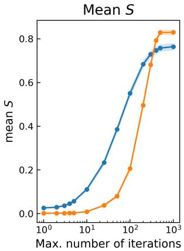  
Figure 7: Strict-feasibility rate (left) and mean score S (right) against the iteration budget, for the REGCOIL and learned (per-coil ensemble) starts. Each instance uses its dataset metrics as targets; the instances comprise up to 100 per $( N _ { \mathrm { F P } } , N _ { \mathrm { C } } )$ pair. Markers show the tested budgets. Shaded bands are instance-level 95% confidence intervals (Wilson for feasibility, Student-t for S); they do not account for shared boundaries.

configuration-optimization loop or a large parameter scan. Coil-to-coil spacing $( \tilde { d } _ { \mathrm { C C } } ^ { \mathrm { m i n } } )$ , the one requirement where the learned start still trails at 500 iterations, is the clearest target for improving the model.

## 4 Discussion

CoilStellaration complements existing equilibrium and coil databases by combining 177,000 optimized coilsets with varied engineering requirements and a standardized benchmark for conditional coil generation. Together with the released baselines and evaluation code, these resources provide a common starting point for machine learning and optimization researchers to develop and compare methods. Magnetic-field accuracy remains the main obstacle to satisfying all requirements, motivating models and training objectives that account directly for the coil-generated field. Warm-start experiments suggest that learned predictions can improve the early progress of conventional optimization, supporting further work on combining learning with numerical refinement.

The present dataset uses filamentary coils and a limited set of engineering constraints, with evaluation on target boundaries rather than the resulting free-boundary equilibria. The main risk is therefore over reliance on generated coilsets in a safety-critical domain: they are starting points for optimization and validation, not final designs. Within this scope, CoilStellaration supports methods that could reduce the cost of exploring stellarator coil designs, accelerating progress toward fusion as a low-carbon energy source.

## Acknowledgments and Disclosure of Funding

This work was independently funded by Proxima Fusion, and supported by the German Federal Ministry of Research, Technology and Space (BMFTR) under grant number 13F1012A (Joint Project: FUSKI). The authors are responsible for the content of this publication.

## References

[1] Craig Beidler, Günter Grieger, Franz Herrnegger, Ewald Harmeyer, Johann Kisslinger, Wolf Lotz, et al. Physics and Engineering Design for Wendelstein VII-X. Fusion Technology, 17(1):148–168, January 1990.

[2] Allen H Boozer. Carbon dioxide, fusion, and stellarators, 2021. arXiv:2111.04213.

[3] Allen H. Boozer. Stellarators as a Fast Path to Fusion. Nuclear Fusion, 61(9):096024, September 2021. arXiv:2104.04621 [physics].

[4] Santiago A. Cadena, Andrea Merlo, Emanuel Laude, Alexander Bauer, Atul Agrawal, Maria Pascu, et al. ConStellaration: A dataset of QI-like stellarator plasma boundaries and optimization benchmarks. In Advances in Neural Information Processing Systems, volume 38, pages 17351–17377, 2025.

[5] A. Dinklage, C. D. Beidler, P. Helander, G. Fuchert, H. Maaßberg, K. Rahbarnia, et al. Magnetic configuration effects on the Wendelstein 7-X stellarator. Nature Physics, 14(8):855–860, 2018.

[6] D. W. Dudt and E. Kolemen. DESC: A stellarator equilibrium solver. Physics of Plasmas, 27(10):102513, October 2020.

[7] Andrew Giuliani, Eduardo Rodríguez, and Marina Spivak. A comprehensive exploration of quasisymmetric stellarators and their coil sets. Journal ofPlasma Physics, 91(5):E128, October 2025.

[8] Andrew Giuliani, Florian Wechsung, Antoine Cerfon, Matt Landreman, and Georg Stadler. Direct stellarator coil optimization for nested magnetic surfaces with precise quasi-symmetry. Physics ofPlasmas, 30(4):042511, 2023.

[9] A.G. Goodman, K. Camacho Mata, S.A. Henneberg, R. Jorge, M. Landreman, G.G. Plunk, et al. Constructing precisely quasi-isodynamic magnetic fields. Journal of Plasma Physics, 89(5):905890504, 2023.

[10] CC Hegna, DT Anderson, EC Andrew, A Ayilaran, A Bader, TD Bohm, et al. The infinity two fusion pilot plant baseline plasma physics design. Journal ofPlasma Physics, 91(3):E76, 2025.

[11] Steven P. Hirshman and J. C. Whitson. Steepest-descent moment method for three-dimensional magneto hydrodynamic equilibria. The Physics ofFluids, 26(12):3553–3568, 1983.

[12] Byoungchan Jang, Matt Landreman, and Rory Conlin. Exponential spectral scaling: robust and efficient stellarator boundary optimisation via mode-dependent scaling. Journal of Plasma Physics, 92(1):E15, 2026.

[13] John Kappel, Matt Landreman, and Dhairya Malhotra. The magnetic gradient scale length explains why certain plasmas require close external magnetic coils. Plasma Physics and Controlled Fusion, 66(2):025018, January 2024.

[14] Matt Landreman. An improved current potential method for fast computation of stellarator coil shapes. Nuclear Fusion, 57(4):046003, April 2017. arXiv:1609.04378 [physics].

[15] Matt Landreman. Mapping the space of quasisymmetric stellarators using optimized near-axis expansion. Journal ofPlasma Physics, 88(6):905880616, 2022.

[16] Matt Landreman and Elizabeth Paul. Magnetic Fields with Precise Quasisymmetry for Plasma Confinement. Physical Review Letters, 128(3):035001, 2022.

[17] J. Lion, J.-C. Anglès, L. Bonauer, A. Bañón Navarro, S.A. Cadena Ceron, R. Davies, et al. Stellaris: A high-field quasi-isodynamic stellarator for a prototypical fusion power plant. Fusion Engineering and Design, 214:114868, May 2025.

[18] BE Nelson, LA Berry, AB Brooks, MJ Cole, JC Chrzanowski, H-M Fan, et al. Design of the national compact stellarator experiment (NCSX). Fusion Engineering and design, 66–68:169–174, 2003.

[19] Dario Panici, Rory Conlin, Rahul Gaur, Daniel W. Dudt, Yigit Gunsur Elmacioglu, Matt Landreman, et al. Surface Current Optimization and Coil-Cutting Algorithms for Stage-Two Stellarator Optimization, 2025. arXiv:2508.09321 [physics.plasm-ph].

[20] Andrea Pavone, Sehyun Kwak, and Felix Warmer. Geodesic torsion of the magnetic field line and other predictors of coil non-planarity in QI stellarators. arXiv preprint arXiv:2604.26763, 2026.

[21] Eduardo Rodriguez and Wrick Sengupta. Estimating coil features from an equilibrium. arXiv preprint arXiv:2604.12339, 2026.

[22] Eduardo Rodríguez and Gabriel Plunk. Near-axis quasi-isodynamic database. Journal of Plasma Physics, 92(3):E64, 2026.

[23] Jonathan Schilling. The numerics of VMEC++. arXiv preprint arXiv:2502.04374, 2025.

[24] Luquant Singh, T. G. Kruger, A. Bader, C. Zhu, S. R. Hudson, and D. T. Anderson. Optimization of finite-build stellarator coils. Journal ofPlasma Physics, 86(4):905860404, August 2020.

[25] Lyman Spitzer, Jr. The Stellarator Concept. Physics of Fluids, 1(4):253–264, 1958.

[26] Dennis J Strickler, Lee A Berry, and Steven P Hirshman. Designing coils for compact stellarators. Fusion Science and Technology, 41(2):107–115, 2002.

[27] A. Wiedman, S. Buller, and M. Landreman. Coil optimization for quasi-helically symmetric stellarator configurations. Journal ofPlasma Physics, 90(3):905900307, 2024.

[28] R. C. Wolf, A. Alonso, S. Äkäslompolo, J. Baldzuhn, M. Beurskens, C. D. Beidler, et al. Performance of Wendelstein 7-X stellarator plasmas during the first divertor operation phase. Physics of Plasmas, 26(8):082504, 2019.

[29] R.C. Wolf, A. Ali, A. Alonso, J. Baldzuhn, C. Beidler, M. Beurskens, et al. Major results from the first plasma campaign of the Wendelstein 7-X stellarator. Nuclear Fusion, 57(10):102020, 2017.

[30] Caoxiang Zhu, Stuart R. Hudson, Yuntao Song, and Yuanxi Wan. New method to design stellarator coils without the winding surface. Nuclear Fusion, 58(1):016008, November 2017.

[31] Caoxiang Zhu, Stuart R Hudson, Yuntao Song, and Yuanxi Wan. Designing stellarator coils by a modified Newton method using FOCUS. Plasma Physics and Controlled Fusion, 60(6):065008, June 2018.

## A Comparison with existing stellarator datasets

Tbl. 3 compares CoilStellaration with ConStellaration [4] and QUASR [7]. ConStellaration provides QI-like plasma boundaries together with their ideal-MHD equilibria and performance metrics. QUASR provides QA and QH vacuum configurations with associated coilsets, obtained through direct coil optimization. CoilStellaration uses plasma boundaries from ConStellaration as fixed targets and optimizes multiple coilsets under different engineering requirements.

Magnetic field accuracy. The QI and QS residuals measure departures from the desired magnetic field properties, whereas the weighted quadratic flux measures the tangency of the coil-generated field to a given surface. Therefore, these quantities assess different aspects of a design. In CoilStellaration, the target boundary is prescribed independently of the coils, so the weighted quadratic flux measures how closely the coilset reproduces that boundary.

Interpretation of engineering requirements. In QUASR, the coil-length budget is a prescribed design parameter, while in CoilStellaration is treated as an objective to be minimized. QUASR explores trade-offs among quasisymmetry, aspect ratio, rotational transform, and coil length while allowing the magnetic surfaces to change. CoilStellaration instead varies engineering requirements for a prescribed target boundary.

Prescribed requirements and achieved feasibility. The requirement intervals in Tbl. 3 describe optimization inputs, not achieved metric ranges. QUASR discards designs whose prescribed physics or engineering constraints remain violated beyond its stated tolerance after penalty refinement. For CoilStellaration, completion of the coil optimization does not imply that every sampled requirement has been satisfied, and the dataset quality filters are distinct from a test of compliance with all prescribed requirements. Achieved metrics must therefore be evaluated against the requirements of each sample when assessing feasibility.

Table 3: Comparison of ConStellaration, QUASR, and CoilStellaration in terms of number of plasma boundaries, coilsets, and their properties. Engineering limits are prescribed requirements, not achieved metric ranges. a is the plasma minor radius, $A = \mathrm { \bar { \it { R } } } _ { 0 } / a$ is the aspect ratio, and bCP, bCC, and $b _ { \kappa }$ are sampled requirement thresholds. A dash indicates that a quantity is not applicable.
<table><tr><td>Property</td><td>ConStellaration</td><td>QUASR</td><td>CoilStellaration</td></tr><tr><td>Plasma boundaries</td><td>~158,000</td><td>~370,000</td><td>14,496 target boundaries</td></tr><tr><td>Coilsets</td><td></td><td> $\sim 3 7 0 { , } 0 0 0$ </td><td>266,549 REGCOIL initializations; 177,341 completed DESC coilsets</td></tr><tr><td>Coilsets per boundary</td><td></td><td>One paired coilset per entry</td><td>On average, 18.4 REGCOIL initializations and 12.2 DESC coilsets</td></tr><tr><td>Configuration family</td><td>QI-like</td><td>QA and QH</td><td>QI-like</td></tr><tr><td>Number of field periods</td><td>1-5</td><td>1-6</td><td>2-5</td></tr><tr><td>Unique coils per half field period</td><td></td><td>1-13</td><td>4-8</td></tr><tr><td>Optimization methodol- ogy</td><td>Stage-one plasma-boundary optimization through separate DESC and VMEC++ pipelines</td><td>Single-stage direct coil optimization: near-axis initialization, BoozerLS, then BoozerExact refinement</td><td>Stage-two coil optimization: REGCOIL initialization followed by DESC refinement</td></tr><tr><td>Optimization objectives</td><td>QI-field mismatch</td><td>QS error; additional Boozer-equation residual on BoozerLS surfaces</td><td>Weighted quadratic flux and coil length</td></tr><tr><td>Prescribed plasma prop- erties</td><td>Target QI field, aspect ratio, edge rotational transform, and elongation; mirror ratio encoded in the target field</td><td>Aspect ratio and mean rotational transform; surface shapes determined by the coils</td><td>Fixed target plasma boundary</td></tr><tr><td>Coil length requirement</td><td></td><td> $\begin{array} { r } { \sum _ { i = 1 } ^ { N _ { C } } L _ { i } \leq L _ { \operatorname* { m a x } } , } \end{array}$  with  $L _ { \mathrm { m a x } } = N _ { C } L _ { \mathrm { t a r g e t } }$  per half field period</td><td>No explicit length bound; coil length penalized in the objective</td></tr><tr><td>Coil-to-plasma distance requirement</td><td></td><td></td><td> $d _ { \mathrm { C P } } / a \geq b _ { \mathrm { C P } } ,$   $b _ { \mathrm { C P } } \overset { \cdot } { \in } [ \overline { { 0 } } . 5 , 1 . 0 ]$ </td></tr><tr><td>Coil-to-coil distance re- quirement</td><td></td><td> $d _ { \mathrm { C C } } / a \geq 0 . 1 A$ </td><td> $d _ { \mathrm { C C } } / a \geq b _ { \mathrm { C C } } ,$   $b _ { \mathrm { C C } } \overset { \cdot } { \in } \left[ 0 . 3 , 0 . 7 \right]$ </td></tr><tr><td>Coil curvature require- ment</td><td></td><td> $a \kappa _ { \mathrm { m a x } } \leq 5 / A$ </td><td> $a \kappa _ { \mathrm { m a x } } \leq b _ { \kappa } ,$   $b _ { \kappa } \in [ 1 . 5 , 5 . 0 ]$ </td></tr></table>

## B Details regarding the optimization warm-start

The 1,289 instances cover 308 plasma boundaries, each paired with several requirement vectors. All runs use the dataset pipeline’s optimizer (Sect. 2) with the instance’s DESC equilibrium from the dataset, and each budget is a separate run from the initial coilset. DESC refinement uses the original sampled geometric bounds. Evaluation compares achieved metrics with the reference coilset’s achieved metrics. Runs that fail or time out are excluded: none up to 300 iterations, about 1% at 400 and 500, and 7% at 1000. Paired tests use the instances with results from both starts: the Wilcoxon signed-rank test for scores and the exact McNemar test for pass/fail outcomes. These instance-level intervals and tests do not account for dependence among requirement vectors sharing a boundary; they do not quantify uncertainty across new plasma boundaries. The learned start scores higher on 71–86% of instances at every budget up to 200 iterations $( p < 1 0 ^ { - 5 0 } )$ and on 61% at 300 $\breve { ( p } = 1 \times 1 0 ^ { - 9 } )$ At 500 iterations, the REGCOIL start scores higher $( p = 2 \times 1 0 ^ { - 9 } )$ but is less often strictly feasible $( p = 1 \times 1 0 ^ { - 9 } )$ . The cross-budget comparisons in Sect. 3.4 are also significant: $p = 5 \times \mathrm { 1 0 ^ { - 7 } }$ for mean score (learned at 100 vs. REGCOIL at 200) and $p = 0 . 0 0 4$ for strict feasibility (learned at 200 vs. REGCOIL at 500). At 1000 iterations, the strict-feasibility gap is no longer significant $( p = 0 . 3 9 )$

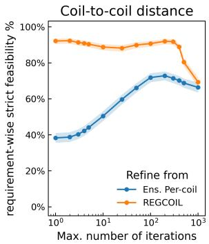

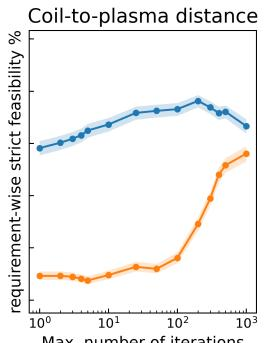

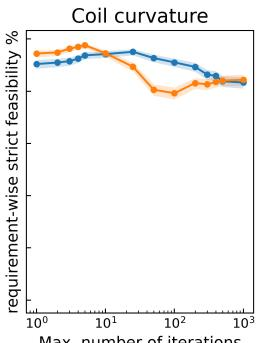

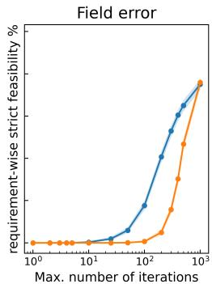  
Figure 8: Fraction of runs meeting each requirement against the iteration budget, for the learned and REGCOIL starts. Shaded bands are 95% Wilson intervals over the instances with results from both starts.

Fig. 8 and Tbl. 4 break the results down by requirement. Initially, the REGCOIL start meets $\tilde { d } _ { \mathrm { C C } } ^ { \mathrm { m i n } }$ on 92% of instances but $\tilde { d } _ { \mathrm { C P } } ^ { \mathrm { m i n } }$ on only 10%; the learned start shows the opposite pattern (38% and 58%). Up to 200 iterations, the learned start improves much faster on $\epsilon ^ { \mathrm { m a x } }$ and stays ahead on $\tilde { d } _ { \mathrm { C P } } ^ { \mathrm { m i n } }$ , which outweighs its $\tilde { d } _ { \mathrm { C C } } ^ { \mathrm { m i n } }$ deficit. From 200 to 500 iterations, $\epsilon ^ { \mathrm { m a x } }$ keeps improving for both starts while $\tilde { d } _ { \mathrm { C C } } ^ { \mathrm { m i n } }$ deteriorates, most for the REGCOIL start (91% to 80%), consistent with the optimizer trading coil spacing for field accuracy. At 1000 iterations, the two starts meet $\epsilon ^ { \mathrm { m a x } }$ and $\tilde { \kappa } ^ { \mathrm { m a x } }$ equally often; the learned start still meets $\tilde { d } _ { \mathrm { C P } } ^ { \mathrm { m i n } }$ more often (67% vs. 56%, $p = 7 \times 1 0 ^ { - 9 } )$ , and the REGCOIL start’s lead on $\tilde { d } _ { \mathrm { C C } } ^ { \mathrm { m i n } }$ shrinks to 69% vs. 66% $( p = 0 . 0 0 9 )$ . Of the runs still infeasible at 500 iterations, learned-start runs more often violate exactly one requirement (61% vs. 47%), but by a wider margin: the median soft score of their worst requirement is 0.39, compared with 0.65 for REGCOIL -initialized runs.

Table 4: Fraction of runs meeting each requirement, and all of them (strict feasibility), after 1 and 500 iterations, over the instances with results from both starts. At 500 iterations, every difference except curvature is significant (exact McNemar test, $p < 1 0 ^ { - 8 }$ ; curvature $p = 0 . 8 8 )$
<table><tr><td rowspan="2">Requirement</td><td colspan="2">1 iteration</td><td colspan="2">500 iterations</td></tr><tr><td>Per-coil ensemble</td><td>REGCOIL</td><td>Per-coil ensemble</td><td>REGCOIL</td></tr><tr><td> $\tilde { d } _ { \mathrm { C C } } ^ { \mathrm { m i n } }$ </td><td>38%</td><td>92%</td><td>69%</td><td>80%</td></tr><tr><td> $\bar { d } _ { \mathrm { C P } } ^ { \mathrm { m i n } }$ </td><td>58%</td><td>10%</td><td>72%</td><td>52%</td></tr><tr><td> $\tilde { \kappa } ^ { \mathrm { m a x } }$ </td><td>90%</td><td>94%</td><td>84%</td><td>84%</td></tr><tr><td> $\epsilon ^ { \mathrm { m a x } }$ </td><td>0%</td><td>0%</td><td>65%</td><td>47%</td></tr><tr><td>All</td><td>0%</td><td>0%</td><td>27%</td><td>18%</td></tr></table>

## C Detailed Filtering Pipeline for ConStellaration Boundaries

This section details the explicit filtering sequence applied to map candidate boundaries to solved equilibria, which subsequently act as the geometric targets for our coilset dataset, as touched upon in Sect. 2. The selection pipeline acts as a sequential filter $F _ { 1 } \circ F _ { 2 } \circ \cdots \circ F _ { k }$ , applied to the superset of generated configurations.

## C.1 Optimization and Convergence Constraints

Candidate boundaries are generated via a multi-stage pipeline consisting of initialization, boundary optimization (via VMEC++ or standard VMEC), and forward-model metric evaluation. We define a Boolean failure vector for each configuration $i , \mathbf { e } ^ { ( i ) } \in \{ 0 , 1 \} ^ { 5 }$ , representing the presence of errors across these sub-routines. The first filter, $F _ { 1 }$ , removes any configuration where upstream generation

failed:

$$
F _ { 1 } ( x ) = \left\{ \begin{array} { l l } { { \mathrm { K e e p } , } } & { { \mathrm { i f } \sum _ { j } \mathbf { e } _ { j } ^ { ( i ) } = 0 } } \\ { { \mathrm { D r o p } , } } & { { \mathrm { o t h e r w i s e } } } \end{array} \right.\tag{6}
$$

Furthermore, to guarantee that the boundary geometry is the result of active optimization of omnigenity rather than a warm-start initialization, the filter $F _ { 2 }$ restricts the generation method. If M represents the set of applied boundary generation methods, we require $\bar { \mathcal { M } } \in \{ \mathrm { V M E C } \substack { + + , \mathrm { V M E C } } \}$ Boundaries generated exclusively via quasi-poloidal or near-axis expansion analytical formulations are excluded, as their QI metrics are not representative of optimal targets for coil design.

## C.2 Physical and Metric Validations

Stellarator boundary orientation dictates the sign of the rotational transform. For consistency across downstream coil parameterization tasks, filter ${ \bar { F } } _ { 3 }$ strictly enforces the standard positive-ι orientation. Let $N _ { \mathrm { F P } }$ be the number of field periods. The edge rotational transform is recovered and constrained via:

$$
\iota _ { \mathrm { e d g e } } = \left( \frac { \iota _ { \mathrm { e d g e } } } { N _ { \mathrm { F P } } } \right) N _ { \mathrm { F P } } > 0 .\tag{7}
$$

Filter $F _ { 4 }$ subsequently evaluates the availability of the quasi-isodynamic residual, Q. Configurations are discarded if ${ \mathcal { Q } } = \emptyset .$ , which typically occurs when the Boozer coordinate transformation or the turbulent metric computations diverge despite successful VMEC++ convergence.

## C.3 Rotational Symmetry and Field Period Constraints

Stellarator geometries are fundamentally characterized by their discrete toroidal symmetry, defined by the number of field periods, $N _ { \mathrm { F P } }$ . Downstream coil optimization tasks often target specific symmetry classes to satisfy engineering constraints regarding modularity and maintenance access. Consequently, a final optional, yet highly relevant, filter $( \breve { F } _ { 5 } )$ restricts the dataset to a targeted subset of field periods, $\boldsymbol { S _ { \mathrm { N F P } } }$

We restrict this release to $N _ { \mathrm { F P } } \in \{ 2 , 3 , 4 , 5 \}$ . Therefore, the field period filter acts to enforce the allowable topological bounds:

$$
F _ { 5 } ( x ) = \left\{ \begin{array} { l l } { { \mathrm { K e e p , } } } & { { \mathrm { i f ~ } N _ { \mathrm { F P } } ^ { ( i ) } \in S _ { \mathrm { N F P } } \cap \{ 2 , 3 , 4 , 5 \} } } \\ { { \mathrm { D r o p , } } } & { { \mathrm { o t h e r w i s e } } } \end{array} \right.\tag{8}
$$

While $ { \boldsymbol { S } } _ { \mathrm { N F P } }$ typically defaults to 3 for baseline analyses, it can be extended to cover the full available interval [2, 5].

## C.4 Equilibrium Cross-Referencing

Each retained boundary is linked to a solved VMEC++ equilibrium with recorded force-balance diagnostics. We execute an inner join between the filtered boundaries and a precomputed library of VMEC++ solves.

Let $\hat { F } _ { \mathrm { m e a n } }$ and $\hat { F } _ { \operatorname* { m a x } }$ denote the normalized mean and maximum absolute force errors computed over the computational flux-surface grid of the VMEC++ solve. A boundary is only retained if it maps to a successfully instantiated and solved VMEC++ equilibrium where these final objective metrics are quantified. Tbl. 5 summarizes the complete filtering hierarchy.

MHD stability and engineering feasibility require separate analyses.

## D Dataset breakdown

## D.1 Distribution ranges of the engineering requirements for the sampling pipeline

In the sampling pipeline, we sample engineering requirements $( \tilde { d } _ { \mathrm { C C } } ^ { \mathrm { m i n } } , \tilde { d } _ { \mathrm { C P } } ^ { \mathrm { m i n } }$ , and $\tilde { \kappa } ^ { \mathrm { m a x } } )$ in ranges (Tbl. 6) informed by relevant stellarator designs, either built, like the $\Breve { \mathbf { W } } 7 - \mathbf { X } [ 1 ]$ and HSX [27] experiments, or proposed, like the NCSX [18] experiment and the power plant reactors Stellaris [17] and Infinity Two [10].

Table 5: Summary of the Sequential Target Boundary Filtering Pipeline
<table><tr><td>Stage</td><td>Criterion</td><td>Physical / Numerical Rationale</td></tr><tr><td> $F _ { 1 }$ </td><td>Upstream Convergence</td><td>Discard configurations with missing attributes caused by non-convergence in stage-1 (optimization) or stage-2 (for- ward models).</td></tr><tr><td> $F _ { 2 }$ </td><td>Optimization Provenance</td><td>Require the boundary to originate from active VMEC++ or standard VMEC omnigenity optimization, rejecting unoptimized initial guesses.</td></tr><tr><td> $F _ { 3 }$ </td><td>Positive Orientation</td><td>Enforce  $\iota _ { \mathrm { e d g e } } > 0$  to standardize spatial orientation for downstream control-coil synthesis and neural network ingestion.</td></tr><tr><td> $F _ { 4 }$ </td><td>Metric Validity</td><td>Require a finite Goodman QI residual  $( \mathfrak { Q } \neq \emptyset )$ </td></tr><tr><td> $F _ { 5 }$ </td><td>Field Period Bounds</td><td>Restrict this release to  $N _ { \mathrm { F P } } \in \{ 2 , 3 , 4 , 5 \}$ </td></tr><tr><td> $F _ { 6 }$ </td><td>Equilibrium Mapping</td><td>Exclude boundaries that fail to instantiate or converge to a force-balanced state within the VMEC++ computational framework.</td></tr></table>

Table 6: Reference stellarators from which the requirements sampling range was informed.
<table><tr><td>Reference Design</td><td> $\tilde { d } _ { \mathrm { C C } } ^ { \mathrm { m i n } }$  (coil-to-coil distance)</td><td> $\tilde { d } _ { \mathrm { C P } } ^ { \mathrm { m i n } }$  (coil-to-plasma distance)</td><td> $\tilde { \kappa } ^ { \mathrm { m a x } }$  (coil curvature)</td></tr><tr><td>W7-X [1]</td><td>0.53</td><td>0.70</td><td>1.31</td></tr><tr><td>HSX [27]</td><td>0.76</td><td>1.18</td><td>1.4</td></tr><tr><td>NCSX [18]</td><td>0.38</td><td>0.67</td><td>3.18</td></tr><tr><td>Stellaris [17]</td><td>0.51</td><td>1.05</td><td>2.03</td></tr><tr><td>Infinity Two [10]</td><td>0.52</td><td>0.97</td><td>2.4</td></tr><tr><td>Sampled Range</td><td>0.3 - 0.7</td><td>0.5 - 1.0</td><td>1.5 - 5.0</td></tr></table>

## D.2 Dataset composition

Coilset are sampled for boundaries across different values of $N _ { \mathrm { F P } }$ . Tbl. 7 reports the breakdown of the number of REGCOIL and DESC coilsets per $N _ { \mathrm { F P } }$ category, and their relative fractions. Noteworthy, the $N _ { \mathrm { F P } } = 3$ category has been oversampled in order to use it for machine learning purposes.

Table 7: Dataset composition by number of field periods $( N _ { \mathrm { F P } } )$ . DESC % ofDESC is the fraction of each $N _ { \mathrm { F P } }$ group within all DESC coilsets. DESC /REGCOIL is the completion rate of the DESC optimization per $N _ { \mathrm { F P } } .$
<table><tr><td> $N _ { \mathrm { F P } }$ </td><td>REGCOIL</td><td>(%)</td><td>DESC</td><td>% of DESC</td><td>DESC /REGCOIL (%)</td></tr><tr><td>2</td><td>30481</td><td>11.4</td><td>30 234</td><td>17.0</td><td>99.2</td></tr><tr><td>3</td><td>104 075</td><td>39.0</td><td>89 503</td><td>50.5</td><td>86.0</td></tr><tr><td>4</td><td>63 609</td><td>23.9</td><td>33 077</td><td>18.7</td><td>52.0</td></tr><tr><td>5</td><td>68 384</td><td>25.7</td><td>24 527</td><td>13.8</td><td>35.9</td></tr><tr><td>Total</td><td>266 549</td><td>100.0</td><td>177 341</td><td>100.0</td><td>66.5</td></tr></table>

## D.3 Breakdown of the filter

We apply a quality filter to remove coilsets with large discrepancies between the sampled engineering requirements and the measured values. With relative error defined as $e _ { x } = ( x _ { \mathrm { m e a s u r e d } } -$ $x _ { \mathrm { { t a r g e t } } } ) / x _ { \mathrm { { t a r g e t } } }$ , we require eCP $> - 0 . 5 , e _ { \mathrm { C C } } > - 0 . 5 ,$ , and $e _ { \kappa } < 1 . 0$ . These cuts remove large geometric violations; no field-error cut is applied. The reference population comprises the 266,549 released samples with a REGCOIL initialization. Tbl. 8 separates DESC output availability, metric availability, and quality selection. The mere fact that the output is missing does not establish an optimization failure mechanism.

Table 8: Cumulative selection cut flow, overall and by field periods. Retention is relative to the released samples in each column at the time of submission.
<table><tr><td colspan="5">Stage All  $N _ { \mathrm { F P } } = 2$   $N _ { \mathrm { F P } } = 3$   $N _ { \mathrm { F P } } = 4$   $N _ { \mathrm { F P } } = 5$ </td></tr><tr><td>Released samples</td><td>266549</td><td>30481</td><td>104075</td><td>63 609 68384</td></tr><tr><td>Successful optimization</td><td>177341</td><td>30 234 89503</td><td>33 077</td><td>24527</td></tr><tr><td>Full pipeline executed</td><td>163 908</td><td>30 221 78906</td><td>33 020</td><td>21761</td></tr><tr><td>+ Coil-plasma error &gt; —0.5</td><td>140 965</td><td>26218 66 237</td><td>29368</td><td>19142</td></tr><tr><td>+ Coil-coil error  $> - 0 . 5$ </td><td>138 954</td><td>25 692 65554</td><td>28 949</td><td>18759</td></tr><tr><td>+ Curvature error  $< 1 . 0$ </td><td>138765</td><td>25 614</td><td>65 455 28 939</td><td>18757</td></tr><tr><td>Retention (%)</td><td>52.1</td><td>84.0</td><td>62.9</td><td>45.5 27.4</td></tr></table>

The retained fraction decreases from 84.0% at $N _ { \mathrm { F P } } = 2 \mathrm { t o } 2 7 . 4 \%$ at $N _ { \mathrm { F P } } = 5$ . However, retention also depends strongly on coil count (Fig. 9e): with four coils per half field period, it ranges from 83.3% to 87.0% across $N _ { \mathrm { F P } }$ , while some other combinations have no retained samples. The aggregate trend therefore cannot be attributed to $N _ { \mathrm { F P } }$ alone.

Fig. 9a–d compares the input distributions before and after selection. The marginal distributions of the three geometric requirements change little: their maximum cumulative-distribution differences are at most 0.61 percentage points. For the minimum normalized magnetic-gradient scale length $\widetilde { L } _ { \nabla B } ^ { \mathrm { m i n } } - :$ a common proxy for expected coilset simplicity [4, 13] — we count each boundary once. Of 14 496 target boundaries, 13 037 (89.9%) retain at least one coilset.

Retention also varies with coil count within each $N _ { \mathrm { F P } }$ group (Fig. 9e), indicating that the aggregate differences across $N _ { \mathrm { F P } }$ depend on the sampled coil-count distribution.

Finally, we define each boundary’s retention rate as its number of retained coilsets divided by its number of released samples, including zero-retention boundaries. Fig. 9f averages these rates within magnetic-gradient scale length quintiles, separately for each $N _ { \mathrm { F P } }$ . Retention generally increases with magnetic-gradient scale length; at $N _ { \mathrm { F P } } = 2 \quad$ , the lowest and highest quintiles have mean rates of 39.3% and 93.4%, respectively. Thus, boundaries with more rapidly varying fields are less completely represented. This is expected as a larger magnetic-gradient scale length is associated with simpler or more engineerable coilsets.

## D.4 Objective normalization and quadrature

Eq. 1 expresses DESC’s least-squares objective as a weighted sum of scalar length and normal-field penalties. The implementation multiplies both residual vectors by 0.1, so its scalar objective is 0.01J; this common factor does not change the exact constrained minimizer. Coil lengths are divided by $\ell _ { * } = ( 1 / N _ { c } ) \sum _ { i } L _ { i } ^ { 0 } / ( 2 \pi )$ , computed from the initial coils. For $N _ { s }$ surface nodes, let $g _ { j }$ denote the weights returned by DESC’s surface grid $( \tt g r i d$ .weights) and $G _ { j } = | \partial _ { \theta } { \bf x } \times \partial _ { \zeta } { \bf x } |$ the surface Jacobian. DESC’s normal-field residual at node j is $\sqrt { N _ { s } } g _ { j } ( \mathbf { B } _ { j } \cdot \mathbf { n } _ { j } ) \sqrt { G _ { j } } / ( B _ { * } R _ { * } a _ { * } )$ , giving the effective surface weights $W _ { j } = N _ { s } g _ { j } ^ { 2 } G _ { j }$ in $\mathrm { E q . ~ } 1$ . The curvature weights $w _ { j }$ are coil-parameter grid spacings, without an arclength Jacobian. The fixed normalization scales are computed when the objective is built: $R _ { * }$ is the boundary’s zero-mode radial coefficient, $a _ { * } = \sqrt { | R _ { * } ^ { \mathrm { n z } } Z _ { * } ^ { \mathrm { n z } } | }$ uses the largest-magnitude nonzero radial and vertical surface coefficients, and $B _ { * } = 1 . 2 \dot { 5 } | \Psi | / ( \pi a _ { * } ^ { 2 } )$ , with Ψ the equilibrium toroidal flux. The length scale $\ell _ { * }$ and the DESC scale $^ { a _ { * } }$ are distinct from the plasma minor radius used to normalize the reported geometric metrics.

## E Dataset Metrics Specification

This section details the physical, geometric, and magnetic metrics calculated for each coilset in the dataset. To facilitate scale-invariant evaluations, many geometric quantities are normalized by the plasma minor radius. Metrics are evaluated on fixed surface and coil grids to ensure symmetry and numerical consistency across the dataset.

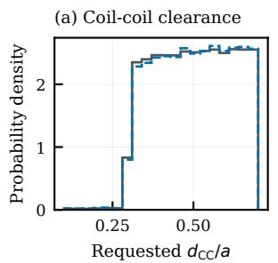

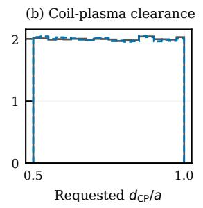

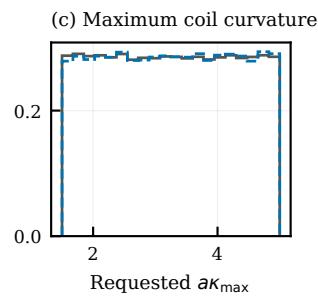

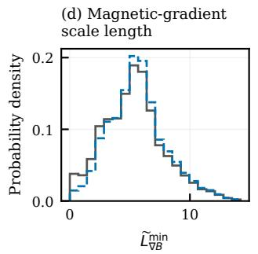

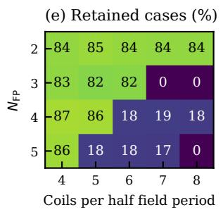

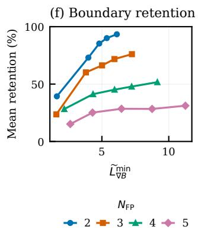  
Figure 9: Selection effects. (a–c) Probability densities of requested coil–coil clearance, coil–plasma clearance, and maximum coil curvature for released and retained samples. Maximum absolute differences between the corresponding empirical cumulative distribution functions (CDFs) are 0.61, 0.38, and 0.40 percentage points, respectively. (d) Probability density of the minimum normalized magnetic-gradient scale length over unique boundaries; a retained boundary has at least one retained coilset. Panels (a–d) use 20 shared equal-width bins per panel and unit-area normalization for each population. (e) Retained fraction of released samples for each $N _ { \mathrm { F P } }$ and coil count. (f) Mean per-boundary retention in five scale-length quantile bins per $N _ { \mathrm { F P } }$ , with equal weight per boundary and points at the mean scale length of each bin.

## E.1 Core Geometric and Configuration Metrics

These fundamental metrics characterize the physical layout and basic constraints of the coil configurations.

• Minor Radius: The plasma minor radius a (meters), utilized as the primary normalization scale for lengths, distances, curvatures, and torsions across the dataset.

• Coil Currents: The assigned electrical current for each structurally unique coil (amperes).

• Coil Lengths: The total arc length of each coil (meters). The derived normalized length ˜l is calculated as the absolute length divided by a. Any separately rescaled plot quantity is denoted $L / ( 2 \pi a )$ .

• Coil Curvatures: The pointwise local curvature along the coil paths $( \mathrm m ^ { - 1 } )$ . The derived normalized curvature is scaled by multiplying by a.

• Coil-to-Coil Minimum Distance: The minimum Euclidean distance between any two coils in the fully symmetry-expanded configuration (meters). Normalized distance is divided by a.

• Coil-to-Plasma Minimum Distance: The minimum Euclidean distance from the coil set to the targeted plasma boundary surface (meters). Normalized distance is divided by a.

## E.2 Surface Magnetic Field Metrics

These metrics evaluate the accuracy of the magnetic confinement, evaluated over the target plasma boundary. Let B denote the magnetic field generated by the coils, $B _ { n }$ represent the component of B normal to the surface, and dS denote the local surface area element.

• Normalized Field Error: The local error is $e _ { j } = | \boldsymbol { B _ { j } } \cdot \boldsymbol { n _ { j } } | / \| B _ { j } \|$ . The surface mean is $\begin{array} { r } { \epsilon _ { \mathrm { m e a n } } = \sum _ { j } w _ { j } e _ { j } / \sum _ { j } w _ { j } } \end{array}$ , with $w _ { j }$ the surface-area quadrature weights. The maximum sampled error is $\epsilon _ { \mathrm { m a x } } = \operatorname* { m a x } _ { j } e _ { j } ;$ it sets the benchmark field-error requirement.

• Local Quadratic Flux: The surface-area-weighted normalized quadratic-flux density, calculated as $\frac { B _ { n } ^ { 2 } } { | B | ^ { 2 } } d S ( \mathrm { m ^ { 2 } } )$

• Quadratic Flux Residual: The per-surface-node residual flux value, defined as $B _ { n } \sqrt { d S }$ $( \mathrm { T } \cdot \mathrm { m } )$

## E.3 Diagnostic Metrics

Computed alongside the core metrics, these diagnostics provide extended physical insights regarding the engineering feasibility and topological complexity of the configurations.

• On-Axis Average Magnetic Field: The mean magnetic-field magnitude evaluated strictly along the magnetic axis over one field period (tesla).

• Coil Linking Numbers: A topological diagnostic representing the sum of absolute linking numbers between coils (dimensionless).

• Coil Current-Lengths: The product of current and arc length for each unique coil $\left( \mathrm { A } \cdot \mathrm { m } \right)$ serving as a standard proxy for superconductor material costs.

• Coil Integrated Curvatures: The line integral of the curvature over the entirety of the coil curve (dimensionless; evaluates to 2π for strictly convex planar coils).

• Coil Torsions: The pointwise torsion along the coil curve $( \mathrm m ^ { - 1 } )$ ). Normalized torsion is scaled by multiplying by $a .$

• Coil Arclength Variances: A quantitative measure of the nonuniformity in the parameterization of the generated coil curves.

• Toroidal Flux: The total toroidal magnetic flux passing through the plasma surface generated exclusively by the external coil field (webers).

• Linking Current Consistency: A consistency measure comparing the external coil linking currents directly to the targeted internal equilibrium currents (amperes).

## E.4 Baseline Requirement Inputs

The baselines take four requirements: minimum normalized coil–coil distance, minimum normalized coil–plasma distance, maximum normalized curvature, and maximum normalized field error. On-axis field and toroidal flux are diagnostic quantities, not inputs to these baselines. The four inputs use the robust standardization in Sect. G.1.

## F Benchmark scoring details

## F.1 Per-metric tolerances

The per-metric tolerances $\alpha _ { i }$ used in the soft-feasibility score (Eq. 4) are listed in Tbl. 9. The tighter tolerance on the geometric metrics reflects the engineering precision they require; field error has a looser tolerance because its absolute scale is small in the dataset. We commit to these values once and freeze them before any baseline run — they are physics judgments tied to the precision the dataset achieves on each metric, not hyperparameters.

Table 9: Per-metric tolerances $\alpha _ { i }$ in the soft-feasibility score $( \mathrm { E q . ~ 4 } )$ . A relative violation of $\alpha _ { i }$ reduces $s _ { i }$ to $1 / e \approx 0 . 3 7 ; \mathrm { a } 2 \alpha _ { i }$ violation reduces it to ≈ 0.14.
<table><tr><td>Metric</td><td>Direction</td><td> $\alpha _ { i }$ </td></tr><tr><td> $\tilde { d } _ { \mathrm { C C } } ^ { \mathrm { m i n } }$  (coil-to-coil distance)</td><td>lower bound</td><td>0.10</td></tr><tr><td> $\ddot { d } _ { \mathrm { C P } } ^ { \mathrm { m i n } }$  (coil-to-plasma distance)</td><td>lower bound</td><td>0.10</td></tr><tr><td> $\tilde { \kappa } ^ { \mathrm { m a x } }$  (coil curvature)</td><td>upper bound</td><td>0.10</td></tr><tr><td> $\epsilon ^ { \mathrm { m a x } }$  (field error)</td><td>upper bound</td><td>0.25</td></tr></table>

## F.2 Per-metric breakdown of the baseline failure mode

Tbl. 10 reports the median per-metric soft score and median violation $v ,$ pooled over the three training seeds per architecture, on the fixed-shape track $( N { = } 2 , 7 7 1 )$ . Field error is the dominant failure across all architectures $( s _ { \epsilon } \sim 1 0 ^ { - 5 } – 1 0 ^ { - 4 }$ , median normalized violations 2.1–2.9). Both ensembles have median soft scores near one for coil–plasma distance and curvature, while every architecture has a positive median coil–coil spacing violation. The four-fold geometric mean is dominated by the smallest term, consistently $s _ { \epsilon }$

Table 10: Median per-metric soft score and (median violation v) on the fixed-shape track, pooled over the three training seeds per architecture. Soft scores are bounded [0, 1] with s=1 at and beyond the threshold and s=1/e at v=α (see Eq. 4).
<table><tr><td>Architecture</td><td> $s _ { d _ { c c } }$ </td><td> $s _ { d _ { c p } }$ </td><td> $s _ { \kappa }$ </td><td> $s _ { \epsilon }$ </td></tr><tr><td>MLP</td><td> $0 . 0 2 \ ( v { = } 0 . 3 9 )$ </td><td> $0 . 3 5 \ ( v { = } 0 . 1 1 )$ </td><td> $0 . 1 4 \ ( v { = } 0 . 1 9 )$ </td><td> $1 \times 1 0 ^ { - 5 } \ ( v { = } 2 . 8 )$ </td></tr><tr><td>ResMLP</td><td> $0 . 0 3 \ ( v { = } 0 . 3 4 )$ </td><td> $0 . 3 6 \ ( v { = } 0 . 1 0 )$ </td><td> $4 \times 1 0 ^ { - 3 } \ ( v { = } 0 . \dot { 5 } 6 )$ </td><td> $1 \times 1 0 ^ { - 5 } \ ( v { = } 2 . 9 )$ </td></tr><tr><td>EnsembleMLP</td><td> $0 . 1 2 \ ( v { = } 0 . 2 1 )$ </td><td> $1 . 0 0 \ ( v { = } 0 )$ </td><td> $1 . 0 0 \ ( v { = } 0 )$ </td><td> $1 \times 1 0 ^ { - 4 } \ ( v { = } 2 . 2 )$ </td></tr><tr><td>EnsembleResMLP</td><td>0.09 (v=0.25)</td><td> $1 . 0 0 \ ( v { = } 0 )$ </td><td> $1 . 0 0 \ ( v { = } 0 )$ </td><td> $2 \times 1 0 ^ { - 4 } \ ( v { = } 2 . 1 )$ </td></tr></table>

Table 11: Spearman correlations between reference-coilset metrics and prediction performance for EnsemblePerCoilMLP on the variable-shape evaluation set. Values are the mean correlation ± one standard deviation across three independently trained seeds.
<table><tr><td>Reference metric</td><td> $\rho$  with strict feasibility</td><td> $\overline { { \rho \mathrm { \ w i t h \ s c o r e \ } S } }$ </td></tr><tr><td> $d _ { \mathrm { C C } } ^ { \mathrm { m i n } }$ </td><td> $- 0 . 1 1 6 \pm 0 . 0 0 8$ </td><td> $+ 0 . 2 1 8 \pm 0 . 0 0 5$ </td></tr><tr><td> $d _ { \mathrm { C P } } ^ { \operatorname* { m i n } }$ </td><td> $- 0 . 2 1 4 \pm 0 . 0 0 4$ </td><td> $- 0 . 0 7 3 \pm 0 . 0 0 8$ </td></tr><tr><td> $\widetilde { \kappa } _ { \mathrm { m a x } }$ </td><td> $+ 0 . 1 8 8 \pm 0 . 0 0 3$ </td><td> $- 0 . 0 8 \pm 0 . 0 2$ </td></tr><tr><td> $\log _ { 1 0 }$  (reference mean normalized field error)</td><td> $+ 0 . 2 5 9 \pm 0 . 0 0 4$ </td><td> $+ 0 . 4 2 \pm 0 . 0 3$ </td></tr></table>

## F.3 Sensitivity to the soft-score tolerance

The soft-feasibility score (Eq. 4) depends on the per-metric tolerances $\alpha _ { i }$ (Tbl. 9), which we freeze before any baseline run. Since the per-instance violations $v _ { i }$ are stored, the score $S =$ $\mathrm { e x p } { \textstyle \left( - { \frac { 1 } { 4 } } \sum _ { i } v _ { i } / \dot { \alpha _ { i } } \right) }$ can be recomputed for any α without re-evaluating a model, so we can check whether the leaderboard ordering depends on this choice. Strict feasibility $( v _ { i } \leq 1 \times 1 0 ^ { - 3 } )$ is independent of α and is unaffected.

Fig. 10 shows the mean $\bar { S }$ on the fixed-shape track as we (left) scale all four tolerances by a common factor c and (right) vary only the field-error tolerance $\alpha _ { \epsilon } ,$ the dominant and most scrutinized term. Varying only the field-error tolerance from 0.10 to $0 . 5 0$ leaves the ordering unchanged. Uniform scaling changes the ordering at $c = 0 . 2 5 , 2$ , and 4 (Tbl. 12).

## G Detailed Model Configurations and Architectures

This section details the explicit forward pass formulations, dimensionality, and hyperparameters of the models evaluated in the main text.

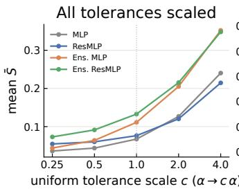

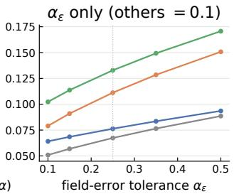  
Figure 10: Mean score $\bar { S }$ on the fixed-shape track as the soft-score tolerance is varied: (left) all four tolerances scaled by a common factor c (log axis; dotted line is the nominal $c { = } 1 )$ , and (right) only the field-error tolerance α (dotted line is the nominal 0.25). Each point is the mean over three seeds. Field-error-only changes preserve the ranking; uniform scaling can change it.

Table 12: Kendall rank correlation τ of the fixed-shape mean- $\bar { \cdot } \bar { S }$ ranking against the nominal-α ranking, as the tolerances are varied. $\tau { = } 1$ means the four-architecture order is unchanged.
<table><tr><td>Uniform scale c 0.25</td><td>0.5 1</td><td>2</td><td>4</td></tr><tr><td>τ vs nominal 0.67</td><td>1.00</td><td>0.67</td><td>0.33</td></tr><tr><td>Field-error  $\alpha _ { \epsilon }$ </td><td>0.10 0.15 0.25</td><td>0.35</td><td>0.50</td></tr><tr><td>τ vs nominal</td><td>1.00 1.00 一</td><td>1.00</td><td>1.00</td></tr></table>

## G.1 Input Representation and Standardization

Let the boundary input be represented by $n _ { \mathrm { p o l } }$ poloidal modes, $n _ { \mathrm { t o r } }$ toroidal modes, and $n _ { \mathrm { a r r } }$ arrays (where $n _ { \mathrm { a r r } } = 2$ under stellarator symmetry, and 4 otherwise). The boundary is deterministically scaled into a flat vector $\mathbf { x } _ { \mathrm { b o u n d } }$

The requirement metrics vector $\mathbf { r } = [ \tilde { d } _ { \mathrm { C C } } , \tilde { d } _ { \mathrm { C P } } , \tilde { \kappa } , \epsilon ] \in \mathbb { R } ^ { 4 }$ is standardized with robust training-set statistics, the per-metric median ${ \pmb \mu } _ { r }$ and the normal-consistent inter-quartile range $\pmb { \sigma } _ { r } = ( \mathbf { q } _ { 7 5 } -$ $\mathbf { q } _ { 2 5 } ) / 1 . 3 4 9$ , so that a few extreme instances do not set the scale:

$$
\hat { \mathbf { r } } = \frac { \mathbf { r } - \pmb { \mu } _ { r } } { \operatorname* { m a x } ( \pmb { \sigma } _ { r } , 1 0 ^ { - 8 } ) } ,
$$

With 90 boundary coefficients and four requirements, fixed-shape inputs have dimension 94. Variableshape context adds four $N _ { \mathrm { F P } }$ and five $N _ { \mathrm { C } }$ indicators, giving 103. Per-coil inputs add eight slot indicators and one relative slot position, giving 112. We denote the resulting input vector by x.

## G.2 Baseline Coil Predictor Formulation

The plain MLP has an input affine projection, three GELU–affine hidden transformations, and a GELU–affine output projection: five affine layers. With hidden width $d _ { h }$ and $L = 4$ hidden stages,

$$
h _ { 0 } = W _ { \mathrm { i n } } \mathbf { x } + b _ { \mathrm { i n } } , \qquad h _ { l } = W _ { l } \operatorname { G E L U } ( h _ { l - 1 } ) + b _ { l } , \quad l = 1 , \ldots , L - 1 .
$$

Here $W _ { \mathrm { i n } } \in \mathbb { R } ^ { d _ { h } \times d _ { \mathrm { i n } } }$ and $W _ { l } \in \mathbb { R } ^ { d _ { h } \times d _ { h } }$

The final flat output $\mathbf { y } \in \mathbb { R } ^ { d _ { \mathrm { o u t } } }$ is computed as $\mathbf { y } = W _ { L } \mathbf { G } \mathbf { E } \mathbf { L } \mathbf { U } ( h _ { L - 1 } ) + b _ { L }$ . The output dimension encapsulates 3 spatial arrays per coil and 1 scalar current per coil:

$$
d _ { \mathrm { o u t } } = 3 \cdot n _ { \mathrm { c o i l s } } \cdot N _ { \mathrm { m a x } } + n _ { \mathrm { c o i l s } }
$$

## G.3 Bidirectional Exponential Spectral Scaling

High-frequency Fourier modes in physical geometries typically exhibit exponentially decaying amplitudes. Left unscaled, these high-order coefficients would be overwhelmed by the dominant low-frequency components, leading to a spectral bias where the neural network fails to resolve

fine-grained geometric details. To counteract this, we apply a bidirectional exponential spectral scaling transformation prior to flattening the Fourier surfaces and coilsets.

For surface modes $( m , n )$ we use $q = \operatorname* { m a x } ( | m | , | n | )$ ; for coil modes $k$ we use $q = | k |$ . For each spatial coefficient $c ,$ encoding and decoding are

$$
d = \operatorname* { m a x } ( 1 . 2 ^ { - q } , 1 0 ^ { - 7 } ) , \qquad \hat { c } = \frac { c } { R _ { 0 } d } , \qquad c = R _ { 0 } d \hat { c } ,
$$

where $R _ { 0 }$ is the boundary’s zero-mode radial coefficient. The transformations condition the network representation. Training minimizes a normalized squared error between predicted and target coil coefficients and currents after decoding. Physical feasibility is evaluated separately using the benchmark metrics.

## G.4 Residual Predictor and Split Current Head

The ResMLP begins with $h _ { 0 } = W _ { \mathrm { i n } } { \bf x } + b _ { \mathrm { i n } }$ , followed by three pre-normalized residual blocks and separate geometry and current heads. The residual update for $l \in \{ 1 , \ldots , L - 1 \}$ is defined as:

$$
h _ { l } = h _ { l - 1 } + \mathrm { D r o p o u t } \left( W _ { l } \mathrm { G E L U } \big ( \mathrm { L a y e r N o r m } ( h _ { l - 1 } ) \big ) + b _ { l } \right)
$$

The geometric coil parameters $\mathbf { y } _ { \mathrm { c o i l s } } \in \mathbb { R } ^ { d _ { \mathrm { c o i l s } } }$ (where $d _ { \mathrm { c o i l s } } = 3 \cdot n _ { \mathrm { c o i l s } } \cdot N _ { \mathrm { m a x } } )$ are predicted via a primary head:

$$
\mathbf { y } _ { \mathrm { c o i l s } } = W _ { \mathrm { h e a d } } \mathbf { G E L U } ( h _ { L - 1 } ) + b _ { \mathrm { h e a d } }
$$

The coil currents $\mathbf { y } _ { \mathrm { c u r r e n t s } } \in \mathbb { R } ^ { n _ { \mathrm { c o i l s } } }$ are predicted by a specialized sub-network with hidden dimension $d _ { c } ,$ conditioned on the predicted geometry and standardized metrics:

$$
\begin{array} { r } { \begin{array} { r } { \mathbf { c } _ { \mathrm { i n } } = \left[ \mathbf { y } _ { \mathrm { c o i l s } } , \hat { \mathbf { r } } \right] \quad } \\ { h _ { c } = W _ { c 1 } \mathrm { L a y e r N o r m } ( \mathbf { c } _ { \mathrm { i n } } ) + b _ { c 1 } \quad } \\ { \mathbf { y } _ { \mathrm { c u r r e n t s } } = W _ { c 2 } \mathbf { G E L U } ( h _ { c } ) + b _ { c 2 } \quad } \end{array} } \end{array}
$$

Zero initialization gives $I = R _ { 0 } \mu _ { I }$ , where $\mu _ { I }$ is the training-set median of $I / R _ { 0 }$ . The final currenthead projection parameters are initialized to zero: $W _ { c 2 } = \bar { \bf 0 } , b _ { c 2 } = { \bf 0 }$

## G.5 Inference-Time Fourier Truncation

If a specific Fourier order k is requested at inference, such that $k \leq ( N _ { \operatorname* { m a x } } - 1 ) / 2$ , the full-band spatial arrays $( \mathbf { x } _ { n } , \mathbf { y } _ { n } , \mathbf { z } _ { n } )$ are centrally sliced along their final spectral axis. For a required width $w = 2 k + 1$ , the padding offset is computed as $p = ( N _ { \mathrm { m a x } } - w ) / 2$ , and the arrays are truncated to the indices $[ p : p + w ]$ . The scalar currents remain unaffected.

## G.6 Hyperparameter Specifications

The exact configuration and training parameters used across the architectures are detailed in Tbl. 13 and Tbl. 14.

## G.7 Variable-Shape Topology Conditioning

The variable-shape models (MaskedMLP, PerCoilMLP, and their ensembles) share the trunk, spectral scaling, and currents handling of the fixed-shape models, and additionally condition on the discrete topology. The number of field periods and the coil count are each supplied as a one-hot vector over the supported values $N _ { \mathrm { F P } } \in \bar { { \mathcal S } _ { N _ { \mathrm { F P } } } } = \{ 2 , 3 , 4 , 5 \}$ and $N _ { \mathrm { C } } \in \mathcal { S } _ { N _ { \mathrm { C } } } = \{ 4 , \bar { 5 } , 6 , 7 , 8 \}$ , concatenated to the standardized input. Both architectures emit up to $N _ { \mathrm { c o i l s } } ^ { \mathrm { m a x } } = 8$ unique coils per half field period; at inference the output is trimmed to the requested $N _ { \mathrm { C } }$ (the extra slots are discarded).

Masked predictor. The MaskedMLP reuses the basic MLP trunk but sizes its readout for the maximum coil count,

$$
d _ { \mathrm { o u t } } = 3 \cdot N _ { \mathrm { c o i l s } } ^ { \mathrm { m a x } } \cdot N _ { \mathrm { m a x } } + N _ { \mathrm { c o i l s } } ^ { \mathrm { m a x } } .
$$

All $N _ { \mathrm { c o i l s } } ^ { \mathrm { m a x } }$ slots are produced in a single forward pass, and slots beyond the requested $N _ { \mathrm { C } }$ are masked out by the caller.

Table 13: Hyperparameter Configuration
<table><tr><td>Parameter</td><td>Value</td><td>Description</td></tr><tr><td> $d _ { h }$ </td><td>512</td><td>Width of the primary MLP trunk.</td></tr><tr><td> $L$ </td><td>4</td><td>Four hidden stages; separate output projection.</td></tr><tr><td> $d _ { c }$ </td><td>64</td><td>Hidden dimension of the specialized currents head.</td></tr><tr><td>Dropout</td><td>0.2</td><td>Dropout rate (exclusive to Residual models).</td></tr><tr><td> $M$ </td><td> $5$ </td><td>Number of members in ensemble variants.</td></tr><tr><td> $\alpha$ </td><td> $1 . 2$ </td><td>Spectral-scaling exponent for bidirectional flat mapping.</td></tr><tr><td> $s _ { \mathrm { m i n } }$ </td><td> $1 0 ^ { - 7 }$ </td><td>Minimum floor for spectral scaling.</td></tr><tr><td> $p$ </td><td> $\infty$ </td><td>Norm order used to combine surface mode indices.</td></tr><tr><td>clamp  $\sigma _ { r }$ </td><td> $1 0 ^ { - 8 }$ </td><td>Minimum robust scale for requirement standardization.</td></tr><tr><td> $N ^ { \mathrm { m a x } }$   $\begin{array} { r } { I \mathrm { V } _ { \mathrm { c o i l s } } ^ { \mathbf { \alpha } } } \end{array}$ </td><td>8</td><td>Maximum unique coils per half field period (variable-shape readout).</td></tr><tr><td> $ { \mathcal { S } } _ { N _ { \mathrm { F P } } }$ </td><td>{2, 3, 4, 5}</td><td>Supported field periods (variable-shape conditioning).</td></tr><tr><td> $\mathcal { S } _ { N _ { \mathrm { C } } }$ </td><td> $\tilde { \{ 4 , 5 , 6 , 7 , 8 \} }$ </td><td>Supported coil counts (variable-shape conditioning).</td></tr></table>

Table 14: Training Hyperparameters
<table><tr><td>Parameter</td><td>Value</td></tr><tr><td>Seeds</td><td>0,1,2</td></tr><tr><td>Training budget</td><td>Up to 600,000 updates with 1,000-step warmup.</td></tr><tr><td>Batch / selection</td><td>Train batch 16, evaluation batch 256, and evaluation every 500 updates.</td></tr><tr><td>Stopping Patience</td><td>100,000 updates with best checkpoint re- tained.</td></tr><tr><td>Optimizer</td><td>AdamW with learning rate schedule  $1 \times$   $1 0 ^ { - 3 }$  to  $1 \times 1 0 ^ { - 5 }$  , and weight decay  $1 \times$   $1 0 ^ { - 4 }$  , and global norm clip 1.0.</td></tr></table>

Per-coil predictor. The PerCoilMLP applies a single weight-shared MLP to each coil slot in turn. Slot $j \in \mathsf { \bar { \{ 0 , \ldots , N _ { \mathrm { c o i l s } } ^ { m a x } - 1 \} } }$ receives the shared design context (flattened boundary, standardized requirements, and the $N _ { \mathrm { F P } } / N _ { \mathrm { C } }$ one-hots) concatenated with a slot descriptor: the one-hot slot index and the relative coil-slot position $( j + \textstyle { \frac { 1 } { 2 } } ) / N _ { \mathrm { C } }$ . Each slot emits its three spatial Fourier arrays and a scalar current, so a single parameter set represents any coil count.

Ensembles. Each ensemble contains five independently initialized networks trained on shared minibatches. We average their individual supervised losses during training and their predicted coil coefficients and currents at inference. We repeat each single-model or ensemble run with three seeds and report variation across those runs. Because the flat-to-coilset decoding is affine, this equals averaging the members’ flat outputs.