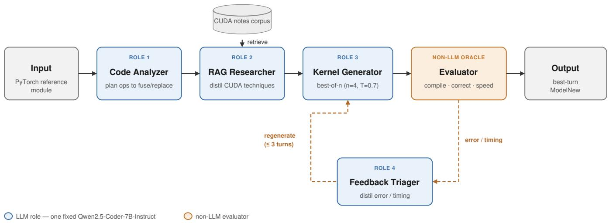
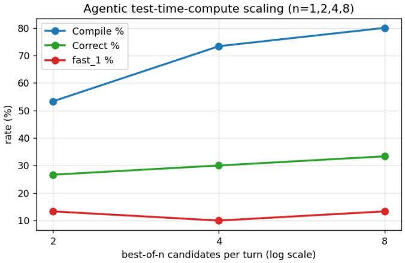

# Correct First, Fast Second: What a Local 7B Code Model

# Can and Cannot Do for GPU Kernel Optimization

Jui-Chien Tsou Po-Yi Wu

Department of Computer Science and Information Engineering

National Taiwan University

{b11902044, b11902127}@csie.ntu.edu.tw

Abstract—We study how much the interaction strategy around a fixed, locally hosted 7B-parameter code model (Qwen2.5-Coder-7B-Instruct) affects its ability to replace PyTorch operators with custom CUDA kernels. On 30 KernelBench tasks (levels 1–3, first 10 each, evaluated on a V100), we compare four regimes of increasing structure: zero-shot prompting, profiling-guided prompting, iterative refinement on execution feedback, and a multiagent loop (analysis, retrieval, generation, evaluation, feedback triage) in which the same model fills four roles around a non-LLM evaluator. Three findings stand out. (1) Correctness, not speed, is the binding constraint: even correct generated kernels average 0.97– 0.99× the speed of eager PyTorch, because a 7B model cannot out-write cuBLAS/cuDNN on dense GEMM and convolution; the only real wins are fused memory-bound epilogues. (2) The best strategy depends on difficulty: profiling-guided prompting is strongest overall (43% correct, 27% faster than baseline), but the agent loop is the only method that solves any level-2 fusion problem (3/10 vs. 0/10 for all others). (3) Na¨ıve agentic scaffolding is actively harmful—our first agent scored 3% correct, below zero-shot’s 30%—and the decisive repairs were matching the agent’s ambition to the model’s competence and spending compute on best-of-n sampling under a real execution oracle (3%→33% correct from n=1 to n=8), not on more reasoning steps.

Index Terms—GPU kernel optimization, large language models, CUDA, agentic systems, KernelBench, test-time compute

## I. INTRODUCTION

Writing fast GPU kernels is expert work: a correct, performant CUDA kernel must respect memory coalescing, sharedmemory capacity, occupancy, and numerical semantics simultaneously. Large language models (LLMs) promise to automate parts of this work, and benchmarks such as KernelBench [1] formalize the task: given a PyTorch reference module Model, produce a functionally identical ModelNew that replaces operators with custom CUDA and runs faster.

Most published results on this task use frontier-scale proprietary models. This paper asks a question closer to what a practitioner with fixed local hardware faces: holding a single mid-size open-weight model constant, how much does the prompting and agent scaffolding around it matter—and where exactly does it help or hurt? The model is the controlled variable; the four treatment conditions are zero-shot prompting, profiling-guided prompting, iterative refinement, and a multiagent loop in which the same model plays four roles (code analyzer, retrieval researcher, kernel generator, feedback triager) around a real compile-and-run evaluator.

Our contributions: (i) a controlled 1×4 comparison on 30 KernelBench tasks with compile / correctness / speedup metrics and a per-difficulty breakdown; (ii) evidence that no single strategy dominates—guided prompting wins overall and on whole networks, while only the agent solves fused multi-operator problems; (iii) a root-cause analysis of why the agent initially scored below zero-shot, and a principled repair (competence-matched ambition plus best-of-n sampling under an execution oracle) validated by a coherent componentablation study and a test-time-compute scaling curve; (iv) an infrastructure lesson—LLM-generated kernels can deadlock the GPU, so unattended evaluation requires hard per-candidate timeouts.

## II. BACKGROUND AND RELATED WORK

Benchmark and dataset. KernelBench [1] contains PyTorch reference modules in difficulty levels: level 1 holds single operators (GEMM variants, convolutions, elementwise ops), level 2 holds short fused operator sequences (e.g. ConvTranspose2d→BiasAdd→Clamp→Scale), and level 3 holds full architectures (MLPs, LeNet-5, AlexNet, . . . ). Each task ships get\_inputs() generators; a candidate passes if its outputs match the reference within tolerance across randomized trials. We use the first 10 problems of each of levels 1–3 (30 tasks): the subset keeps the full study — four methods plus eight agentic configurations (the component ablations and a best-of-n sweep) — tractable on shared GPUs, while still spanning three qualitatively different difficulty regimes. The headline metric is fast<sub>1</sub>: the fraction of tasks both correct and faster than eager PyTorch [1].

Baseline. The performance baseline is eager PyTorch, whose matmul/convolution dispatch to highly tuned cuBLAS/cuDNN kernels—a strong baseline that, as we show, dominates what a 7B model can hand-write for compute-bound operators.

Model and agent tooling. All generation uses Qwen2.5- Coder-7B-Instruct [2] served locally via HuggingFace Transformers (fp16, multi-GPU workers; one GPU generates while a second evaluates). No proprietary model or API is used anywhere. The agent framework is ∼1,500 lines of Python orchestrating the roles described in §III; retrieval uses BM25 over a small curated corpus of CUDA optimization notes (tiling, coalescing, epilogue fusion, torch.utils.cpp\_extension usage).

Related work. Our design draws on retrieval-augmented generation [3], self-refinement from execution feedback [4]–[6], and repeated sampling with a verifier, whose effectiveness on code is well documented [7], [8]. Our results echo [8] in a harsher setting: with a weak generator and a real compile-and run verifier, sampling breadth beats reasoning depth.

## III. METHODOLOGY

All four methods share the same base task prompt (Appendix A), model, decoding budget (4096 new tokens), and evaluator; they differ only in the information and control flow around generation.

## A. The four interaction regimes

Zero-shot. The raw KernelBench prompt; greedy decoding; one attempt. This is the capability floor.

Guided. We profile each reference module with the PyTorch profiler on the target GPU and inject its top operators by CUDA time into the prompt, followed by a roofline-style rule we added after the pilot study (§VI): do not reimplement matmul/conv— cuBLAS/cuDNN already won; fuse the cheap memory-bound epilogue instead. One attempt, no loop.

Iterative. Up to three turns: generate, compile/check/time on the GPU, feed a distilled error/timing report back, regenerate. The submitted kernel is the best turn under a (correct, compiled, speedup) ranking.

Agentic. A five-stage loop — four roles played by the same model under different system prompts, plus a non-LLM Evaluator that closes the loop (Fig. 1; Appendix B):

1) Code Analyzer – names the operations, bottlenecks, and fusion opportunities; emits retrieval queries.

2) RAG Researcher – retrieves from the documentation corpus and writes a cited optimization brief.

3) Kernel Generator – writes ModelNew; samples n candidates per turn (best-of-n).

4) Evaluator (non-LLM) – compiles, checks correctness, times each candidate; keeps the best per turn.

5) Feedback Analyzer – converts raw evaluator output into a diagnosis and a directive for the next turn.

The loop runs up to three turns. Every component can be disabled independently, which yields the ablation study in §V-C.

## B. How the agent was developed

A natural question for any agent system is how its instructions were arrived at. Our final design is the outcome of one major iteration: an initial agent that failed badly, and the redesign that repaired it (full chronology in Appendix D). We report both, because the failure is itself informative.

Pilot (v1): 3% correct, 33% compile—below zero-shot. The v1 generator system prompt mandated custom kernels (“replace PyTorch operators . . . using load\_inline or Triton”), and the analyzer/researcher briefs recommended tiling, shared memory, and warp reductions on every task. The 7B model attempted ambitious hand-tiled CUDA it could not compile— e.g. calling load\_inline(sources=...) (a keyword that does not exist) and mismatching PYBIND11\_MODULE names, yielding PyInit import errors. The feedback loop could not recover because each retry stayed in the same overambitious mode; tellingly, a single-turn variant beat the full loop.

Repairs (v2). Four changes, each motivated by an observed failure: (1) Competence-matched prompting: every agent role is instructed to reach a correct, compiling kernel first—reuse torch ops for the heavy compute, fuse only the memorybound epilogue—and to escalate to hand-written tiling only once a correct baseline exists; the prompts also pin the exact load\_inline signature the model kept hallucinating. (2) Best-of-n sampling: n=4 candidates per turn at temperature 0.7, ranked by the real evaluator. (3) Monotone turn selection: the submitted kernel is the best turn by (correct, compiled, speedup), so a later broken retry can never displace an earlier working kernel (this bug had been silently degrading the iterative baseline too). (4) Hard evaluation timeouts: each candidate is evaluated in a child process killed after 240 s, because generated kernels can deadlock the GPU— one such kernel stalled a production run for 14 hours (§VI-D).

## IV. EXPERIMENTAL SETUP

Hardware/software. Generation and evaluation run on nodes with 8× NVIDIA V100-SXM2-32GB (Volta, no fp32 tensor cores), CUDA 12.3, PyTorch 2.x, GCC 10. Workers pair GPUs: one serves the model, one evaluates kernels, so generation never competes with timing.

Measurement. For each candidate: compile via torch.utils.cpp\_extension; correctness over 5 trials with randomized inputs (must match the reference within KernelBench’s default tolerance); timing via CUDA events over 10 trials after warm-up, in fp32. The speed baseline is the eager-PyTorch reference time measured on the same GPU.

Success criteria. We report: compile rate; correctness rate; fast<sub>1</sub> = correct and faster than eager PyTorch (the success definition for this study); and geometric-mean speedup over correct samples. A task counts once per (method, task) cell; multi-turn/multi-sample methods submit exactly one final kernel chosen by the evaluator, never by the LLM’s own judgment.

Reproducibility. One command reruns the full matrix; the report, tables, and figures regenerate from raw evaluation JSON via a single script. Completed cells are skipped, so the study is incrementally re-runnable. Code and artifacts are released (see Code and Data Availability).

## V. RESULTS

## A. Headline comparison

Table I: profiling-guided prompting is the best single strategy, lifting correctness 30%→43% and doubling fast<sub>1</sub> (13%→27%) over zero-shot at identical compute. Iterative refinement does not help this model: blind “retry with the error log” rarely converts failures. The repaired agent reaches parity in aggregate—but with a very different distribution of successes.

  
Fig. 1. The agentic loop. Four roles are the same Qwen2.5-Coder-7B-Instruct under different system prompts (blue); a non-LLM Evaluator (orange) compiles, checks, and times each candidate and closes the feedback loop. Generation is best-of-n (n=4); the loop runs at most three turns.

TABLE I  
FOUR METHODS ON 30 KERNELBENCH TASKS (LEVELS 1–3). FAST<sub>1</sub> = CORRECT AND FASTER THAN EAGER PYTORCH. GEO-MEAN SPEEDUP IS OVER CORRECT SAMPLES ONLY.
<table><tr><td>Method</td><td>Compile%</td><td>Correct%</td><td>fast1%</td><td>Geo-mean</td></tr><tr><td>Zero-shot</td><td>70</td><td>30</td><td>13</td><td>0.98×</td></tr><tr><td>Guided</td><td>77</td><td>43</td><td>27</td><td>0.99×</td></tr><tr><td>Iterative</td><td>67</td><td>30</td><td>10</td><td>0.98×</td></tr><tr><td>Agentic</td><td>73</td><td>30</td><td>10</td><td>0.97×</td></tr></table>

TABLE II  
CORRECT SOLUTIONS OUT OF 10, PER DIFFICULTY LEVEL.
<table><tr><td>Method</td><td>L1 (single op)</td><td>L2 (fused seq.)</td><td>L3 (network)</td></tr><tr><td>Zero-shot</td><td>9</td><td>0</td><td>0</td></tr><tr><td>Guided</td><td>10</td><td>0</td><td>3</td></tr><tr><td>Iterative</td><td>9</td><td>0</td><td>0</td></tr><tr><td>Agentic</td><td>5</td><td>3</td><td>1</td></tr></table>

## B. Difficulty decides the winner

Table II is the central qualitative result. On L1, simpler is better (zero-shot/guided: 9–10/10) and the agent’s machinery hurts (5/10): its analyzer talks the model into unnecessary custom kernels where a one-line torch op passes. On L2, the agent is the only method that scores at all (3/10 vs. 0/10 everywhere else): explicit fusion analysis plus an executiongrounded loop is exactly what multi-operator fusion rewards. On L3, guided profiling uniquely succeeds (3/10) by pointing the model at the dominant layer. No method dominates across difficulty.

TABLE III  
AGENTIC COMPONENT ABLATION. EVERY VARIANT FLIPS ONE COMPONENT OFF AGAINST THE SAME BEST-OF-4 BACKBONE; ∆ IS CORRECTNESS CHANGE VS. THE FULL SYSTEM.
<table><tr><td>Variant</td><td>Correct%</td><td>Compile%</td><td>fast1%</td><td>∆</td></tr><tr><td>Agentic (full, n=4)</td><td>30</td><td>73</td><td>10</td><td></td></tr><tr><td>– RAG researcher</td><td>20</td><td>77</td><td>7</td><td>-10</td></tr><tr><td>— Code analyzer</td><td>20</td><td>63</td><td>10</td><td>-10</td></tr><tr><td>— Feedback analyzer</td><td>37</td><td>73</td><td>10</td><td>+7</td></tr><tr><td>— Refinement loop</td><td>20</td><td>70</td><td>10</td><td>-10</td></tr><tr><td>− Best-of-n (n=1)</td><td>3</td><td>23</td><td>0</td><td>-27</td></tr></table>

  
Fig. 2. Test-time-compute scaling: full agent, varying only candidates per turn (n ∈ {1, 2, 4, 8}; evaluator keeps the best). Correctness: 3/27/30/33%; compile: 23/53/73/80%. The first doubling is transformative; returns then diminish.

## C. Component ablation and test-time compute

Table III and Fig. 2 decompose the agent. Best-of-n is the load-bearing component by a wide margin: removing it collapses the system to 3% correct / 23% compile—worse than the unrepaired pilot. The analyzer, retrieval, and the loop each contribute $\approx + 1 0 \mathrm { p p }$ , but only on top of the sampling backbone. The feedback analyzer is mildly harmful (+7pp when removed): its rewritten diagnoses sometimes over-specify the next attempt (e.g. directing the model to keep refactoring an already-correct design, Appendix C.3), whereas the raw compiler error leaves the model freer to make the small fix. The scaling curve is steep then saturating: n=1→2 buys +24pp correctness, n=4→8 only +3pp for double the evaluation cost.

TABLE IV  
FAILURE CATEGORY COUNTS OVER 30 TASKS (CORRECT EXCLUDED; “SLOW” = CORRECT BUT NOT FASTER THAN BASELINE).
<table><tr><td>Method</td><td>compile</td><td>halluc. API</td><td>shape</td><td>wrong out</td><td>slow</td></tr><tr><td>Zero-shot</td><td>7</td><td>4</td><td>5</td><td>4</td><td>5</td></tr><tr><td>Guided</td><td>5</td><td>6</td><td>3</td><td>3</td><td>5</td></tr><tr><td>Iterative</td><td>9</td><td>3</td><td>4</td><td>4</td><td>6</td></tr><tr><td>Agentic</td><td>8</td><td>8</td><td>0</td><td>5</td><td>6</td></tr></table>

## D. Error taxonomy

Table IV: the agent eliminates shape mismatch entirely (its analyzer’s explicit shape/fusion reasoning works) but doubles hallucinated API (8 cases)—steered toward writing more custom code, the model more often invents symbols, e.g. including the non-public header ATen/native/cudnn/utils.h or calling F.batch\_norm from C++. The residual bottleneck is API grounding, not planning.

## VI. DISCUSSION AND ANALYSIS

A. Root cause 1: the cuBLAS/cuDNN ceiling (why “slow” happens)

Across all methods, geometric-mean speedup of correct kernels is 0.97–0.99×: correct kernels are on average slightly slower than eager PyTorch. This is structural, not incidental. The L1 GEMM tasks are large (4096<sup>2</sup> matrices), firmly compute-bound, and PyTorch dispatches them to cuBLAS kernels with architecture-tuned tiling and double-buffering; a na¨ıve load\_inline kernel from a 7B model achieves a fraction of that throughput, and even its “correct” attempts only tie by ultimately delegating to torch.matmul. The genuine wins are exactly where theory predicts custom code can win: memory-bound epilogues and reductions. The agent’s best speedup (1.23×) came on the skinny-K GEMM (7\_Matmul\_ with\_small\_K), where cuBLAS is launch/utilization-bound; guided’s wins came from fusing bias/activation/clamp chains after convolutions, cutting kernel launches and global-memory round-trips. Consequently the realistic objective for a small model is correct fused kernels at ∼1×, and methods separate on correctness, which is what our metrics show.

## B. Root cause 2: why every single-shot method scores 0/10 on level 2

L2 tasks chain 3–5 operators. A passing ModelNew must either write one fused kernel (hard: the pilot showed the model cannot reliably compile tiled multi-op CUDA) or carefully replicate the reference semantics while fusing the easy parts (subtle: e.g. 2\_ConvTranspose2d\_BiasAdd\_... applies a learned bias whose shape broadcasts differently than the conv’s own bias). Zero-shot/guided/iterative fail through one of two doors: ambitious fused CUDA that does not compile, or torch-level rewrites that silently change semantics (wrong output, Table IV). The agent’s analyzer names the exact operator chain and its dataflow before generation, and the loop gets a second chance after a semantic miss—together worth 3/10 where everything else gets 0. Its own L2 successes are honest about the model’s competence ceiling: the representative solution (Appendix C.1) keeps ConvTranspose2d/ MaxPool as torch ops and fuses clamp+mean into one pass— a correct fusion at 1.01×, not a heroic kernel.

## C. Root cause 3: why the pilot agent lost to zero-shot

The v1 failure was not randomness; it was a systematic mismatch between the scaffold’s ambition and the model’s competence. The scaffold pushed every task toward custom tiled CUDA; the model could not compile it; the loop reinforced rather than repaired (each diagnosis suggested more optimization, not retreat); and the selection logic could discard an earlier compiling kernel for a later broken one. Each repair in §III-B targets one of those mechanisms. The ablation confirms the diagnosis quantitatively: with the sampling backbone removed (n=1), v2 falls right back to 3%—i.e. the prompts alone do not fix a weak generator; breadth under a real verifier does. This is the paper’s central lesson for agent design: for small models on verifiable tasks, allocate compute to candidates evaluated by an oracle before allocating it to reasoning about any single candidate.

D. Root cause 4: infrastructure—generated kernels can hang the GPU

Two production runs stalled mid-study: a sampled kernel deadlocked at runtime (an infinite loop in device code), and since KernelBench evaluates in-process and a Python signal cannot interrupt a running CUDA kernel, one candidate wedged a worker for 14 hours. We now evaluate every candidate in a child process with a hard 240 s wall-clock kill, scoring timeouts as failures. Anyone running LLM-generated GPU code unattended needs this.

## E. Limitations

30 tasks, one model, one seed: differences of 1–2 problems are within noise, so we foreground large effects (3%→30% repair; the 0-vs-3 L2 split; the best-of-n curve) over small gaps. Greedy decoding makes the three non-sampling methods neardeterministic; sampling variance is characterized by the bestof-n sweep itself. Results are fp32 on Volta—on GPUs with tensor cores the library-dominance ceiling may shift. Findings about competence-matched scaffolding are claimed for small models only.

Here is GPU profiling information for the reference PyTorch   
implementation (measured on the target GPU):   
Total CUDA time (reference forward): <X> ms   
Top operators by CUDA time (self time when available):   
1. <op>: <t> ms   
Use this profiling data to guide your optimization: focus   
on the highest-cost operators, consider kernel fusion   
where multiple hot ops appear in sequence, and target   
memory-bound vs compute-bound behavior implied by the   
dominant kernels.   
Important: PyTorch already dispatches matmul/linear and   
convolution to highly tuned cuBLAS/cuDNN kernels -- a   
hand-written CUDA replacement for a plain GEMM or conv   
will almost always be SLOWER, not faster. Do not   
reimplement those from scratch. Instead, keep using   
the torch operator for the heavy compute and win by   
(1) fusing the cheap memory-bound epilogue around it (   
bias + activation + scale + clamp into one pass) and   
(2) replacing pure elementwise / reduction /   
normalization chains, where a custom kernel can   
actually cut memory traffic. Correctness first: only   
optimize an operator if you can keep the result   
numerically identical to the reference.

## VII. CONCLUSION

Holding a local 7B code model fixed, the interaction strategy around it changes KernelBench outcomes as much as any prompt detail—but not monotonically with sophistication. Profiling-guided prompting is the best overall (43% correct, 27% faster-than-baseline); a multi-agent loop is uniquely able to solve fused level-2 problems but over-engineers trivial ones; and an unrepaired agent is worse than no agent. The decisive design choices were matching ambition to competence and buying correctness with best-of-n sampling under a real execution oracle—test-time compute, not deeper reasoning. Speed remains bounded by cuBLAS/cuDNN: the deliverable a small model can realistically own is the correct fused memorybound kernel at parity, which is precisely where these methods differentiate. Future work: difficulty-aware routing (guided for L1/L3, agentic for L2 would reach 53% correct on this set), API-grounded decoding to attack the hallucination bottleneck, and fine-tuning on the preference/reflection trajectories the agent already logs.

## CODE AND DATA AVAILABILITY

The agent framework, experiment harness, and all raw artifacts (per-task prompts, generations, evaluation logs, and the figures/tables in this paper) are available at https://github. com/pango0/KernelBench-Agentic.

## ACKNOWLEDGMENT

Experiments were conducted on the Taiwania 2 GPU cluster.

## REFERENCES

[1] A. Ouyang, S. Guo, S. Arora, A. L. Zhang, W. Hu, C. Re, and´ A. Mirhoseini, “KernelBench: Can LLMs write efficient GPU kernels?,” arXiv:2502.10517, 2025.

[2] B. Hui et al., “Qwen2.5-Coder technical report,” arXiv:2409.12186, 2024.

[3] P. Lewis et al., “Retrieval-augmented generation for knowledge-intensive NLP tasks,” in NeurIPS, 2020.

[4] A. Madaan et al., “Self-Refine: Iterative refinement with self-feedback,” in NeurIPS, 2023.

[5] X. Chen, M. Lin, N. Scharli, and D. Zhou, “Teaching large language ¨ models to self-debug,” in ICLR, 2024.

[6] N. Shinn, F. Cassano, E. Berman, A. Gopinath, K. Narasimhan, and S. Yao, “Reflexion: Language agents with verbal reinforcement learning,” in NeurIPS, 2023.

[7] Y. Li et al., “Competition-level code generation with AlphaCode,” Science, vol. 378, no. 6624, 2022.

[8] B. Brown et al., “Large language monkeys: Scaling inference compute with repeated sampling,” arXiv:2407.21787, 2024.

## APPENDIX A

## INPUT PROMPT (VERBATIM)

Base task prompt shared by all four methods, shown for level-1 problem 1 (1\_Square\_matrix\_multiplication); the architecture block changes per task.

You have complete freedom to choose the set of operators you want to replace. You may make the decision to replace some operators with custom CUDA operators and leave others unchanged. You may replace multiple operators with custom implementations, consider operator fusion opportunities (combining multiple operators into a single kernel, for example, combining matmul+relu), or algorithmic changes (such as online softmax). You are only limited by your imagination.

You are given the following architecture:   
import torch   
import torch.nn as nn   
class Model(nn.Module):   
  
Simple model that performs a single square matrix   
multiplication (C = A B)   
Ⅱ Ⅱ Ⅱ   
def \_\_init\_\_(self):   
super(Model, self).\_\_init\_\_()   
def forward(self, A: torch.Tensor, B: torch.Tensor) ->   
torch.Tensor:   
return torch.matmul(A, B)   
N = 2048 <sub>\*</sub> 2   
def get\_inputs():   
A = torch.rand(N, N)   
B = torch.rand(N, N)   
return [A, B]   
def get\_init\_inputs():   
return []   
Note: The kernels should be optimized for FP32 (32-bit   
floating point) precision.   
Optimize the architecture named Model with custom CUDA   
operators! Name your optimized output architecture   
ModelNew. Output the new code in codeblocks. Please   
generate real code, NOT pseudocode, make sure the code   
compiles and is fully functional. Just output the new   
model code, no other text, and NO testing code!

The guided method appends a profiling block before the final instruction (excerpt):

APPENDIX B SYSTEM PROMPTS (VERBATIM, FINAL V2) All four agent roles run on the same model.

A. Code Analyzer

You are a senior GPU performance engineer. You analyse   
PyTorch reference modules and plan how to replace   
their operators with fast custom CUDA/HIP kernels. You   
are precise, concrete, and you never write the final   
kernel here.

## B. RAG Researcher

You are a research assistant for GPU kernel engineering.   
You are given retrieved documentation excerpts and   
must distil ONLY the techniques that are directly   
useful for the task. Ground every claim in the   
excerpts; never invent APIs. Cite the source tag (e.g.   
[memory\_optimization.md#2]) after each point.

## C. Kernel Generator (the competence-matched v2 prompt)

You are an expert CUDA/HIP kernel engineer. Your FIRST   
priority is a ModelNew that compiles and matches the   
reference numerically; speed comes only after that.   
PyTorch already dispatches matmul/linear and   
convolution to highly tuned cuBLAS/cuDNN -- do NOT   
reimplement a plain GEMM or conv as a custom kernel,   
it will be slower. Keep the torch op for the heavy   
compute and add a custom kernel only where it clearly   
helps: fusing the memory-bound epilogue (bias/   
activation/scale/clamp) or replacing pure elementwise   
/ reduction / normalization chains. When you do write   
a torch.utils.cpp\_extension kernel, use load\_inline(   
name=..., cpp\_sources=..., cuda\_sources=..., functions   
=[...]) -- note load\_inline takes cpp\_sources/   
cuda\_sources, NOT a ’sources=’ argument, and the   
pybind names in ’functions’ must exactly match the C++   
functions you define. Prefer one simple, correct   
fused kernel over several ambitious ones. You output   
ONLY a single ‘‘‘python‘‘‘ code block that defines   
class ModelNew(nn.Module) with the same interface as   
Model, plus get\_inputs() and get\_init\_inputs(). No   
prose, no tests.

## For comparison, the v1 generator prompt that produced the failed pilot (3% correct):

You are an expert CUDA/HIP kernel engineer. You replace   
PyTorch operators with correct, high-performance   
custom kernels using torch.utils.cpp\_extension (   
load\_inline) or Triton. You output ONLY a single ‘‘‘   
python‘‘‘ code block that defines class ModelNew(nn.   
Module) with the same interface as Model, plus   
get\_inputs() and get\_init\_inputs(). No prose, no tests.

## D. Feedback Analyzer

You are a debugging and performance triage expert for GPU kernels. Given an implementation and its evaluation result, you produce a crisp diagnosis and a concrete, prioritised fix list for the next attempt. You do NOT write the full kernel; you direct the fix.

## APPENDIX C

## REPRESENTATIVE AGENT OUTPUT

A. A correct level-2 solution (the only method to solve any L2 task)

Task 10\_ConvTranspose2d\_MaxPool\_Hardtanh\_ Mean\_Tanh; final turn; correct, 1.01×. Note the competencematched shape of the solution: torch ops retained for conv/pool, clamp+mean fused into one pass.

```python
import torch
import torch.nn as nn
from torch.utils.cpp_extension import load_inline
class ModelNew(nn.Module):
def __init__(self, in_channels, out_channels,
kernel_size, stride, padding,
maxpool_kernel_size, maxpool_stride,
hardtanh_min, hardtanh_max):
super(ModelNew, self).__init__()
```

```python
self.conv_transpose = nn.ConvTranspose2d(
in_channels, out_channels,
kernel_size, stride=stride, padding=padding)
self.maxpool = nn.MaxPool2d(kernel_size=
maxpool_kernel_size,
stride=maxpool_stride)
self.hardtanh = nn.Hardtanh(min_val=hardtanh_min,
max_val=hardtanh_max)
def forward(self, x):
x = self.conv_transpose(x)
x = self.maxpool(x)
x = self.fused_hardtanh_mean(x)
x = torch.tanh(x)
return x
@staticmethod
def fused_hardtanh_mean(x):
return torch.mean(torch.clamp(x, min=-1, max=1),
dim=(2, 3), keepdim=True)
def get_inputs():
return [torch.rand(batch_size, in_channels, height,
width)]
def get_init_inputs():
return [in_channels, out_channels, kernel_size, stride,
padding,
maxpool_kernel_size, maxpool_stride,
hardtanh_min, hardtanh_max]
```

## B. A representative failure (hallucinated API, −RAG variant)

Compiler output excerpt; the model invented a private ATen header and called a Python API from C++:

fuse\_relu\_bn/cuda.cu:7:10: fatal error: ATen/native/cudnn/   
utils.h: No such file or directory   
7 | #include <ATen/native/cudnn/utils.h>   
main.cpp:11:22: error: ’F’ was not declared in this scope   
11 | auto bn\_output = F.batch\_norm(x, weight, bias,   
running\_mean, running\_var, true, eps, 0.0);   
main.cpp:19:56: error: ’fuse\_relu\_bn\_cuda’ was not declared   
in this scope   
19 | m.def("fuse\_relu\_bn\_cuda", torch::   
wrap\_pybind\_function(fuse\_relu\_bn\_cuda), ...);

## C. A Feedback Analyzer diagnosis (illustrating its failure mode)

Produced after the already-correct turn 0 of the L2 task above; the directive pushes further refactoring of a working design—the over-specification behavior that makes removing this agent improve correctness (Table III):

CATEGORY: performance   
ROOT\_CAUSE: The primary bottleneck identified is the ‘   
fused\_hardtanh\_mean‘ function, which involves both   
clamping and mean reduction operations. These   
operations are memory-bound and can benefit from being   
fused with subsequent operations to reduce the   
overall computational overhead.   
DIRECTIVE: Refactor the ModelNew class to use the combined   
‘fused\_hardtanh\_mean\_tanh‘ function instead of the   
separate ‘fused\_hardtanh\_mean‘ function, and verify if   
the performance improves. Additionally, investigate   
any potential optimizations for the Convolution   
Transpose and Max Pooling operations.

## APPENDIX D AGENT MODIFICATIONS

Chronological record of every modification, each motivated by an observed failure.

C1. Generator/analyzer prompt inversion (“correct first”). v1 mandated custom load\_inline/Triton kernels for every task; v2 (Appendix B.3) makes correctness the stated priority, forbids reimplementing plain GEMM/conv, directs fusion to memory-bound epilogues, and pins the exact load\_inline signature the model repeatedly hallucinated. The analyzer’s section instructions were rewritten the same way (flag matmul/conv as “keep the torch op”). Effect (with C2): 3%→30% correct, 33%→73% compile.

C2. Best-of-n sampling under the execution oracle. The generator samples n=4 candidates per turn (temperature 0.7); the evaluator—not the LLM—ranks them by (correct, compiled, speedup) and keeps the best. The ablation (Table III) shows this is the single most important component (−27pp when removed); the sweep (Fig. 2) maps $n \in \{ 1 , 2 , 4 , 8 \}$

C3. Monotone final-kernel selection. Previously the submitted kernel could be the last generated turn even if an earlier turn compiled and the last did not. Selection now maximizes (correct, compiled, speedup, turn) over all turns, so refinement can never make the submission worse. (The same fix was applied to the iterative baseline, for fairness.)

C4. Hard per-candidate evaluation timeout. Each candidate is compiled/checked/timed in a child process killed after 240 s (agentic/evaluator.py:evaluate\_kernel\_ safe). Motivation: a generated kernel deadlocked the GPU and—because a Python signal cannot interrupt a running CUDA kernel—wedged a worker for 14 h. Timeouts are scored as ordinary failures.

C5. Optional reference fallback (kept OFF for all reported numbers). A flag can ship the unmodified reference (ModelNew = Model) when no turn compiles—useful as a deployment floor, but disabled throughout this study because a passthrough is trivially “correct” at 1× and would inflate benchmark correctness.

C6. Coherent ablation infrastructure. All agentic variants share one best-of-4 backbone configuration, so each ablation flips exactly one component; the report generator renders the component table, the best-of-n sweep, and the scaling figure directly from raw evaluation JSON.