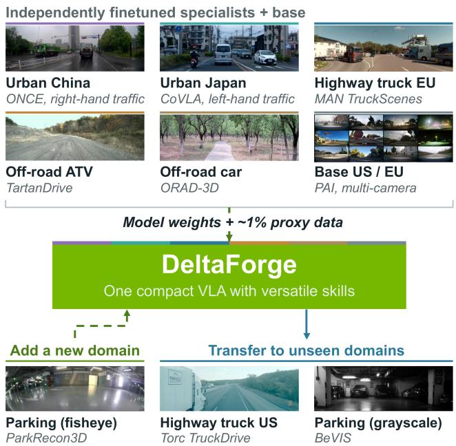
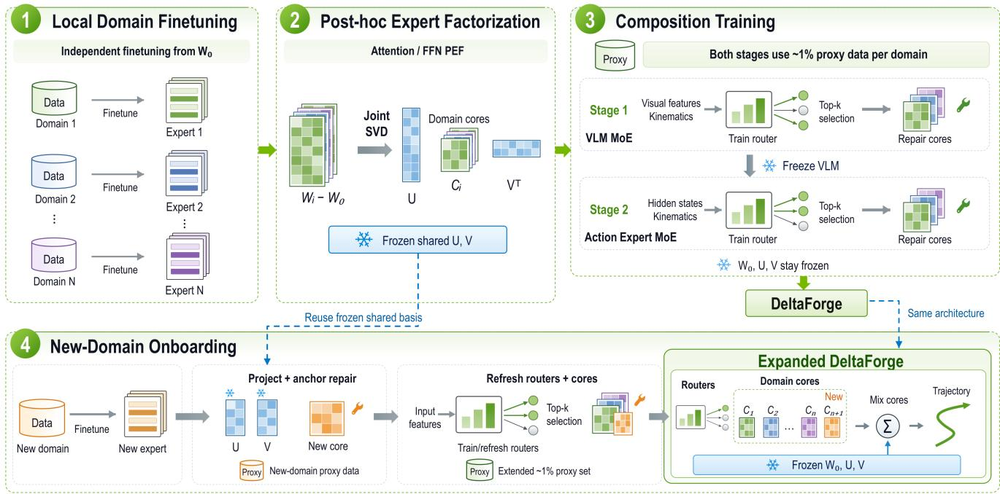
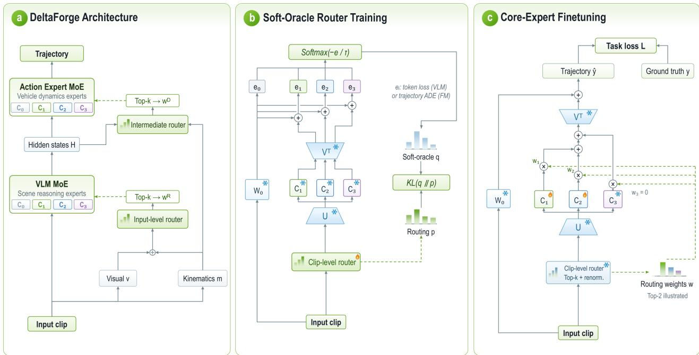
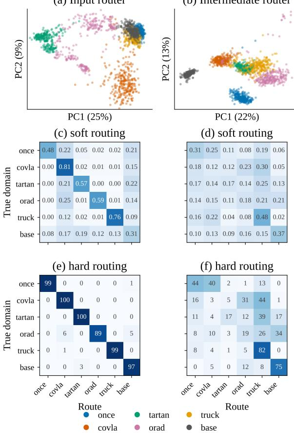
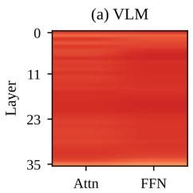
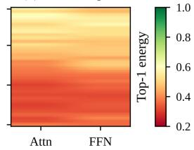
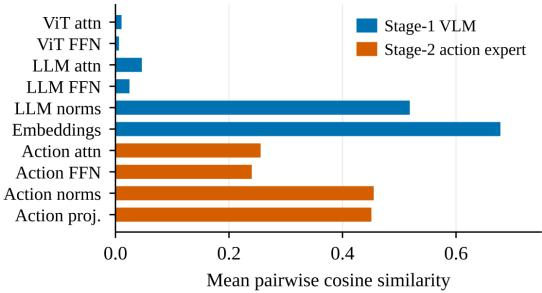

# DeltaForge: A Post-hoc Mixture-of-Experts VLA for Multi-Domain Autonomous Driving

Bingzhang Wang1,2, Mo Poorsartep1, and Yasaman Esfandiari1

Abstract— Fleets of driving vision–language–action (VLA) models are developed one domain at a time: each operator finetunes a shared base model on private data, producing specialized experts that are costly to consolidate into a single model. Weight merging loses accuracy as heterogeneous domains accumulate, and dense mixture-of-experts routing is prohibitively expensive to combine them. We present DeltaForge, to our knowledge the first post-hoc mixture-of-experts VLA for driving, which consolidates N independently finetuned perdomain models into a single multi-domain model from their weights and a small proxy set alone. When different operators finetune the same base model, their weight updates end up sharing a lot of structure. We exploit this by decomposing all the updates together using singular value decomposition (SVD), splitting each one into a shared part (the same across all domains) and a tiny domain-specific part. The router then only needs to work with those tiny domain-specific pieces, not the full expert weights, which is what keeps the approach efficient. Then two cooperating clip-level blind routers, one over the VLM reasoning experts and one over the flow-matching dynamics experts, are trained from soft labels on the proxy dataset. Across six diverse domains spanning urban, off-road, and highway driving on cars, trucks, and all-terrain vehicles (ATVs), DeltaForge approaches the accuracy of the per-domain experts and surpasses every merging, routing, centralized, and federated baseline at close to single-model parameter and compute cost. Adding a new domain requires only projecting its weight update onto the shared basis with no end-to-end retraining needed. The resulting model also generalizes to domain combinations it was never explicitly trained on.

## I. INTRODUCTION

VLA models are emerging as foundation policies for end-to-end autonomous driving: a single network perceives the scene, reasons about it in language space, and outputs a trajectory. Real deployments, however, are fragmented. Driving systems operate across very different environments, vehicles, and regions, so each operator finetunes the shared base model on its own data, leaving the field with a growing collection of specialized domain models rather than one generalizable foundation model. This paper asks how to consolidate these domain models back into a single multidomain VLA, a goal blocked by four coupled obstacles: data availability, domain heterogeneity, efficiency, and flexibility.

Data availability. In realistic deployments, this domain data is often privacy-sensitive or regulated and cannot be pooled for centralized training: only model weights leave a domain. Federated learning [1] respects this constraint, but it requires all clients to train synchronously, and under strongly heterogeneous domains its averaged global model suffers from gradient divergence. What is needed instead is a framework that aggregates already-finetuned weights into one multi-domain VLA without access to the underlying datasets.

  
Fig. 1. DeltaForge consolidates independently finetuned per-domain driving VLAs into one model from their weights and a small proxy set. A joint SVD factorizes the per-domain deltas into shared skill bases and low-rank cores that clip-level blind routers compose at inference.

Domain heterogeneity. Driving domains differ along three axes: environment (urban, highway, off-road, parking, and different regions such as China, Japan, or the US), vehicle embodiment and dynamics (passenger cars, trucks, ATVs, with varying camera counts and placements), and regulation (e.g., left- versus right-hand traffic). Unlike text-only LLM tasks, a driving VLA must map such heterogeneous visual and kinematic inputs to kinematically feasible trajectories, a multi-modal setting in which mixture-of-experts (MoE) modeling is both more necessary and far less studied. A mixture of domain experts is the natural remedy, but classical MoE trains its sparse architecture from scratch on pooled data, which the data constraint above forbids.

Efficiency. MoErging methods [2], [3] combine independently finetuned experts into a single mixture-of-experts post hoc. Yet they route large dense blocks, so storage grows almost linearly with the number of domains and top-k mixing becomes barely affordable. Classical sparse MoE is efficient, but its token- and layer-level routers [4], [5] suit language decoding, whereas the waypoints of one trajectory share a single scene and vehicle, so fine-grained switching adds complexity without benefit. A few post-hoc parameterefficient methods [6], [7] do not address new-domain opt-in, and none target VLA models.

Flexibility. To be feasible, a deployed foundation model must accept new domains continually. Also, as partners keep contributing weights, their knowledge must be injected without exponentially expanding dense parameters or retraining the whole system each time. However, finetuning the global model on each newcomer needs its dataset and risks catastrophic forgetting, weight merging [8] loses effectiveness as heterogeneous domains accumulate, and existing MoErging methods either forbid expert opt-in or require end-to-end retraining.

Beyond these four challenges, consolidating domain models raises a question of its own: do domain skills compose? As experts accumulate, does the global model gain capability even on unseen domains? For example, can a highway trucking expert and an off-road passenger-vehicle expert be mixed into an off-road trucking capability for construction scenarios? Such compositional generalization has barely been studied outside single-modality language tasks, and it is harder still for VLA driving models.

To tackle these challenges, we propose DeltaForge (Fig. 1), a driving MoE VLA built by post-hoc composition of independently finetuned domain models, built on the Alpamayo VLA [9]. Its core, Post-hoc Expert Factorization (PEF), exploits the low-rank nature of finetuning [10], [11] to jointly factorize the domain deltas into a frozen shared skill basis and per-domain low-rank cores, so routing moves tiny cores rather than dense blocks. Two cooperating clip-level routers, one at the input for VLM reasoning experts and one intermediate for flow-matching dynamics experts, mix cores without any domain labels. A new domain opts in by projecting its delta onto the frozen basis, with no end-to-end retraining.

Our contributions are threefold:

• We propose DeltaForge, to our knowledge the first posthoc mixture-of-experts VLA for driving: it consolidates independently finetuned per-domain models into one multi-domain VLA from their weights and a 1% proxy set, and later lets new domains opt in cheaply without retraining or sharing data.

• We introduce Post-hoc Expert Factorization (PEF), which uses a joint SVD to split the per-domain finetuning deltas into a frozen shared skill basis and low-rank cores, together with a two-level skill-mixing router that composes VLM reasoning and flow-matching dynamics experts at the clip level, so routing moves tiny cores rather than dense blocks.

• We evaluate on six domains that span urban, off-road, and highway driving on passenger cars, trucks, and ATVs across several regions. DeltaForge approaches the per-domain experts at close to single-model cost, surpasses every merging, routing, and data-pooling baseline, and shows compositional generalization to unseen

domains.

## II. RELATED WORK

## A. Vision-Language-Action Models for Driving

Driving VLAs couple a vision–language backbone with an action head for end-to-end planning [9]. MoE variants specialize experts within a single model and a single training run, routing camera views, behaviors, or scene-adaptive experts [12], [13]. All of these train their experts jointly on pooled multi-domain data. Consolidating independently finetuned driving models, or adding a domain without retraining, is not addressed.

## B. MoE, Model Merging, and MoErging

Composition during training requires pooled data: sparse MoE routes token- or layer-level experts [4], [5], and branchtrain variants parallelize expert training but still merge or refinetune centrally [14]. Post-hoc alternatives avoid pooled data: weight averaging and task arithmetic [8], [15] are training-free but lose accuracy as heterogeneous domains accumulate, while MoErging methods [2], [3] route frozen experts at the cost of storing dense per-expert parameters, which makes top-k mixing expensive. Closest in spirit, PHLoRA [6] extracts low-rank adapters from full-finetuning deltas one checkpoint at a time, and EigenLoRAx [7] recycles existing LoRA adapters into a shared principal subspace. Both build on the low-rank view of fine-tuning [10], [11], treating adapter directions as reusable structure across models. A jointly factorized shared basis with routed per-domain cores, applied to the two components of a VLA, remains unexplored.

## C. Federated and Multi-Domain Finetuning

Federated finetuning exchanges weights instead of data [1], [16]. Recent work incorporates LoRA adapters and heterogeneity-aware aggregation [17], and the paradigm has been applied to LLM-based driving [18]. It still requires synchronized training rounds across all clients, and the averaged global model loses accuracy under strong domain heterogeneity. Closest to us, FlexOlmo [19] combines independently trained domain experts into an MoE without sharing data, but routes over dense experts at the token level; it never factorizes them into the shared basis and compact routed cores that make our composition efficient.

## III. DELTAFORGE

## A. Problem Formulation and Overview

We consider the base weights $W _ { 0 }$ and N heterogeneous domains (different environments and vehicle embodiments). Each domain i holds a private dataset $\mathcal { D } _ { i }$ and performs full parameter finetuning on it,

$$
W _ { i } \ = \ \underset { W  W _ { 0 } } { \arg \operatorname* { m i n } } \ \mathbb { E } _ { ( x , y ) \sim \mathcal { D } _ { i } } \mathcal { L } ( W ; x , y ) ,\tag{1}
$$

where $W  W _ { 0 }$ denotes optimization initialized at the shared base. For consolidation, only the finetuned weights $\{ W _ { i } \} _ { i = 1 } ^ { N }$ and a small proxy subset of each training split are

  
Fig. 2. DeltaForge system workflow. Independently finetuned per-domain VLAs are jointly factorized by PEF into a frozen shared skill basis and perdomain low-rank cores. Two cooperating clip-level blind routers then select and mix the cores at inference, one at the input for VLM reasoning experts and one intermediate for flow-matching dynamics experts. Composition is trained on a small proxy set, and a new domain opts in by projecting its delta onto the frozen basis.

available: the bulk of $\mathcal { D } _ { i }$ never leaves its domain. We seek a composition operator C that turns the domain models into one MoE with multi-domain capability:

$$
W _ { \mathrm { M o E } } = { \mathcal C } \big ( W _ { 0 } , \{ W _ { i } \} _ { i = 1 } ^ { N } \big ) .\tag{2}
$$

Concretely, the goal is threefold: (i) capability match: on each domain, $W _ { \mathrm { M o E } }$ matches the corresponding expert $W _ { i } ;$ (ii) blind efficient routing: given a new input without any domain label, the MoE identifies it and efficiently routes and combines the relevant reasoning and dynamics skills; (iii) flexible growth: new domains opt in cheaply, and the composed model generalizes beyond the seen domains.

We instantiate DeltaForge on Alpamayo [9], an opensource driving VLA with two components: a VLM and a flow-matching action expert, finetuned in two stages, so each domain contributes a reasoning expert and a dynamics expert. DeltaForge generalizes to any two-component VLA of this reasoning-plus-action form. Figure 2 gives the overall system workflow.

## B. Post-hoc Expert Factorization (PEF)

Finetuning updates are effectively low-rank [10], [11], so the N experts are highly redundant and routing full expert blocks is needlessly dense. Basically, low-rank structure means the experts share significant overlap, so routing full blocks is wasteful. PEF exploits this structure to keep the MoE sparse and cheap: it extracts the skills shared across domains into a common frozen basis, keeps one small core expert per domain that encodes its skill combination, and routes only the attention and FFN cores.

Shared skill basis via joint SVD. For every factorized weight matrix $W \in \mathbb { R } ^ { d _ { \mathrm { o u t } } \times d _ { \mathrm { i n } } }$ (acting as $x \mapsto W x )$ , each domain’s update is first summarized by its task vector [15]

$$
\Delta _ { i } \ = \ W _ { i } - W _ { 0 } , \qquad i = 1 , \ldots , N .\tag{3}
$$

We then extract a joint rank-r basis from all N task vectors,

$$
\begin{array} { r l } & { U = \mathrm { S V D } _ { r } \big ( [ \Delta _ { 1 } , \dots , \Delta _ { N } ] \big ) , } \\ & { V = \mathrm { S V D } _ { r } \big ( [ \Delta _ { 1 } ^ { \top } , \dots , \Delta _ { N } ^ { \top } ] \big ) , } \end{array}\tag{4}
$$

where [·] concatenates along columns and SVDr returns the top-r left singular vectors of its argument. By the Eckart– Young theorem [20], truncated SVD is the optimal low-rank approximation, so $U \in \mathbb { R } ^ { d _ { \mathrm { o u t } } \times r }$ and $V \in \mathbb { R } ^ { d _ { \mathrm { i n } } \times r }$ span the best shared column and row spaces of all domain updates at a low rank $r \ll \operatorname* { m i n } ( d _ { \mathrm { o u t } } , d _ { \mathrm { i n } } )$ . We interpret the frozen pair $( U , V )$ as a shared skill basis whose size is fixed by r and independent of N.

Per-domain low-rank core experts. Each domain keeps only its coordinates in this basis, the core expert

$$
C _ { i } = U ^ { \top } \Delta _ { i } V \in \mathbb { R } ^ { r \times r } , \qquad \widehat { W } _ { i } = W _ { 0 } + U C _ { i } V ^ { \top } ,\tag{5}
$$

which encodes how domain i combines the shared skills. The basis is frozen and shared across all domains. Only the small cores are stored, routed, and finetuned. The base model itself joins the expert pool for free as a zero core, $C _ { 0 } = \mathbf { 0 }$ (so $\widehat { W } _ { 0 } = W _ { 0 } )$ , giving the routers a default base route.

Factorization scope. PEF is applied to the attention and FFN matrices of the ViT, the LLM, and the flowmatching action expert alike, where routing low-rank cores is highly parameter-efficient. The remaining modules (token embeddings, LM head, etc.) are merged into a single shared copy and not routed.

  
Fig. 3. DeltaForge architecture and composition training. (a) Two-level clip-level routing of low-rank cores at inference. (b) Soft-oracle router training with a KL objective. (c) Core-expert finetuning against the task loss.

## C. Skill-Mixing Routing

DeltaForge composes the two expert families of Sec. III-A, VLM reasoning experts and flow-matching dynamics experts, with two cooperating routers (Fig. 3a) so that reasoning and dynamics skills can be mixed across domains.

Clip-level blind routing. The router computes one expert mixture w per input clip, and every factorized layer ℓ mounts the same mixture for the entire trajectory:

$$
\begin{array} { r } { \bar { W } ^ { ( \ell ) } = W _ { 0 } ^ { ( \ell ) } + { U } ^ { ( \ell ) } \Big ( \sum _ { i = 1 } ^ { N } w _ { i } C _ { i } ^ { ( \ell ) } \Big ) { V } ^ { ( \ell ) \top } . } \end{array}\tag{6}
$$

This departs from the per-token and per-layer routers of LLM MoEs by design: all waypoints of one trajectory obey the same scene and vehicle dynamics, so finer-grained switching adds complexity without benefit.

Input-level router for VLM reasoning experts. The VLM router is blind: it never sees a domain label. Its two inputs are

$$
\begin{array} { r } { v \ = \ \frac { 1 } { | T | } \sum _ { t \in \mathcal { T } } { \mathrm { V i T } } _ { 0 } { ( x ) } _ { t } , \qquad m \ = \ \big [ \phi ( s ) , \phi ( a ) , \phi ( \kappa ) \big ] , } \end{array}\tag{7}
$$

where $\operatorname { V i T } _ { 0 } ( x )$ t are the visual token features of the frozen ViT of the base VLM $W _ { 0 } ~ ( { \mathcal { T } }$ the visual tokens), $s , a , \kappa$ are the speed, acceleration, and curvature sequences of the ego history, and ϕ returns their z-scored summary statistics (mean, standard deviation, extrema, final value). A small MLP then yields $p ^ { \mathrm { R } } ~ = ~ \mathrm { s o f t m a x } { \bigl ( } f _ { \theta } ( [ v ; m ] ) { \bigr ) }$ . Together, v and m identify the scene environment and the vehicle embodiment.

Intermediate router for trajectory dynamics experts. The dynamics router reads h, the mean-pooled lastlayer hidden states of the VLM, together with the same kinematics m, and selects dynamics experts via $\begin{array} { r l } { p ^ { \mathrm { D } } } & { { } = } \end{array}$ softmax $\left( f _ { \phi } ( [ h ; m ] ) \right)$ . Decoupling the two routers lets one domain’s scene reasoning pair freely with another domain’s vehicle dynamics.

Top-k soft mixing. Each router distribution p is truncated to its top-k experts K and renormalized to weights w over that set, with $w _ { i } { = } 0$ outside K. Since Eq. (6) is linear in the cores, mixing happens once in parameter space at zero extra inference cost, and w stays in the computation graph, keeping routing end-to-end trainable. Top-1, top-2, and top-p are instances of the same mechanism.

## D. Proxy-Based Composition Training

All post-hoc training of DeltaForge uses a very lightweight proxy set $\mathcal { P } _ { i } \subset \mathcal { D } _ { i }$ per domain, roughly 1% of the domain’s training data, and it serves only two purposes: router training and core-expert repair.

Soft-oracle router training. Router supervision is generated by the experts themselves (Fig. 3b). No domain label is ever used. Every candidate expert scores each proxy sample,

$$
\begin{array} { r } { e _ { i } ( x ) = \left\{ \begin{array} { l l } { \mathcal { L } \bigl ( \widehat { W } _ { i } ; x , y \bigr ) , } & { \mathrm { V L M \ e x p e r t s } , } \\ { \mathrm { A D E } \bigl ( \hat { y } _ { i } ( x ) , y \bigr ) , } & { \mathrm { f l o w { - } m a t c h i n g \ e x p e r t s } , } \end{array} \right. } \end{array}\tag{8}
$$

the teacher-forced token loss for reasoning experts, and the error of the generated trajectory ${ \hat { y } } _ { i } ( x )$ for dynamics experts, whose flow-matching training loss correlates poorly with trajectory quality. The sweep is cheap thanks to PEF: all experts share frozen skill basis and differ only by their $r \times r$ cores. The scores define a loss-minimizing soft oracle label with temperature τ,

$$
q _ { i } ( x ) = \frac { \exp \bigl ( - e _ { i } ( x ) / \tau \bigr ) } { \sum _ { j = 1 } ^ { N } \exp \bigl ( - e _ { j } ( x ) / \tau \bigr ) } ,\tag{9}
$$

and the router is trained to match this soft-oracle distribution by minimizing the KL divergence

$$
\mathbb { E } _ { { x } \sim \cup _ { i } \mathcal { P } _ { i } } \mathrm { K L } \big ( q ( x ) \| p ( x ) \big ) = \mathbb { E } _ { x } \sum _ { i = 1 } ^ { N } q _ { i } ( x ) \log \frac { q _ { i } ( x ) } { p _ { i } ( x ) } ,\tag{10}
$$

where $p ( x )$ is the corresponding router output $( p ^ { \mathrm { R } }$ or $p ^ { \mathrm { D } } )$ The calibrated target natively supports top-k selection.

Core-expert finetuning. Core-expert finetuning on the proxy set can potentially compensate for the rank-r SVD truncation loss (Fig. 3c). Once the router is trained, we freeze it and optimize the cores selected by its top-k policy. The shared skill basis $( U , V )$ also stays frozen, so among the model weights only the core experts {Ci} are optimized by minimizing the task loss L over the cores on the proxy $\cup _ { i } \mathcal { P } _ { i }$ mounting the routed core mixture W¯ (x; {Ci}) of Eq. (6). Gradients reach only the top-k selected cores, and learning under the top-k mixture lets these cores co-adapt, improving expert mixing at inference.

Two-stage composition training. We first train the VLM MoE (the input-level router and the VLM cores), then freeze it and train the flow-matching MoE with the intermediate router. The routers thereby learn by themselves how to combine reasoning and dynamics experts across domains.

## E. Flexible New-Domain Onboarding

A new domain N+1 opts in against the frozen skill basis. The basis (U, V) stays frozen and no domain is retrained end-to-end. First, its task vector is projected onto the frozen basis to extract a new core expert,

$$
\Delta _ { N + 1 } = W _ { N + 1 } - W _ { 0 } , \qquad C _ { N + 1 } = U ^ { \top } \Delta _ { N + 1 } V .\tag{11}
$$

Second, the new core is anchor-repaired on its own proxy set $\mathcal { P } _ { N + 1 }$ by core repair with routing locked to expert $N { + 1 }$ compensating for the lossy projection onto a basis built without this domain. Third, soft-oracle labels are regenerated (Eq. 9) and the routers and all cores are jointly refreshed by re-running router training (Eq. 10) and core repair with $N { \gets } N { + } 1$ on the extended proxy set $\cup _ { i = 1 } ^ { N + 1 } \mathcal { P } _ { i }$ , which adapts the expert mixtures to the new domain while preserving performance on the old ones.

## IV. EXPERIMENTS

## A. Experimental Setup

Base model and training. We build on Alpamayo 1.5 (10B) [9], an 8B Cosmos-Reason VLM backbone with a 2B flow-matching action expert. In its default trajectory mode, the model takes a front camera image and a 16-step ego history at 10Hz and predicts a 64-step future trajectory. Each domain expert is trained in two stages on eight H100 GPUs: stage 1 fully finetunes the VLM with next-token crossentropy on trajectory tokens (AdamW, lr $1 0 ^ { - 5 }$ , batch 32), and stage 2 freezes it and trains the action expert with the flow-matching objective (lr $1 0 ^ { - 4 }$ , batch 8), each up to 10 epochs. For composition, the PEF cores have rank r=256, the soft-oracle temperature is $\tau { = } 0 . 3$ , and the routers and cores are trained for 200 and 500 steps on the proxy set.

TABLE I  
DOMAINS AND DATASETS. TRAIN/EVAL ARE WINDOWED SAMPLES AFTER SCENE-LEVEL SPLITTING. THE LOWER BLOCK IS USED ONLY FOR ONBOARDING AND ZERO-SHOT EVALUATION.
<table><tr><td>Domain</td><td>Dataset</td><td>Scenario</td><td>Train</td><td>Eval</td></tr><tr><td>Urban China</td><td>ONCE [21]</td><td>urban, right-hand</td><td>24,885</td><td>2,769</td></tr><tr><td>Urban Japan</td><td>CoVLA [22]</td><td>urban, left-hand</td><td>26,987</td><td>2,893</td></tr><tr><td>Off-road ATV</td><td>TartanDrive [23]</td><td>forest trails, ATV</td><td>17,470</td><td>1,484</td></tr><tr><td>Off-road car</td><td>ORAD-3D [24]</td><td>China, off-road, car</td><td>34,801</td><td>4,897</td></tr><tr><td>Highway truck EU</td><td>TruckScenes [25]</td><td>EU highway, truck</td><td>33,305</td><td>3,172</td></tr><tr><td>Base</td><td>PhysicalAI-AV [26]</td><td>US/EU, four cameras</td><td>19,545</td><td>3,000</td></tr><tr><td>Highway truck US</td><td>Torc TruckDrive [27]</td><td>US highway, truck</td><td>23,593</td><td>3,031</td></tr><tr><td>Underground parking</td><td>ParkRecon3D [28]</td><td>garage, fisheye</td><td>5,753</td><td>745</td></tr><tr><td>Indoor parking</td><td>BeVIS [29]</td><td>garage, grayscale</td><td>4,485</td><td>297</td></tr></table>

Domains datasets. Table I lists the six domains: five finetuned experts and the base model’s native domain, served by the zero-core route. They are heterogeneous in environment, region, vehicle, and sensor rig, and each finetuned domain uses one front camera while the base uses four. Three further datasets are held out for Sec. IV-D: ParkRecon3D for newdomain onboarding, and Torc TruckDrive and BeVIS for zero-shot generalization.

Protocol and metrics. All post-hoc training uses a proxy set of 200 clips per domain (about 1% of the training data) drawn from the training split. The eval splits are never touched. We report the minimum average displacement error over six sampled trajectories at the 5 s horizon, in meters (minADE@5 s). Each router selects among N+1 routes, the N domain experts plus the default base route (Sec. III-B).

## B. Main Results: Multi-Domain Performance

Baselines. Table II compares four groups. The zeroshot base and per-domain experts provide lower and upper bounds. Centralized and federated SFT (FedAdam [30]) use all training data, unlike the remaining methods, which merge or route the same five checkpoints from weights and a 1% proxy alone: static merging [8], [15], [31], [32], [33], [34] and routed methods that keep the experts, EMR-Merging [35], Twin-Merging [36], and BTX [14]. Merging hyperparameters are selected on the proxy set.

Results. DeltaForge is the most accurate weight-based method. Its mean minADE@5 s is 1.0157, close to the 0.9798 of the six separate domain experts and below every merging and routing baseline. Centralized and federated SFT do worse even though they use all the training data, which shows how heterogeneous the domains are: one shared model must trade them off, while routed experts do not. DeltaForge keeps the base route, so it avoids the catastrophic forgetting most merging baselines suffer on the base domain. Top-2 routing softly mixes two experts per clip, matching the top-1 mean while cutting the base-domain error from 0.92 to 0.76 and adding robustness where a single expert is weak.

## C. Efficiency Analysis

DeltaForge is efficient in memory, compute, and training (Tables III and IV). Each domain adds a low-rank core of only 42M parameters, 0.3% of the base. Keeping separate experts or BTX FFN experts instead grows the model linearly, so it soon becomes far larger than DeltaForge. At inference, compute stays near single-model cost and barely grows with the number of routed experts k: mixing low-rank cores keeps top-k routing far cheaper than dense MoEs. For training, we freeze the base and update only the cores and routers, which is 1% of the parameters, using the 1% proxy dataset.

TABLE II  
END-TO-END MINADE@5 S (M, BEST-OF-6, LOWER IS BETTER) ON THE SIX DOMAINS AND THEIR MEAN. PAI IS THE BASE DOMAIN. DATA IS THE TRAINING DATA A METHOD NEEDS BEYOND THE FINETUNED WEIGHTS. BOLD AND UNDERLINE MARK THE BEST AND SECOND-BEST WEIGHT-BASED METHOD PER COLUMN.
<table><tr><td rowspan="2">Method</td><td rowspan="2">Venue</td><td colspan="7">minADE@5s (m)↓</td><td rowspan="2">Data</td><td rowspan="2">Params (B) ↓</td><td colspan="2">Total</td></tr><tr><td>PAI base</td><td>ONCE China</td><td>CoVLA Japan</td><td>Tartan ATV</td><td>ORAD off-road</td><td>TruckScenes highway truck</td><td>Mean</td><td>Active</td></tr><tr><td>Zero-shot base (lower bound)</td><td></td><td>0.9568</td><td>2.1763</td><td>4.4319</td><td>2.5019</td><td>1.0800</td><td>6.6409</td><td>2.9646</td><td>none</td><td></td><td>11.08</td><td>11.08</td></tr><tr><td>Per-domain experts (upper bound)</td><td></td><td>0.9568</td><td>1.0354</td><td>1.6828</td><td>1.2294</td><td>0.5141</td><td></td><td>0.4601</td><td>0.9798</td><td>own domain</td><td>11.08</td><td>66.47</td></tr><tr><td>Centralized SFT (pooled data)</td><td></td><td>0.8098</td><td>1.2461</td><td>1.7701</td><td>1.3092</td><td>0.9206</td><td></td><td>0.6217</td><td>1.1129</td><td>all</td><td>11.08</td><td>11.08</td></tr><tr><td>Federated SFT (FedAdam [30])</td><td>ICLR&#x27;21</td><td>0.8076</td><td>1.2237</td><td>1.7172</td><td>1.3457</td><td>0.6991</td><td></td><td>0.8585</td><td>1.1086</td><td>all (local)</td><td>11.08</td><td>11.08</td></tr><tr><td>Model soup [8]</td><td>ICML&#x27;22</td><td>1.4376</td><td>1.4184</td><td>2.0058</td><td>1.3878</td><td>0.9029</td><td></td><td>2.6261</td><td>1.6298</td><td>none</td><td>11.08</td><td>11.08</td></tr><tr><td>Task arithmetic [15]</td><td>ICLR&#x27;23</td><td>1.8665</td><td>1.5162</td><td>1.9275</td><td>1.3994</td><td>1.0440</td><td></td><td>2.6462</td><td>1.7333</td><td>1% proxy</td><td>11.08</td><td>11.08</td></tr><tr><td>TIES [31]</td><td>NeurIPS’23</td><td>1.9396</td><td>61.4604</td><td>2.0902</td><td>1.2396</td><td>0.9853</td><td></td><td>3.8695</td><td>1.9308</td><td>1% proxy</td><td>11.08</td><td>11.08</td></tr><tr><td>DARE [32]</td><td>ICML&#x27;24</td><td>1.4542</td><td>1.4153</td><td>1.9283</td><td>1.4088</td><td>0.8618</td><td>2.5378</td><td></td><td>1.6010</td><td>1% proxy</td><td>11.08</td><td>11.08</td></tr><tr><td>TSV-M [33]</td><td>CVPR&#x27;25</td><td>1.4930</td><td>1.4398</td><td>2.1516</td><td>1.4122</td><td>0.7582</td><td>2.6390</td><td></td><td>1.6490</td><td>1% proxy</td><td>11.08</td><td>11.08</td></tr><tr><td>KnOTS [34]</td><td>ICLR’25</td><td>2.0984</td><td>1.3874</td><td>1.9547</td><td>1.2497</td><td>0.7457</td><td>3.1853</td><td></td><td>1.7702</td><td>1% proxy</td><td>11.08</td><td>11.08</td></tr><tr><td>EMR-Merging [35]</td><td>NeurIPS&#x27;24</td><td>0.9110</td><td>1.2632</td><td>1.9057</td><td>1.2181</td><td>0.6440</td><td>1.6974</td><td></td><td>1.2732</td><td>1% proxy</td><td>11.08</td><td>22.2</td></tr><tr><td>Twin-Merging [36]</td><td>NeurIPS&#x27;24</td><td>1.8385</td><td>1.3095</td><td>1.8514</td><td>1.1764</td><td>0.6321</td><td>1.2983</td><td></td><td>1.3510</td><td>1% proxy</td><td>11.12</td><td>11.30</td></tr><tr><td>BTX [14]</td><td>arXiv&#x27;24</td><td>1.1892</td><td>1.2689</td><td>1.7121</td><td>1.2049</td><td>0.5968</td><td>1.4668</td><td></td><td>1.2398</td><td>1% proxy</td><td>11.08</td><td>47.4</td></tr><tr><td>DeltaForge top-1 routing</td><td>Ours</td><td>0.9189</td><td>1.0185</td><td>1.7146</td><td>1.2053</td><td>0.6951</td><td></td><td>0.5417</td><td>1.0157</td><td>1% proxy</td><td>12.38</td><td>12.55</td></tr><tr><td>DeltaForge top-2 routing</td><td>Ours</td><td>0.7569</td><td>1.1806</td><td>1.7033</td><td>1.1727</td><td>0.6354</td><td></td><td>0.6529</td><td>1.0170</td><td>1% proxy</td><td>12.42</td><td>12.55</td></tr></table>

TABLE III

PARAMETER BREAKDOWN OF THE DEPLOYED DELTAFORGE SYSTEM (N=5). THE SHARED BASES COME IN CLOSED FORM FROM THE JOINT SVD, SO ONLY THE CORES AND THE TWO ROUTERS ARE TRAINED, ABOUT 1% OF THE TOTAL.
<table><tr><td>Component</td><td>Params</td><td>Trained</td></tr><tr><td>Base VLM + action expert</td><td>11,079M</td><td>frozen</td></tr><tr><td>Shared bases U, V (VLM + FM)</td><td>1,257M</td><td>closed form</td></tr><tr><td>Embeddings, heads, norms</td><td>+0</td><td>merged</td></tr><tr><td>Routers (×2)</td><td>2.1M</td><td>√</td></tr><tr><td>Cores + projections / domain</td><td>42.0M</td><td>√</td></tr><tr><td>Total (N=5)</td><td>12,547M</td><td></td></tr><tr><td>of which trained</td><td>122.7M</td><td>1.0%</td></tr></table>

## D. Zero-Shot Generalization and New-Domain Onboarding

We test DeltaForge on domains outside the training pool, using the five-domain system of Table II.

Zero-shot skill transfer. When the pool already holds a related skill, an unseen domain benefits with no training (Table V, top). Torc TruckDrive is long-haul highway trucking, which shares dynamics with MAN TruckScenes.

The blind router sends 90%of its clips to the truck skill with top-1 routing and 83% with top-2. The error drops from 8.99 to 1.06 (top-1) or 1.00 (top-2), approaching the domain’s own finetuned expert (0.82), all without any Torc TruckDrive training data. A domain with no related skill in the pool shows no such gain.

Onboarding. A new domain opts in against the frozen basis without touching the existing experts or the basis (Sec. III-E). Onboarding ParkRecon3D lowers its error from 0.75 to 0.65 and grows the system by only 42M parameters, while the six existing domains change by only +1.5% on average. Onboarding also lifts a related domain that is still unseen (Table V, bottom): the never-seen BeVIS garages improve from 0.52 to 0.41, below BeVIS’s own finetuned expert (0.42). A newly added parking domain thus composes with the existing experts to serve a different, unseen parking domain, answering the question raised in Sec. I.

## E. Ablations and Analysis

Router behavior. The two routers (Sec. III-C) answer different questions (Fig. 4). Once each feature dimension is standardized, both see inputs that separate the domains. The input router does domain recognition and routes 97% of clips to its own expert. The intermediate router sees equally separable features but picks the own domain only 40% of the time: the flow-matching dynamics experts are interchangeable. It mixes experts across domains and makes top-k routing effective (Table II).

Route vs. merge. This ablation asks, per module, where to route and where to merge. For each weight matrix we stack the N per-domain deltas and measure the top-1 energy $\sigma _ { 1 } ^ { 2 } / \sum _ { k } \sigma _ { k } ^ { 2 }$ (Fig. 5a,b) and the mean pairwise cosine of the deltas (Fig. 5c). Attention and FFN have low top-1 energy (below 0.30 in the VLM) and near-zero cosine, so the domains move them in almost orthogonal directions and we route them as low-rank cores. Token embeddings and norms are the opposite, with cosine up to 0.68, so we merge them into one shared copy. This sets the factorization scope of Sec. III-B: route attention and FFN, merge the rest.

Routing granularity. A clip is a single trajectory, so DeltaForge routes all cores once per clip. The finer routers used in LLM MoEs do not fit this setting. A per-layer variant places one MLP router at each of the 36 LLM layers, and a per-token variant routes every token at every layer. Both are made for end-to-end training, where the routers and experts are learned together at full cost, not for post-hoc composition of frozen cores. With the same cores and soft-oracle labels, per-layer routing raises the six-domain mean minADE from 1.0157 to 1.1589 (+14.1%) and per-token routing to 1.1015 (+8.4%). In both cases, the fine-grained routing decisions agree with the clip-level route only 65% and 67% of the time respectively, confirming that sub-clip switching adds noise rather than signal.

TABLE IV  
DEPLOYMENT COST VERSUS THE NUMBER OF DOMAINS N AND ROUTED EXPERTS k (DENSE BASE 20.9 GFLOPS/TOKEN). DELTAFORGE STAYS NEAR SINGLE-MODEL COST AS BOTH GROW, UNLIKE THE LINEAR SCALING OF SEPARATE EXPERTS AND BTX.
<table><tr><td>Method</td><td colspan="3">Params (B) ↓</td><td colspan="4">GFLOPs / token ↓</td></tr><tr><td></td><td>formula</td><td> $N { = } 5$ </td><td> $N { = } 1 0$ </td><td>formula</td><td>top-1</td><td>top-2</td><td>top-5</td></tr><tr><td>Per-domain experts</td><td> $1 1 . 0 8 \left( N { + 1 } \right)$ </td><td>66.5</td><td>121.9</td><td>20.9</td><td>20.9</td><td></td><td></td></tr><tr><td>BTX</td><td> $1 1 . 0 8 + 7 . 2 6 N$ </td><td>47.4</td><td>83.7</td><td> $6 . 3 5 + 1 4 . 5 2 k$ </td><td>20.9</td><td>35.4</td><td>79.0</td></tr><tr><td>DeltaForge (ours)</td><td> $1 2 . 3 4 + 0 . 0 4 2 N$ </td><td>12.55</td><td>12.76</td><td> $2 3 . 3 9 + 0 . 0 8 k$ </td><td>23.5</td><td>23.6</td><td>23.8</td></tr></table>

TABLE V

GENERALIZATION TO UNSEEN DOMAINS (MINADE@5 S, METERS). TOP: A TRUCK SKILL ALREADY IN THE POOL (MAN TRUCKSCENES) TRANSFERS ZERO-SHOT TO THE UNSEEN TORC TRUCKDRIVE. BOTTOM: ONBOARDING THE RELATED PARKRECON3D PARKING DOMAIN SERVES THE NEVER-SEEN BEVIS BELOW ITS OWN FINETUNED EXPERT, WITHOUT TRAINING ON IT.
<table><tr><td>Unseen: Torc TruckDrive</td><td colspan="2">in pool: MAN TruckScenes</td></tr><tr><td>Model</td><td></td><td>minADE</td></tr><tr><td>Base (zero-shot)</td><td></td><td>8.9862</td></tr><tr><td>Own-domain finetune</td><td></td><td>0.8225</td></tr><tr><td>DeltaForge top-1 routing</td><td></td><td>1.0627</td></tr><tr><td>DeltaForge top-2 routing</td><td></td><td>0.9969</td></tr><tr><td colspan="3">Unseen: BeVIS onboarded: ParkRecon3D</td></tr><tr><td>Base (zero-shot)</td><td></td><td>0.5333</td></tr><tr><td>Own-domain finetune</td><td></td><td>0.4238</td></tr><tr><td>DeltaForge w/o ParkRecon3D</td><td></td><td>0.5246</td></tr><tr><td>DeltaForge w/ ParkRecon3D</td><td></td><td>0.4114</td></tr></table>

Reasoning retention. DeltaForge keeps the base model’s driving reasoning. On LingoQA [37], its zero-shot Lingo-Judge accuracy is 73.8% with top-1 routing and 73.0% with top-2, matching the base model at 73.2%. LingoQA has no ego trajectory, so the input router sends 89% of questions to the base route and the base reasoning stays intact. Full per-domain finetuning drops this score by over 25 points on the most out-of-distribution domain.

## V. CONCLUSION

We presented DeltaForge, a post-hoc mixture-of-experts VLA that consolidates independently finetuned per-domain driving models into one multi-domain VLA from their weights and a small proxy set, using Post-hoc Expert Factorization to split the finetuning deltas into a frozen shared skill basis and per-domain low-rank cores that two cooperating clip-level routers mix at inference. Across six heterogeneous domains, DeltaForge approaches the per-domain experts and outperforms merging, routing, and data-pooling baselines at near single-model cost, with cheap new-domain opt-in and compositional generalization to unseen domains. In future work, we plan to scale DeltaForge to more domains and base VLA models.

(b) Intermediate router  
  
Fig. 4. Router behavior. Each column is one router, with rows showing its input-feature PCA (top), soft routing (middle), and hard routing (bottom), the confusion matrices row-normalized by true domain. The input router (left) recognizes the domain and picks the corresponding route 97% of the time, while the intermediate router (right) routes to the correct domain only 40% of the time, indicating that the dynamics experts are interchangeable.

## REFERENCES

[1] H. B. McMahan, E. Moore, D. Ramage, S. Hampson, and B. A. y Arcas, “Communication-efficient learning of deep networks from decentralized data,” in Proc. Int. Conf. Artificial Intelligence and Statistics (AISTATS), 2017.

[2] P. Yadav, C. Raffel, M. Muqeeth, L. Caccia, H. Liu, T. Chen, M. Bansal, L. Choshen, and A. Sordoni, “A survey on model MoErging: Recycling and routing among specialized experts for collaborative learning,” Transactions on Machine Learning Research, 2025.

[3] O. Ostapenko, Z. Su, E. M. Ponti, L. Charlin, N. L. Roux, M. Pereira, L. Caccia, and A. Sordoni, “Towards modular LLMs by building and reusing a library of LoRAs,” arXiv preprint arXiv:2405.11157, 2024.

(b) Action expert  

(c) Cross-domain overlap per module  
  
Fig. 5. Task-vector spectrum per module. (a,b) Per-layer top-1 energy of attention and FFN in the VLM and the action expert, red marks the low, near-orthogonal band. (c) Mean pairwise cosine similarity of the domain deltas per module: attention and FFN near zero (route), embeddings and norms high (merge).

[4] N. Shazeer, A. Mirhoseini, K. Maziarz, A. Davis, Q. Le, G. Hinton, and J. Dean, “Outrageously large neural networks: The sparsely-gated mixture-of-experts layer,” in Proc. Int. Conf. Learning Representations (ICLR), 2017.

[5] W. Fedus, B. Zoph, and N. Shazeer, “Switch transformers: Scaling to trillion parameter models with simple and efficient sparsity,” Journal of Machine Learning Research, vol. 23, no. 120, pp. 1–39, 2022.

[6] B. Vasani, J. FitzGerald et al., “PHLoRA: Data-free post-hoc lowrank adapter extraction from full-rank checkpoint,” arXiv preprint arXiv:2509.10971, 2025.

[7] P. Kaushik, A. Vaidya, S. Chaudhari, and A. Yuille, “EigenLoRAx: Recycling adapters to find principal subspaces for resource-efficient adaptation and inference,” arXiv preprint arXiv:2502.04700, 2025.

[8] M. Wortsman, G. Ilharco, S. Y. Gadre, R. Roelofs, R. Gontijo-Lopes, A. S. Morcos, H. Namkoong, A. Farhadi, Y. Carmon, S. Kornblith, and L. Schmidt, “Model soups: Averaging weights of multiple finetuned models improves accuracy without increasing inference time,” in Proc. Int. Conf. Machine Learning (ICML), 2022.

[9] NVIDIA, “Alpamayo-r1: Bridging reasoning and action prediction for generalizable autonomous driving in the long tail,” arXiv preprint arXiv:2511.00088, 2025.

[10] E. J. Hu, Y. Shen, P. Wallis, Z. Allen-Zhu, Y. Li, S. Wang, L. Wang, and W. Chen, “LoRA: Low-rank adaptation of large language models,” in Proc. Int. Conf. Learning Representations (ICLR), 2022.

[11] A. Aghajanyan, L. Zettlemoyer, and S. Gupta, “Intrinsic dimensionality explains the effectiveness of language model fine-tuning,” in Proc. Annu. Meeting ofthe Associationfor Computational Linguistics (ACL), 2021.

[12] Z. Yang, Y. Chai, X. Jia, Q. Li, Y. Shao, X. Zhu, H. Su, and J. Yan, “DriveMoE: Mixture-of-experts for vision-language-action model in end-to-end autonomous driving,” arXiv preprint arXiv:2505.16278, 2025.

[13] C. Wan, Y. Cui, J. Du, S. Yang, Y. Bai, P. Yi, N. Li, and Y. Huang, “GEMINUS: Dual-aware global and scene-adaptive mixture-of-experts for end-to-end autonomous driving,” arXiv preprint arXiv:2507.14456, 2025.

[14] S. Sukhbaatar, O. Golovneva, V. Sharma, H. Xu, X. V. Lin, B. Roziere,\` J. Kahn, D. Li, W. tau Yih, J. Weston, and X. Li, “Branch-train-MiX: Mixing expert LLMs into a mixture-of-experts LLM,” arXiv preprint arXiv:2403.07816, 2024.

[15] G. Ilharco, M. T. Ribeiro, M. Wortsman, S. Gururangan, L. Schmidt, H. Hajishirzi, and A. Farhadi, “Editing models with task arithmetic,” in Proc. Int. Conf. Learning Representations (ICLR), 2023.

[16] R. Ye, W. Wang, J. Chai, D. Li, Z. Li, Y. Xu, Y. Du, Y. Wang, and S. Chen, “OpenFedLLM: Training large language models on

decentralized private data via federated learning,” arXiv preprint arXiv:2402.06954, 2024.

[17] Z. Wang, Z. Shen, Y. He, G. Sun, H. Wang, L. Lyu, and A. Li, “FLoRA: Federated fine-tuning large language models with heterogeneous low-rank adaptations,” arXiv preprint arXiv:2409.05976, 2024.

[18] T. Xiang, M. Zhi et al., “FLAD: Federated learning for LLM-based autonomous driving in vehicle-edge-cloud networks,” arXiv preprint arXiv:2511.09025, 2025.

[19] W. Shi, A. Bhagia, K. Farhat, N. Muennighoff et al., “Flex-Olmo: Open language models for flexible data use,” arXiv preprint arXiv:2507.07024, 2025.

[20] C. Eckart and G. Young, “The approximation of one matrix by another of lower rank,” Psychometrika, vol. 1, no. 3, pp. 211–218, 1936.

[21] J. Mao, M. Niu, C. Jiang et al., “One million scenes for autonomous driving: ONCE dataset,” in Proc. NeurIPS Datasets and Benchmarks Track, 2021.

[22] H. Arai, K. Miwa, K. Sasaki, Y. Yamaguchi, K. Watanabe, S. Aoki, and I. Yamamoto, “CoVLA: Comprehensive vision-language-action dataset for autonomous driving,” in Proc. IEEE/CVF Winter Conf. Applications of Computer Vision (WACV), 2025.

[23] M. Sivaprakasam, P. Maheshwari, M. G. Castro et al., “Tartan-Drive 2.0: More modalities and better infrastructure to further selfsupervised learning research in off-road driving tasks,” arXiv preprint arXiv:2402.01913, 2024.

[24] C. Min, J. Mei, H. Zhai et al., “Advancing off-road autonomous driving: The large-scale ORAD-3D dataset and comprehensive benchmarks,” arXiv preprint arXiv:2510.16500, 2025.

[25] F. Fent, F. Kuttenreich, F. Ruch et al., “MAN TruckScenes: A multimodal dataset for autonomous trucking in diverse conditions,” in Proc. NeurIPS Datasets and Benchmarks Track, 2024.

[26] NVIDIA, “PhysicalAI-autonomous-vehicles dataset,” https: //huggingface.co/datasets/nvidia/PhysicalAI-Autonomous-Vehicles, accessed Sep. 2026.

[27] F. Ghilotti, E. Palladin, S. Brucker et al., “TruckDrive: Long-range autonomous highway driving dataset,” in Proc. IEEE/CVF Conf. Computer Vision and Pattern Recognition (CVPR), 2026.

[28] X. Wei, Z. Ye, Y. Gu et al., “ParkGaussian: Surround-view 3D Gaussian splatting for autonomous parking,” in Proc. IEEE/CVF Conf. Computer Vision and Pattern Recognition (CVPR), 2026.

[29] X. Shao, Y. Shen, L. Zhang, S. Zhao, D. Zhu, and Y. Zhou, “SLAM for indoor parking: A comprehensive benchmark dataset and a tightly coupled semantic framework,” ACM Transactions on Multimedia Computing, Communications, and Applications, vol. 19, no. 1, pp. 1–23, 2023.

[30] S. Reddi, Z. Charles, M. Zaheer, Z. Garrett, K. Rush, J. Konecnˇ y,´ S. Kumar, and H. B. McMahan, “Adaptive federated optimization,” in Proc. Int. Conf. Learning Representations (ICLR), 2021.

[31] P. Yadav, D. Tam, L. Choshen, C. Raffel, and M. Bansal, “TIESmerging: Resolving interference when merging models,” in Advances in Neural Information Processing Systems (NeurIPS), 2023.

[32] L. Yu, B. Yu, H. Yu, F. Huang, and Y. Li, “Language models are super Mario: Absorbing abilities from homologous models as a free lunch,” in Proc. Int. Conf. Machine Learning (ICML), 2024.

[33] A. A. Gargiulo, D. Crisostomi, M. S. Bucarelli, S. Scardapane, F. Silvestri, and E. Rodola, “Task singular vectors: Reducing task\` interference in model merging,” in Proc. IEEE/CVF Conf. Computer Vision and Pattern Recognition (CVPR), 2025.

[34] G. Stoica, P. Ramesh, B. Ecsedi, L. Choshen, and J. Hoffman, “Model merging with SVD to tie the knots,” in Proc. Int. Conf. Learning Representations (ICLR), 2025.

[35] C. Huang, P. Ye, T. Chen, T. He, X. Yue, and W. Ouyang, “EMR-Merging: Tuning-free high-performance model merging,” in Advances in Neural Information Processing Systems (NeurIPS), 2024.

[36] Z. Lu, C. Fan, W. Wei, X. Qu, D. Chen, and Y. Cheng, “Twinmerging: Dynamic integration of modular expertise in model merging,” in Advances in Neural Information Processing Systems (NeurIPS), 2024.

[37] A.-M. Marcu, L. Chen, J. Hunermann, A. Karnsund, B. Hanotte,¨ P. Chidananda, S. Nair, V. Badrinarayanan, A. Kendall, J. Shotton, E. Arani, and O. Sinavski, “LingoQA: Visual question answering for autonomous driving,” in Proc. European Conf. Computer Vision (ECCV), 2024.