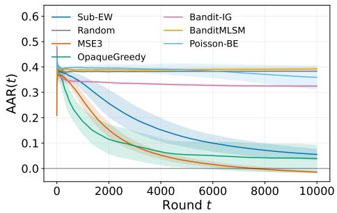
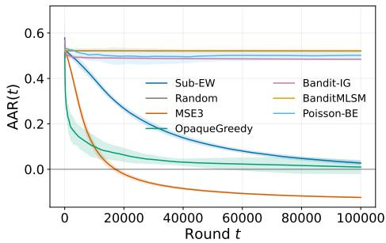
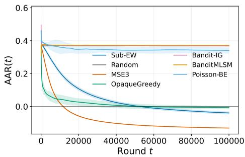

# Eficient Online Submodular Maximization with Bandit Feedback

Iasonas Nikolaou Boston University nikolaou@bu.edu

Evimaria Terzi Boston University evimaria@bu.edu

## Abstract

We study online monotone submodular maximization under a cardinality constraint with bandit feedback. On each round, the learner selects at most k elements from a ground set of size n and observes only the value of the selected set. We develop an eficient algorithm achieving $\mathcal { O } \Big ( k \sqrt { n T \log ( n / k ) } \Big )$ expected $( 1 - 1 / e )$ -regret over $T$ rounds. To our knowledge, this is the first polynomial-time algorithm with $\sqrt { T }$ dependence on the horizon for arbitrary monotone submodular functions in the bandit setting. Our approach uses randomized sampling and a carefully constructed potential to reduce online submodular maximization to online linear optimization over the probability simplex.

## 1 Introduction

Submodular optimization is a central theme in machine learning. The key reason for that is that submodularity captures diminishing returns and arises in numerous applications including sensor placement [Krause and Guestrin, 2007], team formation [Bhowmik et al., 2014], caching networks [Li et al., 2021], influence maximization [Kempe et al., 2003], recommender systems [Nikolaou et al., 2025], and multi-robot planning [Xu et al., 2023]. Motivated by these applications, a growing literature studies Online Submodular Maximization (OSM) under various settings [Streeter et al., 2009, Zhang et al., 2019, 2022, Si Salem et al., 2024].

In OSM, a learner, at each round t, selects a set $S _ { t } \subseteq V$ with $| S _ { t } | \le k$ and observes a monotone submodular reward $f _ { t }$ . The goal is to minimize the expected $( 1 - 1 / e ) – r e g r e t , \mathrm { i . e . }$ 2

$$
\mathcal { R } _ { T } ^ { 1 - 1 / e } : = \left( 1 - \frac { 1 } { e } \right) \operatorname* { m a x } _ { S \subseteq V } \sum _ { t = 1 } ^ { T } f _ { t } ( S ) - \mathbb { E } \left[ \sum _ { t = 1 } ^ { T } f _ { t } ( S _ { t } ) \right] .
$$

This quantity compares the learner’s cumulative reward with that of the best fixed set in hindsight. The $( 1 - 1 / e )$ factor is necessary for polynomial-time algorithms due to the hardness results associated with the ofline problem [Feige, 1998].

In this paper, we focus on Bandit-OSM, where at every round t the learner only observes the value of the function on the selected set, i.e., $f _ { t } ( S _ { t } )$ (as opposed to receiving the whole $f _ { t } )$ . The best existing results for Bandit-OSM achieve $\mathcal { R } _ { T } ^ { 1 - 1 / e } = \widetilde { \mathcal { O } } ( T ^ { 2 / 3 } )$ both for cardinality [Wan et al., 2023] and for general matroid constraints [Wan and Zhang, 2026].

This raises the question:

We answer this question afirmatively: to our knowledge, we develop the first polynomial-time algorithm that achieves $\mathcal { O } ( \sqrt { T } )$ expected $( 1 - 1 / e )$ -regret for Bandit-OSM under cardinality constraints with arbitrary monotone submodular reward functions.

Our algorithm, Submodular-Exponential-Weights (Sub-EW), is a bandit exponential-weights method based on EXP3 [Auer et al., 2002]. Sub-EW is conceptually simple: it maintains a distribution over the elements of V . At each iteration, it randomly chooses how many elements to sample, draws them independently, and plays their union. Randomizing the number of draws makes it possible to estimate, from the observed reward, the gradient of a carefully-constructed potential. The resulting gradient estimate guides the exponential-weights update of the distribution over V.

## 2 Related work

In this section, we give an overview of the existing results on Online Submodular Maximization (OSM) in the bandit setting (i.e., Bandit-OSM ).

Bandit-OSM is considerably more challenging than its full-information counterpart: the learner observes only the value of the selected set and cannot directly evaluate marginal gains. Early work by Streeter and Golovin [2008] introduced the meta-action approach for online monotone submodular maximization under a cardinality constraint. Their bandit construction simulates the steps of the ofline greedy algorithm using separate online learners and achieves $\mathcal { R } _ { T } ^ { 1 - 1 / e } = \widetilde { \mathcal { O } } ( T ^ { 2 / 3 } )$ Streeter et al. [2009] extended this approach to online assignment problems, a special case of partition matroid constraints, obtaining regret $\mathcal { R } _ { T } ^ { 1 - 1 / e }$ of order $\widetilde { \mathcal { O } } ( T ^ { 4 / 5 } )$

Niazadeh et al. [2023] developed a general ofline-to-online reduction based on Blackwell approachability. Their framework transforms robust greedy approximation algorithms into online algorithms, yielding the bound $\mathcal { R } _ { T } ^ { 1 - 1 / e } = \mathcal { O } ( T ^ { 2 / 3 } )$ for Bandit-OSM. In a diferent direction, Zhang et al. [2019] introduced Bandit–Frank–Wolfe for online continuous DR-submodular maximization under bandit feedback, attaining $\mathcal { R } _ { T } ^ { 1 - 1 / e } = \mathcal { O } ( T ^ { 8 / 9 } )$ Their discrete counterpart, Responsive– Frank–Wolfe, uses responsive-bandit feedback, requiring evaluations at infeasible sets that yield zero reward.

Wan et al. [2023] reduced Bandit-OSM to bandit multilinear DR-submodular maximization, achieving $\mathcal { R } _ { T } ^ { 1 - 1 / e } = \overset { \sim } { \mathcal { O } } ( T ^ { 2 / 3 } )$ under partition matroid constraints. More recently, Wan and Zhang [2026] obtained the expected regret bound $\mathcal { R } _ { T } ^ { 1 - 1 / e } = \widetilde { \mathcal { O } } ( T ^ { 2 / 3 } )$ for Bandit-OSM under general matroid constraints.

As summarized in Table 1, none of the above works achieves the regret bound $\mathcal { R } _ { T } ^ { 1 - 1 / e } = \mathcal { O } ( \sqrt { T } )$ under cardinality constraints for Bandit-OSM, which is what we establish here.

To the best of our knowledge, the only other polynomial-time result achieving $\mathcal { R } _ { T } ^ { 1 - 1 / e } = \widetilde { \mathcal { O } } ( \sqrt { T } )$ under bandit feedback and cardinality constraints is due to Pasteris et al. [2024]. Their analysis applies to monotone and submodular objectives that additionally satisfy pseudo-concavity, including sum-max functions. This class captures facility-location and k-median rewards, coverage and hitting-set objectives, and best-of-k bandits, but is a proper subclass of monotone submodular functions. In contrast, our guarantee holds for arbitrary monotone submodular rewards. At each round, their algorithm samples k elements with replacement and plays their union. The observed reward is used to construct a gradient estimate for an exponential-weights update. The pseudo-concavity property yields a concave expected-reward potential. In contrast, we construct a weighted potential that combines expected rewards from diferent numbers of independent draws with replacement, ranging from one to k. This potential allows us to handle arbitrary monotone submodular functions without assuming pseudo-concavity. By randomizing the number of draws, we obtain an unbiased estimate of the potential’s gradient from a single observed reward while retaining the $( 1 - 1 / e )$ approximation factor.

<table><tr><td>Paper</td><td>Setting</td><td>Function class</td><td>Constraint</td><td>Bandit regret</td></tr><tr><td>Streeter and Golovin [2008]</td><td>Adv.</td><td>Sub.</td><td>Card.</td><td> $\widetilde { \mathcal { O } } \big ( k ^ { 2 } n ^ { 1 / 3 } T ^ { 2 / 3 } \big )$ </td></tr><tr><td>Streeter et al. [2009]</td><td>Adv.</td><td>Sub.</td><td>Assign.</td><td> $\widetilde { \mathcal { O } } \big ( n ^ { 2 / 5 } k ^ { 6 / 5 } T ^ { 4 / 5 } \big )$ </td></tr><tr><td>Zhang et al. [2019]</td><td>Adv.</td><td>DR-S / Sub.</td><td>Downward-closed convex/ Gen. matroid</td><td> $\mathcal { O } ( T ^ { 8 / 9 } )$ </td></tr><tr><td>Nie et al. [2022]</td><td>Stoch.</td><td>Sub.</td><td>Card.</td><td> $\mathcal { O } \left( n ^ { 1 / 3 } k ^ { 4 / 3 } T ^ { 2 / 3 } \sqrt { \log T } \right)$ </td></tr><tr><td>Niazadeh et al. [2023]</td><td>Adv.</td><td>Sub.</td><td>Card.</td><td> $\mathcal { O } \big ( k n ^ { 2 / 3 } ( \log n ) ^ { 1 / 3 } T ^ { 2 / 3 } \big )$ </td></tr><tr><td>Wan et al. [2023]</td><td>Adv.</td><td>Sub.</td><td>Part.</td><td> $\mathcal { O } \bigg ( \Big ( \sum _ { j } r _ { j } \lvert G _ { j } \rvert \Big ) ^ { 5 / 3 } T ^ { 2 / 3 } \log T \bigg )$ </td></tr><tr><td>Pasteris et al. [2024]</td><td>Adv.</td><td>Sum-max</td><td>Card.</td><td> $\widetilde { \mathcal { O } } \big ( \sqrt { k n T } \big )$ </td></tr><tr><td>Tajdini et al. [2024]</td><td>Stoch.</td><td>Sub.</td><td>Card.</td><td> $\begin{array} { r } { \widetilde { \mathcal { O } } \left( \operatorname* { m i n } _ { 0 \le L \le k } \Big [ L n ^ { 1 / 3 } T ^ { 2 / 3 } + \sqrt { { \binom { n } { k - L } } T } \Big ] \right) } \end{array}$ </td></tr><tr><td>Wan and Zhang [2026]</td><td>Adv.</td><td>Sub.</td><td>Gen. matroid</td><td> $\tilde { \mathcal { O } } \big ( n ^ { 1 / 3 } k ^ { 2 / 3 } T ^ { 2 / 3 } \big )$ </td></tr><tr><td>This work</td><td>Adv.</td><td>Sub.</td><td>Card.</td><td> $\mathcal { O } \Big ( k \sqrt { n T \log ( n / k ) } \Big )$ </td></tr></table>

Table 1: Guarantees for $\mathcal { R } _ { T } ^ { 1 - 1 / e }$ in submodular maximization with bandit feedback. Adv. and Stoch. denote adversarial and stochastic settings; Sub. denotes arbitrary monotone submodular functions; DR-S denotes monotone DR-submodular functions; and Card., Assign., Part., and Gen. matroid denote cardinality, assignment, partition-matroid, and general-matroid constraints. Here, n is the ground-set size and k is the cardinality budget or matroid rank. For partition matroids, $G _ { j }$ is the jth group and $r _ { j }$ its capacity, so that feasible sets satisfy $| S \cap G _ { j } | \leq r _ { j }$ for every $j .$ For Zhang et al. [2019], the continuous and discrete settings are listed in that order. Their discrete result uses responsive-bandit feedback, which allows infeasible value observations and difers from the strictly feasible bandit model considered here. The bound of Tajdini et al. [2024] holds for the stronger robust-greedy regret and also implies the displayed upper bound on $\mathcal { R } _ { T } ^ { 1 - 1 / e }$

Stochastic submodular bandits. A related literature considers a variant of our setting where the learner receives bandit feedback, but the reward functions are chosen stochastically (i.e., not adversarially). Nie et al. [2022] proposed an explore-then-commit greedy algorithm for this setting and stochastic monotone submodular rewards and cardinality constraints and established $\mathcal { R } _ { T } ^ { 1 - 1 / e } =$ $\widetilde { \mathcal { O } } ( T ^ { 2 / 3 } )$ . Tajdini et al. [2024] subsequently gave nearly minimax-optimal upper and lower bounds for a stronger regret notion based on robust-greedy maximization.

## 3 Problem Setting

Let $V = [ n ]$ be a ground set and let $2 \leq k \leq n$ . At each round $t \in [ T ]$ , the reward function $f _ { t } : 2 ^ { V } \to \bar { [ 0 , 1 ] }$ is monotone and submodular<sup>1</sup>. We assume that $f _ { t }$ is normalized, i.e., $f _ { t } ( \mathcal { O } ) = 0$ . The sequence of reward functions $f _ { 1 } , \ldots , f _ { T }$ is fixed in advance by an oblivious adversary, independently of the learner’s random choices.

Formally, a function $f$ is submodular if for all $A \subseteq B$ and $e \in V \setminus B$ it holds that $f ( A \cup \{ e \} ) -$ $f ( A ) \geq f ( B \cup \{ e \} ) - f ( B )$ . Moreover, $f$ is monotone if for all $A \subseteq B$ , it holds $f ( A ) \leq f ( B )$

On round t, the learner selects a possibly randomized set $S _ { t } \subseteq V$ satisfying $| S _ { t } | \le k$ and observes

only the scalar value $f _ { t } ( S _ { t } )$ . We measure the performance of the learner via $( 1 - 1 / e ) – \mathrm { r e g r e t : }$

$$
\mathcal R _ { T } ^ { 1 - 1 / e } : = ( 1 - 1 / e ) \operatorname* { m a x } _ { S \subseteq V } \sum _ { t = 1 } ^ { T } f _ { t } ( S ) - \mathbb E \left[ \sum _ { t = 1 } ^ { T } f _ { t } ( S _ { t } ) \right] ,
$$

where E[·] is over the learner’s random choices.

Notation. Let $\Delta _ { n } : = \left\{ p \in \mathbb { R } _ { > 0 } ^ { n } : \sum _ { i = 1 } ^ { n } p _ { i } = 1 \right\}$ denote the probability simplex over V . Throughout the paper, $\mathbb { E } _ { t }$ denotes expectation over the learner’s sampling randomness on round $t ,$ conditional on the preceding history and the selected distribution ${ \mathbf { } } p _ { t }$

## 4 Full-Information Setting

We begin with the full-information setting, which provides the reduction underlying our bandit algorithm. In this setting, the learner, after playing on round $t ,$ observes the reward function $f _ { t }$

## 4.1 Full-information Algorithm

The learner uses an online linear optimization (OLO) algorithm to maintain a distribution $\pmb { p } _ { t } \in \Delta _ { n }$ over the ground set. On each round, it draws k elements independently from ${ \mathbf { } } p _ { t }$ with replacement and plays their union $S _ { t }$ . Repeated elements appear only once in $S _ { t }$ , so $| S _ { t } | \le k$

To describe the linear feedback supplied to the OLO algorithm, we first define the expected reward of $m$ elements sampled i.i.d. with replacement. For $p \in \Delta _ { n }$ , let $B _ { m }$ be the union of m independent draws from $^ { p , }$ with $B _ { 0 } : = \varnothing$ , and define

$$
F _ { t , m } ( \pmb { p } ) : = \mathbb { E } _ { t } [ f _ { t } ( B _ { m } ) ] .
$$

We extend $F _ { t , m }$ to $\mathbb { R } ^ { n }$ through the polynomial

$$
F _ { t , m } ( \pmb { p } ) : = \sum _ { ( i _ { 1 } , \dots , i _ { m } ) \in V ^ { m } } f _ { t } ( \{ i _ { 1 } , \dots , i _ { m } \} ) \prod _ { r = 1 } ^ { m } p _ { i _ { r } } .
$$

This extension agrees with the sampling expectation on $\Delta _ { n } ;$ all gradients below refer to this polynomial. Setting $\rho : = 1 - 1 / k$ , we use the potential

$$
G _ { t } ( \pmb { p } ) : = \sum _ { m = 1 } ^ { k } \frac { \rho ^ { k - m } } { m } F _ { t , m } ( \pmb { p } ) .
$$

The potential combines expected rewards from all draw counts up to $k$ . Its coeficients are chosen so that, for every $p \in \Delta _ { n }$ and every set $S \subseteq V$ with $| S | = k$ , it holds that

$$
\left( 1 - \frac { 1 } { e } \right) f _ { t } ( S ) - F _ { t , k } ( \pmb { p } ) \leq \left. \nabla G _ { t } ( \pmb { p } ) , \pmb { p } ^ { S } - \pmb { p } \right. ,
$$

where $p ^ { S }$ is the uniform distribution on $S .$ . Thus, the gap between the scaled reward of $S$ and the learner’s expected reward is bounded by the linear reward advantage of $p ^ { S }$ over $\mathbfit { p }$ under $\nabla G _ { t } ( \pmb { p } )$

After observing $f _ { t }$ , the learner computes $\pmb { g } _ { t } : = \nabla G _ { t } ( \pmb { p } _ { t } )$ and supplies the linear reward $\ell ( p ) : =$ $\langle g _ { t } , p \rangle$ to the OLO algorithm, which returns the next distribution $p _ { t + 1 }$ . Algorithm 1 summarizes this procedure. In the next subsection, we will prove the following guarantee.

Algorithm 1 Full-information reduction of OSM to OLO   
Require: An OLO algorithm A over $\Delta _ { n }$   
1: Set $\rho \gets 1 - 1 / k$   
2: Initialize ${ \pmb p } _ { 1 } \gets { \bf 1 } / n$   
3: for $t = 1 , \dots , T$ do   
4: Draw $I _ { t , 1 } , \ldots , I _ { t , k } \stackrel { \mathrm { i . i . d . } } { \sim } p _ { t }$   
5: Play $S _ { t } \gets \{ I _ { t , 1 } , \ldots , I _ { t , k } \}$   
6: Observe $f _ { t }$ and compute $\pmb { g } _ { t }  \nabla G _ { t } ( \pmb { p } _ { t } )$   
7: Update $\pmb { p } _ { t + 1 }  \pmb { \mathcal { A } } ( \pmb { g } _ { 1 } , \dotsc , \pmb { g } _ { t } )$   
8: end for

Theorem 1 (Full-information guarantee, informal). Algorithm 1 transfers the regret bound of its OLO subroutine to $( 1 - 1 / e )$ -regret for OSM:

$$
\begin{array} { r } { \mathcal { R } _ { T } ^ { 1 - 1 / e } \leq \mathcal { R } _ { T } ^ { \mathrm { O L O } } . } \end{array}
$$

In particular, an OLO algorithm with $\mathcal { O } ( \sqrt { T } )$ regret yields $\mathcal { R } _ { T } ^ { 1 - 1 / e } = \mathcal { O } ( \sqrt { T } )$ for OSM.

Discussion. This result matches the established $\mathcal { O } ( \sqrt { T } ) ~ ( 1 - 1 / e )$ -regret rate for full-information OSM; this rate by itself is not a new contribution. Reducing OSM to OLO is also an established technique, rooted in non-oblivious potentials for ofline submodular maximization [Filmus and Ward, 2014] and developed through non-oblivious boosting [Zhang et al., 2022] and upper-linearizable functions [Pedramfar and Aggarwal, 2024]. Related approaches use non-oblivious potentials under bandit feedback [Wan et al., 2023] or reduce OSM to online convex optimization for WTP functions [Si Salem et al., 2024].

Our full-information algorithm uses a potential defined through sampling with replacement. This construction forms the basis of our bandit algorithm: randomizing the number of draws and choosing matching potential coeficients allows us to estimate the resulting potential’s gradient without bias from a single observed reward.

We note here that sampling with replacement can, potentially, yield sets with fewer than k distinct elements, leaving part of the cardinality budget unused and potentially limiting practical performance, particularly in the full-information setting.

## 4.2 Analysis

For a set $S \subseteq V$ with $| S | = k$ , let $p ^ { S } \in \Delta _ { n }$ denote the uniform distribution on S. By monotonicity, any set with $| S | < k$ can be padded to size k without decreasing its reward. We first express the gradient of $F _ { t , m }$ in terms of the reward obtained by adding a specified element to $m - 1$ independent draws.

Lemma 1 (Gradient identity). Fix a round t, a distribution $p \in \Delta _ { n }$ , an integer $m \geq 1$ , and an element $i \in V$ . Let $B _ { m - 1 }$ be the union of $m - 1$ independent draws from ${ \mathbf { } } p ,$ , with $B _ { 0 } = \varnothing$ . Then

$$
\frac { \partial F _ { t , m } ( \pmb { p } ) } { \partial p _ { i } } = m \mathbb { E } _ { t } [ f _ { t } ( B _ { m - 1 } \cup \{ i \} ) ] .
$$

Averaging this identity under $p ^ { S }$ and p and taking the diference gives the directional derivative from p toward $p ^ { S }$

Corollary 1 (Directional derivative identity). Fix a round t, a distribution $p \in \Delta _ { n }$ , an integer $m \geq 1$ , and a set $S \subseteq V$ with $| S | = k$ . Let $B _ { m - 1 }$ be the union of $m - 1$ independent draws from $^ { p , }$ and let $I _ { S }$ be uniform on $S$ , independently of $B _ { m - 1 }$ . Then

$$
\begin{array} { r l } & { \big \langle \nabla F _ { t , m } ( p ) , p ^ { S } - p \big \rangle = m \left( \mathbb { E } _ { t } [ f _ { t } ( B _ { m - 1 } \cup \{ I _ { S } \} ) ] - F _ { t , m } ( p ) \right) . } \end{array}
$$

Monotonicity and submodularity give a lower bound on the expected reward after adding $I _ { S }$ in terms of $f _ { t } ( S )$ and the current expected reward.

Lemma 2 (Submodular averaging). Fix a round t and let $f _ { t } : 2 ^ { V } \to \mathbb { R } _ { \geq 0 }$ be monotone and submodular. Let $S \subseteq V$ satisfy $| S | = k$ , let $\rho : = 1 - 1 / k$ , and let $p \in \Delta _ { n }$ . For an integer $m \geq 1$ , let $B _ { m - 1 }$ be the union of $m - 1$ independent draws from ${ \mathbf { } } p ,$ , and let $I _ { S }$ be uniform on $S ,$ independently of $B _ { m - 1 }$ . Then

$$
\mathbb { E } _ { t } [ f _ { t } ( B _ { m - 1 } \cup \{ I _ { S } \} ) ] \geq \frac { 1 } { k } f _ { t } ( S ) + \rho F _ { t , m - 1 } ( p ) .
$$

Combining Corollary 1 with Lemma 2 gives, for each $m \in [ k ]$

$$
\left. \nabla F _ { t , m } ( \pmb { p } ) , \pmb { p } ^ { S } - \pmb { p } \right. \geq m \left( \frac { 1 } { k } f _ { t } ( S ) + \rho F _ { t , m - 1 } ( \pmb { p } ) - F _ { t , m } ( \pmb { p } ) \right) .
$$

Multiplying by $\rho ^ { k - m } / m$ and summing over $m = 1 , \ldots ,$ k cancels the intermediate terms $F _ { t , m }$ for $1 \leq m < k$ . Dropping the remaining nonnegative term $\rho ^ { k } F _ { t , 0 }$ , only the $F _ { t , k }$ term survives resulting in the inequality underlying our reduction of OSM to OLO.

Lemma 3 (Linearization inequality). Fix a round t and let $f _ { t } : 2 ^ { V } \to \mathbb { R } _ { \geq 0 }$ be monotone and submodular. Let $S \subseteq V$ satisfy $| S | = k ,$ , let $p ^ { S }$ be uniform on S, and set $\rho : = 1 - 1 / k$ and $\alpha : = 1 - \rho ^ { k }$ . For every $p \in \Delta _ { n }$ ，

$$
\alpha f _ { t } ( S ) - F _ { t , k } ( \pmb { p } ) \leq \big \langle \nabla G _ { t } ( \pmb { p } ) , \pmb { p } ^ { S } - \pmb { p } \big \rangle .
$$

Since the learner’s conditional expected reward satisfies $\mathbb { E } _ { t } [ f _ { t } ( S _ { t } ) ] = F _ { t , k } ( \pmb { p } _ { t } )$ and $\alpha \ge 1 - 1 / e$ summing the linearization inequality over rounds converts regret on linear rewards into $( 1 - 1 / e ) \cdot$ regret for the submodular rewards.

Theorem 2 (Full-information reduction of OSM to OLO). Let $V = [ n ]$ , let $2 \leq k \leq n$ , and let $f _ { 1 } , \dots , f _ { T } : 2 ^ { V } \to [ 0 , 1 ]$ be normalized, monotone, submodular reward functions. Suppose the OLO algorithm in Algorithm 1 guarantees regret on linear rewards at most $\dot { \mathcal { R } } _ { T } ^ { \mathrm { { O L O } } }$ on the reward vectors $\{ \pmb { g } _ { t } = \nabla G _ { t } ( \pmb { p } _ { t } ) \} _ { t = 1 } ^ { T }$ . Then

$$
\begin{array} { r } { \mathcal { R } _ { T } ^ { 1 - 1 / e } \leq \mathcal { R } _ { T } ^ { \mathrm { O L O } } . } \end{array}
$$

Theorem 2 uses exact gradients. Under value-oracle access to the revealed function $f _ { t } ,$ the draws already made by Algorithm 1 can instead be used to construct an unbiased gradient estimate, as described in Appendix $\mathrm { A . 7 }$

Instantiating Theorem 2 with the Exponential Weights algorithm, we get the following corollary.

Corollary 2 (Full-information regret with the Exponential Weights algorithm). Under the assumptions of Theorem 2, instantiate the OLO algorithm in Algorithm 1 with the Exponential Weights algorithm over $\Delta _ { n }$ . Then

$$
\mathcal { R } _ { T } ^ { 1 - 1 / e } = \mathcal { O } \Big ( k \sqrt { T \log ( n / k ) } \Big ) .
$$

We refer the reader to Appendix D for more details on the Exponential Weights algorithm.

## 5 Bandit Setting

In the bandit setting, the learner observes only $f _ { t } ( S _ { t } )$ after playing $S _ { t }$ and therefore cannot compute the potential gradient directly. The full-information potential $G _ { t }$ contains terms $F _ { t , m }$ for every $m \in$ $[ k ]$ , including $m < k$ . Always making k draws reveals only the reward of their union, without directly revealing the rewards associated with fewer draws. To estimate all these gradient contributions from a single reward observation, we randomize the number of draws, allowing the learner to observe rewards from smaller draw counts as well.

## 5.1 Bandit Algorithm

As in the full-information setting, an OLO algorithm maintains a distribution $\pmb { p } _ { t } \in \Delta _ { n }$ . On round $t ,$ the learner samples a draw count $M _ { t } \in [ k ]$ from a fixed distribution $\pmb { q } = ( q _ { 1 } , \dots , q _ { k } ) \in \Delta _ { k }$ , draws $M _ { t }$ elements independently from $\mathbf { \nabla } _ { \mathbf { \pmb { p } } _ { t } }$ with replacement, and plays their union $S _ { t }$ . Thus, $| S _ { t } | \le M _ { t } \le k$

Using the expected reward $F _ { t , m }$ defined in Section 4, the learner’s expected reward is

$$
H _ { t } ( \pmb { p } ) : = \sum _ { m = 1 } ^ { k } q _ { m } F _ { t , m } ( \pmb { p } ) , \qquad \mathbb { E } _ { t } [ f _ { t } ( S _ { t } ) ] = H _ { t } ( \pmb { p } _ { t } ) ,\tag{1}
$$

where $\mathbb { E } _ { t }$ conditions on the history and the current distribution ${ \mathbf { } } p _ { t }$ . To account for the random draw count, we use the potential

$$
G _ { t } ( \pmb { p } ) : = \sum _ { m = 1 } ^ { k } a _ { m } F _ { t , m } ( \pmb { p } ) ,\tag{2}
$$

whose coeficients, with $\rho : = 1 - 1 / k$ , are

$$
a _ { m } : = \frac { b _ { m } } { m } , \qquad b _ { m } : = \sum _ { \ell = m } ^ { k } \rho ^ { \ell - m } q _ { \ell } .\tag{3}
$$

For $k \geq 2$ , set $\beta : = 1 / e - \rho ^ { k }$ and $\begin{array} { r } { Z _ { k - 1 } : = \sum _ { r = 1 } ^ { k - 1 } r ^ { - 1 / 2 } } \end{array}$ . We choose the draw-count distribution

$$
q _ { m } : = \left\{ \begin{array} { l l } { \displaystyle \frac { \beta } { Z _ { k - 1 } \sqrt { m } } , } & { 1 \leq m < k , } \\ { 1 - \beta , } & { m = k . } \end{array} \right.\tag{4}
$$

Let $\begin{array} { r } { N _ { t , i } : = \sum _ { r = 1 } ^ { M _ { t } } \mathbf { 1 } \{ I _ { t , r } = i \} } \end{array}$ count the occurrences of element i among the sampled elements. The observed reward and these counts give the unbiased gradient estimator

$$
\widetilde { g } _ { t , i } : = \frac { a _ { M _ { t } } f _ { t } ( S _ { t } ) N _ { t , i } } { q _ { M _ { t } } p _ { t , i } } ,\tag{5}
$$

which, for strictly positive ${ \mathbf { } } p _ { t }$ , satisfies $\mathbb { E } _ { t } [ \widetilde { \pmb { g } } _ { t } ] = \nabla G _ { t } ( \pmb { p } _ { t } )$ . To preserve the positive probabilities required by its denominator, we instantiate OLO with exponential weights and use the nonpositive feedback obtained by subtracting one from the observed reward:

$$
z _ { t , i } : = \frac { a _ { M _ { t } } ( f _ { t } ( S _ { t } ) - 1 ) N _ { t , i } } { q _ { M _ { t } } p _ { t , i } } .\tag{6}
$$

Subtracting one shifts the observed reward from [0, 1] to $[ - 1 , 0 ]$ , ensuring that every coordinate of ${ \boldsymbol { z } } _ { t }$ is nonpositive. This nonpositivity is used in the exponential-weights analysis below. The learner

```latex
Algorithm 2 Submodular-Exponential-Weights
Require: Ground set $V = [ n ]$ , budget $2 \leq k \leq n$ , horizon $T _ { i }$ learning rate $\eta > 0$
1: $\rho \gets 1 - 1 / k$ and $\beta  1 / e - \rho ^ { k }$
2: $\begin{array} { r } { Z _ { k - 1 }  \dot { \sum } _ { r = 1 } ^ { k - 1 } r ^ { - 1 / 2 } } \end{array}$
3: $q _ { m } \gets \beta / ( Z _ { k - 1 } \sqrt { m } )$ for $m < k$
4: $q _ { k } \gets 1 - \beta$
5: $b _ { k + 1 } \gets 0$
6: for $m = k , k - 1 , \ldots , 1$ do
7: $b _ { m } \gets q _ { m } + \rho b _ { m + 1 }$ and $a _ { m } \gets b _ { m } / m$
8: end for
9: ${ \pmb p } _ { 1 }  \mathbf { 1 } / n$
10: for $t = 1 , \dots , T$ do
11: Draw $M _ { t } \sim \mathbf q$
12: Draw $I _ { t , 1 } , \ldots , I _ { t , M _ { t } } \stackrel { \mathrm { i . i . d . } } { \sim } p _ { t }$
13: Play $S _ { t } \gets \{ I _ { t , 1 } , \dots , I _ { t , M _ { t } } \}$
14: Observe $f _ { t } ( S _ { t } )$
15: $\begin{array} { r } { N _ { t , i }  \sum _ { r = 1 } ^ { M _ { t } } \mathbf { 1 } \{ I _ { t , r } = i \} , \forall i \in V } \end{array}$
16: $z _ { t , i } \gets a _ { M _ { t } } ( \bar { f _ { t } } ( S _ { t } ) - 1 ) N _ { t , i } / ( q _ { M _ { t } } p _ { t , i } ) , \ : \forall i \in V$
17: $\begin{array} { r } { p _ { t + 1 , i }  \frac { \texttt { a } \ddots } { \sum _ { j = 1 } ^ { n } p _ { t , j } \exp ( \eta z _ { t , j } ) } } \end{array}$ $p _ { t , i } \exp ( \eta z _ { t , i } )$ $\forall i \in V$
18: end for
```

supplies the linear reward $\ell ( \pmb { p } ) = \langle z _ { t } , \pmb { p } \rangle$ to the OLO algorithm. Starting from ${ \pmb p } _ { 1 } = { \bf 1 } / n$ , exponential weights updates the distribution as

$$
p _ { t + 1 , i } = \frac { p _ { t , i } \exp ( \eta z _ { t , i } ) } { \sum _ { j = 1 } ^ { n } p _ { t , j } \exp ( \eta z _ { t , j } ) } ,\tag{7}
$$

where $\eta > 0$ is the learning rate. The update preserves strictly positive probabilities, so the feedback in Eq. (6) remains well-defined. The analysis below shows that the reward shift preserves the expected linear comparisons needed for the regret reduction. Algorithm 2 gives the complete procedure. In the next subsection, we will prove the following result.

Theorem 3 (Bandit guarantee, informal). For $2 \leq k < n$ , against a sequence of normalized, monotone, submodular reward functions taking values in [0, 1], Algorithm 2 with a suitable learning rate achieves

$$
\mathcal { R } _ { T } ^ { 1 - 1 / e } = \mathcal { O } \Big ( k \sqrt { n T \log ( n / k ) } \Big ) .
$$

Computational Complexity. Computing q and its cumulative probabilities takes $O ( k )$ preprocessing time, as does computing $b _ { m } , a _ { m }$ by the backward recursion in Algorithm 2. At each round, constructing the cumulative probabilities for ${ \mathbf { } } p _ { t }$ takes $O ( n )$ time, sampling at most k elements by binary search takes $O ( k \log n )$ time, and computing the counts, feedback, and update takes $O ( n + k )$ time. Thus, the total running time is $O ( n + k \log n )$ per round and $O ( n + k )$ space.

Online Gradient Descent. Appendix C gives an alternative OLO instantiation using projected Online Gradient Descent (OGD). This variant operates over an ϵ-restricted simplex with a positive lower bound on each coordinate to control the Euclidean second moment. The $( 1 - 1 / e )$ -regret guarantee is of the same $\mathcal { O } ( \sqrt { T } )$ order as for Algorithm 2.

## 5.2 Analysis

The high-level structure of the analysis is as follows: first, we compare the expected reward $H _ { t } ( \pmb { p } _ { t } )$ with a fixed set’s reward through the gradient of the potential. Then, we estimate the gradient from the bandit feedback. Finally, we bound the regret following the analysis of the exponential-weights algorithm ([Auer et al., 2002], Appendix D).

Bandit linearization inequality. Applying Corollary 1 and Lemma 2 gives, for each $m \in [ k ]$

$$
\left. \nabla F _ { t , m } ( \pmb { p } ) , \pmb { p } ^ { S } - \pmb { p } \right. \geq m \left( \frac { 1 } { k } f _ { t } ( S ) + \rho F _ { t , m - 1 } ( \pmb { p } ) - F _ { t , m } ( \pmb { p } ) \right) .
$$

We multiply by $a _ { m } = b _ { m } / m$ and sum over $m = 1 , \ldots , k$ . The terms involving the expected rewards $F _ { t , m }$ sum to $\rho b _ { 1 } F _ { t , 0 } ( \pmb { p } ) - H _ { t } ( \pmb { p } )$ . Dropping the term $\rho b _ { 1 } F _ { t , 0 } ( \pmb { p } )$ , which is equal to 0, gives

$$
\alpha ( \pmb q ) f _ { t } ( S ) - H _ { t } ( \pmb p ) \leq \big \langle \nabla G _ { t } ( \pmb p ) , \pmb p ^ { S } - \pmb p \big \rangle ,
$$

where $\begin{array} { r } { \alpha ( \pmb q ) : = \frac { 1 } { k } \sum _ { m = 1 } ^ { k } b _ { m } = \sum _ { m = 1 } ^ { k } q _ { m } ( 1 - \rho ^ { m } ) } \end{array}$ . This gives the bandit counterpart of Lemma 3.

Lemma 4 (Bandit linearization inequality). Fix a round t and let $f _ { t } : 2 ^ { V } \to \mathbb { R } _ { \geq 0 }$ be monotone and submodular. For any distribution $\pmb q \in \Delta _ { k }$ , define $H _ { t } , G _ { t } ,$ and their coeficients by $E q . \ ( 1 ) - ( 3 )$ . For every $p \in \Delta _ { n }$ and every $S \subseteq V$ with $| S | = k$

$$
\alpha ( \pmb { q } ) f _ { t } ( S ) - H _ { t } ( \pmb { p } ) \leq \langle \nabla G _ { t } ( \pmb { p } ) , \pmb { p } ^ { S } - \pmb { p } \rangle .
$$

We seek a distribution q with $\alpha ( \pmb q ) \ge 1 - 1 / e$ . Our bandit gradient estimator also requires $q _ { m } > 0$ for every $m \in [ k ]$ . Concentrating all mass on $m = k$ recovers the full-information potentia and approximation factor $1 - \rho ^ { k }$ , which exceeds the target factor by $\beta = 1 / e - \rho ^ { k }$ . We use this gap to allocate total mass $\beta$ to draw counts $m < k$ according to Eq. (4), while retaining $q _ { k } = 1 - \beta$ The next lemma verifies that this choice satisfies both requirements.

Lemma 5 (Choice of the sampling distribution). For $k \geq 2$ , the vector q in $E q . \ ( 4 )$ is a probability distribution with $q _ { m } > 0$ for every $m \in [ k ]$ , and

$$
\alpha ( { \pmb q } ) \geq 1 - \frac { 1 } { e } + \beta \rho ^ { k } \geq 1 - \frac { 1 } { e } ,
$$

where $\beta = 1 / e - \rho ^ { k }$

Combining these lemmas gives the comparison used in the regret reduction.

Corollary 3 (Linearization inequality for the chosen distribution). Under the assumptions of Lemma $^ { 4 , }$ choose $\pmb q \in \Delta _ { k }$ as in $E q . \ ( 4 )$ . For every $\textstyle p \in \Delta _ { \prime }$ <sub>n</sub> and every $S \subseteq V \ w i t h \ | S | = k$

$$
\left( 1 - \frac { 1 } { e } \right) f _ { t } ( S ) - H _ { t } ( p ) \leq \langle \nabla G _ { t } ( p ) , p ^ { S } - p \rangle .
$$

Estimating the potential’s gradient from bandit feedback. The count $N _ { t , i }$ records all positions at which element i was drawn. Conditional on $M _ { t } = m$ , weighting the observed reward by $N _ { t , i } / p _ { t , i }$ therefore recovers the derivative in Lemma 1. The additional factor $a _ { m } / q _ { m }$ in Eq. (5) accounts for the potential coeficient and the probability of selecting that draw count.

Lemma 6 (Unbiased gradient estimator). Let $\pmb q \in \Delta _ { k }$ and $\pmb { p } _ { t } \in \Delta _ { n }$ have strictly positive coordinates. Under the sampling rule above,

$$
\mathbb { E } _ { t } \Bigg [ f _ { t } ( S _ { t } ) \frac { N _ { t , i } } { p _ { t , i } } \Bigg | M _ { t } = m \Bigg ] = \frac { \partial F _ { t , m } ( \pmb { p } _ { t } ) } { \partial p _ { i } } .
$$

Consequently, $\mathbb { E } _ { t } [ \widetilde { \pmb { g } } _ { t } ] = \nabla G _ { t } ( \pmb { p } _ { t } )$

Subtracting one from the reward makes every coordinate of $z _ { t }$ nonpositive, which permits the exponential-weights bound below without imposing a uniform lower bound on the sampling probabilities. Subtracting one from the observed reward also subtracts the same constant $c _ { q } : = { }$ $\sum _ { m = 1 } ^ { k } b _ { m }$ from every coordinate of the expected feedback. Thus, the corrected estimator

$$
\widehat { \pmb { g } } _ { t } : = \pmb { z } _ { t } + c _ { q } \mathbf { 1 }\tag{8}
$$

is unbiased. The algorithm can use $z _ { t }$ directly because every distribution has total mass one: for u, $\pmb { p } _ { t } \in \Delta _ { n }$ ，

$$
\langle \widehat { g } _ { t } , u - p _ { t } \rangle = \langle z _ { t } + c _ { q } \mathbf { 1 } , u - p _ { t } \rangle = \langle z _ { t } , u - p _ { t } \rangle .\tag{9}
$$

Lemma 7 (Expected linear feedback). Under the assumptions of Lemma 6, the feedback in Eq. (6) satisfies $\mathbb { E } _ { t } [ z _ { t } ] = \nabla G _ { t } ( \pmb { p } _ { t } ) - c _ { q } \mathbf { 1 }$ , and hence $\mathbb { E } _ { t } [ \widehat { \pmb { g } } _ { t } ] = \nabla G _ { t } ( \pmb { p } _ { t } )$ . For every fixed $\pmb { u } \in \Delta _ { n }$ 2

$$
\mathbb { E } _ { t } [ \langle z _ { t } , u - p _ { t } \rangle ] = \langle \nabla G _ { t } ( \pmb { p } _ { t } ) , \pmb { u } - \pmb { p } _ { t } \rangle .
$$

Corollary $3$ compares the submodular rewards through the potential gradient, and Lemma 7 replaces that gradient by the observed feedback in expectation. As in the full-information setting, it is enough to bound regret on linear rewards against distributions $p ^ { S }$ that are uniform on sets of size k.

Theorem 4 (Bandit reduction of OSM to OLO). Let $2 \leq k \leq n$ , and let $f _ { 1 } , \dots , f _ { T } : 2 ^ { V } \to [ 0 , 1 ]$ be normalized, monotone, submodular functions. Choose q as in Eq. (4) and use the sampling rule and feedback Eq. (6) above. Suppose the OLO algorithm produces strictly positive $\pmb { p } _ { t } \in \Delta _ { n }$ and guarantees regret on linear rewards at most $\mathcal { R } _ { T } ^ { \mathrm { { O L O } } }$ on the reward vectors $\{ z _ { t } \} _ { t = 1 } ^ { T }$ . Then,

$$
\begin{array} { r } { \mathcal { R } _ { T } ^ { 1 - 1 / e } \leq \mathcal { R } _ { T } ^ { \mathrm { O L O } } . } \end{array}
$$

Regret of exponential weights. To apply the reduction above, we bound the regret of exponential weights on the linear rewards defined by $z _ { t }$ . The bound requires control of two quantities: the expected weighted second moment of the feedback and the initial Kullback–Leibler divergence $D _ { \mathrm { K L } } ( \pmb { p } ^ { S } \| \pmb { p } _ { 1 } )$

We first bound the conditional expectation of $\textstyle \sum _ { i } p _ { t , i } z _ { t , i } ^ { 2 }$ . Although the importance weights in $z _ { t }$ can produce large coordinates when some $p _ { t , i }$ is small, this expectation admits a bound independent of ${ \mathbf { } } p _ { t }$ using $\begin{array} { r } { V _ { q } : = \sum _ { m = 1 } ^ { k } b _ { m } ^ { 2 } ( n + m - 1 ) / ( m q _ { m } ) } \end{array}$ This quantity also explains the allocation of probability among draw counts below k: since $b _ { m } \leq 1$ and $n + m - 1 \leq 2 n$ , their contribution to $V _ { q }$ is at most 2n $\textstyle \sum _ { m < k } 1 / ( m q _ { m } )$ . For fixed total mass $\begin{array} { r } { \sum _ { m < k } q _ { m } = \beta } \end{array}$ , this upper bound is minimized by $q _ { m } \propto 1 / \sqrt { m }$ , as chosen in Eq. (4).

Lemma 8 (Weighted second moment). Let $\pmb q \in \Delta _ { k }$ and $\pmb { p } _ { t } \in \Delta _ { n }$ have strictly positive coordinates, and let $f _ { t }$ take values in [0, 1]. Then from Eq. (6),

$$
\mathbb { E } _ { t } \left[ \sum _ { i = 1 } ^ { n } p _ { t , i } z _ { t , i } ^ { 2 } \right] \leq \sum _ { m = 1 } ^ { k } \frac { b _ { m } ^ { 2 } ( n + m - 1 ) } { m q _ { m } } = V _ { q } .
$$

For the distribution in Eq. (4), $V _ { q } \leq 3 2 e n k ^ { 2 }$

The second quantity is the initial Kullback–Leibler divergence $D _ { \mathrm { K L } } ( \pmb { p } ^ { S } \Vert \pmb { p } _ { 1 } )$ . Since $p _ { 1 } = { \bf 1 } / n$ and $p ^ { S }$ is uniform on a set of size k, this term is $D _ { \mathrm { K L } } ( \pmb { p } ^ { S } \Vert \pmb { p } _ { 1 } ) = \log ( n / k )$ . Combining the two terms with Theorem 4 gives the following guarantee.

Theorem 5 (Exponential-weights guarantee). Let $2 \leq k < n$ , and let $f _ { 1 , \dots , f _ { T } } : 2 ^ { V } \to [ 0 , 1 ]$ be normalized, monotone, submodular functions fixed in advance by an oblivious adversary. For every $\eta > 0$ , Algorithm 2 satisfies

$$
\mathcal { R } _ { T } ^ { 1 - 1 / e } \leq \frac { \log ( n / k ) } { \eta } + \frac { \eta T V _ { q } } { 2 } .
$$

In particular, choosing $\eta = \sqrt { 2 \log ( n / k ) / ( T V _ { q } ) }$ gives $\mathcal { R } _ { T } ^ { 1 - 1 / e } \leq \mathcal { O } \Big ( k \sqrt { n T \log ( n / k ) } \Big )$

We refer the reader to Appendix D for more details on the Exponential Weights algorithm.

## 6 Experiments

We complement our theoretical results with an empirical evaluation of Sub-EW. The experiments illustrate the algorithm’s learning behavior and practical limitations.

The details of the experimental setup, i.e., the datasets, the experimental parameters, and tuning procedures are described in Appendix E. Our code and data are available on GitHub.

Datasets. We consider three monotone submodular maximization problems. Influence is a weighted influence-maximization instance. TeamFormation is a roster-selection problem with task-dependent candidate values and redundancy penalties between candidates with similar skills. Coverage is a weighted coverage problem in which elements cover features whose importance varies across tasks.

Algorithms. We compare Sub-EW (Algorithm 2) with OpaqueGreedy [Streeter and Golovin, 2008], Bandit-IG [Niazadeh et al., 2023], MSE3 [Pasteris et al., 2024], BanditMLSM [Wan et al., 2023], and Poisson-BE [Wan and Zhang, 2026]. Note that MSE3 also maintains one item distribution and samples k times with replacement. Unlike Sub-EW, it estimates the gradient of the fixed-draw expected reward, and its guarantee relies on pseudo-concavity. We also include Random, which selects a uniformly random set of exactly k distinct elements at each round.

Metric. In all experiments, we report empirical average approximate regret (AAR). For each evaluation run, we define

$$
\mathrm { A A R } ( t ) : = \frac { 1 } { t } \left[ \left( 1 - \frac { 1 } { e } \right) \operatorname* { m a x } _ { S \subseteq V , \mid S \mid \leq k } \sum _ { s = 1 } ^ { t } f _ { s } ( S ) - \sum _ { s = 1 } ^ { t } f _ { s } ( S _ { s } ) \right] .
$$

The comparator is the best fixed feasible set for the first t rounds. Lower AAR values indicate better performance. We plot the pointwise mean over ten independent evaluation runs, with shaded bands indicating one sample standard deviation above and below the mean.

Results. Figure 1 shows that Sub-EW achieves lower mean final AAR than Random, Bandit-IG, BanditMLSM, and Poisson-BE across all three datasets. MSE3 achieves the lowest mean final AAR on all three datasets. OpaqueGreedy also outperforms Sub-EW on Influence and TeamFormation, whereas Sub-EW performs better on Coverage.

Discussion. MSE3 has a $\widetilde { \mathcal { O } } ( \sqrt { T } )$ regret guarantee for sum-max functions, which include all three benchmarks, whereas our guarantee holds for arbitrary monotone submodular functions. OpaqueGreedy also performs well in practice despite its weaker theoretical regret bound. Both Sub-EW and MSE3 sample with replacement, potentially leaving part of the cardinality budget unused. However, Sub-EW also randomizes the number of draws, sometimes making fewer than $k ,$ whereas MSE3 always makes k draws. This randomization enables estimation of the potential’s gradient, but can reduce the obtained reward. Moreover, the importance-weighted feedback (Eq. (6)) can have high variance, potentially slowing learning over finite horizons.

  
(a) Influence



(b) TeamFormation  
  
(c) Coverage  
Figure 1: Empirical average approximate regret, $\operatorname { A A R } ( t )$ , on (a) Influence $( n = 3 4 , k = 2$ $T = 1 0 ^ { 4 } )$ , (b) TeamFormation $( n = 1 0 0 , k = 3 , T = 1 0 ^ { 5 } )$ , and (c) Coverage $( n = 1 0 0 , k = 3$ $T = 1 0 ^ { 5 } )$ . Curves show the mean across ten independent evaluation repetitions; shaded bands indicate the $\mathrm { m e a n } \pm \mathrm { o n e }$ sample standard deviation. Lower values are better.

## 7 Conclusions

We achieve $\mathcal { O } ( k \sqrt { n T \log ( n / k ) } )$ expected $( 1 - 1 / e ) – \mathrm { r e g r e t }$ for Bandit-OSM under cardinality constraints. Our approach combines a non-oblivious potential with a randomized number of draws, enabling an unbiased estimate of its gradient from a single observed reward.

Limitations and Future Work. Despite this guarantee, our algorithm trails some baselines in practice. Designing more efective algorithms with $\sqrt { T }$ regret, and extending that rate to general matroids, remain open directions.

AI use statement. We used generative AI for reviewing the literature, developing our main research idea of the potential-function analysis, and improving the presentation throughout the paper. Moreover, we used it for implementing the experiments in Section 6. Finally, we used it to proofread our work and pinpoint inconsistencies and minor errors. The authors are responsible for all content of the paper.

## References

Peter Auer, Nicolo Cesa-Bianchi, Yoav Freund, and Robert E Schapire. The nonstochastic multiarmed bandit problem. SIAM journal on computing, 32(1):48–77, 2002.

Avradeep Bhowmik, Vivek Borkar, Dinesh Garg, and Madhavan Pallan. Submodularity in team formation problem. In Proceedings of the 2014 SIAM international conference on data mining, pages 893–901. SIAM, 2014.

Uriel Feige. A threshold of ln n for approximating set cover. Journal of the ACM (JACM), 45(4): 634–652, 1998.

Yuval Filmus and Justin Ward. Monotone submodular maximization over a matroid via nonoblivious local search. SIAM Journal on Computing, 43(2):514–542, 2014.

Elad Hazan. Introduction to online convex optimization. Foundations and Trends in Optimization, 2(3-4):157–325, 2016.

David Kempe, Jon Kleinberg, and Eva Tardos. Maximizing the spread of influence through a social <sup>´</sup> network. In Proceedings of the ninth ACM SIGKDD international conference on Knowledge discovery and data mining, pages 137–146, 2003.

Andreas Krause and Carlos Guestrin. Near-optimal observation selection using submodular functions. In AAAI, volume 7, pages 1650–1654, 2007.

Yuanyuan Li, Tareq Si Salem, Giovanni Neglia, and Stratis Ioannidis. Online caching networks with adversarial guarantees. Proceedings of the ACM on Measurement and Analysis of Computing Systems, 5(3):1–39, 2021.

Rad Niazadeh, Negin Golrezaei, Joshua Wang, Fransisca Susan, and Ashwinkumar Badanidiyuru. Online learning via ofline greedy algorithms: Applications in market design and optimization. Management Science, 69(7):3797–3817, 2023.

Guanyu Nie, Mridul Agarwal, Abhishek Kumar Umrawal, Vaneet Aggarwal, and Christopher John Quinn. An explore-then-commit algorithm for submodular maximization under full-bandit feedback. In Uncertainty in Artificial Intelligence, pages 1541–1551. PMLR, 2022.

Iasonas Nikolaou, Miltiadis Stouras, Stratis Ioannidis, and Evimaria Terzi. Online two-stage submodular maximization. Advances in Neural Information Processing Systems, 38:2128–2167, 2025.

Stephen U. Pasteris, Alberto Rumi, Fabio Vitale, and Nicol\`o Cesa-Bianchi. Sum-max submodular bandits. In Sanjoy Dasgupta, Stephan Mandt, and Yingzhen Li, editors, Proceedings of The 27th International Conference on Artificial Intelligence and Statistics, volume 238 of Proceedings of Machine Learning Research, pages 2323–2331. PMLR, 02–04 May 2024.

Mohammad Pedramfar and Vaneet Aggarwal. From linear to linearizable optimization: A novel framework with applications to stationary and non-stationary dr-submodular optimization. Advances in Neural Information Processing Systems, 37:37626–37664, 2024.

Tareq Si Salem, G¨ozde Ozcan, Iasonas Nikolaou, Evimaria Terzi, and Stratis Ioannidis. Online<sup>¨</sup> submodular maximization via online convex optimization. In Proceedings ofthe AAAI Conference on Artificial Intelligence, volume 38, pages 15038–15046, 2024.

Matthew Streeter and Daniel Golovin. An online algorithm for maximizing submodular functions. Advances in Neural Information Processing Systems, 21, 2008.

Matthew Streeter, Daniel Golovin, and Andreas Krause. Online learning of assignments. Advances in neural information processing systems, 22, 2009.

Artin Tajdini, Lalit Jain, and Kevin Jamieson. Nearly minimax optimal submodular maximization with bandit feedback. Advances in Neural Information Processing Systems, 37:96254–96281, 2024.

Zongqi Wan and Zhijie Zhang. Bandit submodular maximization under matroid constraints: Learning compressed exchange policy. arXiv preprint arXiv:2608.24627, 2026.

Zongqi Wan, Jialin Zhang, Wei Chen, Xiaoming Sun, and Zhijie Zhang. Bandit multi-linear drsubmodular maximization and its applications on adversarial submodular bandits. In International Conference on Machine Learning, pages 35491–35524. PMLR, 2023.

Zirui Xu, Hongyu Zhou, and Vasileios Tzoumas. Online submodular coordination with bounded tracking regret: Theory, algorithm, and applications to multi-robot coordination. IEEE Robotics and Automation Letters, 8(4):2261–2268, 2023.

Wayne W Zachary. An information flow model for conflict and fission in small groups. Journal of anthropological research, 33(4):452–473, 1977.

Mingrui Zhang, Lin Chen, Hamed Hassani, and Amin Karbasi. Online continuous submodular maximization: From full-information to bandit feedback. Advances in Neural Information Processing Systems, 32, 2019.

Qixin Zhang, Zengde Deng, Zaiyi Chen, Haoyuan Hu, and Yu Yang. Stochastic continuous submodular maximization: Boosting via non-oblivious function. In International Conference on Machine Learning, pages 26116–26134. PMLR, 2022.

## A Full-information algorithm proofs

## A.1 Proof of Lemma 1

Lemma (Restatement of Lemma 1, Gradient identity). Fix a round t, a distribution $p \in \Delta _ { n }$ , an integer $m \geq 1$ , and an element $i \in V$ . Let $B _ { m - 1 }$ be the union of m − 1 independent draws from $\mathbf { \nabla } _ { p }$ with $B _ { 0 } = \varnothing$ . Then

$$
\frac { \partial F _ { t , m } ( \pmb { p } ) } { \partial p _ { i } } = m \mathbb { E } [ f _ { t } ( B _ { m - 1 } \cup \{ i \} ) ] .
$$

Proof. Diferentiating the polynomial definition gives

$$
\begin{array} { l } { \displaystyle \frac { \partial F _ { t , m } ( \pmb { p } ) } { \partial p _ { i } } = \sum _ { j _ { 1 } , \dots , j _ { m } \in V } f _ { t } ( \{ j _ { 1 } , \dots , j _ { m } \} ) \frac { \partial } { \partial p _ { i } } \left( \prod _ { r = 1 } ^ { m } p _ { j _ { r } } \right) } \\ { \displaystyle = \sum _ { s = 1 } ^ { m } \sum _ { ( j _ { r } ) _ { r \neq s } \in V ^ { m - 1 } } \left( \prod _ { r \neq s } p _ { j _ { r } } \right) f _ { t } ( \{ i \} \cup \{ j _ { r } : r \neq s \} ) . } \end{array}
$$

For each fixed s, the inner sum is $\mathbb { E } [ f _ { t } ( B _ { m - 1 } \cup \{ i \} ) ]$ : the draw in position s is fixed to i, while the other $m - 1$ draws are independent samples from p. All m positions therefore make the same contribution, which proves the identity. □

## A.2 Proof of Corollary 1

Corollary (Restatement of Corollary 1, Directional derivative identity). Fix a round t, a distribution $p \in \Delta _ { n }$ , an integer $m \geq 1$ , and a set $S \subseteq V$ with $| S | = k$ . Let $B _ { m - 1 }$ be the union of $m - 1$ independent draws from $^ { p , }$ and let $I _ { S }$ be uniform on $S _ { i }$ independently of $B _ { m - 1 }$ . Then

$$
\begin{array} { r l } & { \big \langle \nabla F _ { t , m } ( p ) , p ^ { S } - p \big \rangle = m \left( \mathbb { E } _ { t } [ f _ { t } ( B _ { m - 1 } \cup \{ I _ { S } \} ) ] - F _ { t , m } ( p ) \right) . } \end{array}
$$

Proof. By Lemma 1 and the definition of $p ^ { S }$ ,

$$
\begin{array} { r l r } & { } & { \displaystyle \left. \nabla F _ { t , m } ( \pmb { p } ) , \pmb { p } ^ { S } \right. = \frac { m } { k } \sum _ { i \in S } \mathbb E [ f _ { t } ( B _ { m - 1 } \cup \{ i \} ) ] } \\ & { } & { \quad \quad = m \mathbb E [ f _ { t } ( B _ { m - 1 } \cup \{ I _ { S } \} ) ] . } \end{array}
$$

Similarly, if $I \sim p$ independently of $B _ { m - 1 }$ , then

$$
\begin{array} { r l } { \langle \nabla F _ { t , m } ( \pmb { p } ) , \pmb { p } \rangle = m \displaystyle \sum _ { i \in V } p _ { i } \mathbb { E } [ f _ { t } ( B _ { m - 1 } \cup \{ i \} ) ] } & { } \\ { \quad \quad } & { = m \mathbb { E } [ f _ { t } ( B _ { m - 1 } \cup \{ I \} ) ] } \\ { \quad \quad } & { = m F _ { t , m } ( \pmb { p } ) , } \end{array}
$$

since $B _ { m - 1 } \cup \{ I \}$ has the same distribution as $B _ { m }$ . Subtracting the two identities proves the claim. □

## A.3 Proof of Lemma 2

Lemma (Restatement of Lemma 2, Submodular averaging). Fix a round t and let $f _ { t } : 2 ^ { V } \to \mathbb { R } _ { \geq 0 }$ be monotone and submodular. Let $S \subseteq V$ satisfy $| S | = k$ , let $\rho : = 1 - 1 / k$ , and let $p \in \Delta _ { n }$ . For an

integer m $\geq 1$ , let $B _ { m - 1 }$ be the union $o f m - 1$ independent draws from $^ { p , }$ and let $I _ { S }$ be sampled uniformly from $S ,$ independently of $B _ { m - 1 }$ . Then

$$
\mathbb { E } [ f _ { t } ( B _ { m - 1 } \cup \{ I _ { S } \} ) ] \geq \frac { 1 } { k } f _ { t } ( S ) + \rho F _ { t , m - 1 } ( p ) .
$$

Proof. Fix $B \subseteq V$ . Submodularity implies

$$
\sum _ { i \in S } \bigl ( f _ { t } ( B \cup \{ i \} ) - f _ { t } ( B ) \bigr ) \geq f _ { t } ( B \cup S ) - f _ { t } ( B ) .
$$

Therefore, by monotonicity,

$$
\begin{array} { r l } { \displaystyle \frac { 1 } { k } \sum _ { i \in S } f _ { t } ( B \cup \{ i \} ) \geq \left( 1 - \frac { 1 } { k } \right) f _ { t } ( B ) + \displaystyle \frac { 1 } { k } f _ { t } ( B \cup S ) } & { } \\ { \geq \rho f _ { t } ( B ) + \displaystyle \frac { 1 } { k } f _ { t } ( S ) . } \end{array}
$$

Apply this inequality to $B = B _ { m - 1 }$ and take expectation over $B _ { m - 1 }$ and the independent uniform element $I _ { S }$ . This yields

$$
\begin{array} { r } { \mathbb { E } [ f _ { t } ( B _ { m - 1 } \cup \{ I _ { S } \} ) ] = \mathbb { E } \Bigg [ \cfrac { 1 } { k } \displaystyle \sum _ { i \in S } f _ { t } ( B _ { m - 1 } \cup \{ i \} ) \Bigg ] } \\ { \geq \cfrac { 1 } { k } f _ { t } ( S ) + \rho \mathbb { E } [ f _ { t } ( B _ { m - 1 } ) ] } \\ { = \cfrac { 1 } { k } f _ { t } ( S ) + \rho F _ { t , m - 1 } ( p ) . } \end{array}
$$

## A.4 Proof of Lemma 3

Lemma (Restatement of Lemma 3, Linearization inequality). Fix a round t and let $f _ { t } : 2 ^ { V } \to \mathbb { R } _ { \geq 0 }$ be monotone and submodular. Let $S \subseteq V$ satisfy $| S | = k ,$ let $p ^ { S } \in \Delta _ { n }$ be the uniform distribution on $S ,$ and set $\rho : = 1 - 1 / k$ . Then, for every $p \in \Delta _ { n }$ 2

$$
\begin{array} { r } { \left( 1 - \rho ^ { k } \right) f _ { t } ( S ) - F _ { t , k } ( p ) \le \left. \nabla G _ { t } ( p ) , p ^ { S } - p \right. . } \end{array}
$$

Proof. By Corollary 1 and Lemma 2, for each $m \in [ k ]$

$$
\left. \nabla F _ { t , m } ( p ) , p ^ { S } - p \right. \geq { \frac { m } { k } } f _ { t } ( S ) + m \rho F _ { t , m - 1 } ( p ) - m F _ { t , m } ( p ) .
$$

Multiplying by $\rho ^ { k - m } / m$ and summing over $m = 1 , \ldots , k$ gives

$$
\begin{array} { l } { { \displaystyle \left. \nabla G _ { t } ( \pmb { p } ) , \pmb { p } ^ { S } - \pmb { p } \right. \geq \frac { 1 } { k } \sum _ { m = 1 } ^ { k } \rho ^ { k - m } f _ { t } ( S ) } \ ~ } \\ { { \displaystyle \qquad + \sum _ { m = 1 } ^ { k } \rho ^ { k - m + 1 } F _ { t , m - 1 } ( \pmb { p } ) - \sum _ { m = 1 } ^ { k } \rho ^ { k - m } F _ { t , m } ( \pmb { p } ) . } } \end{array}
$$

Because $F _ { t , 0 } ( \pmb { p } ) = 0$ , the last two sums telescope to $- F _ { t , k } ( \pmb { p } )$ . Moreover,

$$
{ \frac { 1 } { k } } \sum _ { m = 1 } ^ { k } \rho ^ { k - m } = { \frac { 1 } { k } } \sum _ { \ell = 0 } ^ { k - 1 } \rho ^ { \ell } = 1 - \rho ^ { k } ,
$$

where the last equality uses $1 - \rho = 1 / k$ . Substituting these two identities proves the claim.

## A.5 Proof of Theorem 2

Theorem (Restatement of Theorem 2, Full-information reduction of OSM to OLO). Let $V = [ n ]$ let $2 \leq k \leq n$ , and let $f _ { 1 } , \dots , f _ { T } : 2 ^ { V } \to [ 0 , 1 ]$ be normalized, monotone, submodular reward functions. Suppose Algorithm 1 uses an OLO algorithm that for every sequence of linear reward vectors $g _ { 1 } , \ldots , g _ { T }$ , guarantees regret $\mathcal { R } _ { T } ^ { \mathrm { { O L O } } }$ . When the OLO algorithm receives $\pmb { g } _ { t } = \nabla G _ { t } ( \pmb { p } _ { t } )$ on every round, Algorithm 1 satisfies

$$
\mathcal { R } _ { T } ^ { 1 - 1 / e } : = \left( 1 - \frac { 1 } { e } \right) \operatorname* { m a x } _ { S \subseteq V : | S | \leq k } \sum _ { t = 1 } ^ { T } f _ { t } ( S ) - \mathbb { E } \left[ \sum _ { t = 1 } ^ { T } f _ { t } ( S _ { t } ) \right] \leq \mathcal { R } _ { T } ^ { \mathrm { O L O } } .
$$

Proof. Set $\rho : = 1 - 1 / k$ and $\alpha : = 1 - \rho ^ { k }$ . Fix any $S \subseteq V$ with $| S | = k$ . Lemma 3 implies, on every round $t ,$

$$
\alpha f _ { t } ( S ) - F _ { t , k } ( \pmb { p } _ { t } ) \leq \big \langle \nabla G _ { t } ( \pmb { p } _ { t } ) , \pmb { p } ^ { S } - \pmb { p } _ { t } \big \rangle .
$$

Summing over t and applying the OLO guarantee with $\pmb { u } = \pmb { p } ^ { S }$ and $\pmb { g } _ { t } = \nabla G _ { t } ( \pmb { p } _ { t } )$ yields

$$
\alpha \sum _ { t = 1 } ^ { T } f _ { t } ( S ) - \sum _ { t = 1 } ^ { T } F _ { t , k } ( { \pmb p } _ { t } ) \leq { \mathcal R } _ { T } ^ { \mathrm { O L O } } .
$$

Conditional on the history and $\mathbf { } _ { \mathbf { } } \mathbf { \Gamma } _ { \mathbf { } } p _ { t } .$ the set $S _ { t }$ is the union of k independent draws from $\mathbf { \nabla } _ { \mathbf { \mathcal { P } } _ { t } }$ . Hence $\mathbb { E } _ { t } [ f _ { t } ( S _ { t } ) ] = F _ { t , k } ( \pmb { p } _ { t } )$ . Taking expectations and using the tower property therefore gives

$$
\alpha \sum _ { t = 1 } ^ { T } f _ { t } ( S ) - \mathbb { E } \left[ \sum _ { t = 1 } ^ { T } f _ { t } ( S _ { t } ) \right] \leq \mathcal { R } _ { T } ^ { \mathrm { O L O } } .
$$

Maximizing over all S with $| S | = k$ and using $\alpha = 1 - ( 1 - 1 / k ) ^ { k } \geq 1 - 1 / \epsilon$ concludes the proof.

## A.6 Proof of Corollary 2

Corollary (Restatement of Corollary 2, Full-information regret with the Exponential Weights algorithm). Under the assumptions of Theorem ${ \mathcal { Q } } ,$ instantiate the OLO algorithm in Algorithm 1 with the Exponential Weights algorithm over $\Delta _ { n }$ . Then

$$
\mathcal { R } _ { T } ^ { 1 - 1 / e } = \mathcal { O } \Big ( k \sqrt { T \log ( n / k ) } \Big ) .
$$

Proof. Set $\rho : = 1 - 1 / k$ . By the gradient identity for $F _ { t , m }$ and the definition of $G _ { t }$ , each coordinate of $\pmb { g } _ { t } = \nabla G _ { t } ( \pmb { p } _ { t } )$ satisfies

$$
g _ { t , i } = \sum _ { m = 1 } ^ { k } \rho ^ { k - m } \mathbb { E } [ f _ { t } ( B _ { t , m - 1 } \cup \{ i \} ) \mid p _ { t } ] \in [ 0 , k ] ,
$$

where $B _ { t , m - 1 }$ is the union of $m - 1$ independent draws from $\mathbf { \nabla } _ { \mathbf { \mathcal { P } } _ { t } }$ . Fix $S \subseteq V$ with $| S | = k$ , and let $p ^ { S }$ be uniform on S. Exponential Weights starts from $\pmb { p } _ { 1 } = ( 1 / n , \dots , 1 / n )$ , so

$$
D _ { \mathrm { K L } } ( \pmb { p } ^ { S } \Vert \pmb { p } _ { 1 } ) = \log ( n / k ) .
$$

For any $\eta > 0$ , its full-information regret bound (Appendix D.1) therefore gives

$$
\sum _ { t = 1 } ^ { T } \langle { \pmb g } _ { t } , { \pmb p } ^ { S } - { \pmb p } _ { t } \rangle \leq \frac { \log ( n / k ) } { \eta } + \frac { \eta k ^ { 2 } T } { 8 } .
$$

Set $\alpha : = 1 - \rho ^ { k }$ . The comparator inequality used in the proof of Theorem 2 gives

$$
\alpha \sum _ { t = 1 } ^ { T } f _ { t } ( S ) - \sum _ { t = 1 } ^ { T } F _ { t , k } ( \pmb { p _ { t } } ) \leq \sum _ { t = 1 } ^ { T } \langle \pmb { g _ { t } } , \pmb { p } ^ { S } - \pmb { p _ { t } } \rangle \leq \frac { \log ( n / k ) } { \eta } + \frac { \eta k ^ { 2 } T } { 8 } .
$$

Since $\mathbb { E } _ { t } [ f _ { t } ( S _ { t } ) ] = F _ { t , k } ( \pmb { p } _ { t } )$ and $\alpha \ge 1 - 1 / e$ , taking expectations and maximizing over $S$ yields

$$
\mathcal { R } _ { T } ^ { 1 - 1 / e } \leq \frac { \log ( n / k ) } { \eta } + \frac { \eta k ^ { 2 } T } { 8 } .
$$

Choose $\eta = \sqrt { 8 \log ( n / k ) / ( k ^ { 2 } T ) }$ to obtain

$$
\mathcal { R } _ { T } ^ { 1 - 1 / e } \leq k \sqrt { \frac { T \log ( n / k ) } { 2 } } .
$$

## A.7 Gradient estimation

Under value-oracle access to the revealed function $f _ { t } .$ , one can instead construct an unbiased gradient estimate from the draws already made by Algorithm 1. Let $B _ { t , 0 } : = \emptyset$ and $B _ { t , r } : = \{ I _ { t , 1 } , \ldots , I _ { t , r } \}$ for $r = 1 , \ldots , k - 1$ , and define $\widetilde { \pmb { g } } _ { t } \in \mathbb { R } ^ { n }$ coordinatewise by

$$
\widetilde { g } _ { t , i } : = \sum _ { m = 1 } ^ { k } \rho ^ { k - m } f _ { t } ( B _ { t , m - 1 } \cup \{ i \} ) .
$$

Conditional on the preceding history and $\mathbf { \nabla } _ { \mathbf { \mathcal { P } } t } .$ each $B _ { t , m - 1 }$ is the union of $m - 1$ independent draws from ${ \mathbf { } } p _ { t }$ . Lemma 1 therefore gives

$$
\begin{array} { l } { \mathbb { E } _ { t } [ \widetilde { g } _ { t , i } ] = \displaystyle \sum _ { m = 1 } ^ { k } \rho ^ { k - m } \mathbb { E } _ { t } [ f _ { t } ( B _ { t , m - 1 } \cup \{ i \} ) ] } \\ { = \displaystyle \sum _ { m = 1 } ^ { k } \frac { \rho ^ { k - m } } { m } \frac { \partial F _ { t , m } ( p _ { t } ) } { \partial p _ { i } } } \\ { = \frac { \partial G _ { t } ( p _ { t } ) } { \partial p _ { i } } . } \end{array}
$$

The prefixes need not be independent across $m ,$ because this calculation uses only linearity of expectation. Moreover, $0 \leq \widetilde { g } _ { t , i } \leq k$ , and constructing $\widetilde { \pmb { g } } _ { t }$ requires at most $n k$ value queries per round. Thus, an OLO algorithm with an expected regret guarantee on linear rewards may receive $\widetilde { \pmb { g } } _ { t }$ in place of the exact gradient, and the same regret-transfer argument applies in expectation.

## B Bandit feedback algorithm proofs

## B.1 Proof of Lemma 4

Lemma (Restatement of Lemma 4, Bandit linearization inequality). Fix a round t and let $f _ { t }$ : $2 ^ { V }  \mathbb { R } _ { \geq 0 }$ be monotone and submodular. $F o r$ any distribution $q \in \Delta _ { k }$ , define $H _ { t } , \ G _ { t }$ , and their coeficients by $E q . \ ( 1 ) - ( 3 )$ . For every $p \in \Delta _ { n }$ and every $S \subseteq V$ with $| S | = k$

$$
\alpha ( \pmb { q } ) f _ { t } ( S ) - H _ { t } ( \pmb { p } ) \leq \langle \nabla G _ { t } ( \pmb { p } ) , \pmb { p } ^ { S } - \pmb { p } \rangle .
$$

Proof. The gradient identity and submodular averaging inequality from the full-information analysis give, for each $m \in [ k ]$ 2

$$
\langle \nabla F _ { t , m } ( p ) , p ^ { S } - p \rangle \geq \frac { m } { k } f _ { t } ( S ) + m \rho F _ { t , m - 1 } ( p ) - m F _ { t , m } ( p ) .
$$

Multiplying by $b _ { m } / m$ and summing over m yields

$$
\langle \nabla G _ { t } ( p ) , p ^ { S } - p \rangle \geq \frac { 1 } { k } \sum _ { m = 1 } ^ { k } b _ { m } f _ { t } ( S ) + \sum _ { m = 1 } ^ { k } b _ { m } \big ( \rho F _ { t , m - 1 } ( p ) - F _ { t , m } ( p ) \big ) .
$$

Using $F _ { t , 0 } = 0 , b _ { k + 1 } = 0$ , and $b _ { m } = q _ { m } + \rho b _ { m + 1 }$ , the last sum is

$$
\sum _ { m = 1 } ^ { k } ( \rho b _ { m + 1 } - b _ { m } ) F _ { t , m } ( \pmb { p } ) = - H _ { t } ( \pmb { p } ) .
$$

Also, changing the order of summation gives

$$
{ \frac { 1 } { k } } \sum _ { m = 1 } ^ { k } b _ { m } = \sum _ { \ell = 1 } ^ { k } q _ { \ell } \left( { \frac { 1 } { k } } \sum _ { m = 1 } ^ { \ell } \rho ^ { \ell - m } \right) = \sum _ { \ell = 1 } ^ { k } q _ { \ell } ( 1 - \rho ^ { \ell } ) = \alpha ( q ) .
$$

Substituting these identities proves the claim.

## B.2 Proof of Corollary 3

Corollary (Restatement of Corollary 3, Linearization inequality for the chosen distribution). Under the assumptions of Lemma $\not 4 ,$ , choose $\pmb q \in \Delta _ { k }$ as in Eq. (4). For every $p \in \Delta _ { n }$ and every $S \subseteq V$ with $| S | = k$

$$
\left( 1 - \frac { 1 } { e } \right) f _ { t } ( S ) - H _ { t } ( p ) \leq \langle \nabla G _ { t } ( p ) , p ^ { S } - p \rangle .
$$

Proof. Apply Lemmas 4 and 5, using $f _ { t } ( S ) \geq 0$

## B.3 Proof of Lemma 6

Lemma (Restatement of Lemma 6, Unbiased gradient estimator). Let $\pmb q \in \Delta _ { k }$ have strictly positive coordinates, and let $\pmb { p } _ { t } \in \Delta _ { n }$ be strictly positive. Under the sampling rule above,

$$
\mathbb { E } _ { t } \Bigg [ f _ { t } ( S _ { t } ) \frac { N _ { t , i } } { p _ { t , i } } \Bigg | M _ { t } = m \Bigg ] = \frac { \partial F _ { t , m } ( \pmb { p } _ { t } ) } { \partial p _ { i } } .
$$

Consequently, $\mathbb { E } _ { t } [ \widetilde { \pmb { g } } _ { t } ] = \nabla G _ { t } ( \pmb { p } _ { t } )$

Proof. Expanding $N _ { t , i }$ and conditioning on each draw gives

$$
\begin{array} { r l r } {  { \mathbb { E } _ { t } \bigg [ f _ { t } ( S _ { t } ) \frac { N _ { t , i } } { p _ { t , i } } \bigg | M _ { t } = m \bigg ] = \sum _ { r = 1 } ^ { m } \mathbb { E } _ { t } [ f _ { t } ( S _ { t } ) \mid M _ { t } = m , ~ I _ { t , r } = i ] } } \\ & { } & { = m \mathbb { E } [ f _ { t } ( B _ { m - 1 } \cup \{ i \} ) ] } \\ & { } & { = \frac { \partial F _ { t , m } ( p _ { t } ) } { \partial p _ { i } } , } \end{array}
$$

where $B _ { m - 1 }$ is the union of the remaining $m - 1$ independent draws from $\mathbf { \nabla } _ { \mathbf { \mathcal { p } } _ { t } }$ . The last equality is Lemma 1. Multiplying by $a _ { m } / q _ { m }$ and averaging over $M _ { t }$ proves the second claim. □

## B.4 Proof of Lemma 7

Lemma (Restatement of Lemma 7, Expected linear feedback). Under the assumptions of Lemma $\delta ,$ the feedback in Eq. (6) satisfies $\mathbb { E } _ { t } [ z _ { t } ] = \nabla G _ { t } ( \pmb { p } _ { t } ) - c _ { q } \mathbf { 1 }$ , and hence $\mathbb { E } _ { t } [ \widehat { \pmb { g } } _ { t } ] = \nabla G _ { t } ( \pmb { p } _ { t } )$ . For every fixed $\pmb { u } \in \Delta _ { n }$ 2

$$
\mathbb { E } _ { t } [ \langle z _ { t } , u - p _ { t } \rangle ] = \langle \nabla G _ { t } ( \pmb { p } _ { t } ) , \pmb { u } - \pmb { p } _ { t } \rangle .
$$

Proof. Since $\mathbb { E } _ { t } [ N _ { t , i } \ | \ M _ { t } = m ] = m p _ { t , i } ,$

$$
\mathbb { E } _ { t } [ \widetilde { g } _ { t , i } - z _ { t , i } ] = \sum _ { m = 1 } ^ { k } a _ { m } m = c _ { q } .
$$

The first claim follows from Lemma 6. The second uses $\langle \mathbf { 1 } , \pmb { u } - \pmb { p } _ { t } \rangle = 0$

## B.5 Proof of Lemma 5

Lemma (Restatement of Lemma 5, Choice of the sampling distribution). Let $k \geq 2 , \rho : = 1 - 1 / k$ $\beta : = 1 / e - \rho ^ { k } , Z _ { k - 1 } : = \textstyle \sum _ { r = 1 } ^ { k - 1 } r ^ { - 1 / 2 }$ and define

$$
q _ { m } : = \left\{ \begin{array} { l l } { \displaystyle \frac { \beta } { Z _ { k - 1 } \sqrt { m } } , } & { 1 \leq m < k , } \\ { 1 - \beta , } & { m = k . } \end{array} \right.
$$

Then q is a probability distribution with $q _ { m } > 0$ for every $m \in [ k ]$ , and

$$
\alpha ( { \pmb q } ) : = \sum _ { m = 1 } ^ { k } q _ { m } ( 1 - \rho ^ { m } ) \geq 1 - 1 / e + \beta \rho ^ { k } \geq 1 - \frac { 1 } { e } .
$$

Proof. Since $k \geq 2$ and $\rho = 1 - 1 / k$ , we have $0 < \rho ^ { k } < 1 / e$ and hence $0 < \beta < 1$ . Every $q _ { m }$ positive, and

$$
\sum _ { m = 1 } ^ { k - 1 } q _ { m } = \frac { \beta } { Z _ { k - 1 } } \sum _ { m = 1 } ^ { k - 1 } \frac { 1 } { \sqrt { m } } = \beta .
$$

Together with $q _ { k } = 1 - \beta$ , this shows that the probabilities sum to one. Since every $1 - \rho ^ { m }$ is nonnegative,

$$
\alpha ( { \pmb q } ) = \sum _ { m = 1 } ^ { k } q _ { m } ( 1 - \rho ^ { m } ) \geq ( 1 - \beta ) ( 1 - \rho ^ { k } ) = 1 - \frac { 1 } { e } + \beta \rho ^ { k } \geq 1 - \frac { 1 } { e } ,
$$

where the equality uses $\beta + \rho ^ { k } = 1 / e$

## B.6 Proof of Theorem 4

Theorem (Restatement of Theorem 4, Bandit reduction of OSM to OLO). Let $2 \leq k \leq n$ , and let $f _ { 1 } , \dots , f _ { T } : 2 ^ { V } \to [ 0 , 1 ]$ be normalized, monotone, submodular functions. Choose q as in Eq. (4) and use the sampling rule and feedback Eq. (6) above. Suppose the OLO algorithm produces strictly positive $p _ { t } \in \Delta _ { n }$ and guarantees regret on linear rewards at most $\mathcal { R } _ { T } ^ { \mathrm { { O L } \breve { O } } }$ on the reward vectors $\{ z _ { t } \} _ { t = 1 } ^ { T }$ . Then,

$$
\begin{array} { r } { \mathcal { R } _ { T } ^ { 1 - 1 / e } \leq \mathcal { R } _ { T } ^ { \mathrm { O L O } } . } \end{array}
$$

Proof. Fix $S \subseteq V$ with $| S | = k$ . By Corollary $3 , \mathbb { E } _ { t } [ f _ { t } ( S _ { t } ) ] = H _ { t } ( \pmb { p } _ { t } )$ , and Lemma $^ { 7 , }$

$$
\left( 1 - \frac { 1 } { e } \right) f _ { t } ( S ) - \mathbb { E } _ { t } [ f _ { t } ( S _ { t } ) ] \leq \mathbb { E } _ { t } [ \langle z _ { t } , p ^ { S } - p _ { t } \rangle ] .
$$

Taking expectations, summing over $t ,$ and applying the OLO guarantee gives

$$
\left( 1 - \frac { 1 } { e } \right) \sum _ { t = 1 } ^ { T } f _ { t } ( S ) - \mathbb { E } \left[ \sum _ { t = 1 } ^ { T } f _ { t } ( S _ { t } ) \right] \leq \mathcal { R } _ { T } ^ { \mathrm { O L O } } .
$$

Maximizing over S concludes the proof.

## B.7 Proof of Lemma 8

Lemma (Restatement of Lemma 8, Weighted second moment). Let $\pmb q \in \Delta _ { k }$ and $\pmb { p } _ { t } \in \Delta _ { n }$ have strictly positive coordinates, and let $f _ { t }$ take values in $[ 0 , 1 ]$ . Then from Eq. (6),

$$
\mathbb { E } _ { t } \left[ \sum _ { i = 1 } ^ { n } p _ { t , i } z _ { t , i } ^ { 2 } \right] \leq \sum _ { m = 1 } ^ { k } \frac { b _ { m } ^ { 2 } ( n + m - 1 ) } { m q _ { m } } = V _ { q } .
$$

For the distribution in Eq. (4), $V _ { q } \leq 3 2 e n k ^ { 2 }$

Proof. Conditional on ${ M _ { t } } = m , { N _ { t , i } } \sim$ Binomial(m, p<sub>t,i</sub>). Hence

$$
\mathbb { E } _ { t } [ N _ { t , i } ^ { 2 } \mid M _ { t } = m ] = m p _ { t , i } + m ( m - 1 ) p _ { t , i } ^ { 2 } .
$$

Dividing by $p _ { t , i }$ and summing over i gives

$$
\mathbb { E } _ { t } \left[ \sum _ { i = 1 } ^ { n } \frac { N _ { t , i } ^ { 2 } } { p _ { t , i } } \Bigg | M _ { t } = m \right] = m n + m ( m - 1 ) = m ( n + m - 1 ) .
$$

Since $( f _ { t } ( S _ { t } ) - 1 ) ^ { 2 } \leq 1$

$$
\mathbb { E } _ { t } \left[ \sum _ { i = 1 } ^ { n } p _ { t , i } z _ { t , i } ^ { 2 } \middle | M _ { t } = m \right] \leq \frac { a _ { m } ^ { 2 } } { q _ { m } ^ { 2 } } m ( n + m - 1 ) .
$$

Averaging over $M _ { t }$ and using $a _ { m } = b _ { m } / m$ proves

$$
\mathbb { E } _ { t } \left[ \sum _ { i = 1 } ^ { n } p _ { t , i } z _ { t , i } ^ { 2 } \right] \leq \sum _ { m = 1 } ^ { k } \frac { a _ { m } ^ { 2 } } { q _ { m } } m ( n + m - 1 ) = V _ { q } .
$$

For the chosen distribution, $\begin{array} { r } { b _ { m } \leq \sum _ { \ell = m } ^ { k } q _ { \ell } \leq 1 } \end{array}$ and $b _ { k } = q _ { k } = 1 - \beta$ . Therefore,

$$
\begin{array} { c } { \displaystyle { V _ { q } \le ( n + k - 1 ) \left( \sum _ { m = 1 } ^ { k - 1 } \frac { 1 } { m q _ { m } } + \frac { 1 - \beta } { k } \right) } } \\ { \displaystyle { = ( n + k - 1 ) \left( \frac { Z _ { k - 1 } ^ { 2 } } { \beta } + \frac { 1 - \beta } { k } \right) . } } \end{array}
$$

This also explains the allocation of probability among $m < k \colon$ by Cauchy–Schwarz, for any positive probabilities with $\textstyle \sum _ { m < k } q _ { m } = \beta$

$$
Z _ { k - 1 } ^ { 2 } = \left( \sum _ { m = 1 } ^ { k - 1 } { \sqrt { q _ { m } } } { \frac { 1 } { \sqrt { m q _ { m } } } } \right) ^ { 2 } \leq \beta \sum _ { m = 1 } ^ { k - 1 } { \frac { 1 } { m q _ { m } } } .
$$

Equality holds when $q _ { m } = \beta / ( Z _ { k - 1 } \sqrt { m } )$

Finally, an integral comparison gives $Z _ { k - 1 } \leq 2 \sqrt { k - 1 }$ . Also, log $( 1 - 1 / k ) \le - 1 / k - 1 / ( 2 k ^ { 2 } )$ implies

$$
\beta = \frac { 1 } { e } - \rho ^ { k } \geq \frac { 1 } { e } ( 1 - e ^ { - 1 / ( 2 k ) } ) \geq \frac { 1 } { 4 e k } ,
$$

using $1 - e ^ { - x } \ge x / 2$ for $0 \leq x \leq 1$ . It follows that

$$
V _ { q } \leq ( n + k - 1 ) \left( 1 6 e k ( k - 1 ) + \frac { 1 } { k } \right) \leq 1 6 e k ^ { 2 } ( n + k - 1 ) \leq 3 2 e n k ^ { 2 } .
$$

## B.8 Proof of Theorem 5

Theorem (Restatement of Theorem 5, Exponential-weights guarantee). Let $2 \leq k < n$ , and let $f _ { 1 } , \dots , f _ { T } : 2 ^ { V } \to [ 0 , 1 ]$ be normalized, monotone, submodular functions fixed in advance by an oblivious adversary. For every $\eta > 0$ , Algorithm 2 satisfies

$$
\mathcal { R } _ { T } ^ { 1 - 1 / e } \leq \frac { \log ( n / k ) } { \eta } + \frac { \eta T V _ { q } } { 2 } .
$$

In particular, choosing $\eta = \sqrt { 2 \log ( n / k ) / ( T V _ { q } ) }$ gives

$$
\mathcal { R } _ { T } ^ { 1 - 1 / e } \leq \mathcal { O } \Big ( k \sqrt { n T \log ( n / k ) } \Big ) .
$$

Proof. We use the second-order exponential-weights bound with a distributional comparator ${ \textbf { \em u } } \in$ $\Delta _ { n }$ . For completeness, define

$$
D _ { \mathrm { K L } } ( \boldsymbol { u } \| \boldsymbol { v } ) : = \sum _ { i : u _ { i } > 0 } u _ { i } \log \frac { u _ { i } } { v _ { i } } , \qquad W _ { t } : = \sum _ { i = 1 } ^ { n } p _ { t , i } \exp ( \eta z _ { t , i } ) .
$$

The update gives

$$
D _ { \mathrm { K L } } ( \pmb { u } \Vert p _ { t + 1 } ) - D _ { \mathrm { K L } } ( \pmb { u } \Vert p _ { t } ) = \log W _ { t } - \eta \langle z _ { t } , \pmb { u } \rangle .
$$

Since $z _ { t , i } \leq 0$ , the inequalities $e ^ { x } \leq 1 + x + x ^ { 2 } / 2$ for $x \leq 0$ and log $x \leq x - 1$ give

$$
\log W _ { t } \leq \eta \langle z _ { t } , p _ { t } \rangle + \frac { \eta ^ { 2 } } { 2 } \sum _ { i = 1 } ^ { n } p _ { t , i } z _ { t , i } ^ { 2 } .
$$

Rearranging, summing over t, and using nonnegativity of KL divergence yields

$$
\sum _ { t = 1 } ^ { T } \langle z _ { t } , u - p _ { t } \rangle \leq \frac { D _ { \mathrm { K L } } ( \pmb { u } \| \pmb { p } _ { 1 } ) } { \eta } + \frac { \eta } { 2 } \sum _ { t = 1 } ^ { T } \sum _ { i = 1 } ^ { n } p _ { t , i } z _ { t , i } ^ { 2 } .
$$

This is the KL-divergence form of the second-order exponential-weights analysis; see also [Hazan, 2016, Theorem 1.5]. The inequality holds for every realization of the feedback and every $\eta > 0$

For a set $S$ of size k, $p ^ { S }$ is uniform on $S$ and ${ \pmb p } _ { 1 }$ is uniform on $V .$ , so

$$
D _ { \mathrm { K L } } ( \pmb { p } ^ { S } \Vert \pmb { p } _ { 1 } ) = \sum _ { i \in S } \frac { 1 } { k } \log \frac { 1 / k } { 1 / n } = \log ( n / k ) .
$$

Taking expectations and applying Lemma 8 therefore gives, for every such $S _ { i }$

$$
{ \mathbb E } \left[ \sum _ { t = 1 } ^ { T } \langle z _ { t } , p ^ { S } - p _ { t } \rangle \right] \le \frac { \log ( n / k ) } { \eta } + \frac { \eta T V _ { q } } { 2 } .
$$

Apply Theorem 4 to obtain the first claim. With the stated learning rate, the bound becomes $\sqrt { 2 T V _ { q } \log ( n / k ) }$ ; the estimate $V _ { q } \leq 3 2 e n k ^ { 2 }$ from Lemma 8 gives the second claim. □

## C A Projected OGD Variant

This appendix gives an alternative Euclidean instantiation of the bandit reduction. We keep $q ,$ $a _ { m } , b _ { m } , \rho _ { ; }$ , and $\beta$ from the main section, and use the same sampling rule and feedback vector $z _ { t }$ from Eq. (6). Unlike exponential weights, the Euclidean analysis needs a uniform bound on inverse coordinate probabilities. We therefore work on a restricted simplex.

## C.1 Restriction and the smoothed comparator

Set

$$
\epsilon _ { 0 } : = \beta \rho ^ { k } , \qquad K : = \Delta _ { n } ^ { \epsilon _ { 0 } } : = \{ p \in \Delta _ { n } : p _ { i } \geq \epsilon _ { 0 } / n \mathrm { ~ f o r ~ a l l ~ } i \in V \} .
$$

For $S \subseteq V$ with $| S | = k$ , define

$$
p ^ { S , \epsilon _ { 0 } } : = ( 1 - \epsilon _ { 0 } ) p ^ { S } + \epsilon _ { 0 } \frac { \bf 1 } { n } \in { \cal K } .
$$

We first show that smoothing still permits the target benchmark.

Lemma 9 (Smoothed linearization inequality). For any $\epsilon \in [ 0 , 1 )$ , let $p ^ { S , \epsilon } : = ( 1 - \epsilon ) p ^ { S } + \epsilon \mathbf { 1 } / n$ . For every $p \in \Delta _ { n }$ 2

$$
( 1 - \epsilon ) \alpha ( q ) f _ { t } ( S ) - H _ { t } ( p ) \leq \langle \nabla G _ { t } ( p ) , p ^ { S , \epsilon } - p \rangle .
$$

For the choices of q and $\epsilon _ { \mathrm { 0 } }$ above, $( 1 - \epsilon _ { 0 } ) \alpha ( q ) \geq 1 - 1 / e$

Proof. For every set B, submodular averaging and monotonicity give

$$
\begin{array} { r l } & { \displaystyle \sum _ { i } p _ { i } ^ { S , \epsilon } f _ { t } ( B \cup \{ i \} ) \geq ( 1 - \epsilon ) \left( \frac 1 k f _ { t } ( S ) + \rho f _ { t } ( B ) \right) + \epsilon f _ { t } ( B ) } \\ & { \quad \quad \quad = \frac { 1 - \epsilon } { k } f _ { t } ( S ) + \left( \rho + \frac \epsilon k \right) f _ { t } ( B ) . } \end{array}
$$

Using the gradient identity and summing with weights $a _ { m } = b _ { m } / m$ , the same cancellation as in Lemma 4 yields

$$
\begin{array} { l } { \displaystyle \langle \nabla G _ { t } ( p ) , p ^ { S , \epsilon } - p \rangle \geq ( 1 - \epsilon ) \alpha ( q ) f _ { t } ( S ) - H _ { t } ( p ) } \\ { \displaystyle + \frac { \epsilon } { k } \sum _ { m = 1 } ^ { k } b _ { m } F _ { t , m - 1 } ( p ) . } \end{array}
$$

The last term is nonnegative. For the coeficient, Lemma 5 gives $\alpha ( q ) \geq 1 - 1 / e + \epsilon _ { 0 }$ . Since $\alpha ( q ) \leq 1$

$$
( 1 - \epsilon _ { 0 } ) \alpha ( q ) \geq \alpha ( q ) - \epsilon _ { 0 } \geq 1 - \frac { 1 } { e } .
$$

Also $0 < \epsilon _ { 0 } < 1$ , so K is nonempty and contains the uniform distribution.

Combining the lemma with $\mathbb { E } _ { t } [ f _ { t } ( S _ { t } ) ] = H _ { t } ( p _ { t } )$ and Lemma $^ { 7 , }$ for iterates in K we obtain

$$
\left( 1 - \frac { 1 } { e } \right) f _ { t } ( S ) - \mathbb { E } _ { t } [ f _ { t } ( S _ { t } ) ] \leq \mathbb { E } _ { t } [ \langle z _ { t } , p ^ { S , \epsilon _ { 0 } } - p _ { t } \rangle ] .\tag{10}
$$

The restriction is independent of $T \colon$ its cost is absorbed by the approximation coeficient rather than by an additive per-round error.

## C.2 Algorithm and Euclidean second moment

Initialize $p _ { 1 } = \mathbf { 1 } / n$ . On each round, sample $M _ { t }$ , the draws, and the feedback $z _ { t }$ exactly as in Algorithm 2, but replace its exponential-weights update by

$$
p _ { t + 1 } : = \Pi _ { K } ( p _ { t } + \eta z _ { t } ) ,\tag{11}
$$

where $\Pi _ { K }$ is Euclidean projection onto $K$ . This is projected gradient ascent on the linear reward $\langle z _ { t } , p \rangle$ , or equivalently OGD on the linear loss $- \left. z _ { t } , p \right.$ . Using $\widehat { g } _ { t } = z _ { t } + c _ { q } \mathbf { 1 }$ gives the same projection, since every point of K has coordinate sum one.

Lemma 10 (Euclidean second moment). $I f p _ { t } \in K$ , then

$$
\mathbb { E } _ { t } [ \| z _ { t } \| _ { 2 } ^ { 2 } ] \leq \frac { n V _ { q } } { \epsilon _ { 0 } } .
$$

Proof. The coordinate floor gives, pointwise,

$$
\sum _ { i } z _ { t , i } ^ { 2 } \leq \frac { n } { \epsilon _ { 0 } } \sum _ { i } p _ { t , i } z _ { t , i } ^ { 2 } .
$$

Take conditional expectations and apply Lemma $8 .$

## C.3 Regret guarantee

Theorem 6 (Projected OGD guarantee). Under the setting of the main bandit section, the projected OGD variant above satisfies, for every $\eta > 0$ 2

$$
\mathcal { R } _ { T } ^ { 1 - 1 / e } \leq \frac { 1 } { 2 k \eta } + \frac { \eta n T V _ { q } } { 2 \epsilon _ { 0 } } .
$$

In particular, choosing $\eta = \sqrt { \epsilon _ { 0 } / ( k n T V _ { q } ) }$ gives

$$
\mathcal { R } _ { T } ^ { 1 - 1 / e } \leq \sqrt { \frac { n T V _ { q } } { k \epsilon _ { 0 } } } = \mathcal { O } \Big ( n k \sqrt { T } \Big ) .
$$

Proof. For every $u \in K$ , nonexpansiveness of Euclidean projection gives

$$
\begin{array} { r l } & { \| p _ { t + 1 } - u \| _ { 2 } ^ { 2 } \leq \| p _ { t } + \eta z _ { t } - u \| _ { 2 } ^ { 2 } } \\ & { \qquad = \| p _ { t } - u \| _ { 2 } ^ { 2 } - 2 \eta \langle z _ { t } , u - p _ { t } \rangle + \eta ^ { 2 } \| z _ { t } \| _ { 2 } ^ { 2 } . } \end{array}
$$

Rearranging, summing, and dropping the final squared distance yields

$$
\sum _ { t = 1 } ^ { T } \langle z _ { t } , u - p _ { t } \rangle \leq \frac { \| u - p _ { 1 } \| _ { 2 } ^ { 2 } } { 2 \eta } + \frac { \eta } { 2 } \sum _ { t = 1 } ^ { T } \| z _ { t } \| _ { 2 } ^ { 2 } .
$$

Taking expectations and applying Lemma 10,

$$
{ \mathbb E } \left[ \sum _ { t = 1 } ^ { T } \langle z _ { t } , u - p _ { t } \rangle \right] \le \frac { \| u - p _ { 1 } \| _ { 2 } ^ { 2 } } { 2 \eta } + \frac { \eta n T V _ { q } } { 2 \epsilon _ { 0 } } .
$$

For $u = p ^ { S , \epsilon _ { 0 } }$ and $p _ { 1 } = \mathbf { 1 } / n$

$$
\| u - p _ { 1 } \| _ { 2 } ^ { 2 } = ( 1 - \epsilon _ { 0 } ) ^ { 2 } \left( \frac { 1 } { k } - \frac { 1 } { n } \right) \le \frac { 1 } { k } .
$$

Taking expectations and summing Eq. (10) therefore proves the claimed regret bound for every fixed S of size k. Maximizing over S and optimizing in η gives the explicit square-root guarantee.

The main proof established $V _ { q } = \mathcal { O } ( n k ^ { 2 } )$ and $\beta ^ { - 1 } = \mathcal { O } ( k )$ . Moreover, $\log ( 1 - x ) \geq - x / ( 1 - x )$ for $0 \leq x < 1$ implies

$$
\rho ^ { k } \ge \exp \biggl ( - \frac { k } { k - 1 } \biggr ) \ge e ^ { - 2 } .
$$

Thus $\epsilon _ { 0 } ^ { - 1 } = ( \beta \rho ^ { k } ) ^ { - 1 } = \mathcal { O } ( k )$ , which gives the stated dependence on $n , k , T$

Computational complexity. Write $d : = \epsilon _ { 0 } / n$ . The projection has the form

$$
[ \Pi _ { K } ( v ) ] _ { i } = \operatorname* { m a x } \{ d , v _ { i } - \tau \} , \qquad \sum _ { i } \operatorname* { m a x } \{ d , v _ { i } - \tau \} = 1 ,
$$

where the threshold τ can be found by sorting the coordinates. This takes $O ( n$ log n) time. Including the sampling and estimator construction, the OGD variant takes $O ( n \log n )$ time per round because $k \leq n$ , and $O ( n + k )$ storage, in the same arithmetic model as the main algorithm.

## D The Exponential Weights Algorithm

Exponential weights maintains a distribution $\pmb { p } _ { t } \in \Delta _ { n }$ over $n \geq 2$ coordinates, assigning greater probability to coordinates with larger cumulative feedback. Starting from ${ \pmb p } _ { 1 } = { \bf 1 } / n$ , it uses learning rate $\eta > 0$ and updates

$$
p _ { t + 1 , i } = \frac { p _ { t , i } \exp ( \eta v _ { t , i } ) } { \sum _ { j = 1 } ^ { n } p _ { t , j } \exp ( \eta v _ { t , j } ) } .\tag{12}
$$

The feedback ${ \mathbf { } } v _ { t }$ depends on the observation model. For a fixed distribution $\textbf { \em u } \in \ \Delta _ { n }$ , write $\begin{array} { r } { D _ { \mathrm { K L } } (  { \boldsymbol { \mathbf { u } } } \| p ) : = \sum _ { i : u _ { i } > 0 } u _ { i } \log ( u _ { i } / p _ { i } ) } \end{array}$ . All logarithms are natural.

## D.1 Full-information feedback

After choosing ${ \pmb p } _ { t }$ , the learner observes the entire reward vector $\pmb { g } _ { t } \in [ 0 , B ] ^ { n }$ , where $B > 0$ , and sets ${ \pmb v } _ { t } = { \pmb g } _ { t }$ . Its linear reward is $\left. \boldsymbol { g } _ { t } , \boldsymbol { p } _ { t } \right.$ . This is the Hedge algorithm; see Hazan [2016](Section 1.3.3). We state the standard regret bound in its Hoefding-lemma form.

Theorem 7 (Full-information regret). For any sequence $\pmb { g } _ { t } \in [ 0 , B ] ^ { n }$ and any $\eta > 0$ , exponential weights satisfies, for every fixed distribution $\pmb { u } \in \Delta _ { n }$ 2

$$
\sum _ { t = 1 } ^ { T } \langle \pmb { g } _ { t } , \pmb { u } - \pmb { p } _ { t } \rangle \leq \frac { D _ { \mathrm { K L } } ( \pmb { u } \| \pmb { p } _ { 1 } ) } { \eta } + \frac { \eta B ^ { 2 } T } { 8 } .\tag{13}
$$

Since $D _ { \mathrm { K L } } ( \boldsymbol { \mathbf { u } } \Vert p _ { 1 } ) \leq$ log $n ,$ choosing $\eta = \sqrt { 8 \log n / ( B ^ { 2 } T ) }$ bounds regret against the best fixed action by $B \sqrt { T \log n / 2 }$ . This is also the bound against the best fixed distribution, since rewards are linear.

Our full-information reduction uses $\pmb { \mathscr { g } } _ { t } = \nabla G _ { t } ( \pmb { p } _ { t } ) \in [ 0 , k ] ^ { n }$ ; setting $B = k$ recovers the guarantee in the main text.

## D.2 Bandit feedback

With bandit feedback, the learner observes only the reward of its sampled action and constructs an importance-weighted estimate. This is the principle underlying Exp3, introduced by Auer et al. [2002]. We use the loss-based formulation described by Hazan [2016](Section 6.2.1), expressed as nonpositive rewards. For example, when ${ \cal I } _ { t } \sim p _ { t }$ and only $g _ { t , I _ { t } } \in [ 0 , B ]$ is observed, set $\mathbf { } \mathbf { } v _ { t } = z _ { t }$ 2 where

$$
z _ { t , i } : = \frac { ( g _ { t , I _ { t } } - B ) \mathbf { 1 } \{ I _ { t } = i \} } { p _ { t , i } } .
$$

Then $\mathbb { E } _ { t } [ { \pmb { z } } _ { t } ] = { \pmb { g } } _ { t } - B \mathbf { 1 }$ . Here $\mathbb { E } _ { t }$ conditions on the history and the current reward vector, determined before sampling. The common shift leaves linear comparisons unchanged because $\langle \mathbf { 1 } , \pmb { u } - \pmb { p } _ { t } \rangle = 0$

The following second-moment form of the exponential-weights guarantee also accommodates the set-reward estimator used in our reduction. It follows from the standard Hedge/Exp3 analysis in Hazan [2016](Sections 1.3.3 and 6.2.1), retaining $D _ { \mathrm { K L } } ( \pmb { u } | | \pmb { p } _ { 1 } )$ in the bound and using $e ^ { x } \leq$ $1 + x + x ^ { 2 } { \bar { / } } 2$ for $x \leq 0$ . Thus, no uniform bound on the magnitude of the nonpositive estimates is required.

Theorem 8 (Bandit regret). Suppose the update uses finite feedback $z _ { t } \le 0$ with

$$
\mathbb { E } _ { t } [ z _ { t } ] = { \pmb { g } } _ { t } - c _ { t } \mathbf { 1 } , \qquad \mathbb { E } _ { t } \left[ \sum _ { i } { p _ { t , i } z _ { t , i } ^ { 2 } } \right] \leq V ,
$$

where $c _ { t }$ is determined before the current sample and $V > 0$ . For every fixed distribution $\pmb { u } \in \Delta _ { n }$ and every $\eta > 0$ 2

$$
\mathbb { E } \left[ \sum _ { t = 1 } ^ { T } \langle \pmb { g } _ { t } , \pmb { u } - \pmb { p } _ { t } \rangle \right] \leq \frac { D _ { \mathrm { K L } } ( \pmb { u } \| \pmb { p } _ { 1 } ) } { \eta } + \frac { \eta T V } { 2 } .\tag{14}
$$

For any collection of fixed distributions satisfying $D _ { \mathrm { K L } } ( \pmb { u } \Vert \pmb { p } _ { 1 } ) \leq D$ , where $D > 0 ;$ choosing $\eta =$ $\sqrt { 2 D / ( T V ) }$ gives expected regret at most $\sqrt { 2 D T V }$ against each distribution in the collection.

<table><tr><td>Dataset</td><td>n</td><td>k</td><td>Task types</td><td> $T$ </td></tr><tr><td>Influence</td><td>34</td><td>2</td><td>Fresh live-edge graph</td><td>10,000</td></tr><tr><td>TeamFormation</td><td>100</td><td>3</td><td>10</td><td>100,000</td></tr><tr><td>Coverage</td><td>100</td><td>3</td><td>10</td><td>100,000</td></tr></table>

Table 2: Parameters of the experimental problem instances.

For the single-arm estimator above, $\begin{array} { r } { \mathbb E _ { t } [ \sum _ { i } p _ { t , i } z _ { t , i } ^ { 2 } ] = \sum _ { i } ( g _ { t , i } - B ) ^ { 2 } \le n B ^ { 2 } } \end{array}$ . Taking $D = \log n$ therefore bounds regret against the best fixed action:

$$
\operatorname* { m a x } _ { i \in [ n ] } \sum _ { t = 1 } ^ { T } g _ { t , i } - \mathbb { E } \left[ \sum _ { t = 1 } ^ { T } g _ { t , I _ { t } } \right] \leq B \sqrt { 2 n T \log n }
$$

for an oblivious reward sequence.

In our bandit reduction, the estimator satisfies the theorem with $\begin{array} { r } { \pmb { g } _ { t } = \nabla G _ { t } ( \pmb { p } _ { t } ) , c _ { t } = \sum _ { m } b _ { m } . } \end{array}$ and $V = V _ { q } ,$ , as established in the main text. For the uniform distribution $p ^ { S }$ on a fixed k-element set S, $D _ { \mathrm { K L } } \mathbf { \hat { ( } } p ^ { S } \mathbf { \lVert } p _ { 1 } ) = \log ( n / k )$ , which yields the bound log $( n / k ) / \eta + \eta T V _ { q } / 2$ used there to control $( 1 - 1 / e )$ -regret against the best fixed set.

## E Experiments

Our code and data are available on GitHub.

## E.1 Datasets and Problem Instances

We evaluate the algorithms on three monotone submodular maximization problems: a weighted influence-maximization instance on Zachary’s Karate Club graph [Zachary, 1977], Influence; a synthetic team-formation instance, TeamFormation; and a synthetic weighted-coverage instance, Coverage.

At every round t, the learner selects a set $S _ { t } \subseteq [ n ]$ satisfying $\vert S _ { t } \vert \le k$ and observes only the scalar reward $f _ { t } ( S _ { t } )$ . The learner does not observe $f _ { t }$ , its marginal gains, or the rewards of sets that were not selected. All objectives are monotone and submodular. Rewards are normalized to lie in [0, 1] using a common valid upper bound for each problem instance.

For TeamFormation and Coverage, we generate ten base task types and sample the task type at each round independently and uniformly. For Influence, we independently sample a new live-edge graph at every round. Table 2 summarizes the instance parameters.

Influence. The Influence instance is defined on Zachary’s Karate Club graph, which contains $n = 3 4$ vertices and 78 undirected edges. At each round, every edge is independently retained with probability $p = 0 . 0 5$ , producing a live-edge realization of the graph.

The reward of a seed set S is the total weight of the vertices reachable from at least one seed in S. Equivalently, it is the total weight of the connected components intersected by S. This is a weighted coverage function and is therefore monotone and submodular [Kempe et al., 2003].

Vertices 0 and 33 receive weight 0.5, while every other vertex receives weight 0.01. We use the cardinality constraint $k = 2$ and normalize rewards by the total vertex weight, which equals 1.32.

Team Formation. The TeamFormation instance models roster selection over a pool of $n = 1 0 0$ candidates. The learner selects a team of at most $k = 3$ candidates. For task type τ, the reward is

the monotone submodular quadratic function

$$
f _ { \tau } ( \pmb { y } ) = \pmb { w } _ { \tau } ^ { \intercal } \pmb { y } + \frac { 1 } { 2 } \pmb { y } ^ { \intercal } \pmb { H } _ { \tau } \pmb { y } ,
$$

where $\pmb { y } \in \{ 0 , 1 \} ^ { n }$ indicates the selected team, $\pmb { w } _ { \tau } \in \mathbb { R } _ { \geq 0 } ^ { n }$ contains the individual candidate values, and $\pmb { H } _ { \tau }$ models redundancy between candidates with similar skills.

Each candidate i is assigned a fixed embedding $\boldsymbol { s } _ { i } \in \mathbb { R } ^ { 8 }$ , sampled from $\mathcal { N } ( 0 , I _ { 8 } )$ . We sample a common unit requirement vector r¯ and define the requirement vector of task type τ as

$$
r _ { \tau } = \frac { \bar { r } + 0 . 0 5 \pmb { \xi } _ { \tau } } { \lVert \bar { \pmb { r } } + 0 . 0 5 \pmb { \xi } _ { \tau } \rVert _ { 2 } } ,
$$

where $\xi _ { \tau }$ is an independently sampled unit vector. The ten task types therefore have related, but nonidentical, skill requirements.

The raw score of candidate i on task τ uses its normalized embedding:

$$
4 0 \left. \frac { \pmb { s } _ { i } } { \lVert \pmb { s } _ { i } \rVert _ { 2 } } , \pmb { r } _ { \tau } \right. + \epsilon _ { \tau , i } , \qquad \epsilon _ { \tau , i } \sim \mathcal { N } ( 0 , 1 ) .
$$

The scores are shifted and rescaled to [0, 100]. We designate 75% of the candidates as permanently low-value candidates. Among the remaining candidates, only the ten highest-scoring candidates for each task retain their similarity-based scores. Every other candidate receives a small value sampled from [0.05, 0.5].

To model overlap between candidates, we construct a 15-nearest-neighbor graph using cosine similarity between their embeddings. For every edge $( i , j )$ , we set

$$
( \pmb { H } _ { \tau } ) _ { i j } = ( \pmb { H } _ { \tau } ) _ { j i } = - \lambda _ { \tau } \operatorname* { m a x } \{ 0 , \cos ( \pmb { s } _ { i } , \pmb { s } _ { j } ) \} \frac { \operatorname* { m i n } \{ w _ { \tau , i } , w _ { \tau , j } \} } { k - 1 } ,
$$

where $\lambda _ { \tau }$ is sampled uniformly from [0.05, 0.15]. All remaining entries are zero. The nonpositive pairwise terms imply submodularity. For any feasible addition to a set of fewer than k candidates, the total reduction in the marginal value of candidate i is at most $\lambda _ { \tau } w _ { \tau , i } < w _ { \tau , i } .$ so the objective is monotone on the feasible region. For the fixed evaluation and tuning instances, we also verified $\begin{array} { r } { w _ { \tau , i } + \sum _ { j \neq i } ( H _ { \tau } ) _ { i j } > 0 } \end{array}$ for every task and candidate; hence their objectives are monotone on all subsets.

We sample a length- $\cdot T = 1 0 ^ { 5 }$ stream independently and uniformly from the ten task types. Rewards are normalized by the largest, across task types, sum of the k largest individual candidate values. This is a valid upper bound because the quadratic term is nonpositive.

Coverage. The Coverage instance is a weighted coverage problem with n = 100 selectable elements, cardinality constraint $k = 3 .$ and a universe of 250 features. The universe consists of ten topics with 20 features each and 50 low-value background features. Each element i covers a fixed subset $C _ { i }$ of the feature universe. For task type τ, the reward is

$$
f _ { \tau } ( S ) = \sum _ { u \in \bigcup _ { i \in S } C _ { i } } a _ { \tau , u } ,
$$

where $a _ { \tau , u } \geq 0$ is the task-dependent weight of feature u. This is a monotone submodular weighted coverage function.

We generate ten related task types. Three topics are shared across all tasks, with feature weights sampled from [0.8, 1.2]. Each task also emphasizes one of the remaining seven topics, whose feature weights are sampled from [0.15, 0.30]. Features in all other topics receive weights in [0.01, 0.03], while background features receive weights in [0.001, 0.005].

We designate 75% of the elements as low-value elements, each covering only two background features. Of the remaining elements, ten are topic specialists. Each specialist covers 16 features from one topic and two background features. Ten shared generalists each cover eight features from every shared topic and two background features. The final five generalists cover three features from each of three randomly selected topics and two background features.

We sample a length- $\cdot T = 1 0 ^ { 5 }$ stream independently and uniformly from the ten task types. Rewards are normalized by the maximum total feature weight of any task type. This is a valid upper bound because no selected set can cover more than the complete feature universe.

## E.2 Algorithms

Sub-EW. We evaluate our bandit algorithm, denoted by Sub-EW. At each round, Sub-EW samples a draw count from the distribution prescribed by Algorithm 2, draws that many elements independently with replacement from its current exponential-weights distribution, and plays their union. It updates its distribution using only the normalized reward of the selected set and the importance-weighted estimator developed in the paper.

Baselines. We compare Sub-EW with six baselines:

• Random selects a uniformly random subset of exactly k distinct elements at every round.

• MSE3 implements Algorithm 1 of Pasteris et al. [2024]. Like Sub-EW, it maintains one item distribution and samples with replacement, but always makes k draws. It estimates the gradient of the fixed-draw expected reward, and its guarantee relies on pseudo-concavity.

• OpaqueGreedy implements the opaque-feedback greedy algorithm of Streeter and Golovin [2008]. It maintains one weighted-majority learner per greedy stage and uses prefix-pluselement exploration.

• Bandit-IG implements Algorithms 3–4 and Example 1 of Niazadeh et al. [2023]. Each greedy stage has a Hedge learner that instantiates the required Blackwell-approachability subroutine. After its rth feedback update, that learner uses weights $\begin{array} { r } { w _ { r + 1 , i } \propto \exp ( - \eta _ { r } \sum _ { s = 1 } ^ { r } \widehat { \ell } _ { s , i } ) } \end{array}$

• BanditMLSM specializes Algorithms 2 and 4 of Wan et al. [2023] to one partition group of capacity k. Its product of k simplexes includes a dummy option in each factor, so a sampled set contains at most k elements. One exploration round per block provides a scalar-feedback gradient estimate for its log-barrier follow-the-regularized-leader update.

• Poisson-BE specializes Algorithm 2 of Wan and Zhang [2026] to the uniform rank-k matroid. It uses a Poisson base walk and balanced exchanges, estimates an insertion loss from one feasible-set reward, and applies an entropy update followed by projection onto a shrunken base polytope.

Every algorithm observes only the normalized reward of its selected set.

Hyperparameters. For Sub-EW, MSE3, OpaqueGreedy, and Bandit-IG, we multiply the prescribed learning rate by $c _ { \eta } \in \{ 0 . 2 5 , 1 , 4 , 1 6 , 6 4 \}$ . For each dataset and algorithm, we select the candidate with the highest mean normalized reward over three independent repetitions on a separately generated tuning instance. The tuning horizon is min $\{ T , 1 0 ^ { 4 } \}$ . The multiplier $c _ { \eta } = 1$ is evaluated first and wins ties.

<table><tr><td>Dataset</td><td>Sub-EW</td><td>MSE3</td><td>OpaqueGreedy</td><td>Bandit-IG</td></tr><tr><td>Influence</td><td>4</td><td>4</td><td>16</td><td>64</td></tr><tr><td>TeamFormation</td><td>4</td><td>4</td><td>64</td><td>64</td></tr><tr><td>Coverage</td><td>4</td><td>4</td><td>64</td><td>64</td></tr></table>

Table 3: Selected multipliers applied to the base learning rates of Sub-EW, MSE3, OpaqueGreedy, and Bandit-IG.
<table><tr><td>Dataset</td><td colspan="3">BanditMLSM</td></tr><tr><td></td><td> $L$ </td><td> $c _ { \eta }$ </td><td>γ  $c _ { \eta }$ </td></tr><tr><td>Influence</td><td>128</td><td> $1 0 ^ { 7 }$  0.2</td><td>16</td></tr><tr><td>TeamFormation</td><td>512</td><td> $1 0 ^ { 6 }$  0.2</td><td>256</td></tr><tr><td>Coverage</td><td>512</td><td> $1 0 ^ { 8 }$  0.2</td><td>256</td></tr></table>

Table 4: Practical parameters selected for BanditMLSM and Poisson-BE on independent tuning streams.

OpaqueGreedy uses exploration probability $\gamma = \operatorname* { m i n } \{ 1 , k ( n \log n / T ) ^ { 1 / 3 } \}$ , and Bandit-IG uses $q = \operatorname* { m i n } \{ 1 , ( n ^ { 2 } \log n / T ) ^ { 1 / 3 } \}$ . For Bandit-IG, T in this formula and in its Hedge schedule is the evaluation horizon, even when candidates are scored on shorter tuning streams. The selected multipliers are reported in Table 3.

BanditMLSM and Poisson-BE use separate practical tuning grids. For BanditMLSM, we tune the block length $L \in \{ 8 , 3 2 , 1 2 8 , 5 1 2 \}$ and the learning rate $\eta = c _ { \eta } d ^ { - 4 } T ^ { - 2 / 3 }$ , where $d = n k$ . The unscaled rate comes from Wan et al.’s Algorithm 1 and serves only as a practical tuning reference for our product-simplex implementation. The multiplier grid is $\{ 1 0 ^ { 4 } , 1 0 ^ { 5 } , 1 0 ^ { 6 } , 1 0 ^ { 7 } \}$ for Influence and $\{ 1 0 ^ { 6 } , 1 0 ^ { 7 } , 1 0 ^ { 8 } \}$ for TeamFormation and Coverage. For Poisson-BE, we tune exploration probability $\gamma \in \{ 0 . 0 5 , 0 . 2 , 0 . 5 \}$ and a multiplier $c _ { \eta } \in \{ 0 . 2 5 , 1 , 4 , 1 6 , 6 4 , 2 5 6 \}$ of $\sqrt { k ^ { 2 } \gamma \log ( e n ) / ( 2 n ( \mu ^ { 2 } + \mu ) T ) }$ where $\mu \ : = \ : k \log T$ . Its starting time $\varepsilon = 1 / T$ , shrinkage $\delta = \mathrm { m i n } \{ 1 / 2 , 1 / ( \mu T ) \}$ , and Poisson event cap $\lceil 2 e ( \mu + \log T ) \rceil$ follow the published formulas. Both methods use the evaluation horizon to compute their parameter values and three independent shorter tuning streams for candidate selection.

For the product-simplex wrapper, the proof of Lemma 5.1 in Wan et al. uses $\eta = d ^ { - 7 / 3 } T ^ { - 1 / 3 }$ and $L = d ^ { - 5 / 3 } T ^ { 1 / 3 }$ . The latter is below one round at our dimensions. Poisson-BE’s learning-regime condition $n ( \mu ^ { 2 } + \mu ) \log ( e n ) < T$ also does not hold. The tuned configurations retain the published sampling and update rules; they are practical instantiations rather than finite-horizon applications of those theorems. Table 4 reports their selected parameters.

## E.3 Evaluation Protocol

Average approximate regret. For each evaluation stream and every round t, let

$$
\mathrm { O P T } _ { t } = \operatorname* { m a x } _ { S : | S | \leq k } \sum _ { s = 1 } ^ { t } f _ { s } ( S ) .
$$

The maximization selects one fixed set for the entire prefix of length $t ;$ the maximizing set may difer between prefixes. We report

$$
\mathrm { A A R } ( t ) = \frac { 1 } { t } \left[ ( 1 - 1 / e ) \mathrm { O P T } _ { t } - \sum _ { s = 1 } ^ { t } f _ { s } ( S _ { s } ) \right] .
$$

Lower values are better. A negative value means that the algorithm’s cumulative reward exceeds $( 1 - 1 / e ) \mathrm { O P T } _ { t }$ .

We compute $\mathrm { O P T } _ { t }$ at every timestep by exhaustive enumeration with cumulative candidate scores. Monotonicity permits enumeration of sets of size exactly k: there are ${ \binom { 3 4 } { 2 } } = 5 6 1$ candidates for Influence and ${ \binom { 1 0 0 } { 3 } } = 1 6 1 { , } 7 0 0$ for each of TeamFormation and Coverage. For the latter two datasets, we precompute each candidate’s reward for the ten task types. A common maximizer of all task types is used to obtain the prefix trajectory only after verifying that property for the loaded instance; otherwise, we update all candidate scores at each prefix. The metric is computed at every timestep, even when a figure displays a subsampled curve.

Repetitions. We perform ten independent evaluation repetitions for every dataset. Within a repetition, all algorithms are evaluated on the same task stream, while each algorithm uses its own random seed. Across repetitions, both the task stream and the algorithmic random seeds change. The underlying graph, candidate embeddings, task types, and coverage sets remain fixed.

The reported curve is the pointwise mean of $\mathrm { A A R } ( t )$ over the ten evaluation repetitions. The shaded region extends one sample standard deviation above and below the mean.

Reproducibility. The implementation uses Python 3.10.10, NumPy 2.2.6, SciPy 1.15.3, NetworkX 3.4.2, and Matplotlib 3.10.9. The repository contains the source code, fixed problem instances, configuration files, tests, and plotting scripts.

Setup. All experiments were run on an Apple M2 MacBook with 16 GB of RAM.