# Fade to. . . Red? Scheduling Coloured Noise Exploration Supports Eficient Robot Learning with Reduced Movement Jerk

Francisco M. L´opez1,2 and Francisco Cruz1,3

1 School of Computer Science and Engineering, UNSW Sydney, Australia

2 Frankfurt Institute for Advanced Studies, Germany

3 Escuela de Ingenier´ıa, Universidad Central de Chile, Chile {fm.lopez, f.cruz}@unsw.edu.au

## Abstract

Exploration in deep reinforcement learning (RL) for continuous control is commonly driven by temporally uncorrelated Gaussian (white) action noise, which leads to jerky motions with locally constrained exploration. In contrast, temporally correlated coloured noise, particularly pink noise, has been shown to support more eficient exploration in RL. Motivated by these findings, we inquire whether scheduling changes to the noise colour over the course of training can outperform white noise for continuous control robotics. We perform a systematic study of 49 linear schedules between white and red noise, together with generalised state-dependent exploration (gSDE), on four sparse-reward manipulation tasks with a Fetch arm and a Shadow Dexterous Hand. We find that the noise colour at the end of training does not afect learning eficiency or end performance, whereas fading towards red noise halves the jerk of exploration in every task. Balancing learning eficiency, end performance and smoothness, red noise emerges as the preferred strategy: it learns as eficiently as pink noise with almost 2-fold less movement jerk. We therefore recommend exploration schedulers that fade towards red noise as the default for of-policy robot learning.

## 1 Introduction

Reinforcement learning (RL) ofers a path for robots to acquire skills through trial and error [Kober et al., 2013; Ibarz et al., 2021]. In continuous action spaces, learning requires exploration through action noise: random perturbations of the policy that allow the robot to discover new behaviours. Of-policy algorithms such as Soft Actor-Critic (SAC) [Haarnoja et al., 2018] sample perturbations independently at every time step, i.e. they explore with temporally uncorrelated Gaussian white noise. In the context of robotics, white noise has two critical drawbacks. First, exploration is local. [Eberhard et al., 2023] showed that white noise perturbations cancel out over time, so the robot’s trajectories only rarely reach areas far from its learned policy, thus limiting the robot from encountering sparse rewards (see Fig. 1unsafe). Second, white noise produces jerky, high-frequency motor commands that are undesirable on physical hardware, where they cause vibrations and actuator wear and can be unsafe [Rafin et al., 2022; Ibarz et al., 2021].

These two drawbacks can be simultaneously addressed by using temporally correlated coloured noise for exploration. Coloured noise is characterised by a power spectral density (PSD) that follows $S ( f ) \propto f ^ { - \beta }$ . Larger values of β result in higher presence of low frequencies relative to high frequencies, i.e. more temporal autocorrelation and thus smoother movements. White noise is a particular case with $\beta = 0$ . Other common coloured noises include pink noise $( \beta = 1 )$ and red (Brownian-like) noise $( \beta = 2 )$ . Recent work has shown that intermediate correlations achieve the highest average scores on common RL environments [Eberhard et al., 2023; Pinneri et al., 2021; L´opez et al., 2026]. In light of these results, pink noise is now deemed the recommended default action noise for continuous control.

In this paper, we explore the problem of exploration noise for robotic manipulation. Following on the results of [L´opez et al., 2026], we inquire whether a schedule that changes the noise colour during training may be beneficial in the context of robotics. Our contributions are as follows:

• A systematic study of linear noise-colour schedules covering all $7 \times 7$ combinations of start and end colours $\beta \in \{ 0 , 0 . 5 , 0 . 7 5 , 1 , 1 . 2 5 , 1 . 5 , 2 \}$ , whose diagonal contains the constant colours, plus generalised state-dependent exploration (gSDE) [Rafin et al., 2022], on four sparse-reward manipulation tasks.

• An evaluation of learning eficiency, end performance, and smoothness of the exploratory motions that a physical robot would execute during training.

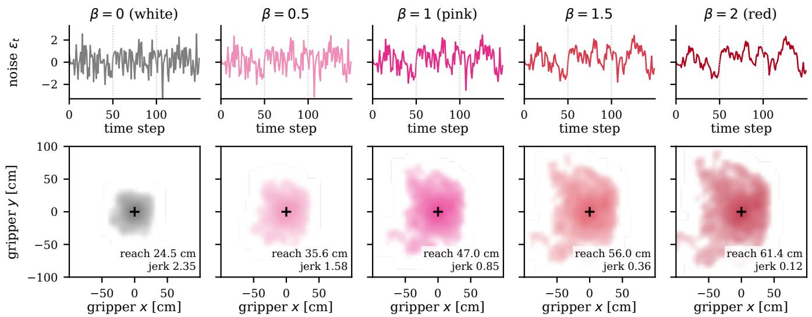  
Figure 1: Coloured noise in a Fetch arm. Top: Examples of noise sequences with noise colours ranging from white (β = 0) to red (β = 2). All sequences were generated from the same initial Gaussian white noise sequence with unit variance. Bottom: Densities of gripper positions relative to the start position (black cross) over 100 episodes of 50 steps with the arm driven by exploration noise alone. Inset values show the maximal gripper displacement and average action jerk over those 100 episodes. These illustrative examples show that increasingly correlated noise generated from the same initial Gaussian white noise reaches a wider area with smoother movements.

• The finding that scheduling decouples learning from smoothness: the noise colour late in training does not afect learning eficiency or end performance, whereas fading towards red noise halves the jerk of exploration in every task.

• A recommendation for robot learning derived from the trade-ofs between the three metrics: red exploration noise is statistically tied with the best strategies in learning eficiency and end performance and produces the smoothest exploration of all strategies.

## 2 Related Work

Action noise for exploration. Exploration remains a central challenge in RL [Amin et al., 2021]. In continu ous control, the simplest and most widely used strategy is to perturb actions with noise. Deterministic-policy algorithms such as DDPG [Lillicrap et al., 2016] and TD3 [Fujimoto et al., 2018] add Gaussian white noise or Ornstein-Uhlenbeck (OU) [Uhlenbeck and Ornstein, 1930] noise to the policy output, whereas stochasticpolicy algorithms such as SAC [Haarnoja et al., 2018] sample actions from a state-dependent Gaussian, which amounts to scale-modulated white noise [Eberhard et al., 2023]. [Hollenstein et al., 2022] showed that the best noise type and scale depend on the environment. Alternatives to action-space noise perturb the policy parameters [Plappert et al., 2018b] or repeat exploratory actions over random durations [Dabney et al., 2021] with embodiment-specific correlations for overactuated systems [Schumacher et al., 2023].

Coloured noise. Coloured noise leads to eficient exploration in model-predictive control [Pinneri et al., 2021] and model-free RL [Eberhard et al., 2023]. Coloured noise is characterised by a noise colour parameter β, the negative slope of the PSD $S ( f ) \propto f ^ { - \beta }$ The noise colour $\beta = 1$ , referred to as pink noise, performs on par with an oracle that selects the best constant colour per task [Eberhard et al., 2023]. Its benefits extend to on-policy algorithms such as PPO [Hollenstein et al., 2024b], and its efect on the optimal policy has been analysed in linear-quadratic settings [Hollenstein et al., 2024a]. All these experiments were performed on standard RL benchmarks such as the DeepMind Control Suite and MuJoCo locomotion. However, robotic manipulation tasks and their hardware-relevant constraints have received little attention.

Scheduled and adaptive exploration. Annealing the amount of exploration is common practice in RL, from decaying ϵ-greedy schedules to reducing the scale of action noise during training, which can improve the performance of of-policy agents [Hollenstein et al., 2022]. Recent work has shown that a developmentally-inspired scheduled noise that recreates the changes in spontaneous movements of human infants by increasing the noise colour from 0.7 to 0.9 during training leads to marginally better performance than any fixed coloured noise [L´opez et al., 2026]. However, it is unclear whether this particular scheduled coloured noise presents any advantage over any other scheduled exploration strategy. To the best of our knowledge, no previous study has systematically compared the start and end colours of noise schedules.

Smooth exploration for robot learning. On physical robots, the smoothness of exploratory actions matters as much as their eficiency [Ibarz et al., 2021]. gSDE [Rafin et al., 2022] replaces per-step noise with a state-dependent perturbation whose parameters are resampled only occasionally, yielding smooth exploration that enabled learning directly on real robots. Other works have explored the regularisation of the smoothness of the learned policy itself [Mysore et al., 2021]. Coloured noise ofers a complementary way of controlling the smoothness of exploration through a single parameter: the noise colour $\beta .$

## 3 Scheduled Coloured Noise

## 3.1 Exploration noise in policy learning

Coloured noise can be implemented in both deterministic-policy algorithms, e.g. DDPG or TD3, and stochastic-policy algorithms, e.g. SAC [Haarnoja et al., 2018]. This paper focuses exclusively on SAC, since it is the more widely used algorithm for robotics. However, the same formalism can generalise to TD3 (see [L´opez et al., 2026]). SAC learns a stochastic policy that maximises the expected return plus the entropy of the policy. Actions are sampled from a squashed Gaussian using the reparameterisation

$$
a _ { t } = \operatorname { t a n h } \bigl ( \mu _ { \theta } ( s _ { t } ) + \sigma _ { \theta } ( s _ { t } ) \odot \varepsilon _ { t } \bigr ) , \quad \varepsilon _ { t } \sim \mathcal { N } ( 0 , I ) ,\tag{1}
$$

where $\mu _ { \theta }$ and $\sigma _ { \theta }$ are outputs of the policy network. Because $\varepsilon _ { t }$ is drawn independently at every step, the exploration noise $\varepsilon _ { 1 : T }$ is white noise. SAC is of-policy, so the noise used to collect experience can be replaced by any other process without needing to change the learning objective [Eberhard et al., 2023; L´opez et al., 2026].

A stationary Gaussian process is called coloured noise with noise colour $\beta$ if its PSD follows $S ( f ) \propto f ^ { - \beta }$ . We can generate it by spectral shaping [Timmer and Koenig, 1995] of white noise: Gaussian random Fourier coeficients are scaled by $f ^ { - \beta / 2 }$ and transformed to the time domain with an inverse Fourier transform, and the result is normalised to unit variance. Coloured noise therefore has the same standard normal marginal distribution as white noise but difers in its temporal correlation [Eberhard et al., 2023]. Fig. 1 shows examples of diferent coloured noises. The white noise $\varepsilon _ { t }$ in (1) can be replaced by a coloured noise to promote more eficient exploration and learning [Eberhard et al., 2023].

## 3.2 Linear colour schedules

It is also possible to use a scheduled coloured noise where the noise colour $\beta$ is annealed during training [L´opez et $a l .$ , 2026]. Given a start colour $\beta _ { \mathrm { s } }$ , an end colour $\beta _ { \mathrm { e } }$ and a training budget of $T$ environment steps, the colour at step t is

$$
\beta ( t ) = \beta _ { \mathrm { s } } + \left( \beta _ { \mathrm { e } } - \beta _ { \mathrm { s } } \right) \frac { k ( t ) } { K - 1 } , \qquad k ( t ) = \Big \lfloor \frac { t K } { T } \Big \rfloor ,\tag{2}
$$

where the training is divided into K blocks of equal length within which the colour is constant, so that noise can be generated in long sequences (see [L´opez et al., 2026]). We use $K = 2 0$ for all tasks, so that the schedule resolution does not depend on the budget. The first block uses $\beta _ { \mathrm { s } }$ and the last block $\beta _ { \mathrm { e } }$ . Constant noise corresponds to $\beta _ { \mathrm { s } } = \beta _ { \mathrm { e } }$ . Independent noise sequences are generated for each action dimension.

In common implementations of SAC, including the Stable-Baselines3 implementation used here [Rafin et $a l .$ , 2021], the same noise sampling routine is used for environment interactions and gradient updates. Our study focuses exclusively on the role of coloured action noise for exploration. Therefore, we apply coloured noise only during interactions of the robot agent with the environment whereas gradient updates use the standard i.i.d. Gaussian reparameterisation.

## 4 Experimental Setup

## 4.1 Tasks

We use four goal-conditioned manipulation tasks from Gymnasium-Robotics [de Lazcano et al., 2023; Plappert et al., 2018a], simulated in MuJoCo [Todorov et al., 2012]. Three tasks use a 7-DoF Fetch arm controlled through an action space of dimension $| { \mathcal { A } } | = 4$ (three Cartesian displacement of the gripper plus the gripper opening): moving the gripper to a target position (Fetch-Reach), pushing a block to a target on the table (Fetch-Push), and grasping a block and placing it at a target position (Fetch-PickAndPlace). One additional task uses the 24-DoF Shadow Dexterous Hand [OpenAI et al., 2020] with 20 position-controlled actuators to rotate a block in the palm to a target orientation about the z axis (ShadowHand-BlockRotateZ). All tasks have sparse rewards and report success when the goal is achieved within a tolerance.

## 4.2 Exploration strategies

We evaluate all 49 linear schedules with noise colours $\beta _ { \mathrm { s } } , \beta _ { \mathrm { e } } \in \{ 0 , 0 . 5 , 0 . 7 5 , 1 , 1 . 2 5 , 1 . 5 , 2 \}$ , covering white $( \beta =$

0), pink $( \beta ~ = ~ 1 )$ and red $\left( \beta \ = \ 2 \right)$ noise as well as intermediate noise colours. The seven schedules with $\beta _ { \mathrm { s } } = \beta _ { \mathrm { e } }$ are the constant noise colours, including the SAC default (white) and the recommended default (pink) proposed by [Eberhard et al., 2023]. The grid contains both increasing and decreasing schedules. As a robotics-oriented baseline we also one additional exploration strategy: gSDE [Rafin et al., 2022], with the exploration matrix resampled at the start of every episode.

## 4.3 Training

Since the tasks considered here are goal-conditioned with sparse rewards (the agent receives −1 at every step until the goal is achieved [Plappert et al., 2018a]), we use Hindsight Experience Replay (HER) [Andrychowicz et al., 2017] to relabel stored transitions with goals that were actually achieved later in the same episode, turning failed episodes into useful training data. All agents use the SAC implementation of Stable-Baselines3 [Raffin et al., 2021] and HER with four relabelled goals per transition. Training hyperparameters are kept identical across all exploration strategies. The actor and critic networks both consist of two hidden layers of 256 units with ReLU activations. The networks are optimised using Adam with a learning rate of $1 0 ^ { - 3 }$ . We use a replay bufer capacity of $1 0 ^ { 6 }$ transitions, a batch size of 256, a target smoothing coeficient τ of 0.05, and an automatic entropy coeficient with a target of −|A| (action space dimension). We use $K = 2 0$ scheduled colour noise blocks and a noise cutof of $f _ { \mathrm { m i n } } = 1 / T _ { \mathrm { e p } }$

Some hyperparameters are varied across tasks according to their demands, with their values determined from a set of pilot runs of 10 seeds with white noise. All Fetch tasks have a maximum episode length $T _ { e } p$ of 50 steps and use a discount factor $\gamma ~ = ~ 0 . 9 5$ The ShadowHand-BlockRotateZ has $T _ { e } p = 1 0 0 \mathrm { a n d } \gamma = 0 . 9 8 $ The total training budget (in total environment steps) is 20,000 for Fetch-Reach; 500,000 for Fetch-Push; and 1,000,000 for both Fetch-PickAndPlace and ShadowHand-BlockRotateZ.

The first 1,000 steps use uniformly random actions to initialise the replay bufer. The scheduled coloured noise is applied from that point until the end of training. Agents collect one episode worth of transitions and then perform as many gradient steps as environment steps collected, which is standard for HER and allows gSDE to keep its exploration matrix fixed within an episode. Each of the $4 \times 5 0 ~ = ~ 2 0 0$ task-noise pairs is trained with 30 random seeds, giving a total of 6,000 runs. Seeds are shared across strategies, and the noise generators use the same seeds, so that runs of diferent strategies are paired through common random numbers [L´opez et al., 2026].

## 4.4 Metrics

Learning eficiency and end performance. Every $T / 5 0$ steps we evaluate the deterministic policy $( a _ { t } =$ tanh $\mu _ { \boldsymbol { \theta } } ( s _ { t } ) )$ on 20 episodes and record the success rate. Our main performance measure is the area under the learning curve (AUC), i.e. the mean success rate over the 50 evaluations, which captures both learning speed and final performance [Eberhard et al., 2023]. We also report the final success rate (end performance) as the mean success over the last 5 evaluations, i.e. the last 10% of training.

Smoothness and efort of exploration. For every training episode we record the executed actions $a _ { 1 : T _ { \mathrm { e p } } }$ and compute the action jerk:

$$
j = \frac { 1 } { ( T _ { \mathrm { e p } } - 2 ) | \mathcal { A } | } \sum _ { t } \bigl | | a _ { t } - 2 a _ { t - 1 } + a _ { t - 2 } | | ^ { 2 } .\tag{3}
$$

For the Shadow Hand, we additionally record the effort as the mean squared actuator force. These metrics are averaged over all training episodes of a run.

Standardisation relative to white noise. To aggregate results across all four diferent tasks, which have diferent dificulties and training budgets, we express all metrics as z-scores relative to white noise, the default exploration noise of SAC. For the learning eficiency and end performance, we subtract the mean and divide by the standard deviation of the 30 white-noise runs. There fore, positive metrics indicate better performance than the default white noise and negative ones indicate worse performance. We also compute a jerk ratio for each exploration strategy as the ratio of its absolute jerk, defined by (3), to the absolute jerk of white noise.

## 4.5 Statistical analysis

95% confidence intervals are obtained with a paired bootstrap that resamples seeds within each task while keeping all strategies of a seed together, thus preserving the pairing through common random numbers (4,000 resamples). To determine if and when noise colour matters, we separate the efects of start and end colours in three ways. First, we compare end colours within groups of runs that share seed and start colour (paired contrasts and Friedman tests). Second, we compare start colours after averaging over end colours within each seed (Friedman tests with seeds as blocks, and Spearman correlations). Third, we regress the z-scored metrics on the mean colour $\bar { \beta } = ( \beta _ { \mathrm { s } } + \beta _ { \mathrm { e } } ) / 2$ , its square, and the colour change $\Delta \beta = \beta _ { \mathrm { e } } - \beta _ { \mathrm { s } }$ , with task fixed efects and a bootstrap over seeds. Finally, we compare each of the nonconstant schedules with the constant noise of the same start colour (Wilcoxon signed-rank tests over seeds and tasks, Bonferroni-corrected).

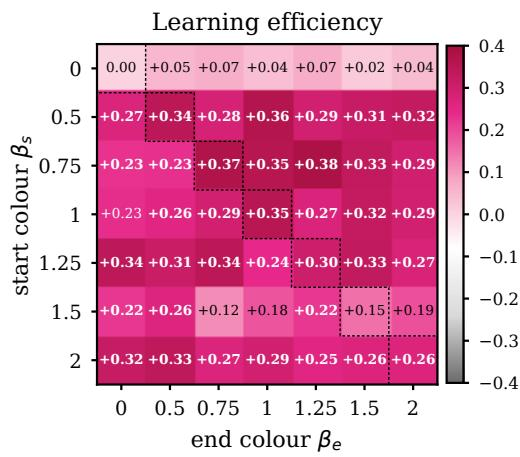

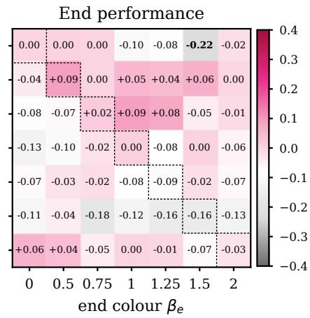

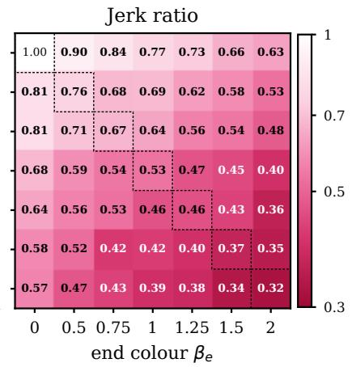  
Figure 2: Aggregated results from all four tasks and 30 seeds for each of the 49 coloured noise exploration strategies. Left: learning eficiency (AUC). Center: End performance from last 10% of training. Right: action jerk during training. All values are normalised with respect to the white noise performance. Values in bold indicate significant diferences to white noise on 95% paired bootstrap confidence intervals. The gSDE scores (not shown) are −0.75, −0.52, and 0.44, respectively.

## 4.6 Pareto frontiers

To balance learning, end performance and smoothness, we identify the Pareto frontiers of the 50 diferent exploration strategies in the planes of learning eficiency vs. jerk ratio and end performance vs. jerk ratio, i.e. the strategies for which no other strategy is at least as good in both metrics and better in one. Because diferences in learning between many strategies are small relative to the variability between seeds, we establish an optimality decision rule: among the strategies whose learning eficiency (or end performance) is not significantly worse than that of the best strategy (paired bootstrap), the optimal exploration strategy is the one with the lowest jerk. This decision rule is most relevant for embodied robots, where high movement jerk can be problematic.

## 5 Results

## 5.1 How noise colour shapes exploration

To illustrate the efects of noise colour on exploration, we drive the Fetch arm with pure noise, i.e. the actions of an untrained SAC policy $( \mu _ { \theta } ~ = ~ 0 , ~ \sigma _ { \theta } ~ = ~ 1$ in (1)) for 50-step episodes. White noise keeps the gripper close to its starting position, whereas increasingly coloured noise produces longer, smoother excursions. Over 100 episodes per colour, the mean maximal gripper displacement grows from 24.5 cm with white noise to 47.0 cm with pink and 61.4 cm with red noise, while the action jerk falls 19-fold, from 2.35 to 0.12. More correlated noise therefore explores further and more smoothly. However, it also produces data that is increasingly of-policy and can drive the robot into the boundaries of its workspace [Eberhard et al., 2023; L´opez et al., 2026]. To avoid this negative consequence of temporally correlated noise, [Eberhard et al., 2023] suggest using pink noise, i.e. a moderately correlated noise, by default. In contrast, we suggest that scheduled coloured noise that changes the balance between local and global exploration as learning progresses may be a more suitable solution for robotics.

## 5.2 Coloured vs. white noise

Table 1 and Fig. 2 show the comparisons between white noise with constant and scheduled coloured noise alternatives aggregated over the four tasks. An analysis of these results is provided next.

Learning eficiency. 37 of the 48 coloured noise exploration strategies lead to significantly more eficient learning than white noise and none to less eficient learning. However, this advantage is task-dependent. On Fetch-Reach, 44 of 48 coloured noises outperform white noise, with constant pink and red noise improving the success AUC from 0.55 to 0.67 and 0.66, respectively. On Fetch-Push, only 2 coloured noises are significantly better than white noise and 2 are significantly worse. A coloured noise with β = 0.5 performs best (AUC 0.26 vs. 0.16). On Fetch-PickAndPlace, 15 of 48 coloured noises learn significantly more slowly. On ShadowHand-BlockRotateZ, we find no significant dif ferences with respect to white noise.

End performance. No strategy achieves significantly higher end performance than white noise. The highest aggregate end performance is achieved by a scheduled noise that increases from $\beta _ { \mathrm { s } } ~ = ~ 0 . 7 5$ to $\beta _ { \mathrm { e } } ~ = ~ 1$ One coloured noise strategy $( 0  1 . 5 )$ and gSDE are significantly worse than white noise. Combined with the learning eficiency outcome, these results show that coloured noise can speed up learning on some tasks without improving the success rate reached at the end of the training budget.

Table 1: Aggregate learning eficiency and end performance (z-scores relative to white noise, mean over tasks) and jerk ratio relative to white noise (geometric mean over tasks) for some representative exploration strategies. Brackets indicate 95% paired bootstrap confidence intervals over 30 seeds. The best values in each column are highlighted in bold and the second best values are underlined.
<table><tr><td>Exploration strategy</td><td>Learning efficiency (↑)</td><td>End performance (↑)</td><td>Jerk ratio (↓)</td></tr><tr><td>Common baselines</td><td></td><td></td><td></td></tr><tr><td>White noise  $( \beta = 0 )$ </td><td> $0 . 0 0 \ [ - 0 . 1 8 , + 0 . 1 9 ]$ </td><td> $0 . 0 0 \ [ - 0 . 1 8 , + 0 . 1 7 ]$ </td><td>1.00</td></tr><tr><td> $\mathrm { g S D E }$ </td><td> $- 0 . 7 5 \ [ - 0 . 8 8 , - 0 . 6 3 ]$ </td><td> $- 0 . 5 2 \ [ - 0 . 7 4 , - 0 . 3 3 ]$ </td><td>0.44 [0.38, 0.50]</td></tr><tr><td>Fixed coloured noise</td><td></td><td></td><td></td></tr><tr><td> $\beta = 0 . 5$ </td><td>+0.34  $[ + 0 . 1 4 , + 0 . 5 5 ]$ </td><td> $\pm 0 . 0 9 \ [ - 0 . 0 8 , + 0 . 2 7 ]$ </td><td>0.76 [0.69, 0.84]</td></tr><tr><td> $\beta = 1 \ ( \mathrm { P i n k \ n o i s e } )$ </td><td>+0.35  $[ + 0 . 1 8 , + 0 . 5 2 ]$ </td><td> $0 . 0 0 \ [ - 0 . 1 7 , + 0 . 1 7 ]$ </td><td>0.53 [0.47, 0.60]</td></tr><tr><td> $\beta = 2 \ ( { \mathrm { R e d ~ n o i s e } } )$ </td><td>+0.26  $[ + 0 . 1 1 , + 0 . 4 2 ]$ </td><td> $- 0 . 0 3 \ [ - 0 . 1 8 , + 0 . 1 3 ]$ </td><td>0.32 [0.28, 0.37]</td></tr><tr><td>Scheduled coloured noise  $( \beta _ { \mathrm { s } }  \beta _ { \mathrm { e } } )$ </td><td></td><td></td><td></td></tr><tr><td> $0  1 \ \mathrm { ( W h i t e \ t o \ P i n k ) }$ </td><td> $+ 0 . 0 4 \ [ - 0 . 1 3 , + 0 . 2 2 ]$ </td><td>-0.10 [−0.30, +0.09]</td><td>0.77 [0.72, 0.83]</td></tr><tr><td> $0  2 \ \mathrm { ( W h i t e \ t o \ R e d ) } ^ { \prime }$ </td><td>+0.04 [−0.12, +0.20]</td><td>-0.02 [−0.18, +0.14]</td><td>0.63 [0.58, 0.68]</td></tr><tr><td> $1 \to 0 { \mathrm { ~ ( P i n k ~ t o ~ W h i t e ) } }$ </td><td>+0.23 [+0.06, +0.40]</td><td>-0.13 [−0.31, +0.05]</td><td>0.68 [0.61, 0.75]</td></tr><tr><td> $1  2 \ ( \mathrm { P i n k \ t o \ R e d } )$ </td><td> $+ 0 . 2 9 \ [ + 0 . 1 3 , + 0 . 4 5 ]$ </td><td>-0.06 [−0.23, +0.10]</td><td>0.40 [0.35, 0.44]</td></tr><tr><td> $2  0 \ \mathrm { ( R e d \ t o \ W h i t e ) }$ </td><td>+0.32 [+0.16, +0.47]</td><td>+0.06 [−0.10, +0.22]</td><td>0.57 [0.51, 0.62]</td></tr><tr><td> $2  1 ~ ( \mathrm { R e d ~ t o ~ P i n k } )$ </td><td> $+ 0 . 2 9 \ [ + 0 . 1 5 , + 0 . 4 4 ]$ </td><td>0.00 [−0.14, +0.15]</td><td>0.39 [0.34, 0.45]</td></tr><tr><td> $0 . 7 5  1$ </td><td> $\pm 0 . 3 5 \ [ + 0 . 1 8 , + 0 . 5 4 ]$ </td><td>+0.09 [−0.07, +0.26]</td><td>0.64 [0.58, 0.70]</td></tr><tr><td> $0 . 7 5  1 . 2 5$ </td><td> $+ 0 . 3 8 \ [ + 0 . 2 0 , + 0 . 5 6 ]$ </td><td> $+ 0 . 0 8 \ [ - 0 . 1 0 , + 0 . 2 6 ]$ </td><td>0.56 [0.51, 0.62]</td></tr></table>

Smoothness. All 48 coloured schedules explore significantly more smoothly than white noise. The jerk ratio decreases from 1 for white to 0.53 for pink and 0.32 for red noise. gSDE achieves an average jerk ratio of 0.44, i.e. considerably higher than that of red noise, while both its learning eficiency and end performance are the worst overall.

## 5.3 When coloured noise matters most

To further understand the efects of coloured noise exploration during the diferent stages of training, we aggregate runs based on their coloured noise at the start and end of training. Results are shown in Fig. 3.

End colour does not afect learning. Among runs that share seed and start colour, the end colour has no significant efect on learning eficiency in any task (Friedman tests, $p \geq 0 . 2 2 )$ or on end performance $( p ~ \geq ~ 0 . 1 0 )$ . The efect is very small: ending with red rather than white noise changes the success

AUC by $+ 0 . 0 0 6 \left[ - 0 . 0 0 2 , 0 . 0 1 4 \right]$ on Fetch-Reach, −0.001 [−0.019, 0.018] on Fetch-Push, +0.005 [−0.011, 0.020] on Fetch-PickAndPlace and −0.006 [−0.019, 0.006] on ShadowHand-BlockRotateZ. Consistently, none of the 42 scheduled noises difers significantly from the constant noise of its start colour in learning eficiency or end performance (Bonferroni-corrected), and the direction of the schedule has no efect on either metric (regression coefficient of $\Delta \beta \colon ~ - 0 . 0 3 ~ \left[ - 0 . 0 8 , 0 . 0 1 \right]$ for learning, +0.00 $[ - 0 . 0 3 , 0 . 0 4 ]$ for end performance).

Start colour afects learning only on one task. Averaged over end colours, the start colour has a strong efect on Fetch-Reach, where starting with more correlated noise, i.e. higher noise colour $\beta ,$ leads to faster learning (Friedman $p \ < \ 1 0 ^ { - 1 7 } .$ , Spearman $\rho = 0 . 5 1 )$ . On Fetch-Push, Fetch-PickAndPlace and ShadowHand-BlockRotateZ, its efect is not significant $( p = 0 . 2 9 , 0 . 2 3$ and 0.41).

Noise colour strongly afects smoothness. End ing with red rather than white noise reduces the jerk of exploration to 0.49 [0.47, 0.50] of its value on Fetch-Reach, 0.50 [0.45, 0.55] on Fetch-Push, 0.60 [0.54, 0.67] on Fetch-PickAndPlace and 0.60 [0.58, 0.63] on ShadowHand-BlockRotateZ (all $p < 1 0 ^ { - 4 0 } )$ . All 21 schedules that increase the noise colour explore significantly more smoothly than the constant noise of their start colour, at no cost in learning. At equal mean colour, jerk is slightly lower for decreasing than for increasing schedules (coeficient of $\Delta \beta$ on log jerk ratio: $+ 0 . 0 4 \ [ 0 . 0 2 , 0 . 0 7 ] )$ , indicating that the colour early in training, when the policy’s noise scale is largest, weighs somewhat more.

To summarise, our results reveal that scheduling the noise colour decouples the two consequences of coloured noise exploration. First, we find that most of the influence of the coloured noise occurs early in training, when exploration is the primary source of learning. Second, we find that the noise colour used late in training determines how smoothly the robot moves without afecting learning.

## 5.4 Balancing learning, end performance and smoothness

Fig. 4 shows the three metrics for all strategies and their trade-ofs. The Pareto frontier of learning eficiency vs. jerk ratio spans nine schedules, from constant red noise (learning $z = + 0 . 2 6 ,$ jerk ratio 0.32) to the $0 . 7 5  1 . 2 5$ schedule $( z = + 0 . 3 8 ,$ , jerk ratio 0.56). The frontier of end performance vs. jerk ratio spans seven schedules, from constant red noise $( z ~ = ~ - 0 . 0 3$ , jerk ratio 0.32) to the $0 . 7 5  1$ schedule $( z = + 0 . 0 9$ , jerk ratio 0.64). Along both frontiers, gains in learning or end performance are non-significant, whereas diferences in jerk are more prominent. 39 strategies are statistically tied with the best strategy in learning eficiency, and 40 in end performance. In both sets, the strategy with the lowest jerk is constant red noise, which is the smoothest out of all 50 strategies, and is present in both Pareto frontiers.

Compared with white noise, red noise learns more efficiently $( \Delta z \ = \ + 0 . 2 6 [ 0 . 0 4 , 0 . 4 9 ] )$ , reaches the same end performance $\left( - 0 . 0 3 \ \left[ - 0 . 2 5 , 0 . 1 9 \right] \right)$ and explores with 3-fold less jerk (ratio 0.32 [0.28, 0.37]). Compared with pink noise, it does not difer in learning $\left( - 0 . 0 8 \ \left[ - 0 . 2 9 , 0 . 1 1 \right] \right)$ or end performance (−0.03 $[ - 0 . 2 4 , 0 . 1 7 ] )$ but explores with almost 2-fold less jerk $( 0 . 6 0 \ [ 0 . 5 2 , 0 . 6 8 ] )$ . Compared with the strategies at the other ends of the fronts, $0 . 7 5  1 . 2 5$ and $0 . 7 5  1$ red noise does not difer significantly in learning or end performance (∆z between −0.12 and −0.09) while halving the jerk (ratios 0.57 and 0.50). Red noise also outperforms gSDE in learning (+1.01 [0.81, 1.22]), end performance $( + 0 . 4 9 \ [ 0 . 2 5 , 0 . 7 6 ] )$ and smoothness (0.74 $[ 0 . 6 2 , 0 . 8 6 ] )$

## 6 Discussion

## 6.1 Coloured noise supports learning with reduced movement jerk

Across 6,000 training runs, the colour of the exploration noise had a consistent efect on how smoothly the robots explored but a smaller and task-dependent efect on how eficiently they learned. Coloured noise accelerated learning on Fetch-Reachbut had mixed or negligible efects on Fetch-Push, Fetch-PickAndPlace, and ShadowHand-BlockRotateZ. These results contrast with the default pink noise recommendations of [Eber hard et al., 2023] based on their experiments on standard continuous control RL environments. Our sparse-reward robotic manipulation tasks with HER showed that pink noise did not learn more eficiently than other coloured noises and its advantage over white noise was moderate. This diference could be explained by specific hindrances introduced by highly correlated actions (see [Hollenstein et al., 2022]). For example, coloured noise on the robot’s gripper can keep the gripper open or closed for long periods, thus making the discovery of grasps dificult. Future work must investigate whether diferent coloured noises may be beneficial for diferent actuators within a same agent.

Interestingly, red noise was previously considered too strongly correlated as a default on standard control benchmarks [Eberhard et al., 2023; L´opez et al., 2026]. Two features of our experiments may explain why it performed as well as pink noise here. First, manipulation tasks often combine integrator-like dynamics (e.g. Fetch actions are Cartesian displacements of the gripper) within short episodes of 50 to 100 steps, compared with up to 1,000 steps in the DeepMind Control Suite. More correlated noise is favoured when larger displacements must be achieved within a given number of steps [Eberhard et $a l .$ , 2023], and more strongly correlated noise moved the Fetch gripper further within an episode (Fig. 1). Second, our low-frequency cutof at the episode length prevents red noise from degenerating into a near-constant ofset within an episode. Pink noise may therefore remain the better default for long-horizon control, whereas short-horizon manipulation benefits from the red noise smoothness.

The asymmetry we observed between the start and end colours suggests that exploration matters most early in training. As training proceeds, SAC’s automatic entropy tuning reduces the policy’s standard deviation $\sigma _ { \theta } ,$ so that the exploration noise, whatever its colour, perturbs the agent’s behaviour less. The colour of the remaining noise then shapes the motion of the robot, and hence its jerk, without necessarily changing what the agent learns.

## 6.2 Smooth exploration versus smooth behaviours

We must point out that coloured noise is not the only way to obtain smooth motions in robots. Common alternatives filter the executed actions with a low-pass filter, penalise action rates, jerk or torques in the reward function [Rudin et al., 2022], regularise the smoothness of the learned policy [Mysore et al., 2021], repeat actions over consecutive steps [Dabney et al., 2021], or simply reduce the control frequency. These methods focus on smoothing of policy. Coloured noise, in contrast, only afects exploration: the deployed policy is the deterministic mean tanh $\mu _ { \boldsymbol { \theta } } ( s _ { t } )$ , which is unafected by the noise, so smoother training comes without deployment lag, reward modifications or additional hyperparameters. Smoothing at the level of exploration is also supported by previous evidence that temporally correlated perturbations improve state-space coverage [Eberhard et al., 2023; Hollenstein et al., 2022; L´opez et al., 2026] and enable learning directly on physical robots [Rafin et al., 2022]. The two families of methods are therefore complementary and can be combined: a smooth policy reduces the jerk of the deployed behaviour, whereas red exploration noise reduces the jerk of the exploratory behaviour that dominates during training. Among the exploration-level methods evaluated here, red noise was both smoother and considerably more eficient than gSDE.

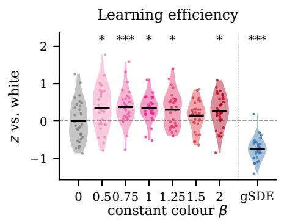

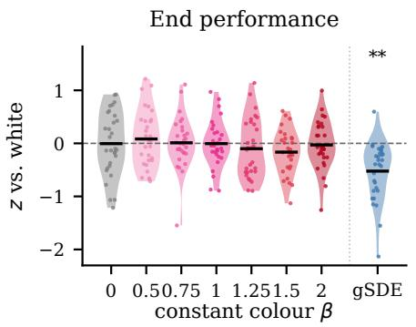

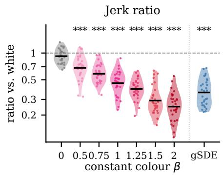

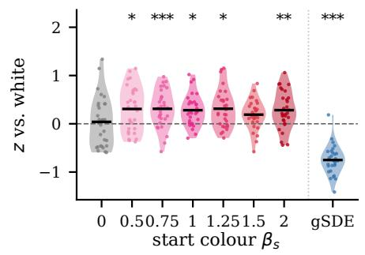

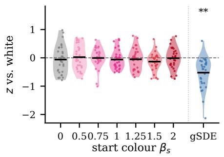

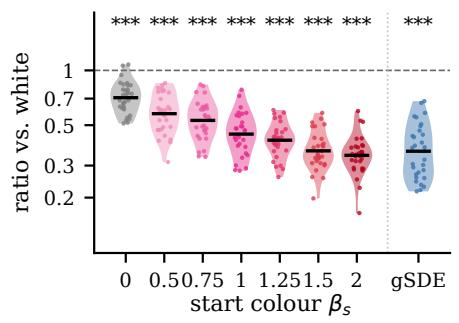

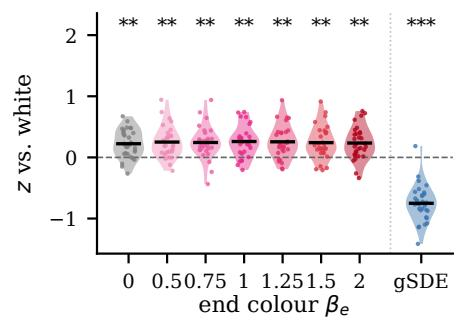

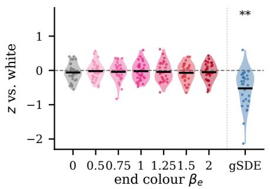

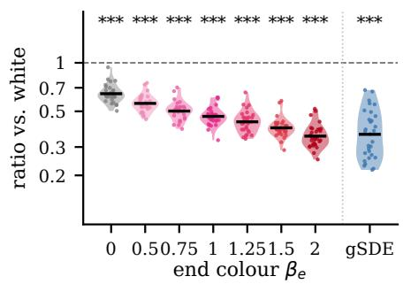  
Figure 3: Efects of constant noise colour (top) and aggregated scheduled noise from start colour $\beta _ { \mathrm { s } }$ (middle) to end colour $\beta _ { \mathrm { e } }$ (bottom) on learning eficiency (left), end performance (center), and jerk ratio (right). Each dot corresponds to one seed averaged over the four tasks. Horizontal black bars indicate means. Stars indicate significant diferences from fixed white noise in paired Wilcoxon signed-rank tests $( ^ { * } p < 0 . 0 5 , ^ { * * } p < 0 . 0 1 , ^ { * * * } p < 0 . 0 0 1 )$

## 6.3 Limitations and future work

This study has several limitations that need to be high lighted. All experiments were performed in simulation, and jerk was computed on the commanded actions rather than on measured on embodied motions, so the benefits of smoother exploration for physical hardware remain to be confirmed on a real robot. We considered a single algorithm (SAC with HER), linear schedules between seven noise colours, and four manipulation tasks, one of which (Fetch-Reach) contributed most of the aggregate learning gains. Despite training 30 random seeds per strategy, the variability between seeds on the harder tasks was large, so that many diferences in learning were not significant on individual tasks.

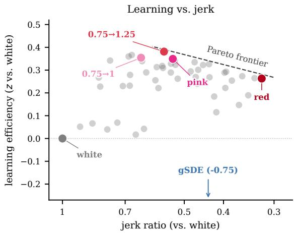

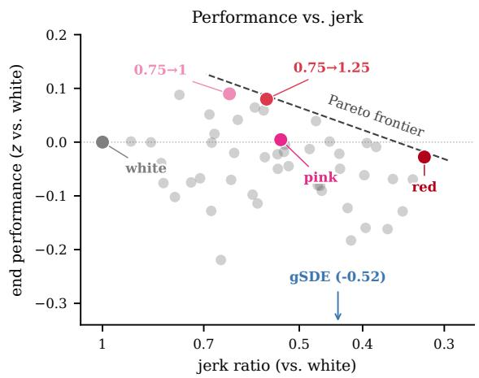  
Figure 4: Trade-ofs between learning eficiency (left) and end performance (right) with jerk ratio. Each point shows the aggregate from one of the 50 exploration schedules. Highlighted dots show the constant white, pink, and red noises, the two schedules with highest learning eficiency $( 0 . 7 5  1 . 2 5 )$ and end performance (0.75 → 1), and $\mathrm { g S D E }$ . The dashed lines indicate the Pareto frontiers.

## 7 Conclusion

We systematically evaluated linear noise-colour schedules for exploration in robotic manipulation, covering all combinations of start and end colours between white and red noise on four tasks with a Fetch arm and a Shadow Dexterous Hand. Our results suggest a diference with respect to the standard control default pink noise recommendation of [Eberhard et al., 2023]: for of-policy robot learning, white noise should be replaced by red noise. In our experiments, fading to red resulted in exploration strategies that learned at least as eficiently as white and pink noise, reached the same end performance in aggregate, and executed the smoothest exploratory motions. Future work will focus on validating scheduled coloured noise on physical robots and explore adaptive schedules that adjust the noise colour to the learning progress of the agent.

## Acknowledgements

Experiments were performed on the UNSW Compute Cluster Katana (DOI: 10.26190/669X-A286).

## References

[Amin et al., 2021] Susan Amin, Maziar Gomrokchi, Harsh Satija, Herke van Hoof, and Doina Precup. A

survey of exploration methods in reinforcement learn ing. arXiv preprint arXiv:2109.00157, 2021.

[Andrychowicz et al., 2017] Marcin Andrychowicz, Filip Wolski, Alex Ray, Jonas Schneider, Rachel Fong, Peter Welinder, Bob McGrew, Josh Tobin, Pieter Abbeel, and Wojciech Zaremba. Hindsight experience replay. In Advances in Neural Information Processing Systems (NeurIPS), volume 30, 2017.

[Dabney et al., 2021] Will Dabney, Georg Ostrovski, and Andr´e Barreto. Temporally-extended ϵ-greedy exploration. In International Conference on Learning Representations (ICLR), 2021.

[de Lazcano et al., 2023] Rodrigo de Lazcano, Kallinteris Andreas, Jun Jet Tai, Seungjae Ryan Lee, and Jordan Terry. Gymnasium robotics. https://github.com/Farama-Foundation/ Gymnasium-Robotics, 2023.

[Eberhard et al., 2023] Onno Eberhard, Jakob Hollenstein, Cristina Pinneri, and Georg Martius. Pink noise is all you need: Colored noise exploration in deep reinforcement learning. In International Conference on Learning Representations (ICLR), 2023.

[Fujimoto et al., 2018] Scott Fujimoto, Herke van Hoof, and David Meger. Addressing function approximation error in actor-critic methods. In International Conference on Machine Learning (ICML), pages 1587–1596, 2018.

[Haarnoja et al., 2018] Tuomas Haarnoja, Aurick Zhou, Pieter Abbeel, and Sergey Levine. Soft actorcritic: Of-policy maximum entropy deep reinforcement learning with a stochastic actor. In Inter-

national Conference on Machine Learning (ICML), pages 1861–1870, 2018.

[Hollenstein et al., 2022] Jakob Hollenstein, Sayantan Auddy, Matteo Saveriano, Erwan Renaudo, and Justus Piater. Action noise in of-policy deep reinforcement learning: Impact on exploration and performance. Transactions on Machine Learning Research, 2022.

[Hollenstein et al., 2024a] Jakob Hollenstein, Marko Zaric, Samuele Tosatto, and Justus Piater. Pink noise LQR: How does colored noise afect the optimal policy in RL? In ICML Workshop: Foundations of Reinforcement Learning and Control, 2024.

[Hollenstein et al., 2024b] Jakob J. Hollenstein, Georg Martius, and Justus H. Piater. Colored noise in PPO: Improved exploration and performance through correlated action sampling. In AAAI Conference on Artificial Intelligence, pages 12466–12472, 2024.

[Ibarz et al., 2021] Julian Ibarz, Jie Tan, Chelsea Finn, Mrinal Kalakrishnan, Peter Pastor, and Sergey Levine. How to train your robot with deep reinforcement learning: Lessons we have learned. The International Journal of Robotics Research, 40(4–5):698–721, 2021.

[Kober et al., 2013] Jens Kober, J. Andrew Bagnell, and Jan Peters. Reinforcement learning in robotics: A survey. The International Journal of Robotics Research, 32(11):1238–1274, 2013.

[Lillicrap et al., 2016] Timothy P. Lillicrap, Jonathan J. Hunt, Alexander Pritzel, Nicolas Heess, Tom Erez, Yuval Tassa, David Silver, and Daan Wierstra. Continuous control with deep reinforcement learning. In International Conference on Learning Representations (ICLR), 2016.

[L´opez et al., 2026] Francisco M. L´opez, Markus R. Ernst, Francisco Cruz, Matej Hofmann, and Jochen Triesch. Infant spontaneous movement noise improves exploration in deep RL. In IEEE International Conference on Development and Learning (ICDL), pages 1–6, 2026.

[Mysore et al., 2021] Siddharth Mysore, Bassel Mabsout, Renato Mancuso, and Kate Saenko. Regularizing action policies for smooth control with reinforcement learning. In IEEE International Conference on Robotics and Automation (ICRA), 2021.

[OpenAI et al., 2020] OpenAI, Marcin Andrychowicz, Bowen Baker, Maciek Chociej, Rafal J´ozefowicz, Bob McGrew, Jakub Pachocki, Arthur Petron, Matthias Plappert, Glenn Powell, Alex Ray, et al. Learning dexterous in-hand manipulation. The International Journal of Robotics Research, 39(1):3–20, 2020.

[Pinneri et al., 2021] Cristina Pinneri, Shambhuraj Sawant, Sebastian Blaes, Jan Achterhold, Joerg Stueckler, Michal Rolinek, and Georg Martius. Sample-eficient cross-entropy method for real-time planning. In Conference on Robot Learning (CoRL), volume 155 of PMLR, pages 1049–1065, 2021.

[Plappert et al., 2018a] Matthias Plappert, Marcin Andrychowicz, Alex Ray, Bob McGrew, Bowen Baker, Glenn Powell, Jonas Schneider, Josh Tobin, Maciek Chociej, Peter Welinder, Vikash Kumar, and Wojciech Zaremba. Multi-goal reinforcement learning: Challenging robotics environments and request for research. arXiv preprint arXiv:1802.09464, 2018.

[Plappert et al., 2018b] Matthias Plappert, Rein Houthooft, Prafulla Dhariwal, Szymon Sidor, Richard Y. Chen, Xi Chen, Tamim Asfour, Pieter Abbeel, and Marcin Andrychowicz. Parameter space noise for exploration. In International Conference on Learning Representations (ICLR), 2018.

[Rafin et al., 2021] Antonin Rafin, Ashley Hill, Adam Gleave, Anssi Kanervisto, Maximilian Ernestus, and Noah Dormann. Stable-baselines3: Reliable reinforcement learning implementations. Journal of Machine Learning Research, 22(268):1–8, 2021.

[Rafin et al., 2022] Antonin Rafin, Jens Kober, and Freek Stulp. Smooth exploration for robotic reinforcement learning. In Conference on Robot Learning (CoRL), volume 164 of PMLR, pages 1634–1644, 2022.

[Rudin et al., 2022] Nikita Rudin, David Hoeller, Philipp Reist, and Marco Hutter. Learning to walk in minutes using massively parallel deep reinforcement learning. In Conference on robot learning, pages 91–100. PMLR, 2022.

[Schumacher et al., 2023] Pierre Schumacher, Daniel H¨aufle, Dieter B¨uchler, Syn Schmitt, and Georg Martius. DEP-RL: Embodied exploration for reinforcement learning in overactuated and musculoskeletal systems. In International Conference on Learning Representations (ICLR), 2023.

[Timmer and Koenig, 1995] Jens Timmer and Michel Koenig. On generating power law noise. Astronomy and Astrophysics, 300:707, 1995.

[Todorov et al., 2012] Emanuel Todorov, Tom Erez, and Yuval Tassa. MuJoCo: A physics engine for modelbased control. In IEEE/RSJ International Conference on Intelligent Robots and Systems (IROS), pages 5026–5033, 2012.

[Uhlenbeck and Ornstein, 1930] George E. Uhlenbeck and Leonard S. Ornstein. On the theory of the Brownian motion. Physical Review, 36:823–841, 1930.