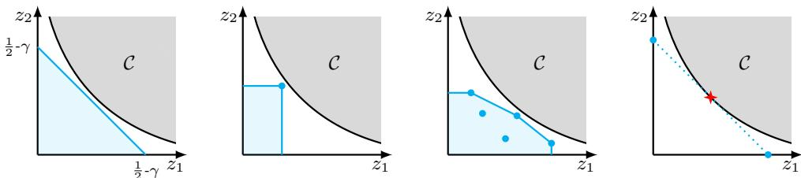

# Generalized Adaptive Boosting and the Geometry of Mistakes

Marco Bressan Università degli Studi di Milano marco.bressan@unimi.it

Nicolò Cesa-Bianchi Università degli Studi di Milano nicolo.cesa-bianchi@unimi.it

Yishay Mansour Tel Aviv University Google Research mansour.yishay@gmail.com

Nataly Brukhim Apple Research natalybrukhim@gmail.com

Emmanuel Esposito Università degli Studi di Milano emmanuel@emmanuelesposito.it

Shay Moran Technion Google Research smoran@technion.ac.il

Maximilian Thiessen   
University of Tübingen and Tübingen AI Center Max Planck Institute for Informatics   
maximilian.thiessen@uni-tuebingen.de

## Abstract

Not all mistakes are alike. For example, in medical diagnosis, false positive and false negative mistakes have a different impact and should not be aggregated. By revisiting the classical theory of boosting through this lens, we introduce the notion of Z-learner, which returns weak hypotheses achieving joint falsepositive/false-negative guarantees (FP, FN) from some set $Z \subseteq [ 0 , 1 ] ^ { 2 }$ This formulation generalizes the standard notion of γ-weak learning—recovered by taking $Z = \{ ( z _ { 1 } , z _ { 2 } ) : z _ { 1 } + z _ { 2 } < 1 / 2 - \gamma \}$ —and allows for more flexible notions of weak learnability that account for the impact of the distribution on the achievable learning guarantees. This raises a natural question: which sets Z are boostable? We answer this by giving a complete geometric characterization that unifies, as special cases, both the classical boosting dichotomy and the recent multi-objective extension of Bressan et al. (COLT 2025). We also present an adaptive algorithm for boosting Z-learners without relying on the prior knowledge of Z, generalizing AdaBoost’s ability to handle unknown margin parameters. Finally, we demonstrate that Z-learners can achieve confidence amplification. However, the analysis is significantly more involved than in classical boosting and relies on the centerpoint theorem from discrete and computational geometry.

## 1 Introduction

In many real-world prediction tasks, errors naturally split into two distinct types: false positives (Type I errors), where a negative instance is incorrectly labeled as positive, and false negatives (Type II errors), where a positive instance is incorrectly labeled as negative. In practice, these two errors are rarely symmetric. For example, in medical diagnostics, one can often reduce false negatives by using

more tests or lowering the decision threshold, but this typically leads to increasing false positives.   
Conversely, stricter decision criteria reduce false positives at the cost of more false negatives.

Despite the ubiquity of this tension, its theoretical understanding remains limited. A basic illustration of this gap appears in the theory of boosting, a central paradigm in machine learning. In its classic form, boosting guarantees that any weak PAC learner—namely, an algorithm achieving total error at most $1 / 2 - \gamma$ for some $\gamma > 0 -$ can be converted into a strong learner with arbitrarily small error. However, this guarantee treats all mistakes uniformly. Once we distinguish between false positives and false negatives, new and qualitatively different notions of weak learners arise. For instance, consider a learner whose total error may even exceed $1 / 2 .$ , but which guarantees an extremely small false-positive rate $( \mathrm { e . g . }$ , at most 0.001). More generally, one can imagine learners that behave asymmetrically across distributions: for some distributions they achieve a very small false-positive rate, while for others they achieve a very small false-negative rate yet their total error exceeds $1 / 2$ Such learners would be useless under the standard boosting framework, yet they capture meaningful and practically relevant forms of reliability. This raises a natural question: can such asymmetric guarantees be amplified? More broadly, how should boosting be formulated when the goal is to control false positives and false negatives separately, rather than just their sum?

In order to answer these questions we take a more refined view of weak learning, and describe the learner’s guarantee not only by its total error, but by the pairs (FP, FN) it achieves. To this end, we simply encode the learner’s guarantees by a generic set $Z \subseteq [ 0 , 1 ] ^ { 2 }$ ; this means that, under every realizable distribution, the learner achieves an (FP, FN) pair which is dominated from above by some $z \in Z$ , where z may depend on the distribution. For example, the guarantees of a γ-weak PAC learner in the classical sense are given by the set $Z = \{ z \in [ 0 , 1 ] ^ { 2 } : z _ { 1 } + \breve { z } _ { 2 } \leq \frac { 1 } { 2 } - \gamma \}$ ; indeed, under every distribution the learner has total error rate $\mathrm { F P } + \mathrm { F N } \le z _ { 1 } + z _ { 2 } \le \frac { 1 } { 2 } - \gamma$ . The classic boosting theorem shows that this guarantee is boostable, for instance by AdaBoost [Freund and Schapire, 1997]. On the other hand, a guarantee of total error $1 / 2$ is trivial, since it can be achieved by tossing a fair coin, and is therefore not boostable. As another example, Bressan et al. [2025] recently considered the case where the learner ${ \bf \gamma } _ { \bf S }$ guarantees is given by the singleton set $Z = \{ z \}$ ; this means that the learner’s hypotheses always achieve $\mathrm { F P } \le z _ { 1 }$ and $\mathrm { F N } \le z _ { 2 }$ . The results of Bressan et al. [2025] tell that such a guarantee is boostable if $\sqrt { z _ { 1 } } + \sqrt { z _ { 2 } } < 1$ , and not boostable if $\sqrt { z _ { 1 } } + \sqrt { z _ { 2 } } \ge 1$ , as in that case a ${ \dot { Z } } .$ -learner can be implemented via biased random coins. Our goal is to generalize these results to arbitrary $Z \subseteq [ 0 , 1 ] ^ { 2 }$ , which leads to the central question of this work:

## Which sets $Z \subseteq [ 0 , 1 ] ^ { 2 } o f ( \mathrm { F P } , \mathrm { F N } )$ -error guarantees can be boosted?

Previous work falls short of answering this question. Moreover it is not clear, in principle, that there is still a sharp boundary between boostable and non-boostable guarantees. Indeed, there may be intermediate regimes, in which the weak learner cannot be boosted all the way to strong learning, but its guarantee can nevertheless be improved in some nontrivial sense, for example by reducing one type of error or by obtaining a better nonzero error pair.

Our main result shows that the answer is governed by a clean dichotomy: no intermediate regime exists. For every set $Z ,$ either the guarantee is strong enough to be boosted to arbitrarily high overall accuracy, or it is not more informative than random guessing. This dichotomy generalizes simultaneously both the classic boosting setting, $Z = \{ z : \bar { z _ { 1 } } + z _ { 2 } \leq 1 / 2 - \gamma \}$ , and the singleton case $Z = \{ z \}$ of Bressan et al. [2025]. Our result also gives a simple geometric interpretation of the dichotomy: the boostability of Z is determined by whether the convex hull of $Z ,$ , denoted $\operatorname { c o n v } ( Z )$ intersects a certain set $\mathcal { C } \subseteq [ 0 , 1 ] ^ { 2 }$ , namely

$$
{ \mathcal { C } } = \{ ( z _ { 1 } , z _ { 2 } ) : { \sqrt { z _ { 1 } } } + { \sqrt { z _ { 2 } } } \geq 1 \} .\tag{1}
$$

Interestingly, the classical edge (or margin) parameter $\gamma ,$ which governs the complexity of boosting, admits a natural geometric interpretation in our framework: it corresponds to the $\ell _ { \infty }$ distance between conv(Z) and the set C. In particular, for the classical choice of $Z ,$ , this notion recovers the standard definition of the boosting margin.

The above characterization identifies exactly when boosting is possible, but it also raises a natural algorithmic question: can boosting be carried out adaptively, without prior knowledge of the weaklearning guarantee? For example, in the standard case of γ-PAC learners, AdaBoost successfully boosts without knowing in advance the set $Z$ (which, in this case, boils down to knowing $\gamma )$ . In other words, AdaBoost does not need knowledge of the weak learner’s guarantees, nor to know whether the weak-learning condition holds; instead, it automatically identifies and amplifies whatever advantage the weak learner provides.

  
Figure 1: A visual depiction of our dichotomy theorem. In each plot, the two axes show the falsepositive error guarantee $z _ { 1 }$ and the false negative error guarantee $z _ { 2 }$ . The gray region is the set of $\ddot { \cdots } _ { \mathrm { { t r i v i a l } } ^ { \mathrm { { s } } } } ,$ (coin-attainable) guarantees $\mathcal { C }$ (see Eq. (1)). The blue region is (the down-closure of) some set of (FP, FN) error guarantees $Z \subseteq [ 0 , 1 ] ^ { 2 }$ . In the left plot $Z = \left\{ z \in [ 0 , 1 ] ^ { 2 } : z _ { 1 } + z _ { 2 } \leq 0 . 5 - \gamma \right\}$ which is boostable by classic results. In the second plot $Z = \{ z \}$ with $z ^ { ^ { \prime } } \in [ 0 , 1 ] ^ { 2 } \setminus \mathcal { C } .$ , which is boostable by the results of Bressan et al. [2025]. In the third plot $Z$ is any subset of $[ 0 , 1 ] ^ { 2 }$ with conv $( { \overline { { Z } } } ) \cap { \mathcal { C } } = \emptyset ;$ Theorem 4 says this condition characterizes the boostable sets, therefore subsuming the two previous cases. In the rightmost plot, $Z = \{ ( 0 , 1 / 2 ) , ( 1 / 2 , 0 ) \}$ ; while the two marked points are individually boostable, the set $Z$ is not as its convex hull touches C.

Our second main result shows that this principle also extends beyond standard boosting. We give a universal boosting algorithm for (FP, FN) guarantees that requires no prior knowledge of $Z ,$ of an underlying hypothesis class, or of the geometric margin separating conv $\cdot ( Z )$ from C. Instead, the algorithm identifies the relevant parameters of the weak-learning guarantee during its run, and uses this information to boost whenever boosting is possible. Thus, the clean geometric dichotomy above is accompanied by an adaptive algorithmic counterpart: every boostable (FP, FN) guarantee can be boosted without knowing in advance the parameters that certify its boostability.

Our third contribution concerns the amplification of the Z-learner’s confidence parameter; i.e., the probability that the learner outputs a weak hypothesis whose (FP, FN) guarantees are consistent with $Z .$ In the classical PAC setting, this is relatively straightforward: one can run the weak learner several times and use a validation step to select a good hypothesis. In our setting, however, this is more delicate. The learner is required to output a hypothesis whose error vector is consistent with a target set $Z ,$ , but the algorithm does not know $Z ,$ , and therefore cannot directly validate which calls succeeded. Our approach to amplification assumes the Z-learner is correct with probability larger than $2 / 3 .$ The idea is to make order of ln $( 1 / \delta )$ calls to the weak learner in each round, where δ is the desired confidence level, so that with probability at least $1 - \delta$ more than $2 / 3$ of the error vectors returned by these calls are valid for $Z .$ This in turn allows us use the notion of centerpoint (an efficiently computable high-dimensional notion of median) of these vectors to construct a randomized weak hypothesis whose corresponding error vector is valid for $Z$

## 1.1 Main Results

Fix a domain X, let $\mathcal { Y } = \{ - 1 , + 1 \}$ , and let $\mathcal { F } \subseteq \mathcal { V } ^ { \mathcal { X } }$ be a concept class. For a target function $f \in { \mathcal { F } } ,$ a distribution $\mathcal { D }$ over $\mathcal { X }$ , and a hypothesis $h : \mathcal { X } \to \mathcal { Y }$ , we distinguish between two types of errors: false positives and false negatives. The false-positive (FP) error measures how often h predicts $+ 1$ on negative examples, while the false-negative (FN) error measures how often h predicts −1 on positive examples. Formally,

$$
e _ { 1 } : = \mathbb { P } _ { x \sim \mathcal { D } } \left[ h ( x ) = 1 \wedge f ( x ) = - 1 \right] , \qquad e _ { 2 } : = \mathbb { P } _ { x \sim \mathcal { D } } \left[ h ( x ) = - 1 \wedge f ( x ) = 1 \right] .\tag{2}
$$

We denote the vector $( e _ { 1 } , e _ { 2 } )$ by $\mathsf { e r r s } _ { \mathcal { D } , f } ( h )$ , and refer to it as the error vector of $h . ^ { 1 }$ When h is a randomized hypothesis, and thus the prediction $h ( x )$ is a random variable, the probabilities above are meant as taken over h as well.

In order to state our boostability results, we need to introduce some essential notions. The first one, which is novel, is the notion of $\dot { Z } .$ -learner. As said above, the idea is to measure the performance not by the total error, but by the set of $( \mathrm { F P } , \mathrm { F N } )$ pairs achieved. For $\boldsymbol { z } = ( z _ { 1 } , z _ { 2 } ) \in \mathbb { R } ^ { 2 }$ and $\epsilon \in \mathbb { R }$ we will denote $z + \epsilon = ( z _ { 1 } + \epsilon , z _ { 2 } + \epsilon )$ ; inequalities in the form $z \leq z ^ { \prime }$ are meant as coordinate-wise.

Definition 1 (Z-learner). Let $Z \subseteq [ 0 , 1 ] ^ { 2 }$ . An algorithm A is a Z-learner for a concept class $\mathcal { F } \it _ { i f }$ there exists afunction $m _ { 0 } : ( 0 , 1 ) ^ { 2 } \stackrel { . } {  }$ N such thatfor every $f \in { \mathcal { F } } _ { : }$ , every distribution D over X, and every $\epsilon , \delta \in ( 0 , 1 )$ the following holds. If S is a sample of m<sub>0</sub>(ϵ, δ) examples drawn i.i.d. from D and labeled by f, then $\mathcal A ( \dot { S } )$ returns a predictor $h : \mathcal { X } \overset { } { \to } \mathcal { Y }$ such that, with probability at least $1 - \delta ,$

$$
\exists z \in Z : { \mathsf { e r r s } } _ { { \mathcal { D } } , f } ( h ) \leq z + \epsilon .
$$

As discussed above, Z-learners subsume and generalize both the standard notion of $\gamma \mathrm { - w }$ eak PAC learner and of z-learner. Our goal is to understand for which $Z$ every Z-learner can be boosted to a strong learner (i.e., a PAC learner). To this end we need to define what “boostable” means. For two algorithms A and B, we denote by $B ^ { A }$ the algorithm B equipped with black-box oracle access to ${ \mathcal { A } } .$

Definition 2 (Boostable $Z ) .$ . A set $Z \subseteq [ 0 , 1 ] ^ { 2 }$ is boostable if there exists an algorithm $B ,$ called boosting algorithm, with the following property: for every concept class $\mathcal { F } \subseteq \mathcal { V } ^ { \mathcal { X } }$ and every Z-learner ${ \cal A } f o r { \cal F } ,$ , the algorithm $B ^ { A }$ is a PAC learner for F.

At the other end of the spectrum, we deem a guarantee $Z$ trivial if it can be achieved by randomized predictors that ignore the input entirely, as in Bressan et al. [2025]. Denote by $\Delta _ { y }$ the family of all distributions over $\mathcal { V } \left( \mathrm { i . e . } \right.$ , the 1-dimensional standard simplex).

Definition 3 (Trivial Z). A (randomized) hypothesis h is a random guess ifthere exists a distribution $\pmb { p } \in \Delta _ { \mathcal { V } }$ such that $h ( x ) \sim p$ independently for every $x \in \mathcal { X } . ^ { 2 } A \bar { Z } \subseteq [ 0 , \bar { 1 } ] ^ { 2 }$ is trivial if there exists an algorithm that outputs only random guesses and is a Z-learnerfor every concept class $\mathcal { F } \subseteq \mathcal { V } ^ { \mathcal { X } }$

Obviously, if Z is trivial then $Z$ is not boostable, since there exists a Z-learner that outputs only random guesses, and no aggregation of random guesses can yield a strong learner. Conversely, if $Z$ is boostable then it cannot be trivial.

We are now ready to state our first main result: an explicit characterization of each set $Z$ as either boostable or trivial. Recall the set $\mathcal { C } = \{ ( z _ { 1 } , z _ { 2 } ) \in [ 0 , 1 ] ^ { 2 } : \sqrt { z _ { 1 } } + \sqrt { z _ { 2 } } \geq 1 \}$ . For any $Z \subseteq \mathbb { R } ^ { 2 }$ , we denote by $\overline { Z }$ its topological closure and by $\operatorname { c o n v } ( Z )$ its convex hull.

Theorem 4 (Boostability dichotomy for Z-learners). Let $Z \subseteq [ 0 , 1 ] ^ { 2 }$ . Then:

1. If conv $( { \overline { { Z } } } ) \cap { \mathcal { C } } = \emptyset ,$ then Z is boostable.

2. Otherwise (i.e., if conv $( \overline { { Z } } ) \cap \mathcal { C } \neq \emptyset )$ , Z is trivial.

For the sake of simplicity, in what follows we assume the set $Z$ is closed, i.e., ${ \overline { { Z } } } = Z$ . However, all of our results do apply to the general case as well.

As noted above, Theorem 4 yields as special cases both the classic boostability dichotomy for standard weak PAC learners, corresponding to guarantees in the form $Z = \{ z \in [ 0 , 1 \bar { ] } ^ { 2 } : z _ { 1 } + z _ { 2 } \leq 1 / 2 - \gamma \}$ and the recent boostability dichotomy of Bressan et al. [2025] for the special case of singleton guarantees, $Z = \{ z \}$ . We remark that Theorem 4 is a genuine generalization; it cannot be obtained as a direct consequence or reinterpretation of previous results (or their proofs), and those results are truly special cases of it.

The last two plots of Figure 1 give two concrete examples that are captured by Theorem 4 but are not captured by previous results. The third plot shows a set $Z \subseteq [ 0 , 1 ] ^ { 2 }$ that satisfies conv $( Z ) \cap { \mathcal { C } } = \emptyset$ and is thus boostable by Theorem 4; however, this set is not deemed boostable by previous results (for instance, it does not identify a standard weak PAC learner). The fourth plot shows the set $Z = \{ ( 0 , 1 / 2 ) , ( { ^ { 1 } / 2 } , 0 ) \}$ . Individually, both $\{ ( 0 , 1 / 2 ) \}$ and $\{ ( 1 / 2 , 0 ) \}$ } are boostable by the results of Bressan et al. [2025]. At first sight, one might expect that this implies that their union Z is boostable, too. Instead, Theorem 4 says that Z is not boostable, as conv(Z) intersects C in $( 1 / 4 , 1 / 4 )$ ; and this case, too, is not captured by previous results.

Our second main result is to show that, in fact, Z-learners can be boosted adaptively. Adaptivity is a key feature of classic algorithms such as AdaBoost: it means those algorithms do not require prior knowledge of the weak learner’s guarantees, but rather exploit automatically whatever advantage is present. We show that this phenomenon extends to the case of Z-learners by giving a universal boosting algorithm—one that requires no prior knowledge of $Z ,$ of the concept class ${ \mathcal { F } } ,$ , or of the geometric margin separating conv $( Z )$ from C.

Theorem 5 (Adaptive Boosting). There exists a boosting algorithm B such that for any boostable $Z \subseteq [ 0 , 1 ] ^ { 2 }$ , class $\mathcal { F } \subseteq \mathcal { V } ^ { \mathcal { X } }$ , and Z-learner $\mathcal { A } _ { \cdot }$ for F, the algorithm $B ^ { A }$ is a PAC learner for F.

The high-level idea behind the algorithm of Theorem 5 is to find a line that separates conv $( \hat { Z } )$ from $\mathcal { C } .$ The normal vector $w \in \Delta _ { \mathcal { V } }$ corresponding to this line can then be used to boost, as shown in Bressan et al. [2025]. The difficulty is that we do not know $Z$ in advance, and we have only black-box access to the Z-learner ${ \mathcal { A } } .$ . We show that we can nonetheless find w with a small overhead, by starting with an initial guess $\pmb { w } ^ { ( 1 ) }$ , and testing along the boosting procedure for the success of $\mathcal { A }$ in providing a hypothesis that is better than a random guess. When $\mathcal { A }$ fails, we show that we can gather enough information to perform a binary search towards w. The resulting algorithm is also efficient: the number of calls to the weak learning algorithm A as well as its sample complexity are within small factors of the ones of AdaBoost.

One aspect of the algorithm in Theorem 5, which is also interesting in its own right, is that it requires the weak learner to succeed with high confidence: its failure probability δ must be small as a function of the number of oracle calls made during boosting. This raises the question of whether such high confidence can be obtained from a weak learner that only has fixed confidence, again without knowing $Z .$ Our next result answers this question affirmatively. To formalize this, we introduce the following notion. Let $\delta _ { 0 } > 0$ . We say that $\mathcal { A }$ is a $( \delta _ { 0 } , Z )$ -learner for $\mathcal { F }$ if it satisfies the definition of a Z-learner (Definition 1), except that the confidence parameter is fixed to be $\delta = \delta _ { 0 }$

Theorem 6 (Confidence Amplification). There exists an algorithm B such thatfor every $Z \subseteq [ 0 , 1 ] ^ { 2 } $ every concept class $\mathcal { F } \subseteq \mathcal { V } ^ { \mathcal { \bar { X } } }$ , and every $( \delta _ { 0 } , Z )$ -learner Afor $\mathcal { F }$ with $\delta _ { 0 } < 1 / 3$ , the algorithm $B ^ { A }$ is a conv(Z)-learnerfor ${ \mathcal F } .$

Moreover, the amplification incurs only a multiplicative $O ( \log ( 1 / \delta ) )$ overhead in the relevant complexity measures, where δ is the desired failure probability; see Section 4 for more details.

Technical challenges. Proving our results requires several new ingredients missing from both classical adaptive boosting results [Schapire and Freund, 2012] and from the recent generalized boosting setting of Bressan et al. [2025]. In particular, the weak learner’s guarantee is not a fixed point z, but rather a possibly distribution-dependent error vector lying in the downward closure of an unknown set $Z .$ Consequently, the margin depends on the separation between conv $( Z )$ and $\mathcal { C } .$ This makes adaptivity substantially harder than in AdaBoost: in addition to building an appropriate ensemble of predictors (as in standard boosting approaches), the algorithm must recover an unknown separating direction $\pmb { w } ^ { * }$ and the respective margin $\gamma ^ { * }$ from black-box calls to the weak learner. The confidence amplification argument is also much more delicate given that $Z$ is unknown, requiring further technical results from discrete geometry that are not needed in the simpler boosting settings from prior work. Finally, the lower bound requires a novel construction based on distributiondependent random guesses, showing that even adaptive random coins (required by the nature of our more general Z-learner guarantee) can satisfy the Z-learner condition whenever conv $( Z ) \cap { \mathcal { C } } \neq \emptyset$ which is a new key step in proving the necessity of the separation between conv(Z) and C.

## 1.2 Related Work

This work follows a long thread of research on the boostability of weak learners and the corresponding adaptive algorithms. For an overview on boosting theory see the book by Schapire and Freund [2012]. Our main subroutine (Algorithm 2), which we adapted from Bressan et al. [2025], can be seen as a variant of AdaBoost [Freund and Schapire, 1997]. Many similar variants of AdaBoost exist [Nikolaou et al., 2016, Landesa-Vazquez and Alba-Castro, 2012, Viola and Jones, 2001] that explicitly take different false positive and false negatives errors into account; often studied from the adjacent perspective of cost-sensitive learning. In fact, the weight update of Algorithm 2 matches exactly the modification of AdaBoost by Sun et al. [2007]. However, such previous results fall short of characterizing the boostability of weak learners with guarantees in a set $Z \subseteq [ 0 , 1 ] ^ { 2 }$ , as we do.

More broadly, cost-sensitive classification has a long history of studying prediction under asymmetric misclassification costs. Classical approaches include cost-sensitive decision rules Elkan [2001], meta-learning methods Domingos [1999], and reductions based on example reweighting Zadrozny et al. [2003]. Further theoretical work studies the calibration of asymmetric surrogate losses Scott [2012], while Masnadi-Shirazi and Vasconcelos Masnadi-Shirazi and Vasconcelos [2011] developed principled cost-sensitive boosting algorithms. Unlike these approaches, which typically optimize a specified cost-sensitive objective, our work studies the boostability of weak learners whose achievable (FP, FN) guarantees may vary across distributions. Our characterization determines when such guarantees can be amplified to arbitrarily small error, even without knowing the underlying trade-off.

Our results can also be placed into the broader context of learning with multi-objective losses [Jin, 2006, Cortes et al., 2020]. For example, our weak learning guarantees with a set $Z \subseteq [ 0 , 1 ] ^ { 2 }$ encompass reliable learning [Kalai et al., 2012] and learning with one-sided error [Kivinen, 1995].

## 2 Preliminaries

Let X be any domain and $\mathcal { V } = \{ - 1 , + 1 \}$ . An algorithm is a PAC learner for $\mathcal { F } \subseteq \mathcal { V } ^ { \mathcal { X } }$ if there is a function m $: ( 0 , 1 ) ^ { 2 } $ N such that for every ${ \bar { f } } \in { \mathcal { F } }$ , every distribution D over $x ,$ , and every $\epsilon , \delta \in ( 0 , 1 )$ the following claim holds. If S is a sample of $m ( \epsilon , \delta )$ examples drawn i.i.d. from D and labeled by f, then $\mathcal A ( S )$ returns a predictor $h : \mathcal { X } \overset { \cdot } {  } \mathcal { Y }$ such that, with probability at least $1 - \delta$ $\mathbb { P } _ { x \sim \mathcal { D } } [ h ( x ) \neq f ( x ) ] \leq \epsilon .$

A weight is any function $\pmb { w } : \mathcal { y } ^ { 2 }  [ 0 , 1 ]$ that satisfies ${ \pmb w } ( i , i ) = 0$ for all $i \in \mathcal { V }$ . For conciseness, we let $w _ { 1 } = { \pmb w } ( + 1 , - 1 )$ and $w _ { 2 } = { \pmb w } ( - 1 , + 1 )$ , and by some overloading of notation we denote by w both the matrix $\left( \begin{array} { c c } { 0 } & { w _ { 2 } } \\ { w _ { 1 } } & { 0 } \end{array} \right)$  and the vector $( w _ { 1 } , w _ { 2 } )$ . Throughout the paper we will generally require that $w _ { 1 } + w _ { 2 } = \mathrm { i }$

A point $z = ( z _ { 1 } , z _ { 2 } ) \in [ 0 , 1 ] ^ { 2 }$ is coin-attainable if for every $\pmb q \in \Delta _ { \mathcal { N } }$ there exists $\pmb { p } \in \Delta _ { 3 } { \mathfrak { p } }$ such that $p _ { + } q _ { - } \leq z _ { 1 }$ and $p _ { - } q _ { + } \leq z _ { 2 }$ . This means that the random guess $h _ { p }$ satisfies errs $\mathcal { D } , f ( h _ { p } ) \leq z$ for every distribution $\mathcal { D }$ with label marginal q and every function $f : \mathcal { X }  \mathcal { Y }$ . The set of all coin-attainable points is denoted by C. Formally,

$$
{ \mathcal { C } } = \left\{ ( z _ { 1 } , z _ { 2 } ) \in [ 0 , 1 ] ^ { 2 } : \forall \pmb { q } \in \Delta _ { \mathcal { V } } \exists \pmb { p } \in \Delta _ { \mathcal { V } } \mathrm { ~ s . t . ~ } p _ { + } q _ { - } \leq z _ { 1 } \land p _ { - } q _ { + } \leq z _ { 2 } \right\} .\tag{3}
$$

As shown in Bressan et al. [2025], the set C can be equivalently defined as Eq. (1).

The margin of a guarantee set $Z \subseteq [ 0 , 1 ] ^ { 2 }$ measures its separation from the coin-attainable set C. Formally, it is the $\ell _ { \infty }$ distance between C and conv(Z):

$$
\gamma ^ { * } : = \operatorname* { m i n } _ { z ^ { \prime } \in \mathrm { c o n v } ( Z ) \atop z \in { \mathcal C } } \| z - z ^ { \prime } \| _ { \infty } .\tag{4}
$$

Provided that conv $( { \overline { { Z } } } ) \cap { \mathcal { C } } = \emptyset$ , this is equivalent to measuring distance along a maximizing normal direction, that is,

$$
\gamma ^ { * } : = \operatorname* { m a x } _ { \pmb { w } \in \Delta _ { 2 } } \operatorname* { m i n } _ { \pmb { z } \in \mathrm { c o n v } ( \pmb { Z } ) } \left( w _ { 1 } \pmb { w } _ { 2 } - \pmb { w } \cdot \pmb { z } \right) .\tag{5}
$$

The proof of the equivalence relies on standard norm duality and is deferred to Appendix A.1 and, more precisely, to Lemma 14. Thus, by Eq. $( 5 ) , \gamma ^ { * }$ measures the maximum gap between the projections of C and $\operatorname { c o n v } ( Z )$ along a normal direction w $\ r \in \ \Delta _ { 2 }$ . We denote by $\pmb { w } ^ { * } \in \Delta _ { 2 }$ the direction that attains this maximum (formally, $\pmb { w } ^ { * }$ is the argument of the max in Eq. (5)).

One goal of our adaptive boosting algorithm is to identify a good estimate of $\pmb { w } ^ { * }$ . Since ${ \pmb w } ^ { * } \in \Delta _ { 2 }$ , it suffices to consider its first element $w _ { 1 } ^ { * }$ alone (a $\mathrm { ~ } \ ; w _ { 2 } ^ { * } = 1 - w _ { 1 } ^ { * } )$ ). For every $z = ( z _ { 1 } , z _ { 2 } ) \in \mathrm { c o n v } ( Z )$ define the function $v ( \cdot ; z ) : \mathbb { R } \to \mathbb { R }$ by letting:

$$
v ( w _ { 1 } ; z ) : = w _ { 1 } ( 1 - w _ { 1 } ) - ( w _ { 1 } z _ { 1 } + ( 1 - w _ { 1 } ) z _ { 2 } ) .\tag{6}
$$

It is immediate to see that the right-hand expression of Equation (6) is just the inner expression of Equation (5), and therefore:

$$
\gamma ^ { * } = \operatorname* { m a x } _ { w _ { 1 } \in [ 0 , 1 ] } \operatorname* { m i n } _ { z \in \mathrm { c o n v } ( Z ) } v ( w _ { 1 } ; z )\tag{7}
$$

In particular, $v ( w _ { 1 } ^ { * } ; z ) \ge \gamma ^ { * }$ for every $z \in \mathrm { c o n v } ( Z )$ . We will refer to $v ( \cdot ; \cdot )$ as the validity function, as it verifies the validity of w with respect to a given point z. The validity function is used by our boosting algorithm in Section 3 to find good estimates $w _ { 1 } , \gamma$ of $\boldsymbol { w } _ { 1 } ^ { * } , \boldsymbol { \gamma } ^ { * }$

## 3 Adaptive Boosting

In this section we give our main adaptive boosting algorithm, whose formal guarantees are stated in Theorem 7. The algorithm pseudocode is given in Algorithm 1 and discussed below. The algorithm needs a good estimate γ of the true margin $\gamma ^ { * }$ of the Z-learner; this assumption can be removed by a standard guessing-by-halving strategy, as discussed later on. Similarly, the algorithm requires quite a strong success probability of the weak learner; this requirement can be relaxed, too, by the confidence boosting result of Section 4.

Theorem 7 (Adaptive Boosting). Let $\mathcal { F } \subseteq \mathcal { V } ^ { \mathcal { X } }$ , and let A be a Z-learnerfor F with margin $\gamma ^ { * } > 0$ and sample complexity $m _ { 0 } .$ . Fix any $\epsilon , \delta \in ( 0 , 1 )$ . Let $f \in { \mathcal { F } } ,$ , let D be any distribution over X, and let $S = \mathbf { \hat { \{ } } (  x _ { 1 } , y _ { 1 } \mathbf { \hat { ) } , . . . \hat { \ } ( } x _ { m } , y _ { m } ) \}$ be a sample with $x _ { 1 } , \hdots , x _ { m } \sim \mathcal { D }$ drawn i.i.d. and labeled by f. IfAlgorithm 1 is given oracle access to A, parameters $\begin{array} { r } { \gamma \leq \gamma ^ { * } / 2 , R = \lceil \log ( \frac { 3 } { \gamma } ) \rceil , T = \lceil \frac { 1 8 \ln ( m ) } { \gamma ^ { 2 } } \rceil } \end{array}$ $\begin{array} { r } { \eta = \sqrt { \frac { 2 \ln ( m ) } { T } } , a n d \widehat { m } = m _ { 0 } \big ( \frac { \gamma } { 3 } , \frac { \delta } { 2 T R } \big ) } \end{array}$ , and a sample S ofsize m $\begin{array} { r } { \ge \tilde { O } ( \frac { \widehat { m } } { \epsilon \gamma ^ { 2 } } ) } \end{array}$ , then Algorithm 1 makes TR calls to A and returns a (possibly randomized) predictor $\widehat { h } _ { S } : \mathcal { X } \to \mathcal { Y }$ such that with probability at least $1 - \delta ,$

$$
\begin{array} { r } { \mathbb { P } _ { x \sim \mathcal { D } } \left[ \widehat { h } _ { S } ( x ) \neq f ( x ) \right] \leq \epsilon . } \end{array}
$$

The idea behind Algorithm 1 is to proceed in rounds, as follows. At any round $r = 1 , 2 , . . . ,$ the algorithm maintains an interval $[ L _ { r } , \mathbf { \dot { U } } _ { r } ] \subseteq [ 0 , 1 ]$ guaranteed to contain the first component w<sup>∗</sup> of the optimal vector $\pmb { w } ^ { * }$ . The algorithm then picks the centerpoint of the interval, call it $w _ { 1 } ^ { ( r ) }$ , and tries to boost A over the sample S using the cost-sensitive binary boosting algorithm of Bressan et al. [2025] using $\pmb { w } ^ { ( r ) } = ( w _ { 1 } ^ { ( r ) } , 1 - w _ { 1 } ^ { ( r ) } )$ as cost function. If boosting succeeds, meaning that the algorithm of Bressan et al. [2025] yields a hypothesis $\hat { h } _ { S }$ consistent with the sample S, then we are done; $\hat { h } _ { S }$ then achieves zero error on $S ,$ and by compression-based generalization bounds achieves error at most ϵ on the original distribution $\mathcal { D }$ as well. If instead boosting fails, we prove that the weak hypotheses returned by the Z-learner, together with our validity function v (Eq. (6)), can be used to decide whether $w _ { 1 } ^ { * } < w _ { 1 } ^ { ( r ) }$ or $w _ { 1 } ^ { * } > w _ { 1 } ^ { ( r ) }$ . In this way we can halve the interval $[ L _ { r } , U _ { r } ] .$ , thus effectively yielding a binary search for the value $w _ { 1 } ^ { * }$ . More precisely, we can prove the algorithm stops when the size of the interval $[ L _ { r } , U _ { r } ]$ drops below $\gamma ,$ , which happens after ${ \bar { O } } ( \log ( 1 / \gamma ) )$ iterations.

```latex
Algorithm 1 Adaptive generalized boosting
Input: sample ${ \cal S } = ( x _ { i } , y _ { i } ) _ { i = 1 } ^ { m } ;$ weak learner $\mathcal { A } ;$ parameters $R , T , \eta , \widehat { m } , \gamma$
1: Initialize $L _ { 1 } = 0 , U _ { 1 } = 1$
2: for r = 1, . . . , R do
3: Set $\begin{array} { r } { w _ { 1 } ^ { ( r ) } = \frac { 1 } { 2 } ( L _ { r } + U _ { r } ) } \end{array}$ , and set $\pmb { w } ^ { ( r ) } = ( w _ { 1 } ^ { ( r ) } , 1 - w _ { 1 } ^ { ( r ) } )$
4: Call Algorithm 2 with weights $\mathbf { \boldsymbol { w } } ^ { ( r ) }$ , and parameters above.
5: if Algorithm 2 returned $\widehat { h } _ { S }$ then
6: return $\widehat { h } _ { S }$
7: else
8: Algorithm 2 returned z such that $v ( w _ { 1 } ^ { ( r ) } ; z ) < \gamma .$ (see Eq. (6))
9: Set $\Delta _ { r } = 1 - 2 w _ { 1 } ^ { ( r ) } - z _ { 1 } + z _ { 2 } .$
10: if $\Delta _ { r } \geq 0$ then update $L _ { r + 1 } = w _ { 1 } ^ { ( r ) } , U _ { r + 1 } = U _ { r } .$
11: if $\Delta _ { r } < 0$ then update $L _ { r + 1 } = L _ { r } , U _ { r + 1 } = w _ { 1 } ^ { ( r ) }$
12: end if
13: end for
```

The subroutine that attempts the cost-sensitive boosting is given in Algorithm 2. The probability of success of Algorithm 2 depends on the input parameters; to simplify the analysis, we first show that the routine is successful, and outputs a hypothesis $\hat { h } _ { S }$ consistent with the sample S, if the failure step (line 7) is never reached.

Lemma 8. Let $\mathcal { F } \subseteq \mathcal { V } ^ { \mathcal { X } }$ , let A be a Z-learner for ${ \mathcal { F } } ,$ , and let $S = \{ ( x _ { 1 } , y _ { 1 } ) , \dots , ( x _ { m } , y _ { m } ) \}$ be a sample ofpoints labeled by some $f \in { \mathcal { F } }$ . Suppose that, upon calling Algorithm 2 with S, oracle access to A, and parameters $T , \eta ,$ mb as in Theorem 7, line 7 is never reached. Then the algorithm makes T calls to A and returns a hypothesis<sup>3</sup> $\widehat { h } _ { S } : \mathcal { X } \to \mathcal { Y }$ consistent with $S ,$ , that is, such tha

```latex
Algorithm 2 Boosting a weak learner given w
Input: sample ${ \cal S } = ( x _ { i } , y _ { i } ) _ { i = 1 } ^ { m } ;$ weak learner $\mathcal { A } ;$ weights ${ \pmb w } = ( w _ { 1 } , w _ { 2 } )$ , parameters $n , T , \eta , \widehat { m } , \gamma .$
1: Initialize: $D _ { 1 } ( i ) = 1$ for all $i = 1 , \ldots , m .$
2: for $t = 1 , \dots , T$ do
3: Compute the distribution $\begin{array} { r } { \mathcal { D } _ { t } \triangleq \frac { D _ { t } } { \sum _ { i } D _ { t } ( i ) } } \end{array}$ over $[ m ] .$
4: Draw a set $S _ { t }$ of mb labeled examples i.i.d. from $D _ { t }$ and obtain $h _ { t } = \mathcal { A } ( S _ { t } )$
5: Let $\begin{array} { r } { z ^ { ( t ) } = \mathsf { e r r s } _ { \mathcal { D } _ { t } , f } ( h _ { t } ) . } \end{array}$
6: if $v ( w _ { 1 } ; z ^ { ( t ) } ) < \gamma$ then
7: return fail with $\boldsymbol { z } ^ { ( t ) }$
8: end if
9: For every $i = 1 , \ldots , m ,$ , let $D _ { t + 1 } ( i ) \triangleq D _ { t } ( i ) \cdot e ^ { \eta \cdot w ( h _ { t } ( x _ { i } ) , y _ { i } ) }$
10: end for
11: For all $x \in \mathcal { X } , y \in \mathcal { Y }$ , let $\begin{array} { r } { F ( x , y ) \triangleq \frac { 1 } { T } \sum _ { t = 1 } ^ { T } \mathbb { I } \{ h _ { t } ( x ) = y \} } \end{array}$
12: return $\widehat { h } _ { S } : \mathcal { X } \to \mathcal { Y }$ such that, for all $x \in { \mathcal { X } } ,$
$\widehat { h } _ { S } ( x ) \triangleq \left\{ \begin{array} { l l } { + 1 } & { \mathrm { i f } w _ { 2 } \cdot F ( x , - 1 ) < w _ { 1 } \cdot F ( x , 1 ) } \\ { - 1 } & { \mathrm { o t h e r w i s e } . } \end{array} \right.$
```

$$
\widehat { h } _ { S } ( x _ { i } ) = y _ { i } \qquad \forall i = 1 , \ldots , m .
$$

The proof of Lemma 8 follows from Lemma 12 in Bressan et al. [2025], under the condition that step 7 is never reached. We can now show that our adaptive algorithm (Algorithm 1), when called with “sufficiently good” parameters, will then also find a value $w _ { 1 }$ that is sufficiently close to w<sup>∗</sup>. Consequently, by Lemma 8, it returns a hypothesis $\hat { h } _ { S }$ that is consistent with the sample.

Lemma 9. Let $\mathcal { F } \subseteq \mathcal { V } ^ { \mathcal { X } }$ , and let A be a Z-learnerfor F with margin $\gamma ^ { * } > 0$ and sample complexity $m _ { 0 }$ . Let $f \in { \mathcal { F } } ,$ , let D be any distribution over X, and let $S = \{ ( x _ { 1 } , y _ { 1 } ) , \dots , ( x _ { m } , y _ { m } ) \}$ be a sample with $x _ { 1 } , \ldots , x _ { m } \sim \mathcal { D }$ drawn i.i.d. and labeled by f. Fix any $\delta \in ( 0 , 1 )$ . If Algorithm 1 is given S, oracle access to A, and parameters as in Theorem 7, then Algorithm 1 makes TR calls to A and returns a predictor $\widehat { h } _ { S } : \mathcal { X } \to \mathcal { Y }$ such that with probability at least $1 - \delta / 2$

$$
\widehat { h } _ { S } ( x _ { i } ) = y _ { i } \qquad \forall i = 1 , \ldots , m .
$$

The proof of Theorem 7 then follows by first applying Lemma 9 to obtain a hypothesis $\widehat { h } _ { S }$ that is consistent with the training data, and then using compression-based generalization arguments to obtain the final claim. The complete proof of Theorem 7 is deferred to the appendix.

A remark on adaptivity to $\gamma ^ { * }$ . Note that Theorem 7 requires one to give Algorithm 1 a value $\gamma \leq \gamma ^ { * } / 2$ . If one does not know $\gamma ^ { * }$ , one can use a standard halving trick: invoke Algorithm 1 with $\gamma = { } ^ { 1 / 2 } , { } ^ { 1 / 4 } , { } ^ { 1 / 8 } , . . { }$ . until success. This adds only a multiplicative $O ( \ln ( 1 / \gamma ^ { * } ) )$ overhead to the running time and the number of oracle calls to the Z-learner ${ \mathcal { A } } ,$ , without affecting the sample complexity.<sup>4</sup>

Comparison with classical boosting. Classical boosting algorithms such as Adaboost require ${ \cal O } ( \log ( m ) / \gamma ^ { 2 } )$ weak-learner calls. Our algorithm matches this bound when the separating direction is known, but incurs an additional ${ \cal O } ( \log ( 1 / \gamma ) )$ factor to identify the unknown direction, yielding a total of $T R = { \cal O } ( \log ( m ) \log ( \vec { 1 / \gamma } ) / \gamma ^ { 2 } )$ calls. To ensure that all calls succeed with high probability, each invocation requires confidence $1 - \delta / ( 2 T R )$ , resulting in a sample complexity of $\widetilde { \cal O } ( m _ { 0 } ( \gamma / 3 , \delta / ( 2 T R ) ) / ( \epsilon \gamma ^ { 2 } ) )$ , as stated in Theorem 7. If the weak learner only provides constant confidence, our confidence-amplification procedure (discussed in the next section) adds $O _ { \delta _ { 0 } } ( \log ( T R / \delta ) )$ repetitions per call, together with an independent validation sample.

## 4 Confidence Boosting

In this section we prove Theorem 6 by giving a confidence-boosting procedure that takes as input a $( \delta _ { 0 } , Z )$ -learner that succeeds with constant probability $1 - \delta _ { 0 }$ , where $\delta _ { 0 } < 1 / 3$ , and boosts its confidence to arbitrarily small failure probability, while preserving accuracy guarantees.

For simplicity and without loss of generality, we assume that $Z \subseteq [ 0 , 1 ] ^ { 2 }$ is convex. Indeed, every $Z .$ -learner is in particular a conv $\left( Z \right)$ -learner, and the conclusion of Theorem 6 is a high-confidence conv $( Z )$ -learner. Moreover, by Theorem 4, replacing Z with conv $( Z )$ does not affect whether it is boostable or trivial.

The learner we start from has the following property: there exists some $\delta _ { 0 } > 0$ such that for every $\epsilon > 0 .$ , given $m _ { 0 } ( \delta _ { 0 } , \epsilon )$ samples, it outputs a hypothesis h such that with probability at least $1 - \delta _ { 0 }$

$$
z ( h ) = \left( \mathrm { F P } ( h ) , \mathrm { F N } ( h ) \right) \ \leq \ z + \epsilon ,
$$

for some $z \in Z .$ . The procedure is based on centerpoints. We first recall the definition.

Definition 10 (Centerpoint). Let $P = \{ z _ { 1 } , \ldots , z _ { n } \} \subseteq \mathbb { R } ^ { 2 }$ be a (multi)set ofpoints, where repetitions are allowed. A centerpoint of P is a point $p \in \mathbb { R } ^ { 2 }$ such that every convex set $K \subseteq \mathbb { R } ^ { 2 }$ containing strictly more than 2n/3 points of P (counting multiplicities) also contains $p .$

Observe that every centerpoint of $\{ z _ { 1 } , \ldots , z _ { n } \}$ lies in conv $\left( \{ z _ { 1 } , \ldots , z _ { n } \} \right)$ . The existence of centerpoints follows from the classical Centerpoint Theorem, which goes back to Rado [1946] (see also Matoušek [2002], Pach and Agarwal [1995]).

Theorem 11 (Centerpoint Theorem). Every finite multiset $P \subseteq \mathbb { R } ^ { 2 }$ admits a centerpoint.

In $\mathbb { R } ^ { 2 } .$ , a centerpoint can be computed in polynomial time via arrangements and halfspace depth; see, e.g., Rousseeuw and Ruts [1998], Matoušek [2002]. Our confidence-boosting procedure is given in Algorithm 3.

```latex
Algorithm 3 Centerpoint-based confidence boosting
Input: oracle access to a learner $\mathcal { A } ;$ parameters $\delta , \epsilon > 0 ;$ base failure parameter $\delta _ { 0 } < 1 / 3$
1: Set $n = C _ { \delta _ { 0 } } \log ( 1 / \delta )$ , for a sufficiently large constant $C _ { \delta _ { 0 } }$
2: Draw an independent validation sample V of size $\begin{array} { r } { N = C \frac { 1 } { \epsilon ^ { 2 } } } \end{array}$ log $\frac { n } { \delta }$ , for a sufficiently large
universal numerical constant $C$
3: for $j = 1 , \dotsc , n$ do
4: Draw an independent training sample $S _ { j }$ of size $m _ { 0 } ( \epsilon / 3 , \delta _ { 0 } )$
5: Run $\mathcal { A }$ on $S _ { j }$ with accuracy parameter $\epsilon / 3$ to obtain $h _ { j } = \mathcal { A } ( S _ { j } )$
6: Estimate its error vector on $V { : }$
$\widehat { z } _ { j } = \big ( \widehat { \mathrm { F P } } _ { V } ( h _ { j } ) , \widehat { \mathrm { F N } } _ { V } ( h _ { j } ) \big )$
7: end for
8: Let $\widehat { z }$ be a centerpoint of $\big \{ \widehat { z } _ { 1 } , \dots , \widehat { z } _ { n } \big \}$
9: Find coefficients $\lambda _ { 1 } , \ldots , \lambda _ { n } \in \Delta _ { n }$ such that $\begin{array} { r } { \widehat { \pmb z } = \sum _ { j = 1 } ^ { n } \lambda _ { j } \widehat { \pmb z } _ { j } } \end{array}$
10: Return the randomized hypothesis H which samples $j \sim \lambda$ and predicts using $h _ { j }$
```

We will now give our main result for confidence boosting, where the proof is deferred to Appendix A.3.

Theorem 12 (Confidence boosting). Let $Z \subseteq \mathbb { R } ^ { 2 }$ be convex, and let A be a $( \delta _ { 0 } , Z )$ -learnerfor a class $\mathcal { F }$ with sample complexity $m _ { 0 } .$ . Then, for every $\delta , \epsilon > 0 ,$ , Algorithm 3 requires $\boldsymbol { n } \cdot \boldsymbol { m } _ { 0 } ( \epsilon / 3 , \delta _ { 0 } ) + N$ samples and outputs a randomized hypothesis H such that, with probability at least $1 - \delta ,$ there exists a point $z \in Z$ for which $z ( H ) \leq z + \epsilon$

Discussion. The threshold $\delta _ { 0 } < 1 / 3$ enters through the centerpoint argument: the procedure needs more than a $2 / 3$ -fraction of the empirical points to come from successful calls to the learner. It would be interesting to understand whether this is an inherent limitation of confidence boosting in this setting, or merely an artifact of the centerpoint-based approach. In the classical $0 / 1$ -loss setting, confidence can be boosted from any constant failure probability below 1, using validation. Here the difficulty is that the algorithm does not know $Z ,$ and therefore cannot directly validate whether a given call to the Z-learner succeeded.

Use in the main boosting algorithm. In the sequel, we may assume that the Z-learner has arbitrarily small failure probability. This is without loss of generality: before each invocation, we apply Algorithm 3 with sufficiently small confidence parameter. Thus, the main boosting algorithm can work with a learner whose sample size corresponds only to constant confidence, while the confidence amplification is handled modularly by the procedure above.

## 5 Lower Bound

We next show that our sufficient condition for all Z-learners to be boostable, namely conv $( { \overline { { Z } } } ) \cap { } { } C = \emptyset$ is also necessary. In particular, we prove the second item of Theorem 4, restated below.

Theorem 13. $I f \mathrm { c o n v } ( { \overline { { Z } } } ) \cap { \mathcal { C } } \neq \emptyset$ , then there exists an algorithm $\mathcal { A }$ that is a universal Z-learner (namely, a Z-learnerfor every $\dot { \mathcal F } \subseteq \mathcal { V } ^ { \mathcal { X } } )$ and which outputs only random guesses.

The proof is deferred to Appendix A.4, yet we give an overview of the proof next. The idea is to construct a learner that returns distribution-dependent random guesses. For every distribution $\pmb q \in \Delta \mathfrak { y }$ , define

$$
C _ { q } = \left\{ ( z _ { 1 } , z _ { 2 } ) \in [ 0 , 1 ] ^ { 2 } : \exists p \in \Delta _ { \mathcal { V } } \mathrm { s u c h t h a t } p _ { 1 } q _ { 2 } \leq z _ { 1 } \mathrm { a n d } p _ { 2 } q _ { 1 } \leq z _ { 2 } \right\}
$$

Thus, $C _ { q }$ is the set of guarantees achievable by random guessing against the label distribution q. We then show in the proof that $\mathcal { C } _ { q }$ is in fact a halfspace. Since c $\operatorname { o n v } ( Z ) \cap { \mathcal { C } } \neq \emptyset$ , by the hyperplane separation theorem $\mathcal { C } _ { q }$ does not separate conv $( Z )$ and C. Since $\mathcal { C } \subseteq \mathcal { C } _ { q }$ , this implies $Z \cap \mathcal { C } _ { q } \neq \hat { \emptyset }$ . Let then $( z _ { 1 } , z _ { 2 } ) \in Z \cap { \dot { \mathcal { C } } } _ { q }$ . Thus, there exists $( p _ { + } , \dot { p } _ { - } ) \in \Delta _ { 3 }$ such that

$$
p _ { + } q _ { - } \leq z _ { 1 } \ \wedge \ p _ { - } q _ { + } \leq z _ { 2 } .\tag{8}
$$

Now let $\pmb { q } = ( q _ { + } , q _ { - } )$ be the marginal distribution over $\mathcal { V }$ induced by the concept $f$ and D. Consider the following learner A. First, A uses the sample to compute an estimate of q, which can easily get a total variation error of at most ϵ with probability $1 - \delta$ by using $\mathcal { O } ( \epsilon ^ { - 2 } \log \mathbf { \bar { \delta } } ^ { - 1 } )$ samples. Then, A computes the distribution $\pmb { p } = ( p _ { + } , p _ { - } ) \in \Delta _ { \mathcal { V } }$ as above, using the estimate of q in place of q, and returns the corresponding random guess $h _ { p } .$ By construction $p _ { + } q _ { - } \le z _ { 1 } + \epsilon$ and $p _ { - } q _ { + } \le z _ { 2 } + \epsilon ,$ thus A is a Z-learner. Moreover A returns only random guesses and is therefore not boostable.

## Acknowledgments and Disclosure of Funding

MB, NCB, and EE acknowledge the support of the EU Horizon CL4-2022HUMAN-02 research and innovation action under grant agreement 101120237, project ELIAS (European Lighthouse of AI for Sustainability). YM has received funding from the European Research Council (ERC) under the European Union’s Horizon 2020 research and innovation program (grant agreement No. 882396), by the Israel Science Foundation (1357/24), the Blavatnik foundation at Tel Aviv University and a grant from the Tel Aviv University Center for AI and Data Science (TAD). SM acknowledges support by Israel by ISF grant 2362/26, by the Technion Center for Machine Learning and Intelligent Systems (MLIS), and by the European Union (ERC, GENERALIZATION, 101039692). MT is supported by the German Research Foundation through the project 560788681.

## References

Marco Bressan, Nataly Brukhim, Nicolò Cesa-Bianchi, Emmanuel Esposito, Yishay Mansour, Shay Moran, and Maximilian Thiessen. Of dice and games: A theory of generalized boosting. In The Thirty Eighth Annual Conference on Learning Theory, pages 596–640. PMLR, 2025.

Corinna Cortes, Mehryar Mohri, Javier Gonzalvo, and Dmitry Storcheus. Agnostic learning with multiple objectives. Advances in Neural Information Processing Systems, 33:20485–20495, 2020.

Pedro Domingos. MetaCost: A general method for making classifiers cost-sensitive. In Proceedings of the Fifth ACM SIGKDD International Conference on Knowledge Discovery and Data Mining, pages 155–164, 1999.

Charles Elkan. The foundations of cost-sensitive learning. In Proceedings ofthe 17th International Joint Conference on Artificial Intelligence, pages 973–977, 2001.

Yoav Freund and Robert E. Schapire. A decision-theoretic generalization of on-line learning and an application to boosting. J. Comput. Syst. Sci., 55(1):119–139, 1997.

Yaochu Jin. Multi-objective machine learning, volume 16. Springer, 2006.

Adam Tauman Kalai, Varun Kanade, and Yishay Mansour. Reliable agnostic learning. Journal of Computer and System Sciences, 78(5):1481–1495, 2012.

Jyrki Kivinen. Learning reliably and with one-sided error. Mathematical systems theory, 28(2): 141–172, 1995.

Iago Landesa-Vazquez and José Luis Alba-Castro. Shedding light on the asymmetric learning capability of AdaBoost. Pattern Recognition Letters, 33(3):247–255, 2012.

Hamed Masnadi-Shirazi and Nuno Vasconcelos. Cost-sensitive boosting. IEEE Transactions on Pattern Analysis and Machine Intelligence, 33(2):294–309, 2011.

Jiˇrí Matoušek. Lectures on Discrete Geometry. Springer, 2002.

Nikolaos Nikolaou, Narayanan Edakunni, Meelis Kull, Peter Flach, and Gavin Brown. Cost-sensitive boosting algorithms: Do we really need them? Machine Learning, 104(2):359–384, 2016.

János Pach and Pankaj K. Agarwal. Combinatorial Geometry. Wiley, 1995.

Richard Rado. A theorem on general measure. Journal ofthe London Mathematical Society, 21(4): 291–300, 1946.

Peter J. Rousseeuw and Ida Ruts. Computing the bivariate Tukey median. Statistica Sinica, 8(3): 827–839, 1998.

Robert E Schapire and Yoav Freund. Boosting: Foundations and algorithms, 2012.

Clayton Scott. Calibrated asymmetric surrogate losses. Electronic Journal ofStatistics, 6:958–992, 2012.

Yanmin Sun, Mohamed S Kamel, Andrew KC Wong, and Yang Wang. Cost-sensitive boosting for classification of imbalanced data. Pattern recognition, 40(12):3358–3378, 2007.

Paul Viola and Michael Jones. Fast and robust classification using asymmetric AdaBoost and a detector cascade. Advances in neural information processing systems, 14, 2001.

Bianca Zadrozny, John Langford, and Naoki Abe. Cost-sensitive learning by cost-proportionate example weighting. In Proceedings of the Third IEEE International Conference on Data Mining, pages 435–442, 2003.

## A Technical Claims

## A.1 Margin Equivalence

Lemma 14. Let $Z , { \mathcal { C } } \subseteq [ 0 , 1 ] ^ { 2 }$ with C as defined in Eq. (1), and $\mathrm { c o n v } ( Z ) \cap \mathrm { i n t } _ { [ 0 , 1 ] ^ { 2 } } ( \mathcal { C } ) = \emptyset$ . Then,

$$
\operatorname* { m i n } _ { \boldsymbol z ^ { \prime } \in \mathrm { c o n v } ( \boldsymbol Z ) } \| \boldsymbol z - \boldsymbol z ^ { \prime } \| _ { \infty } = \operatorname* { m a x } _ { \boldsymbol w \in \Delta _ { 2 } } \operatorname* { m i n } _ { \boldsymbol z \in \mathrm { c o n v } ( \boldsymbol Z ) } \left( \boldsymbol w _ { 1 } \boldsymbol w _ { 2 } - \boldsymbol w \cdot \boldsymbol z \right) .
$$

Proof. Let $\gamma ^ { \prime }$ be defined as follows.

$$
\gamma ^ { \prime } = \operatorname* { m a x } _ { w \in \Delta _ { 2 } } \left( \operatorname* { m i n } _ { z \in { \mathcal C } } ( w \cdot z ) - \operatorname* { m a x } _ { z \in \mathrm { c o n v } ( { \mathcal Z } ) } ( w \cdot z ) \right) = \operatorname* { m a x } _ { w \in \Delta _ { 2 } } \operatorname* { m i n } _ { z \in \mathrm { c o n v } ( { \mathcal Z } ) } \left( w _ { 1 } w _ { 2 } - w \cdot z \right) ,\tag{9}
$$

where the equality follows from Eq. (1) via simple calculations.<sup>5</sup>

By Claim 15 and the fact that ma $\begin{array} { r } { \mathrm { x } _ { \pmb { w } \in \Delta _ { 2 } } \pmb { w } \cdot ( \pmb { z } - \pmb { z } ^ { \prime } ) = \mathrm { m a x } _ { i } ( z _ { i } - z _ { i } ^ { \prime } ) } \end{array}$ , we obtain

$$
\gamma ^ { \prime } = \operatorname* { m i n } _ { z \in \mathcal { C } \atop z ^ { \prime } \in \mathrm { c o n v } ( Z ) } \operatorname* { m a x } _ { i } ( z _ { i } - z _ { i } ^ { \prime } ) .
$$

Since $\mathcal { C }$ is coordinate-wise upward closed, replacing z by the coordinate-wise maximum of $_ z$ and $z ^ { \prime }$ shows that

$$
\operatorname* { m i n } _ { z \in \mathcal { C } } \| z - z ^ { \prime } \| _ { \infty } = \operatorname* { m a x } \{ 0 , \gamma ^ { \prime } \} .
$$

Finally, our assumption implies $\gamma ^ { \prime } \geq 0 \colon$ otherwise, there would exist $z \in { \mathcal { C } }$ and $z ^ { \prime } \in \mathrm { c o n v } ( Z )$ with $z _ { i } ^ { \prime } > z _ { i }$ for both coordinates, implying $z ^ { \prime } \in \operatorname { i n t } _ { [ 0 , 1 ] ^ { 2 } } ( \mathcal { C } )$ , a contradiction. □

Claim 15. Let $\mathcal { C } , Z \subseteq \mathbb { R } ^ { 2 }$ , such that conv(Z) are both convex and compact. Then

$$
\operatorname* { m a x } _ { w \in \Delta _ { y } } \operatorname* { m i n } _ { z \in C , \ z ^ { \prime } \in \mathrm { c o n v } ( Z ) } w \cdot ( z - z ^ { \prime } ) = \operatorname* { m i n } _ { z \in \mathcal { C } , \ z ^ { \prime } \in \mathrm { c o n v } ( Z ) } \operatorname* { m a x } _ { w \in \Delta _ { y } } w \cdot ( z - z ^ { \prime } ) .
$$

Proof. Let $K : = C \times \mathrm { c o n v } ( Z )$ . Since C and conv(Z) are convex and compact, so is $K$ . Define $\ell : \Delta _ { y } \times K \to \mathbb { R }$ by

$$
\ell ( \pmb { w } , ( z , z ^ { \prime } ) ) : = \pmb { w } \cdot ( z - z ^ { \prime } ) .
$$

Notice that it is bilinear. Since $\Delta _ { y }$ and K are convex and compact, Sion’s minimax theorem gives

$$
\operatorname* { m a x } _ { \pmb { w } \in \Delta _ { \mathscr { y } } } \operatorname* { m i n } _ { ( \pmb { z } , \pmb { z } ^ { \prime } ) \in K } \ell ( \pmb { w } , ( \pmb { z } , \pmb { z } ^ { \prime } ) ) = \operatorname* { m i n } _ { ( \pmb { z } , \pmb { z } ^ { \prime } ) \in K } \operatorname* { m a x } _ { \pmb { w } \in \Delta _ { \mathscr { y } } } \ell ( \pmb { w } , ( \pmb { z } , \pmb { z } ^ { \prime } ) ) .
$$

Substituting the definitions of K and ℓ, the claim follows.

## A.2 Missing Proofs of Section 3

This section contains the missing proofs and details which enable our main results from Section 3.

ProofofLemma 9. We will prove that, in some round $1 \leq r \leq R$ of Algorithm 1, the invocation of Algorithm 2 never reaches line 7. By Lemma 8 this implies that Algorithm 2 returns a hypothesis $\hat { h } _ { S }$ consistent with S, in which case Algorithm 1 reaches line 6 and returns $\hat { h } _ { S }$ itself, yielding the claim. Since $\widehat { m } = m _ { 0 } ( \gamma / 3 , \delta / ( 2 T R ) )$ ), a union bound implies that, with probability at least $1 - \delta / 2 .$ , every call to A returns a hypothesis h whose actual error vector $\ z = \operatorname { e r r s } _ { D _ { t } , f } ( h )$ satisfies $z \le \bar { z } + \gamma / 3$ for some $\bar { z } \in Z$ . We condition on this event for the remainder of the proof.

Since $w \in \Delta _ { 2 }$ , the definition of the validity function gives

$$
v ( w _ { 1 } ; z ) \geq v ( w _ { 1 } ; \bar { z } ) - \gamma / 3 .\tag{10}
$$

In particular, by the definition of $w _ { 1 } ^ { * }$ and the weak learner’s accuracy guarantee,

$$
v ( w _ { 1 } ^ { * } ; z ) \geq v ( w _ { 1 } ^ { * } ; \bar { z } ) - \gamma / 3 \geq \gamma ^ { * } - \gamma / 3 \geq 5 \gamma / 3 ,\tag{11}
$$

where the last inequality uses $\gamma \leq \gamma ^ { \ast } / 2$

Suppose that at round $r \in \{ 1 , \ldots , R \}$ Algorithm 1 reaches line 8. Then, by construction of Algorithm 2, it receives z such that $v ( w _ { 1 } ^ { ( r ) } ; z ) ~ < ~ \gamma$ . On the other hand we have shown that $v ( w _ { 1 } ^ { * } ; z ) \ge 5 \gamma / 3$ . Using these facts, we claim that $w _ { 1 } ^ { * }$ belongs to the updated interval $[ L _ { r + 1 } , U _ { r + 1 } ]$ see the lines after line 8. First, note that the function $\bar { v ( \cdot ; z ) } : \mathbb { R } \to \mathbb { R }$ is a quadratic polynomial, and its derivative at $w _ { 1 } ^ { ( r ) }$ is:

$$
\Delta : = \left. \frac { \partial } { \partial w } v ( w ; z ) \right| _ { w = w _ { 1 } ^ { ( r ) } } = 1 - 2 w _ { 1 } ^ { ( r ) } - z _ { 1 } + z _ { 2 } .
$$

If $\Delta > 0$ , then $v ( \cdot , z )$ is increasing at $w _ { 1 } ^ { ( r ) }$ ; it follows that $w _ { 1 } < w _ { 1 } ^ { * }$ . Symmetrically, if $\Delta < 0$ then $v ( \cdot ; z )$ is decreasing at $w _ { 1 } ^ { ( r ) }$ and thus $w _ { 1 } ^ { * } < w _ { 1 }$ . This shows that $w _ { 1 } ^ { * } \in [ L _ { r + 1 } , U _ { r + 1 } ]$ , as claimed.

By construction, $U _ { r } - L _ { r } = 2 ^ { 1 - r }$ . Since $w _ { 1 } ^ { * } \in [ L _ { r } , U _ { r } ]$ at every round and $w _ { 1 } ^ { ( r ) }$ is the midpoint, our choice of R ensures that

$$
| w _ { 1 } ^ { ( R ) } - w _ { 1 } ^ { * } | \leq 2 ^ { - R } \leq \gamma / 3 .
$$

Now let z be any actual error vector returned by a successful call to the weak learner. Note that $v ( \cdot ; z )$ is 2-Lipschitz for every $z \in [ 0 , 1 ] ^ { 2 }$ , and so we obtain

$$
v ( w _ { 1 } ^ { ( R ) } ; z ) \geq v ( w _ { 1 } ^ { \ast } ; z ) - 2 \vert w _ { 1 } ^ { ( R ) } - w _ { 1 } ^ { \ast } \vert \geq \frac { 5 \gamma } { 3 } - \frac { 2 \gamma } { 3 } = \gamma ,
$$

where the second inequality follows by (11) and $| w _ { 1 } ^ { ( R ) } - w _ { 1 } ^ { * } | \leq \gamma / 3$

Thus, at round R, every successful call to the weak learner produces an error vector satisfying the validity test in Algorithm 2. Consequently, Algorithm 2 cannot reach its failure step and must return a hypothesis consistent with S. This completes the proof. □

ProofofTheorem 7. First, we apply Lemma 9 to obtain that, with probability at least $1 - \delta / 2$ , the hypothesis $\widehat { h } _ { S }$ is consistent with the labeled sample S. Next, we apply a standard compression-based generalization argument (see, e.g., Theorem 2.8 from Schapire and Freund [2012]). To this end, note that one can construct a compression scheme for $\widehat { h } _ { S }$ of size κ equal to the total size of the samples on which A is invoked, that is, $\overset { \cdot } { \kappa } = \widehat { m } \cdot T R$ , where $\begin{array} { r } { \tilde { m } = m _ { 0 } \left( \frac { \gamma } { 3 } , \frac { \ ' } { 2 T R } \right) } \end{array}$ . By Theorem 2.8 from Schapire and Freund [2012] with $\delta / 2$ in place of δ we get that, with probability at least $1 - \delta / 2$ any consistent hypothesis h produced by a κ-size compression scheme satisfies,

$$
\mathbb { P } _ { x \sim \mathcal { D } } \left[ h ( x ) \neq f ( x ) \right] \leq \frac { \kappa \ln ( m ) + \ln ( 2 / \delta ) } { m - \kappa } .\tag{12}
$$

By union bound we overall get that with probability at least $1 - \delta ,$ , the above inequality holds for the hypothesis $\widehat { h } _ { S }$ produced by Algorithm 1. Straightforward calculations show that the right-hand side is at most ϵ whenever:

$$
m \geq \frac { \ln ( 2 / \delta ) } { \epsilon } + \kappa \cdot \left( 1 + \frac { \ln ( m ) } { \epsilon } \right) = \frac { \ln ( 2 / \delta ) } { \epsilon } + m _ { 0 } \left( \frac { \delta } { 2 T R } \right) \cdot T R \cdot \left( 1 + \frac { \ln ( m ) } { \epsilon } \right) .\tag{13}
$$

We use the standard inequality ln $m \leq \alpha m + \ln ( 1 / \alpha ) - 1$ , for any $\alpha > 0 ,$ to get that the requirement $m \geq A + B$ ln m is satisfied whenever $m \ge 2 A + 2 B \ln ( 2 B )$ , by plugging $\begin{array} { r } { \dot { \alpha } = \frac { 1 } { 2 B } } \end{array}$ in the above. It therefore suffices to take

$$
m \geq \frac { 4 } { \epsilon } \left( \ln \frac { 2 } { \delta } + m _ { 0 } \bigl ( \frac { \delta } { 2 T R } \bigr ) T R \cdot \ln \left( \frac { 4 m _ { 0 } \bigl ( \frac { \delta } { 2 T R } \bigr ) T R } { \epsilon } \right) \right) .
$$

The bound on m then follows by plugging in the choice of T and R. It suffices to take

$$
m \geq \frac { 8 } { \epsilon } \ln \frac { 2 } { \delta } + \frac { 5 1 2 R } { \epsilon \gamma ^ { 2 } } m _ { 0 } \biggl ( \frac { \delta } { 2 T R } \biggr ) \ln ^ { 2 } \left( \frac { 5 1 2 R m _ { 0 } \bigl ( \frac { \delta } { 2 T R } \bigr ) } { \epsilon \gamma ^ { 2 } } \right) = \tilde { O } \left( \frac { m _ { 0 } \bigl ( \frac { \delta } { 2 T R } \bigr ) } { \epsilon \gamma ^ { 2 } } \right) .
$$

## A.3 Missing Proofs of Section 4

In what follows we will prove Theorem 12, showing that the total sample size used by the procedure is

$$
n \cdot m _ { 0 } ( \delta _ { 0 } , \epsilon / 3 ) + N = O _ { \delta _ { 0 } } \biggl ( m \left( \frac { \epsilon } { 3 } \right) \log \left( \frac { 1 } { \delta } \right) \biggr ) + O \biggl ( \frac { 1 } { \epsilon ^ { 2 } } \log \frac { \log ( 1 / \delta ) } { \delta } \biggr ) .
$$

where the dependence on $\delta _ { 0 }$ arises from the choice

$$
n = C _ { \delta _ { 0 } } \log ( 1 / \delta ) , \qquad C _ { \delta _ { 0 } } = \Theta \biggl ( \frac { 1 } { ( 1 / 3 - \delta _ { 0 } ) ^ { 2 } } \biggr ) ,
$$

as follows from a Chernoff bound.

ProofofTheorem 12. Let $h _ { 1 } , \ldots , h _ { n }$ be the hypotheses produced by the n independent calls to ${ \mathcal { A } } .$ and let

$$
z _ { j } = z ( h _ { j } ) .
$$

In the next definition we use the following standard notation: for sets $A , B \subseteq \mathbb { R } ^ { 2 }$ , the Minkowski sum is defined as $A + B \triangleq \left\{ a + b : a \in A , b \in B \right\}$

Call an index $j$ good if

$$
z _ { j } \in Z + [ - \epsilon / 3 , + \epsilon / 3 ] ^ { 2 } ,
$$

By assumption, each index is good with probability at least $1 - \delta _ { 0 }$ , independently. Since $\delta _ { 0 } < 1 / 3$ by a Chernoff bound, for

$$
\begin{array} { r } { n = C _ { \delta _ { 0 } } \log ( 1 / \delta ) , } \end{array}
$$

with

$$
C _ { \delta _ { 0 } } = \Theta \bigg ( \frac { 1 } { ( 1 / 3 - \delta _ { 0 } ) ^ { 2 } } \bigg ) ,
$$

it follows that with probability at least $1 - \delta / 2 .$ , more than $2 n / 3$ of the indices are good.

Next, consider the empirical estimates $\widehat { \boldsymbol { z } } _ { j }$ computed on the validation sample $V .$ Since V is independent of the hypotheses $h _ { 1 } , \ldots , h _ { n } ,$ standard concentration and a union bound imply that, since

$$
N = C \frac { 1 } { \epsilon ^ { 2 } } \log \frac { n } { \delta } ,
$$

with $C$ sufficiently large numerical constant, then with probability at least $1 - \delta / 2$ , for every $j \in [ n ]$

$$
\| \widehat { \boldsymbol { z } } _ { j } - \boldsymbol { z } _ { j } \| _ { \infty } \leq \epsilon / 3 .
$$

Assume that both high-probability events hold (which happens with probability at least $1 - \delta )$ . Then, for every good index $j ,$

$$
\widehat { z } _ { j } \in Z + [ - 2 \epsilon / 3 , + 2 \epsilon / 3 ] ^ { 2 } .
$$

Thus, more than $2 n / 3$ of the empirical estimates lie in the convex set (recall that w.l.g. Z is convex)

$$
Z + [ - 2 \epsilon / 3 , + 2 \epsilon / 3 ] ^ { 2 } .
$$

By the definition of a centerpoint,

$$
\widehat { z } \in Z + [ - 2 \epsilon / 3 , + 2 \epsilon / 3 ] ^ { 2 } .
$$

Since $\widehat { \boldsymbol { z } } \in \operatorname { c o n v } ( \{ \widehat { \boldsymbol { z } } _ { 1 } , \dots , \widehat { \boldsymbol { z } } _ { n } \} )$ , the coefficients λ exist, and the output hypothesis satisfies

$$
z ( H ) = \sum _ { j = 1 } ^ { n } \lambda _ { j } z _ { j } , \qquad { \widehat { z } } = \sum _ { j = 1 } ^ { n } \lambda _ { j } { \widehat { z } } _ { j } .
$$

Therefore,

$$
\| z ( H ) - { \widehat { z } } \| _ { \infty } \leq \sum _ { j = 1 } ^ { n } \lambda _ { j } \| z _ { j } - { \widehat { z } } _ { j } \| _ { \infty } \leq \epsilon / 3 .
$$

Combining,

$$
z ( H ) \in Z + [ - \epsilon , + \epsilon ] ^ { 2 } .
$$

The total failure probability is at most $\delta ,$ completing the proof.

## A.4 Missing Proofs of Section 5

In this subsection we give the missing proofs of Section 5, concerning the lower bound of our main result.

ProofofTheorem 13. The idea is to construct a learner that returns distribution-dependent random guesses. For every distribution $\pmb q \in \Delta \mathfrak { y }$ , define

$$
C _ { q } = \left\{ ( z _ { 1 } , z _ { 2 } ) \in [ 0 , 1 ] ^ { 2 } : \exists p \in \Delta _ { \mathcal { V } } \mathrm { s u c h t h a t } p _ { 1 } q _ { 2 } \leq z _ { 1 } \mathrm { a n d } p _ { 2 } q _ { 1 } \leq z _ { 2 } \right\} \ : .
$$

$$
C _ { q }
$$

The explicit characterization of C plays a crucial role here. By Claim 16 (stated and proven below),

$$
C _ { q } = \left\{ e \in [ 0 , 1 ] ^ { 2 } : q _ { 1 } e _ { 1 } + q _ { 2 } e _ { 2 } \geq q _ { 1 } q _ { 2 } \right\} ,
$$

and hence $C _ { q }$ is the intersection of $[ 0 , 1 ] ^ { 2 }$ with a halfspace. Therefore, $[ 0 , 1 ] ^ { 2 } \setminus C _ { q }$ is also convex.

Recall that $\mathcal { C } ~ = ~ \left\{ ( e _ { 1 } , e _ { 2 } ) \in [ 0 , 1 ] ^ { 2 } : \sqrt { e _ { 1 } } + \sqrt { e _ { 2 } } \geq 1 \right\}$ . A direct calculation shows that every $( e _ { 1 } , e _ { 2 } ) \in \mathcal { C }$ satisfies

$$
q _ { 1 } e _ { 1 } + q _ { 2 } e _ { 2 } \geq q _ { 1 } q _ { 2 } ,
$$

and therefore $\mathcal { C } \subseteq C _ { q }$ for every $\pmb q \in \Delta \mathfrak { y }$ . Now, assume conv $( { \overline { { Z } } } ) \cap { \mathcal { C } } \neq \emptyset$ . Since $\mathcal { C } \subseteq C _ { q } .$ , it follows that $\mathrm { c o n v } ( { \overline { { Z } } } ) \cap C _ { q } \neq \emptyset$ . We claim that therefore

$$
\overline { { Z } } \cap C _ { q } \neq \emptyset .
$$

Indeed, otherwise $\overline { { Z } } \subseteq [ 0 , 1 ] ^ { 2 } \setminus C _ { q }$ , and since $[ 0 , 1 ] ^ { 2 } \setminus C _ { q }$ is also convex, we have

$$
\mathrm { c o n v } ( \overline { { Z } } ) \subseteq [ 0 , 1 ] ^ { 2 } \setminus C _ { q } ,
$$

contradicting conv $\cdot ( \overline { { Z } } ) \cap C _ { q } \neq \emptyset$

We conclude that there exists $( z _ { 1 } , z _ { 2 } ) \in \overline { { Z } }$ and $\pmb { p } = ( p _ { 1 } , p _ { 2 } ) \in \Delta _ { \mathcal { V } }$ such that

$$
p _ { 1 } q _ { 2 } \leq z _ { 1 } , \qquad p _ { 2 } q _ { 1 } \leq z _ { 2 } .\tag{14}
$$

We now construct the learner. Let $\pmb { q } = ( q _ { 1 } , q _ { 2 } )$ denote the distribution over labels induced by $f$ and $\mathcal { D } \colon$ that is, $q _ { 1 } = \mathbb { P } _ { x \sim { D } } [ f ( x ) = 1 ]$ and $q _ { 2 } = \operatorname { \mathbb { P } } _ { x \sim \mathcal { D } } [ f ( x ) = - 1 ]$ . Given a sample, the learner first computes an estimate $\hat { \pmb q } \in \Delta _ { \mathcal { Y } }$ such that

$$
\begin{array} { r } { \mathbb { P } \big ( \| \hat { \pmb q } - \pmb q \| _ { \infty } \le \epsilon / 2 \big ) \ge 1 - \delta , } \end{array}
$$

using $O ( \epsilon ^ { - 2 } \log ( \delta ^ { - 1 } ) )$ samples. Next, applying the above argument to $\hat { \pmb q } ,$ the learner chooses some

$$
\hat { z } = ( \hat { z } _ { 1 } , \hat { z } _ { 2 } ) \in \overline { { Z } } \cap C _ { \hat { q } }
$$

together with a distribution $\hat { \pmb { p } } \in \Delta _ { \mathcal { Y } }$ satisfying

$$
\hat { p } _ { 1 } \hat { q } _ { 2 } \leq \hat { z } _ { 1 } , \qquad \hat { p } _ { 2 } \hat { q } _ { 1 } \leq \hat { z } _ { 2 } .
$$

Finally, A outputs an hypothesis which is a random label according to ${ \hat { \mathbf { p } } } .$

Assume now that $\| \hat { \pmb q } - \pmb q \| _ { \infty } \le \epsilon / 2$ (which happens with probability at least $1 - \delta )$ . Then

$$
\hat { p } _ { 1 } q _ { 2 } \le \hat { z } _ { 1 } + \epsilon / 2 , \qquad \hat { p } _ { 2 } q _ { 1 } \le \hat { z } _ { 2 } + \epsilon / 2 .
$$

Since $\hat { z } \in \overline { { Z } }$ , for every $\eta > 0$ there exists $z ^ { \prime } = ( z _ { 1 } ^ { \prime } , z _ { 2 } ^ { \prime } ) \in Z$ such that $\| z ^ { \prime } - \hat { z } \| _ { \infty } \leq \eta$ . Therefore,

$$
\hat { p } _ { 1 } q _ { 2 } \le z _ { 1 } ^ { \prime } + \epsilon / 2 + \eta , \qquad \hat { p } _ { 2 } q _ { 1 } \le z _ { 2 } ^ { \prime } + \epsilon / 2 + \eta .
$$

For $\eta = \epsilon / 2$ it follows that A is a $Z .$ -learner.

Claim 16. For every $\pmb { q } \in \Delta _ { 2 }$ the following sets are identical:

$$
C _ { q } = \left\{ e \in [ 0 , 1 ] ^ { 2 } : \exists w \in \Delta _ { 2 } : w _ { 1 } q _ { 2 } \leq e _ { 1 } \land w _ { 2 } q _ { 1 } \leq e _ { 2 } \right\} ,
$$

$$
C _ { q } ^ { \prime } = \left\{ e \in [ 0 , 1 ] ^ { 2 } : q _ { 1 } e _ { 1 } + q _ { 2 } e _ { 2 } \geq q _ { 1 } q _ { 2 } \right\} .
$$

Proof. $\mathrm { I f } \ q _ { 1 } = 0 \ \mathrm { o r } \ q _ { 2 } = 0$ , then

$$
C _ { q } = C _ { q } ^ { \prime } = [ 0 , 1 ] ^ { 2 } .
$$

Otherwise, $e \in C _ { q }$ iff there exists $t \in ( 0 , 1 )$ such that

$$
t q _ { 2 } \leq e _ { 1 } \qquad \mathrm { a n d } \qquad ( 1 - t ) q _ { 1 } \leq e _ { 2 } .
$$

Equivalently,

$$
t \leq { \frac { e _ { 1 } } { q _ { 2 } } } \qquad \mathrm { a n d } \qquad t \geq 1 - { \frac { e _ { 2 } } { q _ { 1 } } } .
$$

Such a t exists iff

$$
1 - \frac { e _ { 2 } } { q _ { 1 } } \leq \frac { e _ { 1 } } { q _ { 2 } } ,
$$

which is equivalent to

$$
q _ { 1 } e _ { 1 } + q _ { 2 } e _ { 2 } \geq q _ { 1 } q _ { 2 } .
$$