# Hidden Tails: Certifying Tail-Risk Claims under Selective Labels

El Mustapha Mansouri School of Engineering, Institute of Science Tokyo Yokohama, Kanagawa 226-8501, Japan mansouri.e.2224@m.isct.ac.jp

## Abstract

Historical decisions determine which outcomes are observed, potentially concealing a predictor’s largest errors. Even unlimited data from the same observation process can therefore leave population tail risk unresolved. Here we derive sharp bounds on conditional value-at-risk, the average loss in a specified upper tail, for binary outcomes and bounded losses. These bounds span exactly the risks compatible with the observations and a stated limit on how outcome odds differ between observed and hidden cases at the same covariate values. Under stated regularity conditions, calibrated statistical certificates cover these ranges simultaneously across candidate predictors, supporting risk limits and model comparisons while separating statistical uncertainty from persistent ambiguity. For a fixed predictor and loss threshold, we derive a minimum-cost allocation for reducing excessloss ambiguity by prioritizing hidden outcomes according to ambiguity removed per unit cost. This allocation treats audited population contributions as known and retains the original sensitivity bounds separately for audited and still-hidden outcomes. In controlled masking experiments with known loan repayments, recovering about 16% of hidden labels removes a median 61% of estimated fixedthreshold ambiguity, compared with 16% for random recovery. These results connect population tail-risk claims to the available evidence and identify where additional outcomes can sharpen their assessment.

## 1 Introduction

Population tail-risk claims guide decisions about whether a predictor meets an acceptable loss limit and whether one predictor has lower tail risk than another. Yet historical decisions determine which outcomes are available for evaluation [1–3], and the missing cases can carry the largest prediction losses. For example, a hospital assessing a model for 30-day adverse events may lack event status for patients who receive subsequent care outside its network; record linkage can later recover those labels. Conditional value-at-risk (CVaR) averages the upper tail of prediction loss [4–6]. Certifying this quantity for all target patients therefore requires an explicit account of hidden outcomes.

The obstacle persists even if the observed distribution is known exactly. Suppose labels are observed for 25% of a population with constant covariates, with equal proportions of zeros and ones among observed outcomes. Under zero-one loss and CVaR at α = .5, the constant predictors f = 0 and g = 1 have identical observed loss distributions. If every hidden label is zero, their population CVaRs are (.25, 1); if every hidden label is one, they are (1, .25). Both worlds produce the same records and have positive observation probability. This illustration allows unrestricted hidden outcomes and shows why historical records alone cannot certify an ordering (Appendix A.2).

We make the assumptions needed for certification explicit through a finite, externally specified sensitivity level Γ, which limits how much outcome odds can differ between hidden and observed cases at the same covariates. The compatible population laws yield a sharp CVaR interval: every value in it is attained under the observations and the restriction. Its width measures ambiguity that persists even with unlimited historical data. Figure 1 depicts this range for one fixed predictor; the additional enlargement accounts for estimating its endpoints from a finite sample.

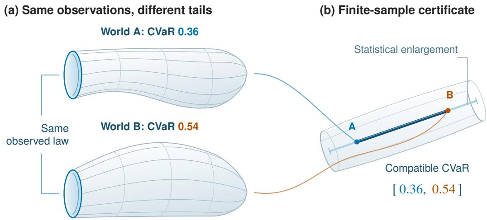  
Figure 1: Risk ambiguity and statistical uncertainty for one fixed predictor. (a) The same observed law is compatible with hidden-outcome laws giving population CVaR 0.36 and 0.54. (b) The dark segment is the sharp population interval; pale extensions account for estimating its endpoints from a finite sample. Colors link the laws to the endpoints. Geometry is schematic. Appendix A.2 gives the numerical construction.

Our goal is to connect three questions: which risks are compatible with the evidence, how precisely their bounds can be estimated, and which additional labels most reduce unresolved ambiguity. An upper bound below a chosen loss limit certifies that criterion; separated intervals establish a predictor ordering. When these rules leave a decision unresolved, targeted outcome collection can reduce the underlying information gap.

## Contributions.

1. Sharp population identification. For binary outcomes and bounded losses, we derive attainable CVaR endpoints and show that every intermediate risk is compatible. For each endpoint, one hidden-outcome law is extremal at every loss threshold, reducing its calculation to a scalar convex minimization (Section 3).

2. Uniform finite-sample certification. Paired, locally robust endpoint estimates give simultaneous bounds across candidate predictors at fixed sensitivity and tail levels. The bounds expose the costs of assessing a smaller tail, weaker observation overlap, and auxiliaryestimation error, and support comparisons and predictor selection using the same data (Section 4).

3. Minimum-cost revelation. Under a specified information model, ranking tail identification value per unit cost gives the exact optimal revelation allocation for a fixed predictor and threshold. A zero-threshold bound also controls optimized interval width (Section 5).

Revelation recovers existing outcomes for a fixed target population. Our information model treats audited contributions as known and retains the original sensitivity bounds separately for audited and still-hidden groups.

Synthetic experiments separate persistent identification width from decreasing endpoint error (Figure 2). Historical LendingClub data illustrate changes in population assessment, while controlled masking of known outcomes evaluates coverage and comparisons (Figure 3). Fixed and sequential audits examine how acquisition choices change estimated ambiguity (Figure 4).

Positioning. This work connects selective-label evaluation [3, 7, 8] and partial identification [9– 13] with CVaR optimization [14–16] and orthogonal estimation [17–19]. Appendix E.3 develops these connections. We first make the target risk and the assumptions linking observed and hidden outcomes precise.

## 2 Tail Risk under Selective Labels

Tail-risk certification requires a target population and loss, a criterion for large errors, and a restriction on hidden outcomes. CVaR measures average loss within a chosen upper tail, making the severity of the largest prediction errors part of the assessment. The observation model specifies what historical records identify; the sensitivity model bounds how observed and hidden outcome probabilities can differ. Together, these choices define the population risks that our certificates must cover.

## 2.1 Target population and observation process

Let $\mathcal { F }$ be the candidate predictor class and P the full-data distribution of $( X , S , Y )$ , with covariate marginal $P _ { X }$ . We evaluate $f \in { \mathcal { F } }$ using loss $\ell ( f ( X ) , Y )$ , where $Y \in \{ 0 , 1 \}$ . In decision settings, Y denotes $Y ( a ^ { \star } )$ under one specified action held fixed across the target population and predictor comparisons. The indicator $S \in \{ 0 , 1 \}$ equals one when the outcome is observed. We observe n independent copies of $O = ( X , S , { \bar { Y } } ^ { \mathrm { o b { \bar { s } } } } )$ , where $Y ^ { \mathrm { o b s } } = S Y$ . The observed law $P _ { \mathrm { o b s } }$ identifies $P _ { X }$ and

$$
\pi ( x ) = P ( S = 1 \mid X = x ) , \qquad p _ { 1 } ( x ) = P ( Y = 1 \mid X = x , S = 1 ) ,
$$

while $p _ { 0 } ( x ) = P ( Y = 1 \mid X = x , S = 0 )$ is hidden wherever $\pi ( x ) < 1$ . Here π is the historical observation probability and $p _ { 1 }$ the outcome probability among observed cases; both are auxiliary to the predictor f being assessed.

Bounded loss gives a common risk scale and supports finite-sample error control. Population overlap makes the observed-outcome distribution available as a reference throughout the target covariate population. We formalize these conditions as follows.

Assumption 1 (Bounded loss and population overlap). For every $f \in { \mathcal { F } }$ and $y \in \{ 0 , 1 \}$ , the map $x \mapsto \ell ( f ( x ) , y )$ is measurable and takes values in $[ 0 , 1 ]$ , and $0 < \pi _ { \operatorname* { m i n } } \leq \pi ( X ) \leq 1$ almost surely.

Technical regularity and target-label conventions are in Appendix A.1. Write $z _ { + } = \operatorname* { m a x } \{ z , 0 \}$ and $L _ { f } = \ell ( f ( \bar { X } ) , Y )$ . At level $\alpha \in ( 0 , 1 ) , \beta = 1 - \alpha$ is the upper-tail fraction. The threshold η is a candidate loss cutoff, and $( L _ { f } - \eta ) _ { + }$ is the excess above it. $\mathrm { \bf A t } \alpha = . 9 5$ , CVaR averages the worst 5% of population losses, allowing fractional mass at a tied cutoff [16]:

$$
\rho _ { \alpha , P } ( f ) = \mathrm { C V a R } _ { \alpha , P } ( L _ { f } ) = \operatorname* { i n f } _ { \eta \in [ 0 , 1 ] } \left\{ \eta + \beta ^ { - 1 } \mathbb { E } _ { P } [ ( L _ { f } - \eta ) _ { + } ] \right\} .\tag{1}
$$

The expectation includes both observed and hidden cases.

## 2.2 Sensitivity model and certification objective

Outcome-dependent observation can change label prevalence even at fixed covariates. We use the observed outcome probability as a reference and express the allowed departure of hidden outcomes through a multiplicative bound on their odds. For a finite, externally specified $\Gamma \geq 1$ , we impose the hidden-to-observed outcome-odds restriction [13, Section 7.2]:

$$
\begin{array} { c } { { p _ { 0 } ( x ) \in [ \underline { { { p } } } _ { \Gamma } ( x ) , \overline { { { p } } } _ { \Gamma } ( x ) ] = [ q _ { - } ( p _ { 1 } ( x ) ) , q _ { + } ( p _ { 1 } ( x ) ) ] , \qquad \pi ( x ) < 1 , } } \\ { { q _ { - } ( p ) = \displaystyle \frac { p } { p + \Gamma ( 1 - p ) } , \qquad q _ { + } ( p ) = \displaystyle \frac { \Gamma p } { 1 - p + \Gamma p } . } } \end{array}\tag{2}
$$

For interior probabilities, hidden-to-observed outcome odds lie between $\Gamma ^ { - 1 }$ and $\Gamma ;$ the formulas also cover $p _ { 1 } ~ \in ~ \{ 0 , 1 \}$ . At $\Gamma = 1 , p _ { 0 } ( x ) = p _ { 1 } ( x )$ : hidden and observed outcomes have the same conditional distribution given $X$ , called conditional ignorability. For example, $p _ { 1 } ( x ) = . 5$ and $\Gamma = 2$ allow $p _ { 0 } ( x ) \in [ 1 / 3 , 2 / 3 ]$ . Larger Γ permits greater departure. The chosen Γ defines a declared sensitivity scenario, supported by domain knowledge or additional outcome information (Appendix E.1).

Let $\mathcal { P } _ { \Gamma } (  { P _ { \mathrm { o b s } } } )$ contain all full-data laws with observed marginal $P _ { \mathrm { o b s } }$ and hidden regression satisfying this restriction. Their risk endpoints are

$$
\underline { { \rho } } _ { \alpha , \Gamma } ( f ) = \operatorname* { i n f } _ { P \in \mathcal { P } _ { \Gamma } } \rho _ { \alpha , P } ( f ) , \qquad \overline { { \rho } } _ { \alpha , \Gamma } ( f ) = \operatorname* { s u p } _ { P \in \mathcal { P } _ { \Gamma } } \rho _ { \alpha , P } ( f ) .\tag{3}
$$

For fixed α and Γ, our statistical objective is an interval covering every compatible risk simultaneously for every $f \in { \mathcal { F } }$ , with probability at least $1 - \delta _ { \mathrm { t o t } }$ over the observed sample. Here $\delta _ { \mathrm { t o t } } \in ( 0 , 1 )$ is the total failure budget; Section 4 accounts for sample fluctuation and auxiliary-estimation error within this budget. Thus Γ specifies the admissible hidden outcomes, while $\delta _ { \mathrm { t o t } }$ specifies the statistical guarantee.

We next derive these population risk endpoints from the observed law and show that every value between them is attainable.

## 3 Sharp Population CVaR Bounds

For binary outcomes, both possible prediction losses can be computed from $f ( x )$ , even when the actual label is hidden. Sensitivity bounds constrain the probability assigned to these two losses. This reduces population identification to two scalar convex minimizations.

Fix a predictor $f$ and a cutoff $\eta \in [ 0 , 1 ]$ . Write

$$
a _ { f , \eta } ^ { y } ( x ) = ( \ell ( f ( x ) , y ) - \eta ) _ { + } , \qquad d _ { f , \eta } ( x ) = a _ { f , \eta } ^ { 1 } ( x ) - a _ { f , \eta } ^ { 0 } ( x ) .
$$

Here $a ^ { y }$ is the excess loss if the label is $y ,$ and d is its change when the label changes from zero to one. A hidden outcome probability q gives expected excess loss $( 1 - q ) a ^ { 0 } + q a ^ { 1 } \stackrel { - } { = } a ^ { 0 } + q d$ . With $d _ { + } = ( d _ { f , \eta } ) _ { + }$ and $d _ { - } = \bar { ( - d _ { f , \eta } ) _ { + } }$ , its largest and smallest allowed values are

$$
\begin{array} { r } { b _ { f , \eta } ^ { U } = a _ { f , \eta } ^ { 0 } + \overline { { p } } _ { \Gamma } d _ { + } - \underline { { p } } _ { \Gamma } d _ { - } , } \\ { b _ { f , \eta } ^ { L } = a _ { f , \eta } ^ { 0 } + \underline { { p } } _ { \Gamma } d _ { + } - \overline { { p } } _ { \Gamma } d _ { - } . } \end{array}\tag{4}
$$

All quantities are evaluated at the same covariate value. The upper bound assigns the greatest allowed probability to the label with larger loss; the lower bound reverses the assignment. Averaging the historically observed and hidden contributions gives

$$
m _ { f , \eta } ^ { \sigma } = \mathbb { E } _ { \mathrm { o b s } } \left[ S a _ { f , \eta } ^ { Y ^ { \mathrm { o b s } } } ( X ) + ( 1 - S ) b _ { f , \eta } ^ { \sigma } ( X ) \right] , \qquad \sigma \in \{ L , U \} ,
$$

where $\mathbb { E } _ { \mathrm { o b s } }$ integrates over the observed-data law. Adding the cutoff term forms the CVaR objectives

$$
L _ { f , \eta } = \eta + \beta ^ { - 1 } m _ { f , \eta } ^ { L } , \qquad U _ { f , \eta } = \eta + \beta ^ { - 1 } m _ { f , \eta } ^ { U } .
$$

Dependence on Γ is implicit.

Theorem 1 (Sharp population CVaR interval). Under Assumption 1, for every $f \in { \mathcal { F } }$ and finite $\Gamma \geq 1$

$$
\underline { { \rho } } _ { \alpha , \Gamma } ( f ) = \operatorname* { m i n } _ { \eta \in [ 0 , 1 ] } L _ { f , \eta } , \qquad \overline { { \rho } } _ { \alpha , \Gamma } ( f ) = \operatorname* { m i n } _ { \eta \in [ 0 , 1 ] } U _ { f , \eta } .
$$

Both endpoints and every intermediate value are attained by compatible full-data laws. Consequently, the set of risks $\left\{ \rho _ { \alpha , P } ( f ) : P \in \mathcal { P } _ { \Gamma } ( P _ { \mathrm { o b s } } ) \right\}$ is exactly $[ \underline { { \rho } } _ { \alpha , \Gamma } ( f ) , \overline { { \rho } } _ { \alpha , \Gamma } ( f ) ]$

The key mechanism is that thresholding preserves the ordering of the two label-specific losses. For each endpoint, the same hidden-outcome distribution is therefore extremal at every cutoff, including the optimizing cutoff. Appendices A.3–A.4 give the construction and sharpness proof, including discrete losses and ties.

The identification width

$$
I _ { \Gamma } ( f ) = \overline { { \rho } } _ { \alpha , \Gamma } ( f ) - \underline { { \rho } } _ { \alpha , \Gamma } ( f )
$$

is the unresolved range of population risk even when the observed distribution is known exactly. Sharpness means that narrowing this range requires additional information or stronger assumptions. Increasing Γ expands the compatible class and can only widen the interval; at $\Gamma = \bar { 1 }$ , the population risk is identified under conditional ignorability.

For a chosen acceptable risk level $r , \overline { { \rho } } _ { \alpha , \Gamma } ( f ) \leq r$ certifies that every compatible risk meets the limit. If $\overline { { \rho } } _ { \alpha , \Gamma } ( f ) < \underline { { \rho } } _ { \alpha , \Gamma } ( g )$ , the ordering holds under every compatible law. Precision and risk level are distinct: a narrow interval can still lie above the acceptable limit. Section 4 adds sampling uncertainty to these decisions.

## 4 Estimating and Using Tail-Risk Certificates

The observed distribution must be estimated from a finite sample. We control endpoint error uniformly across the candidate class so that the same certificate event supports comparison and selection after examining the data.

## 4.1 Cross-fitted endpoint estimation

The auxiliary functions $p = p _ { 1 }$ and π describe the outcome among historically observed cases and the probability of historical observation. They are fitted to estimate the risk of $f .$ . Substituting an estimated p into the sensitivity bounds introduces estimation bias. We correct its leading effect using observed outcome residuals.

Write $\dot { b } ^ { \sigma } = \partial b ^ { \sigma } / \partial p$ , for $\sigma \in \{ L , U \}$ . The locally robust score combines observed excess loss, the sensitivity-bounded hidden contribution, and the residual correction:

$$
\begin{array} { r l } & { \phi _ { f , \eta } ^ { \sigma } ( O ; p , \pi ) = S a _ { f , \eta } ^ { { \cal Y } ^ { \mathrm { o b s } } } ( X ) + ( 1 - S ) b _ { f , \eta } ^ { \sigma } ( X ; p ( X ) ) } \\ & { \quad \quad \quad \quad + S \frac { 1 - \pi ( X ) } { \pi ( X ) } b _ { f , \eta } ^ { \sigma } ( X ; p ( X ) ) \{ Y ^ { \mathrm { o b s } } - p ( X ) \} . } \end{array}\tag{5}
$$

At the true auxiliary functions, its expectation equals $m _ { f , \eta } ^ { \sigma } .$ The correction leaves quadratic and product error terms, quantified in Section 4.2 and Appendix B.1.

Split the sample into K balanced folds. Fit $p ,$ π outside each evaluation fold, then clip their predictions to [0, 1] and $[ \pi _ { \mathrm { m i n } } / 2 , 1 ]$ , respectively. Thus each score uses auxiliary fits trained without its evaluation observations. Let $n _ { \mathrm { m i n } }$ be the smallest fold size and $k ( i )$ the fold containing observation i. Define

$$
{ \widehat { \rho } } ^ { \sigma } ( f ) = \operatorname* { i n f } _ { \eta \in [ 0 , 1 ] } \left\{ \eta + { \frac { 1 } { n \beta } } \sum _ { i = 1 } ^ { n } \phi _ { f , \eta } ^ { \sigma } { \Big ( } O _ { i } ; { \widehat { p } } ^ { ( - k ( i ) ) } , { \widehat { \pi } } ^ { ( - k ( i ) ) } { \Big ) } \right\} .\tag{6}
$$

The endpoints share auxiliary fits and minimize their cutoffs separately. For each fixed $f$ and realized auxiliary fits, exact cutoff minimization checks $0 , 1$ , and $\ell ( \dot { f } ( X _ { i } ) , \dot { y } )$ for every $i = 1 , \ldots , n$ and $y \in \{ 0 , 1 \}$ (Proposition B.5).

## 4.2 Uniform certificates and decision guarantees

To turn these estimates into certificates, we control the errors of both endpoints uniformly over the candidate class. The bound combines sampling fluctuation with auxiliary-estimation error.

Write $\rho ^ { L } = \underline { { \rho } } _ { \alpha , \Gamma }$ and $\rho ^ { U } = \overline { { \rho } } _ { \alpha , \Gamma }$

Theorem 2 (Uniform statistical certification). Fix $\alpha \in ( 0 , 1 ) , 1 \le \Gamma < \infty , \delta \in ( 0 , 1 )$ , and $\delta _ { \nu } \in [ 0 , 1 - \delta )$ . Assume the bounded-loss, overlap, and sampling conditions of Section 2 and the cross-fitting and measurability conventions of Appendix B. Suppose that, with probability at least $1 - \delta _ { \nu }$ , the clipped auxiliaryfits satisfy jointly

$$
\operatorname* { m a x } _ { k } \| \widehat { p } ^ { ( - k ) } - p \| _ { L ^ { 2 } ( P _ { X } ) } \leq r _ { p } , \qquad \operatorname* { m a x } _ { k } \| \widehat { \pi } ^ { ( - k ) } - \pi \| _ { L ^ { 2 } ( P _ { X } ) } \leq r _ { \pi } .
$$

For the calibrated radius $r _ { n } ( \delta )$ in (B.15), with probability at least $1 - \delta - \delta _ { \nu }$

$$
\operatorname* { s u p } _ { f \in { \mathcal { F } } } \operatorname* { m a x } _ { \sigma \in \{ L , U \} } | \widehat { \rho } ^ { \sigma } ( f ) - \rho ^ { \sigma } ( f ) | \leq r _ { n } ( \delta ) .\tag{7}
$$

Allocate $\delta + \delta _ { \nu } \leq \delta _ { \mathrm { t o t } }$ to obtain the confidence level specified in Section 2. Here $\delta$ covers sample fluctuation and $\delta _ { \nu }$ covers failure of the joint auxiliary-error bounds. The $L ^ { 2 } ( P _ { X } )$ bounds measure prediction error across the target covariate distribution, including regions with few observed outcomes. Computing the calibrated radius requires valid bounds on these errors and on score complexity (Appendix B.3).

The radius separates sample fluctuation from auxiliary-estimation bias. Smaller tail mass $\beta$ amplifies both; weak observation overlap and larger sensitivity levels also enlarge the bound. The remaining bias contains a squared outcome-regression error $\bar { r } _ { p } ^ { 2 }$ and the product $r _ { p } r _ { \pi } . { \mathrm { A t } } \Gamma = 1$ , the squared-error coefficient vanishes. For $\Gamma > 1$ , accurate outcome regression remains important even when the observation model is known. Cross-fitting supplies the conditional independence used for concentration; the auxiliary-error bounds are established separately.

Outer certificates and decisions. Write $r _ { n } = r _ { n } ( \delta )$ . On the same event, simultaneously for all predictors,

$$
\big [ \underline { { \rho } } _ { \alpha , \Gamma } ( f ) , \overline { { \rho } } _ { \alpha , \Gamma } ( f ) \big ] \subseteq \widehat C _ { n , \Gamma } ( f ) : = [ \operatorname* { m a x } \{ 0 , \widehat { \rho } ^ { L } ( f ) - r _ { n } \} , \operatorname* { m i n } \{ 1 , \widehat { \rho } ^ { U } ( f ) + r _ { n } \} ] .\tag{8}
$$

The certificate’s width lies between $I _ { \Gamma } ( f )$ and $I _ { \Gamma } ( f ) + 4 r _ { n }$ . Its upper limit can certify a chosen risk limit. If ${ \widehat { \rho } } ^ { U } ( f ) + r _ { n } < { \widehat { \rho } } ^ { L } ( g ) - { \widehat { r _ { n } } }$ , then f has lower CVaR than g under every compatible law. Minimizing $\hat { \rho } ^ { U }$ targets the smallest compatible upper risk in $\mathcal { F } ;$ Appendix B.4 gives a $2 r _ { n }$ selection-error bound with an additional term for optimization tolerance.

These decisions retain their guarantee after predictor selection within ${ \mathcal F }$ . As sampling error shrinks, the identification width remains. Additional labels can reduce that remaining ambiguity.

## 5 Resolving Tail Ambiguity through Revelation

We next choose which hidden outcomes to reveal to reduce ambiguity about population risk. We begin with a fixed predictor and a common loss cutoff for the lower and upper CVaR objectives. Under the information model below, their gap decomposes across the population, making ambiguity reduction per unit cost the basis for a minimum-cost allocation.

## 5.1 Tail identification value

Fix $f , \Gamma ,$ , and a cutoff $\eta \in [ 0 , 1 ]$ . Throughout this section, expectations are over the target covariate distribution $P _ { X }$ . An audit reveals existing outcomes: its indicator $A \leq 1 - S$ and intensity $\lambda ( x ) =$ $P ( A = 1 \mid X = x , S = 0 )$ specify the share of originally hidden outcomes recovered at x.

We hold the historical observed law and the audited population contribution fixed; the remaining hidden outcomes retain the specified sensitivity bounds. Formally, let $p _ { A } ( x ) = P ( Y = 1 \mid X =$ $x , A = 1 )$ and $q ( x ) = P ( \bar { Y } \ : = \ : 1 \ : \mid \ : X \ : = \ : \bar { x } , S \ : = \ : 0 , A \ : = \ : 0 )$ We impose the original interval $[ \underline { { p } } _ { \Gamma } ( x ) , \overline { { p } } _ { \Gamma } ( x ) ]$ separately on these audited and still-hidden outcome probabilities wherever their component has positive mass; q is otherwise free within it. This defines the retained-sensitivity information model (Appendix C.1). Identification treats the audited population contribution as known; finite audited samples require estimation of that contribution.

The retained lower and upper objectives, $L _ { f , \eta } ( \lambda )$ and $U _ { f , \eta } ( \lambda )$ , share the known contribution and differ only on the remaining hidden mass (Appendix C.2). Write $s _ { \Gamma } = \overline { { p } } _ { \Gamma } - \underline { { p } } _ { \Gamma }$ . Their gap is

$$
\begin{array} { r l } & { \tau _ { f , \eta } ( x ) : = \frac { 1 - \pi ( x ) } { \beta } s _ { \Gamma } ( x ) | d _ { f , \eta } ( x ) | , } \\ & { W _ { f , \eta } ( \lambda ) : = U _ { f , \eta } ( \lambda ) - L _ { f , \eta } ( \lambda ) } \\ & { \quad \quad \quad = \mathbb { E } [ ( 1 - \lambda ) \tau _ { f , \eta } ] = W _ { f , \eta } ( 0 ) - \mathbb { E } [ \lambda \tau _ { f , \eta } ] . } \end{array}\tag{9}
$$

The tail identification value (TIV) density $\tau _ { f , \eta }$ combines three quantities: the population share with hidden outcomes, the allowed range of their outcome probability, and the change in excess loss between the two labels. It measures ambiguity per unit target-population mass. Revealing a fraction λ removes exactly $\mathbb { E } [ \lambda \tau _ { f , \eta } ]$ , a value calculable before seeing the audited labels. When both labels produce the same excess loss, this value is zero even if the outcome is uncertain.

## 5.2 Minimum-cost revelation and certificate precision

Let $c ( x ) \geq 0$ be an integrable cost density per unit target-population mass, so allocation λ costs $\mathbb { E } [ c \lambda ]$ . If one already-hidden label costs $\kappa ( x )$ , then $c = ( 1 - \pi ) \kappa$ . For a target gap $\varepsilon \geq 0 ,$ , the minimum cost is

$$
{ \mathrm { C e r t } } _ { f , \eta } ( \varepsilon ) : = \operatorname* { i n f } _ { 0 \leq \lambda \leq 1 } \{ \mathbb { E } [ c \lambda ] : W _ { f , \eta } ( \lambda ) \leq \varepsilon \} .\tag{10}
$$

Theorem 3 (Minimum-cost fixed-threshold revelation). Under the retained-sensitivity model, this infimum is attained. An optimum reveals zero-cost positive-TIV locations first and, on $c > 0 ,$ , satisfies

$$
\lambda ^ { \star } ( x ) = \left\{ \begin{array} { l l } { 1 , } & { \tau _ { f , \eta } ( x ) / c ( x ) > t , } \\ { 0 , } & { \tau _ { f , \eta } ( x ) / c ( x ) < t , } \end{array} \right.
$$

withfractional revelation on ties,for some $t \in [ 0 , \infty ]$

Thus acquisition follows decreasing ambiguity reduction per unit cost until the target is reached, using a partial terminal tie group when needed. This is the fractional-knapsack rule [20]. Appendices C.3 and C.5 give the proof, boundary cases, and finite-cell computation. Among alreadyhidden candidates with positive label cost, its operational score is

$$
\frac { \tau _ { f , \eta } ( x ) } { c ( x ) } = \frac { s _ { \Gamma } ( x ) | d _ { f , \eta } ( x ) | } { \beta \kappa ( x ) } .
$$

The hidden-population fraction cancels because the candidate is already known to be hidden.

We now connect the fixed-cutoff gap to the width of the optimized CVaR interval. The retained endpoints minimize their cutoffs separately, giving

$$
I _ { \Gamma , \lambda } ^ { \mathrm { r e t } } ( f ) : = \operatorname* { m i n } _ { \eta \in [ 0 , 1 ] } U _ { f , \eta } ( \lambda ) - \operatorname* { m i n } _ { \eta \in [ 0 , 1 ] } L _ { f , \eta } ( \lambda ) \leq W _ { f , 0 } ( \lambda ) .\tag{11}
$$

Theorem 3 at $\eta = 0$ therefore minimizes cost for the sufficient requirement $W _ { f , 0 } ( \lambda ) \leq \varepsilon .$ , which guarantees optimized width at most ε. Appendix C.4 proves this bound and formulates direct optimization of the optimized interval width.

For sequential acquisition, we use TIV as a ranking rule that adapts as labels accumulate. After each batch, the procedure retrains the predictor and refreshes TIV at the upper-endpoint minimizing cutoff of the retained plug-in objective. Its historical outcome fit remains fixed, preserving the original sensitivity bounds. Audited labels enter through their observed losses. Candidates are ranked by estimated $s _ { \Gamma } | d _ { f , \eta } | / ( \beta \kappa )$ , a batch is revealed, and the procedure repeats. Figure 4 evaluates the fixed and sequential protocols; Appendix D.6 specifies fitting and evaluation splits.

## 6 Empirical Evaluation

We evaluate three questions: how accurately endpoints can be estimated, how selective observation changes model assessment, and which additional labels reduce unresolved ambiguity. Simulated populations provide exact identification targets. Historical applications test the consequences of changing the evaluation population. Controlled masking of known outcomes permits direct checks of estimated risks and audit performance. Appendix D provides the complete methods, results, and figure provenance.

## (a) Sampling uncertainty

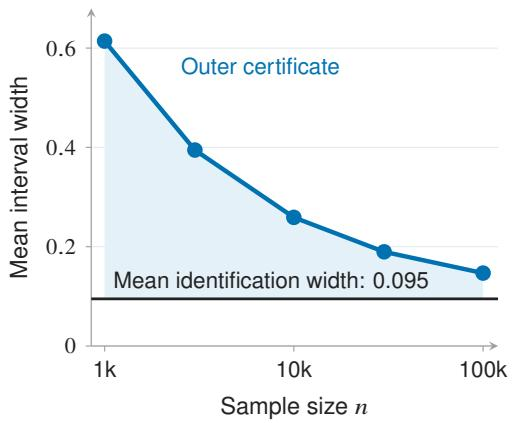

(b) Endpoint estimation  
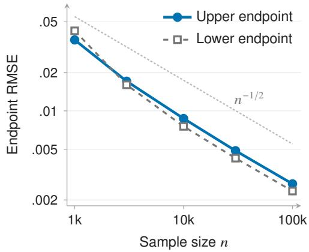  
Figure 2: Statistical uncertainty contracts around an identification floor. (a) Mean oraclecalibrated outer width and mean exact population width; shading shows their difference. (b) Crossfitted endpoint RMSE with learned nuisances; the faint line is an $n ^ { - 1 / 2 }$ guide. Each sample size uses 60 simulated populations and 80 datasets per population. The oracle coverage target is the entire sharp interval. Appendix D.2 gives the design and complete results.

## 6.1 Identification versus statistical uncertainty

We separate statistical uncertainty from population ambiguity in finite-cell populations with Brier loss $\ell ( f ( x ) , y ) = ( f ( x ) - y ) ^ { 2 } , \Gamma = 2$ , and $\alpha = . 7 5$ . An oracle certificate uses the true outcome probability $p _ { 1 }$ among historically observed cases and a finite-cell Hoeffding radius. On the same sampled datasets, two-fold cross-fitting learns the nuisance functions; root-mean-square error (RMSE) assesses the resulting endpoint estimates. Each sample size uses 60 simulated populations and 80 datasets per population.

As n increases from $1 0 ^ { 3 }$ to $1 0 ^ { 5 }$ , mean oracle outer width falls from .614 to .147, while mean exact population width remains .0949 (Figure 2a). The 95% oracle certificate contains the entire sharp interval in every replication; its simultaneous protection across thresholds is conservative. Upper- and lower-endpoint RMSE decrease from .0361 and .0425 to .0027 and .0023 (panel b). Larger samples sharpen estimation of the interval, while the original observation process leaves its identification width intact. The learned-nuisance experiment measures endpoint accuracy; coverage for learned fits requires the calibration conditions of Theorem 2.

## 6.2 Historical applicant-level sensitivity analysis

From the LendingClub data [21], we construct a 2012 cohort of 390,644 applications, including 53,367 mature issued loans with known repayment outcomes (Appendix D.3). The applicant target is default under loan issuance; this outcome is unavailable for rejected applicants. The cohort includes 180,903 applications with recorded credit-score values below 660, the 2012 FICO minimum [22], and no issued loans in that group. We therefore specify an issued-loan outcome regression extended to all recorded applicant covariates. Its predictions supply the reference probabilities in (5), together with the observed-residual correction. The historical results are residual-adjusted sensitivity estimates under this regression extension. Appendix D.3 documents unsupported regions and differences in how source fields were measured.

We compare logistic regression, default-weighted logistic regression, and gradient boosting with five-fold cross-fitting. Default examples receive weight 2 in the weighted model. Standard classification objectives represent existing prediction pipelines whose population tail risks must be assessed. Brier loss is bounded and makes both possible label losses explicit. We assess tail levels $\alpha \in \{ . 9 0 , . 9 5 \}$

At $\alpha = . 9 5$ , accepted-only CVaR favors the default-weighted model (.661). At Γ = 1, its estimated applicant risk is .813, compared with .733 for boosting and .805 for logistic regression: two of three pairwise orderings reverse. Figure 3a gives the intervals at $\Gamma = 2 ;$ Appendix D.3 reports complete sensitivity curves and approximate breakdown values.

## 6.3 Validation with known repayment outcomes

To check estimated intervals and model comparisons against known risks, we impose 20 outcomedependent masks on the mature issued loans, with sensitivity $\Gamma _ { 0 } = 3$ and approximately 45% of labels observed. This study targets the issued-loan reference population. Predictors are trained on observed labels using five-fold cross-fitting, and their full-outcome CVaRs provide reference risks.

At $\Gamma _ { 0 } ,$ plug-in intervals—the estimated endpoint intervals before statistical widening—contain reference CVaR in 11–14 of 20 masks per predictor and tail level. Enlargement using variability across five fold-specific objectives raises coverage to 19–20 (Figure 3b). Coverage here targets the fulloutcome reference CVaR of each fitted predictor. Fold enlargement provides an empirical calibration diagnostic. Plug-in coverage is zero at every tested $\Gamma \leq 2$

Three unordered predictor pairs in each of 20 masks give 60 comparisons per tail level. $\mathrm { A t } \Gamma = 3$   
$\alpha = . 9 5$ , strict interval separation resolves 37 pairs correctly and leaves 23 unresolved. $\mathbf { A } \mathbf { t } \Gamma =$   
1, the rule declares all 120 orderings across both tail levels and makes 16 errors. Allowing the masking sensitivity changes both the inferred ordering and whether separation supports a decision.   
Appendix D.4 gives the mechanism, enlargement rule, and complete results.

## (a) Historical applicants

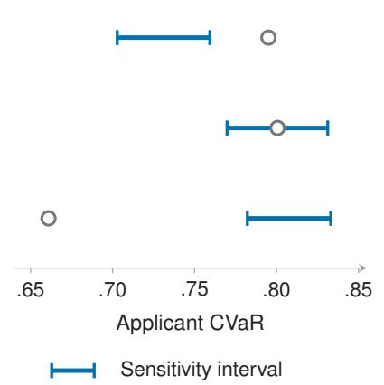

(b) Controlled masking  
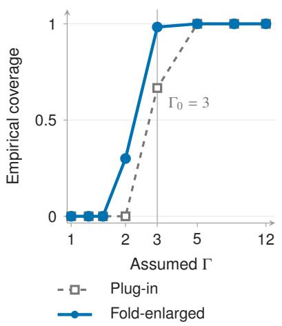  
Figure 3: Observation and sensitivity change population assessment. (a) Accepted-only CVaR (hollow points) and estimated applicant sensitivity endpoints (blue segments) at $\alpha = . 9 5 , \Gamma = 2 ,$ under the regression extension of Appendix D.3. Segments precede statistical enlargement. (b) Coverage of full-outcome reference CVaR under controlled masking of mature issued loans, pooled across three predictors and 20 shared masks at $\alpha = . 9 5$ . The guide marks the masking mechanism’s sensitivity $\Gamma _ { 0 } ^ { \bar { ( } ) } = 3 ;$ fold enlargement is empirical. Appendix D.4 provides the complete results.

## 6.4 Fixed and sequential audits

We next evaluate how targeted revelation reduces the remaining ambiguity. In 120 synthetic finitecell populations with heterogeneous costs, TIV per cost matches the exact fractional-knapsack frontier for fixed predictor and threshold (Appendix D.5). We then audit the masked issued-loan population using boosting, $\alpha = . 9 5 , \Gamma = 3$ , and unit cost per hidden label.

The fixed protocol freezes the initial predictor, historical nuisance estimates, and upper-endpoint threshold. Newly audited outcomes become known contributions, while the original sensitivity bounds remain on unaudited outcomes. The sequential protocol retrains the predictor and reoptimizes thresholds after each batch; retained evaluation keeps the historical outcome fit fixed, and a reserved split measures predictive loss. The lowest-propensity baseline selects cases with the lowest estimated label availability; it uses historical availability in the fixed protocol and refitted current known-label availability in the sequential protocol.

At the recorded budget of approximately 16%, TIV removes a median 61% of the initial estimated fixed-threshold gap, compared with 16% for random acquisition (Figure 4a). This concentration of removable ambiguity explains the gain from targeting. For Brier loss, predictions near .5 have similar losses under either label, so uncertainty sampling can favor cases with small excess-loss contrasts and little identification value.

With sequential retraining, median estimated retained width falls from .097 to .035 under TIV (panel b). This width describes the current predictor; it can increase when retraining changes the assessed losses, as the other trajectories illustrate (Table 5). Terminal median held-out CVaR is .8541 for TIV and .8682 for random, while mean Brier loss is .1362 and .1347, respectively (Table 6). Relative to random acquisition, these runs show improved tail performance and precision alongside a small mean-loss trade-off.

The constant forecast $f \equiv 1 / 2$ has loss $1 / 4$ under either label. Its mean Brier loss and every CVaR therefore equal $1 / 4$ , while identification width and TIV are zero. Its tail loss is below that of the reported fitted models. Table 6 shows the competing mean-loss advantage of the audited boosting models, whose mean Brier losses are near .135. The reference separates average prediction quality, extreme-tail loss, and certainty about that loss. Appendix D.6 gives all policies and both protocols.

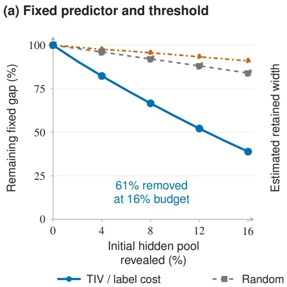

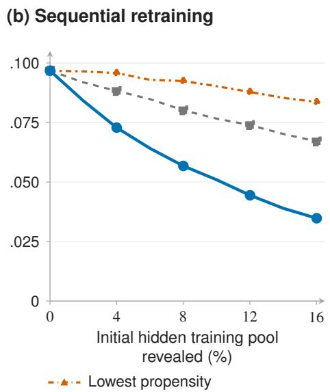  
Figure 4: Targeted audits reduce estimated ambiguity at equal within-protocol budgets. (a) Median remaining fixed-threshold gap, normalized within each mask by its initial estimated gap. (b) Median estimated retained-sensitivity width for the predictor refitted after each audit batch. Both use boosting, $\alpha = . 9 5 , \Gamma = 3 .$ , unit hidden-label cost, and 20 masks. Lines join eight recorded batches. Appendix D.6 specifies both protocols. Budgets are median fractions of the initially hidden cases in each eligible pool: the original pool in (a) and the 80% training pool in (b).

## 7 Limitations

The sensitivity range must be justified for the target population and covariate resolution. Statistical certificates additionally require overlap, controlled score complexity, and valid nuisance-error bounds. Small tail mass and scarce observed labels can make the bounds conservative. For $\Gamma > 1 .$ outcome-regression error contributes quadratically even with a correct observation model. Choosing Γ from data or examining multiple sensitivity levels requires corresponding joint error control (Appendix E.1).

The historical applicant analysis depends on regression extrapolation into unsupported regions and on differently measured source fields. Controlled masking checks known issued-loan outcomes. Repayment under an untaken lending action requires a causal or experimental model beyond passive recovery of existing outcomes.

The revelation optimum fixes the predictor and threshold and assumes componentwise retained sensitivity bounds. Known outcome-independent audit randomization can identify more, and direct minimization of the reoptimized interval can favor a different allocation. Finite audits must estimate their newly known contributions. Learned acquisition scores, retraining, and data-dependent stopping require uncertainty control across the resulting audit history; the sequential trajectories provide empirical performance evidence. Extensions to richer outcomes, unbounded losses, and other application domains require additional modeling and validation.

## 8 Conclusion

Selective observation leaves a range of population tail risks compatible with the available outcomes. Sharp CVaR endpoints characterize that range, and calibrated uniform outer certificates support risk limits, model comparisons, and conservative selection within a candidate class. Under retained sensitivity, TIV quantifies the ambiguity removed by revelation for a fixed predictor and threshold. Ranking this value per cost gives the optimal population allocation for that objective. These outputs connect a specified risk decision to the observations and assumptions required to support it, and identify where further outcome collection can improve precision.

## Acknowledgments and Disclosure of Funding

The author declares no competing interests.

## References

[1] Jon Kleinberg, Jens Ludwig, Sendhil Mullainathan, and Ziad Obermeyer. Prediction policy problems. American Economic Review, 105(5):491–495, 2015. doi: 10.1257/aer.p20151023.

[2] Jon Kleinberg, Himabindu Lakkaraju, Jure Leskovec, Jens Ludwig, and Sendhil Mullainathan. Human decisions and machine predictions. The Quarterly Journal of Economics, 133(1):237– 293, 2018. doi: 10.1093/qje/qjx032.

[3] Himabindu Lakkaraju, Jon Kleinberg, Jure Leskovec, Jens Ludwig, and Sendhil Mullainathan. The selective labels problem: Evaluating algorithmic predictions in the presence of unobservables. In Proceedings of the 23rd ACM SIGKDD International Conference on Knowledge Discovery and Data Mining, pages 275–284, 2017. doi: 10.1145/3097983.3098066.

[4] Carlo Acerbi and Dirk Tasche. Expected shortfall: A natural coherent alternative to value at risk. Economic Notes, 31(2):379–388, 2002. doi: 10.1111/1468-0300.00091.

[5] Philippe Artzner, Freddy Delbaen, Jean-Marc Eber, and David Heath. Coherent measures of risk. Mathematical Finance, 9(3):203–228, 1999. doi: 10.1111/1467-9965.00068.

[6] R. Tyrrell Rockafellar and Stanislav Uryasev. Optimization of conditional value-at-risk. Journal ofRisk, 2(3):21–41, 2000. doi: 10.21314/JOR.2000.038.

[7] Jian Chen, Zhehao Li, and Xiaojie Mao. Learning with selectively labeled data from multiple decision-makers. In Proceedings ofthe 42nd International Conference on Machine Learning, volume 267 of Proceedings of Machine Learning Research, pages 8480–8519. PMLR, 2025. URL https://proceedings.mlr.press/v267/chen25al.html.

[8] Amanda Coston, Ashesh Rambachan, and Alexandra Chouldechova. Characterizing fairness over the set of good models under selective labels. In Proceedings of the 38th International Conference on Machine Learning, volume 139 of Proceedings ofMachine Learning Research, pages 2144–2155. PMLR, 2021. URL https://proceedings.mlr.press/v139/ coston21a.html.

[9] Charles F. Manski. Anatomy of the selection problem. Journal of Human Resources, 24(3): 343–360, 1989. doi: 10.2307/145818.

[10] Charles F. Manski. Partial Identification of Probability Distributions. Springer, 2003.

[11] Daniel O. Scharfstein, Andrea Rotnitzky, and James M. Robins. Adjusting for nonignorable drop-out using semiparametric nonresponse models. Journal ofthe American Statistical Association, 94(448):1096–1120, 1999. doi: 10.1080/01621459.1999.10473862.

[12] Zhiqiang Tan. A distributional approach for causal inference using propensity scores. Journal of the American Statistical Association, 101(476):1619–1637, 2006. doi: 10.1198/ 016214506000000023.

[13] Qingyuan Zhao, Dylan S. Small, and Bhaswar B. Bhattacharya. Sensitivity analysis for inverse probability weighting estimators via the percentile bootstrap. Journal of the Royal Statistical Society: Series B (Statistical Methodology), 81(4):735–761, 2019. doi: 10.1111/rssb.12327.

[14] Erick Delage and Yinyu Ye. Distributionally robust optimization under moment uncertainty with application to data-driven problems. Operations Research, 58(3):595–612, 2010. doi: 10.1287/opre.1090.0741.

[15] John C. Duchi and Hongseok Namkoong. Learning models with uniform performance via distributionally robust optimization. The Annals of Statistics, 49(3):1378–1406, 2021. doi: 10.1214/20-AOS2004.

[16] R. Tyrrell Rockafellar and Stanislav Uryasev. Conditional value-at-risk for general loss distributions. Journal of Banking & Finance, 26(7):1443–1471, 2002. doi: 10.1016/ S0378-4266(02)00271-6.

[17] Victor Chernozhukov, Denis Chetverikov, Mert Demirer, Esther Duflo, Christian Hansen, Whitney Newey, and James Robins. Double/debiased machine learning for treatment and structural parameters. The Econometrics Journal, 21(1):C1–C68, 2018. doi: 10.1111/ectj.12097.

[18] Nathan Kallus, Xiaojie Mao, and Masatoshi Uehara. Localized debiased machine learning: Efficient inference on quantile treatment effects and beyond. Journal of Machine Learning Research, 25(16):1–59, 2024. URL https://jmlr.org/papers/v25/23-0661.html.

[19] James M. Robins, Andrea Rotnitzky, and Lue Ping Zhao. Estimation of regression coefficients when some regressors are not always observed. Journal of the American Statistical Association, 89(427):846–866, 1994. doi: 10.1080/01621459.1994.10476818.

[20] George B. Dantzig. Discrete-variable extremum problems. Operations Research, 5(2):266– 288, 1957. doi: 10.1287/opre.5.2.266.

[21] Nathan George. All Lending Club loan data. Kaggle dataset, https://www.kaggle.com/ datasets/wordsforthewise/lending-club, 2019. License: CC0 Public Domain.

[22] LendingClub Corporation. Amendment no. 3 to form S-1 registration statement, April 2012. URL https://www.sec.gov/Archives/edgar/data/1409970/000119312512151868/ d306143ds1a.htm. Filed April 5, 2012; minimum credit criteria.

[23] Peter L. Bartlett and Shahar Mendelson. Rademacher and Gaussian complexities: Risk bounds and structural results. Journal of Machine Learning Research, 3:463–482, 2002. URL https: //jmlr.org/papers/v3/bartlett02a.html.

[24] Aad W. van der Vaart and Jon A. Wellner. Weak Convergence and Empirical Processes. Springer, 1996.

[25] Andreas Maurer. A vector-contraction inequality for Rademacher complexities. In Algorithmic Learning Theory, volume 9925 of Lecture Notes in Computer Science, pages 3–17. Springer, 2016.

[26] Bin Yu. Assouad, Fano, and Le Cam. In David Pollard, Erik Torgersen, and Grace L. Yang, editors, Festschrift for Lucien Le Cam, pages 423–435. Springer, 1997. doi: 10.1007/ 978-1-4612-1880-7\_29.

[27] Fabian Pedregosa, Gaël Varoquaux, Alexandre Gramfort, Vincent Michel, Bertrand Thirion, Olivier Grisel, Mathieu Blondel, Peter Prettenhofer, Ron Weiss, Vincent Dubourg, Jake Vanderplas, Alexandre Passos, David Cournapeau, Matthieu Brucher, Matthieu Perrot, and Édouard Duchesnay. Scikit-learn: Machine learning in Python. Journal ofMachine Learning Research, 12:2825–2830, 2011. URL https://jmlr.org/papers/v12/pedregosa11a. html.

[28] LendingClub. Loan and rejected-application data dictionary. URL https://resources. lendingclub.com/LCDataDictionary.xlsx. LoanStats and RejectStats worksheets; accessed November 7, 2026.

[29] Tianqi Chen and Carlos Guestrin. XGBoost: A scalable tree boosting system. In Proceedings of the 22nd ACM SIGKDD International Conference on Knowledge Discovery and Data Mining, pages 785–794. ACM, 2016. doi: 10.1145/2939672.2939785.

[30] Paul R. Rosenbaum. Observational Studies. Springer, 2nd edition, 2002.

[31] Roderick J. A. Little and Donald B. Rubin. Statistical Analysis with Missing Data. Wiley, 3rd edition, 2019.

[32] Charles F. Manski. Nonparametric bounds on treatment effects. American Economic Review, 80(2):319–323, 1990.

[33] Jose Blanchet and Karthyek Murthy. Quantifying distributional model risk via optimal transport. Mathematics of Operations Research, 44(2):565–600, 2019. doi: 10.1287/moor.2018. 0936.

[34] Peyman Mohajerin Esfahani and Daniel Kuhn. Data-driven distributionally robust optimization using the Wasserstein metric: Performance guarantees and tractable reformulations. Mathematical Programming, 171:115–166, 2018. doi: 10.1007/s10107-017-1172-1.

[35] David A. Cohn, Zoubin Ghahramani, and Michael I. Jordan. Active learning with statistical models. Journal ofArtificial Intelligence Research, 4:129–145, 1996. URL https://arxiv. org/abs/cs/9603104.

## Guide to the appendices

Appendix A gives compatible laws, examples, and identification proofs; Appendix B gives score bias, uniform estimation, calibration, and the learning lower bound; Appendix C gives retainedinformation revelation, its cost frontier, and computation. Appendix D records scientific protocols and complete experimental results; Appendix E treats sensitivity calibration, extensions, and related approaches. Appendix F collects additional mechanism, learning, and revelation diagnostics. Implementation provenance is available in the public repository described in Appendix $\mathrm { D } . 7$

Throughout, $\beta = 1 - \alpha , \Gamma < \infty$ , and the target population and outcome are fixed. $I _ { \Gamma } ( f )$ is identification width; $\widehat { C } _ { n , \Gamma } ( f )$ is a statistical outer certificate. After revelation, $W _ { f , \eta } ( \lambda )$ is the gap at a common threshold, whereas $I _ { \Gamma , \lambda } ^ { \mathrm { r e t } } ( f )$ optimizes the two endpoints separately. Auxiliary results and equations use appendix-local numbering.

## A Population Identification and Sensitivity

## A.1 Compatible full-data laws and sensitivity bounds

The target outcome and population are fixed across predictors and compatible laws. In a decision problem, $Y = Y ( a ^ { \star } )$ is the outcome under a specified action (e.g., default under loan issuance), and S records its availability [1–3]. Using an observed outcome requires consistency with that action and outcome definition. Comparing prediction rules holds $a ^ { \star }$ and $P _ { X }$ fixed; changing the action, recovering an outcome under an untaken action, or transferring to a new population requires an additional causal or transport argument. The sensitivity model supplies neither exchangeability nor causal identification. Passive revelation recovers an already-realized target outcome, as in record linkage or controlled masking. Thus mature issued loans supply the masking target, whereas repayment under issuance remains a potential outcome for rejected applicants in the historical analysis.

Let $\mathcal { X }$ be standard Borel, and let $P _ { \mathrm { o b s } }$ be the law of $O = ( X , S , Y ^ { \mathrm { o b s } } )$ with $Y ^ { \mathrm { o b s } } = S Y$ . Use measurable versions

$$
\pi ( x ) = P _ { \mathrm { o b s } } ( S = 1 \mid X = x ) , \qquad p _ { 1 } ( x ) = P _ { \mathrm { o b s } } ( Y ^ { \mathrm { o b s } } = 1 \mid X = x , S = 1 ) ,
$$

and losses $z _ { t } ^ { y } ( x ) = \ell ( f ( x ) , y ) \in [ 0 , 1 ]$ . Assumption 1 gives $\pi \geq \pi _ { \mathrm { m i n } } > 0 .$ , so π $d P _ { X }$ and $P _ { X }$ have the same null sets and p1 is identified $P _ { X }$ -almost surely. All unqualified almost-sure statements use $P _ { X }$ . Write $H = \{ \pi < 1 \}$ . For a measurable $q : \mathcal { X }  [ 0 , 1 ]$ and its Bernoulli kernel $K _ { q } ,$ define

$$
\begin{array} { r l } & { P ^ { q } ( d x , \{ 1 \} , d y ) = P _ { X } ( d x ) \pi ( x ) K _ { p _ { 1 } } ( x , d y ) , } \\ & { P ^ { q } ( d x , \{ 0 \} , d y ) = P _ { X } ( d x ) [ 1 - \pi ( x ) ] K _ { q } ( x , d y ) . } \end{array}\tag{A.1}
$$

Set $q = p _ { 1 }$ on $H ^ { c }$ , where its value carries zero hidden mass.

Lemma A.1 (Kernel representation of compatible laws). Every full-data law inducing $P _ { \mathrm { o b s } }$ has the form (A.1), with $q ( x ) = P ( Y = 1 \mid X = x , S = 0 )$ on H. Conversely, every measurable $q : \mathcal { X }  [ 0 , 1 ]$ in $( \mathrm { A } . 1 )$ induces $P _ { \mathrm { o b s } }$ . With $q = p _ { 1 }$ on $H ^ { c }$ , these kernels identify the compatible laws up to $P _ { X }$ -null sets.

Proof. Standard Borel disintegration fixes the $( X , S )$ law and selected-label kernel, leaving one binary probability on $S = 0$ . Conversely, the two displayed measures sum to one and have the prescribed pushforward under $( x , s , y ) \mapsto ( x , s , s y )$ . Equal full-data laws have equal hidden kernels $( 1 - \pi ) d P _ { X }$ -almost surely, equivalently $P _ { X }$ -almost surely on $H ;$ the canonical assignment settles $\dot { H } ^ { c }$ □

For finite $\Gamma \geq 1$ , the odds restriction is equivalent, at interior $p _ { 1 }$ , to the bounds $\underline { { p } } _ { \Gamma } = q _ { - } ( p _ { 1 } ; \Gamma )$ and $\overline { { p } } _ { \Gamma } = q _ { + } ( p _ { 1 } ; \Gamma )$ , where

$$
q _ { - } ( p ; \Gamma ) = { \frac { p } { p + \Gamma ( 1 - p ) } } , \qquad q _ { + } ( p ; \Gamma ) = { \frac { \Gamma p } { 1 - p + \Gamma p } } .\tag{A.2}
$$

Their denominators are at least one. Thus $p _ { 1 } = 0$ forces $q = 0$ and $p _ { 1 } = 1$ forces $q = 1$ at every finite $\Gamma ;$ these substantive boundary restrictions merit scrutiny when apparent certainty comes from

a fitted model. For interior $p _ { 1 }$ , the endpoints tend to zero and one as $\Gamma  \infty$ . Let $\mathcal { Q } _ { \Gamma }$ contain measurable kernels within these bounds on $H$ , canonically assigned on $H ^ { c }$ . Then

$$
\mathcal { P } _ { \Gamma } ( P _ { \mathrm { o b s } } ) = \{ P ^ { q } : q \in \mathcal { Q } _ { \Gamma } \} .\tag{A.3}
$$

It is nonempty since $\underline { { p } } _ { \Gamma } \leq p _ { 1 } \leq \overline { { p } } _ { \Gamma }$ ; at $\Gamma = 1$ it is the single law satisfying $Y \perp S \mid X$

For $\beta = 1 - \alpha \in ( 0 , 1 )$ , the CVaR representation [16] reduces to

$$
\rho _ { \alpha , P } ( f ) = \operatorname* { i n f } _ { \eta \in \mathbb { R } } \{ \eta + \beta ^ { - 1 } \mathbb { E } _ { P } ( L _ { f } - \eta ) _ { + } \} = \operatorname* { m i n } _ { \eta \in [ 0 , 1 ] } \{ \eta + \beta ^ { - 1 } \mathbb { E } _ { P } ( L _ { f } - \eta ) _ { + } \} .\tag{A.4}
$$

For $\eta < 0$ , the objective is $\beta ^ { - 1 } \mathbb { E } _ { P } L _ { f } + ( 1 - \beta ^ { - 1 } ) \eta$ and exceeds its value at zero; for $\eta > 1$ , it equals $\eta > 1$ . Continuity on $[ 0 , 1 ]$ gives attainment, including distributions with atoms.

## A.2 Observational equivalence and motivating constructions

Theorem A.2 (Observational equivalence with reversed CVaR rankings). For every $\alpha \in ( 0 , 1 )$ there exist an observed law satisfying strict overlap, two predictors $f , g$ with identical selected-loss distributions, and twofull-data laws $P ^ { \star } , Q ^ { \star }$ inducing that observed law such that

$$
\rho _ { \alpha , P ^ { \star } } ( f ) < \rho _ { \alpha , P ^ { \star } } ( g ) , \qquad \rho _ { \alpha , Q ^ { \star } } ( f ) > \rho _ { \alpha , Q ^ { \star } } ( g ) .
$$

Proof. Take constant X, $0 ~ < ~ \pi ~ < ~ \mathrm { m i n } \{ 1 , 2 \beta \} , ~ S ~ \sim$ Bernoulli(π), and $Y ~ \mid ~ S ~ = ~ 1 ~ \sim$ $\mathrm { B e r n o u l l i } ( 1 / 2 )$ . Under zero-one loss, the constant predictors $f = 0 , g \overset { \cdot } { = } \overset { \cdot } { 1 }$ have the same selected loss law. Set $Y = 0$ on $S = 0$ under $P ^ { \star }$ and $Y = 1$ there under $Q ^ { \star }$ . Both yield observed masses $\pi / 2 , \pi / 2 , 1 - \pi$ on $( S , Y ^ { \mathrm { o b s } } ) = ( 1 , 1 ) , ( 1 , 0 ) , ( 0 , 0 )$ and satisfy overlap with $\pi _ { \operatorname* { m i n } } = \pi$

For $B \sim \mathrm { B e r n o u l l i } ( r )$ , the threshold objective is $r / \beta + \eta ( 1 - r / \beta ) \ \mathrm { o n } \ [ 0 , 1 ]$ , hence

$$
\mathrm { C V a R } _ { \alpha } ( B ) = \operatorname* { m i n } \{ r / \beta , 1 \} .\tag{A.5}
$$

Under $P ^ { \star }$ , the loss probabilities are $\pi / 2$ and $1 - \pi / 2$ , so $\rho _ { \alpha , P ^ { \star } } ( f ) ~ = ~ \pi / ( 2 \beta ) ~ < ~ \mathrm { m i n } \{ ( 1 ~ -$ $\pi / 2 ) / \beta , 1 \} = \rho _ { \alpha , P ^ { \star } } ( g )$ . Under $Q ^ { \star }$ they exchange. □

This construction concerns the unrestricted compatible class: its hidden probabilities zero and one lie outside the finite-Γ interval $[ 1 / ( 1 + \Gamma ) , \Gamma / ( 1 ^ { ' } + \Gamma ) ]$ ] when $p _ { 1 } = 1 / 2$

Figure 1. For squared loss, $f = 1 / 5 , \pi = 1 / 2 , p _ { 1 } = 1 / 3 , \Gamma = 2 ,$ and $\alpha = 1 / 2$ , the loss is $1 / \bar { 2 } 5 + ( 3 / 5 ) B$ with $B \sim$ Bernoulli $( 1 / 6 + q / 2 )$ and $q \in [ 1 / 5 , 1 / 2 ]$ . Translation and positive scaling of (A.4), followed by (A.5), give

$$
\begin{array} { c } { { \rho _ { 1 / 2 , P ^ { q } } ( f ) = \displaystyle \frac { 1 } { 2 5 } + \displaystyle \frac { 6 } { 5 } \left( \displaystyle \frac { 1 } { 6 } + \displaystyle \frac { q } { 2 } \right) , } } \\ { { \rho _ { 1 / 2 , P ^ { 1 / 5 } } ( f ) = \displaystyle \frac { 9 } { 2 5 } = 0 . 3 6 , \quad \rho _ { 1 / 2 , P ^ { 1 / 2 } } ( f ) = \displaystyle \frac { 2 7 } { 5 0 } = 0 . 5 4 . } } \end{array}\tag{A.6}
$$

These endpoints describe the risk of one fixed predictor under the same observed law.

## A.3 Conditional excess-loss envelopes and common extremal laws

Write $a _ { f , \eta } ^ { y } = ( z _ { f } ^ { y } - \eta ) _ { + } , d _ { f , \eta } = a _ { f , \eta } ^ { 1 } - a _ { f , \eta } ^ { 0 } , d _ { + } = ( d _ { f , \eta } ) _ { + }$ , and $d _ { - } = ( - d _ { f , \eta } ) _ { + }$ . The hidden conditional excess loss is $a ^ { 0 } + q d ,$ with envelopes

$$
\begin{array} { r } { b _ { f , \eta } ^ { U } = a _ { f , \eta } ^ { 0 } + \overline { { p } } _ { \Gamma } d _ { + } - \underline { { p } } _ { \Gamma } d _ { - } , } \\ { b _ { f , \eta } ^ { L } = a _ { f , \eta } ^ { 0 } + \underline { { p } } _ { \Gamma } d _ { + } - \overline { { p } } _ { \Gamma } d _ { - } . } \end{array}\tag{A.7}
$$

The observable objectives are

$$
\begin{array} { r l } & { m _ { f , \eta } ^ { \sigma } = \mathbb { E } _ { \mathrm { o b s } } [ S a _ { f , \eta } ^ { Y ^ { \mathrm { o b s } } } ( X ) + ( 1 - S ) b _ { f , \eta } ^ { \sigma } ( X ) ] , \quad \sigma \in \{ L , U \} , } \\ & { L _ { f , \eta } = \eta + \beta ^ { - 1 } m _ { f , \eta } ^ { L } , \qquad \quad U _ { f , \eta } = \eta + \beta ^ { - 1 } m _ { f , \eta } ^ { U } . } \end{array}\tag{A.8}
$$

Lemma A.3 (Common extremal kernels and threshold regularity). On H, define

$$
\begin{array} { r l } & { q _ { f } ^ { U } ( x ) = \overline { { p } } _ { \Gamma } ( x ) \mathbf { 1 } \{ z _ { f } ^ { 1 } ( x ) \geq z _ { f } ^ { 0 } ( x ) \} + \underline { { p } } _ { \Gamma } ( x ) \mathbf { 1 } \{ z _ { f } ^ { 1 } ( x ) < z _ { f } ^ { 0 } ( x ) \} , } \\ & { q _ { f } ^ { L } ( x ) = \underline { { p } } _ { \Gamma } ( x ) \mathbf { 1 } \{ z _ { f } ^ { 1 } ( x ) \geq z _ { f } ^ { 0 } ( x ) \} + \overline { { p } } _ { \Gamma } ( x ) \mathbf { 1 } \{ z _ { f } ^ { 1 } ( x ) < z _ { f } ^ { 0 } ( x ) \} , } \end{array}\tag{A.9}
$$

and set both kernels to $p _ { 1 }$ on $H ^ { c }$ . These kernels belong to $\mathcal { Q } _ { \Gamma }$ . For every $q \in \mathcal { Q } _ { \Gamma }$ and every $\eta \in [ 0 , 1 ]$

$$
m _ { f , \eta } ^ { L } \leq \mathbb { E } _ { P ^ { q } } [ ( L _ { f } - \eta ) _ { + } ] \leq m _ { f , \eta } ^ { U } , \qquad \mathbb { E } _ { P ^ { q _ { f } ^ { \sigma } } } [ ( L _ { f } - \eta ) _ { + } ] = m _ { f , \eta } ^ { \sigma } .\tag{A.10}
$$

The objectives $L _ { f , \eta } , U _ { f , \eta }$ are convex and $( 1 + \beta ^ { - 1 } )$ )-Lipschitz in η, and attain their minima on [0, 1].

Proof. The kernels are measurable and satisfy the bounds. Since $z \mapsto ( z - \eta ) _ { + }$ is nondecreasing, thresholding preserves the ordering of $z _ { f } ^ { 1 } , z _ { f } ^ { 0 } ;$ ; it can create a tie but cannot reverse the sign. Thus the same kernels extremize the affine expression $a ^ { 0 } +$ +qd at every threshold, including ties. Disintegration gives

$$
\begin{array} { r l } & { \mathbb { E } _ { P ^ { q } } ( L _ { f } - \eta ) _ { + } = \mathbb { E } _ { \mathrm { o b s } } [ S a _ { f , \eta } ^ { Y ^ { \mathrm { o b s } } } ( X ) ] } \\ & { \qquad + \mathbb { E } _ { P _ { X } } [ ( 1 - \pi ) ( a _ { f , \eta } ^ { 0 } + q d _ { f , \eta } ) ] , } \end{array}\tag{A.11}
$$

proving (A.10), with zero contribution from $H ^ { c }$ . Each endpoint objective is therefore the CVaR objective of one fixed law. Convexity and the Lipschitz bound follow from the convex, 1-Lipschitz hinge; compactness gives attainment. □

## A.4 Sharpness, endpoint attainment, and interval filling

ProofofTheorem 1. Put $G _ { f } ( q , \eta ) = \eta + \beta ^ { - 1 } \mathbb { E } _ { P ^ { q } } ( L _ { f } - \eta ) _ { + }$ . Lemma A.3 gives $L _ { f , \eta } = G _ { f } ( q _ { f } ^ { L } , \eta ) \leq$ $G _ { f } ( q , \eta ) \leq G _ { f } ( q _ { f } ^ { U } , \eta ) = U _ { f , \eta }$ simultaneously for all thresholds. Minimizing these inequalities and choosing the respective common kernels proves

$$
\underline { { \rho } } _ { \alpha , \Gamma } ( f ) = \operatorname* { m i n } _ { \eta \in [ 0 , 1 ] } L _ { f , \eta } , \qquad \overline { { \rho } } _ { \alpha , \Gamma } ( f ) = \operatorname* { m i n } _ { \eta \in [ 0 , 1 ] } U _ { f , \eta } .\tag{A.12}
$$

Both threshold minima and both optimized endpoints are attained. In particular, the upper equality uses one kernel attaining the supremum at every threshold, without an abstract minimax interchange. For functions with finite infima on a common domain,

$$
\left| \operatorname* { i n f } _ { \eta } F ( \eta ) - \operatorname* { i n f } _ { \eta } G ( \eta ) \right| \leq \operatorname* { s u p } _ { \eta } | F ( \eta ) - G ( \eta ) | ,\tag{A.13}
$$

because each function is bounded below by the other minus their uniform distance. Equation (A.11) and $| d _ { f , \eta } | \leq 1$ therefore imply

$$
\begin{array} { r } { | \rho _ { \alpha , P ^ { q } } ( f ) - \rho _ { \alpha , P ^ { \widetilde { q } } } ( f ) | \leq \underset { \eta } { \operatorname* { s u p } } | G _ { f } ( q , \eta ) - G _ { f } ( \widetilde { q } , \eta ) | \leq \beta ^ { - 1 } \mathbb { E } [ ( 1 - \pi ) | q - \widetilde { q } | ] . } \end{array}
$$

The mixture $q _ { t } = ( 1 - t ) q _ { f } ^ { L } + t q _ { f } ^ { U } , t \in [ 0 , 1 ]$ , remains measurable and compatible, and satisfies

$$
| \rho _ { \alpha , P ^ { q _ { t } } } ( f ) - \rho _ { \alpha , P ^ { q _ { s } } } ( f ) | \leq \frac { | t - s | } { \beta } \mathbb { E } [ ( 1 - \pi ) | q _ { f } ^ { U } - q _ { f } ^ { L } | ] \leq \frac { | t - s | } { \beta } .\tag{A.14}
$$

This continuous path joins the two attained endpoints. The intermediate value theorem, including the singleton case, yields

$$
\{ \rho _ { \alpha , P } ( f ) : P \in \mathcal { P } _ { \Gamma } ( P _ { \mathrm { o b s } } ) \} = [ \underline { { \rho } } _ { \alpha , \Gamma } ( f ) , \overline { { \rho } } _ { \alpha , \Gamma } ( f ) ] .\tag{A.15}
$$

## A.5 Sensitivity analysis and population decision criteria

Proposition A.4 (Nested classes and continuous endpoint curves). $I f 1 \leq \Gamma _ { 1 } \leq \Gamma _ { 2 } < \infty ,$ , then

$$
\mathcal { P } _ { \Gamma _ { 1 } } ( P _ { \mathrm { o b s } } ) \subseteq \mathcal { P } _ { \Gamma _ { 2 } } ( P _ { \mathrm { o b s } } ) .
$$

For each $f ,$ the lower endpoint is nonincreasing in $\Gamma ,$ , the upper endpoint is nondecreasing, and the identification width $I _ { \Gamma } ( f ) = \overline { { { \rho } } } _ { \alpha , \Gamma } ( f ) - \underline { { { \rho } } } _ { \alpha , \Gamma } ( \bar { f } )$ is nondecreasing. The interval is a singleton at $\Gamma = 1$ . Moreover, for $\sigma \in \{ L , U \}$ , writing $\rho _ { \alpha , \Gamma } ^ { L } = \underline { { { \rho } } } _ { \alpha , \Gamma } a n d \rho _ { \alpha , \Gamma } ^ { U } = \overline { { { \rho } } } _ { \alpha , \Gamma } ,$

$$
| \rho _ { \alpha , \Gamma _ { 2 } } ^ { \sigma } ( f ) - \rho _ { \alpha , \Gamma _ { 1 } } ^ { \sigma } ( f ) | \leq \frac { \mathbb { E } _ { P _ { X } } ( 1 - \pi ) } { 4 \beta } | \Gamma _ { 2 } - \Gamma _ { 1 } | .\tag{A.16}
$$

In particular, both endpoint curves are continuous at everyfinite sensitivity level.

Proof. For $p \in [ 0 , 1 ] , \partial _ { \Gamma } q _ { - } = - p ( 1 - p ) / \{ p + \Gamma ( 1 - p ) \} ^ { 2 } \in [ - 1 / 4 , 0 ]$ and $\partial _ { \Gamma } q _ { + } = p ( 1 - p ) / \{ 1 -$ $p + \bar { \Gamma } p \} ^ { 2 } \not \in [ 0 , \bar { 1 } / 4 ]$ . Their signs prove nesting and endpoint monotonicity; at one both maps equal $p .$ Their magnitude bounds and the Γ-independent loss ordering in (A.9) bound the difference of the extremal kernels by $| \Gamma _ { 2 } - \Gamma _ { 1 } | / 4$ . Apply (A.11) and (A.13) to obtain (A.16). □

Corollary A.5 (Population risk budgets, comparisons, and selection). For any risk budget r,

$$
\rho _ { \alpha , P } ( f ) \leq r \mathrm { ~ \ f o r ~ } e \nu e r y \ P \in \mathcal { P } _ { \Gamma } ( P _ { \mathrm { o b s } } ) \quad \Longleftrightarrow \quad \overline { { \rho } } _ { \alpha , \Gamma } ( f ) \leq r .\tag{A.17}
$$

For two predictors, the sufficient separation condition

$$
\overline { { \rho } } _ { \alpha , \Gamma } ( f ) < \underline { { \rho } } _ { \alpha , \Gamma } ( g )\tag{A.18}
$$

implies $\rho _ { \alpha , P } ( f ) < \rho _ { \alpha , P } ( g )$ under every compatible law. $\begin{array} { r } { I f \overline { { \rho } } _ { \alpha , \Gamma } ( f _ { \varepsilon } ) \leq \operatorname* { i n f } _ { g \in \mathcal { F } } \overline { { \rho } } _ { \alpha , \Gamma } ( g ) + \varepsilon , } \end{array}$ then every such law satisfies $\rho _ { \alpha , P } ( f _ { \varepsilon } ) \leq \operatorname* { i n f } _ { g \in { \mathcal { F } } } { \overline { { \rho } } } _ { \alpha , \Gamma } ( g ) + \varepsilon . A$ nonemptyfinite class permits $\varepsilon = 0 .$

Proof. Use the attained upper endpoint for (A.17), the chain $\rho _ { P } ( f ) \leq \overline { { \rho } } ( f ) < \underline { { \rho } } ( g ) \leq \rho _ { P } ( g )$ for comparison, and $\rho _ { P } ( f _ { \varepsilon } ) \leq \overline { \rho } ( f _ { \varepsilon } )$ for selection. □

If $\rho ( f ) > r ,$ every law violates the budget; if $\rho ( f ) \leq r < \overline { { \rho } } ( f )$ , the two extremal laws respectively satisfy and violate it. Thus sharpness covers all budget and equality cases.

Common-law comparisons. Define $D _ { f , g } ( \Gamma ) = \overline { { { \rho } } } _ { \alpha , \Gamma } ( f ) - \underline { { { \rho } } } _ { \alpha , \Gamma } ( g )$ . Marginal extrema can use different hidden kernels, whereas the direct contrast is

$$
\Delta _ { \Gamma } ( f , g ) = \operatorname* { s u p } _ { P \in \mathcal { P } _ { \Gamma } ( P _ { \mathrm { o b s } } ) } \{ \rho _ { \alpha , P } ( f ) - \rho _ { \alpha , P } ( g ) \} \leq D _ { f , g } ( \Gamma ) .\tag{A.19}
$$

Consequently, $D _ { f , g } < 0$ proves common-law dominance, but overlapping marginal intervals leave its sign unresolved by this criterion. Determining $\Delta _ { \Gamma }$ requires joint optimization under one hidden kernel. The uniform event of Appendix B.4 makes the marginal comparison and selection rules valid simultaneously over the stipulated predictor class using the same observations.

First breakdown of an interval-certified comparison. Set $\Gamma _ { \mathrm { b r e a k } } ( f , g ) ~ = ~ \operatorname* { i n f } \{ \Gamma ~ \geq ~ 1 ~ :$ $D _ { f , g } ( \Gamma ) \geq 0 \}$ , with inf $\varnothing \ = \ \infty .$ . The gap is continuous and nondecreasing. If $\widehat { D f } , g ( 1 ) \geq 0$ breakdown is one and no strict interval certificate holds. If $D _ { f , g } ( 1 ) < 0$ , breakdown exceeds one; when finite, continuity forces $D _ { f , g } ( \Gamma _ { \mathrm { b r e a k } } ) = 0$ and strict separation holds exactly on $[ 1 , \Gamma _ { \mathrm { b r e a k } } )$ . A nonzero gap at that boundary would persist across it, contradicting first failure. Infinite breakdown means separation at every finite level. Differences between two nondecreasing upper endpoints need not be monotone, so the upper-endpoint minimizer may change independently of these pairwise breakdown values.

## B Statistical Certificates and Learning Complexity

This appendix proves the statistical results for a fixed tail level $\alpha \in ( 0 , 1 )$ and a fixed finite sensitivity level $ { \hat { \Gamma } } \geq 1$ . Write $\beta = 1 - \alpha , p = p _ { 1 }$ , and $P = P _ { \mathrm { o b s } } ;$ thus $P g$ denotes integration of an observeddata function g against the common observed law. For brevity, set

$$
\begin{array} { r } { \rho ^ { L } ( f ) = \underline { { \rho } } _ { \alpha , \Gamma } ( f ) , \qquad \rho ^ { U } ( f ) = \overline { { \rho } } _ { \alpha , \Gamma } ( f ) , \qquad I _ { \Gamma } ( f ) = \rho ^ { U } ( f ) - \rho ^ { L } ( f ) . } \end{array}
$$

The population characterization in Appendix A gives $\begin{array} { r } { \rho ^ { \sigma } ( f ) = \operatorname* { i n f } _ { \eta \in [ 0 , 1 ] } \{ \eta + \beta ^ { - 1 } m _ { f , \eta } ^ { \sigma } \} } \end{array}$ for $\sigma \in$ $\{ L , U \} . \ \mathrm { A l l } \ L _ { 2 }$ norms below are with respect to $P _ { X }$

For uniform empirical-process statements, assume the paired maps $x \mapsto ( \ell ( f ( x ) , 0 ) , \ell ( f ( x ) , 1 ) )$ $f \in { \mathcal { F } }$ , form a pointwise-separable class of measurable functions with the envelope supplied by Assumption 1. A countable pointwise-dense subclass and rational thresholds including 0, 1 determine the suprema below, since the score transformations are continuous. Measurable, pointwise-separable versions of the fitted score classes suffice as well.

## B.1 Score regularity and exact nuisance-bias expansion

Recall $a _ { f , \eta } ^ { y } ( x ) = ( \ell ( f ( x ) , y ) - \eta ) _ { - }$ + and $d _ { f , \eta } ( x ) = a _ { f , \eta } ^ { 1 } ( x ) - a _ { f , \eta } ^ { 0 } ( x )$ . For a real number $d ,$ write $d _ { + } = \operatorname* { m a x } ( d , 0 )$ and $d _ { - } = \operatorname* { m a x } ( - d , 0 )$ . Define

$$
H _ { p } ^ { U } ( d ) = q _ { + } ( p ) d _ { + } - q _ { - } ( p ) d _ { - } , \qquad H _ { p } ^ { L } ( d ) = q _ { - } ( p ) d _ { + } - q _ { + } ( p ) d _ { - } ,\tag{B.1}
$$

$$
G _ { p } ^ { U } ( d ) = q _ { + } ^ { \prime } ( p ) d _ { + } - q _ { - } ^ { \prime } ( p ) d _ { - } , \ ~ \ ~ \ ~ \ ~ \ ~ G _ { p } ^ { L } ( d ) = q _ { - } ^ { \prime } ( p ) d _ { + } - q _ { + } ^ { \prime } ( p ) d _ { - } .\tag{B.2}
$$

Consequently, $b _ { f , \eta } ^ { \sigma } ( x ; p ) = a _ { f , \eta } ^ { 0 } ( x ) + H _ { p } ^ { \sigma } ( d _ { f , \eta } ( x ) ) \mathrm { ~ a n d ~ } \dot { b } _ { f , \eta } ^ { \sigma } ( x ; p ) = G _ { p } ^ { \sigma } ( d _ { f , \eta } ( x ) ) .$

Lemma B.1 (Regularity of the endpoint maps). For $p \in \ [ 0 , 1 ]$ , the derivatives of the sensitivity endpoints satisfy

$$
q _ { + } ^ { \prime } ( p ) = \frac { \Gamma } { \{ 1 + ( \Gamma - 1 ) p \} ^ { 2 } } , ~ q _ { - } ^ { \prime } ( p ) = \frac { \Gamma } { \{ \Gamma - ( \Gamma - 1 ) p \} ^ { 2 } } ,\tag{B.3}
$$

$$
q _ { + } ^ { \prime \prime } ( p ) = - \frac { 2 \Gamma ( \Gamma - 1 ) } { \{ 1 + ( \Gamma - 1 ) p \} ^ { 3 } } , \qquad q _ { - } ^ { \prime \prime } ( p ) = \frac { 2 \Gamma ( \Gamma - 1 ) } { \{ \Gamma - ( \Gamma - 1 ) p \} ^ { 3 } } .\tag{B.4}
$$

In particular, $\Gamma ^ { - 1 } \leq q _ { \pm } ^ { \prime } ( p ) \leq \Gamma$ and $| q _ { \pm } ^ { \prime \prime } ( p ) | \leq 2 \Gamma ( \Gamma - 1 )$ . Uniformly in $( f , \eta , x , p , \sigma )$

$$
0 \leq b _ { f , \eta } ^ { \sigma } ( x ; p ) \leq 1 , \qquad | \dot { b } _ { f , \eta } ^ { \sigma } ( x ; p ) | \leq \Gamma ,\tag{B.5}
$$

$$
| \partial _ { p } ^ { 2 } b _ { f , \eta } ^ { \sigma } ( x ; p ) | \leq 2 \Gamma ( \Gamma - 1 ) .
$$

Moreover, $H _ { p } ^ { \sigma }$ is 1-Lipschitz and $G _ { p } ^ { \sigma }$ is Γ-Lipschitz on the real line; both vanish at zero.

Proof. Differentiating $q _ { + } ( p ) = \Gamma p / \{ 1 + ( \Gamma - 1 ) p \}$ and $q _ { - } ( p ) = p / \{ \Gamma - ( \Gamma - 1 ) p \}$ gives (B.3)– $\left( \mathrm { B } . 4 \right)$ . The denominators before taking powers lie in $[ 1 , \Gamma ]$ , giving the derivative bounds. The value $\stackrel { \cdot } { a ^ { 0 } } + \stackrel { \cdot } { H _ { v } ^ { \sigma } } ( a ^ { 1 } - a ^ { 0 } )$ ) is a convex combination of $a ^ { 0 } , a ^ { 1 } \in [ 0 , 1 ]$ ; its derivatives are bounded by $\Gamma | a ^ { 1 } - a ^ { 0 } |$ and $2 \dot { \Gamma } ( \Gamma - 1 ) | a ^ { 1 } - a ^ { 0 } |$ , respectively. This proves (B.5). On either half-line the slopes of $H _ { p } ^ { \sigma }$ and $G _ { p } ^ { \sigma }$ lie in [0, 1] and $[ \Gamma ^ { - 1 } , \Gamma ]$ , respectively. Both maps are continuous at zero, so these slope bounds also prove the Lipschitz bounds across loss ties. □

For candidate nuisance functions $p _ { c } : \mathcal { X }  [ 0 , 1 ]$ and $\pi _ { c } : \mathcal { X } \to [ \pi _ { \operatorname* { m i n } } / 2 , 1 ]$ , the score is

$$
\begin{array} { r l } & { \phi _ { f , \eta } ^ { \sigma } ( O ; p _ { c } , \pi _ { c } ) = S a _ { f , \eta } ^ { Y ^ { \mathrm { o b s } } } ( X ) + ( 1 - S ) b _ { f , \eta } ^ { \sigma } ( X ; p _ { c } ( X ) ) } \\ & { \qquad + S \frac { 1 - \pi _ { c } ( X ) } { \pi _ { c } ( X ) } \dot { b } _ { f , \eta } ^ { \sigma } ( X ; p _ { c } ( X ) ) \{ Y ^ { \mathrm { o b s } } - p _ { c } ( X ) \} . } \end{array}\tag{B.6}
$$

The sum of its first two terms belongs to $[ 0 , 1 ]$ , whereas its correction has absolute value at most $2 \Gamma / \pi _ { \mathrm { m i n } }$ . Therefore

$$
- \frac { 2 \Gamma } { \pi _ { \mathrm { m i n } } } \leq \phi _ { f , \eta } ^ { \sigma } ( O ; p _ { c } , \pi _ { c } ) \leq 1 + \frac { 2 \Gamma } { \pi _ { \mathrm { m i n } } } ,
$$

$$
\vert \phi _ { f , \eta } ^ { \sigma } ( O ; p _ { c } , \pi _ { c } ) \vert \le B : = 1 + \frac { 2 \Gamma } { \pi _ { \operatorname * { m i n } } } .\tag{B.7}
$$

The score can be negative; the concentration argument below explicitly allows signed classes.

Lemma B.2 (Exact conditional nuisance bias). Suppress $( f , \eta , \sigma , X )$ inside b and its derivatives. With $e = p _ { c } - p ,$ , the conditional difference between the score expectation and the target excess-loss integrand is exactly

$$
( 1 - \pi ) \{ b ( p _ { c } ) - b ( p ) - \dot { b } ( p _ { c } ) e \} + \frac { \pi _ { c } - \pi } { \pi _ { c } } \dot { b } ( p _ { c } ) e .\tag{B.8}
$$

Taking $P _ { X }$ expectations of (B.8) gives $P \phi _ { f , \eta } ^ { \sigma } ( \cdot ; p _ { c } , \pi _ { c } ) - m _ { f , \eta } ^ { \sigma } ,$ and

$$
\begin{array} { l } { \displaystyle \big | P \phi _ { f , \eta } ^ { \sigma } ( \cdot ; p _ { c } , \pi _ { c } ) - m _ { f , \eta } ^ { \sigma } \big | } \\ { \displaystyle \quad \leq \Gamma ( \Gamma - 1 ) \| p _ { c } - p \| _ { 2 } ^ { 2 } + \frac { 2 \Gamma } { \pi _ { \operatorname* { m i n } } } \| p _ { c } - p \| _ { 2 } \| \pi _ { c } - \pi \| _ { 2 } . } \end{array}\tag{B.9}
$$

Proof. Conditional on $X$ , the observed excess-loss contribution has mean $\pi \{ ( 1 - p ) a ^ { 0 } + p a ^ { 1 } \}$ and $\operatorname { \mathbb { E } } [ S ( Y ^ { \mathrm { o b s } } - p _ { c } ) \mid X ] = \pi ( p - p _ { c } )$ . Subtracting the target integrand $\pi \{ ( 1 - p ) a ^ { 0 } + p a ^ { 1 } \} + ( 1 - \pi ) b ( p )$ leaves

$$
( 1 - \pi ) \{ b ( p _ { c } ) - b ( p ) \} + \frac { \pi ( 1 - \pi _ { c } ) } { \pi _ { c } } \dot { b } ( p _ { c } ) ( p - p _ { c } ) .
$$

The identity $\pi ( 1 - \pi _ { c } ) / \pi _ { c } = ( 1 - \pi ) + ( \pi - \pi _ { c } ) / \pi _ { c }$ reduces this expression to (B.8). Taylor’s theorem, expanded about $p _ { c }$ along the segment joining $p _ { c }$ and $p ,$ and Lemma B.1 give

$$
| b ( p _ { c } ) - b ( p ) - \dot { b } ( p _ { c } ) ( p _ { c } - p ) | \le \Gamma ( \Gamma - 1 ) ( p _ { c } - p ) ^ { 2 } .
$$

Use $0 \leq 1 - \pi \leq 1$ for the first term, and $| \dot { b } ( p _ { c } ) / \pi _ { c } | \le 2 \Gamma / \pi _ { \mathrm { m i n } }$ followed by Cauchy–Schwarz for the second term. This yields (B.9) uniformly over all score indices. □

The score is unbiased at the true nuisances and has $O ( t ^ { 2 } )$ bias along admissible nuisance paths with $L _ { 2 }$ perturbations of order $t .$ The sign of $d _ { f , \eta } ( x )$ is independent of the nuisance argument, so endpoint selection adds no remainder. $\mathrm { A t } \Gamma = 1$ the curvature term vanishes; for $\Gamma > 1$ , knowing π alone generally leaves quadratic error in $p .$ Thus the result is an orthogonal expansion, not generic double robustness. Its overlap premise and clipping ranges are substantive: clipping cannot supply labels or identification where overlap fails.

## B.2 Cross-fitting and uniform empirical-process control

Let $I _ { 1 } , \ldots , I _ { K }$ be a deterministic partition of the observation indices, with $n _ { k } = \left| I _ { k } \right| \ge 1 , n _ { \operatorname* { m i n } } =$ min $n _ { k }$ , and $w _ { k } = n _ { k } / n . \mathrm { ~ A ~ }$ random partition independent of the observations is also allowed by conditioning on that partition. Write $D _ { - k }$ for the training observations outside $I _ { k }$ and $P _ { n , k }$ for the empirical measure on $I _ { k }$ . The clipped fits ${ \widehat { p } } ^ { ( - k ) } , { \widehat { \pi } } ^ { ( - k ) }$ are measurable functions of $D _ { - k }$ . Any independent fitting randomization can be included in this conditioning. Define

$$
\phi _ { f , \eta } ^ { \sigma , ( k ) } = \phi _ { f , \eta } ^ { \sigma } ( \cdot ; \widehat { p } ^ { ( - k ) } , \widehat { \pi } ^ { ( - k ) } ) , \qquad \Phi _ { k } ^ { \sigma } = \{ \phi _ { f , \eta } ^ { \sigma , ( k ) } : f \in \mathcal { F } , \ \eta \in [ 0 , 1 ] \} .
$$

The empirical Rademacher complexities used here are

$$
\begin{array} { r l } & { \widehat { \mathfrak { R } } _ { \mathrm { a b s } } ^ { \sigma , k } = \mathbb { E } _ { \varepsilon } [ \operatorname* { s u p } _ { f , \eta }  \frac { 1 } { n _ { k } } \sum _ { i \in I _ { k } } \varepsilon _ { i } \phi _ { f , \eta } ^ { \sigma , ( k ) } ( O _ { i } )   D _ { n } ] , } \\ & { \widehat { \mathfrak { R } } _ { n , \mathrm { a b s } } ^ { \sigma } = \displaystyle \sum _ { k = 1 } ^ { K } w _ { k } \widehat { \mathfrak { R } } _ { \mathrm { a b s } } ^ { \sigma , k } . } \end{array}\tag{B.10}
$$

Here $D _ { n }$ includes the observations, partition, and fitting seeds. The expectation averages only independent uniform signs in $\{ - 1 , 1 \}$ ; the fitted functions and evaluation observations are fixed.

Lemma B.3 (Empirical-complexity bound for a signed class). Let $Z _ { 1 } , \ldots , Z _ { m }$ be independent with law $Q$ and empirical measure $Q _ { m } ,$ , and let H be a fixed pointwise-separable class with $| h | \leq B$ For $0 < \xi < 1$ , with probability at least $1 - \xi ,$

$$
\operatorname* { s u p } _ { h \in \mathcal { H } } \left. ( Q _ { m } - Q ) h \right. \leq 2 \widehat { \mathfrak { R } } _ { m , \mathrm { a b s } } ( \mathcal { H } ) + 6 B \sqrt { \frac { \log ( 2 / \xi ) } { 2 m } } ,\tag{B.11}
$$

where the empirical complexity uses the absolute supremum as in (B.10).

Proof. Put $Z = \mathrm { s u p } _ { h } | ( Q _ { m } - Q ) h |$ and $R = \widehat { \mathfrak { R } } _ { m , \mathrm { a b s } } ( \mathcal { H } )$ . Symmetrization gives $\mathbb { E } Z \ \leq \ 2 \mathbb { E } R$ [23, 24]. Changing one observation changes each of ${ \dot { Z } } , R$ by at most $2 \bar { B } / m$ With $t \_ =$ $2 B \sqrt { \log ( 2 / \xi ) / ( 2 m ) }$ , McDiarmid’s inequality bounds each of $\mathbb { P } ( Z > \mathbb { E } Z + t )$ and $\mathbb { P } ( \mathbb { E } R > R + t )$ $\mathsf { b y } \xi / 2$ . Thus $Z \leq 2 R + 3 t$ with probability at least $1 - \xi$ , proving (B.11) for signed classes with $| h | \leq B$ □

Conditional on $D _ { - k } ,$ , the observations in $I _ { k }$ are independent with law $P ,$ and $\Phi _ { k } ^ { \sigma }$ is fixed with envelope B. Apply Lemma B.3 with $m = n _ { k }$ and $\xi = \delta / ( 2 K )$ . Its conditional failure probability is at most $\delta / ( 2 \bar { K } )$ , so the same bound holds unconditionally. A union bound over the 2K fold– endpoint pairs yields an event ${ \mathcal { E } } _ { \mathrm { e m p } }$ of probability at least $1 - \delta$ on which

$$
\begin{array} { r l } { \displaystyle \operatorname* { s u p } _ { f , \eta } \left. \displaystyle \sum _ { k = 1 } ^ { K } w _ { k } ( P _ { n , k } - P ) \phi _ { f , \eta } ^ { \sigma , ( k ) } \right. \leq 2 \widehat { \mathfrak { R } } _ { n , \mathrm { a b s } } ^ { \sigma } + 6 B \displaystyle \sum _ { k = 1 } ^ { K } w _ { k } \sqrt { \displaystyle \frac { \log ( 4 K / \delta ) } { 2 n _ { k } } } } & { } \\ { \leq 2 \widehat { \mathfrak { R } } _ { n , \mathrm { a b s } } ^ { \sigma } + 6 B \sqrt { \displaystyle \frac { \log ( 4 K / \delta ) } { 2 n _ { \operatorname* { m i n } } } } } & { } \end{array}\tag{B.12}
$$

for both endpoints. Here $P \phi _ { f , \eta } ^ { \sigma , ( k ) }$ integrates the fitted function against a fresh observation. The training sets overlap; no independence between folds or between their success events is used. In particular, the proof never conditions simultaneously on all fitted nuisances, which could destroy the needed held-out independence.

## B.3 Uniform endpoint estimation and complexity rates

Define the cross-fitted empirical objectives and their infima by

$$
\begin{array} { l } { { \displaystyle { \widehat Q } _ { f } ^ { \sigma } ( \eta ) = \eta + \frac { 1 } { \beta } \sum _ { k = 1 } ^ { K } w _ { k } P _ { n , k } \phi _ { f , \eta } ^ { \sigma , ( k ) } } , }  \\ { { \displaystyle { \widehat \rho } ^ { \sigma } ( f ) = \operatorname* { i n f } _ { \eta \in [ 0 , 1 ] } { \widehat Q } _ { f } ^ { \sigma } ( \eta ) . } } \end{array}\tag{B.13}
$$

Proof of Theorem 2. Under the theorem’s assumptions and the measurability convention above, let $\mathcal { E } _ { \nu }$ be the simultaneous nuisance event

$$
\operatorname* { m a x } _ { k } \| \widehat { p } ^ { ( - k ) } - p \| _ { 2 } \leq r _ { p } , \qquad \operatorname* { m a x } _ { k } \| \widehat { \pi } ^ { ( - k ) } - \pi \| _ { 2 } \leq r _ { \pi } ,\tag{B.14}
$$

with probability at least $1 - \delta _ { \nu }$ . For $\delta \in ( 0 , 1 )$ and $\delta _ { \nu } \in [ 0 , 1 - \delta )$ , the explicit calibrated radius is

$$
\begin{array} { r l r } {  { r _ { n } ( \delta ) = \frac { 1 } { \beta } \Bigg [ 2 \operatorname* { m a x } _ { \sigma \in \{ L , U \} } \widehat { \mathfrak { R } } _ { n , \mathrm { a b s } } ^ { \sigma } + 6 B \sqrt { \frac { \log ( 4 K / \delta ) } { 2 n _ { \operatorname* { m i n } } } } } } \\ & { } & { + \Gamma ( \Gamma - 1 ) r _ { p } ^ { 2 } + \frac { 2 \Gamma } { \pi _ { \operatorname* { m i n } } } r _ { p } r _ { \pi } \Bigg ] . } \end{array}\tag{B.15}
$$

On $\mathcal { E } _ { \nu } { } .$ , Lemma B.2, applied to each realized pair of clipped fits, implies

$$
\operatorname* { s u p } _ { f , \eta , \sigma } \left. \sum _ { k = 1 } ^ { K } w _ { k } { \cal P } \phi _ { f , \eta } ^ { \sigma , ( k ) } - m _ { f , \eta } ^ { \sigma } \right. \leq \Gamma ( \Gamma - 1 ) r _ { p } ^ { 2 } + \frac { 2 \Gamma } { \pi _ { \operatorname* { m i n } } } r _ { p } r _ { \pi } .
$$

The intersection $\mathcal { E } = \mathcal { E } _ { \nu } \cap \mathcal { E } _ { \mathrm { e m p } }$ has probability at least $1 - \delta - \delta _ { \nu }$ by the union bound. On this event, (B.12) and the last display give

$$
\operatorname* { s u p } _ { f , \eta , \sigma } \left. \sum _ { k = 1 } ^ { K } w _ { k } P _ { n , k } \phi _ { f , \eta } ^ { \sigma , ( k ) } - m _ { f , \eta } ^ { \sigma } \right. \leq \beta r _ { n } ( \delta ) .
$$

Applying the infimum stability inequality $( \mathrm { A } . 1 3 )$ to $\widehat { Q } _ { f } ^ { \sigma }$ and its population counterpart yields, on the same event of probability at least $1 - \delta - \delta _ { \nu }$

$$
\operatorname* { s u p } _ { f \in { \mathcal { F } } } \operatorname* { m a x } _ { \sigma \in \{ L , U \} } | \widehat { \rho } ^ { \sigma } ( f ) - \rho ^ { \sigma } ( f ) | \leq r _ { n } ( \delta ) .\tag{B.16}
$$

This requires neither convexity of the signed empirical objective nor a unique threshold or loss density there. □

For a total confidence level $1 - \delta _ { \mathrm { t o t } }$ , allocate $\delta + \delta _ { \nu } \leq \delta _ { \mathrm { t o t } }$ . The empirical complexity in (B.15) is an expectation over all Rademacher signs, conditional on the realized data. A Monte Carlo estimate is not automatically an upper bound for this expectation. Any random complexity or nuisance-error bound used instead must hold simultaneously on a specified validity event, whose failure probability is included in the confidence allocation.

We next bound the score complexity. For a sample $x _ { 1 } , \ldots , x _ { m }$ , let $\widehat { \mathfrak { R } } _ { m , \mathrm { a b s } } ( \gamma )$ denote its absolute empirical complexity. Define

$$
{ \mathcal { L } } _ { y } = \{ x \mapsto \ell ( f ( x ) , y ) : f \in { \mathcal { F } } \} , \qquad A _ { y } = \{ x \mapsto ( \ell ( f ( x ) , y ) - \eta ) _ { + } : f \in { \mathcal { F } } , \ \eta \in [ 0 , 1 ] \} .
$$

Define the threshold-augmented loss-class complexity by

$$
\mathfrak { C } _ { n } = \sum _ { k = 1 } ^ { K } w _ { k } \left\{ \widehat { \mathfrak { R } } _ { n _ { k } , \mathrm { a b s } } ( \mathcal { L } _ { 0 } ) + \widehat { \mathfrak { R } } _ { n _ { k } , \mathrm { a b s } } ( \mathcal { L } _ { 1 } ) + n _ { k } ^ { - 1 / 2 } \right\} ,\tag{B.17}
$$

where each term uses the covariates in its evaluation fold. For fixed fitted nuisances and $\begin{array} { c c l } { o } & { = } & { \left( x , s , y ^ { \mathrm { o b s } } \right) } \end{array}$ , put $p _ { c } ~ = ~ { \widehat { p } } ^ { ( - k ) } ( x )$ and $w ~ = ~ ( 1 - { \widehat { \pi } } ^ { ( - k ) } ( x ) ) / { \widehat { \pi } } ^ { ( - k ) } ( x )$ The score is $\Psi _ { o } ^ { \sigma } ( a _ { f , \eta } ^ { 0 } ( x ) , a _ { f , \eta } ^ { 1 } ( x ) )$ , where

$$
\begin{array} { r l } & { \Psi _ { o } ^ { \sigma } ( u _ { 0 } , u _ { 1 } ) = s \{ ( 1 - y ^ { \mathrm { o b s } } ) u _ { 0 } + y ^ { \mathrm { o b s } } u _ { 1 } \} } \\ & { \qquad + ( 1 - s ) \{ u _ { 0 } + H _ { p _ { c } } ^ { \sigma } ( u _ { 1 } - u _ { 0 } ) \} } \\ & { \qquad + s w G _ { p _ { c } } ^ { \sigma } ( u _ { 1 } - u _ { 0 } ) ( y ^ { \mathrm { o b s } } - p _ { c } ) . } \end{array}\tag{B.18}
$$

It vanishes at $( 0 , 0 )$ . Lemma B.1, $w \le 2 / \pi _ { \operatorname* { m i n } }$ , and $| \Delta u _ { 1 } - \Delta u _ { 0 } | \leq 2 \| \Delta u \| _ { \infty }$ show that it is $L _ { * } = 3 + 4 \Gamma / \pi _ { \mathrm { m i n } ^ { - } } \mathrm { I }$ Lipschitz in the maximum norm, and hence also in Euclidean norm.

The vector-contraction inequality [25] therefore gives, for a universal constant $C ,$

$$
\begin{array} { r l } & { \widehat { \mathfrak { R } } _ { \mathrm { a b s } } ^ { \sigma , k } \leq C L _ { * } \Big \{ \widehat { \mathfrak { R } } _ { n _ { k } , \mathrm { a b s } } ( \mathcal { L } _ { 0 } ) + \widehat { \mathfrak { R } } _ { n _ { k } , \mathrm { a b s } } ( \mathcal { L } _ { 1 } ) } \\ & { \qquad + n _ { k } ^ { - 1 / 2 } \Big \} . } \end{array}\tag{B.19}
$$

To handle the absolute supremum, use that the score class contains zero at $\eta \ : = \ : 1 \vdots$ : the absolute supremum is at most the sum of the positive and negative suprema, whose expectations agree by sign symmetry. Vector contraction on the positive supremum, followed by separating the two coordinate suprema, bounds it by a universal multiple of $\begin{array} { r } { L _ { * } \sum _ { y } \widehat { \mathfrak { R } } _ { n _ { k } , \mathrm { a b s } } ( \mathcal { A } _ { y } ) } \end{array}$ . Apply the same argument to the ${ \sqrt { 2 } } - 1$ Lipschitz hinge map $( z , t ) \mapsto ( z - t ) _ { + }$ , adjoining zero to its input class if needed. Its coordinate complexities are those of $\mathcal { L } _ { y }$ and the constant threshold class; the latter is $\begin{array} { r } { m ^ { - 1 } \mathbb { E } _ { \varepsilon } | \sum _ { i } \varepsilon _ { i } | \leq m ^ { - 1 / 2 } } \end{array}$ This proves (B.19). All contraction maps are continuous endpoint values or derivatives, including at ties; no discontinuous selector class is introduced.

If $\mathcal { L } _ { y }$ has VC-subgraph dimension at most $d \geq 1$ , then log $N ( \epsilon , \mathcal { L } _ { y } , L _ { 2 } ( Q ) ) \leq C _ { 0 } d \log ( C _ { 1 } / \epsilon )$ for $0 < \epsilon < 1$ 1 and every probability measure Q. After adjoining zero and the negative class, the standard entropy-to-complexity bound [23, 24] gives, uniformly over samples,

$$
\widehat { \mathfrak { R } } _ { m , \mathrm { a b s } } ( \mathcal { L } _ { y } ) \leq C ^ { \prime } \sqrt { \frac { d + 1 } { m } } .\tag{B.20}
$$

It therefore applies to the fixed fitted nuisances in each conditional argument.

For fixed K and balanced folds, $n _ { \mathrm { m i n } } \ge c _ { K } n$ for a positive constant $c _ { K }$ once all folds are nonempty. Equations (B.19)–(B.20) give

$$
\begin{array} { r l r } {  { \frac { 1 } { \beta } [ 2 \operatorname* { m a x } _ { \sigma } \widehat { \mathfrak { R } } _ { n , \mathrm { a b s } } ^ { \sigma } + 6 B \sqrt { \frac { \log ( 4 K / \delta ) } { 2 n _ { \operatorname* { m i n } } } } ] } } \\ & { } & { \leq \frac { C _ { \Gamma , \pi _ { \operatorname* { m i n } } , K } } { \beta } \sqrt { \frac { d + \log ( 1 / \delta ) } { n } } . } \end{array}\tag{B.21}
$$

For fixed $\Gamma , \pi _ { \mathrm { m i n } } , \beta _ { \mathrm { m } }$ , nuisance rates $o ( n ^ { - 1 / 4 } )$ make the nuisance contribution in $\left( \mathrm { B } . 1 5 \right) o \left( n ^ { - 1 / 2 } \right)$ Joint high-probability nuisance bounds remain necessary; cross-fitting does not establish them. All uniformity is over $f , \eta$ at fixed $\alpha , \Gamma$

Example B.4 (Conditional sparse-nuisance specialization). Suppose sparse logistic nuisance fits in D covariates satisfy simultaneous $L _ { 2 } ( P _ { X } )$ error bounds of orders

$$
r _ { p } \lesssim \sqrt { \frac { s _ { p } \log ( e D ) } { n _ { \mathrm { s e l } } } } , \qquad r _ { \pi } \lesssim \sqrt { \frac { s _ { \pi } \log ( e D ) } { n _ { \mathrm { t r } } } } ,
$$

where $s _ { p } , s _ { \pi }$ are sparsities, $n _ { \mathrm { t r } }$ is the smallest training-fold size, and $n _ { \mathrm { s e l } } > 0$ is a simultaneous lower bound for the number of revealed training labels in every fold. Substitution in the proved remainder gives, up to the constants in these assumed rates,

$$
\frac { 1 } { \beta } \left\{ \Gamma ( \Gamma - 1 ) \frac { s _ { p } \log ( e D ) } { n _ { \mathrm { s e l } } } + \frac { 2 \Gamma } { \pi _ { \mathrm { m i n } } } \frac { \sqrt { s _ { p } s _ { \pi } } \log ( e D ) } { \sqrt { n _ { \mathrm { s e l } } n _ { \mathrm { t r } } } } \right\} .
$$

For a fixed number of balanced folds with nonempty training sets, $n _ { \mathrm { t r } } \asymp n$ . These substitutions require the stated model, design, tuning, and confidence conditions. A selected-population bound transfers to $P _ { X }$ because, for every measurable e,

$$
\| e \| _ { L _ { 2 } ( P _ { X } ) } ^ { 2 } \leq \frac { P ( S = 1 ) } { \pi _ { \operatorname* { m i n } } } \| e \| _ { L _ { 2 } ( P _ { X \mid S = 1 } ) } ^ { 2 } .\tag{B.22}
$$

Indeed, $\mathbb { E } [ \pi ( X ) e ( X ) ^ { 2 } ] = P ( S = 1 ) \mathbb { E } [ e ( X ) ^ { 2 } \mid S = 1 ]$ and $\pi ( X ) \ \geq \ \pi _ { \operatorname* { m i n } }$ . Learning $p$ from revealed outcomes must therefore control target-population error.

Proposition B.5 (Finite threshold search for the fitted objectives). For a fixed f and realized nuisance $\mathit { \Omega } \hbar t s ,$ , each objective in (B.13) attains its minimum on

$$
T _ { n } ( f ) = \{ 0 , 1 \} \cup \{ \ell ( f ( X _ { i } ) , y ) : 1 \leq i \leq n , y \in \{ 0 , 1 \} \} .
$$

Proof. Thresholding preserves the label-loss ordering at each $X _ { i } .$ . Thus $H _ { p _ { c } } ^ { \sigma } ( d _ { f , \eta } )$ and $G _ { p _ { c } } ^ { \sigma } ( d _ { f , \eta } )$ are fixed coefficients times $d _ { f , \eta }$ throughout [0, 1]; at $d _ { f , \eta } = 0$ both representations vanish. Each score is a fixed linear combination of the two label-specific hinges, making the objective continuous and affine between successive knots of $T _ { n } ( f )$ . Each such interval has an endpoint minimizer, even if the objective is constant there. Signed correction coefficients may prevent convexity but preserve this result. □

An exact implementation can sort the at most $2 n + 2$ breakpoints once per predictor. Write the fitted score as $c _ { i 0 } ^ { \sigma } ( \ell ( f ( X _ { i } ) , 0 ) - \eta ) _ { + } + c _ { i 1 } ^ { \sigma } ( \ell ( f ( X _ { i } ) , 1 ) - \eta ) _ { + }$ , with coefficients fixed across $\eta .$ Starting from the objective at zero, sweep the sorted breakpoints: the objective is updated by its current slope times the distance to the next breakpoint, and the slope increases by $c _ { i y } ^ { \sigma ^ { - } } / ( n \beta )$ when the corresponding hinge vanishes. Combine all coefficients at a tied breakpoint and initialize the right slope using only losses above zero. Checking all knot values gives both global minima in $\bar { O ( } n \log \bar { n } )$ time and ${ \dot { O } } ( n )$ storage, after the fitted probabilities and label-specific losses have been evaluated.

## B.4 Outer certificates, comparisons, and predictor selection

Proofofthe decision guarantees in Section 4.2. Work on the joint event (B.16), of probability at least $1 - \delta - \delta _ { \nu }$ , and use the certificate (8). Since $0 \le \rho ^ { L } ( \bar { f } ) \le \rho ^ { U } ( f ) \le 1$ , clipping preserves containment of the sharp interval and hence every compatible CVaR. Containment gives the lower width bound; clipping decreases width, while

$$
\begin{array} { r } { \widehat { \rho } ^ { U } ( f ) - \widehat { \rho } ^ { L } ( f ) + 2 r _ { n } \leq \rho ^ { U } ( f ) - \rho ^ { L } ( f ) + 4 r _ { n } , } \end{array}
$$

proving the upper bound. If $\mathbf { \nabla } \cdot \widehat { \rho } ^ { U } ( f ) + r _ { n } < \widehat { \rho } ^ { L } ( g ) - r _ { n }$ , then for every compatible law,

$$
\begin{array} { c } { { \rho _ { \alpha , P ^ { \star } } ( f ) \leq \rho ^ { U } ( f ) \leq \widehat \rho ^ { U } ( f ) + r _ { n } } } \\ { { < \widehat \rho ^ { L } ( g ) - r _ { n } \leq \rho ^ { L } ( g ) \leq \rho _ { \alpha , P ^ { \star } } ( g ) . } } \end{array}
$$

Finally, any measurable $\varepsilon _ { \mathrm { o p t } } \mathrm { - } \mathrm { a }$ pproximate minimizer $\widehat { f } \in \mathcal { F } \operatorname { o f } \widehat { \rho } ^ { U }$ satisfies

$$
\begin{array} { l } { \rho ^ { U } ( \widehat f ) \leq \underset { f } { \operatorname* { i n f } } \widehat \rho ^ { U } ( f ) + \varepsilon _ { \mathrm { o p t } } + r _ { n } } \\ { \qquad \leq \underset { f } { \operatorname* { i n f } } \rho ^ { U } ( f ) + \varepsilon _ { \mathrm { o p t } } + 2 r _ { n } . } \end{array}
$$

The last inequality takes infima of the pointwise endpoint bound, so no exact minimizer is needed. Uniformity permits all predictors in these claims to be chosen using the same data. □

The selection benchmark is the smallest compatible upper endpoint in the class. For every compatible $P ^ { \star }$ , the same argument gives $\begin{array} { r } { \rho _ { \alpha , P ^ { \star } } ( \widehat { f } ) \leq \operatorname* { i n f } _ { f } \rho ^ { U } ( f ) + 2 r _ { n } + \varepsilon _ { \mathrm { o p t } } } \end{array}$ . Clipped endpoint errors are at most $2 r _ { n }$ on the same event. Convergence in probability follows if $r _ { n } \to 0$ in probability and $\delta _ { n } + \delta _ { \nu , n }  0 ;$ a fixed failure probability remains fixed.

## B.5 Oracle calibration for finite-cell experiments

For the oracle coverage experiment, suppose $p = p _ { 1 }$ is known and define

$$
\begin{array} { r l } & { h _ { f , \eta } ^ { \sigma } ( O ) = S a _ { f , \eta } ^ { { \cal N } ^ { \mathrm { o b s } } } ( X ) + ( 1 - S ) b _ { f , \eta } ^ { \sigma } ( X ; p ( X ) ) , } \\ & { \quad \widehat { \rho } _ { \mathrm { o r } } ^ { \sigma } ( f ) = \underset { \eta \in [ 0 , 1 ] } { \operatorname* { i n f } } \{ \eta + \beta ^ { - 1 } P _ { n } h _ { f , \eta } ^ { \sigma } \} . } \end{array}\tag{B.23}
$$

This score lies in [0, 1] and has mean $m _ { f , \eta } ^ { \sigma } ;$ estimating π is unnecessary for this oracle construction.

Proposition B.6 (Finite-cell oracle certificate). Fix a predictor $f$ independently of the evaluation observations. Suppose $P _ { X }$ is supported on J covariate values $x _ { 1 } , \ldots , x _ { J }$ . Let

$$
T ( f ) = \{ 0 , 1 \} \cup \{ \ell ( f ( x _ { j } ) , y ) : 1 \leq j \leq J , y \in \{ 0 , 1 \} \} , \qquad M = | T ( f ) | \leq 2 J + 2 .
$$

With probability at least $1 - \delta ,$

$$
\operatorname* { m a x } _ { \sigma \in \{ L , U \} } | \widehat { \rho } _ { \mathrm { o r } } ^ { \sigma } ( f ) - \rho ^ { \sigma } ( f ) | \leq r _ { \mathrm { o r } } ( \delta ) : = \frac { 1 } { \beta } \sqrt { \frac { \log ( 4 M / \delta ) } { 2 n } } .\tag{B.24}
$$

Thus the clipped interval obtainedfrom (8) using these oracle estimators and $r _ { \mathrm { o r } }$ contains the entire sharp population interval with probability at least $1 - \delta .$

Proof. By the piecewise-affine argument of Proposition B.5, both $h _ { f , \eta } ^ { \sigma } ( O )$ and its expectation have knots only in $T ( f )$ . The absolute empirical-minus-population difference is maximal at a knot:

$$
\operatorname* { s u p } _ { \eta \in [ 0 , 1 ] } | ( P _ { n } - P ) h _ { f , \eta } ^ { \sigma } | = \operatorname* { m a x } _ { \eta \in T ( f ) } | ( P _ { n } - P ) h _ { f , \eta } ^ { \sigma } | .
$$

Hoeffding’s inequality and a union bound over the 2M endpoint–threshold pairs bound the failure probability at tolerance u by $4 M e ^ { - 2 n u ^ { 2 } }$ . Taking $u ~ = ~ \sqrt { \log ( 4 M / \delta ) / ( 2 n ) }$ and applying (A.13) proves (B.24); The containment argument in Appendix B.4 gives whole-interval coverage. □

The population-support set $T ( f )$ includes losses at cells absent from a particular sample; observed knots $\dot { T } _ { n } ( f )$ suffice for empirical minimization but cannot replace $T ( { \bar { f } } )$ in this concentration argument. Conditioning covers a predictor trained on independent data. Selection using evaluation data requires a uniform bound: for a fixed finite family $\mathcal { F } _ { 0 }$ , replace M by $\sum _ { f \in { \mathcal { F } } _ { 0 } } | T ( f ) |$ |. Known p supplies the oracle experiment’s premise; coverage for learned-nuisance estimators instead requires Theorem 2’s controls.

## B.6 Revealed-tail learning lower bound

We now examine the difficulty of learning a predictor in the $\Gamma = 1$ submodel, where population risks are identified. The lower-bound construction uses equal tail-cell masses and constant observation probability.

Theorem B.7 (Revealed-tail observation complexity). Fix $\alpha \in ( 0 , 1 ) , \beta = 1 - \alpha , \pi _ { 0 } \in ( 0 , 1 ]$ , and $n \geq 1 .$ . For every integer $1 \leq d \leq n \pi _ { 0 } \beta ,$ , there exist a binary classification class $\mathcal { F }$ ofVC dimension d and afamily $\dot { \mathcal { P } }$ offull-data laws with $\Gamma = 1$ and $\pi ( X ) = \pi _ { 0 }$ such that

$$
\begin{array} { r l } & { \displaystyle \operatorname* { i n f } _ { \widehat { f } } \operatorname* { s u p } _ { P ^ { \star } \in \mathcal { P } } \mathbb { E } _ { ( P _ { \mathrm { o b s } } ^ { \star } ) \otimes n } \left[ \rho _ { \alpha , P ^ { \star } } ( \widehat { f } ) - \operatorname* { i n f } _ { f \in \mathcal { F } } \rho _ { \alpha , P ^ { \star } } ( f ) \right] } \\ & { \quad \quad \geq \displaystyle \frac { 1 } { 1 6 } \sqrt { \frac { d } { n \pi _ { 0 } \beta } } . } \end{array}\tag{B.25}
$$

The infimum ranges over measurable learners taking values in ${ \mathcal F } ,$ including randomized learners.

Proof. We use a direct binary-testing form of the hypercube argument [26]. Fix $\pi _ { 0 } \in ( 0 , 1 ] , n \geq 1$ and an integer $1 \leq d \leq n \pi _ { 0 } \dot { \beta }$ . Put

$$
\gamma = \frac { 1 } { 8 } \sqrt { \frac { d } { n \pi _ { 0 } \beta } } \leq \frac { 1 } { 8 } .\tag{B.26}
$$

Let $\mathcal { X } = \{ \star , 1 , \ldots , d \}$ with $P _ { X } ( \star ) = 1 - \beta$ and $P _ { X } ( j ) = \beta / d$ . For $v \in \{ - 1 , 1 \} ^ { d }$ , define $f _ { v } ( { \star } ) = 0$ and $f _ { v } ( j ) = ( 1 + v _ { j } ) / 2$ , and set ${ \mathcal { F } } = \{ f _ { v } : v \in \{ - 1 , 1 \} ^ { d } \}$ . The class shatters $\{ 1 , \ldots , d \}$ , and cannot shatter any larger set because its value at ⋆ is fixed. Its VC dimension is exactly d. Use ordinary zero-one loss $\ell ( f ( x ) , y ) = 1 \{ f ( x ) \neq y \}$

For each $\theta \in \{ - 1 , 1 \} ^ { d }$ , construct a full-data law $P _ { \theta }$ with $Y = 0$ at ⋆ and

$$
P _ { \theta } ( Y = 1 \mid X = j ) = { \frac { 1 } { 2 } } + \gamma \theta _ { j } , \qquad j = 1 , \ldots , d .
$$

Let $S \sim$ Bernoul $\operatorname { l i } ( \pi _ { 0 } )$ independently of $( X , Y )$ , and observe $( X , S , S Y )$ . These laws satisfy overlap with $\pi ( X ) = \pi _ { 0 }$ and conditional ignorability, hence belong to the $\Gamma = 1$ model. All losses vanish at ⋆. The conditional error within $\{ \breve { 1 } , \ldots , d \}$ is

$$
R _ { \theta } ( f _ { v } ) = \frac { 1 } { 2 } - \gamma + \frac { 2 \gamma } { d } \sum _ { j = 1 } ^ { d } \mathbf { 1 } \{ v _ { j } \neq \theta _ { j } \} .\tag{B.27}
$$

The full-population loss is Bernoulli with parameter $q _ { \theta , v } = \beta R _ { \theta } ( f _ { v } ) \leq \beta ;$ the Bernoulli identity (A.5) gives

$$
\begin{array} { c } { \rho _ { \alpha , P _ { \theta } } ( f _ { v } ) = R _ { \theta } ( f _ { v } ) , } \\ { \displaystyle } \\ { \rho _ { \alpha , P _ { \theta } } ( f _ { v } ) - \displaystyle \operatorname* { i n f } _ { f \in \mathcal { F } } \rho _ { \alpha , P _ { \theta } } ( f ) = \displaystyle \frac { 2 \gamma } { d } \sum _ { j = 1 } ^ { d } { \bf 1 } \{ v _ { j } \neq \theta _ { j } \} . } \end{array}\tag{B.28}
$$

The minimizing predictor is $f _ { \theta }$

Let $Q _ { \theta } = P _ { \theta , \mathrm { o b s } } ^ { \otimes n }$ and let $\theta ^ { ( j ) }$ be obtained by reversing the jth coordinate. For one observation, the two distributions differ only on $\{ X = j , S = 1 \}$ , which has probability $\beta \pi _ { 0 } / d$ under both laws. Conditioning on (X, S) and using the chain rule for relative entropy therefore gives

$$
\begin{array} { l l l } { { \displaystyle { \cal D } _ { \mathrm { K L } } ( Q _ { \theta } | | Q _ { \theta ^ { ( j ) } } ) = \frac { n \beta \pi _ { 0 } } { d } { \cal D } _ { \mathrm { K L } } ( \mathrm { B e r n o u l l i } ( 1 / 2 + \gamma ) \parallel \mathrm { B e r n o u l l i } ( 1 / 2 - \gamma ) ) } }  \\ { { \displaystyle ~ \leq \frac { 1 6 n \beta \pi _ { 0 } \gamma ^ { 2 } } { d } = \frac { 1 } { 4 } . } } \end{array}\tag{B.29}
$$

Here the symmetric Bernoulli divergences both equal $2 \gamma \log \{ ( 1 + 2 \gamma ) / ( 1 - 2 \gamma ) \} \leq 1 6 \gamma ^ { 2 }$ for $\gamma \leq$ $1 / 4$ , and independence supplies the factor n. Pinsker’s inequality gives

$$
\mathrm { T V } ( Q _ { \theta } , Q _ { \theta ^ { ( j ) } } ) \leq \sqrt { D _ { \mathrm { K L } } ( Q _ { \theta } \| Q _ { \theta ^ { ( j ) } } ) / 2 } \leq \frac { 1 } { 2 \sqrt { 2 } } \leq \frac { 1 } { 2 } .\tag{B.30}
$$

Consider any measurable learner taking values in ${ \mathcal { F } } ,$ , written $\widehat { f } = f _ { \widehat { v } }$ . For a fixed coordinate $j ,$ pair each θ with $\theta _ { j } = 1$ with $\theta ^ { ( j ) }$ , and write $A _ { j } = \{ \widehat { v } _ { j } = 1 \}$ . The sum of the two testing errors satisfies

$$
\begin{array} { r l r } & { } & { \quad Q _ { \theta } ( \widehat { v } _ { j } \ne \theta _ { j } ) + Q _ { \theta ^ { ( j ) } } ( \widehat { v } _ { j } \ne \theta _ { j } ^ { ( j ) } ) = Q _ { \theta } ( A _ { j } ^ { c } ) + Q _ { \theta ^ { ( j ) } } ( A _ { j } ) ~ } \\ & { } & { ~ \geq 1 - \mathrm { T V } ( Q _ { \theta } , Q _ { \theta ^ { ( j ) } } ) \geq \displaystyle \frac { 1 } { 2 } . } \end{array}
$$

There are $2 ^ { d - 1 }$ such pairs. Averaging over all $2 ^ { d }$ vertices gives $\textstyle 2 ^ { - d } \sum _ { \theta } Q _ { \theta } ( \widehat { v } _ { j } \neq \theta _ { j } ) \geq 1 / 4$ . Sum this inequality over j and use (B.28) to obtain

$$
\frac { 1 } { 2 ^ { d } } \sum _ { \theta } \mathbb { E } _ { Q _ { \theta } } \left[ \rho _ { \alpha , P _ { \theta } } ( \widehat f ) - \operatorname* { i n f } _ { f \in \mathcal { F } } \rho _ { \alpha , P _ { \theta } } ( f ) \right] \geq \frac { 2 \gamma } { d } \frac { d } { 4 } = \frac { 1 } { 1 6 } \sqrt { \frac { d } { n \pi _ { 0 } \beta } } .
$$

The supremum over θ is at least this average, for every learner. Taking the infimum over learners proves Theorem B.7. Randomized learners satisfy the same bound: append their independent random seed to each experiment, which leaves the neighboring total variation unchanged, and apply the identical testing argument. □

Only the expected $n \pi _ { 0 } \beta$ revealed observations in the tail stratum distinguish the vertices. This is an expected excess-CVaR lower bound for F-valued learners, already with fully identified risks at $\Gamma = 1$

## C Revelation Theory and Algorithms

Fix $f , \alpha \in ( 0 , 1 ) , \beta = 1 - \alpha ,$ and finite $\Gamma \geq 1$ . Use the historical $\pi , p _ { 1 }$ , sensitivity bounds $[ \underline { { p } } _ { \Gamma } , \overline { { p } } _ { \Gamma } ]$ and $s _ { \Gamma } = \overline { { p } } _ { \Gamma } - \underline { { p } } _ { \Gamma }$ . Write $\mu = P _ { X }$ and $\mathbb { E } = \mathbb { E } _ { \mu }$ . All kernels and policies are measurable; conditional statements apply on components of positive population mass.

## C.1 Retained-information model and compatible laws

Additional revelation $A \in \{ 0 , 1 \}$ satisfies $A \le 1 - S$ , with intensity $\lambda ( x ) = P ( A = 1 \mid X =$ $x , S = 0 ) \in [ 0 , 1 ]$ . The audited population law has known $p _ { A } ( x ) = P ( Y = 1 \mid X = x , \dot { A } = 1 )$ satisfving

$$
\begin{array} { r } { \underline { { p } } _ { \Gamma } \leq p _ { A } \leq \overline { { p } } _ { \Gamma } \quad \mathrm { o n } \big \{ ( 1 - \pi ) \lambda > 0 \big \} . } \end{array}\tag{C.1}
$$

Extend $p _ { A }$ within these bounds on its zero-mass region; this has no effect on risks.

Definition C.1 (Retained-sensitivity compatibility). The class $\mathcal { P } _ { \Gamma , \lambda } ^ { \mathrm { r e t } }$ consists of laws of $( X , S , A , Y )$ with X-marginal $\mu$ and conditional components

$$
{ \frac { ( S , A ) \ \left| \quad P ( S , A \mid X = x ) \quad \right| \ P ( Y = 1 \mid X = x , S , A ) } { ( 1 , 0 ) } } \\ { ( 0 , 1 ) \ \left| \quad ( 1 - \pi ( x ) ) \lambda ( x ) \right| \qquad \quad p _ { A } ( x ) } \\  ( 0 , 0 ) \ \left| \ ( 1 - \pi ( x ) ) ( 1 - \lambda ( x ) ) \right| \qquad q ( x ) .
$$

The residual kernel ranges freely over $q \in [ p _ { \Gamma } , \overline { { p } } _ { \Gamma } ] ; ( S , A ) = ( 1 , 1 )$ has zero mass.

Lemma C.2 (Historical compatibility). Every admissible q defines a retained law whose marginal belongs to $\mathcal { P } _ { \Gamma } \big (  { P } _ { \mathrm { o b s } } \big )$ , with original hidden kernel

$$
p _ { 0 } = \lambda p _ { A } + ( 1 - \lambda ) q o n \{ \pi < 1 \} .\tag{C.2}
$$

The retained class is nonempty.

Proof. Apply the kernel construction of Appendix A.1 to the table. Its masses sum to one and its selected component is unchanged. Conditional total probability gives (C.2); convexity of the sensitivity interval proves compatibility. Taking $q = \underline { { p } } _ { \Gamma }$ proves nonemptiness. □

At $\lambda = 0$ the historical class is recovered; at $\lambda = 1$ no residual kernel remains. Membership requires the audited and residual bounds separately: a bound on their mixture $p _ { 0 }$ alone does not imply either component bound.

Known randomization $A \perp Y \mid ( X , S = 0 )$ supplies extra information: $p _ { A } = p _ { 0 }$ on the audited support, and $q = p _ { 0 }$ wherever residual mass remains. Thus the population audited law identifies $p _ { 0 }$ wherever originally hidden cases have positive audit probability. The retained class instead keeps its residual kernel free within the displayed bounds. Finite audits additionally require estimation and uncertainty control for the audited contribution; a positive population audit probability alone supplies no finite-sample precision guarantee.

## C.2 Post-revelation endpoints and tail identification value

Use $a _ { f , \eta } ^ { y } , d _ { f , \eta } , b _ { f , \eta } ^ { \sigma }$ from Section 3, write $s _ { \Gamma } = \overline { { p } } _ { \Gamma } - \underline { { p } } _ { \Gamma }$ , and set $w _ { \lambda } = ( 1 - \pi ) ( 1 - \lambda )$ . The known contribution and a residual kernel’s threshold objective are

$$
K _ { f , \eta } ( \lambda ) = \mathbb { E } [ \pi ( a _ { f , \eta } ^ { 0 } + p _ { 1 } d _ { f , \eta } ) + ( 1 - \pi ) \lambda ( a _ { f , \eta } ^ { 0 } + p _ { A } d _ { f , \eta } ) ] ,\tag{C.3}
$$

$$
G _ { q } ( \eta ) = \eta + \beta ^ { - 1 } \{ K _ { f , \eta } ( \lambda ) + \mathbb { E } [ w _ { \lambda } ( a _ { f , \eta } ^ { 0 } + q d _ { f , \eta } ) ] \} .\tag{C.4}
$$

Conditioning on the table and optimizing the affine residual term give

$$
L _ { f , \eta } ( \lambda ) = \eta + \beta ^ { - 1 } \{ K _ { f , \eta } ( \lambda ) + \mathbb { E } [ w _ { \lambda } b _ { f , \eta } ^ { L } ] \} ,
$$

$$
U _ { f , \eta } ( \lambda ) = \eta + \beta ^ { - 1 } \{ K _ { f , \eta } ( \lambda ) + \mathbb { E } [ w _ { \lambda } b _ { f , \eta } ^ { U } ] \} .\tag{C.5}
$$

Proposition C.3 (Sharp retained-sensitivity interval). The attainable population risks are exactly

$$
\{ \rho _ { \alpha , Q } ( f ) : Q \in \mathcal { P } _ { \Gamma , \lambda } ^ { \mathrm { r e t } } \} = [ \operatorname* { m i n } _ { \eta \in [ 0 , 1 ] } L _ { f , \eta } ( \lambda ) , \operatorname* { m i n } _ { \eta \in [ 0 , 1 ] } U _ { f , \eta } ( \lambda ) ] .
$$

Both threshold minima and endpoint laws are attained.

Proof. On $H = \{ x : \pi ( x ) < 1 \}$ , the common kernels $q _ { f } ^ { L } , q _ { f } ^ { U }$ of Appendix A.3 satisfy $a _ { f , \eta } ^ { 0 } +$ qσf $\cdot d _ { f , \eta } = b _ { f , \eta } ^ { \sigma }$ for every $\eta \in [ 0 , 1 ]$ . On $H ^ { c }$ , the residual weight $\overset { \cdot } { w } _ { \lambda } = ( 1 - \pi ) ( 1 - \lambda )$ is zero. Thus $\begin{array} { r } { \dot { L _ { f , \eta } } ( \lambda ) \le \dot { G } _ { q } ( \eta ) \le U _ { f , \eta } ( \lambda ) } \end{array}$ for every admissible $q ,$ with equality at the corresponding common kernel. Taking minima proves the endpoint claims; continuity of each hinge objective on [0, 1] gives attainment. For $q _ { t } = ( \dot { 1 } - t ) q _ { f } ^ { L } + t q _ { f } ^ { U }$

$$
\operatorname* { s u p } _ { \eta } | G _ { q _ { t } } ( \eta ) - G _ { q _ { s } } ( \eta ) | \leq | t - s | \beta ^ { - 1 } \mathbb { E } [ w _ { \lambda } s _ { \Gamma } ] .
$$

The infimum inequality (A.13) makes the optimized risk continuous in t. This admissible path joins the endpoints and fills their interval. □

Proposition C.4 (Exact revelation value). With

$$
\tau _ { f , \eta } = ( 1 - \pi ) s _ { \Gamma } | d _ { f , \eta } | / \beta ,\tag{C.6}
$$

$$
W _ { f , \eta } ( \lambda ) : = U _ { f , \eta } ( \lambda ) - L _ { f , \eta } ( \lambda ) = \mathbb { E } [ ( 1 - \lambda ) \tau _ { f , \eta } ] = W _ { f , \eta } ( 0 ) - \mathbb { E } [ \lambda \tau _ { f , \eta } ] ,\tag{C.7}
$$

every bounded measurable h andfeasible t satisfy

$$
W _ { f , \eta } ( \lambda + t h ) - W _ { f , \eta } ( \lambda ) = - t \mathbb { E } [ h \tau _ { f , \eta } ] .\tag{C.8}
$$

Proof. Subtract (C.5): K cancels and $b ^ { U } - b ^ { L } = s _ { \Gamma } | d |$ . Substitution gives the perturbation identity, including one-sided feasible directions. Since $0 \leq \dot { \tau } \leq \beta ^ { - 1 }$ , all terms are integrable. The fixedthreshold reduction is independent of $p _ { A }$ , even when that law varies with the policy. □

## C.3 Minimum-cost precision and the exact frontier

Fix $f , \eta , \Gamma$ , abbreviate $\tau = \tau _ { f , \eta } ,$ , and let $c \geq 0$ be measurable with $\mathbb { E } [ c ] < \infty$ . Set $T = \mathbb { E } [ \tau ] =$ $W _ { f , \eta } ( 0 ) , a = ( T - \varepsilon ) _ { + } { \mathrm { ~ f o r ~ } } \bar { \varepsilon } \geq 0$ , and ${ \cal F } = \mathbb { E } [ \tau { \bf 1 } _ { \{ c = 0 \} } ]$ ]. By (C.7), the precision constraint is $\mathbb { E } [ \tau \lambda ] \geq a .$

Proof of Theorem 3. We establish attainment and the primal–dual identity

$$
\operatorname { C e r t } _ { f , \eta } ( \varepsilon ) = \operatorname* { m i n } _ { 0 \leq \lambda \leq 1 } \{ \mathbb { E } [ c \lambda ] : \mathbb { E } [ \tau \lambda ] \geq a \} = \operatorname* { s u p } _ { u \geq 0 } \{ u a - \mathbb { E } [ ( u \tau - c ) _ { + } ] \} .\tag{C.9}
$$

Pointwise, $( c - u \tau ) \lambda \ge - ( u \tau - c ) _ { + }$ , so every feasible policy obeys

$$
\begin{array} { r } { \mathbb { E } [ c \lambda ] \geq u \mathbb { E } [ \tau \lambda ] - \mathbb { E } [ ( u \tau - c ) _ { + } ] \geq u a - \mathbb { E } [ ( u \tau - c ) _ { + } ] . } \end{array}\tag{C.10}
$$

The following four cases attain this lower bound, or its limit.

No reduction $( a = 0 )$ . Take $\lambda = 0 , u = 0$ , giving zero cost; this includes $T = 0$

Free reduction $( 0 < a \le F )$ . Take $\lambda = ( a / F ) \mathbf { 1 } _ { \{ c = 0 , \tau > 0 \} }$ and $u = 0$ . The reduction is exactly a at zero cost, including when the free component has atoms.

Interior reduction $( F < a < T )$ . On $D = \{ c > 0 , \tau > 0 \}$ , use the finite measure $\textstyle \nu ( B ) = \int _ { B } \tau d \mu$ and $r = c / \tau$ . Put $b = a - F \in ( 0 , \nu ( D ) )$ and choose

$$
u _ { * } = \operatorname* { i n f } \{ v \geq 0 : \nu ( D \cap \{ r \leq v \} ) \geq b \} .\tag{C.11}
$$

Because $r \in ( 0 , \infty )$ ν-almost everywhere, $0 < u _ { * } < \infty$ . Continuity of a finite measure along monotone sets gives $H : = \nu ( D \cap \{ r < u _ { * } \} ) \leq b \leq H + J ,$ where $\bar { J ^ { \cdot } } { : = } \nu ( D \cap \{ r = u _ { * } \} )$ ). Set $\theta = ( b - H ) / \bar { J } \mathrm { i f } \ : J > 0$ and $\theta = 0$ otherwise (then $H = b )$ . The policy

$$
\lambda _ { * } = \mathbf { 1 } _ { \{ c = 0 , \tau > 0 \} } + \mathbf { 1 } _ { D \cap \{ r < u _ { * } \} } + \theta \mathbf { 1 } _ { D \cap \{ r = u _ { * } \} }\tag{C.12}
$$

achieves reduction $F + H + \theta J = a$ and equality in the pointwise dual bound. Its cost equals $u _ { * } a - \mathbb { E } [ ( u _ { * } \tau - c ) _ { + } ]$ . It ranks by $\tau / c$ with threshold $1 / u _ { * } ;$ fractional ties handle atoms without an atomlessness assumption.

Full reduction $( a = T > F )$ . Feasibility forces $\mathbb { E } [ \tau ( 1 - \lambda ) ] = 0$ , hence $\lambda = 1$ almost surely on $\{ \tau > 0 \}$ . The minimum cost is $\mathbb { E } [ c \mathbf { 1 } _ { \{ \tau > 0 \} } .$ ], attained by revealing exactly that set, while

$$
u T - \mathbb { E } [ ( u \tau - c ) _ { + } ] = \mathbb { E } [ \operatorname* { m i n } \{ u \tau , c \} ] \uparrow \mathbb { E } [ c \mathbf { 1 } _ { \{ \tau > 0 \} } ]
$$

by monotone convergence. Thus the dual supremum agrees even without a finite maximizer. Its shortfall is $\mathbb { E } [ ( c - u \bar { \tau } ) _ { + } \mathbf { 1 } _ { \{ \tau > 0 \} } ]$ , so a finite optimizer exists exactly when $c \leq u \tau$ almost surely on $\{ \tau > 0 \}$ for some finite u. Full and free reduction correspond to value-density thresholds 0 and $\infty .$ Zero-value locations can always be left unselected; if $F \bar { = } T$ the whole frontier is free. These cases exhaust $0 \leq a \leq T$ □

## C.4 From threshold precision to optimized CVaR precision

Denote the endpoints in Proposition C.3 by $\underline { { \rho } } _ { \alpha , \Gamma , \lambda } ^ { \mathrm { r e t } } ( f )$ and $\overline { { \rho } } _ { \alpha , \Gamma , \lambda } ^ { \mathrm { r e t } } ( f )$ , and their difference by $I _ { \Gamma , \lambda } ^ { \mathrm { r e t } } ( f )$

Proposition C.5 (Controlling the optimized CVaR interval). For the fixed predictor,

$$
0 \le I _ { \Gamma , \lambda } ^ { \mathrm { r e t } } ( f ) \le \operatorname* { s u p } _ { \eta \in [ 0 , 1 ] } W _ { f , \eta } ( \lambda ) = W _ { f , 0 } ( \lambda ) .\tag{C.13}
$$

Theorem 3 at $\eta = 0$ therefore minimizes costfor the sufficient condition $W _ { f , 0 } ( \lambda ) \leq \varepsilon .$

Proof. $\mathrm { I f } \eta _ { L }$ minimizes $L ,$ then mi $\begin{array} { r } { \mathsf { 1 } _ { \eta } U - \operatorname* { m i n } _ { \eta } L \le U _ { f , \eta _ { L } } - L _ { f , \eta _ { L } } = W _ { f , \eta _ { L } } } \end{array}$ ; nonnegativity follows from ordered endpoints. For $v = \operatorname* { m a x } _ { y } \ell ( f ( x ) , y )$ and $w = \operatorname* { m i n } _ { y } \ell ( f ( x ) , y )$

$$
| d _ { f , \eta } ( x ) | = ( v - \eta ) _ { + } - ( w - \eta ) _ { + } = ( v - \operatorname* { m a x } \{ w , \eta \} ) _ { + } .
$$

This decreases in $\eta$ and equals $v - w$ at zero. Integration against $( 1 - \lambda ) ( 1 - \pi ) s _ { \Gamma } / \beta \geq 0$ proves the supremum identity. □

Direct optimized-width design. Fix an admissible set $\Lambda _ { \mathrm { a d m } }$ of measurable revelation intensities and a specified family of population audit laws $\{ P ^ { \lambda } : \lambda \in \Lambda _ { \mathrm { a d m } } \}$ sharing one $( X , S , Y )$ -marginal. Each $P ^ { \lambda }$ has intensity λ and satisfies Definition C.1. Set $p _ { A } ^ { \lambda } ( x ) = P ^ { \lambda } ( Y = 1 \mid X = x , A = 1 )$ with an extension within the sensitivity bounds on zero-mass regions. Write $I _ { \Gamma , \lambda } ^ { \mathrm { r e t } } ( f ; p _ { A } ^ { \lambda } )$ for the width obtained using this kernel in (C.3), retaining the original free residual bounds. For the cost density c above and $\varepsilon \geq 0$ , define

$$
{ \mathrm { C o s t } } _ { f } ^ { \mathrm { C V a R } } ( \varepsilon ) : = \operatorname* { i n f } _ { \lambda \in \Lambda _ { \mathrm { a d m } } } \left\{ \mathbb { E } [ c \lambda ] : I _ { \Gamma , \lambda } ^ { \mathrm { r e t } } ( f ; p _ { A } ^ { \lambda } ) \leq \varepsilon \right\} ,\tag{C.14}
$$

with inf $\mathcal { D } = + \infty$ . The audited contribution can affect the separate threshold minima even though it cancels from $W _ { f , \eta } ( \lambda )$

Strictness of the sufficient bound. Take constant $X$ , zero-one loss, $f = 0 , \pi = p _ { 1 } = p _ { A } = 1 / 2$ $\lambda = 1 / 2 , \Gamma = 2$ , and $\beta = 1 / 4$ . The original bounds are $[ 1 / 3 , 2 / 3 ]$ . Under the retained lower and upper endpoint laws, the probabilities $r _ { L }$ and $r _ { U }$ of unit loss $L _ { f } = 1$ are

$$
\begin{array} { r } { r _ { L } = \frac { 1 } { 4 } + \frac { 1 } { 8 } + \frac { 1 } { 1 2 } = \frac { 1 1 } { 2 4 } , \qquad r _ { U } = \frac { 1 } { 4 } + \frac { 1 } { 8 } + \frac { 1 } { 6 } = \frac { 1 3 } { 2 4 } . } \end{array}
$$

Both exceed $\beta ,$ so $( \mathsf { A } . 5 )$ gives optimized endpoints one and $I _ { \Gamma , \lambda } ^ { \mathrm { r e t } } ( f ) = 0 \mathrm { . }$ , although $W _ { f , 0 } ( \lambda ) =$ $\{ ( 1 / 2 ) ( 1 / 2 ) / ( 1 / 4 ) \} ( 2 / 3 - 1 / 3 ) = 1 / 3$ . Thus the sufficient criterion can require revelation when optimized risk is already identified. Predictor reoptimization and estimated acquisition values re quire their own statistical or sequential analysis.

## C.5 Finite-cell computation and operational cost units

For cells $j = 1 , \dots , K$ with masses $\mu _ { j } > 0$ , write $\tau _ { j } = \tau _ { f , \eta } ( j ) , c _ { j } = c ( j )$ , and set $v _ { j } = \mu _ { j } \tau _ { j }$ $\begin{array} { r } { w _ { j } = \mu _ { j } c _ { j } , T = \sum _ { j } v _ { j } , a = ( T - \varepsilon ) _ { + } } \end{array}$ , and $\begin{array} { r } { F = \sum _ { j : c _ { j } = 0 } v _ { j } } \end{array}$ . The exact fractional algorithm is:

1. I $\mathrm { { } } i a = 0 .$ , reveal nothing. If $0 < a \le F _ { \cdot }$ , reveal fraction $a / F$ of the zero-cost, positive-value component; both cases cost zero.

2. Otherwise reveal all useful free cells. Order the positive-cost, positive-value cells by decreasing $\tau _ { j } / c _ { j } ;$ set $\begin{array} { r } { R _ { k } = \sum _ { j < k } v _ { j } , C _ { k } = \sum _ { j < k } \bar { w } _ { j } } \end{array}$ , and $R _ { 0 } = { \bf \bar { \cal C } } _ { 0 } = 0$

3. For $b = a - F ,$ let $k = \mathrm { m i n } \{ j : R _ { j } \geq b \}$ . Reveal the cells before $k ,$ fraction $\theta \ : = \ :$ $( b - R _ { k - 1 } ) / v _ { k }$ of cell $k ,$ and none after it. Then

$$
\mathrm { C e r t } _ { f , \eta } ( \varepsilon ) = C _ { k - 1 } + \theta w _ { k } = C _ { k - 1 } + \frac { b - R _ { k - 1 } } { \tau _ { k } / c _ { k } } .\tag{C.15}
$$

Tied ratios may be ordered arbitrarily; full reduction gives $\theta = 1$ in the last useful cell. If there are no positive-cost useful cells, the first step covers every feasible target. This is Theorem $3 ^ { \circ } \mathrm { s }$ policy, so the frontier is piecewise linear. For fixed cell policies and audited laws, the piecewise-affine argument of Proposition B.5 optimizes both retained objectives over $\{ 0 , 1 \} \cup \{ \ell ( f ( j ) , y ) : 1 \leq j \leq$ $\bar { K , \ y } \in \{ 0 , 1 \} \}$

If a hidden label costs $\kappa ( \boldsymbol { x } ) \geq 0$ , the target-population cost density and operational value density are

$$
\begin{array} { r } { c ( x ) = ( 1 - \pi ( x ) ) \kappa ( x ) , \qquad \mathbb { E } [ c \lambda ] = \mathbb { E } [ ( 1 - \pi ) \lambda \kappa ] , } \end{array}
$$

$$
\frac { \tau _ { f , \eta } ( x ) } { c ( x ) } = \frac { s _ { \Gamma } ( x ) | d _ { f , \eta } ( x ) | } { \beta \kappa ( x ) } \quad \mathrm { w h e n } ( 1 - \pi ) \kappa > 0 .\tag{C.16}
$$

(C.17)

The hidden-mass factor cancels; unit label cost ranks already-hidden cases by $s _ { \Gamma } | d | / \beta$ . Cell masses likewise cancel from $v _ { j } / w _ { j }$ . The algorithm allocates divisible population mass. Whole-individual batches add integer constraints and sampling variation. Sequential retraining changes losses and acquisition values; confidence guarantees across adaptive rounds additionally require control of newly revealed contributions, acquisition history, and stopping.

## D Experimental Protocols and Results

This appendix specifies the experiments in Section 6: finite-cell identification and estimation, historical applicant assessment, controlled masking, and targeted revelation. All results use saved outputs; Appendix D.7 identifies the accompanying provenance.

## D.1 Evaluation targets, interval construction, and aggregation

Write $\beta = 1 - \alpha , \rho ^ { L } = \underline { { \rho } } _ { \alpha , \Gamma } , \rho ^ { U } = \overline { { \rho } } _ { \alpha , \Gamma }$ , and $I _ { \Gamma } = \rho ^ { U } - \rho ^ { L }$ . Endpoints minimize their respective threshold objectives. Finite-support minima are found exactly at 0, 1, and all label-specific loss breakpoints, including when estimated hinge coefficients are signed. Sampling and lending studies use Brier loss $( f - y ) ^ { 2 }$ ; population sweeps and the synthetic frontier use absolute loss.

<table><tr><td>Study</td><td>Target</td><td>Metric</td><td>Replications/ aggregation</td></tr><tr><td>Finite-cell sampling</td><td>Sharp population interval; its endpoints</td><td>Oracle whole-interval containment; learned-endpoint RMSE</td><td>60 worlds × 80 samples per n; means/RMSE</td></tr><tr><td>Historical applicants Applicant-level</td><td>regression-extension sensitivity interval</td><td>Estimated endpoints and strict comparisons</td><td>One cohort; five-fold cross-fitting</td></tr><tr><td>Controlled masking</td><td>Full-outcome CVaR of each fitted predictor</td><td>Reference coverage; comparison errors and unresolved decisions</td><td>20 masks; counts and mean widths</td></tr><tr><td>Fixed revelation</td><td>Fixed-threshold retained gap  $W _ { f , \eta }$ </td><td>Remaining gap; cost to target</td><td>120 synthetic worlds or 20 masks; within-run normalization, then</td></tr><tr><td>Sequential audits</td><td>Estimated optimized retained width; held-out predictive loss</td><td>Width, mean Brier loss, CVaR; paired TIV-random differences</td><td>medians/IQR 20 masks; medians and descriptive IQR</td></tr></table>

For fixed $f , \eta ,$ the revelation target is $W _ { f , \eta } ( \lambda ) = \mathbb { E } [ ( 1 - \lambda ) \tau _ { f , \eta } ]$ , where $\tau _ { f , \eta } = ( 1 - \pi ) s _ { \Gamma } | d _ { f , \eta } | / \beta .$ It differs from the optimized width, whose endpoints are minimized separately (Appendix C.4). Oracle containment, masking-reference coverage, and sequential plug-in precision have different calibration premises. Fixed-audit reductions normalize within each run before aggregation; sequential widths aggregate the recorded widths. Ratios of separately aggregated values need not equal aggregated relative reductions.

## D.2 Finite-cell identification and learned-endpoint accuracy

Generator and estimators. Each of 60 simulated populations has covariate support $\mathcal { X } _ { 0 }$ consisting of 30 cells, with Dirichle $\left( 1 , \ldots , 1 \right)$ masses, independent $\pi \sim U [ . 2 , . 9 5 ]$ and $p _ { 1 } \sim U [ . 0 5 , . 9 5 ]$ , and p0 $p _ { 1 } \sim U [ q _ { - } ( p _ { 1 } ) , q _ { + } ( p _ { 1 } ) ]$ at $\Gamma = 2 .$

Fix $f = \mathrm { c l i p } _ { [ 0 , 1 ] } ( p _ { 1 } + N ( 0 , . 1 5 ^ { 2 } ) )$ within each world, use Brier loss and $\alpha = . 7 5$ , and compute exact endpoints and generating-law CVaR on $T _ { f } = \{ 0 , 1 \} \cup \{ f ( x ) ^ { 2 } , ( 1 - f ( x ) ) ^ { 2 } : x \in \mathcal { X } _ { 0 } \}$ . For each $n \in \{ 1 0 0 0 , 3 0 0 0$ , 10000, 30000, 100000}, draw 80 samples per world (4,800 replications). The oracle uses known $p _ { 1 }$ and the bounded score of Appendix B.5; its endpoints are expanded by

$$
r _ { \mathrm { { o r } } } = \frac { 1 } { \beta } \sqrt { \frac { \log ( 4 | T _ { f } | / \delta ) } { 2 n } } , \qquad \delta = . 0 5 ,
$$

then clipped to [0, 1]. Proposition B.6 gives whole-interval containment with probability at least .95 for this fixed predictor. Saved generating-law CVaR coverage also equals one at every reported sample size.

On the same records, randomly assign each observation to one of two folds. In a given training cell, let $N _ { 1 1 }$ count records with $( \dot { S , } Y ) \dot { = } ( 1 , 1 )$ , let $N _ { 1 0 }$ count records with $( S , Y ) \stackrel { - } { = } ( 1 , 0 )$ , and let $N$ be the total number of training records in that cell. Estimate

$$
\widehat { p } _ { 1 } = \frac { N _ { 1 1 } + 1 / 2 } { N _ { 1 1 } + N _ { 1 0 } + 1 } , \qquad \widehat { \pi } = \frac { N _ { 1 1 } + N _ { 1 0 } } { N } ,
$$

clipped to [.01, .99] and [.1, 1], respectively; an empty training cell receives propensity $1 / 2$ . Evaluate the locally robust score using the other fold’s fits. The resulting RMSEs measure endpoint accuracy. Learned-nuisance coverage requires a separate calibration argument.

Observed-tail scaling. For the $d \ : = \ : 1 6$ tail-cell construction of Appendix B.6, use 240 replications at each of 54 settings: $n \in \{ 6 0 0 , 9 0 0 , 1 4 0 0 , 2 2 0 0 , 3 5 0 0 , 5 5 0 \hat { 0 } \} , \beta \in \{ . 1 0 , . 1 5 , . 2 5 \}$ , and ${ \pi } _ { 0 } \in \{ . 2 0 , . 3 5 , . 5 5 \}$ . Set $\gamma = \operatorname* { m i n } \{ . 2 0 , . 1 6 \sqrt { d / ( n \beta \pi _ { 0 } ) } \}$ and recover each cell’s sign by majority vote among revealed tail labels, assigning ties the positive sign. The metric is $2 \gamma$ times the incorrectly recovered fraction, equal to excess CVaR for this construction. Its least-squares guide against $1 / \sqrt { n \pi _ { 0 } \beta }$ has slope .5030, intercept −.0018, and $R ^ { 2 } \simeq . 9 9 8$ ; this illustration does not establish a general matching upper bound for Appendix B.6.

<table><tr><td>n</td><td>Sharp width</td><td>Radius</td><td>Outer width</td><td>Coverage</td><td>RMSE upper</td><td>RMSE lower</td></tr><tr><td>1,000</td><td>.0949</td><td>.260</td><td>.614</td><td>1.000</td><td>.0361</td><td>.0425</td></tr><tr><td>3,000</td><td>.0949</td><td>.150</td><td>.395</td><td>1.000</td><td>.0171</td><td>.0160</td></tr><tr><td>10,000</td><td>.0949</td><td>.082</td><td>.259</td><td>1.000</td><td>.0087</td><td>.0076</td></tr><tr><td>30,000</td><td>.0949</td><td>.047</td><td>.190</td><td>1.000</td><td>.0049</td><td>.0043</td></tr><tr><td>100,000</td><td>.0949</td><td>.026</td><td>.147</td><td>1.000</td><td>.0027</td><td>.0023</td></tr></table>

Table 1: Repeated-sampling decomposition over 4,800 replications per sample size. Widths and oracle radii are means; coverage is the proportion of oracle outer intervals containing both exact endpoints. RMSE uses two-fold learned-nuisance estimates on those same sampled records.

Population sweeps. The five-region absolute-loss design has region masses $\mu _ { j } = P ( X = j )$ and full-data outcome probabilities $p _ { \mathrm { f u l l } , j } = P ( Y = 1 \mid X = j )$ , for $j = 1 , \ldots , 5 .$ It fixes

$$
\begin{array} { r l } & { \mu = ( . 4 5 , . 1 5 , . 1 5 , . 1 0 , . 1 5 ) , \quad p _ { \mathrm { f u l l } } = ( . 0 4 , . 7 5 , . 1 0 , . 4 0 , . 5 0 ) , } \\ & { s _ { 1 } = ( . 8 0 , . 0 3 , . 8 0 , . 8 0 , . 8 0 ) , \quad s _ { 0 } = ( . 8 0 , . 6 0 , . 8 0 , . 8 0 , . 8 0 ) , } \\ & { f = ( . 0 5 , . 2 5 , . 1 0 , . 4 0 , . 5 0 ) , \qquad s _ { y } = P ( S = 1 \mid X , Y = y ) . } \end{array}
$$

Exact finite-support optimization evaluates 60 tail levels on [.55, .95] at $\Gamma = 5 0$ , and 60 common historical observation probabilities on [.05, 1] at $\alpha = . 8 5 , \Gamma \stackrel { . } { = } 5 0$ , holding the original $p _ { 1 }$ fixed in the latter sweep. An archived sweep uses 60 log-spaced $\dot { \Gamma } \in [ 1 , 1 0 0 ]$ at $\alpha = . 8 5 ;$ values below the generating sensitivity shift do not claim generating-law coverage.

## D.3 Historical LendingClub applicant assessment

Cohort and shared preprocessing. From the public 2007–2018 accepted/rejected files [21], retain loans issued and applications rejected in 2012. Mature issued outcomes are charged-off/default $( Y = 1 )$ or fully paid $( { \dot { Y } } = 0 )$ , including corresponding former-credit-policy statuses; exclude nonmature outcomes. The saved cohort has 390,644 applications: 53,367 issued loans (8,644 defaults) and 337,277 rejections. Repayment under issuance is unobserved for rejected applications.

Features are recorded amount, debt-to-income ratio (DTI), FICO credit-score interval midpoint or recorded risk score, employment years, state, three-digit ZIP prefix, and normalized purpose; exclude accepted-only pricing/repayment fields, policy code, and calendar month. Within each training sample, median-impute numeric fields with missingness indicators, most-frequent-impute categorical fields, and one-hot encode categories with minimum frequency 25. Standardize numeric fields for logistic regression. Preprocessing, logistic regression, and stratified splitting use scikit-learn [27].

Eligibility, measurement, and extrapolation. The 2012 FICO minimum was 660 [22]. Source checks identify 180,903 below-660 applications (46.31%) and 23,097 missing standardized scores, with no issued loans in either group. All 53,367 issued loans lie among the remaining 186,644 records at or above 660. This structural restriction does not make FICO eligibility sufficient for joint covariate support or other underwriting requirements.

Recorded fields also differ [28]: rejected applications record FICO, whereas issued loans use an origination-score interval midpoint, without common coarsening; issued loan\_amnt can reflect credit-department reductions, whereas rejected Amount Requested is the requested total. Issued purpose categories and rejected free-text titles are regex-normalized; dates refer to funding month and application date, respectively. Thus these are not identically measured predecision covariates.

In training fold −k, fit the issued-outcome regression $\widehat { r } _ { - k }$ using the boosting settings below, evaluate every held-out record, and specify

$$
r _ { i } = \mathrm { c l i p } _ { [ . 0 1 , . 9 9 ] } { \widehat r } _ { - k ( i ) } ( X _ { i } ) , \qquad q _ { i } \in [ q _ { - } ( r _ { i } ) , q _ { + } ( r _ { i } ) ] .\tag{D.1}
$$

On unsupported recorded covariates, $r _ { i }$ is an extrapolated reference, not an identified selected-label probability. Objectives use (5) with $p = r _ { i }$ , clipped fitted propensity, and the selected-observation residual correction. These residual-adjusted model-based estimates do not satisfy the populationoverlap premise of Theorem 2 on the full cohort.

## (a) Observed-tail information

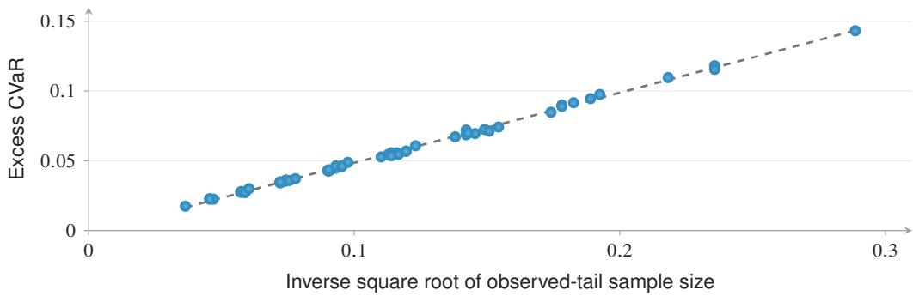

(b) Tail level  
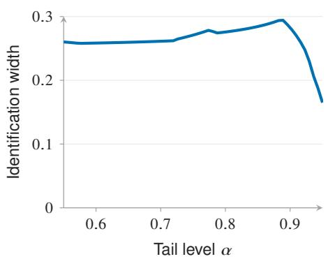

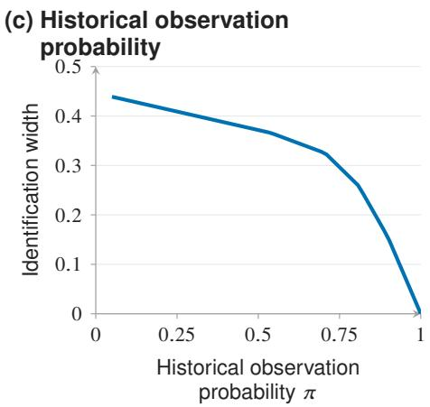  
Figure 5: Observation scarcity and sensitivity shape tail-risk precision. (a) Recorded simulations of the Appendix B.6 learning construction, with a least-squares guide against $( n \pi _ { 0 } \beta ) ^ { - 1 / 2 }$ Here $n \pi _ { 0 } \beta$ is the expected observed-tail sample count. (b–c) Exact identification widths for the fixed five-region design as the tail level or historical observation probability varies. Width can vary nonmonotonically with α. Lines join recorded evaluations.

Models, cross-fitting, and optimization. Candidates use standard classification objectives: $\ell _ { 2 }$ logistic regression $( C = 1$ , L-BFGS, 1000-iteration limit), default-weighted logistic regression (default class weight 2), and XGBoost [29] (450 trees, depth 5, learning rate .04, minimum child weight 10, row/column subsampling .85, $\ell _ { 2 }$ penalty 2, histogram trees, recorded CUDA configuration). Both nuisance classifiers use the boosting settings with separately fitted preprocessing and distinct seeds: $p _ { 1 }$ uses revealed outcomes and π predicts S from all training covariates. Shuffled five-fold cross-fitting is stratified by S; clip pb1 to [.01, .99] and πb to [.02, .98]. Evaluate Brier loss at $\alpha \in \{ . 9 0 , . 9 5 \}$ and $\breve { \Gamma } \in \{ 1$ , 1.25, 1.5, 2, 3, 5, 8, 12}.

The corrected objective can be nonconvex because hinge coefficients can be signed. Enumerate 0, 1, and both label-specific losses, $f ( X _ { i } ) ^ { 2 }$ and $( 1 - f ( X _ { i } ) ) ^ { 2 }$ , at every observed covariate $X _ { i } ,$ , including records whose actual outcomes are hidden. Deduplicate and sort increasingly; among exactly equal computed minima, choose the smallest threshold, without numerical tie tolerance. Clip endpoints to [0, 1]; if they cross, replace both by their midpoint. These clipping and crossing conventions are computational operations and do not supply statistical coverage.

Fold enlargement and diagnostics. At each endpoint’s selected threshold, compute five foldspecific objectives and divide their sample standard deviation by $\sqrt { 5 }$ to obtain an empirical standard error. Let $t _ { . 9 7 5 , 4 }$ be the .975 quantile of a Student-t distribution with four degrees of freedom. Subtract this multiplier times the lower-endpoint standard error from the raw lower endpoint and add the corresponding upper-endpoint quantity to the raw upper endpoint, before clipping or crossing repair. Then clip both limits to $[ 0 , 1 ]$ and order them by minimum and maximum. This empirical diagnostic uses dependent fold-specific quantities because their training samples overlap; calibrated coverage requires the conditions and radius of Theorem 2.

Historical propensity AUC is .9944 and Brier score .0201; raw propensities are below .02 for 75.26% and above .98 for 1.80% of applicants, and inverse clipped propensities are at most 50, indicating substantial extrapolation. Subgroups reuse full-cohort cross-fitted predictions and require at least max $\{ 2 5 0 , \lfloor . 0 0 2 \bar { N } \rfloor \}$ applications and 50 issued loans. At $\Gamma = 2 , \alpha = . 9 5 .$ , boosting width is .080 for DTI above 30% (2.7% issued) and .032 for FICO 700–739 (30.3% issued).

<table><tr><td>α</td><td>Predictor</td><td>Accepted-only</td><td> $\Gamma = 1$ </td><td> $\Gamma = 2$ </td><td> $\Gamma = 3$ </td></tr><tr><td>.95</td><td>Gradient boosting</td><td>.795</td><td>.733</td><td>[.703,.759] [.682,.773]</td><td></td></tr><tr><td></td><td>.95 Logistic</td><td>.801</td><td>.805</td><td>[.770,.831][.745,.843]</td><td></td></tr><tr><td></td><td>.95 Default-weighted</td><td>.661</td><td>.813</td><td>[.782,.833][.757,.841]</td><td></td></tr><tr><td>.95</td><td>Constant  $1 / \hat { 2 }$ </td><td>.250</td><td>.250</td><td>[.250,.250] [.250,.250]</td><td></td></tr><tr><td></td><td>.90 Gradient boosting</td><td>.740</td><td>.679</td><td>[.625,.715]</td><td>[.575,.732]</td></tr><tr><td></td><td>.90 Logistic</td><td>.741</td><td>.721</td><td>[.669,.760][.631,.778]</td><td></td></tr><tr><td></td><td>.90 Default-weighted</td><td>.579</td><td>.720</td><td>[.679,.747]</td><td>[.646,.759]</td></tr><tr><td></td><td>.90 Constant  $1 / \breve { 2 }$ </td><td>.250</td><td>.250</td><td>[.250,.250] [.250,.250]</td><td></td></tr></table>

Table 2: Historical applicants: accepted-only CVaR and model-based applicant-level sensitivity intervals. Values other than the exact constant reference are estimates. $\bar { \bf A t } \Gamma = 1$ the reference model fixes the hidden probabilities. Default-weighted denotes logistic regression with default class weight 2.

For $f \equiv 1 / 2 ,$ , both label-specific Brier losses equal $1 / 4 .$ . Mean loss and every CVaR endpoint therefore equal $1 / 4$ , and $\bar { d _ { f , \eta } } = \mathrm { T I V } = 0$ for every threshold. This row provides an exact predictor reference; the acquisition policies compare audits for a fixed or sequentially refitted boosting predictor.

Off-grid breakdown. For an accepted-only preferred $f$ and comparator $^ { g , }$ set $G ( \Gamma ) = \widehat { \rho } _ { \Gamma } ^ { L } ( g ) -$ $\widehat { \rho } _ { \Gamma } ^ { U } ( f )$ . At the first grid value $\Gamma _ { + }$ with $G ( \Gamma _ { + } ) \leq 0$ , if its predecessor $\Gamma _ { - }$ has positive gap, interpolate:

$$
\log \widehat { \Gamma } _ { \mathrm { b r } } = \log \Gamma _ { - } + \frac { G ( \Gamma _ { - } ) } { G ( \Gamma _ { - } ) - G ( \Gamma _ { + } ) } ( \log \Gamma _ { + } - \log \Gamma _ { - } ) .
$$

These values interpolate the recorded grid. Boosting versus logistic gives approximate breakdown 2.24 at $\alpha = . 9 5$ , with first failed grid value $^ { 3 , }$ and 1.40 at $\alpha = . 9 0$ , with first failed value 1.5. Default-weighted versus logistic gives approximately 1.01 at $\alpha = . 9 0$ , with first failed value 1.25. The other three accepted-only orderings fail already at $\Gamma = 1$ . A comparison with no crossing through 12 is recorded as right-censored above the grid.

## D.4 Controlled masking: empirical coverage and model comparisons

To evaluate coverage against known full-outcome risks, we use the 53,367 mature issued loans as the target population and independently draw 20 masks from

$$
\begin{array} { r l } & { \mathrm { l o g i t } P ( S = 1 \mid X , Y ) = c + g ( X ) - Y \log 3 , } \\ & { \qquad g ( X ) = \mathrm { c l i p } _ { [ - 3 , 3 ] } \big \{ . 6 5 z ( \mathrm { s c o r e } ) - . 3 5 z ( \mathrm { D T I } ) } \\ & { \qquad + . 1 5 z ( \mathrm { l o g } ( 1 + \mathrm { a m o u n t } ) ) \big \} . } \end{array}
$$

Each z standardizes the median-imputed pseudo-population feature. Solve for expected revealed share . $. 4 5 \ : ( c = - . 0 4 2 3 7 4 4 )$ . Bayes’ rule gives odds $( p _ { 0 } ) / \mathrm { o d d s } ( p _ { 1 } ) = 3$ , hence $\Gamma _ { 0 } = 3 ;$ boundary outcome probabilities coincide across hidden/revealed groups as in Appendix $\mathrm { A . 1 }$ . This validates artificial masking of mature issued loans, not outcomes for historically rejected applicants.

All three predictors share shuffled five-fold splits stratified by imposed S; fitting, clipping, threshold search, and fold enlargement follow Appendix D.3. Reference CVaR uses every known outcome with that predictor’s cross-fitted predictions. Table 3 counts intervals containing this full-outcome reference risk. Table 4 checks strict separation of plug-in intervals against reference risk orderings.

(a) Gradient boosting, $\alpha = . 9 0$  
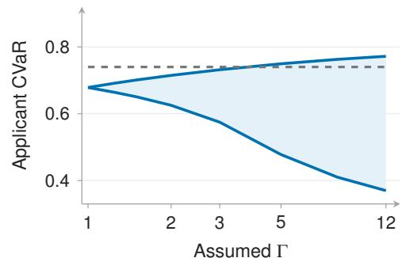  
(c) Logistic regression, $\alpha = . 9 0$

(b) Gradient boosting, $\alpha = . 9 5$  
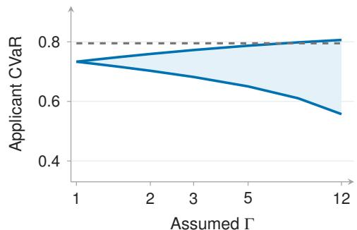

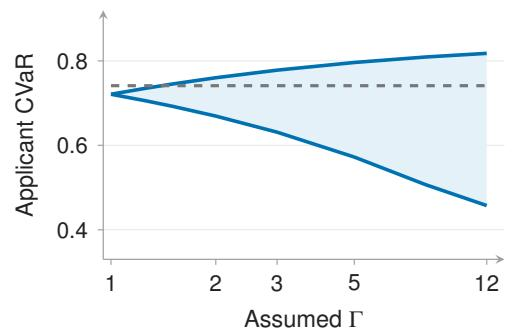  
(e) Default-weighted, � = .90

(d) Logistic regression, $\alpha = . 9 5$  
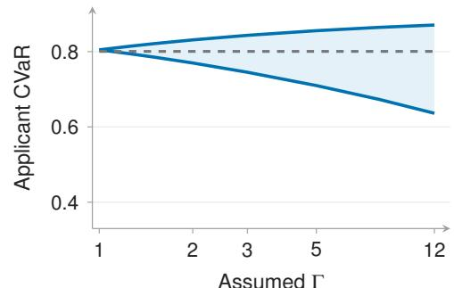

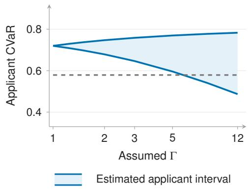

(f) Default-weighted, � = .95  
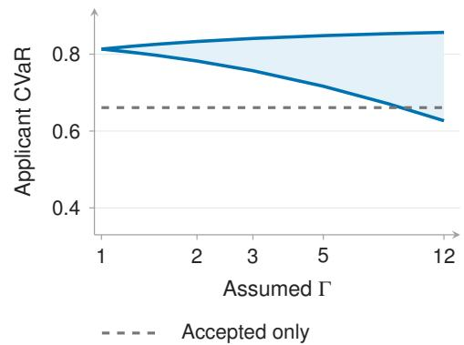  
Figure 6: Complete applicant-level sensitivity analysis. All three predictors at $\alpha = . 9 0$ and .95 over eight recorded sensitivity levels. Blue boundaries and shading show estimated sensitivity endpoints under the applicant regression extension of Appendix D.3. Gray dashed lines show accepted only CVaR. Horizontal axes are logarithmic and vertical limits are shared. Default-weighted denotes default-weighted logistic regression.

Three unordered predictor pairs per mask and 20 masks give 60 comparisons at each tail level, or 120 across both levels.

Figure 7 retains the complete assumed-Γ grid; plug-in coverage is zero at every tested $\Gamma \ \leq \ 2 .$ Main-figure pooling averages 20 mask-level means over three predictors, giving 60 equally weighted predictor–mask rows from 20 independent masks. Fold enlargement is an empirical calibration diagnostic; the class-wide calibrated statement is Theorem 2.

<table><tr><td>α</td><td>Predictor</td><td>Plug-in</td><td></td><td>Enlarged Mean width</td><td>Enlarged width</td></tr><tr><td>.90</td><td>Gradient boosting</td><td>11/20</td><td>19/20</td><td>.401</td><td>.434</td></tr><tr><td></td><td>.90 Logistic</td><td>13/20</td><td>20/20</td><td>.401</td><td>.434</td></tr><tr><td>.90</td><td>Default-weighted</td><td>14/20</td><td>20/20</td><td>.332</td><td>.365</td></tr><tr><td>.95</td><td>Gradient boosting</td><td>14/20</td><td>19/20</td><td>.070</td><td>.089</td></tr><tr><td></td><td>.95 Logistic</td><td>12/20</td><td>20/20</td><td>.066</td><td>.084</td></tr><tr><td></td><td>.95 Default-weighted</td><td>14/20</td><td>20/20</td><td>.110</td><td>.139</td></tr></table>

Table 3: Controlled masking at ${ \overline { { \Gamma = \Gamma _ { 0 } = 3 } } } .$ The middle columns count intervals covering the full pseudo-population reference CVaR over 20 masks; the last two columns are mean widths. Fold enlargement follows the empirical diagnostic in Appendix D.3.

<table><tr><td>Γ</td><td>α</td><td>Comparisons</td><td>Resolved</td><td>Incorrect</td><td>Unresolved</td></tr><tr><td>3</td><td>.90</td><td>60</td><td>0</td><td>0</td><td>60</td></tr><tr><td>3</td><td>.95</td><td>60</td><td>37</td><td>0</td><td>23</td></tr><tr><td>1</td><td>Both levels</td><td>120</td><td>120</td><td>16</td><td>0</td></tr></table>

Table 4: Model comparisons under controlled masking. Strict separation of plug-in intervals declares an ordering, whose correctness is checked against known-outcome reference CVaRs. Counts give resolved pairs, incorrect declared orderings, and unresolved pairs. Each tail level includes three unordered predictor pairs in each of 20 masks.

(a) Gradient boosting, � = .90  
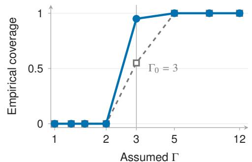  
(c) Logistic regression, � = .90

(b) Gradient boosting, $\alpha = . 9 5$  
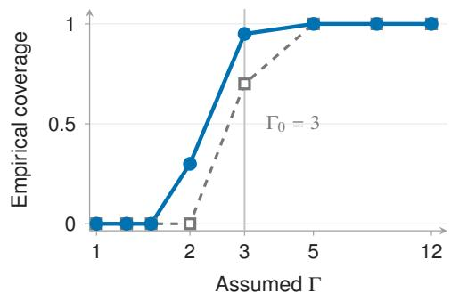

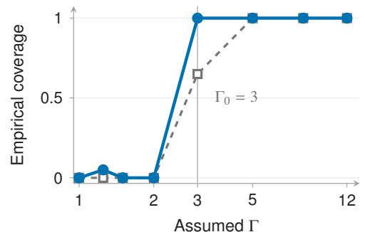  
(e) Default-weighted, $\alpha = . 9 0$

(d) Logistic regression, $\alpha = . 9 5$  
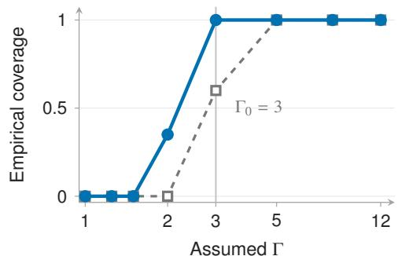

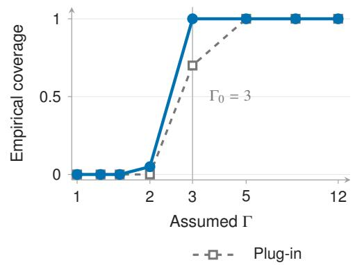

(f) Default-weighted, � = .95  
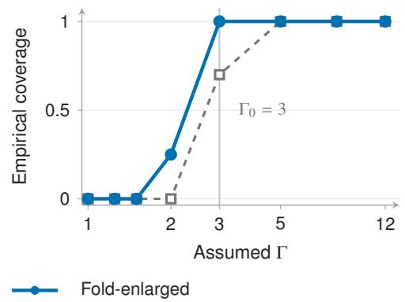  
Figure 7: Empirical coverage by predictor and tail level. Each proportion uses 20 controlled masks. Blue circles show fold-enlarged intervals and hollow gray squares plug-in intervals; the vertical reference marks the masking mechanism’s sensitivity $\bar { \Gamma _ { 0 } } \stackrel { . } { = } \bar { 3 }$ . Predictors share the same 20 masks, so the predictor-specific proportions are dependent. Default-weighted denotes defaultweighted logistic regression.

## D.5 Synthetic fixed-threshold cost–precision frontier

We next evaluate the fixed-threshold cost–precision frontier of Theorem 3 in synthetic populations with known outcome probabilities and acquisition costs.

Generator. Use 120 worlds of 120 cells, $\alpha ~ = ~ . 8 5 , \Gamma ~ = ~ 1 2$ , absolute loss, $f ~ = ~ p _ { 1 }$ , and $\eta = . 5$ . Masses are Dirichlet $( . 7 5 , \dots , . 7 5 )$ . Independently draw $z _ { j } , e _ { j } , e _ { i } ^ { \mathrm { o u t } } , e _ { i } ^ { \mathrm { i n } } \sim \bar { N } ( 0 , 1 )$ across cells/noise types. Hidden-tail cells satisfy $z _ { j } + . 3 5 e _ { j }$ at or above its empirical .65 quantile (NumPy default linear interpolation). Outside/inside these cells, respectively, set

$$
p _ { 1 j } = \mathrm { s i g m o i d } ( - 1 . 3 5 + . 7 5 z _ { j } + . 4 5 e _ { j } ^ { \mathrm { o u t } } ) , \qquad p _ { 1 j } = \mathrm { s i g m o i d } ( - 2 . 0 5 + . 3 5 z _ { j } + . 3 0 e _ { j } ^ { \mathrm { i n } } ) ,
$$

clipped to $[ . 0 4 , . 7 2 ]$ , and draw $\pi _ { j } \sim U [ . 6 2 , . 9 5 ] / U [ . 0 2 , . 1 6 ]$ . Add to the log-odds of $p _ { 1 j }$ a shift $N ( 0 , . 1 8 ^ { 2 } ) \dot { / } U [ . 8 \log$ 10, log 10] to obtain $p _ { 0 j }$ , clipped to $\left[ . 0 2 , . 9 8 \right]$ . Costs are $c _ { j } = U _ { j } + B _ { j } V _ { j }$ with $U _ { j } \sim U [ . 4 5 , \bar { 1 . 7 5 } ] , B _ { j } \sim$ Bernoulli(.20), and $\begin{array} { r } { \dot { V } _ { j } \sim \dot { U } [ . 7 5 , 1 . \dot { 7 } 5 ] } \end{array}$ ]. Primitive draws are mutually independent and independent of masses; hidden-cell membership induces the specified dependence of $\pi _ { j }$ and log-odds shifts on the normal scores.

The generated $p _ { 0 j }$ specifies the hidden-outcome distribution in cell $j$ . The fixed-threshold frontier follows from $\begin{array} { r } { \dot { W } _ { f , \eta } ( \bar { \lambda } ) = \sum _ { j } \mu _ { j } ( 1 - \lambda _ { j } ) \tau _ { f , \eta } ( j ) } \end{array}$ and cost $\textstyle \sum _ { j } \mu _ { j } c _ { j } \lambda _ { j }$ . The frontier calculation uses $p _ { 1 } , \pi , f , \eta , \Gamma , \mu , c ;$ the generated $p _ { 0 }$ does not enter these formulas.

Allocations and equivalent baselines. Here $c _ { j }$ is population cost density: allocations cost $\textstyle \sum _ { j } \mu _ { j } c _ { j } \lambda _ { j }$ , with full cost $\sum _ { j } \mu _ { j } c _ { j }$ . Appendix $C . 5 \mathrm { ^ , s }$ fractional-knapsack solution uses useful zerocost cells first, then decreasing $\tau _ { j } / c _ { j }$ on positive-cost/value cells (this generator has positive costs). A fractional final cell implements 51 budgets from zero to full cost in .02 increments. TIV/cost and the exact frontier share this ordering and all saved coordinates.

Seven baselines rank by raw independent $U [ 0 , 1 ]$ random score, cell mass, negative revelation probability, selected-label expected absolute loss, $p _ { 1 } ( 1 - p _ { 1 } )$ , sensitivity width, or absolute tail-excess contrast $| d _ { f , \eta } | .$ . Only TIV/frontier divide their scores by cost. Each world’s random scores are independent of generator draws and reused across budgets. Decreasing NumPy default sorting (argsort(score) $\left[ : : : - 1 \right] ,$ ) imposes no stable secondary tie rule, including clipping-induced ties. For $v _ { j } = p _ { 1 j } ( 1 - p _ { 1 j } )$ , predicted loss is $2 v _ { j }$ , predictive uncertainty is $v _ { j }$ , and

$$
s _ { \Gamma } ( p _ { 1 j } ) = \frac { ( \Gamma ^ { 2 } - 1 ) v _ { j } } { \Gamma + ( \Gamma - 1 ) ^ { 2 } v _ { j } } .\tag{D.2}
$$

The last expression increases strictly in $v _ { j }$ for $\Gamma > 1$ , so these three baselines share a mathematica weak ordering and their saved curves coincide.

Normalize remaining ambiguity by its initial value within each world before taking medians/IQR. Cost-to-target is the first recorded budget reaching 25% of initial ambiguity, divided by $\mathrm { T I V } \mathbf { \bar { s } }$ corresponding cost in that world; there is no interpolation between budgets. Normalization requires positive initial ambiguity, full cost, and TIV target cost. This measures divisible population revelation at fixed $f , \eta , \Gamma$ (Theorem 3).

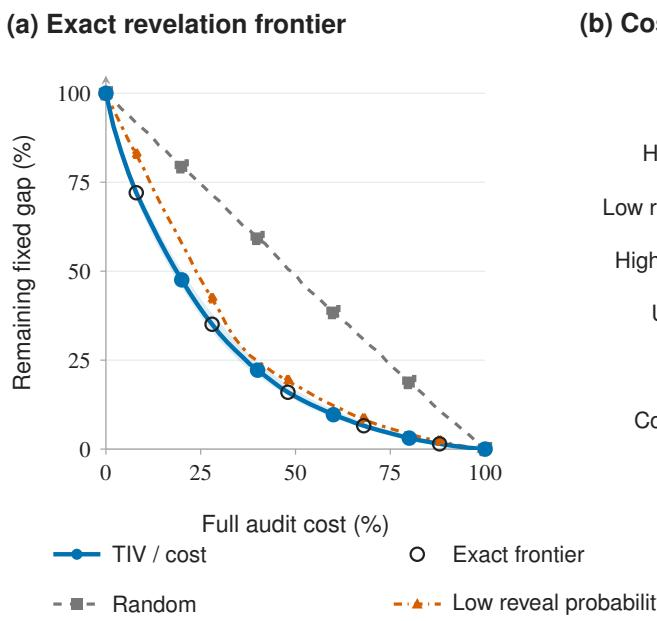  
(b) Cost to 25% of initial gap

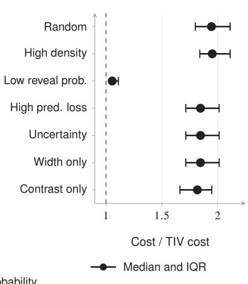  
Figure 8: The exact revelation frontier and the cost of alternative policies. Across 120 finite cell worlds, (a) median remaining fixed-threshold ambiguity, normalized within each world; blue shading is the TIV interquartile range and open markers identify the coincident exact frontier. (b) All seven baselines: median cost of reaching 25% of the initial gap relative to TIV in the same world, with interquartile bars. Costs use the recorded 2%-spaced grid.

## D.6 Fixed and sequential audits of known repayments

Both protocols use boosting, $\alpha = . 9 5 , \Gamma = 3 ,$ the 20 controlled masks, and unit cost per audited label. Let $N _ { \mathrm { h i d d e n , i n i t i a l } } ^ { \mathrm { f i x } }$ count initially hidden cases in the fixed protocol’s original pool, and let $N _ { \mathrm { h i d d e n , i n i t i a l } } ^ { \mathrm { s e q } }$ count initially hidden cases in the sequential protocol’s 80% training pool. Each protocol acquires eight batches of $\lceil . 0 2 N _ { \mathrm { h i d d e n , i n i t i a l } } ^ { \mathrm { p r o t o c o l } } \rceil$ labels, capped by the remaining eligible pool. Its budget fraction is the cumulative acquired count divided by that same initial hidden count. Among candidates already known to be hidden, operational TIV is $\widehat { \tau } / ( 1 - \widehat { \pi } ) = \widehat { s } _ { \Gamma } | d _ { f , \eta } | / \beta$ , corresponding to $c = 1 - \pi$ in Appendix C.5.

<table><tr><td>Protocol</td><td>Fixed objective</td><td>Sequential retraining</td></tr><tr><td>Data and predictor</td><td>Original hidden pool; initial cross-fitted predictor and historical nuisance predictions held fixed; upper threshold minimizes the empirical upper-endpoint objective in (6), built from the score (5), before auditing.</td><td>80/20 split jointly stratified by (S, Y); acquire only in training pool, refit predictor on all known training labels each round</td></tr><tr><td>Evaluation</td><td>Empirical mean of remaining-hidden indicators times original per-label TIV; normalize by round zero within each mask</td><td>Training-pool retained plug-in width; held-out mean Brier and CVaR on the same reserved 20%</td></tr><tr><td>Ordering/ties</td><td>One stable decreasing-score ordering per policy; ties retain masked-data order</td><td>Partial partition (argpartition); no stable secondary batch-cutoff rule; random scores refreshed each round</td></tr></table>

The fixed protocol takes its upper threshold from the empirical upper-endpoint objective in (6), built from the score (5), using the initial masking predictions of Appendix D.4 and the breakpoint/tie rule of Appendix D.3. It freezes those predictor and nuisance predictions, as well as this threshold, for every acquisition and fixed-gap calculation.

Retained objective. Historical $p _ { 1 }$ is fitted on initially revealed training outcomes, clipped as in Appendix D.3, and frozen. For training size $n ,$ let $A _ { i t } \le 1 - S _ { i }$ indicate audit by round $t , f _ { t }$ be the refitted predictor, and $\widehat { p } _ { i }$ the frozen fit. The retained plug-in objective is

$$
\begin{array} { l } { \displaystyle \widehat { Q } _ { t } ^ { \sigma } ( \eta ) = \eta + \frac { 1 } { n \beta } \sum _ { i = 1 } ^ { n } \Bigl [ S _ { i } a _ { f t , \eta } ^ { Y _ { i } } ( X _ { i } ) + A _ { i t } a _ { f t , \eta } ^ { Y _ { i } } ( X _ { i } ) } \\ { \displaystyle \qquad + ( 1 - S _ { i } - A _ { i t } ) b _ { f _ { t } , \eta } ^ { \sigma } ( X _ { i } ; \widehat { p _ { i } } ) \Bigr ] , \qquad \sigma \in \{ L , U \} . } \end{array}\tag{D.3}
$$

Known outcomes enter directly; still-hidden outcomes retain historical sensitivity envelopes. Each endpoint uses breakpoint minimization, the threshold tie rule, clipping, and midpoint collapse of Appendix D.3. At full revelation $A _ { i t } = 1 - S _ { i }$ , both objectives equal $\begin{array} { r } { \eta + ( n \beta ) ^ { - 1 } \sum _ { i } a _ { f _ { t } , \eta } ^ { Y _ { i } } ( X _ { i } ) } \end{array}$ and both endpoints equal full-training-data empirical CVaR; a regression test verifies this identity. These training-prediction widths and held-out predictive risks are descriptive trajectories, without fold enlargement or adaptive confidence guarantees.

Acquisition rules. Among still-hidden candidates, let $\widehat { p } _ { \mathrm { k n o w n } }$ denote the fitted outcome probability from currently known labels, and let $\widehat { s } _ { \Gamma } = q _ { + } ( \widehat { p } _ { 1 } ) \ - - \ q _ { - } ( \widehat { p } _ { 1 } )$ be the sensitivity width from the frozen historical outcome fit. In the sequential protocol, let $\widehat { \eta } ^ { U }$ be the current upper-endpoint minimizing threshold of (D.3). The six acquisition scores are TIV per label cost $\widehat { s } _ { \Gamma } \dot { | { d } } _ { f , \widehat { \eta } } { v } | / \dot { ( \beta } \kappa )$ , with $\kappa = 1 ;$ ; independent uniform random scores; predictive uncertainty $1 - 2 | f - . 5 |$ ; negative fitted probability of currently having a known label; predicted Brier loss $( \bar { 1 } - \widehat { p } _ { \mathrm { k n o w n } } ) \bar { f } ^ { 2 } + \widehat { p } _ { \mathrm { k n o w n } } ( 1 \bar { - } f ) ^ { 2 }$ and historical sensitivity width $\widehat { s } _ { \Gamma }$ . The fixed protocol uses its frozen initial predictor, threshold, and historical fits. Sequential TIV uses the current predictor and upper threshold with the frozen historical sensitivity bounds. The propensity baseline refits the indicator of a currently known label on all training covariates, with probabilities clipped to [.02, .98]. Predicted loss refits the outcome model on currently known outcomes and uses its raw probabilities. These models share the boosting settings above, with their respective targets, available labels, and seeds. Refreshed acquisition fit guide label choice; retained evaluation continues to use the historical outcome fit in (D.3).

<table><tr><td>Acquisition rule</td><td>Fixed-threshold gap reduction</td><td>Final median sequential interval width</td></tr><tr><td>TIV per label cost</td><td>61%</td><td>.035</td></tr><tr><td>Random</td><td>16%</td><td>.067</td></tr><tr><td>Lowest revelation propensity</td><td>9%</td><td>.084</td></tr><tr><td>Predicted loss</td><td>0%</td><td>.116</td></tr><tr><td>Predictive uncertainty</td><td>0%</td><td>.116</td></tr><tr><td>Sensitivity width</td><td>0%</td><td>.116</td></tr></table>

Table 5: Complete fixed and sequential audit comparison at the nominal 16% budget. Fixed reductions are medians of within-mask percentage reductions; estimated sequential widths are medians across the 20 runs. Integer rounding gives actual median budget fractions of 16.013% of the fixed initial hidden pool and 16.018% of the sequential initial hidden training pool.

<table><tr><td>Acquisition rule</td><td>Estimated width</td><td>Mean Brier</td><td>CVaR</td></tr><tr><td>TIV</td><td>0.0348</td><td>0.1362</td><td>0.8541</td></tr><tr><td>Random</td><td>0.0671</td><td>0.1347</td><td>0.8682</td></tr><tr><td>Paired TIV—Random</td><td>-0.0332</td><td>+0.0014</td><td>-0.0138</td></tr><tr><td>Exact predictor reference</td><td></td><td></td><td></td></tr><tr><td>Constant  $f \equiv 1 / \overset { \cdot } { 2 }$ </td><td>0.0000</td><td>0.2500</td><td>0.2500</td></tr></table>

The constant forecast supplies an exact predictor reference.

Table 6: Precision and predictive loss after eight equal-budget audit rounds. Policy rows are medians across 20 masks; the paired row is the median of the within-mask TIV-minus-random differences. Estimated width uses the training pool; mean Brier loss and CVaR use the same reserved 20% split.

In all 20 paired terminal runs, TIV has lower estimated width and held-out CVaR than random, while random has lower mean Brier loss. The median paired differences are −.0332 in width, −.0138 in CVaR, and +.0014 in mean Brier loss (Table 6). The exact constant reference has lower tail loss and higher mean loss than both policy medians. Figure 9 shows how the estimated width and held-out tail risk evolve as each policy changes the training labels and predictor.

(a) Sequential interval width  
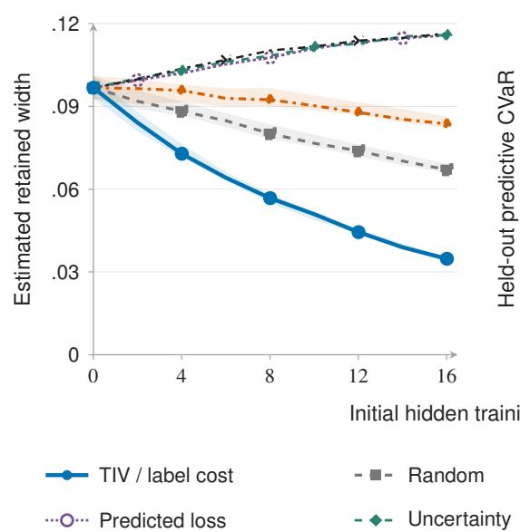

(b) Predictive risk  
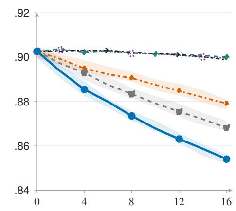  
Initial hidden training pool revealed (%)

Figure 9: Sequential precision and predictive outcomes across all six acquisition rules. Lines are medians over 20 masks at $\alpha = . 9 5 , \Gamma = 3 ;$ light bands are interquartile ranges for TIV, random, and lowest-propensity acquisition. (a) Estimated retained-sensitivity width for the current predictor. (b) Its CVaR on the reserved 20% split. Predicted-loss, predictive-uncertainty, and sensitivity-width curves are plotted separately and nearly overlap. Lines join recorded rounds. Table 6 gives the exact constant-forecast reference. The horizontal coordinate is the median fraction of initially hidden training-pool labels acquired.

## D.7 Recorded implementation inventory

Code, saved results, and reproduction instructions are available at https://github.com/ E-zClap/hidden-tails. The repository’s manuscript folder contains reproducibility/ README.md and reproducibility/implementation\_inventory.tex, which record implementation entry points, configurations, seeds, draw order, saved-output mappings, and runtime/hash logs. The sequential results in Figure 4b, Figure 9, and Tables 5–6 use the retained plug-in objective (D.3); the inventory identifies its runner and configuration and records residual-corrected trajectories separately. It also documents the cohort verification: all 53,367 reconstructed issued records match all 12 shared columns in their original order, and all 20 archived mask diagnostics match.

## E Sensitivity Calibration and Extensions

## E.1 Choosing and calibrating the sensitivity range

For interior probabilities, $\gamma = \log \Gamma$ bounds the hidden–selected log-odds discrepancy:

$$
\begin{array} { r l } & { | \log \mathrm { i t } p _ { 0 } ( x ) - \log \mathrm { i t } p _ { 1 } ( x ) | \leq \gamma , } \\ & { \qquad p _ { 0 } ( x ) \in [ \mathrm { e x p i t } \{ \log \mathrm { i t } p _ { 1 } ( x ) - \gamma \} , \mathrm { e x p i t } \{ \log \mathrm { i t } p _ { 1 } ( x ) + \gamma \} ] . } \end{array}\tag{E.1}
$$

Overlap identifies the reference $p _ { 1 } ;$ substantive knowledge or additional outcomes inform the allowed discrepancy, as in sensitivity analysis for nonignorable observation [11–13, 30].

Probability-scale elicitation. For a reference probability $p \in \mathsf { \Gamma } ( 0 , 1 )$ ) and elicited hidden range $[ l , u ] \subset ( 0 , 1 )$ , the smallest symmetric odds bound containing that range is

$$
\Gamma _ { \mathrm { e l i c } } ( p , \left[ l , u \right] ) = \operatorname* { m a x } \left\{ 1 , \frac { \mathrm { o d d s } ( u ) } { \mathrm { o d d s } ( p ) } , \frac { \mathrm { o d d s } ( p ) } { \mathrm { o d d s } ( l ) } \right\} , \qquad \mathrm { o d d s } ( v ) = \frac { v } { 1 - v } .\tag{E.2}
$$

For $p = . 1 0$ and $[ l , u ] = [ . 0 5 , . 2 0 ]$ , this gives $9 / 4$ . A common Γ must cover the whole target covariate support; uncertainty in p can be included by maximizing over its confidence set.

Pilot calibration and covariate resolution. Declare a finite-cell model $X ~ = ~ g ~ \in ~ { \mathcal { G } }$ , and write $p _ { s q } \ = \ \mathrm { P r } ( Y \ = \ 1 \ | X \ = \ g , S \ = \ s )$ in cells with originally hidden mass. A pilot identifies $p _ { 0 g }$ only when its design identifies that original hidden distribution: conditional random sampling suffices, while unequal probabilities require adjustment. An arbitrarily selected audited subset instead identifies its own law $p _ { A }$ (Appendix C.1). Suppose confidence sets satisfy $\mathrm { P r } \{ p _ { s g } \in C _ { s g }$ for all relevant $( s , g ) \} \geq 1 - \delta _ { \mathrm { c a l } }$ . For sets contained in (0, 1), define

$$
\Gamma _ { \mathrm { c a l } } = \exp \left\{ \operatorname* { m a x } _ { g \in \mathcal { G } } \operatorname* { s u p } _ { u \in C _ { 0 g } } | \log \mathrm { i t } u - \log \mathrm { i t } v | \right\} .\tag{E.3}
$$

On the simultaneous coverage event this bounds every cell’s true discrepancy. The supremum can be infinite as admissible probabilities approach incompatible boundaries. Clipping confidence sets to an interior interval preserves coverage only under a justified probability restriction or a confidence construction already supplying it. The finite-Γ restrictions at $p _ { 1 } ~ = ~ 0 , $ 1 are specified in Appendix A.1.

Calibration in (E.3) controls the model with $X = g .$ . Cell averages do not control discrepancies at finer covariate resolution: either analyze with these cells or justify explicit within-cell homogeneity of the relevant probabilities. A certificate using finer covariates needs control at that finer resolution.

Joint error control. With an independent pilot, condition on it and apply the certificate at the chosen finite $\Gamma _ { \mathrm { c a l } }$ with valid conditional failure probability $\delta _ { \mathrm { c e r t } }$ , including nuisance estimation. A union bound gives total failure probability at most $\delta _ { \mathrm { c a l } } + \delta _ { \mathrm { c e r t } }$ under the two procedures’ assumptions. Reusing labels for calibration and revelation requires joint control of the sensitivity choice, audited contribution, and endpoint estimates; their dependence must enter the analysis. For a prespecified finite sensitivity grid, allocate error across its points, each already controlling the stipulated predictor class. A continuum requires uniform control in sensitivity. Let $\mathrm { { \dot { T } } _ { m a x } }$ be the largest sensitivity level under consideration. Population nesting implies that risk-limit or strict-separation claims valid at $\Gamma _ { \mathrm { m a x } }$ hold throughout $[ \dot { 1 } , \Gamma _ { \mathrm { m a x } } ]$ . Compare the calibrated range with the breakdown definition in Appendix A.5; Appendix D.3 estimates breakdown numerically by interpolation on a log-sensitivity grid.

## E.2 Extensions of the outcome model

Binary outcomes provide two label-specific losses whose ordering supplies one extremal hidden kernel for every threshold. A multiclass extension needs a sensitivity set for the hidden class-probability vector and a new extremality and threshold-optimization argument. Continuous outcomes require conditional-distribution sensitivity sets; unbounded losses additionally require tail conditions fo finite statistical control. Population overlap and nuisance-error requirements remain those of Appendix B; the historical extension and masking calibration are specified in Appendices D.3 and D.4.

## E.3 Connections to related approaches

Selective-label evaluation concerns outcomes observed through historical decisions [3, 7, 8]. Missing-data analysis and partial identification organize the resulting uncertainty through compatible laws [9, 10, 31, 32]; here every point of the tail-risk interval has such a law. The CVaR representation accommodates discrete losses [16]. As in distributionally robust learning [14, 15, 33, 34], the upper endpoint is a worst-case risk; the lower endpoint records the remaining identification information. Orthogonalization [17–19] and cross-fitting [17, 18] control nuisance bias, and Rademacher complexity and contraction control uniform fluctuation [23–25].

Active learning links queries to a learning objective [35]; TIV links acquisition to the precision of a specified risk claim. Its exact allocation theorem fixes f, η, Γ. The sequential study (Appendix D.6) refreshes acquisition values after retraining while keeping the historical outcome regression fixed in the retained objective. Auxiliary fits to current known-label status or outcomes serve the corresponding acquisition baselines. The study evaluates interval trajectories and held-out predictive risk. Inference across adaptive rounds or at data-dependent stopping requires control of the acquisition history, newly revealed contributions, and stopping rule, beyond the fixed-sample uniform theorem.

## E.4 Broader impacts

By exposing population risks hidden by selective observation, this framework can help decision makers identify when available evidence is insufficient and direct audits toward informative out comes. In lending or healthcare, however, a sensitivity range that excludes the true hidden outcome law, inaccurate nuisance estimates, or extrapolation into unsupported regions can produce misleading assurances and reinforce unequal access to credit or care. Even a valid population certificate does not establish fairness across demographic groups. Targeted collection may disproportionately burden particular groups and can expose sensitive financial or health information. Audit design should therefore consider subgroup coverage and acquisition burdens, use appropriate consent or authorization, and limit data collection, access, and retention. Certificates must be interpreted within the specified population, outcome, loss, and assumptions; they do not by themselves justify deployment or replace causal, fairness, privacy, and domain-specific assessments.

## F Additional Recorded Experiments

This appendix collects saved experiments that complement the studies in Appendix D: simple ob servation mechanisms, finite-candidate learning, additional diagnostics for the synthetic revelation frontier, and a finite-population illustration constructed from diabetes data. They answer questions about how the objectives behave under controlled conditions. Their population quantities and empirical trajectories carry no additional finite-sample confidence guarantee. No new simulations or model fits were run when preparing these tables.

## F.1 Observation mechanisms, candidate learning, and fixed audits

Low observed risk can hide high population risk. The two-region example has masses (.82, .18), deterministic outcomes (0, 1), and observation probabilities (.95, .04). Use absolute loss and $\alpha = . 8 5$ . For the constant-zero predictor, the saved observed-label CVaR is 0.0611, whereas population CVaR is 1.0000. The region-specific predictor (0, 1) has zero loss under both populations. Thus this example demonstrates a large discrepancy between observed and population risk; it does not exhibit a pairwise ranking reversal. The saved envelope calculation uses $\Gamma = 5 0$ and clips boundary reference probabilities to $[ 1 0 ^ { - 8 } , 1 - 1 0 ^ { - 8 } ]$ , producing negligible nonzero envelope values for the zero-loss reference.

Finite-candidate selection with known auxiliary functions. Use the five-region population specified under “Population sweeps” in Appendix D.2. Outcomes are sampled from its specified Bernoulli probabilities; observation is sampled conditional on the outcome. The adverse-label observation probability in region B is .03, compared with .60 for the other label, giving an odds-ratio sensitivity shift of 48.5. Fix $\Gamma = 5 0 , \alpha = . 8 5$ , absolute loss, and

$$
\mathcal { F } _ { 0 } = \{ ( . 0 5 , b , . 1 0 , . 4 0 , . 5 0 ) : b \in \{ . 0 5 , . 2 5 , . 6 5 , . 8 5 \} \} .
$$

Each of 250 independent training samples contains 1,400 records. Four rules minimize, over ${ \mathcal { F } } _ { 0 } .$ empirical full-label CVaR, empirical observed-label CVaR, normalized inverse-propensity-weighted observed-label CVaR, or the empirical upper sensitivity objective. The propensity rule uses the known marginal $\pi ( X ) ;$ ; the upper objective uses known $p _ { 1 }$ and combines observed excess loss with the bounded hidden contribution. It does not estimate auxiliary models or add the locally robust residual correction. All cutoff searches use exact loss breakpoints. The full-label rule is an oracle benchmark unavailable to a learner with selective labels.

Table 7 evaluates each chosen predictor under the exact population law. Each rule chooses the same candidate in every recorded replication, so the table does not attach a sampling-error bar to its repeated population evaluation. The difference between observed-label and inverse-propensity learning, on one hand, and upper-envelope learning on the other illustrates the consequence of outcomedependent observation in this particular candidate class. It is not a universal comparison between learning algorithms.

<table><tr><td>Rule</td><td>f(B)</td><td>Observed CVaR</td><td>Full CVaR</td><td>Upper endpoint</td><td>Width</td></tr><tr><td>Observed labels</td><td>.25</td><td>0.6447</td><td>0.7845</td><td>0.8877</td><td>0.2844</td></tr><tr><td>IPW</td><td>.25</td><td>0.6447</td><td>0.7845</td><td>0.8877</td><td>0.2844</td></tr><tr><td>Upper envelope</td><td>.65</td><td>0.6686</td><td>0.6582</td><td>0.8628</td><td>0.2286</td></tr><tr><td>Full-label oracle</td><td>.65</td><td>0.6686</td><td>0.6582</td><td>0.8628</td><td>0.2286</td></tr></table>

Table 7: Finite-candidate selection over 250 samples of size 1,400. Values average exact population evaluations of the chosen predictor; each rule selected the same candidate in every replication. The upper endpoint is a population sensitivity envelope, without statistical enlargement.

A single fixed-predictor audit pool. A further sample of 7,000 records from the same population supplies one audit pool. Fix the population observed-label-preferred predictor $\begin{array} { r l } { f } & { { } = } \end{array}$ $( . 0 5 , . 2 5 , . 1 0 , . 4 0 , . 5 0 )$ and the lower-envelope minimizing cutoff $\eta = . 5$ . Only originally hidden outcomes can be acquired, at unit cost. The five static rankings are per-hidden-label TIV $s _ { \Gamma } \big | d _ { f , \eta } \big | / \beta ,$ independent uniform random scores, region mass, uncertainty $- | f - . 5 |$ , and expected absolute loss at the midpoint $( q _ { - } + q _ { + } ) / 2$ of the sensitivity interval. The implementation sorts each score in decreasing order using NumPy’s default argsort; it does not impose a separate stable tie rule. The 16 recorded budgets range from zero to 1,800 labels in increments of 120. The predictor and rankings remain fixed throughout.

Revealed outcomes enter the known empirical contribution. The remaining hidden outcomes retain the original sensitivity bounds. Table 8 separately reports the reduction of the fixed-cutoff gap and of the empirical interval whose endpoints minimize their cutoffs independently. Both reductions are normalized by their respective initial value in this one pool. The two objectives need not favor the same allocation at every budget: random revelation removes slightly more optimized width at 600 labels, although TIV removes more fixed-cutoff ambiguity. Prediction uncertainty is also distinct from label-sensitive tail ambiguity: the region with $f ^ { ^ { - } } = . 5$ has identical absolute loss under both labels, hence zero TIV at every cutoff. These are mechanism observations from one realized pool, without replication-based inference or a claim of adaptive learning optimality.

<table><tr><td>Labels</td><td>TIV</td><td>Random</td><td>Density</td><td>Uncertainty</td><td>Predicted loss</td></tr><tr><td colspan="6">Fixed-threshold gap removed (%)</td></tr><tr><td>600</td><td>42.4</td><td>30.6</td><td>40.7</td><td>15.8</td><td>15.8</td></tr><tr><td>1,200</td><td>76.2</td><td>61.6</td><td>67.8</td><td>47.1</td><td>47.1</td></tr><tr><td>1,800</td><td>100.0</td><td>91.4</td><td>95.5</td><td>88.9</td><td>88.9</td></tr><tr><td colspan="6">Separately optimized empirical width removed (%)</td></tr><tr><td>600</td><td>29.4</td><td>30.3</td><td>28.7</td><td>21.3</td><td>21.3</td></tr><tr><td>1,200</td><td>72.0</td><td>61.0</td><td>62.5</td><td>59.0</td><td>59.0</td></tr><tr><td>1,800</td><td>100.0</td><td>91.1</td><td>98.2</td><td>87.1</td><td>87.1</td></tr></table>

Table 8: One synthetic pool of 7,000 records, fixed predictor, and unit cost per hidden label. Reductions are normalized by that pool’s initial gap or initial optimized width. These two targets need not rank policies identically; at 600 labels random revelation removes slightly more optimized width than TIV.

## F.2 Additional diagnostics for the synthetic frontier

Use the same 120 synthetic worlds, each with 120 cells, described in Appendix D.5. The loss is absolute, $\alpha = . 8 5$ , and $\Gamma = 1 2$ . The additional saved outputs compare three specified forecasts: $p _ { 1 }$ the upper sensitivity probability $q _ { + } ( p _ { 1 } )$ , and $p _ { \mathrm { f u l l } } = \pi p _ { 1 } + ( 1 - \pi ) p _ { 0 }$ . The CSV names for these rows are “Observed-selected,” “Certificate,” and “Oracle.” In this experiment they are formulas fixed by the generator, not the results of minimizing empirical risk or an upper endpoint over a candidate class. The full-label forecast uses information unavailable from the observed law. Table 9 reports mean population evaluations over the 120 worlds, alongside the single finite population introduced below. In particular, the $q _ { + } ( p _ { 1 } )$ row is not evidence that the risk-minimizing forecast has been found.

From a common cutoff to separately minimized endpoints. For each world, fix $f = p _ { 1 }$ and acquire along the TIV-per-cost ordering at $\eta = . 5$ . Cost is $\textstyle \sum _ { j } \mu _ { j } c _ { j } \lambda _ { j }$ , with a fractional terminal cell; budget fractions divide by the full population cost $\sum _ { j } \mu _ { j } c _ { j } ^ { \dagger }$ . The known audited contribution is evaluated with the generative $p _ { 0 } .$ , while the remaining outcomes retain their sensitivity bounds. This isolates the retained population objective from estimation of the newly audited contribution.

The saved diagnostic evaluates 21 cost fractions from zero to one. Its endpoint search uses the grid $\mathcal { G } = \{ 0 , 1 / 6 0 , \bar { . } . . , 1 \}$ , giving

$$
I _ { \Gamma , \lambda } ^ { \mathcal { G } } ( f ) = \operatorname* { m i n } _ { \eta \in \mathcal { G } } U _ { f , \eta } ( \lambda ) - \operatorname* { m i n } _ { \eta \in \mathcal { G } } L _ { f , \eta } ( \lambda ) .
$$

This recorded grid-minimized width is distinct from the exact breakpoint-minimized width in $\mathsf { A p - }$ pendix C.4. The companion bound maximizes the common-cutoff gap on the same grid. Because binary absolute-loss contrasts satisfy $| d _ { f , \eta } | \leq | d _ { f , 0 } |$ and $0 \in \mathcal G$ , that maximum equals $W _ { f , 0 } ( \lambda )$ . All 2,520 saved world–budget rows satisfy $0 \leq I _ { \Gamma , \lambda } ^ { \mathcal { G } } ( f ) \leq W _ { f , 0 } ( \lambda )$ to numerical precision. Table 10 gives selected budgets. This check illustrates the sufficient-width connection; it neither makes the .5-cutoff allocation optimal for optimized width nor turns the finite grid into exact threshold minimization. The gap bound can exceed one because it is not itself a bounded-loss CVaR.

## F.3 A diabetes-derived finite-population illustration

Measured outcomes and imposed observation. The construction uses all 442 records in the diabetes dataset distributed with scikit-learn [27]. It binarizes the measured disease-progression outcome at its empirical 75th percentile, assigning $Y \ = \ 1$ at or above that cutoff. A standardized logistic regression, fitted to all these outcomes with a 5,000-iteration limit and the recorded software defaults, supplies scores $r _ { i }$ . Fourteen empirical-quantile score cells define the finite covariate population. The score is used to construct strata, not evaluated as a held-out predictive model. In particular, the construction has access to outcomes subsequently called hidden.

For each record, impose the observation probability

$$
s _ { i } = \mathrm { c l i p } _ { [ . 0 3 , . 9 5 ] } \{ . 8 5 - . 2 5 r _ { i } - . 5 5 Y _ { i } - . 2 0 Y _ { i } r _ { i } + \epsilon _ { i } \} , \qquad \epsilon _ { i } \sim { \cal N } ( 0 , . 0 1 ^ { 2 } ) .
$$

The saved construction integrates these probabilities; it does not draw a new binary observation mask. For a cell $j$ with $n _ { j }$ records, set

$$
\mu _ { j } = \frac { n _ { j } } { 4 4 2 } , \qquad \pi _ { j } = \frac { 1 } { n _ { j } } \sum _ { i \in j } s _ { i } , \qquad p _ { 1 j } = \frac { \sum _ { i \in j } Y _ { i } s _ { i } } { \sum _ { i \in j } s _ { i } } , \qquad p _ { 0 j } = \frac { \sum _ { i \in j } Y _ { i } ( 1 - s _ { i } ) } { \sum _ { i \in j } ( 1 - s _ { i } ) } .
$$

Before evaluation, the implementation clips $p _ { 1 j }$ and $p _ { 0 j }$ to $[ 1 0 ^ { - 4 } , 1 - 1 0 ^ { - 4 } ]$ and uses the resulting Bernoulli mixture $p _ { \mathrm { f u l l } , j } = \pi _ { j } p _ { 1 j } + ( 1 - \pi _ { j } ) p _ { 0 j }$ . Consequently, the reported full risks refer to this smoothed finite-cell law. The measured progression outcomes and covariates define the construction; the observation channel and acquisition costs are imposed. The population observation share is 0.6325.

Sensitivity, loss, and costs. Use absolute loss and $\alpha = . 8 5$ . The sensitivity level is chosen with oracle knowledge of both cell kernels:

$$
\Gamma = \operatorname* { m a x } \biggl \{ 2 , \ 1 . 1 0 \exp \biggl ( \operatorname* { m a x } _ { j } \mid \log \mathrm { i t } p _ { 0 j } - \log \mathrm { i t } p _ { 1 j } \rvert \biggr ) \biggr \} = 7 2 . 0 8 \quad ( \mathrm { r o u n d e d } ) .
$$

This construction ensures compatibility for the known cell law. It is not a calibration procedure justified using observed labels alone, and it supplies no simultaneous or data-dependent-Γ confidence statement. With zero-based cell indices, the imposed population cost density is $c _ { j } = . 6 5 + 1 . 1 5 \bar { r } _ { j } + . 2 0 1 \{ j$ mod $3 = 0 \}$ , where $\bar { r } _ { j }$ is the cell’s mean fitted score.

The three reference forecasts and their population risk evaluations follow Appendix F.2. For the acquisition comparison fix $f ~ = ~ p _ { 1 }$ and $\eta \ : = \ : . 5$ , use divisible cell allocations, and evaluate 51 fractions of full cost in increments of .02. The acquisition rules are the seven baselines and TIVper-cost/frontier ordering described in Appendix D.5. Random acquisition averages the remaining gap over 100 independent uniform-random cell orderings. The 21-budget width diagnostic uses the same 61-point cutoff grid as the synthetic study.

<table><tr><td>Specified forecast Observed CVaR Full CVaR Upper endpoint</td></tr><tr><td>Synthetic populations: mean over 120 worlds</td></tr><tr><td>Selected-label probability  $p _ { 1 }$  0.8052 0.8703 0.8856</td></tr><tr><td>Sensitivity upper probability  $q _ { + } ( p _ { 1 } )$  0.8250 0.8102 0.8198</td></tr><tr><td>Full-label probability  $p _ { \mathrm { f u l l } }$  0.7972 0.7464 0.8287</td></tr><tr><td></td></tr><tr><td>Diabetes-derived finite population Selected-label probability p1 0.2665 0.9252 0.9320</td></tr><tr><td>Sensitivity upper probability 0.8710 0.8693 0.8732</td></tr><tr><td> $q _ { + } ( p _ { 1 } )$  Full-label probability  $p _ { \mathrm { f u l l } }$  0.5316 0.6760 0.7505</td></tr></table>

Table 9: Three specified reference forecasts, evaluated with absolute loss and $\overline { { \alpha = . 8 5 } }$ . The CSV role names “Observed-selected,” “Certificate,” and “Oracle” identify these formulas; they do not denote optimization over a candidate class. Synthetic entries use $\Gamma \stackrel { \cdot } { = } 1 2 ;$ diabetes entries use its oracle-chosen sensitivity level.

<table><tr><td colspan="3">Synthetic median</td><td colspan="2">Diabetes population</td></tr><tr><td>Full-cost budget</td><td>Grid width</td><td> $W _ { f , 0 }$ </td><td>Grid width</td><td> $W _ { f , 0 }$ </td></tr><tr><td>0%</td><td>0.2562</td><td>1.3309</td><td>0.7295</td><td>1.1502</td></tr><tr><td>25%</td><td>0.0197</td><td>0.5393</td><td>0.2057</td><td>0.5857</td></tr><tr><td>50%</td><td>0.0080</td><td>0.1989</td><td>0.0084</td><td>0.1484</td></tr><tr><td>75%</td><td>0.0024</td><td>0.0599</td><td>0.0002</td><td>0.0025</td></tr><tr><td>100%</td><td>0.0000</td><td>0.0000</td><td>0.0000</td><td>0.0000</td></tr></table>

Table 10: Width connection along the fixed-η = .5 TIV-per-cost allocation. Each endpoint is minimized on the recorded 61-point cutoff grid. Synthetic columns are separate medians across 120 worlds; diabetes has one finite population. The sufficient bound is $W _ { f , 0 } ,$ , which is not itself a CVaR risk and can exceed one.

Table 11 reports the first recorded cost fraction at which each curve reaches 25% of its initial fixedcutoff gap. For random acquisition, this is the crossing of the mean gap curve, rather than the mean of 100 individual crossing costs. TIV and the exact fractional-knapsack frontier coincide by their common ordering. The data illustrate how observation and costs shape a retained population certificate when all relevant quantities are known; they do not establish clinical effectiveness, generalization to a new patient population, or finite-sample coverage. They also do not convert passive revelation into identification of outcomes under untaken actions.

<table><tr><td>Allocation rule</td><td>First recorded cost to 25% gap</td></tr><tr><td>TIV/cost</td><td>42%</td></tr><tr><td>Fractional-knapsack frontier</td><td>42%</td></tr><tr><td>Random</td><td>76%</td></tr><tr><td>High density</td><td>76%</td></tr><tr><td>Lowest observation probability Predicted absolute loss</td><td>54% 44%</td></tr><tr><td>Uncertainty</td><td>44%</td></tr><tr><td>Sensitivity width</td><td>44%</td></tr><tr><td>Excess-loss contrast</td><td>86%</td></tr></table>

Table 11: Diabetes-derived population: first hit on the 2%-spaced full-cost grid. Random is the mean remaining gap over 100 random cell orderings, so its entry is the first crossing of that mean curve, not the mean of 100 crossing costs. Acquisition is divisible at the cell level.

## F.4 Saved-output provenance and reproduction order

The numerical sources are the experiment1, experiment2, and experiment3 CSVs, and the experiment6 and experiment7\_semisynthetic CSVs under experiments/results/. The mechanism examples use the full-sequence random stream with master seed 20260503. The current frontier and diabetes CSVs instead match run\_summary\_main\_figure.json, generated by running experiments/run\_tail\_observability\_experiments.py with –main-figure. The full-run summary’s older frontier output uses a different random-stream position. The archived run\_summary\_semisynthetic.json instead records an earlier 569-record malignancy example, with malignancy-rate fields; it is not the 442-record diabetes construction in this appendix. Neither archived output is substituted for the current CSVs. Reproductions should use separate output copies or follow the documented run order so that one entry point does not silently overwrite another run’s saved results.

The standard-library extraction script figures/scripts/prepare\_additional\_experiments. py regenerates these tables from the saved CSVs. Its –check mode verifies the generated tables, source checksums, agreement with the matching run summary, repeated-sample aggregation, TIV/frontier equality, and the recorded width inequalities. figures/supplement\_additional\_ provenance.json records those checks and the source-to-entry-point mapping. The corrected lending sequential experiment, original-cohort verification, and finite-sample endpoint study remain documented in Appendix D and the accompanying reproduction material.