# HyInv Technical Report

Hyra Team

## Abstract

Inverse folding designs amino-acid sequences for a given protein backbone, and screening needs many candidates that are both diverse and well folded. We present HyInv, a 1.96-million-parameter backbone-conditioned graph network with an encoder–decoder architecture, trained by Hyra 2.0, the research agent developed by our team: pretrained with random-order autoregressive sequence modeling, followed by structure-reward reinforcement learning. At inference, a grouped draft-and-rewrite sampler that uses separate draft and rewrite temperatures improves refolding TM-score at matched diversity. An optimized implementation with BF16 numerics designs 128 sequences for a 402-residue backbone in 50.6 ms on a single NVIDIA H20 GPU, about 52× faster than the reference sampler, and an exact FP32 path that returns the reference sequences is 8.7× faster. Across five benchmark datasets and seven dataset–predictor combinations, HyInv reaches a higher average scTM than all ten external baselines at comparable or higher sequence diversity, with large margins over ProteinMPNN and ProteinZero V2. The same default setting supports de novo backbones, pocket-constrained libraries, enzyme redesign with the catalytic site kept, and loop redesign. We have released our code and model at https://github.com/Tencent-Hunyuan/Hyra-results/ tree/main/AI4Science/hyinv.

## 1 Introduction

Inverse folding designs amino-acid sequences that fold into a given backbone, and it underlies scaffold design, enzyme engineering and the construction of sequence libraries for screening. Screening needs many diverse candidates rather than one best sequence, so a model is useful in proportion to the diversity it offers at a given structural quality. ProteinMPNN made inverse folding routine (Dauparas et al., 2022), language-model-assisted and parallel decoders extended it (Hsu et al., 2022; Gao et al., 2023; Zheng et al., 2023; Wang et al., 2025a), and ProteinZero showed the value of reinforcement learning (RL) against a structure predictor (Wang et al., 2025b). The structural consistency of designed sequences can be evaluated using scTM, the TM-score (Zhang and Skolnick, 2004) between their predicted structures and the input backbones. We use ESMFold2 (Candido et al., 2026) as the primary structure predictor. Evaluation at a single sampling temperature can obscure the trade-off between structural consistency and sequence diversity, so we compare models at comparable diversity.

We present HyInv, a 1.96-million-parameter message-passing graph network (Ingraham et al., 2019; Dauparas et al., 2022) with an encoder–decoder architecture, trained by Hyra 2.0, the research agent developed by our team, in two stages: pretraining by maximizing sequence likelihood under a random residue decoding order on natural and predicted structures, and subsequent RL (Ahmadian et al., 2024) primarily rewarded by predicted structural self-consistency on a pool of 50,000 backbones filtered against the benchmark datasets with a homology mask. At inference time, we introduce a draft-and-rewrite sampler that generates an initial sequence at a higher temperature and then refines it through groupwise resampling at a lower temperature, leading to a higher scTM while preserving diversity. An optimized implementation makes sampling fast enough to screen libraries in seconds.

Figure 1 summarizes the results. Averaged over the benchmark panels and structure predictors, HyInv has a higher scTM than each of the ten external baselines, at comparable or higher sequence diversity; the average margin is +0.013 over ProteinMPNN and +0.008 over ProteinZero V2 (Figure 1a, Section 5). Separate draft and rewrite temperatures raise scTM at equal diversity (Figure 1c). An optimized imple mentation designs 128 sequences for a 402-residue backbone in 50.6 ms, 52.1× faster than the reference sampler (Figure 1d), and the same default setting serves four single-chain design tasks (Figure 1b).

Our contributions are:

De novo backbone scTM 0.95 · 28% identity to natural

a Quality versus speed CATH4.3 test  
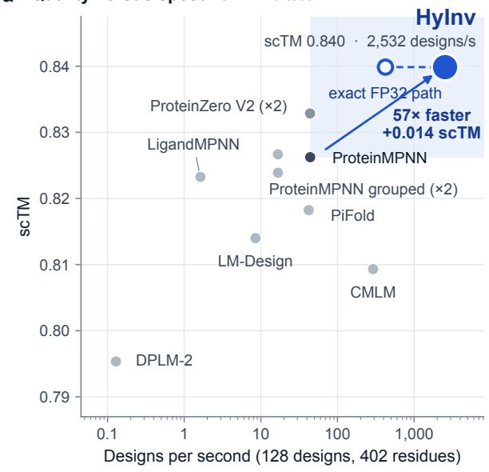

b Applications  
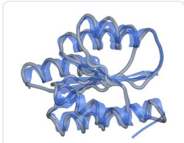

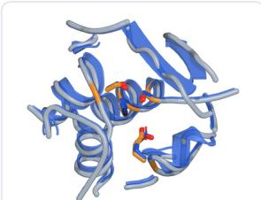

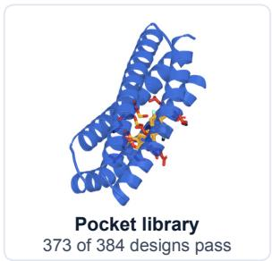  
Enzyme, catalytic site kept catalytic RMSD 0.67 Å

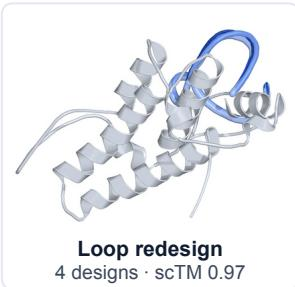

c Draft + rewrite sampling higher scTM at equal diversity  
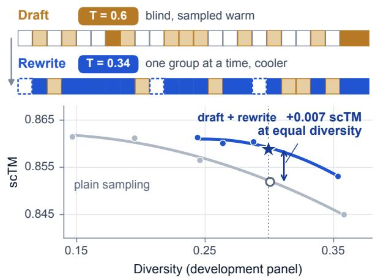

d Inference speed cumulative optimizations  
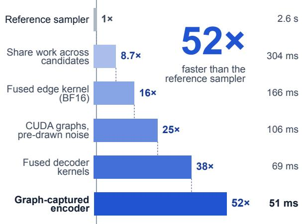  
Figure 1: HyInv designs sequences that fold like the input backbone, and does so fast. a, scTM against design speed on CATH4.3 test (ESMFold2) for HyInv and ten published baselines; speed is the time to design 128 sequences for a 402-residue backbone on one NVIDIA H20 (logarithmic axis). scTM is measured on sequences from the reference sampler, which the exact FP32 path (open circle) reproduces; the BF16 path (filled) is faster still (Section 4). b, The same default setting applied to four single-chain design tasks (ribbons: designs in blue, input backbones in gray; the highest-scTM designs sare shown; pocket: the backbone shown, mean pass rate over twelve backbones, 43%). c, Separate draft and rewrite temperatures give a higher scTM than plain sampling at equal diversity (development panel; star: HyInv). d, Cumulative inference optimizations reduce the time for 128 designs from 2.6 s to about 51 ms.

• A compact inverse-folding model with structure-based RL. We train a 1.96-million-parameter graph network using random-order autoregressive pretraining and structure-reward RL (Section 2).

• Test-time scaling via draft-and-rewrite decoding. We develop a two-temperature sampler that separates initial sequence construction from groupwise revision, which gives a higher scTM at equal diversity (Section 3).

• Inference optimization. We implement batched inference across sequences that enables 52× faster sampling with BF16 numerics (Section 4).

• Comprehensive benchmark evaluation and computational design case studies. We report a fivepanel comparative evaluation in which HyInv achieves the highest scTM at a comparable or higher diversity relative to ten baselines, and study four applications spanning practical tasks (Sections 5–6).

## 2 HyInv

HyInv is a small graph network that maps a backbone to sequences, trained first by supervision on natural structures and then by reinforcement learning against a structure predictor (Figure 2).

## a Model

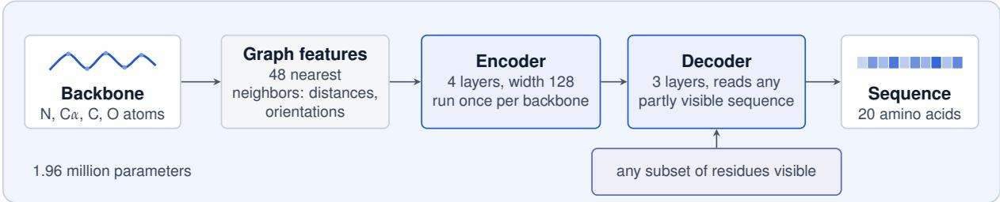

b Training  
c Sampling  
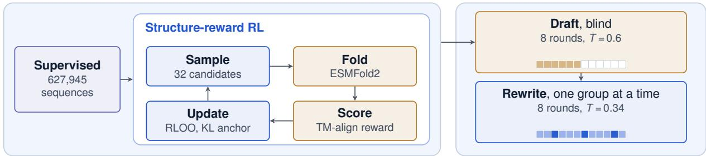  
Figure 2: Framework of HyInv. a, The graph model: backbone features, an encoder that runs once per backbone, and a decoder that predicts amino acid distributions at masked positions using the observed sequence context. b, Structure-reward RL: sample candidates for a backbone, fold them with ESMFold2, score them against the input backbone with TM-align, and update the policy with a leave-one-out advantage and a KL penalty to the supervised checkpoint.

## 2.1 Architecture

HyInv follows the message-passing encoder–decoder of ProteinMPNN (Dauparas et al., 2022; Ingraham et al., 2019) and has 1,957,573 parameters. The input is the N, Cα, C and O coordinates of L residues. Each residue is connected to its 48 nearest neighbors, and edges carry rotation- and translation-invariant distance features. The encoder has 4 layers of width 128 and runs once per backbone; the decoder has 3 layers of the same width. At inference the model needs neither a protein language model, a structure predictor nor an alignment.

The decoder takes a partially masked sequence as input and predicts amino acid distributions at masked positions, conditioned on the backbone and the observed sequence context. During sampling, the observed context consists of fixed or previously sampled amino acid identities supplied to the decoder at the current step. With a random order this is an ordinary autoregressive model, which is the objective of both training stages, and any partially masked sequence is a legal input, which is what the sampler of Section 3 uses. Fixed residues retain their specified amino acid identities and remain unmasked throughout sampling.

## 2.2 Supervised stage

The network is trained from scratch on 627,945 sequences with structures, 76,787 experimental and 551,158 predicted, to maximize the likelihood of the native sequence under a random residue order, for 85,000 updates. The checkpoint is chosen by validation scTM and serves as the starting point and the fixed reference of the RL stage (Appendix C).

## 2.3 Structure-reward RL

The RL stage rewards sequences whose predicted structure matches the input backbone. For a backbone x and a candidate sequence a the reward is

$$
\boldsymbol { r } ( \boldsymbol { x } , \boldsymbol { a } ) = 0 . 9 5 \mathrm { s c T M } ( \boldsymbol { x } , \boldsymbol { a } ) + 0 . 0 5 \boldsymbol { s } ( \boldsymbol { x } , \boldsymbol { a } ) ,\tag{1}
$$

where scTM comes from ESMFold2 (Candido et al., 2026) and $s \in [ 0 , 1 ]$ is a small stability-proxy term computed with fixed ProteinMPNN weights (Appendix C). Native sequence recovery is not rewarded. Boltz2 and Protenix2 are not part of the reward; they serve as independent predictors in the evaluation (Section 5).

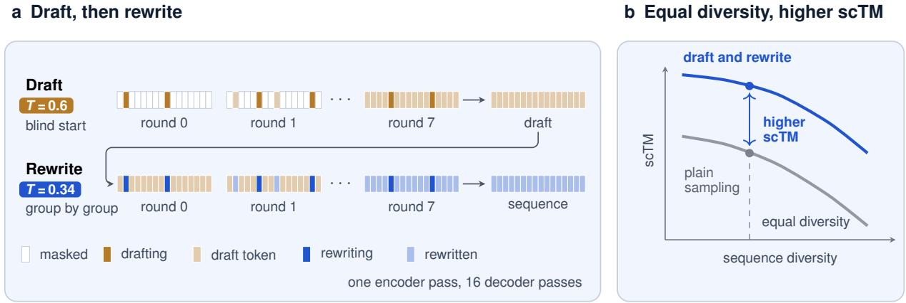  
Figure 3: Draft-and-rewrite sampling with decoupled temperatures. a, The positions are split into fixed groups (colors); a blind draft samples one group per round at the draft temperature $T _ { \mathrm { d } } ,$ and the rewrite masks and resamples one group per round, with all other positions unmasked, at the rewrite temperature $T _ { \mathrm { r } } , \mathbf { b } ,$ Schematic of the effect: at equal diversity, decoupled temperatures give a higher scTM than plain sampling; measured curves are in Figure 1c and Section 5.4.

Each update samples 32 candidates for each of 256 backbones from the policy and scores them with ESMFold2. The advantage of a candidate is its reward minus the mean reward of the other candidates of the same backbone (Ahmadian et al., 2024), with a KL penalty to the supervised checkpoint (Appendix C). The 50,000 training backbones were filtered against the benchmark panels with a same-source homology mask. The final checkpoint is update 640; on the development panel and with plain sampling, its scTM at equal diversity is higher than that of the supervised checkpoint by +0.0133 (Section 5.4).

## 3 Sampling

HyInv draws designs with a draft-and-rewrite sampler in which the draft and the rewrite use different temperatures, which gives a higher scTM at equal diversity.

## 3.1 Draft and rewrite

Because the decoder of Section 2.1 accepts a partially masked sequence, a sampler specifies which positions to sample and at what temperature. The sampler encodes the backbone once and splits the positions at random into R = 8 fixed groups $G _ { 0 } , \ldots , G _ { R - 1 }$ of equal size (Figure 3a). In the draft, non-fixed positions start masked and round r samples group $G _ { r }$ conditioned on the observed sequence context. In the rewrite, round r masks the non-fixed positions in $G _ { r } ,$ keeps all other positions unmasked, and resamples that group. Generation requires one forward pass through the encoder and 16 forward passes through the decoder (Algorithm 1 in Appendix E).

## 3.2 Decoupled temperatures

Sampling at a single temperature trades scTM for diversity. HyInv separates the two roles: the draft is sampled at a warm temperature $T _ { \mathrm { d } } ,$ which sets the overall arrangement of the sequence, and the rewrite resamples each group at a cooler temperature $T _ { \mathrm { r } } ,$ which makes every position consistent with its final context. At equal diversity this gives a higher scTM than plain sampling at one temperature (Figure 1c): +0.0078 on CATH4.3 test and +0.0131 on RecentPDB, measured on an earlier checkpoint of the same run (Appendix E). The HyInv default is the final checkpoint (update 640) with $T _ { \mathrm { d } } = 0 . \dot { 6 }$ and $T _ { \mathrm { r } } = 0 . 3 4 ,$ fixed on the development panel and used for every result in this report.

## 4 Efficient inference

HyInv designs 128 sequences for a 402-residue backbone in 50.6 ms on one NVIDIA H20, 52.1× faster than the reference implementation of the sampler and $5 7 \times$ faster than ProteinMPNN (Table 1, Figure 4).

Screening needs many candidates for one backbone, and sampling a design costs one encoder pass and 16 decoder passes (Section 3.1), so the speed is set by how cheaply many candidates share these passes. We reimplemented the sampler without changing the number of passes (Figure 1d). Candidates of one request share a backbone, so the encoder state, the structure terms of the decoder and the first draft round are computed once for all of them. The edge and node updates of every round run in a few fused kernels with BF16 operands with FP32 accumulation, so edge activations never reach memory, and each round is captured in a CUDA graph with its random numbers drawn ahead of time. An exact FP32 variant returns the reference sequences. A library of 10,000 sequences for one backbone takes 2.11 s (4,740 sequences per second).

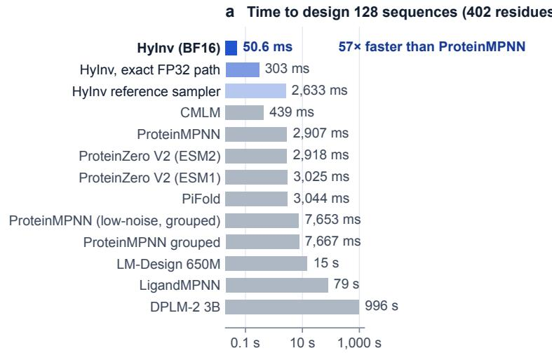

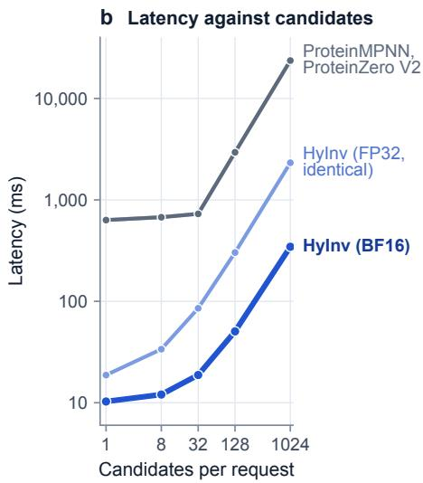  
Figure 4: Inference time of HyInv and the baselines. a, Time to design 128 sequences for a 402-residue backbone on one NVIDIA H20 (logarithmic axis); baselines run with their released code at their published temperature. b, Latency of one request against the number of candidates.

Table 1: Inference time.
<table><tr><td rowspan="2">System</td><td colspan="2">128 designs (ms)</td><td rowspan="2">10,000 designs (s)</td><td rowspan="2">Speed-up vs ProteinMPNN</td></tr><tr><td>148 res.</td><td>402 res.</td></tr><tr><td>ProteinMPNN</td><td>1,071</td><td>2,907</td><td>142.0</td><td></td></tr><tr><td>ProteinZero V2</td><td>1,070</td><td>2,918</td><td>141.4</td><td>1.0×</td></tr><tr><td>HyInv, FP32 reference sampler</td><td>999</td><td>2,633</td><td>129.1</td><td>1.1×</td></tr><tr><td>HyInv, exact FP32 path</td><td>130</td><td>303</td><td>14.5</td><td>9.6×</td></tr><tr><td>HyInv (BF16)</td><td>24.7</td><td>50.6</td><td>2.1</td><td>57×</td></tr></table>

One NVIDIA H20, median of repeated runs, 128 designs per request; the 10,000-design time is for a 250-residue backbone. Timed with the supervised-stage weights (same architecture) and a rewrite temperature of 0.23. The exact FP32 path returns the same sequences as the reference sampler; the BF16 path (HyInv) changes the arithmetic slightly (Appendix F).

Quality. All sequences evaluated in Section 5 come from the reference sampler, which the exact FP32 path reproduces sequence by sequence. The BF16 path changes the arithmetic slightly: on the development panel its scTM at the default diversity differs from the reference sampler by −0.0001, with diversity within 0.001, measured on an earlier RL checkpoint with the same architecture and kernels (Appendix F).

## 5 Results

## 5.1 Evaluation protocol

Panels. Five test panels: CATH4.3 test (1,882 chains), CATH4.2 test (1,120) (Ingraham et al., 2019), TS500 (500) and TS50 (50) (Gao et al., 2023), and RecentPDB, 121 chains from experimental structures of recent PDB entries (111 entries, 26,766 residues, lengths 42–978), all standard chains with complete backbones, screened for homology to PDB and CATH entries before 2025. ESMFold2 (Candido et al., 2026) folds every design; RecentPDB is also folded by Boltz2 (Passaro et al., 2025) and Protenix2 (Zhang et al., 2026), which are not used in training.

Metrics. scTM, the TM-score between the predicted structure of a design and the input backbone, is the primary metric; native sequence recovery and sequence diversity (mean pairwise difference between the designs of a target) are reported beside it (Appendix B).

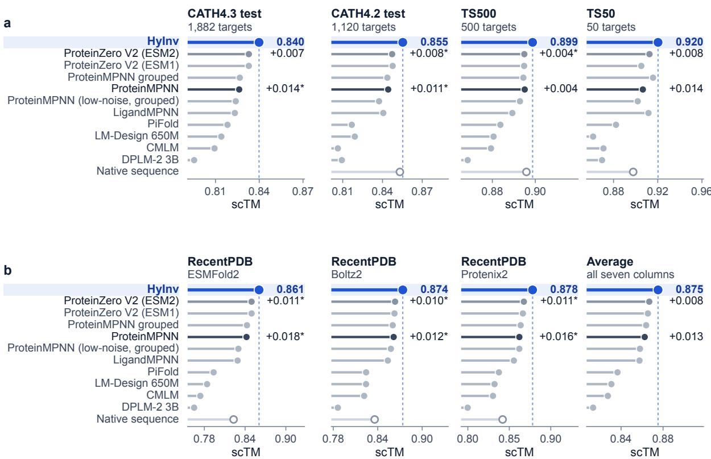  
Figure 5: scTM of HyInv and ten published baselines. a, Four test panels with ESMFold2. b, RecentPDB with ESMFold2, Boltz2 and Protenix2, and the average over the seven columns. Methods are sorted by average scTM and the dashed line marks HyInv. At the right of each panel: scTM of HyInv and its difference to ProteinMPNN and ProteinZero V2; a star marks a clearly positive difference (Appendix A). Native: scTM of the native sequences.

Baselines. Ten released models, each at its published single-temperature setting: ProteinMPNN and two grouped variants (Dauparas et al., 2022), ProteinZero V2 with ESM1 and ESM2 weights (Wang et al., 2025b), PiFold (Gao et al., 2023), CMLM (Ghazvininejad et al., 2019), LM-Design 650M (Zheng et al., 2023), DPLM-2 3B (Wang et al., 2025a) and LigandMPNN (Dauparas et al., 2023).

HyInv. One setting is used throughout: the final checkpoint (update 640) with draft temperature 0.6 and rewrite temperature 0.34. The checkpoint and temperatures were chosen on the development panel (CATH4.3 validation) and every test panel was evaluated once. All evaluated sequences come from the reference sampler, which the exact FP32 path reproduces; the BF16 path was checked on the development panel (Section 4). Baselines are single published settings, so comparisons are at comparable rather than exactly equal diversity, and a repeated evaluation varies slightly (Appendix A).

## 5.2 Comparison with published baselines

Figure 5 compares scTM. HyInv has the highest scTM in all seven panel–predictor columns, and its average is 0.875, against 0.867 for ProteinZero V2 (ESM2) and 0.863 for ProteinMPNN. The margin is smallest over ProteinZero V2 (ESM2) (+0.008) and largest over DPLM-2 3B (+0.062). Per panel (Figure 6, Table 2), HyInv is above ProteinMPNN on every panel and comparable to or higher than ProteinZero V2; a star marks a clearly positive difference. These gains come at comparable or higher diversity (0.331 on CATH4.3 test against 0.314 for ProteinMPNN and 0.315 for ProteinZero V2; on RecentPDB HyInv is 0.015 below ProteinZero V2) and with native recovery close to the baselines. Parallel decoders (PiFold, CMLM, LM-Design, DPLM-2) sample at much lower diversity and have the lowest scTM.

## 5.3 Independent structure predictors

ESMFold2 is also the reward predictor of RL, so RecentPDB is folded in addition by Boltz2 and Protenix2, which never enter training. HyInv has the highest scTM under both (Figure 6b; one panel, protocol in Appendix A).

Table 2: HyInv and the two reference baselines on the five test panels.
<table><tr><td>Method</td><td>CATH4.3 test</td><td>CATH4.2 test</td><td>TS500</td><td>TS50</td><td>RecentPDB</td></tr><tr><td colspan="6">scTM</td></tr><tr><td>HyInv</td><td>0.840</td><td>0.855</td><td>0.899</td><td>0.920</td><td>0.861</td></tr><tr><td>ProteinZero V2</td><td>0.833</td><td>0.847</td><td>0.895</td><td>0.913</td><td>0.850</td></tr><tr><td>ProteinMPNN</td><td>0.826</td><td>0.844</td><td>0.895</td><td>0.907</td><td>0.842</td></tr><tr><td colspan="6">scTM difference (HyInv minus method)</td></tr><tr><td>ProteinZero V2</td><td>▲0.007</td><td>▲ 0.008*</td><td>▲ 0.004*</td><td>▲ 0.008</td><td>▲ 0.011*</td></tr><tr><td>ProteinMPNN</td><td>▲ 0.014*</td><td>▲ 0.011*</td><td>▲ 0.004</td><td>▲ 0.014</td><td>▲ 0.018*</td></tr><tr><td colspan="6">Sequence diversity</td></tr><tr><td>HyInv</td><td>0.331</td><td>0.328</td><td>0.266</td><td>0.283</td><td>0.309</td></tr><tr><td>ProteinZero V2</td><td>0.315</td><td>0.317</td><td>0.263</td><td>0.280</td><td>0.324</td></tr><tr><td>ProteinMPNN</td><td>0.314</td><td>0.312</td><td>0.264</td><td>0.272</td><td>0.307</td></tr><tr><td colspan="6">Native sequence recovery</td></tr><tr><td>HyInv</td><td>0.373</td><td>0.382</td><td>0.458</td><td>0.440</td><td>0.421</td></tr><tr><td>ProteinZero V2</td><td>0.379</td><td>0.390</td><td>0.460</td><td>0.435</td><td>0.415</td></tr><tr><td>ProteinMPNN</td><td>0.387</td><td>0.398</td><td>0.466</td><td>0.445</td><td>0.428</td></tr></table>

ESMFold2; designs of a target are averaged first. ∆ is HyInv minus the method: ▲ HyInv higher, ▼ lower; <sup>⋆</sup> clearly positive (Appendix A). Bold: best scTM of the column. ProteinZero V2 uses ESM2 weights; all baselines are in Appendix D.

<table><tr><td rowspan=2 colspan=6>a                                  Five panels (ESMFold2) and meanCATH4.3 CATH4.2                   Recenttest    test   TS500  TS50  PDBProteinZero V2 (ESM2) +0.007 +0.008*+0.004* +0.008 +0.011*</td></tr><tr><td rowspan=1 colspan=1>+0.007</td><td rowspan=1 colspan=1>+0.008*</td><td rowspan=1 colspan=1>+0.004*</td><td rowspan=1 colspan=1>+0.008</td><td rowspan=1 colspan=1>+0.011*</td></tr><tr><td rowspan=1 colspan=1>ProteinZero V2 (ESM1)</td><td rowspan=1 colspan=1>+0.007</td><td rowspan=1 colspan=1>+0.008*</td><td rowspan=1 colspan=1>+0.004</td><td rowspan=1 colspan=1>+0.015</td><td rowspan=1 colspan=1>+0.011*</td></tr><tr><td rowspan=1 colspan=1>ProteinMPNN grouped</td><td rowspan=1 colspan=1>+0.013*</td><td rowspan=1 colspan=1>+0.012*</td><td rowspan=1 colspan=1>+0.004*</td><td rowspan=1 colspan=1>+0.005</td><td rowspan=1 colspan=1>+0.018*</td></tr><tr><td rowspan=1 colspan=1>ProteinMPNN</td><td rowspan=1 colspan=1>+0.014*</td><td rowspan=1 colspan=1>+0.011*</td><td rowspan=1 colspan=1>+0.004</td><td rowspan=1 colspan=1>+0.014</td><td rowspan=1 colspan=1>+0.018*</td></tr><tr><td rowspan=1 colspan=1>ProteinMPNN (low-noise, grouped)</td><td rowspan=1 colspan=1>+0.016*</td><td rowspan=1 colspan=1>+0.018*</td><td rowspan=1 colspan=1>+0.006*</td><td rowspan=1 colspan=1>+0.018*</td><td rowspan=1 colspan=1>+0.030*</td></tr><tr><td rowspan=1 colspan=1>LigandMPNN</td><td rowspan=1 colspan=1>+0.017*</td><td rowspan=1 colspan=1>+0.015*</td><td rowspan=1 colspan=1>+0.009*</td><td rowspan=1 colspan=1>+0.009</td><td rowspan=1 colspan=1>+0.032*</td></tr><tr><td rowspan=1 colspan=1>PiFold</td><td rowspan=1 colspan=1>+0.022*</td><td rowspan=1 colspan=1>+0.038*</td><td rowspan=1 colspan=1>+0.015*</td><td rowspan=1 colspan=1>+0.038*</td><td rowspan=1 colspan=1>+0.067*</td></tr><tr><td rowspan=1 colspan=1>LM-Design 650M</td><td rowspan=1 colspan=1>+0.026*</td><td rowspan=1 colspan=1>+0.036*</td><td rowspan=1 colspan=1>+0.018*</td><td rowspan=1 colspan=1>+0.059*</td><td rowspan=1 colspan=1>+0.077*</td></tr><tr><td rowspan=1 colspan=1>CMLM</td><td rowspan=1 colspan=1>+0.031*</td><td rowspan=1 colspan=1>+0.049*</td><td rowspan=1 colspan=1>+0.019*</td><td rowspan=1 colspan=1>+0.049*</td><td rowspan=1 colspan=1>+0.086*</td></tr><tr><td rowspan=1 colspan=1>DPLM-2 3B</td><td rowspan=1 colspan=1>+0.045*</td><td rowspan=1 colspan=1>+0.046*</td><td rowspan=1 colspan=1>+0.030*</td><td rowspan=1 colspan=1>+0.051*</td><td rowspan=1 colspan=1>+0.096*</td></tr></table>

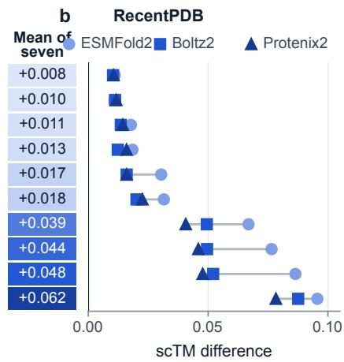  
Figure 6: HyInv minus baseline. a, Difference in scTM on the five panels (ESMFold2) and in the average over the seven columns; darker is larger, a star marks a clearly positive difference. b, The same difference on RecentPDB under three structure predictors.

## 5.4 Ablation study

We vary one component of HyInv at a time. Sampler. Draft-and-rewrite sampling gives a higher scTM than plain sampling at equal diversity on the development panel and on both held-out panels (Figure 7). Temperature. A higher rewrite temperature moves HyInv along its curve toward more diversity and slightly lower scTM; the default sits at development diversity 0.30. Reinforcement learning. RL raises scTM at fixed diversity from 0.839 to 0.852 with plain sampling (+0.0133, Figure 8a). Decoding rounds. All 16 passes give the best scTM at fixed diversity; fewer rounds are faster at lower scTM (Figure 8b). Numerics. The exact FP32 path and the BF16 path differ in scTM at fixed diversity by −0.0001 on the development panel (Figure 8c).

RL candidates (millions)  
c Numerics  
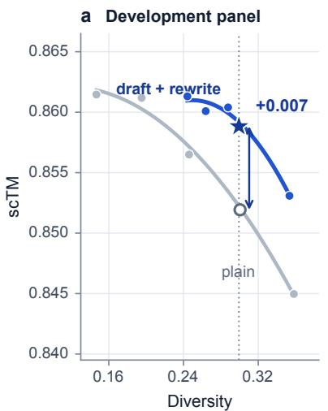

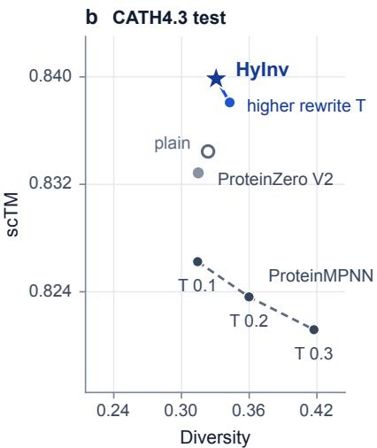

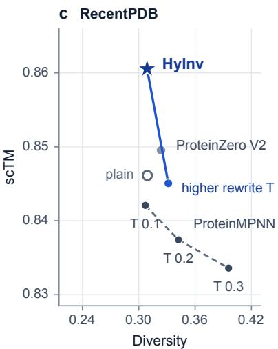  
Figure 7: Draft-and-rewrite sampling at equal diversity. a, Development panel, final checkpoint: plain sampling (gray) and draft-and-rewrite (blue), four temperatures each; star: HyInv, open circle: plain sampling at equal diversity. b, c, CATH4.3 test and RecentPDB against ProteinMPNN at three temperatures (dashed) and ProteinZero V2; the extra blue point is a higher rewrite temperature.

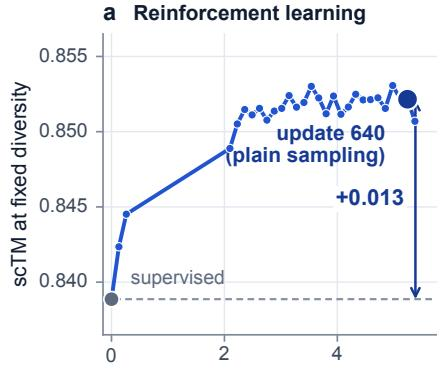

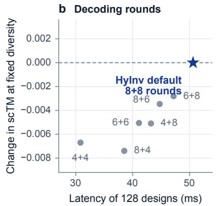

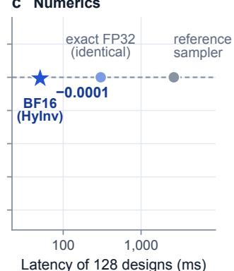  
Figure 8: Reinforcement learning, decoding rounds and numerics. a, Development scTM at fixed diversity (D = 0.30) against the number of RL candidates, plain sampling; gray: supervised checkpoint, large dot: update 640. b, Change in scTM at fixed diversity and latency when the number of draft and rewrite rounds is reduced from the default. c, Exact FP32 and BF16 path: latency and change in scTM at fixed diversity.

## 6 Applications

The same HyInv default setting serves four single-chain design tasks without task-specific tuning. All structures shown are ESMFold2 predictions of HyInv designs; protocols and selection rules are in Appendix G.

De novo backbones. On 74 de novo backbones, HyInv yields more designs that are both novel (below 30% identity to known natural sequences) and foldable (scTM of at least 0.9) than ProteinMPNN or ProteinZero V2 at matched diversity, with and without a filter on sequence composition (entropy of at least 3.5 bits, hydrophobic fraction 0.25–0.55, longest homopolymer run at most 6), since low-complexity sequences can be folded to a high scTM (Figure 9): 0.68 unfiltered and 0.38 filtered per backbone, against 0.47 and 0.05 for ProteinMPNN and 0.45 and 0.11 for ProteinZero V2.

Pocket-constrained libraries. With the 15 ligand-contacting residues fixed, HyInv redesigns the rest of a 148-residue binder into diverse sequences that keep the pocket: 373 of 384 designs pass on this backbone, which is shown for display (the mean pass rate over twelve pocket backbones is 43%; Figure 10).

Enzymes with the catalytic site kept. With the catalytic residues fixed, HyInv redesigns TEM-1 β- lactamase, subtilisin and PETase and keeps the predicted catalytic geometry at the level of the natural sequence (Figure 11).

74 de novo backbones

a HyInv designs on de novo backbones  
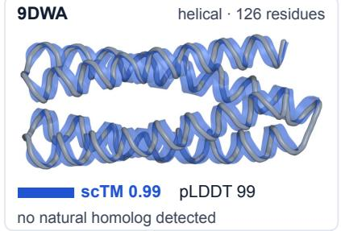

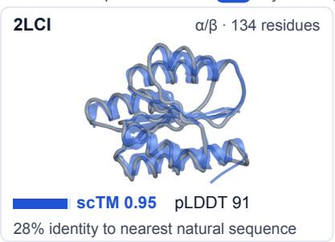

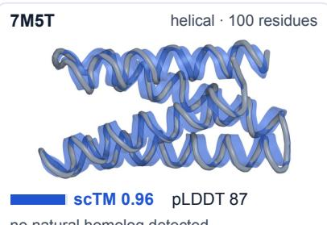  
no natural homolog detected

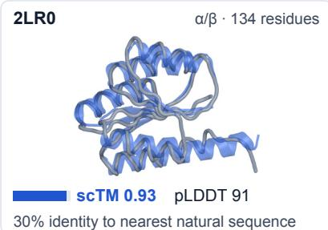

b Novel and foldable  
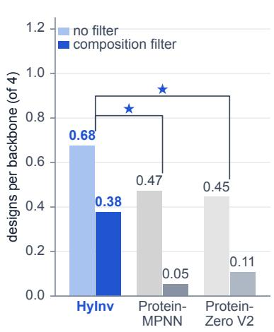  
matched diversity; novel: <30% identity to natural; foldable: scTM ≥ 0.9 clearly positive with and without filter

Figure 9: De novo backbones. a, HyInv designs (blue ribbons) on the input backbones (gray); the best design of each of four backbones. b, Novel and foldable designs per backbone at matched diversity, without (light) and with (dark) the composition filter (entropy ≥ 3.5 bits, hydrophobic fraction 0.25–0.55, homopolymer run ≤ 6).

## a Pocket residues fixed, the rest redesigned

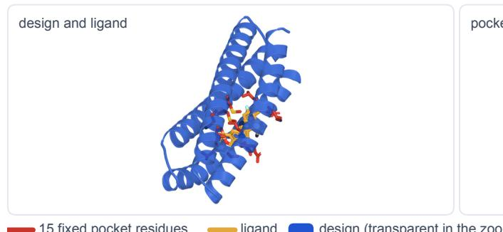  
ligand A1B7L · 148 residues · backbone 9NZE

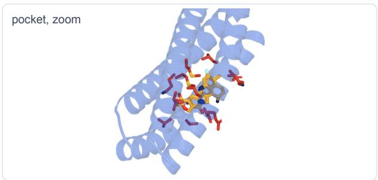

b Five designs: same pocket, different sequences  
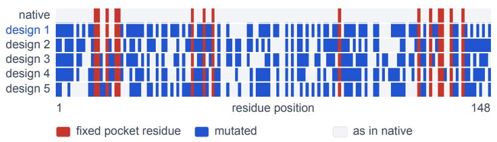

c Five designs  
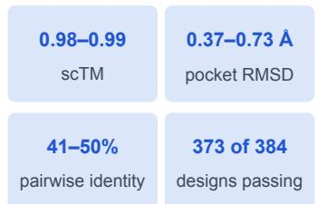  
pass: scTM ≥ 0.9, RMSD ≤ 1.0 Å

Figure 10: Pocket-constrained sequence library. a, A design with the pocket residues fixed to their native identity (red) next to the ligand of the native structure. b, Five passing designs picked by maximum dissimilarity: the pocket is identical, the rest differs.

## a HyInv design (blue) over the experimental backbone (gray) near the catalytic site

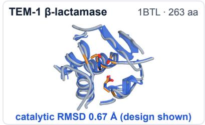

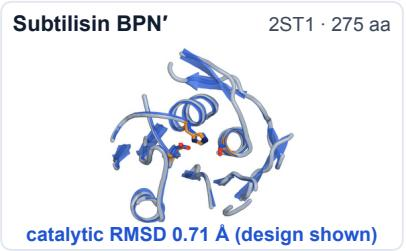

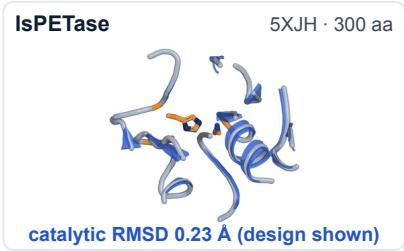

## b Catalytic residues: design (blue) and experiment (orange)

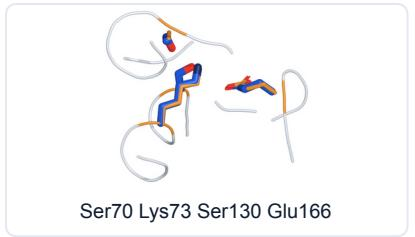

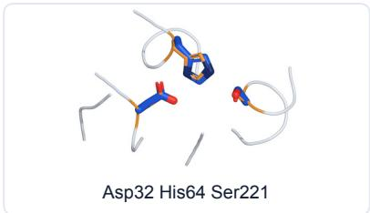

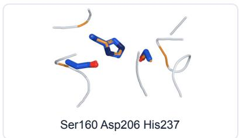

## c Median catalytic-site RMSD (Å)

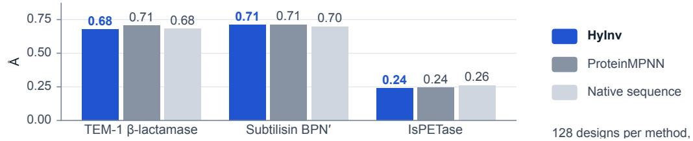  
Figure 11: Enzymes with fixed catalytic residues. a, Designs (blue) over the experimental structures (gray), catalytic residues in red. b, Catalytic site of the design (blue) and of the experiment (orange). c, Median heavy-atom RMSD of the catalytic residues for 128 designs of HyInv and of ProteinMPNN and for the natural sequence. In a and b, the design with the highest scTM of 128. The enzymes are known proteins: the figure shows that the catalytic geometry is kept.

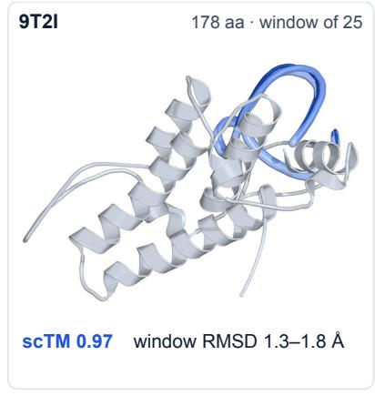

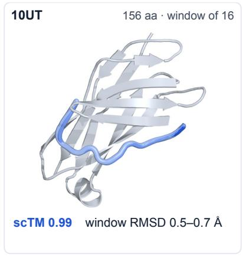

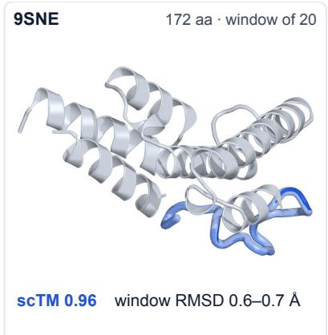  
Figure 12: Loop redesign. The four highest-scTM designs of 128 (colored tubes) for a window with the rest of the structure fixed (gray); RMSD is the Cα RMSD of the window to the experimental structure.

Loop redesign. HyInv redesigns loop windows of 16 to 25 residues in a fixed context, with the window within 0.5 Å to 1.8 Å of the experimental structure (Figure 12).

## 7 Conclusion

HyInv is a 1.96-million-parameter graph network trained with random-order supervision and structurereward reinforcement learning, deployed with a draft-and-rewrite sampler whose draft and rewrite temperatures are set separately. On five benchmark panels, one of them under three structure predictors, it reaches a higher average scTM than all ten external baselines at comparable or higher sequence diversity, and an optimized implementation designs 128 sequences for a 402-residue backbone in 50.6 ms. The same default setting supports de novo backbones, pocket-constrained libraries, enzyme redesign and loop redesign. HyInv targets single-chain backbones; designing for multi-chain interfaces and membrane environments is a natural next step.

## Author Information

Haowei Lin, Cai Zhou and Xiangxin Zhou. All authors are affiliated with Tencent Hunyuan.

## References

Arash Ahmadian, Chris Cremer, Matthias Gallé, Marzieh Fadaee, Julia Kreutzer, Olivier Pietquin, Ahmet Üstün, and Sara Hooker. Back to basics: Revisiting REINFORCE-style optimization for learning from human feedback in LLMs. In Proceedings of the 62nd Annual Meeting of the Association for Computational Linguistics (Volume 1: Long Papers), pages 12248–12267, 2024. doi: 10.18653/v1/2024.acl-long.662.

Salvatore Candido, Thomas Hayes, Alexander Derry, et al. Language modeling materializes a world model of protein biology. Model and software release, 2026. URL https://www.biorxiv.org/content/10.64898/2026.06. 03.729735.

Justas Dauparas, Ivan Anishchenko, Nathaniel Bennett, Hua Bai, Robert J. Ragotte, Lukas F. Milles, Basile I. M. Wicky, Alexis Courbet, Rob J. de Haas, Neville Bethel, Philip J. Y. Leung, Timothy F. Huddy, Samuel Pellock, Doug Tischer, Fred Chan, Brian Koepnick, Hannah Nguyen, Alex Kang, Banumathi Sankaran, Asim K. Bera, Neil P. King, and David Baker. Robust deep learning-based protein sequence design using ProteinMPNN. Science, 378(6615):49–56, 2022. doi: 10.1126/science.add2187.

Justas Dauparas, Gyu Rie Lee, Robert Pecoraro, Linna An, Ivan Anishchenko, Cameron Glasscock, and David Baker. Atomic context-conditioned protein sequence design using LigandMPNN. bioRxiv, 2023. doi: 10.1101/2023.12.22. 573103.

Zhangyang Gao, Cheng Tan, Pablo Chacón, and Stan Z. Li. PiFold: Toward effective and efficient protein inverse folding. In International Conference on Learning Representations, 2023. URL https://arxiv.org/abs/2209.12643.

Marjan Ghazvininejad, Omer Levy, Yinhan Liu, and Luke Zettlemoyer. Mask-predict: Parallel decoding of conditional masked language models. In Proceedings of the 2019 Conference on Empirical Methods in Natural Language Processing and the 9th International Joint Conference on Natural Language Processing, pages 6112–6121, 2019. URL https: //aclanthology.org/D19-1633/.

Chloe Hsu, Robert Verkuil, Jason Liu, Zeming Lin, Brian Hie, Tom Sercu, Adam Lerer, and Alexander Rives. Learning inverse folding from millions of predicted structures. In Proceedings of the 39th International Conference on Machine Learning, volume 162 of Proceedings of Machine Learning Research, pages 8946–8970, 2022. URL https: //proceedings.mlr.press/v162/hsu22a.html.

John Ingraham, Vikas K. Garg, Regina Barzilay, and Tommi Jaakkola. Generative models for graph-based protein design. In Advances in Neural Information Processing Systems, volume 32, 2019. URL https://papers.nips.cc/ paper/2019/hash/f3a4ff4839c56a5f460c88cce3666a2b-Abstract.html.

Saro Passaro, Gabriele Corso, Jeremy Wohlwend, Mateo Reveiz, Stephan Thaler, Vignesh Ram Somnath, Noah Getz, Tally Portnoi, Julien Roy, Hannes Stark, David Kwabi-Addo, Dominique Beaini, Tommi Jaakkola, and Regina Barzilay. Boltz-2: Towards accurate and efficient binding affinity prediction. bioRxiv, 2025. doi: 10.1101/2025.06.14. 659707.

Martin Steinegger and Johannes Söding. MMseqs2 enables sensitive protein sequence searching for the analysis of massive data sets. Nature Biotechnology, 35:1026–1028, 2017. doi: 10.1038/nbt.3988.

Xinyou Wang, Zaixiang Zheng, Fei Ye, Dongyu Xue, Shujian Huang, and Quanquan Gu. DPLM-2: A multimodal diffusion protein language model. In International Conference on Learning Representations (ICLR), 2025a. URL https://arxiv.org/abs/2410.13782. arXiv:2410.13782.

Ziwen Wang, Jiajun Fan, Ruihan Guo, Thao Nguyen, Heng Ji, and Ge Liu. ProteinZero: Self-improving protein generation via online reinforcement learning. arXiv:2506.07459 (first posted June 2025; version 5 revised September 2026), 2025b. URL https://arxiv.org/abs/2506.07459.

Yang Zhang and Jeffrey Skolnick. Scoring function for automated assessment of protein structure template quality. Proteins: Structure, Function, and Bioinformatics, 57(4):702–710, 2004. doi: 10.1002/prot.20264.

Yang Zhang and Jeffrey Skolnick. TM-align: A protein structure alignment algorithm based on the TM-score. Nucleic Acids Research, 33(7):2302–2309, 2005. doi: 10.1093/nar/gki524.

Yuxuan Zhang, Chengyue Gong, Jinyuan Sun, Jiaqi Guan, Milong Ren, Song Xue, Hanyu Zhang, Wenzhi Ma, Zhenyu Liu, Xinshi Chen, and Wenzhi Xiao. Protenix-v2: Broadening the reach of structure prediction and biomolecular design. bioRxiv, 2026. doi: 10.64898/2026.04.10.717613. URL https://www.biorxiv.org/content/early/2026/04/ 11/2026.04.10.717613.

Zaixiang Zheng, Yifan Deng, Dongyu Xue, Yi Zhou, Fei Ye, and Quanquan Gu. Structure-informed language models are protein designers. In Proceedings of the 40th International Conference on Machine Learning, volume 202 of Proceedings of Machine Learning Research, pages 42317–42338, 2023. URL https://proceedings.mlr.press/v202/ zheng23a.html.

## A Evaluation protocol and statistics

This appendix defines the differences and stars of Section 5 and records how the checkpoint and the sampler setting were fixed.

Panels. Table 3 lists the panels. CATH4.3 validation is the development panel: it fixed the sampler setting and the checkpoint and monitored RL training; each test panel was evaluated once for the final comparison. RecentPDB consists of 121 experimental chains from 111 recent PDB entries (26,766 residues, lengths 42–978), all standard chains with complete backbones and no length truncation, screened for homology to PDB and CATH entries before 2025 and fixed before evaluation, not selected by model performance. A residue is a valid site if its N, Cα, C and O atoms are present and its native residue is a standard amino acid; all scores are computed over valid sites. The resampling unit of the paired intervals is the CATH topology cluster on the two CATH panels and the single chain elsewhere.

Table 3: Evaluation panels.
<table><tr><td>Panel</td><td>Chains</td><td>Clusters</td><td>Structure predictors</td><td>Use</td></tr><tr><td>CATH4.3 test</td><td>1,882</td><td>103</td><td>ESMFold2</td><td>comparison; sampler check</td></tr><tr><td>CATH4.2 test</td><td>1,120</td><td>109</td><td>ESMFold2</td><td>comparison</td></tr><tr><td>TS500</td><td>500</td><td>500</td><td>ESMFold2</td><td>comparison</td></tr><tr><td>TS50</td><td>50</td><td>50</td><td>ESMFold2</td><td>comparison</td></tr><tr><td>RecentPDB</td><td>121</td><td>121</td><td>ESMFold2, Boltz2, Protenix2</td><td>comparison; sampler check</td></tr><tr><td>CATH4.3 validation</td><td>1,529</td><td>91</td><td>ESMFold2</td><td>development</td></tr></table>

## Folding and seeds.

• ESMFold2 (Candido et al., 2026) runs with its fused backend, 3 recycling loops, 50 diffusion steps and one structure per sequence, in FP32 with TF32 off; the input is the designed sequence with sequence-derived templates only, and native coordinates enter only through TM-align. The accelerated folder of Appendix C serves only the RL reward.

• scTM, recovery and diversity come from the scoring run; pLDDT, scRMSD and lDDT (Appendix B) come from a second fold of the same sequences with the confidence head on, whose scTM agrees with the scoring run to 0.0003 on average over 69 cells. The reported scTM is always the scoring value.

• Fold seeds derive from the chain identifier on the development panel; on the public panels with K = 2 designs per chain they are the seeds recorded with the baseline samples, so comparisons with baseline sequences share the folding randomness. For K = 4 they are hashes of a base seed, the chain and the batch chunk.

• Boltz2 (Passaro et al., 2025) and Protenix2 (Zhang et al., 2026) run on RecentPDB only, with the alignment built from the designed sequence by MMseqs2 (Steinegger and Söding, 2017) against UniRef50; these scores partly reflect resemblance to a natural family and serve as a robustness check.

Scores. For a chain with valid-site set V and designs $a ^ { 1 } , \dots , a ^ { K }$ , scTM is the mean TM-align score (Zhang and Skolnick, 2005) of the predicted against the native Cα trace at V, normalized by |V| and clipped at one, and the diversity is

$$
D = \frac { 2 } { K ( K - 1 ) } \sum _ { j < k } \frac { 1 } { | \mathcal { V } | } \sum _ { i \in \mathcal { V } } \mathbb { 1 } \Big [ a _ { i } ^ { j } \neq a _ { i } ^ { k } \Big ] .\tag{2}
$$

Panel values are macro-averages over chains. Diversity is counted at valid sites for every method: baseline sequences carry X at invalid sites, and counting them as identical would lower their diversity (ProteinMPNN on CATH4.3 test: 0.290 at all sites, 0.314 at valid sites).

Paired differences and intervals. A paired difference is the macro-average of the per-chain scTM difference between HyInv and a baseline. Its 95% interval is the percentile interval of 10,000 resamples of the resampling unit with one resample shared by all rows compared and a fixed seed (20260922). A difference carries a star in the figures and tables when its interval excludes zero; a few starred intervals have a lower end within 0.001 of zero and are borderline (Tables 6 and 7). Intervals are not adjusted for multiple comparisons. Recovery, diversity, pLDDT, scRMSD and lDDT differences use the same resamples. Tables 6 and 7 give all scores and differences with their intervals.

Scores at equal diversity. A sampler family is evaluated at a grid of rewrite temperatures, giving points of diversity and scTM on the same chains. The scTM at fixed diversity D is the value at D of the least-squares quadratic $\mathrm { f i t } s = \alpha + \beta d + \gamma d ^ { 2 } ,$

$$
\displaystyle { \cal S } @ D = \alpha + \beta D + \gamma D ^ { 2 } ,\tag{3}
$$

with no extrapolation. The gain of a setting is its S@D minus that of the unmodified sampler of the same checkpoint on the same panel, with an interval from 1,000 draws in which all points of all curves are recomputed from one cluster resample. The grids are {0.3, 0.4, 0.5, 0.7} for the unmodified sampler, {0.1, 0.2, 0.3, 0.5} for the decoupled sampler at $T _ { \mathrm { d } } = 0 . 6$ and {0.3, 0.4, 0.5, 0.7} at $T _ { \mathrm { d } } = 0 . 3 ;$ on the held-out panels D is the development value times the ratio of the panel to the development diversity of the unmodified sampler. HyInv has diversity above ProteinMPNN with a clear interval on CATH4.3 test and CATH4.2 test and above ProteinZero V2 (ESM2) on CATH4.3 test and CATH4.2 test, and 0.015 below ProteinZero V2 (ESM2) on RecentPDB; at the slope of the development curve (0.07 scTM per unit of diversity) the largest offset, 0.016, is worth at most 0.0011 scTM, so the comparisons are close to, but not exactly at, equal diversity.

Checkpoint and sampler setting. Both were chosen on the development panel (CATH4.3 validation) alone. The checkpoint is the latest RL snapshot whose development S@0.30 is within 0.002 of the best (update 640); the best-scoring snapshot differs from it by −0.0004, below the noise of one evaluation. The default sampler setting (draft 0.6, rewrite 0.34, development diversity 0.30) was read off the development curve before the test panels were generated with this checkpoint. The decoupled draft was then confirmed on held-out panels with new draws (Appendix E); because the draft temperature was chosen on the development panel, the held-out confirmation is the evidence for the sampler gain. Each test panel was evaluated once. The development panel also served to choose the RL learning rate and training configuration.

Run-to-run variation. Two independent generate-and-fold runs of the same policy and sampler on the development panel differ by −0.0008 and +0.0016, so one evaluation carries noise of about ±0.0015; refolding identical sequences with other fold seeds moves a panel mean by less than 0.0002. Differences between checkpoints below about 0.003 are not resolvable.

## B Metric definitions

All quantities are measured on predicted structures and designed sequences; none is an experimental measurement.   
Panel-level values average the designs of a chain first and then the chains (Appendix A).

scTM. TM-score (Zhang and Skolnick, 2004) of the predicted structure of a design to the native backbone, computed on the Cα trace at valid sites, normalized by the native length and clipped at one; higher is better. A failed fold is a gap in the average, not imputed. This is the primary quantity and the RL reward.

Recovery. Fraction of valid sites at which the design carries the native residue. It is descriptive, not an objective: it has weight zero in the reward and selects no checkpoint, and methods with high recovery tend to have low diversity and lower scTM.

Diversity. Mean pairwise normalized Hamming distance between the K designs of a chain over valid sites (D of Appendix A). It is a property of the design set and is matched rather than ranked.

pLDDT. The folder’s mean per-residue confidence in its own prediction over valid sites, on a scale from 0 to 100. It comes from the same folder as scTM and is not compared across predictors.

scRMSD. Self-consistency RMSD in Å: RMSD between the C<sub>α</sub> atoms of the predicted structure of a design and the native backbone at valid sites, after optimal (Kabsch) superposition with the residue correspondence fixed by position; lower is better.

lDDT. C<sub>α</sub>-only lDDT-style score without superposition: over all C<sub>α</sub> pairs at distance below 15 Å in the native structure, the fraction whose distance error is below 0.5, 1, 2 and 4 Å, averaged over the four thresholds, with the pairs pooled over the whole design; between 0 and 1, higher is better.

Site and region RMSD. For the application tasks (Appendix G): the Cα RMSD at the fixed pocket or catalytic residues after one global fit on all valid Cα atoms (site RMSD), and the Cα RMSD of a redesigned loop or window after fitting the unchanged context (region RMSD); the catalytic-site RMSD uses all heavy atoms of the catalytic residues.

Novel-and-foldable yield. Number of designs per backbone with scTM above the foldability threshold and a sequence identity to the nearest UniRef50 and pretraining-library sequence below the novelty threshold (both stated in Appendix G).

Distinct passing designs. Number of different sequences in a plate of designs that pass the structure criteria of the pocket task, counted after clustering at 50% sequence identity.

## C Model, data and training details

Configuration. The network has 1,957,573 parameters: width 128, 4 encoder and 3 decoder layers, 48 nearest neighbors, random initialization. Table 4 lists the two training stages.

Table 4: Training configuration.
<table><tr><td></td><td>Supervised</td><td>RL</td></tr><tr><td>Data</td><td>627,945 structures</td><td>50,000 backbones</td></tr><tr><td>Objective</td><td>random-order likelihood</td><td>reward, leave-one-out advantage</td></tr><tr><td>Updates</td><td>85,000</td><td>640 (full run 656)</td></tr><tr><td>Batch</td><td>window up to 512</td><td>256 backbones × 32</td></tr><tr><td>Optimizer</td><td>AdamW, β = (0.9, 0.98)</td><td>AdamW,  $\beta = ( 0 . 9 , 0 . 9 5 )$ </td></tr><tr><td>Learning rate</td><td>Noam schedule</td><td> $2 \times 1 0 ^ { - 5 }$  constant</td></tr><tr><td>Regularization</td><td>label smoothing 0.1</td><td>KL 0.005, then 0.001</td></tr><tr><td>Sampling</td><td></td><td>temperature 0.3</td></tr></table>

Reward and stability proxy. scTM is computed with ESMFold2 and TM-align as in Appendix A, normalized by the native valid length and clipped at one. The stability proxy s is the bounded likelihood contrast of Protein-MPNN (Dauparas et al., 2022) with the weights of the ProteinMPNN baseline: with $\ell _ { X } ( a )$ the summed negative

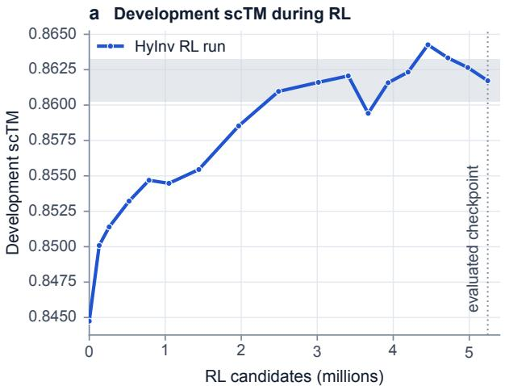

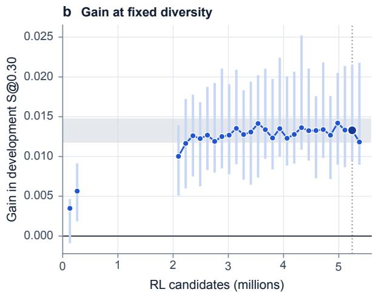  
Figure 13: RL training on the development panel. a, Monitoring scTM during training (confidence sampler, fixed protocol). b, Gain in scTM at equal diversity over the supervised checkpoint; the large marker is the evaluated checkpoint (update 640), bars are 95% intervals over clusters.

log-likelihood of sequence a at the N valid sites given the backbone, $\ell _ { 0 } ( a )$ the same with zeroed coordinates (all four terms sharing one tied random decoding order) and $a ^ { \star }$ the native sequence,

$$
\Delta ( a ) = 0 . 5 9 3 \Big [ \left( \ell _ { X } ( a ) - \ell _ { 0 } ( a ) \right) - \left( \ell _ { X } ( a ^ { \star } ) - \ell _ { 0 } ( a ^ { \star } ) \right) \Big ] , \qquad s ( a ) = \textstyle { \frac { 1 } { 2 } } - \textstyle { \frac { 1 } { 2 } } \operatorname { t a n h } _ { 0 . 5 9 3 N 0 . 5 } \in ( 0 , 1 ) .\tag{4}
$$

The native sequence enters only as the reference of the contrast; recovery has weight zero. The term supplies five percent of the reward and is a model-derived proxy, not a stability measurement.

RL objective. The advantage of a candidate i of a backbone uses all $n = 3 2$ candidates of that backbone (Ahmadian et al., 2024),

$$
A _ { i } = \frac { 1 } { 0 . 1 } \Big ( r _ { i } - \frac { 1 } { n - 1 } \sum _ { j \neq i } r _ { j } \Big ) ,\tag{5}
$$

which removes most of the dependence on how hard a backbone is, without a learned value network. With $\ell _ { i } =$ $\begin{array} { r } { \frac { 1 } { L _ { i } } \sum _ { t } } \end{array}$ log $\pi _ { \theta } ^ { T _ { \mathrm { R L } } } ( a _ { i , t } \mid c _ { i , t } )$ the length-normalized log-likelihood of candidate i along its sampling order, $c _ { i , t } = ( x , a _ { i , < t } )$ the sampled context and $L _ { i }$ the number of valid positions, the loss of one backbone, with the advantage of Eq. (5), is

$$
\mathcal { L } ( \theta ) = \frac { 1 } { n } \sum _ { i = 1 } ^ { n } \Bigl [ - A _ { i } \ell _ { i } + \beta \frac { 1 } { L _ { i } } \sum _ { t } \mathbf { K L } \bigl ( \pi _ { \theta } ^ { T _ { \mathrm { R L } } } ( \cdot  { \vert } c _ { i , t } ) \bigr \vert \big \Vert \pi _ { \mathrm { r e f } } ^ { T _ { \mathrm { R L } } } ( \cdot  { \vert } c _ { i , t } ) \bigr ) \Bigr ] ,\tag{6}
$$

where $\pi _ { \mathrm { r e f } }$ is the fixed supervised checkpoint and $\beta$ is the KL coefficient of Table 4.

## Optimization and parallel execution.

• Gradients are summed per backbone, reduced in double precision and divided by the cohort size, so the assignment of backbones to GPUs does not change the update; log-probabilities are recomputed in one causal pass given the stored order (largest rollout-to-replay difference: $6 . 3 \times 1 0 ^ { - 5 } )$

• Each backbone of an update goes to one whole GPU, assigned longest-processing-time-first on a cost that grows like length to the power 1.9 (planned imbalance 1.00 to 1.02, observed 1.04 to 1.08).

• The run was restarted from its last checkpoint with a different number of GPUs, keeping its update numbering: 32 GPUs for updates 1 to 320, 72 up to 405, 80 up to 528 and 56 from update 529 on (median $2 7 5 , 1 2 7 ,$ 113 and 161 seconds per update, each update with 8,192 candidates); the evaluated checkpoint (update 640) was trained in the phase with 56 GPUs.

• The reward uses an accelerated ESMFold2 (confidence and output heads skipped, diffusion pair-bias terms and alignment features cached; each fold faster by 1.2 to 1.45 times), which is not bit-identical to the evaluation model: on six development chains the largest coordinate difference is 0.53 Å against 0.36 Å between two runs of the original, and a seed-matched test on 78 sequences gives a median absolute scTM difference of $9 \times 1 0 ^ { - 5 }$ . All evaluation numbers use the original recipe.

• Every few updates the trainer scores the development panel under a fixed monitoring protocol (confidence sampler at T = 0.1, K = 2; Figure 13a), which is not comparable with the equal-diversity read-outs of Figure 13b.

## Data and pool.

• The supervised corpus has 627,945 unique sequences. Records need a valid-residue ratio of at least 0.95 and canonical residues only, predicted structures a mean pLDDT of at least 85. Records are grouped into components (30%-identity protein-entity clusters joined by exact chain-sequence links across sources), the base weight of a record is the reciprocal of its component’s size within its source type, and source weights give experimental structures about 70% and predicted structures about 30% of the expected loss mass.

• The RL pool has 50,000 backbones (16,839 experimental, 33,161 predicted; mean length 254, range 48 to 512) under the same quality rules, with at most one predicted record per cascaded 50%-identity MMseqs2 cluster and at most two experimental records per cluster; candidates were drawn with weights that favor harder backbones.

• The pool was filtered against the benchmark panels with a same-source homology mask built from MMseqs2 searches (Steinegger and Söding, 2017) of the candidate records against the benchmark sequences: a record is excluded if it is positive under the mask, and records are used only if that search queried them. The supervised corpus was filtered by exact-sequence removal and a homology filter.

• We do not claim zero sequence overlap between the training data and the evaluation panels.

## D Baselines and full results

## D.1 Baseline settings

The ten external baselines are published settings: ProteinMPNN, ProteinMPNN with grouped decoding, the same with a checkpoint trained with less coordinate noise (“low-noise, grouped”), ProteinZero V2 with the ESM1 and the ESM2 variant, PiFold, CMLM, LM-Design 650M, DPLM-2 3B and LigandMPNN. Each has data on all five ESMFold2 panels and on RecentPDB also under Boltz2 and Protenix2, scored with the protocol of Appendix A at the single setting at which it was published, not tuned to the panels. Table 5 lists decoding and temperature. ProteinZero V2 is declared for backbones of up to 100 residues and is run here on the full panels. PiFold, CMLM and LM-Design decode all positions in parallel from one categorical distribution, and DPLM-2 3B decodes by argmax with deterministic unmasking, so its two designs of a chain are almost always the same sequence (diversity 0.000 on CATH4.3 test); LigandMPNN is run on backbone coordinates only.

Table 5: Baseline settings, weights and reproduction check.
<table><tr><td>Baseline</td><td>Decoding</td><td>T</td><td>Regenerated on</td><td>|∆scTM|</td><td>Same seq.</td></tr><tr><td>ProteinMPNN</td><td>autoregressive</td><td>0.1</td><td>none</td><td></td><td></td></tr><tr><td>ProteinMPNN grouped</td><td>autoregressive, grouped</td><td>0.1</td><td>CATH4.3 test</td><td>0.0009</td><td>100.0%</td></tr><tr><td>ProteinMPNN (low-noise, grouped)</td><td>autoregressive, grouped</td><td>0.1</td><td>four panels</td><td>0.0007</td><td>100.0%</td></tr><tr><td>ProteinZero V2 (ESM1)</td><td>autoregressive</td><td>0.1</td><td>CATH4.3 test</td><td>0.0006</td><td>100.0%</td></tr><tr><td>ProteinZero V2 (ESM2)</td><td>autoregressive</td><td>0.1</td><td>none</td><td></td><td></td></tr><tr><td>PiFold</td><td>one parallel pass</td><td>0.1</td><td>four panels</td><td>0.0004</td><td>100.0%</td></tr><tr><td>CMLM</td><td>one parallel pass</td><td>0.1</td><td>four panels</td><td>0.0022</td><td>100.0%</td></tr><tr><td>LM-Design 650M</td><td>iterative denoising (5 steps)</td><td>0.1</td><td>four panels</td><td>0.0005</td><td>100.0%</td></tr><tr><td>DPLM-2 3B</td><td>argmax decoding (100 steps)</td><td>0.1</td><td>four panels</td><td>0.0001</td><td>99.2%</td></tr><tr><td>LigandMPNN</td><td>autoregressive</td><td>0.1</td><td>four panels</td><td>0.0005</td><td>100.0%</td></tr></table>

All baselines use the released weights. The reproduction check regenerates the baseline on RecentPDB, folds it with ESMFold2 and compares the target-averaged scTM with the released value (|∆scTM|) and the fraction of identical sequences. DPLM-2 3B runs in BF16 autocast.

Some ESMFold2 cells were regenerated for this report with the same weights, temperature and sampler; a regenerated cell is used only where the same procedure reproduces the released score on RecentPDB (difference 0.0001 to 0.0022, within 0.003), and for DPLM-2 3B 99% of the sequences are identical to the released ones. The RecentPDB cells under all three predictors are released. Folding seeds follow the released per-chain seeds, so cells are paired with HyInv at the chain level. The ProteinMPNN temperatures other than the published one were generated for this report.

## D.2 All baselines on every panel

Table 6 lists the scTM of every method on every panel and predictor, Table 7 the paired difference between HyInv and each baseline with its interval, and Figures 14 and 15 recovery, diversity, pLDDT, scRMSD and lDDT. Of the 70 comparisons (ten baselines in seven panel–predictor columns), all 70 point estimates favor HyInv and 61 have an interval that excludes zero; the other 9 include zero (ProteinMPNN (TS500, TS50); ProteinMPNN grouped (TS50); ProteinZero V2 (ESM1) (CATH4.3 test, TS500, TS50); ProteinZero V2 (ESM2) (CATH4.3 test, TS50); LigandMPNN (TS50)). PiFold, CMLM, LM-Design and DPLM-2 3B are single points at much lower diversity than HyInv, so their differences are not at matched diversity.

## D.3 scTM against diversity

Figure 16 places every method in the scTM–diversity plane of each panel. ProteinMPNN is the only baseline with a temperature sweep (three temperatures; two were generated for this report). Reading the quadratic fit through its three points at the HyInv diversity, HyInv is above the ProteinMPNN curve by +0.0146 [+0.0058, +0.0242] on CATH4.3 test and +0.0187 [+0.0078, +0.0302] on RecentPDB (95% intervals over clusters).

## E Sampler details

Procedure and groups. Algorithm 1 gives the procedure for one backbone. The encoder runs once; the decoder runs on all L sites in each of the 2R = 16 passes, although only the sites of one group need new logits in a pass. Without fixed residues, the draft starts from the all-masked state, so no sequence information enters before the first token is drawn. A generator seeded by a SHA-256 hash of the seed and the chain identifier draws a uniformly

Table 6: scTM of every method. ESMFold2 on the five panels and RecentPDB under Boltz2 and Protenix2.
<table><tr><td rowspan="2">Method</td><td colspan="5">ESMFold2</td><td colspan="2">RecentPDB</td></tr><tr><td>CATH4.3 test</td><td>CATH4.2 test</td><td>TS500</td><td>TS50</td><td>RecentPDB</td><td>Boltz2</td><td>Protenix2</td></tr><tr><td>HyInv</td><td>0.8399</td><td>0.8553</td><td>0.8987</td><td>0.9203</td><td>0.8605</td><td>0.8738</td><td>0.8781</td></tr><tr><td>ProteinZero V2 (ESM2)</td><td>0.8329</td><td>0.8473</td><td>0.8949</td><td>0.9125</td><td>0.8495</td><td>0.8634</td><td>0.8675</td></tr><tr><td>ProteinZero V2 (ESM1)</td><td>0.8328</td><td>0.8477</td><td>0.8948</td><td>0.9051</td><td>0.8496</td><td>0.8626</td><td>0.8664</td></tr><tr><td>ProteinMPNN grouped</td><td>0.8267</td><td>0.8437</td><td>0.8944</td><td>0.9158</td><td>0.8427</td><td>0.8602</td><td>0.8637</td></tr><tr><td>ProteinMPNN</td><td>0.8262</td><td>0.8443</td><td>0.8951</td><td>0.9065</td><td>0.8421</td><td>0.8615</td><td>0.8621</td></tr><tr><td>LigandMPNN</td><td>0.8233</td><td>0.8406</td><td>0.8893</td><td>0.9116</td><td>0.8290</td><td>0.8537</td><td>0.8555</td></tr><tr><td>ProteinMPNN (low-noise, grouped)</td><td>0.8239</td><td>0.8374</td><td>0.8929</td><td>0.9019</td><td>0.8301</td><td>0.8578</td><td>0.8621</td></tr><tr><td>PiFold</td><td>0.8182</td><td>0.8168</td><td>0.8837</td><td>0.8822</td><td>0.7937</td><td>0.8243</td><td>0.8374</td></tr><tr><td>LM-Design 650M</td><td>0.8140</td><td>0.8191</td><td>0.8806</td><td>0.8615</td><td>0.7840</td><td>0.8242</td><td>0.8322</td></tr><tr><td>CMLM</td><td>0.8093</td><td>0.8063</td><td>0.8794</td><td>0.8709</td><td>0.7741</td><td>0.8217</td><td>0.8303</td></tr><tr><td>DPLM-2 3B</td><td>0.7953</td><td>0.8093</td><td>0.8685</td><td>0.8696</td><td>0.7650</td><td>0.7862</td><td>0.7998</td></tr><tr><td>Native</td><td>0.8465</td><td>0.8531</td><td>0.8959</td><td>0.8978</td><td>0.8231</td><td>0.8358</td><td>0.8419</td></tr></table>

Mean TM-score of the predicted structure to the native backbone, averaged over the designs of a target and then over targets; bold is the highest of the column among the designed rows (a point estimate: see Table 7 for the paired differences). Native is the refolded native sequence. The Boltz2 and Protenix2 columns fold the same RecentPDB sequences.

Table 7: HyInv minus baseline, scTM. Difference in units of $1 0 ^ { - 3 }$ with the paired 95% interval in brackets; bold: the interval excludes zero.
<table><tr><td>Baseline</td><td>CATH4.3 test</td><td>CATH4.2 test</td><td>TS500</td></tr><tr><td>ProteinZero V2 (ESM2)</td><td>+7.0[−0.6, 14.3]</td><td>+8.0 [0.2, 16.3]</td><td>+3.9 [0.0, 7.6]</td></tr><tr><td>ProteinZero V2 (ESM1)</td><td>+7.0[−1.3, 13.9]</td><td>+7.7[1.2, 13.9]</td><td>+3.9[−0.1, 7.8]</td></tr><tr><td>ProteinMPNN grouped</td><td>+13.2[2.5, 25.5]</td><td>+11.6 [1.4, 25.9]</td><td>+4.3 [0.0, 8.4]</td></tr><tr><td>ProteinMPNN</td><td>+13.6 [2.3, 24.6]</td><td>+11.0 [2.2, 22.5]</td><td>+3.7[–0.5, 7.8]</td></tr><tr><td>LigandMPNN</td><td>+16.6 [8.1, 28.1]</td><td>+14.7 [6.6, 26.1]</td><td>+9.4 [4.4, 14.9]</td></tr><tr><td>ProteinMPNN (low-noise, grouped)</td><td>+16.0 [4.3, 27.4]</td><td>+17.9 [6.9, 34.1]</td><td>+5.9 [1.4, 10.2]</td></tr><tr><td>PiFold</td><td>+21.6 [6.1, 35.4]</td><td>+38.5 [26.0, 56.6]</td><td>+15.0 [9.5, 20.7]</td></tr><tr><td>LM-Design 650M</td><td>+25.9 [11.1, 41.1]</td><td>+36.2 [23.6, 54.9]</td><td>+18.2[12.0, 24.5]</td></tr><tr><td>CMLM</td><td>+30.6 [14.2, 44.9]</td><td>+49.0 [35.8, 67.8]</td><td>+19.4 [14.5, 24.5]</td></tr><tr><td>DPLM-2 3B</td><td>+44.5 [31.7, 55.2]</td><td>+46.0 [34.7, 61.3]</td><td>+30.2 [23.7, 36.7]</td></tr><tr><td>Baseline</td><td>TS50</td><td>RecentPDB, ESMFold2</td><td>RecentPDB, Boltz2</td></tr><tr><td>ProteinZero V2 (ESM2)</td><td>+7.8[–7.0, 25.7]</td><td>+11.0 [2.0, 20.6]</td><td>+10.4[1.7, 20.0]</td></tr><tr><td>ProteinZero V2 (ESM1)</td><td>+15.2[-1.5, 36.1]</td><td>+10.9 [2.0, 20.0]</td><td>+11.2 [3.5, 19.3]</td></tr><tr><td>ProteinMPNN grouped</td><td>+4.5[-17.9, 26.7]</td><td>+17.8 [4.7, 32.5]</td><td>+13.6 [3.5, 25.1]</td></tr><tr><td>ProteinMPNN</td><td>+13.8[-6.6, 37.0]</td><td>+18.5[7.3, 30.1]</td><td></td></tr><tr><td>LigandMPNN</td><td>+8.7[–5.2, 23.5]</td><td>+31.6 [18.2, 46.2]</td><td>+12.3 [3.8, 21.6]</td></tr><tr><td>ProteinMPNN (low-noise, grouped)</td><td></td><td></td><td>+20.1 [8.4, 33.0]</td></tr><tr><td>PiFold</td><td>+18.4[2.1, 37.3]</td><td>+30.4[16.0, 46.0]</td><td>+16.0 [5.8, 27.4]</td></tr><tr><td></td><td>+38.1 [15.3, 65.5]</td><td>+66.9 [43.8, 90.9]</td><td>+49.5 [34.6, 66.6]</td></tr><tr><td>LM-Design 650M</td><td>+58.8 [31.3, 90.2]</td><td>+76.5 [55.3, 99.8]</td><td>+49.6 [34.4, 65.7]</td></tr><tr><td>CMLM</td><td>+49.4 [21.8, 82.9]</td><td>+86.4 [63.5, 111.7]</td><td>+52.1 [36.8, 69.1]</td></tr><tr><td>DPLM-2 3B</td><td>+50.7 [18.4, 88.2]</td><td>+95.6 [71.3, 121.5]</td><td>+87.6[66.8, 110.1]</td></tr><tr><td>Baseline</td><td>RecentPDB, Protenix2</td><td></td><td></td></tr><tr><td>ProteinZero V2 (ESM2)</td><td>+10.5[2.0, 19.7]</td><td></td><td></td></tr><tr><td>ProteinZero V2 (ESM1)</td><td>+11.7[1.8, 21.9]</td><td></td><td></td></tr><tr><td>ProteinMPNN grouped</td><td>+14.4 [3.8, 26.3]</td><td></td><td></td></tr><tr><td>ProteinMPNN</td><td>+16.0 [5.2, 28.0]</td><td></td><td></td></tr><tr><td>LigandMPNN</td><td>+22.6 [8.7, 37.1]</td><td></td><td></td></tr><tr><td>ProteinMPNN (low-noise, grouped)</td><td>+16.0 [5.1, 28.4]</td><td></td><td></td></tr><tr><td>PiFold</td><td>+40.7 [26.4, 56.3]</td><td></td><td></td></tr><tr><td>LM-Design 650M</td><td>+45.9 [30.7, 62.9]</td><td></td><td></td></tr><tr><td>CMLM</td><td>+47.8 [33.0, 63.8]</td><td></td><td></td></tr><tr><td>DPLM-2 3B</td><td>+78.3 [57.9, 100.8]</td><td></td><td></td></tr></table>

HyInv minus baseline in units of $1 0 ^ { - 3 }$ scTM, with the paired 95% interval in brackets (CATH-topology cluster bootstrap; one cluster per target for TS500, TS50 and RecentPDB). Bold: the interval excludes zero.

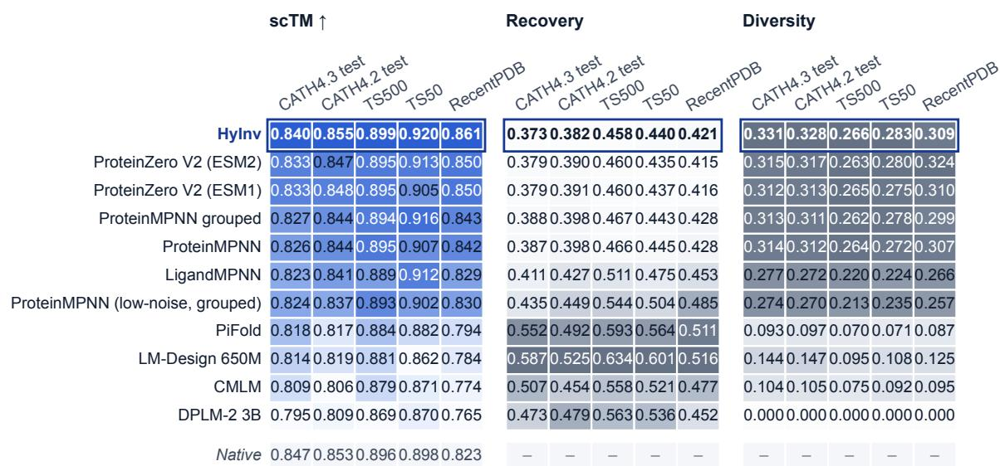  
Figure 14: scTM, recovery and diversity of every method on the five ESMFold2 panels. Rows are sorted by mean scTM, HyInv first; columns are shaded within each panel (darker is better for scTM; recovery and diversity are shown in gray as properties).

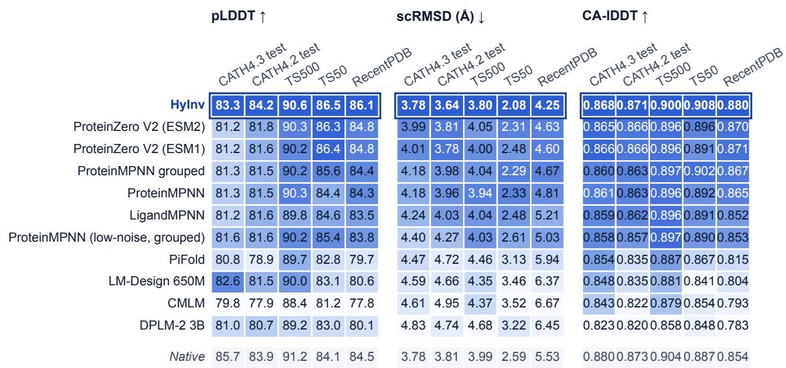  
Figure 15: pLDDT, scRMSD and lDDT of every method on the five ESMFold2 panels. Same layout as Figure 14; darker is better (higher pLDDT and lDDT, lower scRMSD).

Algorithm 1: Draft-and-rewrite sampling with fixed groups. The draft temperature $T _ { \mathrm { d } }$ and the rewrite temperature T<sub>r</sub> are independent; $T _ { \mathrm { d } }  0$ replaces the draft by the argmax. Top-p and min-p optionally truncate each softmax.

```julia
Input: backbone x with L positions, model, seed s, groups R, temperatures T , T
c ← Encode(x) # once per backbone
← RandomPermutation(hash(s, id(x)), L) # independent of structure and weights
G<sub>r</sub> ← {σ<sub>k</sub> : ⌊kR/L⌋ = r}, r = 0, . . . , R − 1 # equal-size groups
a ← (MASK, ..., MASK)
for r = 0, . . . , R − 1: # blind draft
u ← Decode(c, a)
for i ∈ G<sub>r</sub>: a<sub>i</sub> ∼ softmax(u<sub>i</sub>/T<sub>d</sub>)
for r = 0, . . . , R − 1: # rewrite
a˜ ← a with a˜<sub>i</sub> = MASK for i ∈ G<sub>r</sub>
u ← Decode(c, a˜)
for i ∈ G : a ∼ softmax(u /T )
return a
```

random permutation of the sites, and the k-th site of the permutation receives group $\lfloor k R / L \rfloor ;$ groups are equal in size up to one site, independent of structure, sequence and weights, and unchanged by padding or batching; draft round r and rewrite round r use the same group. The decoder accepts a partially masked state: each masked position is predicted using the backbone and the observed amino acid identities as sequence context. For fixed groups the log-probability of a trajectory is the sum of the per-site conditionals of the draft and the rewrite rounds, log $\begin{array} { r } { P ( \tau ) = \sum _ { r } \sum _ { i \in G _ { r } } \left( \log p _ { r } ^ { \mathrm { d } } ( a _ { i } ^ { \mathrm { d } } ) + \log p _ { r } ^ { \mathrm { r } } ( a _ { i } ) \right) } \end{array}$ , because the schedule does not depend on sampled tokens. RL does not use this sampler: its rollouts are serial and its replay is one causal pass (Appendix C).

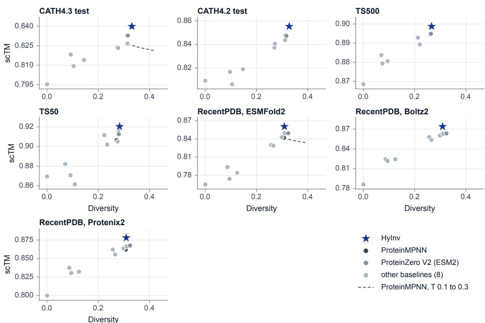  
Figure 16: scTM against diversity on every panel. Gray: published baselines (darker: ProteinMPNN and ProteinZero V2); dashed: ProteinMPNN at three temperatures; star: HyInv.

Random streams, truncation and fixed residues. Tokens are drawn by multinomial draws from the tempered distribution, with a separate stream for the draft; the seed of draw k hashes the base seed, the chain keys of the batch and k, so exact sequences are reproducible for a fixed batch layout and the distribution is unaffected. With $p = { \tt s o f t m a x } ( z / T )$ , min-p keeps tokens with $p \ge m p _ { \mathrm { m a x } }$ and top-p the smallest set of most probable tokens with mass at least q (the top token is always kept; both masks are computed on the same unrenormalized p and intersected); truncation applies at every sampled stage, and the evaluated values are $q = 0 . 9$ and $m = 0 . 1$ . Pinned residues are handled by a wrapper around the network: it keeps their amino acid identities unmasked from the first draft round and redraws those same identities at every stage by replacing their logits with a one-hot distribution; pinned sites remain members of their groups. A second sampler, used only to monitor RL on the development panel, commits the highest-probability proposals over eight steps; its diversity is lower than that of the rewrite sampler at the same nominal temperature (0.184 against 0.335 at $T \stackrel { \cdot } { = } 0 . 5 ,$ supervised checkpoint), so temperatures of the two samplers are never compared.

Confirmation of the decoupled draft. Table 8 gives the gain over the unmodified sampler of the same checkpoint at equal diversity. The settings were chosen on the development panel (Appendix A) and confirmed on CATH4.3 test and RecentPDB with new draws and fold seeds, on the checkpoint at update 288. The gain of the decoupled draft at $T _ { \mathrm { d } } = 0 . 6$ is positive on all three panels with an interval that excludes zero (RecentPDB is the smallest panel and has the widest interval), and larger than that of top-p or min-p truncation. With the unmodified sampler at the same development diversity, the final checkpoint differs from ProteinMPNN by +0.0082 on CATH4.3 test and from ProteinZero V2 (ESM2) by +0.0016 on CATH4.3 test and −0.0034 on RecentPDB (point estimates), so both the RL-trained checkpoint and the sampler contribute to the differences of Section 5.

## F Efficiency details

Timing protocol. All latencies were measured on one NVIDIA H20 of a node on which nothing else ran (PyTorch 2.7.1, CUDA 12.9, TF32 for matrix products off unless stated). The timed region starts at host arrays and ends at the sampled tokens on the device: it contains the upload, the backbone batch, the encoder and structure terms and all 16 decoder passes of every candidate batch, but not model loading, graph capture or kernel compilation (first call 67.7 ms to 834 ms per shape bucket). Every call draws fresh seeds and nothing is cached across calls. A cell is the median of 11 repeats (headline cells), 7 (sweeps) or 3 (slow systems of the library cells) after 3 warm-up calls; the interquartile range is below 1% of the median in every ladder row, and repeating the headline cells in five fresh processes moves the median by at most 0.5%. All systems design 128 candidates per request with a maximum candidate batch of 32; ProteinMPNN and ProteinZero V2 use their published temperature, to which their cost is nearly insensitive. Timing used a rewrite temperature of 0.23 and the weights of the supervised stage, which have the same architecture and tensor shapes as the final checkpoint; the cost of the sampler does not depend on the values of the weights, supported by near-equal numerical differences of the BF16 path on the two sets (mean divergence $4 . 2 \times 1 0 ^ { - 5 }$ against $5 . 2 \times 1 0 ^ { - 5 } )$ . The equivalence tests and the quality read-out used the RL checkpoint at update 288 and were not repeated at update 640; all benchmark sequences of Section 5 come from the reference sampler.

Table 8: Gain of the decoupled sampler over the unmodified sampler at equal diversity.
<table><tr><td>Setting</td><td>Development</td><td>CATH4.3 test</td><td>RecentPDB</td></tr><tr><td>Decoupled draft, Td = 0.6 (HyInv default) +0.0072[+0.0062, +0.0118] +0.0078[+0.0064, +0.0107] +0.0131 [+0.0065, +0.0196]</td><td></td><td></td><td></td></tr><tr><td>Decoupled draft,  $T _ { \mathrm { d } } = 0 . 3$ </td><td></td><td>+0.0054[+0.0022, +0.0067] +0.0074[+0.0060, +0.0096] +0.0089[+0.0036, +0.0145]</td><td></td></tr><tr><td>Top-p 0.9</td><td></td><td>+0.0044[+0.0028, +0.0063] +0.0032[+0.0020, +0.0051] +0.0066[+0.0018, +0.0119]</td><td></td></tr><tr><td>Min-p 0.1</td><td>+0.0033[+0.0023, +0.0076] +0.0030[+0.0017, +0.0050] +0.0068[+0.0010,+0.0137]</td><td></td><td></td></tr></table>

Gain in scTM at fixed diversity over the unmodified sampler of the same checkpoint (difference of S@D, paired; $D = 0 . 3 0$ on the development panel, 0.32 on CATH4.3 test and 0.30 on RecentPDB; 95% interval over CATH topology clusters, over chains on RecentPDB). Development chains $K = 2 ,$ held-out panels K = 4 with new draws and fold seeds; checkpoint at update 288.

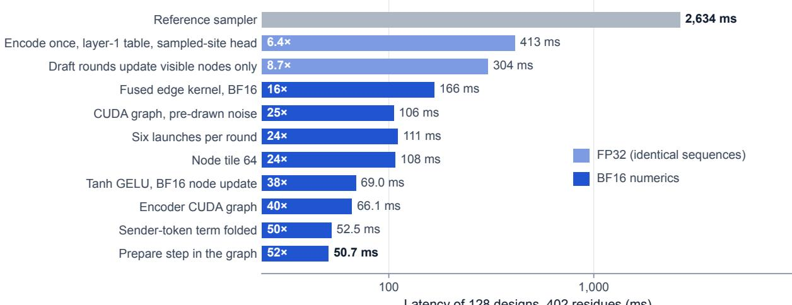  
Figure 17: All eleven optimization steps. Latency of 128 designs for the 402-residue backbone after each cumulative step; light blue: exact FP32 path (identical sequences), blue: BF16 numerics. The draft node subset includes positions with observed amino acid identities and positions sampled in the current round. Two steps are not faster than their predecessors and are kept for completeness.

The two numerical paths. The BF16 path (HyInv in the main text) computes the edge messages and the node update with BF16 operands and FP32 accumulation, uses the hardware tanh form of GELU and keeps FP32 inputs and outputs; it is a numerical variant of the reference sampler. Against the reference on 200 development backbones the largest absolute logit difference is 0.069, the mean Kullback–Leibler divergence per sampled position $5 . 2 \times 1 0 ^ { - 5 }$ (99th percentile $7 . 5 \times 1 0 ^ { - 4 } )$ and the argmax agrees at 99.73% of the positions; with the same seeds 49.4% of the sequences are identical to the reference and 98.7% of the positions agree, so its effect on quality is measured on the distribution of designs (below). The exact FP32 path computes its matrix products with a three-pass TF32 emulation of FP32 and neither BF16 operands nor the tanh form of GELU. Its sequences equal those of the reference for the same seeds (1,600 of 1,600 eager, 400 of 400 with graph capture and 352 of 352 in padded multi-target batches, including fixed positions, missing atoms, short chains and a synthetic two-chain input), and graph replay equals eager execution bit for bit; only this path is called identical.

Optimizations. Figure 17 adds the eleven items one at a time; later items depend on earlier ones, so removing one item at a time from the final configuration is the better estimate of its contribution. Five groups of items carry most of the gain. Shared work: all candidates of a request share one backbone, so the encoder, the structure terms and the first draft round (with all non-fixed sequence positions initially masked) are computed once, and the last decoder layer and output head run at the sampled positions only. Restrict draft updates to context and active positions, and apply one linear map after the neighbor sum: the node subset includes positions with observed amino acid identities and those sampled in the current round; removing the node subset, the shared round or the late map slows the exact path by 1.16×, 1.01× and 1.24× on the 402-residue request. Fused edge kernel: gather, GELU, the second edge product and the neighbor sum form one Triton kernel, so edge activations are never written out; its gain comes with BF16 operands. Pre-drawn noise and CUDA graphs: each round is captured in one graph per shape bucket, which matters most for short backbones (this item also enables TF32 for the remaining linear layers). Fewer launches and numerics: six kernel launches per round, tanh GELU (erf everywhere makes the request 1.68× slower) and a folded token term (removal costs 1.27×). The last rung of the ladder (50.7 ms) and the headline latency (50.6 ms) are two separately timed runs of the same configuration.

Baseline timings. The baselines of Figure 4a run with their released implementations (FP32 without graph capture or compilation; DPLM-2 3B in BF16 autocast), each at its published setting. Where the released adapter handles one structure per call, 128 designs are 128 calls, so a batched re-implementation would be faster; because DPLM-2 3B decodes by argmax, every call returns the same sequence, and its time is that of producing 128 designs scaled from eight timed calls. The speed-ups in the main text are against these implementations, not against the best achievable speed of the baseline models.

Library scale and memory. A library of 10,000 sequences for one backbone of 250 residues takes 2.11 s on one GPU (4,740 sequences per second; reference sampler 129.1 s, ProteinMPNN 142.0 s), 0.253 s on eight GPUs (one process per GPU on disjoint parts of the library within one node, 39,527 sequences per second, 7.7 times the single-GPU rate at the same batch size) and a single-GPU rate of 5,430 sequences per second at candidate batch 128. For 128 candidates at 402 residues and a batch of 32 the peak memory allocated by tensors is 811 MiB for HyInv (BF16), 4,323 MiB for the reference sampler and 3,164 MiB for ProteinMPNN.

Quality of the BF16 path. Its quality is judged on the distribution of designs, not on single sequences: the quantity is the S@D of the development read-out (scTM at diversity 0.30 from a quadratic fit through four rewrite temperatures, ESMFold2, 2 designs per chain, draft temperature 0.6) on the RL checkpoint at update 288, and Table 9 gives the difference (BF16 path minus reference sampler), paired by chain, on the whole development panel of 1,529 chains and on the three disjoint subsets it consists of. On the whole panel the difference is −0.0001 with interval [−0.0009, +0.0016], whose lower end is above the margin of −0.002 fixed for this check. Subsets of about five hundred chains cannot resolve a difference of that size (interval half-widths of two to three thousandths, point estimates on both sides of zero: −0.0008, +0.0005, +0.0001). Per rewrite temperature the scTM difference has mixed signs without a trend, and the diversity of the two samplers agrees to within 0.001. The check covers the development panel, ESMFold2, 2 designs and rewrite temperatures up to 0.5; test panels, the independent predictors and other checkpoints are not covered by it. Shorter schedules cost more quality than they save time: the S@D of six schedules with fewer rounds (6+8, 4+8, 8+6, 8+4, 6+6 and 4+4 draft and rewrite rounds) is lower than that of the 16-pass default by 0.0028 to 0.0074, so the default of 8 draft and 8 rewrite rounds was kept.

Table 9: BF16 path against the reference sampler on the development panel.
<table><tr><td>Chains</td><td>Targets</td><td>Clusters</td><td>S@D difference</td><td>Lower end ≥ −0.002</td></tr><tr><td>Subset 1</td><td>512</td><td>51</td><td>-0.0008[-0.0021, +0.0022]</td><td>no</td></tr><tr><td>Subset 2</td><td>512</td><td>50</td><td>+0.0005[-0.0013, +0.0032]</td><td>yes</td></tr><tr><td>Subset 3</td><td>505</td><td>61</td><td>+0.0001[-0.0032, +0.0018]</td><td>no</td></tr><tr><td>Whole development panel</td><td>1529</td><td>91</td><td>-0.0001[-0.0009, +0.0016]</td><td>yes</td></tr></table>

S@D difference, BF16 path minus reference sampler, at the development diversity D = 0.30 (four-point quadratic fit, paired, 95% interval over CATH topology clusters). The whole panel is the union of the three disjoint subsets.

## G Application protocols

The applications of Section 6 use the HyInv default setting (the final checkpoint at update 640, draft temperature 0.6, rewrite temperature 0.34) without task-specific tuning. They report predicted-structure agreement, local geometry, sequence statistics, diversity and novelty; none is an experimental measurement. Panel rules, thresholds and endpoints were fixed before designs were generated, and panels were chosen from native sequences and structures only.

De novo backbones. 74 de novo backbones in 58 clusters of 30% sequence identity, none with a hit that passes the homology rule below, with 4 designs per backbone; the control is a set of 193 length-matched native chains. A design isfoldable if its ESMFold2 scTM is at least 0.9 and novel if its sequence identity to the nearest UniRef50 sequence and to the nearest sequence of the pretraining library is below 0.3; the yield is the number of novel-and-foldable designs per backbone. Both readings are reported, fixed before designs were generated: the yield of all designs, and the yield of designs that pass a composition filter (sequence entropy at least 3.5 bits, hydrophobic fraction (AVILMFWY) between 0.25 and 0.55, longest homopolymer run at most 6), which excludes low-complexity sequences that a structure predictor can fold to a high scTM. The filter lowers the yield of ProteinMPNN and ProteinZero V2 more than that of HyInv; the unfiltered yield of ProteinMPNN is 0.47 to 0.53 over its three lowest temperatures, which span the diversity of HyInv, and HyInv is above both baselines in both readings. HyInv is compared with ProteinMPNN and ProteinZero V2 over their temperature grids, interpolating each curve at the HyInv diversity without extrapolating by more than 0.05; the resampling unit is the cluster of 30% identity.

Pocket-constrained libraries. 12 ligand-pocket backbones: ten chosen by rule (length range, complete backbone atoms, a non-solvent ligand with at least eight residues within 4 Å, no hit that passes the homology rule), in hash order, and two single cases chosen earlier. Residues within 4 Å of the ligand keep their native identity (the pinnedposition wrapper of the sampler for HyInv, a mask on the free positions for the baselines, so retention is a check of the code and not a result), and 384 designs are made per backbone and cell. A design passes if its scTM is at least 0.90 and its site C<sub>α</sub> RMSD at most 1.0 Å; the endpoint is the number of different sequences, after clustering at 50% identity, among the passing designs of a plate of 96 or 384 designs (200 random plates per cell), against ProteinMPNN at the temperature whose diversity at the free positions is closest to that of HyInv. Controls are the native refold, a random substitution with the same number of mutations and HyInv with nothing pinned.

Loop and window redesign and named enzymes. One loop (the longest coil run) or one window of 30% of the chain is redesigned with the rest of the sequence fixed, on 8 backbones chosen by rule and on 4 named enzymes (TEM-1 β-lactamase, subtilisin, lysozyme, PETase) whose catalytic residues are fixed too; 128 designs per backbone and region, 24,672 in total. A design succeeds if its whole-chain scTM is at least 0.9 and the Cα RMSD of the redesigned region after fitting the unchanged context is at most 1.5 Å; the catalytic-site RMSD is the heavy-atom RMSD of the pinned catalytic residues after the same fit. The success rate is read only where the native refold meets the criterion on a majority of backbones. Comparators are ProteinMPNN at the temperature matched to the diversity of the redesigned region, ProteinZero V2 and the native refold. The named enzymes are homologous to the training data and chosen for display: they illustrate the preservation of a fixed geometry, not the design of new enzymes. Figure 11 reports the catalytic-site RMSD of three of them (TEM-1 β-lactamase, subtilisin and PETase).

Homology of the panels. The native chain of each panel backbone was searched against the pretraining library and the benchmark reference set (MMseqs2); a hit counts if its identity is at least 0.3 and it covers at least 0.8 of the query or of the target. This is a coverage rule: hits that cover less of the chain remain, so a backbone passing the rule is homology-filtered at these thresholds, which is weaker than having no similar fragment in the library (Table 10). Strict backbones have no passing hit, relaxed backbones relax one criterion of the strict rule (fixed before any design), and the named enzymes are a fixed list; the table documents the panel rule only.

Table 10: Homology screen of the application panels.
<table><tr><td>Panel</td><td>Backbones</td><td></td><td>Passing hit Partial hits only</td></tr><tr><td>De novo backbones</td><td>74</td><td>0</td><td>28</td></tr><tr><td>Pocket library</td><td>12</td><td>0</td><td>7</td></tr><tr><td>Loop and window, strict</td><td>2</td><td>0</td><td>2</td></tr><tr><td>Loop and window, relaxed</td><td>6</td><td>0</td><td>4</td></tr><tr><td>Named enzymes</td><td>4</td><td>4</td><td>0</td></tr></table>

A hit passes the rule if its sequence identity to the pretraining library or to the benchmark reference set is at least 0.3 and it covers at least 0.8 of the query or of the target; partial hits stay below the coverage limit. Strict: no passing hit; relaxed: one criterion relaxed before any design was made. The named enzymes are homologous to training data by design.

Predictors, comparators and statistics. Monomers are folded with ESMFold2 in the recipe of Appendix A with one fold seed shared by all generators for the same backbone and chunk, so that generators are paired; ESMFold2 is also the reward predictor, so a subset of cells is folded with Boltz2 and Protenix2 as well. Comparators are ProteinMPNN and ProteinZero V2 only (the latter is declared for chains of up to 100 residues, which is stated where it is used on longer chains). The temperature of the diversity-matched baseline is chosen from sequences alone, before any fold is read, as the grid value whose mean pairwise Hamming distance over the designed positions is closest to that of the HyInv default; where HyInv has lower diversity than the lowest baseline temperature the match is as close as the grid allows. Differences are paired by backbone, averaged over designs first, with 95% percentile intervals from 10,000 resamples (with four to twelve backbones the intervals are wide). Intervals are not adjusted for multiple comparisons.

## H Release and reproducibility

Release. We will release the HyInv model weights and inference code at https://github.com/Tencent-Hunyuan/ hyra-results/tree/main.

Reproducibility. Every number, table and figure in this report is generated by scripts from result files. Sampling is random, so a rerun with other seeds changes individual designs within the reported intervals.