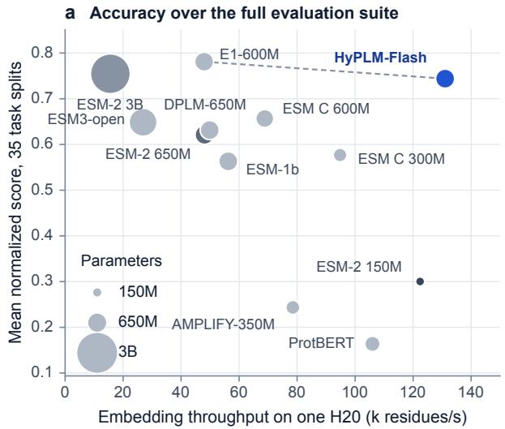
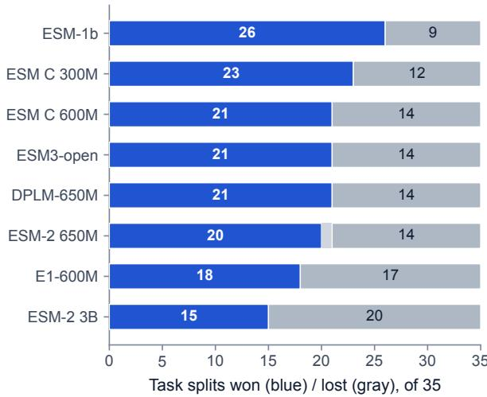
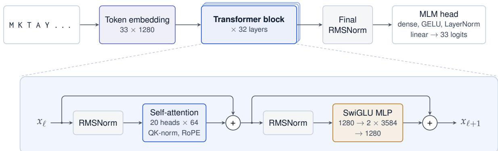
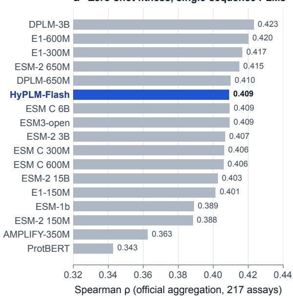
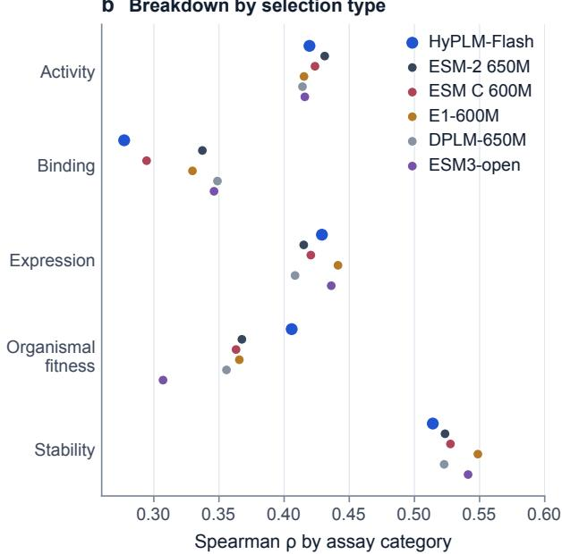

# HyPLM Technical Report

Hyra Team

## Abstract

Protein language models (PLMs) are standard tools for variant-effect prediction, protein annotation and design, but the compute needed to train and serve them keeps growing. We present HyPLM-Flash, an efficient and open PLM trained by Hyra 2.0, the research agent developed by our team. HyPLM-Flash is a 650-million-parameter masked language model trained on 726 billion tokens, 0.73 times the data of ESM-2 650M and a fifth to an eighth of the data of E1-600M and ESM C 600M. It runs on an inference engine with fused kernels and INT8 matrix multiplication, embedding about 130,000 residues per second on a single NVIDIA H20 GPU, 1.9 to 2.7 times faster than other 600M-class encoders. In a matched evaluation against 28 public checkpoints on 32 tasks, HyPLM-Flash reaches a ProteinGym zero-shot Spearman correlation of 0.409, statistically tied with ESM-2 650M, ESM C 600M and E1-600M, and the highest organismal-fitness score among self-supervised single-sequence models. It gives the best long-range contact precision of all models evaluated, including ESM-2 15B and ESM C 6B, and a lower masked-residue loss than ESM-2 650M, ESM C 600M and E1-600M on held-out sequences and on recently released PDB chains. Matching state-of-the-art accuracy at a fraction of the training and inference cost, HyPLM-Flash sets a new Pareto frontier for protein language models. We have released the model weights and the inference engine at https: //github.com/Tencent-Hunyuan/Hyra-results/tree/main/AI4Science/hyplm\_flash.

b Head-to-head against each baseline  
  
Figure 1: Accuracy and inference speed of protein language models. a, Mean score over the 35 task splits of our evaluation suite on which all plotted models have a value, against embedding throughput on one NVIDIA H20 GPU. Scores are min–max normalized on each split across the twelve models. Throughput is measured with the INT8 engine for HyPLM-Flash and with the reference implementations for the baselines. The dashed line connects Pareto-optimal models; bubble area is proportional to parameter count. b, Number of these splits that HyPLM-Flash wins (blue) and loses (gray) against each baseline.

## 1 Introduction

Protein language models (PLMs) learn the statistics of natural sequences by reconstructing masked residues, and the representations they learn capture structure, function and fitness without supervision (Rives et al., 2021; Rao et al., 2020; Lin et al., 2023). Encoders with a few hundred million parameters have become everyday tools for variant-effect prediction, protein annotation and fine-tuning, and they are increasingly run over entire proteomes and metagenomes. Their cost therefore matters. Recent encoders of the 600M class were trained on 4 to 6 trillion tokens (ESM Team, 2024; Jain et al., 2025), four to six times the data of ESM-2, and on an NVIDIA H20 their reference implementations embed 48,000 to 69,000 residues per second, so a single pass over 2.6 billion proteins keeps an eight-GPU server busy for two to three weeks.

  
Figure 2: Architecture of HyPLM-Flash. Top: tokens from the 33-symbol ESM-2 alphabet are embedded, processed by 32 identical Transformer blocks and decoded by a masked-language-modeling head. Bottom: each block applies RMSNorm before bidirectional self-attention (per-head RMSNorm on queries and keys, rotary position embeddings) and before a SwiGLU MLP, each inside a residual connection.

We present HyPLM-Flash, a protein language model trained by Hyra 2.0, the research agent developed by our team. It is as accurate as the strongest encoders of its size, and both cheaper to train and faster to serve. It retains the vocabulary and output head of ESM-2, making it a compelling and seamless alternative in existing pipelines. HyPLM-Flash is paired with a modern Transformer block and the Muon optimizer with a single pass over 2.6 billion curated and metagenomic sequences. A dedicated inference engine then makes full use of the GPU through padding-free batching, fused kernels and INT8 matrix multiplication.

Trained on 0.73 times the data of ESM-2 650M and a fifth to an eighth of that of E1-600M and ESM C 600M, HyPLM-Flash matches these models on zero-shot fitness prediction, leads all self-supervised single-sequence models on organismal fitness and gives the best long-range contact precision of all models we evaluated. Its engine embeds proteins 1.9 to 2.7 times faster than other encoders of the 600M class, which places HyPLM-Flash on a new Pareto frontier of accuracy and speed (Figure 1).

Our contributions are:

• HyPLM-Flash, a 650M-parameter protein language model that reaches the accuracy of the strongest encoders of its size with a fraction of their training data (Section 2).

• An inference engine for H20 GPUs that embeds about 130,000 residues per second on one GPU (Section 3).

• A matched evaluation of 28 public checkpoints from 13 model families on 32 tasks under a single protocol with paired confidence intervals (Section 4).

## 2 Model and Training

## 2.1 Architecture

HyPLM-Flash is a bidirectional Transformer encoder (Vaswani et al., 2017) trained with masked language modeling (Devlin et al., 2019). It uses the 33-token alphabet of ESM-2 and a RoBERTa-style output head (Liu et al., 2019; Lin et al., 2023), and modernizes the Transformer block with pre-normalization by RMSNorm (Zhang and Sennrich, 2019), rotary position embeddings (Su et al., 2021), per-head query–key normalization (Henry et al., 2020; Dehghani et al., 2023) and SwiGLU feed-forward layers (Shazeer, 2020) (Figure 2). Query–key normalization bounds the attention logits and keeps training stable at the high learning rates used with Muon. The model has 32 layers of width 1,280 with 20 attention heads and a SwiGLU width of 3,584, for a total of 652 million parameters, and reads proteins of up to 8,190 residues in a single window.

## 2.2 Training

Data. The training corpus combines UniRef90 with the UniRef50 representatives it does not contain (Suzek et al., 2015; The UniProt Consortium, 2025), MGnify90 (Richardson et al., 2023), the active entries of UniParc and the non-redundant isolate proteomes of JGI IMG (Chen et al., 2023). We keep sequences of 30 to 8,192 residues, remove exact duplicates across sources and remove, by exact match, the sequences of the benchmarks used during development, including all ProteinGym wild types and variants. The resulting 2.6 billion sequences (659 billion residues) are sampled in proportion to their length, so that metagenomic and archival sequences supply about 80% of the training tokens, and each source is seen about once.

Table 1: Training data and compute of HyPLM-Flash and encoders of similar size.
<table><tr><td></td><td></td><td></td><td colspan="2">Training FLOPs</td><td></td></tr><tr><td>Model</td><td>Params</td><td>Tokens</td><td>6ND</td><td>Published</td><td>Corpus</td></tr><tr><td colspan="6">Encoders of similar size</td></tr><tr><td>ESM-2 650M</td><td>652M</td><td>1.0T</td><td> $3 . 9 \times 1 0 ^ { 2 1 }$ </td><td> $1 . 6 \times 1 0 ^ { 2 2 \mathrm { a } }$ </td><td>UniRef50/90 (2021_04)</td></tr><tr><td>ESM-1b</td><td>652M</td><td>66B</td><td> $2 . 6 \times 1 0 ^ { 2 0 }$ </td><td></td><td>UniRef50 (2018_03)</td></tr><tr><td>ESM C 600M</td><td>575M</td><td>6.2T</td><td> $2 . 1 \times 1 0 ^ { 2 2 }$ </td><td> $2 . 2 \times 1 0 ^ { 2 2 }$ </td><td>UniRef, MGnify, JGI (70% clusters)</td></tr><tr><td>E1-600M</td><td>641M</td><td>4.0T</td><td> $1 . 5 \times 1 0 ^ { 2 2 }$ </td><td></td><td>Profluent Protein Atlas, UniRef</td></tr><tr><td>AMPLIFY-350M</td><td>354M</td><td> $2 . 5 \mathrm { T } ^ { \mathrm { b } }$ </td><td> $5 . 3 \times 1 0 ^ { 2 1 }$ </td><td> $4 . 6 \times 1 0 ^ { 2 1 }$ </td><td>UniRef100, OAS, SCOP (UR100P)</td></tr><tr><td>DPLM-650M</td><td>652M</td><td>100B</td><td> $4 . 3 \times 1 0 ^ { 2 1 \mathrm { c } }$ </td><td></td><td>UniRef50</td></tr><tr><td>ESM3-open</td><td>1.4B</td><td>300B</td><td> $2 . 5 \times 1 0 ^ { 2 1 }$ </td><td></td><td>UniRef, MGnify, JGI, structures</td></tr><tr><td>HyPLM-Flash</td><td>652M</td><td>726B</td><td> $2 . 8 \times 1 0 ^ { 2 1 }$ </td><td></td><td>UniRef90/50, MGnify90, UniParc, JGI; 1.6M structures</td></tr></table>

6ND: total parameters N times training tokens D; published FLOPs as reported by the authors; — not published. a Estimated by the authors from GPU-days, not a 6ND count. b Upper bound: counts padded sequence slots. c DPLM-650M continues ESM-2 650M; tokens cover the final stage and FLOPs include the parent model (final stage alone: $3 . 9 \times 1 0 ^ { 2 0 } )$ .  
Sources: ESM-2 (Lin et al., 2023; Akin, 2022), ESM-1b (Rives et al., 2021; Meta AI, 2022), ESM C (Candido et al., 2026; ESM Team, 2024), E1 (Jain et al., 2025), AMPLIFY (Fournier et al., 2024), DPLM (Wang et al., 2024), ESM3 (Hayes et al., 2025).

Objective and optimization. We use the standard masking recipe: 15% of the residues are selected, of which 80% are replaced by a mask token, 10% by a random amino acid and 10% are left unchanged. The weight matrices of the Transformer blocks are trained with Muon (Jordan et al., 2024), using decoupled weight decay and an update scale matched to AdamW (Liu et al., 2025), and all other parameters with AdamW (Loshchilov and Hutter, 2019). The learning rate follows a warmup–stable–decay schedule (Hu et al., 2024; Wen et al., 2024).

Training stages. Pretraining covers 713 billion tokens on crops of up to 1,022 residues. A second stage of 13 billion tokens extends the crops to 8,190 residues and adds auxiliary structure objectives on 1.6 million protein chains with experimental (Berman et al., 2000) or predicted (Lin et al., 2023; Varadi et al., 2022) structures: a residue head predicts secondary structure (Kabsch and Sander, 1983) and Foldseek 3Di states (van Kempen et al., 2024), and a pair head predicts Cβ distances (Jumper et al., 2021). The auxiliary heads are used only during training. Before training, we removed every structure chain with an MMseqs2 hit (E-value $\dot { \leq 1 0 ^ { - 3 } }$ , sequence identity ≥ 30%) to the test proteins of the structure and likelihood tasks or to a ProteinGym wild type.

Training compute. In total, HyPLM-Flash was trained on 726 billion tokens, or $2 . 8 \times 1 0 ^ { 2 1 }$ FLOPs by the usual 6ND estimate (Kaplan et al., 2020; Hoffmann et al., 2022). This is 0.73 times the data of ESM-2 650M and 5.5 and 8.5 times less than E1-600M and ESM C 600M, whose 4.0 and 6.2 trillion tokens amount to $1 . 5 \times 1 0 ^ { 2 2 }$ and $2 . 1 \times 1 0 ^ { 2 2 }$ FLOPs (Table 1).

## 3 Inference Engine

Embedding proteomes and scoring variant libraries are dominated by inference, and reference implementations of protein language models leave much of a modern GPU idle. We serve HyPLM-Flash with an inference engine written for NVIDIA H20 GPUs, which offer 148 TFLOPS in BF16 and 296 TOPS in INT8 at 4.0 TB/s of memory bandwidth.

The engine rests on three ideas. Proteins are packed into a single token stream without padding, which would otherwise fill 42% of the slots of a typical batch, and attention runs in the variable-length mode of FlashAttention-3 (Shah et al., 2024). Three Triton kernels (Tillet et al., 2019) absorb every memory-bound operation: the residual addition with RMSNorm, query–key normalization with the rotary embedding, and the SwiGLU activation, each fused with the quantization of its output, while the residual stream stays in FP32. Finally, the four projections of every block run as INT8 matrix multiplications. Activations are scaled per token and per group of 128 channels, which confines the heavy-tailed outliers of the feed-forward activations to their own group, and weights are scaled per output channel; each 128-wide slice of the reduction accumulates in INT32 and is promoted to FP32 with its activation scale, the strategy DeepSeek-V3 uses for FP8 (DeepSeek-AI, 2024).

On a common workload of 2,048 held-out proteins, the engine embeds 131,000 residues per second on one H20. This is 1.9 to 2.7 times faster than ESM C 600M, ESM-1b, ESM-2 650M, DPLM-650M and E1-600M in their reference implementations, and faster than ESM-2 150M, which has a quarter of the parameters (Figure 1a). Accuracy in this report is evaluated with BF16 arithmetic. INT8 keeps zero-shot fitness, structure, function annotation and likelihood within 0.01 of these results; for supervised regression on near-identical protein variants, whose representations differ by only about 1%, we recommend the BF16 mode of the engine, which runs at 90,000 residues per second.

## 4 Evaluation

We compare HyPLM-Flash with 28 public checkpoints from 13 model families, from ESM-2 8M to ESM-2 15B (29 models in all), on 32 tasks. All models run through the same evaluation code in BF16. Zero-shot scores come from the masked-language-model head, and every supervised task fits a linear probe on frozen representations from the layer, among six relative depths, that performs best on validation data. Confidence intervals are paired bootstrap intervals over assays, proteins or sequences. The main text focuses on encoders of similar size; Appendix A describes the protocols and Appendix B reports every task for HyPLM-Flash and twelve other encoders. E1 (Jain et al., 2025) is retrieval-augmented: it is trained with homologous sequences in its context and improves when they are supplied, at the cost of an external sequence database, a homology search for every query and longer inputs. As for every other model, we run E1-600M on the query sequence alone.

## 4.1 Zero-shot fitness prediction

We score each substitution by the masked-marginal log-likelihood ratio (Meier et al., 2021) and report the Spearman correlation over the 217 substitution assays of ProteinGym v1.3 (Notin et al., 2023) with the benchmark’s official aggregation. Our runs of eight published ESM-2 and ESM C checkpoints reproduce the leaderboard to within 0.0025.

HyPLM-Flash reaches a Spearman correlation of 0.409 (Figure 3a). Its differences to ESM-2 650M (−0.006, 95% confidence interval [−0.025, 0.010]), ESM C 600M (+0.003, [−0.015, 0.019]), DPLM-650M (−0.001, [−0.019, 0.015]) and E1-600M (−0.011, [−0.029, 0.005]) are not significant, and neither are those to ESM-2 3B, ESM-2 15B and ESM C 6B, which were trained with 6 to 83 times more compute. Among the 55 single-sequence entries of the public leaderboard, HyPLM-Flash is tied for eighth place (Table 5); the two entries at the top, VespaG and VESPA, are supervised predictors built on PLM embeddings (Marquet et al., 2022; 2024). By selection type (Figure 3b), HyPLM-Flash scores 0.406 on organismal fitness, the highest of all self-supervised single-sequence models on the leaderboard, and is on par with the other encoders on activity and expression.

## 4.2 Frozen-representation tasks

Following TAPE (Rao et al., 2019) and Rao et al. (2020), we probe frozen representations with a linear per-residue probe for secondary structure, a 32-dimensional bilinear head on residue pairs for contacts, and linear probes on mean-pooled representations for all other tasks (Table 2).

Structure. HyPLM-Flash gives the best long-range contact precision of all 29 models: a precision at L/5 of 0.650 on ProteinNet, against 0.392 for ESM-2 650M, 0.434 for ESM C 600M and 0.645 for E1-600M, and the highest scores on the CASP14 and CASP15 targets as well (Appendix B), ahead of ESM-2 15B and ESM C 6B. Its three-state secondary-structure accuracy on CB513 (0.882) is above that of ESM-2 650M (0.844) and ESM C 600M (0.851), on par with E1-600M (0.880), and exceeded only by ESM3-open (0.896) and ESM C 6B (0.884) among all models.

Function, localization and fitness. On enzyme and Gene Ontology annotation, HyPLM-Flash is within one point of the best encoder of its size (EC $\breve { F } _ { \mathrm { m a x } }$ 0.885, GO-MF 0.661). On fitness and property regression it ranks first among the models of Table 2 on AAV (two-vs-many, ρ = 0.650) and amylase (0.696), and second on Meltome (0.672) and fluorescence (0.669). Averaged over the ten regression splits used for

b Breakdown by selection type  
a Zero-shot fitness, single-sequence PLMs  

  
Figure 3: ProteinGym zero-shot fitness prediction. a, Average Spearman correlation over 217 substitution assays (official aggregation) for single-sequence models; ESM3-open is scored from sequence alone. b, Correlation by selection type for HyPLM-Flash and the main encoders of similar size.

Table 2: Frozen-representation tasks. Test metrics at the validation-selected layer: three-state accuracy on CB513 (SS), long-range contact precision at L/5 on ProteinNet, fold accuracy, Fmax for EC and GO molecular function, 10-class localization accuracy, and Spearman ρ for AAV (two-vs-many), amylase (one-to-many), fluorescence, Meltome (mixed split) and stability. Bold marks the best value in each column.
<table><tr><td></td><td colspan="3">Structure</td><td colspan="3">Function</td><td colspan="5">Fitness and properties</td></tr><tr><td>Model</td><td>SS (Q3)</td><td>Contact</td><td>Fold</td><td>EC</td><td>GO-MF</td><td>Loc.</td><td>AAV</td><td>Amylase</td><td>Fluor.</td><td>Meltome</td><td>Stability</td></tr><tr><td>ESM-2 650M</td><td>0.844</td><td>0.392</td><td>0.373</td><td>0.888</td><td>0.667</td><td>0.806</td><td>0.518</td><td>0.640</td><td>0.664</td><td>0.633</td><td>0.639</td></tr><tr><td>ESM C 600M</td><td>0.851</td><td>0.434</td><td>0.345</td><td>0.886</td><td>0.665</td><td>0.808</td><td>0.551</td><td>0.681</td><td>0.663</td><td>0.670</td><td>0.706</td></tr><tr><td>E1-600M</td><td>0.880</td><td>0.645</td><td>0.373</td><td>0.881</td><td>0.661</td><td>0.839</td><td>0.583</td><td>0.579</td><td>0.660</td><td>0.690</td><td>0.712</td></tr><tr><td>DPLM-650M</td><td>0.842</td><td>0.394</td><td>0.370</td><td>0.882</td><td>0.663</td><td>0.806</td><td>0.569</td><td>0.674</td><td>0.668</td><td>0.623</td><td>0.746</td></tr><tr><td>ESM-1b</td><td>0.814</td><td>0.410</td><td>0.362</td><td>0.889</td><td>0.659</td><td>0.793</td><td>0.544</td><td>0.653</td><td>0.659</td><td>0.593</td><td>0.596</td></tr><tr><td>AMPLIFY-350M</td><td>0.797</td><td>0.210</td><td>0.286</td><td>0.865</td><td>0.631</td><td>0.729</td><td>0.574</td><td>0.592</td><td>0.660</td><td>0.585</td><td>0.579</td></tr><tr><td>ESM3-open</td><td>0.896</td><td>0.568</td><td>0.408</td><td>0.880</td><td>0.664</td><td>0.750</td><td>0.551</td><td>0.618</td><td>0.669</td><td>0.573</td><td>0.758</td></tr><tr><td>HyPLM-Flash</td><td>0.882</td><td>0.650</td><td>0.322</td><td>0.885</td><td>0.661</td><td>0.794</td><td>0.650</td><td>0.696</td><td>0.669</td><td>0.672</td><td>0.687</td></tr></table>

summary statistics (Appendix A), it scores 0.606, the highest of these models, ahead of E1-600M (0.597), ESM C 600M (0.587), ESM-2 650M (0.572) and the 4.4 times larger ESM-2 3B (0.573).

## 4.3 Masked-residue likelihood

We compute the negative log-likelihood (NLL) of masked residues with identical masks for all models on two evaluation sets: 479 proteins from our held-out UniRef split, and 887 PDB chains released after 2 September 2026, later than the training data of every model evaluated, clustered at 50% identity with MMseqs2 (Steinegger and Söding, 2017) after removing exact matches to our training corpus. HyPLM-Flash has a lower NLL than ESM-2 650M, ESM C 600M and E1-600M on both validation sets (Table 3). On the recent PDB chains it is also ahead of ESM-2 3B and ESM-2 15B (1.148 against 1.327 and 1.162); of all models for which we report a likelihood, only ESM C 6B and ProtBERT score lower.

## 5 Conclusion

HyPLM-Flash shows that a protein language model can reach the accuracy of the strongest encoders of its size with a fraction of their training data, and that an inference stack built around the target GPU makes it the fastest of them. It matches ESM-2 650M, ESM C 600M and E1-600M on zero-shot fitness prediction, leads all self-supervised single-sequence models on organismal fitness, gives the best contact precision in our evaluation and models held-out and recent sequences better than ESM-2 650M, ESM C

Table 3: Masked-residue likelihood. Negative log-likelihood (NLL, nats) and perplexity (PPL) on held-out UniRef proteins and on PDB chains released after 2 September 2026. Lower is better.
<table><tr><td></td><td colspan="2">Held-out UniRef proteins</td><td colspan="2">Recent PDB chains</td></tr><tr><td>Model</td><td>NLL</td><td>PPL</td><td>NLL</td><td>PPL</td></tr><tr><td>Encoders of similar size</td><td></td><td></td><td></td><td></td></tr><tr><td>ESM-2 650M</td><td>1.820</td><td>6.17</td><td>1.591</td><td>4.91</td></tr><tr><td>ESM C 600M</td><td>1.720</td><td>5.59</td><td>1.478</td><td>4.39</td></tr><tr><td>E1-600M</td><td>1.811</td><td>6.11</td><td>1.560</td><td>4.76</td></tr><tr><td>AMPLIFY-350M</td><td>1.743</td><td>5.72</td><td>1.155</td><td>3.17</td></tr><tr><td>DPLM-650M</td><td>1.961</td><td>7.10</td><td>1.796</td><td>6.03</td></tr><tr><td>ProtBERT</td><td>1.754</td><td>5.77</td><td>1.105</td><td>3.02</td></tr><tr><td colspan="5">Larger encoders</td></tr><tr><td>ESM-2 3B</td><td>1.667</td><td>5.30</td><td>1.327</td><td>3.77</td></tr><tr><td>ESM-2 15B</td><td>1.561</td><td>4.76</td><td>1.162</td><td>3.19</td></tr><tr><td>ESM C 6B</td><td>1.414</td><td>4.11</td><td>1.054</td><td>2.87</td></tr><tr><td>HyPLM-Flash</td><td>1.698</td><td>5.46</td><td>1.148</td><td>3.15</td></tr></table>

600M and E1-600M, while embedding proteins 1.9 to 2.7 times faster than these models. Together, these results place HyPLM-Flash on a new Pareto frontier of accuracy and efficiency.

Outlook. HyPLM-Flash is the first release of the HyPLM family. Hyra 2.0 continues to develop it, and we will release updated versions as data and training recipes improve. We are also training HyPLM-Pro, a larger model aimed at the highest accuracy rather than speed. Like other single-sequence models, HyPLM-Flash reads sequence alone; conditioning on structure or on retrieved homologs (Su et al., 2024; Jain et al., 2025) is a natural direction for future versions.

## Author Information

Haowei Lin, Cai Zhou and Xiangxin Zhou. All authors are affiliated with Tencent Hunyuan.

## References

Halil Akin. Pretraining resources of ESM2. GitHub discussion #414, facebookresearch/esm, December 6, 2022. URL https://github.com/facebookresearch/esm/discussions/414.

Helen M. Berman, John Westbrook, Zukang Feng, Gary Gilliland, T. N. Bhat, Helge Weissig, Ilya N. Shindyalov, and Philip E. Bourne. The protein data bank. Nucleic Acids Research, 28(1):235–242, 2000. doi: 10.1093/nar/28.1.235.

Salvatore Candido, Thomas Hayes, Alexander Derry, Roshan Rao, Zeming Lin, Robert Verkuil, Bryan Z. Wu, Jin Sub Lee, Elise S. Bruguera, Jehan A. Keval, Mykhailo Kopylov, John E. Pak, Wesley Wu, Neil Thomas, Samson Mataraso, Alvin Hsu, Ashton C. Trotman-Grant, Kilian Fatras, Allan dos Santos Costa, Rohil Badkundri, Halil Akın, Deniz Oktay, Jonathan Deaton, Elizabeth Montabana, Hrishita Sitwala, Yue Yu, Marius Wiggert, Dylan Alexander Carlin, Anthony W. Goering, Tomasz Blazejewski, McCullen Sandora, Michael Hla, Tina Z. Jia, Leon H. Kloker, Nicholas J. Sofroniew, Masatoshi Uehara, Jassi Pannu, Sharrol Bachas, Daniel S. Liu, Tom Sercu, and Alexander Rives. Language modeling materializes a world model of protein biology. bioRxiv, 2026. doi: 10.64898/2026.06.03.729735.

I-Min A. Chen, Ken Chu, Krishnaveni Palaniappan, Anna Ratner, Jinghua Huang, Marcel Huntemann, Patrick Hajek, Stephan J. Ritter, Cody Webb, Dongying Wu, Neha J. Varghese, T. B. K. Reddy, Supratim Mukherjee, Galina Ovchinnikova, Matt Nolan, Rekha Seshadri, Simon Roux, Axel Visel, Tanja Woyke, Emiley A. Eloe-Fadrosh, Nikos C. Kyrpides, and Natalia N. Ivanova. The IMG/M data management and analysis system v.7: content updates and new features. Nucleic Acids Research, 51(D1):D723–D732, 2023. doi: 10.1093/nar/gkac976.

Christian Dallago, Jody Mou, Kadina E. Johnston, Bruce J. Wittmann, Nicholas Bhattacharya, Samuel Goldman, Ali Madani, and Kevin K. Yang. FLIP: Benchmark tasks in fitness landscape inference for proteins. In Proceedings of the Neural Information Processing Systems Track on Datasets and Benchmarks, 2021.

DeepSeek-AI. DeepSeek-V3 technical report. arXiv preprint arXiv:2412.19437, 2024.

Mostafa Dehghani, Josip Djolonga, Basil Mustafa, Piotr Padlewski, Jonathan Heek, Justin Gilmer, Andreas Steiner, Mathilde Caron, Robert Geirhos, Ibrahim Alabdulmohsin, Rodolphe Jenatton, Lucas Beyer, Michael Tschannen, Anurag Arnab, Xiao Wang, Carlos Riquelme, Matthias Minderer, Joan Puigcerver, Utku Evci, Manoj Kumar, Sjoerd van Steenkiste, Gamaleldin F. Elsayed, Aravindh Mahendran, Fisher Yu, Avital Oliver, Fantine Huot, Jasmijn Bastings, Mark Patrick Collier, Alexey Gritsenko, Vighnesh Birodkar, Cristina Vasconcelos, Yi Tay, Thomas Mensink, Alexander Kolesnikov, Filip Paveti´c, Dustin Tran, Thomas Kipf, Mario Luˇci´c, Xiaohua Zhai, Daniel Keysers, Jeremiah Harmsen, and Neil Houlsby. Scaling vision transformers to 22 billion parameters. In Proceedings of the 40th International Conference on Machine Learning, volume 202 of Proceedings of Machine Learning Research, pages 7480–7512, 2023.

Jacob Devlin, Ming-Wei Chang, Kenton Lee, and Kristina Toutanova. BERT: Pre-training of deep bidirectional transformers for language understanding. In Proceedings ofthe 2019 Conference ofthe North American Chapter of the Association for Computational Linguistics: Human Language Technologies, pages 4171–4186, 2019. doi: 10.18653/v1/N19-1423.

ESM Team. ESM Cambrian: Revealing the mysteries of proteins with unsupervised learning. EvolutionaryScale website, December 4, 2024. URL https://www.evolutionaryscale.ai/blog/esm-cambrian.

Quentin Fournier, Robert M. Vernon, Almer van der Sloot, Benjamin Schulz, Sarath Chandar, and Christopher James Langmead. Protein language models: Is scaling necessary? bioRxiv, 2024. doi: 10.1101/2024.09.23.614603.

Thomas Hayes, Roshan Rao, Halil Akin, Nicholas J. Sofroniew, Deniz Oktay, Zeming Lin, Robert Verkuil, Vincent Q. Tran, Jonathan Deaton, Marius Wiggert, Rohil Badkundri, Irhum Shafkat, Jun Gong, Alexander Derry, Raul S. Molina, Neil Thomas, Yousuf A. Khan, Chetan Mishra, Carolyn Kim, Liam J. Bartie, Matthew Nemeth, Patrick D. Hsu, Tom Sercu, Salvatore Candido, and Alexander Rives. Simulating 500 million years of evolution with a language model. Science, 387(6736):850–858, 2025. doi: 10.1126/science.ads0018.

Alex Henry, Prudhvi Raj Dachapally, Shubham Shantaram Pawar, and Yuxuan Chen. Query-key normalization for transformers. In Findings of the Association for Computational Linguistics: EMNLP 2020, pages 4246–4253, 2020. doi: 10.18653/v1/2020.findings-emnlp.379.

Jordan Hoffmann, Sebastian Borgeaud, Arthur Mensch, Elena Buchatskaya, Trevor Cai, Eliza Rutherford, Diego de Las Casas, Lisa Anne Hendricks, Johannes Welbl, Aidan Clark, Tom Hennigan, Eric Noland, Katie Millican, George van den Driessche, Bogdan Damoc, Aurelia Guy, Simon Osindero, Karen Simonyan, Erich Elsen, Jack W. Rae, Oriol Vinyals, and Laurent Sifre. Training compute-optimal large language models. In Advances in Neural Information Processing Systems, volume 35, 2022.

Shengding Hu, Yuge Tu, Xu Han, Chaoqun He, Ganqu Cui, Xiang Long, Zhi Zheng, Yewei Fang, Yuxiang Huang, Weilin Zhao, Xinrong Zhang, Zheng Leng Thai, Kaihuo Zhang, Chongyi Wang, Yuan Yao, Chenyang Zhao, Jie Zhou, Jie Cai, Zhongwu Zhai, Ning Ding, Chao Jia, Guoyang Zeng, Dahai Li, Zhiyuan Liu, and Maosong Sun. MiniCPM: Unveiling the potential of small language models with scalable training strategies. arXiv preprint arXiv:2404.06395, 2024.

Sarthak Jain, Joel Beazer, Jeffrey A. Ruffolo, Aadyot Bhatnagar, and Ali Madani. E1: Retrieval-augmented protein encoder models. bioRxiv, 2025. doi: 10.1101/2025.11.12.688125.

Keller Jordan, Yuchen Jin, Vlado Boza, Jiacheng You, Franz Cesista, Laker Newhouse, and Jeremy Bernstein. Muon: An optimizer for hidden layers in neural networks. Blog post, 2024. URL https: //kellerjordan.github.io/posts/muon/.

John Jumper, Richard Evans, Alexander Pritzel, Tim Green, Michael Figurnov, et al. Highly accurate protein structure prediction with AlphaFold. Nature, 596:583–589, 2021. doi: 10.1038/s41586-021-03819-2.

Wolfgang Kabsch and Christian Sander. Dictionary of protein secondary structure: pattern recognition of hydrogen-bonded and geometrical features. Biopolymers, 22(12):2577–2637, 1983. doi: 10.1002/bip. 360221211.

Jared Kaplan, Sam McCandlish, Tom Henighan, Tom B. Brown, Benjamin Chess, Rewon Child, Scott Gray, Alec Radford, Jeffrey Wu, and Dario Amodei. Scaling laws for neural language models. arXiv preprint arXiv:2001.08361, 2020.

Zeming Lin, Halil Akin, Roshan Rao, Brian Hie, Zhongkai Zhu, Wenting Lu, Nikita Smetanin, Robert Verkuil, Ori Kabeli, Yaniv Shmueli, Allan dos Santos Costa, Maryam Fazel-Zarandi, Tom Sercu, Salvatore Candido, and Alexander Rives. Evolutionary-scale prediction of atomic-level protein structure with a language model. Science, 379(6637):1123–1130, 2023. doi: 10.1126/science.ade2574.

Jingyuan Liu, Jianlin Su, Xingcheng Yao, Zhejun Jiang, Guokun Lai, Yulun Du, Yidao Qin, Weixin Xu, Enzhe Lu, Junjie Yan, Yanru Chen, Huabin Zheng, Yibo Liu, Shaowei Liu, Bohong Yin, Weiran He, Han Zhu, Yuzhi Wang, Jianzhou Wang, Mengnan Dong, Zheng Zhang, Yongsheng Kang, Hao Zhang, Xinran Xu, Yutao Zhang, Yuxin Wu, Xinyu Zhou, and Zhilin Yang. Muon is scalable for LLM training. arXiv preprint arXiv:2502.16982, 2025.

Yinhan Liu, Myle Ott, Naman Goyal, Jingfei Du, Mandar Joshi, Danqi Chen, Omer Levy, Mike Lewis, Luke Zettlemoyer, and Veselin Stoyanov. RoBERTa: A robustly optimized BERT pretraining approach. arXiv preprint arXiv:1907.11692, 2019.

Ilya Loshchilov and Frank Hutter. Decoupled weight decay regularization. In International Conference on Learning Representations (ICLR), 2019.

Céline Marquet, Michael Heinzinger, Tobias Olenyi, Christian Dallago, Kyra Erckert, Michael Bernhofer, Dmitrii Nechaev, and Burkhard Rost. Embeddings from protein language models predict conservation and variant effects. Human Genetics, 141:1629–1647, 2022. doi: 10.1007/s00439-021-02411-y.

Céline Marquet, Julius Schlensok, Marina Abakarova, Burkhard Rost, and Elodie Laine. Expert-guided protein language models enable accurate and blazingly fast fitness prediction. Bioinformatics, 40(11): btae621, 2024. doi: 10.1093/bioinformatics/btae621.

Joshua Meier, Roshan Rao, Robert Verkuil, Jason Liu, Tom Sercu, and Alexander Rives. Language models enable zero-shot prediction of the effects of mutations on protein function. bioRxiv, 2021. doi: 10.1101/2021.07.09.450648. Published at NeurIPS 2021.

Meta AI. facebook/esm1b\_t33\_650M\_UR50S model card. Hugging Face, 2022. URL https:// huggingface.co/facebook/esm1b\_t33\_650M\_UR50S.

Pascal Notin, Aaron W. Kollasch, Daniel Ritter, Lood van Niekerk, Steffanie Paul, Hansen Spinner, Nathan Rollins, Ada Shaw, Rose Orenbuch, Ruben Weitzman, Jonathan Frazer, Mafalda Dias, Dinko Franceschi, Yarin Gal, and Debora S. Marks. ProteinGym: Large-scale benchmarks for protein fitness prediction and design. In Advances in Neural Information Processing Systems, volume 36, pages 64331–64379, 2023.

Roshan Rao, Nicholas Bhattacharya, Neil Thomas, Yan Duan, Xi Chen, John Canny, Pieter Abbeel, and Yun S. Song. Evaluating protein transfer learning with TAPE. In Advances in Neural Information Processing Systems, volume 32, pages 9689–9701, 2019.

Roshan Rao, Joshua Meier, Tom Sercu, Sergey Ovchinnikov, and Alexander Rives. Transformer protein language models are unsupervised structure learners. bioRxiv, 2020. doi: 10.1101/2020.12.15.422761. Published at ICLR 2021.

Lorna Richardson, Ben Allen, Germana Baldi, Martin Beracochea, Maxwell L. Bileschi, Tony Burdett, Josephine Burgin, Juan Caballero-Pérez, Guy Cochrane, Lucy J. Colwell, Tom Curtis, Alejandra Escobar-Zepeda, Tatiana A. Gurbich, Varsha Kale, Anton Korobeynikov, Shriya Raj, Alexander B. Rogers, Ekaterina Sakharova, Santiago Sanchez, Darren J. Wilkinson, and Robert D. Finn. MGnify: the microbiome sequence data analysis resource in 2023. Nucleic Acids Research, 51(D1):D753–D759, 2023. doi: 10.1093/nar/gkac1080.

Alexander Rives, Joshua Meier, Tom Sercu, Siddharth Goyal, Zeming Lin, Jason Liu, Demi Guo, Myle Ott, C. Lawrence Zitnick, Jerry Ma, and Rob Fergus. Biological structure and function emerge from scaling unsupervised learning to 250 million protein sequences. Proceedings of the National Academy of Sciences, 118(15):e2016239118, 2021. doi: 10.1073/pnas.2016239118.

Jay Shah, Ganesh Bikshandi, Ying Zhang, Vijay Thakkar, Pradeep Ramani, and Tri Dao. FlashAttention-3: Fast and accurate attention with asynchrony and low-precision. In Advances in Neural Information Processing Systems, volume 37, pages 68658–68685, 2024.

Noam Shazeer. GLU variants improve transformer. arXiv preprint arXiv:2002.05202, 2020.

Martin Steinegger and Johannes Söding. MMseqs2 enables sensitive protein sequence searching for the analysis of massive data sets. Nature Biotechnology, 35:1026–1028, 2017. doi: 10.1038/nbt.3988.

Jianlin Su, Yu Lu, Shengfeng Pan, Ahmed Murtadha, Bo Wen, and Yunfeng Liu. RoFormer: Enhanced transformer with rotary position embedding. arXiv preprint arXiv:2104.09864, 2021.

Jin Su, Chenchen Han, Yuyang Zhou, Junjie Shan, Xibin Zhou, and Fajie Yuan. SaProt: Protein language modeling with structure-aware vocabulary. In International Conference on Learning Representations (ICLR), 2024.

Baris E. Suzek, Yuqi Wang, Hongzhan Huang, Peter B. McGarvey, Cathy H. Wu, and the UniProt Consortium. UniRef clusters: a comprehensive and scalable alternative for improving sequence similarity searches. Bioinformatics, 31(6):926–932, 2015. doi: 10.1093/bioinformatics/btu739.

The UniProt Consortium. UniProt: the universal protein knowledgebase in 2025. Nucleic Acids Research, 53(D1):D609–D617, 2025. doi: 10.1093/nar/gkae1010.

Philippe Tillet, H. T. Kung, and David Cox. Triton: An intermediate language and compiler for tiled neural network computations. In Proceedings ofthe 3rd ACM SIGPLAN International Workshop on Machine Learning and Programming Languages (MAPL), pages 10–19, 2019. doi: 10.1145/3315508.3329973.

Michel van Kempen, Stephanie S. Kim, Charlotte Tumescheit, Milot Mirdita, Jeongjae Lee, Cameron L. M. Gilchrist, Johannes Söding, and Martin Steinegger. Fast and accurate protein structure search with Foldseek. Nature Biotechnology, 42:243–246, 2024. doi: 10.1038/s41587-023-01773-0.

Mihaly Varadi, Stephen Anyango, Mandar Deshpande, Sreenath Nair, Cindy Natassia, Galabina Yordanova, David Yuan, Oana Stroe, Gemma Wood, Agata Laydon, et al. AlphaFold protein structure database: massively expanding the structural coverage of protein-sequence space with high-accuracy models. Nucleic Acids Research, 50(D1):D439–D444, 2022. doi: 10.1093/nar/gkab1061.

Ashish Vaswani, Noam Shazeer, Niki Parmar, Jakob Uszkoreit, Llion Jones, Aidan N. Gomez, Łukasz Kaiser, and Illia Polosukhin. Attention is all you need. In Advances in Neural Information Processing Systems, volume 30, 2017.

Xinyou Wang, Zaixiang Zheng, Fei Ye, Dongyu Xue, Shujian Huang, and Quanquan Gu. Diffusion language models are versatile protein learners. In Proceedings of the 41st International Conference on Machine Learning, volume 235 of Proceedings ofMachine Learning Research, pages 52309–52333, 2024.

Kaiyue Wen, Zhiyuan Li, Jason Wang, David Hall, Percy Liang, and Tengyu Ma. Understanding warmupstable-decay learning rates: A river valley loss landscape perspective. arXiv preprint arXiv:2410.05192, 2024.

Jacob West-Roberts, Joshua Kravitz, Nishant Jha, Andre Cornman, and Yunha Hwang. Diverse genomic embedding benchmark for functional evaluation across the tree of life. bioRxiv, 2024. doi: 10.1101/ 2024.07.10.602933.

Minghao Xu, Zuobai Zhang, Jiarui Lu, Zhaocheng Zhu, Yangtian Zhang, Chang Ma, Runcheng Liu, and Jian Tang. PEER: A comprehensive and multi-task benchmark for protein sequence understanding. In Advances in Neural Information Processing Systems, volume 35, pages 35156–35173, 2022.

Biao Zhang and Rico Sennrich. Root mean square layer normalization. In Advances in Neural Information Processing Systems, volume 32, 2019.

## A Evaluation Protocols

Models. Baselines are public checkpoints run in BF16 through thin adapters around their reference implementations: Hugging Face Transformers for ESM-1b, ESM-2, DPLM, SaProt, ProtBERT, ProtT5 and Ankh; the esm package for ESM C and ESM3; and the authors’ code for E1 (single-sequence mode, without retrieved context sequences), AMPLIFY and xTrimoPGLM. Inputs longer than a model’s window are processed in windows with 50% overlap whose residue representations are averaged.

Throughput. For the speed comparison (Figure 1a), all models embed the same 2,048 held-out proteins (639,806 residues) in length-sorted batches of at most 16,384 tokens on one H20, using the fastest attention kernel each implementation supports: FlashAttention-2 for ESM-1b, ESM-2 and DPLM, FlashAttention for ESM C and E1, xformers for AMPLIFY and PyTorch SDPA for ProtBERT and ESM3-open. HyPLM-Flash runs on its INT8 engine.

Probes. Sequence-level tasks use representations mean-pooled over residues without special tokens; per-residue tasks use the residue representations. Features are cached in FP16, or in FP32 for the Ankh models, whose activations exceed the FP16 range. For every task and model we evaluate six layers at relative depths 0.25, 0.5, 0.625, 0.75, 0.875 and 1.0 and select the layer and the regularization strength on the validation split, or by 5-fold cross-validation on the training split where a task has none (DGEB EC). Regression probes are closed-form ridge regressions and classification probes are L2-regularized logistic regressions fitted with L-BFGS; multi-label tasks fit one logistic output per term and report $F _ { \mathrm { m a x } } ,$ and the HumanPPI pair task uses the features $\left[ a , b , a \odot b , | a - b | \right]$ . The contact head projects residue features to 32 dimensions and scores pairs with a symmetric bilinear form; it is trained with AdamW on up to 8,000 ProteinNet proteins. Contacts are residue pairs whose Cβ atoms (Cα for ProteinNet) are closer than 8 Å, and long range means a sequence separation of at least 24. DGEB Arch retrieval is zero-shot, by cosine similarity between mean-pooled representations.

Zero-shot scores and likelihood. A variant’s ProteinGym score is the sum over its substitutions of log p(mutant) − log p(wild type), with each position masked on its own in the wild-type sequence and, for long targets, one window centered on the position. Per-assay Spearman correlations are rounded to three decimals and aggregated with the official procedure. The validation sets use fixed masks (15% of the canonical residues, one seeded draw per protein) and identical crops for every model. Models without a suitable masked-language-model head (ProtT5, Ankh, Ankh3) are omitted from both.

Statistics. Confidence intervals use 5,000 bootstrap replicates over assays (recomputing the official aggregation for each replicate), proteins (structure and likelihood), queries (retrieval), or sequences or pairs; paired differences use identical resamples. Three regression splits, GB1 two-vs-rest and three-vsrest and the cross-protein hydrolase split of FLIP2, are reported in Tables 6 and 7 but left out of summary statistics (Figure 1 and the regression average of Section 4.2): their validation data come from the training distribution while the test sets are strongly shifted, so probe selection on them is dominated by noise, and numerically equivalent runs of the same model differ by up to 0.2.

Deviations. We could not reproduce the published ProteinGym scores of xTrimoPGLM: our runs fall 0.07 to 0.09 below the leaderboard, and its likelihood is implausibly high, which points to an incompatibility between our adapter and its masked-language-model head; we therefore withhold its zero-shot and likelihood results, while its embedding-based results are unaffected. ESM3-open and SaProt are evaluated from sequence alone, whereas their published ProteinGym results also use structure inputs.

## B Additional Results

Table 5 lists the top of the ProteinGym leaderboard, and Tables 6 and 7 the primary metric of every task for HyPLM-Flash and twelve other encoders.

Table 4: Evaluation tasks. Split sizes in proteins (ProteinGym: assays; CASP: domains).
<table><tr><td>Task</td><td>Metric</td><td>Train / valid / test</td><td>Source</td></tr><tr><td>Zero-shot</td><td></td><td></td><td></td></tr><tr><td>ProteinGym substitutions</td><td>Spearman ρ</td><td>217 assays</td><td>ProteinGym v1.3 (Notin et al., 2023)</td></tr><tr><td>Validation set</td><td>NLL</td><td>- / - / 479</td><td>held-out UniRef split</td></tr><tr><td>PDB time split</td><td>NLL</td><td>- / - / 887</td><td>RCSB PDB entries released 9 Sep to 7 Oct 2026</td></tr><tr><td>Structure</td><td></td><td></td><td></td></tr><tr><td>Secondary structure (Q3)</td><td>accuracy</td><td>8,678 / 2,170 / 513</td><td>TAPE (Rao et al., 2019);</td></tr><tr><td>Contacts, ProteinNet</td><td>P@L/5 long</td><td>25,299 / 224 / 40</td><td>CB513, TS115, CASP12 TAPE, ProteinNet CASP12</td></tr><tr><td>Contacts, CASP14 / CASP15</td><td>P@L/5 long</td><td>− / − / 82, 95</td><td>CASP evaluation domains</td></tr><tr><td>Remote homology</td><td>fold accuracy</td><td>12,312 / 736 / 718</td><td>TAPE (SCOP)</td></tr><tr><td>Function, localization and interaction</td><td></td><td></td><td></td></tr><tr><td>EC (two splits)</td><td>Fmax</td><td>13,090 /  1,465 / 1,604</td><td>SaProt EC split; DeepFRI EC</td></tr><tr><td>GO-MF, GO-BP, GO-CC</td><td>Fmax</td><td>26,225 / 2,904 / 3,350</td><td>split DeepFRI GO split as</td></tr><tr><td>DGEB EC</td><td>macro F1</td><td>512 / - / 128</td><td>packaged by SaProt DGEB (West-Roberts et al.,</td></tr><tr><td>DGEB Arch retrieval</td><td>MAP@5</td><td>2,343 queries</td><td>2024) DGEB</td></tr><tr><td>DeepLoc (10-class, binary)</td><td>accuracy</td><td>8,743 / 2,190 / 2,745</td><td>DeepLoc 1.0 via PEER (Xu</td></tr><tr><td>Metal-ion binding</td><td>accuracy</td><td>5,068 / 662 / 665</td><td>et al., 2022) as packaged by SaProt</td></tr><tr><td>HumanPPI</td><td>accuracy</td><td>26,319 / 234 / 180</td><td>PEER</td></tr><tr><td>Fitness and property regression</td><td></td><td></td><td></td></tr><tr><td>AAV (two-vs-many, low-vs-high)</td><td>Spearman ρ</td><td>28,626 / 3,181 / 50,776</td><td>FLIP (Dallago et al., 2021)</td></tr><tr><td>GB1 (three splits)</td><td>Spearman ρ</td><td>381 / 43 / 8,309</td><td>FLIP</td></tr><tr><td>Meltome (human cell, mixed)</td><td>Spearman ρ</td><td>5,149 / 643 / 1,366</td><td>FLIP</td></tr><tr><td>Amylase (one-to-many, by mutation count)</td><td>Spearman ρ</td><td>2,574 / 644 / 488</td><td>FLIP2</td></tr><tr><td>Hydrolase to P06241</td><td>Spearman ρ</td><td>11,970 / 2,993 / 9,972</td><td>FLIP2 (cross-protein)</td></tr><tr><td>Fluorescence, stability</td><td>Spearman ρ</td><td>21,446 / 5,362 / 27,217</td><td>TAPE</td></tr><tr><td>Thermostability</td><td>Spearman ρ</td><td>5,056 / 639 / 1,336</td><td>Meltome human cell as packaged by SaProt</td></tr></table>

Where a row groups several tasks, sizes are for the first.

Table 5: Top of the ProteinGym zero-shot leaderboard (substitutions, single-sequence models, Spearman ρ by selection type). Models are ranked by their average at the precision shown, and tied models share a rank. † our evaluation; other rows are published leaderboard values (ProteinGym repository, commit 144fe22). VespaG and VESPA are supervised (Marquet et al., 2022; 2024).
<table><tr><td>Rank</td><td>Model</td><td>Activity</td><td>Binding</td><td>Expression</td><td>Organismal fitness</td><td>Stability</td><td>Average</td></tr><tr><td>1</td><td>VespaG</td><td>0.493</td><td>0.370</td><td>0.456</td><td>0.437</td><td>0.533</td><td>0.458</td></tr><tr><td>2</td><td>VESPA</td><td>0.468</td><td>0.366</td><td>0.404</td><td>0.439</td><td>0.500</td><td>0.435</td></tr><tr><td>3</td><td>DPLM-3B†</td><td>0.427</td><td>0.346</td><td>0.422</td><td>0.398</td><td>0.523</td><td>0.423</td></tr><tr><td>4</td><td>E1-600M†</td><td>0.415</td><td>0.330</td><td>0.441</td><td>0.366</td><td>0.549</td><td>0.420</td></tr><tr><td>5</td><td>E1-300M+</td><td>0.438</td><td>0.332</td><td>0.429</td><td>0.346</td><td>0.537</td><td>0.417</td></tr><tr><td>6</td><td>ESM2 (650M)</td><td>0.425</td><td>0.337</td><td>0.415</td><td>0.368</td><td>0.523</td><td>0.414</td></tr><tr><td>7</td><td>DPLM-650M+</td><td>0.414</td><td>0.349</td><td>0.408</td><td>0.356</td><td>0.523</td><td>0.410</td></tr><tr><td>8</td><td>HyPLM-Flash†</td><td>0.419</td><td>0.277</td><td>0.429</td><td>0.406</td><td>0.514</td><td>0.409</td></tr><tr><td>8</td><td>ESM C 6B†</td><td>0.428</td><td>0.309</td><td>0.417</td><td>0.374</td><td>0.518</td><td>0.409</td></tr><tr><td>10</td><td>ESM-1v (ensemble)</td><td>0.420</td><td>0.320</td><td>0.429</td><td>0.386</td><td>0.477</td><td>0.406</td></tr><tr><td>10</td><td>ESM-C (300M)</td><td>0.423</td><td>0.315</td><td>0.408</td><td>0.360</td><td>0.526</td><td>0.406</td></tr><tr><td>10</td><td>ESM2 (3B)</td><td>0.417</td><td>0.321</td><td>0.403</td><td>0.378</td><td>0.509</td><td>0.406</td></tr><tr><td>13</td><td>ESM-C (600M)</td><td>0.423</td><td>0.294</td><td>0.420</td><td>0.362</td><td>0.528</td><td>0.405</td></tr><tr><td>14</td><td>E1-150M+</td><td>0.426</td><td>0.325</td><td>0.420</td><td>0.304</td><td>0.532</td><td>0.401</td></tr></table>

Table 6: All tasks, part 1: primary test metric at the validation-selected layer for HyPLM-Flash and the main encoders of similar size. Bold marks the best value in each row.
<table><tr><td>Task</td><td>Metric</td><td>ESM-2 650M</td><td>ESM-1b</td><td>ESM C 600M</td><td>E1-600M</td><td>AMPLIFY-350M</td><td>DPLM-650M</td><td>HyPLM-Flash</td></tr><tr><td>Zero-shot and likelihood</td><td></td><td></td><td></td><td></td><td></td><td></td><td></td><td></td></tr><tr><td>ProteinGym zero-shot</td><td>Spearman ρ</td><td>0.415</td><td>0.389</td><td>0.406</td><td>0.420</td><td>0.363</td><td>0.410</td><td>0.409</td></tr><tr><td>NLL, held-out UniRef panel</td><td>NLL</td><td>1.820</td><td>1.862</td><td>1.720</td><td>1.811</td><td>1.743</td><td>1.961</td><td>1.698</td></tr><tr><td>NLL, recent PDB chains</td><td>NLL</td><td>1.591</td><td>1.502</td><td>1.478</td><td>1.560</td><td>1.155</td><td>1.796</td><td>1.148</td></tr><tr><td>Structure</td><td></td><td></td><td></td><td></td><td></td><td></td><td></td><td></td></tr><tr><td>Secondary structure (CB513)</td><td>Q3 accuracy</td><td>0.844</td><td>0.814</td><td>0.851</td><td>0.880</td><td>0.797</td><td>0.842</td><td>0.882</td></tr><tr><td>Contacts, ProteinNet</td><td>P@L/5, long range</td><td>0.392</td><td>0.410</td><td>0.434</td><td>0.645</td><td>0.210</td><td>0.394</td><td>0.650</td></tr><tr><td>Contacts, CASP14</td><td>P@L/5, long range</td><td>0.366</td><td>0.322</td><td>0.385</td><td>0.537</td><td>0.198</td><td>0.367</td><td>0.556</td></tr><tr><td>Contacts, CASP15</td><td>P@L/5, long range</td><td>0.391</td><td>0.404</td><td>0.440</td><td>0.566</td><td>0.244</td><td>0.394</td><td>0.574</td></tr><tr><td>Remote homology (fold)</td><td>accuracy</td><td>0.373</td><td>0.362</td><td>0.345</td><td>0.373</td><td>0.286</td><td>0.370</td><td>0.322</td></tr><tr><td colspan="9">Function, localization and interaction</td></tr><tr><td>EC, SaProt split</td><td>Fmax</td><td>0.888</td><td>0.889</td><td>0.886</td><td>0.881</td><td>0.865</td><td>0.882</td><td>0.885</td></tr><tr><td>EC, DeepFRI split</td><td>Fmax</td><td>0.874</td><td>0.878</td><td>0.876</td><td>0.871</td><td>0.861</td><td>0.874</td><td>0.874</td></tr><tr><td>GO-MF</td><td>Fmax</td><td>0.667</td><td>0.659</td><td>0.665</td><td>0.661</td><td>0.631</td><td>0.663</td><td>0.661</td></tr><tr><td>GO-BP</td><td>Fmax</td><td>0.496</td><td>0.485</td><td>0.499</td><td>0.497</td><td>0.467</td><td>0.496</td><td>0.492</td></tr><tr><td>GO-CC</td><td>Fmax</td><td>0.535</td><td>0.520</td><td>0.533</td><td>0.519</td><td>0.524</td><td>0.530</td><td>0.538</td></tr><tr><td>EC classification (DGEB)</td><td>macro F1</td><td>0.665</td><td>0.673</td><td>0.701</td><td>0.715</td><td>0.669</td><td>0.682</td><td>0.687</td></tr><tr><td>Arch retrieval (DGEB)</td><td>MAP@5</td><td>0.120</td><td>0.206</td><td>0.035</td><td>0.042</td><td>0.057</td><td>0.194</td><td>0.086</td></tr><tr><td>Localization, 10-class</td><td>accuracy</td><td>0.806</td><td>0.793</td><td>0.808</td><td>0.839</td><td>0.729</td><td>0.806</td><td>0.794</td></tr><tr><td>Localization, binary</td><td>accuracy</td><td>0.907</td><td>0.922</td><td>0.912</td><td>0.910</td><td>0.891</td><td>0.922</td><td>0.906</td></tr><tr><td>Metal-ion binding</td><td>accuracy</td><td>0.725</td><td>0.690</td><td>0.678</td><td>0.710</td><td>0.737</td><td>0.728</td><td>0.695</td></tr><tr><td>HumanPPI</td><td>accuracy</td><td>0.856</td><td>0.867</td><td>0.856</td><td>0.900</td><td>0.811</td><td>0.833</td><td>0.817</td></tr><tr><td colspan="9">Fitness and property regression</td></tr><tr><td>AAV two-vs-many</td><td>Spearman ρ</td><td>0.518</td><td>0.544</td><td>0.551</td><td>0.583</td><td>0.574</td><td>0.569</td><td>0.650</td></tr><tr><td>AAV low-vs-high</td><td>Spearman ρ</td><td>0.279</td><td>0.280</td><td>0.296</td><td>0.295</td><td>0.254</td><td>0.286</td><td>0.296</td></tr><tr><td>GB1 two-vs-rest</td><td>Spearman ρ</td><td>0.552</td><td>0.615</td><td>0.640</td><td>0.660</td><td>0.497</td><td>0.584</td><td>0.628</td></tr><tr><td>GB1 three-vs-rest GB1 low-vs-high</td><td>Spearmanρ</td><td>0.801</td><td>0.807</td><td>0.762</td><td>0.765</td><td>0.774</td><td>0.777</td><td>0.808</td></tr><tr><td>Meltome human cell</td><td>Spearman ρ</td><td>0.377</td><td>0.417</td><td>0.395</td><td>0.474</td><td>0.273</td><td>0.404</td><td>0.469</td></tr><tr><td>Meltome mixed</td><td>Spearman ρ Spearman ρ</td><td>0.696 0.633</td><td>0.698 0.593</td><td>0.697 0.670</td><td>0.720 0.690</td><td>0.665</td><td>0.684</td><td>0.684</td></tr><tr><td>Amylase one-to-many</td><td>Spearman ρ</td><td>0.640</td><td>0.653</td><td>0.681</td><td>0.579</td><td>0.585 0.592</td><td>0.623</td><td>0.672</td></tr><tr><td>Amylase by mutation count</td><td>Spearman ρ</td><td>0.575</td><td>0.503</td><td>0.512</td><td>0.539</td><td>0.298</td><td>0.674 0.502</td><td>0.696</td></tr><tr><td>Hydrolase to P06241</td><td>Spearmanρ</td><td>0.172</td><td>-0.224</td><td>0.203</td><td>-0.295</td><td>0.212</td><td>0.380</td><td>0.553 -0.192</td></tr><tr><td>Fluorescence</td><td>Spearman ρ</td><td>0.664</td><td>0.659</td><td>0.663</td><td>0.660</td><td>0.660</td><td>0.668</td><td>0.669</td></tr><tr><td>Stability</td><td>Spearman ρ</td><td>0.639</td><td>0.596</td><td>0.706</td><td>0.712</td><td>0.579</td><td>0.746</td><td>0.687</td></tr><tr><td>Thermostability</td><td>Spearmanρ</td><td>0.697</td><td>0.699</td><td>0.702</td><td>0.721</td><td>0.664</td><td>0.684</td><td>0.684</td></tr><tr><td></td><td></td><td></td><td></td><td></td><td></td><td></td><td></td><td></td></tr></table>

Table 7: All tasks, part 2: other encoders. – not reported (Appendix A).
<table><tr><td>Task</td><td>Metric</td><td>ESM3-open</td><td>ProtBERT</td><td>ProtT5-XL</td><td>Ankh-base</td><td>Ankh3-large</td><td>xTrimoPGLM-1B</td></tr><tr><td colspan="8">Zero-shot and likelihood</td></tr><tr><td>ProteinGym zero-shot</td><td>Spearman ρ</td><td>0.409</td><td>0.343</td><td></td><td></td><td></td><td></td></tr><tr><td>NLL, held-out UniRef panel</td><td>NLL</td><td>1.920</td><td>1.754</td><td></td><td></td><td></td><td></td></tr><tr><td>NLL, recent PDB chains</td><td>NLL</td><td>1.828</td><td>1.105</td><td></td><td></td><td></td><td></td></tr><tr><td colspan="8">Structure</td></tr><tr><td>Secondary structure (CB513)</td><td>Q3 accuracy</td><td>0.896</td><td>0.785</td><td>0.844</td><td>0.847</td><td>0.810</td><td>0.799</td></tr><tr><td>Contacts, ProteinNet</td><td>P@L/5, long range</td><td>0.568</td><td>0.229</td><td>0.566</td><td>0.546</td><td>0.383</td><td>0.321</td></tr><tr><td>Contacts, CASP14</td><td>P@L/5, long range</td><td>0.479</td><td>0.200</td><td>0.499</td><td>0.467</td><td>0.307</td><td>0.302</td></tr><tr><td>Contacts, CASP15</td><td>P@L/5, long range</td><td>0.521</td><td>0.250</td><td>0.521</td><td>0.523</td><td>0.369</td><td>0.352</td></tr><tr><td>Remote homology (fold)</td><td>accuracy</td><td>0.408</td><td>0.270</td><td>0.326</td><td>0.362</td><td>0.288</td><td>0.364</td></tr><tr><td colspan="8">Function, localization and interaction</td></tr><tr><td>EC, SaProt split</td><td>Fmax</td><td>0.880</td><td>0.861</td><td>0.886</td><td>0.881</td><td>0.868</td><td>0.877</td></tr><tr><td>EC, DeepFRI split</td><td>Fmax</td><td>0.878</td><td>0.860</td><td>0.880</td><td>0.870</td><td>0.854</td><td>0.872</td></tr><tr><td>GO-MF</td><td>Fmax</td><td>0.664</td><td>0.622</td><td>0.660</td><td>0.659</td><td>0.640</td><td>0.649</td></tr><tr><td>GO-BP</td><td>Fmax</td><td>0.493</td><td>0.454</td><td>0.495</td><td>0.484</td><td>0.476</td><td>0.484</td></tr><tr><td>GO-CC</td><td>Fmax</td><td>0.508</td><td>0.529</td><td>0.533</td><td>0.502</td><td>0.512</td><td>0.524</td></tr><tr><td>EC classification (DGEB)</td><td>macro F1</td><td>0.681</td><td>0.589</td><td>0.671</td><td>0.680</td><td>0.645</td><td>0.502</td></tr><tr><td>Arch retrieval (DGEB)</td><td>MAP@5</td><td>0.277</td><td>0.072</td><td>0.193</td><td>0.311</td><td>0.270</td><td>0.124</td></tr><tr><td>Localization, 10-class</td><td>accuracy</td><td>0.750</td><td>0.739</td><td>0.831</td><td>0.792</td><td>0.764</td><td>0.739</td></tr><tr><td>Localization, binary</td><td>accuracy</td><td>0.900</td><td>0.894</td><td>0.919</td><td>0.906</td><td>0.918</td><td>0.906</td></tr><tr><td>Metal-ion binding</td><td>accuracy</td><td>0.659</td><td>0.707</td><td>0.741</td><td>0.746</td><td>0.692</td><td>0.719</td></tr><tr><td>HumanPPI</td><td>accuracy</td><td>0.822</td><td>0.833</td><td>0.889</td><td>0.833</td><td>0.839</td><td>0.839</td></tr><tr><td colspan="8">Fitness and property regression</td></tr><tr><td>AAV two-vs-many</td><td>Spearman ρ</td><td>0.551</td><td>0.409</td><td>0.533</td><td>0.539</td><td>0.496</td><td>0.322</td></tr><tr><td>AAV low-vs-high</td><td>Spearman ρ</td><td>0.287</td><td>0.231</td><td>0.253</td><td>0.296</td><td>0.267</td><td>0.270</td></tr><tr><td>GB1 two-vs-rest</td><td>Spearman ρ</td><td>0.519</td><td>0.507</td><td>0.414</td><td>0.617</td><td>0.299</td><td>0.592</td></tr><tr><td>GB1 three-vs-rest</td><td>Spearman ρ</td><td>0.766</td><td>0.765</td><td>0.781</td><td>0.796</td><td>0.814</td><td>0.770</td></tr><tr><td>GB1 low-vs-high</td><td>Spearman ρ</td><td>0.455</td><td>0.326</td><td>0.402</td><td>0.386</td><td>0.471</td><td>0.461</td></tr><tr><td>Meltome human cell</td><td>Spearman ρ</td><td>0.682</td><td>0.660</td><td>0.682</td><td>0.669</td><td>0.668</td><td>0.698</td></tr><tr><td>Meltome mixed</td><td>Spearman ρ</td><td>0.573</td><td>0.621</td><td>0.661</td><td>0.527</td><td>0.545</td><td>0.578</td></tr><tr><td>Amylase one-to-many</td><td>Spearman ρ</td><td>0.618</td><td>0.544</td><td>0.682</td><td>0.628</td><td>0.653</td><td>0.656</td></tr><tr><td>Amylase by mutation count</td><td>Spearman ρ</td><td>0.524</td><td>0.484</td><td>0.398</td><td>0.548</td><td>0.353</td><td>0.359</td></tr><tr><td>Hydrolase to P06241</td><td>Spearman ρ</td><td>0.527</td><td>0.246</td><td>0.268</td><td>0.096</td><td>-0.128</td><td>0.230</td></tr><tr><td>Fluorescence</td><td>Spearman ρ</td><td>0.669</td><td>0.641</td><td>0.663</td><td>0.642</td><td>0.669</td><td>0.673</td></tr><tr><td>Stability Thermostability</td><td>Spearman ρ</td><td>0.758</td><td>0.516</td><td>0.586</td><td>0.649 0.670</td><td>0.759 0.684</td><td>0.660</td></tr><tr><td></td><td>Spearman ρ</td><td>0.679</td><td>0.661</td><td>0.680</td><td></td><td></td><td>0.696</td></tr></table>