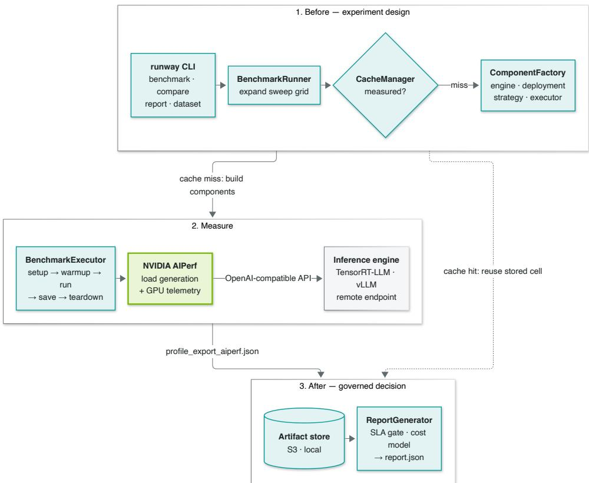
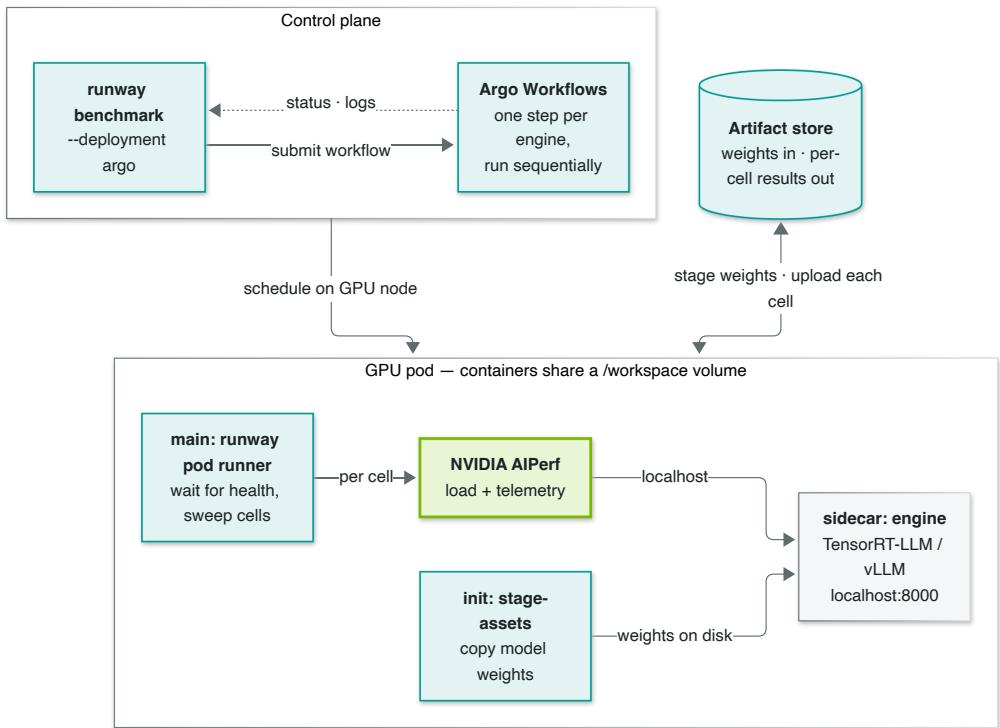
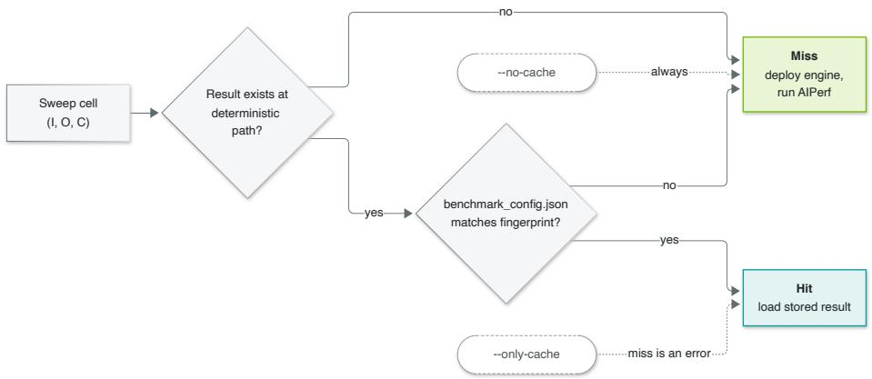

# Inference Validation for Regulated AI: Building a Decision Pipeline on NVIDIA AIPerf

Dev Akre Roman Bobalo Manoj Dobbali

MasterControl, Inc.

{dakre,rbobalo,mdobbali}@mastercontrol.com

November 9, 2026

## Abstract

Deploying large language models in regulated industries requires more than picking the fastest inference engine: it requires evidence that a configuration meets contractual and legal obligations before it serves a single customer request. We describe Runway, an internal validation harness built at MasterControl that builds a governed decision pipeline around NVIDIA AIPerf. The key insight is separating concerns: AIPerf provides the trusted measurement, while Runway provides the experiment design that comes before it and the compliance, cost, and audit decisions that come after. We describe the architecture and the storage model that makes caching and audit one mechanism. We report three findings from Runway sweeps: TensorRT-LLM and vLLM rankings invert with concurrency; a newer, pricier GPU instance can be the cheaper one per request; and speculative decoding behaves diferently across engines under load, so engine configuration can outweigh engine choice.

## 1 Introduction

The standard practice for deploying large language models treats inference engine selection as a one-time decision: benchmark candidates under synthetic load, select the configuration with the highest throughput, and revisit only when performance degrades. This approach assumes that faster is better and that the selection criteria are implicit. In regulated industries (pharmaceutical manufacturing, medical devices, financial compliance), neither assumption holds.

MasterControl operates a quality management platform used by over 1,200 companies in life sciences and other regulated industries [1], under rules such as 21 CFR Part 11 [2]. Every change to an inference engine, GPU instance type, or model version is a change to a validated production system. Regulators do not accept “the vendor says it’s faster” as justification; they expect objective, documented evidence that the change was evaluated against defined acceptance criteria before deployment [2, 3].

This paper describes Runway, an internal tool that turns the question “did this configuration actually meet our requirements?” into a repeatable, versioned, auditable answer. The core design decision was to not build a benchmarking engine. NVIDIA’s AIPerf [4] already exists, is opensource, and is maintained by the same organization that builds the GPUs and inference runtimes we deploy on. Instead, Runway builds a governed decision pipeline around an unmodified AIPerf: it designs the experiment, invokes AIPerf for the measurement, and turns the result into a release decision it can defend later.

We make two contributions:

C1. A reference architecture for governed inference validation. The before–measure– after pattern, a storage layout in which caching and audit are one mechanism, and campaigns that make a decision question a reviewable artifact (§3–§5).

C2. Empirical findings on configuration selection. Engine rankings invert with concurrency; the more expensive GPU instance wins on cost per request; and speculative decoding separates the engines under load (§6).

## 2 Background: The Measurement Problem

## 2.1 Why LLM Inference Validation Is Diferent

Three properties of LLM inference are well known: performance depends on token shape, since latency grows with output length and time-to-first-token with input length [5]; outputs are non-deterministic even at temperature zero, so repeated runs are not the same workload [6]; and speed is not quality, since a quantized model can match average accuracy yet flip individual answers [7]. Quality evaluation is outside the scope of this paper; a performance gate is necessary but not suficient. Two further properties shape Runway’s design.

Synthetic load is not real load. Production trafic has a specific distribution of prompt types, context lengths, and output expectations. Subtle details matter: engines reuse cached attention state only for an identical prompt prefix [8, 9], so a system prompt placed first enables prefix caching, while the same content placed after a per-request field defeats it, changing timeto-first-token dramatically. Validation must use data that matches production as closely as possible, or explicitly acknowledge what it does not cover.

Results must be traceable. When asked “why did you deploy engine X instead of engine Y,” the answer must be a retrievable artifact that shows the comparison, the acceptance criteria, and the pass/fail determination. Part 11 itself requires validated systems and secure, timestamped audit trails [2].

## 2.2 NVIDIA AIPerf

NVIDIA AIPerf [4], the successor to GenAI-Perf, is an open-source benchmark harness for large language model inference. It generates load against an OpenAI-compatible endpoint, measures time-to-first-token, inter-token latency, and end-to-end request latency at multiple percentiles, reports throughput in requests and tokens per second, and samples GPU telemetry alongside [10, 11]. NVIDIA recommends it for benchmarking generative-AI inference and uses it in its own NIM benchmarking guide [12].

While AIPerf owns the measurement, what a regulated deployment adds around a measurement is process: deciding which configurations to test, judging whether a result passes, and keeping the evidence retrievable. That process is what Runway supplies.

## 3 Architecture: Before, Measure, After

Runway is a Python CLI organized around three phases (Figure 1): before the run, sweep expansion and cache lookup; the measurement, delegated entirely to AIPerf; and after the run, storage, SLA evaluation, and cost modeling. The separation means the measurement comes from NVIDIA’s own tooling (we did not build a load generator, so we do not have to defend one to auditors), while the decision logic is ours to change without modifying upstream code.

## 3.1 Before: Experiment Design

A sweep is declared as lists of values for each axis:

  
Figure 1: Runway system overview. Each phase is a separate layer; AIPerf is the only component that touches the engine under test. A cache hit skips measurement entirely.

## Listing 1: Declaring a sweep

runway benchmark --model Qwen/Qwen3-8B-FP8 \   
--engines vllm,tensorrt-llm@1.2.1 \   
--instance-type g6e.xlarge --deployment argo \   
--input-tokens 128,512,1024 --output-tokens 128,512,1024,2048 \   
--concurrency 1,5,10,50,100 \   
--gpu-telemetry pynvml --sla sla/production.yaml

BenchmarkRunner expands this into a grid of cells (2 engines × 3 input lengths × 4 output lengths × 5 concurrency levels = 120 cells) and asks CacheManager which cells were already measured (§5). Only missing cells are run.

## 3.2 Measure: AIPerf, Unmodified

BenchmarkExecutor runs every cell through the same fixed lifecycle (a Template Method): set up the deployment, start the engine and wait for health, warm up, run, save, tear down. Results are therefore comparable by construction. For each cell it invokes AIPerf as a subprocess; the command below is the one Runway recorded for one of the cells in §6:

Listing 2: AIPerf invocation for one cell, as recorded

```shell
aiperf profile --model ’Qwen/Qwen3-8B-FP8’ --url ’http://vllm-benchmark:8000’ \
--endpoint-type ’chat’ --streaming --concurrency 1 \
--isl 1024 --osl 1024 --tokenizer ’Qwen/Qwen3-8B-FP8’ \
--gpu-telemetry ’pynvml’ --artifact-dir ’/workspace/artifacts/result_i1024_o1024_c1’
```

Runway reads AIPerf’s profile\_export\_aiperf.json directly, with no recalculation. The SLA gate, cost model, and comparison tables all use exactly what AIPerf reported. Engines (TensorRT-LLM, vLLM, or a remote endpoint) and deployment targets are adapters behind one interface each, so both engines are benchmarked under identical load profiles. When GPU telemetry is enabled [11], it also records the device name, which is how the results below are tied to specific hardware.

  
Figure 2: Argo Workflows execution. The engine and AIPerf share the pod, so load is generated over localhost.

<sup>fl</sup>On Argo Workflows [13] on EKS (Figure 2), an init container stages the model weights, the engine runs as a sidecar on the pod’s shared network, and Runway and AIPerf run in the main container against localhost, with no network hop between the thing being measured and the thing measuring it. Engines run as sequential steps, so they never contend for the GPU, and each cell uploads as soon as it finishes, so an interrupted sweep keeps its completed cells.

## 3.3 After: SLA Evaluation and Cost

Results are evaluated against a declarative, versioned SLA file:

```yaml
Listing 3: SLA definition (abridged)
name: production
version: 1.2.0
thresholds:
- metric: request_latency_p95
operator: "<="
value: 2.5
severity: critical
- metric: ttft_p50
operator: "<="
value: 150.0
severity: warning
```

Each threshold names an AIPerf metric and statistic, a comparison operator, and a severity (critical, warning, or info). The run rolls up to pass, partial (no critical violation, but a

warning violated or a metric missing), or fail. A cost model prices the run from live AWS prices. Each run’s report.json records the SLA name, version, and verdict alongside cost and engine configuration, so “what thresholds were in efect when we shipped” has a stored answer.

For decisions that span runs, runway compare varies one dimension (model, engine, instance type, or experiment) and marks the winner per metric. It lists result paths first and loads only the matching cells, so a comparison over hundreds of cells needs no GPU and takes seconds.

## 4 Configuration and Campaigns

Engine settings live in one YAML file per engine and model, passed to trtllm-serve or vllm serve unchanged. A model spec bundles a recurring sweep into one file and can pass AIPerf options straight through (for example, token-length spread instead of fixed lengths). A single versions.yaml pins the engine images and the AIPerf release; the version is part of every result path, so results from diferent versions never mix. Workloads are either synthetic token shapes generated by AIPerf or an uploaded prompt set, single- or multi-turn; the dataset name is the first path segment, and reports refer to datasets only by name, so a report can be shared without its prompts.

A single sweep answers “how fast?”. A campaign answers a decision question such as “does speculative decoding pay of for this workload?” and is kept as a directory of reviewable text:

• manifest.yaml: the contract, holding the question, model, engine versions, sweep settings, datasets with measured input/output lengths, and the comparison structure. A leg fixes one hardware, dataset, and cache regime; each arm is one engine configuration within it, with its own provenance.

• configs/: engine configurations exactly as submitted.

• run.sh: how to reproduce; FINDINGS.md: numbers, recommendation, caveats.

A validator rejects any manifest in which two arms would write to the same result prefix, a collision that would otherwise silently overwrite one arm with another. The findings in §6.3 come from two such campaigns.

## 5 Result Storage and Caching

Every cell’s result lands at a deterministic path (Figure 3). The path answers what was measured: dataset, instance, model, engine, version, optional experiment name, and the cell’s input length, output length, and concurrency. A second file next to AIPerf’s output, benchmark\_config.json, records how: streaming, extra AIPerf arguments, duration, dataset format, warm-up, and the engine configuration.

The same layout makes caching and audit one mechanism. Before deploying anything, CacheManager checks each cell (Figure 4): the result must exist and its fingerprint must match the requested run. The fingerprint compares the settings that change what AIPerf measures (streaming, aiperf\_extra\_args, benchmark\_duration, custom\_dataset\_type). The engine configuration is recorded but not compared; a run with a diferent engine configuration takes an --experiment name, which adds a path segment and so a fresh cache slot. The rule generalizes: anything that changes a result must change either its path or its fingerprint.

A full hit reproduces a report without a GPU. The cost is that a repeated run at the same configuration returns the stored numbers rather than a new measurement, so each cell has exactly one independent measurement unless --no-cache is used (§7).

s3://<bucket>/runway/ benchmarks/<dataset>/<instance>/<model>/<engine>/<version>/[<experiment>/] result\_i<I>\_o<O>\_c<C>/ . one sweep cell profile\_export\_aiperf.json ................ AIPerf output, unmodified benchmark\_config.json . . cache fingerprint reports/<instance>/<org>/<model>/<engine>/<timestamp>/report.json . SLA + cost verdict datasets/<name>/dataset.txt ........ .. uploaded prompt sets campaigns/<id>/results/ . . normalized campaign snapshots

Figure 3: Artifact store layout. The path encodes what was measured; the fingerprint file records how. Synthetic sweeps use synthetic as the dataset segment.  
  
Figure 4: Per-cell cache decision. --only-cache turns any miss into an error, which lets a report be regenerated on a machine with no GPU.

## 6 Findings

We report three findings from Runway sweeps. All numbers come from stored cells; each cell is a single measurement (§5), so small diferences should be read as indicative rather than significant.

## 6.1 Engine Rankings Invert with Concurrency

Setup. vLLM 0.19.1 and TensorRT-LLM 1.2.1 at default settings on Qwen3-8B-FP8 [14], 60 matched cells: 12 token shapes (input ∈ {128, 512, 1024}, output ∈ {128, 512, 1024, 2048}) × 5 concurrency levels (1, 5, 10, 50, 100), on g6e.xlarge (NVIDIA L40S, 48 GB [15]), AIPerf 0.7.0.

<table><tr><td>Concurrency</td><td>Throughput Winner</td><td>p95 Latency Winner</td></tr><tr><td>1</td><td>TensorRT-LLM (+35%)</td><td>TensorRT-LLM (12/12)</td></tr><tr><td>5</td><td>TensorRT-LLM (+13%)</td><td>TensorRT-LLM (12/12)</td></tr><tr><td>10</td><td>TensorRT-LLM (+10%)</td><td>TensorRT-LLM (12/12)</td></tr><tr><td>50</td><td>vLLM (+3%)</td><td>TensorRT-LLM (7/12)</td></tr><tr><td>100</td><td>vLLM (+19%)</td><td>vLLM (12/12)</td></tr></table>

Table 1: Engine comparison across concurrency levels. Throughput advantage is the winner’s mean throughput ratio over the 12 token shapes; latency winner counts wins out of 12 shapes.

<sup>fi</sup>The crossover occurs between concurrency 10 and 50. Both engines implement a paged KV cache and continuous (in-flight) batching [16, 17], so we read it as a default scheduler setting rather than an architectural diference, though these sweeps do not isolate the cause. At low concurrency, TensorRT-LLM’s per-token speed dominates. At high concurrency, its default scheduler policy, GUARANTEED\_NO\_EVICT, uses the KV cache conservatively, guaranteeing that a started request is never paused, and so admits fewer requests at once [18]. §6.3 shows how much a diferent policy changes the picture.

A single-concurrency benchmark can therefore pick either engine depending on the level chosen; engine selection should follow the deployment’s concurrency profile, and comparisons should test several levels, as NVIDIA’s NIM benchmarking guidance already recommends [5].

## 6.2 The Pricier Instance Is Cheaper per Request

Setup. The same model on vLLM 0.19.1, 80 matched cells (16 token shapes, input up to 4,096, × 5 concurrency levels) on g6e.xlarge (NVIDIA L40S) and g7e.2xlarge (NVIDIA RTX PRO 6000 Blackwell Server Edition, 96 GB [19]). The cost model priced them at \$1.861 and \$3.363 per hour (us-west-2, Linux on demand, as of 2026-09 [20]), a 1.81× premium for g7e.

<table><tr><td>Concurrency</td><td>Throughput</td><td>p50 Latency</td><td>Cost per Request</td></tr><tr><td>1</td><td>2.13×</td><td>0.47×</td><td>0.85×</td></tr><tr><td>5</td><td>1.82×</td><td>0.55×</td><td>0.99×</td></tr><tr><td>10</td><td>1.85×</td><td>0.54×</td><td>0.98×</td></tr><tr><td>50</td><td>1.94×</td><td>0.52×</td><td>0.93×</td></tr><tr><td>100</td><td>2.04×</td><td>0.49×</td><td>0.88×</td></tr></table>

Table 2: g7e.2xlarge relative to g6e.xlarge, median over 16 token shapes. Cost per request is the price ratio divided by the throughput ratio.

Blackwell roughly doubles throughput and halves latency at every concurrency, in line with AWS’s own figure of up to 2.3× the inference performance of G6e [19], which more than pays for its price: the median cost per request is 1–15% lower (Table 2). This is the “after” phase at work. A cost-per-hour view picks the cheaper instance, while the measured cost per request picks the other one. One cell (input and output 128, concurrency 1) inverts, with g7e slower; with a single measurement per cell we cannot yet tell whether that is real.

## 6.3 Speculative Decoding: Configuration Can Outweigh Engine Choice

Setup. Two campaigns (§4) on Qwen3.5-9B [21] with one NVIDIA H100 (p5.4xlarge, 80 GB [22]): an internal entity-extraction prompt set with a shared prefix (about 3,300 input and 200 output tokens), 60-second cells, cache disabled. TensorRT-LLM 1.3.0rc23 (a prerelease; the pinned 1.2.1 did not support Multi-Token Prediction for this model) against vLLM 0.19.1, both tuned. Each ran with and without Multi-Token Prediction (MTP) [23], a form of speculative decoding [24] that uses the model’s own MTP head to draft tokens [25, 26], at five draft tokens. The model card suggests two draft tokens for vLLM [21], so the longer draft may contribute to vLLM’s result under load.

<table><tr><td>Concurrency</td><td>vLLM: MTP / baseline</td><td>TensorRT-LLM: MTP / baseline</td><td></td></tr><tr><td>1</td><td>2.16×</td><td>2.57×</td><td></td></tr><tr><td>16</td><td>1.11×</td><td>1.69×</td><td></td></tr><tr><td>32</td><td>0.92×</td><td>1.32×</td><td></td></tr><tr><td>64</td><td>0.80×</td><td>1.45×</td><td></td></tr></table>

Table 3: Throughput with MTP relative to the same engine without it.

MTP cuts TensorRT-LLM’s median inter-token latency at concurrency 1 from 6.65 to 2.18 ms, a 3× speed-up per token. Speculation pays of most when small batches leave the GPU underused [26], so both gains shrink with load, but the engines diverge in how far (Table 3). vLLM’s MTP turns into a net cost above roughly concurrency 16, while TensorRT-LLM’s stays positive at every level. So each engine’s best configuration difers in kind: vLLM performs best without MTP, TensorRT-LLM with it. At concurrency 64, vLLM’s best still leads, 20.9 against 19.3 req/s. It gets there on defaults, whereas TensorRT-LLM needed a non-default scheduler policy (MAX\_UTILIZATION instead of GUARANTEED\_NO\_EVICT [18]). The campaign notes attribute a 2.55× throughput gain to that one setting. The lesson for the comparison in Table 1 is that it holds at default settings: a single engine setting can move throughput by more than the gap between the engines.

## 7 Discussion and Limitations

Cost of a custom load generator. Before adopting AIPerf, we prototyped an in-house benchmark harness. It took three engineer-weeks to reach feature parity with AIPerf, and its correctness would still have needed independent justification during validation. Adopting AIPerf unmodified moved that efort from measurement to the decision pipeline around it.

Caching versus variance. Fingerprint caching makes reports reproducible and avoids remeasuring known cells, but it also means each cell holds exactly one measurement, so none of the results in §6 carry confidence intervals. A replication option that deliberately bypasses the cache (--replicate=N) is planned and was not available for these sweeps.

Synthetic workloads. The findings in Tables 1 and 2 use generated token shapes, not replayed production trafic, and the production token distribution has not yet been measured. They establish relative engine and instance behavior, not performance on any specific Master-Control workload.

## 8 Conclusion

Regulated AI deployments require evidence, not intuition. We described Runway, a validation harness that builds a governed decision pipeline around NVIDIA AIPerf by designing experiments before the measurement, applying declarative SLA and cost gates after, and storing every result at a path that says what it measured. The key design insight is that measurement and decision are diferent problems with diferent owners: AIPerf provides the trusted measurement, Runway provides the process around it.

The findings make the same point from the data. Engine rankings invert with concurrency, the more expensive instance can be the cheaper one per request, and one engine setting can outweigh the choice of engine. Each of these is invisible to a single-point benchmark and plain in a governed sweep.

Runway is an internal tool at MasterControl and is not currently open-source. We welcome inquiries from practitioners building similar harnesses in regulated settings.

## References

[1] MasterControl, “MasterControl Strengthens Executive Leadership Team with Two Key Appointments,” Press release, May 2026, accessed: 2026-09. [Online]. Available: https://www.mastercontrol.com/news/mastercontrol-strengthens-executive-teamtwo-key-appointments

[2] U.S. Government, “Electronic Records; Electronic Signatures,” Code of Federal Regulations, Title 21, Part 11, via eCFR, accessed: 2026-09. [Online]. Available: https://www.ecfr.gov/current/title-21/chapter-I/subchapter-A/part-11

[3] U.S. Food and Drug Administration, “Computer Software Assurance for Production and Quality Management System Software: Guidance for Industry and Food and Drug Administration Staf,” Feb. 2026, accessed: 2026-09. [Online]. Available: https://www.fda.gov/regulatory-information/search-fda-guidance-documents/ computer-software-assurance-production-and-quality-management-system-software

[4] NVIDIA, “AIPerf,” GitHub repository, accessed: 2026-09. [Online]. Available: https: //github.com/ai-dynamo/aiperf

[5] ——, “NVIDIA NIM LLMs Benchmarking Guide: Parameters and Best Practices,” accessed: 2026-10. [Online]. Available: https://docs.nvidia.com/nim/benchmarking/llm parameters

[6] H. He and Thinking Machines Lab, “Defeating nondeterminism in LLM inference,” Thinking Machines Lab: Connectionism, Sep. 2025, accessed: 2026-09. [Online]. Available: https://thinkingmachines.ai/blog/defeating-nondeterminism-in-llm-inference

[7] A. Dutta, S. Krishnan, N. Kwatra, and R. Ramjee, “Accuracy is not all you need,” in Advances in Neural Information Processing Systems (NeurIPS), 2024.

[8] vLLM Project, “Automatic Prefix Caching,” accessed: 2026-09. [Online]. Available: https://docs.vllm.ai/en/latest/features/automatic\_prefix\_caching/

[9] NVIDIA, “KV Cache System,” TensorRT-LLM documentation, accessed: 2026-10. [Online]. Available: https://nvidia.github.io/TensorRT-LLM/features/kvcache.html

[10] ——, “AIPerf Metrics Reference,” accessed: 2026-09. [Online]. Available: https: //github.com/ai-dynamo/aiperf/blob/main/docs/metrics-reference.md

[11] ——, “AIPerf GPU Telemetry Tutorial,” accessed: 2026-09. [Online]. Available: https://github.com/ai-dynamo/aiperf/blob/main/docs/tutorials/gpu-telemetry.md

[12] ——, “NVIDIA NIM LLMs Benchmarking Guide: Overview,” accessed: 2026-10. [Online]. Available: https://docs.nvidia.com/nim/benchmarking/llm/overview

[13] Argo Project, “Argo Workflows: The Workflow Engine for Kubernetes,” accessed: 2026-09. [Online]. Available: https://argo-workflows.readthedocs.io/en/latest/

[14] A. Yang et al., “Qwen3 technical report,” arXiv preprint arXiv:2505.09388, 2025.

[15] Amazon Web Services, “Amazon EC2 G6e Instances,” accessed: 2026-09. [Online]. Available: https://aws.amazon.com/ec2/instance-types/g6e/

[16] W. Kwon et al., “Eficient memory management for large language model serving with PagedAttention,” in Proc. SOSP, 2023.

[17] NVIDIA, “Paged Attention, IFB, and Request Scheduling,” TensorRT-LLM documentation, accessed: 2026-10. [Online]. Available: https://nvidia.github.io/TensorRT-LLM/features paged-attention-ifb-scheduler.html

[18] ——, “Useful Runtime Options: Capacity Scheduler Policy,” TensorRT-LLM Performance Tuning Guide, accessed: 2026-09. [Online]. Available: https://nvidia.github.io/TensorRT-LLM/performance/performance-tuning-guide/useful-runtime-flags.html

[19] Amazon Web Services, “Amazon EC2 G7e Instances,” accessed: 2026-09. [Online]. Available: https://aws.amazon.com/ec2/instance-types/g7e/

[20] ——, “Amazon EC2 On-Demand Pricing,” accessed: 2026-09. [Online]. Available: https://aws.amazon.com/ec2/pricing/on-demand/

[21] Qwen Team, “Qwen3.5-9B Model Card,” Hugging Face, accessed: 2026-09. [Online]. Available: https://huggingface.co/Qwen/Qwen3.5-9B

[22] Amazon Web Services, “Amazon EC2 P5 Instances,” accessed: 2026-09. [Online]. Available: https://aws.amazon.com/ec2/instance-types/p5/

[23] F. Gloeckle et al., “Better & faster large language models via multi-token prediction,” in Proc. 41st International Conference on Machine Learning (ICML), ser. PMLR, vol. 235, 2024, pp. 15 706–15 734.

[24] Y. Leviathan, M. Kalman, and Y. Matias, “Fast inference from transformers via speculative decoding,” in Proc. ICML, 2023.

[25] vLLM Project, “MTP (Multi-Token Prediction),” accessed: 2026-09. [Online]. Available: https://docs.vllm.ai/en/latest/features/speculative\_decoding/mtp/

[26] NVIDIA, “Speculative Decoding,” TensorRT-LLM documentation, accessed: 2026- 09. [Online]. Available: https://nvidia.github.io/TensorRT-LLM/features/speculativedecoding.html