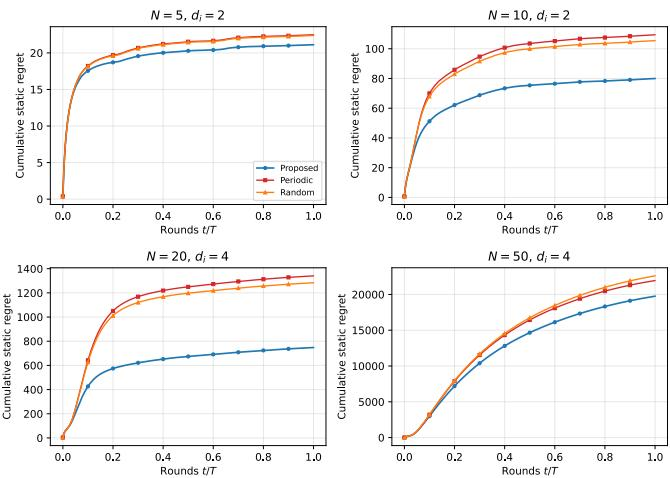

# KKT-Perturbation-Aware Communication for Fully Distributed Online Convex Optimization with Nonseparable Coupling

Zhaoye Pan1, Tao Li1,†, Member, IEEE, Yunjie Guo2, and Guanpu Chen3, Member, IEEE

Abstract— Nonseparable costs and coupled constraints in distributed online convex optimization often arise when system performance and operational constraints depend on the joint configuration of all agents and cannot be decomposed into individual contributions. Such nonseparability leads to fully distributed decision-making with challenging partial local information, where each agent evaluates its local primal–dual update using estimated global information via a local belief of the joint action and the shared Lagrange multiplier to be exchanged with neighbors. While the belief consensus established by prior works ensures no-regret learning, exchanging beliefs comprising full-dimensional primal and dual states at every round imposes a communication overhead that scales with both the joint decision dimension and the network size. Existing event-triggered schemes typically activate communication according to state variation or consensus error. Under nonseparable coupling, however, errors of equal magnitude can produce markedly different perturbations after passing through the KKT operator. We therefore propose a randomized KKT-perturbation-aware communication mechanism, where the triggering of each agent’s primal and dual communication channels depends on their impact on the KKT operator. The proposed mechanism transfers the adaptive-sampling principle of coordinate descent from allocating computation across decision blocks to allocating communication across information channels: channels with larger estimated perturbations receive greater priority for refresh. Under standard regularity assumptions, the resulting algorithm achieves ${ \cal O } ( T ^ { 2 / 3 } )$ expected static regret and $O ( T ^ { 2 / 3 } )$ expected cumulative constraint violation. Numerical experiments demonstrate improved learning and constraint-enforcement performance per transmitted bit over belief consensus baselines.

## I. INTRODUCTION

Distributed online convex optimization (D-OCO) provides a standard framework for multi-agent sequential decisionmaking under uncertainty, with applications spanning cyberphysical network systems [1]. In D-OCO with time-varying coupled constraints, a network of agents repeatedly selects local actions, after which a global cost and a vector of shared constraint functions are revealed, and the agents seek to minimize the cumulative cost while keeping the long-term constraint violation growth sublinear [2]–[5]. Most existing formulations assume that both the objective and the coupled constraints are separable, i.e., expressed as sums of agentspecific local functions [3]. Under separability, each agent’s partial gradient of the global objective coincides with the gradient of its local cost, so that gradient-based primal– dual updates can be assembled from local information and neighbor communication.

The separability assumption, however, fails to capture team-based decision-making problems in which system performance and safety depend on the joint configuration of all agents and cannot be decomposed into agent-specific contributions. A concrete instance is the multi-camera cooperative traffic sensing studied in [6], [7], where networked pan-tilt cameras are tilted to different road segments to maximize urban-level traffic volume coverage. Such a sensing metric cannot be decomposed into camera-specific objectives. Essentially, nonseparability arises from the agent-agnostic and symmetric structure of large-population systems [8], [9] and from distributed equilibrium seeking in games [10]–[14].

Nonseparability leads to a challenging information structure for multi-agent decision making [15], referred to as fully distributed optimization under partial-decision information [11]. Each agent can access only the decisions of its neighbors, from which the global quantities of interest must be estimated. A common estimation scheme shared by prior works on fully distributed optimization relies on belief consensus, where each agent maintains and exchanges their local estimates of joint actions and shared Lagrangian multipliers [10], [11], [14], [16]. The price to pay is the increasing communication overhead with respect to the number of agents and action space dimension.

To address the communication overhead, there exist two lines of work on communication-efficient mechanisms; yet, neither is well aligned with the nonseparable setting. Eventtriggered communication [17]–[19] activates transmission according to the state variation, the discrepancy between the current state and its last transmitted or cached value, possibly with dynamic, adaptive, or switching thresholds. The triggering threshold design refines the timing of communication, yet the underlying communication priority remains governed by state variation. Compressed communication methods [20]– [22] reduce the payload of each message, typically under iteration-wise or prescribed transmission schedules, and do not address when a channel is worth activating.

Our key observation is that, under nonseparable coupling, state variation is not an adequate measure of the impact of stale information: two state errors of equal magnitude can produce markedly different perturbations once passed through the KKT operator, because the agent’s local update depends on the global gradient, the constraint Jacobian, and the current multiplier. A barely changing belief may require no transmission, whereas a small dual variable drift that shifts the constraint-price term in the primal direction must be refreshed promptly. Triggers based on state variation therefore may misallocate communication resources under nonseparable coupling.

We propose a KKT-perturbation-aware communication mechanism for fully distributed optimization under timevarying, nonseparable costs and constraints. Each agent possesses two communication channels: a primal-belief channel and a dual channel. We define its impact as the perturbation that retaining the stale cached value would induce on the local KKT operator surrogate using the revealed feedback. The perturbation-based impact is then mapped to channel activation probabilities, which are closely connected to coordinate-sampling probabilities in randomized coordinate descent [23], [24].

Our contributions are summarized as follows.

• KKT-perturbation-aware communication: To account for the nonseparability in distributed online convex optimization, we measure the impact of each agent’s communication channels on the KKT operator by quantifying the perturbation induced by stale, cached primal and dual states, and we map this perturbation to adaptive channel activation sampling to reduce communication.

• Optimization-theoretic interpretation: We connect the proposed mechanism to adaptive sampling in randomized coordinate descent, and show in Prop. 3.1 that the activation probabilities preserve the channel-priority ordering induced by a centralized communicationallocation problem.

• Regret guarantees: Under standard regularity and a uniform Slater condition, the KKT perturbation-aware algorithm achieves $O ( T ^ { 2 / 3 } )$ expected static regret and $O ( T ^ { 2 / 3 } )$ expected cumulative constraint violation (CCV) (Thm. 4.3 and Thm. 4.4).

• Numerical validation: Experiments on a distributed quadratic program with dense coupling show that, under a matched communication budget, the proposed mechanism consistently incurs smaller cumulative regret than the baseline belief-consensus algorithms across different network sizes.

Related works. Distributed online optimization with timevarying coupled constraints has been studied under separable objectives and constraints in [2], [3], with bandit feedback in [25], and the optimal $O ( \sqrt { T } )$ regret–cumulative constraint violation (CCV) trade-off for the single-agent case was settled in [5]. Nonseparable global objectives in distributed (offline) optimization were addressed via coordinate descent [26] and coordinate dual averaging [10], both requiring agents to track estimates of the joint decision. [16] extended this belief-sharing idea to the online constrained setting but assumed per-round broadcasting of full states. Eventtriggered Nash equilibrium seeking under state-variation triggers was developed in [17]–[19], and compressed distributed optimization in [20]–[22]. To our knowledge, no prior work allocates communication according to the estimated perturbation of the primal–dual (KKT) operator, which is precisely the quantity that stale information corrupts in the nonseparable regime.

## II. PROBLEM FORMULATION

Consider N agents indexed by $\mathcal { V } ~ = ~ \{ 1 , \ldots , N \}$ , networked by an undirected graph $\mathcal { G } = ( \nu , \mathcal { E } )$ . At each round $t \in \mathbb { N } ,$ agent $\textit { i } \in \mathcal { V }$ selects a local action $a _ { i , t } \in \mathcal { A } _ { i } \subseteq$ $\mathbb { R } ^ { d _ { i } }$ , where $A _ { i }$ is convex and compact. The joint action is $\begin{array} { r } { a _ { t } : = \mathrm { c o l } ( a _ { 1 , t } , \dotsc , a _ { N , t } ) \in \mathcal { A } : = \prod _ { i = 1 } ^ { N } \mathcal { A } _ { i } \subseteq \mathbb { R } ^ { d } } \end{array}$ with $d : =$ $\textstyle \sum _ { i = 1 } ^ { N } d _ { i } .$ . After $a _ { t }$ is implemented, the environment reveals a global, nonseparable cost $f _ { t } : \mathcal { A } $ R and a vector of m nonseparable, convex constraint functions $g _ { t } : \mathcal { A }  \mathbb { R } ^ { m }$ whose k-th component is denoted by ${ g } _ { k , t }$ . The agents seek to generate $\{ a _ { t } \} _ { t = 1 } ^ { T }$ that minimizes the cumulative cost subject to the constraints in the long run:

$$
\operatorname* { m i n } _ { \{ a _ { t } \} _ { t = 1 } ^ { T } \subseteq \mathcal { A } } \sum _ { t = 1 } ^ { T } f _ { t } ( a _ { t } ) \quad \mathrm { s . t . } \ g _ { t } ( a _ { t } ) \preceq \mathbf { 0 } , \quad \forall t \in \{ 1 , . . . , T \} ,
$$

where ⪯ is componentwise. We evaluate an online distributed algorithm by the static regret

$$
\operatorname { R e g } ( T ) : = \sum _ { t = 1 } ^ { T } \left[ f _ { t } ( a _ { t } ) - f _ { t } ( a ^ { \star } ) \right] ,
$$

where $a ^ { \star } \in$ arg $\begin{array} { r } { \operatorname* { m i n } _ { a \in \mathcal { A } } \{ \sum _ { t = 1 } ^ { T } f _ { t } ( a ) : g _ { t } ( a ) \ \preceq \ \mathbf { 0 } , \ \forall t \} } \end{array}$ is the best fixed feasible joint action in hindsight, and by the componentwise cumulative constraint violation

$$
\mathrm { C C V } _ { k } ( T ) : = \left[ \sum _ { t = 1 } ^ { T } g _ { k , t } ( a _ { t } ) \right] _ { + } , \qquad k \in \{ 1 , \ldots , m \} ,
$$

where $[ z ] _ { + } : = \operatorname* { m a x } \{ 0 , z \}$ . Our standing assumptions are standard in distributed online constrained optimization [3].

Assumption 2.1: The following regularity and constraint qualification conditions hold. (i) For every t, the functions $f _ { t }$ and $g _ { k , t } , \ k \ \in \ \left\{ 1 , \ldots , m \right\}$ , are convex and continuously differentiable on ${ \mathcal { A } } .$ The set $\begin{array} { r } { A = \prod _ { i = 1 } ^ { N } \mathcal { A } _ { i } } \end{array}$ is compact and convex, with diameter $D _ { \mathcal { A } }$ . There exist constants $G _ { f } , G _ { g } , G _ { H } , L _ { f } , L _ { g } , L _ { \nabla g } > 0$ , such that, for all $x , x ^ { \prime } \in { \mathcal { A } }$ and all $t ,$

$$
\begin{array} { r l } & { \| \nabla f _ { t } ( x ) \| \leq G _ { f } , \| \nabla g _ { t } ( x ) \| _ { \mathrm { F } } \leq G _ { g } , \| g _ { t } ( x ) \| \leq G _ { H } , } \\ & { \| \nabla f _ { t } ( x ) - \nabla f _ { t } ( x ^ { \prime } ) \| \leq L _ { f } \| x - x ^ { \prime } \| , } \\ & { \| g _ { t } ( x ) - g _ { t } ( x ^ { \prime } ) \| \leq L _ { g } \| x - x ^ { \prime } \| , } \\ & { \| \nabla g _ { t } ( x ) - \nabla g _ { t } ( x ^ { \prime } ) \| _ { \mathrm { F } } \leq L _ { \nabla g } \| x - x ^ { \prime } \| . } \end{array}
$$

(ii) A uniform Slater condition holds: there exist $\bar { a } \in \mathcal A$ and $\varepsilon _ { \mathrm { S } } > 0$ such that $g _ { t } ( \bar { a } ) \preceq - \varepsilon _ { \mathrm { S } } \mathbf { 1 } _ { m } , \forall t$ . The dual iterates are projected onto $\Lambda : = [ 0 , \Lambda _ { \operatorname* { m a x } } ] ^ { m }$ , where $\Lambda _ { \mathrm { m a x } }$ is chosen sufficiently large so that the projection does not exclude the optimal multipliers under the uniform Slater condition [2], and [16, Prop. 1] presents a characterization of such $\Lambda _ { \mathrm { m a x } }$

(iii) The graph G is connected and undirected. The mixing matrix $W ~ = ~ [ w _ { i j } ]$ is symmetric, doubly stochastic, and compatible with $\mathcal { G }$ . Its second-largest eigenvalue modulus satisfies $\sigma : = \operatorname* { m a x } \{ | \lambda _ { 2 } ( W ) | , \ldots , | \lambda _ { N } ( W ) | \} \in [ 0 , 1 )$ . The proposed framework can be generalized to directed graphs by replacing the doubly stochastic belief-consensus step with a push-sum-type mechanism [10], [27].

Notation: $\Pi _ { \mathcal { S } }$ denotes the Euclidean projection onto a closed convex set $s , \parallel \cdot \parallel$ the Euclidean norm, $\Vert \cdot \Vert _ { \mathrm { F } }$ the Frobenius norm, $I _ { d }$ the $d { \times } d$ identity, ⊗ the Kronecker product, and $\mathsf { R } _ { i } = [ \mathbf { 0 } , I _ { d _ { i } } , \mathbf { 0 } ] \in \mathbb { R } ^ { d _ { i } \times d }$ the block-selection matrix with $\mathsf { R } _ { i } x = x _ { i }$ , whose transpose $\mathsf { U } _ { i } : = \mathsf { R } _ { i } ^ { \top }$ injects a block $x _ { i }$ back into $\mathbb { R } ^ { d }$ with all other entries being zeros. Similarly, we have $\mathsf { R } _ { - i } = \mathrm { c o l } ( \mathsf { R } _ { 1 } , \ldots , \mathsf { R } _ { i - 1 } , \mathsf { R } _ { i + 1 } , \ldots , \mathsf { R } _ { N } ) \in \mathbb { R } ^ { ( d - \bar { d } _ { i } ) \times d }$ and $\begin{array} { l l l l l l } { \mathsf { U } _ { - i } } & { : = } & { \mathsf { R } _ { - i } ^ { \top } } & { = } & { [ \mathsf { U } _ { 1 } , \ldots , \mathsf { U } _ { i - 1 } , \mathsf { U } _ { i + 1 } , \ldots , \mathsf { U } _ { N } ] . } & { \mathcal { N } _ { i } } \end{array}$ denotes the set of neighboring nodes of i. Each agent communicates over two channels indexed by $c \in \{ z , \lambda \}$ carrying the primal belief and the dual variable, and we write $x _ { i , t } ^ { z } : = z _ { i , t }$ and $x _ { i , t } ^ { \lambda } : = \lambda _ { i , t }$ for the channel states. Stacked vectors are denoted by dropping the agent index, e.g., $Z _ { t } : = \mathrm { c o l } ( z _ { 1 , t } , \dots , z _ { N , t } )$

## III. PERTURBATION-AWARE COMMUNICATION

Our starting point is the full-communication beliefconsensus in [16], which we briefly review in the following. Since $f _ { t }$ and $g _ { t }$ are nonseparable, agent i cannot evaluate its Lagrangian partial gradient from its own action alone and hence maintains a belief of the joint action,

$$
z _ { i , t } : = \mathrm { c o l } \big ( z _ { i , t } ^ { 1 } , \dots , z _ { i , t } ^ { N } \big ) \in \mathcal { A } , \qquad z _ { i , t } ^ { i } = a _ { i , t } ,
$$

where the block $z _ { i , t } ^ { i }$ is the implemented action and the remaining blocks are the estimates of other agents’ actions, together with a local copy ${ \lambda } _ { i , t } \succeq \mathbf { 0 }$ of the shared multiplier. All agents exchange their current $\left( z _ { i , t } , \lambda _ { i , t } \right)$ at every round.

To reduce the communication overhead, we here equip each agent with two communication channels: a primalbelief channel carrying $z _ { i , t }$ and a dual channel carrying $\lambda _ { i , t }$ . Unlike prior works [11], [14], [16], we allow each channel to remain silent for multiple rounds. During the online decision-making, agent i keeps a sender-side reference $s _ { i , t } ^ { z } \in \mathcal { A }$ and $s _ { i , t } ^ { \lambda } \succeq \mathbf { 0 }$ , equal to its most recently transmitted states, while each neighbor $j \in \mathcal N _ { i }$ keeps receiver-side caches $\widehat { z } _ { j \vert i , t } \in \mathcal { A }$ and $\widehat { \lambda } _ { j \left| i , t \right. } \succeq \mathbf { 0 }$ . The two-sided states are initialized consistently, $\widehat { z } _ { j \mid i , 1 } \ = \ s _ { j , } ^ { z }$ 1 and $\widehat { \lambda } _ { j \vert i , 1 } \ = \ s _ { j , 1 } ^ { \lambda }$ , and perform updates: for $c \in \{ z , \lambda \}$

$$
s _ { i , t + 1 } ^ { c } = \xi _ { i , t } ^ { c } x _ { i , t } ^ { c } + \big ( 1 - \xi _ { i , t } ^ { c } \big ) s _ { i , t } ^ { c } ,\tag{1a}
$$

$$
\begin{array} { r } { \widehat { x } _ { j | i , t + 1 } ^ { c } = \xi _ { j , t } ^ { c } x _ { j , t } ^ { c } + \big ( 1 - \xi _ { j , t } ^ { c } \big ) \widehat { x } _ { j | i , t } ^ { c } , } \end{array}\tag{1b}
$$

where $x _ { i , t } ^ { z } : = z _ { i , t } , x _ { i , t } ^ { \lambda } : = \lambda _ { i , t } .$ , and $\xi _ { i , t } ^ { z } , \xi _ { i , t } ^ { \lambda } \in \{ 0 , 1 \}$ are the channel activation indicators: when $\xi _ { i , t } ^ { c } ~ = ~ 1$ , agent i broadcasts its current state on channel c and both sender references and receiver caches are refreshed; when $\xi _ { i , t } ^ { c } = 0$ nothing is transmitted and all parties retain the stale value. By induction, (1) preserves $\widehat { x } _ { j \mid i , t } ^ { c } = s _ { j , t } ^ { c }$ for every receiver, so a channel is stale by exactly the same amount at the sender and at all of its neighbors.

The communicated information enters the online optimization procedure only through the cache-fused consensus states

$$
\widetilde { z } _ { i , t } : = \left( 1 - w _ { i i } \right) \mathsf { U } _ { i } a _ { i , t } + w _ { i i } \mathsf { z } _ { i , t } + \sum _ { j \in \mathcal { N } _ { i } } { w _ { i j } } \mathsf { U } _ { - i } [ \widehat { \mathsf { z } } _ { j | i , t + 1 } ] _ { - i } ,\tag{2a}
$$

$$
\widetilde { \lambda } _ { i , t } : = w _ { i i } \lambda _ { i , t } + \sum _ { j \in \mathcal { N } _ { i } } w _ { i j } \widehat { \lambda } _ { j | i , t + 1 } ,\tag{2b}
$$

i.e., the self-block of $\widetilde { z } _ { i , t }$ is overridden by the implemented action, $[ \widetilde { z } _ { i , t } ] _ { i } = a _ { i , t }$ , and only the other agents’ blocks are fused from the caches. Here, $\mathsf { U } _ { - i }$ embeds a block vector of dimension $d - d _ { i }$ into $\mathbb { R } ^ { d }$ with a zero i-th block. Because every term on the right-hand side of $( 2 )$ is a previously implemented feasible state, $\widetilde { z } _ { i , t } \in \mathcal { A }$ and $\widetilde { \lambda } _ { i , t } \succeq \mathbf { 0 }$ hold naturally, and no projection is required. After $a _ { t }$ is implemented and $\left( f _ { t } , g _ { t } \right)$ is revealed, agent i evaluates its local primal direction at the fused state,

$$
d _ { i , t } : = \nabla _ { a _ { i } } f _ { t } ( \widetilde { z } _ { i , t } ) + \nabla _ { a _ { i } } g _ { t } ( \widetilde { z } _ { i , t } ) ^ { \top } \widetilde { \lambda } _ { i , t } ,\tag{3}
$$

and performs the projected blockwise updates

$$
a _ { i , t + 1 } = \Pi _ { \boldsymbol { A } _ { i } } \Big [ a _ { i , t } - \alpha _ { t } d _ { i , t } \Big ] ,\tag{4a}
$$

$$
z _ { i , t + 1 } = \widetilde { z } _ { i , t } + \mathsf { U } _ { i } \big ( a _ { i , t + 1 } - a _ { i , t } \big ) ,\tag{4b}
$$

$$
\lambda _ { i , t + 1 } = \Pi _ { \Lambda } \Big [ \lambda _ { i , t } + \beta _ { t } g _ { t } \big ( \widetilde { z } _ { i , t } \big ) \Big ] ,\tag{4c}
$$

where $\left\{ \alpha _ { t } \right\}$ and $\{ \beta _ { t } \}$ are primal and dual stepsizes and $\mathsf { U } _ { i }$ injects the updated self-block into the belief while maintaining the fused estimates of all other blocks. Thus, relative to [16], the primal–dual update remains largely unchanged except that exact neighbor states are replaced by cached ones. When $\xi _ { i , t } ^ { z } = \xi _ { i , t } ^ { \lambda } = 1$ for all i and t, the update (4) reduces to the full-communication belief consensus [11], [16].

KKT-perturbation triggering: Key to our communication mechanism is the impact of a stale channel, which points to the perturbation it induces on the primal–dual operator. Define the smooth forward part of the stage-t KKT operator as $\mathcal { B } _ { t } ( x , \lambda ) : = \mathrm { c o l } \big ( \nabla f _ { t } ( x ) + \nabla g _ { t } ( x ) ^ { \top } \lambda , - g _ { t } ( x ) \big )$ . Agent i only requires its own primal block, and therefore operates on the local component

$$
\mathcal { B } _ { i , t } ^ { \mathrm { l o c } } ( x , \lambda ) : = \mathrm { c o l } \Big ( \nabla _ { a _ { i } } f _ { t } ( x ) + \nabla _ { a _ { i } } g _ { t } ( x ) ^ { \top } \lambda , - g _ { t } ( x ) \Big ) .\tag{5}
$$

Errors of equal magnitude can induce markedly different perturbations once passed through (5), and the two channels fail in characteristically different ways. A stale primal belief $ { \boldsymbol { { x } } } \ = \ s _ { i , t } ^ { z }$ distorts three terms of $B _ { i , t } ^ { \mathrm { l o c } }$ simultaneously: the objective gradient $\nabla _ { a _ { i } } f _ { t }$ , the multiplier-weighted constraint gradient $\begin{array} { r l } {  { \bar { \nabla } _ { a _ { i } } g _ { t } ^ { \top } \lambda . } } & { { } } \end{array}$ , and the constraint residual $g _ { t }$ that drives the dual update. A stale multiplier $\lambda = s _ { i , t } ^ { \lambda } ,$ , by contrast, perturbs the primal direction through a single channel, namely the correction $\nabla _ { a _ { i } } g _ { t } ^ { \top } ( \lambda _ { i , t } - s _ { i , t } ^ { \lambda } )$ , and leaves the dual residual untouched. Most prior works use state-variation triggers, i.e., the discrepancies $\| z _ { i , t } - s _ { i , t } ^ { z } \|$ and $\| \lambda _ { i , t } - s _ { i , t } ^ { \lambda } \|$ as the triggering indicator, and are blind to this asymmetry. In contrast, our insight is that the two channels must be triggered separately, by their distinct impacts on the operator.

Specifically, since the stage-t operator is unavailable before communication, each agent i estimates its channel impact at the beginning of round t using the most recently revealed feedback $\left( f _ { t - 1 } , g _ { t - 1 } \right)$ as a surrogate:

$$
\Delta _ { i , t } ^ { z } : = \big \| \mathcal { B } _ { i , t - 1 } ^ { \mathrm { l o c } } ( z _ { i , t } , \lambda _ { i , t } ) - \mathcal { B } _ { i , t - 1 } ^ { \mathrm { l o c } } ( s _ { i , t } ^ { z } , \lambda _ { i , t } ) \big \| ,\tag{6a}
$$

$$
\Delta _ { i , t } ^ { \lambda } : = \left. \mathcal { B } _ { i , t - 1 } ^ { \mathrm { l o c } } ( z _ { i , t } , \lambda _ { i , t } ) - \mathcal { B } _ { i , t - 1 } ^ { \mathrm { l o c } } ( z _ { i , t } , s _ { i , t } ^ { \lambda } ) \right. .\tag{6b}
$$

Both impact scores are locally accessible from (3), and constitute a one-step-delayed surrogate for the operator perturbation at time t. By Assumption 2.1, they are bounded by the state variation as

$$
\begin{array} { r l } & { \Delta _ { i , t } ^ { z } \leq \left( L _ { f } + L _ { \nabla g } \left. \lambda _ { i , t } \right. \right) \left. z _ { i , t } - s _ { i , t } ^ { z } \right. + L _ { g } \Vert z _ { i , t } - s _ { i , t } ^ { z } \Vert , } \\ & { \Delta _ { i , t } ^ { \lambda } \leq G _ { g } \Vert \lambda _ { i , t } - s _ { i , t } ^ { \lambda } \Vert . } \end{array}
$$

Each score is mapped to an activation probability by

$$
p _ { i , t } ^ { c } : = p _ { \mathrm { m i n } } ^ { c } + \bigl ( 1 - p _ { \mathrm { m i n } } ^ { c } \bigr ) \varphi _ { c } \left( \frac { \Delta _ { i , t } ^ { c } } { \tau _ { i , t } ^ { c } } \right) , \qquad c \in \{ z , \lambda \} ,\tag{7}
$$

where $\varphi _ { c } : \mathbb { R } _ { + } \to [ 0 , 1 ]$ is continuous and nondecreasing with $\varphi _ { c } ( 0 ) = 0$ and li $\mathrm { n } _ { u  \infty } \varphi _ { c } ( u ) = 1 , \tau _ { i , t } ^ { c } > 0$ is a scaling factor. $p _ { \operatorname* { m i n } } ^ { c } \in ( p _ { 0 } , 1 )$ is an activation floor, with a threshold that guarantees that no channel remains indefinitely idle.

To sum up, let $\mathcal { F } _ { t } ^ { - }$ be the σ-algebra generated by all states, feedback, and communication randomness available immediately before the round-t triggering decision,

$$
\mathbb { P } \big ( \xi _ { i , t } ^ { c } = 1 \big | \mathcal { F } _ { t } ^ { - } \big ) = p _ { i , t } ^ { c } , \qquad c \in \{ z , \lambda \} ,
$$

with $\xi _ { i , 1 } ^ { z } = \xi _ { i , 1 } ^ { \lambda } = 1$ initially.

Connection to Coordinate Descent: The triggering rule (7) admits an optimization-theoretic interpretation that distinguishes it from state-variation-based scheduling: activation probabilities enter the expected algorithm dynamics as explicit allocation variables, much as adaptive sampling in randomized coordinate descent, where they appear in the conditional expected-progress bound and thereby govern the allocation of limited update opportunities across coordinates [23], [24]. Here, the scarce resource is not computation but communication: every agent performs its local primal–dual update at every round, while communication activations are limited and must be allocated across the 2N primal-belief and dual channels.

To expose this connection, stack the post-decision staleness perturbations of both channels of agent i as

$$
\begin{array} { r l } & { \varepsilon _ { i , t } : = \mathrm { c o l } \Big ( \big ( 1 - \xi _ { i , t } ^ { z } \big ) \big [ \mathcal { B } _ { i , t - 1 } ^ { \mathrm { l o c } } \big ( z _ { i , t } , \lambda _ { i , t } \big ) - \mathcal { B } _ { i , t - 1 } ^ { \mathrm { l o c } } \big ( s _ { i , t } ^ { z } , \lambda _ { i , t } \big ) \big ] , } \\ & { \qquad \big ( 1 - \xi _ { i , t } ^ { \lambda } \big ) \big [ \mathcal { B } _ { i , t - 1 } ^ { \mathrm { l o c } } \big ( z _ { i , t } , \lambda _ { i , t } \big ) - \mathcal { B } _ { i , t - 1 } ^ { \mathrm { l o c } } \big ( z _ { i , t } , s _ { i , t } ^ { \lambda } \big ) \big ] \Big ) . \qquad ( 8 ) } \end{array}
$$

Conditional on $\mathcal { F } _ { t } ^ { - }$ , both scores in (6) are fixed and the two indicators are independent Bernoulli variables, so the conditional second moment of (8) decomposes exactly as

$$
\begin{array} { r } { \mathbb { E } \big [ \| \varepsilon _ { i , t } \| ^ { 2 } \big | \mathcal { F } _ { t } ^ { - } \big ] = \big ( 1 - p _ { i , t } ^ { z } \big ) \big ( \Delta _ { i , t } ^ { z } \big ) ^ { 2 } + \big ( 1 - p _ { i , t } ^ { \lambda } \big ) \big ( \Delta _ { i , t } ^ { \lambda } \big ) ^ { 2 } . } \end{array}\tag{9}
$$

Increasing the activation probability of a channel reduces its expected contribution to the operator perturbation at the marginal rate given by its squared score. Hence, (9) is an analogue of the conditional expected-descent bound in coordinate sampling, with the probabilities $p _ { i , t } ^ { c }$ appearing as design variables rather than heuristic thresholds.

This observation suggests an idealized benchmark for the allocation of communication. Index all channels by $k \in \mathcal { C } : =$ $\{ ( i , z ) , ( i , \lambda ) : i \in \mathcal { V } \}$ , and let $\gamma _ { k , t } \geq 0$ denote the problemspecific weight associated with each channel, e.g., depending on connectivity and Lipschitz constants. Define the weighted impact $w _ { k , t } : = \gamma _ { k , t } ( \Delta _ { k , t } ) ^ { 2 }$ , the per-activation transmission cost $c _ { k , t } ~ > ~ 0 ,$ and an expected communication budget $B _ { t }$ . If channel k is not activated, its expected unresolved contribution to the operator perturbation is $( 1 - p _ { k , t } ) w _ { k , t } ;$ allocating a limited budget so as to minimize the total expected perturbation leads to the fractional-knapsack problem

$$
\operatorname* { m i n } _ { \{ p _ { k , t } \in [ 0 , 1 ] \} _ { k \in \mathcal { C } } } ~ \sum _ { k \in \mathcal { C } } ( 1 - p _ { k , t } ) w _ { k , t } \quad \mathrm { s . t . } ~ \sum _ { k \in \mathcal { C } } c _ { k , t } p _ { k , t } \leq B _ { t } .
$$

Its solutions prioritize channels by the impact-per-cost ratio $w _ { k , t } / c _ { k , t }$ and exhibit a bang–bang triggering: there exists a $\mu _ { t }$ such that the channel k is activated when $w _ { k , t } / c _ { k , t } \geq \mu _ { t } ;$ otherwise remains idle. The linear programming above thus identifies the impact-aware priority ordering over channels, and the threshold $\mu _ { t }$ prices the shared budget.

The proposed rule (7) implements this priority principle in a decentralized manner, in place of the bang–bang control, which would require centralized knowledge of all scores and of the budget. The following proposition assures that our perturbation-aware triggering preserves the priority established by the linear programming.

Proposition 3.1 (Priority-ordering consistency): Fix a round t and suppose that (i) all channels share the same transmission cost $c _ { k , t } \equiv c _ { t }$ and the same analytical weight $\gamma _ { k , t } \equiv \gamma _ { t }$ , and (ii) the triggering rule uses a common strictly increasing link function $\varphi ,$ impact scale $\tau _ { t } ,$ and activation floor $p _ { \mathrm { m i n } }$ . Then for any two channels $k , \ell \in { \mathcal { C } }$

$$
\begin{array} { r } { \begin{array} { r c l } { \Delta _ { k , t } > \Delta _ { \ell , t } } & { \implies } & { p _ { k , t } > p _ { \ell , t } , } \end{array} } \end{array}\tag{10}
$$

and the ordering of the activation probabilities coincides with the priority ordering induced by (III).

Proof: Under (i), $w _ { k , t } > w _ { \ell , t }$ if and only if $\Delta _ { k , t } \ >$ $\Delta _ { \ell , t } ,$ so both orderings are governed by the scores. Under (ii), $p _ { k , t } = \psi ( \Delta _ { k , t } )$ with $\psi ( \Delta ) : = p _ { \mathrm { m i n } } + ( 1 - p _ { \mathrm { m i n } } ) \varphi ( \Delta / \tau _ { t } )$ strictly increasing in $\Delta ,$ hence $\Delta _ { k , t } > \Delta _ { \ell , t }$ implies $p _ { k , t } \ >$ $p _ { \ell , t }$

## IV. REGRET AND CONSTRAINT VIOLATION ANALYSIS

Throughout, $\mathbb { E } [ \cdot ]$ denotes expectation over the communication randomness $\{ \xi _ { i , t } ^ { c } \}$ . We analyze (2)–(4) with the dual step (4c). All agents are initialized at a commonly known $a _ { 1 } \in { \mathcal { A } } .$

$$
z _ { i , 1 } = s _ { i , 1 } ^ { z } = a _ { 1 } , \qquad \lambda _ { i , 1 } = s _ { i , 1 } ^ { \lambda } = 0 , \qquad i \in \mathcal { V } ,\tag{11}
$$

with consistent receiver caches. We require the conditional activation probability of every channel to be at least $p _ { \mathrm { m i n } } ^ { c } \ge$ $p _ { 0 } > 0$ for some fixed $p _ { 0 } \in ( 0 , 1 )$ . We use horizon-dependent constant step sizes

$$
\alpha = \alpha _ { 0 } T ^ { - 2 / 3 } , \qquad \beta = \beta _ { 0 } T ^ { - 2 / 3 } , \qquad \alpha _ { 0 } , \beta _ { 0 } > 0 .
$$

Let $B = \Lambda _ { \operatorname* { m a x } } , M _ { B } = { \sqrt m } B , G _ { B } = \sqrt N \left( G _ { f } + G _ { g } M _ { B } \right)$ and $\begin{array} { r c l } { { \bar { \lambda } _ { t } } } & { { = } } & { { N ^ { - 1 } \sum _ { i } \lambda _ { i , t } . } } \end{array}$ . Feasibility and projection give $\lVert d _ { t } \rVert \leq G _ { B } , \lVert a _ { t + 1 } - a _ { t } \rVert \leq \alpha G _ { B }$ , and $\| \lambda _ { i , t + 1 } - \lambda _ { i , t } \| \leq$ $\beta G _ { H }$ . We measure the error of the fused information by

$$
e _ { t } ^ { 2 } = \sum _ { i } \| \widetilde { z } _ { i , t } - a _ { t } \| ^ { 2 } , \qquad h _ { t } ^ { 2 } = \sum _ { i } \| \widetilde { \lambda } _ { i , t } - \bar { \lambda } _ { t } \| ^ { 2 } ,
$$

which are referred to as the belief-to-action error and the multiplier disagreement, respectively.

We first bound the accumulated communication errors.

Lemma 4.1: Under Assumption 2.1, the activation floors and initialization, for any constant stepsizes $\alpha , \beta > 0$ and fixed B,

$$
\mathbb { E } \bigg [ \sum _ { t = 1 } ^ { T } e _ { t } ^ { 2 } \bigg ] \leq C T \alpha ^ { 2 } , \ \sum _ { t = 1 } ^ { T } \mathbb { E } [ h _ { t } ] \leq C ( \alpha \beta T ^ { 2 } + T \beta ) ,
$$

$$
\sum _ { t = 1 } ^ { T } \mathbb { E } [ e _ { t } ] \leq C T \alpha , \ \mathbb { E } [ \operatorname* { m a x } _ { t \leq T } h _ { t } ^ { 2 } ] \leq C ( \alpha ^ { 2 } \beta ^ { 2 } T ^ { 2 } + T \beta ^ { 2 } ) .
$$

The following lemma characterizes the error’s instantaneous effect on the primal–dual dynamics by a one-step inexact inequality.

Lemma 4.2: For all $a \in { \mathcal { A } }$ and $\nu \in \Lambda$ , we have

$$
\begin{array} { r l } & { \mathcal L _ { t } ( a _ { t } , \bar { \lambda } _ { t } ) - \mathcal L _ { t } ( a , \bar { \lambda } _ { t } ) + \langle g _ { t } ( a _ { t } ) , \nu - \bar { \lambda } _ { t } \rangle \leq \displaystyle \frac { V _ { t } ( \nu ) - V _ { t + 1 } ( \nu ) } { 2 \beta } } \\ & { + \displaystyle \frac { \| a _ { t } - a \| ^ { 2 } - \| a _ { t + 1 } - a \| ^ { 2 } } { 2 \alpha } + \frac { \alpha G _ { B } ^ { 2 } + \beta G _ { H } ^ { 2 } } { 2 } + R _ { t } ( a , \nu ) , } \end{array}
$$

where

$$
L _ { t } ( a , \nu ) = f _ { t } ( a ) + \langle \nu , g _ { t } ( a ) \rangle , V _ { t } ( \nu ) = N ^ { - 1 } \sum _ { i } \Vert \lambda _ { i , t } - \nu \Vert ^ { 2 } ,
$$

$$
\begin{array} { r l } & { R _ { t } ( a , \nu ) = \langle \zeta _ { t } , a - a _ { t } \rangle + \displaystyle \frac { 1 } { N } \sum _ { i } \langle g _ { i , t } - g _ { t } ( a _ { t } ) , \lambda _ { i , t } - \nu \rangle , } \\ & { \zeta _ { t } = d _ { t } - \nabla f _ { t } ( a _ { t } ) - \nabla g _ { t } ( a _ { t } ) ^ { \top } \bar { \lambda } _ { t } . } \end{array}
$$

The above three terms arise from the inexact fused information, and in particular $| R _ { t } ( a , 0 ) | \leq K _ { B } ( e _ { t } + h _ { t } )$ for a constant $K _ { B }$ depending only on $D _ { \mathbf { \nabla } A } .$ , the Lipschitz constants, $M _ { B } .$ , and $N .$

Summing the inequality of Lemma 4.2 along $( a , \nu ) =$ $( a ^ { \star } , \mathbf { 0 } )$ telescopes the two potentials and yields the static regret bound, with the step sizes balancing the initial-distance term against the accumulated dual mismatch $\alpha \beta T ^ { 2 }$ . With the condition that prevents upper clipping from discarding positive constraint increments, the same one-step inequality further yields the cumulative constraint violation bound.

Theorem 4.3 (Static regret): Suppose Assumption 2.1 holds, $B = \Lambda _ { \mathrm { m a x } } > 0$ is fixed independently of $T _ { \ast }$ , and the step sizes follow the stated rules, then for every $T \geq 1$

$$
\begin{array} { r } { \mathbb { E } [ \mathrm { R e g } ( T ) ] \leq C _ { \mathrm { r e g } } T ^ { 2 / 3 } , } \end{array}
$$

where $C _ { \mathrm { r e g } }$ is independent of $T$ and given explicitly in Appendix.

Theorem 4.4 (Cumulative constraint violation): Suppose the conditions of Theorem 4.3 hold and the box satisfies

$B > \sqrt { N H }$ , where the constant H is given explicitly in the Appendix. Then for every $k = 1 , \ldots , m$ and $T \geq 1$

$$
\begin{array} { r } { \mathbb { E } [ \mathrm { C C V } _ { k } ( T ) ] \leq C _ { \mathrm { c c v } } T ^ { 2 / 3 } , } \end{array}
$$

where $C _ { \mathrm { c c v } }$ is independent of T.

## V. NUMERICAL SIMULATION

We evaluate the mechanism on an online distributed quadratic program with dense coupling. A network of N agents, each holding $a _ { i , t } \in [ 0 , 1 ] ^ { d _ { i } }$ , faces the stage cost

$$
\begin{array} { r } { f _ { t } ( { a } ) = \frac { 1 } { 2 } \| A { a } - { b } _ { t } \| ^ { 2 } + \frac { \eta } { 2 } \| { a } - { u } _ { t } \| ^ { 2 } , \ g _ { t } ( { a } ) = \langle \mathbf { 1 } , { a } \rangle - h \preceq \mathbf { 0 } , } \end{array}
$$

where $\begin{array} { r } { A \in \mathbb { R } ^ { d \times d } , d = \sum _ { i } d _ { i } , } \end{array}$ , is a fixed dense matrix with entries drawn from $\mathcal { N } ( 0 , 1 / d )$ , so that neither the cost nor the constraint is separable across agents. We set $b _ { t } = \bar { b } +$ 0.05 sin $( t / 3 0 0 ) \substack { + 0 . 0 2 \zeta _ { t } }$ with $\zeta _ { t } \sim \mathcal { N } ( 0 , I )$ , and let $u _ { t }$ follow an $\mathbf { A R } ( 1 )$ process with weight $\eta = 0 . 0 1$ . The benchmark $a ^ { \star }$ is computed in closed form from the realized sequence.

Agents run our proposed algorithm over a ring graph with Metropolis weights, with horizon-dependent constant step sizes $\overset { \cdot } { \alpha } _ { t } = 0 . 5 \overset { \cdot } { T } ^ { - 1 / 2 } , \beta _ { t } = T ^ { - 1 / 2 }$ . We set $T = 3 0 0 0$ , link function $\varphi ( u ) = u / ( 1 + u )$ , and floor $p _ { \mathrm { m i n } } = 0 . 1 5$ . We compare three schemes under the same communication expense (the number of activated channels over the horizon): the proposed perturbation-aware algorithm; the prior work using full-communication belief consensus (DOPBC) in [16] with periodic activation, which transmits every $\lceil 1 / \rho \rceil$ -th round; and DOPBC with uniform random activation probability. Suppose the proposed algorithm activates channel $n _ { T }$ times in total over the horizon $T ,$ . We set $\rho = n _ { T } / N T$ , so that the periodic baseline transmits every $\lceil 1 / \rho \rceil$ -th round and the random baseline activates with probability $\rho ,$ ensuring all schemes share the same expected communication expense. Numerical results indicate that allocating communication via KKT perturbation, rather than via state variation, becomes increasingly effective in controlling regret as the belief dimension grows.

## VI. CONCLUSION

This paper addressed the communication overhead of belief-consensus algorithms for distributed online convex optimization with nonseparable costs and coupled constraints. We proposed a randomized KKT-perturbation-aware communication mechanism in which each primal-belief channel is activated with a probability adapted to the channel impact on the local KKT operator, estimated causally from the most recently revealed feedback, while the dual channel is augmented with deterministic overrides that preserve the sign structure of its staleness. Under standard regularity and a uniform Slater condition, the algorithm achieves $O ( T ^ { 2 / 3 } )$ expected static regret and $O ( T ^ { 2 / 3 } )$ expected cumulative constraint violation. We further showed that the triggering rule preserves the channel-priority ordering induced by an idealized communication-allocation problem, inspired by adaptive sampling in coordinate descent.

  
Fig. 1: Cumulative static regret of the proposed KKTperturbation triggering rule and belief consensus in [16] with periodic and random channel activation, under the same communication expense, i.e., the number of total activated channels over the horizon, for $\begin{array} { r l } { ( N , d _ { i } ) } & { { } = } \end{array}$ (5, 2), (10, 2), (20, 4), (50, 4).

Several directions remain open for future extension. First, the idealized allocation problem suggests enforcing the communication budget explicitly and tracking the associated price in a decentralized manner, which would upgrade the present priority principle into an online decentralized communication resource allocation mechanism. Second, the triggering mechanism developed in this work does not concern the payload, and hence combining it with compressed message sharing would further reduce communication. Third, the bandit-feedback extension, directed communication graphs, and dynamic-regret guarantees under time-varying settings are worth investigating.

## REFERENCES

[1] T. Li, G. Peng, Q. Zhu, and T. Bas¸ar, “The confluence of networks, games, and learning a game-theoretic framework for multiagent decision making over networks,” IEEE Control Systems, vol. 42, no. 4, pp. 35–67, 2022.

[2] X. Yi, X. Li, L. Xie, and K. H. Johansson, “Distributed online convex optimization with time-varying coupled inequality constraints,” IEEE Transactions on Signal Processing, vol. 68, pp. 731–746, 2020.

[3] D. Yuan, A. Proutiere, and G. Shi, “Distributed online optimization with long-term constraints,” IEEE Transactions on Automatic Control, vol. 67, no. 3, pp. 1089–1104, 2020.

[4] T. Li, G. Peng, and Q. Zhu, “Blackwell online learning for markov decision processes,” ser. 2021 55th Annual Conference on Information Sciences and Systems (CISS), vol. 00, 2021, pp. 1–6.

[5] A. Sinha and R. Vaze, “Optimal algorithms for online convex optimization with adversarial constraints,” in Advances in Neural Information Processing Systems, 2024, pp. 41 274–41 302.

[6] T. Li, Z. Bian, H. Lei, F. Zuo, Y.-T. Yang, Q. Zhu, Z. Li, and K. Ozbay, “Multi-level traffic-responsive tilt camera surveillance through predictive correlated online learning,” Transportation Research Part C: Emerging Technologies, vol. 167, p. 104804, 2024.

[7] T. Li, Z. Bian, H. Lei, F. Zuo, Y.-T. Yang, Q. Zhu, Z. Li, Z. Chen, and K. Ozbay, “Digital twin-based driver risk-aware predictive mobility analytics for real-time situational awareness through cooperative sensing,” IEEE Transactions on Intelligent Transportation Systems, vol. 26, no. 11, pp. 20 071–20 090, 2025.

[8] Y. Pan, T. Li, and Q. Zhu, “On the resilience of traffic networks under non-equilibrium learning,” in 2023 American Control Conference, 2023, pp. 3484–3489.

[9] ——, “Is stochastic mirror descent vulnerable to adversarial delay attacks? a traffic assignment resilience study,” in 2023 62nd IEEE Conference on Decision and Control (CDC), 2023, pp. 8328–8333.

[10] S. Lee, A. Nedic, and M. Raginsky, “Coordinate dual averaging for decentralized online optimization with nonseparable global objectives,” IEEE Transactions on Control of Network Systems, vol. 5, no. 1, pp. 34–44, 2016.

[11] L. Pavel, “Distributed gne seeking under partial-decision information over networks via a doubly-augmented operator splitting approach,” IEEE Transactions on Automatic Control, vol. 65, no. 4, pp. 1584– 1597, 2020.

[12] G. Peng, T. Li, S. Liu, J. Chen, and Q. Zhu, “Locally-aware constrained games on networks,” 2021 American Control Conference (ACC), vol. 00, pp. 4606–4611, 2021.

[13] S. Liu, T. Li, and Q. Zhu, “Game-theoretic distributed empirical risk minimization with strategic network design,” IEEE Transactions on Signal and Information Processing over Networks, vol. 9, pp. 542– 556, 2023.

[14] X. Liao, W. Meng, and X. Li, “Fully distributed PrimalDual generalized nash equilibrium seeking algorithm under partial-decision information,” IEEE Transactions on Control of Network Systems, vol. 13, no. 1, pp. 497–508, 2026.

[15] T. Li, Y. Zhao, and Q. Zhu, “The role of information structures in game-theoretic multi-agent learning,” Annual Reviews in Control, vol. 53, pp. 296–314, 2022.

[16] Z. Pan, H. Lei, F. Zuo, Z. Bian, and T. Li, “Distributed online convex optimization with nonseparable costs and constraints,” IEEE Control Systems Letters, vol. 10, pp. 391–396, 2026.

[17] Y. Yang, Y. Zheng, W. He, and Q.-L. Han, “Dynamic event-triggered nash equilibrium seeking for first-order multi-agent systems in unreliable networks,” IEEE Transactions on Automation Science and Engineering, 2026.

[18] J. Chen, Y. Li, Y. Xue, and S. Qin, “Event-triggered adaptive nash equilibrium seeking algorithm over unbalanced digraph,” IEEE Transactions on Automatic Control, vol. 70, no. 8, pp. 5507–5514, 2025.

[19] L. Ding, M. Ye, Q.-L. Han, and G. Jia, “Distributed nash equilibrium seeking in merely monotone games using an event-and switchingactivated communication scheme,” IEEE Transactions on Automatic Control, vol. 70, no. 1, pp. 471–478, 2024.

[20] H. Liu, J. Zhang, A. M.-C. So, and Q. Ling, “A communicationefficient decentralized newton’s method with provably faster convergence,” IEEE Transactions on Signal and Information Processing over Networks, vol. 9, pp. 427–441, 2023.

[21] Z. Song, L. Shi, S. Pu, and M. Yan, “Compressed gradient tracking for decentralized optimization over general directed networks,” IEEE Transactions on Signal Processing, vol. 70, pp. 1775–1787, 2022.

[22] L. Zhu, X. Shi, X. Xu, J. Cao, and X. Chen, “Distributed online randomized gradient-free optimization with compressed communication,” IEEE Transactions on Cybernetics, 2026.

[23] D. Perekrestenko, V. Cevher, and M. Jaggi, “Faster coordinate descent via adaptive importance sampling,” in Artificial Intelligence and Statistics. PMLR, 2017, pp. 869–877.

[24] R. Leluc and F. Portier, “Sgd with coordinate sampling: Theory and practice,” Journal of Machine Learning Research, vol. 23, no. 342, pp. 1–47, 2022.

[25] X. Yi, X. Li, T. Yang, L. Xie, T. Chai, and K. H. Johansson, “Distributed bandit online convex optimization with time-varying coupled inequality constraints,” IEEE Transactions on Automatic Control, vol. 66, no. 10, pp. 4620–4635, 2020.

[26] N. Li and J. R. Marden, “Designing games for distributed optimization,” IEEE Journal of Selected Topics in Signal Processing, vol. 7, no. 2, pp. 230–242, 2013.

[27] Y. Lin, Z. Zhu, and J. Liu, “An analysis tool for push-sum based distributed optimization,” IEEE Transactions on Automatic Control, vol. 70, no. 12, pp. 8298–8305, 2025.

## APPENDIX

## A. Proof of Lemma 4.1

Fix an action block $k \in \mathcal V$ and measure errors against the current action $a _ { k , t } \colon$

$$
b _ { i , t } ^ { k } = \mathsf { R } _ { k } z _ { i , t } - a _ { k , t } , \quad i \neq k , \qquad c _ { j , t } ^ { k } = \mathsf { R } _ { k } s _ { j , t } ^ { z } - a _ { k , t } , \quad j \in \mathcal { V } ,
$$

with $b _ { k , t } ^ { k } = 0$ since $z _ { k , t } ^ { k } = a _ { k , t }$ . When agent $j$ broadcasts, its cache error is replaced by its belief error, so with $c _ { j , t } ^ { k , + } =$ $\xi _ { j , t } ^ { z } b _ { j , t } ^ { k } + ( 1 - \xi _ { j , t } ^ { z } ) c _ { j , t } ^ { k }$ the exact recursions are

$$
b _ { i , t + 1 } ^ { k } = w _ { i i } b _ { i , t } ^ { k } + \sum _ { j \neq i } w _ { i j } c _ { j , t } ^ { k , + } - \Delta a _ { k , t } , \quad i \neq k ,\tag{12}
$$

$$
c _ { j , t + 1 } ^ { k } = c _ { j , t } ^ { k , + } - \Delta a _ { k , t } , \quad j \in \mathcal { V } .\tag{13}
$$

Stack the $N - 1$ non-ego belief errors and the N cache errors into $u _ { t } ^ { k }$ . Then (12)–(13) give

$$
u _ { t + 1 } ^ { k } = ( M _ { k } ( \xi _ { t } ^ { z } ) \otimes I _ { d _ { k } } ) u _ { t } ^ { k } - \mathbf { 1 } _ { 2 N - 1 } \otimes \Delta a _ { k , t } ,
$$

where $M _ { k }$ is nonnegative and substochastic, and the missing row mass corresponds to the exact ego error $b _ { k , t } ^ { k } = 0$

We claim that the homogeneous products contract over $N .$ round windows. Fix a positive-weight spanning tree rooted at $k ,$ ordered so that every parent precedes its children, and prescribe one broadcast per vertex in this order over N consecutive rounds, leaving other activations unrestricted. Round-by-round conditioning gives this pattern conditional probability at least $p ^ { N }$ , where $p = p _ { \mathrm { m i n } } ^ { z }$ . Starting all scalar entries at one, the root’s cache error is zeroed at its broadcast. $\mathbf { A }$ permanent deficit b in a parent’s cache error creates deficits of at least $w _ { i j } b$ in each child’s belief error at subsequent updates, and the child’s own broadcast transfers the deficit to its cache, where it is retained. Induction down the tree shows that after N rounds every row sum of the window product is at most $1 - \vartheta$ , where $\vartheta > 0$ is the minimum rootto-vertex product of tree weights, minimized also over roots. All other activation patterns have product norm at most one.

Hence, with $q ^ { 2 } = 1 - p ^ { N } \vartheta ( 2 - \vartheta ) < 1$ and $\Phi _ { k } ( t , s ) =$ $M _ { k } ( \xi _ { t - 1 } ^ { z } ) \cdot \cdot \cdot M _ { k } ( \xi _ { s } ^ { z } )$ , the window estimate yields

$$
\begin{array} { r } { \mathbb { E } [ \| \Phi _ { k } ( t , s ) \| _ { \infty } ^ { 2 } \mid \mathcal { F } _ { s } ^ { - } ] \le q ^ { 2 \lfloor ( t - s ) / N \rfloor } . } \end{array}
$$

Let $\| \cdot \| _ { \operatorname* { m a x } }$ denote the maximum norm. Since $u _ { 1 } ^ { k } = 0$ and $\Delta a _ { k , s } \mathrm { i s } \ \mathcal { F } _ { s + 1 } ^ { - }$ -measurable, unrolling the recursion gives

$$
( \mathbb { E } \| u _ { t } ^ { k } \| _ { \operatorname* { m a x } } ^ { 2 } ) ^ { 1 / 2 } \leq \sum _ { s < t } q ^ { \lfloor ( t - s - 1 ) / N \rfloor } ( \mathbb { E } \| \Delta a _ { k , s } \| ^ { 2 } ) ^ { 1 / 2 } .
$$

The kernel $K _ { \ell } ~ = ~ q ^ { \lfloor \ell / N \rfloor }$ is summable with $\begin{array} { r } { \sum _ { \ell > 0 } K _ { \ell } \ \le \ } \end{array}$ $N / ( 1 - q )$ , and the $\ell _ { 2 }$ convolution inequality gives

$$
\sum _ { t = 1 } ^ { T } \sum _ { k } \mathbb { E } \| u _ { t } ^ { k } \| _ { \operatorname* { m a x } } ^ { 2 } \leq \frac { N ^ { 2 } } { ( 1 - q ) ^ { 2 } } \sum _ { s = 1 } ^ { T - 1 } \mathbb { E } \| \Delta a _ { s } \| ^ { 2 } \leq C T \alpha ^ { 2 } ,
$$

The conditioning is essential because the increment depends on past activations and cannot be taken out of the expectation of the future product.

Every non-ego block of $\widetilde { z } _ { i , t } - a _ { t }$ is a convex combination of cache errors $\begin{array} { r } { c _ { j , t } ^ { k } , \ s \mathbf { o } \ e _ { t } ^ { 2 } \leq ( N - 1 ) \sum _ { k } \| u _ { t } ^ { k } \| _ { \operatorname* { m a x } } ^ { 2 } } \end{array}$ , which proves the first two claims.

Nonexpansiveness of the box projection gives

$$
\begin{array} { r } { \| \lambda _ { i , t + 1 } - \lambda _ { j , t + 1 } \| \leq \| \lambda _ { i , t } - \lambda _ { j , t } \| + \beta L _ { g } \| \widetilde { z } _ { i , t } - \widetilde { z } _ { j , t } \| . } \end{array}
$$

Unrolling from $\lambda _ { i , 1 } = 0$ and writing $\begin{array} { r } { D _ { t } ^ { 2 } = \sum _ { i } \Vert \lambda _ { i , t } - \bar { \lambda } _ { t } \Vert ^ { 2 } = } \end{array}$ $( 2 N ) ^ { - 1 } \bar { \sum } _ { i , j } \| \lambda _ { i , t } - \lambda _ { j , t } \| ^ { 2 }$ , we use $\begin{array} { r } { \sum _ { i , j } \Vert \widetilde { z } _ { i } - \widetilde { z } _ { j } \Vert ^ { 2 } \ \leq } \end{array}$ $2 N \textstyle \sum _ { i } \| \widetilde { z } _ { i } - a _ { t } \| ^ { 2 }$ , where the inequality holds because the empirical mean minimizes the sum of squared distances. Cauchy–Schwarz in time then gives

$$
\operatorname* { m a x } _ { t \leq T } D _ { t } ^ { 2 } \leq \beta ^ { 2 } L _ { g } ^ { 2 } T \sum _ { t = 1 } ^ { T } e _ { t } ^ { 2 } , \qquad \mathbb { E } \operatorname* { m a x } _ { t \leq T } D _ { t } ^ { 2 } \leq C \alpha ^ { 2 } \beta ^ { 2 } T ^ { 2 } .
$$

For $c _ { i , t } ^ { \lambda } = s _ { i , t } ^ { \lambda } - \lambda _ { i , t }$ , the cache update gives

$$
c _ { i , t + 1 } ^ { \lambda } = ( 1 - \xi _ { i , t } ^ { \lambda } ) c _ { i , t } ^ { \lambda } - ( \lambda _ { i , t + 1 } - \lambda _ { i , t } ) .
$$

Squaring, applying Young’s inequality with parameter $p _ { \lambda / 2 }$ to the cross term, where $p _ { \lambda } = p _ { \mathrm { m i n } } ^ { \lambda }$ , and using $\Vert \lambda _ { i , t + 1 } -$ $\lambda _ { i , t } \| \le \beta G _ { H }$ gives

$$
\begin{array} { r } { \mathbb { E } \| c _ { i , t + 1 } ^ { \lambda } \| ^ { 2 } \leq ( 1 - p _ { \lambda } / 2 ) \mathbb { E } \| c _ { i , t } ^ { \lambda } \| ^ { 2 } + 3 \beta ^ { 2 } G _ { H } ^ { 2 } / p _ { \lambda } . } \end{array}
$$

The increment may depend on the same activation, and no independence is used. Iterating from $c _ { i , 1 } ^ { \lambda } ~ = ~ 0$ yields $\mathbb { E } \| c _ { i , t } ^ { \lambda } \| ^ { 2 } \le 6 \beta ^ { 2 } G _ { H } ^ { 2 } / p _ { \lambda } ^ { 2 }$ , hence $\textstyle \sum _ { t } \mathbb { E } \| c _ { t } ^ { \lambda } \| ^ { 2 } \leq ^ { 2 } C T \beta ^ { 2 }$ for the stacked cache error $c _ { t } ^ { \lambda } = \mathrm { c o l } ( c _ { i , t } ^ { \lambda } ) _ { i }$

Let $W _ { o } = W - \mathrm { d i a g } ( w _ { i i } )$ and $J = \mathbf { 1 1 } ^ { \top } / N .$ Stacking the fused dual states and subtracting $\mathbf { 1 } \otimes \bar { \lambda } _ { t }$ gives $\widetilde { \lambda } _ { t } - \mathbf { 1 } \otimes \bar { \lambda } _ { t }$ as

$$
\big ( ( W - J ) { \otimes } I _ { m } \big ) \big ( \lambda _ { t } - \mathbf { 1 } { \otimes } \bar { \lambda } _ { t } \big ) + \big ( W _ { o } { \otimes } I _ { m } \big ) \mathrm { c o l } \big ( ( 1 - \xi _ { i , t } ^ { \lambda } ) c _ { i , t } ^ { \lambda } \big ) _ { i } ,
$$

where both mixing matrices have Euclidean norm at most one. Therefore $h _ { t } \leq D _ { t } + \| c _ { t } ^ { \lambda } \|$ , and

$$
\begin{array} { r l r } {  { \sum _ { t = 1 } ^ { T } \mathbb { E } h _ { t } \le \sum _ { t = 1 } ^ { T } ( \mathbb { E } D _ { t } ^ { 2 } ) ^ { 1 / 2 } + \sqrt { T } \Big ( \sum _ { t = 1 } ^ { T } \mathbb { E } \| c _ { t } ^ { \lambda } \| ^ { 2 } \Big ) ^ { 1 / 2 } } } \\ & { } & { \le C ( \alpha \beta T ^ { 2 } + T \beta ) , } \end{array}
$$

while E max $t \le T  h _ { t } ^ { 2 } \le 2 \mathbb { E }$ maxt≤T $\begin{array} { r } { D _ { t } ^ { 2 } + 2 \sum _ { t = 1 } ^ { T } \mathbb { E } \| c _ { t } ^ { \lambda } \| ^ { 2 } \leq } \end{array}$ $C ( \alpha ^ { 2 } \beta ^ { 2 } T ^ { 2 } + \bar { T } \beta ^ { 2 } )$

## B. Proof of Lemma 4.2

For the primal step, $a _ { i } \in { \mathcal { A } } _ { i }$ and nonexpansiveness of the projection give $\lVert a _ { i , t + 1 } - a _ { i } \rVert ^ { 2 } \leq \lVert a _ { i , t } - a _ { i } - \alpha d _ { i , t } \rVert ^ { 2 }$ . The primal blocks are distinct coordinates of one decision, so summing over i and using $\begin{array} { r } { \sum _ { i } \| d _ { i , t } \| ^ { 2 } \leq G _ { B } ^ { 2 } } \end{array}$ gives

$$
P _ { t + 1 } ( a ) \leq P _ { t } ( a ) - 2 \alpha \langle d _ { t } , a _ { t } - a \rangle + \alpha ^ { 2 } G _ { B } ^ { 2 } .
$$

The dual copies concern the same multiplier and are averaged rather than summed. Nonexpansiveness of the box projection gives

$$
V _ { t + 1 } ( \nu ) \leq V _ { t } ( \nu ) + \frac { 2 \beta } { N } \sum _ { i } \langle g _ { i , t } , \lambda _ { i , t } - \nu \rangle + \beta ^ { 2 } G _ { H } ^ { 2 } .
$$

It remains to convert the update terms into Lagrangian differences. With the centralized direction $d _ { t . } ^ { ' } = \nabla f _ { t } ( a _ { t } ) +$ $\nabla g _ { t } ( a _ { t } ) ^ { \top } \bar { \lambda } _ { t }$ and the perturbation $\zeta _ { t } = d _ { t } - d _ { t } ^ { ' }$ , convexity of $f _ { t }$ and of each component of g gives

$$
\mathcal { L } _ { t } ( a _ { t } , \bar { \lambda } _ { t } ) - \mathcal { L } _ { t } ( a , \bar { \lambda } _ { t } ) \leq \langle \dot { d _ { t } ^ { ' } } , a _ { t } - a \rangle = \langle d _ { t } , a _ { t } - a \rangle + R _ { t } ^ { a } ( a ) ,
$$

where $R _ { t } ^ { a } ( a ) = \langle \zeta _ { t } , a - a _ { t } \rangle$ . For the constraint term, splitting $g _ { t } ( a _ { t } )$ into the average $\begin{array} { r } { \bar { g } _ { t } = N ^ { - 1 } \sum _ { i } g _ { i } , } \end{array}$ ,t and the residual gives

$$
\langle g _ { t } ( a _ { t } ) , \nu - \bar { \lambda } _ { t } \rangle = \frac { 1 } { N } \sum _ { i } \langle g _ { i , t } , \nu - \lambda _ { i , t } \rangle + R _ { t } ^ { g } ( \nu ) ,
$$

where $\begin{array} { r } { R _ { t } ^ { g } ( \nu ) = N ^ { - 1 } \sum _ { i } \langle g _ { i , t } - g _ { t } ( a _ { t } ) , \lambda _ { i , t } - \nu \rangle } \end{array}$

To bound the remainder at $\nu = 0 .$ , expand the ith primal block of $\zeta _ { t }$ as

$$
\begin{array} { r l } & { \zeta _ { i , t } = \nabla _ { i } f _ { t } ( \widetilde { z } _ { i , t } ) - \nabla _ { i } f _ { t } ( a _ { t } ) } \\ & { \qquad + \left[ \nabla _ { i } g _ { t } ( \widetilde { z } _ { i , t } ) - \nabla _ { i } g _ { t } ( a _ { t } ) \right] ^ { \top } \widetilde { \lambda } _ { i , t } } \\ & { \qquad + \nabla _ { i } g _ { t } ( a _ { t } ) ^ { \top } ( \widetilde { \lambda } _ { i , t } - \bar { \lambda } _ { t } ) . } \end{array}
$$

By the Lipschitz and Jacobian bounds and $\lVert \widetilde { \lambda } _ { i , t } \rVert \leq M _ { B }$

$$
\| \zeta _ { t } \| \leq ( L _ { f } + L _ { \nabla g } M _ { B } ) e _ { t } + G _ { g } h _ { t } .
$$

Hence $| R _ { t } ^ { a } ( a ) | \leq D _ { \mathcal { A } } \| \zeta _ { t } \|$ , and $\| g _ { i , t } - g _ { t } ( a _ { t } ) \| \leq L _ { g } \| \widetilde { z } _ { i , t } -$ $a _ { t } \|$ with $\| \lambda _ { i , t } \| ~ \le ~ M _ { B }$ gives, by Cauchy–Schwarz over agents,

$$
| R _ { t } ^ { g } ( 0 ) | \leq \frac { L _ { g } M _ { B } } { N } \sum _ { i } \| \widetilde { z } _ { i , t } - a _ { t } \| \leq \frac { L _ { g } M _ { B } } { \sqrt { N } } e _ { t } .
$$

Adding the two bounds proves the remainder bound with $K _ { B } = D _ { A } ( L _ { f } + L _ { \nabla g } M _ { B } + G _ { g } ) + L _ { g } M _ { B } / \sqrt { N }$ ■

## C. Proof of Theorem 4.3

Set $\left( a , \nu \right) = \left( a ^ { \star } , 0 \right)$ in one-step inequality of Lemma 4.2, the full left side is $\begin{array} { r } { f _ { t } ( a _ { t } ) - f _ { t } ( a ^ { \star } ) - \langle \bar { \lambda } _ { t } , g _ { t } ( a ^ { \star } ) \rangle } \end{array}$ , which is at least the regret increment because $g _ { t } ( a ^ { \star } ) \preceq 0$ and $\bar { \lambda } _ { t } \succeq 0$ Summing in time before taking expectations yields

$$
\begin{array} { r } { \mathrm { R e g } ( T ) \le \displaystyle \frac { P _ { 1 } ( a ^ { \star } ) - P _ { T + 1 } ( a ^ { \star } ) } { 2 \alpha } + \displaystyle \frac { V _ { 1 } ( 0 ) - V _ { T + 1 } ( 0 ) } { 2 \beta } } \\ { \displaystyle + \displaystyle \frac { T } { 2 } ( \alpha G _ { B } ^ { 2 } + \beta G _ { H } ^ { 2 } ) + K _ { B } \sum _ { t = 1 } ^ { T } ( e _ { t } + h _ { t } ) . } \end{array}
$$

Here the terminal potentials are nonnegative and $V _ { 1 } ( 0 ) =$ 0, so the dual potential contributes no positive initial term. Using $P _ { 1 } ( a ^ { \star } ) \leq D _ { \ A } ^ { 2 }$ and Lemma 4.1 gives

$$
\mathbb { E } \operatorname { R e g } ( T ) \leq \frac { D _ { \mathcal { A } } ^ { 2 } } { 2 \alpha } + C ( T \alpha + T \beta + \alpha \beta T ^ { 2 } ) .\tag{14}
$$

Following the stepsize rule, the initial-distance and accumulated dual-mismatch terms are $O ( T ^ { 2 / 3 } )$ ), whereas $T \alpha$ and $T \beta$ are $O ( T ^ { 1 / 3 } )$ , which proves the claim. ■

## D. Proof of Theorem 4.4

Let $\mathcal { G } _ { T } = \{ \mathrm { m a x } _ { t \leq T } ( e _ { t } + h _ { t } ) \leq \kappa / ( 2 K _ { B } ) \}$ . The deterministic bound

$$
\operatorname* { m a x } _ { t \leq T } ( e _ { t } + h _ { t } ) ^ { 2 } \leq 2 \sum _ { t = 1 } ^ { T } e _ { t } ^ { 2 } + 2 \operatorname* { m a x } _ { t \leq T } h _ { t } ^ { 2 } ,
$$

followed by Markov’s inequality at threshold $\kappa ^ { 2 } / ( 4 K _ { B } ^ { 2 } )$ , we have $\mathbb { P } ( \mathscr { G } _ { T } ^ { c } ) \le C ( T \alpha ^ { 2 } + \mathbf { \dot { } } ^ { } T \beta ^ { 2 } + \alpha ^ { 2 } \beta ^ { 2 } T ^ { 2 } )$ . Consider $Q _ { t } =$ $V _ { t } ( 0 ) + r P _ { t } ( \bar { a } )$ , where a¯ is the Slater point. Set $( a , \nu ) =$

$( \bar { a } , 0 )$ in one step inequality, using the Slater condition and $f _ { t } ( \bar { a } ) - f _ { t } ( a _ { t } ) \leq F _ { 0 }$ yield

$$
\begin{array} { r } { Q _ { t + 1 } - Q _ { t } \leq 2 \beta \big [ F _ { 0 } - \varepsilon _ { \mathrm { S } } \| \bar { \lambda } _ { t } \| _ { 1 } + ( \alpha G _ { B } ^ { 2 } + \beta G _ { H } ^ { 2 } ) / 2 } \\ { + R _ { t } ^ { a } ( \bar { a } ) + R _ { t } ^ { g } ( 0 ) \big ] . } \end{array}
$$

For sufficiently large $T ,$ the stepsize terms are also at most $\kappa / 2$ . Thus

$$
\begin{array} { r } { Q _ { t + 1 } - Q _ { t } \leq 2 \beta ( F _ { 0 } + \kappa - \varepsilon _ { \mathrm { S } } \| \bar { \lambda } _ { t } \| _ { 1 } ) . } \end{array}\tag{15}
$$

Nonnegativity of every multiplier component gives

$$
N ^ { 2 } \| \bar { \lambda } _ { t } \| _ { 1 } ^ { 2 } = \Big ( \sum _ { i } \| \lambda _ { i , t } \| _ { 1 } \Big ) ^ { 2 } \geq \sum _ { i } \| \lambda _ { i , t } \| ^ { 2 } = N V _ { t } ( 0 ) .
$$

Thus $\lVert \bar { \lambda } _ { t } \rVert _ { 1 } \geq \sqrt { V _ { t } ( 0 ) / N }$ . If $Q _ { t } \geq H ,$ , then $V _ { t } ( 0 ) \geq N R ^ { 2 }$ so the right side of (15) is nonpositive. Below $H ,$ a one-step increase is at most $2 \beta ( F _ { 0 } + \kappa )$ . Since $Q _ { 1 } \leq r D _ { \ A } ^ { 2 } \leq H$ induction gives $Q _ { t } \le H + 2 \beta ( F _ { 0 } + \kappa ) , \qquad t \le T + 1$ Consequently $\| \lambda _ { i , t } \| \leq \sqrt { N Q _ { t } }$ , for all sufficiently large $T ,$

$$
\sqrt { N H + 2 N \beta ( F _ { 0 } + \kappa ) } + \beta G _ { H } < B .
$$

Every coordinate of the preprojection dual update is then below B, which means no upper clipping occurs on $\mathcal { G } _ { T }$

Recall $\begin{array} { r c l } { { \bar { g } _ { t } } } & { { = } } & { { N ^ { - 1 } \sum _ { i } g _ { i , t } } } \end{array}$ . Without upper clipping the dual projection only replaces negative coordinates by zero. Therefore, $\lambda _ { i , t + 1 } \succeq \lambda _ { i , t } + \beta g _ { i , t }$ on $\mathcal { G } _ { T }$ , we have

$$
\sum _ { t = 1 } ^ { T } \bar { g } _ { t } \preceq \frac { \bar { \lambda } _ { T + 1 } - \bar { \lambda } _ { 1 } } { \beta } = \frac { \bar { \lambda } _ { T + 1 } } { \beta } .
$$

This is precisely the inequality that would fail if positive increments were discarded at the upper boundary. Furthermore,

$$
\| g _ { t } ( a _ { t } ) - \bar { g } _ { t } \| \leq \frac { L _ { g } } { N } \sum _ { i } \| \widetilde { z } _ { i , t } - a _ { t } \| \leq \frac { L _ { g } } { \sqrt { N } } e _ { t } .
$$

Combining these estimates componentwise gives

$$
\sum _ { t = 1 } ^ { T } g _ { t , k } ( a _ { t } ) \leq B / \beta + ( L _ { g } / \sqrt { N } ) \sum _ { t = 1 } ^ { T } e _ { t } .
$$

The right side is nonnegative, so taking the positive part of the cumulative sum proves the same bound for $\mathrm { C C V } _ { k } ( T )$ On $\mathcal { G } _ { T } ^ { c }$ use the pathwise bound $\mathrm { C C V } _ { k } ( T ) \le G _ { H } T$ . Splitting the expectation,

$$
\begin{array} { r l } & { \mathbb { E } \operatorname { C C V } _ { k } ( T ) \leq B / \beta + C T \alpha + G _ { H } T \mathbb { P } ( \mathcal { G } _ { T } ^ { c } ) } \\ & { \qquad \leq B / \beta + C T \alpha } \\ & { \qquad + C ( T ^ { 2 } \alpha ^ { 2 } + T ^ { 2 } \beta ^ { 2 } + \alpha ^ { 2 } \beta ^ { 2 } T ^ { 3 } ) , } \end{array}\tag{16}
$$

where $C$ is the constant depend on the fixed network, activation floors, regularity constants, box, and stepsize coefficients. Following the stepsize rules, $B / \beta \ = \ \stackrel { \cdot } { O } ( T ^ { 2 / 3 } )$ , $T \alpha = O ( T ^ { 1 / 3 } )$ , the first two exceptional-event terms are $O ( T ^ { 2 / 3 } )$ , and the last is $O ( T ^ { 1 / 3 } )$ . The thresholds used above are finite because $B - \sqrt { N H } > 0$ and all constants are fixed independently of $T .$