# KOLMOGOROV-CHAPMAN MAPS: TRAJECTORY-FREE LEARNING FOR SIMULATING MOLECULAR DYNAMICS

Majdi Hassan1, 2∗ Marta Skreta1, 2 Dominique Beaini1, 2, 4† Kirill Neklyudov1, 2, 3

1Mila – Quebec AI Institute 2Université de Montréal 3Institut Courtois 4 Valence Labs

## ABSTRACT

Stochastic differential equations (SDEs) describe stochastic processes across a wide range of scientific domains, including physics, biology, and finance. Although individual numerical integration steps are inexpensive, observing meaningful events or transitions can require millions of sequential steps, resulting in substantial wallclock simulation time and poor hardware utilization. Deep learning offers an alternative by amortizing many integration steps into a single neural network forward pass, potentially enabling much faster simulation. However, existing supervised approaches typically require long simulated trajectory data, which restricts their applicability. In this work, we introduce Kolmogorov-Chapman Maps (KC-maps), a method for learning the transition kernel of an SDE that relies only on the trajectory-free marginal samples together with the known drift and diffusion coefficients. Given an initial time and state of a process, KC-maps models its distribution integrated to any given time, corresponding to the weak solution of the SDE. To recover the correct dynamics, KC-maps satisfies two key properties: (i) it satisfies the boundary conditions, which we incorporate directly into the neural network architecture, and (ii) it respects the Kolmogorov–Chapman equation, which provides an efficient training objective. We empirically demonstrate that KC-maps learns to integrate the dynamics of peptide molecular systems and outperforms classical molecular dynamics in terms of GPU-hours. The implementation is available at https://github.com/majhas/kc-maps.

## 1 INTRODUCTION

Stochastic differential equations (SDEs) provide a fundamental framework for describing stochastic processes, with applications across physics, finance, and biology. A prominent example is molecular dynamics (Leimkuhler & Matthews, 2015; Hollingsworth & Dror, 2018), where Langevin equations describe the evolution of the atomic coordinates and momenta under interatomic forces and random fluctuations. Classical approaches, such as Euler-Maruyama (Kloeden & Platen, 1992) and Langevin splitting schemes (Leimkuhler & Matthews, 2013), approximate the dynamics through a sequence of short-time updates and provide systematic control over discretization error. However, such methods are inherently sequential, with computational cost scaling with the number of integration steps. In molecular dynamics, femtosecond-scale time steps (10−15 seconds) are typically required to maintain numerical stability and resolve fast motions such as bond vibrations, while conformational changes and transitions between metastable states can occur over orders-of-magnitude longer timescales, e.g. 10−6 seconds. Reaching these slow phenomena can therefore require an enormous number of sequential force evaluations, making long-horizon molecular simulation computationally expensive.

Recently, numerous approaches were developed to learn surrogates that can accelerate molecular simulation by predicting the evolution over larger time intervals. Generative modeling approaches (Klein et al., 2023a; Schreiner et al., 2023) learn conditional distributions of future molecular configurations from simulated trajectories. Other approaches (Bigi et al., 2026) learn direct deterministic updates of the positions and momenta. However, both formulations learn these transitions from pairs of states extracted from reference trajectories. Generating these pairs still requires numerical integration with time steps typically of the order of $1 0 ^ { - 1 5 } :$ s, incurring substantial computational cost to produce the training data. Moreover, equilibrium samples can also be obtained using methods such as sequential Monte Carlo (Moral & Doucet, 2002) or parallel tempering (Hukushima & Nemoto, 1996). Yet, their sampling transitions do not necessarily follow the physical dynamics of interest, so the resulting data may not provide the time-dependent pairs required by supervised methods.

The underlying SDE, however, provides a different source of supervision. Although the finite-time transition kernel is generally unavailable in closed form, the drift and diffusion specify the dynamics locally. This raises the possibility of learning finite-time transitions from the governing SDE itself, without first generating reference trajectories. Recent approaches in flow-based generative modeling (Ho et al., 2020; Song et al., 2021; Lipman et al., 2023; Albergo & Vanden-Eijnden, 2023) use consistency relations to connect the underlying vector fields with the finite-time maps (Song et al., 2023; Geng et al., 2025; Boffi et al., 2025), enabling accelerated generative sampling. Hamiltonian Flow Maps (Ripken et al., 2026) apply this consistency principle to molecular dynamics, learning Hamiltonian evolution from independent states and instantaneous force fields without trajectory supervision. For stochastic dynamics, we seek an analogous formulation at the level of conditional distributions, connecting their finite-time evolution to the known drift and diffusion of the SDE.

In this work, we present Kolmogorov-Chapman Maps (KC-maps), a trajectory-free method for learning finite-time transitions of SDEs. Our method uses uncorrelated samples of the initial state together with the known vector field and diffusion, without requiring trajectory supervision or a prescribed probability path. We derive a distributional consistency objective from the Kolmogorov– Chapman equation, enforcing agreement between transitions composed over different time scales; for example, two successive 5 fs transitions should agree in distribution with a single 10 fs transition. To enable tractable density evaluation and satisfy SDE boundary conditions, we parameterize transitions densities using a conditional normalizing flow with a Gaussian reference kernel. The parameterization is constrained to recover the appropriate short-time behavior of the underlying SDE, while additional design choices enable learning and sampling over substantially longer time intervals.

The formulation of KC-maps applies to general SDEs. Here, we focus on molecular Langevin dynamics because of both its computational difficulty and its importance to applications such as drug discovery. We first conduct an empirical study on a small molecular system to identify important design choices required for stable and accurate learning, including the training objective, design of the normalizing flow, and stabilization techniques for sampling over long time intervals. We then apply KC-maps to larger scale molecular systems and highlight the following main results:

• Using only equilibrium samples and force-field evaluations, without trajectory supervision, we learn transition distributions over intervals of up to 100 fs for alanine dipeptide (AL2), tetrapeptide (AL4), and hexapeptide (AL6), replacing up to 100 sequential MD integration steps with a single learned transition.

• We demonstrate higher simulation throughput and faster exploration of conformational modes. On AL6, our method achieves approximately 2.3× aggregate simulation throughput (ns per GPU-hour) of MD on a single L40s GPU and reaches three of the four TICA modes while MD baseline still misses two modes after an hour. Additionally, our method is able to recover all four modes of AL6 with longer simulations despite the training data only covering three of the four modes.

• Beyond equilibrium sampling, KC-maps captures molecular kinetics, with mean first passage times (MFPT), mode autocorrelations, and transition probabilities closely matching groundtruth MD.

## 2 BACKGROUND

Stochastic Differential Equations. Stochastic differential equations (SDEs) describe the stochastic process $X _ { t }$ via the differential equation for their time-increments $d X _ { t }$ , i.e.

$$
d X _ { t } = v _ { t } ( X _ { t } ) d t + g _ { t } d W _ { t } ,\tag{1}
$$

where $g _ { t } \in \mathbb { R } ^ { d \times d }$ is a state-independent diffusion matrix, and $W _ { t }$ is standard Brownian motion in $\mathbb { R } ^ { d }$ We will refer to the solution of the Cauchy problem of this SDE as a transition kernel, i.e. given the

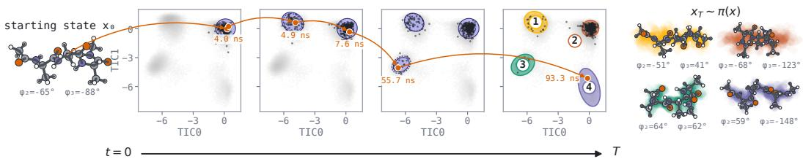  
Figure 1: A single KC-maps rollout explores the landscape of metastable alanine tetrapeptide conformers. Starting from a single conformer $X _ { 0 }$ (left), KC-maps is rolled out for 200 ns. Orange arrows trace the first visit to each newly discovered basin. Representative conformers from each basin are shown on the right, colored by basin identity, along with their backbone torsion angles $( \Phi _ { 2 } , \Phi _ { 3 } )$

initial condition $X _ { s } = x$ , we denote the density of the distribution of $X _ { t }$ as $p _ { s , t } ( y \vert x ) : = p ( X _ { t } =$ $y \vert X _ { s } = x )$ .

Molecular Dynamics. The formalism of SDEs is especially useful for describing the evolution of molecular systems. Their state is described by the position $X _ { t }$ and momentum $P _ { t }$ and its timeevolution is modeled by the second-order dynamics, which we will write in the matrix form

$$
\biggl [ d X _ { t } \biggr ] = \biggl [ { \cal M } ^ { - 1 } P _ { t } \biggr ] d t + \biggl [ 0 \quad 0 \biggr ] d W _ { t } ,\tag{2}
$$

where $v _ { t }$ is the force field driving the system, γ is the friction coefficient, M is the diagonal mass matrix, and $g _ { t }$ is the diffusion coefficient that depends on the temperature of the system. For $v _ { t } ( X ) = - \nabla \hat { U } ( X )$ where $U ( X )$ is a scalar potential and $g _ { t } = \sqrt { 2 \gamma k _ { B } T M }$ , the stationary distribution of $X _ { t }$ is the Boltzmann distribution, i.e. the equilibrium of the molecular system. Thus, in practice, simulating this SDE for long enough time one can sample from the Boltzmann distribution describing different states — conformations — of the system.

Normalizing Flows. Generative modeling of the empirical data has two principal components: maximizing the model likelihood on the observed data and generating new samples under the learned density model. Normalizing flows satisfy both criteria by parameterizing bijective maps with tractable Jacobians. The building block of normalizing flows is the affine coupling layer $\Psi _ { k }$ , which transforms the state $x ^ { ( k ) } = [ x _ { 1 } ^ { ( k ) } , \bar { x } _ { 2 } ^ { ( k ) } ]$ into $\boldsymbol { x } ^ { ( k + 1 ) } = \Psi _ { k } ( \boldsymbol { x } ^ { ( k ) } )$ as

$$
x _ { 1 } ^ { ( k + 1 ) } = x _ { 1 } ^ { ( k ) } ,\tag{3}
$$

$$
\begin{array} { r } { x _ { 2 } ^ { ( k + 1 ) } = x _ { 2 } ^ { ( k ) } \odot \exp \big ( a _ { k } ( x _ { 1 } ^ { ( k ) } ; \theta , c ) \big ) + b _ { k } ( x _ { 1 } ^ { ( k ) } ; \theta , c ) , } \end{array}\tag{4}
$$

where $a _ { k } ( \cdot ; \theta , c ) : \mathbb { R } ^ { d _ { 1 } } \to \mathbb { R } ^ { d _ { 2 } }$ and $b _ { k } ( \cdot ; \theta , c ) : \mathbb { R } ^ { d _ { 1 } } \to \mathbb { R } ^ { d _ { 2 } }$ are functions parameterized by the neural networks with parameters θ and, optionally, taking a condition c as an input. This layer is invertible, i.e. one can find $[ x _ { 1 } ^ { ( k ) } , x _ { 2 } ^ { ( k ) } ]$ from $[ \stackrel { \bullet } { x } _ { 1 } ^ { ( k + 1 ) } , \stackrel { \bullet } { x } _ { 2 } ^ { ( k + 1 ) } ]$ , and the Jacobian of this transformation is available in a closed-form without additional computations

$$
\log \operatorname* { d e t } \biggl | \frac { \partial \Psi _ { k } ( \boldsymbol { x } ^ { ( k ) } ) } { \partial \boldsymbol { x } ^ { ( k ) } } \biggr | = \log \left[ \frac { I } { \frac { \partial x _ { 2 } ^ { ( k + 1 ) } } { \partial x _ { 1 } ^ { ( k ) } } } \quad \begin{array} { c } { 0 } \\ { I \exp \left( a _ { k } ( x _ { 1 } ^ { ( k ) } ; \theta , c ) \right) } \end{array} \right] = \sum _ { i } a _ { k } ( x _ { 1 } ^ { ( k ) } ; \theta , c ) _ { i } .\tag{5}
$$

Finally, normalizing flows parameterize a density $p ( x \mid \theta , c )$ as a push-forward map of some simple density $p ^ { \mathrm { r e f } } ( x )$ through the composition of affine layers $\Psi = \Psi _ { K } \circ . . . \circ \Psi _ { ] }$ 1

$$
\log p ( x \mid \theta , c ) = \log p ^ { \mathrm { r e f } } ( \Psi ^ { - 1 } ( x ; \theta , c ) ) - \sum _ { k } \log \operatorname* { d e t } \left| { \frac { \partial \Psi _ { k } ( x ^ { ( k ) } ) } { \partial x ^ { ( k ) } } } \right| .\tag{6}
$$

## 3 KOLMOGOROV-CHAPMAN MAPS

Our method is designed around the classical definition of a diffusion process as a Markov process with continuous trajectories and infinitesimal first and second moments prescribed by the drift and diffusion coefficient (Kolmogoroff, 1931; Feller, 1937). The process defined this way is a weak solution of the corresponding SDE (Stroock & Varadhan, 1979). Therefore, our parametric model has to satisfy two conditions: (i) parameterize a valid Markov process, i.e. satisfy the Kolmogorov– Chapman equation, which we enforce through training (ii) the short-time behavior has to match the corresponding SDE, i.e. commit no jumps and have same first two moments, which we incorporate directly into our parameterization. We now proceed to formulating this statement formally.

For the SDE defined in Eq. (1), the infinitesimal change of the density $p _ { s , t } ( y \mid x )$ is defined by the following boundary conditions. $\forall \varepsilon > 0$ , we have

$$
\operatorname* { l i m } _ { \tau \to 0 } \frac { 1 } { \tau } \int _ { \| y - x \| > \varepsilon } d y p _ { s , s + \tau } ( y \mid x ) = 0 , \mathtt { \Gamma ( \mathtt { d e l t a \ f u n c t i o n \ w i t h \ n o \ j u m p s } ) }\tag{7}
$$

$$
\operatorname* { l i m } _ { \tau \to 0 } { \frac { 1 } { \tau } } \int _ { \| y - x \| \leq \varepsilon } d y p _ { s , s + \tau } ( y \mid x ) ( y - x ) = v _ { s } ( x ) { \mathrm { , } } { \mathrm { ( m a t c h i n g ~ f i r s t ~ m o m e n t ) } }\tag{8}
$$

$$
\operatorname* { l i m } _ { \tau \to 0 } \frac { 1 } { \tau } \int _ { \| y - x \| \leq \varepsilon } d y p _ { s , s + \tau } ( y \mid x ) ( y - x ) ( y - x ) ^ { \top } = g _ { s } g _ { s } ^ { \top } , \mathtt { \ ( m a t c h i n g \ s e c o n d \ m o n e n t ) }\tag{9}
$$

i.e. for $t \to s .$ the density converges to the delta-function and makes no jumps, the change of the first moment equals the vector field and the change of the second moment equals the diffusion coefficient. Furthermore, any Markov transition kernel satisfies the Kolmogorov–Chapman equation

$$
p _ { s , t } ( y \mid x ) = \int d x ^ { \prime } p _ { r , t } ( y \mid x ^ { \prime } ) p _ { s , r } ( x ^ { \prime } \mid x ) .\tag{10}
$$

This equation is the stochastic analog of the semi-group consistency condition in the ODEs, which is used in the Flow Maps literature (Boffi et al., 2025; Woo et al., 2026).

These two conditions define the SDE Eq. (1) and vice versa, the weak solution of an SDE satisfies both these conditions. The first statement we prove in Section A.1 using the classical result of probability theory (Stroock & Varadhan, 1979), the second statement is a textbook statement.

Proposition 1 (Identification of the transition kernel). Assume that $g _ { s }$ is continuous in s and that $v _ { s } ( x )$ is continuous, locally Lipschitz in x, and of at most linear growth, uniformly for s in compacts. Let $p _ { s , t } ( y \mid x )$ be a measurable family of nonnegative, normalized conditional densities. Suppose it satisfies the boundary conditions in Eqs. (7) to (9), with limits locally uniform in $( s , x )$ , and the Kolmogorov–Chapman equation in Eq. (10). Then $p _ { s , t } ( y \mid x )$ coincides (almost everywhere) with the transition density ofthe SDE in $E q . \ ( 1 )$ . Conversely, the SDE’s transition kernel satisfies both the boundary conditions and Eq. (10).

## 3.1 KOLMOGOROV–CHAPMAN CONSTRAINTS (OUR OBJECTIVE)

We parameterize our transition kernel $q _ { s , t } ( y | x ; \theta )$ such that the boundary conditions are satisfied (see the following section; Section B.2 details the case for learning the drift instead), which leaves the Kolmogorov–Chapman equation as the sole optimization objective. The most straightforward way to train the model would be to minimize the discrepancy between both sides of the Kolmogorov– Chapman equation for the parameterized model, i.e.

$$
\mathcal { L } _ { \mathrm { K C } } ( \theta ) = D _ { \mathrm { K L } } \Bigg ( \int d x ^ { \prime } q _ { r , t } ( y \mid x ^ { \prime } ; \theta ) q _ { s , r } ( x ^ { \prime } \mid x ; \theta ) \left| \left| q _ { s , t } ( y \mid x ; \theta ) \right. \right) , \forall x , t , s , r .\tag{11}
$$

However, as written, this function does not have an unbiased estimator of the gradient. Therefore, we propose to use the “stop-gradient trick” ubiquitously employed in the generative modeling literature (Geng et al., 2025; Boffi et al., 2025). Setting η = stopgrad(θ) as the parameters in the first argument of the KL-divergence, we get (see Section B.1)

$$
\begin{array} { r } { \mathcal { L } _ { \mathrm { K C } } ( \boldsymbol { \theta } ) = - \mathbb { E } _ { \boldsymbol { y } } [ \log { q _ { s , t } ( \boldsymbol { y } \mid \boldsymbol { x } ; \boldsymbol { \theta } ) } ] , \mathrm { ~ w h e r e ~ } \boldsymbol { y } \sim q _ { r , t } ( \boldsymbol { y } \mid \boldsymbol { x } ^ { \prime } ; \boldsymbol { \eta } ) , \mathrm { ~ a n d ~ } \boldsymbol { x } ^ { \prime } \sim q _ { s , r } ( \boldsymbol { x } ^ { \prime } \mid \boldsymbol { x } ; \boldsymbol { \eta } ) . } \end{array}\tag{12}
$$

The objective in Eq. (11), along with the parameterization that satisfies the boundary conditions, is globally minimized by the transition kernel of the SDE Eq. (1), as shown by a classical result in stochastic processes Section A.2.

Probability-flow objective. An alternative objective follows from the forward Kolmogorov equation written as a probability-flow ODE. Using the model’s transition score, we define the velocity

$$
\begin{array} { r } { { v } _ { \mathrm { P F } } ( y ) = { v } _ { t } ( y ) - \frac { 1 } { 2 } g _ { t } g _ { t } ^ { \top } \nabla _ { y } \log q _ { s , t } ( y \mid x ; \theta ) . } \end{array}\tag{13}
$$

For a generated sample $y _ { \theta }$ , define the average velocity $u _ { \theta } = ( y _ { \theta } - x ) / \tau$ . Since $\begin{array} { r } { \frac { d y _ { \theta } } { d \tau } = u _ { \theta } + \tau \frac { \partial u _ { \theta } } { \partial \tau } } \end{array}$ using the same "stop-gradient trick" and matching the sample velocity to vPF gives

$$
{ \mathcal { L } } _ { \operatorname { P F } } ( \theta ) = \mathbb { E } _ { y } \left[ \left. u _ { \theta } - \operatorname { s t o p g r a d } \left( v _ { \operatorname { P F } } ( y _ { \theta } ) - \tau { \frac { d u _ { \theta } } { d \tau } } \right) \right. ^ { 2 } \right] , \qquad y \sim q _ { s , t } ( y \mid x ; \theta ) { \mathrm { a n d } } \forall x , s < t .\tag{14}
$$

However, we use the $\mathrm { K C - K L }$ objective in Eq. (12) as our primary training objective and compare it with the probability-flow objective in our experiments.

## 3.2 BOUNDARY CONSTRAINTS (OUR PARAMETERIZATION)

We parameterize our transition kernel $q _ { s , t } ( y | x ; \theta )$ as a normalizing flow with time-scaled prior and time-scaled affine coupling layers. This guarantees the boundary constraints for $t \to s$ and puts no restrictions on larger time scales. For simplicity, we consider the autonomous SDE with the drift v(x) and diffusion coefficient $g g ^ { \top }$ , then our model is

$$
y = x + \tau v ( x ) + \Psi ( \sqrt { \tau } \cdot g z ; x , \theta ) , z \sim \mathcal { N } ( z \mid 0 , I ) ,\tag{15}
$$

where $\tau = t - s$ is the new time variable for the autonomous system and $\Psi ( \cdot ; x , \theta )$ is the normalizing flow forward map. Importantly, we add time-gates to the definition of the affine coupling layers, which then become defined as

$$
x _ { 1 } ^ { ( k + 1 ) } = x _ { 1 } ^ { ( k ) } ,\tag{16}
$$

$$
x _ { 2 } ^ { ( k + 1 ) } = x _ { 2 } ^ { ( k ) } \odot \exp \left( \frac { ( \omega \tau ) ^ { n _ { a } } } { 1 + ( \omega \tau ) ^ { n _ { a } } } \cdot a _ { k } ( x _ { 1 } ^ { ( k ) } ; x , \theta ) \right) + \frac { ( \omega \tau ) ^ { n _ { b } } } { 1 + ( \omega \tau ) ^ { n _ { b } } } \cdot b _ { k } ( x _ { 1 } ^ { ( k ) } ; x , \theta ) ,\tag{17}
$$

where $\omega , n _ { a }$ and $n _ { b }$ are hyperparameters of the gates. The key property of the gates is that they behave as $( \omega \tau ) ^ { n }$ for small $\tau ,$ which controls the boundary conditions and converge to 1 for large $\tau _ { : }$ which implies full expressivity of the model at large time-scales.

Proposition 2. (Time-gates satisfy the boundary constraints) Let $q _ { s , t } ( y \mid x ; \theta )$ be the density ofthe random variable y defined in $E q .$ . (15), and the map $\Psi = \Psi _ { K } \circ . . . \circ \Psi _ { 1 }$ consists ofthe composition ofaffine coupling layers with time-gates ofpowers $n _ { a }$ and $n _ { b } .$ . Assuming that $a _ { k }$ and $b _ { k }$ are uniformly bounded over their inputs and sufficiently small $\tau > 0 , f o r$

$$
n _ { a } > \frac { 1 } { 2 } , a n d n _ { b } > 1 ,\tag{18}
$$

$q _ { s , t } ( \cdot \mid x ; \theta )$ satisfies the boundary conditions in Eqs. (7) to (9). See proof in Section A.3.

Second-order dynamics. For second-order Langevin dynamics, we use unit masses in the following expressions for simplicity and extend the parameterization to the joint source state $x = ( X , P )$

$$
y = x + m ( x , \tau ) + \Psi ( L ( \tau ) z ; x , \theta ) , z \sim \mathcal { N } ( z \mid 0 , I ) ,\tag{19}
$$

where $m ( x , \tau )$ and $L ( \tau ) L ( \tau ) ^ { \top }$ are mean displacement and covariance of the Gaussian reference obtained holding the vector field at $v ( X )$ . The expressions for m and $L$ are derived in Section B.3.2. Moreover, we additionally scale the position shift with a free-flight term $\ell _ { i } ( \tau )$ where $b _ { k , i } = \ell _ { i } ( \tau ) \tilde { b } _ { k , i }$ i where the factor scales like $O ( \tau )$ at small τ. We provide more details in Section B.3.3.

The coupling layers in Eq. (17) alternate between position and momentum updates. We use $( n _ { a } , n _ { b } ) =$ (3, 3) for position updates, and $( n _ { a } , n _ { b } ) = ( 2 , 3 )$ for momentum updates. This choice of gate orders preserves the boundary constraints for the second-order SDE (see Section B.3.3).

## 3.3 PRACTICAL DESIGN CHOICES

We use the design choices listed below to improve training stability and accuracy of learned transitions.

Stabilizing the Gaussian reference. To stabilize sampling over longer intervals, we use a capped duration $h ( \tau )$ to limit transport, force contributions, and position noise in the Gaussian reference. We set $h ( \tau ) = \dot { \tau } \mathrm { f o r } \tau \le \tau _ { 0 }$ and $h ( \tau ) = \tau _ { 0 } + \delta$ tanh $\left( { \left( \tau - \tau _ { 0 } \right) / \delta } \right)$ otherwise, so the duration saturates at $\tau _ { 0 } + \delta$ . The reference is unchanged near $\tau = 0$ , preserving its boundary conditions. We give the exact rescaling in Section C.1.

Furthermore, two-step targets in Eq. (11) are formed from shorter transitions, motivating a more accurate short-time reference. For source position $X$ and momentum $P ,$ we evaluate the vector field at $v ( X _ { \mathrm { m i d } } )$ , where $\begin{array} { r } { X _ { \mathrm { m i d } } = X + \frac { 1 } { 2 } h ( \tau ) P } \end{array}$ (see details in Section B.3). We ablate duration capping and midpoint evaluation separately in Table 1a.

Table 1: Ablation study on AL2. NLL on samples from MD simulation and energy $\mathcal { E } \mathrm { - } \mathcal { W } _ { 2 } \left( k _ { \mathrm { B } } T \right)$ over 64 source states with 256 samples per state compared to 256 independent MD trajectories with a 0.1 fs timestep. Results are averaged over $\tau = 1 0 , 2 0 , \dots , 1 0 0$ fs, with lower values being better. Each subtable compares the full model with variants that change only the indicated component, keeping all other settings fixed. All models were trained with a reduced compute budget of 250K steps. Best value in each column within each subtable is bold.  
(a) Gaussian reference.
<table><tr><td>Variant</td><td>NLL↓</td><td> $\mathcal { E } \mathrm { - } \mathcal { W } _ { 2 } \downarrow$ </td></tr><tr><td>Full model</td><td>-0.122</td><td>1.33</td></tr><tr><td>w/o duration capping</td><td>0.350</td><td> $9 . 7 \times 1 0 ^ { 3 }$ </td></tr><tr><td>w/o midpoint evaluation</td><td>-0.053</td><td>4.71</td></tr></table>

(c) Input features.

(b) Time prior.
<table><tr><td>Variant</td><td>NLL ↓ E-W2 ↓</td><td></td></tr><tr><td>Full model</td><td>-0.122</td><td>1.33</td></tr><tr><td>Log-uniform only</td><td>-0.086</td><td>1.37</td></tr><tr><td>Uniform only</td><td>-0.087</td><td>2.64</td></tr></table>

(d) Normalizing flow design.

<table><tr><td>Variant</td><td>NLL↓</td><td> $\mathcal { E } \mathrm { - } \mathcal { W } _ { 2 } \downarrow$ </td></tr><tr><td>Full model</td><td>-0.122</td><td>1.33</td></tr><tr><td>w/o mean features</td><td>-0.056</td><td>1.34</td></tr><tr><td>w/o covariance features</td><td>-0.094</td><td>1.45</td></tr><tr><td>w/o residual normalization</td><td>-0.106</td><td>1.28</td></tr></table>

<table><tr><td>Variant</td><td>NLL ↓ E-W2 ↓</td><td></td></tr><tr><td>Full model</td><td>-0.122</td><td>1.33</td></tr><tr><td>w/o source-frame alignment</td><td>0.028</td><td>1.77</td></tr><tr><td>Lower-order gates</td><td>-0.107</td><td>1.25</td></tr></table>

Time prior. During training, we sample times from a mixture $\tau \sim$ w LogUniform $[ T _ { \mathrm { m i n } } , T _ { \mathrm { m a x } } ] +$ $( 1 - w )$ Uniform $[ T _ { \mathrm { m i n } } , T _ { \mathrm { m a x } } ]$ , where $T _ { \mathrm { m i n } }$ and $T _ { \mathrm { m a x } }$ are the minimum and maximum sampled times, with $0 < T _ { \mathrm { m i n } } < T _ { \mathrm { m a x } }$ and $\boldsymbol { \dot { w } } \in [ 0 , 1 ]$ . The uniform component upweights longer intervals, while $T _ { \mathrm { m a x } }$ is gradually increased early in training so the model first learns shorter transitions. We compare this mixture against either distribution alone in Table 1b.

Input features. Alongside the source state and elapsed time τ, we condition the flow on the Gaussian reference mean displacement and covariance. Flow inputs are normalized by the reference marginal standard deviations for predicting affine scale and shift. We provide more details in Section C.1 and separately ablate mean and covariance features and input normalization in Table 1c.

Normalizing flow design. The fixed rate ω controls the time τ at which the flow corrections take effect, without changing their prescribed short-time orders. We set this rate at $\omega = 3 3 3 \mathrm { p s ^ { - 1 } }$ from empirical analysis. For second-order dynamics, we also compare our gate choices with a lower-order alternative, labeled “Lower-order gates,” which uses $n _ { a } = 1$ for both log scales and $n _ { b } = 2$ for both shifts, as shown in Table 1d. Finally, we compare the displacement parameterization used here with standard and whitened flows on AL2. We briefly describe these alternatives and their corresponding gates in Section E.7, with results in Fig. A8.

Equivariance. To account for global translation and rotation symmetries, we center positions at the center of mass and apply the flow in an orthonormal frame determined by the source configuration (Kaba et al., 2023; Jumper et al., 2021). We rotate the output back to the original orientation. The frame construction and treatment of the center-of-mass constraint are detailed in Section C.1.

Stabilizing training. To stabilize learning from model-generated targets, we use $\eta = \mathrm { E M A } ( \theta )$ in $\mathcal { L } _ { \mathrm { K C } }$ . We compare different EMA decay rates, including $\eta = \mathrm { s t o p g r a d } ( \theta )$ , in Fig. A7.

Detailed-Balance Loss. The Kolmogorov–Chapman objective constrains how the kernel composes across τ but does not ensure that stationary distribution is π. Since π is known, we add a detailedbalance objective as done in Klein et al. (2023a), which holds for underdamped Langevin dynamics up to momentum reversal $R ( X , P ) = ( X , - P )$ , and implies that π is the stationary distribution of the kernel:

$$
{ \mathcal { L } } = { \mathcal { L } } _ { \mathrm { K C } } + \lambda { \mathcal { L } } _ { D B } , \quad { \mathcal { L } } _ { D B } = D _ { \mathrm { K L } } ( q _ { s , t } ( y \mid x ) \pi ( x ) \| q _ { s , t } ( R x \mid R y ) \pi ( y ) ) .\tag{20}
$$

We optimize $\mathcal { L } _ { D B }$ with a low-variance gradient estimator following (Tucker et al., 2019). The detailed-balance loss is only applied to towards the end of training with more details in Section D.3.

Inference-time stabilization. Following the use of inference-time corrections in HFM (Ripken et al., 2026), we apply additional corrections to limit accumulated errors during long simulations. We describe these corrections in Section C.3 and summarize a simulation step in Algorithm 2.

## 4 EXPERIMENTS

## 4.1 BASELINES

Throughout our experiments, we primarily consider Langevin dynamics as a baseline and other trajectory-free methods at the target distribution in our comparisons. Long reference simulations provide the transition samples and equilibrium statistics used for evaluation. For training, we assume we have access to the unpaired initial states x $\sim \pi ( x )$ . We match training FLOPs between KC-KL and PF-ODE on Lennard-Jones systems and between our method and HFM on AL4 and AL6 (see Table A4). For AL2, we use the released HFM checkpoint (Ripken et al., 2026).

Table 2: Performance of KC-maps on LJ-13 and LJ-55. Published baseline results are taken from Potaptchik et al. (2025). Metrics are the 2-Wasserstein distance between energy distributions $( { \mathcal { E } } { \cdot } { \mathcal { W } } _ { 2 } )$ and the geometric 2-Wasserstein distance $( \mathrm { G e o } { - } \mathcal { W } _ { 2 } )$ . In all settings, the target temperature is $T = 1 ;$ best values are bolded and the second best values are underlined. Dashes indicate unavailable results.
<table><tr><td></td><td colspan="2">LJ-13</td><td colspan="2">LJ-55</td></tr><tr><td>Method</td><td> $\mathcal { E } \mathrm { - } \mathcal { W } _ { 2 } \downarrow $ </td><td>Geo-W2↓</td><td> ${ \mathcal { E } } { \mathrm { - } } { \mathcal { W } } _ { 2 }$ </td><td>↓ Geo  $\mathcal { W } _ { 2 } \downarrow$ </td></tr><tr><td>MALA</td><td>0.325</td><td>1.51</td><td>3.40</td><td>3.80</td></tr><tr><td>Source temperature  $T _ { S } = 4$ </td><td></td><td></td><td></td><td></td></tr><tr><td>PITA (Akhound-Sadegh et al., 2025)</td><td>2.260</td><td>1.65</td><td></td><td></td></tr><tr><td>ITM (Potaptchik et al., 2025)</td><td>0.879</td><td>1.54</td><td>26.37</td><td>3.98</td></tr><tr><td>KC-maps  $( \mathcal { L } _ { \mathrm { K C } } )$ </td><td>0.212</td><td>1.51</td><td>1.51</td><td>3.82</td></tr><tr><td>Source temperature  $T _ { S } = 1$ </td><td></td><td></td><td></td><td></td></tr><tr><td>KC-maps  $( \mathcal { L } _ { \mathrm { K C } } )$ </td><td>0.266</td><td>1.51</td><td>1.19</td><td>3.82</td></tr><tr><td>KC-maps  $( \mathcal { L } _ { \mathrm { P F } } )$ </td><td>0.254</td><td>1.51</td><td>140.37</td><td>4.29</td></tr></table>

## 4.2 LENNARD-JONES

To demonstrate our method to learn the map for the first-order SDE, we consider the Lennard-Jones 13-particle (LJ-13) and 55-particle (LJ-55) systems. Building on the setup in (Akhound-Sadegh et al., 2025), we train our flow to model transitions of particle positions at the target temperature $T = 1$ and diffusion coefficient $\begin{array} { r } { D = { \frac { g ^ { 2 } } { 2 } } = 0 . 0 2 } \end{array}$ . We compare two different training settings: (i) configurations sampled at the target temperature for the initial state during training, and (ii) configurations sampled from a higher temperature $T _ { S } = 4$ as the initial states, motivated by what is done in (Akhound-Sadegh et al., 2025; Potaptchik et al., 2025). In both settings, the vector field and diffusion correspond to the SDE at the target temperature. This comparison demonstrates that our method can learn the target dynamics without requiring training configurations from the target distribution.

We evaluate 2-Wasserstein distances on 1D energy histograms $( { \mathcal { E } } { \cdot } { \mathcal { W } } _ { 2 } )$ and 3D coordinates (Geo- $\cdot \mathcal { W } _ { 2 } )$ We compare Metropolis–Hastings sampling (Hastings, 1970) with our learned kernel against MALA (Roberts & Tweedie, 1996) and results from Tilt Matching (Potaptchik et al., 2025). Results are reported in Table 2, with sampling and evaluation details in Section D.4.

## 4.3 MOLECULAR SYSTEMS

We evaluate our second-order parameterization on three molecular systems of increasing size: alanine dipeptide (AL2), tetrapeptide (AL4), and hexapeptide (AL6). We train the flow to model transitions of the joint state of positions and momenta under Langevin dynamics. Training uses uncorrelated equilibrium configurations as initial states and the molecular force field, without requiring paired states from MD. We generate the trajectories by sequentially applying the learned transition kernel with step size $\tau ,$ and we compare the resulting equilibrium distribution against HFM (Ripken et al., 2026) and molecular dynamics simulated using BAOAB scheme (Leimkuhler & Matthews, 2013).

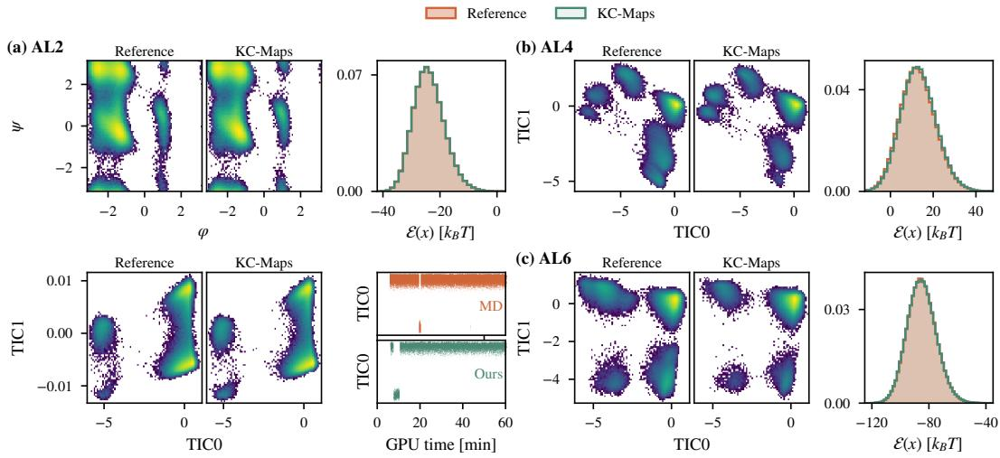  
Figure 2: Equilibrium sampling of alanine peptides. Density panels show the reference MD (16 parallel chains $\times 2 \mu \mathrm { s }$ per chain) beside KC-maps (Ours). Potential energy histograms of KC-maps against each system’s MD reference. (a) AL2: Ramachandran and TICA densities, energy histogram, and TIC0 against simulated MD trajectory (top) and ours (bottom). (b) AL4: TICA densities and energy histogram. (c) AL6: TICA densities and energy histogram. For each molecule, samples generated from KC-maps were run with varying compute budgets (1 GPU-hour for AL2; 22 GPUhour for AL4; 40 GPU-hours for AL6).

For the peptide experiments, we train using $\mathcal { L } _ { \mathrm { K C } }$ with the detailed-balance loss $\mathcal { L } _ { \mathrm { D B } }$ . We use $\mathcal { L } _ { \mathrm { K C } }$ since we found training with $\mathcal { L } _ { \mathrm { P F } }$ unstable, even with adaptive loss weighting (Geng et al., 2025; Woo et al., 2026). The LJ-55 results in Table 2 also show substantially larger errors, especially with energy distribution, when training with $\mathcal { L } _ { \mathrm { P F } }$

Equilibrium. We compare generated samples with long MD references using 2-Wasserstein distances in energy (E-W2), torsion angles $( { \mathcal { T } } \cdot { \mathcal { W } } _ { 2 } )$ , and first two component projections from time-lagged independent component analysis $( \mathrm { T I C A } – ) \backslash 2 )$ , as done in (Tan et al., 2025; 2026).

In Table $^ { 3 , }$ we evaluate all methods under an equal budget of one GPU hour. For each method, we vary the number of parallel chains and, for the learned models, the step size τ, and report the configuration with the best average across all three metrics. Sampling and evaluation details are provided in Section D.4.

Table 3: Equilibrium sampling of alanine peptides per method with a fixed budget of one GPU-hour on single L40S, scored against each molecule’s long MD. $\mathcal { W } _ { 2 }$ metrics are computed between $1 0 ^ { 4 }$ reference frames and $1 0 ^ { 4 }$ frames drawn from the run after a 10 % burn-in, and report the mean $\pm \mathrm { \ s t d }$ over 3 draws. Best of HFM and KC-maps in bold.  
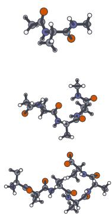

<table><tr><td></td><td>Method</td><td> $\mathcal { E } \mathrm { - } \mathcal { W } _ { 2 } \downarrow$ </td><td> $\mathcal { T } \ – \mathcal { W } _ { 2 } \downarrow $ </td><td> $\mathrm { T I C A } { - } { \mathcal { W } } _ { 2 } \downarrow$ </td></tr><tr><td rowspan="3">AL2  $( d = 6 6 )$ </td><td>MD</td><td> $0 . 1 5 \pm 0 . 0 4$ </td><td> $0 . 2 0 \pm 0 . 0 0$ </td><td> $0 . 3 8 \pm 0 . 0 2$ </td></tr><tr><td>HFM</td><td> $0 . 1 5 \pm 0 . 0 1$ </td><td> ${ \bf 0 . 1 2 \pm 0 . 0 3 }$ </td><td> $0 . 1 3 \pm 0 . 0 5$ </td></tr><tr><td>KC-maps</td><td> ${ \bf 0 . 1 3 \pm 0 . 0 2 }$ </td><td> $0 . 2 1 \pm 0 . 0 3$ </td><td> ${ \bf 0 . 0 8 \pm 0 . 0 3 }$ </td></tr><tr><td rowspan="3">AL4 (d = 126)</td><td>MD</td><td> $0 . 2 5 \pm 0 . 0 9$ </td><td> $0 . 5 8 \pm 0 . 0 2$ </td><td> $0 . 6 7 \pm 0 . 0 3$ </td></tr><tr><td>HFM</td><td> ${ \bf 0 . 2 1 \pm 0 . 0 4 }$ </td><td> ${ \bf 0 . 7 4 \pm 0 . 0 2 }$ </td><td> $0 . 5 2 \pm 0 . 0 2$ </td></tr><tr><td>KC-maps</td><td> $0 . 4 6 \pm 0 . 1 4$ </td><td> $1 . 0 8 \pm 0 . 0 3$ </td><td> ${ \bf 0 . 4 8 \pm 0 . 0 2 }$ </td></tr><tr><td rowspan="3">AL6 (d = 189)</td><td>MD</td><td> $0 . 2 8 \pm 0 . 0 2$ </td><td> $1 . 1 7 \pm 0 . 0 1$ </td><td> $1 . 0 1 \pm 0 . 0 2$ </td></tr><tr><td>HFM</td><td> $0 . 9 0 \pm 0 . 0 5$ </td><td> $1 . 5 8 \pm 0 . 0 2$ </td><td> $0 . 9 5 \pm 0 . 0 4$ </td></tr><tr><td>KC-maps</td><td> ${ \bf 0 . 3 4 \pm 0 . 0 8 }$ </td><td> ${ \bf 1 . 2 2 \pm 0 . 0 3 }$ </td><td> $\mathbf { 0 . 6 0 \pm 0 . 0 3 }$ </td></tr></table>

(a)  
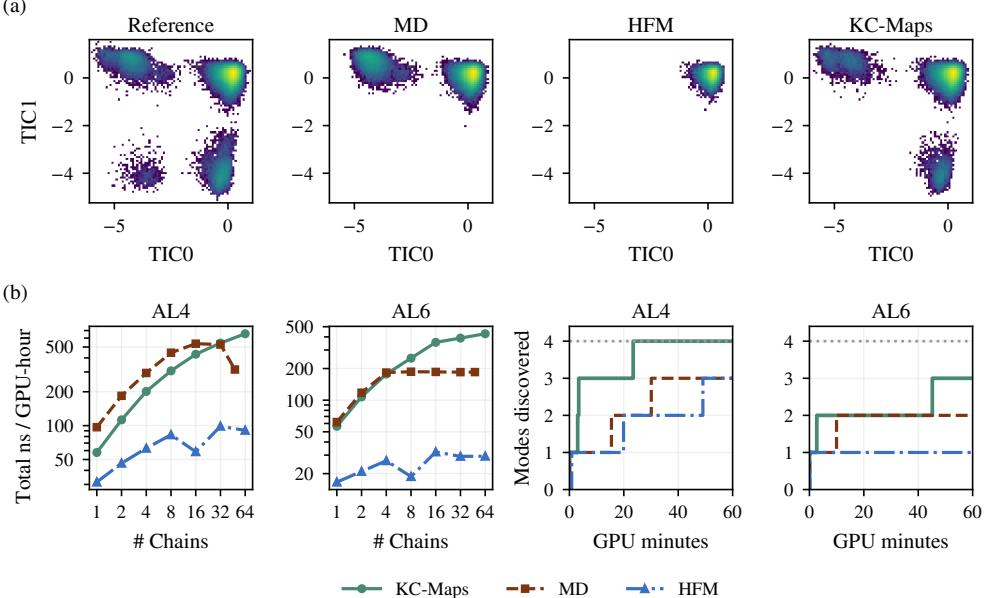  
Figure 3: One GPU-hour on single L40S. (a) TICA densities of the reference (16 chains; $d t = 1 \mathrm { { f s } ; }$ 2 µs each), MD (16 parallel chains; $d t = 1 { \mathrm { f s } } ;$ one GPU-hour), HFM (16 chains; $\tau = 5$ fs; one GPU-hour) and KC-maps (16 chains; $\tau = 3 0$ fs; one GPU-hour). KC-maps consistently visits most if not all of the modes within the same GPU-hour. (b) Left: simulated aggregate time per GPU-hour against the number of parallel chains for KC-maps $( \tau = 3 0 \mathrm { f s }$ for AL4 and AL6), MD and HFM (7 fs for AL4, 5 fs for AL6). Right: metastable TICA modes discovered against GPU time. Dotted: modes of the reference MD.

At matched GPU-hour budgets, KC-maps achieves the lowest $\mathrm { T I C A } { } - \mathcal { W } _ { 2 }$ on all three systems while remaining competitive on energy and torsion metrics. We report performance across τ with and without the detailed-balance loss in Fig. A1. Longer rollouts of KC-maps show broad mode coverage and closely match the reference energy distribution $( \mathrm { F i g . } 2 )$ . For AL6, in particular, these rollouts reach modes that are absent in the training data, demonstrating exploration beyond the training conformations (see Fig. A2).

Furthermore, we evaluate exploration efficiency on AL4 and AL6 through aggregate simulated time and number of modes discovered within one GPU-hour. As shown in Fig. 3, KC-maps’s throughput increases with the number of chains on a single GPU, exceeding MD and HFM at larger chain counts. Within the same compute budget, KC-maps also discovers the modes faster and samples more modes than either baseline.

Kinetics. Here, we assess the kinetics of KC-maps on AL2. We measure mean first-passage time (MFPT) between modes and the autocorrelation of mode occupancy. As shown in Fig. 4, KC-maps closely matches MD for MFPT between $\alpha , \beta ,$ and ppII, as well as their autocorrelation curves for these modes.

We observe the largest errors when involving $\alpha _ { L } \mathbf { \hat { . } }$ : KC-maps overestimates MFPT into this mode, and its autocorrelation decays faster at long lags. We believe these errors to stem from the limited support for that mode in the training data. Namely, $\alpha _ { L }$ accounts for only 0.7% of training configurations, compared with 2.2% in the reference MD. We define the kinetic metrics in Section D.4 and provide additional results on transition probabilities in Fig. A6.

## 5 RELATED WORK

Boltzmann generators (Noé et al., 2019; Klein & Noé, 2024; Tan et al., 2025; 2026) directly sample uncorrelated equilibrium configurations without integrating MCMC. However, equilibrium distribu tions alone do not capture dynamical properties such as relaxation times and transition rates (Dixit & Dill, 2014), motivating surrogates that model time-coarsened MD transitions.

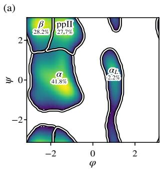

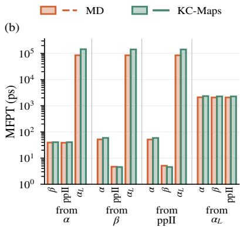

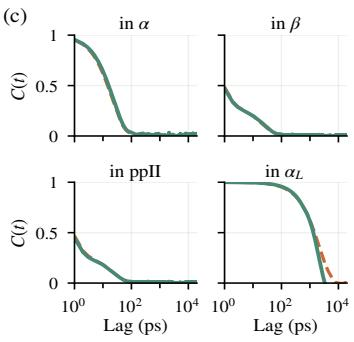  
Figure 4: AL2 kinetics. (a) The four metastable modes $( \alpha , \beta , \mathsf { p p I I } , \alpha _ { L } )$ on the reference MD Ramachandran plot, with their populations. (b) Mean first-passage time between modes. (c) Autocorrelation $C ( t )$ of mode occupancy. MD: 16 chains of $2 \mu \mathrm { s }$ each; KC-maps: 16 chains at $\tau = 3 0$ fs run for one GPU-hour on L40S. Both metrics are measured on trajectories with frames saved every 1 ps.

Hamiltonian Flow Maps (Ripken et al., 2026) learn deterministic updates from Hamiltonian equations using uncorrelated states and forces, and apply a separate thermostat update during simulation as done in the OBABO scheme (Bussi & Parrinello, 2007). Similarly, we leverage local physical information, but learn the stochastic transition kernel of Langevin dynamics.

Consistency models (Song et al., 2023; Lu & Song, 2025) and Flow Map methods (Boffi et al., 2024; Geng et al., 2025; Boffi et al., 2025) learn finite-time maps of generative ODEs. Stochastic Flow Maps (SFMs) (Potaptchik et al., 2026; Holderrieth et al., 2026) extend this framework to conditional distributions, while subsequent works learn pathwise SDE solution maps conditioned on Brownian motion (McCallum et al., 2026; Pan et al., 2026). Our method falls within the SFM framework, directly parameterizing the transition kernel and enforcing its composition through the Kolmogorov–Chapman equation.

Lastly, similar works like Neural Stochastic Flows (NSF) (Kiyohara et al., 2025) also parameterize the SDE transition kernel with a conditional normalizing flows. However, their objective combines likelihood on observed transition pairs with a variational upper bound on bidirectional KL regularization evaluated through a learned bridge model. KC-maps learns from unpaired states and the known SDE drift and diffusion. Unlike NSF, our parameterization preserves the prescribed infinitesimal dynamics, while the consistency objective uses transitions generated by composing the model itself. This allows us to learn finite-time transition distributions without observed future states.

## 6 CONCLUSION

Our work introduces KC-maps, a trajectory-free approach to learning transition kernels of SDEs. Our method combines a parameterization that preserves the infinitesimal dynamics with a training objective based on the Kolmogorov–Chapman consistency, using uncorrelated initial states and the known drift and diffusion. On molecular systems, we learn transitions of up to 100 fs and demonstrate improved equilibrium sampling efficiency compared with classical molecular dynamics, combining higher simulation throughput with broader conformational coverage at matched GPU-hour budgets

A limitation of our method is its dependence on training-data coverage. In particular, the method’s kinetics suffers in performance in modes that are sparsely represented in the training set. Also, our method is trained separately for each molecular system and does not currently support transfer to unseen systems. Future work could address these limitations by amortizing across molecular systems, scaling to larger systems, and learning longer time horizons more accurately. We believe training an amortized model across systems may help improve performance in sparsely covered modes through shared structural and dynamical information across systems. Finally, our Lennard-Jones results motivate learning a map by leveraging higher-temperature data of molecular systems, without requiring equilibrium samples at the target temperature.

## ACKNOWLEDGMENTS

M.H. acknowledges the support of the Natural Sciences and Engineering Research Council of Canada (NSERC), [funding reference number RGPIN-2026-05517]. M.S. was supported by the IVADO 2025 Postdoctoral Research Funding Program. This project was undertaken thanks to funding from IVADO and the Canada First Research Excellence Fund.

## REPRODUCIBILITY STATEMENT

We provide code at https://github.com/majhas/kc-maps. We also fully detail the training implementation and evaluation setup with details on hyperparameters in Section C. Proofs of theoretical results are in Section A and derivations in Section B.

## REFERENCES

Tara Akhound-Sadegh, Jarrid Rector-Brooks, Avishek Joey Bose, Sarthak Mittal, Pablo Lemos, Cheng-Hao Liu, Marcin Sendera, Siamak Ravanbakhsh, Gauthier Gidel, Yoshua Bengio, Nikolay Malkin, and Alexander Tong. Iterated Denoising Energy Matching for Sampling from Boltzmann Densities, February 2024. URL http://arxiv.org/abs/2402.06121. arXiv:2402.06121 [cs, stat].

Tara Akhound-Sadegh, Jungyoon Lee, Avishek Joey Bose, Valentin De Bortoli, Arnaud Doucet, Michael M. Bronstein, Dominique Beaini, Siamak Ravanbakhsh, Kirill Neklyudov, and Alexander Tong. Progressive inference-time annealing of diffusion models for sampling from boltzmann densities, 2025. URL https://arxiv.org/abs/2506.16471.

Michael S. Albergo and Eric Vanden-Eijnden. Building Normalizing Flows with Stochastic Interpolants, March 2023. URL http://arxiv.org/abs/2209.15571. arXiv:2209.15571 [cs].

Filippo Bigi, Sanggyu Chong, Agustinus Kristiadi, and Michele Ceriotti. Flashmd: long-stride, universal prediction of molecular dynamics, 2026. URL https://arxiv.org/abs/2505. 19350.

Nicholas M. Boffi, Michael S. Albergo, and Eric Vanden-Eijnden. Flow Map Matching, June 2024. URL http://arxiv.org/abs/2406.07507. arXiv:2406.07507 [cs, math].

Nicholas M. Boffi, Michael S. Albergo, and Eric Vanden-Eijnden. How to build a consistency model: Learning flow maps via self-distillation, October 2025. URL http://arxiv.org/ abs/2505.18825. arXiv:2505.18825 [cs].

James Bradbury, Roy Frostig, Peter Hawkins, Matthew James Johnson, Yash Katariya, Chris Leary, Dougal Maclaurin, George Necula, Adam Paszke, Jake VanderPlas, Skye Wanderman-Milne, and Qiao Zhang. JAX: composable transformations of Python+NumPy programs, 2018. URL http://github.com/jax-ml/jax.

Giovanni Bussi and Michele Parrinello. Accurate sampling using langevin dynamics. Physical Review E, 75(5):056707, 2007. doi: 10.1103/PhysRevE.75.056707.

Giovanni Bussi, Davide Donadio, and Michele Parrinello. Canonical sampling through velocity rescaling. The Journal ofChemical Physics, 126(1):014101, 2007.

Purushottam D. Dixit and Ken A. Dill. Inferring microscopic kinetic rates from stationary state distributions. Journal of Chemical Theory and Computation, 10(8):3002–3005, 2014. doi: 10.1021/ct5001389.

Peter Eastman, Jason Swails, John D. Chodera, Robert T. McGibbon, Yutong Zhao, Kyle A. Beauchamp, Lee-Ping Wang, Andrew C. Simmonett, Matthew P. Harrigan, Chaya D. Stern, et al. OpenMM 7: Rapid development of high performance algorithms for molecular dynamics. PLoS Computational Biology, 13(7):e1005659, 2017.

Willy Feller. Zur theorie der stochastischen prozesse: Existenz-und eindeutigkeitssätze. Mathematische Annalen, 113(1):113–160, 1937.

Zhengyang Geng, Mingyang Deng, Xingjian Bai, J. Zico Kolter, and Kaiming He. Mean Flows for One-step Generative Modeling, May 2025. URL http://arxiv.org/abs/2505.13447. arXiv:2505.13447 [cs].

Alan Grossfield, Paul N. Patrone, Daniel R. Roe, Andrew J. Schultz, Daniel W. Siderius, and Daniel M. Zuckerman. Best practices for quantification of uncertainty and sampling quality in molecular simulations [article v1.0]. Living Journal of Computational Molecular Science, 1(1):5067, 2018. doi: 10.33011/livecoms.1.1.5067.

W. K. Hastings. Monte Carlo sampling methods using Markov chains and their applications. Biometrika, 57(1):97–109, 1970. doi: 10.1093/biomet/57.1.97. URL https://doi.org/ 10.1093/biomet/57.1.97.

Jonathan Ho, Ajay Jain, and Pieter Abbeel. Denoising Diffusion Probabilistic Models, December 2020. URL http://arxiv.org/abs/2006.11239. arXiv:2006.11239 [cs, stat].

Matthew D. Hoffman and Andrew Gelman. The no-U-turn sampler: Adaptively setting path lengths in Hamiltonian Monte Carlo. Journal ofMachine Learning Research, 15(1):1593–1623, 2014.

Moritz Hoffmann, Martin Konrad Scherer, Tim Hempel, Andreas Mardt, Brian de Silva, Brooke Elena Husic, Stefan Klus, Hao Wu, J Nathan Kutz, Steven Brunton, and Frank Noé. Deeptime: a Python library for machine learning dynamical models from time series data. Machine Learning: Science and Technology, 3(1):015009, 2022.

Peter Holderrieth, Douglas Chen, Luca Eyring, Ishin Shah, Giri Anantharaman, Yutong He, Zeynep Akata, Tommi Jaakkola, Nicholas Matthew Boffi, and Max Simchowitz. Diamond Maps: Efficient Reward Alignment via Stochastic Flow Maps, April 2026. URL http://arxiv.org/abs/ 2602.05993. arXiv:2602.05993 [cs] version: 2.

Scott A. Hollingsworth and Ron O. Dror. Molecular Dynamics Simulation for All. Neuron, 99(6): 1129–1143, September 2018. doi: 10.1016/j.neuron.2018.08.011. URL https://doi.org/ 10.1016/j.neuron.2018.08.011. PMID: 30236283; PMCID: PMC6209097.

Koji Hukushima and Koji Nemoto. Exchange monte carlo method and application to spin glass simulations. Journal ofthe Physical Society ofJapan, 65(6):1604–1608, 1996. ISSN 1347-4073. doi: 10.1143/jpsj.65.1604. URL http://dx.doi.org/10.1143/JPSJ.65.1604.

John Jumper, Richard Evans, Alexander Pritzel, Tim Green, Michael Figurnov, Olaf Ronneberger, Kathryn Tunyasuvunakool, Russ Bates, Augustin Žídek, Anna Potapenko, Alex Bridgland, Clemens Meyer, Simon A. A. Kohl, Andrew J. Ballard, Andrew Cowie, Bernardino Romera-Paredes, Stanislav Nikolov, Rishub Jain, Jonas Adler, Trevor Back, Stig Petersen, David Reiman, Ellen Clancy, Michal Zielinski, Martin Steinegger, Michalina Pacholska, Tamas Berghammer, Sebastian Bodenstein, David Silver, Oriol Vinyals, Andrew W. Senior, Koray Kavukcuoglu, Push meet Kohli, and Demis Hassabis. Highly accurate protein structure prediction with AlphaFold. Nature, July 2021. ISSN 0028-0836, 1476-4687. doi: 10.1038/s41586-021-03819-2. URL https://www.nature.com/articles/s41586-021-03819-2.

Sékou-Oumar Kaba, Arnab Kumar Mondal, Yan Zhang, Yoshua Bengio, and Siamak Ravanbakhsh. Equivariance with learned canonicalization functions, 2023. URL https://arxiv.org/ abs/2211.06489.

Samuel Karlin and Howard Taylor. A second course in stochastic processes. Elsevier, 1981.

Naoki Kiyohara, Edward Johns, and Yingzhen Li. Neural stochastic flows: Solver-free modelling and inference for sde solutions, 2025. URL https://arxiv.org/abs/2510.25769.

Leon Klein and Frank Noé. Transferable Boltzmann Generators, June 2024. URL http://arxiv. org/abs/2406.14426. arXiv:2406.14426 [physics, stat].

Leon Klein, Andrew Y. K. Foong, Tor Erlend Fjelde, Bruno Mlodozeniec, Marc Brockschmidt, Sebastian Nowozin, Frank Noé, and Ryota Tomioka. Timewarp: Transferable Acceleration of Molecular Dynamics by Learning Time-Coarsened Dynamics, February 2023a. URL http: //arxiv.org/abs/2302.01170. arXiv:2302.01170 [cond-mat, physics:physics, stat].

Leon Klein, Andreas Krämer, and Frank Noé. Equivariant flow matching, June 2023b. URL http://arxiv.org/abs/2306.15030. arXiv:2306.15030 [physics, stat].

Peter E. Kloeden and Eckhard Platen. Numerical solution of stochastic differential equations. 1992. URL https://api.semanticscholar.org/CorpusID:116903781.

Jonas Köhler, Leon Klein, and Frank Noé. Equivariant flows: Exact likelihood generative learning for symmetric densities. In International Conference on Machine Learning, pp. 5361–5370, 2020.

Jonas Köhler, Andreas Krämer, and Frank Noé. Smooth normalizing flows. In Advances in Neural Information Processing Systems, volume 34, 2021.

Andrei Kolmogoroff. Über die analytischen methoden in der wahrscheinlichkeitsrechnung. Mathematische Annalen, 104(1):415–458, 1931.

Benedict Leimkuhler and Charles Matthews. Robust and efficient configurational molecular sampling via langevin dynamics. The Journal ofchemical physics, 138(17), 2013.

Benedict Leimkuhler and Charles Matthews. Molecular Dynamics: With Deterministic and Stochastic Numerical Methods, volume 39 of Interdisciplinary Applied Mathematics. Springer International Publishing, 2015. ISBN 978-3-319-16375-8. doi: 10.1007/978-3-319-16375-8. URL https: //doi.org/10.1007/978-3-319-16375-8.

Kresten Lindorff-Larsen, Stefano Piana, Kim Palmo, Paul Maragakis, John L. Klepeis, Ron O. Dror, and David E. Shaw. Improved side-chain torsion potentials for the Amber ff99SB protein force field. Proteins: Structure, Function, and Bioinformatics, 78(8):1950–1958, 2010.

Yaron Lipman, Ricky T. Q. Chen, Heli Ben-Hamu, Maximilian Nickel, and Matt Le. Flow Matching for Generative Modeling, February 2023. URL http://arxiv.org/abs/2210.02747. arXiv:2210.02747 [cs, stat].

Ilya Loshchilov and Frank Hutter. Decoupled weight decay regularization. In International Conference on Learning Representations, 2019.

Cheng Lu and Yang Song. Simplifying, stabilizing and scaling continuous-time consistency models, 2025. URL https://arxiv.org/abs/2410.11081.

James A. Maier, Carmenza Martinez, Koushik Kasavajhala, Lauren Wickstrom, Kevin E. Hauser, and Carlos Simmerling. ff14SB: Improving the accuracy of protein side chain and backbone parameters from ff99SB. Journal ofChemical Theory and Computation, 11(8):3696–3713, 2015.

Sam McCallum, Zander W. Blasingame, Timothy Herschell, Niklas Rindtorff, Alexander Tong, and James Foster. Strong stochastic flow maps, 2026. URL https://arxiv.org/abs/2606. 01086.

Pierre Del Moral and Arnaud Doucet. Sequential monte carlo samplers, December 2002. URL http://arxiv.org/abs/cond-mat/0212648. arXiv:cond-mat/0212648.

Frank Noé, Simon Olsson, Jonas Köhler, and Hao Wu. Boltzmann Generators – Sampling Equilibrium States of Many-Body Systems with Deep Learning, July 2019. URL http://arxiv.org/ abs/1812.01729. arXiv:1812.01729 [stat].

Alexey Onufriev, Donald Bashford, and David A. Case. Exploring protein native states and large-scale conformational changes with a modified generalized Born model. Proteins: Structure, Function, and Bioinformatics, 55(2):383–394, 2004.

Zhengkai Pan, Peter Potaptchik, Wenxi Yao, Michael S. Albergo, and Jakiw Pidstrigach. Itô maps for any-step sdes, 2026. URL https://arxiv.org/abs/2606.11156.

William Peebles and Saining Xie. Scalable diffusion models with transformers. In Proceedings of the IEEE/CVF International Conference on Computer Vision (ICCV), pp. 4195–4205, 2023.

Guillermo Pérez-Hernández, Fabian Paul, Toni Giorgino, Gianni De Fabritiis, and Frank Noé. Identification of slow molecular order parameters for Markov model construction. The Journal of Chemical Physics, 139(1):015102, 2013.

Peter Potaptchik, Cheuk-Kit Lee, and Michael S. Albergo. Tilt matching for scalable sampling and fine-tuning, 2025. URL https://arxiv.org/abs/2512.21829.

Peter Potaptchik, Adhi Saravanan, Abbas Mammadov, Alvaro Prat, Michael S. Albergo, and Yee Whye Teh. Meta Flow Maps enable scalable reward alignment, January 2026. URL http://arxiv.org/abs/2601.14430. arXiv:2601.14430 [stat].

Winfried Ripken, Michael Plainer, Gregor Lied, Thorben Frank, Oliver T. Unke, Stefan Chmiela, Frank Noé, and Klaus-Robert Müller. Learning hamiltonian flow maps: Mean flow consistency for large-timestep molecular dynamics, 2026. URL https://arxiv.org/abs/2601.22123.

Gareth O. Roberts and Richard L. Tweedie. Exponential convergence of Langevin distributions and their discrete approximations. Bernoulli, 2(4):341–363, 1996.

Mathias Schreiner, Ole Winther, and Simon Olsson. Implicit Transfer Operator Learning: Multiple Time-Resolution Surrogates for Molecular Dynamics, May 2023. URL http://arxiv.org/ abs/2305.18046. arXiv:2305.18046 [physics, stat].

Yang Song, Jascha Sohl-Dickstein, Diederik P. Kingma, Abhishek Kumar, Stefano Ermon, and Ben Poole. Score-Based Generative Modeling through Stochastic Differential Equations, February 2021. URL http://arxiv.org/abs/2011.13456. arXiv:2011.13456 [cs].

Yang Song, Prafulla Dhariwal, Mark Chen, and Ilya Sutskever. Consistency Models, May 2023. URL http://arxiv.org/abs/2303.01469. arXiv:2303.01469 [cs].

Daniel W. Stroock and Srinivasa Varadhan. Multidimensional diffusion processes. 1979. URL https://api.semanticscholar.org/CorpusID:118022077.

Charlie B. Tan, Avishek Joey Bose, Chen Lin, Leon Klein, Michael M. Bronstein, and Alexander Tong. Scalable Equilibrium Sampling with Sequential Boltzmann Generators, February 2025. URL http://arxiv.org/abs/2502.18462. arXiv:2502.18462 [cs].

Charlie B. Tan, Majdi Hassan, Leon Klein, Saifuddin Syed, Dominique Beaini, Michael M. Bronstein, Alexander Tong, and Kirill Neklyudov. Amortized sampling with transferable normalizing flows, 2026. URL https://arxiv.org/abs/2508.18175.

George Tucker, Dieterich Lawson, Shixiang Gu, and Chris J. Maddison. Doubly reparameterized gradient estimators for Monte Carlo objectives. In International Conference on Learning Representations, 2019.

Ashish Vaswani, Noam Shazeer, Niki Parmar, Jakob Uszkoreit, Llion Jones, Aidan N. Gomez, Lukasz Kaiser, and Illia Polosukhin. Attention Is All You Need, August 2023. URL http: //arxiv.org/abs/1706.03762. arXiv:1706.03762 [cs].

Dongyeop Woo, Marta Skreta, Seonghyun Park, Kirill Neklyudov, and Sungsoo Ahn. Riemannian meanflow. arXiv preprint arXiv:2602.07744, 2026.

## Kolmogorov-Chapman Maps: Trajectory-Free Learning for Simulating Molecular Dynamics (Supplementary Material)

A Proofs 17   
A.1 Identification of the transition kernel 17   
A.2 Global minimizers of the KC divergence 17   
A.3 Proof of Proposition 2 . 18   
B Derivations 19   
B.1 Kolmogorov–Chapman KL loss derivation 19   
B.2 Learning the boundary conditions 20   
B.3 Gaussian reference kernel . 20   
C Implementation Details 27   
C.1 Model Details . 27   
C.2 Training Details 28   
C.3 Inference Details 29   
D Experimental Setup 31   
D.1 Lennard-Jones systems 31   
D.2 Alanine peptides 31   
D.3 Training 32   
D.4 Evaluation 33   
E Additional Experiments 36   
E.1 Equilibrium Results across step size 36   
E.2 Throughput across step sizes 37   
E.3 Metropolis–Hastings acceptance across step sizes 38   
E.4 Comparison to MLE on Trajectory Data 38   
E.5 AL2 transition probabilities 39   
E.6 Target EMA decay 40   
E.7 Flow parameterizations 40

□

## A PROOFS

## A.1 IDENTIFICATION OF THE TRANSITION KERNEL

Here we show the proof of a classical result for the identification of the kernel (Stroock & Varadhan, 1979).

ProofofProposition 1. Fix $s < t$ and an initial state x. Let $\tau = t - s$ , set $t _ { j } = s + j \tau / n$ , and define the Markov chain

$$
X _ { s } ^ { ( n ) } = x , \qquad X _ { t _ { j + 1 } } ^ { ( n ) } \mid X _ { t _ { j } } ^ { ( n ) } \sim p _ { t _ { j } , t _ { j + 1 } } ( \cdot \mid X _ { t _ { j } } ^ { ( n ) } ) , \qquad j = 0 , \ldots , n - 1 .
$$

By repeated application of Kolmogorov–Chapman, $X _ { t } ^ { ( n ) }$ has density $p _ { s , t } ( \cdot \mid x )$ for every n.

The boundary conditions in Eqs. (7) to (9) are exactly the assumption of the diffusion approximation (Stroock & Varadhan, 1979). Its remaining hypothesis, well-posedness of the martingale problem for $( v , g g ^ { \top } )$ , follows from the assumptions on v and $g$ in Proposition 1: they give a pathwise unique, non-explosive solution of Eq. (1), hence uniqueness in law, which is equivalent to well-posedness (Stroock & Varadhan, 1979). Therefore, this gives weak convergence of the linearly interpolated chains $( X _ { r } ^ { ( n ) } ) _ { r \in [ s , t ] }$ to $( X _ { r } ) _ { r \in [ s , t ] }$ , where $( X _ { r } ) _ { r \in [ s , t ] }$ solves the SDE in Eq. (1) with initial state $X _ { s } = x$ . Note that to apply the diffusion approximation to time-dependent systems, we can simply apply the result to $( r , X _ { r } )$ , treating time as part of the state. We first establish convergence within some bounded region where the boundary condition errors vanish uniformly as $n  \infty$ . Second, since the SDE has continuous trajectories defined through $[ s , t ]$ , the probability of leaving the bounded region tends to zero as the region extends to the full state space. Therefore, the localization argument gives convergence over the full interval.

Weak convergence thus gives, for every bounded continuous $f ,$

$$
\int d y f ( y ) p _ { s , t } ( y \mid x ) = \mathbb { E } { \Big [ } f { \Big ( } X _ { t } ^ { ( n ) } { \Big ) } { \Big ] } \longrightarrow \mathbb { E } [ f ( X _ { t } ) \mid X _ { s } = x ] .
$$

The left-hand side is independent of n, so $p _ { s , t } ( \cdot \mid x )$ is the SDE’s transition density, up to equality almost everywhere. Since s, t, and x were arbitrary, this identifies the entire transition kernel.

Conversely, the SDE’s transition kernel satisfies the boundary conditions Eqs. (7) to (9), and its Markov property gives Kolmogorov–Chapman consistency. For the proof, we refer the reader to a textbook (Karlin & Taylor, 1981). □

## A.2 GLOBAL MINIMIZERS OF THE KC DIVERGENCE

Proofofglobal minimizer. Here, $\mathcal { L } _ { \mathrm { K C } }$ denotes the KL divergence in Eq. (11), averaged over the sampled source states and time triples. KL divergence is nonnegative, so ${ \mathcal { L } } _ { \mathrm { K C } } ( \theta ) \geq 0 .$ . The SDE’s transition kernel p satisfies Kolmogorov–Chapman consistency and belongs to the model class. When $\begin{array} { r } { q _ { s , t } ( y \mid x ; \theta ) = \int d x ^ { \prime } ~ q _ { r , t } ( y \mid x ^ { \prime } ; \theta ) q _ { s , r } ( x ^ { \prime } \mid x ; \theta ) } \end{array}$ , the parameterized kernel achieves $\mathcal { L } _ { \mathrm { K C } } = 0$ giving minθ $\mathcal { L } _ { \mathrm { K C } } \mathbf { \bar { ( } } \theta ) = 0 .$

Now suppose ${ \mathcal { L } } _ { \mathrm { K C } } ( \theta ) = 0$ . The nonnegative KL integrand in Eq. (11) must vanish almost everywhere under the joint sampling distribution. Continuity and full support imply that it vanishes for every initial state and time triple $s < r < t$

Since the target and learned transition kernels match, zero KL divergence gives

$$
q _ { s , t } ( y \mid x ; \theta ) = \int d x ^ { \prime } q _ { r , t } ( y \mid x ^ { \prime } ; \theta ) q _ { s , r } ( x ^ { \prime } \mid x ; \theta )\tag{21}
$$

for every x and s $< r < t ,$ with equality almost everywhere in $y .$ Thus, the learned kernel satisfies Kolmogorov–Chapman consistency. By assumption, it also satisfies the boundary conditions with limits locally uniform in $( s , x )$ . Applying Proposition 1 yields

$$
q _ { s , t } ( \cdot \mid x ; \theta ) = p _ { s , t } ( \cdot \mid x ) , \qquad \forall x , \ s < t .\tag{22}
$$

## A.3 PROOF OF PROPOSITION 2

We use the following notation:

• u := √τ gz with $z \sim \mathcal { N } ( 0 , I )$ ;

$$
\begin{array} { r } { \bullet \kappa _ { n } ( \tau ) : = \frac { ( \omega \tau ) ^ { n } } { 1 + ( \omega \tau ) ^ { n } } ; } \end{array}
$$

• a¯ := maxk sup $\| a _ { k } \| _ { \infty }$ and ${ \bar { b } } : = \operatorname* { m a x } _ { k } \operatorname* { s u p } \| b _ { k } \|$ denote the uniform bounds on the conditioners (over $x _ { 1 } ^ { ( k ) }$ and x);

• C denote constants depending only on $K , \omega , { \bar { a } } , { \bar { b } } .$

Lemma 1 (Gated layers are small perturbations of the identity). For all $\tau \in ( 0 , 1 ]$ and all $u ,$

$$
\begin{array} { r } { \| \Psi ( u ) - u \| \leq C ( \tau ^ { n _ { a } } \| u \| + \tau ^ { n _ { b } } ) . } \end{array}\tag{23}
$$

Proof. Consider one layer Eq. (17) with input $\boldsymbol { x } = ( x _ { 1 } , x _ { 2 } )$

$$
\begin{array} { r } { \| \Psi _ { k } ( x ) - x \| = \left\| x _ { 2 } \odot \left( e ^ { \kappa _ { n _ { a } } ( \tau ) a _ { k } } - 1 \right) + \kappa _ { n _ { b } } ( \tau ) b _ { k } \right\| \le \| x _ { 2 } \| \kappa _ { n _ { a } } ( \tau ) \bar { a } e ^ { \bar { a } } + \kappa _ { n _ { b } } ( \tau ) \bar { b } , } \end{array}\tag{24}
$$

where we use $| e ^ { c } - 1 | \leq | c | e ^ { | c | }$ . Then we have

$$
\left\| \Psi _ { k } ( x ) - x \right\| \leq \left\| x _ { 2 } \right\| \kappa _ { n _ { a } } ( \tau ) \bar { a } e ^ { \bar { a } } + \kappa _ { n _ { b } } ( \tau ) \bar { b } \leq \left\| x \right\| ( \omega \tau ) ^ { n _ { a } } \bar { a } e ^ { \bar { a } } + ( \omega \tau ) ^ { n _ { b } } \bar { b }\tag{25}
$$

For $x ^ { ( 0 ) } = u { \mathrm { ~ a n d ~ } } x ^ { ( k ) } = \Psi _ { k } ( x ^ { ( k - 1 ) } )$ , we have

$$
\left\| x ^ { ( k ) } \right\| = \left\| \Psi _ { k } ( x ^ { ( k - 1 ) } ) - x ^ { ( k - 1 ) } + x ^ { ( k - 1 ) } \right\| \leq \left\| \Psi _ { k } ( x ^ { ( k - 1 ) } ) - x ^ { ( k - 1 ) } \right\| + \left\| x ^ { ( k - 1 ) } \right\|\tag{26}
$$

$$
\begin{array} { r } { \leq \left. x ^ { ( k - 1 ) } \right. \left( ( \omega \tau ) ^ { n _ { a } } \bar { a } e ^ { \bar { a } } + 1 \right) + ( \omega \tau ) ^ { n _ { b } } \bar { b } . } \end{array}\tag{27}
$$

So the norm is multiplied by $( ( \omega \tau ) ^ { n _ { a } } \bar { a } e ^ { \bar { a } } + 1 )$ and added to $( \omega \tau ) ^ { n _ { b } } \bar { b } .$ . Thus, we have

$$
\begin{array} { r } { \left\| x ^ { ( k ) } \right\| \leq \left( ( \omega \tau ) ^ { n _ { a } } \bar { a } e ^ { \bar { a } } + 1 \right) ^ { k } \left[ \left\| x ^ { ( 0 ) } \right\| + k ( \omega \tau ) ^ { n _ { b } } \bar { b } \right] } \end{array}\tag{28}
$$

$$
\leq \left( ( \omega \tau ) ^ { n _ { a } } \bar { a } e ^ { \bar { a } } + 1 \right) ^ { K } \left[ \left. x ^ { ( 0 ) } \right. + K ( \omega \tau ) ^ { n _ { b } } \bar { b } \right]\tag{29}
$$

Therefore

$$
\left. \Psi ( u ) - u \right. \leq \sum _ { k = 1 } ^ { K } \left. \Psi _ { k } ( x ^ { ( k - 1 ) } ) - x ^ { ( k - 1 ) } \right. \leq \sum _ { k = 1 } ^ { K } \left( \Vert x ^ { ( k - 1 ) } \Vert \left( \omega \tau \right) ^ { n _ { a } } \bar { a } e ^ { \bar { a } } + ( \omega \tau ) ^ { n _ { b } } \bar { b } \right)\tag{30}
$$

$$
\leq K \big ( \big ( ( \omega \tau ) ^ { n _ { a } } \bar { a } e ^ { \bar { a } } + 1 \big ) ^ { K } \big [ \| u \| + K ( \omega \tau ) ^ { n _ { b } } \bar { b } \big ] ( \omega \tau ) ^ { n _ { a } } \bar { a } e ^ { \bar { a } } + K ( \omega \tau ) ^ { n _ { b } } \bar { b } \big )\tag{31}
$$

$$
\leq K \bar { a } e ^ { \bar { a } } \omega ^ { n _ { a } } \left( \omega ^ { n _ { a } } \bar { a } e ^ { \bar { a } } + 1 \right) ^ { K } \left[ \tau ^ { n _ { a } } \| u \| + K ( \omega \tau ) ^ { n _ { b } } \bar { b } \right] + K ^ { 2 } ( \omega \tau ) ^ { n _ { b } } \bar { b }\tag{32}
$$

$$
\leq C [ \tau ^ { n _ { a } } \| u \| + \tau ^ { n _ { b } } ] ,\tag{33}
$$

for some constant C.

□

ProofofProposition 2. From our parameterization Eq. (15) we have

$$
y - x = \tau v ( x ) + u + \Psi ( u ) - u .\tag{34}
$$

From Lemma 1, we have

$$
\begin{array} { r } { \| \Psi ( u ) - u \| \le C ( \tau ^ { n _ { a } } \| u \| + \tau ^ { n _ { b } } ) , } \end{array}\tag{35}
$$

and since u is Gaussian, we can write $\mathbb { E } \Vert u \Vert ^ { m } = c _ { m } \tau ^ { m / 2 }$ with $c _ { m }$ being a constant depending only on g, m and number of dimensions, so we have

$$
\begin{array} { r } { \mathbb { E } \| \Psi ( u ) - u \| ^ { m } \leq C \big ( { \tau } ^ { m n _ { a } } \mathbb { E } \| u \| ^ { m } + { \tau } ^ { m n _ { b } } \big ) = C \big ( { \tau } ^ { m ( n _ { a } + 1 / 2 ) } + { \tau } ^ { m n _ { b } } \big ) = O ( { \tau } ^ { m \beta } ) , } \end{array}\tag{36}
$$

where we denote $\beta : = \mathrm { m i n } \{ n _ { a } + \textstyle { \frac { 1 } { 2 } } , ~ n _ { b } \}$ , and note that by the condition $\begin{array} { r } { n _ { a } > \frac { 1 } { 2 } } \end{array}$ and $n _ { b } > 1$ , we have $\beta > 1$

The first moment is then

$$
\begin{array} { r } { \mathbb { E } [ y - x ] = \tau v ( x ) + \mathbb { E } u + \mathbb { E } [ \Psi ( u ) - u ] = \tau v ( x ) + O ( \tau ^ { \beta } ) . } \end{array}\tag{37}
$$

The second moment we write down using $r : = \Psi ( u ) - u$ . That is

$$
\mathbb { E } [ ( y - x ) ( y - x ) ^ { \top } ] = \tau ^ { 2 } v v ^ { \top } + \tau g g ^ { \top } + \mathbb { E } [ r r ^ { \top } ] + \tau \big ( v \mathbb { E } [ u + r ] ^ { \top } + \mathbb { E } [ u + r ] v ^ { \top } \big ) + \mathbb { E } [ r ^ { \top } ] \mathbb { E } [ u - r ] \mathbb { \Psi } .\tag{38}
$$

$$
+ \mathbb { E } [ u \boldsymbol { r } ^ { \top } ] + \mathbb { E } [ \boldsymbol { r } \boldsymbol { u } ^ { \top } ] .\tag{39}
$$

Furthermore, using $\mathbb { E } u = 0$ and Cauchy-Schwarz, we have

$$
\left\| \mathbb { E } [ u r ^ { \top } ] \right\| \leq \sqrt { \mathbb { E } \| u \| ^ { 2 } \mathbb { E } \| r \| ^ { 2 } } = O ( \tau ^ { 1 / 2 + \beta } )\tag{40}
$$

$$
\left\| \mathbb { E } [ r r ^ { \top } ] \right\| \leq \mathbb { E } \| r \| ^ { 2 } = O ( \tau ^ { 2 \beta } )\tag{41}
$$

$$
\left\| v \mathbb { E } [ u + r ] ^ { \top } \right\| = \left\| v \mathbb { E } r ^ { \top } \right\| \leq \sqrt { \mathbb { E } \| v \| ^ { 2 } \mathbb { E } \| r \| ^ { 2 } } = O ( \tau ^ { \beta } ) .\tag{42}
$$

Since $\beta > 1$ , we, finally, have

$$
\begin{array} { r } { \mathbb { E } [ ( y - x ) ( y - x ) ^ { \top } ] = \tau g g ^ { \top } + o ( \tau ) . } \end{array}\tag{43}
$$

To prove the no jump condition in Eq. (7), we can use Markov’s inequality i.e., for every $\varepsilon > 0$

$$
\mathbb { P } \big ( \| y - x \| > \varepsilon \big ) \leq \frac { \mathbb { E } \| y - x \| ^ { 4 } } { \varepsilon ^ { 4 } } \leq \frac { 1 } { \varepsilon ^ { 4 } } 2 7 \big ( \tau ^ { 4 } \| v ( x ) \| ^ { 4 } + \mathbb { E } \| u \| ^ { 4 } + \mathbb { E } \| r \| ^ { 4 } \big ) = O ( \tau ^ { 2 } ) ,\tag{44}
$$

where we use $( a + b + c ) ^ { 4 } \leq 2 7 ( a ^ { 4 } + b ^ { 4 } + c ^ { 4 } )$ . Thus, we show $\mathbb { P } \big ( \| y - x \| > \varepsilon \big ) / \tau \to 0$ . Finally, we show that the truncation does not matter for the moments $k \in \{ 1 , 2 \}$ , by Cauchy–Schwarz,

$$
\begin{array} { r } { \mathbb { E } \big [ \| y - x \| ^ { k } { \mathbf 1 } \{ \| y - x \| > \varepsilon \} \big ] \leq \sqrt { \mathbb { E } \| y - x \| ^ { 2 k } \sqrt { \mathbb { P } ( \| y - x \| > \varepsilon ) } } = O ( \tau ^ { k / 2 } ) O ( \tau ) = o ( \tau ) . } \end{array}
$$

□

## B DERIVATIONS

## B.1 KOLMOGOROV–CHAPMAN KL LOSS DERIVATION

Fix a source state x and times $s < r < t ,$ and hold $\eta$ fixed when optimizing θ. The two-step target density is

$$
q _ { s , r , t } ( y \mid x ; \eta ) = \int d x ^ { \prime } q _ { r , t } ( y \mid x ^ { \prime } ; \eta ) q _ { s , r } ( x ^ { \prime } \mid x ; \eta ) .\tag{45}
$$

We expand the KL divergence as

$$
\begin{array} { r l } & { D _ { \mathrm { K L } } ( q _ { s , r , t } ( \cdot \vert \ x ; \eta ) \vert \vert q _ { s , t } ( \cdot \vert x ; \theta ) ) } \\ & { \quad = \displaystyle \int d y q _ { s , r , t } ( y \vert x ; \eta ) \log \frac { q _ { s , r , t } ( y \vert x ; \eta ) } { q _ { s , t } ( y \vert x ; \theta ) } } \\ & { \quad = \displaystyle - \int d y q _ { s , r , t } ( y \vert x ; \eta ) \log q _ { s , t } ( y \vert x ; \theta ) + C } \\ & { \quad = \displaystyle - \int d x ^ { \prime } d y q _ { s , r } ( x ^ { \prime } \vert x ; \eta ) q _ { r , t } ( y \vert x ^ { \prime } ; \eta ) \log q _ { s , t } ( y \vert x ; \theta ) + C } \\ & { \quad = \mathbb { E } _ { x ^ { \prime } \sim q _ { s , r } ( \cdot \vert x ; \eta ) } [ - \log q _ { s , t } ( y \vert x ; \theta ) ] + C , } \end{array}\tag{46}
$$

where

$$
C = \int d y q _ { s , r , t } ( y \mid x ; \eta ) \log q _ { s , r , t } ( y \mid x ; \eta )\tag{47}
$$

is the negative entropy of the fixed target and is independent of θ. The two objectives therefore have the same minimizers,

$$
\begin{array} { r l } & { \underset { \theta } { \arg \operatorname* { m i n } } D _ { \mathrm { K L } } \big ( q _ { s , r , t } \big ( \cdot \mid x ; \eta \big ) \big \| q _ { s , t } \big ( \cdot \mid x ; \theta \big ) \big ) } \\ & { \quad = \underset { \theta } { \arg \operatorname* { m i n } } \mathbb { E } _ { x ^ { \prime } \sim q _ { s , r } ( \cdot \mid x ; \eta ) } \big [ - \log q _ { s , t } ( y \mid x ; \theta ) \big ] . } \end{array}\tag{48}
$$

Thus, we sample two-step transitions and evaluate their likelihood under the direct transition model without evaluating the composed density. Taking the expectation over the sampled source states and times gives Eq. (12). With $\eta = \theta ^ { \star } , \theta ^ { \star }$ minimizes $K L ( \boldsymbol { q } _ { s , r , t } ( \cdot \mid \boldsymbol { x } ; \boldsymbol { \theta } ^ { \star } ) \parallel \boldsymbol { q } _ { s , t } ( \cdot \mid \boldsymbol { x } ; \boldsymbol { \theta } ) )$ ) over $\theta .$ . If the minimum is zero for every x and $s < r < t ,$ , then $q _ { s , t } ( \cdot \mid x ; \theta ^ { \star } )$ statisfies the Kolmogorov–Chapman equation Eq. (10).

## B.2 LEARNING THE BOUNDARY CONDITIONS

In Section 3.2, we enforce the boundary conditions through the parameterization. Alternatively, we can retain the locality and diffusion conditions in the parameterization and learn the infinitesimal drift through a training objective. We consider two approaches: direct regression to the known vector field and likelihood training on short-time samples generated from the SDE’s drift and diffusion. We also describe a conditional regression formulation for generative modeling, where the marginal vector field is unavailable but conditional training targets can be constructed.

Drift regression. Instead of adding the known displacement $\tau v ( x )$ as in Eq. (15), we apply the flow as follows,

$$
y _ { \boldsymbol { \theta } } = \Psi ( x + \sqrt { \tau } g z ; x , \theta ) , \qquad z \sim \mathcal { N } ( 0 , I ) .\tag{49}
$$

We use the coupling layers in Eq. (17) with $n _ { a } ~ = ~ n _ { b } ~ = ~ 1$ , allowing the flow to introduce a displacement proportional to τ while preserving the locality and diffusion conditions.

Assume log-scale and shift are uniformly bounded over their inputs for sufficiently small $\tau ,$ and jointly continuous in their inputs and $\tau { \mathrm { ~ a t ~ } } \tau = 0$ . The model’s infinitesimal drift is then

$$
v _ { \theta } ( x ) : = \left. \frac { \partial } { \partial \tau } \mathbb { E } _ { z } [ y _ { \theta } - x ] \right| _ { \tau = 0 } = \left. \frac { \partial \Psi ( x ; x , \theta ) } { \partial \tau } \right| _ { \tau = 0 } ,\tag{50}
$$

where the derivative of Ψ holds its input and source state fixed.

Since every coupling layer is the identity at $\tau = 0 .$ , differentiating their composition gives

$$
v _ { \theta } ( x ) = \sum _ { k = 1 } ^ { K } \frac { \partial \Psi _ { k } ( x ; x , \theta ) } { \partial \tau } \bigg | _ { \tau = 0 } .\tag{51}
$$

For $n _ { a } = n _ { b } = 1$ , both gates have derivative ω at $\tau = 0$ . A layer that transforms the second block therefore contributes

$$
\left. \frac { \partial \Psi _ { k } ( x ; x , \theta ) } { \partial \tau } \right| _ { \tau = 0 } = \omega \binom { 0 } { x _ { 2 } \odot a _ { k } ( x _ { 1 } ; x , \theta ) + b _ { k } ( x _ { 1 } ; x , \theta ) } ,\tag{52}
$$

where $\boldsymbol { x } = [ x _ { 1 } , x _ { 2 } ]$ and the conditioners are evaluated at $\tau = 0 .$ . For layers transforming the first block, the block roles are exchanged. Thus, we can evaluate the infinitesimal drift directly from the scale and shift conditioners. Expanding the gated transformations gives $\mathbb { E } [ y _ { \theta } - x ] = \tau v _ { \theta } ( x ) + o ( \tau )$ By Lemma 1 with $n _ { a } = n _ { b } = 1$ , the flow correction is at most $C \tau ( \| x _ { * } + \sqrt { \tau } g z \| + 1 )$ , so $\beta = 1$ in Section A.3. The diffusion and locality estimates there need only $\beta > \frac 1 2$

We learn this drift by minimizing

$$
\begin{array} { r } { \mathcal { L } _ { \mathrm { d r i f t } } ( \theta ) = \mathbb { E } _ { x \sim \pi } \big [ \| v _ { \theta } ( x ) - v ( x ) \| ^ { 2 } \big ] , } \end{array}\tag{53}
$$

where π is the distribution of source states used for training.

For generative modeling, we can sample states and vector-field targets from prescribed conditional probability paths, following conditional flow matching (Lipman et al., 2023). When the conditional targets average to the marginal vector field given the state and time, this regression objective differs from regression against the marginal field only by a constant independent of θ.

Short-time likelihood. Alternatively, we can supervise the model using short-time Euler–Maruyama transitions. For a fixed small elapsed time $\tau > 0$ , we sample

$$
y = x + \tau v ( x ) + \sqrt { \tau } g z , \qquad z \sim \mathcal { N } ( 0 , I ) .\tag{54}
$$

We maximize the likelihood of these samples under the model’s transition density at elapsed time τ ,

$$
\begin{array} { r } { \mathcal { L } _ { \mathrm { E M } } ( \theta ) = \mathbb { E } _ { x \sim \pi , z \sim \mathcal { N } ( 0 , I ) } [ - \log q _ { 0 , \tau } ( y \mid x ; \theta ) ] . } \end{array}\tag{55}
$$

The target has mean displacement $\tau v ( x )$ and covariance $\tau g g ^ { \top }$ , giving the required infinitesimal moments as $\tau  0 .$ . At a fixed τ, this objective fits the Euler–Maruyama approximation and does not by itself guarantee the boundary conditions, which concern the limit $\tau  0$

## B.3 GAUSSIAN REFERENCE KERNEL

We derive the Gaussian reference kernels for the first- and second-order autonomous parameterizations in Eqs. (15) and (19). The source state x denotes the position in the first-order case and the joint position–momentum state in the second-order case. By time homogeneity, we take the source time to be zero and write $p _ { \tau } ( y \mid x )$ for the exact transition density over elapsed time τ.

Throughout these derivations, Ψ is set to the identity, so the model reduces to the Gaussian reference density $q _ { \tau } ^ { \mathrm { r e f } } ( y \mid x )$ with mean $\mu = x + m$ and covariance $\Sigma = L L ^ { \top }$ . All expectations and covariances are conditional on the source state, held fixed in time derivatives. We assume a smooth vector field with bounded derivatives and at most linear growth, and constant isotropic noise with scalar coefficient g, to justify the expansions and integrations by parts below.

## B.3.1 FIRST-ORDER GAUSSIAN REFERENCE

Let $p _ { \tau } ( y \mid x )$ denote the conditional density of $X _ { \tau }$ given $X _ { 0 } = x ,$ , evaluated at y. Conditioning on $X _ { 0 } = x $ , we have the SDE

$$
\begin{array} { r } { d X _ { \tau } = v ( X _ { \tau } ) d \tau + g d W _ { \tau } , } \end{array}\tag{56}
$$

and its corresponding Fokker–Planck equation

$$
\frac { \partial p _ { \tau } ( y \mid x ) } { \partial \tau } = - \langle \nabla _ { y } , p _ { \tau } ( y \mid x ) v ( y ) \rangle + \frac { g ^ { 2 } } { 2 } \Delta _ { y } p _ { \tau } ( y \mid x ) ,\tag{57}
$$

with $p _ { 0 } ( y \mid x ) = \delta ( y - x )$

To obtain a Gaussian reference with a closed-form sampler, we approximate the vector field about the source position. Its Taylor expansion is

$$
v ( y ) = v ( x ) + \frac { \partial v ( x ) } { \partial x } ( y - x ) + O ( \lVert y - x \rVert ^ { 2 } ) .\tag{58}
$$

Retaining only the zeroth-order term gives the reference SDE

$$
d y _ { \tau } = v ( x ) d \tau + g d W _ { \tau } , \qquad y _ { 0 } = x .\tag{59}
$$

Its transition density satisfies

$$
\frac { \partial q _ { \tau } ^ { \mathrm { r e f } } ( y \mid x ) } { \partial \tau } = - \langle \nabla _ { y } , q _ { \tau } ^ { \mathrm { r e f } } ( y \mid x ) v ( x ) \rangle + \frac { g ^ { 2 } } { 2 } \Delta _ { y } q _ { \tau } ^ { \mathrm { r e f } } ( y \mid x ) ,\tag{60}
$$

with $q _ { 0 } ^ { \mathrm { r e f } } ( y \mid x ) = \delta ( y - x )$ . The reference SDE has constant drift and diffusion, so its transition kernel is Gaussian. We derive its mean and covariance below.

Mean and covariance. Starting with the first moment, we have

$$
\mu ( x , \tau ) = \int d y y q _ { \tau } ^ { \mathrm { r e f } } ( y \mid x ) .\tag{61}
$$

Differentiating with respect to τ and integrating by parts gives

$$
\begin{array} { l } { { \displaystyle { \frac { \partial \mu } { \partial \tau } } = \int d y y \frac { \partial q _ { \tau } ^ { \mathrm { r e f } } ( y \mid x ) } { \partial \tau } } \ ~ } \\ { { \displaystyle ~ = - \int d y y \langle \nabla _ { y } , q _ { \tau } ^ { \mathrm { r e f } } ( y \mid x ) v ( x ) \rangle + \frac { g ^ { 2 } } { 2 } \int d y y \Delta _ { y } q _ { \tau } ^ { \mathrm { r e f } } ( y \mid x ) } \ ~ } \\ { { \displaystyle ~ = \int d y q _ { \tau } ^ { \mathrm { r e f } } ( y \mid x ) v ( x ) = v ( x ) } . } \end{array}\tag{62}
$$

Using the initial condition $\mu ( x , 0 ) = x .$ , we obtain

$$
\mu ( x , \tau ) = x + \tau v ( x ) .\tag{63}
$$

Similarly, differentiating the second moment and integrating by parts gives

$$
\begin{array} { c } { \displaystyle \frac { \partial } { \partial \tau } \mathbb { E } [ \boldsymbol { y } \boldsymbol { y } ^ { \top } ] = \int d \boldsymbol { y } \boldsymbol { y } \boldsymbol { y } ^ { \top } \frac { \partial q _ { \tau } ^ { \mathrm { r e f } } ( \boldsymbol { y } \mid \boldsymbol { x } ) } { \partial \tau } } \\ { = \boldsymbol { v } ( \boldsymbol { x } ) \boldsymbol { \mu } ^ { \top } + \mu \boldsymbol { v } ( \boldsymbol { x } ) ^ { \top } + g ^ { 2 } \boldsymbol { I } _ { d } . } \end{array}\tag{64}
$$

Since $\Sigma = \mathbb { E } [ y y ^ { \top } ] - \mu \mu ^ { \top }$ , its derivative is

$$
\begin{array} { r l } & { \frac { \partial { \Sigma } } { \partial \tau } = \frac { \partial } { \partial \tau } \mathbb { E } [ y y ^ { \top } ] - \frac { \partial \mu } { \partial \tau } \mu ^ { \top } - \mu \bigg ( \frac { \partial \mu } { \partial \tau } \bigg ) ^ { \top } } \\ & { \quad \quad = g ^ { 2 } I _ { d } . } \end{array}\tag{65}
$$

Using the initial condition $\Sigma ( 0 ) = 0$ , we obtain

$$
\Sigma ( \tau ) = \tau g ^ { 2 } I _ { d } .\tag{66}
$$

The reference density and sampler are

$$
q _ { \tau } ^ { \mathrm { r e f } } ( y \mid x ) = \mathcal { N } \big ( y \mid \mu ( x , \tau ) , \Sigma ( \tau ) \big ) ,\tag{67}
$$

$$
y = x + \tau v ( x ) + u , \qquad u = \sqrt { \tau } g z , \quad z \sim \mathcal { N } ( 0 , I _ { d } ) .\tag{68}
$$

For nonzero $^ { g , }$ the reference covariance is positive definite whenever $\tau > 0$

## B.3.2 SECOND-ORDER GAUSSIAN REFERENCE

We start from the second-order Langevin dynamics

(69)

where $\gamma > 0$ is the friction coefficient. For simplicity, we work in mass-weighted coordinates $M ^ { 1 / 2 } X$ and $M ^ { - 1 / 2 } P$ , where the dynamics have unit mass, vector field $M ^ { - 1 / 2 } v$ and isotropic noise $\sqrt { 2 \gamma k _ { B } T }$ ; the general case follows by rescaling the position and momentum rows of $\mu$ and L by $M ^ { - 1 / 2 }$ and $M ^ { 1 / 2 }$ . The dynamics are conditioned on the source state $x = ( X , P ) \in \mathbb { R } ^ { 2 d }$ , where $X , P \in \mathbb { R } ^ { d }$ , with $X _ { 0 } = X$ and $P _ { 0 } = P$

As in the first-order case, we hold the vector field fixed at the source position, $v ( X )$ , while keeping the momentum damping term unchanged. Let $y ( \tau ) = ( y _ { x } ( \tau ) , y _ { p } ( \tau ) )$ denote the reference process, which satisfies

$$
\begin{array} { r l } & { d y _ { x } ( \tau ) = y _ { p } ( \tau ) d \tau , } \\ & { d y _ { p } ( \tau ) = \left( v ( X ) - \gamma y _ { p } ( \tau ) \right) d \tau + g d W _ { \tau } , } \end{array}\tag{70}
$$

with $y ( 0 ) = x$ . Here, $W _ { \tau }$ is standard Brownian motion in $\mathbb { R } ^ { d }$ , and $g$ is a scalar noise coefficient. Its density $q _ { \tau } ^ { \mathrm { r e f } } ( y \mid x )$ , evaluated at $\boldsymbol { y } = \left( y _ { x } , y _ { p } \right)$ , satisfies

$$
\begin{array} { r l r } {  { \frac { \partial q _ { \tau } ^ { \mathrm { r e f } } ( \boldsymbol { y } \mid \boldsymbol { x } ) } { \partial \tau } = - \langle \nabla _ { \boldsymbol { y } _ { x } } , y _ { p } q _ { \tau } ^ { \mathrm { r e f } } ( \boldsymbol { y } \mid \boldsymbol { x } ) \rangle - \langle \nabla _ { \boldsymbol { y } _ { p } } , \big ( \boldsymbol { v } ( \boldsymbol { X } ) - \gamma \boldsymbol { y } _ { p } \big ) q _ { \tau } ^ { \mathrm { r e f } } ( \boldsymbol { y } \mid \boldsymbol { x } ) \rangle } } \\ & { } & { + \frac { g ^ { 2 } } { 2 } \Delta _ { \boldsymbol { y } _ { p } } q _ { \tau } ^ { \mathrm { r e f } } ( \boldsymbol { y } \mid \boldsymbol { x } ) , } \end{array}\tag{71}
$$

with $q _ { 0 } ^ { \mathrm { r e f } } ( y \mid x ) = \delta ( y _ { x } - X ) \delta ( y _ { p } - P )$ . The reference dynamics are affine in the joint state and driven by Gaussian noise, so their transition kernel is Gaussian. Now, we derive its mean and covariance.

Mean. Starting with the first moment, we have

$$
\mu ( x , \tau ) = { \binom { \mu _ { x } ( x , \tau ) } { \mu _ { p } ( x , \tau ) } } = \int d y y q _ { \tau } ^ { \mathrm { r e f } } ( y \mid x ) .\tag{72}
$$

Differentiating with respect to $\tau ,$ , substituting Eq. (71), and integrating by parts gives

$$
\begin{array} { l } { { \displaystyle \frac { \partial \mu } { \partial \tau } = \int d y y \frac { \partial q _ { r } ^ { \mathrm { r e f } } ( y \mid x ) } { \partial \tau } } } \\ { { \displaystyle = - \int d y y \langle \nabla _ { y _ { \tau } } , y _ { p } q _ { \tau } ^ { \mathrm { r e f } } ( y \mid x ) \rangle } } \\ { { \displaystyle ~ - \int d y y \langle \nabla _ { y _ { p } } , ( v ( X ) - \gamma y _ { p } ) q _ { \tau } ^ { \mathrm { r e f } } ( y \mid x ) \rangle } } \\ { { \displaystyle ~ + \frac { g ^ { 2 } } { 2 } \int d y y \Delta _ { y _ { p } } q _ { \tau } ^ { \mathrm { r e f } } ( y \mid x ) } } \\ { { \displaystyle = \int d y \Big ( \phantom { \frac { y _ { p } ^ { \mathrm { p } } } { \partial y _ { p } } } y _ { p } \Big ) q _ { \tau } ^ { \mathrm { r e f } } ( y \mid x ) = \Big ( \phantom { \frac { y _ { p } ^ { \mathrm { p } } } { \partial y _ { p } } } v ( y \mid x ) - \Big ) } } \end{array}\tag{73}
$$

Thus, the position and momentum means satisfy

$$
\begin{array} { c } { { \displaystyle { \frac { d \mu _ { x } } { d \tau } } = \mu _ { p } , } } \\ { { \displaystyle { \frac { d \mu _ { p } } { d \tau } } + \gamma \mu _ { p } = v ( X ) , } } \end{array}\tag{74}
$$

with $\mu _ { x } ( 0 ) = X$ and $\mu _ { p } ( 0 ) = P$ . Multiplying the momentum equation by $e ^ { \gamma \tau }$ and integrating from 0 to τ gives

$$
\begin{array} { c } { { \displaystyle \frac { d } { d \tau } ( e ^ { \gamma \tau } \mu _ { p } ( \tau ) ) = e ^ { \gamma \tau } v ( X ) , } } \\ { { { } } } \\ { { \displaystyle e ^ { \gamma \tau } \mu _ { p } ( \tau ) - P = v ( X ) \int _ { 0 } ^ { \tau } d r e ^ { \gamma r } , } } \\ { { \displaystyle \mu _ { p } ( \tau ) = e ^ { - \gamma \tau } P + \frac { 1 - e ^ { - \gamma \tau } } { \gamma } v ( X ) . } } \end{array}\tag{75}
$$

For position, integrating its mean equation gives

$$
\begin{array} { l } { \displaystyle \mu _ { x } ( \tau ) - X = \int _ { 0 } ^ { \tau } d r \mu _ { p } ( r ) } \\ { \displaystyle \quad = P \int _ { 0 } ^ { \tau } d r e ^ { - \gamma r } + \frac { v ( X ) } { \gamma } \int _ { 0 } ^ { \tau } d r ( 1 - e ^ { - \gamma r } ) } \\ { \displaystyle \quad = \frac { 1 - e ^ { - \gamma \tau } } { \gamma } P + \frac { \gamma \tau - 1 + e ^ { - \gamma \tau } } { \gamma ^ { 2 } } v ( X ) . } \end{array}\tag{76}
$$

Using the functions

$$
\phi _ { 1 } ( \tau ) = \frac { 1 - e ^ { - \gamma \tau } } { \gamma } , \qquad \phi _ { 2 } ( \tau ) = \frac { \tau - \phi _ { 1 } ( \tau ) } { \gamma } ,\tag{77}
$$

we can write the mean as $\mu = x + m$ , with

$$
m = { \binom { \phi _ { 1 } ( \tau ) P + \phi _ { 2 } ( \tau ) v ( X ) } { \phi _ { 1 } ( \tau ) \bigl ( v ( X ) - \gamma P \bigr ) } } .\tag{78}
$$

Covariance. To construct the Gaussian sampler, we need the position variance, the momentum variance, and their cross-covariance. We derive these from the reference process after subtracting its mean:

$$
\begin{array} { r l r } { \widetilde { X } = y _ { x } - \mu _ { x } , } & { { } } & { \widetilde { P } = y _ { p } - \mu _ { p } . } \end{array}\tag{79}
$$

Both start at zero because the source state is fixed. Subtracting the mean equations from the reference dynamics gives

$$
\begin{array} { r l } & { d \widetilde { X } = \widetilde { P } d \tau , } \\ & { d \widetilde { P } = - \gamma \widetilde { P } d \tau + g d W _ { \tau } , } \end{array}\tag{80}
$$

where we note that the vector field cancels.

For each coordinate $j = 1 , \ldots , d ,$ define

$$
S _ { x x } = \mathbb { E } [ \widetilde { X } _ { j } ^ { 2 } ] , \qquad S _ { x p } = \mathbb { E } [ \widetilde { X } _ { j } \widetilde { P } _ { j } ] , \qquad S _ { p p } = \mathbb { E } [ \widetilde { P } _ { j } ^ { 2 } ] .\tag{81}
$$

These quantities do not depend on j and are initially zero. We write $W _ { \tau , j }$ for the jth component of the Brownian motion.

Starting with $S _ { p p }$ , the product rule gives

$$
d ( \widetilde { P } _ { j } ^ { 2 } ) = 2 \widetilde { P } _ { j } d \widetilde { P } _ { j } + ( d \widetilde { P } _ { j } ) ^ { 2 } .\tag{82}
$$

Using the Itô identities $( d W _ { \tau , j } ) ^ { 2 } = d \tau$ and dτ $d W _ { \tau , j } = ( d \tau ) ^ { 2 } = 0 .$ , we obtain

$$
d ( \widetilde { P } _ { j } ^ { 2 } ) = - 2 \gamma \widetilde { P } _ { j } ^ { 2 } d \tau + 2 g \widetilde { P } _ { j } d W _ { \tau , j } + g ^ { 2 } d \tau .\tag{83}
$$

The stochastic integral has zero expectation, so

$$
\frac { d S _ { p p } } { d \tau } + 2 \gamma S _ { p p } = g ^ { 2 } .\tag{84}
$$

Multiplying by $e ^ { 2 \gamma \tau }$ , integrating, and using $S _ { p p } ( 0 ) = 0$ gives

$$
\frac { d } { d \tau } \bigl ( e ^ { 2 \gamma \tau } S _ { p p } ( \tau ) \bigr ) = g ^ { 2 } e ^ { 2 \gamma \tau } ,
$$

$$
S _ { p p } ( \tau ) = \frac { g ^ { 2 } } { 2 \gamma } \big ( 1 - e ^ { - 2 \gamma \tau } \big ) .\tag{85}
$$

We repeat for $S _ { x p } .$

$$
d ( \widetilde { X } _ { j } \widetilde { P } _ { j } ) = \widetilde { X } _ { j } d \widetilde { P } _ { j } + \widetilde { P } _ { j } d \widetilde { X } _ { j } + d \widetilde { X } _ { j } d \widetilde { P } _ { j } .\tag{86}
$$

The Itô identities above give $d \widetilde { X } _ { j } d \widetilde { P } _ { j } = 0 .$ . Substituting the centered dynamics gives

$$
d \big ( \widetilde { X } _ { j } \widetilde { P } _ { j } \big ) = \big ( { - \gamma \widetilde { X } _ { j } \widetilde { P } _ { j } + \widetilde { P } _ { j } ^ { 2 } } \big ) d \tau + g \widetilde { X } _ { j } d W _ { \tau , j } .\tag{87}
$$

Taking expectations,

$$
\frac { d S _ { x p } } { d \tau } + \gamma S _ { x p } = S _ { p p } ,\tag{88}
$$

and solving with the expression for $S _ { p p }$ and the initial condition $S _ { x p } ( 0 ) = 0$ gives

$$
\begin{array} { c } { { \displaystyle \frac { d } { d \tau } ( e ^ { \gamma \tau } S _ { x p } ( \tau ) ) = \frac { g ^ { 2 } } { 2 \gamma } \big ( e ^ { \gamma \tau } - e ^ { - \gamma \tau } \big ) , } } \\ { { e ^ { \gamma \tau } S _ { x p } ( \tau ) = \frac { g ^ { 2 } } { 2 \gamma ^ { 2 } } \big ( e ^ { \gamma \tau } + e ^ { - \gamma \tau } - 2 \big ) , } } \\ { { S _ { x p } ( \tau ) = \frac { g ^ { 2 } } { 2 \gamma ^ { 2 } } \big ( 1 - e ^ { - \gamma \tau } \big ) ^ { 2 } . } } \end{array}\tag{89}
$$

Finally, for $S _ { x x } ,$

$$
d ( \widetilde { X } _ { j } ^ { 2 } ) = 2 \widetilde { X } _ { j } d \widetilde { X } _ { j } + ( d \widetilde { X } _ { j } ) ^ { 2 } = 2 \widetilde { X } _ { j } \widetilde { P } _ { j } d \tau .\tag{90}
$$

Taking expectations and integrating gives

$$
\begin{array} { l } { \displaystyle \frac { d S _ { x x } } { d \tau } = 2 S _ { x p } , } \\ { S _ { x x } ( \tau ) = \frac { g ^ { 2 } } { \gamma ^ { 2 } } \int _ { 0 } ^ { \tau } d r \left( 1 - e ^ { - \gamma r } \right) ^ { 2 } } \\ { = \displaystyle \frac { g ^ { 2 } } { \gamma ^ { 2 } } \bigg [ \tau - \frac { 2 ( 1 - e ^ { - \gamma \tau } ) } { \gamma } + \frac { 1 - e ^ { - 2 \gamma \tau } } { 2 \gamma } \bigg ] . } \end{array}\tag{91}
$$

The same covariance structure holds for each coordinate, with zero covariance between different coordinates. Thus, the joint covariance is

$$
\Sigma ( \tau ) = \left( \begin{array} { l l } { S _ { x x } I _ { d } } & { S _ { x p } I _ { d } } \\ { S _ { x p } I _ { d } } & { S _ { p p } I _ { d } } \end{array} \right) .\tag{92}
$$

Reference kernel and sampler. The covariance factor satisfying $L L ^ { \top } = \Sigma$ is

$$
L ( \tau ) = \left( \begin{array} { c c } { \sqrt { S _ { x x } } I _ { d } } & { 0 } \\ { S _ { x p } } \\ { \sqrt { S _ { x x } } } I _ { d }  & { \sqrt { S _ { p p } - \frac { S _ { x p } ^ { 2 } } { S _ { x x } } } I _ { d } } \end{array} \right) .\tag{93}
$$

For $g > 0$ and $\tau > 0$ , this is the Cholesky factor with positive diagonal. $\mathbf { A } \mathbf { t } { \boldsymbol { \tau } } = 0 \quad$ , we define $L ( 0 ) = 0$ by continuity.

The reference kernel and sampler are therefore

$$
q _ { \tau } ^ { \mathrm { r e f } } ( y \mid x ) = \mathcal { N } \big ( y \mid \mu ( x , \tau ) , \Sigma ( \tau ) \big ) ,\tag{94}
$$

$$
y _ { x } = \mu _ { x } + \sqrt { S _ { x x } } z _ { x } ,
$$

$$
y _ { p } = \mu _ { p } + \frac { S _ { x p } } { \sqrt { S _ { x x } } } z _ { x } + \sqrt { S _ { p p } - \frac { S _ { x p } ^ { 2 } } { S _ { x x } } } z _ { p } ,\tag{95}
$$

where $z _ { x } , z _ { p } \sim \mathcal { N } ( 0 , I _ { d } )$ are independent. The shared $z _ { x }$ produces the position–momentum correlation derived above.

## B.3.3 MIDPOINT REFERENCE AND LEADING CORRECTIONS

For the duration schedule $h ( \tau )$ of Section $3 . 3 , h ( \tau ) = \tau$ for $\tau \leq \tau _ { 0 }$ , so the schedule does not affect the expansions below. We retain the smoothness and moment assumptions stated above. Evaluating the vector field at $\begin{array} { r } { X _ { \mathrm { m i d } } = X + \frac { 1 } { 2 } h ( \tau ) P = X + \frac { \tau } { 2 } P } \end{array}$ for $\tau \leq \tau _ { 0 }$ gives the reference mean

$$
\begin{array} { r l } & { \mu _ { x } = X + \phi _ { 1 } ( \tau ) P + \phi _ { 2 } ( \tau ) v ( X _ { \mathrm { m i d } } ) , } \\ & { \mu _ { p } = e ^ { - \gamma \tau } P + \phi _ { 1 } ( \tau ) v ( X _ { \mathrm { m i d } } ) . } \end{array}\tag{96}
$$

Its covariance remains that of Eq. (92). We denote its blocks by $\Sigma _ { x x } = S _ { x x } I _ { d } , \Sigma _ { x p } = S _ { x p } I _ { d }$ , and $\Sigma _ { p p } = S _ { p p } I _ { d } .$ Throughout this subsection, $\mu$ denotes the midpoint reference mean.

Mean corrections. Let $\mu _ { x } ^ { \star } = \mathbb { E } [ X _ { \tau } ]$ and $\mu _ { p } ^ { \star } = \mathbb { E } [ P _ { \tau } ]$ denote the exact conditional means. Taking expectations of the SDE gives

$$
\begin{array} { l } { \displaystyle { \frac { \partial \mu _ { x } ^ { \star } } { \partial \tau } = \mu _ { p } ^ { \star } , } } \\ { \displaystyle { \frac { \partial \mu _ { p } ^ { \star } } { \partial \tau } = \mathbb { E } [ v ( X _ { \tau } ) ] - \gamma \mu _ { p } ^ { \star } , \qquad \mu _ { x } ^ { \star } ( 0 ) = X , \quad \mu _ { p } ^ { \star } ( 0 ) = P . } } \end{array}\tag{97}
$$

Since position has no direct diffusion term, differentiating the expected vector field at the source gives

$$
\left. { \frac { \partial } { \partial \tau } } \mathbb { E } [ v ( X _ { \tau } ) ] \right| _ { \tau = 0 } = { \frac { \partial v ( X ) } { \partial X } } P ,\tag{98}
$$

$$
\frac { \partial ^ { 2 } } { \partial \tau ^ { 2 } } \mathbb { E } [ v ( X _ { \tau } ) ] \bigg \vert _ { \tau = 0 } = \frac { \partial ^ { 2 } v ( X ) } { \partial X ^ { 2 } } [ P , P ] + \frac { \partial v ( X ) } { \partial X } \big ( v ( X ) - \gamma P \big ) .\tag{99}
$$

Here, $\frac { \partial ^ { 2 } \boldsymbol { v } ( \boldsymbol { X } ) } { \partial \boldsymbol { X ^ { 2 } } } [ P , P ]$ is the second spatial derivative applied to $( P , P )$ . The midpoint vector field has the expansion

$$
v ( X _ { \mathrm { m i d } } ) = v ( X ) + \frac { \tau } { 2 } \frac { \partial v ( X ) } { \partial X } P + \frac { \tau ^ { 2 } } { 8 } \frac { \partial ^ { 2 } v ( X ) } { \partial X ^ { 2 } } [ P , P ] + O ( \tau ^ { 3 } ) .\tag{100}
$$

Taylor expanding the exact mean equations and subtracting Eq. (96) yields

$$
\mu _ { x } ^ { \star } - \mu _ { x } = - { \frac { \tau ^ { 3 } } { 1 2 } } { \frac { \partial v ( X ) } { \partial X } } P + O ( \tau ^ { 4 } ) ,\tag{101}
$$

$$
\begin{array} { c } { { \mu _ { p } ^ { \star } - \mu _ { p } = \tau ^ { 3 } \displaystyle \left[ \frac { 1 } { 2 4 } \frac { \partial ^ { 2 } v ( X ) } { \partial X ^ { 2 } } [ P , P ] + \frac { 1 } { 6 } \frac { \partial v ( X ) } { \partial X } v ( X ) \right. } } \\ { { \displaystyle \left. - \frac { \gamma } { 1 2 } \frac { \partial v ( X ) } { \partial X } P \right] + O ( \tau ^ { 4 } ) . } } \end{array}\tag{102}
$$

Thus, both mean corrections start at order $\tau ^ { 3 }$ . Evaluating the vector field at the source instead leaves a momentum mean correction $\frac { \tau ^ { 2 } } { 2 } \frac { \partial v ( X ) } { \partial X } P + O ( \tau ^ { 3 } )$ . The midpoint removes this term while preserving the reference’s infinitesimal drift. Since the covariance is unchanged and the reference remains Gaussian, its diffusion and locality conditions are also preserved.

Covariance corrections. The Itô product rule gives the exact conditional covariance equations

$$
\frac { \partial } { \partial \tau } \mathrm { C o v } ( X _ { \tau } ) = \mathrm { C o v } ( X _ { \tau } , P _ { \tau } ) + \mathrm { C o v } ( P _ { \tau } , X _ { \tau } ) ,\tag{103}
$$

$$
\frac { \partial } { \partial \tau } \mathrm { C o v } ( X _ { \tau } , P _ { \tau } ) = \mathrm { C o v } ( P _ { \tau } ) - \gamma \mathrm { C o v } ( X _ { \tau } , P _ { \tau } ) + \mathrm { C o v } ( X _ { \tau } , v ( X _ { \tau } ) ) ,\tag{104}
$$

$$
\frac { \partial } { \partial \tau } \mathrm { C o v } ( P _ { \tau } ) = - 2 \gamma \mathrm { C o v } ( P _ { \tau } ) + g ^ { 2 } I _ { d } + \mathrm { C o v } ( v ( X _ { \tau } ) , P _ { \tau } ) + \mathrm { C o v } ( P _ { \tau } , v ( X _ { \tau } ) ) .\tag{105}
$$

All covariance blocks vanish at $\tau = 0$ . The reference captures the leading terms

$$
\Sigma _ { p p } = g ^ { 2 } \tau I _ { d } + O ( \tau ^ { 2 } ) ,
$$

$$
\Sigma _ { x p } = \frac { g ^ { 2 } \tau ^ { 2 } } { 2 } I _ { d } + { \cal { O } } ( \tau ^ { 3 } ) ,
$$

$$
\Sigma _ { x x } = { \frac { g ^ { 2 } \tau ^ { 3 } } { 3 } } I _ { d } + { \cal { O } } ( \tau ^ { 4 } ) .\tag{106}
$$

Expanding the vector field about X gives

$$
\mathrm { C o v } ( v ( X _ { \tau } ) , P _ { \tau } ) = \frac { g ^ { 2 } \tau ^ { 2 } } { 2 } \frac { \partial v ( X ) } { \partial X } + { \cal O } ( \tau ^ { 3 } ) ,\tag{107}
$$

$$
\mathrm { C o v } ( X _ { \tau } , v ( X _ { \tau } ) ) = \frac { g ^ { 2 } \tau ^ { 3 } } { 3 } \bigg ( \frac { \partial v ( X ) } { \partial X } \bigg ) ^ { \top } + O ( \tau ^ { 4 } ) .\tag{108}
$$

Subtracting the reference covariance equations and integrating the leading terms therefore yields

$$
\mathrm { C o v } ( P _ { \tau } ) - \Sigma _ { p p } = { \frac { g ^ { 2 } \tau ^ { 3 } } { 6 } } \Bigg [ { \frac { \partial v ( X ) } { \partial X } } + \Bigg ( { \frac { \partial v ( X ) } { \partial X } } \Bigg ) ^ { \top } \Bigg ] + { \cal O } ( \tau ^ { 4 } ) ,\tag{109}
$$

$$
\mathrm { C o v } ( X _ { \tau } , P _ { \tau } ) - \Sigma _ { x p } = \frac { g ^ { 2 } \tau ^ { 4 } } { 2 4 } \Bigg [ \frac { \partial v ( X ) } { \partial X } + 3 \Bigg ( \frac { \partial v ( X ) } { \partial X } \Bigg ) ^ { \top } \Bigg ] + { \cal O } ( \tau ^ { 5 } ) ,\tag{110}
$$

$$
\operatorname { C o v } ( X _ { \tau } ) - \Sigma _ { x x } = \frac { g ^ { 2 } \tau ^ { 5 } } { 3 0 } \left[ \frac { \partial v ( X ) } { \partial X } + \left( \frac { \partial v ( X ) } { \partial X } \right) ^ { \top } \right] + O ( \tau ^ { 6 } ) .\tag{111}
$$

These corrections are the same for the source and midpoint references because their covariances are identical.

Free-flight term. For atom $i ,$ we scale the position shift as $b _ { k , i } = \ell _ { i } ( \tau ) \widetilde { b } _ { k , i }$ , where $\widetilde { b } _ { k , i }$ is the bounded, dimensionless network output. In physical units,

$$
\ell _ { i } ( \tau ) = \frac { v _ { \mathrm { t h } , i } \tau } { \sqrt { 1 + \left( v _ { \mathrm { t h } , i } \tau / \ell _ { \mathrm { m a x } } \right) ^ { 2 } } } ,\tag{112}
$$

with thermal velocity $v _ { \mathrm { t h } , i } = \sqrt { k _ { B } T / M _ { i } }$ and $\ell _ { \mathrm { m a x } } = 0 . 0 1$ nm. This factor follows the ballistic free-flight displacement at small elapsed times and saturates to $\ell _ { \mathrm { m a x } } .$ Since $\ell _ { i } ( \tau ) = v _ { \mathrm { t h } , i } \tau + O ( \tau ^ { 3 } )$ it contributes one additional power of $\tau$ to the position shift, giving $O ( \tau ^ { 4 } )$ when combined with the cubic gate. In dimensionless coordinates, we divide $\ell _ { i }$ by the position normalization scale.

Gate orders. We select gate orders empirically within the family that preserves the boundary conditions, using $( n _ { a } , n _ { b } ) = ( 2 , 3 )$ for momentum updates and $( 3 , 3 )$ for position updates. The leading mean and covariance corrections in Eqs. (102) and (111) provide a starting point for these choices. Both mean corrections are $O ( \tau ^ { 3 } )$ . The momentum and position covariance corrections are $O ( \tau ^ { 3 } )$ and $O ( \tau ^ { 5 } )$ , respectively, compared with reference variances of $O ( \tau )$ and $O ( \tau ^ { 3 } )$ . Thus, both covariance corrections are of relative order $O ( \tau ^ { 2 } )$ . Comparing these powers suggests log-scale gates of order $O ( \tau ^ { 2 } )$ and shifts of order $O ( \tau ^ { 3 } )$ .

For momentum, the quadratic log-scale gate and cubic shift follow these orders. For position, the cubic log-scale gate suppresses scale updates by one additional power of $\tau .$ . The cubic shift gate also includes the $O ( \tau )$ free-flight factor in Eq. (112), giving an effective shift of order $O ( \tau ^ { 4 } )$ , one order higher than the leading mean correction. Our empirical choices therefore suppress position updates more strongly at small τ. This comparison motivates the gate powers without requiring the learned flow to match every leading mean and covariance correction. We establish boundary preservation below.

Boundary preservation. Both second-order references satisfy the boundary conditions and have $\mathbb { E } \Vert L ( \tau ) z \Vert ^ { 2 } = O ( \tau )$ . Under the boundedness assumptions of Proposition 2, define the flow correction as

$$
\xi _ { \tau } = \Psi ( L ( \tau ) z ; x , \theta ) - L ( \tau ) z .\tag{113}
$$

With $n _ { a } \geq 2$ for both blocks and effective shift powers of at least two, the perturbation bound in Eq. (23) gives

$$
\begin{array} { r } { \left( \mathbb { E } \| \xi _ { \tau } \| ^ { 2 } \right) ^ { 1 / 2 } \leq C \Big [ \tau ^ { 2 } \big ( \mathbb { E } \| L ( \tau ) z \| ^ { 2 } \big ) ^ { 1 / 2 } + \tau ^ { 2 } \Big ] = O ( \tau ^ { 2 } ) = o ( \tau ) . } \end{array}\tag{114}
$$

The correction therefore leaves the infinitesimal drift and diffusion unchanged. More generally, min $\{ n _ { a } + { \textstyle \frac { 1 } { 2 } } , n _ { b } \} > 1$ suffices, as in Proposition $2 .$ which also covers the lower-order gates of Table 1d. For every $\epsilon > 0$ , locality follows from

$$
\operatorname* { P r } ( \| y - x \| > \epsilon ) \leq \operatorname* { P r } ( \| m + L ( \tau ) z \| > \epsilon / 2 ) + \frac { 4 \mathbb { E } \| \xi _ { \tau } \| ^ { 2 } } { \epsilon ^ { 2 } } = o ( \tau ) .\tag{115}
$$

## C IMPLEMENTATION DETAILS

## C.1 MODEL DETAILS

Equivariance. We center positions at the center of mass and keep positions and momenta in the center-of-mass-free subspace, where densities are evaluated. The learned flow acts on this subspace. We propagate the center-of-mass position and total momentum separately using the exact force-free Langevin transition for the total mass. For peptides, the source configuration defines a rotation $\boldsymbol { R } = [ e _ { 1 } , e _ { 2 } , e _ { 3 } ]$ from the $\Nu , \thinspace C _ { \alpha }$ and C atoms of the first complete residue,

$$
e _ { 1 } = \frac { X _ { \mathrm { N } } - X _ { \mathrm { C } _ { \alpha } } } { \left\| X _ { \mathrm { N } } - X _ { \mathrm { C } _ { \alpha } } \right\| } , \qquad e _ { 2 } \propto \left( X _ { \mathrm { C } } - X _ { \mathrm { C } _ { \alpha } } \right) - \langle X _ { \mathrm { C } } - X _ { \mathrm { C } _ { \alpha } } , e _ { 1 } \rangle e _ { 1 } , \qquad e _ { 3 } = e _ { 1 } \times e _ { 2 } .\tag{116}
$$

The flow acts on inputs rotated by $R ^ { \top }$ , and its outputs are rotated back by R. Since R depends only on the source and is orthogonal, the log-determinant is unchanged and the kernel is rotation equivariant. This does not extend to LJ, so instead we apply a random rotation augmentation to each training example.

Gaussian reference duration schedule. For $\tau > \tau _ { 0 }$ , the schedule $h ( \tau )$ of Section 3.3 rescales the transport and vector-field terms of the midpoint mean Eq. (96) and the position rows of the Cholesky factor Eq. (93), while remaining terms keep the full elapsed time:

$$
\begin{array} { r l } & { { \mu _ { x } } = X + \frac { { h ( \tau ) } } { \tau } \phi _ { 1 } ( \tau ) P + \big ( \frac { h ( \tau ) } { \tau } \big ) ^ { 2 } \phi _ { 2 } ( \tau ) v ( X _ { \mathrm { m i d } } ) , } \\ & { { \mu _ { p } } = e ^ { - \gamma \tau } P + \frac { { h ( \tau ) } } { \tau } \phi _ { 1 } ( \tau ) v ( X _ { \mathrm { m i d } } ) , } \\ & { { L _ { h } } ( \tau ) = \mathrm { d i a g } \big ( \frac { { h ( \tau ) } } { \tau } I _ { d } , I _ { d } \big ) L ( \tau ) , } \end{array}\tag{117}
$$

with $\begin{array} { r } { X _ { \mathrm { m i d } } = X + \frac { 1 } { 2 } h ( \tau ) P } \end{array}$ . For $\tau \leq \tau _ { 0 } , h ( \tau ) / \tau = 1$ , resulting in the reference of Section B.3.3.

Reference forces. The midpoint force is projected to remove its net force and its torque about the source positions, so that the reference mean satisfies the same conservation constraints as the flow.

Coupling layers. The flow has $K = 8$ coupling blocks that alternate between position and momentum updates, starting with positions, without permutations. Each block projects its affine update onto the allowed subspace:

$$
x _ { 2 } ^ { ( k + 1 ) } = x _ { 2 } ^ { ( k ) } + \Pi _ { k } \left[ \left( \exp \left( \frac { ( \omega \tau ) ^ { n _ { a } } } { 1 + ( \omega \tau ) ^ { n _ { a } } } \cdot a _ { k } \right) - 1 \right) \odot x _ { 2 } ^ { ( k ) } + \frac { ( \omega \tau ) ^ { n _ { b } } } { 1 + ( \omega \tau ) ^ { n _ { b } } } \cdot b _ { k } \right] .\tag{118}
$$

In position blocks, $\Pi _ { k }$ removes changes to the center of mass. In momentum blocks, it removes changes to total momentum and angular momentum about the source positions. We evaluate the log-determinant on this constrained subspace.

We bound the learned scales and shifts in the standardized units of Section C.2. Position blocks use

$$
a _ { k } = \operatorname { t a n h } \alpha _ { k } , \widetilde { b } _ { k , i } = 4 \operatorname { t a n h } \beta _ { k , i } , \qquad b _ { k , i } = \frac { \ell _ { i } ( \tau ) } { X _ { \mathrm { s t d } } } \widetilde { b } _ { k , i } ,\tag{119}
$$

where $\ell _ { i } ( \tau )$ is the free-flight factor in Eq. (112). Momentum blocks use

$$
a _ { k } = 3 \operatorname { t a n h } \alpha _ { k } , \qquad b _ { k } = 3 2 \operatorname { t a n h } \beta _ { k } .\tag{120}
$$

These bounds satisfy the assumption in Proposition 2.

Angular-momentum map. We observed that the learned model could introduce excess spin that accumulated over successive steps and destabilized long rollouts. For a rotationally invariant potential, internal forces exert no net torque, so angular momentum evolves through friction and thermal noise. We use the Gaussian reference to approximate this evolution and constrain the coupling layers to preserve its angular momentum about the source positions. A final momentum transformation transfers this angular-momentum value to the proposed geometry.

Let $P ^ { \prime }$ denote the momenta after the coupling layers, before this transformation. Define

$$
\Lambda = \sum _ { i } X _ { t , i } \times P _ { i } ^ { \prime } , \qquad \Delta L = \Lambda - \sum _ { i } X _ { t + \tau , i } \times P _ { i } ^ { \prime } .\tag{121}
$$

Let $I _ { t + \tau }$ denote the inertia tensor at the proposed positions. Keeping these positions fixed, we add a rigid rotation:

$$
T ( P ^ { \prime } ) _ { i } = P _ { i } ^ { \prime } + M _ { i } \big [ ( I _ { t + \tau } ^ { - 1 } \Delta L ) \times X _ { t + \tau , i } \big ] ,\tag{122}
$$

This gives $\begin{array} { r } { \sum _ { i } X _ { t + \tau , i } \times T ( P ^ { \prime } ) _ { i } = \Lambda } \end{array}$ , retaining the reference angular-momentum distribution, including its friction and noise.

For fixed source and proposed positions, T is linear in the momenta. To express its determinant, define the matrix

$$
I _ { \operatorname* { m i x } } ( a , b ) = \sum _ { i } M _ { i } \big [ ( a _ { i } \cdot b _ { i } ) \mathrm { I d } - b _ { i } a _ { i } ^ { \top } \big ] ,\tag{123}
$$

so that $I _ { t + \tau } = I _ { \mathrm { m i x } } ( X _ { t + \tau } , X _ { t + \tau } )$ . When $I _ { t + \tau }$ and $I _ { \operatorname* { m i x } } ( X _ { t } , X _ { t + \tau } )$ are nonsingular, the map is invertible and

$$
\log \mid \operatorname * { d e t } T \mid = \log \mid \operatorname * { d e t } I _ { \operatorname * { m i x } } ( X _ { t } , X _ { t + \tau } ) \mid - \log \mid \operatorname * { d e t } I _ { t + \tau } \mid .\tag{124}
$$

Extending T to the joint state by leaving positions unchanged, the model becomes

$$
y = T \bigl ( x + m ( x , \tau ) + \Psi ( L ( \tau ) z ; x , \theta ) \bigr ) .\tag{125}
$$

We include the log-determinant of $T$ when evaluating the model density.

Conditioner network. Per-atom tokens of width 384 combine the source and mean embeddings with embeddings of atom type, residue type, residue index, chain length and atom name, and pass through one cross-attention layer over these chemical embeddings and two self-attention layers (Vaswani et al., 2023). A per-atom conditioning vector is computed from the τ embedding, the covariance features, the speed and impulse expansions, and the angular-momentum features by a linear map and two residual SwiGLU layers, where τ enters through a sinusoidal embedding (Peebles & Xie, 2023). These conditioning features are detailed in the paragraph below. Each coupling block adds to the tokens a linear embedding of the variables it conditions on, divided by the reference widths without the duration schedule, $\sqrt { S _ { x x } / M _ { i } }$ and $\sqrt { M _ { i } S _ { p p } } .$ , and applies two self-attention and SwiGLU layers with six heads, hidden width 768 and AdaLN-Zero modulation (Peebles & Xie, 2023) by the conditioning vector. A zero-initialized linear head outputs $( \alpha _ { k } , \beta _ { k } )$ for every atom, so the flow is the identity at initialization.

Conditioning features. Besides the source state and τ embedding, each particle i receives features of the Gaussian reference. For first-order dynamics, the reference has mean displacement m $( x , \tau ) = h ( \tau ) v ( x )$ and width $\sigma ( \tau ) = g \sqrt { \tau }$

$$
f _ { \mathrm { r e f } , i } = \bigl ( m _ { i } ( \boldsymbol { x } , \tau ) , \log \sigma ( \tau ) \bigr ) .\tag{126}
$$

For second-order dynamics, with $m ( x , \tau )$ from Eq. (78) and the covariance blocks of Eq. (92) for atom i,

$$
f _ { \mathrm { r e f } , i } = \big ( m _ { i } ( \boldsymbol { x } , \tau ) , \log \sigma _ { x , i } , \log \sigma _ { p , i } , \rho _ { x p , i } \big ) ,\tag{127}
$$

where, with $S _ { x x } , S _ { x p }$ and $S _ { p p }$ from Section B.3.2 and atom mass $M _ { i }$

$$
\sigma _ { x , i } = \frac { h ( \tau ) } { \tau } \sqrt { S _ { x x } / M _ { i } } , \sigma _ { p , i } = \sqrt { M _ { i } S _ { p p } } , \rho _ { x p , i } = \frac { S _ { x p } } { \sqrt { S _ { x x } S _ { p p } } } .\tag{128}
$$

Both log widths are min–max normalized to [−1, 1] in standardized units, using their smallest value over atoms at $\tau = 0 . 0 1$ fs and their largest at $T _ { \mathrm { m a x } }$ , with τ floored at $1 0 ^ { - 6 }$ ps. The mean enters with the source state through four per-atom vectors, $\widehat { X } _ { i } , \widehat { P } _ { i } , m _ { x , i } / ( v _ { \mathrm { t h } , i } \tau )$ and $m _ { p , i } T _ { \mathrm { s t d } } / ( P _ { \mathrm { s t d } , i } \tau )$ , with each vector u mapped to (u asinh $| u | / \| u \|$ , log $( 1 + \| u \| ) )$ , which keeps its direction and log-scales its magnitude, embedded by an MLP, and the four embeddings are added. Following Ripken et al. (2026), each atom also receives a Gaussian basis expansion of its speed $\| \widehat { P } _ { i } \|$ (8 functions on [0, 6]), and likewise of its reference impulse $\begin{array} { r } { \frac { h ( \tau ) } { \tau } \phi _ { 1 } ( \tau ) \lVert v _ { i } ( X _ { \mathrm { m i d } } ) \rVert / P _ { \mathrm { s t d , } } } \end{array}$ i (16 functions on [0, 3.5]), together with the cosine between the two. All atoms also share two angular-momentum features: Λ itself and its deviation from the damped source value $e ^ { - \gamma \tau } \sum _ { i } X _ { t , i } \times \bar { P _ { t , i } }$ , each divided by its thermal standard deviation and passed into asinh, which is linear near zero and logarithmic for large values.

## C.2 TRAINING DETAILS

Standardization. After centering molecular positions at the center of mass, we standardize the state and elapsed time as

$$
\widehat { X } _ { i } = \frac { X _ { i } } { X _ { \mathrm { s t d } } } , \qquad \widehat { P } _ { i } = \frac { P _ { i } } { P _ { \mathrm { s t d } , i } } , \qquad \widehat { \tau } = \frac { \tau } { T _ { \mathrm { s t d } } } .\tag{129}
$$

The position scale is the root mean square over training configurations, atoms and Cartesian coordinates, $X _ { \mathrm { s t d } } ^ { 2 } ~ = ~ ( 3 N ) ^ { - 1 } \mathbb { E } _ { \mathrm { t r a i n } } [ \sum _ { i } ^ { } \| X _ { i } \| ^ { 2 } ]$ , where N is the number of atoms. We use $P _ { \mathrm { s t d } , i } = \sqrt { M _ { i } k _ { B } T }$ at the system temperature and $T _ { \mathrm { s t d } } = 1 0 \mathrm { f s }$ . These scales remain fixed during training and inference, including momentum augmentation. Generated states are converted back to physical units using the same scales.

Table A1: Standardization scales. Position scales are fitted to the training split. Momentum scales are listed by element at 300 K for AL2/AL4 and 310 K for AL6.
<table><tr><td>Scale</td><td>Unit</td><td>AL2</td><td>AL4</td><td>AL6</td></tr><tr><td> $X _ { \mathrm { s t d } }$ </td><td>nm</td><td>0.167</td><td>0.228</td><td>0.300</td></tr><tr><td> $T _ { \mathrm { s t d } }$ </td><td>fs</td><td>10</td><td>10</td><td>10</td></tr><tr><td> $P _ { \mathrm { s t d } , i } ( \mathrm { H } )$ </td><td> $\mathrm { \ a m u n m p ^ { - 1 } }$ </td><td>1.585</td><td>1.585</td><td>1.611</td></tr><tr><td> $P _ { \mathrm { s t d } , i } \left( \mathbf { C } \right)$ </td><td> $\mathrm { \ a m u n m p s ^ { - 1 } }$ </td><td>5.473</td><td>5.473</td><td>5.564</td></tr><tr><td> $P _ { \mathrm { s t d } , i } \ ( \mathrm { N } )$ </td><td> $\mathrm { \ a m u n m p s ^ { - 1 } }$ </td><td>5.910</td><td>5.910</td><td>6.008</td></tr><tr><td> $P _ { \mathrm { s t d } , i } \left( \mathrm { O } \right)$ </td><td> $\mathrm { \ a m u n m p s ^ { - 1 } }$ </td><td>6.317</td><td>6.317</td><td>6.421</td></tr></table>

Momentum Augmentation. As done in (Ripken et al., 2026), we expose the model to a wider range of source momenta. In particular, we sample $P _ { i } \sim \mathcal { N } ( 0 , M _ { i } k _ { B } T )$ for each atom i, then enforce zero total momentum. For 75% of training examples, we draw $\mathsf { \bar { \Delta } T } \sim \mathcal { N } ( 5 0 0 K , ( 1 5 0 K ) ^ { 2 } )$ , and we clamp the temperature below at 50 K. The remaining examples use the system temperature. This augmentation changes the source momentum distribution while the target Langevin dynamics remain at the system temperature.

Algorithm 1 Training KC-maps with $\mathcal { L } _ { \mathrm { K C } }$ for Peptides   
Require: Kernel $q _ { s , t } ( y \mid x ; \theta )$ , target parameters η, configurations D, time prior $p ( \tau )$   
1: repeat   
2: $\begin{array} { r } { \dot { \boldsymbol { X } } \sim \mathcal { D } , \quad T \sim \mathcal { N } ( 5 0 0 \mathrm { K } , ( 1 5 0 \mathrm { K } ) ^ { 2 } ) , \quad P \sim \mathcal { N } ( 0 , M k _ { B } T ) , \quad \boldsymbol { x }  ( \boldsymbol { X } , P ) } \end{array}$   
3: $\tau \sim p ( \tau ) , ~ r \sim T _ { \mathrm { m i n } } / 2 + ( \tau - T _ { \mathrm { m i n } } )$ Beta(2, 2)   
4: $x ^ { \prime } \sim q _ { 0 , r } ( x ^ { \prime } \mid x ; \eta ) , y \sim q _ { r , \tau } ( y \mid x ^ { \prime } ; \eta )$   
5: $\mathcal { L } _ { \mathrm { K C } } \gets - \log q _ { 0 , \tau } ( y \mid x ; \theta )$   
6: θ ← ADAMW(θ, ∇θLKC), η ← EMA(θ)   
7: until converged

## C.3 INFERENCE DETAILS

We apply the following corrections around to our map’s proposal to prevent repeated transitions from accumulating errors during long molecular simulations. Algorithm 2 summarizes one step.

Force capping. While rare, the model can generate a bad configuration which could result in a large force in the subsequent step. To prevent large forces increments, and ultimately prevent non-finite values, we measure the force increment from the reference Gaussian kernel in thermal-momentum units as $\begin{array} { r } { \frac { h ( \tau ) } { \tau } \phi _ { 1 } ( \tau ) \lVert v _ { i } ( X _ { \mathrm { m i d } } ) \rVert / \sqrt { M _ { i } k _ { B } T } } \end{array}$ , where $h ( \tau )$ is the duration schedule of Section 3.3 and $\phi _ { 1 } ( \tau ) = \dot { ( 1 - e ^ { - \gamma \tau } ) } / \gamma$ , and we rescale the forces according to a specified cap. The rescaled forces enter the reference mean and conditioning features.

Momentum correction. Following Ripken et al. (2026), we retain the proposed positions and minimally adjust the proposed momenta to match an internal kinetic-energy target $K _ { \mathrm { t a r g e t } }$ . We construct this target to account for the friction and thermal noise of the Langevin dynamics.

To adjust angular momentum and internal kinetic energy separately, we decompose the momenta into rigid rotational and internal components. For positions $\dot { X } _ { i } ,$ , define the angular momentum and inertia tensor as

$$
L = \sum _ { i } X _ { i } \times P _ { i } , \qquad I = \sum _ { i } M _ { i } \big ( \| X _ { i } \| ^ { 2 } \mathrm { I d } - X _ { i } X _ { i } ^ { \top } \big ) .\tag{130}
$$

The decomposition is

$$
P _ { i } = M _ { i } \big ( I ^ { - 1 } L \times X _ { i } \big ) + P _ { i } ^ { \mathrm { i n t } } .\tag{131}
$$

The internal momenta carry no angular momentum, $\begin{array} { r } { \sum _ { i } X _ { i } \times P _ { i } ^ { \mathrm { i n t } } = 0 } \end{array}$ . Consequently, for any angular velocity Ω,

$$
\sum _ { i } { \frac { P _ { i } ^ { \mathrm { i n t } } \cdot \left[ M _ { i } ( \Omega \times X _ { i } ) \right] } { M _ { i } } } = \Omega \cdot \sum _ { i } X _ { i } \times P _ { i } ^ { \mathrm { i n t } } = 0 .\tag{132}
$$

Therefore, the two components are orthogonal in the mass-weighted inner product, and their kinetic energies add:

$$
K ^ { \mathrm { t o t } } = K _ { \mathrm { r o t } } ( L , I ) + K ^ { \mathrm { i n t } } , \qquad K _ { \mathrm { r o t } } ( L , I ) = \frac { L ^ { \top } I ^ { - 1 } L } { 2 k _ { B } T } , \qquad K ^ { \mathrm { i n t } } = \sum _ { i } \frac { \| P _ { i } ^ { \mathrm { i n t } } \| ^ { 2 } } { 2 M _ { i } k _ { B } T } .\tag{133}
$$

This separation allows us to set the internal kinetic energy by rescaling the internal component while keeping the rigid component. We evaluate these quantities at the source state and the proposed state, denoted by subscripts t and $t + \tau$ . Below, U denotes potential energy and K denotes internal kinetic energy, both in units of $k _ { B } T$

The angular momentum needs no correction, since the map $T$ of Section C.1 is part of the model and already sets the angular momentum that the flow keeps about the source positions.

For the internal kinetic-energy target, we need to account for friction and thermal noise. As a result, we use the internal-energy law induced by an Ornstein–Uhlenbeck momentum update at fixed positions. This is the closed-form law of the stochastic velocity-rescaling thermostat (Bussi et al., 2007):

$$
K _ { \mathrm { b a t h } } = \frac { 1 } { 2 } \big ( a \sqrt { 2 K _ { t } } + \sqrt { 1 - a ^ { 2 } } Z \big ) ^ { 2 } + \frac { 1 } { 2 } ( 1 - a ^ { 2 } ) Y , \qquad a = e ^ { - \gamma \tau } ,\tag{134}
$$

where $Z \sim \mathcal { N } ( 0 , 1 )$ and $Y \sim \chi _ { n - 1 } ^ { 2 }$ are independent, and $n = 3 N - 6$ is the number of internal degrees of freedom. Then, we account for the change in potential energy and the change in rotational energy at fixed source angular momentum:

$$
K _ { \mathrm { t a r g e t } } = U _ { t } - U _ { t + \tau } + K _ { \mathrm { b a t h } } + \Delta K _ { \mathrm { r o t } } ,\tag{135}
$$

$$
\Delta K _ { \mathrm { r o t } } = K _ { \mathrm { r o t } } ( L _ { t } , I _ { t } ) - K _ { \mathrm { r o t } } ( L _ { t } , I _ { t + \tau } ) .\tag{136}
$$

Here, $\Delta K _ { \mathrm { r o t } }$ represents rotational energy released into internal motion as the inertia tensor changes. When $\gamma = 0$ , we have $K _ { \mathrm { b a t h } } = K _ { t }$ where if angular momentum is also conserved, this target enforces conservation of total energy. Unlike Ripken et al. (2026), who conserve angular momentum and total energy and apply a thermostat separately, we incorporate the Langevin thermostat into the target construction.

With the target specified, we choose the smallest change to the proposed momenta in the massweighted norm:

$$
\operatorname* { m i n } _ { P ^ { \prime } } \sum _ { i } \frac { \lVert P _ { i } ^ { \prime } - P _ { t + \tau , i } \rVert ^ { 2 } } { 2 M _ { i } } \quad \mathrm { s . t . } \quad \sum _ { i } X _ { t + \tau , i } \times P _ { i } ^ { \prime } = L _ { t + \tau } , \qquad K ^ { \mathrm { i n t } } ( P ^ { \prime } ) = K _ { \mathrm { t a r g e t } } .\tag{137}
$$

Orthogonality of the rigid and internal components gives the closed-form correction

$$
P _ { i } ^ { \prime } = M _ { i } \big ( I _ { t + \tau } ^ { - 1 } L _ { t + \tau } \times X _ { t + \tau , i } \big ) + \sqrt { \frac { K _ { \mathrm { t a r g e t } } } { K _ { t + \tau } } } P _ { t + \tau , i } ^ { \mathrm { i n t } } .\tag{138}
$$

Here $\begin{array} { r } { L _ { t + \tau } = \sum _ { i } X _ { t + \tau , i } \times P _ { t + \tau , i } . } \end{array}$ , so the first term keeps the angular momentum, while the second sets the internal kinetic energy. The positions and total momentum remain unchanged.

For numerical stability, both kinetic energies in the rescaling ratio are floored at 0.1.

Adaptive proposal retries. We redraw a proposal if it is non-finite, $| ( U _ { t + \tau } + K _ { t + \tau } ) - ( U _ { t } + K _ { t } ) | >$ $H _ { \mathrm { t h r e s h o l d } } , K _ { \mathrm { t a r g e t } } < 0 . 1$ , or det $T < \bar { 0 . 0 5 }$ . Each attempt uses fresh proposal noise and its own heat-bath draw to compute $K _ { \mathrm { t a r g e t } }$ . After $N _ { \mathrm { r e t r y } }$ unsuccessful attempts at the same step size, we halve τ , down to a minimum of 1 fs. If all attempts fail, we use the last proposal at the minimum step size. Only in this case, if $K _ { \mathrm { t a r g e t } } < 0 . 1$ , we replace it with max $( K _ { \mathrm { b a t h } } + \Delta K _ { \mathrm { r o t } } , 0 . 1 )$ . A chain stops if the committed state is non-finite. The momentum correction uses the duration and heat-bath draw of the committed proposal, and the chain clock advances by that duration. The next step starts again at the maximum step size.

Algorithm 2 One inference step   
Require: Kernel parameters θ, current state $\boldsymbol { x } _ { t } = ( X _ { t } , P _ { t } )$ , step size $\tau , z \sim \mathcal { N } ( 0 , I )$   
1: $v ( X _ { \mathrm { m i d } } ) \gets \mathrm { F o R C E C A P F I L T E R } \left( v ( X _ { \mathrm { m i d } } ) \right)$   
2: $X _ { t + \tau } , P _ { t + \tau } \gets T \Big ( x _ { t } + m ( x _ { t } , \tau ) + \Psi \big ( L ( \tau ) z ; x _ { t } , \theta \big ) \Big )$   
3: $( X ^ { \prime } , P ^ { \prime } , \tau _ { \mathrm { u s e d } } , K _ { \mathrm { b a t h } } ) \gets \mathrm { R E D R A W F I L T E R } ( x _ { t } , X _ { t + \tau } , P _ { t + \tau } , \tau )$   
4: $\dot { P } ^ { \prime } \gets \mathbf { M o M E N T U M C O R R E C T I O N F I L T E R } ( x _ { t } , X ^ { \prime } , \dot { P } ^ { \prime } , \tau _ { \mathrm { u s e d } } , \dot { K } _ { \mathrm { b a t h } } )$   
5: return $( X ^ { \prime } , P ^ { \prime } , \tau _ { \mathrm { u s e d } } )$

## D EXPERIMENTAL SETUP

## D.1 LENNARD-JONES SYSTEMS

Potential. We use the confined Lennard-Jones systems studied by Köhler et al. (2020); Akhound-Sadegh et al. (2025). For N particles, let $d _ { i j } = \| x _ { i } - x _ { j } \|$ and $\begin{array} { r } { { \bf \bar { x } } = N ^ { - 1 } \sum _ { i } x _ { i } } \end{array}$ . The potential is

$$
E ( x ) = \epsilon \sum _ { i < j } \left[ \left( \frac { r _ { m } } { d _ { i j } } \right) ^ { 1 2 } - 2 \left( \frac { r _ { m } } { d _ { i j } } \right) ^ { 6 } \right] + \frac { c } { 2 } \sum _ { i } \| x _ { i } - \bar { x } \| ^ { 2 } ,\tag{139}
$$

with $\epsilon = 2 , r _ { m } = 1$ and $c = 1$ . We learn overdamped Langevin transitions with drift D∇ log π(x) and diffusion ${ \sqrt { 2 D } } .$ , where $\pi ( x ) \propto \exp ( - E ( x ) / k _ { B } T ) , k _ { B } T = 1$ and $D = 0 . 0 2$ . Positions and noise are restricted to the zero-center-of-mass subspace, with $3 ( N - 1 )$ ) degrees of freedom.

Data. At source temperature $T _ { S } = 1$ , we use the public splits of Akhound-Sadegh et al. (2024), with 100k/10k/10k training/validation/test configurations for LJ-13 and 10k/10k/10k for LJ-55. At $T _ { S } = 4 $ , we generate 200k configurations per system using the NUTS (Hoffman & Gelman, 2014) implementation as done in Akhound-Sadegh et al. (2025), with energy $E / 4$ . In both settings, the target dynamics and evaluation data remain at $\bar { T } = 1$ . Training draws source configurations independently and uniformly with replacement, with a random rotation for each draw.

Model. The Gaussian reference has mean $x + D h ( \tau ) \nabla \log \pi ( x )$ and covariance 2DτI on the center-of-mass-free subspace, using the duration cap in Section 3.3 with $\tau _ { 0 } = \delta = 0 . 0 1$ . The flow has 9 coupling blocks, each updating one Cartesian coordinate across all particles conditioned on the other two coordinates. Each coupling network uses one transformer layer with AdaLN-Zero conditioning and a SwiGLU feed-forward layer. The context includes the source geometry, time embedding of τ, the reference mean and variance, and force on the source geometry.

## D.2 ALANINE PEPTIDES

Table A2: Peptide data and physical settings. Training uses random configurations from these datasets. The learned dynamics use the listed force fields, temperatures and friction coefficients. The source trajectories use a 1 fs integration step with flexible bonds.
<table><tr><td></td><td>AL2</td><td>AL4</td><td>AL6</td></tr><tr><td>Sequence</td><td>Ace-A-Nme</td><td>Ace-AAA-Nme</td><td>AAAAAA</td></tr><tr><td>Atoms (dimension d)</td><td>22 (66)</td><td>42 (126)</td><td>63 (189)</td></tr><tr><td>Force field</td><td>Amber ff99SB-ILDN Amber ff99SB-ILDN</td><td></td><td>Amber ff14SB</td></tr><tr><td>Implicit solvent</td><td>OBC2</td><td>OBC2</td><td>OBC1</td></tr><tr><td>Nonbonded cutoff</td><td>none</td><td>none</td><td>2 nm</td></tr><tr><td>Temperature</td><td>300 K</td><td>300 K</td><td>310K</td></tr><tr><td>Friction γ</td><td> $1 \mathrm { p s } ^ { - 1 }$ </td><td> $0 . 3 \mathrm { p s } ^ { - 1 }$ </td><td> $0 . 3 \mathrm { p s } ^ { - 1 }$ </td></tr><tr><td>Trajectory (frame stride)</td><td> $1 \mu \mathrm { s } \left( 1 \mathrm { p s } \right)$ </td><td> $7 \mu \mathrm { s } \ : ( 1 0 \mathrm { p s } )$ </td><td> $3 \mu \mathrm { s } \ : ( 1 0 \mathrm { p s } )$ </td></tr><tr><td>Random split: train / val / test</td><td>800k / 100k / 100k</td><td>560k / 70k / 70k</td><td>240k / 30k / 30k</td></tr></table>

Data. For training, AL2 uses the 1 µs trajectory of Köhler et al. (2021). AL4 and AL6 use the datasets of Tan et al. (2025). Table A2 lists the force fields (Lindorff-Larsen et al., 2010; Maier

et al., 2015) and OBC solvent models (Onufriev et al., 2004). We randomly split the available configurations 80/10/10 with seed 42, following the split procedure of Ripken et al. (2026) for AL2. For AL4 and AL6, we combine the original SBG splits before reshuffling and doing the random splits. During training, we draw positions independently and uniformly from the training split, and do not use trajectory order or paired transitions. Source momenta are sampled independently using the augmentation in Section C.2. Energies and forces are implemented in JAX (Bradbury et al., 2018) and checked against OpenMM (Eastman et al., 2017).

## D.3 TRAINING

Objective. Our main models use the Kolmogorov–Chapman objective in Eq. (12) with two transitions from the EMA target kernel (Algorithm 1). We split each sampled elapsed time τ into two durations using a rescaled Beta(2, 2) distribution, with each step lasting at least $\dot { T } _ { \mathrm { m i n } } / 2$ . The minimum elapsed time $T _ { \mathrm { m i n } }$ is listed in Table A3. For numerical stability, we remove the parameter-independent terms from the NLL, divide by the number of unconstrained degrees of freedom and cap each sample’s NLL at 10. Additionally, we train with the detailed-balance objective in Eq. (20) in the last 15% of training steps over 25% of the batch, with λ increasing linearly from 0 to 0.2 over 5K steps for all molecular systems. Source momenta for the detailed-balance objective are sampled at the target temperature. We omit this objective in the ablations.

Optimization. We use AdamW (Loshchilov & Hutter, 2019) with $\beta = ( 0 . 9 , 0 . 9 5 )$ for AL2 and AL4 and $\beta _ { 2 } = 0 . 9 0 2 5$ for AL6, $\epsilon = 1 0 ^ { - 8 }$ , weight decay $1 0 ^ { - 8 }$ and a global gradient-norm limit of 1. The learning rate warms up linearly to $3 \times 1 0 ^ { - 4 }$ and then decays to $3 \times 1 0 ^ { - 6 }$ with a cosine schedule. Elapsed times follow the mixture prior in Section 3.3, with $T _ { \mathrm { m a x } }$ increased log-linearly during early training. Table A3 lists the settings for each system. The LJ PF-ODE comparison uses the same architecture, with $T _ { \mathrm { m a x } } = 0 . 0 5$ annealed from 0.008. Its training budget matches the FLOPs of KC-KL at $T _ { S } = 1$ , resulting in 275k updates for LJ-13 and 545k for LJ-55. We train on a heterogenous cluster consisting of L40s and H100s.

Table A3: Training hyperparameters. LJ times are in reduced units. For $\mathrm { L J } , T _ { \mathrm { m a x } }$ is given for $T _ { S } = 1 / T _ { S } = 4$
<table><tr><td></td><td>LJ-13</td><td>LJ-55</td><td>AL2</td><td>AL4</td><td>AL6</td></tr><tr><td>Blocks × attention layers Channels / heads</td><td> $9 \times 1$  256 /4</td><td> $9 \times 1$  256 / 4</td><td> $8 \times 2$  384 /6</td><td> $8 \times 2$  384 /6</td><td> $8 \times 2$  384 / 6</td></tr><tr><td>Parameters</td><td>9.4M</td><td>9.4M</td><td>46.6M</td><td>46.6M</td><td>46.6M</td></tr><tr><td>Gate orders  $( n _ { a } , n _ { b } )$ </td><td>(1,2)</td><td>(1,2)</td><td></td><td> $x \colon ( 3 , 3 ) , p \colon ( 2 , 3 )$ </td><td></td></tr><tr><td>Fixed ω (all gates)</td><td>40</td><td></td><td></td><td> $3 3 3 \mathrm { p s } ^ { - 1 }$ </td><td></td></tr><tr><td>Reference cap  $\tau _ { 0 } = \delta$ </td><td>0.01</td><td>0.01</td><td></td><td>0.75 fs</td><td></td></tr><tr><td>Minimum elapsed time  $T _ { \mathrm { m i n } }$ </td><td> $2 \times 1 0 ^ { - 5 }$ </td><td> $2 \times 1 0 ^ { - 5 }$ </td><td></td><td>0.02 fs</td><td></td></tr><tr><td> $T _ { \mathrm { m a x } }$ </td><td>0.5 / 0.1</td><td>0.5 / 0.1</td><td>100 fs</td><td>85 fs</td><td>85 fs</td></tr><tr><td> $T _ { \mathrm { m a x } }$  ramp (start, duration)</td><td>0.05, 10%</td><td>0.05, 10%</td><td></td><td>1 fs, 15%</td><td></td></tr><tr><td>Log-uniform weight w</td><td>0.4</td><td>0.4</td><td>0.25</td><td>0.25</td><td>0.25</td></tr><tr><td>Batch size</td><td>256</td><td>256</td><td>512</td><td>512</td><td>1024</td></tr><tr><td>Training steps</td><td>300k</td><td>600k</td><td>750k</td><td></td><td></td></tr><tr><td></td><td></td><td></td><td></td><td>1.5M</td><td>1M</td></tr><tr><td>Learning-rate warm-up</td><td colspan="5">0.5%</td></tr><tr><td>Two-step EMA decay</td><td colspan="6">0.995</td></tr><tr><td>Evaluation EMA decay</td><td colspan="6">0.995</td></tr></table>

HFM training. For AL4 and AL6, we train HFM using the public implementation of Ripken et al. (2026), with the same data splits and force fields as our method. The model has six transformer layers, 256 channels and eight attention heads. We use a global batch size of 512 and seed 42. AdamW uses $\beta = ( 0 . 9 , 0 . 9 5 )$ , no weight decay and gradient clipping at norm 5. The learning rate increases from $1 0 ^ { - 6 } ~ \mathrm { t o } ~ 1 0 ^ { - 4 }$ over the first 1% of updates, then follows cosine decay to $1 0 ^ { - 8 }$ . The maximum elapsed time is 10 fs, with 75% of training samples assigned zero elapsed time and the remainder drawn using HFM’s improved time sampler. The momentum-augmentation temperature has mean 300 K for AL4 and 310 K for AL6, with standard deviation 150 K. We evaluate the final EMA parameters.

Training compute. We set the HFM update counts to match the estimated FLOPs of our method on each system (Table A4). We estimate FLOPs using JAX 0.9.2 CPU cost analysis of the loss and its parameter gradients, multiplied by the number of training updates. This includes model evaluations, teacher evaluations, Jacobian–vector products and force computations within the loss.

Table A4: Training compute on AL4 and AL6. Parameter counts, completed training updates and estimated FLOPs for the loss and parameter gradients. FLOP totals follow the accounting described above.
<table><tr><td>System</td><td>Method</td><td>Parameters (M)</td><td>Batch size</td><td>Updates</td><td> $\mathrm { F L O P s } ( 1 0 ^ { 1 8 } )$ </td></tr><tr><td rowspan="2">AL4</td><td>HFM</td><td>9.09</td><td>512</td><td>2 061 097</td><td>15.513</td></tr><tr><td>KC-maps</td><td>46.58</td><td>512</td><td>1 500 000</td><td>15.513</td></tr><tr><td rowspan="2">AL6</td><td>HFM</td><td>9.09</td><td>512</td><td>1957876</td><td>31.299</td></tr><tr><td>KC-maps</td><td>46.58</td><td>1024</td><td>1 000 000</td><td>31.299</td></tr></table>

## D.4 EVALUATION

Lennard-Jones. We run 5000 parallel Metropolis–Hastings chains (Hastings, 1970) for 5000 steps, using learned proposals at $\tau = 0 . 0 5$ for LJ-13 and $\tau = 0 . 0 2$ for LJ-55. Each step computes the Metropolis-Hastings acceptance ratio to accept or reject the proposal. All chains start from the same energy-minimized configuration, and we evaluate their final states. MALA uses the same initialization and number of chains. We sweep physical step sizes $h \in \{ 1 0 ^ { - 4 } , 3 \times 1 0 ^ { - 4 } , 1 0 ^ { - 3 } , 3 \times$ $1 0 ^ { - 3 } , 1 0 ^ { - 2 } , 0 . 0 2 , 0 . 0 5 \}$ , with 5000 steps of sampling on one L40S per setting. We select h using validation Geo-W2, giving $3 \times 1 0 ^ { - 4 }$ for $_ { \mathrm { L J - } 1 3 }$ and $1 \overline { { 0 } } ^ { - 4 }$ for LJ-55.

Energy $\mathcal { W } _ { 2 }$ compares the 5000 endpoint energies with the 10k test energies. $\mathrm { G e o - } { \mathcal W } _ { 2 }$ compares the endpoints with 5000 test configurations as done in (Klein et al., 2023b). Published baseline values are taken from Potaptchik et al. (2025).

Molecular reference trajectories. Training uses samples drawn independently from the datasets provided in (Köhler et al., 2021) for AL2 and (Tan et al., 2025) for AL4 and AL6, whereas evaluation compares generated trajectories with long MD references. The original AL2 data were generated with the legacy LangevinIntegrator in an older OpenMM release (Eastman et al., 2017). To reduce discretization bias in evaluation and ensure accurate coverage of all modes, we generate new AL2, AL4, and AL6 references with OpenMM 8.5.1 using LangevinMiddleIntegrator to serve as ground truth (Leimkuhler & Matthews, 2013), keeping the settings in Table A2 and a 1 fs integration step. The references for all systems were run with 16 independent chains where each chain was simulated for $2 \mu \mathrm { s } .$ , with frames saved every 1 ps and the first 1 ns discarded (burn-in). Each run took 300 GPU-hours, 312 GPU-hours, and 520 GPU-hours for AL2, AL4, and AL6, respectively.

Molecular sampling. For the results reported in Table 3, we run each setting for one GPU-hour on single L40S with 4 CPU cores, excluding compilation and initialization. All methods start from the same configuration for each molecule, with independently sampled momenta at the target temperature.

• MD: OpenMM LangevinMiddle integrator with a 1 fs step, running 1, 4 or 16 chains.

• HFM: the sampler of Ripken et al. (2026), including its energy and momentum corrections. We use $\tau \in \{ 5 , 7 \}$ fs with {1, 16, 64} chains for AL2 and AL4, and $\tau \in \{ 3 , 5 \}$ fs with {1, 4, 16} chains for AL6. AL2 uses the released checkpoint. AL4 and AL6 use the final EMA checkpoints described in Section D.3.

• KC-maps: $\tau \in \{ 5 , 1 0 , 2 0 , 3 0 , 4 0 , 5 0 , 6 0 , 7 0 \}$ fs with {8, 16, 32} chains for all three molecular systems. We apply the corrections in Section C.3, with a dimensionless force cap of $7 , N _ { \mathrm { r e t r y } } = 5$ attempts per step size and $H _ { \mathrm { t h r e s h o l d } } = 4 0$ for energies in units of $k _ { B } T$ . Failed proposals trigger step-size halving down to 1 fs.

For each method, Table 3 reports the configuration with the best average across the three metrics: MD with 16 chains for all systems; HFM with $\tau = 7 \mathrm { f s }$ and 16 / 64 chains for $\mathbf { A L } 2 / \mathbf { A L } 4 .$ , and $\tau = 5 \mathrm { f }$ s with 1 chain for AL6; KC-maps with $\tau = 3 0$ fs and 16 chains for AL2 and AL6, and $\tau = 4 0 \mathrm { f s }$ and 8 chains for AL4.

Equilibrium Metrics. For the molecular equilibrium metrics, we discard the first 10% of each chain’s simulated time. We pool the remaining frames and draw $1 0 ^ { 4 }$ without replacement, weighted by the simulated interval each frame represents. We compare these with $1 { \dot { 0 } } ^ { 4 }$ uniformly drawn reference frames using exact optimal transport, and report the mean and standard deviation over three subsampling draws.

Following Tan et al. (2026), we compare the generated and reference configurations using empirical Wasserstein-2 distances. For samples $\{ x _ { i } \} _ { i = 1 } ^ { n }$ and $\{ y _ { j } \} _ { j = 1 } ^ { m }$ , define the empirical distributions $\mu =$ $\textstyle { \frac { 1 } { n } } \sum _ { i = 1 } ^ { n } \delta _ { x }$ and $\textstyle \nu = { \frac { 1 } { m } } \sum _ { j = 1 } ^ { m } \delta _ { y _ { j } }$ . We compute

$$
\mathcal { W } _ { 2 , c } ( \mu , \nu ) = \left[ \operatorname* { m i n } _ { \pi \in \Pi ( \mu , \nu ) } \sum _ { i = 1 } ^ { n } \sum _ { j = 1 } ^ { m } \pi _ { i j } c ( x _ { i } , y _ { j } ) ^ { 2 } \right] ^ { 1 / 2 } ,\tag{140}
$$

where $\Pi ( \mu , \nu )$ contains couplings with marginals $\mu$ and $\nu .$ The squared cost $c ( x , y ) ^ { 2 }$ determines which properties of the configurations are compared.

For $\mathcal { E } \mathrm { - } \mathcal { W } _ { 2 }$ , let $\mathcal { E } ( x )$ denote the potential energy in units of $k _ { B } T$ . We use

$$
c \varepsilon ( x , y ) ^ { 2 } = \big | \mathcal { E } ( x ) - \mathcal { E } ( y ) \big | ^ { 2 } .\tag{141}
$$

For $\mathcal { T } \ – \mathcal { W } _ { 2 } .$ , let Dihedrals(x) collect all backbone $( \phi , \psi )$ angles in radians. Its length is $D = 2 , 6$ , 10 for AL2, AL4 and AL6, respectively. We account for angle periodicity using

$$
c _ { \mathcal { T } } ( x , y ) ^ { 2 } = \sum _ { \ell = 1 } ^ { D } \Bigl [ \bigl ( \mathrm { D i h e d r a l s } ( x ) _ { \ell } - \mathrm { D i h e d r a l s } ( y ) _ { \ell } + \pi \bigr ) \bmod 2 \pi - \pi \Bigr ] ^ { 2 } .\tag{142}
$$

Each term is the squared shortest angular difference, so angles separated by $2 \pi$ are equivalent.

For $\mathrm { T I C A } { } - \mathcal { W } _ { 2 }$ , we compare configurations along slowly varying coordinates identified by time-lagged independent component analysis (Pérez-Hernández et al., 2013). Let $x _ { t }$ denote the mean-centered molecular feature time series, comprising pairwise distances among carbon and nitrogen atoms and the sine and cosine of backbone angles, with the reference feature mean subtracted. For a trajectory of M frames and lag ℓ, the instantaneous and time-lagged covariance estimates with uniform frame weights are

$$
\widehat C _ { 0 0 } = { \frac { 1 } { M - \ell } } \sum _ { t = 1 } ^ { M - \ell } x _ { t } x _ { t } ^ { \top } , \qquad \widehat C _ { 0 \ell } = { \frac { 1 } { M - \ell } } \sum _ { t = 1 } ^ { M - \ell } x _ { t } x _ { t + \ell } ^ { \top } .\tag{143}
$$

TICA finds directions with high autocorrelation at lag ℓ by solving the generalized eigenvalue problem

$$
\widehat { C } _ { 0 \ell } w _ { j } = \lambda _ { j } \widehat { C } _ { 0 0 } w _ { j }\tag{144}
$$

where $\lambda _ { j }$ measures the autocorrelation of the projected component at lag ℓ, and $w _ { j }$ defines the corresponding direction, normalized so that $w _ { j } ^ { \top } \widehat { C } _ { 0 0 } w _ { j } = 1$ . We retain the first two components and use the squared transport cost

$$
c _ { \mathrm { T I C A } } ( x , y ) ^ { 2 } = \sum _ { j = 1 } ^ { 2 } \lambda _ { j } ^ { 2 } \big ( w _ { j } ^ { \top } x - w _ { j } ^ { \top } y \big ) ^ { 2 } .\tag{145}
$$

In practice, we fit the Koopman-reweighted covariance estimates using deeptime (Hoffmann et al., 2022). Reference trajectories have frames space at 1 ps. We use a lag of 100 frames (100 ps) for AL2 and 1000 frames (1 ns) for AL4 and ${ \mathrm { A L } } 6 .$ The TICA projections are fitted on the long MD reference trajectories consisting of 16 chains of $2 \mu \mathrm { s }$ of simulation per chain. We apply that same projection to every method’s samples and the reference configurations.

Mode discovery. For the discovery curves in Fig. 3, we use the TICA projections fitted on each system’s 32 µs MD reference with a 1 ns lag. We divide the TICA plane into four regions using splits at $\mathrm { T I C 0 = - 3 }$ and $\mathrm { T I C 1 } = - 2$ for ${ \mathrm { A L 4 , } }$ and $\mathrm { T I C 0 = - 2 }$ and $\mathrm { T I C 1 } = - 2$ for AL6. A mode counts as discovered once a single chain remains in its region for 20 ps of simulated time. We record the GPU time of the frame that completes this stay. We include burn-in frames from the one-hour runs, but exclude the startup segments of KC-maps.

Kinetic metrics. We measure the mean first-passage time (MFPT) between modes and the autocorrelation of mode occupancy, both from trajectories saved every 1 ps.

Mode labels. We obtain the modes using the reference MD free energy $F ( \phi , \psi ) = - k _ { B } T \ln p ( \phi , \psi )$ obtained by a watershed on $\mathrm { ~ a ~ } 1 2 0 \times 1 2 0$ grid. Modes separated by saddles below $0 . 5 k _ { B } T$ or holding under 0.5% of the population are merged. A mode’s core is the region of its basin with $F \le \breve { F _ { \mathrm { m i n } } } + 2 k _ { B } T$ . A frame inside a mode’s core takes that mode’s label. A frame outside all cores keeps the label of the last core visited, so brief excursions do not count as transitions. Frames before the first core visit are unlabelled.

Mean first-passage time. For distinct modes S and D, let $s _ { k }$ be the time of the k-th entry into S from another mode (the first core visit is not an entry). The first-passage time from this entry is the time until the trajectory first enters the core of D,

$$
T _ { k } ^ { S \to D } = \operatorname* { i n f } \{ u > 0 : X _ { s _ { k } + u } \in D \} , \qquad \tau _ { S \to D } = \mathbb { E } \big [ T _ { k } ^ { S \to D } \big ] .\tag{146}
$$

If the trajectory ends before reaching $D ,$ , we only know that $T _ { k } ^ { S  D }$ exceeds the remaining time $C _ { k }$ To keep these censored passages, we model passage times as exponential and use the maximumlikelihood estimate

$$
\widehat { \tau } _ { S  D } = \frac { \sum _ { k } \operatorname* { m i n } ( T _ { k } ^ { S  D } , C _ { k } ) } { \sum _ { k } \mathbf { 1 } \{ T _ { k } ^ { S  D } \leq C _ { k } \} } ,\tag{147}
$$

the total observed waiting time divided by the number of completed passages. Without censoring, this is the sample mean of the passage times.

Autocorrelation. For each method, let $\pi _ { A }$ be the fraction of its labelled frames in mode A. The autocorrelation of mode occupancy is

$$
C _ { A } ( t ) = \frac { P _ { A A } ( t ) - \pi _ { A } } { 1 - \pi _ { A } } ,\tag{148}
$$

where $P _ { A A } ( t )$ is the fraction of frames labelled A that are labelled A again a lag t later. $C _ { A }$ decays from 1 to 0 as the dynamics forget which mode they started in.

Transition probabilities. For modes i and $j , P _ { i j } ( t )$ is the fraction of frames labelled i that are labelled $j$ a lag t later, pooled over chains. $\operatorname { A s } t \to \mathsf { \bar { \infty } } , P _ { i j } ( t )$ converges to the population of mode $j ,$ so it tests both the relaxation time scales and the stationary distribution.

## E ADDITIONAL EXPERIMENTS

## E.1 EQUILIBRIUM RESULTS ACROSS STEP SIZE

In Fig. A1, we show the performance of KC-maps across $\tau \in [ 5 , 7 0 ]$ fs on equilibrium sampling against the baseline molecular dynamics run on a single GPU-hour. We compare both methods to the reference molecular dynamics simulation (16 chains × 2 µs).

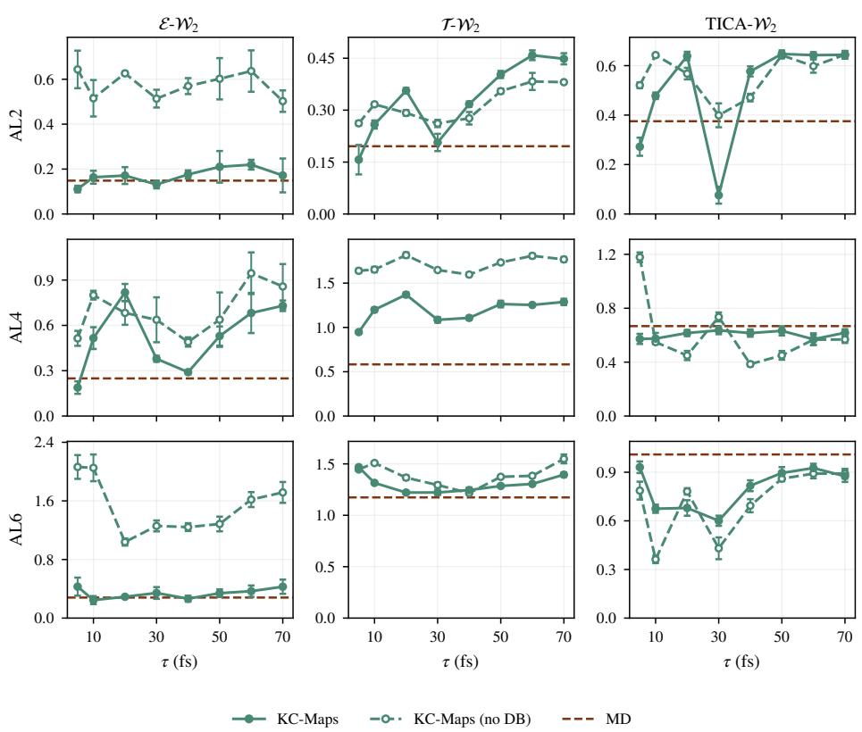  
Figure A1: Equilibrium results across step size. Equilibrium metrics for KC-maps with and without detailed-balance loss against reference long MD.

Moreover, we demonstrate the ability of our method to extrapolate beyond its training distribution and recover modes not seen during training. Namely, for the AL6 system, Fig. A2 shows the reference distribution from long MD, the training data distribution on the train split from (Tan et al., 2025), which has the missing bottom left mode, and our samples from long simulation from our method (16 chains × 400 ns per chain for a total of 40 GPU-hours).

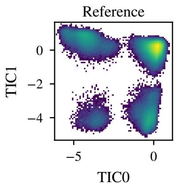

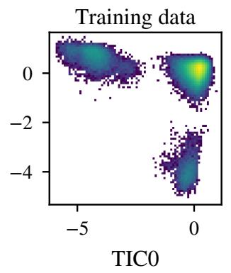

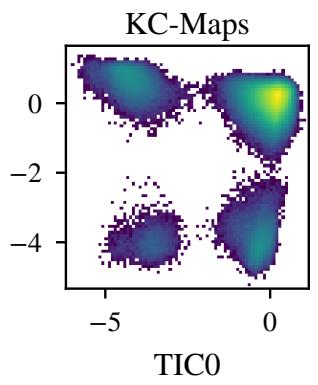  
Figure A2: AL6 sampling beyond the training distribution. TICA projections of reference long MD, training data, and KC-maps samples. The KC-maps samples are pooled from 16 chains of approximately 400 ns each. The lower-left mode is absent from the training configurations but visited by KC-maps.

## E.2 THROUGHPUT ACROSS STEP SIZES

We show the throughput measured in simulated time across τ for our method against a single chain of MD. We see in smaller systems, the method lags behind in simulated time for a single chain below $\tau = 5 0$ fs. However, this gap closes as system sizes grow larger e.g. KC-maps exceeds MD throughput for single chain at $\tau = 4 0$ fs for AL6. Moreover, as seen in Fig. 3, KC-maps better utilizes GPU resources when simulating parallel chains in a single GPU, highlighting the advantage of deep learning based approaches for accelerated molecular dynamics.

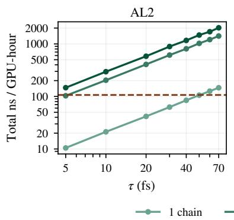

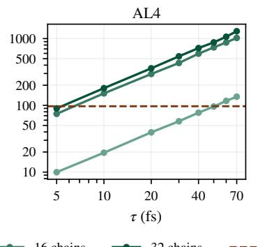

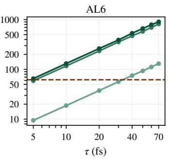  
Figure A3: Aggregate physical time simulated across chains across τ for $\mathrm { \ n \_ c h a } .$ ins ∈ 1, 16, 32. All runs on a single L40S GPU.

## E.3 METROPOLIS–HASTINGS ACCEPTANCE ACROSS STEP SIZES

We show the Metropolis–Hastings acceptance rates across different τ . We observe strong acceptances at small τ for all systems. We evaluate each system using 10K sources with average across 16 proposals per source across $\tau \in { \mathrm { ~ } } [ 5 $ , 100] fs for AL2 and $\tau \in [ 5 , 8 5 ]$ fs AL4 and AL6. For AL2, acceptance remains above 20% for the evaluated step sizes $\tau < 8 0 1$ fs. For AL4 and ${ \mathrm { A L } } 6 ,$ the acceptance rates considerably drop and are practically unusable for simulation for larger τ. The force-field and simulation settings vary across systems (Table A2) and may also affect acceptance rates.

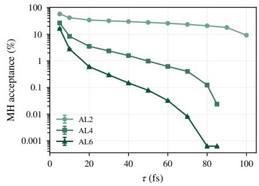  
Figure A4: Acceptance rates across step size for KC-maps.

## E.4 COMPARISON TO MLE ON TRAJECTORY DATA

We compare our method under same settings, i.e., model parameterization, training steps, and with $\mathcal { L } _ { D B }$ loss, but instead train using MLE on trajectory data from MD. In Fig. A5, we see our method is competitive to MLE directly from data, showcasing that we do not need trajectory data to learn accelerated dynamics for τ up to 70 fs.

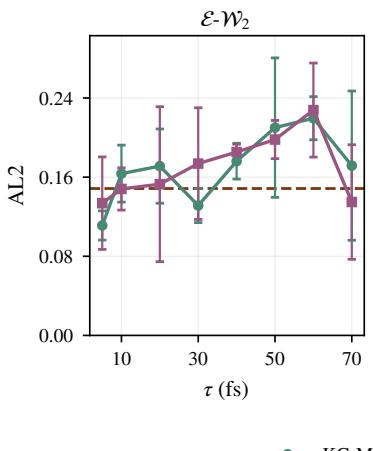

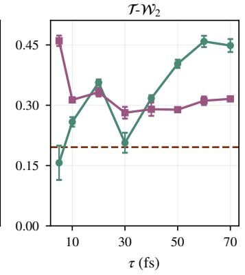

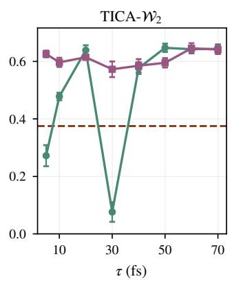  
Figure A5: Equilibrium accuracy on AL2 across step sizes: trajectory MLE vs. $\mathcal { L } _ { K C }$ . 2- Wasserstein distances to reference MD for 16 chains run for one hour on a single L40S GPU at each τ. Error bars are the standard deviation over three subsamples of the trajectory. The dashed line is MD with 16 chains for one hour.

## E.5 AL2 TRANSITION PROBABILITIES

Fig. A6 reports the transition probabilities $P _ { i j } ( t )$ of KC-maps and reference long MD between the four AL2 modes (Section D.4). We assign each frame a model label as described in Section D.4, discarding the first 10% of each trajectory for KC-maps and the first 1 ns for each MD trajectory.

We evaluate the lags on a logarithmically spaced grid from 1 ps to 5 ns. At each lag t, we pool all pairs of frames separated by t. within the same trajectory across 16 trajectories. We estimate $P _ { i j } ( t )$ as the number of pairs starting in mode i and ending in mode j, divided by the number starting in mode i.

For each method, we estimate uncertainty by bootstrapping trajectories (Grossfield et al., 2018). We draw 16 trajectories with replacement, pool their transition counts, and recompute $P _ { i j } ( t )$ . We repeat this procedure 2000 times. At each lag, the 2.5th and 97.5th percentiles of these estimates define the 95% confidence interval.

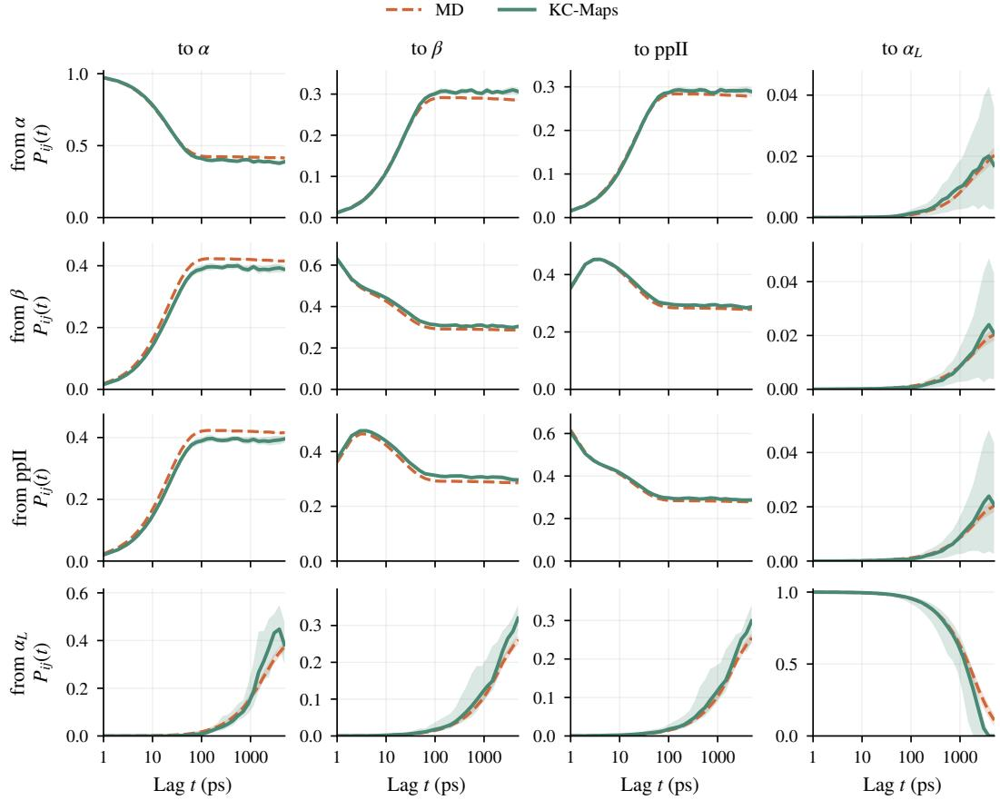  
Figure A6: AL2 transition probabilities. $P _ { i j } ( t )$ from mode i (rows) to mode j (columns) against the lag t. Shaded bands are 95% bootstrap intervals over chains.

## E.6 TARGET EMA DECAY

In Fig. A7, the stop-gradient target (ema\_decay = 0) has the highest NLL at every elapsed time, decays between 0.99 and 0.9995 perform similarly, and the slowest decay, 0.99975, degarding in performance.

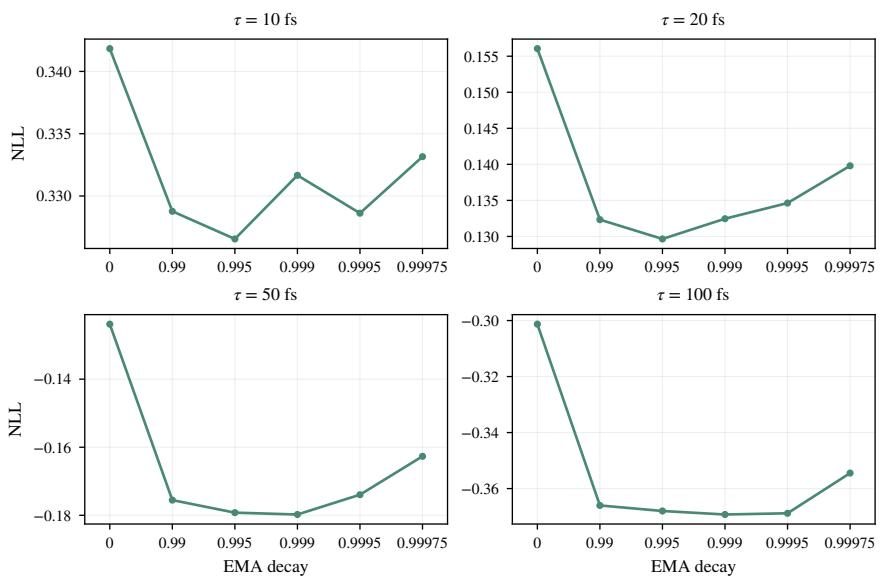  
Figure A7: Target EMA decay on AL2. Models differ only in ema\_decay for the two-step target $\eta = \mathrm { E M A } ( \theta )$ in Eq. (12). All models are trained for 500K steps with batch size 512. We report NLL on MD transition samples $\mathrm { a t } \tau \in \{ 1 0 , 2 0 , 5 0 , 1 0 0 \}$ fs. A decay of zero corresponds to η = stopgrad(θ).

## E.7 FLOW PARAMETERIZATIONS

We compare three coordinate choices for the affine coupling flow, using the same Gaussian reference $\mu ( x , \tau ) + L ( \tau ) z$ , where $z \sim \mathcal { N } ( 0 , I ) , \mu ( x , \tau ) = x + m ( x , \tau )$ , and $\Sigma \bar { ( \tau ) } = L ( \tau ) L ( \tau ) ^ { \top }$ . Writing Ψ for the coupling map in the chosen coordinates, the three parameterizations are

$$
\begin{array} { r l r } { \mathrm { S t a n d a r d : } } & { } & { y = \Psi \big ( x + m ( x , \tau ) + L ( \tau ) z ; x , \theta \big ) , } \\ { \mathrm { D i s p l a c e m e n t : } } & { } & { y = x + m ( x , \tau ) + \Psi \big ( L ( \tau ) z ; x , \theta \big ) , } \\ { \mathrm { W h i t e n e d : } } & { } & { y = x + m ( x , \tau ) + L ( \tau ) \Psi ( z ; x , \theta ) . } \end{array}\tag{149}
$$

The standard flow transforms the full joint state, the displacement flow transforms residuals about the reference mean, and the whitened flow transforms standard Gaussian coordinates. All three recover the Gaussian reference when Ψ is the identity.

We adapt the gates to each coordinate choice. Using $\kappa _ { n } ( \tau ) = ( \omega \tau ) ^ { n } / [ 1 + ( \omega \tau ) ^ { n } ]$ , the gates are

<table><tr><td></td><td> $A _ { x }$ </td><td> $A _ { p }$   $B _ { x }$ </td><td></td><td> $B _ { p }$ </td></tr><tr><td>Standard</td><td> $\kappa _ { 3 }$ </td><td> $\kappa _ { 2 }$ </td><td> $\kappa _ { 3 }$ </td><td> $\kappa _ { 2 }$ </td></tr><tr><td>Displacement</td><td> $\kappa _ { 2 }$ </td><td> $\kappa _ { 2 }$ </td><td> $\kappa _ { 3 }$ </td><td> $\kappa _ { 2 }$ </td></tr><tr><td>Whitened</td><td> $\kappa _ { 2 }$ </td><td> $\kappa _ { 2 }$ </td><td> $\begin{array} { r l } { \sqrt { \kappa _ { 3 } } } & { { } \sqrt { \kappa _ { 3 } } , } \end{array}$ </td><td></td></tr></table>

(150)

where $A$ gates the log scale and $B$ gates the shift in the corresponding coordinates. For bounded coupling outputs, these choices give physical corrections of at most $\breve { O } ( \tau ^ { 3 } )$ in position and $O ( \tau ^ { 2 } )$ in momentum in all three representations. These gate orders differ from the main model (see Section B.3.3).

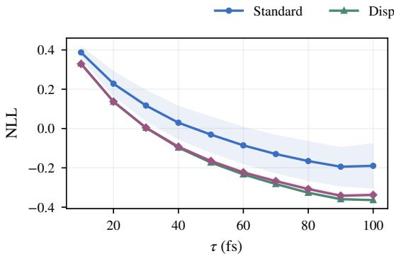

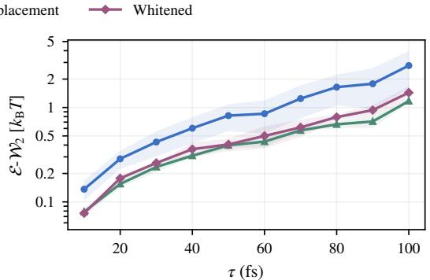  
Figure A8: Flow parameterization on AL2. Comparison of standard, displacement, and whitened flows, each trained for 500K steps with batch size 512 and evaluated using EMA parameters with decay 0.999. Lines and shaded bands show the mean and standard deviation across training seeds: 42, 43, and 44 for all three parameterizations. Left: NLL per degree of freedom (DoF) on molecular dynamics samples. Right: $\bar { \mathcal { E } } \mathrm { - } \mathcal { W } _ { 2 }$ in units of $k _ { \mathrm { B } } T$ , averaged over source configurations.

In Fig. A8, displacement and whitened flows perform similarly at short elapsed times, while the displacement flow has lower mean NLL and $\dot { \mathcal { E } } { - } \mathcal { W } _ { 2 }$ at longer elapsed times. Both improve on the standard flow across the evaluated step sizes.