# KiteNorm: Variance Regularisation for Stable and Scalable Post-LN Transformers

Leon A. Trochelmann∗, Sajad Movahedi, Shiwei Liu, Antonio Orvieto ELLIS Institute Tübingen MPI for Intelligent Systems Tübingen AI Center

## Abstract

Post-LayerNorm Transformers have seen limited practical adoption due to enduring difficulties in scaling them to large depths. While prior research has focused on stabilising Post-LayerNorm by improving conditioning at initialisation, stability often deteriorates when models are trained with large learning rates, forcing additional compromises. In the decoder-only settings we study, existing Post-LayerNorm methods fail to outperform strong Pre-LayerNorm baselines. We propose KiteNorm, a post-norm training method designed to break this trend by constraining hidden-state variance. This approach is motivated by a bound on the LayerNorm Jacobian suggesting that variance growth contributes to gradient vanish ing, alongside empirical evidence linking it to rank collapse. KiteNorm combines residual scaling and variance regularisation to maintain stability throughout training, supported by scalarised double-normalisation that provides separately learnable scales for the skip and residual branches. Across decoder-only Transformers up to 1.3B parameters, KiteNorm improves training stability and outperforms leading baselines at their optimal learning rates, with scaling laws favouring KiteNorm across depth, width, batch size, and training budget. Ablations show that each component is necessary for the full stability and performance gains.

## 1 Introduction

Post-LayerNorm (post-norm) Transformers (Vaswani et al., 2017) have largely been replaced by Pre-LayerNorm (pre-norm) Transformers (Wang et al., 2019) in large-scale Transformer implementations, owing to their improved gradient conditioning along the uninterrupted skip branch (Xiong et al., 2020). However, pre-norm exhibits persistent weaknesses, such as parameter inefficiency in deep layers (Sun et al., 2025; Gromov et al., 2024) and massive activations (Sun et al., 2026). Residual scaling (Sun et al., 2025; Radford et al., 2019) can mitigate these weaknesses, but it cannot fully eliminate them as the architecture necessarily piles up sublayer contributions on the skip branch.

This has motivated renewed interest in post-norm architectures with the goal of scaling them to a large number of layers. The core challenge is the fact that the Jacobian of post-norm acts on both the residual and skip branches during backpropagation, which leads to gradient vanishing as the scale of the activations and the number of layers rise (Nguyen & Salazar, 2019; Huang et al., 2020). While prior work has analysed the effective dynamics of this phenomenon, the underlying cause remains poorly understood. We extend existing insights by deriving an upper bound that directly relates hidden-state variance to gradient propagation, and by providing empirical evidence linking variance expansion to rank collapse (Dong et al., 2021; Noci et al., 2022).

Recent works have made strides in improving the conditioning of post-norm Transformers through branch scaling and double-normalisation (Wang et al., 2024; Chen & Wei, 2026; Joseph et al., 2024).

While these methods improve optimisation conditions at initialisation, they can be less robust to high learning rates or less competitive at moderate depths. We postulate that methods that rely primarily on favourable initialisation conditions are ultimately prone to degraded performance or stability as large learning rates push models further away from initialisation. Resolving this trade-off is therefore important for improving the scalability and efficiency of Transformer training. Our contributions can be outlined as follows:

• We extend the theoretical analysis of gradient propagation in post-norm Transformers by highlighting the impact of hidden-state variance, and provide empirical evidence linking variance expansion to rank collapse.

• We propose KiteNorm, constraining hidden-state variance through a combination of residual scaling, double-normalisation, scalarised LayerNorm and a new variance regulariser, which stabilises optimisation even at large learning rates.

• We conduct a suite of experiments with decoder-only Transformers up to 1.3B parameters that demonstrate KiteNorm’s improved stability and scaling with respect to model depth, width, batch size, and training budget, even when compared to leading solutions.

• We provide a series of ablations that demonstrate each component of KiteNorm is essential.

Code is available at https://github.com/l-trochelmann/KiteNorm.

## 2 Preliminaries and Related Work

In this section, we establish notation, provide context for our work, and derive the crucial backward pass dynamics of post-norm Transformers.

## 2.1 Notation

Define the normalisation of a vector $\pmb { v } \in \mathbb { R } ^ { d }$ as follows:

$$
\tilde { v } = \frac { v - \mu ( v ) \mathbb { 1 } } { \sigma ( v ) } ,\tag{1}
$$

where $\mu$ and $\sigma$ denote the mean and standard deviation, respectively, and 1 is the size-d vector of ones. LayerNorm (Ba et al., 2016), as used in Transformers, can then be written as

$$
\operatorname { L N } ( X ) = \gamma \cdot { \tilde { X } } + \beta ,\tag{2}
$$

where $\pmb { X } \in \mathbb { R } ^ { S \times d }$ is a length- $\mathbf { \nabla } \cdot S$ sequence of tokens that are embedded in hidden dimension d. Normalisation is applied row-wise across d. The parameters $\gamma , \beta \in \mathbb { R } ^ { d }$ act element-wise across d and are called the gain and bias of LayerNorm. Their components are uniformly initialised as 1 and 0, respectively. Implementations of LayerNorm often add a small constant ϵ in the denominator during the normalisation step to ensure numerical stability, though we omit it for clarity in this section.

The original Transformer (Vaswani et al., 2017) used normalisation as a component of its sublayers in the following form:

$$
\operatorname { S u b l a y e r } _ { \operatorname { p o s t - n o r m } } ( X ) = \operatorname { L N } ( X + { \mathcal { F } } ( X ) ) .\tag{3}
$$

Sublayer notation. A decoder-only Transformer stacks such sublayers, with $\mathcal { F }$ alternating between self-attention and an MLP transformation. We denote the number of Transformer layers by $L ,$ so that the model has 2L sublayers. We write $X _ { l }$ for the hidden states entering the l-th sublayer, where $l \in \{ 1 , 2 , \ldots , 2 L \}$ , and $\mathcal { F } _ { l }$ for the corresponding residual branch transformation. To differentiate sublayer inputs and outputs, we write $Z _ { l } = X _ { l } + { \mathcal { F } } _ { l } ( X _ { l } )$ . I denotes the identity matrix.

Norms and matrix notation. $\| \cdot \| _ { q }$ describes the $L _ { q }$ norm for vectors, and the corresponding induced operator norm for matrices. ${ \| \cdot \| _ { F } }$ describes the Frobenius norm. The i-th row of a matrix $\mathbf { A } _ { l }$ is denoted by $\mathbf { } A _ { l , i }$ . Since LayerNorm is applied independently to each token’s hidden state, our theoretical derivations omit the sequence length and batch size. We thus write $\pmb { x } _ { l } \in \mathbb { R } ^ { d }$ for a row from $X _ { l }$ and $z _ { l } \in \mathbb { R } ^ { d }$ for a row from $\boldsymbol { Z } _ { l }$

## 2.2 Gradient Propagation in Post-Norm Transformers

We now examine the backward pass of post-norm Transformers. Let $\mathrm { L N } _ { l }$ denote the LayerNorm operation in sublayer l, and let $\bar { \mathbf { x } _ { l + 1 } } = \bar { \mathrm { L N } _ { l } } ( \mathbf { x } _ { l } + \mathcal { F } _ { l } ( \mathbf { x } _ { l } ) ) = \mathrm { L N } _ { l } ( \boldsymbol { z } _ { l } )$ . Then

$$
\frac { \partial { \pmb x } _ { l + 1 } } { \partial { \pmb x } _ { l } } = \frac { \partial { \bf L N } _ { l } ( { \pmb z } _ { l } ) } { \partial { \pmb z } _ { l } } \frac { \partial { \pmb z } _ { l } } { \partial { \pmb x } _ { l } } = \frac { \partial { \bf L N } _ { l } ( { \pmb z } _ { l } ) } { \partial { \pmb z } _ { l } } \left( { \pmb I } + \frac { \partial { \mathcal { F } } _ { l } ( { \pmb x } _ { l } ) } { \partial { \pmb x } _ { l } } \right) .\tag{4}
$$

LayerNorm is a gradient bottleneck. Notably, the LayerNorm Jacobian multiplies both the Jacobian along the skip branch I and the derivative along the residual branch $\frac { \partial \mathcal { F } _ { l } ( \pmb { x } _ { l } ) } { \partial \pmb { x } _ { l } }$ . As highlighted by Nguyen & Salazar (2019), this leads to instability if $\frac { \partial \mathrm { L N } _ { l } ( \pmb { z } _ { l } ) } { \partial \pmb { z } _ { l } }$ repeatedly expands or contracts gradients across layers.

Spectral norm bound. We can characterise when LayerNorm can act as a contraction by analysing the spectral norm of $\frac { \partial \mathrm { L N } _ { l } \left( \pmb { z } _ { l } \right) } { \partial \pmb { z } _ { l } }$ , for which we derive the following upper bound (see Appendix A).

Theorem 1 (Spectral norm bound for LayerNorm). Let $\mathrm { L N } _ { l }$ denote LayerNorm applied to the hidden state $z _ { l } ,$ , with learned scale parameter γ. Then for any $\sigma ( z _ { l } ) > 0$ the Jacobian of $\mathrm { L N } _ { l }$ with respect $t o \ z _ { l }$ satisfies

$$
\left\| \frac { \partial \mathrm { L N } _ { l } ( \boldsymbol { z } _ { l } ) } { \partial \boldsymbol { z } _ { l } } \right\| _ { 2 } \leq \frac { \| \gamma \| _ { \infty } } { \sigma ( \boldsymbol { z } _ { l } ) } .\tag{5}
$$

The crucial implication of Theorem 1, together with equation 4, is that the LayerNorm Jacobian acts as a shared bottleneck for gradient propagation through both the skip and residual branches. In particular, its spectral norm is upper-bounded by the LayerNorm gain divided by $\sigma ( z _ { l } )$ . Hence, sufficiently large hidden-state variance can cause the LayerNorm Jacobian to contract gradients, contributing to gradient vanishing across depth. This establishes hidden-state variance growth as a concrete source of gradient contraction in post-norm Transformers and motivates constraining it during training.

## 2.3 Rank Collapse

Noci et al. (2022) investigate rank collapse in Transformers by measuring the alignment of token representations using a metric originating from Cho & Saul (2009) and Nachum et al. (2021). For two token indices $i , \breve { i } ^ { \prime }$ in the hidden-state matrix $\boldsymbol { Z } _ { l }$ after the residual addition in sublayer l, define the token correlation as

$$
\rho _ { i , i ^ { \prime } } ( \boldsymbol { Z } _ { l } ) = \frac { \mathbb { E } \langle \boldsymbol { Z } _ { l , i } , \boldsymbol { Z } _ { l , i ^ { \prime } } \rangle } { \sqrt { \mathbb { E } \| \boldsymbol { Z } _ { l , i } \| _ { 2 } ^ { 2 } \mathbb { E } \| \boldsymbol { Z } _ { l , i ^ { \prime } } \| _ { 2 } ^ { 2 } } } ,\tag{6}
$$

where the expectation is taken with respect to the model weights at initialisation.

Following Noci et al. (2022), we define token alignment as the average token correlation

$$
\tau ( { \cal Z } _ { l } ) = \frac { 1 } { S ( S - 1 ) } \sum _ { i \neq i ^ { \prime } } \rho _ { i , i ^ { \prime } } ( { \cal Z } _ { l } ) ,\tag{7}
$$

where $S$ is the sequence length.

Token representations pointing in the same direction have correlation 1. Thus, as token alignment tends to 1, the representation becomes increasingly rank-collapsed. In practice, we compute this metric over the actual model weights, replacing the expectation with the empirical value computed from the trained model states.

Although other rank-collapse metrics have been proposed (Dong et al., 2021), we find that they behave similarly in practice and focus on token alignment because it has a direct geometric interpretation. Token alignment therefore provides a simple empirical measure of rank collapse in Transformers, which we use in the following section to study its connection to gradient vanishing.

## 2.4 Related Work

Normalisation placement has played a central role in the development of Transformer architectures. The original Transformer used post-norm sublayers, but many large-scale implementations have since

adopted pre-norm following Wang et al. (2019). In pre-norm Transformers, LayerNorm is placed before the residual branch transformation:

$$
\operatorname { S u b l a y e r } _ { \operatorname { p r e - n o r m } } ( X ) = X + { \mathcal { F } } ( \operatorname { L N } ( X ) ) .\tag{8}
$$

Unlike post-norm, pre-norm leaves the skip connection uninterrupted during backpropagation, allowing gradients to flow directly across depth (Wang et al., 2019). Subsequent work linked this structure to improved gradient conditioning in expectation (Xiong et al., 2020).

Pre-norm scaling methods. Several methods for controlling signal growth along the skip branch have been proposed. GPT-2 applies residual output scaling by initialising the output weights of each sublayer with an additional factor of $1 / \sqrt { 2 L }$ (Radford et al., 2019), which compensates for the accumulation of residual updates in deeper models. Later work formalised the importance of such scaling mechanisms, showing that unconstrained signal growth in pre-norm Transformers can reduce the effectiveness of deep layers (Sun et al., 2025). Instead of scaling output weights, LayerNorm-Scaling rescales the input to each sublayer after pre-normalisation by a depth-dependent factor.

Additional normalisation. Related approaches such as peri-norm (Ding et al., 2021; Kim et al., 2025) add a second LayerNorm after the residual branch transformation, yielding peri-norm sublayers of the form

$$
\operatorname { S u b l a y e r } _ { \operatorname { p e r i - n o r m } } ( X ) = X + \operatorname { L N } ( { \mathcal { F } } ( \operatorname { L N } ( X ) ) ) .\tag{9}
$$

This constrains the magnitude of each residual update before it is added to the skip branch.

Despite these improvements, pre-norm retains architectural limitations. Because each sublayer adds directly to the skip branch, scaling or additional normalisation can mitigate signal accumulation and alignment, but cannot fully avoid them. Recent work has also shown that large activations can propagate through pre-norm models at scale (Sun et al., 2026). These issues have motivated renewed interest in post-norm architectures, where LayerNorm is applied after the residual addition and therefore normalises both the skip and residual branches.

Post-norm stabilisation. Several methods attempt to recover the stability of post-norm while preserving its performance advantages. Earlier, T-Fixup (Huang et al., 2020) also investigated the interaction between LayerNorm and gradient propagation, motivating an alternative initialisation strategy. Recently, mix-norm constructs models from an initial block of post-norm layers followed by pre-norm layers (Li et al., 2024). This reduces the number of post-norm layers over which gradients can vanish, while also reducing the number of pre-norm layers over which signal can accumulate. However, the resulting architecture remains a compromise between the two regimes. DeepNet instead retains a post-norm structure and introduces residual and skip branch scaling to improve optimisation conditions at initialisation (Wang et al., 2024). Although effective for very deep encoder-decoder Transformers, we find that such initialisation-based stabilisation is less robust in decoder-only settings trained with large learning rates.

Most recently, Chen & Wei (2026) proposed KEEL, a post-norm method that improves decoder-only Transformer training by using double-normalisation:

$$
{ \mathrm { S u b l a y e r } } _ { \mathrm { d o u b l e - n o r m } } ( X ) = \operatorname { L N } ( X + { \mathcal { F } } ( \operatorname { L N } ( X ) ) ) .\tag{10}
$$

Although the additional normalisation may appear redundant, it allows the model to separately learn input scales for the skip and residual branches within each sublayer. KEEL further employs skip branch scaling to improve gradient propagation. Overall, while KEEL improves the stability of post-norm training, it does not explicitly constrain hidden-state variance during training and still underperforms strong pre-norm baselines in our decoder-only setting.

## 3 KiteNorm

KiteNorm combines three techniques to improve both stability and performance. Residual scaling, discussed in section 3.1, is essential to our stabilisation strategy and explains the core dynamic of our method. We further introduce variance regularisation, described in section 3.2, which prevents this stability from degrading over time when models are trained with large learning rates. Finally, to improve the expressivity of this post-norm setup, we leverage scalarised double-normalisation, explained in section 3.3.

with residual scaling.  
(c) Token alignment with residual scaling.  
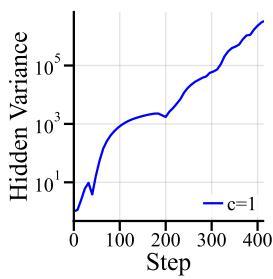  
(a) Variance expansion

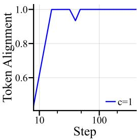  
(b) Token alignment in vanilla post-norm.

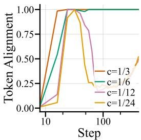

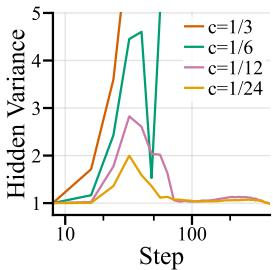  
(d) Hidden variance  
Figure 1: Effect of residual scaling on training failures observed when training a 12-layer post-norm Transformer according to the setup in Appendix B with learning rate $1 0 ^ { - 2 }$ . We report statistics over the hidden state after the residual addition in the final Attention sublayer. Figures 1a & 1b show the behaviour of vanilla post-norm with residual scaling factor $c = 1$ , whereas figures 1c and 1d show the effects of other choices of c.

## 3.1 Residual Scaling

Variance expansion and rank collapse. While several prior works (Xiong et al., 2020; Huang et al., 2020; Li et al., 2024) have observed the link between gradient vanishing and activation variance in post-norm Transformers, the underlying pressure that causes the activation scales to explode at high learning rates remains largely unexplored. We offer additional insight into the dynamics of activation variance. Specifically, we observe that the variance expansion of hidden states tends to coincide with rank collapse in early training, as shown in figures 1a and 1b.

Residual scaling reverses rank collapse. Recent literature on rank collapse (Joseph et al., 2024) proposes that weighting the relative contribution of the skip and residual branches in favour of the skip branch can reduce the rate of rank collapse. We observe this in practice by reducing the scale of the residual branch with residual scales as small as $\frac { 1 } { 2 L }$ , shown in figure 1c. While the unscaled model diverged while exhibiting rank collapse, choosing a sufficiently small residual scale can reverse rank collapse before the model diverges, even when using a relatively high learning rate. The reversal of rank collapse coincides with a reversal of hidden-state expansion, shown in figure 1d.

Equivalence to skip branch scaling. Since prior work specifies scaling the skip branch (Joseph et al., 2024), we formalise the equivalence between scaling the skip and residual branches, demonstrating that our method aligns with prior work.

We express skip scaling a and residual scaling c generally and relate them to each other. For positive $^ { a , }$ c and ignoring the stability constant ϵ, it holds that

$$
\mathrm { L N } \big ( a x _ { l } + c \mathcal { F } _ { l } ( \pmb { x } _ { l } ) \big ) = \mathrm { L N } \left( a c \left( \frac { 1 } { c } \pmb { x } _ { l } + \frac { 1 } { a } \mathcal { F } _ { l } ( \pmb { x } _ { l } ) \right) \right) = \mathrm { L N } \left( \frac { 1 } { c } \pmb { x } _ { l } + \frac { 1 } { a } \mathcal { F } _ { l } ( \pmb { x } _ { l } ) \right) .\tag{11}
$$

Thus, the forward pass depends on the relative scale ${ \frac { c } { a } } .$ Since this equivalence holds for any ${ \mathbf { } } x _ { l } .$ , it also holds for the corresponding Jacobians. Therefore, skip scaling and residual scaling are equivalent for optimising the model’s output loss, connecting our approach to the mitigation of rank collapse investigated by Joseph et al. (2024).

However, the two approaches differ in their effect on the variance entering LayerNorm. Increasing skip scaling also increases this variance, making it unsuitable for our variance regulariser, which we detail in the next section. This motivates our choice of residual scaling with $\begin{array} { r } { c = \frac { 1 } { 2 L } } \end{array}$ , following the relative scaling strength of Chen & Wei (2026).

## 3.2 Variance Regularisation

While residual scaling can reverse the initial variance expansion associated with rank collapse, it does not prevent a second form of variance expansion that can occur sporadically later in training. We observe this in figure 7c of our ablations, where KiteNorm without variance regularisation

becomes unstable after an initially stable training period. To prevent this later instability, we introduce variance regularisation, which adds a penalty based on hidden-state variance to the optimisation loss. Specifically, we propose the ReLU regulariser term:

$$
\mathrm { m e a n } _ { l } \left( \mathrm { R e L U } ( \sigma ( z _ { l } ) ^ { 2 } - 1 ) \right) .\tag{12}
$$

In practice, the resulting ReLU penalties are averaged across the batch, sequence, and sublayer dimensions before being added to the optimisation loss with weight λ. Notably, this regulariser only affects the loss if the variance of hidden states entering the outer LayerNorm exceeds 1. Hence, the regulariser does not affect optimisation while hidden-state variance remains below this threshold.

Using regularisation strength $\lambda = 1$ across our experiments, KiteNorm remains stable at and around its optimal learning rate, with instability occurring only at learning rates that already yield substantially worse performance. We hypothesise that by reversing the initial variance expansion, residual scaling establishes a stable training regime in which the optimiser can respond to subsequent variance growth through the regulariser.

The computational overhead of variance regularisation is small, as the regulariser can reuse the variance already computed by LayerNorm.

## 3.3 Scalarised Double-Normalisation

Variance regularisation provides a signal for constraining hidden-state variance, which the optimiser can already respond to by adjusting the model weights. However, we hypothesise that directly learnable scales make this response easier. To this end, we employ double-norm following Chen & Wei (2026), which allows the optimiser to separately adjust the input scales of the skip and residual branches.

To further simplify this control, we propose using double-norm with scalarised LayerNorm:

$$
\mathrm { L N } _ { \mathrm { s c a l a r i s e d } } ( \boldsymbol { X } ) = \boldsymbol { \gamma } ^ { \prime } \cdot \tilde { \boldsymbol { X } } + \beta ^ { \prime } ,\tag{13}
$$

where $\gamma ^ { \prime } , \beta ^ { \prime } \in \mathbb { R }$ are scalar parameters initialised as 1 and 0, respectively. This provides the optimiser with a small set of parameters that can directly adjust all branch scales. Our ablations in section 4.3 show that double-norm improves both stability and performance, while scalarisation further improves performance.

## 4 Experiments

We perform a range of experiments to compare KiteNorm against competitive baselines from existing work. First, in section 4.1, we compare KiteNorm with leading normalisation methods in our setting, evaluating practical performance. Then, in section 4.2, we analyse and compare the scaling properties of KiteNorm against the strongest baseline. Finally, in section 4.3, we document the efficacy of each component of KiteNorm through ablation studies.

Unless otherwise specified, all trained models use the following hyperparameters and training setup. We train decoder-only Transformers on SlimPajama-627B (Soboleva et al., 2023) using the Chinchilla ratio of 20 training tokens per model parameter (Hoffmann et al., 2022). Our optimisation setup uses the AdamW optimiser (Loshchilov & Hutter, 2017) with fixed $\beta _ { 1 } = \beta _ { 2 }$ following Orvieto & Gower (2025) and gradient clipping. When training KiteNorm, we add the ReLU regulariser from equation 12 to the optimisation loss. Architecturally, our models use rotary position embeddings (RoPE) (Su et al., 2024) and a GLU feed-forward block instead of a standard MLP, following recent industry practice (Shazeer, 2020). Appendix B.1 provides a complete setup and hyperparameter specification.

We report validation loss, validation perplexity (ppl), and training loss. We additionally evaluate downstream performance on ARC-Easy and PIQA using the Language Model Evaluation Harness (Gao et al., 2024), with the evaluation setup detailed in Appendix B.3. In plots, we abbreviate validation as valid and training as train. For some experiments, we display only the tuned results, meaning that we show the run with the lowest final loss or perplexity from a specified learning rate grid.

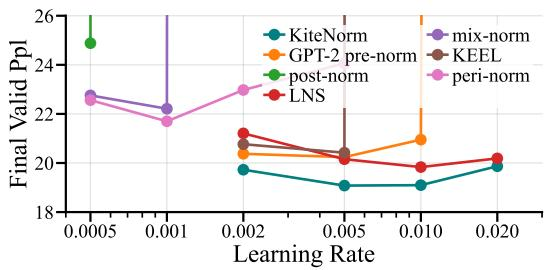

<table><tr><td>Method</td><td>LR*</td><td>Best</td><td>Worst</td></tr><tr><td>GPT-2 pre-norm</td><td> $5 \cdot 1 0 ^ { - 3 } $ </td><td>20.240</td><td>20.343</td></tr><tr><td>KEEL</td><td> $5 \cdot 1 0 ^ { - 3 } $ </td><td>20.316</td><td>20.420</td></tr><tr><td>Peri-norm</td><td> $1 \cdot 1 0 ^ { - 3 }$ </td><td>21.365</td><td>21.699</td></tr><tr><td>Mix-norm</td><td> $1 \cdot 1 0 ^ { - 3 }$ </td><td>22.011</td><td>22.211</td></tr><tr><td>Post-norm</td><td> $5 \cdot 1 0 ^ { - 4 } $ </td><td>24.807</td><td>24.882</td></tr><tr><td>LayerNorm-Scaling</td><td> $1 \cdot 1 0 ^ { - 2 } $ </td><td>19.834</td><td>19.970</td></tr><tr><td>KiteNorm</td><td> $5 \cdot 1 0 ^ { - 3 } $ </td><td>19.080</td><td>19.156</td></tr></table>

(a) Learning rate exploration.  
(b) Best and worst values reported from three seeds at the tuned learning rate.  
Figure 2: Final validation perplexities of KiteNorm and competitive LayerNorm methods in a 48-layer Transformer.

## 4.1 Comparison Against Leading Baselines

Compared methods. Our criterion for selecting competitive approaches is scalable performance in decoder-only Transformers under our training setup. Our implementations follow the written specifications in each method’s original proposal, with exceptions specified and motivated below. We give a comprehensive implementation breakdown in Appendix B.2.

As a strong pre-norm baseline, we use pre-norm with GPT-2 initialisation (Radford et al., 2019) based on a comparative study described in Appendix C.1. Additionally, we compare against the more recent LayerNorm-Scaling (LNS) (Sun et al., 2025). We also include peri-norm (Ding et al., 2021; Kim et al., 2025) due to its recent popularity. To represent post-norm, we evaluate against vanilla post-norm (Vaswani et al., 2017) and KEEL (Chen & Wei, 2026). For KEEL, where the original specification uses an MLP, we report GLU results in the main comparison because an equal-parameter MLP variant performs worse in Appendix C.2. To represent the hybrid approach between pre- and post-norm, we use mix-norm (Li et al., 2024) with partial GPT-2 initialisation based on a comparison in Appendix C.3.

Learning rate robustness. We compare these methods in a 48-layer Transformer, where depth renders the challenges of normalisation placement more pronounced. Figure 2 shows the results. In the learning rate exploration in figure 2a, we find that KiteNorm and LayerNorm-Scaling provide the best robustness against high learning rates. Vanilla post-norm, KEEL and mix-norm exhibit comparatively poor robustness to learning rate choice. The odd curve associated with peri-norm is discussed separately in Appendix C.4.

Seed robustness. To obtain a more reliable estimate of the performance difference between these methods, we pick the learning rates yielding the best performance for each method in the exploration and rerun each method twice with new random seeds at its selected learning rate. The resulting performance values are shown in the right panel of figure 2. Here, we highlight that KiteNorm maintains a substantial performance advantage for both the best and worst values across three seeds.

Scaling baseline selection. Although LayerNorm-Scaling slightly outperforms GPT-2 pre-norm in our 48-layer comparison, additional comparisons at 12 and 96 layers in Appendix C.5 show that it falls behind GPT-2 pre-norm at greater depth, where GPT-2 pre-norm also continues to outperform KEEL. Given the computational cost of the scaling experiments we discuss in the next section, we restrict further comparisons to GPT-2 pre-norm, which we select as the more robust baseline across depth.

Downstream performance. We additionally evaluate the best final checkpoints from our 48-layer comparison on ARC-Easy and PIQA in Appendix C.6. While the ARC-Easy results follow the validation perplexity comparison, PIQA is a binary-choice task where the scores of these relatively small models are closer to chance, making the small performance differences difficult to distinguish from noise.

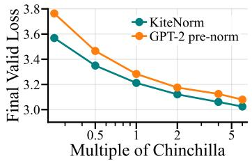  
(a) Data scaling law.

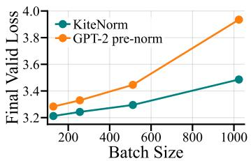  
(b) Batch size scaling law.

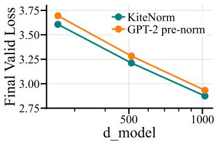  
(c) Width scaling law.  
Figure 4: Scaling behaviour of KiteNorm and GPT-2 pre-norm across training budget, batch size, and width in 12-layer Transformers.

## 4.2 Scalability

We analyse the scaling behaviour of KiteNorm against GPT-2 pre-norm across depth, training budget, batch size, and width. We generally keep the base configuration fixed except for the specific axis being varied. For depth and width sweeps, we also adjust the training budget to maintain the Chinchilla-style ratio of 20 tokens per parameter. For each method and sweep point, we report the run with the lowest final validation loss from $( 1 0 ^ { - 3 } , 2 \cdot 1 0 ^ { - 3 } , 5 \cdot 1 0 ^ { - 3 } , 1 0 ^ { - 2 } , \overset { . } { 2 } \cdot \overset { . } { 1 } 0 ^ { - 2 } )$

Depth scaling. First, we analyse scaling across depth, where normalisation methods often exhibit their most pronounced failures. To that end, we start with a depth of 3 layers and double it successively until reaching 96 layers. Measuring the final validation loss of each point, we obtain the scaling law displayed in figure 3.

Both methods achieve substantially lower validation loss as depth and non-embedding parameter counts increase, but KiteNorm maintains its lead across the entire range. A narrowing gap in validation loss should not be interpreted as diminishing practical relevance. At high parameter counts, comparable absolute loss improvements require substantially larger increases in training compute.

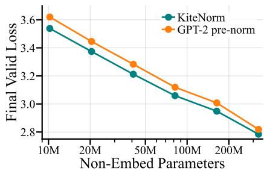  
Figure 3: Depth scaling law.

Extending the scaling law analysis to data, batch size, and model width, we obtain the additional scaling laws shown in figure 4.

Training budget scaling. Inspecting the impact of training budget on final model performance, we vary the training budget as multiples of the Chinchilla rule of 20 tokens per parameter. Specifically, we test the multipliers $( { \textstyle { \frac { 1 } { 4 } } } , { \textstyle { \frac { 1 } { 2 } } } , 1 , { \stackrel { . } { 2 } } , 4 , 6 )$ , obtaining the data scaling law in figure 4a. Here, too, KiteNorm demonstrates superior performance across lower and higher budgets, with especially large relative gains under low budgets.

Batch size scaling. Since larger batch sizes are commonly used to improve hardware utilisation in decoder-only Transformer training, we investigate the performance impact of doubling our batch size from the base value of 128 up to 1024. The resulting batch size scaling law is shown in figure 4b. KiteNorm demonstrates greater robustness to large batch sizes.

Width scaling. Finally, for completeness, we investigate the scaling of final performance across width by both doubling and halving the hidden representation size $d _ { \mathrm { m o d e l } } .$ , displaying the resulting width scaling law in figure 4c. The performance gap favouring KiteNorm is robust to these changes in width.

Combined scaling. To test whether these trends persist when depth, width, batch size, and training budget are scaled together, we train a 1B-parameter decoder-only Transformer based on the Pythia 1B configuration (Biderman et al., 2023). Specifically, we use 16 layers, $d _ { \mathrm { m o d e l } } = 2 0 4 8$ , and batch size 1024, with sequence length, number of Attention heads, and number of GLU parameters matched to the Pythia 1B specification. For these runs, we use a warm-up-then-constant learning rate schedule (Wen et al., 2024) with 572 warm-up steps and 7325 total steps for 15B tokens.

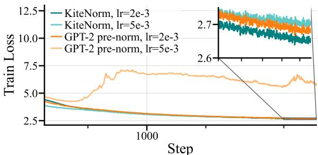  
(a) Training loss curves.

<table><tr><td>Method</td><td>LR</td><td>arc_easy (acc_norm)</td><td>piqa (acc_norm)</td></tr><tr><td>GPT-2 pre-norm</td><td> $2 \cdot 1 0 ^ { - 3 }$ </td><td>0.443</td><td>0.670</td></tr><tr><td>GPT-2 pre-norm</td><td> $5 \cdot 1 0 ^ { - 3 } $ </td><td>0.284</td><td>0.530</td></tr><tr><td>KiteNorm</td><td> $2 \cdot 1 0 ^ { - 3 }$ </td><td>0.473</td><td>0.675</td></tr><tr><td>KiteNorm</td><td> $5 \cdot 1 0 ^ { - 3 } $ </td><td>0.470</td><td>0.667</td></tr></table>

(b) Zero-shot downstream evaluation.

Figure 5: Performance of 1B-parameter models in Pythia configuration.
<table><tr><td>LR</td><td>KiteNorm</td><td>GPT-2 pre-norm</td></tr><tr><td> $2 \cdot 1 0 ^ { - 4 }$ </td><td>17.387</td><td>16.044</td></tr><tr><td> $5 \cdot 1 0 ^ { - 4 } $ </td><td>15.337</td><td>15.464</td></tr><tr><td> $1 \cdot 1 0 ^ { - 3 }$ </td><td>14.929</td><td>15.996</td></tr><tr><td> $2 \cdot 1 0 ^ { - 3 }$ </td><td>15.090</td><td>15.728</td></tr><tr><td> $5 \cdot 1 0 ^ { - 3 } $ </td><td>16.053</td><td>diverged</td></tr></table>

(a) Final validation perplexities across learning rates.  
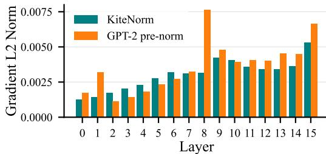  
(b) Gradient L2 norms of the GLU output projection in each layer. Measured after the final step of training with learning rate $1 0 ^ { - 3 }$  
Figure 6: Training stability of Llama-style 1.3B-parameter models.

The resulting training loss curves are shown in figure 5a. KiteNorm achieves lower training loss at learning rate $2 \cdot 1 0 ^ { - 5 }$ and remains stable at learning rate $5 \cdot 1 0 ^ { - 3 } ~ $ , where GPT-2 pre-norm diverges. The downstream results computed on the final checkpoints and shown in the right panel of figure 5 further demonstrate that KiteNorm achieves higher accuracy on ARC-Easy and PIQA at the lower learning rate, while still converging at the higher learning rate.

Further robustness tests. To investigate whether KiteNorm’s advantages extend to different architectural specifications and datasets, we adapt the 1B configuration to follow Llama 3.2 1B (Meta, 2024), increasing the number of Attention heads to 32 and setting the GLU expansion factor to 4. For consistency, we do not tie the input and output embeddings, yielding 1.3B-parameter models. We train these models on 22B tokens from FineWeb (Penedo et al., 2024), using a warm-up-then-constant learning rate schedule with a 6% warm-up portion.

The left panel of figure 6 shows the final validation perplexities across learning rates. KiteNorm outperforms GPT-2 pre-norm at their respective optimal learning rates and remains stable across the entire learning rate grid. In contrast, GPT-2 pre-norm diverges at the highest learning rate and exhibits loss spikes at learning rates $1 0 ^ { - 3 }$ and $2 \cdot 1 0 ^ { - 3 }$ . The training loss curves are shown in Appendix C.7.

We also examine gradient propagation across depth, comparing the L2 norms of the GLU outputprojection gradients in the final training step of both variants of the Llama model trained with learning rate $1 0 ^ { - 3 }$ . Figure 6b shows that KiteNorm exhibits no greater depth-wise gradient decay than GPT-2 pre-norm, with slightly more homogeneous gradient norms across layers.

## 4.3 Ablations

Each component of KiteNorm contributes to the above results, which we demonstrate through ablation studies shown in figure 7. Figure 7a shows that removing the inner LayerNorm from our architecture, which yields a regularised and residually scaled post-norm with scalarised LayerNorm parameters, degrades both validation performance and stability even in a relatively shallow 12-layer model. We next compare scalarised LayerNorm against standard LayerNorm in the 24- to 96-layer models from our depth-scaling analysis. Figure 7b shows that scalarised LayerNorm improves performance, with the largest gains appearing in deeper models. Finally, we ablate the variance regulariser in a high-learning-rate stress test. As shown in figure 7c, the 96-layer non-regularised KiteNorm model trained with learning rate $5 \cdot 1 0 ^ { - 3 }$ diverges during later training, while variance regularisation prevents this sporadic instability. Appendix C.8 further shows that omitting variance regularisation from GPT-2 pre-norm is valid for our comparisons, as the ReLU regulariser does not improve it.

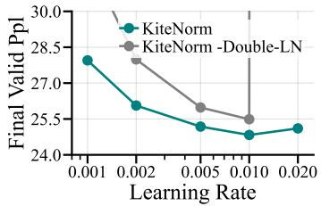  
(a) Effect of dropping doublenormalisation.

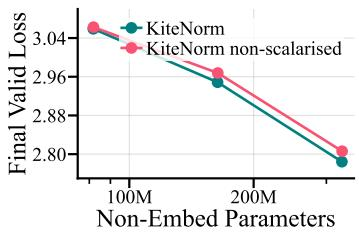  
(b) Effect of choosing nonscalarised LayerNorm.

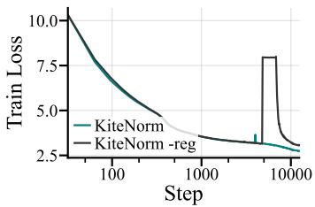  
(c) Effect of dropping variance regularisation.  
Figure 7: Ablation studies on KiteNorm in decoder-only Transformers.

Relation to KEEL. Our analysis of residual scaling in section 3.1 and additional ablations in Appendix C.9 suggest that KEEL primarily benefits from two components: branch scaling, which mitigates the initial variance expansion linked to rank collapse, and double-normalisation, which allows separate learned input scales for the two branches. We further find that KEEL’s first-layer exceptions reduce performance. Even without these exceptions, KEEL underperforms KiteNorm in our 48-layer comparison and lacks a mechanism to control the sporadic variance expansion that can occur later in training.

Supplementary ablations. In Appendix C.10, we investigate different choices of the residual scaling factor, regularisation strength, normalisation function, warm-up duration, and Adam betas. Our KiteNorm configuration retains its performance advantage across all of these variations.

## 5 Conclusion

In this paper, we revisited normalisation placement in deep Transformers, highlighting the tradeoff between the stability of pre-norm architectures and the performance potential of post-norm architectures. We proposed KiteNorm, a post-norm variant combining residual scaling, variance regularisation and scalarised double-normalisation. KiteNorm improves both stability and scalable performance over leading baselines, with gains supported by scaling laws across depth, width, training budget, and batch size, as well as experiments on Pythia- and Llama-style models, downstream evaluations, and extensive ablations. Our theoretical analysis motivates variance control as a means of mitigating gradient vanishing, while our empirical findings link early variance expansion to rank collapse and demonstrate how KiteNorm maintains stability throughout training. These results suggest that post-norm architectures remain a viable and underexplored route for Transformer training.

## 6 Limitations

Other implementations of variance regularisation could yield further improvements. Our residual scaling rule is motivated by theoretical intuition and sensitivity analyses, rather than a complete theory of rank collapse and gradient vanishing in post-norm Transformers. Furthermore, our theoretical analysis does not establish a general guarantee against gradient vanishing. Our experiments are limited to decoder-only Transformers of up to 1.3B parameters, trained on SlimPajama-627B and FineWeb, leaving generalisation to other architectures and larger models unexplored. Finally, while our ablations demonstrate robustness to variations in several hyperparameters, our training configuration was selected through experimental tuning rather than a principled parameterisation strategy, such as that proposed by Dey et al. (2025).

## Acknowledgments and Disclosure of Funding

The authors acknowledge the financial support from the Hector Foundation. The authors also acknowledge the Max Planck Institute for Intelligent Systems for providing the computational resources used in this work. Antonio Orvieto is supported by the AI2050 Early Career Fellowship from Schmidt Sciences.

## References

Jimmy Lei Ba, Jamie Ryan Kiros, and Geoffrey E Hinton. Layer normalization. arXiv preprint arXiv:1607.06450, 2016.

Stella Biderman, Hailey Schoelkopf, Quentin Gregory Anthony, Herbie Bradley, Kyle O’Brien, Eric Hallahan, Mohammad Aflah Khan, Shivanshu Purohit, USVSN Sai Prashanth, Edward Raff, et al. Pythia: A suite for analyzing large language models across training and scaling. In International conference on machine learning, pp. 2397–2430. PMLR, 2023.

Chen Chen and Lai Wei. Post-layernorm is back: Stable, expressive, and deep. arXiv preprint arXiv:2601.19895, 2026.

Youngmin Cho and Lawrence Saul. Kernel methods for deep learning. Advances in neural information processing systems, 22, 2009.

Nolan Dey, Bin Claire Zhang, Lorenzo Noci, Mufan Li, Blake Bordelon, Shane Bergsma, Cengiz Pehlevan, Boris Hanin, and Joel Hestness. Don’t be lazy: Completep enables compute-efficient deep transformers. arXiv preprint arXiv:2505.01618, 2025.

Ming Ding, Zhuoyi Yang, Wenyi Hong, Wendi Zheng, Chang Zhou, Da Yin, Junyang Lin, Xu Zou, Zhou Shao, Hongxia Yang, et al. Cogview: Mastering text-to-image generation via transformers. Advances in neural information processing systems, 34:19822–19835, 2021.

Yihe Dong, Jean-Baptiste Cordonnier, and Andreas Loukas. Attention is not all you need: Pure attention loses rank doubly exponentially with depth. In International conference on machine learning, pp. 2793–2803. PMLR, 2021.

Leo Gao, Jonathan Tow, Baber Abbasi, Stella Biderman, Sid Black, Anthony DiPofi, Charles Foster, Laurence Golding, Jeffrey Hsu, Alain Le Noac’h, Haonan Li, Kyle McDonell, Niklas Muennighoff, Chris Ociepa, Jason Phang, Laria Reynolds, Hailey Schoelkopf, Aviya Skowron, Lintang Sutawika, Eric Tang, Anish Thite, Ben Wang, Kevin Wang, and Andy Zou. The language model evaluation harness, 2024. URL https://zenodo.org/records/12608602.

Andrey Gromov, Kushal Tirumala, Hassan Shapourian, Paolo Glorioso, and Daniel A Roberts. The unreasonable ineffectiveness of the deeper layers. arXiv preprint arXiv:2403.17887, 2024.

Jordan Hoffmann, Sebastian Borgeaud, Arthur Mensch, Elena Buchatskaya, Trevor Cai, Eliza Rutherford, DDL Casas, Lisa Anne Hendricks, Johannes Welbl, Aidan Clark, et al. Training compute-optimal large language models. arXiv preprint arXiv:2203.15556, 10, 2022.

Xiao Shi Huang, Felipe Perez, Jimmy Ba, and Maksims Volkovs. Improving transformer optimization through better initialization. In International Conference on Machine Learning, pp. 4475–4483. PMLR, 2020.

Federico Arangath Joseph, Jerome Sieber, Melanie N Zeilinger, and Carmen Amo Alonso. Lambdaskip connections: the architectural component that prevents rank collapse. arXiv preprint arXiv:2410.10609, 2024.

Jeonghoon Kim, Byeongchan Lee, Cheonbok Park, Yeontaek Oh, Beomjun Kim, Taehwan Yoo, Seongjin Shin, Dongyoon Han, Jinwoo Shin, and Kang Min Yoo. Peri-ln: Revisiting normalization layer in the transformer architecture. arXiv preprint arXiv:2502.02732, 2025.

Pengxiang Li, Lu Yin, and Shiwei Liu. Mix-ln: Unleashing the power of deeper layers by combining pre-ln and post-ln. arXiv preprint arXiv:2412.13795, 2024.

Ilya Loshchilov and Frank Hutter. Decoupled weight decay regularization. arXiv preprint arXiv:1711.05101, 2017.

Meta. Llama 3.2 model card, 2024. URL https://github.com/meta-llama/llama-models/ blob/main/models/llama3\_2/MODEL\_CARD.md.

Ido Nachum, Jan H ˛azła, Michael Gastpar, and Anatoly Khina. A johnson–lindenstrauss framework for randomly initialized cnns. arXiv preprint arXiv:2111.02155, 2021.

Toan Q Nguyen and Julian Salazar. Transformers without tears: Improving the normalization of self-attention. In Proceedings of the 16th international conference on spoken language translation, 2019.

Lorenzo Noci, Sotiris Anagnostidis, Luca Biggio, Antonio Orvieto, Sidak Pal Singh, and Aurelien Lucchi. Signal propagation in transformers: Theoretical perspectives and the role of rank collapse. Advances in Neural Information Processing Systems, 35:27198–27211, 2022.

Antonio Orvieto and Robert M Gower. In search of adam’s secret sauce. arXiv preprint arXiv:2505.21829, 2025.

Guilherme Penedo, Hynek Kydlícek, Loubna Ben allal, Anton Lozhkov, Margaret Mitchell, Colinˇ Raffel, Leandro Von Werra, and Thomas Wolf. The fineweb datasets: Decanting the web for the finest text data at scale. In The Thirty-eight Conference on Neural Information Processing Systems Datasets and Benchmarks Track, 2024. URL https://openreview.net/forum?id= n6SCkn2QaG.

Alec Radford, Jeffrey Wu, Rewon Child, David Luan, Dario Amodei, Ilya Sutskever, et al. Language models are unsupervised multitask learners. OpenAI blog, 1(8):9, 2019.

Noam Shazeer. Glu variants improve transformer. arXiv preprint arXiv:2002.05202, 2020.

Daria Soboleva, Faisal Al-Khateeb, Robert Myers, Jacob R. Steeves, Joel Hestness, and Nolan Dey. SlimPajama: A 627b token cleaned and deduplicated version of RedPajama. https://www.cerebras.net/blog/ slimpajama-a-627b-token-cleaned-and-deduplicated-version-of-redpajama, 2023. Accessed: 2026-05-06.

Jianlin Su, Murtadha Ahmed, Yu Lu, Shengfeng Pan, Wen Bo, and Yunfeng Liu. Roformer: Enhanced transformer with rotary position embedding. Neurocomputing, 568:127063, 2024.

Shangwen Sun, Alfredo Canziani, Yann LeCun, and Jiachen Zhu. The spike, the sparse and the sink: Anatomy of massive activations and attention sinks. arXiv preprint arXiv:2603.05498, 2026.

Wenfang Sun, Xinyuan Song, Pengxiang Li, Lu Yin, Yefeng Zheng, and Shiwei Liu. The curse of depth in large language models. arXiv preprint arXiv:2502.05795, 2025.

Ashish Vaswani, Noam Shazeer, Niki Parmar, Jakob Uszkoreit, Llion Jones, Aidan N Gomez, Łukasz Kaiser, and Illia Polosukhin. Attention is all you need. Advances in neural information processing systems, 30, 2017.

Hongyu Wang, Shuming Ma, Li Dong, Shaohan Huang, Dongdong Zhang, and Furu Wei. Deepnet: Scaling transformers to 1,000 layers. IEEE Transactions on Pattern Analysis and Machine Intelligence, 46(10):6761–6774, 2024.

Qiang Wang, Bei Li, Tong Xiao, Jingbo Zhu, Changliang Li, Derek F Wong, and Lidia S Chao. Learning deep transformer models for machine translation. In Proceedings of the 57th annual meeting ofthe associationfor computational linguistics, pp. 1810–1822, 2019.

Kaiyue Wen, Zhiyuan Li, Jason Wang, David Hall, Percy Liang, and Tengyu Ma. Understanding warmup-stable-decay learning rates: A river valley loss landscape perspective. arXiv preprint arXiv:2410.05192, 2024.

Ruibin Xiong, Yunchang Yang, Di He, Kai Zheng, Shuxin Zheng, Chen Xing, Huishuai Zhang, Yanyan Lan, Liwei Wang, and Tieyan Liu. On layer normalization in the transformer architecture. In International conference on machine learning, pp. 10524–10533. PMLR, 2020.

## A Proof of Theorem 1

We begin with the elementary components of the LayerNorm Jacobian. For brevity, we write $\mu _ { l } , \sigma _ { l }$ to mean $\mu ( z _ { l } ) , \sigma ( z _ { l } )$ . We ignore the small stability constant ϵ added in implementation.

First, consider the Jacobian of the mean subtraction:

$$
\frac { \partial ( z _ { l } - \mu _ { l } \mathbb { 1 } ) } { \partial z _ { l } } = \pmb { I } - \mathbb { 1 } \frac { \partial \mu _ { l } } { \partial z _ { l } } = \pmb { I } - \mathbb { 1 } \frac { 1 } { d } \mathbb { 1 } ^ { \top } = \pmb { I } - \frac { 1 } { d } \mathbb { 1 } \mathbb { 1 } ^ { \top } .\tag{14}
$$

We also require the Jacobian of the standard deviation:

$$
\begin{array} { r l } { \frac { \partial x _ { 1 } } { \partial x _ { 1 } } = } & { \frac { \partial } { \partial x _ { 2 } } ( \sqrt { \frac { 1 } { \xi _ { 1 } } } ( z _ { 0 } - \alpha , \mathbf { A } ) ^ { \top } ( z _ { 0 } - \alpha , \mathbf { A } ) ) } \\ & { = } & { - \frac { 1 } { 2 \phi _ { 1 } } \frac { \partial } { \partial x _ { 2 } } ( \frac { 1 } { \xi _ { 1 } } ( z _ { - } - \alpha , \mathbf { A } ) ^ { \top } ( z _ { - } - \alpha ) \mathbf { A } ) } \\ & { - \frac { 1 } { 2 \phi _ { 2 } } z _ { 0 } ^ { \top } \frac { 1 } { \phi _ { 1 } } \Big ( z _ { - } \alpha - \beta \mathbf { A } \Big ) ^ { \top } \frac { \partial } { \partial x _ { 3 } } \Big ( z _ { - } \alpha \Big ) \mathbf { A } \Big ) } \\ & { - \frac { 1 } { 2 \phi _ { 2 } } z _ { 0 } ^ { \top } \Big ( \Big ( ( \frac { 1 } { \xi _ { 1 } } \cdot \mathbf { i } ) ^ { \top } \Big ) \Big ( z _ { 0 } - \alpha \Big ) \mathbf { A } \Big ) ^ { \top } } \\ & { = } & { \frac { 1 } { 2 \phi _ { 1 } } ( \Big ( z _ { - } - \alpha , \mathbf { A } ) - \frac { 1 } { 2 } \mathbf { A } ^ { \top } ( z _ { - } - \alpha , \mathbf { A } ) ) ^ { \top } } \\ & { = \frac { 1 } { \phi _ { 1 } } ( \Big ( z _ { - } \alpha , \mathbf { A } \Big ) - \frac { 1 } { 2 } \mathbf { A } \Big ( \mathbf { T } _ { z _ { - } } - \alpha \cdot \mathbf { T } _ { z _ { 1 } } ^ { \top } \frac { 1 } { \xi _ { 1 } } \Big \mathbf { T } _ { z _ { 2 } } \Big \mathbf { A } \Big ) ) ^ { \top } } \\ &  - \frac { 1 } { \phi _ { 1 } } ( \Big ( z _ { 0 } \end{array}\tag{15}
$$

Let again $\begin{array} { r } { \tilde { z } _ { l } = \frac { z _ { l } - \mu _ { l } \mathbb { 1 } } { \sigma _ { l } } } \end{array}$ . We can now calculate the Jacobian of normalisation:

$$
\begin{array} { r l } { \partial \hat { z } _ { \alpha } ^ { \alpha } } & { = \frac { \partial } { \partial z _ { \alpha } ^ { \alpha } } ( \hat { \sigma } _ { \alpha } ^ { \alpha } ( z _ { \alpha } - \mu _ { \mathrm { H } } ) ) } \\ & { \partial z _ { \alpha } ^ { \alpha } = \frac { \partial } { \partial z _ { \alpha } ^ { \alpha } } \frac { \partial ( \hat { \sigma } _ { \alpha } ^ { \alpha } ( z _ { \alpha } - \mu _ { \mathrm { H } } ) ) } { \partial z _ { \alpha } ^ { \alpha } } + ( z _ { \alpha } - \mu _ { \mathrm { H } } ) \frac { \partial ( \hat { \sigma } _ { \alpha } ^ { \alpha } ( z _ { \alpha } ^ { - 1 } ) ) } { \partial z _ { \alpha } ^ { \alpha } } } \\ & { - \sigma _ { \alpha } ^ { \alpha - 1 } ( \hat { \textbf { \textit { \textbf { d } } } } ^ { \dagger } ( \textbf { \textbf { \em a } } ) ^ { \top } ( \textbf { \em a } ) ^ { \top } ( \sigma _ { \alpha } ^ { \alpha } ( \hat { \sigma } _ { \alpha } ^ { \alpha } ( z _ { \alpha } ^ { - 2 } ) )  } \\ & {  - \sigma _ { \alpha } ^ { \alpha - 1 } ( \hat { \textbf { \textit { \textbf { d } } } } ^ { \dagger } ( \textbf { \em a } ) ^ { \top } ) - ( z _ { \alpha } - \mu _ { \mathrm { H } } ) \sigma _ { \alpha } ^ { \alpha - 2 } ( \hat { \textbf { \textit { d } } } ( z _ { \alpha } ( z _ { \alpha } - \mu _ { \mathrm { H } } ) ) ^ { \top } )  } \\ &  -  \frac { 1 } { \sigma _ { \alpha } ^ { \alpha } } ( \hat { \textbf { \textit { \textbf { - d } } } } ^ { \dagger } ( \textbf { \em a } ) ^ { \top } ) - \frac { 1 } { \sqrt { \partial z _ { \alpha } ^ { \beta } } } \end{array}\tag{16}
$$

Finally, consider the Jacobian of LayerNorm itself:

$$
\frac { \partial \mathrm { L N } _ { l } ( z _ { l } ) } { \partial z _ { l } } = \frac { \partial \mathrm { L N } _ { l } ( z _ { l } ) } { \partial \tilde { z } _ { l } } \frac { \partial \tilde { z } _ { l } } { \partial z _ { l } } = \mathrm { D i a g } ( \gamma ) \frac { \partial \tilde { z } _ { l } } { \partial z _ { l } } = \frac { 1 } { \sigma _ { l } } \mathrm { D i a g } ( \gamma ) \left( I - \frac { 1 } { d } \mathbb { 1 } \mathbb { 1 } ^ { \top } - \frac { 1 } { d } \tilde { z } _ { l } \tilde { z } _ { l } ^ { \top } \right) .\tag{17}
$$

Since we are interested in how this Jacobian may contract the gradient, we analyse its spectral norm:

$$
\left\| \frac { \partial { \bf L } { \bf N } _ { l } ( z _ { l } ) } { \partial z _ { l } } \right\| _ { 2 } \le \frac { 1 } { \sigma _ { l } } \cdot \| { \bf D i a g } ( \gamma ) \| _ { 2 } \cdot \left\| { \bf I } - \frac { 1 } { d } { \mathbb { 1 } } \mathbb { 1 } ^ { \top } - \frac { 1 } { d } \tilde { z } _ { l } \tilde { z } _ { l } ^ { \top } \right\| _ { 2 } .\tag{18}
$$

It is trivial that $\| \mathrm { D i a g } ( \gamma ) \| _ { 2 } = \| \gamma \| _ { \infty }$ . Regarding $\begin{array} { r } { I - \frac { 1 } { d } \Im \Im \Im ^ { \top } - \frac { 1 } { d } \tilde { z } _ { l } \tilde { z } _ { l } ^ { \top } } \end{array}$ , we prove in the following that this is an orthogonal projection matrix.

Since $\tilde { z } _ { l }$ is normalised, we have $\mathbb { 1 } ^ { \top } \tilde { z } _ { l } = 0$ and $\| \tilde { z } _ { l } \| _ { 2 } ^ { 2 } = d .$ Likewise, $\| \mathbf { 1 } \| _ { 2 } ^ { 2 } = d .$ . First we show that this implies $\scriptstyle { \frac { 1 } { d } } \mathbf { 1 } \mathbf { 1 } ^ { \textsf { T } }$ is an orthogonal projector:

$$
\left( { \frac { 1 } { d } } \mathbb { 1 } \mathbb { 1 } ^ { \top } \right) ^ { 2 } = { \frac { 1 } { d ^ { 2 } } } \mathbb { 1 } \mathbb { 1 } ^ { \top } \mathbb { 1 } \mathbb { 1 } ^ { \top } = { \frac { 1 } { d ^ { 2 } } } \mathbb { 1 } ( d ) \mathbb { 1 } ^ { \top } = { \frac { 1 } { d } } \mathbb { 1 } \mathbb { 1 } ^ { \top } .\tag{19}
$$

As symmetry is trivial, $\scriptstyle { \frac { 1 } { d } } \mathbf { 1 } \mathbf { 1 } ^ { \textsf { T } }$ is an orthogonal projector. It is also trivial that the same argument holds for $\textstyle { \frac { 1 } { d } } { \tilde { z } } _ { l } { \tilde { z } } _ { l } ^ { \top }$ . Thus they are both orthogonal projectors.

We additionally show that they are also orthogonal to each other, using $\mathbb { 1 } ^ { \top } \tilde { z } _ { l } = 0 \mathrm { : }$

$$
\left( \frac { 1 } { d } \tilde { z } _ { l } \tilde { z } _ { l } ^ { \top } \right) \left( \frac { 1 } { d } \mathbb { 1 } ^ { \top } \right) = \frac { 1 } { d ^ { 2 } } \tilde { z } _ { l } ( 0 ) \mathbb { 1 } ^ { \top } = 0 = \frac { 1 } { d ^ { 2 } } \mathbb { 1 } ( 0 ) \tilde { z } _ { l } ^ { \top } = \left( \frac { 1 } { d } \mathbb { 1 } \mathbb { 1 } ^ { \top } \right) \left( \frac { 1 } { d } \tilde { z } _ { l } \tilde { z } _ { l } ^ { \top } \right) .\tag{20}
$$

Finally, we use this to show that $\begin{array} { r } { I - \frac { 1 } { d } \Im \Im \Im ^ { \top } - \frac { 1 } { d } \tilde { z } _ { l } \tilde { z } _ { l } ^ { \top } } \end{array}$ itself is idempotent:

$$
\begin{array} { r l } & { \left( I - \frac { 1 } { d } \mathbb { 1 } ^ { \top } - \frac { 1 } { d } \tilde { \varepsilon } _ { i } \tilde { \varepsilon } _ { i } ^ { \top } \right) ^ { 2 } = I - \frac { 1 } { d } \mathbf { 1 } ^ { \top } - \frac { 1 } { d } \tilde { \varepsilon } _ { i } \tilde { \varepsilon } _ { i } ^ { \top } } \\ & { \qquad - \frac { 1 } { d } \mathbf { 1 } ^ { \top } \mathbf { 1 } ^ { \top } + \left( \frac { 1 } { d } \mathbf { 1 } ^ { \top } \right) ^ { 2 } + \left( \frac { 1 } { d } \tilde { \varepsilon } _ { i } \tilde { \varepsilon } _ { i } ^ { \top } \right) \left( \frac { 1 } { d } \mathbf { 1 } ^ { \top } \right) } \\ & { \qquad - \frac { 1 } { d } \tilde { \varepsilon } _ { i } \tilde { \varepsilon } _ { i } ^ { \top } + \left( \frac { 1 } { d } \tilde { \varepsilon } _ { i } ^ { \top } \tilde { \varepsilon } _ { i } ^ { \top } \right) ^ { 2 } + \left( \frac { 1 } { d } \mathbf { 1 } ^ { \top } \right) ^ { \top } \left( \frac { 1 } { d } \tilde { \varepsilon } _ { i } \tilde { \varepsilon } _ { i } ^ { \top } \right) } \\ & { \qquad = I - \frac { 1 } { d } \mathbf { 1 } ^ { \top } - \frac { 1 } { d } \tilde { \varepsilon } _ { i } \tilde { \varepsilon } _ { i } ^ { \top } } \\ & { \qquad - \frac { 1 } { d } \mathbf { 1 } ^ { \top } \mathbf { 1 } ^ { \top } + \frac { 1 } { d } \tilde { \varepsilon } _ { i } ^ { \top } + 0 } \\ & { \qquad - \frac { 1 } { d } \mathbf { 1 } ^ { \top } \tilde { \varepsilon } _ { i } ^ { \top } + \frac { 1 } { d } \tilde { \varepsilon } _ { i } ^ { \top } + 0 } \\ &  \qquad - \frac { 1 } { d } \tilde { \varepsilon } _ { i } ^ { \top } \tilde { \varepsilon } _ { i } ^ { \top } + \frac { 1 } { d } \tilde { \varepsilon } _ { i }  \end{array}\tag{21}
$$

Hence, considering that any sum of symmetric matrices is itself also symmetric, $\begin{array} { r } { I - \frac { 1 } { d } \Im \Im \Im ^ { \top } - \frac { 1 } { d } \tilde { z } _ { l } \tilde { z } _ { l } ^ { \top } } \end{array}$ is an orthogonal projection matrix. Its eigenvalues are therefore contained in $\{ 0 , 1 \}$ , so its spectral norm is at most 1.

Consequently, we obtain an upper bound on the spectral norm of the LayerNorm Jacobian:

$$
\left\| \frac { \partial \mathrm { L N } _ { l } ( \boldsymbol { z } _ { l } ) } { \partial \boldsymbol { z } _ { l } } \right\| _ { 2 } \leq \frac { \| \gamma \| _ { \infty } } { \sigma ( \boldsymbol { z } _ { l } ) } .\tag{22}
$$

<table><tr><td>HYPERPARAMETER</td><td>SHARED VALUE</td></tr><tr><td>training corpus</td><td>SlimPajama-627B</td></tr><tr><td>training objective</td><td>next-token cross entropy</td></tr><tr><td>sequence length</td><td>2048</td></tr><tr><td>vocabulary size</td><td>50280</td></tr><tr><td>dmodel</td><td>512</td></tr><tr><td>dGLU</td><td>1536</td></tr><tr><td>number of heads</td><td>8</td></tr><tr><td>sublayers per Transformer layer</td><td>Attention followed by GLU</td></tr><tr><td>Attention</td><td>causal self-Attention with RoPE</td></tr><tr><td>RoPE base</td><td>500000</td></tr><tr><td>GLU nonlinearity</td><td>SiLU gate</td></tr><tr><td>linear projections</td><td>no bias</td></tr><tr><td>tied token embeddings</td><td>False</td></tr><tr><td>dropout</td><td>none</td></tr><tr><td>batch size</td><td>128 sequences per optimiser step</td></tr><tr><td>optimiser</td><td>AdamW</td></tr><tr><td>scheduler</td><td>linear warm-up followed by cosine decay</td></tr><tr><td>warm-up fraction</td><td>6%</td></tr><tr><td>warm-up start lr</td><td> $1 \cdot 1 0 ^ { - 1 0 }$ </td></tr><tr><td>decay end lr</td><td>0.0</td></tr><tr><td>weight decay</td><td>0.1 on matrix parameters and 0.0 on bias and normalisation</td></tr><tr><td>dtype</td><td>parameters bfloat16</td></tr><tr><td>TF32</td><td>enabled</td></tr><tr><td> $\beta _ { 1 }$ </td><td>0.95</td></tr><tr><td> $\beta _ { 2 }$ </td><td>0.95</td></tr><tr><td>LayerNorm €</td><td> $1 \cdot 1 0 ^ { - 6 }$ </td></tr><tr><td>gradient clipping threshold</td><td>1.0</td></tr><tr><td>random seed</td><td>7 unless reseeding is specified</td></tr><tr><td>sampler seed</td><td>7 unless reseeding is specified</td></tr></table>

Table 1: List of shared hyperparameters.

## B Specification

## B.1 Training Setup Details

All models except the 1B-scale models discussed in section 4.2 were trained on up to 8 NVIDIA A100-SXM4-80GB GPUs. The 1B-scale models were trained on 4 NVIDIA B200 GPUs. Altogether, approximately 1000 NVIDIA A100-SXM4-80GB GPU hours and 250 NVIDIA B200 GPU hours were used for our experiments.

In table 1 we state the baseline hyperparameters shared between all configurations unless otherwise stated. The learning rate is not a shared hyperparameter, because it is the parameter tuned in the learning-rate explorations.

The batch size in table 1 denotes the effective batch size after distributed training and gradient accumulation. Thus, for the 48-layer comparison against leading baselines we use four GPUs, microbatch size 16 per GPU, and two gradient accumulation steps. For the 12-layer base configuration we use one GPU, micro-batch size 32, and four gradient accumulation steps. The default 12-layer and 48-layer configurations use step budgets 6866 and 12207 respectively, corresponding to the Chinchilla-style token budgets used throughout the paper.

The Pythia 1B configuration uses $L = 1 6 , d _ { \mathrm { m o d e l } } = 2 0 4 8$ , batch size 1024, and 7325 training steps for 15B tokens. Its GLU width is chosen to match the parameter count of the MLP in the Pythia 1B specification. The Llama-style configuration additionally uses 32 Attention heads and a GLU expansion factor of 4, and is trained on 22B tokens. Both configurations use warm-up-then-constant learning rate schedules, with their respective warm-up durations specified in section 4.2.

## B.2 Implementation Details

We distinguish the Transformer layer index $k \in \{ 1 , \ldots , L \}$ from the sublayer index $l \in \{ 1 , \ldots , 2 L \}$ Each Transformer layer contains one Attention sublayer and one GLU sublayer. We write the residual branch function of sublayer l as $\mathcal { F } _ { l }$ , and define

$$
\operatorname { M i x } _ { a , c } ( U , V ) = a U + c V .\tag{23}
$$

Fixed branch scalings are applied in the forward pass through $\operatorname { M i x } _ { a , c } ,$ whereas initialisation scalings are applied once to the output projection matrices immediately after weight initialisation. Unless otherwise stated, all linear and embedding weights are initialised from $\mathcal { N } ( \bar { 0 } , 0 . 0 2 ^ { 2 } )$ , all LayerNorm scale parameters are initialised to 1, and all LayerNorm shift parameters are initialised to 0.

LayerNorm statistics are computed over the hidden dimension without Bessel correction. Standard LayerNorm uses vector-valued parameters $\gamma , \beta \in \mathbb { R } ^ { d _ { \mathrm { m o d e l } } }$ when the shift is enabled. Scalarised Layer-Norm uses scalar parameters $\hat { \gamma ^ { \prime } } , \beta ^ { \prime } \in \mathbb { R }$ as in equation 13. Matching equation 12, the implemented ReLU variance regulariser used by KiteNorm is

$$
\mathcal { R } _ { \mathrm { R e L U } } = \frac { 1 } { 2 L } \sum _ { l = 1 } ^ { 2 L } \mathbb { E } _ { b , t } \left[ \mathrm { R e L U } \left( \sigma ( z _ { l , b , t } ) ^ { 2 } - 1 \right) \right] ,\tag{24}
$$

where $z _ { l }$ is the hidden state immediately after the residual addition and immediately before any outer normalisation in sublayer l, and $\sigma ( \cdot ) ^ { 2 }$ is the variance over the hidden dimension. The training loss for KiteNorm is $\mathcal { L } _ { \mathrm { C E } } + \lambda \mathcal { R } _ { \mathrm { R e L L } }$ with $\lambda = 1$ . The other baselines do not use variance regularisation.

Table 2 states the exact implementation of the scaling and normalisation schemes used in the comparison of competitive approaches.

The learning-rate exploration in figure 2 varies only the maximum learning rate of the scheduler. All other hyperparameters are held fixed according to tables 1 and 2. The reseeded runs use the best learning rate from the displayed grid for each method.

## B.3 Downstream Evaluation

We evaluate the final checkpoints of selected models on ARC-Easy and PIQA using the Language Model Evaluation Harness. Evaluations are performed in the zero-shot setting over the complete test sets, reporting both standard accuracy and length-normalised accuracy. Models are evaluated with their respective training configurations and tokenisers, using a batch size of 64 and a maximum sequence length of 2048. Evaluations are performed on a single NVIDIA A100-SXM4-80GB GPU.

<table><tr><td>METHOD</td><td>SUBLAYER IMPLEMENTATION</td><td>SCALING DETAILS</td></tr><tr><td>GPT-2 pre-norm</td><td> $\boldsymbol { X } _ { l + 1 } = \boldsymbol { X } _ { l } + \mathscr { F } _ { l } \big ( \mathrm { L N } ( \boldsymbol { X } _ { l } ) \big )$  , with a final output LayerNorm. Standard LayerNorm includes the shift parameter.</td><td>Runtime skip and residual scales are both 1. The Attention output projec- tion and GLU output projection in ev- ery Transformer layer are multiplied at initialisation by  $\frac { \mathbf { \bar { \rho } } _ { 1 } } { \sqrt { 2 L } } .$ </td></tr><tr><td>LayerNorm-Scaling</td><td>Pre-norm with LN replaced in both sublayers of Transformer layer k by  $\mathrm { L N S } _ { k } ( X ) = k ^ { - 1 / 2 } \mathrm { L N } ( X )$  . The final output normalisation is standard Layer- Norm, not LayerNorm-Scaling.</td><td>Runtime skip and residual scales are both 1. No residual output projec- tion scaling is applied at initialisa- tion. Standard LayerNorm includes the shift parameter.</td></tr><tr><td>Post-norm</td><td> $\pmb { X } _ { l + 1 } = \mathrm { L N } ( \pmb { X } _ { l } + \mathcal { F } _ { l } ( \pmb { X } _ { l } ) )$  , without a final output LayerNorm. Standard Layer- Norm includes the shift parameter.</td><td>Runtime skip and residual scales are both 1. No residual output projection scaling is applied at initialisation.</td></tr><tr><td>KEEL</td><td>Double-norm:  $X _ { l + 1 }$  二  $\operatorname { L N } ( \operatorname { M i x } _ { a _ { l } , 1 } ( X _ { l } , { \mathcal { F } } _ { l } ( \operatorname { L N } ( X _ { l } ) ) ) )$  The outer LayerNorm after the first Attention sublayer is omitted. Standard LayerNorm is used without the shift parameter.</td><td>For the two sublayers belonging to Transformer layer  $k = 1 , a _ { l } = 1$  . For all sublayers belonging to Transformer layers  $k \geq 2 , a _ { l } = 2 L$  . The residual branch scale is always 1. No resid- ual output projection scaling is applied at initialisation. The main compari- son uses GLUs. The equal-parameter MLP variant is only used in Appendix C.2.</td></tr><tr><td>Peri-norm</td><td> $\pmb { X } _ { l + 1 } = \pmb { X } _ { l } + \mathrm { L N } ( \mathcal { F } _ { l } ( \mathrm { L N } ( \pmb { X } _ { l } ) ) )$  . There is no final output LayerNorm. Standard LayerNorm includes the shift parameter.</td><td>Runtime skip and residual scales are both 1. No residual output projection scaling is applied at initialisation.</td></tr><tr><td>Mix-norm</td><td>The first [0.25L] Transformer layers are post-norm layers and the remaining  $L -$  [0.25L] Transformer layers are pre-norm layers. A final output LayerNorm is used because the model ends with a pre-norm suffix. Standard LayerNorm includes the shift parameter.</td><td>Runtime skip and residual scales are both 1. Let  $L _ { \mathrm { p r e } } ~ = ~ L ~ - ~ \lfloor 0 . 2 5 L \rfloor .$  Only the Attention output projection and GLU output projection in the pre- norm suffix are multiplied at initial- isation by  $\frac { 1 } { \sqrt { 2 L _ { \mathrm { p r e } } } }$  , following the par- tial GPT-2 initialisation selected in Ap-</td></tr><tr><td>KiteNorm</td><td>Scalarised double-norm:  $\begin{array} { r l } { X _ { l + 1 } } & { { } = } \end{array}$  LNscalarised  $\begin{array} { r } { \left( \mathbf { X } _ { l } + \frac { 1 } { 2 L } \mathcal { F } _ { l } ( \mathrm { L N } _ { \mathrm { s c a l a r i s e d } } ( \mathbf { X } _ { l } ) ) \right) } \end{array}$  There is no final output LayerNorm.</td><td>pendix C.3. The skip branch scale is 1 and the residual branch scale is  $\frac { 1 } { 2 L }$  in every sublayer. No residual output projec- tion scaling is applied at initialisa- tion. The ReLU variance regulariser in equation 24 is used with  $\bar { \lambda = 1 . }$ </td></tr></table>

Table 2: Exact implementation of the normalisation and scaling schemes in the comparison of competitive approaches.

## C Supplementary Experiments

Unless otherwise specified, all models use the setup and hyperparameters given in Appendix B. In tables, – denotes an untested configuration, while div. indicates training divergence.

## C.1 Residual Scaling Variants of Pre-Norm

In order to identify the strongest pre-norm baseline to compare against, we conduct learning rate exploration with unscaled pre-norm and a reparameterisation of GPT-2 pre-norm that applies the scaling in the sublayer, rather than at initialisation. Comparing the result against GPT-2 pre-norm, we obtain figures 8a and 8b respectively. For unscaled pre-norm, we note reduced robustness to high learning rates and decreased performance. For pre-norm with fixed scaling, we observe deteriorated performance at depth. These findings motivate us to compare against GPT-2 pre-norm.

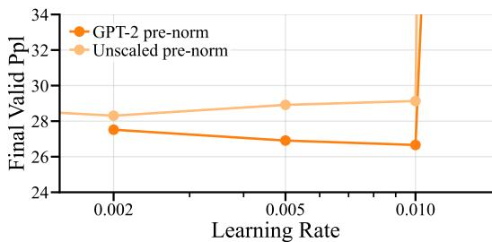  
(a) Comparison against unscaled pre-norm in a 12-layer Transformer.

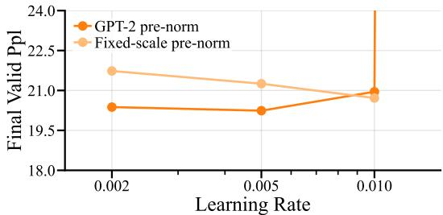  
(b) Comparison against fixed scale pre-norm in a 48-layer Transformer.  
Figure 8: Learning-rate explorations for pre-norm variants.

## C.2 GLU Variant of KEEL

We compare the performance of a KEEL model with our GLU to one with an MLP, where both have the same number of parameters. The result is presented in figure 9, where we find that the GLU variant performs better.

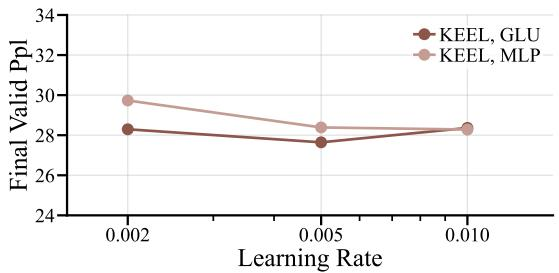  
Figure 9: Comparison between KEEL models with GLU and models with MLP in a 12-layer Transformer.

## C.3 Residual Scaling for Mix-Norm

Given that GPT-2 style residual scaling can improve pre-norm methods, we evaluate whether this also applies to the pre-norm section of mix-norm models. Here, we compare vanilla mix-norm against a variant where GPT-2 style residual scaling is applied in the pre-norm sublayers, displaying the result in figure 10. Since we observe a clear performance improvement when using GPT-2 style residual scaling, we apply it in all other mix-norm runs.

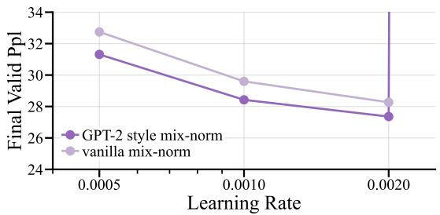  
Figure 10: Comparison between vanilla mix-norm and mix-norm with GPT-2 style residual scaling in a 12-layer Transformer.

## C.4 Rank Collapse with Peri-Norm

Since we find the learning rate exploration yields an oddly non-hyperbolic curve for peri-norm, we analyse its dynamics and find that peri-norm is prone to rank collapse. We show this empirically by analysing the token alignment in a peri-norm model trained with a learning rate of $1 0 ^ { - 2 ^ { * } }$ , seen in figure 11. Indeed, while the first layer is often an exception in Transformer models, the subsequent layers show a clear tendency to rank collapse, plausibly explaining the poor performance of peri-norm in our experiments.

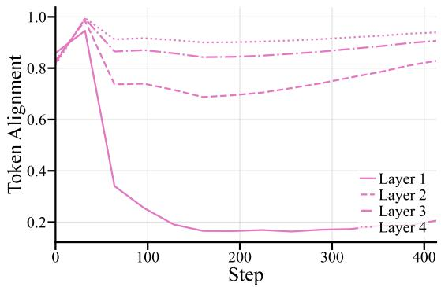  
Figure 11: Rank collapse in hidden states after the residual addition in Attention sublayers when training a 12-layer Transformer with peri-norm.

## C.5 Additional Baseline Comparisons Across Depth

We extend our comparison against KEEL and LayerNorm-Scaling to 12- and 96-layer Transformers. Tables 3 and 4 report final validation perplexities across learning rates, following the setup described in Appendix B.

<table><tr><td>Method</td><td>2e-3</td><td>5e-3</td><td>1e-2</td><td>2e-2</td><td>5e-2</td></tr><tr><td>KiteNorm</td><td></td><td>25.181</td><td>24.831</td><td>25.180</td><td></td></tr><tr><td>GPT-2 pre-norm</td><td></td><td>26.909</td><td>26.660</td><td>div.</td><td></td></tr><tr><td>LayerNorm-Scaling</td><td></td><td>26.991</td><td>26.645</td><td>26.615</td><td>div.</td></tr><tr><td>KEEL</td><td>28.296</td><td>27.644</td><td>28.364</td><td></td><td>一</td></tr></table>

Table 3: Final validation perplexities across learning rates in 12-layer Transformers.

<table><tr><td>Method</td><td>1e-3</td><td>2e-3</td><td>5e-3</td><td>1e-2</td></tr><tr><td>KiteNorm</td><td></td><td>16.371</td><td>16.189</td><td>16.719</td></tr><tr><td>GPT-2 pre-norm</td><td>16.991</td><td>16.755</td><td>16.995</td><td>17.616</td></tr><tr><td>KEEL</td><td>18.101</td><td>17.126</td><td>16.889</td><td>div.</td></tr><tr><td>LayerNorm-Scaling</td><td></td><td>18.153</td><td>17.133</td><td>17.167</td></tr></table>

Table 4: Final validation perplexities across learning rates in 96-layer Transformers.

KiteNorm achieves the lowest validation perplexity at both depths. While LayerNorm-Scaling slightly outperforms GPT-2 pre-norm at 12 layers, it falls behind at 96 layers. KEEL also remains behind KiteNorm at both depths.

## C.6 Downstream Evaluation at 48 Layers

We evaluate the best final checkpoints from the 48-layer comparison in section 4.1 on ARC-Easy and PIQA, following Appendix B.3. Table 5 reports standard accuracy and length-normalised accuracy.

<table><tr><td rowspan="2">Method</td><td colspan="2">ARC-Easy</td><td colspan="2">PIQA</td></tr><tr><td>acc</td><td>acc_norm</td><td>acc</td><td>acc_norm</td></tr><tr><td>KiteNorm</td><td>0.455</td><td>0.404</td><td>0.628</td><td>0.625</td></tr><tr><td>GPT-2 pre-norm</td><td>0.426</td><td>0.383</td><td>0.609</td><td>0.621</td></tr><tr><td>LayerNorm-Scaling</td><td>0.436</td><td>0.381</td><td>0.633</td><td>0.624</td></tr><tr><td>KEEL</td><td>0.426</td><td>0.385</td><td>0.612</td><td>0.616</td></tr><tr><td>Peri-norm</td><td>0.414</td><td>0.381</td><td>0.625</td><td>0.613</td></tr><tr><td>Mix-norm</td><td>0.414</td><td>0.373</td><td>0.614</td><td>0.604</td></tr><tr><td>Post-norm</td><td>0.400</td><td>0.356</td><td>0.594</td><td>0.591</td></tr></table>

Table 5: Zero-shot downstream evaluation of the best final checkpoints from the 48-layer comparison.

KiteNorm achieves the highest accuracy on ARC-Easy under both metrics, consistent with its lower validation perplexity. On PIQA, the differences are smaller across all configurations, with KiteNorm achieving the highest length-normalised accuracy and LayerNorm-Scaling achieving the highest standard accuracy.

## C.7 Complete Llama Training Loss Curves

We show the complete training loss curves for the Llama experiments from section 4.2 in figure 12. KiteNorm trains without loss spikes across the explored learning rates, whereas GPT-2 pre-norm exhibits loss spikes at learning rates $1 0 ^ { - 3 }$ and $2 \cdot 1 \dot { 0 } ^ { - 3 }$ and diverges at $5 \cdot 1 0 ^ { - 3 } ~ $

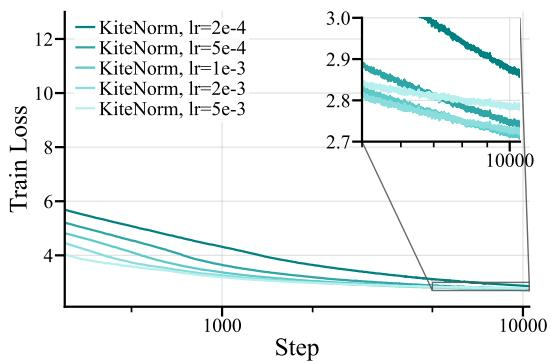  
(a) KiteNorm.

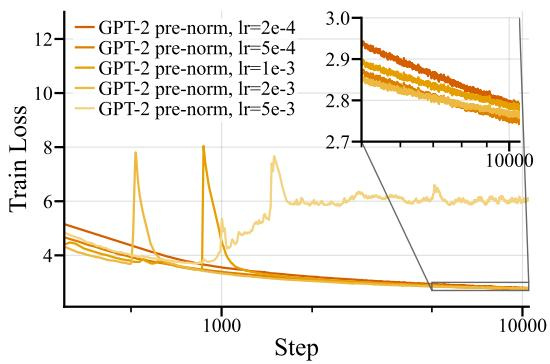  
(b) GPT-2 pre-norm.  
Figure 12: Complete training loss curves of Llama-style 1.3B-parameter models across learning rates.

## C.8 GPT-2 Pre-Norm With the ReLU Regulariser

We explore whether our ReLU regulariser has the potential to improve the GPT-2 pre-norm baseline to ensure a fair comparison. In a 12-layer Transformer, we train GPT-2 pre-norm with the ReLU regulariser enabled, yielding the loss curves displayed in figure 13. The result shows clearly elevated instability when enabling variance regularisation while training GPT-2 pre-norm.

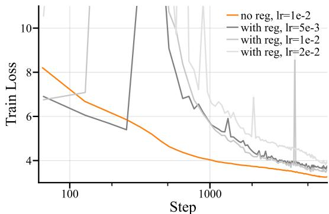  
Figure 13: Comparison between training of GPT-2 pre-norm with and without the ReLU regulariser enabled in a 12-layer Transformer.

## C.9 KEEL Architectural Ablations

To further investigate the relationship between KiteNorm and KEEL, we ablate KEEL’s doublenormalisation and first-layer architectural exceptions in the 48-layer comparison setting from section 4.1. The resulting validation perplexities are shown in table 6.

<table><tr><td>Configuration</td><td>2e-3</td><td>5e-3</td><td>1e-2</td><td>2e-2</td></tr><tr><td>KEEL</td><td>20.766</td><td>20.420</td><td>div.</td><td>一</td></tr><tr><td>No double-norm</td><td>21.382</td><td>div.</td><td>div.</td><td>一</td></tr><tr><td>No exceptions</td><td>20.379</td><td>19.612</td><td>19.640</td><td>div.</td></tr><tr><td>Neither</td><td>21.093</td><td>19.936</td><td>div.</td><td></td></tr></table>

Table 6: Final validation perplexities of KEEL architectural variants in a 48-layer Transformer across learning rates.

We find that removing the first-layer exceptions consistently improves performance. Doublenormalisation also improves performance and, in some configurations, stability. However, even this improved KEEL variant does not match KiteNorm’s performance in the main 48-layer comparison.

## C.10 Sensitivity Analyses

Residual scaling. We find that the residual scaling rule presents a trade-off between performance and stability in post-norm models. Table 7 presents the final validation perplexities of 24-layer post-norm Transformers with variance regularisation enabled, but without double-normalisation or scalarised LayerNorm. Larger residual scaling improves performance at the expense of stability. The factor $1 / ( 2 L )$ , approximately 0.02 at this depth, provides a practical compromise.

<table><tr><td>Residual scale</td><td>2e-3</td><td> ${ \mathfrak { s e } } { \mathfrak { - } } 3$ </td><td>1e-2</td></tr><tr><td>0.05</td><td>25.953</td><td>24.380</td><td>div.</td></tr><tr><td>0.02</td><td>27.141</td><td>24.941</td><td>26.176</td></tr><tr><td>0.01</td><td>28.615</td><td>26.242</td><td>27.840</td></tr></table>

Table 7: Final validation perplexities in 24-layer post-norm models with variance regularisation and varying residual scaling.

We revisit a scaling rule of exactly $1 / L$ in the 48-layer KiteNorm configuration from section 4.1. As shown in table 8, the alternative rule does not improve performance.
<table><tr><td>Scaling rule</td><td> $_ { 2 \mathbf { e } - 3 }$ </td><td> ${ \bf 5 e - 3 }$ </td><td>1e-2</td></tr><tr><td> $1 / ( 2 L )$ </td><td>19.726</td><td>19.080</td><td>19.100</td></tr><tr><td> $1 / \dot { L }$ </td><td></td><td>19.125</td><td>19.199</td></tr></table>

Table 8: Final validation perplexities in 48-layer KiteNorm models with varying residual scaling.

Regularisation strength. We vary the regularisation weight λ in the 48-layer setting of section 4.1. Table 9 shows that $\lambda = 1$ achieves the best performance among the tested values, although the method remains effective with both weaker and stronger regularisation.
<table><tr><td> $\boldsymbol { \lambda }$ </td><td>2e-3</td><td> ${ \mathfrak { s e } } { \mathfrak { - } } 3$ </td><td> $\mathbf { 1 6 { - } } 2$ </td></tr><tr><td>0.1</td><td>19.755</td><td>19.190</td><td>19.277</td></tr><tr><td>1.0</td><td>19.726</td><td>19.080</td><td>19.100</td></tr><tr><td>10.0</td><td>20.036</td><td>19.431</td><td>19.337</td></tr></table>

Table 9: Final validation perplexities in 48-layer KiteNorm models with different regularisation weights.

Normalisation choice. We compare KiteNorm using scalarised LayerNorm against a variant with RMSNorm and a scalarised gain parameter. We also compare KEEL using LayerNorm and RM-SNorm, following its original normalisation choice. The results in table 10 show small performance differences between the normalisation variants, while KiteNorm retains its advantage over KEEL.
<table><tr><td>Configuration</td><td> $_ { 2 \mathbf { e } - 3 }$ </td><td>5e-3</td><td>1e-2</td><td> $_ { 2 \mathbf { e } - 2 }$ </td></tr><tr><td>KiteNorm, scalarLN</td><td>19.726</td><td>19.080</td><td>19.100</td><td>19.868</td></tr><tr><td>KiteNorm, scalarRMSNorm</td><td>19.811</td><td>19.158</td><td>19.253</td><td>21.113</td></tr><tr><td>KEEL, LN</td><td>20.766</td><td>20.420</td><td>div.</td><td>一</td></tr><tr><td>KEEL, RMSNorm</td><td>20.816</td><td>20.321</td><td>div.</td><td>一</td></tr></table>

Table 10: Final validation perplexities in 48-layer Transformers with differently parameterised LayerNorm and RMSNorm variants.

Optimisation hyperparameters. We investigate whether longer learning rate warm-up affects the relative performance of KiteNorm and the baselines. Table 11 compares warm-up portions of 6% and 12% in the 48-layer setting. Longer warm-up improves the stability of KEEL and shifts the optimal learning rates, but KiteNorm retains its performance advantage.
<table><tr><td>Configuration</td><td> $_ { 2 \mathbf { e } - 3 }$ </td><td> ${ \bf 5 e - 3 }$ </td><td> $\mathbf { 1 e } { - 2 }$ </td><td> $_ { 2 \mathbf { e } - 2 }$ </td></tr><tr><td>KiteNorm, 6%</td><td>19.726</td><td>19.080</td><td>19.100</td><td>19.868</td></tr><tr><td>KiteNorm, 12%</td><td>19.920</td><td>19.240</td><td>19.123</td><td>19.565</td></tr><tr><td>GPT-2 pre-norm, 6%</td><td>20.376</td><td>20.240</td><td>20.951</td><td>div.</td></tr><tr><td>GPT-2 pre-norm, 12%</td><td>20.265</td><td>20.172</td><td>20.139</td><td>21.743</td></tr><tr><td>KEEL, 6%</td><td>20.766</td><td>20.420</td><td>div.</td><td>一</td></tr><tr><td>KEEL, 12%</td><td>20.758</td><td>19.829</td><td>20.115</td><td>一</td></tr></table>

Table 11: Final validation perplexities in 48-layer Transformers with differing warm-up durations.

We additionally vary the Adam beta parameters, keeping $\beta _ { 1 } = \beta _ { 2 }$ throughout. Table 12 shows that the performance advantage of KiteNorm persists across the tested values.
<table><tr><td>Configuration</td><td>2e-3</td><td> ${ \mathfrak { s e } } { \mathfrak { - } } 3$ </td><td>1e-2</td></tr><tr><td>KiteNorm, 0.9</td><td>20.072</td><td>19.400</td><td>19.290</td></tr><tr><td>KiteNorm, 0.95</td><td>19.726</td><td>19.080</td><td>19.100</td></tr><tr><td>KiteNorm, 0.975</td><td>19.725</td><td>19.219</td><td>19.589</td></tr><tr><td>GPT-2 pre-norm, 0.9</td><td>20.699</td><td>20.515</td><td>div.</td></tr><tr><td>GPT-2 pre-norm, 0.95</td><td>20.376</td><td>20.240</td><td>20.951</td></tr><tr><td>GPT-2 pre-norm, 0.975</td><td>20.761</td><td>20.562</td><td>20.707</td></tr></table>

Table 12: Final validation perplexities in 48-layer Transformers when trained with different Adam beta parameters.