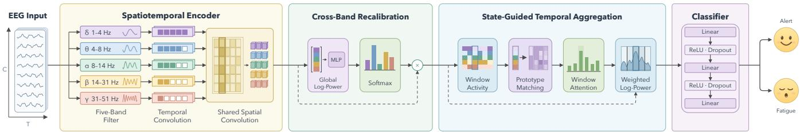
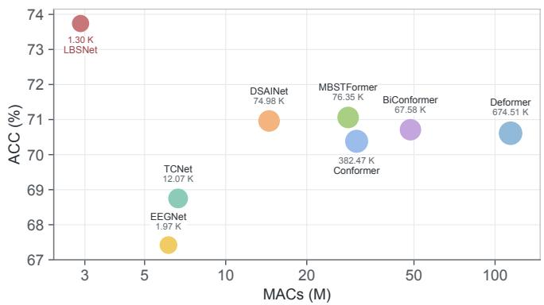
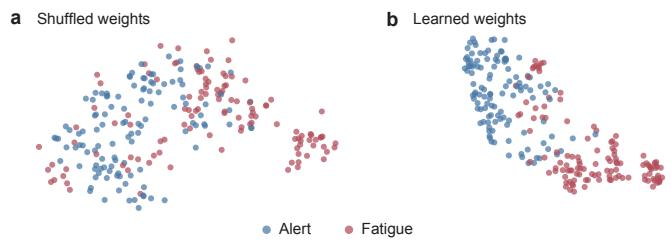
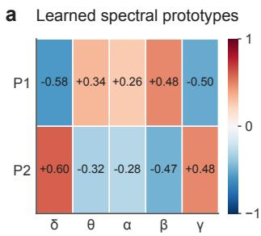
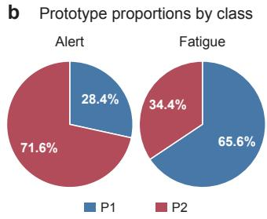
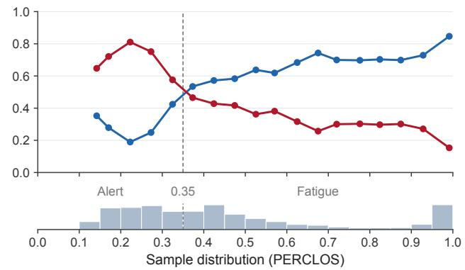

# LBSNET: LIGHTWEIGHT BRAIN STATE MODELING VIA LEARNABLE SPECTRALPROTOTYPES FOR EEG-BASED FATIGUE DETECTION

Kun Jia, Zhenyu Cao, Hanlin Yu, Zeyuan Li, Yixuan Liu, Zhongye Xia, Sen Song⋆, Zhiyuan Ma⋆

School of Biomedical Engineering, Tsinghua Medicine, Tsinghua University, Beijing, China

## ABSTRACT

EEG-based fatigue detection requires modeling spectral information across bands and its temporal variation. Recent methods combine multi-band modeling with adaptive temporal processing, yet how spectral structure across bands should influence the contribution of each temporal interval remains insufficiently explored. We propose LBSNet, a lightweight network that uses prototype-based brain-state modeling to link local spectral structure with temporal aggregation. LBSNet extracts compact multi-band features through band-specific temporal convolution, shared spatial projections, and cross-band recalibration. Within each window, relative spectral activity is encoded as a normalized descriptor and softly matched to learnable spectral prototypes. Prototype assignments and learned prototype importance jointly determine temporal weights for power aggregation, allowing the spectral pattern of each window to guide its contribution to the prediction. Subject-independent experiments on SEED-VIG and SADT show that LBSNet outperforms seven baselines while maintaining low computational cost. Ablation and visualization analyses support prototype-guided temporal weighting, while the learned prototypes reveal a gradual redistribution of relative cross-band spectral states with increasing fatigue. The code is publicly available at https://github.com/zy0929/LBSNet.

Index Terms— EEG, fatigue detection, brain-state modeling, lightweight neural networks, prototype learning

## 1. INTRODUCTION

Driver fatigue impairs vigilance, sustained attention, and responsiveness, increasing the risk of driving errors and accidents [1, 2]. Electroencephalography (EEG) provides a noninvasive measure of brain activity and has been widely used for objective fatigue assessment [3, 4]. Prior studies have consistently linked fatigue and vigilance to changes in spectral activity across canonical EEG bands, and these spectral characteristics vary over the course of driving [5, 6]. EEGbased fatigue detection therefore requires modeling both fatiguerelated spectral activity and its temporal variation.

Early EEG-based fatigue studies combined spectral features with temporal modeling, with Zheng and Lu [6] incorporating temporal dependencies into vigilance estimation using frequencyspecific features. Subsequent convolutional approaches moved toward end-to-end learning. InterpretableCNN [7] learns fatiguerelated features for cross-subject drowsiness recognition and reveals alpha spindles through interpretation analysis. Attention-based methods further strengthened spectral-temporal modeling. SACC-CapsNet [8] emphasizes temporal components and channels, while TFormer [9] integrates temporal and frequency-domain patterns through cross-attention. Recent models combine frequency-specific modeling with adaptive temporal processing. Multi-band modeling and temporal weighting capture different aspects of fatigue-related EEG, but existing designs do not explicitly link the local spectral structure of an interval to its temporal contribution [10, 11]. Overall, EEG-based fatigue detection has progressed toward representation learning and adaptive modeling across frequency and time.

Multi-band modeling and temporal weighting capture different aspects of fatigue-related EEG, but they do not define how the spectral structure of an interval should influence its temporal contribution [10, 11]. This issue is important because fatigue has been characterized not only by changes within individual frequency bands, but also by relative band power and relationships among bands [12]. Accordingly, fatigue-related information within a local interval may be reflected in joint patterns of activity across frequency bands [13]. This raises the question of whether temporal aggregation can be guided by such local spectral patterns. Grouping similar local spectral patterns into shared states and learning their relevance to fatigue would provide a link between spectral structure and temporal weighting.

To this end, we propose LBSNet, a lightweight network for EEG-based fatigue detection. Its central idea is prototype-based brain-state modeling, which links local patterns of relative activity across frequency bands to temporal weighting. LBSNet first decomposes EEG into five canonical frequency bands, applies bandspecific temporal convolution, and uses spatial projections shared across bands to obtain compact features. Cross-band recalibration then adjusts the relative contribution of the five bands based on global spectral activity. Within each temporal window, envelopebased band activity is transformed into a normalized relative spectral descriptor and softly matched to the learned prototypes. The resulting prototype assignments are combined with learned prototype importance to derive temporal weights, which are used to aggregate component-wise power into a compact representation for classification. The main contributions are summarized as follows:

1. We introduce prototype-based brain-state modeling that represents local relative spectral patterns with shared learnable prototypes and combines prototype assignments with learned importance to guide temporal aggregation.

2. We develop a lightweight architecture with shared spatial projections, low-dimensional state matching, and a compact classifier, achieving a favorable accuracy-efficiency trade-off with a small parameter budget and low computational cost.

3. We validate LBSNet on SEED-VIG and SADT and show that the learned spectral states exhibit a gradual redistribution with increasing fatigue, providing empirical support for prototypeguided temporal weighting.

  
Fig. 1. Overview of LBSNet, where learnable spectral prototypes represent local relative spectral patterns and guide temporal aggregation.

## 2. METHOD

As illustrated in Fig. 1, LBSNet comprises a spatiotemporal encoder, cross-band recalibration, and state-guided temporal aggregation. Starting from multichannel EEG signals, LBSNet extracts spatiotemporal features from five frequency bands, recalibrates their relative contributions, and uses learnable spectral prototypes to guide temporal aggregation, enabling lightweight modeling of latent brain states for EEG-based fatigue classification.

## 2.1. Spatiotemporal Encoder

The spatiotemporal encoder extracts five-band EEG features through temporal and shared spatial convolutions. For an input $X \in \mathbf { R } ^ { C \times \widecheck { T } }$ with C electrodes and T samples, a fixed filter bank decomposes the signal into five frequency bands:

$$
X ^ { ( b ) } = \mathcal { B } _ { b } ( X ) , \qquad b = 1 , \ldots , 5 ,\tag{1}
$$

where $B _ { b }$ applies Butterworth filtering independently to each electrode, yielding the band signal $X ^ { ( b ) }$ . The passbands are 1–4, 4–8, 8–14, 14–31, and 31–51 Hz.

Each band undergoes temporal convolution:

$$
U _ { b , c , : } = \mathrm { C o n v 1 D } \Big ( X _ { c , : } ^ { ( b ) } ; \pmb \theta _ { b } \Big ) ,\tag{2}
$$

where $c$ indexes electrodes, the colon denotes the temporal sequence, and $\pmb { \theta } _ { b }$ is a band-specific kernel shared across electrodes. These bias-free convolutions use kernel lengths (125, 63, 31, 15, 7) at 128 Hz and proportionally adjusted odd lengths at other sampling rates. Symmetric zero padding preserves the temporal length, yielding the temporally filtered signals $U \in \mathbf { R } ^ { 5 \times C \times T }$

Before spatial convolution, the signals are centered across electrodes and the spatial convolution kernels are normalized:

$$
\begin{array} { r l } & { { \displaystyle V _ { b c t } = U _ { b c t } - \frac { 1 } { C } \sum _ { j = 1 } ^ { C } U _ { b j t } } , } \\ & { \qquad \quad \widehat { \mathbf { w } } _ { m } = \mathcal { N } ( \mathbf { w } _ { m } ) , \qquad m = 1 , \dots , M , } \end{array}\tag{3}
$$

where $V$ contains the centered signals, j indexes electrodes, and t indexes samples. The vector ${ \bf w } _ { m } \in { \bf R } ^ { C }$ is the mth spatial convolution kernel, and M is the number of output features per band. The operator $\mathcal { N }$ removes the kernel mean and applies $\ell _ { 2 }$ normalization.

Shared spatial convolution then produces

$$
F _ { b m t } = \sum _ { c = 1 } ^ { C } \widehat { w } _ { m c } V _ { b c t } ,\tag{4}
$$

where $\widehat { w } _ { m c }$ is the coefficient for electrode c in normalized kernel $m$ and $F _ { b m t }$ is its response in band b at sample t. The same kernels span all electrodes and are shared across bands. The output $F \in$ $\dot { \mathbf { R } } ^ { 5 \times M \times T }$ retains the band dimension and is passed to cross-band recalibration for joint band-weight estimation.

## 2.2. Cross-Band Recalibration

For the band-specific encoder output $F ,$ cross-band recalibration first computes global log-power descriptors for the five frequency bands:

$$
d _ { b } = \log \left( \frac { 1 } { M T } \sum _ { m = 1 } ^ { M } \sum _ { t = 1 } ^ { T } F _ { b m t } ^ { 2 } \right) ,\tag{5}
$$

where $d _ { b }$ is the global log-power of band $b ,$ obtained by averaging power over spatial features and temporal samples and then taking the logarithm. The descriptors form $\hat { \mathbf { d } } \hat { = } [ d _ { 1 } , \hat { \dots } , d _ { 5 } ] ^ { \top }$

Band weights are jointly estimated as

$$
\alpha = \operatorname { s o f t m a x } ( g ( \mathbf { d } ) ) ,\tag{6}
$$

where $g$ is a two-layer MLP with an intermediate ReLU, and α contains five positive weights summing to one. Each weight is conditioned on the descriptors of all five bands.

The encoder features are then recalibrated:

$$
G _ { b m t } = \sqrt { \alpha _ { b } } F _ { b m t } ,\tag{7}
$$

where $\alpha _ { b }$ is the weight for band b, shared across its spatial features and temporal samples. Square-root scaling weights the corresponding power by $\alpha _ { b }$ . The recalibrated output $\mathbf { \bar { \boldsymbol { G } } } \in \mathbf { \bar { \mathbf { R } } } ^ { 5 \times M \times T }$ is passed to state-guided temporal aggregation.

## 2.3. State-Guided Temporal Aggregation

Following cross-band recalibration, state-guided temporal aggregation weights temporal windows according to their latent spectral patterns. The recalibrated features G are divided into $N = T / L$ nonoverlapping windows of L samples. Band activity within each window is computed from the analytic signal as

$$
a _ { k b } = \frac { 1 } { 2 M L } \sum _ { m = 1 } ^ { M } \sum _ { t \in \mathcal { T } _ { k } } \left[ G _ { b m t } ^ { 2 } + \mathcal { H } ( G _ { b m , : } ) _ { t } ^ { 2 } \right] ,\tag{8}
$$

where $\mathcal { T } _ { k }$ contains the sample indices of window k, H denotes the Hilbert transform along the full temporal sequence, and $a _ { k b }$ measures the activity of band b in that window.

The window activity vector is transformed into a normalized spectral descriptor that captures relative activity across bands:

$$
\mathbf { z } _ { k } = \mathcal { N } ( \log \mathbf { a } _ { k } ) , \qquad \mathbf { a } _ { k } = [ a _ { k 1 } , \dots , a _ { k 5 } ] ^ { \top } ,\tag{9}
$$

where ${ \bf z } _ { k } \in { \bf R } ^ { 5 }$ , the logarithm is applied elementwise, and $\mathcal { N }$ performs mean removal and $\ell _ { 2 }$ normalization across bands. This emphasizes relative spectral patterns and reduces sensitivity to variations in the overall magnitude of the EEG signal.

Each window descriptor is matched against a set of R learnable spectral prototypes to obtain soft state assignments:

$$
\begin{array} { r l } & { \widehat { \mathbf { p } } _ { r } = \mathcal { N } ( \mathbf { p } _ { r } ) , } \\ & { q _ { r k } = \frac { \exp \left( \widehat { \mathbf { p } } _ { r } ^ { \top } \mathbf { z } _ { k } / \tau _ { p } \right) } { \sum _ { s = 1 } ^ { R } \exp \left( \widehat { \mathbf { p } } _ { s } ^ { \top } \mathbf { z } _ { k } / \tau _ { p } \right) } , } \end{array}\tag{10}
$$

where $\mathbf { p } _ { r } \in \mathbf { R } ^ { 5 }$ is prototype $r ,  { \widehat { \mathbf { p } } } _ { r }$ is its normalized form, $q _ { r k }$ is the soft assignment of window k to that prototype, and $\tau _ { p }$ controls assignment sharpness. The prototypes represent latent spectral patterns learned jointly with the network.

The assignments are combined with learnable prototype importance to obtain temporal weights:

$$
\beta _ { k } = \frac { \exp \left( \sum _ { r = 1 } ^ { R } \eta _ { r } q _ { r k } / \tau _ { t } \right) } { \sum _ { j = 1 } ^ { N } \exp \left( \sum _ { r = 1 } ^ { R } \eta _ { r } q _ { r j } / \tau _ { t } \right) } ,\tag{11}
$$

where $\eta _ { r }$ denotes the importance of prototype $r , \ \tau _ { t }$ controls temporal weighting sharpness, and $\beta _ { k }$ is the weight of window $k ,$ with $\textstyle \sum _ { k } \beta _ { k } = 1$ . Thus, each window contributes according to both its state assignments and the learned importance of those states.

The temporal weights are then used to aggregate squared recalibrated features into a weighted log-power representation:

$$
h _ { b m } = \log \left[ \frac { 1 } { M } \sum _ { k = 1 } ^ { N } \beta _ { k } \left( \frac { 1 } { L } \sum _ { t \in \mathcal { T } _ { k } } G _ { b m t } ^ { 2 } \right) \right] ,\tag{12}
$$

where $h _ { b m }$ is the weighted log-power of spatial feature m in band $b .$ The same temporal weights are shared across bands and spatial features. The matrix ${ \bf H } = \left[ h _ { b m } \right] \in { \bf R } ^ { 5 \times M }$ is flattened into a 5Mdimensional representation and passed to a three-layer classifier with hidden dimensions 32 and 16. ReLU and dropout follow each hidden layer, and the final linear layer produces the class logits.

## 3. EXPERIMENTS AND RESULTS

## 3.1. Datasets and Baselines

We evaluate our method on two EEG benchmarks for driver fatigue detection: SEED-VIG [6] and SADT [14]. SEED-VIG contains EEG recordings from 23 subjects during simulated driving. We retain 17 channels, downsample the signals from 1,000 to 200 Hz, and segment them into 20,355 non-overlapping 8-s samples. Vigilance is annotated using PERCLOS derived from eye-tracking recordings, with 0.35 as the threshold between alert and fatigued states. SADT is a balanced subset [14] of the sustained-attention driving dataset [15], comprising 2,022 3-s samples from 11 subjects at 128 Hz. We use all 30 EEG channels. The provided alert and drowsy labels were derived from local and global reaction-time criteria, considering both the current reaction time and recent response history.

For comparison, we select seven representative baselines. The convolutional baselines include EEGNet [16] and TCNet [17]. The attention-based baselines include Conformer [18], Deformer [19], BiConformer [20], DSAINet [21], and MB-STFormer [11].

## 3.2. Experimental Setup

Experiments are conducted on a server equipped with eight NVIDIA GeForce RTX 4090 GPUs. We use subject-wise five-fold crossvalidation, where all samples from each subject are assigned to a single fold; three folds are used for training, one for validation, and one for testing. The model with the highest validation accuracy is selected for final evaluation. We set the temporal window length of LBSNet to 0.5 s for both datasets, with L denoting the corresponding number of samples. The number of spectral prototypes is set to R = 4 for SADT and R = 2 for SEED-VIG, while the number of spatial features per band is set to M = 2 and M = 4, respectively. All experiments are repeated with five random seeds, and the results are reported as mean ± standard deviation across seeds.

Table 1. Performance comparison (%) on SEED-VIG and SADT.
<table><tr><td rowspan="2">Method</td><td colspan="2">SEED-VIG</td><td colspan="2">SADT</td></tr><tr><td>Accuracy</td><td>F1-score</td><td>Accuracy</td><td>F1-score</td></tr><tr><td>EEGNet</td><td>56.92±1.6353.71±1.1667.42±2.7666.62±3.10</td><td></td><td></td><td></td></tr><tr><td>TCNet</td><td>57.01±2.7254.26±2.52 68.75±1.6668.11±1.89</td><td></td><td></td><td></td></tr><tr><td>Conformer</td><td>58.08±2.0355.09±2.4770.38±1.6669.72±2.02</td><td></td><td></td><td></td></tr><tr><td>Deformer</td><td>58.53±2.7255.21±2.4070.61±2.4369.91±3.07</td><td></td><td></td><td></td></tr><tr><td>BiConformer</td><td>58.70±1.7655.92±1.58 70.71±1.7470.18±1.88</td><td></td><td></td><td></td></tr><tr><td>DSAINet</td><td>59.36±1.9658.19±2.4170.96±2.47 70.46±2.60</td><td></td><td></td><td></td></tr><tr><td></td><td>MB-STFormer61.47±2.0260.30±2.21 71.06±2.4570.53±2.43</td><td></td><td></td><td></td></tr><tr><td>LBSNet</td><td>62.73±1.8261.51±1.3973.74±1.38</td><td></td><td></td><td> ${ \bf 7 3 . 3 0 { \pm } 1 . 4 3 }$ </td></tr></table>

Table 2. Ablation results (%) on SEED-VIG and SADT.
<table><tr><td rowspan="2">Method</td><td colspan="2">SEED-VIG</td><td colspan="2">SADT</td></tr><tr><td>Accuracy</td><td>F1-score</td><td>Accuracy</td><td>F1-score</td></tr><tr><td></td><td>Uniform Pooling 60.25±1.49 58.61±2.66 71.96±2.24 72.49±2.48</td><td></td><td></td><td></td></tr><tr><td></td><td>MLP Attention 60.63±2.37 58.01±2.46 72.55±0.96 71.99±1.00</td><td></td><td></td><td></td></tr><tr><td>w/o CBR</td><td>61.49±1.42 58.07±2.2372.23±1.3772.68±1.54</td><td></td><td></td><td></td></tr><tr><td>LBSNet</td><td>62.73±1.82 61.51±1.39 73.74±1.38 73.30±1.43</td><td></td><td></td><td></td></tr></table>

## 3.3. Performance Comparison

Table 1 compares the performance of LBSNet with seven baselines on SEED-VIG and SADT. LBSNet achieves the highest accuracy and F1-score on both datasets, with larger gains observed on SADT. Compared with the strongest baseline MB-STFormer, LBSNet improves accuracy/F1-score by 1.26/1.21 percentage points on SEED-VIG and 2.68/2.77 percentage points on SADT.

## 3.4. Ablation Analysis

To assess the components of LBSNet, we examine the role of stateguided temporal aggregation, whether prototype matching offers benefits beyond learnable temporal weighting alone, and the contribution of cross-band recalibration (CBR). As shown in Table 2, replacing the learned temporal weights with Uniform Pooling reduces accuracy/F1-score by 2.48/2.90 points on SEED-VIG and 1.78/0.81 points on SADT, showing the benefit of state-guided temporal aggregation. Replacing prototype matching with parameter-matched MLP Attention also reduces performance. Compared with this variant, LBSNet improves accuracy/F1-score by 2.10/3.50 points on SEED-VIG and 1.19/1.31 points on SADT. MLP Attention itself yields only small accuracy gains over Uniform Pooling and lower F1- scores on both datasets, indicating that learnable temporal weighting alone does not explain the improvement. Finally, removing CBR reduces both accuracy and F1-score on both datasets, showing that cross-band recalibration also contributes to the performance.

Fig. 2. Comparison of model accuracy and computational efficiency on SADT. Each bubble corresponds to a model. The x-axis shows MACs (M) on a logarithmic scale, while the y-axis reports ACC (%). Bubble area reflects the logarithm of the number of trainable parameters, and the labels give the corresponding parameter counts.  
  
Fig. 3. t-SNE visualization of representations produced by temporal aggregation on SADT. (a) Shuffled weights. (b) Learned weights.

## 3.5. Computational Efficiency Analysis

We compare models on SADT in terms of accuracy, multiplyaccumulate operations (MACs), and trainable parameters. Fig. 2 shows that LBSNet achieves the highest mean accuracy of 73.74% while requiring only 2.89 M MACs and 1.30 K trainable parameters, both the lowest among the compared models. Compared with EEGNet, the lightest baseline, LBSNet reduces MACs by 52.9% and the parameter count by 34.0%, while achieving higher accuracy. Compared with MB-STFormer, the strongest baseline, LBSNet improves accuracy by 2.68 percentage points while reducing MACs by 89.9% and the parameter count by 98.3%. The efficiency advantage is therefore reflected in both model size and computational cost. More importantly, the accuracy improvement is achieved without increasing model capacity or computation, showing that LBSNet does not rely on model scaling for better performance.

## 3.6. Temporal Weighting Analysis

We examine how temporal weighting affects the aggregated features on SADT. In the shuffled setting, learned weights are randomly reassigned across temporal windows while their values remain unchanged. As shown in Fig. 3, alert and fatigue samples overlap substantially under shuffled weights, whereas learned weights yield clearer class separation. This difference shows that temporal weight allocation affects the aggregated features, consistent with the ablation results showing better classification with learned temporal aggregation. Together, these results support temporal weighting in forming more discriminative representations.

c Changes in prototype proportions with PERCLOS P1 P2  
  
Fig. 4. Analysis of learned spectral prototypes on SEED-VIG. (a) Relative spectral patterns of the learned prototypes across the five frequency bands. (b) Prototype proportions for alert and fatigue samples. (c) Changes in prototype proportions across PERCLOS values. The dashed line marks the 0.35 threshold between alert and fatigue, and the histogram shows the sample distribution.

## 3.7. Spectral Prototype Analysis

We further analyze the learned spectral prototypes on SEED-VIG. As shown in Fig. 4(a), P1 has positive components in the theta, alpha, and beta bands and negative components in the delta and gamma bands, whereas P2 exhibits an approximately opposite pattern. These differences indicate that the prototypes capture distinct spectral configurations across frequency bands. Fig. 4(b) relates these configurations to vigilance state, with P1 accounting for 65.6% of the assignments in fatigue samples and P2 accounting for 71.6% in alert samples. This association is also reflected in the continuous PERCLOS analysis in Fig. 4(c), where the proportion of P1 generally increases as PERCLOS rises, while that of P2 decreases. Taken together, these results suggest that increasing fatigue is accompanied by a gradual redistribution between relative cross-band spectral states. This finding supports the use of prototype-guided temporal aggregation for fatigue modeling.

## 4. CONCLUSION

This work introduces LBSNet to connect local relative spectral patterns with temporal aggregation through learnable spectral prototypes, allowing spectral states to guide temporal weighting. Experiments on SEED-VIG and SADT show LBSNet outperforms all baselines while maintaining low computational cost. Learned prototypes reveal a gradual redistribution of relative cross-band spectral states with increasing fatigue, suggesting that joint spectral-state modeling offers a useful perspective for EEG-based fatigue assessment.

## 5. REFERENCES

[1] Daniel Mollicone, Kevin Kan, Chris Mott, Rachel Bartels, Steve Bruneau, Matthew van Wollen, Amy R Sparrow, and Hans PA Van Dongen, “Predicting performance and safety based on driver fatigue,” Accident Analysis & Prevention, vol. 126, pp. 142–145, 2019.

[2] A Gibbings, LB Ray, S Gagnon, CA Collin, R Robillard, and SM Fogel, “The EEG correlates and dangerous behavioral consequences of drowsy driving after a single night of mild sleep deprivation,” Physiology & Behavior, vol. 252, pp. 113822, 2022.

[3] Gianluca Borghini, Laura Astolfi, Giovanni Vecchiato, Donatella Mattia, and Fabio Babiloni, “Measuring neurophysiological signals in aircraft pilots and car drivers for the assessment of mental workload, fatigue and drowsiness,” Neuroscience & Biobehavioral Reviews, vol. 44, pp. 58–75, 2014.

[4] Raed Mohammed Hussein, Firas Sabar Miften, and Loay E George, “Driver drowsiness detection methods using EEG signals: a systematic review,” Computer methods in biomechanics and biomedical engineering, vol. 26, no. 11, pp. 1237–1249, 2023.

[5] Yvonne Tran, Ashley Craig, Rachel Craig, Rifai Chai, and Hung Nguyen, “The influence of mental fatigue on brain activity: Evidence from a systematic review with meta-analyses,” Psychophysiology, vol. 57, no. 5, pp. e13554, 2020.

[6] Wei-Long Zheng and Bao-Liang Lu, “A multimodal approach to estimating vigilance using EEG and forehead EOG,” Journal ofneural engineering, vol. 14, no. 2, pp. 026017, 2017.

[7] Jian Cui, Zirui Lan, Olga Sourina, and Wolfgang Muller-¨ Wittig, “EEG-based cross-subject driver drowsiness recognition with an interpretable convolutional neural network,” IEEE Transactions on Neural Networks and Learning Systems, vol. 34, no. 10, pp. 7921–7933, 2022.

[8] Chuangquan Chen, Zhouyu Ji, Yu Sun, Anastasios Bezerianos, Nitish Thakor, and Hongtao Wang, “Self-attentive channelconnectivity capsule network for EEG-based driving fatigue detection,” IEEE Transactions on Neural Systems and Rehabilitation Engineering, vol. 31, pp. 3152–3162, 2023.

[9] Ruilin Li, Minghui Hu, Ruobin Gao, Lipo Wang, Ponnuthurai N Suganthan, and Olga Sourina, “TFormer: A time– frequency Transformer with batch normalization for driver fatigue recognition,” Advanced Engineering Informatics, vol. 62, pp. 102575, 2024.

[10] Isah Bello, Moeed Sehnan, Weidong Dang, Jamal F Banzi, Sha’awanatu Aminu, and Zhongke Gao, “A frequencyattentive spatio-temporal convolutional neural network with weighted feature fusion for EEG-based driver fatigue detection,” Biomedical Signal Processing and Control, vol. 113, pp. 108979, 2026.

[11] Ke Liu, Lilong Sun, Wenlong Wang, Zhenghui Gu, Zhuliang Yu, and Wei Wu, “MB-STFormer: A multi-band spectraltemporal transformer with efficient attention for enhanced EEG-based fatigue detection,” IEEE Journal of Biomedical and Health Informatics, 2026.

[12] Gang Li and Wan-Young Chung, “Electroencephalogrambased approaches for driver drowsiness detection and management: A review,” Sensors, vol. 22, no. 3, pp. 1100, 2022.

[13] Saad Arif, Saba Munawar, and Hashim Ali, “Driving drowsiness detection using spectral signatures of EEG-based neurophysiology,” Frontiers in physiology, vol. 14, pp. 1153268, 2023.

[14] Jian Cui, Zirui Lan, Yisi Liu, Ruilin Li, Fan Li, Olga Sourina, and Wolfgang Muller-Wittig, “A compact and interpretable¨ convolutional neural network for cross-subject driver drowsiness detection from single-channel EEG,” Methods, vol. 202, pp. 173–184, 2022.

[15] Zehong Cao, Chun-Hsiang Chuang, Jung-Kai King, and Chin-Teng Lin, “Multi-channel EEG recordings during a sustainedattention driving task,” Scientific data, vol. 6, no. 1, pp. 19, 2019.

[16] Vernon J Lawhern, Amelia J Solon, Nicholas R Waytowich, Stephen M Gordon, Chou P Hung, and Brent J Lance, “EEG-Net: a compact convolutional neural network for EEG-based brain–computer interfaces,” Journal of neural engineering, vol. 15, no. 5, pp. 056013, 2018.

[17] Thorir Mar Ingolfsson, Michael Hersche, Xiaying Wang, Nobuaki Kobayashi, Lukas Cavigelli, and Luca Benini, “EEG-TCNet: An accurate temporal convolutional network for embedded motor-imagery brain–machine interfaces,” in 2020 IEEE international conference on systems, man, and cybernetics (SMC). IEEE, 2020, pp. 2958–2965.

[18] Yonghao Song, Qingqing Zheng, Bingchuan Liu, and Xiaorong Gao, “EEG Conformer: Convolutional Transformer for EEG Decoding and Visualization,” IEEE Transactions on Neural Systems and Rehabilitation Engineering, vol. 31, pp. 710–719, 2023.

[19] Yi Ding, Yong Li, Hao Sun, Rui Liu, Chengxuan Tong, Chenyu Liu, Xinliang Zhou, and Cuntai Guan, “EEG-Deformer: A Dense Convolutional Transformer for Brain-Computer Interfaces,” IEEE Journal of Biomedical and Health Informatics, vol. 29, no. 3, pp. 1909–1918, 2025.

[20] Xu Yan, Yuhang Shi, Tingting Zhang, Xin Chen, and Yi Mao, “BiConformer: EEG-Based Cognitive Load Assessment Using a Bidirectional Convolutional Transformer Network,” IEEE Transactions on Instrumentation and Measurement, vol. 74, pp. 1–15, 2025.

[21] Zhiyuan Ma, Zeyuan Li, Zihao Qiu, Jinhao Li, Lingqin Meng, Xinche Zhang, Yixuan Liu, Xinke Shen, and Sen Song, “Dsainet: An efficient dual-scale attentive interaction network for general eeg decoding,” arXiv preprint arXiv:2604.18095, 2026.