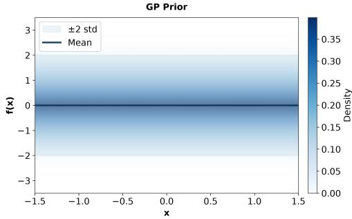
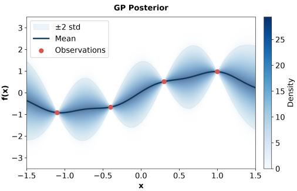
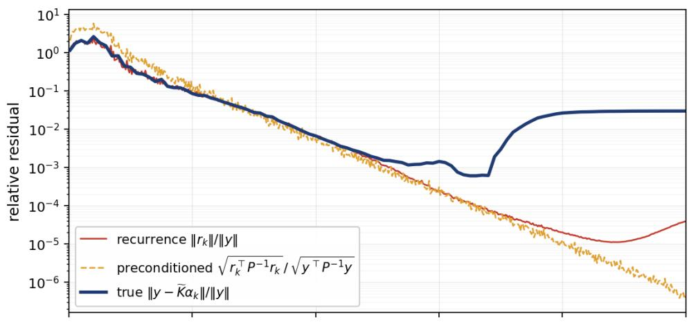
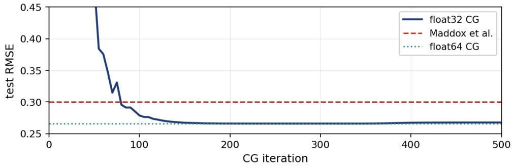
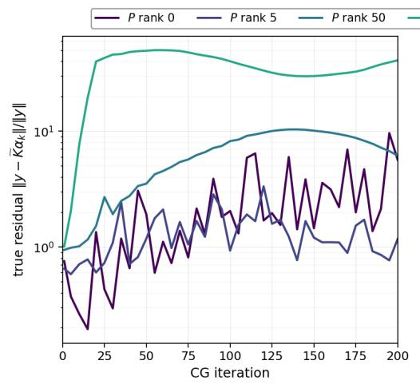
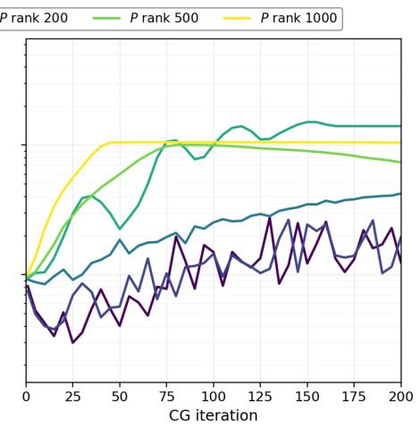
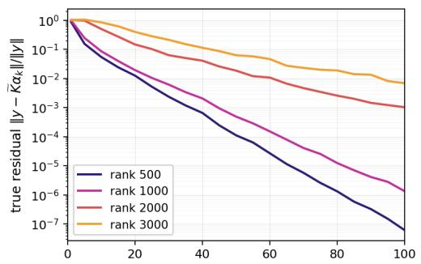
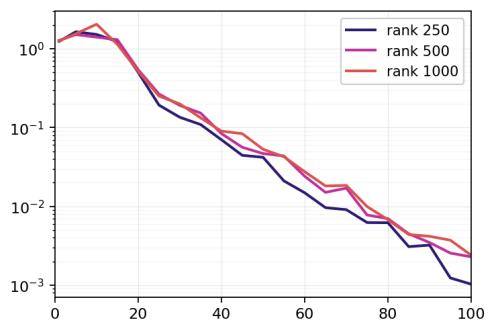
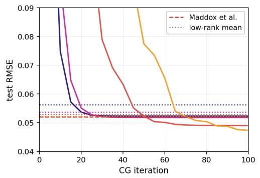
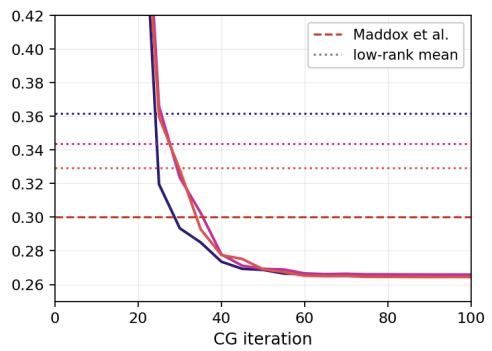

# LOW-RANK LOW PRECISION TRAINING OF GAUSSIAN PROCESSES

MORITZ POGUNTKE∗, EDA OKTAY†, YUANZHE XI‡, ERIN CARSON§, AND MARTIN STOLL∗

Abstract. Training Gaussian processes (GPs) at large scale is computationally challenging because evaluating the log-marginal likelihood and its gradients involves large, dense kernel matrices. We develop a scalable low-rank GP training approach that combines AnchorNet landmark selection with a fully independent training conditional (FITC) correction. The resulting objective and its analytic gradients can be evaluated using low-rank factors, diagonal quantities, and small dense matrices, without forming the full kernel matrix or its derivatives. The complete training procedure is implemented in single precision and evaluated on nine large-scale regression datasets. Across these problems, the method reaches the reference predictive accuracy while substantially reducing training time, although the required approximation rank varies across datasets. We also study the numerical behavior of the full-kernel predictive solve and show that single precision can become limiting for ill-conditioned problems. Finally, we investigate further reducing selected matrix operations to fp16 or TF32. These lower-precision variants provide only modest additional speedups and can become unreliable when the reduced system is poorly conditioned.

Key words. Gaussian Process, Low Precision, Low-Rank Approximation, Machine Learning

MSC codes. 65F55, 65G50, 60G15

1. Introduction. Surrogate models can serve as accurate and computationally eficient replacements for expensive models or can represent an underlying unknown function from observed data [13]. Gaussian processes (GPs) [27] are widely used for this purpose in Bayesian optimization and machine learning because they provide both predictions at unseen inputs and a principled quantification of predictive uncertainty.

The performance of a GP depends strongly on the choice of covariance or kernel function and its associated hyperparameters [20]. A central task in GP training is therefore to estimate these hyperparameters from the available training data [19]. Both hyperparameter training and posterior prediction require matrix computations involving a large, dense covariance matrix. A direct implementation based on matrix factorization has cubic complexity in the number of training points, which quickly becomes prohibitive for large datasets. Consequently, considerable efort has been devoted to structured and low-rank approximations that reduce these computational costs [27, 1, 29, 8, 18, 25].

Further computational gains are possible by exploiting reduced-precision arithmetic on modern hardware, where single- and half-precision operations can provide substantially higher throughput and lower memory trafic than double precision. This has motivated increasing interest in low-precision algorithms for large-scale GP computations [15]. At the same time, reduced precision introduces additional numerical challenges because GP kernel matrices can become severely ill-conditioned during

hyperparameter optimization.

The contributions of this paper are two-fold. First, we develop a scalable low-rank GP training approach based on landmarks selected by the AnchorNet algorithm [4] together with a fully independent training conditional (FITC) correction. We derive the corresponding objective and analytic gradients so that both the objective and its derivatives can be evaluated using low-rank factors and small dense matrices, without forming the full kernel matrix or its derivatives. Second, we study the numerical behavior of this training procedure in reduced precision on modern GPU architectures. We demonstrate that the complete low-rank training procedure can be carried out efectively in single precision and investigate the extent to which selected matrix operations can be further reduced to half precision or TF32. Our experiments also identify the conditioning regimes in which these lower-precision computations become unreliable.

The remainder of the paper is organized as follows. In Section 2, we review the GP formulation and the kernel models used in this work. In Section 3, we derive the low-rank FITC objective and its gradients. Section 4 describes the AnchorNet landmark-selection procedure, and Section 5 summarizes the resulting training algorithm. Section 6 presents the numerical experiments, including the efects of the approximation rank and the numerical behavior of the predictive solve. Finally, Section 7 investigates the use and limitations of precision below fp32.

2. Gaussian Processes. A Gaussian process (GP) is a collection of random variables such that every finite subset has a joint Gaussian distribution [27]. It is completely characterized by its mean function

$$
m ( x ) : = \mathbb { E } [ f ( x ) ]
$$

and covariance, or kernel, function

$$
k ( x , x ^ { \prime } ) : = \mathbb { E } \big [ ( f ( x ) - m ( x ) ) ( f ( x ^ { \prime } ) - m ( x ^ { \prime } ) ) \big ] .
$$

We write

$$
f \sim \mathcal { G P } ( m , k )
$$

and assume a zero mean, $m ( x ) = 0$ , throughout this work.

Let $\mathbf { X } _ { \mathrm { t r a i n } } \in \mathbb { R } ^ { n \times d }$ contain the training inputs $x _ { 1 } , \ldots , x _ { n }$ as its rows, and define the corresponding latent function values by

$$
\mathbf { f } _ { \mathrm { t r a i n } } = [ f ( x _ { 1 } ) , \ldots , f ( x _ { n } ) ] ^ { T } .
$$

We observe

$$
\mathbf { y } _ { \mathrm { t r a i n } } = \mathbf { f } _ { \mathrm { t r a i n } } + \pmb { \varepsilon } , \qquad \pmb { \varepsilon } \sim \mathcal { N } ( \mathbf { 0 } , \sigma ^ { 2 } \mathbf { I } _ { n } ) ,
$$

where $\sigma > 0$ and the observation noise is independent of the latent process.

For $n _ { * }$ test inputs $\mathbf { X } _ { \mathrm { t e s t } } \in \mathbb { R } ^ { n _ { * } \times d }$ , define

$$
\mathbf { K } = k ( \mathbf { X } _ { \mathrm { t r a i n } } , \mathbf { X } _ { \mathrm { t r a i n } } ) \in \mathbb { R } ^ { n \times n } ,
$$

$$
\mathbf { K } _ { * } = k ( \mathbf { X } _ { \mathrm { t r a i n } } , \mathbf { X } _ { \mathrm { t e s t } } ) \in \mathbb { R } ^ { n \times n _ { * } } , \qquad \mathbf { K } _ { * * } = k ( \mathbf { X } _ { \mathrm { t e s t } } , \mathbf { X } _ { \mathrm { t e s t } } ) \in \mathbb { R } ^ { n _ { * } \times n _ { * } } ,
$$

where each kernel matrix is formed by evaluating k at the corresponding pairs of inputs. Let $\mathbf { f } _ { \mathrm { t e s t } } \in \mathbb { R } ^ { n }$ ∗ collect the latent function values at the test inputs. For fixed

  
(a) Prior with zero mean

  
(b) Posterior based on four data points  
Fig. 1: A one-dimensional GP before and after conditioning on training data.

hyperparameters, the joint distribution of the training observations and test function values is

$$
\begin{array} { r } { \left[ \begin{array} { l } { \mathbf { y } _ { \mathrm { t r a i n } } } \\ { \mathbf { f } _ { \mathrm { t e s t } } } \end{array} \right] \sim { \mathcal { N } } \left( \mathbf { 0 } , \left[ \begin{array} { l l } { \mathbf { K } + \sigma ^ { 2 } \mathbf { I } } & { \mathbf { K } _ { * } } \\ { \mathbf { K } _ { * } ^ { T } } & { \mathbf { K } _ { * * } } \end{array} \right] \right) . } \end{array}
$$

Conditioning on the training observations gives

$$
\begin{array} { r l } & { p ( \mathbf { f } _ { \mathrm { t e s t } } \mid \mathbf { X } _ { \mathrm { t e s t } } , \mathbf { X } _ { \mathrm { t r a i n } } , \mathbf { y } _ { \mathrm { t r a i n } } ) = \mathcal { N } ( \mathbf { f } _ { \mathrm { t e s t } } \mid \pmb { \mu } _ { * } , \pmb { \Sigma } _ { * } ) , } \\ & { ~ \pmb { \mu } _ { * } = \mathbf { K } _ { * } ^ { T } ( \mathbf { K } + \sigma ^ { 2 } \mathbf { I } ) ^ { - 1 } \mathbf { y } _ { \mathrm { t r a i n } } , } \\ & { ~ \pmb { \Sigma } _ { * } = \mathbf { K } _ { * * } - \mathbf { K } _ { * } ^ { T } ( \mathbf { K } + \sigma ^ { 2 } \mathbf { I } ) ^ { - 1 } \mathbf { K } _ { * } . } \end{array}
$$

The posterior mean $\pmb { \mu } _ { \ast }$ predicts the latent function values, while $\Sigma _ { * }$ quantifies their uncertainty conditional on the chosen hyperparameters. For noisy test observations with independent Gaussian noise of variance $\sigma ^ { 2 }$ , the predictive covariance is $\Sigma _ { * } +$ $\sigma ^ { 2 } \mathbf { I } _ { n _ { * } }$ . Fig. 1 illustrates the prior and posterior of a one-dimensional GP.

In the following sections, we also use the shorthand $\mathbf { X } = \mathbf { X } _ { \mathrm { t r a i n } } , \mathbf { y } = \mathbf { y } _ { \mathrm { t r a i n } }$ , and $\mathbf { X } _ { * } = \mathbf { X } _ { \mathrm { t e s t } }$

Kernel model. The kernel determines the covariance structure of the GP. We begin with the squared-exponential kernel

$$
k ( x , x ^ { \prime } ) = \sigma _ { f } ^ { 2 } \exp \left( - \frac { \| x - x ^ { \prime } \| _ { 2 } ^ { 2 } } { 2 \ell ^ { 2 } } \right) ,
$$

where $\ell > 0$ is the length scale and $\sigma _ { f } > 0$ is the signal scale, so that $\sigma _ { f } ^ { 2 }$ is the signal variance. This kernel is symmetric and positive definite.

Define the squared Euclidean distance matrix $\mathbf { S } \in \mathbb { R } ^ { n \times n }$ by

$$
S _ { p q } = \| \boldsymbol { x } _ { p } - \boldsymbol { x } _ { q } \| _ { 2 } ^ { 2 } , \qquad p , q = 1 , \ldots , n .
$$

The corresponding kernel matrix is

$$
\mathbf { K } ( \boldsymbol { \ell } , \sigma _ { f } ) = \sigma _ { f } ^ { 2 } \exp \left( - \frac { \mathbf { S } } { 2 \boldsymbol { \ell } ^ { 2 } } \right) ,
$$

where the exponential is applied entrywise.

In our experiments, we use the squared-exponential kernel with automatic relevance determination (ARD), which assigns a separate positive length scale $\ell _ { j }$ to each input coordinate:

$$
k ( x , x ^ { \prime } ) = \sigma _ { f } ^ { 2 } \exp \left( - { \frac { 1 } { 2 } } \sum _ { j = 1 } ^ { d } { \frac { ( x _ { j } - x _ { j } ^ { \prime } ) ^ { 2 } } { \ell _ { j } ^ { 2 } } } \right) .\tag{2.1}
$$

The hyperparameter vector is

$$
\theta = [ \ell _ { 1 } , \ldots , \ell _ { d } , \sigma _ { f } , \sigma ] ^ { T }
$$

and contains $d + 2$ parameters. The noise scale $\sigma$ enters the observation covariance $\mathbf { K } + \sigma ^ { 2 } \mathbf { I }$ . A large $\ell _ { j }$ relative to the variation in the jth input coordinate makes the kernel less sensitive to changes along that coordinate.

For each coordinate $j = 1 , \ldots , d ,$ define $\mathbf { S } ^ { ( j ) } \in \mathbb { R } ^ { n \times n }$ by

$$
S _ { p q } ^ { ( j ) } = ( x _ { p , j } - x _ { q , j } ) ^ { 2 } , \qquad p , q = 1 , \dots , n ,
$$

so that

$$
\mathbf { S } = \sum _ { j = 1 } ^ { d } \mathbf { S } ^ { ( j ) } .
$$

The ARD kernel matrix can then be written as

$$
\mathbf { K } ( \theta ) = \sigma _ { f } ^ { 2 } \exp \left( - \frac { 1 } { 2 } \sum _ { j = 1 } ^ { d } \frac { \mathbf { S } ^ { ( j ) } } { \ell _ { j } ^ { 2 } } \right) ,
$$

with the exponential again applied entrywise. The isotropic kernel is recovered by setting $\ell _ { j } = \ell$ for all $j .$ . The distance matrices provide convenient notation for the kernel and its derivatives; the low-rank implementation described below forms only the required blocks.

Large-scale computation. The main computational dificulty in GP regression is that K is generally dense. For $\sigma > 0$ , the observation covariance $\mathbf { K } + \sigma ^ { 2 } \mathbf { I }$ is symmetric positive definite in exact arithmetic. A direct Cholesky factorization requires $\mathcal { O } ( n ^ { 3 } )$ operations and $\scriptstyle { \mathcal { O } } ( n ^ { 2 } )$ storage, which becomes prohibitive for large datasets [27]. This has motivated approaches based on inducing points, structured kernel approximations, and matrix-free iterative methods.

Inducing-point methods use a smaller collection of inputs to construct a lowrank representation of the covariance structure; see, e.g., [18]. Examples include the subset of regressors (SOR) [21] and the fully independent training conditional (FITC) approximation [23]. FITC augments the low-rank training covariance with a diagonal correction that restores the marginal variances at the training inputs. Structured kernel interpolation, developed by Wilson and Nickisch [28], provides another way to approximate kernel matrices eficiently. Such approximations can be combined with Krylov methods for linear solves and with stochastic trace estimation for logdeterminant computations [9]. These techniques are used in scalable GP software such as GPyTorch [11].

Eficient trace estimation is also important in these computations [22, 24, 16, 7, 17, 26, 30]. Matrix-free approaches evaluate the action of K without explicitly storing the dense matrix [25, 14]. For posterior-mean computations, the resulting linear systems are closely related to those arising in kernel ridge regression and can benefit from preconditioning, including low-rank preconditioners; see, e.g., [6, 3, 10, 31].

Our method uses AnchorNet to select landmarks for a low-rank kernel approximation and combines this approximation with the FITC diagonal correction. The resulting training objective and its gradients are evaluated using low-rank factors, diagonal quantities, and small dense matrices, as developed in Section 3.

3. Training Gaussian Processes. Exact GP training estimates the hyperparameters by minimizing the negative log-marginal likelihood

$$
f ( \theta ) = \frac { 1 } { 2 } \left( n \log ( 2 \pi ) + \log \operatorname* { d e t } ( \widetilde { \mathbf { K } } ) + \mathbf { y } ^ { T } \widetilde { \mathbf { K } } ^ { - 1 } \mathbf { y } \right) , \qquad \widetilde { \mathbf { K } } = \mathbf { K } + \boldsymbol { \sigma } ^ { 2 } \mathbf { I } .\tag{3.1}
$$

For large datasets, the main computational bottlenecks are the linear solve with $\widetilde { \bf K }$ required by the quadratic term and the evaluation of logdet(Ke ). A direct Cholesky factorization requires $\mathcal { O } ( n ^ { 3 } )$ operations and $\mathcal { O } ( n ^ { 2 } )$ storage [27, 2], while alternative large-scale approaches typically rely on iterative solves and trace-estimation techniques [11, 8].

To reduce these costs, we construct a low-rank approximation using landmarks selected by AnchorNet [4]. The corresponding kernel blocks satisfy

$$
\mathbf { K } _ { 2 1 } \in \mathbb { R } ^ { n \times r } , \qquad \mathbf { K } _ { 1 1 } \in \mathbb { R } ^ { r \times r } , \qquad \mathbf { K } _ { 1 2 } = \mathbf { K } _ { 2 1 } ^ { T } \in \mathbb { R } ^ { r \times n } .
$$

The construction of the landmarks and kernel blocks is described in Section 4. The landmark locations are distinct and remain fixed throughout hyperparameter optimization.

In the single-precision implementation, the landmark kernel matrix is stabilized before factorization:

$$
\overline { { \mathbf { K } } } _ { 1 1 } = \mathbf { K } _ { 1 1 } + \epsilon \sigma _ { f } ^ { 2 } \mathbf { I } _ { r } ,
$$

where $\epsilon \geq 0$ is selected as described in Section 5. For notational simplicity, in the remainder of this section, $\mathbf { K } _ { 1 1 }$ and $\mathbf { K } _ { 1 1 } ^ { - 1 }$ denote the stabilized matrix and its inverse, respectively. With this convention, the low-rank approximation is

$$
\begin{array} { r } { \mathbf { K } \approx \hat { \mathbf { K } } = \mathbf { K } _ { 2 1 } \mathbf { K } _ { 1 1 } ^ { - 1 } \mathbf { K } _ { 1 2 } . } \end{array}\tag{3.2}
$$

All derivatives below are taken with the landmark set and the accepted value of ϵ held fixed. Changes in ϵ caused by the stabilization procedure are not diferentiated.

3.1. The FITC-corrected low-rank model. The low-rank approximation can underestimate the marginal variances at the training inputs. For nonnegative stabilization, it satisfies

$$
0 \preceq \hat { \mathbf { K } } \preceq \mathbf { K }
$$

in exact arithmetic, and hence

$$
[ \hat { \mathbf { K } } ] _ { i i } \leq k ( x _ { i } , x _ { i } ) .
$$

When $\epsilon = 0$ , the standard Nystr¨om approximation gives equality at the landmark locations. Positive stabilization generally removes this interpolation property and increases the diagonal deficit.

We use the fully independent training conditional (FITC) correction [23] to restore the marginal variances. Let Λ be the diagonal matrix whose entries are

$$
\Lambda _ { i i } = k ( x _ { i } , x _ { i } ) - [ \hat { \bf K } ] _ { i i } .
$$

The approximate covariance of the noisy training observations is

$$
{ \bf K } _ { \mathrm { F I T C } } = \hat { \bf K } + { \bf D } , \qquad { \bf D } = { \bf \Lambda } + \sigma ^ { 2 } { \bf I } .\tag{3.3}
$$

Thus, $\hat { \mathbf { K } } + \boldsymbol { \Lambda }$ approximates the latent covariance K, while KFITC approximates $\widetilde { \mathbf { K } } =$ $\mathbf { K } + \sigma ^ { 2 } \mathbf { I }$ . Since $\Lambda _ { i i } \geq 0$ and $\sigma > 0$ 2

$$
D _ { i i } \geq \sigma ^ { 2 } > 0 ,
$$

so both D and ${ \bf K } _ { \mathrm { F I T C } }$ are positive definite in exact arithmetic.

The approximate negative log-marginal likelihood used for training is

$$
\hat { f } ( \theta ) = \frac { 1 } { 2 } \left( n \log ( 2 \pi ) + \log \operatorname* { d e t } ( \mathbf { K } _ { \mathrm { F I T C } } ) + \mathbf { y } ^ { T } \mathbf { K } _ { \mathrm { F I T C } } ^ { - 1 } \mathbf { y } \right) .\tag{3.4}
$$

The uncorrected low-rank model is recovered by setting $\mathbf { \boldsymbol { \Lambda } } = 0$

3.2. Eficient evaluation of the objective. The inverse and log-determinant in (3.4) can be evaluated using low-rank factors, diagonal operations, and $r \times r$ factorizations. Define

$$
\mathbf { K } _ { \mathrm { s m a l l } } : = \mathbf { I } _ { r } + \mathbf { K } _ { 1 1 } ^ { - 1 } \mathbf { K } _ { 1 2 } \mathbf { D } ^ { - 1 } \mathbf { K } _ { 2 1 } .\tag{3.5}
$$

Applying the Sherman–Morrison–Woodbury formula gives

$$
\alpha : = \mathbf { K } _ { \mathrm { F I T C } } ^ { - 1 } \mathbf { y } = \mathbf { D } ^ { - 1 } \mathbf { y } - \mathbf { D } ^ { - 1 } \mathbf { K } _ { \mathrm { 2 1 } } \mathbf { K } _ { \mathrm { s m a l l } } ^ { - 1 } \mathbf { K } _ { \mathrm { 1 1 } } ^ { - 1 } \mathbf { K } _ { \mathrm { 1 2 } } \mathbf { D } ^ { - 1 } \mathbf { y } .\tag{3.6}
$$

Similarly, the matrix determinant lemma gives

$$
\log \mathrm { d e t } ( \mathbf { K } _ { \mathrm { F I T C } } ) = \sum _ { m = 1 } ^ { n } \log D _ { m m } + \log \mathrm { d e t } ( \mathbf { K } _ { \mathrm { s m a l l } } ) .\tag{3.7}
$$

Although $\mathbf { K } _ { \mathrm { s m a l l } }$ is generally nonsymmetric, it is similar to a symmetric positive definite matrix. Let

$$
\mathbf { K } _ { 1 1 } = \mathbf { L } \mathbf { L } ^ { T } , \qquad \mathbf { W } = \mathbf { L } ^ { - 1 } \mathbf { K } _ { 1 2 } \in \mathbb { R } ^ { r \times n } .
$$

Then

$$
\mathbf { M } = \mathbf { L } ^ { T } \mathbf { K } _ { \mathrm { s m a l l } } \mathbf { L } ^ { - T } = \mathbf { I } _ { r } + \mathbf { W D } ^ { - 1 } \mathbf { W } ^ { T } .\tag{3.8}
$$

Since D is positive definite, $\mathbf { M } \succeq \mathbf { I } _ { r }$ in exact arithmetic. The similarity transformation also gives

$$
\mathrm { l o g d e t } ( \mathbf { K } _ { \mathrm { s m a l l } } ) = \mathrm { l o g d e t } ( \mathbf { M } ) .
$$

The inverse action in (3.6) can equivalently be written as

$$
\begin{array} { r } { \pmb { \alpha } = \mathbf { D } ^ { - 1 } \mathbf { y } - \mathbf { D } ^ { - 1 } \mathbf { W } ^ { T } \mathbf { M } ^ { - 1 } \mathbf { W } \mathbf { D } ^ { - 1 } \mathbf { y } . } \end{array}
$$

Thus, all dense factorizations required for evaluating the objective involve only $r \times r$ matrices. The formulas can be evaluated using diagonal scaling and triangular solves, without explicitly forming the inverse matrices.

3.3. Gradient evaluation. To optimize the hyperparameters, we diferentiate (3.4). For any hyperparameter $\theta _ { i }$ , the standard identities for the derivative of a logdeterminant and a matrix inverse give

$$
\frac { \partial \hat { f } } { \partial \theta _ { i } } = \frac { 1 } { 2 } \left[ \mathrm { t r } \left( \mathbf { K } _ { \mathrm { F I T C } } ^ { - 1 } \frac { \partial \mathbf { K } _ { \mathrm { F I T C } } } { \partial \theta _ { i } } \right) - \pmb { \alpha } ^ { T } \frac { \partial \mathbf { K } _ { \mathrm { F I T C } } } { \partial \theta _ { i } } \pmb { \alpha } \right] .\tag{3.9}
$$

Using

$$
{ \bf K } _ { \mathrm { F I T C } } = \hat { \bf K } + { \bf D } ,
$$

we separate the gradient into low-rank and diagonal contributions:

$$
\frac { \partial \hat { f } } { \partial \theta _ { i } } = \frac { 1 } { 2 } \left[ \mathrm { t r } \left( \mathbf { K } _ { \mathrm { F I T C } } ^ { - 1 } \frac { \partial \hat { \mathbf { K } } } { \partial \theta _ { i } } \right) - \boldsymbol { \alpha } ^ { T } \frac { \partial \hat { \mathbf { K } } } { \partial \theta _ { i } } \boldsymbol { \alpha } \right] + \frac { 1 } { 2 } \sum _ { m = 1 } ^ { n } q _ { m } \frac { \partial D _ { m m } } { \partial \theta _ { i } } ,
$$

where

$$
q _ { m } = [ \mathbf { K } _ { \mathrm { F I T C } } ^ { - 1 } ] _ { m m } - \alpha _ { m } ^ { 2 } .\tag{3.10}
$$

The diagonal of ${ \bf K } _ { \mathrm { F I T C } } ^ { - 1 }$ can be obtained without forming the full inverse. Using $\mathbf { W } = \mathbf { L } ^ { - 1 } \mathbf { K } _ { 1 2 }$ and (3.8),

$$
\mathrm { d i a g } ( \mathbf { K } _ { \mathrm { F I T C } } ^ { - 1 } ) = \mathrm { d i a g } ( \mathbf { D } ^ { - 1 } ) - \mathrm { d i a g } \left( \mathbf { D } ^ { - 1 } \mathbf { W } ^ { T } \mathbf { M } ^ { - 1 } \mathbf { W } \mathbf { D } ^ { - 1 } \right) .\tag{3.11}
$$

The second diagonal is evaluated from blocks of the low-rank factors, without forming an $n \times n$ matrix. It remains to evaluate the derivatives of Kˆ and the associated reduced quantities.

Length-scale derivatives. For an ARD length scale $\ell _ { j }$ , all three factors in

$$
\hat { \bf K } = { \bf K } _ { 2 1 } { \bf K } _ { 1 1 } ^ { - 1 } { \bf K } _ { 1 2 }
$$

depend on $\ell _ { j }$ . The matrix product rule [12] therefore gives

$$
\frac { \partial \hat { { \mathbf { K } } } } { \partial \ell _ { j } } = \frac { \partial { \mathbf { K } } _ { 2 1 } } { \partial \ell _ { j } } \mathbf { K } _ { 1 1 } ^ { - 1 } \mathbf { K } _ { 1 2 } + \mathbf { K } _ { 2 1 } \frac { \partial \mathbf { K } _ { 1 1 } ^ { - 1 } } { \partial \ell _ { j } } \mathbf { K } _ { 1 2 } + \mathbf { K } _ { 2 1 } \mathbf { K } _ { 1 1 } ^ { - 1 } \frac { \partial \mathbf { K } _ { 1 2 } } { \partial \ell _ { j } } .\tag{3.12}
$$

Using the ARD kernel (2.1) and the componentwise squared-distance matrices $\mathbf { S } ^ { ( j ) }$ defined in Section 2, the factor derivatives are

$$
\frac { \partial \mathbf { K } _ { 2 1 } } { \partial \ell _ { j } } = \frac { 1 } { \ell _ { j } ^ { 3 } } \mathbf { S } ^ { ( j ) } ( : , \mathrm { n y s t } ) { \odot } \mathbf { K } _ { 2 1 } ,
$$

$$
\frac { \partial { \bf K } _ { 1 1 } ^ { - 1 } } { \partial \ell _ { j } } = - \frac { 1 } { \ell _ { j } ^ { 3 } } { \bf K } _ { 1 1 } ^ { - 1 } \left( { \bf S } ^ { ( j ) } ( \mathrm { n y s t } , \mathrm { n y s t } ) \odot { \bf K } _ { 1 1 } \right) { \bf K } _ { 1 1 } ^ { - 1 } ,\tag{3.13}
$$

$$
\frac { \partial { \bf K } _ { 1 2 } } { \partial \ell _ { j } } = \frac { 1 } { \ell _ { j } ^ { 3 } } { \bf S } ^ { ( j ) } ( \mathrm { n y s t , : } ) \odot { \bf K } _ { 1 2 } , \qquad j = 1 , \ldots , d .
$$

Here ⊙ denotes the Hadamard product and nyst denotes the landmark indices identified by AnchorNet. With ϵ fixed, the stabilization term $\epsilon \sigma _ { f } ^ { 2 } \mathbf { I } _ { r }$ is independent of $\ell _ { j }$ . Moreover, the diagonal of $\mathbf { S } ^ { ( j ) } ( \mathrm { n y s t } , \mathrm { n y s t } )$ is zero, so its Hadamard product with the stabilization term vanishes. Thus, (3.13) remains valid under our convention that $\mathbf { K } _ { 1 1 }$ denotes the stabilized matrix.

The derivative in (3.12) admits the low-rank factorization

$$
\frac { \partial \hat { { \mathbf { K } } } } { \partial \ell _ { j } } = \underbrace { \left[ \frac { \partial \mathbf { K } _ { 2 1 } } { \partial \ell _ { j } } \quad \mathbf { K } _ { 2 1 } \quad \mathbf { K } _ { 2 1 } \right] } _ { \mathbf { U } ^ { ( j ) } } \underbrace { \left[ \begin{array} { l l l } { { \mathbf { K } _ { 1 1 } ^ { - 1 } } } & & \\ & { \frac { \partial \mathbf { K } _ { 1 1 } ^ { - 1 } } { \partial \ell _ { j } } } & \\ & & { \mathbf { K } _ { 1 1 } ^ { - 1 } } \end{array} \right] } _ { \mathbf { G } ^ { ( j ) } } \underbrace { \left[ \begin{array} { l } { { \mathbf { K } _ { 1 2 } } } \\ { { \mathbf { K } _ { 1 2 } } } \\ { \frac { \partial \mathbf { K } _ { 1 2 } } { \partial \ell _ { j } } } \end{array} \right] } _ { \mathbf { V } ^ { ( j ) } } .\tag{3.14}
$$

The factors have dimensions

$$
{ \bf U } ^ { ( j ) } \in \mathbb { R } ^ { n \times 3 r } , \qquad { \bf G } ^ { ( j ) } \in \mathbb { R } ^ { 3 r \times 3 r } , \qquad { \bf V } ^ { ( j ) } \in \mathbb { R } ^ { 3 r \times n } .
$$

This block representation can be evaluated termwise without explicitly assembling the three factors. In particular,

$$
\pmb { \alpha } ^ { T } \frac { \partial \hat { \mathbf { K } } } { \partial \ell _ { j } } \pmb { \alpha } = \pmb { \alpha } ^ { T } \mathbf { U } ^ { ( j ) } \mathbf { G } ^ { ( j ) } \mathbf { V } ^ { ( j ) } \pmb { \alpha } ,\tag{3.15}
$$

so the quadratic-form contribution requires no $n \times n$ derivative matrix.

The low-rank trace contribution can also be reduced to an $r \times r$ computation. Since the derivative of D is accounted for separately in (3.3), we diferentiate $\mathbf { K } _ { \mathrm { s m a l l } }$ with D held fixed:

$$
\begin{array} { r l } & { \mathbf { d K } _ { \mathrm { s m a l l , L R } } ^ { ( \ell _ { j } ) } : = \left. \frac { \partial \mathbf { K } _ { \mathrm { s m a l l } } } { \partial \ell _ { j } } \right| _ { \mathbf { D } \mathrm { \ f i x e d } } } \\ & { \qquad = \frac { \partial \mathbf { K } _ { 1 1 } ^ { - 1 } } { \partial \ell _ { j } } \mathbf { K } _ { 1 2 } \mathbf { D } ^ { - 1 } \mathbf { K } _ { 2 1 } + \mathbf { K } _ { 1 1 } ^ { - 1 } \frac { \partial \mathbf { K } _ { 1 2 } } { \partial \ell _ { j } } \mathbf { D } ^ { - 1 } \mathbf { K } _ { 2 1 } + \mathbf { K } _ { 1 1 } ^ { - 1 } \mathbf { K } _ { 1 2 } \mathbf { D } ^ { - 1 } \frac { \partial \mathbf { K } _ { 2 1 } } { \partial \ell _ { j } } . } \end{array}
$$

Diferentiating the determinant identity with D fixed gives

$$
\mathrm { t r } \left( \mathbf { K } _ { \mathrm { F I T C } } ^ { - 1 } \frac { \partial \hat { \mathbf { K } } } { \partial \ell _ { j } } \right) = \mathrm { t r } \left( \mathbf { K } _ { \mathrm { s m a l l } } ^ { - 1 } \mathbf { d K } _ { \mathrm { s m a l l , L R } } ^ { ( \ell _ { j } ) } \right) .\tag{3.16}
$$

The diagonal contribution follows from $k ( x _ { m } , x _ { m } ) = \sigma _ { f } ^ { 2 }$ , which is independent of the length scales:

$$
\frac { \partial D _ { m m } } { \partial \ell _ { j } } = - \left[ \frac { \partial \hat { \bf K } } { \partial \ell _ { j } } \right] _ { m m } .\tag{3.17}
$$

Combining these expressions yields

$$
\begin{array} { r l r } {  { \frac { \partial \hat { f } } { \partial \ell _ { j } } = \frac { 1 } { 2 } [ \mathrm { t r } ( \mathbf { K } _ { \mathrm { s m a l l } } ^ { - 1 } \mathbf { d K } _ { \mathrm { s m a l l , L R } } ^ { ( \ell _ { j } ) } ) - \alpha ^ { T } \mathbf { U } ^ { ( j ) } \mathbf { G } ^ { ( j ) } \mathbf { V } ^ { ( j ) } \alpha  } } \\ & { } & {  - \sum _ { m = 1 } ^ { n } q _ { m } [ \mathbf { U } ^ { ( j ) } \mathbf { G } ^ { ( j ) } \mathbf { V } ^ { ( j ) } ] _ { m m } ] , \quad \quad j = 1 , \ldots , d . } \end{array}\tag{3.18}
$$

Signal-scale derivative. The signal variance $\sigma _ { f } ^ { 2 }$ scales every kernel block. Because the stabilization has the form $\epsilon \sigma _ { f } ^ { 2 } { \mathbf I } _ { \eta }$ with fixed $\epsilon ,$ the stabilized landmark matrix also scales proportionally to $\sigma _ { f } ^ { 2 }$ . Consequently,

$$
\frac { \partial \mathbf { K } _ { 2 1 } } { \partial \sigma _ { f } } = \frac { 2 } { \sigma _ { f } } \mathbf { K } _ { 2 1 } , \qquad \frac { \partial \mathbf { K } _ { 1 2 } } { \partial \sigma _ { f } } = \frac { 2 } { \sigma _ { f } } \mathbf { K } _ { 1 2 } , \qquad \frac { \partial \mathbf { K } _ { 1 1 } ^ { - 1 } } { \partial \sigma _ { f } } = - \frac { 2 } { \sigma _ { f } } \mathbf { K } _ { 1 1 } ^ { - 1 } .\tag{3.19}
$$

The product rule then gives

$$
\frac { \partial \hat { \mathbf { K } } } { \partial \sigma _ { f } } = \frac { 2 } { \sigma _ { f } } \hat { \mathbf { K } } .\tag{3.20}
$$

As in the length-scale calculation, the low-rank contribution holds D fixed:

$$
\mathbf { d K } _ { \mathrm { s m a l l , L R } } ^ { ( \sigma _ { f } ) } : = \left. \frac { \partial \mathbf { K } _ { \mathrm { s m a l l } } } { \partial \sigma _ { f } } \right| _ { \mathbf { D } \mathrm { ~ f i x e d } } = \frac { 2 } { \sigma _ { f } } \mathbf { K } _ { 1 1 } ^ { - 1 } \mathbf { K } _ { 1 2 } \mathbf { D } ^ { - 1 } \mathbf { K } _ { 2 1 } = \frac { 2 } { \sigma _ { f } } \left( \mathbf { K } _ { \mathrm { s m a l l } } - \mathbf { I } _ { r } \right) .\tag{3.21}
$$

Since

$$
\Lambda _ { m m } = \sigma _ { f } ^ { 2 } - [ \hat { \bf K } ] _ { m m } ,
$$

the diagonal derivative is

$$
\frac { \partial D _ { m m } } { \partial \sigma _ { f } } = \frac { 2 } { \sigma _ { f } } \Lambda _ { m m } .\tag{3.22}
$$

The resulting signal-scale gradient is

$$
\frac { \partial \hat { f } } { \partial \sigma _ { f } } = \frac { 1 } { 2 } \left[ \mathrm { t r } \left( \mathbf { K } _ { \mathrm { s m a l l } } ^ { - 1 } \mathbf { d K } _ { \mathrm { s m a l l , L R } } ^ { ( \sigma _ { f } ) } \right) - \frac { 2 } { \sigma _ { f } } \alpha ^ { T } \hat { \mathbf { K } } \alpha + \frac { 2 } { \sigma _ { f } } \sum _ { m = 1 } ^ { n } q _ { m } \Lambda _ { m m } \right] .
$$

Noise derivative. The low-rank approximation $\hat { \bf K }$ and the diagonal correction Λ are independent of the noise scale $\sigma _ { : }$ while

$$
\frac { \partial \mathbf { D } } { \partial \sigma } = 2 \sigma \mathbf { I } _ { n } .
$$

Thus, only the diagonal contribution in (3.3) remains:

$$
\frac { \partial \hat { f } } { \partial \sigma } = \sigma \sum _ { m = 1 } ^ { n } q _ { m } = \sigma \left( \mathrm { t r } \big ( \mathbf { K } _ { \mathrm { F I T C } } ^ { - 1 } \big ) - \alpha ^ { T } \alpha \right) .\tag{3.23}
$$

All quantities in (3.18), (3.3), and (3.23) can be evaluated using low-rank factors, diagonal quantities, and reduced $r \times r$ matrices. Neither the full kernel matrix nor any $n \times n$ derivative matrix needs to be formed. The componentwise squared-distance matrices $\mathbf { S } ^ { ( j ) }$ are likewise not stored explicitly; the required Hadamard products are generated blockwise together with the corresponding kernel blocks.

3.4. Positive parameterization. To enforce positivity without constrained optimization, we introduce unconstrained parameters

$$
\boldsymbol { \zeta } = ( \zeta _ { \ell _ { 1 } } , \dots , \zeta _ { \ell _ { d } } , \zeta _ { \sigma _ { f } } , \zeta _ { \sigma } ) ^ { T } \in \mathbb { R } ^ { d + 2 }
$$

and parameterize

$$
\ell _ { j } = \mathrm { s o f t p l u s } ( \zeta _ { \ell _ { j } } ) , \qquad \sigma _ { f } = \mathrm { s o f t p l u s } ( \zeta _ { \sigma _ { f } } ) ,
$$

and

$$
\sigma = 1 0 ^ { - 4 } + \mathrm { s o f t p l u s } ( \zeta _ { \sigma } ) , \qquad \mathrm { s o f t p l u s } ( \zeta ) = \log \bigl ( 1 + e ^ { \zeta } \bigr ) .\tag{3.24}
$$

Since

$$
{ \mathrm { s o f t p l u s } } ^ { \prime } ( \zeta ) = ( 1 + e ^ { - \zeta } ) ^ { - 1 } ,
$$

the derivatives with respect to the unconstrained optimization variables follow from the chain rule. Writing $\zeta _ { i }$ for the component corresponding to $\theta _ { i }$ , we obtain

$$
\frac { \partial \hat { f } } { \partial \zeta _ { i } } = \frac { \partial \hat { f } } { \partial \theta _ { i } } ^ { - 1 } , \qquad i = 1 , \dots , d + 2 .\tag{3.25}
$$

This formula also applies to the noise parameter because its additional floor is constant.

4. AnchorNet Low-Rank Approximation. We use AnchorNet [4] to select landmark points for the low-rank kernel approximation. Given a set of landmarks S, the standard Nystr¨om approximation is

$$
\begin{array} { r } { \mathbf { K } \approx \hat { \mathbf { K } } = \mathbf { K } _ { 2 1 } \mathbf { K } _ { 1 1 } ^ { - 1 } \mathbf { K } _ { 1 2 } , } \end{array}
$$

where ${ \bf K } _ { 2 1 } \in \mathbb { R } ^ { n \times r } , { \bf K } _ { 1 1 } \in \mathbb { R } ^ { r \times r }$ , and ${ \bf K } _ { 1 2 } = { \bf K } _ { 2 1 } ^ { T } \in \mathbb { R } ^ { r \times n }$ . Here $r = \# S$ is the number of distinct landmarks.

Let

$$
\mathcal { X } = \{ x _ { 1 } , \ldots , x _ { n } \} \subset \mathbb { R } ^ { d }
$$

denote the training locations stored in the rows of $\mathbf { X } _ { \mathrm { t r a i n } }$ . Let m be a positive integer specifying the target net size. The construction has two stages: it first generates anchor points adapted to the data geometry and then maps them to training points. All nearest-point ties are resolved by a fixed rule.

Anchor construction.

1. Compute the smallest axis-aligned bounding box $B _ { 0 }$ containing X and generate an initial low-discrepancy set

$$
\mathcal { T } = \{ t _ { 1 } , \ldots , t _ { s } \} \subset B _ { 0 } , \qquad s = \mathcal { O } ( m ) .
$$

Possible constructions include Halton points and the adaptive tensor grids described in [4].

2. Assign each training point $x _ { j }$ to one nearest point in $\tau$ with respect to the $\ell _ { \infty }$ norm. Specifically, choose

$$
a ( j ) \in \operatorname { a r g m i n } _ { 1 \leq i \leq s } \| x _ { j } - t _ { i } \| _ { \infty }
$$

according to the fixed tie-breaking rule and define

$$
G _ { i } = \{ x _ { j } : a ( j ) = i \} , \qquad i = 1 , \ldots , s .
$$

Discard empty groups and relabel the remaining groups as $G _ { 1 } , \ldots , G _ { Q }$

3. For each nonempty group $G _ { i }$ , compute its smallest axis-aligned bounding box $B _ { i }$ . Let $\lambda ( B _ { i } )$ denote its d-dimensional Lebesgue measure. For the volumebased allocation, assume

$$
\sum _ { k = 1 } ^ { Q } \lambda ( B _ { k } ) > 0
$$

and set

$$
m _ { i } = \left\lceil m \frac { \lambda ( B _ { i } ) } { \sum _ { k = 1 } ^ { Q } \lambda ( B _ { k } ) } \right\rceil .
$$

When $m _ { i } > 0 .$ , generate a low-discrepancy set $\mathcal { A } ^ { ( i ) } \subset B _ { i }$ with $m _ { i }$ points. If $m _ { i } = 0$ , set $\boldsymbol { \mathcal { A } ^ { ( i ) } } = \boldsymbol { \mathcal { O } }$

4. Form the anchor net

$$
A _ { X } = \bigcup _ { i = 1 } ^ { Q } { \mathcal { A } } ^ { ( i ) } .
$$

The ceiling allocation gives

$$
\# A _ { X } \leq \sum _ { i = 1 } ^ { Q } m _ { i } \leq m + Q = \mathcal { O } ( m ) ,
$$

because $Q \leq s = \mathcal { O } ( m )$ . Thus, the number of distinct anchors need not equal the target size m.

From anchors to landmarks. For each anchor $y \in A _ { X }$ , select a nearest training point,

$$
\begin{array} { r } { s ( y ) \in \mathop { \mathrm { a r g m i n } } _ { x \in \mathcal { X } } \| x - y \| _ { \infty } , } \end{array}
$$

using the fixed tie-breaking rule. The landmark set is

$$
S = \{ s ( y ) : y \in A _ { X } \} \subset \mathcal { X } ,
$$

with repeated selections removed. Consequently,

$$
r = \# S \leq \# A _ { X } \leq m + Q = \mathcal { O } ( m ) ,
$$

and $r \leq n$

The volume-based allocation is designed to distribute anchors across the data geometry. Mapping these anchors to the data produces landmarks intended to improve the approximation quality and numerical behavior of the Nystr¨om approximation [4].

The landmark-selection stage costs $O ( m d n )$ and depends only on the input locations, requiring neither kernel matrix entries nor kernel matrix–vector products [4]. The selected landmarks define the low-rank approximation described in Section 3, with stabilization implemented as described in Section 5.

5. Algorithm. Algorithm 5.1 summarizes the training and prediction procedure. The landmarks are selected once and remain fixed during optimization, with $r = \# S$ denoting the resulting approximation rank. Initialization and optimizer settings are given in Appendix A.

Training is performed in fp32. The stabilization routine factors

$$
\overline { { \mathbf { K } } } _ { 1 1 } = \mathbf { K } _ { 1 1 } + \epsilon \sigma _ { f } ^ { 2 } \mathbf { I } _ { r } = \mathbf { L } \mathbf { L } ^ { T } ,
$$

starting with $\epsilon = 1 0 ^ { - 4 }$ and increasing it by a factor of ten after an unsuccessful attempt, up to seven attempts. Failure is reported if no acceptable factor is obtained; this did not occur in the reported experiments. The gradient formulas in Section 3 use $\overline { { \mathbf { K } } } _ { 1 1 }$ and its inverse, with the accepted ϵ held fixed. Final factor reconstruction repeats the same stabilization procedure. The operator $\mathrm { c l i p } _ { 1 0 }$ clips the Euclidean norm of the unconstrained gradient to 10.

The factor computations are blocked by default. We select the unblocked implementation only when an initial timing test shows that it is at least 20% faster and suficient memory is available. Kernel products during prediction can also be evaluated in blocks.

The low-rank predictive mean uses only reduced solves and kernel products with the landmarks. For the full-kernel mean, datasets with fewer than 60,000 training points use a dense factorization; larger datasets use preconditioned CG with KeOps matrix–vector products. The default fp32 preconditioner uses the first min(r, 200) landmarks. Additional fp64 solves establish the full-kernel reference predictions on 3DRoad, Buzz, and HouseElectric, where fp32 does not attain suficient accuracy; see Section 6 and appendix B.

Algorithm 5.1 FITC Gaussian process training with AnchorNet landmarks   
Input: Training data $( \mathbf { X } , \mathbf { y } )$ ; test inputs $\mathbf { X } _ { * } ;$ target net size m; iteration budget   
$T \geq 2 ;$ initial learning rate $\eta _ { 0 } ;$ low-rank predictive-mean flag $b _ { \mathrm { L R } }$   
Output: Hyperparameters θ and predictive mean $\pmb { \mu } _ { \ast }$   
1: $S \gets \mathrm { A N C H O R N E T } ( \mathbf { X } , m ) ; r \gets \# S$   
2: $\theta _ { 0 } \gets \mathrm { I N I T I A L I Z E } ( \mathbf { X } , \mathbf { y } )$   
3: $\zeta \gets$ InversePositiveMap(θ )   
4: initialize the Adam optimizer state   
5: for $t = 0 , \ldots , T - 1$ do   
6: set $\eta _ { t }$ using (A.2)   
7: $\theta \gets \mathrm { P o s I T I V E M A P } ( \zeta )$   
8: form $\mathbf { K } _ { 1 1 } = k ( S , S ) , \mathbf { K } _ { 2 1 } = k ( \mathbf { X } , S )$ , and ${ \bf K } _ { 1 2 } = { \bf K } _ { 2 1 } ^ { T }$   
9: $( \mathbf { L } , \epsilon ) $ StabilizedCholesk $\zeta ( \mathbf { K } _ { 1 1 } , \sigma _ { f } )$   
10: compute W, D, M as in Section 3 and factor M   
11: evaluate $\hat { f }$ and $\nabla _ { \boldsymbol { \theta } } \hat { f }$ using the stabilized factors, with $\epsilon$ fixed   
12: compute $\mathbf { g } = \nabla _ { \zeta } \hat { f }$ using (3.25)   
13: $\zeta \gets \mathrm { A D A M } \big ( \zeta , \mathrm { c l i p } _ { 1 0 } ( \mathbf { g } ) , \eta _ { t } \big )$   
14: $\theta \gets \mathrm { P o s I T I V E M A P } ( \zeta )$   
15: if $b _ { \mathrm { L R } } = \mathrm { T r u e }$ then   
16: recompute L, W, D, M at the final θ   
17: factor M and solve $\mathbf { M } \mathbf { u } = \mathbf { W } \mathbf { D } ^ { - 1 } \mathbf { y }$   
18: solve $\mathbf { L } ^ { T } \mathbf { c } = \mathbf { u }$   
19: evaluate $\pmb { \mu } _ { * }  k ( \mathbf { X } _ { * } , S ) \mathbf { c }$   
20: else   
21: solve $\big ( k ( \mathbf { X } , \mathbf { X } ) + \sigma ^ { 2 } \mathbf { I } _ { n } \big ) \pmb { \alpha } _ { \mathrm { f u l l } } = \mathbf { y }$ at the final θ   
22: evaluate $\mu _ { * }  k ( \mathbf { X } _ { * } , \mathbf { X } ) \alpha _ { \mathrm { f u l l } }$

6. Numerical experiments. We evaluate the low-rank model described in Algorithm 5.1, which we refer to as ANGP (AnchorNet Gaussian process),1 on the nine UCI regression datasets used by Maddox et al. [15]. The datasets are obtained through the public bayesian benchmarks interface and range from $n = 1 3 { , } 5 0 0$ to $n =$ 1,844,352 training points, with input dimension d ranging from 3 to 90, as summarized in Table 1. We use the standard preprocessing provided by bayesian benchmarks; in particular, the input features and targets are standardized.

Throughout the experiments, we use the same kernel, hyperparameter initialization, optimizer, and optimization budget for all datasets. The only model parameter varied across datasets is the number of AnchorNet landmarks, which determines the approximation rank r. We use the squared-exponential kernel with automatic relevance determination (ARD) in (2.1), as in [15], resulting in $d + 2$ hyperparameters.

The hyperparameters are initialized using the data-driven procedure described in Appendix A: the length scales are initialized using the median pairwise distance heuristic, the signal scale using the standard deviation of the target, and the noise scale using the mode of its prior. We optimize the FITC negative log-marginal likelihood using Adam for a fixed budget of 100 iterations with a cosine-decayed learning rate. We use neither a validation split nor early stopping and report the final iterate for every run. With the initialization and learning-rate schedule used here, we did not observe divergence, collapse of a length scale, or activation of the noise floor in the reported experiments.

Each evaluation of the FITC objective and its gradient has cost $O ( n r ( r + d ) )$ in our implementation. The unblocked implementation stores $\mathcal { O } ( n r )$ intermediate quantities, whereas the blocked implementation processes the training data in row blocks of size B and requires $\mathcal { O } ( r B + r ^ { 2 } )$ working memory. At the beginning of each fit, we time one objective-and-gradient evaluation using both implementations. The blocked implementation is used by default; the unblocked variant is selected only when it is at least 20% faster and fits in available memory. Additional implementation details are given in Appendix A.

For prediction, datasets with fewer than 60,000 training points use a dense fullkernel factorization. For the larger datasets, the full-kernel predictive mean is computed using preconditioned conjugate gradients (CG), with matrix–vector products evaluated through KeOps [5]. We also evaluate the predictive mean obtained directly from the fitted low-rank model, which avoids the full-kernel linear solve.

Each configuration is evaluated on five data splits, and we report the mean and standard deviation. For each dataset, we test several landmark counts and report every tested configuration in Table 2. When we subsequently identify the cheapest rank that reaches a reference RMSE, this should be interpreted as a retrospective cost– accuracy comparison rather than as a rank-selection procedure used during training.

All ANGP timings are measured on an NVIDIA A40 GPU with 48 GB of memory. We compare against the V100 (32 GB) timings reported by Maddox et al. [15], denoted by Maddox in the tables. Following their experimental setup, the reported fitting times include hyperparameter optimization but exclude the predictive solve.

The two sets of timings are obtained on diferent hardware. The A40 has roughly a 2.4× advantage in nominal single-precision throughput over the V100, so part of the observed speedup is due to hardware rather than the algorithm alone. We therefore report the raw timings and interpret a speedup divided by 2.4 as an approximate hardware-normalized comparison. Under this normalization, ANGP remains faster than the reference on all datasets, although the advantage on 3DRoad becomes small.

The remainder of this section examines three aspects of the method: the cost– accuracy tradeof as the approximation rank varies, the diference between the lowrank and full-kernel predictive means, and the numerical behavior of the full-kernel predictive solve in single precision.

6.1. Comparison with the reference. Table 1 reports, for each dataset, the cheapest tested rank whose mean test RMSE reaches the reference value reported in [15]. As noted above, this selection is performed retrospectively from the tested ranks and is intended to summarize the cost required to attain the reference accuracy.

Whenever the fp32 full-kernel solve converges, we compute the reported RMSE using that predictive mean. For 3DRoad, Buzz, and HouseElectric, the fp32 CG solve does not attain suficient accuracy because of finite-precision efects. For these datasets, we instead report the RMSE obtained from the corresponding fp64 fullkernel solve; these entries are marked by ∗ in Table 1.

The Protein RMSE reported in [15, Table 1] is 0.055. This value is inconsistent with both the half-precision result (0.635) in the same table and the values 0.481–0.509 reported in the appendix of that paper. We therefore interpret 0.055 as a misplaced decimal point and use 0.55 as the reference value throughout.

Table 1: Fit time comparison with Maddox [15, Table 1].
<table><tr><td></td><td></td><td></td><td colspan="2">RMSE</td><td colspan="3">time [s]</td></tr><tr><td>dataset</td><td>(n, d)</td><td>r</td><td>ANGP</td><td>Maddox</td><td>ANGP</td><td>Maddox</td><td>speed-up</td></tr><tr><td>PoleTele</td><td>(13.5K, 26)</td><td>100</td><td> $\mathbf { 0 . 1 0 7 5 \pm 0 . 0 0 8 5 }$ </td><td> $0 . 1 1 7 \pm 0 . 0 0 4$ </td><td>2.2</td><td>58</td><td>26.6×</td></tr><tr><td>Elevators</td><td>(14.9K, 18)</td><td>400</td><td> $\mathbf { 0 . 3 6 0 7 \pm 0 . 0 0 3 7 }$ </td><td> $0 . 3 6 4 \pm 0 . 0 0 4$ </td><td>3.4</td><td>58</td><td>17.4×</td></tr><tr><td>Bike</td><td>(15.6K, 17)</td><td>100</td><td> $\mathbf { 0 . 0 7 0 7 \pm 0 . 0 0 7 1 }$ </td><td> $0 . 0 7 4 \pm 0 . 0 0 3$ </td><td>2.4</td><td>62</td><td>26.4×</td></tr><tr><td>Kin40K</td><td>(36K, 8)</td><td>1600</td><td> $\mathbf { 0 . 0 9 8 1 \pm 0 . 0 0 1 8 }$ </td><td> $0 . 0 9 9 \pm 0 . 0 0 1$ </td><td>17.4</td><td>66</td><td>3.8×</td></tr><tr><td>Protein</td><td>(41.2K, 9)</td><td>1600</td><td> $\mathbf { 0 . 5 4 0 6 \pm 0 . 0 0 6 8 }$ </td><td> $0 . 5 5 0 \pm 0 . 0 0 6$ </td><td>20.5</td><td>71</td><td>3.5×</td></tr><tr><td>3DRoad</td><td>(391.4K, 3)</td><td>3000</td><td> $\mathbf { 0 . 1 9 1 5 \pm 0 . 0 0 4 0 ^ { \ast } }$ </td><td> $0 . 1 9 4 \pm 0 . 0 1 0$ </td><td>373</td><td>1,260</td><td>3.4×</td></tr><tr><td>Song</td><td>(463.8K, 90)</td><td>3000</td><td> $\mathbf { 0 . 7 6 0 5 \pm 0 . 0 0 3 1 }$ </td><td> $0 . 7 6 1 \pm 0 . 0 0 4$ </td><td>1,404</td><td>24,357</td><td>17.4×</td></tr><tr><td>Buzz</td><td>(524.9K, 77)</td><td>50</td><td> $\mathbf { 0 . 2 6 7 2 \pm 0 . 0 0 5 6 } ^ { }$ </td><td> $0 . 3 0 0 \pm 0 . 0 1 0$ </td><td>22.7</td><td>25,436</td><td>1,120.3×</td></tr><tr><td>HouseElectric</td><td>(1844.4K,11)</td><td>800</td><td> $\mathbf { 0 . 0 5 1 8 \pm 0 . 0 0 0 3 ^ { \ast } }$ </td><td> $0 . 0 5 2 \pm 0 . 0 0 2$ </td><td>431</td><td>42,751</td><td>99.1×</td></tr></table>

Table 2 shows that ANGP reaches the reference RMSE on all nine datasets for at least one of the tested ranks. Increasing r generally improves the quality of the low-rank model but also increases the fitting cost, which grows quadratically with r in the dominant low-rank operations. The rank required to reach the reference accuracy varies substantially across datasets.

For example, 3DRoad requires $r = 3 0 0 0$ to reach the reference accuracy. At $r =$ 6000, ANGP is already slower than Maddox even before accounting for the hardware diference; see Table 4. Across the datasets, the raw fitting speedups range from 3.4× on 3DRoad to 1120× on Buzz. On 3DRoad, the observed speedup is only somewhat larger than the approximately 2.4× hardware advantage of the A40, leaving about 1.4× after this approximate hardware normalization. One contributing factor is that 3DRoad requires a relatively large approximation rank while having only $d = 3$ input dimensions, making the kernel matrix–vector products used by the reference method comparatively inexpensive.

6.2. The efect of rank. Table 2 reports the test RMSE for every rank tested. Entries that match or improve upon the reference value in [15, Table 1] are shown in bold. The rank required to reach the reference varies by roughly two orders of magnitude and does not exhibit a simple dependence on either the number of training points n or the input dimension d.

As in the previous subsection, the full-kernel predictive mean is computed in fp64 for 3DRoad, Buzz, and HouseElectric when the fp32 CG solve does not attain suficient accuracy. On Buzz, increasing the model rank does not lead to a corresponding improvement in the full-kernel predictive RMSE, and some of the best results occur at relatively small ranks.

The reference RMSE is reached at rank 100 for PoleTele and Bike, at rank 1600 for Kin40K, and at rank 3000 for both Song and 3DRoad. The variation cannot be explained by n or d alone. For example, Song, with $n = 4 6 4 { , } 0 0 0$ , requires rank 3000, whereas HouseElectric, with $n = 1 . 8 4 \mathrm { M }$ , reaches the reference at rank 800. Similarly, 3DRoad has only $d = 3$ input dimensions but requires a larger rank than PoleTele, which has $d = 2 6$ . The required rank is instead strongly influenced by how rapidly the fitted kernel spectrum decays, together with the geometry of the particular dataset;

Table 2: Test RMSE from the posterior mean solve against rank. The last row reports the speedup for hyperparameter fitting at the smallest rank that achieves at least the same accuracy as Maddox.
<table><tr><td>r</td><td>PoleTele (0.117)</td><td>Elevators (0.364)</td><td>Bike (0.074)</td><td>Kin40K (0.099)</td><td>Protein (0.550)</td><td>3DRoad* (0.194)</td><td>Song (0.761)</td><td>Buzz* (0.300)</td><td>HouseElectric* (0.052)</td></tr><tr><td>50</td><td>0.1251</td><td>0.3806</td><td>0.0924</td><td>0.2663</td><td>0.7535</td><td>0.6319</td><td>0.7740</td><td>0.2672</td><td>0.0551</td></tr><tr><td>100</td><td>0.1075</td><td>0.3771</td><td>0.0707</td><td>0.2135</td><td>0.7086</td><td>0.5389</td><td>0.7710</td><td>0.2630</td><td>0.0549</td></tr><tr><td>200</td><td>0.1015</td><td>0.3667</td><td>0.0497</td><td>0.1764</td><td>0.6765</td><td>0.4944</td><td>0.7685</td><td>0.2655</td><td>0.0537</td></tr><tr><td>250</td><td>0.1000</td><td>0.3649</td><td>0.0480</td><td>0.1743</td><td>0.6539</td><td>0.4828</td><td>0.7677</td><td>0.2642</td><td>0.0534</td></tr><tr><td>400</td><td>0.1011</td><td>0.3607</td><td>0.0406</td><td>0.1371</td><td>0.6151</td><td>0.3991</td><td>0.7661</td><td>0.2648</td><td>0.0526</td></tr><tr><td>500</td><td>0.1016</td><td>0.3592</td><td>0.0389</td><td>0.1306</td><td>0.5952</td><td>0.3805</td><td>0.7652</td><td>0.2638</td><td>0.0522</td></tr><tr><td>800</td><td>0.1011</td><td>0.3565</td><td>0.0349</td><td>0.1106</td><td>0.5649</td><td>0.3015</td><td>0.7640</td><td>0.2622</td><td>0.0518</td></tr><tr><td>1000</td><td>0.1034</td><td>0.3555</td><td>0.0334</td><td>0.1051</td><td>0.5524</td><td>0.2871</td><td>0.7634</td><td>0.2628</td><td>0.0516</td></tr><tr><td>1600</td><td>0.1043</td><td>0.3545</td><td>0.0303</td><td>0.0981</td><td>0.5406</td><td>0.2502</td><td>0.7620</td><td></td><td>0.0506</td></tr><tr><td>2000</td><td>0.1055</td><td>0.3542</td><td></td><td>0.0931</td><td>0.5343</td><td>0.2316</td><td>0.7613</td><td></td><td>0.0490</td></tr><tr><td>3000</td><td>0.1076</td><td>0.3539</td><td></td><td>0.0835</td><td>0.5282</td><td>0.1915</td><td>0.7605</td><td></td><td>0.0467</td></tr><tr><td>4000</td><td></td><td></td><td></td><td>0.0759</td><td>0.5247</td><td>0.1753</td><td>0.7598</td><td></td><td></td></tr><tr><td>6000</td><td></td><td></td><td></td><td>0.0683</td><td>0.5216</td><td>0.1511</td><td></td><td></td><td></td></tr><tr><td>8000</td><td></td><td></td><td></td><td>0.0649</td><td>0.5207</td><td></td><td></td><td></td><td></td></tr><tr><td>speed-up</td><td>26.6×</td><td>17.4×</td><td>26.4×</td><td>3.8×</td><td>3.5×</td><td>3.4×</td><td>17.4×</td><td>1120.3×</td><td>99.1×</td></tr></table>

Table 3: Test RMSE from the low-rank predictive mean for the fits of Table 2.
<table><tr><td>r</td><td>PoleTele (0.117)</td><td>Elevators (0.364)</td><td>Bike (0.074)</td><td>Kin40K (0.099)</td><td>Protein (0.550)</td><td>3DRoad (0.194)</td><td>Song (0.761)</td><td>Buzz (0.300)</td><td>HouseElectric (0.052)</td></tr><tr><td>50</td><td>0.3595</td><td>0.3983</td><td>0.1812</td><td>0.6752</td><td>0.7912</td><td>0.6931</td><td>0.8333</td><td>0.4272</td><td>0.1012</td></tr><tr><td>100</td><td>0.3162</td><td>0.3903</td><td>0.1566</td><td>0.5743</td><td>0.7623</td><td>0.6320</td><td>0.8227</td><td>0.3796</td><td>0.0708</td></tr><tr><td>200</td><td>0.2744</td><td>0.3772</td><td>0.1114</td><td>0.4130</td><td>0.7325</td><td>0.5771</td><td>0.8145</td><td>0.3701</td><td>0.0596</td></tr><tr><td>250</td><td>0.2632</td><td>0.3742</td><td>0.1107</td><td>0.3757</td><td>0.7230</td><td>0.5641</td><td>0.8111</td><td>0.3619</td><td>0.0586</td></tr><tr><td>400</td><td>0.2438</td><td>0.3668</td><td>0.0932</td><td>0.3222</td><td>0.7004</td><td>0.5232</td><td>0.8069</td><td>0.3547</td><td>0.0566</td></tr><tr><td>500</td><td>0.2308</td><td>0.3646</td><td>0.0864</td><td>0.2965</td><td>0.6825</td><td>0.5026</td><td>0.8040</td><td>0.3442</td><td>0.0560</td></tr><tr><td>800</td><td>0.2010</td><td>0.3606</td><td>0.0646</td><td>0.2512</td><td>0.6565</td><td>0.4479</td><td>0.7988</td><td>0.3323</td><td>0.0542</td></tr><tr><td>1000</td><td>0.1882</td><td>0.3585</td><td>0.0687</td><td>0.2250</td><td>0.6437</td><td>0.4241</td><td>0.7966</td><td>0.3292</td><td>0.0536</td></tr><tr><td>1600</td><td>0.1698</td><td>0.3572</td><td>0.0517</td><td>0.1805</td><td>0.6180</td><td>0.3811</td><td>0.7922</td><td></td><td>0.0534</td></tr><tr><td>2000</td><td>0.1549</td><td>0.3561</td><td></td><td>0.1613</td><td>0.6094</td><td>0.3627</td><td>0.7904</td><td></td><td>0.0526</td></tr><tr><td>3000</td><td>0.1416</td><td>0.3549</td><td></td><td>0.1344</td><td>0.5892</td><td>0.3302</td><td>0.7862</td><td></td><td>0.0522</td></tr><tr><td>4000</td><td></td><td></td><td></td><td>0.1198</td><td>0.5805</td><td>0.3062</td><td>0.7838</td><td></td><td></td></tr><tr><td>6000</td><td></td><td></td><td></td><td>0.1013</td><td>0.5692</td><td>0.2716</td><td></td><td></td><td></td></tr><tr><td>8000</td><td></td><td></td><td></td><td>0.0915</td><td>0.5598</td><td></td><td></td><td></td><td></td></tr></table>

these properties are not known before fitting.

The rank also exposes a clear accuracy–cost tradeof. On Bike, for example, the RMSE decreases from 0.0707 at rank 100 to 0.0303 at rank 1600, while the fitting time increases from 2.4 s to 10.2 s. Rank 100 is suficient to match the reference, but a larger rank can substantially improve predictive accuracy at additional cost. A similar efect occurs on Kin40K, where the RMSE decreases to 0.0649 at rank 8000, compared with the reference value 0.099, although rank 1600 is already suficient to reach the reference. Thus, the cheapest rank that matches the reference should not be interpreted as an accuracy-optimal rank.

Table 3 reports the same trained models but uses the predictive mean of the lowrank FITC model instead of solving the full-kernel system. This predictor requires no iterative full-kernel solve, can be evaluated in closed form using the low-rank factors, and therefore cannot sufer from iterative convergence failure. Across all reported configurations, its RMSE has a median relative increase of approximately 27% compared with the full-kernel predictive mean. It reaches the reference accuracy on Elevators, Bike, and Kin40K. The gap generally decreases as r increases, but at markedly diferent rates across datasets. On HouseElectric, for example, the low-rank mean is within approximately 4% of the full-kernel result at $r = 8 0 0$ , whereas on Buzz it remains at least 24% worse over the tested ranks.

Table 4: Test RMSE and prediction time of the three predictive means on 3DRoad. The reference RMSE is 0.194.
<table><tr><td></td><td></td><td></td><td></td><td colspan="2">low-rank mean</td><td colspan="2">float32 CG</td><td colspan="2">float64 CG</td></tr><tr><td>r</td><td>eff.</td><td>fit [s]</td><td>×ref</td><td>RMSE</td><td>time [s]</td><td>RMSE</td><td>time [s]</td><td>RMSE</td><td>time [s]</td></tr><tr><td>50</td><td>49</td><td>4.10</td><td>307.3×</td><td> $0 . 6 9 3 1 \pm 0 . 0 0 5 1$ </td><td>0.01</td><td> $0 . 6 3 1 9 \pm 0 . 0 2 1 1$ </td><td>33</td><td> $0 . 6 3 1 9 \pm 0 . 0 2 1 1$ </td><td>47.6</td></tr><tr><td>100</td><td>100</td><td>6.26</td><td>201.1×</td><td> $0 . 6 3 2 0 \pm 0 . 0 0 6 9$ </td><td>0.01</td><td> $0 . 5 3 8 9 \pm 0 . 0 1 1 0$ </td><td>33</td><td> $0 . 5 3 8 9 \pm 0 . 0 1 1 0$ </td><td>94.1</td></tr><tr><td>200</td><td>198</td><td>10.98</td><td>114.7×</td><td> $0 . 5 7 7 1 \pm 0 . 0 0 3 0$ </td><td>0.03</td><td> $0 . 4 9 4 4 \pm 0 . 0 1 1 5$ </td><td>33</td><td> $0 . 4 9 4 4 \pm 0 . 0 1 1 5$ </td><td>110</td></tr><tr><td>250</td><td>249</td><td>13.32</td><td>94.6×</td><td> $0 . 5 6 4 1 \pm 0 . 0 0 1 8$ </td><td>0.03</td><td> $0 . 4 8 2 8 \pm 0 . 0 1 1 2$ </td><td>33</td><td> $0 . 4 8 2 8 \pm 0 . 0 1 1 3$ </td><td>128</td></tr><tr><td>400</td><td>397</td><td>22.54</td><td>55.9×</td><td> $0 . 5 2 3 2 \pm 0 . 0 0 6 2$ </td><td>0.06</td><td> $0 . 3 9 9 2 \pm 0 . 0 1 9 4$ </td><td>33</td><td> $0 . 3 9 9 1 \pm 0 . 0 1 9 5$ </td><td>487</td></tr><tr><td>500</td><td>496</td><td>27.45</td><td>45.9×</td><td> $0 . 5 0 2 6 \pm 0 . 0 0 3 3$ </td><td>0.07</td><td> $0 . 3 8 0 5 \pm 0 . 0 1 0 2$ </td><td>33</td><td> $0 . 3 8 0 5 \pm 0 . 0 1 0 1$ </td><td>553</td></tr><tr><td>800</td><td>795</td><td>50.96</td><td>24.7×</td><td>0.4479 ± 0.0073</td><td>0.15</td><td> $0 . 3 0 1 5 \pm 0 . 0 1 1 2$ </td><td>33</td><td> $0 . 3 0 1 5 \pm 0 . 0 1 1 3$ </td><td>1,420</td></tr><tr><td>1000</td><td>989</td><td>67.23</td><td>18.7×</td><td> $0 . 4 2 4 1 \pm 0 . 0 0 5 1$ </td><td>0.19</td><td> $0 . 2 8 7 6 \pm 0 . 0 0 6 4$ </td><td>33</td><td> $0 . 2 8 7 1 \pm 0 . 0 0 6 2$ </td><td>1,588</td></tr><tr><td>1600</td><td>1573</td><td>135.55</td><td>9.3×</td><td> $0 . 3 8 1 1 \pm 0 . 0 0 5 6$ </td><td>0.39</td><td> $0 . 2 5 5 7 \pm 0 . 0 0 7 7$ </td><td>33</td><td> $0 . 2 5 0 2 \pm 0 . 0 0 6 5$ </td><td>2,091</td></tr><tr><td>2000</td><td>1959</td><td>192.69</td><td>6.5×</td><td> $0 . 3 6 2 7 \pm 0 . 0 0 7 2$ </td><td>0.51</td><td> $0 . 2 3 7 1 \pm 0 . 0 0 5 0$ </td><td>33</td><td> $0 . 2 3 1 6 \pm 0 . 0 0 6 6$ </td><td>2,469</td></tr><tr><td>3000</td><td>2921</td><td>372.89</td><td>3.4×</td><td> $0 . 3 3 0 2 \pm 0 . 0 0 3 8$ </td><td>0.90</td><td> $0 . 2 0 4 1 \pm 0 . 0 0 5 2$ </td><td>33</td><td> $\mathbf { 0 . 1 9 1 5 \pm 0 . 0 0 4 0 }$ </td><td>2,950</td></tr><tr><td>4000</td><td>3869</td><td>743.44</td><td>1.7×</td><td> $0 . 3 0 6 2 \pm 0 . 0 0 3 0$ </td><td>1.42</td><td> $0 . 1 9 5 3 \pm 0 . 0 0 6 9$ </td><td>33</td><td> $\mathbf { 0 . 1 7 5 3 \pm 0 . 0 0 1 9 }$ </td><td>3,221</td></tr><tr><td>6000</td><td>5732</td><td>1,419.64</td><td>0.9×</td><td> $0 . 2 7 1 6 \pm 0 . 0 0 4 0$ </td><td>2.91</td><td> $\mathbf { 0 . 1 8 2 2 \pm 0 . 0 0 5 7 }$ </td><td>33</td><td> $\mathbf { 0 . 1 5 1 1 \pm 0 . 0 0 2 0 }$ </td><td>3,556</td></tr></table>

Table 5: Test RMSE and prediction time of the three predictive means on Buzz. The reference RMSE is 0.300.
<table><tr><td></td><td></td><td></td><td></td><td colspan="2">low-rank mean</td><td colspan="2">float32 CG</td><td colspan="2">float64 CG</td></tr><tr><td>r</td><td>eff.</td><td>fit [s]</td><td>×ref</td><td>RMSE</td><td>time [s]</td><td>RMSE</td><td>time [s]</td><td>RMSE</td><td>time [s]</td></tr><tr><td>50</td><td>46</td><td>22.71</td><td>1120.3×</td><td> $0 . 4 2 7 2 \pm 0 . 0 2 3 6$ </td><td>0.01</td><td> $\mathbf { 0 . 2 7 8 3 \pm 0 . 0 1 8 2 }$ </td><td>1,343</td><td> $\mathbf { 0 . 2 6 7 2 \pm 0 . 0 0 5 6 }$ </td><td>17,142</td></tr><tr><td>100</td><td>83</td><td>39.68</td><td>641.0×</td><td> $0 . 3 7 9 6 \pm 0 . 0 1 6 8$ </td><td>0.02</td><td> $\mathbf { 0 . 2 7 0 9 \pm 0 . 0 1 5 8 }$ </td><td>1,341</td><td> $\mathbf { 0 . 2 6 3 0 \pm 0 . 0 0 2 9 }$ </td><td>19,022</td></tr><tr><td>200</td><td>151</td><td>74.94</td><td>339.4×</td><td> $0 . 3 7 0 1 \pm 0 . 0 1 3 9$ </td><td>0.04</td><td> $0 . 3 0 2 1 \pm 0 . 0 8 3 3$ </td><td>1,345</td><td> $\mathbf { 0 . 2 6 5 5 \pm 0 . 0 0 4 5 }$ </td><td>20,687</td></tr><tr><td>250</td><td>175</td><td>93.16</td><td>273.0×</td><td> $0 . 3 6 1 9 \pm 0 . 0 1 0 0$ </td><td>0.05</td><td> $\mathbf { 0 . 2 7 2 3 \pm 0 . 0 0 5 7 }$ </td><td>1,337</td><td> $\mathbf { 0 . 2 6 4 2 \pm 0 . 0 0 4 7 }$ </td><td>20,396</td></tr><tr><td>400</td><td>244</td><td>149.77</td><td>169.8×</td><td> $0 . 3 5 4 7 \pm 0 . 0 1 6 0$ </td><td>0.08</td><td> $0 . 3 0 4 7 \pm 0 . 0 2 6 5$ </td><td>1,344</td><td> $\mathbf { 0 . 2 6 4 8 \pm 0 . 0 0 3 9 }$ </td><td>20,945</td></tr><tr><td>500</td><td>281</td><td>186.65</td><td>136.3×</td><td> $0 . 3 4 4 2 \pm 0 . 0 0 7 1$ </td><td>0.10</td><td> $0 . 3 1 3 2 \pm 0 . 0 2 8 2$ </td><td>1,341</td><td> $\mathbf { 0 . 2 6 3 8 \pm 0 . 0 0 4 0 }$ </td><td>20,949</td></tr><tr><td>800</td><td>393</td><td>308.35</td><td>82.5×</td><td> $0 . 3 3 2 3 \pm 0 . 0 0 8 0$ </td><td>0.18</td><td> $0 . 3 5 6 3 \pm 0 . 0 5 8 2$ </td><td>1,344</td><td> $\mathbf { 0 . 2 6 2 2 \pm 0 . 0 0 3 2 }$ </td><td>22,623</td></tr><tr><td>1000</td><td>461</td><td>389.44</td><td>65.3×</td><td> $0 . 3 2 9 2 \pm 0 . 0 0 3 3$ </td><td>0.25</td><td> $0 . 3 4 1 4 \pm 0 . 0 2 7 1$ </td><td>1,336</td><td> $\mathbf { 0 . 2 6 2 8 \pm 0 . 0 0 3 0 }$ </td><td>22,060</td></tr></table>

Tables 4–6 compare the low-rank predictive mean with the fp32 and fp64 fullkernel predictive solves on the three largest datasets for which these comparisons are most informative. Results are averaged over five splits. The “efective rank” (ef.) denotes the numerical rank of $\mathbf { K } _ { 1 1 }$ ; when it is substantially smaller than the nominal landmark count, additional landmarks contribute little independent numerical information. The CG columns report predictive-solve times, whereas the column ×ref reports the fitting-time speedup relative to Maddox. Entries that reach the Maddox reference RMSE are shown in bold.

The low-rank predictive mean requires at most 4.1 s in these experiments, compared with 33 s to 25 min for the fp32 full-kernel CG solve and up to 24 h for the fp64 solve. Consequently, for the low-rank predictor, fitting dominates prediction time, whereas the full-kernel solve can itself become a dominant component of the total cost.

HouseElectric illustrates the advantage of avoiding the full-kernel solve. The fp32

Table 6: Test RMSE and prediction time of the three predictive means on House-Electric. The reference RMSE is 0.052.
<table><tr><td></td><td></td><td></td><td></td><td colspan="2">low-rank mean</td><td colspan="2">float32 CG</td><td colspan="2">float64 CG</td></tr><tr><td>r</td><td>eff.</td><td>fit [s]</td><td>Xref</td><td>RMSE</td><td>time [s]</td><td>RMSE</td><td>time [s]</td><td>RMSE</td><td>time [s]</td></tr><tr><td>50</td><td>50</td><td>24.17</td><td>1768.7×</td><td> $0 . 1 0 1 2 \pm 0 . 0 2 2 5$ </td><td>0.03</td><td> $1 . 0 2 1 9 \pm 0 . 3 7 1 2$ </td><td>1,522</td><td> $0 . 0 5 5 1 { \pm } 0 . 0 0 0 6$ </td><td>12,353</td></tr><tr><td>100</td><td>90</td><td>44.45</td><td>961.8×</td><td> $0 . 0 7 0 8 \pm 0 . 0 0 2 0$ </td><td>0.06</td><td> $1 . 4 8 4 2 \pm 1 . 1 4 7 7$ </td><td>834</td><td> $0 . 0 5 4 9 \pm 0 . 0 0 0 6$ </td><td>11,040</td></tr><tr><td>200</td><td>157</td><td>86.92</td><td>491.8×</td><td> $0 . 0 5 9 6 \pm 0 . 0 0 0 2$ </td><td>0.14</td><td> $7 . 0 6 7 1 \pm 1 . 3 9 0 2$ </td><td>223</td><td> $0 . 0 5 3 7 \pm 0 . 0 0 0 1$ </td><td>13,651</td></tr><tr><td>250</td><td>181</td><td>108.54</td><td>393.9×</td><td> $0 . 0 5 8 6 \pm 0 . 0 0 0 7$ </td><td>0.17</td><td> $3 . 8 0 8 1 \pm 2 . 2 9 4 3$ </td><td>336</td><td> $0 . 0 5 3 4 \pm 0 . 0 0 0 6$ </td><td>13,651</td></tr><tr><td>400</td><td>252</td><td>191.95</td><td>222.7×</td><td> $0 . 0 5 6 6 \pm 0 . 0 0 0 4$ </td><td>0.33</td><td> $4 . 1 2 7 4 \pm 0 . 2 7 4 4$ </td><td>272</td><td> $0 . 0 5 2 6 \pm 0 . 0 0 0 7$ </td><td>17,570</td></tr><tr><td>500</td><td>286</td><td>238.73</td><td>179.1×</td><td> $0 . 0 5 6 0 \pm 0 . 0 0 0 6$ </td><td>0.40</td><td> $3 . 9 3 7 4 \pm 0 . 5 7 0 4$ </td><td>289</td><td> $0 . 0 5 2 2 \pm 0 . 0 0 0 2$ </td><td>19,528</td></tr><tr><td>800</td><td>393</td><td>431.20</td><td>99.1×</td><td> $0 . 0 5 4 2 \pm 0 . 0 0 0 4$ </td><td>0.74</td><td> $4 . 6 5 1 7 \pm 1 . 1 2 4 9$ </td><td>305</td><td> $\mathbf { 0 . 0 5 1 8 \pm 0 . 0 0 0 3 }$ </td><td>24,752</td></tr><tr><td>1000</td><td>449</td><td>544.37</td><td>78.5×</td><td> $0 . 0 5 3 6 \pm 0 . 0 0 0 3$ </td><td>0.91</td><td> $4 . 2 5 2 6 \pm 2 . 4 1 2 6$ </td><td>272</td><td> $\mathbf { 0 . 0 5 1 6 \pm 0 . 0 0 0 2 }$ </td><td>26,128</td></tr><tr><td>1600</td><td>778</td><td>1,022.81</td><td>41.8×</td><td> $0 . 0 5 3 4 \pm 0 . 0 0 0 3$ </td><td>1.73</td><td> $1 . 3 2 9 7 \pm 0 . 0 7 9 1$ </td><td>535</td><td> $\mathbf { 0 . 0 5 0 6 \pm 0 . 0 0 0 3 }$ </td><td>42,254</td></tr><tr><td>2000</td><td>1011</td><td>1,368.83</td><td>31.2×</td><td> $0 . 0 5 2 6 \pm 0 . 0 0 0 3$ </td><td>2.26</td><td> $1 . 0 3 8 7 \pm 0 . 2 6 5 5$ </td><td>1,812</td><td> $\mathbf { 0 . 0 4 9 0 \pm 0 . 0 0 0 2 }$ </td><td>56,746</td></tr><tr><td>3000</td><td>1723</td><td>2,459.89</td><td>17.4×</td><td> $0 . 0 5 2 2 \pm 0 . 0 0 0 3$ </td><td>4.13</td><td> $0 . 9 0 2 1 \pm 0 . 0 5 1 5$ </td><td>1,811</td><td> $\mathbf { 0 . 0 4 6 7 \pm 0 . 0 0 0 3 }$ </td><td>86,133</td></tr></table>

CG solve does not attain the required accuracy at any tested rank, while the lowrank mean reaches an RMSE of 0.0536 at $r = 1 0 0 0$ , within the standard deviation of the reference $( 0 . 0 5 2 \pm 0 . 0 0 2 )$ . Its prediction requires 0.9 s following a 544 s fit, and the fitting stage is 78.5× faster than the reported Maddox reference. The complete low-rank pipeline in this case remains in single precision. On 3DRoad and Buzz, by contrast, the low-rank predictive mean is inexpensive but does not reach the accuracy of the full-kernel predictor, so the latter remains necessary when the highest predictive accuracy is required.

6.3. The predictive-mean solve in single precision. For datasets with $n <$ 60,000, we compute the full-kernel predictive mean using a dense factorization. For the four larger datasets, we instead use preconditioned CG in fp32, with kernel matrix– vector products evaluated using KeOps [5]. The preconditioner is constructed from the low-rank AnchorNet approximation using at most 200 landmarks.

The behavior of the fp32 solve varies substantially across datasets. It converges on Song, stagnates at a relative residual of approximately $1 0 ^ { - 2 }$ on 3DRoad, varies strongly across splits on Buzz, and does not attain the required accuracy on House-Electric; see Tables 4–6.

This behavior is closely related to conditioning. Since K is positive semidefinite,

$$
\kappa _ { 2 } ( \mathbf { K } + \sigma ^ { 2 } \mathbf { I } ) = \frac { \lambda _ { \operatorname* { m a x } } ( \mathbf { K } ) + \sigma ^ { 2 } } { \lambda _ { \operatorname* { m i n } } ( \mathbf { K } ) + \sigma ^ { 2 } } .
$$

When $\lambda _ { \mathrm { m i n } } ( { \bf K } )$ is small, reducing $\sigma ^ { 2 }$ can therefore increase the condition number approximately in proportion to $1 / \sigma ^ { 2 }$ . In finite precision, the attainable accuracy of an iterative solve generally deteriorates as the product of the unit roundof and the condition number grows. Thus, the small fitted noise levels are an important contributor to the observed loss of accuracy in fp32. For example, the fitted values are approximately $\sigma ^ { 2 } = 6 \times 1 0 ^ { - 2 }$ on Buzz and $\sigma ^ { \bar { 2 } } = 2 . 5 \times 1 0 ^ { - 3 }$ on HouseElectric.

The preconditioner can introduce an additional finite-precision dificulty. Let

$$
r _ { p } = \mathrm { m i n } ( r , 2 0 0 )
$$

and let $\mathbf { W } _ { p } \in \mathbb { R } ^ { r _ { p } \times n }$ denote the low-rank factor constructed from the first $r _ { p }$ landmarks. We compute a thin QR factorization

$$
\begin{array} { r } { \left[ { \bf W } _ { p } ^ { T } \right] = { \bf Q } { \bf R } , \qquad { \bf Q } _ { 1 } = { \bf Q } ( 1 : n , : ) . } \end{array}
$$

The preconditioner is then applied in the form

$$
P ^ { - 1 } \mathbf { r } = \sigma ^ { - 2 } \left( \mathbf { r } - \mathbf { Q } _ { 1 } \mathbf { Q } _ { 1 } ^ { T } \mathbf { r } \right) .\tag{6.1}
$$

When a substantial component of r lies in the span of $\mathbf { Q } _ { 1 }$ , the two vectors r and ${ \bf Q } _ { 1 } { \bf Q } _ { 1 } ^ { T } { \bf r }$ can be close, so their subtraction is susceptible to cancellation in single precision. The resulting rounding error is subsequently multiplied by $\sigma ^ { - 2 }$ . This amplification factor is approximately 16 on Buzz and 400 on HouseElectric. The observation is consistent with Figure 3, where increasing the preconditioner rank on HouseElectric can worsen the true residual.

Repeating the full-kernel solve in fp64 removes this accuracy barrier in the cases considered here. However, the A40 has much lower fp64 than fp32 throughput, so these reference solves can require many hours. We therefore use fp64 only when needed to establish the predictive accuracy attainable by the full-kernel model. A more detailed analysis of these solves is provided in Appendix B.

7. Mixed-precision experiments. The training algorithm described above is implemented primarily in fp32. Profiling shows that approximately two-thirds of the fitting time is spent in dense matrix multiplications (GEMMs) and triangular solves (TRSMs), making these operations natural candidates for lower-precision arithmetic. We therefore investigate whether selected operations can be performed with fp16 inputs while retaining fp32 accumulation. Our experiments show that the attainable speedup is modest and, more importantly, that the resulting computation is not reliable for all datasets.

In the implementation considered here, the triangular solves associated with the Cholesky factors remain in fp32. Consequently, only four large GEMMs in each objective-and-gradient evaluation are candidates for reduced precision. One of these forms the matrix

$$
\mathbf { M } = \mathbf { I } _ { r } + \mathbf { W } \mathbf { D } ^ { - 1 } \mathbf { W } ^ { T } ,
$$

which is similar to $\mathbf { K } _ { \mathrm { s m a l l } }$ and is the matrix factored by Cholesky. In exact arithmetic,

$$
\lambda _ { \operatorname* { m i n } } ( \mathbf { M } ) \geq 1 .
$$

The remaining three GEMMs appear only in the gradient and therefore do not directly afect either the objective value or the Cholesky factorization.

We consider two mixed-precision variants, both using fp16 inputs with fp32 accumulation. The first performs the GEMM forming M and one gradient GEMM in reduced precision; we refer to this as the two-GEMM variant. The second performs all four large GEMMs in reduced precision. For the four-GEMM variant, the GEMM inputs are scaled by powers of two to avoid overflow; without this scaling, one gradient block exceeds the dynamic range of fp16 near the fitted solution and produces NaN length-scale gradients. The two-GEMM variant is useful for isolating the stability of the GEMM that forms M, whereas the four-GEMM variant represents the largest precision reduction considered without changing the triangular solves.

Table 7 compares single fits on 3DRoad with $r = 3 0 0 0$ using fp32 and the two mixed-precision variants. All runs use split 73, the ARD kernel, and 100 Adam iterations with the same cosine learning-rate schedule. The two-GEMM variant produces nearly the same fitted hyperparameters and test RMSE as the fp32 run: 0.3261 compared with 0.3258, while reducing the fit time from 465 s to 449 s, a speedup of only 1.04×. Using all four GEMMs in reduced precision lowers the fit time to 424 s (1.10× speedup), with a test RMSE of 0.3277.

Table 7: Single fits on 3DRoad with $r = 3 0 0 0$ using $\mathrm { f p 3 2 }$ and two mixed-precision variants.
<table><tr><td></td><td>fp32</td><td>2 GEMMs in fp16</td><td>4 GEMMs in fp16</td></tr><tr><td>Fit time (s)</td><td>465</td><td>449</td><td>424</td></tr><tr><td>Final train NLL</td><td>0.2365</td><td>0.2373</td><td>0.2406</td></tr><tr><td>Median length scale</td><td>0.03906</td><td>0.03906</td><td>0.03911</td></tr><tr><td> $\sigma _ { f }$ </td><td>0.5930</td><td>0.5907</td><td>0.5899</td></tr><tr><td>σ</td><td>0.2308</td><td>0.2308</td><td>0.2303</td></tr><tr><td>Effective rank</td><td>2921</td><td>2919</td><td>2931</td></tr><tr><td>Test RMSE</td><td>0.3258</td><td>0.3261</td><td>0.3277</td></tr><tr><td>Reduced-precision M used</td><td></td><td>74 of 100</td><td>79 of 100</td></tr></table>

Because these results are based on a single fit for each precision configuration, the small diferences in objective value and RMSE should not be interpreted as systematic accuracy degradation. At the fp32 fitted hyperparameters, however, we can compare the gradients directly. The relative gradient error is 1.65% for the two-GEMM variant and 1.35% for the four-GEMM variant. Thus, for this particular problem, reducing the precision of these GEMMs introduces only a modest perturbation to an individual gradient evaluation but provides correspondingly modest performance gains.

The limited speedup is consistent with the operation mix of the algorithm. The triangular solves, kernel evaluations, and several other operations remain in fp32. For the two-GEMM variant, the speedup of a single objective-and-gradient evaluation grows with rank, from no measurable improvement at $r \ = \ 2 5 0$ to approximately 1.13× at $r = 6 0 0 0$ on 3DRoad; see Table 8. At $r = 3 0 0 0$ , using all four GEMMs in reduced precision gives an evaluation speedup of approximately 1.15×. At the level of a complete fit, however, the observed speedup remains close to 1.1×.

7.1. Stability of the reduced-precision factorization. The main numerical dificulty is the GEMM used to form M. To distinguish exact-arithmetic properties from finite-precision efects, let

$$
\mathbf { M } = \mathbf { I } _ { r } + \mathbf { W } \mathbf { D } ^ { - 1 } \mathbf { W } ^ { T }
$$

denote the exact matrix, let $\widetilde { \mathbf { M } }$ denote the matrix obtained using the fp32 baseline computation, and let Mc denote the corresponding matrix when the selected GEMM is evaluated with fp16 inputs and fp32 accumulation.

Although $\lambda _ { \operatorname* { m i n } } ( \mathbf { M } ) \geq 1$ in exact arithmetic, rounding in the matrix products can perturb the computed matrices. We write

$$
\widehat { \mathbf { M } } = \mathbf { M } + \Delta \mathbf { M } .
$$

As a rough error model, the norm of $\Delta \mathbf { M }$ can grow proportionally to the fp16 unit roundof and the scale of the matrix product. By Weyl’s inequality, positive definiteness of the computed matrix is guaranteed whenever

$$
\begin{array} { r } { \| \Delta \mathbf { M } \| _ { 2 } < \lambda _ { \operatorname* { m i n } } ( \mathbf { M } ) . } \end{array}
$$

This suggests the heuristic condition

$$
u _ { \mathrm { f p 1 6 } } \kappa _ { 2 } ( \mathbf { M } ) \lesssim 1 ,
$$

Table 8: Single objective-and-gradient evaluations with the two-GEMM mixedprecision variant. The condition number is evaluated from the fp32 baseline matrix.
<table><tr><td>Dataset</td><td>r</td><td> $\kappa _ { 2 } ( \widetilde { \mathbf { M } } )$ </td><td>Factorization</td><td>Rel. gradient error</td><td>Time fp32 / mixed (s)</td><td></td></tr><tr><td>3DRoad</td><td>250</td><td> $1 . 3 \cdot 1 0 ^ { 4 }$ </td><td>succeeds</td><td>0.029</td><td> $0 . 1 6 ~ / ~ 0 . 1 7$ </td><td></td></tr><tr><td>3DRoad</td><td>1000</td><td> $2 . 1 \cdot 1 0 ^ { 4 }$ </td><td>succeeds</td><td>0.034</td><td> $0 . 9 5 \ / \ 0 . 9 1$ </td><td></td></tr><tr><td>3DRoad</td><td>3000</td><td> $2 . 5 \cdot 1 0 ^ { 4 }$ </td><td>succeeds</td><td>0.016</td><td> $4 . 5 8 ~ / ~ 4 . 2 0$ </td><td></td></tr><tr><td>3DRoad</td><td>6000</td><td> $2 . 5 \cdot 1 0 ^ { 4 }$ </td><td>succeeds</td><td>0.012</td><td> $1 3 . 6 ~ / ~ 1 2 . 0$ </td><td></td></tr><tr><td>Buzz</td><td>50 to 1000</td><td> $2 . 4 \cdot 1 0 ^ { 6 } \mathrm { ~ t o ~ } 5 . 4 \cdot 1 0 ^ { 6 }$ </td><td>fails (7/8)</td><td>4.2</td><td></td><td></td></tr><tr><td>HouseElectric</td><td>50 to 3000</td><td> $1 . 3 \cdot 1 0 ^ { 6 } \mathrm { ~ t o ~ } 1 . 2 \cdot 1 0 ^ { 7 }$ </td><td>fails (9/11)</td><td>3.0 and 29.6</td><td></td><td></td></tr></table>

although the actual behavior also depends on the structure and scaling of the matrix multiplication.

Table 8 reports one mixed-precision objective-and-gradient evaluation per rank at hyperparameters obtained from the fp32 fit on split 73. On 3DRoad, the reducedprecision factorization succeeds at every tested rank between 50 and 6000, even though $u _ { \mathrm { f p 1 6 } } \kappa _ { 2 } ( \mathbf { M } ) \approx 1 2$ at $r = 3 0 0 0$ . Thus, the heuristic condition is conservative for this problem.

The behavior is substantially worse on Buzz and HouseElectric. Their estimated condition numbers lie between approximately $1 . 3 \cdot 1 0 ^ { 6 }$ and $1 . 2 \cdot 1 0 ^ { 7 }$ . The reducedprecision factorization fails for 7 of the 8 tested ranks on Buzz and for 9 of the 11 tested ranks on HouseElectric. At the few ranks where the factorization succeeds, the relative gradient errors are already large. We therefore do not attempt complete reduced-precision fits on these two datasets.

These experiments also show that conditioning at the final fitted hyperparameters does not characterize the entire optimization trajectory. Table 9 follows the 3DRoad two-GEMM fit through selected Adam iterations. The exact-arithmetic matrix M remains positive definite by construction, but the computed matrices can lose this property because of rounding.

Between iterations 18 and 40, the signal-to-noise ratio $\sigma _ { f } ^ { 2 } / \sigma ^ { 2 }$ ranges from approximately 25 to 120, compared with 6.6 near the final iterate. Over this part of the trajectory, the largest eigenvalue of the fp32 baseline matrix grows to between $2 . 2 \cdot 1 0 ^ { 5 }$ and $1 . 2 \cdot 1 0 ^ { 6 }$ , while the reduced-precision matrix $\widehat { \bf M }$ becomes indefinite, with its smallest eigenvalue between −4.2 and −0.15. At iterations 8–10, the reduced-precision GEMM instead overflows.

Because the reduced-precision matrix still admits a Cholesky factorization at iteration 7, despite a large spectral range, the condition number is best interpreted as an indicator of numerical risk rather than a deterministic breakdown criterion.

To allow the mixed-precision fit to complete, we recompute the GEMM forming M in fp32 whenever the Cholesky factorization of $\widehat { \bf M }$ fails. Without this fallback, the 3DRoad fit terminates at iteration 8. With the fallback, the reduced-precision matrix is accepted in 74 of the 100 Adam iterations for the two-GEMM variant and in 79 of 100 iterations for the four-GEMM variant. The power-of-two scaling used in the latter also prevents the observed overflow. The fallback, however, detects only factorization failure; it does not guarantee that a successful reduced-precision factorization produces suficiently accurate gradients. Instead of recomputing Mc in fp32, the failed factorization can be repaired by raising the eigenvalues of Mc below 1 to 1, which uses $\lambda _ { \operatorname* { m i n } } ( \mathbf { M } ) \geq 1 . \ \mathrm { O n }$ 3DRoad, this keeps all four GEMMs in fp16 in every iteration and gives a test RMSE of 0.3259, compared with 0.3258 in fp32. Such a modified factorization is therefore a possible fix when the loss of positive definiteness is the primary failure, but not on Buzz and HouseElectric, where the relative gradient error remains between 5 and 650 after the repair.

Table 9: Computed spectra along the 3DRoad mixed-precision fit. $\widetilde { \mathbf { M } }$ denotes the fp32 baseline matrix and $\widehat { \bf M }$ the matrix obtained from the reduced-precision GEMM.
<table><tr><td>Iteration</td><td> $\sigma _ { f }$ </td><td>σ</td><td> $\lambda _ { \operatorname* { m a x } } ( \widetilde { \mathbf { M } } )$ </td><td> $\lambda _ { \operatorname* { m i n } } ( \widetilde { \mathbf { M } } )$ </td><td> $\lambda _ { \operatorname* { m i n } } ( \widehat { \mathbf { M } } )$ </td><td>Factorization</td></tr><tr><td>0</td><td>1.00</td><td>1.414</td><td> $1 . 2 \cdot 1 0 ^ { 5 }$ </td><td>1.000</td><td>0.997</td><td>succeeds</td></tr><tr><td>7</td><td>2.07</td><td>0.611</td><td> $1 . 5 \cdot 1 0 ^ { 6 }$ </td><td>1.000</td><td>0.975</td><td>succeeds</td></tr><tr><td>8 to 10</td><td>2.25 to 2.61</td><td>0.55 to 0.57</td><td> $1 . 7 \cdot 1 0 ^ { 6 } \mathrm { ~ t o ~ } 1 . 8 \cdot 1 0 ^ { 6 }$ </td><td>0.999</td><td>Inf</td><td>overflow</td></tr><tr><td>16</td><td>3.64</td><td>0.634</td><td> $5 . 9 \cdot 1 0 ^ { 5 }$ </td><td>0.936</td><td>0.222</td><td>succeeds</td></tr><tr><td>18 to 40</td><td>4.07 to 1.44</td><td>0.60 to 0.30</td><td> $2 . 2 \cdot 1 0 ^ { 5 } \mathrm { ~ t o ~ } 1 . 2 \cdot 1 0 ^ { 6 }$ </td><td>0.87 to 0.99</td><td>-4.2 to −0.15</td><td>fails</td></tr><tr><td>44</td><td>1.01</td><td>0.291</td><td> $8 . 6 \cdot 1 0 ^ { 4 }$ </td><td>0.997</td><td>0.535</td><td>succeeds</td></tr><tr><td>Final</td><td>0.59</td><td>0.231</td><td> $2 . 5 \cdot 1 0 ^ { 4 }$ </td><td>1.00</td><td></td><td>succeeds</td></tr></table>

We also tested TF32, which retains a larger dynamic range but has reduced mantissa precision, and observed behavior qualitatively similar to fp16. This indicates that overflow is not the only limitation: even when scaling prevents overflow, insuficient precision can still perturb M enough to compromise its factorization or substantially degrade the gradient.

Buzz and HouseElectric are also the datasets for which $\mathbf { K } _ { 1 1 }$ is already close to numerically rank deficient in fp32, with observed numerical ranks of 443 out of 1000 and 1724 out of 3000, respectively. This is consistent with their greater sensitivity to further precision reduction.

Overall, these experiments show that selected GEMMs in the AnchorNet–FITC training procedure can be executed below fp32 for moderately conditioned problems, but the resulting performance gain is small and the approach is not robust for illconditioned cases. In particular, a Cholesky-based training method requires the computed reduced matrix to remain positive definite, which cannot in general be guaranteed after aggressive precision reduction. This observation is consistent with the use of iterative methods rather than Cholesky factorization for half-precision GP training in [15].

8. Conclusion. We developed a scalable Gaussian process training approach that combines AnchorNet landmark selection with an FITC correction and evaluates the resulting objective and analytic gradients using low-rank factors and small dense matrices. Across nine regression datasets, using the same kernel, initialization, optimizer, and optimization budget while varying the approximation rank, ANGP reaches the reference predictive accuracy on all nine datasets. The corresponding fitting speedups range from 3.4× to 1120×, although these timings are obtained on an A40 GPU with roughly a 2.4× single-precision throughput advantage over the V100 used for the reference results.

Our experiments also highlight an important distinction between training and prediction in reduced precision. The low-rank training procedure can be carried out efectively in single precision, whereas the full-kernel predictive solve becomes numerically challenging on 3DRoad, Buzz, and HouseElectric. On these datasets, the fp32 iterative solve does not attain suficient accuracy and an fp64 solve is required to establish the full-kernel reference prediction. The low-rank predictive mean avoids this solve entirely and requires only a few seconds. It reaches the reference accuracy on Elevators, Bike, and Kin40K, and on HouseElectric it reaches the reference within its reported standard deviation while keeping the complete training-and-prediction pipeline in single precision.

We further investigated whether selected dense matrix operations in the training procedure can be reduced below fp32. Using fp16 or TF32 for selected GEMMs provides only modest additional speedups and can become unreliable when the reduced system is ill-conditioned. In particular, rounding can destroy the positive definiteness required by the Cholesky factorization even though the corresponding matrix is positive definite in exact arithmetic. These results suggest that fp32 provides a useful balance between performance and numerical robustness for the proposed training procedure, while more aggressive precision reduction requires additional stabilization.

The low-rank predictive mean is therefore an attractive first choice when prediction cost is important. When its accuracy is insuficient, the full-kernel predictive mean can be computed as a second stage, using higher precision when required by the conditioning of the problem. This suggests a practical adaptive strategy in which the low-rank prediction is computed first and its accuracy is assessed on validation data before deciding whether the more expensive full-kernel solve is necessary. Developing a reliable criterion for this decision, together with automatic selection of the approximation rank, is an interesting direction for future work.

Acknowledgments. The authors used Claude to assist with coding, including parameter initialization, parameter sweeps, and plotting and table formatting, and ChatGPT to assist with manuscript editing and revision. All AI-assisted code and manuscript content were checked and verified by the authors. The authors assume responsibility for all content.

## REFERENCES

[1] N. Alder and R. Herbrich, Energy-eficient Gaussian processes using low-precision arithmetic, in Forty-first International Conference on Machine Learning, 2024.

[2] C. M. Bishop and N. M. Nasrabadi, Pattern recognition and machine learning, vol. 4, Springer, 2006.

[3] D. Cai, E. Chow, and Y. Xi, Posterior covariance structures in gaussian processes, SIAM Journal on Matrix Analysis and Applications, 46 (2025), pp. 1640–1673, https://doi.org/ 10.1137/24M1684918.

[4] D. Cai, J. Nagy, and Y. Xi, Fast deterministic approximation of symmetric indefinite kernel matrices with high dimensional datasets, SIAM J. Matrix Anal. Appl., 43 (2022), pp. 1003– 1028, https://doi.org/10.1137/21M1424627.

[5] B. Charlier, J. Feydy, J. A. Glaunes, F.-D. Collin, and G. Durif \` , Kernel operations on the GPU, with Autodif, without memory overflows, J. Mach. Learn. Res., 22 (2021), pp. 1–6.

[6] Y. Chen, E. N. Epperly, J. A. Tropp, and R. J. Webber, Randomly pivoted Cholesky: Practical approximation of a kernel matrix with few entry evaluations, Comm. Pure Appl. Math., 78 (2025), pp. 995–1041.

[7] A. Cortinovis and D. Kressner, On randomized trace estimates for indefinite matrices with an application to determinants, Found. Comput. Math., 22 (2022), pp. 875––903, https: //doi.org/10.1007/s10208-021-09525-9.

[8] K. Dong, D. Eriksson, H. Nickisch, D. Bindel, and A. G. Wilson, Scalable log determinants for Gaussian process kernel learning, Adv. Neural Inf. Process. Syst., 30 (2017).

[9] K. Dong, D. Eriksson, H. Nickisch, D. Bindel, and A. G. Wilson, Scalable log determinants for Gaussian process kernel learning, in Proceedings of the 31st International Conference on Neural Information Processing Systems, 2017, p. 6330–6340, https://dl.acm.org/doi/ pdf/10.5555/3295222.3295380.

[10] E. N. Epperly, J. A. Tropp, and R. J. Webber, Embrace rejection: Kernel matrix approximation by accelerated randomly pivoted Cholesky, SIAM J. Matrix Anal. Appl.,, 46 (2025), pp. 2527–2557.

[11] J. Gardner, G. Pleiss, K. Q. Weinberger, D. Bindel, and A. G. Wilson, GPyTorch:

Blackbox matrix-matrix Gaussian process inference with GPU acceleration, in Proceedings of the 32nd International Conference on Neural Information Processing Systems, 2018, pp. 7587––7597, https://dl.acm.org/doi/pdf/10.5555/3327757.3327857.

[12] M. B. Giles, Collected matrix derivative results for forward and reverse mode algorithmic diferentiation, in Advances in Automatic Diferentiation, Springer, 2008, pp. 35–44.

[13] R. B. Gramacy, Surrogates: Gaussian process modeling, design, and optimization for the applied sciences, Chapman and Hall/CRC, 2020.

[14] H. Huang, T. Xu, Y. Xi, and E. Chow, Higp: A high-performance python package for gaussian process, Journal of Open Source Software, 11 (2026), p. 8621, https://doi.org/10. 21105/joss.08621, https://joss.theoj.org/papers/10.21105/joss.08621.

[15] W. J. Maddox, A. Potapcynski, and A. G. Wilson, Low-precision arithmetic for fast Gaussian processes, in Uncertainty in Artificial Intelligence, PMLR, 2022, pp. 1306–1316.

[16] R. A. Meyer, C. Musco, C. Musco, and D. P. Woodruff, Hutch++: Optimal stochastic trace estimation, in Symposium on Simplicity in Algorithms, 2021, pp. 142–155, https: //doi.org/10.1137/1.9781611976496.16.

[17] D. Persson, A. Cortinovis, and D. Kressner, Improved variants of the Hutch++ algorithm for trace estimation, SIAM J. Matrix Anal. Appl., 43 (2022), pp. 1162–1185, https://doi. org/10.1137/21M1447623.

[18] J. Quinonero-Candela and C. E. Rasmussen, A unifying view of sparse approximate Gaussian process regression, J. Mach. Learn. Res., 6 (2005), pp. 1939–1959.

[19] C. Rasmussen and C. Williams, Gaussian Processes for Machine Learning, Adaptive Computation and Machine Learning, The MIT Press, 2006, https://doi.org/10.7551/mitpress/ 3206.001.0001.

[20] B. Scholkopf and A. J. Smola¨ , Learning with kernels: support vector machines, regularization, optimization, and beyond, The MIT Press, 2001.

[21] B. W. Silverman, Some aspects of the spline smoothing approach to non-parametric regression curve fitting, J. R. Stat. Soc. Ser. B Methodol., 47 (1985), pp. 1–21, https://doi.org/10. 1111/j.2517-6161.1985.tb01327.x.

[22] M. Skorski, A modern analysis of Hutchinson’s trace estimator, arXiv:2012.12895, (2020), https://doi.org/10.48550/arXiv.2012.12895.

[23] E. Snelson and Z. Ghahramani, Sparse Gaussian processes using pseudo-inputs, in Proceedings of the 18th International Conference on Neural Information Processing Systems, 2005, p. 1257–1264.

[24] S. Ubaru, J. Chen, and Y. Saad, Fast estimation of tr(f(A)) via stochastic Lanczos quadrature, SIAM J. Matrix Anal. Appl., 38 (2017), pp. 1075–1099, https://doi.org/10.1137/ 16M1104974.

[25] T. Wagner, F. Nestler, T. Xu, Y. Xi, and M. Stoll, Preconditioned additive Gaussian processes with Fourier acceleration, Found. Data Sci., 12 (2027), pp. 131–157, https://doi. org/10.3934/fods.2026013.

[26] J. Wenger, G. Pleiss, P. Hennig, J. Cunningham, and J. Gardner, Preconditioning for scalable Gaussian process hyperparameter optimization, in International Conference on Machine Learning, PMLR, 2022, pp. 23751–23780.

[27] C. K. Williams and C. E. Rasmussen, Gaussian processes for machine learning, vol. 2, The MIT press, 2006.

[28] A. Wilson and H. Nickisch, Kernel interpolation for scalable structured Gaussian processes (KISS-GP), in Proceedings of the 32nd International Conference on International Conference on Machine Learning - Volume 37, 2015, pp. 1775–1784, https://dl.acm.org/doi/10. 5555/3045118.3045307.

[29] K. Wu, J. Wenger, H. T. Jones, G. Pleiss, and J. Gardner, Large-scale Gaussian processes via alternating projection, in International Conference on Artificial Intelligence and Statistics, PMLR, 2024, pp. 2620–2628.

[30] T. Xu, D. Cai, H. Huang, E. Chow, and Y. Xi, Preconditioned truncated single-sample estimators for scalable stochastic optimization, 2026, https://arxiv.org/abs/2510.24587.

[31] S. Zhao, T. Xu, H. Huang, E. Chow, and Y. Xi, An adaptive factorized nystr¨om preconditioner for regularized kernel matrices, SIAM Journal on Scientific Computing, 46 (2024), pp. A2351–A2376, https://doi.org/10.1137/23M1565139.

## Appendix A. Experimental setup.

Initialization. All datasets use the same initialization. The length scales start at the median pairwise distance of a random subsample S of 2,000 training inputs,

(A.1)

$$
\ell _ { 0 } = \mathrm { m e d i a n } \big \{ \| x _ { i } - x _ { j } \| _ { 2 } : i < j , \ x _ { i } , x _ { j } \in S \big \} ,
$$

with the same value for all d length scales. The signal scale starts at $\sigma _ { f , 0 } = \operatorname { s t d } ( y ) = 1$ since the targets are standardized, and the noise at the mode of the Gamma(1.1, 0.05) prior on $\sigma ^ { 2 }$ , i.e. $\sigma _ { 0 } = \sqrt { 2 } \approx 1 . 4 1 4$ . A large initial noise keeps $\mathbf { K } _ { \mathrm { s m a l l } }$ well conditioned at the start; a small one multiplies the rounding errors by $\sigma ^ { - 2 }$ and was the main cause of failed fits in single precision. Each split is a single run from this starting point, without restarts.

Optimization. We run Adam for $T = 1 0 0$ iterations with gradients clipped to norm 10 and the learning rate

$$
\begin{array} { r } { \eta _ { t } = \eta _ { 0 } \Big ( 0 . 0 2 + 0 . 9 8 \cdot \frac { 1 } { 2 } \big ( 1 + \cos ( \pi t / ( T - 1 ) ) \big ) \Big ) \quad \mathrm { a n d } \quad \eta _ { 0 } = 0 . 2 . } \end{array}\tag{A.2}
$$

The decay allows one learning rate for all datasets: 3DRoad has to move 4.1 in log ℓ from its starting point, PoleTele only 0.12. There is no validation split and no early stopping; we report the final iterate. In none of the fits reported here did a length scale collapse or the noise reach its floor.

Gradient path. The blocked and unblocked gradient implementations agree to $3 \times 1 0 ^ { - 5 }$ in test RMSE. The unblocked path holds several $r \times n$ arrays in memory, while the blocked path processes the data in blocks of 20,000 rows. We therefore use the blocked path by default and switch to the unblocked one only if a single timed evaluation shows it to be at least 20% faster (Section 6). This margin does not guarantee that the unblocked path fits in memory; in the runs reported here it did.

Appendix B. The predictive-mean solve. The exact predictive mean requires the solution of

$$
\widetilde { \mathbf { K } } \alpha = \mathbf { y }\tag{B.1}
$$

at the full training size. We use preconditioned CG with KeOps matrix–vector products, at most 200 iterations, and a AnchorNet preconditioner built from the first min(r, 200) landmarks of the model. Figure 2 shows a fp32 solve on Buzz at rank 250 over 500 iterations. Up to about iteration 250, the CG recurrence residual, the preconditioned residual norm, and the true residual $\| \mathbf { y } - \widetilde { \mathbf { K } } \pmb { \alpha } _ { k } \| / \| \mathbf { y } \|$ agree. After that, the first two keep decreasing to $3 . 9 \times 1 0 ^ { - 5 }$ and $4 . 4 \times 1 0 ^ { - 7 }$ , while the true residual stays at $3 . 0 \times 1 0 ^ { - 2 }$ . A stopping criterion based on either cheap quantity would therefore report convergence that has not happened. The preconditioned norm is particularly misleading, since $P ^ { - 1 }$ removes the residual component in the span of the landmarks, which matters most for prediction. The test RMSE is flat from iteration 200 onward (0.2659 at iteration 200, 0.2675 at 500), so more iterations do not help: the remaining error is a floor set by single precision.

On HouseElectric, the fp32 solve does not converge for any preconditioner rank in {0, 5, 50, 200, 500, 1000} below the model rank, at $r = 5 0 0$ and $r = 3 0 0 0$ (Figure 3). The preconditioner here is built from the landmarks of the model, so its rank is at most the model rank. The true residual worsens as the preconditioner rank grows, and no preconditioner is the best setting. This is consistent with the factor $1 / \sigma ^ { 2 } \approx 4 0 0$ in $P ^ { - 1 }$ , which amplifies its own rounding error.

In fp64, with a rank-1000 preconditioner, the solve converges on both datasets (Figure 4). On HouseElectric, the true residual reaches $6 \times 1 0 ^ { - \bar { 8 } }$ at rank 500. These solves provide the reference values in Tables 4–6. On Buzz, the fp32 solve at rank 250 gives 0.2723, only 2.4% above the fp64 value of 0.2659, while the low-rank mean gives 0.3619. There, the loss from single precision is much smaller than the loss from the low-rank predictive mean. On HouseElectric, the opposite holds: fp32 fails, and the low-rank mean is within 0.002 to 0.006 of the fp64 result from rank 200 upward.

  
Fig. 2: Residuals (top) and test RMSE (bottom) of fp32 CG with a rank-200 AnchorNet preconditioner for Buzz with rank 250.

  
Fig. 3: True residual of CG for diferent preconditioner ranks for HouseElectric in fp32, at model rank 500 (left) and 3000 (right).

  
Fig. 4: True residual (top) and test RMSE (bottom) of the fp64 solves on House-Electric (left) and Buzz (right). Dotted lines show the low-rank predictive mean at the same rank, in the same color.