# LawKAN: Group-Law Layers for Composition — When Imposing a Known Law Pays Of

Anna Mishchenko, Nikolai Gavrilin Independent researchers

anna.v.mischenko@gmail.com

## Abstract

Many tasks compose transformations by a known rule: chained rotations in robotics and navigation. Learned models relearn it, compounding error; classical estimators hardcode it and miss hardware deviations. We impose the known structure and learn only the remainder: an exact non-commutative group law sits in the node of a self-contained layer, its edges learn local increments, and a zero-initialized correction ψ learns unknown deviations of the law. A pre-training criterion predicts exact representability. On fixed-angle SU(2) composition, a 54-parameter dense edge is the most accurate dense model, at 27× fewer parameters than the strongest fixed-matrix baseline, and lies 0.05◦ above the Bayes floor. On real robot arms, an isolated 306-parameter ψ reaches 1.12–1.14 mm versus 1.29–1.33 mm for Gauss–Newton at $N \geq 6 0$ , and the recipe transfers across three vendors and two protocols. The recipe matches classical fits where the data obey the law and loses where the imposed law is not the task’s.

## 1 Introduction

Composition tasks come with their rule known in advance, and the rule is a non-commutative product. We ask how much of the model should be that rule — imposing the structure we know and learning only the remainder.

The known structure operates at two levels: the group law (the exact, non-commutative symmetry of composition) and the form of the increment, when supplied by the task (e.g., a constant per-joint screw or a fixed analytic support). Consequently, only two things are learned: the values inside the known form (the edge coeficients) and the deviation whose form is unknown. The natural home for the law is the Kolmogorov–Arnold Network (KAN), which splits a layer into learnable edge functions and a fixed additive node, a split exact for addition. The law to be embedded, however, is multiplicative: composition is a fixed, non-commutative product. We ask what the split yields when the node’s law is a group law (a rule for composing two elements into a third), and under what conditions embedding a known law in the node pays of.

Our answer keeps the layer’s edge/node split and changes its node. The node applies the known group law exactly; a zero-initialized learned correction ψ modifies it only where the hardware deviates from the law, and at ψ=0 the node is exact. Each edge learns only the local step — the coeficients of a map from the input chart (a coordinate system on the group) into the group’s increment. Where the exponential covers the whole group (the compact case and SE(3)) the increment is such a step; where it does not $\left( G L ^ { + } ( 2 , \mathbb { R } ) \right)$ the edge emits the group element itself, and the node composes by the law (Figure 1). Only the edge’s coeficients are learned; with the law fixed, the outcome is a reading of the data (Section 3.1), and the isolated correction of Section 3.4 learns the unknown part of a deviation. We call the family LawKAN1 with one instance per group: LawKAN-SU(2) for rotations, LawKAN-GL+ and LawKAN-SE(3) (Section 4). The governing principle — the law composes, the edge spans — is made precise in Section 3 as two levels of known structure and a representability criterion (Proposition 1); the rest measures the consequences.2

Figure 1: The recipe and its rotation case. (a) Only the edge is learned (the coeficients of the step): where the exponential map covers the whole group, the edge emits an infinitesimal step that the node turns into a group element; otherwise the edge emits the group element directly (e.g. GL (2, R), dashed). The node applies the exact law and carries no parameters itself, but may be modified by an optional zero-initialized learned correction ψ (grey; Section 3.4). (b) Rotations: Fourier edges over the axis phases give a rotation vector, the exponential map lifts it to a unit quaternion, and the node composes by the Hamilton product (for other groups, only the edge’s target and the node’s realization difer, Section 4); an optional ψ modifies the product there as well. A parameter-annotated wiring of case (b) is Figure A10.

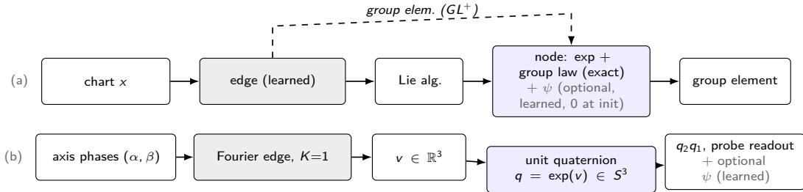

## Contributions.

• Known structure, imposed. The composition is a group law — an exact, non-commutative symmetry — placed in the node, with the edge spanning the step: composition is representable exactly when the edge carries the right coordinates for it (Proposition 1), and better edge features then improve results; placing an exact group law in a KAN node is, to our knowledge, new.

• Learning the unknown deviation. Where the deviation’s form is not known, a zero-initialized correction in the node learns it (trained in isolation) and doubles as a diagnostic probe: it deviates from zero only when the data demand it, and its shape localizes the deviation.

• One recipe, across the group laws. The same construction serves the compact SU(2) (rotations), the semidirect SE(3) (rigid motions) and the non-compact GL+(2, R) (positive-determinant 2×2 matrices); adapting it changes only the group’s chart, the edge’s target and the node’s operation.

• A measured map. The exact composer wins on composition-structured tasks with a small fraction of the parameters and saves data on a real arm at small training sets (1.5–2× lower error with 60–200× fewer parameters), while converging far faster than the matched MLP. It matches classical fits (least-squares or closed-form methods that hard-code the same law) without tuning on real sensors and robots, and the learned correction adds the deformed-law case where the hardware deviates. The full outcome map is Sections 5–6 and Table 6.

Headline results. On real arm calibration, an isolated 306-parameter correction to the law matches or overtakes the same-class Gauss–Newton fit at every training size (1.12 vs 1.29–1.33 mm for GN; exact node 1.37–1.40 mm at N ≥ 60) and transfers across three robot vendors and two protocols. On the remaining real probes (consumer IMUs, a gyroscope, three arms) the exact node matches the classical constant-fit reference without per-model tuning; where the imposed law is not the task’s, it loses. The full map is Section 5 and Table 6.

Where it is useful. The practical case is the one the applications meet: a task with a law-side deformation and scarce data. There the exact edge fixes the law, so the correction starts from the right model and learns only the deformation. On our arm task the two-slot correction reaches 1.51 mm at N=20 and 1.24 mm at N=40, against 2.39 and 2.03 mm for the matched MLP — 1.5–2× lower error with 60–200× fewer parameters — and our convergence check (Section 5.2) shows it reaching its plateau within a few hundred epochs, while the matched MLP needs 500–2000 and then overfits.

## 2 Related work

Rotation representations for learning. Continuous rotation heads — 6D (Gram–Schmidt; Zhou et al., 2019) and SVD-orthogonalized 9D (Levinson et al., 2020) — are the output standard and our strongest baselines; continuity fixes the codomain, not the algebra of composition, which such heads must still learn, and regression on manifold-valued regression is studied separately (Brégier, 2021).

Building known structure into the network. Equivariant architectures (Cohen & Welling, 2016; Thomas et al., 2018; Fuchs et al., 2020; Batzner et al., 2022; Deng et al., 2021) fix a symmetry (for a robotics survey see Seo et al., 2025); Lie-group reparameterizations (Falorsi et al., 2019) respect the manifold; Riemannian optimization (Absil et al., 2008; Boumal, 2023) and RPMG (Chen et al., 2022) fix the gradient side, and decompositions of non-compact, non-abelian groups into charts (Mironenco & Forré, 2024) supply the coordinate choices we use. The general principle — impose the known operator, learn the remainder — is known-operator learning (Maier et al., 2022). For composition, these methods never place the composition law itself as the node’s operation: each fixes a structure but learns the remainder wholesale, without separating the known form — which can be imposed exactly — from the part whose form is unknown. LawKAN takes this approach (Section 3). Equivariant models transport features under a global rotation rather than compose scalar phases, so we measure the standard readouts as opponents instead.

KANs and quaternion networks. KANs (Liu et al., 2024b) and MultKAN (Liu et al., 2024a) put learnable functions on edges with an additive (or scalar-multiplicative) node; EKAN (Hu et al., 2025), geometric (Alesiani et al., 2025) and permutation (Elbaz et al., 2025) KAN extensions add symmetries, and polynomial or wavelet edges replace splines (Sidharth et al., 2024; Bozorgasl & Chen, 2024), while range-aware Euler-angle regression (Sun et al., 2026) keeps the additive node where bounded joint ranges make the target near-additive the complementary case to composition, where the node must carry the law. Concretely, LawKAN inherits the KAN edge/node split — a fixed node plus learned edge coeficients — but the node composes by a non-commutative group law rather than adding, and the edge basis functions are fixed in advance; only the coeficients are learned. Our use of the KAN label stays modest: the node is the group’s law, not an activation (footnote 1); a controlled comparison likewise finds KANs ahead mainly on symbolic tasks (Yu et al., 2024). The additive node cannot serve here: composing non-commuting increments through a finite Baker–Campbell–Hausdorf expansion does not terminate, so a truncation leaves a positive floor for generic inputs (Appendix C.3), while the exact group law is a finite operation (the Hamilton product costs 28 scalar operations). Quaternion-valued networks (Parcollet et al., 2019; 2020; Zhang et al., 2020; Pavllo et al., 2020) put quaternion arithmetic in the weights, not composition as a primitive.

Learned calibration and inertial odometry. Learned gyroscope calibration and inertial odometry (Liu et al., 2022; Stolero & Klein, 2024; Zhang et al., 2025) are points on the accuracy–complexity curve; TinyGC-Net (Cui & Zhao, 2024) shrinks a calibrator to 27 parameters for MCU deployment; configuration-dependent kinematics (Lu et al., 2025) interpolates local PoE models with a Fourier correction over the configuration

— a configuration-indexed model, not a pair-level deformation of the law. Classical strapdown integration (Titterton & Weston, 2004) and product-of-exponentials calibration are the constant-edge limits of our recipe (Section 3).

Positioning. These lines build a known structure — a symmetry or a model class — into the architecture, while the composition stays fixed arithmetic. We build the composition law itself into the node (a noncommutative group law; to our knowledge the first KAN whose node carries one), and, because real hardware deviates from the law, we let a zero-initialized correction learn the part of the deviation whose form is unknown — imposed where the form is known, learned where it is not. The measured envelope (win/tie/lose) is in Section 5.

## 3 Method

Object of study. We study the case the paper’s premise is about: a composition, where elements of a group G are combined in a fixed order by ◦ (for SU(2), the Hamilton product) and the law itself is the structure we know and impose. This is the class of tasks — orientation, poses, calibration — in which embedding the known law in the node and learning only the remainder applies. The inputs are chart coordinates $x _ { 1 } , \ldots , x _ { n }$ in the domain U of a chart $\chi : U \to G ;$ the answer is $R = \chi ( x _ { n } ) \circ \cdot \cdot \cdot \circ \chi ( x _ { 1 } ) \in G .$ , read out through a fixed map $\pi \ ( \mathrm { f o r \ S U } ( 2 )$ , the direction of a rotated probe vector). The law ◦ is exactly the structure a generic learner must otherwise relearn. We develop the construction on three representatives chosen to exercise the design branches — compact vs non-compact, global vs non-global exponential, pure rotation vs mixed rotation–translation: the compact SU(2), the non-compact $G L ^ { + } ( 2 , \mathbb { R } )$ , and the mixed SE(3) (Section 4).

The recipe. Two pieces of structure are known in a composition task: the law of composition (the node) and the form of the increment (what the task tells us about its increments). Everything else is learned — the values (coeficients, always unknown) and the deviation (what the hardware adds, of unknown form). The recipe imposes the law exactly in the node, realizes the edge in that known form, and leaves the values and the deviation to learning. A generic network is the degenerate case in which nothing is imposed; a classical calibration estimator fixes the law to the exact kinematics and the increment’s form to a constant-screw. This paper walks the middle; LawKAN is the recipe’s instance when the known structure is a composition law placed in the node.

## 3.1 The outcome map

The outcome is not a claim we make but a reading of the data: whether it gives parity, a win, a loss, or no gain is fixed by whether the data obey the imposed law or deviate from it, and in what form. Two objects can difer from the truth: the edge, which produces the increment from the chart, and the law, which the node applies. Reading each of the data gives the outcome; the two criteria of Section 3.3 decide it before training. We measure the outcome against two reference points:

• the classical estimator — hard-codes the law and fits only its parameters. The recipe contains it, by the span criterion of Section 3.3: where the law holds and the edge spans the chart’s logarithm, the trained model is that estimator. Comparing with it is therefore a theorem, not an experiment.

• a generic network — given no law, it relearns the composition from scratch. The recipe is a constrained instance of it (the law is fixed), so the empirical question is what that structure buys against it.

With these yardsticks we read the two objects in turn, edge first — the edge is the primary learned object, and the correction is trained only after the edge is frozen (Section 3.4):

Edge (the increment).

• the increment’s form is right (the deviation lies in the estimator’s class) → parity: the model is the classical estimator, its coeficients learned from data (the fully known case is the ideal limit).

• an unknown increment form that falls inside the edge’s span → win: the form is richer than the estimator’s class.

• an increment form outside the span → loss: a floor no training removes (Proposition 1).

Law (the composition).

• no efect at the node (the law matches) → the edge reading stands.

• a deformation inside ψ’s span → win: the classical estimator cannot carry a product-level deformation (Corollary 2).

• a deformation outside ψ’s span → loss (the projection remains).

• the wrong law (a diferent group or rule) → loss.

Common to either object: if the deviation is not identifiable (it depends on an input not given) or is noise, the outcome is no gain — the signal is not in the data, and no structure recovers it (at most, add the missing input).

One further boundary lives not in the data but in the fit: even a win or a parity can be undone by an unregularized correction trained on a small, seed-unstable set. We report it as a boundary of the trained model, not of the data (Section 3.4).

## 3.2 The construction, on the SU(2) example

The construction is general — any group G with a chart whose analytic support can be written (the criterion below asks nothing more) — and we give it concretely on the compact SU(2), the running example, noting at each step what a diferent group changes (Section 3.5). For ${ \mathrm { S U } } ( 2 )$ two pieces are known: the law — the Hamilton product the node composes — and the form of the increment — a fixed-amount rotation about a unit axis, carried by the edge’s analytic support over the axis phases $( \alpha , \beta )$ . Transfer to the other groups is measured on synthetic composition tasks (Section 4) and, where the law is real, in the applications (Section 5). The whole layer is:

LawKAN-SU(2) layer (one composition). Input: axis phase pairs $( \alpha _ { i } , \beta _ { i } )$ , in a fixed order; chain length   
n. The increment is $\begin{array} { r } { \xi _ { i } = \frac { \theta _ { i } } { 2 } a ( \alpha _ { i } , \beta _ { i } ) } \end{array}$ — rotation amount $\theta _ { i }$ , unit axis $a ( \alpha _ { i } , \beta _ { i } )$ — and H matches SU(2)   
exactly.   
1. Features (fixed). $F _ { i } = \{ 1 , \cos \alpha _ { i } , \sin \alpha _ { i } \} \otimes \{ 1 , \cos \beta _ { i } , \sin \beta _ { i } \}$ (the tensor product of the two feature   
sets, 9 scalars per factor) — the known increment form.   
2. Edge (coeficients learned, form fixed). $\xi _ { i } \gets W _ { i } F _ { i } \in \mathfrak { s o } ( 3 )$ , yielding the rotation vector.   
3. Node (exact, no parameters). $q _ { i } \gets \exp ( \xi _ { i } ) \in S ^ { 3 } ; Q \gets q _ { n } \cdot \cdot \cdot q _ { 1 }$ , the Hamilton product.   
4. Readout (fixed). π(Q): the direction of $Q \hat { e } _ { z }$   
5. Optional correction (learned, zero at init). $Q  Q \exp ( \psi ( f ( A ) , f ( B ) ) )$ , on the physical   
composition (Section 3.4).   
Parameters: the n edge matrices $W _ { i } \in \mathbb { R } ^ { 3 \times 9 }$ (54 for $n { = } 2 )$ and, optionally, the ψ head; the node and readout   
carry none.   
Known-values limit: with the amounts $\{ \theta _ { i } \}$ and axes known exactly, every edge map is written down and   
nothing is learned — the layer is a transcription of the task.

With hand-set edge weights the machine reproduces the known rule exactly — the algorithm written down, not approximated; we state the lemma for ${ \mathrm { S U } } ( 2 )$ and do not claim validity for any other instance (it verifies the constructive direction of Proposition 1 at $K { = } 1$ ; the criterion itself is general, Section 3.5). The classical estimators of the applications — strapdown integration, nominal product-of-exponentials kinematics — are the zero-correction points of this layer: where nothing is unknown, the layer is the classical algorithm.

$$
{ \widehat { Q } } = Q
$$

$$
\{ \theta _ { i } \}
$$

$$
( \alpha _ { i } , \beta _ { i } )
$$

$$
\pi ( \widehat { Q } ) = \pi ( Q ) , f o r
$$

Proof sketch. At K=1 the features {1, cos α, sin α} ⊗ {1, cos β, sin β} contain the three axis components as   
single features $( a _ { x } =$ cos α sin $\beta , a _ { y } =$ sin α sin $\beta , a _ { z } = \cos \beta )$ ; weights $\theta _ { i } / 2$ on those, zero elsewhere, give   
$\begin{array} { r } { \xi _ { i } = ( \theta _ { i } / 2 ) a ( \alpha _ { i } , \beta _ { i } ) ; \exp ( \xi _ { i } ) = ( \cos \frac { \theta _ { i } } { 2 } , a ( \alpha _ { i } , \beta _ { i } ) \sin \frac { \theta _ { i } } { 2 } ) | } \end{array}$ is the exact per-factor rotation; the node composes   
by the Hamilton product. Full proof: Appendix C. □

The layer is fixed by $( G , \chi , K , n )$ and carries no width to tune: the only tensors are the edge matrices $W _ { i }$ (and, optionally, the ψ head); the node and readout carry none.

## 3.3 The two criteria

If the layer is exact, what is there to learn? Two things: the increment’s values (the edge coeficients) and the deviation — the departure of the data from the known, at the increment or at the law. Two criteria decide the outcome before training, and we use both throughout the paper: the span criterion (Proposition 1) for the increment, and the law-match criterion (Corollary 2) for the law. Both are proved in Appendix C.1.

(i) The increment’s values (coeficients). The law and the increment’s form are right; the numbers are not — a rotation amount, a joint’s miscalibration, a sensor’s increment map. The learned object is the edge’s coeficient vector W, over the known increment form. Whether the edge can carry the unknown exactly and what floor remains if it cannot — is decided before training by the span criterion:

Criterion 1 (span). With a linear edge and the exact node, the architecture represents the composition exactly if the row space of F contains a branch of log χ (one consistent choice of the multi-valued logarithm), up to the antipodal symmetry of the double cover — where q and −q give the same rotation (Remark 6); if a needed component is absent, a positive error floor independent of training remains.

The criterion cuts both ways: a form too poor leaves the floor above, and an over-complete form is not harmless either — features beyond log χ are spare capacity that fits noise — so the minimal suficient form is preferred (pruning to the analytic edge beats the dense one). The constructive direction places log χ in the edge weights and the converse is in Appendix C.1; in words, the node is never the bottleneck when its law is the task’s — the chart and the feature set are.3

(ii) The deviation: of the increment or of the law. The data may depart from the known — at the increment (a form the edge does not carry, absorbed by a richer edge form; Proposition 1) or at the law (a product-level change the edge cannot cancel). By the law-match criterion, the correction ψ absorbs the law side exactly when the deformation lies in ψ’s span:

Criterion 2 (law-match). With the edge as the only learner $( \psi \equiv 0 )$ , a node law difering from the chart’s on a reachable pair cannot be represented exactly. If the true law is written as $A \star B = ( A B ) \exp ( \eta ( A , B ) )$ the edge-only floor is, to first order, ∥η∥, independent of training; ψ removes it exactly when η lies in ψ’s feature span, leaving its projection otherwise (Appendix G).

The two results bound the design space: the edge must carry the right coordinates, the node the right law.   
What is learned is always a deviation from the known, never the composition itself (Section E.3).

## 3.4 The law correction ψ

We stay in the SU(2) construction of Section 3.2 and now let the law deviate too. When the data depart from the Hamilton product, we keep it exact and add a small learned law correction,

$$
R ( A , B ) = ( A B ) \exp \bigl ( \psi ( f ( A ) , f ( B ) ) \bigr ) ,\tag{1}
$$

with $A , B \in S ^ { 3 }$ (juxtaposition the Hamilton product), f the pair features of the two factors, and ψ a small head whose output lies in so(3), so R is again a unit quaternion. The correction is right-multiplied onto the physical composition: a joint or a step. It is not applied at every intermediate product along a long chain, where it would compound. Every head’s last layer is zero, so the relaxed model is the exact model at initialization. This is exactly the law-match criterion (Section 3.3): a product-level deformation η is removed when it lies in ψ’s feature span, and its projection left otherwise. The parameterization makes no additivity assumption — any perturbation of the Hamilton product is again a unit quaternion, right-multiplied as exp(η).

What is known is imposed here too. When the form of the law’s deformation is known — a gravity-torque term, the sign of a backlash, a fixed per-joint ofset — it goes into an analytic ψ with only its coeficients fitted (the known-deformation probes, Appendix G).

The learned heads are for the case where the law’s deformation has no known form. A learned head maps the pair features $f = f ( A , B )$ into the algebra and, in general, combines two parts — a global and a local one — as their superposition $\psi = \psi _ { \mathrm { g } } + \psi _ { \mathrm { k } }$ (the two corrections add in the algebra), so no per-task choice is needed in the common case:

• a global readout — a smooth linear map $\psi _ { \mathrm { g } } ( f ) = W f$ with weights W (a small MLP decoupled from the arm’s physical links), which extrapolates a smooth deformation such as thermal drift or compliance;

• a local kernel — an expansion ψ $\begin{array} { r } { { \bf \Phi } _ { : } ( f ) = \sum _ { k } c _ { k } \exp ( - \| f - f _ { k } \| ^ { 2 } / 2 \sigma _ { k } ^ { 2 } ) } \end{array}$ over data centers $f _ { k }$ , with learned coeficients $c _ { k }$ and widths $\sigma _ { k }$ (the locality scale of each center); it is large where the data speak and decays of them, matching localized mechanisms such as backlash or friction, and conservative of the data.

A single head wins only in the boundary regimes measured later: the kernel on a seed-unstable set (Section 5.3);   
the global where the deformation is smooth (Section 5.4). The scopes are collected in Appendix G (Table 25).

The experiments force two caveats. First, zero initialization is only a starting point. Training can move ψ away from the exact law, and an unregularized head can raise the held-out error (the two-slot on Kinova, Section 5.3). Conservatism is a property of the map of the data, not a guarantee for the trained model. Second, the correction doubles as a probe. Under isolation — freeze the exact edge and train ψ alone a nonzero correction is a candidate signal against the law and localizes it. Joint training, by contrast, is non-identifiable: the edge absorbs part of the correction and drifts into a compensated solution that does not transfer. Isolation removes the drift (Appendix G).

## 3.4.1 What “the data obey the law” means

The phrase is shorthand for a property of the classical estimator’s residual — the estimator being the constant-edge limit of our layer with $\psi \equiv 0$ . Fit it and examine what it leaves. Three cases: (i) the residual is at the noise floor — the data obey the law; the exact node is already the estimator, and no correction has a signal to find (Section 5.5). (ii) The residual is structured but lies inside the estimator’s class — a form gap on the edge side, to be closed by a richer edge, not by a law correction (Section 5.3, the socket FR3 unit). (iii) The residual is structured and pair-dependent — a deformation of the law, the case of this section. The two criteria of Section 3.3 decide which case a dataset is before any training.

Physically, a law-side deformation makes the composition of two configurations difer from the group’s product. Three physical candidates were probed. Gravity load is ruled out as the dominant term on the FR3: a physics-shaped correction is at parity with the exact model and worse than the agnostic ψ at $N \geq 6 0$ (X19). Backlash appears in a synthetic probe with matched approaches: the sign of the last joint motion predicts the residual direction (alignment 1.000), and a constrained correction in isolation removes 98% of the hysteresis floor (X20); on the real arm the signature does not rise above the 0.44 mm residuals, so that verdict stays inconclusive (X21). The smooth-drift regime is represented by the range-only data, where a global head sufices (Section 5.4); a thermal origin is a hypothesis read of the head comparison, not a verified mechanism. None of these forms can be assumed a priori on a new platform, which is why the default correction is learned.

The correction doubles as the detector. Train ψ in isolation on the frozen exact edge: at $\psi = 0$ the model is the exact-law model, so a nonzero correction is a candidate signal of a law-side deformation, and its input dependence is diagnostic — zeroing a channel group of the pair features degrades the held-out error on both sides (X16; quantified in Section 5.1). On synthetic exact-law data the isolated correction gives no held-out gain and overfits at small N (S1): the verdict is read at held-out error, not from the norm of ψ.

## 3.5 Generalization to three group laws

The construction above is the SU(2) instance. The recipe itself is general, so we now separate what carries over to any group law from what has to be re-chosen for each.

The theory is general: the span criterion and its converse (the chart-spanning argument, Appendix D.4) hold for any group G and chart satisfying hypotheses (i)–(iv) of Appendix C.1. The criterion that gates the edge therefore works before training for any law a task supplies.

The law must be associative, not merely invertible. Associativity is what makes the fixed-order product welldefined, and the tasks’ laws are groups, whose inverses power the converse of the span criterion (Appendix D.4). We therefore do not use a non-associative algebra such as the octonions O. The recipe needs only an associative law and a chart whose analytic support can be written; the group case adds the inverses that power the converse of the span criterion. Laws beyond groups — monoid and semigroup products, such as strings or typed chains — therefore carry over unchanged, and we leave their study to future work (Section 7).

What is group-generic is the recipe’s core: the node executes the law, the edges carry the increments, the span criterion gates the edge, and the zero-initialized correction handles deviations. Exactly three things are group-specific — the chart, the edge target, and the node realization — and the three representatives we test exercise the design-relevant branches:

${ \mathrm { S U } } ( 2 )$ — compact, global exponential, periodic chart. Chart: axis phases $( \alpha , \beta )$ ; edge: $F _ { i } =$ {1, cos α, sin α} $\otimes \{ 1 , \cos \beta , \sin \beta \}  { \mathfrak { s o } } ( 3 )$ ; node: the Hamilton product.

$G L ^ { + } ( 2 , \mathbb { R } )$ — non-compact, no global exponential. Chart: Iwasawa $( \theta , s _ { 1 } , s _ { 2 } , t )$ ; edge: the six analytic features → the group element itself; node: the matrix product.

$\operatorname { S E } ( 3 )$ — mixed, surjective exponential, semi-direct product. Chart: axis, angle, translation p; edge: $\{ a , p , a \times p , a ( a { \cdot } p ) \}  { \mathfrak { s e } } ( 3 )$ ; node: exp then the rigid-motion product.

For each branch the constructive direction is realized with written weights over the chart’s analytic features: Lemma 1 for SU(2), and the constructed weights of Appendix C.2 for $G L ^ { + } ( 2 , \mathbb { R } )$ (residual $1 . 1 \times 1 0 ^ { - 7 } )$ and $\mathrm { S E ( 3 ) ~ ( 1 . 6 \times 1 0 ^ { - 7 } ) }$ . All three instances are constructively exact, the two non-compact ones up to floating-point residual.

## 3.6 Model summary

The model has two parts. The node is the composition operator: the exact node applies the known group law, and a relaxed node adds the learned correction ψ. The edge is the learned feature map into the node’s target (the algebra when the exponential is global, the group element itself otherwise; Section 3.5), and its type follows the task. We write a model as LawKAN-⟨group⟩, edge: ⟨edge⟩, node: ⟨node⟩ (e.g. LawKAN-SU(2), edge: Fourier (K=1), node: exact), where the group names the instance (the law and chart), not the architecture. Tables 10 and 11 (Appendix B) list the edge types and the node variants studied here.

## 4 Synthetic tasks: transfer, exactness, and limits

The synthetic program has two parts. One composition task per group asks whether the construction transfers (the exact node, diferent charts and edges); the home case then asks what each part contributes — the exact node’s representability, the relaxed node’s correction under a deviating law — and where the advantage ends. Existence is settled in Section 3; what follows measures the trained edges and the necessity side (blind ablations, floors). Each subsection states the result and delegates the construction, the mechanism and the per-seed tables to the appendices.

## 4.1 Across groups

One composition task per group tests that the recipe transfers; Section 3.5 lists the per-group construction. SU(2) is the home case — exact already at K=1 (Lemma 1) and the one the sensor tasks use — developed in Section 4.2.

On the non-compact $G L ^ { + } ( 2 , \mathbb { R } )$ , where the exponential is not global, the constructed weights are exact to $1 . 1 \times 1 0 ^ { - 7 }$ (Appendix C.2) and the trained edge reaches 0.0024 relative Frobenius, beating a 4996-parameter MLP (0.53); a generic edge over raw coordinates plateaus (0.82): the limit is the chart and the feature span, not the node. On the mixed SE(3) (surjective exponential) the constructed weights are exact to $1 . 6 \times 1 0 ^ { - 7 }$ and the trained edge reaches $4 . 8 \times 1 0 ^ { - 4 }$ , orders below a dense linear edge (0.39) and the strongest MLP (0.33, $h { = } 6 4 ;$ ; paired $\scriptstyle { p = 3 \mathrm { e } - 8 } )$ ; a blind feature-group test on held-out seeds confirms that both nonlinear feature groups are necessary and that the floor scales linearly in the translation noise. Table 1 summarizes the three, and Figure A1 the transfer.

The cross-group evidence is bounded: one synthetic composition task per group with task-specific metrics, so error magnitudes are not directly comparable across diferent structures — a characterization rather than a strict taxonomy; the general statement is the criterion, and the transfer of the construction is what the

Table 1: The three instances: one exact node, diferent charts and learned edges $( G L ^ { + } ( 2 , \mathbb { R } )$ : the edge emits the group element directly, since the exponential is not global). Errors: SU(2) exact; $G L ^ { + } ( 2 , \mathbb { R } )$ relative Frobenius; SE(3) per-coordinate probe. Details in Section D.4.
<table><tr><td>Instance</td><td>Chart (input coords)</td><td>Learned edge → exact node</td><td>Result</td></tr><tr><td>LawKAN-SU(2)</td><td>axis phases  $( \alpha , \beta )$ </td><td>Fourier features → so(3), exp + Hamilton</td><td>exact (Lemma 1)</td></tr><tr><td>LawKAN  $\mathrm { . G L ^ { + } }$ </td><td>Iwasawa  $( \theta , s _ { 1 } , s _ { 2 } , t )$ </td><td>6 product features (group elem.), matrix product</td><td>0.0024 (dense 0.82)</td></tr><tr><td>LawKAN-SE(3)</td><td>axis, angle, translation p</td><td> $\{ a , \ p , \ a \times p , \ a ( a \cdot p ) \} \to { \mathfrak { s e } } ( 3 ) , \exp { + }$  rigid product</td><td> $4 . 8 \mathrm { e } { - 4 } ~ ( \mathrm { M L P ~ 0 . 3 3 ) }$ </td></tr></table>

Figure 2: Opponent matrix as a Pareto front (log–log): geodesic error vs parameter count (E1; hollow markers: the same opponents at their best learning rate, E38); rotation amounts fixed, not fed as input. LawKAN-SU(2) (54 params) leads the front with a single point — its count is fixed by the construction (no width knob); the node/edge capacity curves are Figure A2.  
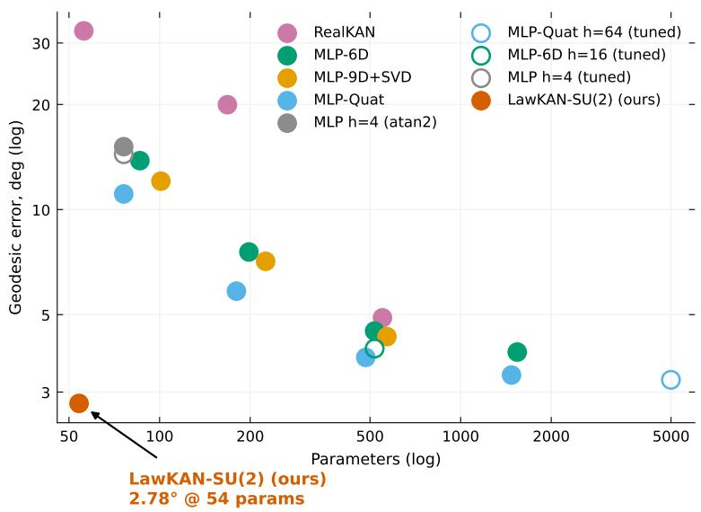  
three branches test. Further laws $( { \mathrm { S U } } ( N )$ , symplectic, sim(3), nilpotent, Lorentz, afine) are future work (Section 7).

## 4.2 The compact case in depth

We study one case, LawKAN-SU(2) on rotations, in depth: it is the home case — the compact instance, and the one the sensor tasks use (Section 5.5) — and it admits a measured Bayes floor, which makes every efect attributable. The construction is in Appendix H, mechanism details in Appendix I, and per-seed and expanded tables in Appendix D.

## 4.2.1 The benchmark and the opponent matrix

The benchmark composes two of these rotations, with fixed amounts (0.7 and 1.1 rad, not fed as input) about random axes, and the network predicts the probe direction from the noisy axes. Training follows the shared protocol of Appendix A; the standard rotation heads (6D, SVD-9D, normalized quaternion) share a cos/sin-featured MLP backbone, so only the head difers.

LawKAN-SU(2) is the most accurate model, with 27× fewer parameters than the strongest baseline in the fixed matrix (92× fewer than the strongest tuned baseline), and it comes within $0 . 0 5 ^ { \circ }$ of the measured Monte-Carlo Bayes floor — the error of the best possible predictor under this input noise $( + 0 . 0 5 ^ { \circ } ;$ ; strongest fixed-matrix baseline $+ 0 . 6 3 ^ { \circ }$ , strongest tuned baseline $+ 0 . 5 2 ^ { \circ } )$ . The learned edge matches the exact construction it embeds rather than beating it: the exact composition under the analytic features is its optimization instance, and the floor is its noise-limited value. The unstructured architectures must learn the composition and lag behind. Neither a Lie-algebra baseline, nor baseline tuning, nor training on the reported metric closes the gap, and the edge is roughly 32× more sample-eficient than the fixed-protocol 6D baseline (Figure A3); against the strongest tuned baseline the factor is about ${ \mathrm { 7 } } \times { \mathrm { ~ ( E 3 9 ) } }$ . Tuning strengthens these baselines without changing the ordering: the best cell of the registered grid (E32; MLP-Quat $h { = } 6 4 ,$ lr $3 \cdot 1 0 ^ { - 3 } )$ reaches $3 . 2 5 \pm 0 . 0 2 ^ { \circ }$ at 4996 parameters, and the 6D head reaches $4 . 0 0 \pm 0 . 5 4 ^ { \circ }$ at lr $1 0 ^ { - 2 } \ ( \mathrm { E 9 / E 3 8 } )$ both remain above the floor, and LawKAN’s own sweep (E38) confirms $1 0 ^ { - 2 }$ as its best rate (2.78 vs 2.82 at $3 \cdot 1 0 ^ { - 3 } )$ . Figure 2 shows the benchmark (E14) as a Pareto front; the full 18-configuration matrix and the protocol argument are in Appendix E (Table 14). The edge-side capacity variants are in Figure A2.

Table 2: Opponent matrix: geodesic error (deg), mean $\pm \ \mathrm { s t d } .$ , input/output noise $\sigma { = } 0 . 0 3$ (h: hidden width); the rotation amounts are fixed, not fed as input. The full 21-row table is Table 14 (Appendix E); the lower block gives the same opponents at their best learning rate (E38).
<table><tr><td>Model</td><td>Params</td><td>Error (deg)</td></tr><tr><td>LawKAN-SU(2), edge: Fourier (K=1), node: exact</td><td>54</td><td> ${ \bf 2 . 7 8 \pm 0 . 0 2 }$  (5 seeds)</td></tr><tr><td>Opponents</td><td></td><td></td></tr><tr><td>MLP + quaternion head  $h { = } 3 2$ </td><td>1476</td><td> $3 . 3 6 \pm 0 . 0 6 ~ ( 5 ~ \mathrm { s e e d s } )$ </td></tr><tr><td>MLP + quaternion head h=32 + RPMG (Chen et al., 2022)</td><td>1476</td><td> $3 . 4 2 \pm 0 . 1 5 ~ ( 5 ~ \mathrm { s e e d s } )$ </td></tr><tr><td> $\mathrm { M L P } + \mathrm { 6 D } \ h { = } 3 2 \ ( \mathrm { Z h o u \ e t \ a l . , 2 0 1 9 } )$ </td><td>1542</td><td> $3 . 9 1 \pm 0 . 1 1$ </td></tr><tr><td> $\mathrm { M L P } + 9 \mathrm { D - S V D } h mathrm { = 1 6 ~ ( L e v i n s o n ~ e t ~ a l . , ~ 2 0 2 0 ) }$ </td><td>569</td><td> $4 . 3 2 \pm 0 . 4 6$ </td></tr><tr><td> ${ \mathrm { R e a l K A N } } + 6 { \mathrm { D ~ h e a d ~ } } h { = } 1 6$ </td><td>550</td><td> $4 . 9 0 \pm 0 . 2 6$ </td></tr><tr><td>MLP h=4 (atan2 head)</td><td>76</td><td> $1 5 . 1 4 \pm 1 . 4 4$  (5 seeds)</td></tr><tr><td>Tuned learning rate (E38):</td><td></td><td></td></tr><tr><td> $\mathrm { M L P } + $  quaternion head h=64, tuned</td><td>4996</td><td> $3 . 2 5 \pm 0 . 0 2$  (5 seeds)</td></tr><tr><td> $\mathrm { M L P } + 6 \mathrm { D } \ h { = } 1 6$  tuned (Zhou et al., 2019)</td><td>518</td><td> $4 . 0 0 \pm 0 . 5 4$  (5 seeds)</td></tr><tr><td>MLP h=4 (atan2), tuned</td><td>76</td><td> $1 4 . 4 1 \pm 1 . 0 5$  (5 seeds)</td></tr></table>

## 4.2.2 Node versus edge: the mechanism

Which features, not how many. On the benchmark of Section 4.2.1, the K=1 construction leaves only the edge’s feature set to choose. Pruning the 54-parameter dense edge to the three analytic features (18 parameters) is more accurate, while a random equal-size mask is far worse $( 3 2 . 9 ^ { \circ } )$ : the identity of the features, not their number, and automatic magnitude pruning does not recover it. The exp-map node also avoids the singular $q / \lVert q \rVert$ regimes (Appendices H, I). When the rotation amount is supplied as an input, the same edge stays at the floor for variable angles (0.14–0.35◦; Table 28) where the fixed-angle edge leaves a $2 4 { - } 3 5 ^ { \circ }$ floor.

Pre-registered isolation separates the two ingredients under the same node. The spanning edges (Fourier, MLP $h { \geq } 8 )$ reach the best rows of Table 17 (Appendix E.2); both no-node controls remain above them; and every matched edge below 278 parameters fails. The span criterion (Section 3.3) is tested by the two linear-side rows — the 30-parameter linear edge fails and the 18-parameter analytic edge spans — while the 278-parameter MLP threshold is a capacity observation, not a span test. The node is necessary but not suficient, and the analytic edge is the cheapest spanning point. The full-SO(3) readout keeps the ordering (Table 13); details and element ablations are in Appendix E.2. This is the exact node’s contribution — the representability side. Where the law itself deviates, the relaxed node is what wins, and Section 4.2.4 measures that case.

## 4.2.3 Boundaries: where the advantage ends

All stress tests use the dense edge; the boundaries:

• noise: linear degradation, dominant over the curve; the Fourier edge and the group law are global out of band (Figure A4);

• depth: the advantage widens along chains up to n=8, where every architecture leaves the regime (n=6 seed-bimodal; Appendix D);

• hidden angles: the margin narrows to the Bayes floor — structure–task alignment, not a universal parameterization win (Table 6).

Mismatch: the null task. Where the imposed law is not the task’s, the node loses: the Hamilton node reaches $2 3 . 8 7 \pm 0 . 4 1 ^ { \circ }$ against $1 2 . 6 4 \pm 3 . 0 0 ^ { \circ }$ for an MLP (h=4). This is our violation of the recipe’s own premise, not an unknown structure (E7; Appendix G).

## 4.2.4 The deformed law

On synthetic data generated by an exact serial-chain law the isolated correction gives no held-out gain and overfits at small N (S1). On data deformed by a known pair-dependent function it recovers the noise floor (1.40 vs 11.5 mm at N=160), while the exact model stays at its floor (S1; Figure A9(a), Appendix G).

## 5 Applications

The two criteria of Section 3.3 predict three outcomes, and we test each on real data with known ground truth: where a same-class classical estimator exists and the law holds, the model is that estimator (parity, with data eficiency); where the hardware deviates from the law and the deviation falls in the correction’s span, the correction wins; and where the imposed structure is not the task’s, it loses. A group-law subcomputation cannot be read of an end-to-end system, so we evaluate the recipe in isolated subcomputations whose ground truth is known.

Across the applications our models use the same optimizer (Adam with a cosine schedule) and the task’s own objective. Where a matched comparison is possible we fit the reference with the same optimizer and loss (row 3 vs row 6 of Table 3; the socket reference), so those comparisons isolate the architecture, not the optimizer; we also report the classical optimum on its own solver (GN), so optimizer and loss efects can be told apart from structure. Our models use the recipe’s constant learning rate, without a per-seed tune; the learned opponents are given their best configuration from the registered four-configuration grid (X22)

— a deliberately conservative asymmetry for our side. Unless stated otherwise, p-values are per-comparison (two-sided paired t-test over shared seeds; Appendix A.4); where a family of tests is reported, the correction is stated (Benjamini–Hochberg for the socket table), and the remaining cells are exploratory.

## 5.1 The deformed arm: the correction as remedy and probe

Why this task. The test needs a real device whose kinematics deviate from the ideal, with ground-truth poses at several data sizes — which separates a data-scarcity win from an asymptotic one. Our test bed is the Franka Research 3 (FR3) robot, evaluated on 114 real poses (Nadeau, 2024) (joint encoders plus camera-recovered flange poses). Performance is scored by held-out end-point position error at $N { = } 2 0 / 4 0 / 6 0 / 8 0$ The classical bar and the learned opponent are the two poles of Section 5. Section 3.4.1 makes “obey the law” operational: it is a property of the classical estimator’s residual, not an assumption about the hardware.

Design: why these choices. The classical pole is the product-of-exponentials least-squares fit (PoE) and its Gauss–Newton optimum (GN, the classical estimator). The learned opponent is a residual MLP, tuned to 18k–69k parameters (59–225× the two-slot model’s 306). What is known about the task then fixes the recipe:

• The form of the mismatch. We impose the known per-joint form — the classical estimator’s corrected per-joint screw — on the edge; whatever the hardware adds beyond it is left to ψ.

• What is not known. The mismatch’s form is unknown — any pair-dependent deformation — so we learn it with a small two-slot ψ (a global linear trend with a size-dependent weight-decay dose, plus a local RBF kernel; 306 parameters) on the frozen exact edge, trained in isolation; the two-slot is the default because no single head dominates across settings (Section 3.4).

Experiments. The headline: on the FR3 arm the isolated two-slot correction is below both the exact node and the classical GN optimum at every N (1.51 vs 1.56 mm at N=20; 1.12 vs 1.29–1.33 mm for GN at N≥60; the exact node is 1.37–1.40 mm). A paired seed bootstrap (10,000 resamples) of row 7 minus row 1 gives −0.05 [−0.18, +0.07] at N=20 and $- 0 . 1 5 \left[ - 0 . 2 5 , - 0 . 0 8 \right] , \ - 0 . 1 4 \left[ - 0 . 2 4 , - 0 . 0 6 \right] , \ - 0 . 2 1 \left[ - 0 . 2 6 , - 0 . 1 6 \right]$ at $N { = } 4 0 / 6 0 / 8 0$

The controls below show that this is a law correction, not capacity and not an edge efect.

• Does the learned edge with the rigid law reproduce the classical estimator? By the span criterion the exact node is the classical estimator of its class, and on real data its outputs match the reference per-joint screw to machine precision $\left( \leq 1 0 ^ { - 1 1 } \right)$ at every N (Table 3, rows 3 and 6); the gap to the strongest optimum (row 1) is optimizer and loss, not class. The next question is whether an isolated ψ adds beyond this.

• Is there an extra deformation the law does not carry? The law-match criterion (Section 3.3) says an isolated ψ can win only if the data carry a product-level deformation inside ψ’s span — one the per-joint class cannot express. On the FR3 arm it wins: the two-slot correction (Table 3, row 7) is below the exact node (row 6) at every N (significantly for N≥40: paired $p = 0 . 0 2 8 / 0 . 0 0 7 / 0 . 0 0 3$ at $N { = } 4 0 / 6 0 / 8 0 ; N { = } 2 0 p = 0 . 8 4 )$ ) and below the classical GN optimum (row 1) as well (1.51 vs 1.56 mm at N=20, within noise; 1.12 vs 1.29–1.33 mm for GN at N≥60, exact node 1.37–1.40). The FR3 arm’s deviation therefore has a component outside the per-joint class: the correction removes a floor the per-joint edge cannot. It beats the exact node under the same Adam optimizer, which we do not tune per task, and it also beats the best GN fit, where the optimizer is tuned.

• Is the gain just capacity? A strong learned opponent — the validation-selected residual MLP (Table 3, row 4) — is at parity with the exact node (row 6) for N≥60, and even its test-oracle best (row 5) stays above the two-slot model (row 7). Extra parameters do not help, so the gain is not capacity.

• Is the deformation real, and where does it sit? The correction is pair-dependent: both sides of the pair carry weight — setting either side’s angle or translation channels to zero raises the error from 1.30 to 3.75–4.71 mm (X16, Fourier head; Figure 3a); the final two-slot head reproduces the qualitative split (1.25 to 3.35–4.38 mm; X16b). With the per-joint edge fixed, only 12% of its efect field can be absorbed by the edge (88% orthogonal; G3, and the final two-slot head reproduces 88%; G3b), and training the edge jointly (Table 3, row 8) stays within 0.07 mm of isolation (row 7) — a law-level correction rather than compensation of this edge (a richer edge could absorb more; that control is not run here). A node-only learned law (Fourier ψ, no per-joint edge; row 9) overfits at small N, so the learned per-joint edge matters.

Table 3: Real-robot calibration (FR3 arm): end-point position error (mm; mean±std over 5 seeds, each a random split). Nominal $1 0 . 6 5 \pm 1 . 9 0 \mathrm { { m m } ; }$ the base-only fit saturates near 4.4 mm. Superscripts give each row’s optimizer and loss (the matched pair shares them, rows 3 and 6): A Adam + bounded $2 ( 1 - \cos )$ pose loss; G GN on the position residual (strongest); P PoE least squares (weaker). The note marks the independent-implementation sanity check (agrees with the exact node to machine precision, X42), the isolated versus joint (control) correction, and the analytic-edge ablation; the oracle row picks the best configuration on the test set itself (it uses test information, so its error is an optimistic best-case bound, not a deployable model), reported for N≥60. The opponent’s width and learning rate are selected per seed on validation data; the 18k–69k range is that per-seed selection, so the capacity comparison is against the best per-seed opponent.
<table><tr><td># kind</td><td>model</td><td>params note</td><td></td><td> $N { = } 2 0$ </td><td> $N { = } 4 0$ </td><td> $N { = } 6 0$ </td><td> $N { = } 8 0$ </td></tr><tr><td></td><td>1 reference</td><td> $\mathrm { p e r - j o i n t \ s c r e w ^ { G } }$ </td><td>54 strongest</td><td></td><td> $1 . 5 6 \pm 0 . 1 4 1 . 3 9 \pm 0 . 1 0 1 . 2 9 \pm 0 . 1 0 1 . 3 3 \pm 0 . 0 9$ </td><td></td><td></td></tr><tr><td></td><td>2 reference</td><td> $\mathrm { P o E ^ { P } }$ </td><td>34 weaker class</td><td></td><td> $1 . 7 2 \pm 0 . 2 2 \ 1 . 5 8 \pm 0 . 1 4 \ 1 . 4 7 \pm 0 . 0 8 \ 1 . 5 2 \pm 0 . 0 7$ </td><td></td><td></td></tr><tr><td></td><td>3 reference per-joint</td><td> $\mathrm { s c r e w ^ { A } }$ </td><td>54 sanity check</td><td></td><td> $1 . 5 3 \pm 0 . 1 8 1 . 4 9 \pm 0 . 1 1 1 . 3 7 \pm 0 . 0 8 1 . 4 0 \pm 0 . 0 6$ </td><td></td><td></td></tr><tr><td></td><td>4 opponent residual</td><td> $\mathrm { M L P ^ { A } }$ </td><td>18k-69k selected</td><td></td><td> $2 . 3 9 \pm 0 . 4 0 \ 2 . 0 3 \pm 0 . 4 6 1 . 3 5 \pm 0 . 2 6 1 . 3 3 \pm 0 . 4 2$ </td><td></td><td></td></tr><tr><td></td><td>5 opponent residual</td><td> $\mathrm { M L P ,  o r a c l e ^ { A } }$ </td><td>18k-69k optimistic</td><td></td><td></td><td>— 1.27 ± 0.25</td><td> $1 . 2 6 \pm 0 . 3 7$ </td></tr><tr><td></td><td>6 LawKAN exact</td><td> $\mathrm { n o d e ^ { A } }$ </td><td>54—</td><td></td><td> $1 . 5 3 \pm 0 . 1 8 1 . 4 9 \pm 0 . 1 1 1 . 3 7 \pm 0 . 0 8 1 . 4 0 \pm 0 . 0 6$ </td><td></td><td></td></tr><tr><td></td><td>7 LawKAN</td><td> $\scriptstyle \mathrm { { t w o - s l o t } ^ { A } }$ </td><td>306 isolated</td><td></td><td> $1 . 5 1 \pm 0 . 2 4 1 . 2 4 \pm 0 . 0 8 1 . 1 4 \pm 0 . 0 7 1 . 1 2 \pm 0 . 1 1$ </td><td></td><td></td></tr><tr><td></td><td>8 LawKAN</td><td> $\scriptstyle \mathrm { { t w o - s l o t } ^ { A } }$ </td><td>306 joint (control)</td><td></td><td></td><td></td><td> $1 . 5 2 \pm 0 . 3 1 1 . 1 9 \pm 0 . 0 4 1 . 0 8 \pm 0 . 0 6 1 . 0 9 \pm 0 . 1 7$ </td></tr><tr><td></td><td></td><td>9 LawKAN node-only ψ (Fourier)</td><td>198 no per-joint edge</td><td></td><td></td><td></td><td> $2 . 5 5 \pm 0 . 7 0 1 . 5 3 \pm 0 . 1 6 1 . 2 0 \pm 0 . 0 9 1 . 1 8 \pm 0 . 1 4$ </td></tr></table>

## 5.2 Convergence check: the model, not the budget

The question. On the FR3 arm calibration task the learned opponent — the residual MLP, trained under the same optimizer, loss and splits — trails LawKAN-SE(3), node: relaxed (two-slot) (Table 3, rows 4 and 7). Is that a limit of the $\mathrm { M L P ^ { \prime } s }$ model class, or is it undertrained? A checkpoint grid answers this directly.

Figure 4: Convergence check (X46 A1) on the FR3 arm calibration task of Table 3 (not the FR3 unit of the socket protocol, Table 4): held-out error vs training epochs (checkpoint grid 10–4000, 5 seeds) for LawKAN-SE(3), node: relaxed (two-slot), and the $\mathrm { M L P }$ opponent at $N { = } 2 0 / 6 0 / 8 0$ . LawKAN reaches its plateau by 250–1000 epochs; the $\mathrm { M L P }$ is best at 500–2000 and degrades after. The grid was run on this task only. The MLP opponent runs at its per-seed selected width and learning rate $( h \in \{ 1 2 8 , 2 5 6 \}$ , 18k–69k parameters, $1 0 ^ { - 3 } \ \mathrm { o r \ 1 0 ^ { - 2 } }$ , Table 3); the two-slot at $\bar { 5 } \cdot 1 0 ^ { - 3 }$ , so the early transient is the optimizer, not the model.

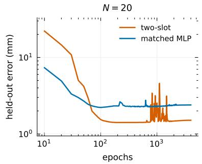

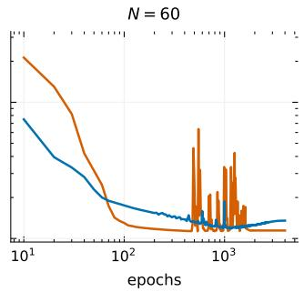

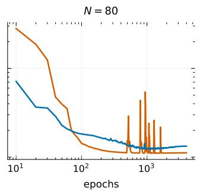

What the grid shows.

• LawKAN plateaus early. It reaches its held-out error by 250–1000 epochs and does not improve afterwards; extended 8000-epoch runs are not better.

• The MLP opponent peaks and then degrades. It is best at 500–2000 epochs and rises afterwards: at $N { = } 8 0$ , 1.24 mm at 1000 vs 1.33 mm at 4000; at $N { = } 6 0$ , 1.25 mm at 2000 vs 1.35 mm at 4000. More training makes it worse, not better.

• On this task, the gap is the model. Both models are past their own optimum, so the diference comes from the parameterisation, not from the training budget.

Figure 3: (a) The correction wins: held-out error against N for the exact node, the classical GN optimum, the isolated two-slot correction, and the residual MLP; the two-slot is lowest at every N. (b) The measured head comparison on the FR3 arm: the global (Fourier) head overfits at $N { = } 2 0 ;$ the two-slot head is best in the data-starved regime, and at large N the global and two-slot heads coincide within noise — no single head dominates. (c) On the FR3 arm, which inputs carry the learned correction (X16, Fourier head; the two-slot head gives the same qualitative split, X16b): held-out error with one input channel group zeroed — both sides of the pair matter; the inset plots the correction norm ∥ψ∥ against the B-side rotation angle $\theta _ { B }$

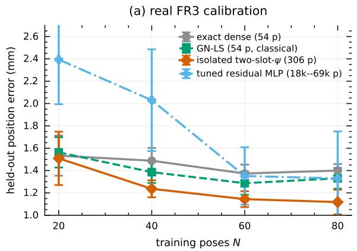

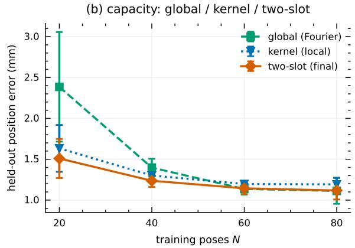  
(d) seed stability (Kinova)

(c) synthetic controls (S1)  
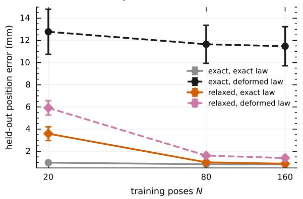

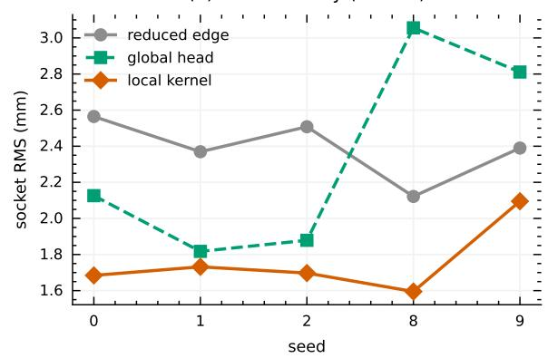  
Training dynamics. Two diferent efects produce the remaining spikes.

Startup transient. At lr $5 \cdot 1 0 ^ { - 3 } \mathrm { \ L a w K A N }$ overshoots in the first tens of epochs (up to ∼24 mm) and recovers.   
Gradient clipping does not remove it; lr $1 0 ^ { - 3 }$ cuts the peak fivefold at the same final error (X52).

Residual chart spike. At some seeds a smaller spike remains. Its cause is an operand chart singularity: the pair features log the accumulated pose, and when its rotation crosses $\pi$ the axis–angle chart branches (the quaternion component $w _ { A }$ changes sign), although the learned correction ψ itself stays small $( \| \omega _ { \psi } \| \approx 0 . 0 2$ rad; X53-print-2). Three checks separate mechanism from symptom:

• Features. The quaternion-feature variant of LawKAN halves the peak but does not remove it, and the final error rises (26 → 13 mm; $1 . 0 9  1 . 2 9$ mm; X53-fix).

• Metric. A kernel defined by the group metric instead of input coordinates does not recover the final error either (1.27 and 1.39 mm; X60).

• Trajectory. Averaging the weights over training (Polyak/EMA) removes the spike in every configuration we ran (raw maxima of 6–40 mm fall to $\leq 1 . 6 \mathrm { m m } )$ and leaves the final error within 0.02 mm (X59, X61).

What follows. The spike is a property of the training trajectory, not of the learned solution: average the weights before deployment. A separate matched-protocol check at N=60 (200 epochs, six seeds; X61, not a Table 3 row) finds no cost for the branch-safe variant (quaternion features, global slot only): mean −0.062 mm, 90% CI $( - 0 . 1 1 4 , - 0 . 0 1 1 )$ ; the interval misses the ±0.11 mm margin by 0.004 mm, so equivalence at the ±10% margin is not established. We therefore keep the feature kernel as the default and recommend the branch-safe variant for tasks that cross π.

## 5.3 Transfer across vendors: the socket protocol

Why this task. The deformed arm is a single robot; a general recipe should transfer across vendors on a common protocol, where each unit’s true deviation is unknown and the ground truth is an independent metrology. The MUKCa socket-consistency protocol gives one task and metric on four units (KUKA iiwa14, Panda, Kinova Gen3 lite, the FR3 unit): held-out root-mean-square (RMS) scatter (mm).

Design. The scheme is the one of Section 5.1: the exact SE(3) group law in the node, the full per-joint screw (the dense screw) as the classical reference, and the reduced edge (tool plus joint biases) with ψ as the isolated correction. The residual deformation is unknown; where it lies inside the full constant-screw class that the reduced base does not contain, no correction can span it — a base-form boundary, not an accuracy limit. Unlike configuration-dependent PoE interpolation (Lu et al., 2025), which fits local models plus a smooth, configuration-indexed correction, one exact law is imposed here and the correction is a pair-leve deformation of the composition, trained in isolation.

The reference and our models share the optimizer: on this protocol both the classical per-joint screw and our edges are fitted with the same Adam schedule, so the comparison isolates the architecture (the node’s law and ψ). The classical Gauss–Newton fit difers in both optimizer and loss; where we report it (the arm table, Table 3, row 1), the table separates the two and we do not attribute the diference to the optimizer alone.

Experiments.

• Does the correction transfer across vendors? On units whose deviation is pair-dependent and whose reduced base sufices, ψ should win. Measured (Table 4): it does on KUKA iiwa14 (0.166 vs the reduced edge 0.55 mm, $p < 0 . 0 0 1$ ; and vs the dense screw 0.26 mm, p=0.023) and Panda (0.330 vs 0.93 mm, $p < 0 . 0 0 1$ ; vs dense 0.49 mm, $p { = } 0 . 0 0 7 ) ;$ on the same KUKA in two further tool sessions it wins both (0.23/0.38 vs 0.61/0.75), so the deformation is a property of the robot, not the setup.

• Where does it stop, and is that a limit? On units whose mismatch lies inside the constant-screw class, we predict a boundary. Measured: on the FR3 unit the full per-joint screw already spans the mismatch (0.29) and ψ cannot beat the dense screw. Both boundaries are base-form mismatches — a base whose form nests the classical estimator would reduce them to parity, not loss (a design direction we do not measure here).

• Is the collapse the correction’s fault? On the Kinova platform, the reduced edge underfits a large base mismatch, forcing ψ to absorb a large residual; consequently, the socket objective is susceptible to a degenerate workspace collapse. Measured: the global slot is seed-unstable (2/10 seeds, Figure A7), while the kernel head removes it (1.908, matches the dense screw 1.98, $\scriptstyle { p = 0 . 1 0 } )$ and stays below the reduced edge on every seed — a small-data instability of the global slot, not of the correction.

## 5.4 Range-only arm calibration

Why this task. Range-only calibration tests whether the recipe holds when the observation is a single distance per pose instead of the full pose. The ABB RobotCali draw-wire protocol (Li et al., 2021b;a) gives held-out mean |∆L| (mm) at N=80/160/320. The dataset has no explicit license; we use it under the authors stated permission for calibration and verification and do not redistribute the raw file.

Design. The underlying motion is rigid-body, so the exact SE(3) group law is imposed in the node; the classical reference is the exact screw model and its Gauss–Newton fit, the strongest classical form of the class; and the residual deformation is smooth, so the isolated global ψ should sufice (the scheme of Section 5.1).

Table 4: MUKCa socket consistency, held-out RMS scatter (mm); 10 seeds for KUKA/Panda/Kinova, 5 for the FR3 unit. All rows use Adam and the same socket loss. reference = the full per-joint screw (the classical estimator of the base’s class, fitted with the same optimizer as our models); LawKAN = the reduced-edge base (tool + joint biases) with $\scriptstyle { \psi = 0 }$ , global and sequential two-slot heads (kernel first, then the global slot on the residual, dose 0; a joint two-slot difers within noise on KUKA/Panda, is slightly better on Kinova $\scriptstyle \left( p = 0 . 0 6 1 \right)$ and worse on the FR3 unit $_ { ( p = 0 . 0 1 7 ) }$ , X47), and the per-joint-screw base with its $\scriptstyle \psi = 0 ,$ global, kernel and two-slot heads (the per-joint-screw ψ=0 column reproduces the dense-screw reference). Bold marks the best cell per row, ‡ an attribution boundary. p = the declared head of each base: the reduced base’s sequential two-slot, tested against its own edge $( p _ { \mathrm { { e d g e } } } ,$ , the correction’s contribution) and against the dense screw (pdense, parity); and the per-joint base’s best form (sequential two-slot on KUKA, global on Panda, kernel on Kinova, $\scriptstyle { \psi = 0 }$ on the FR3 unit), tested against the dense screw; for the FR3 unit the declared form is the dense screw itself, so its entry is a parity by construction, not a tested p-value. Benjamini–Hochberg over the eleven numeric tests in this table (taking $\scriptstyle p < 0 . 0 0 1$ as 0.001): all reported $p \leq 0$ .04 survive at $q = 0 . 0 5$ ; the Kinova edge (p=0.483, q=0.48) and the Kinova per-joint dense entry $( p { = } 0 . 1 0 1 , q { = } 0 . 1 1 )$ do not.
<table><tr><td colspan="12">Socket consistency  $( M U K C a ;$  10 seeds for KUKA/Panda/Kinova, 5 for the FR3 unit)</td></tr><tr><td></td><td></td><td>reference</td><td>LawKAN</td><td>(reduced-edge base)</td><td></td><td></td><td></td><td colspan="4">LawKAN (per-joint-screw base)</td></tr><tr><td>Platform</td><td>N</td><td>dense screw</td><td>ψ=0 global ψ</td><td>two-slot ψ</td><td></td><td>Pedge</td><td>Pdense ψ=0</td><td>global ψ</td><td></td><td>kernel ψ</td><td>two-slot ψ Pdense</td></tr><tr><td>KUKA iiwa14 42</td><td></td><td>0.26</td><td>0.55</td><td>0.187</td><td>0.166</td><td>&lt;0.001</td><td>0.023</td><td>0.26</td><td>0.198</td><td>0.218</td><td>0.190</td><td>0.011</td></tr><tr><td>Panda</td><td>42</td><td>0.49</td><td>0.93</td><td>0.365</td><td>0.330</td><td>&lt;0.001</td><td>0.007</td><td>0.49</td><td>0.387</td><td>0.466</td><td>0.390</td><td>0.0015</td></tr><tr><td>Kinova‡</td><td>39</td><td>1.98</td><td>2.47</td><td>2.269</td><td>2.325</td><td>0.483</td><td>0.040</td><td>1.98</td><td>2.386</td><td>1.908</td><td>2.397</td><td>0.101</td></tr><tr><td>FR3 unit‡</td><td>46</td><td>0.29</td><td>1.49</td><td>0.450</td><td>0.441</td><td>&lt;0.001</td><td>0.028</td><td>0.29</td><td>0.310</td><td>0.300</td><td>0.310</td><td>parity</td></tr></table>

## Experiments.

• Does it beat the exact screw and reach the Gauss–Newton fit? With the deviation in span and a smooth deformation, it should. Measured (Table 5): the global ψ is below the exact screw at every N and below the Gauss–Newton fit at $N \geq 1 6 0 \ ( p { = } 0 . 0 1 3 / 0 . 0 0 0 4 )$ ; at $N { = } 8 0$ it is numerically below GN as well, but the gap is not significant $\scriptstyle ( p = 0 . 7 4 )$

• Does a richer head help? The deformation is smooth, so a global head should sufice; we keep it and do not add a local kernel here.

Table 5: ABB RobotCali draw-wire (range-only), held-out mean |∆L| (mm), 10 seeds. reference = Gauss–Newton on the range residual, the classical optimum; $\scriptstyle { \psi = 0 = }$ the same class without the correction on our Adam + bounded range loss; the ψ head is the learned correction on our optimizer (Adam); p = the global ψ vs the reference. (A fit of the neural ψ on the GN solver is unstable across runs, so we report ψ on Adam only.)
<table><tr><td colspan="4">Range-only (ABB RobotCali, draw-wire; 10 seeds)</td></tr><tr><td>reference</td><td></td><td>LawKAN</td><td></td></tr><tr><td>N</td><td>GN ψ=0 (Adam)</td><td>global ψ (Adam)</td><td>p</td></tr><tr><td>80</td><td>1.41</td><td>1.53</td><td>1.37 0.74</td></tr><tr><td>160</td><td>1.20</td><td>1.38 1.11</td><td>0.013</td></tr><tr><td>320</td><td>1.14</td><td>1.33</td><td>1.06 0.0004</td></tr></table>

## 5.5 Parity: the model is the classical estimator

This section checks that the parity result reproduces on tasks of a diferent type: a rotation-only sensor (Section 5.5.1) and a low-dimensional calibration (Section 5.5.2). In both the law holds exactly and a same-class classical estimator exists, so parity is the prediction: the exact node should be that estimator, with no distortion of the law and only estimation, data-eficiency and gauge diferences.

## 5.5.1 IMU orientation

Why this task. A rotation-only sensor is where a same-class classical estimator exists — the training-free strapdown integrator already carries the law — so parity is the prediction. Orientation increments over 0.07–5 s windows on the real BROAD sensor (geodesic error against motion capture), a trial-level split.

Design: why these choices. SU(2) is the known group law; the exact node uses one shared edge (27 parameters, the full K=1 group features, pruned to the 18-parameter analytic edge, and 36 with a bias feature at long horizons), against the training-free strapdown integrator (which already carries the law) and structure-free (flat) MLPs. The 36-parameter variant is the 27-parameter edge plus the 3×3 bias-to-direction map (9 more); the flat MLPs are the two sizes (h=8, h=32) carried verbatim from the synthetic opponent battery, where they were the strongest flat opponents; three seeds (0–2) split the 16 trials at trial level; we report equivalence under two one-sided tests (TOST) at a 10% margin as consistent with parity — with three seeds the interval is wide, so it bounds the diference rather than establishing power. The theory then predicts parity.

Experiments. Parity (Table 18): the exact node keeps the rotation manifold where flat MLPs leave it — the advantage is data eficiency.

## 5.5.2 Gyroscope calibration

Why this task. A second parity case, on a low-dimensional calibration whose classical fit has the same form. Calibration of the raw gyroscope $\left( \omega _ { \mathrm { t r u e } } = M ( \omega _ { \mathrm { r a w } } - b ) \right)$ , held-out.

Design: why these choices. The known form is the linear 12-parameter (M, b) calibration, learned by the edge and compared against the classical Levenberg–Marquardt (LM) fit of the same form. The theory predicts parity.

Experiments. Parity (Table 19): the learned calibration matches the LM fit $\mathrm { t o } \le 0 . 0 0 9 ^ { \circ }$ on every window, and the TinyGC-style subnet $\mathrm { t o } ~ \le ~ 0 . 0 0 2 ^ { \circ }$ ; both fits are deterministic (identical across seeds), so this is agreement between optimizers rather than a statistical equivalence.

## 5.6 The applied envelope

The applied envelope. Table 6 collects the measured envelope: parity where an analytic estimator exists and the law is exact; a win where the hardware deviates from the law and the deviation lies in $\psi \mathrm { s }$ span; and a loss where the imposed law is not the task’s. Which head to apply follows from the deformation and the setting (Table 21, Appendix F): the two-slot is the default, the local kernel is the collapse-safe choice for a small, seed-unstable set, and a global head sufices where the deformation is smooth.

## 5.7 Using the span criterion

It is a five-step check:

1. fix the group and the chart — what composes, and in which coordinates the increment is expressed;

2. write the target’s chart logarithm, the algebra element the edge must produce (or the group element itself when the exponential is not global, as for $G L ^ { + } ( 2 , \mathbb { R } ) ,$ );

3. test the edge’s span: does its feature map cover those coordinates (or the chart element)? If yes, the exact node is representable (Proposition 1); if not, a training-independent floor remains;

4. for a deviating law, write the deviation η and test whether ψ’s features span it (the law-match criterion); the projection left is the floor;

5. verify empirically: parity if the span is full, a floor if it is not.

A companion script, tools/span\_check.py, implements steps 2–5 as a linear probe from the features to the logarithm (with a runnable –demo). The applied tasks are instances: the per-joint screw spans the arm’s constant-screw class (parity with the classical fit); the reduced socket base does not span the dense screw class (a form gap, Section 5.3); the global ψ spans the smooth range-only deviation (a win, Section 5.4); and the IMU and gyroscope steps span exactly (parity, Section 5.5).

What it is good for. Before training, it screens an edge: a short span is a training-independent floor, so a wider head or a longer schedule will not close it — fix the features instead. Diagnosing a plateau, it separates a span limit from an optimization one, and designing the correction it states in advance whether ψ can remove a measured deformation and which feature set is the cheapest spanning one (the 18-parameter analytic edge over the 54-parameter dense edge, Section 4.2). The probe needs only features and targets, so it is a cheap first check on a new task.

## 6 Limitations

Scope. The recipe is an architectural component, not a standalone, universal alternative:

• the pruned edge assumes fixed known angles, and chain scaling holds to $n { = } 4 ;$

• the dense composer does not beat strapdown on real data (the pruned one does, modestly);

• on $G L ^ { + } ( 2 , \mathbb { R } )$ a raw (unstructured) dense edge does not beat an MLP, while the analytic-support edge solves the same task (0.0024 vs 0.53, Section 4) — the boundary is the edge’s form, not the method;

• without a composition law the model loses: the exact node presumes the law, and the correction belongs on the physical composition (a joint or a step).

Measured failure modes. The correction is not universal glue; its failures fall into the three kinds that the recipe’s own framing separates:

• Form boundaries (diferent class): on the FR3 unit the mismatch lies inside the constant-screw class — a form the classical estimator fixes and our reduced base does not contain — so ψ is the wrong tool (an attribution boundary, Section 5.3); a base whose form nests the classical class would reduce this to parity.

• Estimation gaps (same class): on UR10 and UR5 the same-class Gauss–Newton fit is ahead at large N — a matter of optimizer and data, not of representable form (Appendix G).

• Identifiability: on UR10 the freely-tuned edge drifts (test error 0.40 → 11.7 mm with the correction of) and isolation removes it; on Kinova the global slot collapses on 2/10 seeds until a local head is used; at N=20 the correction overfits until a validation gate is added (Section 5.1, Section 5.3, Appendix G).

External validity. The evidence is narrow: one synthetic composition benchmark, 39 consumer-MEMS BROAD trials, six real calibration datasets across three tasks (FR3 arm; socket consistency on KUKA iiwa14, Panda, Kinova Gen3 lite and the FR3 unit; ABB draw-wire range), and 3–10 seeds per platform. Tactical-grade IMUs, other robots, and large-scale vision or language tasks are untested; the arm sets carry no approach trajectories, so backlash signatures are only proxy-tested. The FR3 arm result comes from a single unit, and the socket FR3 unit is at parity by construction, so unit-to-unit variability of the deformation is not measured. Signal-level denoising subnets (e.g., TinyGC-Net (Cui & Zhao, 2024)) are complementary and out of scope.

Evidence caveats. One claim remains synthetic (rigid-body closure); gains trace to structure–task alignment, not overly complex arithmetic. Opponents use default hyperparameters (the registered four-configuration tune leaves the headline gap); the two-slot’s weight-decay dose follows a size-based rule selected on these splits (X26c), and transfer of the rule to a new protocol was not measured; beyond the flat MLPs (h=8, h=32), the IMU probe adds only a GRU and a residual MLP. On the real arm the learned model’s edge over the same-class Gauss–Newton fit is the data-scarce regime, and the shared loss is conservative for a position metric. The dense IMU edge is seed-bimodal at 5 s (one seed reaches 73◦), and capacity does not cure it: a weight-decay dose leaves the outlier (73.9 → 76.8), while the pruned 18-parameter edge stays stable (spread 0.017) — the deployment claim applies to the pruned edge. Predictions are an authorial record: fourteen soft verdicts, one inconclusive proxy and one post-hoc fix are weaker than clean confirmations, and the per-joint corrections do not prune on hardware.

## 7 Future work

The measured envelope points to the next steps. The recipe fixes the known structure in advance; its natural generalisation is to grow it: distil, during training, whatever is expressible as a known law into the exact node, then learn only the remainder. Where several simple symmetries coexist in the data, extract them separately and route between them:

• (i) carrying the layer into a real pipeline where the increment is latent and the surrounding model is large;

• (ii) state- and trajectory-conditioned channels on real data — the mechanism probes motivate velocity-conditioned edges and trajectory-instrumented collection (X19–X21);

• (iii) broader manipulator coverage — payloads, wear states, closed-loop tracking;

• (iv) growing the known structure: not learning a law we already know (vacuous by our own principle), but distilling the law-like part of a learned solution into known form and learning only the remainder; • (v) charts and group laws beyond the three;

• (vi) composition laws beyond groups: monoid and semigroup products (strings, processes, typed chains): node, edge and deformation carry over without inverses; the group assumption buys the converse of the span criterion;

• (vii) several laws at once — extracting several simple symmetries from the data and routing between them;

• (viii) a direct head-to-head with configuration-dependent PoE (Lu et al., 2025) on a shared dataset the closest learned competitor, not yet measured here.

A controlled synthetic sweep of deformation regimes (smooth, local, rough, mixed) against the three heads would turn the applied map into a predictive rule; we leave it as a follow-up.

## 8 Conclusion

LawKAN embeds the group law directly in the node and delegates the coordinate mapping to the chart edges; composition is representable exactly when the edge features span the chart’s logarithm, and better features then improve results. Where the hardware deviates from the law, a zero-initialized isolated correction removes a floor that no edge-side structure removes, and doubles as a test that localizes the deviation.

The value is architectural and conditional: on the composition tasks we study the exact composer wins with a small fraction of the parameters and saves data on a real arm at small training sets, while it matches classical fits under the same law and loses where the imposed law is not the task’s. This measured envelope — when embedding a known law pays of, when it gives parity, and when it loses — is the paper’s main object (Table 6).

Table 6: When the group-law node pays of: the task-type map, the paper’s main object (read a row by task type; the verdict, its structural reason and example tasks follow). The structural reason is the analytic optimum (parity), identifiability (win/match), or the absence of an analytic component. The last column names example tasks, measured here or in the literature.
<table><tr><td>Task type</td><td>Verdict</td><td>Reason</td><td>Example tasks</td></tr><tr><td>Analytic estimator exists (gyro, strapdown; FK/arm calibration)</td><td>parity, tiny model</td><td>the exact analytic optimum is already reachable; classical strapdown and PoE calibration are the constant-edge limits of the same recipe (Section 5.5.1, Section G.1, Section 5.1)</td><td>strapdown integration; PoE arm calibration SE(3)</td></tr><tr><td>Latent but identifiable increment (robot calibration)</td><td>win / match</td><td>identifiable increments; the gain is in the data-scarce regime, and a relaxed-node correction beats the classical fit at large N when the hardware deviates from the law (App. G; Section 5.1)</td><td>arm kinematic calibration SE(3); monocular SLAM alignment sim(3); inertial odometry SE(3)</td></tr><tr><td>Latent increment with evolving state (rigid-body ODE)</td><td>only with the state- conditioned edge</td><td>needs a recurrence / ODE edge (Section G.2)</td><td>rigid-body dynamics (Baxter, Section G.2); trajectory-conditioned odometry</td></tr><tr><td>The imposed law is not the task&#x27;s (null task)</td><td>loses</td><td>we impose the wrong law (Section E.3)</td><td>generic regression targets (Section E.3)</td></tr></table>

On the deformed arm, the training spikes are a property of the optimisation path, not of the learned map: averaging the weights over training removes them and leaves the final error unchanged (Section 5.2). A branch-safe quaternion variant showed no measured cost at the tested budget, although equivalence at our margin was not established.

Verification. This paper pre-specified 130 predictions in its internal experiment log before their runs (119 in the main log and 11 branch probes); 29 were refuted and are kept and reported in Table 31. Structure that is written down can be checked; structure that is learned must be audited — which is what the isolation protocol and the measured envelope of Section 5–Section 6 do.

Data and code availability. The code is available at https://github.com/occamolab/lawkan under AGPL-3.0-or-later. Experiments use BROAD (Laidig et al., 2021b;a) (CC BY 4.0), MUKCa (Franzese et al., 2025; 2024) (MIT), FR3/PhilNad (Nadeau, 2024) (MIT), IPA Series A (Landgraf et al., 2021; Landgraf, 2021) (MIT), pauljac UR5 (Yao et al., 2026; Jacobi, 2025) (MIT), the GTPN UR5 dataset (Northwestern Polytechnical University, 2026) (CC BY 4.0), and the Baxter dataset (Valencia-Vidal et al., 2025) (CC BY 4.0). The ABB RobotCali dataset (Li et al., 2021b) was used under the authors’ stated permission for calibration and verification; it has no explicit license, and we do not redistribute the raw file.

## References

P.-A. Absil, Robert Mahony, and Rodolphe Sepulchre. Optimization Algorithms on Matrix Manifolds. Princeton University Press, 2008. doi: 10.1515/9781400830244.

Francesco Alesiani, Takashi Maruyama, Henrik Christiansen, and Viktor Zaverkin. Geometric Kolmogorov– Arnold Superposition Theorem. arXiv:2502.16664, 2025.

Simon Batzner, Albert Musaelian, Lixin Sun, Mario Geiger, Jonathan P. Mailoa, Mordechai Kornbluth, Nicola Molinari, Tess E. Smidt, and Boris Kozinsky. E(3)-equivariant graph neural networks for dataeficient and accurate interatomic potentials (NequIP). Nature Communications, 13:2453, 2022. doi: 10.1038/s41467-022-29939-5.

Nicolas Boumal. An Introduction to Optimization on Smooth Manifolds. Cambridge University Press, 2023. doi: 10.1017/9781009166164.

Zavareh Bozorgasl and Hao Chen. Wav-KAN: Wavelet Kolmogorov–Arnold Networks, 2024.

Romain Brégier. Deep Regression on Manifolds: A 3D Rotation Case Study. In International Conference on 3D Vision (3DV), pp. 166–174, 2021. doi: 10.1109/3DV53792.2021.00027.

Jiayi Chen, Yingda Yin, Tolga Birdal, Baoquan Chen, Leonidas J. Guibas, and He Wang. Projective manifold gradient layer for deep rotation regression. In Proceedings of the IEEE/CVF Conference on Computer Vision and Pattern Recognition (CVPR), pp. 6646–6655, 2022. arXiv:2110.11657.

Taco Cohen and Max Welling. Group equivariant convolutional networks. In Proceedings of the 33rd International Conference on Machine Learning (ICML), volume 48 of PMLR, pp. 2990–2999, 2016. arXiv:1602.07576.

Chao Cui and Jiankang Zhao. TinyGC-Net: An Extremely Tiny Network for Calibrating MEMS Gyroscopes. arXiv:2403.02618, 2024.

Congyue Deng, Or Litany, Yueqi Duan, Adrien Poulenard, Andrea Tagliasacchi, and Leonidas J. Guibas. Vector neurons: A general framework for SO(3)-equivariant networks. In Proceedings of the IEEE/CVF International Conference on Computer Vision (ICCV), pp. 12200–12209, 2021. URL https://openaccess.thecvf.com/content/ICCV2021/html/Deng\_Vector\_Neurons\_A\_General\_ Framework\_for\_SO3-Equivariant\_Networks\_ICCV\_2021\_paper.html.

Ran Elbaz, Guy Bar-Shalom, Yam Eitan, Fabrizio Frasca, and Haggai Maron. FS-KAN: Permutation Equivariant Kolmogorov–Arnold Networks via Function Sharing. arXiv:2509.24472, 2025.

Luca Falorsi, Pim de Haan, Tim R. Davidson, and Patrick Forré. Reparameterizing distributions on lie groups. In Proceedings of the 22nd International Conference on Artificial Intelligence and Statistics (AISTATS), 2019. arXiv:1903.02958.

Giovanni Franzese, Max Spahn, and Mariano Ramirez. MUKCa: Kinematics calibration dataset and code. GitHub repository, MIT license, 2024. URL https://github.com/platonics-delft/kinematics\_ calibration. Data: data/; KUKA, Panda, Kinova, FR3.

Giovanni Franzese, Max Spahn, Jens Kober, and Cosimo Della Santina. MUKCa: Accurate and afordable cobot calibration without external measurement devices, 2025. URL https://arxiv.org/abs/2503.12584.

Fabian B. Fuchs, Daniel E. Worrall, Volker Fischer, and Max Welling. SE(3)-Transformers: 3D Roto-Translation Equivariant Attention Networks. arXiv:2006.10503, 2020. URL https://arxiv.org/abs/ 2006.10503.

Lexiang Hu, Yisen Wang, and Zhouchen Lin. Incorporating arbitrary matrix group equivariance into KANs. In Proceedings of the 42nd International Conference on Machine Learning (ICML), volume 267 of PMLR, pp. 24744–24760, 2025. arXiv:2410.00435.

Paul Jacobi. Serial robot positioning error datasets: UR5 and Barrett WAM. GitHub repository, MIT license, 2025. URL https://github.com/pauljac7700/serial\_robots\_datasets. UR5: 1000 grid + 20 random poses; position-only.

Daniel Laidig and Thomas Seel. VQF: Highly accurate IMU orientation estimation with bias estimation and magnetic disturbance rejection. Information Fusion, 91:187–204, 2023. doi: 10.1016/j.infus.2022.10.014.

Daniel Laidig, Marco Caruso, Andrea Cereatti, and Thomas Seel. BROAD: Berlin Robust Orientation Estimation Assessment Dataset. GitHub repository, CC BY 4.0, 2021a. URL https://github.com/ dlaidig/broad. Data: data\_hdf5; 39 trials.

Daniel Laidig, Marco Caruso, Andrea Cereatti, and Thomas Seel. BROAD — A benchmark for robust inertial orientation estimation. Data, 6(7):72, 2021b. doi: 10.3390/data6070072.

Christian Landgraf. ipa-robot-accuracy: Robot accuracy dataset. GitHub repository, MIT license, 2021. URL https://github.com/christianlandgraf/ipa-robot-accuracy. Series A; laser tracker; 6D poses.

Christian Landgraf, Kilian Ernst, Gesine Schleth, Marc Fabritius, and Marco F. Huber. A hybrid neural network approach for increasing the absolute accuracy of industrial robots. In 2021 IEEE 17th International Conference on Automation Science and Engineering (CASE), pp. 468–474, 2021. doi: 10.1109/CASE49439. 2021.9551684.

Jake Levinson, Carlos Esteves, Kefan Chen, Noah Snavely, Angjoo Kanazawa, Afshin Rostamizadeh, and Ameesh Makadia. An analysis of SVD for deep rotation estimation. In Advances in Neural Information Processing Systems (NeurIPS), 2020. arXiv:2006.14616.

Zhibin Li, Shuai Li, and Xin Luo. An overview of calibration technology of industrial robots. IEEE/CAA Journal of Automatica Sinica, 8(1):23–36, 2021a. doi: 10.1109/JAS.2020.1003381.

Zhibin Li, Shuai Li, and Xin Luo. RobotCali: ABB IRB 120 robot calibration dataset. GitHub repository, 2021b. URL https://github.com/Lizhibing1490183152/RobotCali. 1042 poses; no explicit license; used under research access, not redistributed.

Yaohua Liu, Wei Liang, and Jinqiang Cui. LGC-Net: A Lightweight Gyroscope Calibration Network for Eficient Attitude Estimation. arXiv:2209.08816, 2022.

Ziming Liu, Pingchuan Ma, Yixuan Wang, Wojciech Matusik, and Max Tegmark. KAN 2.0: Kolmogorov– Arnold Networks Meet Science. arXiv:2408.10205, 2024a.

Ziming Liu, Yixuan Wang, Sachin Vaidya, Fabian Ruehle, James Halverson, Marin Soljačić, Thomas Y. Hou, and Max Tegmark. KAN: Kolmogorov–Arnold Networks. arXiv:2404.19756 (ICLR 2025), 2024b. URL https://arxiv.org/abs/2404.19756.

Chen-Lung Lu, Honglu He, Agung Julius, and John T. Wen. Configuration-dependent robot kinematics model and calibration. IEEE Robotics and Automation Letters, 10(12):13233–13240, 2025. doi: 10.1109/ LRA.2025.3629988. arXiv:2510.19962.

Andreas Maier, Harald Köstler, Marco Heisig, Patrick Krauss, and Seung Hee Yang. Known operator learning and hybrid machine learning in medical imaging—a review of the past, the present, and the future. Progress in Biomedical Engineering, 4(2):022002, 2022. doi: 10.1088/2516-1091/ac5b13.

Mircea Mironenco and Patrick D. Forré. Lie group decompositions for equivariant neural networks. In International Conference on Learning Representations (ICLR), 2024. arXiv:2310.11366.

Philippe Nadeau. robot-arm-kinematic-calibration: A Python library for kinematic calibration of robot arms (POE; reference implementation). GitHub repository, MIT license, 2024. URL https: //github.com/PhilNad/robot-arm-kinematic-calibration. Contains the FR3 dataset used here: Examples/calib\_data.pickle, 114 poses.

Northwestern Polytechnical University. UR5 robot dataset containing joint angles, actual positions, and target positions. Zenodo, CC-BY-4.0, 2026. URL https://doi.org/10.5281/zenodo.18954650. 727 poses; used in S2.

Titouan Parcollet, Mirco Ravanelli, Mohamed Morchid, Georges Linarès, Chiheb Trabelsi, Renato De Mori, and Yoshua Bengio. Quaternion recurrent neural networks. In International Conference on Learning Representations (ICLR), 2019. arXiv:1806.04418.

Titouan Parcollet, Mohamed Morchid, and Georges Linarès. A survey of quaternion neural networks. Artificial Intelligence Review, 53(4):2957–2982, 2020. doi: 10.1007/s10462-019-09752-1.

Dario Pavllo, Christoph Feichtenhofer, Michael Auli, and David Grangier. Modeling Human Motion with Quaternion-based Neural Networks. International Journal of Computer Vision, 128(4):855–872, 2020. doi: 10.1007/s11263-019-01245-6.

Joohwan Seo, Soochul Yoo, Junwoo Chang, Hyunseok An, Hyunwoo Ryu, Soomi Lee, Arvind Kruthiventy, Jongeun Choi, and Roberto Horowitz. SE(3)-Equivariant Robot Learning and Control: A Tutorial Survey. arXiv:2503.09829, 2025.

S. S. Sidharth, A. R. Keerthana, R. Gokul, and K. P. Anas. Chebyshev Polynomial-Based Kolmogorov–Arnold Networks: An Eficient Architecture for Nonlinear Function Approximation, 2024.

Yair Stolero and Itzik Klein. Rapid Gyroscope Calibration: A Deep Learning Approach. arXiv:2409.00488, 2024.

Yangting Sun, Zijun Cui, and Yufei Zhang. Revisiting Euler-Angle Regression with Kolmogorov–Arnold Networks. arXiv:2607.09650, 2026.

Nathaniel Thomas, Tess Smidt, Steven Kearnes, Lusann Yang, Li Li, Kai Kohlhof, and Patrick Riley. Tensor field networks: Rotation- and translation-equivariant neural networks for 3D point clouds. arXiv:1802.08219, 2018. URL https://arxiv.org/abs/1802.08219.

David H. Titterton and John L. Weston. Strapdown Inertial Navigation Technology. IET, 2 edition, 2004. ISBN 9780863413582. doi: 10.1049/PBRA017E.

Brayan Valencia-Vidal, Gabriel Jimenez-Perera, Niceto Rafael Luque Sola, Eduardo Ros, and Francisco Barranco. Baxter robot dataset for learning dynamic models. Zenodo, CC-BY-4.0, 2025. URL https: //doi.org/10.5281/zenodo.17035193.

Ming Yao, Paul Jacobi, Zhufeng Shao, and Anna Kibireva. A graph-based hybrid position error compensation method for serial industrial robots. Applied Soft Computing, 203:116099, 2026. doi: 10.1016/j.asoc.2026. 116099.

Runpeng Yu, Weihao Yu, and Xinchao Wang. KAN or MLP: A Fairer Comparison, 2024.

Shanshan Zhang, Siyue Wang, Tianshui Wen, Liqin Wu, Qi Zhang, Ziheng Zhou, Ao Peng, Xuemin Hong, Lingxiang Zheng, and Yu Yang. CKANIO: Learnable Chebyshev Polynomials for Inertial Odometry. arXiv:2507.16865, 2025.

Xuan Zhang, Shaofei Qin, Yi Xu, and Hongteng Xu. Quaternion Product Units for Deep Learning on 3D Rotation Groups. In IEEE/CVF Conference on Computer Vision and Pattern Recognition (CVPR), pp. 7302–7311, 2020. doi: 10.1109/CVPR42600.2020.00733.

Yi Zhou, Connelly Barnes, Jingwan Lu, Jimei Yang, and Hao Li. On the continuity of rotation representations in neural networks. In Proceedings of the IEEE/CVF Conference on Computer Vision and Pattern Recognition (CVPR), pp. 5738–5746, 2019. doi: 10.1109/CVPR.2019.00589. arXiv:1812.07035.

## Appendix

## Appendix guide

What each appendix contains (main-text anchors in parentheses):

A Reproducibility, statistics protocol, experiment map (all).

B Notation and conventions.

C Exact representability: the span criterion and the floors (Section 3.3).

D Extended per-seed tables and the cross-group characterization (Section 4).

E Compact-instance details, opponent matrix, isolation and pruning (Section 4.2.1, Section 4.2).

F Applied-probe details: p-values, CIs, three-platform tables (Section 5).

G Isolated probes, learned-law controls, identifiability and diagnostics (Section 3.4, Section 5.1).

H Compact-instance construction: K=1, pruning.

I Mechanism details: variable angles, dead zones, order rule.

J The exp parameterization as a retraction.

K Registered predictions: verdict summary.

L–M Use of AI tools and broader impact.

First read: A, C, G are required; D–F are the number checks.

## A Reproducibility

Every claim was pre-specified in our internal experiment log, with its control, as a falsifiable prediction before its run, and refuted predictions are kept. Paired tests, 95% CIs and the multiple-comparison bookkeeping with two one-sided tests (TOST) are in Section A.4; experiment indices, environment, seeding and accounting conventions are in this appendix and Appendix B. The registered suite includes two blind necessity tests — the feature-group ablation (a positive floor when a group is removed: 6.1e−4 vs 0.387) and the order-rule replication (linear floor scaling, ratio 4.10, with the K=2 numerical bound refuted and reported) — with per-seed numbers in Appendices D.4 and I.

## A.1 Code

The code, the canonical JSON dumps and the reproduction instructions are available under AGPL-3.0 (research use is free): https://github.com/occamolab/lawkan. The repository is now lawkan; the supplementary JSON dump keys and code identifiers keep the pre-rename spelling. Every displayed number resolves through the repro/canonical.json manifest and can be re-derived with the repository’s check script; tools/span\_check.py implements the span criterion as a linear probe. Table 7 maps the block groups to the paper locations.

<table><tr><td colspan="2">Table 7: Map of experiment blocks: each block and the paper location of its numbers.</td></tr><tr><td>Block</td><td>Paper location / contents</td></tr><tr><td>E1-E14</td><td>Section 4.2.1–Section 4.2.3: the synthetic core (opponent matrix, null, boundaries)</td></tr><tr><td>E15-E37</td><td>Section 4–Section 4.2: the group instances and edge/head variants</td></tr><tr><td>Block</td><td>Paper location / contents</td></tr><tr><td>X5-X10</td><td>Section 5: the applied probes (IMU, gyro, arm, FK)</td></tr><tr><td>X37-X52</td><td>Section 5.3-Section 5.5: socket heads, ABB range-only, matched-optimizer and capacity/locality probes</td></tr><tr><td>X11-X36 X53-X61</td><td>Section 5.1–Section 5.5: the phase-2 probes and controls</td></tr><tr><td></td><td>Section 5.2: the pole-fix branch (chart singularity, EMA, group-metric kernel, T1/T2); scripts X53_socket_convergence.py-X61_confirm.py</td></tr><tr><td>S1-S8</td><td>Section 4.2.4, Section 5: the synthetic and relaxed controls</td></tr></table>

The embedded-component experiments of the first version are excluded from this version by the repositioning to a stand-alone micromodel.

Synthetic numbers are verbatim from the reference run; real-data numbers are taken from the dumps listed in Table 9. Error is geodesic, degrees, $^ { 6 6 } \pm \ v r$ std across seeds.

## A.2 Task and data

Composition $n { = } 2$ (make\_compn\_data): axes $a _ { 1 } , a _ { 2 }$ are normalized Gaussian vectors (uniform on $S ^ { 2 } )$ ; rotation angles fixed: $\theta _ { 1 } = 0 . 7 , \theta _ { 2 } = 1 . 1$ rad (for $n { = } 3 \colon 0 . 7 , 1 . 1 , 0 . 9 )$ . Input $X = ( \alpha _ { 1 } , \beta _ { 1 } , \alpha _ { 2 } , \beta _ { 2 } ) + \mathcal { N } ( 0 , \sigma ^ { 2 } )$ $\sigma = 0 . 0 3$ rad; target $Y = \left( \alpha , \beta \right)$ of the rotated probe vector $\left( q _ { 2 } q _ { 1 } \right) \cdot \hat { e } _ { z } + \mathcal { N } ( 0 , \sigma ^ { 2 } )$ . Train: 800 examples, test: 4000 (generated with a diferent seed).

Extrapolation (make\_comp\_banded): axes are sampled area-uniformly within a polar band: cos $\beta \sim$ $U [ \cos \beta _ { \mathrm { m a x } } , \cos \beta _ { \mathrm { m i n } } ] , \alpha \sim U [ - \pi , \pi ]$ . Train: “tropics” $\beta \in [ 0 . 5 , 2 . 6 ]$ for both axes, 1000 examples. Tests of 2000 examples each: inside / axis-1 pole $( \beta \in [ 0 , 0 . 3 ] ) \ ,$ / axis-2 pole / both poles. Area uniformity matters: uniform sampling in $\beta$ would over-densely cover the poles and distort the metric.

$\mathbb { Z } _ { n } ~ ( \mathrm { m a k e } \_ z \mathrm { n } )$ : input phases are random group elements plus Gaussian noise $\sigma ~ = ~ 0 . 3 0$ rad; target is (a+b) mod n. Train 400 examples, test 4000. The Bayes ceiling is computed by Monte-Carlo over 200,000 examples (seed 7).

Later blocks. The applied, full-rotation and phase-2 isolation blocks are specified in their sections; the generator above is the canonical one for the core synthetic battery (E1–E14).

## A.3 Optimization

Core protocol (E1–E14; deviations below): full-batch Adam, 3000 epochs (2500 in E3.2–E3.4 and E4), lr = 1e-2 for LawKAN-SU(2) and 3e-3 for all opponents, gradient clipping 1.0, geodesic loss on $S ^ { 2 } { : }$ mean(1−cos ∆). Opponent learning rates were not tuned; they receive the standard 3e-3 for such networks; LawKAN-SU(2) is stable at 1e-2 (itself a consequence of the parameterization, see Appendix J). One exception: the $\mathbb { Z } _ { n }$ models of E5 (GroupSumKAN and the additive baseline, both with K=7 Fourier features) train at $\mathrm { l r = 3 e { - } 2 }$ , a regime chosen for convergence speed on the classification-style readout, applied identically to both compared models.

Later blocks keep the same optimizer and registration discipline, with the budgets, learning rates and splits stated in their sections; Table 8 lists the seed counts.

## A.4 Seed protocol

A reported p is the two-sided p-value of a paired t-test over the seeds shared by the two models; intuitively it is the significance of the result: the probability of seeing a gap at least this large if the two methods were equally good, so a small p means the gap is unlikely to be chance (it does not by itself say which method wins — that is the sign of the diference and the table entries).

For each repeat s: training data seed=s, test data seed=100+s, network init torch.manual\_seed(100+s). Repeat counts (Table 8):

Table 8: Seed counts for the core and applied blocks (E1–X10; E-numbers of Table 7). Later blocks state seeds in their captions and in repro/registry.json.
<table><tr><td>Experiment</td><td>Seeds</td></tr><tr><td>E1: LawKAN-SU(2), MLP-Quat h=32, MLP-Quat h=32+RPMG, MLP-6D h=16, MLP h=4</td><td>5</td></tr><tr><td>E1: remaining 13 rows</td><td>3</td></tr><tr><td>E3.1 (n=3), E7 (scope), E8 (chains), E9 (LR sweep)</td><td>3</td></tr><tr><td>E3.2 (noise), E3.3 (sample eff.), E4, E12 (paired t), E13 (K ablation)</td><td>5</td></tr><tr><td>E3.4 (extrapolation), E5 (Zn)</td><td>2</td></tr><tr><td>E6 (dead zones), E11 (Lie baseline), E14 (n=6)</td><td>10</td></tr><tr><td>E15/E17 and the FK probe (applied)</td><td>3</td></tr><tr><td>E16v2, E20, E21, E22</td><td>5</td></tr><tr><td>E23, E24 (blind, held-out 20–24)</td><td>5</td></tr><tr><td>E25, E25b (held-out 30–34)</td><td>5</td></tr><tr><td>E26b, E26c (squared/random 70/30, transfer circle)</td><td>3</td></tr><tr><td>S1 (synthetic exact/deformed law, N=20/80/160)</td><td>3</td></tr><tr><td>S2 (UR5-GTPN relaxed)</td><td>5</td></tr><tr><td>X12/X12b/X13/X14/S3 (FR3 calibration, X7 splits)</td><td>5</td></tr><tr><td>E29 (held-out 50–54)</td><td>5</td></tr><tr><td>E30</td><td>5</td></tr><tr><td>E19b (random equal-size masks; 5 masks per seed)</td><td>5</td></tr><tr><td>E31, E31b, E31c (node/edge isolation family)</td><td>5</td></tr><tr><td>E31d (pruning curve, E21 recipe)</td><td>5</td></tr><tr><td>E32 (opponent tuning grid)</td><td>3</td></tr><tr><td>E33 (floor recompute), E33b/E33c (metric-loss runs)</td><td>5</td></tr><tr><td>X5–X9 (real data, trial-level splits)</td><td>3 (X7: 5 splits)</td></tr><tr><td>X10 (real calibration, 3 platforms, held-out 50–54)</td><td>5</td></tr></table>

Documented exceptions: E5 uses init torch.manual\_seed(50+s) (the initialization seeds 50–51 overlap the held-out data-seed range 50–54, but the data draws are disjoint); E6 varies only the init (seed=s) with the data draw fixed (seed=0) across all 10 runs (a dead-zone ablation needs identical data so only the trajectory difers); E3.3/E4 share one fixed test draw (seed=100) across all repeats and N (strengthening the pairing); E3.4 varies only the init with the training draw fixed (seed=0). Otherwise seeds are fully fixed and shared across models within each cell (the phase-2 controls reuse the main range 0–4; E32 uses 0–2), pre-specified before their runs; the paired-statistics protocol (Section 4.2.1, Appendix D), reproducible up to cuDNN nondeterminism. The held-out blocks use disjoint seed ranges (20–24, 30–34, 40–44, 50–54) that were not used for tuning. The script logs mean±std and raw per-seed values per cell and ends with a JSON dump; the tables are regenerated from it mechanically.

Multiple comparisons and equivalence tests. Because the battery is large, individual p-values are per-comparison (each is the two-sided p-value of a paired t-test over the seeds shared by the two models, on identical splits — the significance of the result, i.e. the probability of a gap at least this large if the two methods were equally good, so a small p means the gap is unlikely to be chance, and it does not by itself say which method wins; the test’s sample size is the number of seeds); a Benjamini–Hochberg correction over the headline set (main matrix, sparse/dense, order rule, IMU, arm) leaves every reported significant gap significant (largest adjusted $p \approx 2 . 6 \times 1 0 ^ { - 3 } )$ , and extended to all 87 recorded per-comparison tests, 72 survive at q=0.05 with every gap we describe as significant remaining. Parity cells are tested for equivalence rather than inferred from non-significance: TOST at a 10% margin where seed variance exists (the arm and IMU fits), and exact deterministic diferences where it does not (the gyroscope fits). Wall-clock is the only noisy axis (Section A.5).

## A.5 Wall-clock protocol (E2)

Batch 1024, 300 measured iterations after 30 warmup; train step = forward + backward + optimizer.step, inference = forward under no\_grad. Measured on one machine in one process, without parallel load. The result follows CUDA kernel-launch overhead rather than FLOPs (see Section E.1): at this model scale (54–1542 parameters) this is expected. Reference numbers: LawKAN-SU(2) 4.57 ms/it train and 1.08 ms/batch inference vs 2.36–3.20 ms/it and 0.19–0.40 ms/batch for the opponents. Wall-clock is the only noisy axis: reruns on the same GPU vary by tens of percent (LawKAN-SU(2) 4.6–8.5 ms/it across runs), and near-identical timings for diferent opponents reflect measurement noise, not copied values. Accuracy, parameter counts and FLOPs are exact.

## A.6 Figure provenance

All vector figures are generated directly from the reference run numbers (not from intermediate CPU versions) by the scripts in tools/figures/ of the code repository. File names are stable identifiers and do not track figure numbers (the mapping is in Table 9); the tikz figures (recipe, wiring, support) are drawn inline in the paper source and have no separate file. All plots share one style module, figstyle.py (single font, size and Okabe–Ito colour palette), so the figures are visually consistent (Table 9).

Table 9: Figure provenance: each vector figure, its script and data source (E-numbers of Table 7).
<table><tr><td>Figure</td><td>File</td><td>Script</td><td>Data source</td></tr><tr><td>Figure A1</td><td>fig02_crossgroup. pdf</td><td>fig02_crossgroup. py</td><td>E16 v2 (GL+(2, R)), E22 (SE(3))</td></tr><tr><td>Figure A2</td><td>fig09_node_ capacity.pdf</td><td>fig09_node_ capacity.py</td><td>E31/E31b/E31c, E13; controls E1/E11/E32; floor E33</td></tr><tr><td>Figure 2</td><td>fig04_matrix_ pareto.pdf</td><td>fig04_matrix_ pareto.py</td><td>E1 (opponent matrix, error vs parameters; main text)</td></tr><tr><td>Figure A3</td><td>fig05_sample_ efficiency.pdf</td><td>fig05_sample_ efficiency.py</td><td>E4</td></tr><tr><td>Figure A4</td><td>fig12_noise_ extrap.pdf</td><td>fig12_noise_ extrap.py</td><td>E3.2 (noise), E3.4 (pole extrapolation)</td></tr><tr><td>Figure A5</td><td>fig08_imu.pdf</td><td>fig08_imu.py</td><td>X5 (BROAD, error vs horizon)</td></tr><tr><td>Figure A6</td><td>fig10_x10_ platforms.pdf</td><td>fig10_x10_ platforms.py</td><td>X10 (three real platforms; P48)</td></tr><tr><td>Figure 3</td><td>fig13_learned_ law.pdf</td><td>fig13_learned_ law.py</td><td>(a) X16; (b) X14/X34; (c) X7bench/X35/X22</td></tr><tr><td>Figure A7</td><td>fig16_kinova_ seeds.pdf</td><td>fig16_kinova_ seeds.py</td><td>X32 (Kinova seed stability)</td></tr><tr><td>Figure A9</td><td>fig14_law_ diagnostics.pdf</td><td>fig14_law_ diagnostics.py</td><td>(a) S1; (b) X11/S2</td></tr><tr><td>Figure 4</td><td>fig17_ convergence.pdf</td><td>fig17_ convergence.py</td><td>X46 A1 (checkpoint grid 10–4000, 5 seeds)</td></tr><tr><td>Figure A8</td><td>fig15_new_ platforms.pdf</td><td>fig15_new_ platforms.py</td><td>RC1 (ABB draw-wire), MK1 (MUKCa socket, KUKA)</td></tr><tr><td>Figure 1</td><td>(TikZ,inline)</td><td>quatkan_body_v2. tex</td><td>recipe diagram (no dump)</td></tr><tr><td>Figure A10</td><td>(TikZ,inline)</td><td>quatkan_appendix_ v2.tex</td><td>construction wiring (no dump)</td></tr><tr><td>Figure A11</td><td>(TikZ,inline)</td><td>quatkan_appendix_ v2.tex</td><td>analytic support (no dump)</td></tr></table>

## B Notation and conventions

## B.1 Groups and charts

A task composes elements of a group G (operation ◦; for ${ \mathrm { S U } } ( 2 )$ it is the Hamilton product, written by juxtaposition, and for $\operatorname { S E } ( 3 )$ and $G L ^ { + } ( 2 , \mathbb { R } )$ the matrix product) in a fixed order. A chart $\chi : U \to G$ maps coordinates to group elements (U: the chart’s domain; $x _ { i } \in U$ the per-factor inputs in composition order); $R = \chi ( x _ { n } ) \circ \cdot \cdot \cdot \circ \chi ( x _ { 1 } )$ is the composed element and π the readout evaluated on it; exp is the exponential of the group’s Lie algebra and log its inverse chart (log χ the chart’s logarithm); F is the edge’s feature map with coeficient matrix W; K is the Fourier order and n the chain length.

Throughout, $q _ { 2 } q _ { 1 }$ denotes the Hamilton product, ◦ the generic group operation, and AB the matrix product;   
each group uses one convention throughout.

## B.2 Phase encoding

A unit vector $\boldsymbol { v } = ( x , y , z )$ is encoded by a phase pair $( \alpha , \beta ) \in S ^ { 1 } \times [ 0 , \pi ] \colon \alpha = \mathrm { a t a n 2 } ( y , x )$ : azimuth; $\beta = \operatorname { a r c c o s } ( z )$ , polar angle. The encoding is degenerate at the poles $( \beta \in \{ 0 , \pi \}$ : α undefined), which is exactly why extrapolation to the poles is a stress test (Section E.3), not a routine regime.

## B.3 Increments

The edge output before the node is the increment: a Lie-algebra element, written ξ, in the compact/exp case (a vector $v \in \mathbb { R } ^ { 3 } ) ;$ in the no-exp variants it is the group element itself. Throughout, ξ and v denote the same object in their respective sections.

## B.4 Quaternions

$q = ( w , x , y , z ) \in S ^ { 3 } \subset \mathbb { H } .$ scalar-first convention. Hamilton product (juxtaposition, as usual): $q _ { 1 } q _ { 2 } =$ $( w _ { 1 } w _ { 2 } - x _ { 1 } x _ { 2 } - y _ { 1 } y _ { 2 } - z _ { 1 } z _ { 2 } , ~ w _ { 1 } x _ { 2 } + x _ { 1 } w _ { 2 } + y _ { 1 } z _ { 2 } - z _ { 1 } y _ { 2 } , ~ w _ { 1 } y _ { 2 } - x _ { 1 } z _ { 2 } + y _ { 1 } w _ { 2 } + z _ { 1 } x _ { 2 } , ~ w _ { 1 } z _ { 2 } + x _ { 1 } y _ { 2 } - y _ { 1 } x _ { 2 } + z _ { 1 } w _ { 2 } )$ Vector rotation: $v \mapsto q ( 0 , v ) q ^ { * }$ . Axis-angle: $q = ( \cos ( \theta / 2 ) , a \sin ( \theta / 2 ) )$ . Double cover: q and −q are the same rotation; the loss is defined on the rotated vector and is therefore sign-invariant.

## B.5 Composition order

Data are generated as $q _ { 2 } q _ { 1 }$ (and $q _ { 3 } q _ { 2 } q _ { 1 }$ for $n { = } 3 )$ ; the network computes the product in the same order: the node multiplies groups from last to first.

## B.6 Parameter accounting

Convention and the LawKAN-SU(2) count are in Section 3. Extras: a quaternion weight counts as 4 scalars and an exp-edge output as 3 degrees of freedom (conservative for LawKAN-SU(2)); opponent counts are standard per-layer (all linear layers including biases).

## B.7 Model components

Table 10: Edge types studied here: the feature map into the node’s target.
<table><tr><td>edge</td><td>Form</td></tr><tr><td>Fourier</td><td>order  $K ;$  dense or pruned to top-k</td></tr><tr><td>MLP</td><td>width h</td></tr><tr><td>per-joint</td><td>one constant SE(3) screw per joint, in screw coordinates</td></tr><tr><td>state</td><td>sees the evolving state (the ODE/dynamics task; Section G)</td></tr><tr><td>analytic</td><td>a fixed, non-learned support</td></tr></table>

Table 11: Node variants studied here. The relaxed node adds the learned correction $\psi ,$ whose head is a global readout, a local kernel, or their two-slot sum.
<table><tr><td>node</td><td>ψ head</td><td>Form / Use</td></tr><tr><td>exact</td><td></td><td>the known group law exactly (the default)</td></tr><tr><td>relaxed</td><td>global</td><td>a linear readout on the pair features (Fourier on the arm; a small MLP on the socket/range protocols); smooth, data-rich deformations</td></tr><tr><td>relaxed</td><td>local kernel</td><td>an RBF kernel over the pair features; localized deformations and the data-starved corner; the collapse-safe choice</td></tr><tr><td>relaxed</td><td>two-slot</td><td>their sum; the default</td></tr></table>

Ledger (compact instance, $n { = } 2 , K { = } 1 ) \colon 5 4 = 2 \times 3 \times 9$ edge scalars; node and readout $0 ;$ the analytic edge keeps 18.

## B.8 FLOP accounting

Convention in Section 3; extra detail: a linear layer i → o counts as 2io (multiply + add). LawKAN-SU(2) $\scriptstyle ( K = 1 , n = 2 )$ breakdown: 228 FLOPs/example = 26 (Fourier features) + 102 (einsum over groups) + 30 (exp-maps) + 28 (Hamilton product) + 30 (probe rotation, via the unit-quaternion identity v + 2w(u×v) + $2 { \bf { u } } { \times } ( { \bf { u } } { \times } v ) ) + 1 2$ (output head). A MACs-only alternative is reported alongside (Section E.1): LawKAN-SU(2) 102 MACs vs 480–1472 for the standard heads’ linear layers.

## B.9 Error metric

The core matrix uses the geodesic angle on $S ^ { 2 }$ (Section 3): the output is the direction of the rotated probe, not a full element of SO(3), so those numbers carry one fewer orientational degree of freedom and are not directly comparable to full-rotation benchmarks (e.g. the ModelNet/SO(3) tasks in Zhou et al. (2019)). The probe readout is the minimal task in which the group structure shows up; the variable-angle experiment (E29) and the full-rotation opponent matrix (E30) use the standard full-SO(3) geodesic instead, with the ordering unchanged (Section 4.2.1).

## C Exact representability of composition at $K { = } 1$

The headline K=1 result is not a numerical coincidence: at this order the architecture contains the exact composer as a single point in weight space, and no lower order can. Throughout, the rotation angles $\theta _ { 1 } , \ldots , \theta _ { n }$ are fixed constants (true of the headline fixed-angle battery E1–E14) and only the axes vary. Write $w _ { i } : = \theta _ { i } / 2$

$$
a _ { i } : = ( \sin \beta _ { i } \cos \alpha _ { i } , \ \sin \beta _ { i } \sin \alpha _ { i } , \ \cos \beta _ { i } ) , \qquad q _ { i } : = \exp ( w _ { i } a _ { i } ) = ( \cos w _ { i } , \ a _ { i } \sin w _ { i } ) , \qquad Q : = q _ { n } \cdot \cdot q _ { 1 }\tag{2}
$$

(Hamilton product in data order, Section B); the network’s answer is the direction $\pi ( \widehat { Q } )$ , defined by the rotated probe vector $\widehat { Q } \widehat { e } _ { z }$

Non-degeneracy: $\exists j : \ \theta _ { j } \notin 2 \pi \mathbb { Z } ;$ otherwise the composition map reduces to the identity operator on the probe vector, rendering the representability question vacuous.

Lemma 1 is stated in Section 3.2; here is its full proof.

Proof. At K=1 the nine features {1, cos α, sin α} ⊗ {1, cos β, sin β} include the three axis components as single features: $a _ { i } = ( \cos \alpha \sin \beta ,$ sin α sin $\beta ,$ cos β). Setting the only nonzero edge weights to $\theta _ { i } / 2$ on those three (zero on the other 24 scalars per edge) gives $v _ { i } = \left( \theta _ { i } / 2 \right) a _ { i } = w _ { i } a _ { i }$ , whose exponential is exactly $q _ { i } ;$ the node composes by the Hamilton product, ${ \widehat { Q } } = q _ { n } \cdot \cdot \cdot q _ { 1 } = Q$ □

Corollary 1 (poles are not special). At $\beta _ { i } \in \{ 0 , \pi \}$ the features $f _ { 6 } , f _ { 9 }$ vanish and $f _ { 2 } = \cos \beta _ { i } = \pm 1 ,$ the construction yields $v _ { i } = ( \theta _ { i } / 2 ) ( 0 , 0 , \pm 1 ) = w _ { i } a _ { i }$ exactly, although the azimuth $\alpha _ { i }$ is undefined there. The readout is global by construction even though the input encoding is singular at the poles; this is why the pole-extrapolation stress test (Section E.3) does not break the architecture.

Lemma 2 $( K { = } 1$ is minimal). Under non-degeneracy, no $K { = } 0$ network can represent the composition exactly: at $K { = } 0$ the edge output is a constant, while the true output is not. $K { = } 1$ is the minimal Fourier order.

Proof. At $K { = } 0$ the edge has the single feature $f = 1$ , so $v _ { i }$ (and therefore $\pi ( \widehat { Q } ) )$ is independent of the input. We show $\pi ( Q )$ is not. Choose j with $\theta _ { j } \notin 2 \pi \mathbb { Z }$ , fix all axes except ${ \boldsymbol { a } } _ { j } ,$ and let u be the probe vector after the first $j - 1$ rotations; u $\neq 0$ does not depend on $a _ { j }$ . Two admissible axis choices:

$a _ { j } = u \colon$ a rotation about its own axis leaves u fixed, so $R ( q _ { j } ) u = u ; $

$a _ { j } \perp u \colon$ the only fixed directions of a rotation by $\theta _ { j } \notin 2 \pi \mathbb { Z }$ are $\pm a _ { j }$ , and u $\neq \pm a _ { j }$ , so $R ( q _ { j } ) u \neq u$

The remaining rotations $q _ { j + 1 } , \ldots , q _ { n }$ are fixed and invertible, hence the two final vectors $\boldsymbol { Q } \boldsymbol { \hat { e } } _ { z }$ difer. The true output takes two distinct values; a $K { = } 0$ output is one constant. □

Remark 1 (the exact weights are not unique). The output is read through the rotated vector, so the antipodal symmetry of the quaternion representation is invisible to the readout: $v _ { i } = ( \theta _ { i } / 2 + \pi m _ { i } ) a _ { i } , m _ { i } \in \mathbb { Z } .$ are all exact solutions (even $m _ { i } \colon 2 \pi \mathrm { - p e r i o d i c i t y }$ of exp along a fixed axis; odd $m _ { i } \colon \hat { q } _ { i } = - q _ { i }$ , the same rotation). Consequently, convergence of the metrics to the Bayes floor does not by itself imply convergence of the weights to the constructed point. Lemma 1 is a statement about the function class, not about optimization. Remark 2 (relation to the Bayes floor and to noise). With the constructed weights the approximation error is identically zero, so on noiseless data the output equals the truth for every input. With noise on the inputs, the network’s response is exactly the sensitivity of the true composition map: the architecture adds no error of its own, and the residual is the propagated input-noise floor, not a representational artifact; the remaining $0 . 0 5 ^ { \circ }$ is the gap between the exact composer and the Bayes-optimal denoiser. This is the mechanism behind LawKAN-SU(2) lying $0 . 0 5 ^ { \circ }$ above the floor while the strongest standard opponent is $0 . 6 3 ^ { \circ }$ above it (Section 4.2.1).

Remark 3 $( K \geq 2$ and the E13 ablation). The $K { = } 2$ feature set is a superset of the $K { = } 1$ set, so Lemma 1 applies verbatim and the representation error stays exactly zero; the measured $K { = } 2$ regression $( 2 . 8 7 \pm 0 . 0 3$ vs $2 . 7 9 \pm 0 . 0 1 ^ { \circ }$ on 10 paired seeds, paired $p { = } 1 . 7 \times 1 0 ^ { - 5 }$ ; Appendix D) is an optimization efect (extra harmonics fit noise), not a representational one. The function-class result (Lemma 1) and the optimization behavior (E13) are thus cleanly separated.

Remark 4 (phase pairing is necessary; formalizes P4). The construction uses products of functions of $\alpha$ and of $\beta \ ( f _ { 6 } = \cos \alpha \sin \beta , \mathrm { e t c . } ) ;$ ; it cannot be carried out by phase-split edges $v _ { i } = g ( \alpha _ { i } ) + h ( \beta _ { i } )$ . Indeed, sin $\beta$ cos α would have to be such a sum, but its mixed derivative $\partial _ { \alpha } \partial _ { \beta } ( \sin \beta \cos \alpha ) = - \cos \beta \sin \alpha$ is not identically zero, while every sum $g ( \alpha ) + h ( \beta )$ has identically zero mixed derivative. Paired phase edges are therefore a representational necessity for exact composition: the measured “phase pairing” ablation (P4, Section I.4) is not a tuning choice.

Remark 5 (angles that vary per example). Lemma 1 assumes fixed $\theta _ { i } .$ , true of the headline battery $\left( \mathrm { E 1 - E 1 4 } \right)$ If θi varies per example and is supplied as an input, a linear $\theta _ { i } .$ -feature is not enough (the coeficient of $\theta _ { i }$ in the target depends on $( \alpha _ { i } , \beta _ { i } )$ , which a constant coeficient cannot match); exactness is restored by the tensor-product extension

$$
\begin{array} { r l } { \left\{ 1 , \theta _ { i } \right\} \otimes \left\{ 1 , \cos \alpha , \sin \alpha \right\} \otimes \left\{ 1 , \cos \beta , \sin \beta \right\} } & { - 1 8 \mathrm { ~ f e a t u r e s ~ p e r ~ e d g e } , } \end{array}\tag{3}
$$

with weight $\textstyle { \frac { 1 } { 2 } }$ on the three $\theta _ { i } .$ -multiplied axis features and zeros elsewhere. If varying $\theta _ { i }$ are not given as input, the target is not a function of $( \alpha _ { i } , \beta _ { i } )$ at all and the task is stochastic, exactly the P16b regime of Section E.3, in which every architecture degrades by an order of magnitude.

## C.1 Proof of Proposition 1 and the floor

Hypotheses. (i) the chart $\chi : U \to G$ is injective on the input domain; (ii) the edge is linear in the features F with weights W; (iii) the node exponentiates and applies the exact law of $G \colon ( \operatorname { i v } ) \ e \in U$ , and $\chi ( U )$ generates G (products of chart elements cover the tested compositions).

Constructive direction. If log χ lies in the row space of $F _ { \mathrm { { ; } } }$ , choose W as the coeficients of log χ in the features; the edge then emits log $\chi ( x )$ on the domain, the node returns $\chi ( x )$ , and every finite product of exact factors is exact. Lemma 1 makes this explicit for ${ \mathrm { S U } } ( 2 )$ , and Section C.2 for $G L ^ { + } ( 2 , \mathbb { R } )$ and $\operatorname { S E } ( 3 )$

Converse. The chart-spanning principle (Appendix D.4) proves the converse: if the architecture is exact on $U \times U$ , then $h = \chi c ^ { - 1 }$ with c a central involution; substituting forces $c ^ { 2 } = e ,$ so up to the double cover $h \equiv \chi$ i.e. log χ lies in the row space of $F .$

Floor. If log χ does not lie in the row space of $F _ { ; }$ , write $\delta ( x )$ for the residual of the projection of log $\chi ( x )$ onto the span. The node receives log $\chi - \delta ;$ since the exponential is a retraction at the identity $( { \mathrm { A p p e n d i x ~ J } } )$ the induced error is first order in $\lVert \delta ( x ) \rVert$ and strictly positive whenever $\delta \neq 0 ,$ , so the mean error has a floor independent of training. The registered blind tests exhibit it: removing feature groups (E23) and the $K { = } 1$ harmonic floor (E24, Appendix I).

## C.2 Analytic support for the three instances

The constructive direction written out for the instances.

SU(2). With axis $a ( \alpha , \beta ) = ( \sin \beta \cos \alpha$ , sin β sin α, cos $\beta )$ and fixed θ, the increment is log $q = \left( \theta / 2 \right)$ a: three of the nine $K { = } 1$ features (Lemma 1); constructed weights exact to $7 . 6 \times 1 0 ^ { - 7 }$ degrees.

$G L ^ { + } ( 2 , \mathbb { R } )$ . For $g = R ( \theta ) D ( s _ { 1 } , s _ { 2 } ) H ( t )$ in Iwasawa coordinates, the entries are $g _ { 1 1 } = e ^ { s _ { 1 } } c , g _ { 2 1 } = e ^ { s _ { 1 } } s ,$ $g _ { 1 2 } = t e ^ { s _ { 1 } } c - e ^ { s _ { 2 } } s , g _ { 2 2 } = t e ^ { s _ { 1 } } s + e ^ { s _ { 2 } } c \left( c , s \equiv \cos , \sin \theta \right)$ ; each entry is a linear combination of the six features $\left\{ e ^ { s _ { 1 } } c , \ e ^ { s _ { 1 } } s , \ e ^ { s _ { 2 } } c , \ e ^ { s _ { 2 } } s , \ t e ^ { s _ { 1 } } c , \ t e ^ { s _ { 1 } } s \right\}$ ; constructed weights exact to $1 . 1 \times 1 0 ^ { - 7 }$ (relative Frobenius).

SE(3). For $\boldsymbol { g } = ( R ( a , \theta ) , p )$ the logarithm is ${ \boldsymbol \xi } = ( \omega , \boldsymbol v )$ with $\omega = \theta a$ and $v = V ^ { - 1 } ( \omega ) p$ , where $V ^ { - 1 } =$ $I - { \textstyle \frac { 1 } { 2 } } \omega ^ { \wedge } + d ( \theta ) ( \omega ^ { \wedge } ) ^ { 2 }$ and $d ( \theta ) = \theta ^ { - 2 } - ( 1 + \cos \theta ) / ( 2 \theta \sin \theta )$ . Expanding,

$$
v = ( 1 - d \theta ^ { 2 } ) p - ( \theta / 2 ) ( a \times p ) + d \theta ^ { 2 } a ( a \cdot p ) ,\tag{4}
$$

so the increment is linear in $\{ a , \ p , \ a \times p , \ a ( a \cdot p ) \}$ ; constructed weights exact to $1 . 6 \times 1 0 ^ { - 7 }$

## C.3 Truncated BCH is never exact

For non-commuting increments the logarithm of a product is the Baker–Campbell–Hausdorf series

$$
\begin{array} { r } { \log ( e ^ { v _ { 1 } } e ^ { v _ { 2 } } ) = v _ { 1 } + v _ { 2 } + \frac { 1 } { 2 } [ v _ { 1 } , v _ { 2 } ] + \frac { 1 } { 1 2 } \big ( [ v _ { 1 } , [ v _ { 1 } , v _ { 2 } ] ] + [ v _ { 2 } , [ v _ { 2 } , v _ { 1 } ] ] \big ) + \cdots , } \end{array}\tag{5}
$$

which does not terminate in general; a finite truncation therefore leaves a positive floor for generic inputs (E18), while the exact group law is a finite operation (the Hamilton product costs 28 scalar operations). Matched-parameter truncations thus trade exactness for no savings, which is why the node uses the exact law.

## D Extended per-seed tables and cross-group proof

The three-instance summary is in the main text (Table 1); the per-seed numbers follow.

## D.1 The non-compact instance: $G L ^ { + } ( 2 , \mathbb { R } )$

$G L ^ { + } ( 2 , \mathbb { R } )$ (orientation-preserving plane deformations, in Iwasawa coordinates) is composed by matrix product. Here the exponential is not global, and the compact-instance recipe $( \mathrm { e d g e } \to { \mathfrak { g } } \to \exp )$ does not transfer: sending the product features through a further exponential hurts. The LawKAN-GL+ model, using the exact node law with the six analytic Iwasawa features $\left\{ e ^ { s _ { 1 } } c , \ e ^ { s _ { 1 } } s , \ e ^ { s _ { 2 } } c , \ e ^ { s _ { 2 } } s , \ t e ^ { s _ { 1 } } c , \ t e ^ { s _ { 1 } } s \right\} ( c , s \equiv \cos , \sin \theta )$

Figure A1: Cross-group characterization (log scale) for the two non-compact instances: the analytic edge against the dense/linear, no-exp and MLP alternatives; the analytic edge is orders of magnitude below all of them. Each group is evaluated in its own metric $( G L ^ { + } ( 2 , \mathbb { R } )$ : relative Frobenius; SE(3): per-coordinate probe), so heights are comparable within a group, not across the two. (SU(2) is exact at K=1 (Lemma 1) and is therefore not part of this log-scale comparison.)  
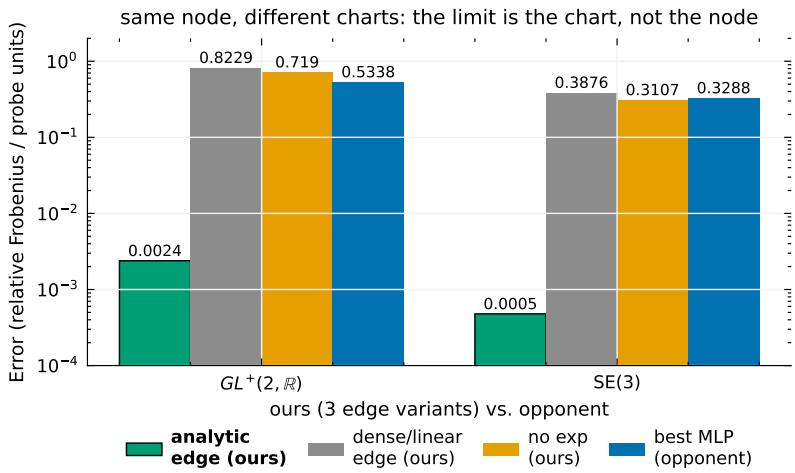

achieves a relative Frobenius error of 0.0024 and beats an MLP with 100× the parameters (0.53); a dense edge over raw coordinates does not beat the MLP. The limit is the chart and the feature span (Table 12, Section D.4).

## D.2 The mixed instance: SE(3)

SE(3), the rigid motions of space (a rotation with a translation; robot poses), is non-compact but has a surjective exponential (screw theorem), so the full design (edge → Lie algebra → exp → product) can be exact. On two composed rigid transforms the analytic edge edge is near-exact (constructed weights exact to $1 . 6 \times 1 0 ^ { - 7 } ;$ trained edge at $4 . 8 \times 1 0 ^ { - 4 }$ relative Frobenius) and orders of magnitude below a dense linear edge and an MLP h=64 (paired $\scriptstyle { p = 3 \mathrm { e } - 8 } )$ . A blind feature-group test (held-out seeds) confirms both non-linear groups are necessary and that the floor scales linearly in the translation noise (Table 1; per-seed numbers in Section D.4). One exact node, diferent charts: the limit is the chart and the feature span.

Full per-seed and extended tables are regenerated mechanically from the released JSON dumps (repro/, Appendix A); the compact summaries are in the text, and the JSON dumps are the mechanical source of every number. Below we keep the additional opponent/robustness checks and the cross-group proof with its per-seed results.

## D.3 Additional opponent and robustness checks (E18, X2, X4)

BCH ladder (E18). On the E1 task (5 seeds), replacing the Hamilton node by a truncated Baker–Campbell– Hausdorf series leaves a floor: exact Hamilton $2 . 7 8 \pm 0 . 0 2 ^ { \circ }$ , zeroth-order sum $5 . 9 1 \pm 0 . 0 6 ^ { \circ } , + \frac { 1 } { 2 }$ commutator $4 . 0 0 \pm 0 . 0 4 ^ { \circ } , + \mathrm { t r i p l e }$ commutators $3 . 8 8 \pm 0 . 0 6 ^ { \circ } \ ( p \leq 4 . 5 \mathrm { e } - 6$ against Hamilton); at order 2 the truncation already costs no fewer scalar operations than the exact product. The flop-lean rotation identity agrees with the quaternion sandwich to 9.5e−7.

Non-Gaussian noise (X2). With uniform and Laplace input/target noise at matched root-mean-square (RMS) noise, the ordering is unchanged at every $\sigma \in \{ 0 . 0 5 , 0 . 1 0 , 0 . 2 0 \}$ : e.g. Laplace σ=0.10: LawKAN-SU(2) $8 . 9 0 \pm 0 . 0 5 ^ { \circ }$ vs MLP-Quat $h { = } 3 2 ~ 1 0 . 2 0 { \pm } 0 . 1 5 ^ { \circ }$ (paired $\scriptstyle { p = 5 . 7 \mathrm { e - } 5 ) }$ ; uniform $\sigma { = } 0 . 1 0 \colon 9 . 3 6 \pm 0 . 0 3 \mathrm { v s } 1 0 . 5 9 \pm 0 . 2 2 ^ { \circ }$ (paired $\mathrm { \ p { = } 4 . 9 e { - } 4 ) }$ . RPMG does not change the ordering.

Vector Neurons (X4). A minimal $\mathrm { S O ( 3 ) }$ -equivariant VN-MLP (h=8) reaches $1 2 . 1 2 \pm 1 . 2 8 ^ { \circ }$ against LawKAN-SU(2) $2 . 7 8 \pm 0 . 0 2 ^ { \circ } \ ( p { = } 1 . 3 \mathrm { e } { - } 4 )$ and $\mathrm { M L P \mathrm { - } Q u a t + R P M G ~ 3 . 4 2 \pm 0 . 1 5 ^ { \circ } } \colon$ equivariant transport of the input axes is not a substitute for a composition law.

## D.4 Cross-group characterization: proof and per-seed results

Principle (chart spanning). Let $\chi : U \to G$ be a chart, $h ( x ) = \exp ( W F ( x ) )$ , and suppose the architecture is exact for two-fold composition on $U \times U \colon \ h ( x _ { 2 } ) h ( x _ { 1 } ) = \chi ( x _ { 2 } ) \chi ( x _ { 1 } )$ for all $x _ { 1 } , x _ { 2 } \in U$ . With $s ( x _ { 1 } ) : =$ $h ( x _ { 1 } ) \chi ( x _ { 1 } ) ^ { - 1 }$ this gives $h ( x _ { 2 } ) s ( x _ { 1 } ) = \chi ( x _ { 2 } ) \colon$ the left side depends on $x _ { 1 }$ only through s, the right only on x2, so both equal a constant $c , { \mathrm { i . e . ~ } } h ( x ) = \chi ( x ) c ^ { - 1 }$ . Substituting back gives $c ^ { - 1 } \chi ( x _ { 1 } ) c ^ { - 1 } = \chi ( x _ { 1 } )$ for all $x _ { 1 } \in U ;$ at the identity this forces $c ^ { 2 } = { \dot { e } } .$ , so c is a central involution $( c = e , \mathrm { o r } c = - I$ in the double-cover case). Hence $h \equiv \chi$ up to a central involution, and since the readout and every reported metric are invariant under the $\mathrm { S U } ( 2 )  \mathrm { S O } ( 3 )$ cover (Remark 6), exactness on the product set forces log χ to lie in the row space of $F$ up to this double cover, and conversely. For the no-exp variants, replace log χ by $\chi .$

Table 12: Transfer to the non-compact group $G L ^ { + } ( 2 , \mathbb { R } )$ (v2): relative Frobenius error, five seeds (per-seed values rounded to three decimals). Structured carries the six analytic Iwasawa features; the retracted v1 run is reported below.
<table><tr><td>Model</td><td>Params</td><td>Rel. Frobenius Per-seed</td><td></td></tr><tr><td>LawK  $\mathrm { { A N - G L ^ { + } } }$  (exp, all inputs)</td><td>48</td><td> $0 . 8 2 3 \pm 0 . 0 0 5$ </td><td>[0.818, 0.828, 0.819, 0.829, 0.820]</td></tr><tr><td>LawKAN-GL+ (no exp: edge emits the group element)</td><td>48</td><td> $0 . 7 1 9 \pm 0 . 0 0 4$ </td><td>[0.723, 0.718, 0.714, 0.723, 0.717]</td></tr><tr><td>Lawl  $\mathbf { \nabla } \cdot \mathbf { { K } } \mathbf { { K } } \mathbf { { - G L } } ^ { + }$  (analytic edge)</td><td></td><td></td><td>48 0.0024 ± 0.0005 [0.003, 0.002, 0.002, 0.003, 0.003]</td></tr><tr><td>MLP h=3 (matched)</td><td>55</td><td> $0 . 8 0 6 \pm 0 . 0 9 4$ </td><td>[0.729, 0.686, 0.945, 0.873, 0.796]</td></tr><tr><td>MLP h=64</td><td>4996</td><td> $0 . 5 3 4 \pm 0 . 0 1 6$ </td><td>[0.543, 0.504, 0.553, 0.534, 0.535]</td></tr></table>

E22/E23 (SE(3), full design and feature ablation). Numbers are in Section 4; per-seed values and the blind-test details are in the prediction log (E22, E23; Appendix K).

E16 v1 (retracted). The early $G L ^ { + } ( 2 , \mathbb { R } )$ run used only 2 of the 4 Iwasawa inputs (relative Frobenius $0 . 9 0 0 { \pm } 0 . 0 1 4$ , 72 params); it is superseded by the full-input runs of Table 12 and kept here only for provenance.

E21 (analytic edge is discoverable). Starting from a generic 24-feature dictionary and pruning to the top-m features with retraining selects exactly the six analytic Iwasawa features $( \mathrm { t o p } { - } 6 = \mathrm { a n a l y t i c }$ on the recorded seed) and reaches the exact level at $m { = } 6 .$ beating the unpruned dictionary (replication seeds 10–14):
<table><tr><td>features kept m</td><td>2</td><td>4</td><td>5</td><td>6</td><td>12</td><td>24 (dense)</td></tr><tr><td>error</td><td>0.81</td><td>0.48</td><td>0.29</td><td>0.0026</td><td>0.0045</td><td>0.0069</td></tr></table>

## E Compact-instance details: full SO(3) readout and plots

Table 13: Full SO(3) readout (E30): geodesic error (deg), mean ± std; target-noise-only bound $5 . 4 8 ^ { \circ }$ , Monte-Carlo floor with input noise $6 . 0 5 ^ { \circ }$ (E36). Paired vs LawKAN-SU(2): Lie head and MLP-Quat $\scriptstyle p = 4 . 8 \mathrm { e } - 5 .$ . The 6D and 9D-SVD rows use the corrected Shepperd conversion; they are tied within noise, and the LawKAN/Lie/MLP ordering is unchanged.
<table><tr><td rowspan=1 colspan=1>Model                              Error (deg)</td></tr><tr><td rowspan=1 colspan=1>LawKAN-SU(2)                 ${ \bf 6 . 1 2 \pm 0 . 0 5 }$ </td></tr><tr><td rowspan=1 colspan=1>Lie head (strongest opponent)     $6 . 8 6 \pm 0 . 1 0$ </td></tr><tr><td rowspan=1 colspan=1>MLP-Quat h=32 (+RPMG)       $7 . 0 5 \pm 0 . 0 8$ </td></tr><tr><td rowspan=1 colspan=1>MLP-6D h=32                      $7 . 7 3 \pm 0 . 1 7$ </td></tr><tr><td rowspan=1 colspan=1>MLP-9D-SVD h=16                $7 . 7 3 \pm 0 . 0 8$ </td></tr></table>

Figure A2: Capacity curves under the fixed exp +Hamilton node (E31/E31b/E31c, E13): geodesic error against parameters for MLP and Fourier edges sharing the node, with the no-node control band (grey; the full opponent matrix is Figure 2) and the Bayes floor (dashed). The 54-parameter Fourier edge matches a 278-parameter MLP edge (228 vs 588 forward FLOPs/example, Appendix B.8); points are mean ± std over seeds.  
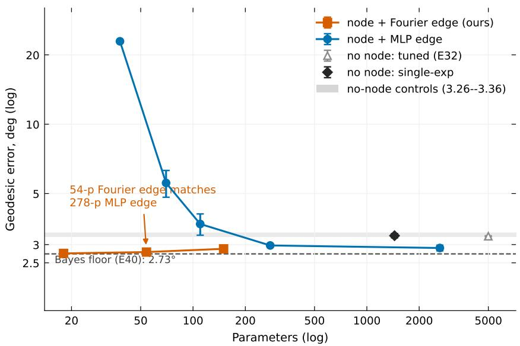

Table 14: Full opponent matrix: geodesic error (deg), mean ± std, input/output noise $\sigma { = } 0 . 0 3 .$ , target-noise-only floor ≈ 1.9◦; the 9D-SVD family is shown to h=16; the tuned rows are at each opponent’s best learning rate (E38).
<table><tr><td>Model</td><td>Params</td><td>Error (deg)</td></tr><tr><td>LawKAN-SU(2), edge: Fourier (K=1), node: exact</td><td>54</td><td> ${ \bf 2 . 7 8 \pm 0 . 0 2 }$  (5 seeds)</td></tr><tr><td>Opponents</td><td></td><td></td></tr><tr><td>MLP + quaternion head h=32</td><td>1476</td><td> $3 . 3 6 \pm 0 . 0 6$  (5 seeds)</td></tr><tr><td>MLP + quaternion head h=32 + RPMG (Chen et al., 2022)</td><td>1476</td><td> $3 . 4 2 \pm 0 . 1 5 ~ ( 5 ~ \mathrm { s e e d s } )$ </td></tr><tr><td>MLP + quaternion head h=16</td><td>484</td><td> $3 . 7 7 \pm 0 . 0 7$ </td></tr><tr><td> $\mathrm { M L P } + 6 \mathrm { D } \ h { = } 3 2 \ \mathrm { ( Z h o u }$  et al., 2019)</td><td>1542</td><td> $3 . 9 1 \pm 0 . 1 1$ </td></tr><tr><td> $\mathrm { M L P } + \mathrm { 6 D } \ h { = } 1 6 \ ( \mathrm { Z h o u \ e t \ a l . , 2 0 1 9 } )$ </td><td>518</td><td> $4 . 4 9 \pm 0 . 6 5 ~ ( 5 ~ \mathrm { s e e d s } )$ </td></tr><tr><td> $\mathrm { M L P } + 9 \mathrm { D - S V D } \ h { = } 1 6$  (Levinson et al., 2020)</td><td>569</td><td> $4 . 3 2 \pm 0 . 4 6$ </td></tr><tr><td>RealKAN + 6D head h=16</td><td>550</td><td> $4 . 9 0 \pm 0 . 2 6$ </td></tr><tr><td>MLP + quaternion head  $h { = } 8$ </td><td>180</td><td> $5 . 8 4 \pm 0 . 2 4$ </td></tr><tr><td> $\mathrm { M L P } + 9 \mathrm { D } { - } \mathrm { S V D } \ h { = } 8$ </td><td>225</td><td> $7 . 1 1 \pm 0 . 3 4$ </td></tr><tr><td> $\mathrm { M L P } + 6 \mathrm { D } \ h { = } 8$  (Zhou et al., 2019)</td><td>198</td><td> $7 . 5 6 \pm 0 . 2 7$ </td></tr><tr><td>RealKAN + 6D head h=8</td><td>278</td><td> $7 . 8 3 \pm 0 . 3 6$ </td></tr><tr><td>MLP + quaternion head  $h { = } 4$ </td><td>76</td><td> $1 1 . 0 8 \pm 0 . 3 0$ </td></tr><tr><td> $\mathrm { M L P } + 9 \mathrm { D } { - } \mathrm { S V D } \ h { = } 4$ </td><td>101</td><td> $1 2 . 0 6 \pm 0 . 5 3$ </td></tr><tr><td> $\mathrm { M L P } + 6 \mathrm { D } \ h { = } 4$  (Zhou et al., 2019)</td><td>86</td><td> $1 3 . 8 1 \pm 0 . 9 3$ </td></tr><tr><td>MLP h=4 (atan2 head)</td><td>76</td><td> $1 5 . 1 4 \pm 1 . 4 4 ( 5 ~ \mathrm { s e e d s } )$ </td></tr><tr><td>RealKAN 2-layer K=3</td><td>168</td><td> $1 9 . 9 7 \pm 1 . 1 6$ </td></tr><tr><td>RealKAN K=3</td><td>56</td><td> $3 2 . 5 0 \pm 0 . 2 2$ </td></tr><tr><td>Tuned learning rate (E38)</td><td></td><td></td></tr><tr><td>MLP + quaternion head  $h { = } 6 4 ,$  tuned</td><td>4996</td><td> $3 . 2 5 \pm 0 . 0 2$  (5 seeds)</td></tr><tr><td> $\mathrm { M L P } + 6 \mathrm { D } ~ h { = } 1 6 ,$  tuned</td><td>518</td><td> $4 . 0 0 \pm 0 . 5 4$  (5 seeds)</td></tr><tr><td>MLP h=4 (atan2), tuned</td><td>76</td><td> $1 4 . 4 1 \pm 1 . 0 5$  (5 seeds)</td></tr></table>

Figure A3: Sample-eficiency curves (E4): LawKAN-SU(2)@N=50 ≈ 6D@N=1600 (within noise); against the fixed-protocol opponent structure saves ≈ 32× data, against the strongest tuned opponent ≈ $7 \times$ (E39).  
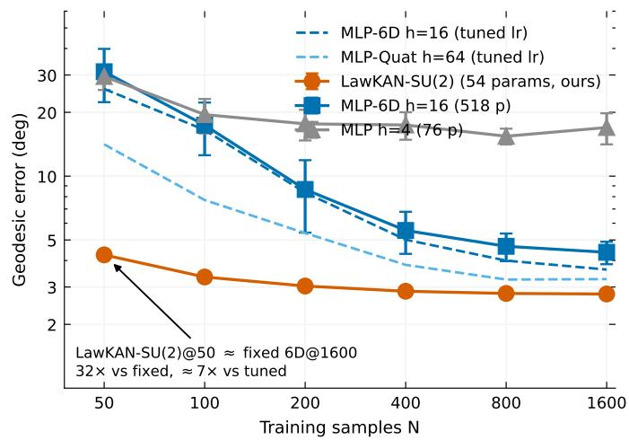

Table 16: Bayes floor (the reported-metric minimizer gives the same floor) and the gap to it; unrounded $n { = } 2$ floor $2 . 7 3 3 ^ { \circ }$ (matched to the E1 test draws, E40) (Appendix D).
<table><tr><td>Task</td><td></td><td>Bayes floor LawKAN-SU(2)</td><td>Top opponent</td></tr><tr><td>n=2 (fixed angles)</td><td> $2 . 7 3 ^ { \circ }$ </td><td> $2 . 7 8 ^ { \circ } \ ( + 0 . 0 5 ^ { \circ } )$ </td><td> $3 . 3 6 ^ { \circ } \ ( + 0 . 6 3 ^ { \circ } )$ </td></tr><tr><td>n=3 (fixed angles)</td><td> $3 . 0 6 ^ { \circ }$ </td><td> $3 . 1 9 ^ { \circ } \ ( + 0 . 1 3 ^ { \circ } )$ </td><td> $6 . 6 0 ^ { \circ } \ ( + 3 . 5 4 ^ { \circ } )$ </td></tr><tr><td> $n { = } 2$  random</td><td> $3 7 . 7 ^ { \circ }$ </td><td> $3 8 . 2 1 ^ { \circ } \ : \left( + 0 . 5 ^ { \circ } \right)$ </td><td> $4 6 . 4 8 ^ { \circ } \ : \left( + 8 . 8 ^ { \circ } \right)$ </td></tr></table>

Table 15: Synthetic IMU probe: geodesic error (◦), 20-step trajectories; lower rows: low-data run (50 trajectories).
<table><tr><td>Model</td><td>Params</td><td> $\mathrm { E r r o r , ~ } ^ { \circ }$ </td></tr><tr><td>LawKAN-SU(2)</td><td>27</td><td> $\mathbf { 0 . 0 8 2 \pm 0 . 0 0 0 }$ </td></tr><tr><td>MLP h=8</td><td>596</td><td> $1 8 . 1 \pm 1 . 0$ </td></tr><tr><td> $\mathrm { M L P \ h { = } 3 2 }$ </td><td>3,140</td><td> $9 . 1 5 \pm 0 . 1 1$ </td></tr><tr><td>MLP-Quat  $h { = } 3 2 \mathrm { ~ + ~ } \mathrm { R P M G }$ </td><td>3,140</td><td> $9 . 2 1 \pm 0 . 0 7$ </td></tr><tr><td>low-data: LawKAN-SU(2)</td><td>27</td><td> $0 . 0 8 9 \pm 0 . 0 0 6$ </td></tr><tr><td>low-data: MLP h=32</td><td>3,140</td><td> $4 2 . 6 \pm 1 2 . 3$ </td></tr></table>

## E.1 Battery, sample eficiency and accounting

The margin holds across the battery (Appendix D): at $n { = } 2 ,$ at $n { = } 3$ and at the poles LawKAN-SU(2) leads the strongest head by a factor that grows with depth and extrapolation, and RPMG (Chen et al., 2022) on the same head is statistically indistinguishable from it and still loses. Sample eficiency: LawKAN-SU(2) at N=50 matches the fixed-protocol 6D baseline at N=1600 within noise (about 32× fewer samples at matched error; against the strongest tuned opponent the ratio is about 7×, E39), with no crossover up to $N { = } 3 2 0 0$ and no advantage beyond the plateau. Accounting: under one convention (Appendix B.8) LawKAN-SU(2) needs 228 FLOPs/example against 2848 for the strongest head — 12× fewer FLOPs and $2 7 \times$ fewer parameters at matched accuracy (92× against the strongest tuned head) — at a raw cost $\sim 1 . 8 \times$ the tiny MLP, the price of built-in algebra; the figure counts every transcendental as one FLOP, so it understates exp /atan2 and on wall-clock LawKAN-SU(2) is the slower of the two. The Hamilton node is the flop-cheapest exact composer (Appendix D.3). Full tables and the sample-eficiency and noise curves are Figures A3 and $\mathrm { A 4 } ;$ the full $\mathrm { S O ( 3 ) }$ readout is Table 13.

## E.2 Justification notes for the benchmark

Here “strongest” refers to the standard rotation-head matrix, whose strongest row is MLP-Quat h=32 (3.36); the no-node single-exp MLP-Lie control reaches 3.29 (Table 17) but is a diferent readout class and is reported as a control, not as a matrix opponent. The gap to the strongest fixed-protocol opponent grows with depth; the Lie-algebra baseline $( \mathrm { M L P } \to { \mathfrak { s o } } ( 3 ) \to \exp )$ does not close it, so the parameterization alone does not explain the win. Tuning the opponent does not close it either (the best of nine $h \times$ lr cells stays above the model; at its own best rate the h=32 edge moves from 2.90 to $2 . 8 6 ^ { \circ }$ , E38), and training directly on the reported metric does not move it; the parameter margin should therefore be read as bounding the whole structured design, not the node alone. Seeds are shared across rows, so the gap over MLP-Quat h=32 is significant (disjoint 95% CIs, Appendix A.4); the ranking is robust to the opponent’s learning rate (a registered three-rate sweep), and enlarging the Fourier order does not help (a Fourier-order ablation; Table 27).

Node/edge isolation details. With the same exp +Hamilton node, Fourier and MLP edges $h { \geq } 8$ beat both no-node controls (paired $p < 0 . 0 1 ;$ ; capacity curves in Figure A2), and the linear-edge failure is what the span criterion predicts: log χ is not in the span of four raw phase features. The 18-parameter analytic edge is the cheapest point; the Fourier edge matches a 278-parameter MLP edge at a fraction of its forward FLOPs (Appendix B.8). Full-SO(3) readout: LawKAN-SU(2) stays the most accurate at 27× fewer parameters, now against the Lie head (6.12 vs 6.86◦), and $\mathrm { i s \ t 0 . 0 7 ^ { \circ } }$ above the Monte-Carlo floor with input noise (strongest opponent $+ 0 . 8 1 ^ { \circ }$ ; Table 13). The margin holds across the battery and the stress tests (Section E.3); sample eficiency and the unified FLOP/parameter accounting are in Section E.1.

Table 17: Node/edge isolation on the composition task (5 seeds): one fixed exp +Hamilton node, diferent edges (upper block); no-node controls (lower block). Mean ± std, geodesic degrees; bold marks the best row. The 54-parameter Fourier edge is the default used in the main text and is within noise of the 18-parameter analytic edge.
<table><tr><td>Edge (same node unless noted)</td><td>Params</td><td>Error (deg)</td></tr><tr><td>Fourier edge (K=1)</td><td>54</td><td> $2 . 7 8 \pm 0 . 0 2$ </td></tr><tr><td>analytic edge</td><td>18</td><td> ${ \bf 2 . 7 5 \pm 0 . 0 2 }$ </td></tr><tr><td>MLP edge (h=8)</td><td>278</td><td> $2 . 9 7 \pm 0 . 0 4$ </td></tr><tr><td>MLP edge (h=32)</td><td>2630</td><td> $2 . 9 0 \pm 0 . 0 8$ </td></tr><tr><td>MLP edge (h=32, best lr)</td><td>2630</td><td> $2 . 8 6 \pm 0 . 0 3$ </td></tr><tr><td>MLP edge (h=4, 2 layers)</td><td>110</td><td> $3 . 6 9 \pm 0 . 3 9$ </td></tr><tr><td>MLP edge  $( h { = } 4 , 1 \ \mathrm { l a y e r } )$ </td><td>70</td><td> $5 . 5 6 \pm 0 . 7 4$ </td></tr><tr><td>MLP edge (h=2, 1 layer)</td><td>38</td><td> $2 2 . 9 \pm 0 . 4$ </td></tr><tr><td>linear edge</td><td>30</td><td> $1 3 . 3 \pm 0 . 1$ </td></tr><tr><td>no node: plain MLP-Quat h=32</td><td>1476</td><td> $3 . 3 6 \pm 0 . 0 6$ </td></tr><tr><td>no node: single-exp MLP-Lie h=32</td><td>1443</td><td> $3 . 2 9 \pm 0 . 1 0$ </td></tr></table>

IMU details. LawKAN-SU(2) computes the magnitude through a linear channel and the direction through the K=1 Fourier phase pair; the pruned edge reduces to the analytic edge; the network maps the whole sequence to the total rotation in one pass and does not iterate the ODE. For the real probe, the dataset is split into 800 training and 2000 testing examples with no overlap between the splits; we evaluate 3 seeds with the true $\mathrm { S O ( 3 ) }$ geodesic (an earlier rotvec-chart metric, discontinuous at π, is retracted). Synthetically the shared 27-parameter edge is at the metric floor while MLPs two orders of magnitude larger stay far above it (Table 15).

Arm-calibration details. The per-joint SE(3) correction is ahead of PoE at every size: paired $\scriptstyle p = 0 . 0 1 9$ at N=20, p=0.06–0.84 at larger sizes; it beats the residual MLP at N=20 (p=0.005) and $N { = } 4 0 \ ( p { = } 0 . 0 4 9 )$ tied at N=60/80 (N=80: 1.42 vs 1.45 mm, p=0.85). TOST (margin 10% of the classical baseline, α=0.05) certifies parity at $N { \ge } 4 0 { : }$ paired diferences $- 0 . 0 0 7 / - 0 . 0 3 1 / - 0 . 0 6 2 \mathrm { m m }$ , 90% CIs inside the margin (TOST $p { = } 0 . 0 0 4 / 0 . 0 0 0 3 / 0 . 0 2 5 )$

## E.3 Boundaries: stress tests

All stress tests use the dense edge (54 parameters, K=1), the architecture-agnostic default: the pruned edge is a derived construction (valid only where the composition angles are fixed and known) and cannot relax these boundaries; where it applies it shifts them in our favor (Section H.3, Section F.1).

Noise, extrapolation and depth. Across input/target noise LawKAN-SU(2) degrades linearly and dominates the whole curve (the gap at low noise is the opponent’s approximation residual, not noise); out of band the Fourier edge and the group law are global by construction, so the poles are not special (the standard head degrades $1 . 9 \times  4 . 0 \times$ against 1.24× for LawKAN-SU(2); Figure A4). Depth helps within the learnable regime: at $n { = } 3$ the gap over the strongest head is ∼2×, and along chains up to eight factors the advantage widens as the opponent degrades superlinearly, until every architecture leaves the learnable regime (around n=6 the compact instance turns seed-bimodal, and by n=8 all models are at chance; Appendix D).

Mismatch: the imposed law is not the task’s. With inputs, noise and budget held fixed but a target with no group law (a mildly warped sum of phases), the Hamilton node is a mismatch: $2 3 . 8 7 \pm 0 . 4 1 ^ { \circ }$ against $1 2 . 6 4 \pm 3 . 0 0$ for an MLP h=4 and $3 . 4 5 \pm 0 . 3 5$ for $\mathrm { M L P - Q u a t } \ h { = } 3 2$ . With random hidden angles the target is not a function of the input, every architecture faces irreducible uncertainty, and the margin narrows to the

Figure A4: (a) Error vs noise σ: LawKAN-SU(2) dominates the whole curve; the 2.2× gap at $\sigma { = } 0 . 0 1$ is the opponent’s approximation residual. (b) Pole extrapolation: the standard head degrades $1 . 9 \times  4 . 0 \times$ against 1.24× for LawKAN-SU(2).  
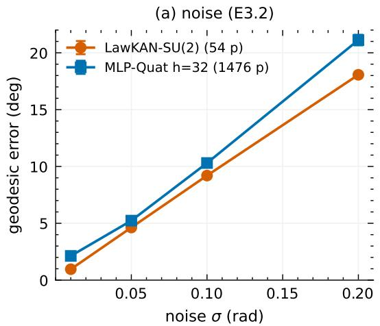

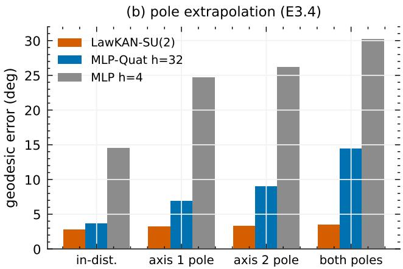

Bayes floor; when the angle is supplied (IMU and kinematic probes) varying angles are handled well. The advantage is therefore structure–task alignment, not a universal parameterization win, and Table 6 maps the task types. The registered $\mathbb { Z } _ { n } / \mathrm { B K T }$ analogy did not appear and remains motivation only.

Two further isolated probes, the synthetic forward-kinematics calibration and the rigid-body ODE with a state-conditioned edge, are deferred to Appendix G: they close their synthetic targets (a 4× margin over an MLP, and the numerical floor of the analytic integrator, respectively) without changing the envelope.

## F Applied-probe details

## F.1 IMU orientation (controlled and real BROAD)

The first applied block reconstructs orientation from angular velocity (20 integration steps), evaluated on the real BROAD dataset (Laidig et al., 2021b;a) (consumer gyroscopes at 286 Hz, structured noise, optical ground truth) and on a controlled synthetic benchmark. The map $\omega _ { s } \mapsto \exp ( \omega _ { s } d t )$ is the same at every step, so one shared edge (27 parameters, pruned to 18) learns that single step while the exact node composes all 20 in one pass; baselines are the training-free strapdown integrator (Titterton & Weston, 2004), flat MLPs, a GRU and a residual MLP, and RPMG (Chen et al., 2022). The real probe uses 16 disturbed trials with a trial-level split (3 seeds, true SO(3) geodesic); details, the synthetic block and the early retracted metric are below.

On the real sensor the same structure stays on the rotation manifold at every horizon while the flat MLPs leave it, and the pruned 18-parameter edge is seed-stable and is the only learned model to achieve parity with the training-free integrator at 5 s; synthetically the shared edge is at the metric floor while much larger MLPs stay far above it (Table 15). The win here is not competing with the group law but suppressing structured gyro noise without seed selection. For scope, the classical AHRS fusion filter VQF (Laidig & Seel, 2023) reaches $0 . 2 0 / 0 . 5 4 / 0 . 6 8 ^ { \circ }$ on the same windows with the gyroscope and accelerometer — a diferent input class, listed as a reference; the like-for-like gyro-only classical bound remains the training-free integrator.

## F.2 Gyroscope calibration (same sensor)

The second block calibrates the angular-velocity sensor itself: fit $\omega _ { \mathrm { t r u e } } = M ( \omega _ { \mathrm { r a w } } - b )$ (scale/misalignment M, bias b) on a 70/30 split of the (non-overlapping) windows pooled from the 23 undisturbed BROAD trials, and evaluate strapdown integration with the corrected measurements on the held-out 30%. The learned 12-parameter (M, b) matches the classical Levenberg–Marquardt (LM) fit of the same model at every horizon $( \mathrm { d i f f e r e n c e s } \le 0 . 0 0 9 ^ { \circ }$ ; deterministic fits, so the parity is exact rather than statistical) and gains $0 . 0 4 4 ^ { \circ }$ over

Table 18: Real BROAD IMU orientation at three horizons, geodesic error (◦): 27-p dense edge up to 0.07 s, 36-p at longer horizons where a bias feature is added, 18-p sparse; the dense edge is seed-bimodal at long horizons; per-seed values are listed and the failing seed is environment-dependent. The synthetic block is Table 15. 3 seeds; the classical same-class comparator is the training-free strapdown. †Classical AHRS fusion filter (Laidig & Seel, 2023); it uses the accelerometer (diferent input class) and is shown as a scope reference, not as a gyro-only comparator.
<table><tr><td>Model</td><td>0.07s</td><td>1.0s</td></tr><tr><td>VQF 6D† fusion (gyro+accel)</td><td>0.201</td><td>0.536</td></tr><tr><td>Strapdown (training-free)</td><td>0.394</td><td>1.148</td></tr><tr><td>LawKAN-SU(2) dense (27/36p)</td><td>0.423</td><td>1.147 / 1.089 / 1.186 1.142 / 1.185 / 73.1</td></tr><tr><td>LawKAN-SU(2) sparse (18p)</td><td></td><td>1.057±0.000 1.189±0.008</td></tr><tr><td>MLP h=8</td><td>0.534</td><td>47.2</td></tr><tr><td>MLP h=32</td><td>0.552</td><td>58.8</td></tr><tr><td>GRU  $h { = } 3 2 ~ ( 3 , 9 3 9 \mathrm { p } )$ </td><td></td><td>102.2 14.9 (28.3t) 78.7 (83.0t)</td></tr><tr><td>residual MLP</td><td></td><td>1.55 2.58</td></tr></table>

Figure A5: BROAD real-IMU (log scale): the training-free integrator and the pruned 18-p edge stay on the manifold; the dense edge is seed-bimodal (dots = seeds; one diverges at 5 s, so its mean is far above the median); the flat MLP leaves the manifold.  
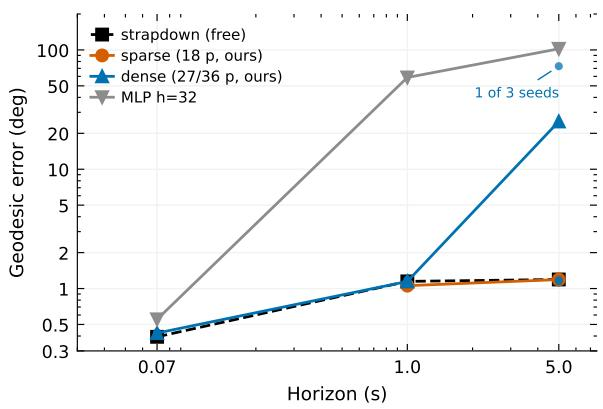  
per-trial bias subtraction, from physically sane parameters (Table 19). This is a parity cell, not a win: the group-law structure is not where the gain lies on this task, and here parity is deterministic rather than statistical — the learned (M, b) reaches the LM optimum on every window (Table 19).

## F.3 Deployment profile

Deployment is cheap and reproducible: one forward pass per window, no recurrent state or sampling variance at inference, training without ensembles or reseeding; a fit takes minutes on one CPU, and the full arm protocol (Section 5.1) — all sizes, seeds and models — takes hours. Energy and embedded latency are not measured (Limitations).

Table 19: Gyroscope calibration (X6): geodesic error (◦) of strapdown integration with corrected measurements on the held-out split; $\Delta = \mathrm { g a i n }$ over bias-only subtraction. The TinyGC-style row is measured under this protocol: its subnet reduces to the same afine class (Cui & Zhao, 2024) and matches the LM fit within $0 . 0 0 2 ^ { \circ }$ at every horizon; 3 seeds.
<table><tr><td>Correction</td><td>0.07s</td><td>0.35 s</td><td>1.0s</td><td> $\Delta _ { \mathrm { m a x } }$ </td></tr><tr><td>none (raw integration)</td><td>0.594</td><td>1.161</td><td>1.453</td><td></td></tr><tr><td>bias-only, per-trial</td><td>0.593</td><td>1.144</td><td>1.374</td><td></td></tr><tr><td>classical LM (M, b) (12p)</td><td>0.588</td><td>1.100</td><td>1.362</td><td>0.044°</td></tr><tr><td>LawKAN-SU(2), learned (M, b) (12p)</td><td>0.588</td><td>1.100</td><td>1.371</td><td>0.044°</td></tr><tr><td>TinyGC-style subnet (27p)</td><td>0.589</td><td>1.101</td><td>1.363</td><td> $0 . 0 4 3 ^ { \circ }$ </td></tr></table>

Table 20: Multi-platform FK calibration (X10, P48): held-out position error (mm, mean $\pm \ \mathrm { s t d } \rangle$ our screw-coordinate model $( 5 5 / 4 8$ parameters) vs the constant base/tool fit (12 parameters). FR3 data: (Nadeau, 2024); UR10: IPA Series A (Landgraf et al., 2021; Landgraf, 2021); UR5: pauljac, 1020 poses, position-only (Yao et al., 2026; Jacobi, 2025). UR10 at N=20 is seed-unstable.
<table><tr><td>Platform  $\left( \mathrm { L a w K A N  – S E ( 3 ) } \right)$ </td><td> $\mathrm { c o n s t . \ f i t , \ } N { = } 8 0$ </td><td> $N { = } 2 0$ </td><td> $N { = } 4 0$ </td><td> $N { = } 8 0$ </td><td> $\mathrm { g a i n } , N { = } 8 0$ </td></tr><tr><td>FR3 (55p)</td><td> $3 . 3 4 \pm 0 . 0 9$ </td><td> $1 . 7 8 \pm 0 . 1 8$ </td><td> $1 . 4 3 \pm 0 . 1 0$ </td><td> ${ \bf 1 . 3 2 \pm 0 . 1 3 }$ </td><td>2.5×</td></tr><tr><td>UR10  $( 4 8 \mathrm { p } )$ </td><td> $0 . 7 6 \pm 0 . 0 1$ </td><td> $1 . 1 6 \pm 1 . 2 6$ </td><td> $0 . 4 7 \pm 0 . 0 3$ </td><td> $\mathbf { 0 . 4 3 \pm 0 . 0 1 }$ </td><td>1.8×</td></tr><tr><td>UR5  $( 4 8 \mathrm { p } , \mathrm { p o s } . )$ </td><td> $0 . 5 1 \pm 0 . 0 2$ </td><td> $0 . 2 5 \pm 0 . 0 4$ </td><td> $0 . 1 6 \pm 0 . 0 2$ </td><td> $\mathbf { 0 . 1 4 \pm 0 . 0 0 }$ </td><td>3.7×</td></tr></table>

Figure A6: Three-platform FK calibration (X10): held-out error against training size per platform; constant fit (grey), dense screw model, rotation-only sparse; gains at $N { = } 8 0                   : ~ 2 . 5 { \times } / 1 . 8 { \times } / 3 . 7 { \times } ;$ UR10 at $N { = } 2 0$ is seed-unstable.  
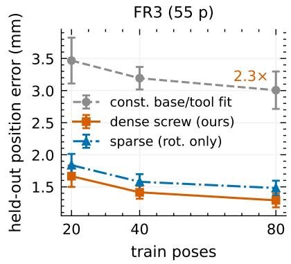

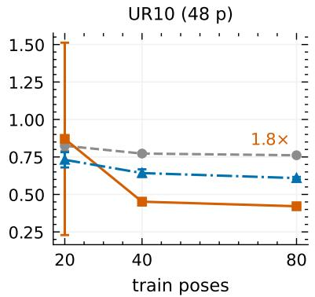

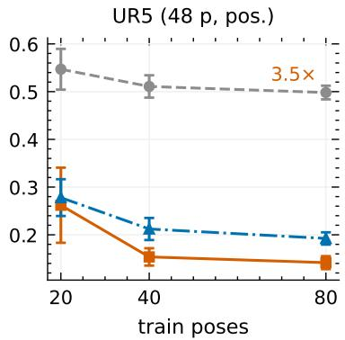  
The isolated correction on the ABB range-only protocol is already ahead of the same-class exact screw fit at N=40 (1.70 vs 1.83 mm, p=0.039; 10 seeds) and below it at $N \geq 8 0 ;$ it is below the GN fit numerically at $N \geq 8 0$ and significantly from $N \geq 1 6 0$ (Table 5); a Gauss–Newton fit of the same class reaches $1 . 4 1 / 1 . 2 0 / 1 . 1 4$ mm at $N { = } 8 0 / 1 6 0 / 3 2 0$ , numerically between the exact and isolated results. On the socket protocol the dense screw (55p) control is in the table and the joint control in Figure A8; on the FR3 unit the dense per-joint screw wins (a base-form boundary), consistent with its large base mismatch. On the Kinova platform, the reduced edge underfits the large base mismatch, so $\psi$ must absorb a large residual. The socket objective scores the scatter of each socket around its own predicted mean (socket\_loss), so a map that sends a whole configuration class to one point has near-zero scatter — a degenerate minimum. On $2 / 1 0$ seeds the optimizer reaches this collapse basin instead of the correct calibration (iso 3.06/2.81 vs edge $2 . 1 2 / 2 . 3 9 ;$ the paired test over all 10 seeds gives $\scriptstyle { p = 0 . 2 6 } ;$ TOST fails; Figure A7); this is a property of the unregularized global head — local-kernel and two-slot heads remove it (Section 5.1, Appendix G) — whereas the shufled-label control below shows the metric is robust against degenerate minima when the constraint is real. In the shufled-label control (rng(2000) permutation of the concatenated sockets, all else identical) the

isolated correction stays at 60.5/59.3 mm on KUKA/Panda after 3000 steps versus $0 . 1 9 / 0 . 3 6$ mm under the real constraint, so workspace collapse does not artificially minimize the socket metric. The registered pooled criterion (Fisher over the ABB $N { = } 8 0$ and KUKA front paired tests, 10 seeds) gives $\chi ^ { 2 } { = } 5 8 . 5 , p { \approx } 6 { \cdot } 1 0 ^ { - 1 2 }$ The extension rule admits Kinova to the pooled claim if its own gate passes; under the recommended local kernel it does (kernel vs reduced edge −0.55 mm, $p { < } 1 0 ^ { - 4 }$ ; the kernel matches the dense screw, $\scriptstyle { p = 0 . 1 0 }$ non-significant), so the extended claim is made: Fisher over {ABB N=80, KUKA front, Kinova front} gives $\chi ^ { 2 } { = } 7 8 . 1 , p { \approx } 9 { \cdot } 1 0 ^ { - 1 5 }$ across three platforms. Within-robot replication: on the two further KUKA tool sessions isolated ψ wins both $( 0 . 2 3 1 / 0 . 3 8 1$ vs edge 0.611/0.747, $p { = } 2 { \cdot } 1 0 ^ { - 4 } / 1 0 ^ { - 4 } )$ . On both applied protocols the correction is fed the canonicalized quaternion pair — q (with $w \geq 0 )$ and t per factor, 14 numbers — so the axis–angle chart never enters it; the only residual is the antipodal seam at $w { = } 0$ , a bounded jump that costs a peak (13.2 → 9.6 mm) but not the final error (X57).

Figure A7: Seed stability of the relaxation on Kinova (X32): per-seed socket RMS for the reduced edge, the global head and the local kernel. The global head collapses on the two outlying seeds (8, 9) of the ten-seed probe, above the reduced edge, while the local kernel stays below it on every seed — the instability is a small-data property of the global head, not of the correction.

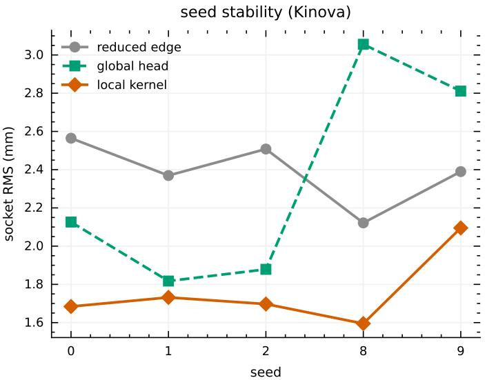  
Known-deformation probes and the shape of the deformation. Four registered probes ask where the deformation comes from (all isolated on the frozen exact edge). (i) Gravity torque (X19): a physics correction $\delta q _ { j } = \alpha _ { j } \tau _ { j } + h ( \tau _ { j } )$ using the nominal gravity torque computed from the encoders is at parity with the exact model and worse than the agnostic ψ at $N \geq 6 0 \ ( + 0 . 2 3 / + 0 . 2 7$ mm; generic $1 . 1 7 / 1 . 1 4 )$ , though it cures the agnostic small-N overfit (1.54 vs 2.49 at $N { = } 2 0 )$ : the deformation is not gravity-shaped. (ii) Workspace shift (cluster split): the pose-ψ loses $1 . 6 \mathrm { - } 1 . 9 \times$ to the exact model when whole configuration clusters are held out $( p \leq 0 . 0 0 9 ) - \mathrm { a }$ local fit, not a global law. (iii) Backlash, synthetic (X20): with matched approaches the sign of the last joint motion predicts the residual direction (1.000 alignment, permutation $p < 1 0 ^ { - 3 } )$ , and the constrained correction removes 98% of the hysteresis floor and is inert without friction. (iv) Backlash proxy on real data (X21, collected from an IPA Series A manipulator with real timestamps): inconclusive — the recording-order signature does not rise above the 0.44 mm residuals $( 3 / 6$ joints positive, $\scriptstyle { p = 0 . 9 2 ) }$ ; arm datasets carry no approach trajectories. For the gyroscope, a coning probe (X18) finds the first-order floor at 286 Hz to be quadrature-dominated $( 0 . 1 6 7 ^ { \circ }$ ; the BCH coning term $1 . 9 ^ { \circ }$ partially cancels it), removed by midpoint sampling (0.005◦); an unconstrained correction destroys it and a constrained coning-statistic map removes only 3%.

Figure A8: Two further platforms with diferent measurement modalities. (a) MUKCa socket consistency (KUKA iiwa14): held-out scatter for the nominal model, the reduced edge, the dense screw model, the isolated correction and the joint control (10 seeds); the isolated correction removes the floor below the edge. (b) RobotCali draw-wire range-only (ABB IRB 120): held-out mean |∆L| against training size; the isolated correction beats the exact screw and, for $N \geq 1 6 0$ , the same-class Gauss–Newton fit (tying it at N=80), and the local kernel adds nothing here.

(a) MUKCa, KUKA iiwa14  
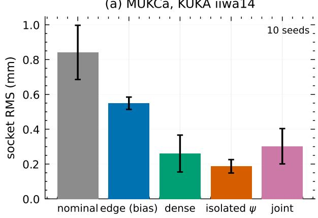

(b) RobotCali, ABB IRB 120  
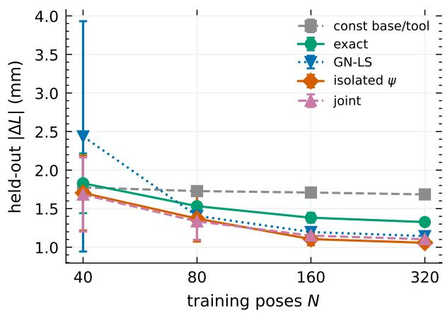

Table 21: Which correction head to apply, by setting. The two-slot (the default) is trained jointly (sequentialon-residual matches it, Section 3.4); the local kernel is the collapse-safe choice for a small, fixed, seed-unstable configuration set; a plain global head sufices where the deformation is smooth.
<table><tr><td>Setting Head</td><td>Why</td></tr><tr><td>Deformed composition, data not two-slot on KUKA; KUKA: two-slot lowest; Panda: global lowest, two- scarce (KUKA, Panda) global on Panda</td><td>slot within noise</td></tr><tr><td>Deformed arm deep-dive (FR3) two-slot</td><td>ties the best pure head; kernel-safe</td></tr><tr><td>Small fixed set, seed-unstable (Ki- local kernel nova)</td><td>the global slot re-collapses; the kernel stays below the edge</td></tr><tr><td>Range-only, smooth (ABB) global (MLP)</td><td>the kernel adds nothing</td></tr></table>

Why the baselines difer. Each protocol is compared with its classical same-class estimator. For arm calibration the classical estimator is the product-of-exponentials least-squares (à la Nadeau (2024)), which on the range-only ABB protocol is the exact screw model and its Gauss–Newton fit — so the correction is compared with the Gauss–Newton (its strongest classical form). The MUKCa socket protocol has no Gauss–Newton: its classical method is the consistency-and-distortion optimization of Franzese et al. (2025; 2024), whose full per-joint screw fit is our dense screw (the same-class reference); the LawKAN base is the uncorrected reduced edge (the correction’s base).

## G Two isolated probes: FK calibration and ODE dynamics

## G.1 Forward-kinematics calibration (5-DOF arm, synthetic)

On a synthetic 5-DOF arm with a fixed per-joint miscalibration, LawKAN-SU(2) (150 parameters; joint-wise edges $v _ { j } = \theta _ { j } a _ { j } + \mathrm { F o u r i e r } _ { j } ( \theta _ { j } )$ , composed along the chain) reaches $0 . 1 5 9 \pm 0 . 0 9 5 ^ { \circ }$ against $0 . 6 6 1 \pm 0 . 2 6 7$ for an MLP, a 4× margin that is stable over 3 seeds (Table 22); per-joint identifiability is limited by the calibration gauge. What matters here is the linear-in-θ channel (a pure Fourier edge saturates near $1 8 ^ { \circ } )$ ; the real-hardware counterpart is Section 5.1.

Table 22: Forward-kinematics calibration (synthetic 5-DOF arm, 3 seeds): endpoint-orientation error.
<table><tr><td>Model</td><td>Params</td><td>Error (°)</td></tr><tr><td>LawKAN-SU(2)</td><td>150</td><td> $\mathbf { 0 . 1 5 9 \pm 0 . 0 9 5 }$ </td></tr><tr><td>MLP h=32</td><td>1380</td><td> $0 . 6 6 1 \pm 0 . 2 6 7$ </td></tr><tr><td>MLP  $h { = } 3 2 \mathrm { ~ + ~ } \mathrm { R P M G }$ </td><td>1380</td><td> $0 . 6 7 2 \pm 0 . 2 9 3$ </td></tr></table>

## G.2 Rigid-body dynamics: a state-conditioned quadratic edge solves the ODE case (E25/E25b)

Regressing the non-chaotic solution map of the Euler equations (20-step rollouts from $\omega _ { 0 }$ only), a stateconditioned quadratic edge (39 parameters) reproduces the analytic integrator to $0 . 0 8 1 8 \pm 0 . 0 0 0 1 ^ { \circ }$ (its numerical floor), while the linear edge stalls at 7.13 and the cubic diverges (4/5, the order rule). Feed-forward one-pass controls (E25b) do not unroll (best 0.84◦), and MLPs need 34–450× more parameters for 3.4–6.1× worse error (Table 23). The ODE case is thus solved, not merely bounded: the state, not capacity, closes the gap. With an estimated state the edge order is no longer necessary (reported in the prediction log).

Table 23: Rigid-body dynamics: state-conditioned (E25) vs feed-forward (E25b) edges, degrees. State edges see the evolving ω (the model unrolls the ODE); feed-forward edges see only ω0 in one pass; the analytic integrator is at the numerical floor.
<table><tr><td colspan="2">Model Params Error (°)</td></tr><tr><td>Analytic integrator (metric floor)</td><td>0 0.0816</td></tr><tr><td colspan="2">State-conditioned (LawKAN-SE(3), E25; state edge, sees the evolving ω):</td></tr><tr><td>quadratic</td><td>39  $\mathbf { 0 . 0 8 1 8 \pm 0 . 0 0 0 1 }$ </td></tr><tr><td>linear</td><td>12  $7 . 1 3 \pm 0 . 0 2$ </td></tr><tr><td>cubic</td><td>120 diverged (4/5)</td></tr><tr><td colspan="2"></td></tr><tr><td>Feed-forward (LawKAN-SE(3), E25b; edge sees only</td><td>one pass):  $\omega _ { \mathrm { 0 } ; }$ </td></tr><tr><td>quadratic cubic</td><td>39  $1 . 5 8 \pm 0 . 0 2$  120  $0 . 8 4 \pm 0 . 0 3$ </td></tr><tr><td>linear</td><td>12  $5 . 2 1 \pm 0 . 0 4$ </td></tr><tr><td>20-step fixed input</td><td>99  $7 . 0 2 \pm 5 . 4 5$ </td></tr><tr><td>Fourier K=1 (E17)</td><td>54  $1 1 . 3 1 \pm 4 . 5 9$ </td></tr><tr><td>MLP h=32 (baseline)</td><td>1316  $0 . 2 7 6 5 \pm 0 . 0 0 8 5$ </td></tr><tr><td>MLP h=128 (baseline)</td><td>17540  $0 . 4 9 9 1 \pm 0 . 5 5 1 9$ </td></tr></table>

## G.3 Real-data audit: Baxter arm dynamics (E26b)

The real-data counterpart of the ODE probe: on recorded Baxter arm trajectories (Valencia-Vidal et al., 2025) a state-conditioned edge learns $\ddot { q } = f ( q , \dot { q } , \tau )$ , and the exact integrator (semi-implicit Euler) composes the 14-dimensional state over H=50 steps; the node carries no parameters. Training uses the squared and random trajectories (70/30), the test is the held-out segment and the transfer target is the disjoint circle trajectory (3 seeds; metric: root-mean-square error (RMSE) of the state increment; the efective sample step from the data is 2.4 ms against the journal’s 1 ms assumption, so both rates are reported). On transfer the linear edge with exact integration is the only learned model below the constant-velocity baseline and below the flat MLP, while the higher-capacity edges win in-distribution and do not transfer; the two predictions were registered in the project plan before the run, and we report that one of them (the MLP-edge variant) is refuted. The exact-integrator component therefore provides a modest, budget-sensitive advantage on this real task, not an asymptotic win, as Table 24 shows.

Table 24: Real Baxter arm dynamics (E26b): RMSE of the integrated state increment (14-dim, mixed units) over H=50 steps, three seeds. “In-dist” is the held-out segment of squared/random; “circle” is the disjoint transfer trajectory. The constant-velocity baseline is training-free; the flat MLP maps to the increment in one pass with no integration (the 2.0 ms row is rounded from the efective 2.4 ms sample step). The edge rows are LawKAN-SE(3) variants (a state edge plus the exact integrator, or a flat edge).
<table><tr><td>Edge (learned)</td><td>Params</td><td>In-dist</td><td>Circle</td></tr><tr><td>dt = 1.0 ms</td><td></td><td></td><td></td></tr><tr><td>zero (constant velocity, no learning)</td><td>0</td><td>0.063</td><td>0.126</td></tr><tr><td>linear + exact integrator</td><td>154</td><td>0.053</td><td>0.114</td></tr><tr><td>physics features + exact integrator</td><td>504</td><td>0.051</td><td>0.161</td></tr><tr><td>MLP + exact integrator</td><td>6023</td><td>0.040</td><td>0.129</td></tr><tr><td>flat MLP (no integration)</td><td>6478</td><td>0.040</td><td>0.138</td></tr><tr><td colspan="4">dt = 2.0 ms</td></tr><tr><td>zero (constant velocity, no learning)</td><td>0</td><td>0.063</td><td>0.125</td></tr><tr><td>linear + exact integrator</td><td>154</td><td>0.051</td><td>0.110</td></tr><tr><td>physics features + exact integrator</td><td>504</td><td>0.050</td><td>0.159</td></tr><tr><td>MLP + exact integrator</td><td>6023</td><td>0.037</td><td>0.139</td></tr><tr><td>flat MLP (no integration)</td><td>6478</td><td>0.040</td><td>0.138</td></tr></table>

## G.4 Almost laws: details, controls and diagnostics (X13/X14/S1/S2/S3/X16)

The Corollary bounds the node from the other side: if the composition of a real system is not exactly the chosen group law (compliance, thermal deformation, backlash), the mismatch leaves a training-independent floor that no edge can remove. We relax the law with a small learned correction while keeping everything else fixed: $R ( A , B ) = \operatorname { c o m p o s e } ( A , B ) \exp ( \psi ( f ( A ) , f ( B ) ) )$ , where ψ has a zero last layer (at initialization the relaxed model is exactly the exact model) and is shared across the chain’s compositions. Early ψ variants were a linear Fourier head over the 30 pair features (per factor: four chart angles $( \theta , a _ { x } , a _ { y } , a _ { z } )$ in the basis {1, sin x, cos x}, 12, plus three translations, 15) read out to the six se(3) components $( 3 0 \cdot 6 + 6 = 1 8 6$ parameters; with the dense per-joint edge 240, ψ-only 198) and an MLP (14→16→6, 342; totals 396/354). These change only the functional class inside the same slot (Table 26); the final default is the two-slot head – a global linear readout (186) plus a local kernel (120), 306 in all (360 with the dense edge, Section 3.4) – which is what Table 3 reports.

On the real FR3 the relaxation removes the floor. Under the two-slot head this holds at every training size, significantly from $N { \ge } 4 0 ;$ at N=20 it is within noise (1.51 vs 1.53 mm, p=0.84; isolated 1.12 at N=80 mm, Table 3); the earlier dense-edge Fourier realization (1.20/1.18 mm at N=60/80, Table 26) overfit at N=20 (2.49 mm), which the local slot repairs. With the exact edge frozen the isolated variant keeps the win, while joint training is the compensation control. The Fourier variant matches the MLP within noise at N≥40 while being smaller and interpretable (it also improves the ψ-only form, −0.074 mm at $N { = } 8 0 , p { = } 0 . 0 2 3 )$ . Training the two slots together is as good as isolating them: the sequential-on-residual variant (kernel first, then the global slot on its residual) matches joint training (1.64 vs 1.51 mm at N=20; 1.14 vs 1.12 mm at N=80), and the global-slot weight grows with $N \ ( 0 . 0 4 \to 1 . 3 7 )$ ; the slots are not orthogonal (a gauge, Section 3.4).

The ladder of exclusions on the correction head is summarized in Table 25 (Section 3.4); the per-platform detail follows.

Table 25: The correction slot: one support axis, measured scopes. Each entry was registered before its run (App. K); the winding and magnitude hypotheses were refuted and are reported. The two-slot sum is the default: it dominates both pure heads at every training size (App. G).
<table><tr><td>Head</td><td>Support</td><td>Verdict on our battery</td><td>Scope (when it wins)</td></tr><tr><td>global linear</td><td>global</td><td>no collapse protection; overfits at small N</td><td>smooth distributed deformations, data abundant; statistical niche at large N</td></tr><tr><td>bounded chart (rota- global tion)</td><td></td><td>collapse not cured (p=0.68)</td><td>refuted as our mechanism; retained for large-angle deformations  $( \mathrm { s a t } _ { \operatorname* { m a x } }  1 $  signals activation)</td></tr><tr><td>magnitude bound</td><td>global</td><td>never engaged  $\mathrm { ( s a t _ { m a x } < 1 ) }$ </td><td>refuted as our mechanism; a safety cap where extrapolation is possible</td></tr><tr><td>+ weight decay</td><td>global, capped</td><td>cures; dose ∝ size, narrow window</td><td>second layer on the global slot; dose from the size table (X26c)</td></tr><tr><td>local kernel</td><td>local</td><td>cures; no dose; improves healthy fits</td><td>localized mechanisms (backlash, fric- tion, compliance); data-starved corner</td></tr><tr><td>two-slot (default)</td><td>sum</td><td>dominates both pure heads at every  $N ; \ \vert g _ { \mathrm { s l o t } } \vert$  grows with N</td><td>no per-task choice required</td></tr></table>

Three controls separate the placement from capacity and from identifiability. (i) Placement (S3): a parametermatched residual MLP (377 parameters, end-efector frame) does not improve over the exact model (1.85 vs 1.49 mm at N=40; paired vs the relaxed node +0.50, p=0.008), so the gain is where the correction is placed, not its budget. (ii) No gain on exact-law data $( S 1 a / S 1 b )$ : on synthetic data generated by an exact serial-chain law the relaxation never wins and overfits at small N (paired +2.61 mm worse at N=20, p=0.026; +0.18 mm at N=80, p=0.022; +0.07 mm at N=160, p=0.059), while on data deformed by a known pair-dependent function it recovers the noise floor (1.40 vs 11.5 mm at N=160, p=0.014; exact stuck at its floor). (iii) A second real dataset (S2): on the independent UR5 set (Northwestern Polytechnical University, 2026) (position-only) the relaxation (old MLP head) gives no gain on held-out data (+0.02 mm at N=80, p=0.23; worse at small N), but the joint optimum is compensated rather than flat: with the correction switched of at test the same model’s error rises from 0.40 to 2.1 mm, i.e. the edge drifted and ψ absorbed the drift (identifiability, next paragraph).

Identifiability of the correction, and isolation. The per-joint edge (constant screws) and the composition correction (a pair-dependent term) are not orthogonal: a retuned edge reproduces part of any correction, so joint training is non-identifiable and may end in a compensated solution that fits but does not transfer. The third real platform (UR10; IPA Series A (Landgraf et al., 2021; Landgraf, 2021)) shows the failure mode cleanly: with no deformation to find, the jointly trained model (S8) is worse than its own exact model at every size (test 0.736 ± 0.169 vs 0.429 ± 0.006 mm at N=80; 2.63 vs 1.16 mm at N=20), its train error is not better (0.43 vs 0.39 mm), and with the correction switched of at test its error rises to 11.7 mm (seed 52, N=80) — the edge itself moved and ψ compensates it. On UR5 the same compensation occurs (mean per-composition correction norm $2 \cdot 1 0 ^ { - 2 } .$ , correction-of error 2.1 mm) but the compensated solution still generalizes (0.404 vs 0.410 mm). Freezing the exact edge and training only the correction (isolation) removes the drift: on UR10 (five seeds) the isolated model is at parity at N=20/80 but loses +0.036 mm at $N { = } 4 0$ (p=0.044) (1.146/0.502/0.433 vs 1.164/0.465/0.429 mm; paired $- 0 . 0 1 8 / + 0 . 0 3 6 / + 0 . 0 0 4 )$ where joint training was +1.47/+0.27/+0.31 mm worse, and the correction norm shrinks below 10−3. On FR3 (five seeds) the Fourier-isolated variant keeps the large-N win (−0.209 at N=60, p=0.011; −0.260 at N=80, p=0.005) but retains the small-N overfit (+0.956 at N=20, p=0.039); the final two-slot head removes it (1.51 vs 1.53 mm at N=20, p=0.84; −0.23/ − 0.28 at $N { = } 6 0 / 8 0 )$ . On UR5 the isolated correction is harmless from $N { \geq } 6 0 \ ( + 0 . 0 0 2$ p=0.64) with a small residual cost at $N { = } 2 0 / 4 0 \ \mathrm { ( + 0 . 1 0 / + 0 . 0 7 m m ) }$ . Decomposing the trained correction’s efect field against the edge tangent space (finite diferences over configurations, G3) confirms the mechanism: on FR3 the edge maps absorb 98% of the jointly trained correction (correction-of error 10.2 vs 1.38 mm on) while the isolated correction is 88% orthogonal; on UR10 the split is 99%/85%; on UR5 the edge field can stil absorb the isolated correction, yet the correction remains harmless (0.402 vs 0.410 mm) — the discriminator is the correction-of error, not the share. Capacity and gauge are complementary levers: restricting the correction to the top-6 chart atoms softens the small-N overfit (1.81 vs 2.49 mm at $N { = } 2 0 )$ while keeping the win (1.28 vs 1.41 mm at $N { = } 6 0 , p { = } 0 . 0 3 4 )$ , and projecting it to the edge-orthogonal complement lowers the absorbable share to 0.10–0.14 at $N { \ge } 6 0$ without losing the win (G4). No capacity/gauge variant removes the Fourier small-N overfit; a validation gate remains the lever there.

What the learned correction sees (X16, isolated, Fourier head). Trained at N=80 with the exact edge frozen, the Fourier weights split as accumulated pose A vs step B: angle groups $0 . 3 0 \pm 0 . 0 5$ and $0 . 3 8 \pm 0 . 0 4$ , translation groups $0 . 1 4 \pm 0 . 0 1$ and $0 . 6 5 \pm 0 . 1 0$ (mean±std over five seeds). The input ablation (held-out error with a channel group zeroed) is 1.30 mm full, 4.71 without A angles, 3.75 without A translations, 4.12 without B angles, 3.95 without B translations: both sides of the pair matter (2.9–3.6× degradation), i.e. the isolated correction is pair-dependent and, being 88% orthogonal to the edge (G3), the pair-dependence is a property of the deformation rather than of a joint-training artifact. The top univariate contributions are the y-axis component of A, the x-axis component of B and $\theta _ { B }$ (Figure 3a). Raw ψ weights are stored in the diagnostic dumps. With the final two-slot head the same split holds: full 1.248 mm, without $A _ { \mathrm { a n g } }$ 4.376, without $B _ { \mathrm { a n g } }$ 3.683, without $A _ { \mathrm { t r } }$ 3.372, without $B _ { \mathrm { t r } }$ 3.345 (X16b); the isolated two-slot correction is 88% orthogonal to the edge (G3b, orthogonal share 0.880).

The same structure on the edge does not transfer. Shared error modes (X12) lose to free per-joint corrections (1.96 vs 1.49 mm at $N { = } 4 0 ;$ the full-coupling variant is still 2.47 at $N { = } 2 0 )$ ; adding a chain coupling on top of per-joint corrections is exactly neutral $( \beta \to 0 ; \mathrm { X 1 2 b } )$ , and a shared position-dependent source helps only by 0.07 mm at $N { = } 4 0 / 6 0 ;$ and a deterministic error-accumulation law on the edge improves in-distribution fit but not transfer (E26c, real Baxter dynamics). The gain comes specifically from relaxing the node.

Table 26: Almost laws on the real FR3: held-out position error (mm), 5 seeds, same splits as Table 3. Extends Table 3 with the remaining variants (ψ-only, MLP-ψ, matched residual MLP); the exact, GN and two-slot rows are in that table (the two-slot rows are repeated here for comparison). Relaxed variants add a zero-initialized shared correction ψ to the law; ψ-only counterparts have no per-joint corrections. The single-head variants show that the win does not depend on one head.
<table><tr><td>Model (params)</td><td> $N { = } 2 0$ </td><td> $N { = } 4 0$ </td><td> $N { = } 6 0$ </td><td> $N { = } 8 0$ </td></tr><tr><td>LawKAN-SE(3), node: relaxed (two-slot), isolated (306p)</td><td> ${ \bf 1 . 5 1 \pm 0 . 2 4 }$ </td><td> $1 . 2 4 \pm 0 . 0 8$ </td><td> $1 . 1 4 \pm 0 . 0 7$ </td><td> $1 . 1 2 \pm 0 . 1 1$ </td></tr><tr><td>LawKAN-SE(3), node: relaxed (two-slot), joint control (306p)</td><td> $1 . 5 2 \pm 0 . 3 1$ </td><td> ${ \bf 1 . 1 9 \pm 0 . 0 4 }$ </td><td> $\mathbf { 1 . 0 8 \pm 0 . 0 6 }$ </td><td> ${ \bf 1 . 0 9 \pm 0 . 1 7 }$ </td></tr><tr><td>LawKAN-SE(3), node: relaxed (Fourier ψ), ψ only (198p)</td><td> $2 . 5 5 \pm 0 . 7 0$ </td><td> $1 . 5 3 \pm 0 . 1 6$ </td><td> $1 . 2 0 \pm 0 . 0 9$ </td><td> $1 . 1 8 \pm 0 . 1 4$ </td></tr><tr><td>LawKAN-SE(3), node: relaxed (MLP ψ) (396p)</td><td> $2 . 5 6 \pm 0 . 9 3$ </td><td> $1 . 3 5 \pm 0 . 0 8$ </td><td> $1 . 1 5 \pm 0 . 0 9$ </td><td> $1 . 1 5 \pm 0 . 1 5$ </td></tr><tr><td>LawKAN-SE(3), node: relaxed (MLP ψ), ψ only (354p)</td><td> $2 . 4 0 \pm 0 . 4 5$ </td><td> $1 . 4 6 \pm 0 . 1 1$ </td><td> $1 . 2 5 \pm 0 . 0 7$ </td><td> $1 . 2 6 \pm 0 . 1 5$ </td></tr><tr><td>Matched residual MLP (377, opponent)</td><td> $2 . 5 7 \pm 0 . 5 6$ </td><td> $1 . 8 5 \pm 0 . 2 3$ </td><td> $1 . 4 8 \pm 0 . 3 1$ </td><td> $1 . 3 3 \pm 0 . 2 3$ </td></tr></table>

Figure A9: (a) S1 synthetic controls: on the exact law the relaxed and exact models coincide at large N (at N=20 the relaxed model overfits), on the deformed law the relaxed model reaches the noise floor while the exact model stalls. (b) S2: on the independent UR5 dataset the relaxation gives no gain — the correction yields no gain where the data obey the law.  
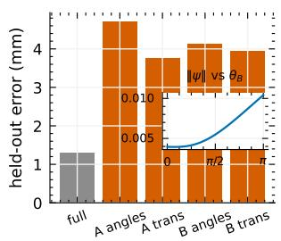  
(a) which inputs carry

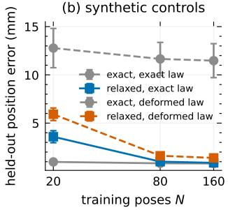

(c) independent UR5 (GTPN)  
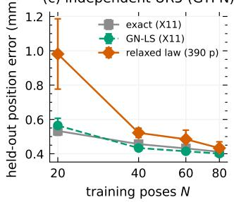

## H Compact-instance construction and mechanism

## H.1 The LawKAN-SU(2) construction

Setup. Inputs are rotations given by axes $a _ { i } \in S ^ { 2 }$ , encoded as phase pairs (azimuth $\alpha _ { i }$ , polar angle $\beta _ { i } )$ $\in S ^ { 1 } \times [ 0 , \pi ]$ , the longitude/latitude of the axis; the target is the composition $q _ { n } \cdots q _ { 1 }$ applied to a probe vector, read out as two angles. Each edge answers “how should this axis be rotated?” and the node answers “in which order do the rotations multiply?”; the exp-map keeps every intermediate a valid rotation, so no normalization step can divide by a near-zero norm.

Edge: Fourier function of a phase pair → so(3). Each group i has an edge that sees both phases,

$$
\varphi _ { i } ( \alpha , \beta ) = \sum _ { m , n \in \{ - K \ldots K \} } w _ { m n } e _ { m } ( \alpha ) e _ { n } ( \beta ) \in \mathbb { R } ^ { 3 } ,\tag{6}
$$

with $\{ e _ { k } \}$ the real Fourier basis (2K+1 per phase), so $( 2 K { + } 1 ) ^ { 2 } \times 3$ scalars per edge $( 9 \times 3$ at $K { = } 1 )$ ; the output $v \in \mathbb { R } ^ { 3 }$ is read as a Lie-algebra element.

Node: group law in fixed order. $q _ { i } = \exp ( v _ { i } ) = \cos | v _ { i } | + ( v _ { i } / | v _ { i } | )$ sin $| v _ { i } |$ (always unit; no singularity at $v { = } 0$ up to a removable $0 / 0$ handled by the series). The node computes the Hamilton product in the data’s composition order, $Q = q _ { n } \cdots q _ { 1 }$ , with the operand order fixed at the architecture level rather than learned. Quaternions make composition a single constraint-free multiplication and are the cheapest exact encoding of the group (Section E.1).

Output. Q rotates the probe; direction is read as (azimuth, polar). Loss: geodesic on $S ^ { 2 }$ (the angle between directions), $1 - \cos \Delta$ (avoids acos boundary NaNs); the reported metric is that angle in degrees.

Wiring. The parameter-annotated wiring, with the learned tensors marked, is Figure A10 below.

Figure A10: LawKAN-SU(2) wiring for the n=2, K=1 instance (the general case has one such edge per factor). Inputs are the axis phase pairs $( \alpha _ { i } , \beta _ { i } )$ azimuth and polar angle of factor i’s rotation axis (Appendix B) — mapped to the nine fixed Fourier features $F _ { i }$ (the edge’s design inputs); the learned tensor is the edge matrix $W _ { i }$ (its coeficients): $n \times 3 \times 9$ scalars in total (54 here), and its output v is exponentiated to the unit quaternion $q _ { i } .$ . The node multiplies in the fixed order $( Q = q _ { n } \cdot \cdot \cdot q _ { 1 }$ , no parameters); the optional zero-initialized correction deforms the composition, $Q  Q \exp ( \psi ( f ( A ) , f ( B ) ) )$ , and is the only other learned tensor (two-slot, 306); the readout carries no parameters.

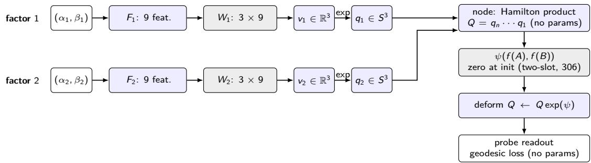

## H.2 Minimal-order design (K=1)

For LawKAN-SU(2), the minimal-order construction is Lemma 1: at $K { = } 1$ the nine edge features {1, cos α, sin α}⊗{1, cos β, sin β} already contain the three axis components, so weight $\theta _ { i } / 2$ on them makes the edge output $\theta _ { i } a _ { i } / 2$ whose exponential is the exact per-factor rotation, and no lower order sufices (Lemma 2). The edge only has to learn the constant “half the rotation amount”, and the Hamilton node returns the exact composition for every input. This explains the data eficiency and extrapolation, motivates the pruning below, and identifies the parameterization that avoids the singular $q / \lVert q \rVert$ regimes.

## H.3 Pruning the edge to the analytic edge (E19; predictions P23–P27)

In exponential coordinates the target is $( \theta / 2 )$ a, whose three axis components are themselves three of the nine K=1 Fourier features. We can therefore freeze the other eighteen weights to zero (Figure A11) and prune the edge to this analytic edge.

The constructed weights are exact. More interestingly, the trained sparse edge (18 parameters) is statistically more accurate than the dense edge (54 parameters) and is closer to the Bayes floor (Table 27; paired test, $5 / 5 ~ \mathrm { s e e d s } )$ . A random equal-size control (18 p drawn from the same dictionary, 5 masks × 5 seeds) gives $3 2 . 9 \pm 9 . 0 ^ { \circ }$ (E19b/P63): the identity of the support, not the parameter count, is the operative factor. Optimization recovers the constructed point itself: after training, the analytic $\theta / 2$ weights are matched to ma $\mathrm { x } _ { i } | w _ { i } - \theta _ { i } / 2 | = 6 { - } 8 \times 1 0 ^ { - 3 }$ (relative Frobenius 0.7–0.9% on seeds 0–1; E19.7), up to the sign ambiguity of Remark $1 - \mathrm { s o }$ the optimizer finds the construction, not merely a function close to it. The advantage persists on the noise curve, at $n { = } 3$ and along chains to n=4.

Figure A11: Analytic-support pruning. The nine K=1 features (rows: $\beta \mathrm { . }$ -terms; columns: α-terms); the exact solution uses only the three axis components (shaded), so 18 of the 54 parameters at n=2 sufice.  
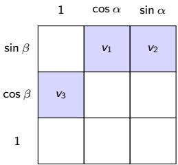

Table 27: Fourier-order and feature sparsity ablation of LawKAN-SU(2) (E19.2, comp2): the exact solution needs three of the nine features; E19.2 uses 5 seeds, and dense K=2 is an independent 10-seed rerun of E13.
<table><tr><td>Edge</td><td>Params</td><td>Error,°</td></tr><tr><td>dense K=2</td><td>150</td><td> $2 . 8 7 \pm 0 . 0 3$ </td></tr><tr><td>dense K=1</td><td>54</td><td> $2 . 7 9 \pm 0 . 0 2$ </td></tr><tr><td>sparse (3 of 9)</td><td>18</td><td> ${ \bf 2 . 7 5 \pm 0 . 0 2 }$ </td></tr></table>

The pruned edge is meaningful only where the analytic support is right (fixed known angles, or the IMU increment, Section F.1); elsewhere the dense edge is the architecture-agnostic default and is required (random angles, rigid-body, the null task), because pruning would discard needed degrees of freedom. What matters is where the exact solution lives, not capacity.

## I Mechanism details: variable angles, dead zones and the order rule

## I.1 Variable angles: the tensor extension (E29)

Lemma 1 assumes fixed angles, which holds for the fixed-angle composition tasks but not for sensors or encoders, whose rotation amount changes at every step. If we supply θ as an input and extend the edge to the tensor product $\left\{ 1 , \theta \right\} \otimes \left\{ 1 \right.$ , cos α, sin α} $\otimes \left\{ 1 \right.$ , cos β, sin β} (18 features), the three θ-scaled axis components become single features; putting weight $1 / 2$ on them gives $\boldsymbol { v } = ( \boldsymbol { \theta } / 2 ) \boldsymbol { a }$ , so the architecture is exact for arbitrary, variable angles (the variable-angle remark of Section 3.3). The IMU probe uses the factorized magnitude+phase edge (27 parameters, pruned to 18); the tensor construction above is the variable-angle edge.

Table 28 confirms it on a composition of n elements with variable angles and a full-SO(3) readout: the constructed tensor weights are exact, and the trained tensor edge stays near the floor. By contrast, the fixed-angle edge lacks the θ channel and leaves a large positive floor that grows with the chain length, exactly as the feature-span prediction says; dropping α or $\beta$ is worse still. Exactness, then, is not special to fixed rotations: it is a property of the feature span.

Table 28: Variable-angle exactness (E29; θ ∼ U[0.2, 2.5], full SO(3) readout): constructed tensor weights are exact to $9 . 7 \times 1 0 ^ { - 7 }$ ; edges missing the θ channel (or another feature group) leave positive floors.
<table><tr><td>Edge</td><td> $n { = } 2$ </td><td> $n { = } 3$ </td><td> $n { = } 4$ </td></tr><tr><td>LawKAN-SU(2), tensor edge (18 features, trained)</td><td>0.28</td><td>0.14</td><td>0.35</td></tr><tr><td>fixed, 9 features (no θ)</td><td>24.4</td><td>30.2</td><td>35.0</td></tr><tr><td>no  $\beta$ </td><td></td><td>38.8</td><td></td></tr><tr><td>no α</td><td></td><td>53.2</td><td></td></tr></table>

## I.2 Dead zones and the exp-map (quantified ablation)

Here we compare two forward parameterizations of the node output under identical training, normalizing the raw quaternion $( q / \lVert q \rVert )$ versus the exp-map (a retraction), on n=2, σ=0.03, 10 runs. The issue is training stability: a well-behaved parameterization should not let the optimizer fall into a dead configuration and stay there.

Normalization fails on 3 of 10 runs (up to $3 2 . 3 ^ { \circ } ;$ the raw norm ∥q˜∥ passes through a mid-training minimum of 0.30–0.50 (final 0.65–1.18), while the exp-map fails none (2.78–2.80◦). All ten normalization runs pass through a mid-training norm minimum, and three never recover. The dead-zone mechanism (Appendix J.2) is the normalization Jacobian $1 / | | \tilde { q } | |$ , so survival is decided by noise near the norm minimum. Because RPMG (Chen et al., 2022) fixes the backward pass while our exp-map fixes the forward parameterization itself, the two are orthogonal; the forward choice alone already removes the failure mode.

## I.3 Order rule: demonstration (E20)

On the compact instance we set $\theta _ { i } = \theta _ { 0 } + \varepsilon \sin \beta _ { i } ,$ , so the rotation amount grows with the axis tilt $\beta _ { i }$ (as in an axis-dependent gimbal or wiper) and the edge target carries a second $\beta { \mathrm { - h a r m o n i c } }$ whenever $\varepsilon > 0 .$ . Table 29 shows both regimes of the same task family, switched by this single parameter: at ε=0 the K=1 edge sufices, whereas at $\varepsilon { = } 0 . 3$ the $K { = } 2$ edge is needed (significantly so, and at the floor when noiseless). Higher harmonics are therefore capacity only when the target needs them: this is the order rule; the held-out-seed replication E24 is below.

Table 29: The order rule (E20). Same task family, rotated by ε; error in degrees, seeds 10–14 (replication run), noiseless for the last row. ε=0: K=1 sufices, extra harmonics hurt; ε=0.3: K=2 is needed.
<table><tr><td>Task</td><td>K=1</td><td>K=2</td></tr><tr><td>first harmonic only (ε=0)</td><td>2.78</td><td>2.86</td></tr><tr><td>with a second harmonic (ε=0.3)</td><td>3.69</td><td>3.31 (p=4.8e−06)</td></tr><tr><td>same, noiseless (ε=0.3)</td><td>1.68 (floor)</td><td>0.17</td></tr></table>

E24 (order rule, held-out replication). Noiseless floors (degrees, 5 seeds, seeds 20–24; the E20 lead-in is Table 29); $\theta _ { i } = \theta _ { i } ^ { 0 } + \varepsilon \sin \beta _ { i }$ :
<table><tr><td>ε</td><td>0.15</td><td>0.30</td><td>0.45</td><td>0.60</td></tr><tr><td> $K { = } 1$ </td><td>0.856</td><td>1.707</td><td>2.593</td><td>3.510</td></tr><tr><td>K=2</td><td>0.497</td><td>0.260</td><td>0.235</td><td>0.430</td></tr></table>

The K=1 floor is linear in ε (predicted $1 . 7 7 9 \varepsilon / 0 . 3 ;$ deviations −4% to −1%); the ratio floor(0.60)/floor(0.15) = 4.10 (predicted $4 . 0 \pm 0 . 5 )$ . The registered prediction that $K { = } 2$ stays below $0 . 3 ^ { \circ }$ at every ε did not hold strictly (max $0 . 4 9 7 ^ { \circ }$ , one seed 1.21): K=2 removes the floor in the mean (e.g. 0.43 vs $3 . 5 1 ^ { \circ }$ at ε=0.60) but not uniformly. Reported as a partial refutation.

## I.4 Ablation summary (LawKAN-SU(2))

Table 30 collects the ablations of this section: each design element removed, and the efect it produces.

Table 30: Ablation summary for LawKAN-SU(2) (compact instance): each design element removed, and its measured efect.
<table><tr><td>Removed element</td><td>Measured effect</td></tr><tr><td>Phase pairing (single-phase edges)</td><td>edges cannot build sin  $\beta$  cos α → composition unreachable  $( 5 . 7 \mathrm { - } 1 2 . 6 ^ { \circ } \ \mathrm { v s } \ 0 . 0 9 ^ { \circ }$  , development battery; P4, Remark 4)</td></tr><tr><td>Group-product nodes (additive instead)</td><td>non-commutativity unexpressible;  $\mathbb { Z } _ { 7 }$  stalls below Bayes ceiling</td></tr><tr><td>Exp-map  $( \to q / \| q \| )$ </td><td> $3 / 1 0$  runs fail  $( 3 2 . 1 \mathrm { - } 3 2 . 3 ^ { \circ } )$  ; all 10 runs enter the dead zone (min-norm 0.30–0.50), 7 recover (Section I.2)</td></tr><tr><td>Quaternion node (→ RealKAN+6D head)</td><td> $4 . 9 0 ^ { \circ }$  at 550 params: 1.8× worse at 10× params</td></tr><tr><td>Group law (→ strongest standard head, full bat- tery Section E.1)</td><td> $2 \times$  error on  $n { = } 3 ; 4 . 0 \times$  extrapolation collapse; plateau above LawKAN-SU(2) at 4× data</td></tr></table>

## J The exp parameterization as a retraction

## J.1 Setup

Definition 1 (retraction). Let M be a smooth manifold. A smooth map $R : T \mathcal M \to \mathcal M$ is a retraction if for every $q \in \mathcal { M } \colon \mathrm { ( i ) } \ R _ { q } ( 0 ) = q ; \mathrm { ( i i ) } \ d R _ { q } | _ { 0 } = \mathrm { i d } \ \mathrm { o n } \ T _ { q } \mathcal { M }$ (local first-order condition). Retractions are a standard tool of Riemannian optimization (Absil et al., 2008; Boumal, 2023): they allow a step in the tangent space followed by a return to the manifold with controlled (second-order) error. In deep rotation regression, RPMG (Chen et al., 2022) brings the same manifold-awareness to the gradient; our exp-map is the corresponding forward-pass object.

Our construction. $\mathcal { M } = S ^ { 3 }$ (unit quaternions, the double cover of $\mathrm { S O ( 3 ) } )$ ; the edge parameter $v \in \mathbb { R } ^ { 3 } \cong$ s $\ u _ { \mathrm { { } } } ( \mathrm { { } 3 } ) \cong T _ { e } S ^ { 3 }$ ; the map

$$
q ( v ) = \cos \| v \| + { \frac { v } { \| v \| } } \sin \| v \| , \qquad q ( 0 ) : = e = ( 1 , 0 , 0 , 0 )\tag{7}
$$

is exactly exp $: { \mathfrak { s o } } ( 3 ) \to { \mathrm { S U } } ( 2 )$ (the Rodrigues map), i.e. a retraction at the group identity.

Lemma 3 (exp is a retraction at $e ) . \ q ( v )$ satisfies $( i ) - ( i i )$ at e, and is smooth everywhere, including $v = 0$

Proof. (i) $q ( 0 ) = \cos { 0 } + ( \cdot )$ sin $0 = e$ by definition. (ii) Series expansion: cos $\| v \| = 1 - \| v \| ^ { 2 } / 2 + O ( \| v \| ^ { 4 } )$ $( v / \| v \| ) \sin \| v \| = v \cdot ( 1 - \| v \| ^ { 2 } / 6 + O ( \| v \| ^ { 4 } ) )$ ). Hence

$$
q ( v ) = ( 1 , 0 ) + ( 0 , v ) + O ( \lVert v \rVert ^ { 2 } ) ,\tag{8}
$$

so $d q | _ { 0 } [ v ] = v ;$ the identity on $T _ { e } S ^ { 3 }$

Smoothness at zero. The scalar part is an even analytic series in ∥v∥ and the vector part is $v \operatorname { s i n c } ( \| v \| )$ with sinc analytic and even $( \operatorname { s i n c } ( 0 ) = 1 ) , \operatorname { s o } q ( v )$ is analytic on all of $\mathbb { R } ^ { 3 }$ ; the naive $v / \| v \|$ singularity is cancelled by sin $\| v \| = O ( \| v \| )$ . In code a guarded branch near zero (or the sinc series) implements this; the ε-regularized form $v / ( \| v \| + \varepsilon )$ avoids $0 / 0$ but changes the gradient scale at zero.

Corollary 2 (unit norm by construction). $\| q ( v ) \| ^ { 2 } = \cos ^ { 2 } \| v \| + \sin ^ { 2 } \| v \| = 1$ for all $v \in \mathbb { R } ^ { 3 }$ . The layer outputs an exact point $o f S ^ { 3 }$ for any parameter values: there is no projection/normalization in the compute graph at all.

Remark 6 (double cover and the retraction radius). The map q is exactly exp $: { \mathfrak { s o } } ( 3 ) \to \operatorname { S U } ( 2 ) \cong S ^ { 3 }$ , which double-covers $\mathrm { S O ( 3 ) }$ : the covering $\mathrm { S U } ( 2 )  \mathrm { S O } ( 3 )$ is 2-to-1 with $q \equiv - q$ . Two consequences. (i) As a map to ${ \mathrm { S U } } ( 2 )$ , q is a genuine retraction at e and a local difeomorphism on the open ball $\| v \| < \pi$ (the injectivity radius), and it is surjective since ${ \mathrm { S U } } ( 2 )$ is compact and connected. The cut locus is $\| v \| = \pi ( q = - 1 )$ ), where the diferential degenerates; at $\left\| v \right\| = 2 \pi$ the map returns to e. On every task here $\lVert v \rVert = \theta / 2 < \pi . \mathrm { ~ ( i i ) }$ The readout $v \mapsto \pi ( \widehat { Q } )$ is a function of the composed element in $\mathrm { S O ( 3 ) }$ , hence invariant under the cover; the residual $q \equiv - q$ ambiguity appears only when the target is a raw quaternion, where an explicit sign-invariant loss is used (Section 6, Remark 1). Calling q a retraction therefore refers to ${ \mathrm { S U } } ( 2 )$ ; composing through the cover is what lets the node apply the exact group law to rotations.

## J.2 Why normalization is not a retraction (and where dead zones come from)

The alternative: the network outputs a raw $\tilde { q } \in \mathbb { R } ^ { 4 }$ , answer $= \tilde { q } / \| \tilde { q } \|$ . This is the map $\pi : \mathbb { R } ^ { 4 } \setminus \{ 0 \}  S ^ { 3 }$

• undefined at zero: π has a singularity on $\{ \tilde { q } = 0 \}$ , a set reachable by gradient dynamics (a zeroing loss “pulls” q˜ toward 0 if the network finds a solution with $\tilde { q } \approx 0$ in the numerator);

• Jacobian blow-up at small norms: $d \pi [ \tilde { q } ] = ( I - q q ^ { T } ) / \lVert \tilde { q } \rVert$ , operator norm $\| d \pi \| = 1 / \| \tilde { q } \|$ . As $\| \tilde { q } \| \to 0$ the loss gradient w.r.t. parameters is amplified as $1 / | | \tilde { q } | |$ : gradient noise grows inversely proportional to the norm. This is precisely the measured mechanism of Section I.2: the trajectory trace shows all 10 normalization runs passing through a mid-training norm minimum of 0.30–0.50; the 3/10 that fail to recover are the runs where noise near the minimum dominates.

Formally: π is not a retraction on the full tangent bundle: it is not defined on all of T and its Jacobian is unbounded. The exp-map has neither defect.

## J.3 Smoothness of the composition node

Lemma 4 (the node is a smooth map). The node $n : ( v _ { 1 } , \ldots , v _ { g } ) \mapsto { \mathrm { R o t a t e } } ( q _ { g } ( v _ { g } ) \cdot \cdot \cdot q _ { 1 } ( v _ { 1 } ) , p )$ with a fixed probe vector p is a smooth map $\mathbb { R } ^ { 3 g } \to S ^ { 2 }$

Proof. A composition of smooth maps: $q _ { i } ( v _ { i } )$ are smooth (above); the Hamilton product is a bilinear form (a degree-2 polynomial), hence smooth; rotation $v \mapsto q v q ^ { * }$ is a degree-2 polynomial in q with no divisions (unit norm of q is already guaranteed, and the rotated vector needs no normalization: $\| q v q ^ { * } \| = \| v \| )$ ; the final vec→angles map is smooth away from the poles of the probe projection (atan2 is undefined on the axis $z = \pm 1$ , a measure-zero set; the losses use 1− cos, smooth everywhere). □

Remark 7 (double cover). q and −q give the same rotation: Rotate is sign-invariant. Since the loss is defined through the rotated vector (not through q), the antipodal ambiguity never enters the compute graph; an antipodal-invariant loss for raw quaternion outputs $( | q \cdot q ^ { * } | )$ would be needed only when regressing quaternions themselves (see Limitations).

Remark 8 (exactness gauge via the identity input). Let $\chi ( x _ { 0 } ) = e$ with $e \in U$ (hypothesis $\left( \mathrm { i v } \right) )$ and suppose the network is exact on all pairs $( x , x ^ { \prime } ) \in U \times U$ . Then for every $x \in U$

$$
h ( x ) = \chi ( x ) c , \qquad c : = h ( x _ { 0 } ) ^ { - 1 } , \qquad c ^ { 2 } = e , \qquad c \chi ( x ) = \chi ( x ) c \ ( \forall x \in U ) .
$$

Proof. Exactness on $( x , x _ { 0 } )$ gives $h ( x ) h ( x _ { 0 } ) = \chi ( x ) ; { \mathrm { o n ~ } } ( x _ { 0 } , x _ { 0 } ) , h ( x _ { 0 } ) ^ { 2 } = e ; { \mathrm { o n ~ } } ( x _ { 0 } , x ) , h ( x _ { 0 } ) h ( x ) = \chi ( x ) =$ $h ( x ) h ( x _ { 0 } )$ . Substituting $h ( x ) = \chi ( x ) c$ into the last identity gives centrality. For SU(2) the gauge is {±I} of the double cover (Remark 6). □

## K Registered predictions: verdict summary

Discipline: every experiment in the battery pre-specified a prediction in the internal experiment log before running, and refuted predictions are kept. The full log, prediction → outcome → verdict, is in the supplementary material and the code repository; each entry was written in the internal experiment journal before its run (Section A). The dated internal experiment journal is available to editors and reviewers on request. Verdicts: ✓ the registered threshold was met (or the registered boundary branch occurred); ◦| the threshold was not met but the predicted direction holds (reported as such, never silently upgraded); × refuted; inconclusive denotes a registered proxy test whose outcome was the registered non-signal branch. Two mechanism hypotheses were refuted and reported (the exponential winding and unbounded magnitude); the remedy is capacity and locality. All p-values are per-comparison (Appendix A.4).

Table 31: Registered predictions: compact verdicts across the 130 entries (119 prediction-log entries through X36, plus 11 plan-registered branch probes, X37–X61).
<table><tr><td>Verdict</td><td>Count</td></tr><tr><td>Met the registered threshold (or its registered boundary branch)</td><td>83</td></tr><tr><td>Predicted direction held, threshold not met</td><td>14</td></tr><tr><td>Refuted (kept and reported)</td><td>29</td></tr><tr><td>Registered non-signal branch / withdrawn / not triggered</td><td>4</td></tr></table>

Table 32: Registered-prediction verdicts across the paper: the battery, the late registered probes, the capacity/locality revision and the pole-fix branch.
<table><tr><td>Verdict</td><td></td><td>Count Representative</td></tr><tr><td>√ met</td><td></td><td>40 P42: the state ω is necessary (feed-forward controls fail)</td></tr><tr><td>φ direction holds, threshold not met</td><td></td><td>10 P49: node isolated; matched linear edge refuted</td></tr><tr><td>× refuted</td><td></td><td>8 P11: no BKT signature at n=5 (demoted to motivation)</td></tr><tr><td>× withdrawn (premise failed)</td><td></td><td>1 P40: tuning-free classical filters already win</td></tr><tr><td>Late probes (30):</td><td></td><td></td></tr><tr><td>√ met / boundary branch</td><td></td><td>16 P-FR1: backlash sign signature (fraction 1.000)</td></tr><tr><td>φ direction holds</td><td></td><td>2 P-D: 10-seed replication confirms three of four platforms</td></tr><tr><td>× refuted</td><td></td><td>10 P-MK7: the Kinova win did not replicate at 10 seeds</td></tr><tr><td>inconclusive (registered non-signal branch)</td><td></td><td>1 P-FRIC-proxy: recording-order backlash proxy</td></tr><tr><td>not triggered (conditional boundary)</td><td></td><td>1 P-MK5: isolated wins on every unit</td></tr><tr><td colspan="3">Revision round (X22–X36, capacity and locality, 30):</td></tr><tr><td>√ met / boundary branch</td><td></td><td>22 P-B1: the unregularized head collapses on 2/10 seeds</td></tr><tr><td>× refuted</td><td></td><td>7 P-B2: the rotation-bounded chart does not cure the collapse</td></tr><tr><td>not triggered (conditional boundary)</td><td></td><td>1 X32-4: bandwidth scaling (queued)</td></tr><tr><td colspan="3">Branch round (X37–X61, pole/episode, 11):</td></tr><tr><td>√ met</td><td></td><td>5 X53-print-2: operand chart crossing π; X59: EMA removes spikes; X61: T2</td></tr><tr><td>φ direction holds</td><td></td><td>2 X60: group metric lowers spikes (13 → 5.6–8.6); X61: T1 favors q14</td></tr><tr><td>× refuted</td><td></td><td>4 X53-fix: quaternion halves but does not remove; X60: geodesy does not cure the floor</td></tr></table>

## L Use of AI tools

Text-to-text generative AI tools (the large language models Kimi and DeepSeek) were used to assist with drafting and formatting this manuscript, with restructuring and copy-editing the text, with checking the consistency of numbers across the text, tables and the JSON dumps, with preparing and tidying the vector figures, and with developing and debugging the accompanying code. No AI system generated experimental results, ran the experiments, or selected the conclusions; all experiments were designed, run, and verified by the authors, who take full responsibility for the content.

## M Broader impact

This work studies composition subcomputations with exact group-law nodes, on controlled benchmarks and on real sensor and robot data; rotation composition (SU(2)) is the leading instance of the recipe, whose payof this paper maps. We see no significant risk of harm; the methods and findings are methodological and do not target any sensitive application or population.