# Learning Evidence-Grounded Reasoning for Context-Aware Time Series Forecasting

Xingpeng Gao, Mingyue Cheng∗, Daoyu Wang, Huajian Zhang, Xiaoyu Tao State Key Laboratory of Cognitive Intelligence, University of Science and Technology of China Hefei, Anhui, China

{gaoxingpeng,wdy030428,zhjustc,txytiny}@mail.ustc.edu.cn, {mycheng}@ustc.edu.cn

## Abstract

LLM-driven time series forecasting has become increasingly promising by leveraging contextual features to generate future values directly or refine forecast priors. However, incorporating contextual features alone does not ensure that models can identify which features matter for forecasting and understand what they suggest about future dynamics. We argue that the fundamental challenge is how to extract predictive evidence from contextual features and when and how to leverage it to guide forecasting decisions. In this paper, we propose CastReasoner, an evidence-grounded reasoning model for context-aware time series forecasting. Specifically, CastReasoner uses a structured chain of thought (CoT) to extract predictive evidence from contextual features, infer the future dynamics suggested by this evidence, and assess these dynam ics against the forecast prior to guide adaptive forecasting decisions. To enable this capability, we design a reasoning-centric twostage post-training framework including supervised fine-tuning (SFT) and reinforcement learning (RL). First, we synthesize reasoning trajectories through controllable multi-teacher guidance and select high-quality ones using a novel student-aware dificulty metric. Second, we design fine-grained multi-objective rewards to further improve reasoning and forecasting. To address heterogeneous learning needs across domains in both stages, we introduce a convergence-guided data balancing strategy. Through this twostage training, CastReasoner improves both reasoning quality and predictive accuracy. Extensive experiments across multi-domain forecasting benchmarks demonstrate that CastReasoner achieves superior forecasting performance.1

## Keywords

Context-aware Time Series Forecasting, Evidence-grounded Reasoning, Large Language Model Post-training

## ACM Reference Format:

Xingpeng Gao, Mingyue Cheng, Daoyu Wang, Huajian Zhang, and Xiaoyu Tao. 2026. Learning Evidence-Grounded Reasoning for Context-Aware Time Series Forecasting. In Proceedings ofMake sure to enter the correct conference

∗Corresponding author.   
1Our code is available at https://github.com/gaoxp112/CastMind-Public.

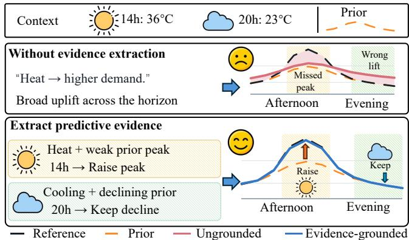  
Figure 1: Illustrative demand forecasting with and without evidence extraction. Context and a forecast prior support raising the afternoon peak and retaining the evening decline.

title from your rights confirmation email (Conference acronym ’XX). ACM, New York, NY, USA, 12 pages. https://doi.org/XXXXXXX.XXXXXXX

## 1 Introduction

Context-aware time series forecasting supports decisions in Webconnected systems, including Internet of Things (IoT) sensing [6], network trafic monitoring [27], and urban mobility [21]. By incorporating exogenous variables, calendar information, and domain knowledge, it accounts for external influences that historical observations do not fully reveal [22, 23]. Recent LLM reasoning approaches increasingly incorporate contextual features into time series forecasting, attracting growing research interest [11, 49].

Existing LLM reasoning approaches for context-aware time series forecasting follow two routes. The first directly generates future values from historical patterns and contextual influences [11, 49]. The second refines a forecast prior from a separate forecaster [28], such as a time series foundation model pretrained on temporal observations to capture transferable patterns across series [2, 42]. An LLM assesses the prior against the context to determine appropriate adjustments. However, incorporating contextual features alone does not ensure that existing approaches identify predictive evidence or understand its implications for future dynamics. Predictive evidence refers to cues from context, target history, or a forecast prior that support expectations about future behavior. As shown in Figure 1, such evidence helps establish which changes are plausible, when they may occur, and why the available information supports them. Without this grounding, reasoning may miss key cues or introduce misleading information, impairing forecast generation or refinement at individual future intervals.

We argue that the fundamental challenge in LLM reasoningdriven context-aware time series forecasting is how to extract predictive evidence from contextual features and use it to guide forecasting decisions. To begin with, evidence extraction requires identifying contextual features relevant to the target and forecast horizon. Contextual influences vary across temporal scales and conditions [22], so reasoning must interpret cues against the target history to distinguish useful evidence from redundant or misleading information. Beyond this, evidence must inform the timing, direction, and magnitude of future changes. When a forecast prior is available, reasoning must determine which implications it already captures and where adjustments are justified. These challenges motivate us to design an evidence-grounded reasoning process connecting contextual interpretation with adaptive forecasting strategies and complete numerical predictions.

In this paper, we propose CastReasoner, an evidence-grounded reasoning model for context-aware time series forecasting. Its structured chain of thought (CoT) extracts predictive evidence from contextual features, infers the future dynamics suggested by this evidence, and assesses them against the forecast prior to decide whether to retain, revise, or reconstruct it. To enable this capability, we design a reasoning-centric two-stage post-training framework including SFT and RL. First, we synthesize reasoning trajectories through controllable multi-teacher guidance and select high-quality ones using a novel student-aware dificulty metric. Second, we de sign fine-grained multi-objective rewards to improve reasoning and forecasting. A convergence-guided data balancing strategy addresses heterogeneous learning needs across domains in both stages. Through this two-stage training, CastReasoner improves both reasoning quality and predictive accuracy.

We evaluate CastReasoner on eight real-world datasets across energy, urban mobility, air quality, retail sales, and industrial monitoring, with consistent gains over representative forecasting baselines. Ablation studies support the complementary roles of SFT and RL and the design of our reasoning process. Further analyses show that removing or disrupting reasoning traces increases forecasting errors, highlighting the importance of intermediate reasoning for prediction. CastReasoner also selects adaptive strategies according to the scope of predictive evidence. We hope these findings inspire further research into how evidence-grounded reasoning improves context-aware time series forecasting.

Our main contributions are summarized as follows:

• We argue that efective context-aware forecasting requires interpreting predictive evidence relative to forecast priors. This motivates fine-grained reasoning that connects contextual evidence, inferred future dynamics, and adaptive forecasting decisions at individual future intervals.

• We propose CastReasoner, an evidence-grounded reasoning LLM that extracts predictive evidence from contextual features and forecast priors to guide adaptive forecasting strategies. We design a novel reasoning-centric two-stage post-training framework including SFT and RL.

• We evaluate CastReasoner on eight forecasting datasets and demonstrate consistent gains over representative baselines. Ablations and analyses of reasoning traces support the effectiveness of its training components and the role of intermediate reasoning in numerical prediction.

## 2 Related Work

We review how LLM-based time series forecasting incorporates and interprets context, followed by post-training approaches that develop reasoning for numerical prediction.

## 2.1 Context-aware Time Series Forecasting with Large Language Models

Early LLM-based time series forecasting treated numerical histories as language sequences, enabling forecasts through text completion [18, 43]. Subsequent eforts sought closer alignment between temporal inputs and language representations [8]. Reprogramming mapped historical patterns into a pretrained language model’s embedding space [25]. Symbolic discretization made numerical values compatible with contextual descriptions [38]. Vector-injected demonstrations further adapted frozen LLMs to temporal inputs through in-context learning [46]. As the focus broadened from representing histories to incorporating external influences, language knowledge helped model interactions between target series and exogenous variables [22]. Retrieval extended the available context beyond a local history, drawing on related series and text for crosscity forecasting [24]. Geographic images ofered a complementary source of spatial information for trafic prediction [9]. Beyond supplying auxiliary inputs, context also became an object of explicit analysis. Event-based forecasting interpreted external reports to identify influences on future values and used reflection to refine the resulting predictions [40]. Recent temporal reasoning further connects observed patterns and contextual features to expected future behavior through intermediate analysis [11]. Together, these developments connect contextual interpretation and temporal reasoning with the generation of numerical forecasts.

## 2.2 Reasoning-Oriented Post-Training

Post-training for time series forecasting increasingly targets the reasoning process behind numerical predictions [7]. Supervised adaptation uses synthetic trajectories to demonstrate how temporal analysis precedes numerical prediction. Reinforcement learning then evaluates generated trajectories through forecasting-specific, multi-objective rewards [49]. This extends broader progress in using verifiable outcomes to improve reasoning beyond imitation [15, 36]. Yet outcome correctness does not guarantee that intermediate temporal judgments are sound. Process-verifiable annotations therefore introduce explicit checks of intermediate reasoning, with task- and dificulty-aware schedules tailoring learning to diferent temporal reasoning demands [48]. For context-aware forecasting, the training objective also expands from producing future values to deciding when an existing forecast requires intervention. Revision trajectories and verifiable rewards teach models to preserve, revise, or disregard foundation-model priors according to multimodal context [28]. Beyond forecasting, table reasoning combines self-verified trajectories with reinforcement fine-tuning and uncertainty-based path selection to improve reasoning quality and stability [45]. However, supervision for connecting contextual evidence with forecast priors and interval-specific forecasting decisions remains limited. To bridge this gap, CastReasoner develops evidence-grounded reasoning through demonstrations selected for accuracy and student learnability, followed by RL with fine-grained rewards.

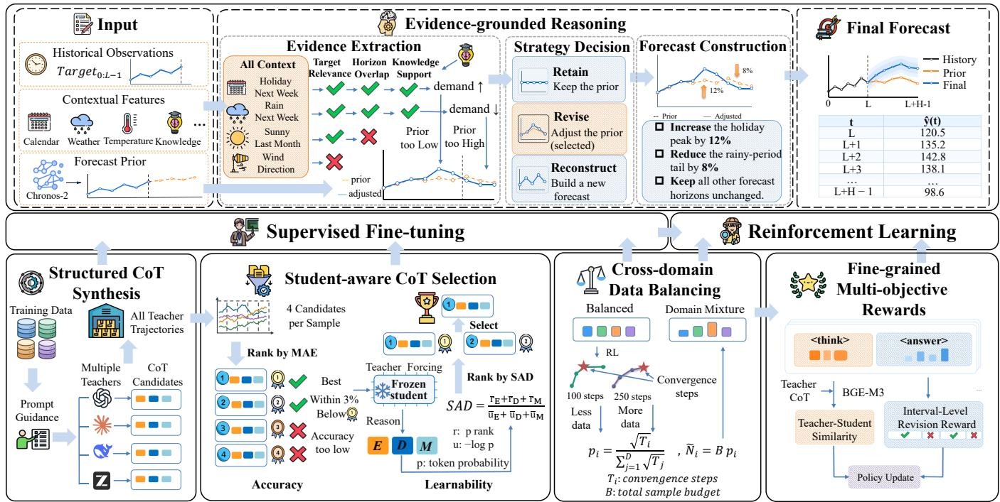  
Figure 2: Overview of CastReasoner. Evidence-grounded forecasting links history, context, and a forecast prior to evidence extraction, strategy decision, and forecast construction. Structured CoT synthesis, student-aware CoT selection, cross-domain data balancing, and fine-grained multi-objective RL rewards form the post-training pipeline.

## 3 Methodology

We introduce CastReasoner’s evidence-grounded reasoning process and our reasoning-centric two-stage post-training framework with supervised fine-tuning (SFT) and reinforcement learning (RL).

## 3.1 Problem Definition

Let $\mathcal { D } = \{ ( X _ { i } , \mathbf { y } _ { i } ) \} _ { i = 1 } ^ { N }$ be a context-aware time series forecasting dataset, where each input is $X _ { i } = ( \mathbf { x } _ { - L : - 1 } ^ { ( i ) } , C ^ { ( i ) } , \mathbf { f } ^ { ( 0 , i ) } )$ . It contains the target history $\mathbf { x } _ { - L : - 1 } ^ { ( i ) } ,$ features available for the forecast horizon $C ^ { ( i ) }$ , and a forecast prior $\mathbf { f } ^ { ( 0 , i ) } ; \mathbf { y } _ { i } \in \mathbb { R } ^ { H }$ is the future target over the next � steps. CastReasoner serializes $X _ { i }$ with a fixed prompt $P ,$ generates $T _ { i } = \mathrm { L L M } _ { \theta } ( P ( X _ { i } ) )$ ), and extracts the complete numerical forecast as $\hat { \bf y } _ { i } ~ = ~ g ( T _ { i } )$ . The future target is reserved for ofline trajectory selection, supervision, and reward evaluation.

## 3.2 CastReasoner Overview

Figure 2 shows how CastReasoner combines evidence-grounded forecasting with reasoning-centric post-training. It jointly examines history, context, and a forecast prior generated by Chronos-2 [1] to identify evidence about future dynamics while excluding irrelevant contextual features. It then selects how much prior structure to preserve and constructs a complete forecast. SFT builds this capability from controllable teacher trajectories selected for forecast accuracy and student learnability. RL further improves reasoning and forecasting through group relative policy optimization (GRPO) [36] with fine-grained multi-objective rewards.

## 3.3 Evidence-Grounded Reasoning Process

CastReasoner uses three reasoning stages: evidence analysis identifies predictive influences and their implications for future dynamics; strategy selection determines whether to retain, revise, or reconstruct the forecast prior; forecast construction turns the selected strategy and evidence into a complete numerical forecast.

During evidence analysis, CastReasoner extracts predictive evidence from exogenous variables, calendar signals, and domain information in C. It assesses each condition against the target’s meaning, observed history, and domain knowledge, retaining plausible influences within the forecast horizon and excluding irrelevant conditions. For example, high afternoon temperatures may afect electricity load through cooling demand, whereas events whose efects do not overlap the forecast horizon provide no relevant evidence. From the retained evidence, the model infers the direction, relative strength, onset, duration, and shape of future changes, preserving uncertainty where support is limited. It compares these dynamics with the corresponding prior intervals to identify efects that are already represented, understated, overstated, or mistimed, providing the basis for subsequent strategy selection.

During strategy selection, CastReasoner determines the extent of numerical intervention. It selects retain when the prior agrees with the evidence or support for correction is insuficient; revise when evidence warrants a bounded adjustment while useful prior structure remains; and reconstruct when the prior’s overall shape conflicts with inferred dynamics, requiring a new forecast from history and context. This choice links the scope and strength of the evidence to the prior structure preserved in the prediction.

During forecast construction, the model specifies how the selected strategy and its supporting evidence produce all � numerical values. It copies the prior for retain, specifies supported corrections and preserved behavior for revise, or explains how history and context support a replacement trajectory for reconstruct. The method connects inferred dynamics to the forecast level, shape, and timing, translating qualitative influences into numerical choices. Every strategy returns the complete forecast, including unchanged positions, indexed from 0 to $H - 1$ with precision appropriate to the target scale. The resulting trajectory $\boldsymbol { o } = ( d , \mathscr { E } , m , \hat { \mathbf { y } } )$ records the selected strategy $d ,$ evidence analysis $\varepsilon ,$ forecast method $m ,$ and complete numerical forecast $\hat { \mathbf { y } } \in \mathbb { R } ^ { H }$

## 3.4 Trajectory Distillation for Reasoning Capability Initialization

3.4.1 Structured CoT Synthesis. To benefit from the diferent reasoning capabilities of multiple LLMs, we use four teachers to generate structured reasoning trajectories with alternative evidence interpretations and forecasting strategies for the same sample: DeepSeek-V4-Flash [16], GPT-6.1-Sol [34], GLM-5.3-Flash [44], and Claude Opus 5.5 [4]. Each generates one trajectory from the same input � available to the student; future targets are used only for ofline evaluation of the generated forecasts. Prompt instructions prescribe the three-stage structure in Section 3.3 and require all � forecast values: teachers first analyze evidence and future dynamics, then select a strategy, and finally explain forecast construction before giving the numerical answer. The shared structure keeps reasoning fields comparable while preserving diverse interpretations across teachers, facilitating subsequent student-aware trajectory selection.

3.4.2 Student-aware CoT Selection. We discard invalid candidates and rank the remaining forecasts by mean absolute error (MAE), $e _ { k } = \mathrm { M A E } ( \hat { \mathbf { y } } ^ { ( k ) } , \mathbf { y } )$ . This student-aware criterion favors accurate trajectories that expose useful reasoning opportunities for the current student. We assess learnability with student-aware dificulty (SAD), favoring tokens with low student probabilities that rank near the vocabulary top: low probabilities leave room for learning, while high ranking keeps reasoning within the student’s initial capability. For token $z _ { j } ^ { ( k ) }$ , let $\hat { p } _ { k , j } = \hat { p } _ { \theta _ { 0 } } ( z _ { j } ^ { ( k ) } \mid X , z _ { < j } ^ { ( k ) } )$ and $r _ { k , j }$ be its probability and one-based rank under the frozen student. Thus, the score reflects learnability from the current student’s perspective. Within each field $s \in \mathcal { F } = \{ d , \mathcal { E } , m \}$ , we average clipped ranks min $\{ r _ { k , j } , r _ { \mathrm { m a x } } \}$ and the corresponding negative log probabilities $- \log p _ { k , j }$ to obtain $\bar { r } _ { k , s }$ and $\bar { u } _ { k , s } .$ . SAD combines them as:

$$
\mathrm { S A D } _ { k } = \frac { \sum _ { s \in \mathcal { F } } \bar { r } _ { k , s } } { \sum _ { s \in \mathcal { F } } \bar { u } _ { k , s } } .\tag{1}
$$

Field means prevent longer fields from dominating. Lower token probabilities yield larger negative log probabilities, increasing the denominator, while tokens ranked closer to the vocabulary top reduce the numerator. We score only visible reasoning tokens, ex cluding final forecast tokens. Among the two best-MAE candidates, $k _ { 1 }$ and $k _ { 2 } ,$ , we select the lower-SAD candidate only if their strategies agree and $\boldsymbol { e } _ { k _ { 2 } } \le \big ( 1 + \delta \big ) \boldsymbol { e } _ { k _ { 1 } } ;$ otherwise, we choose $k _ { 1 }$ . The selected trajectories supervise SFT; RL starts from the final SFT checkpoint.

## 3.5 Fine-Grained Multi-Objective Rewards for Reasoning Capability Enhancement

3.5.1 Cross-Domain Data Balancing. To address heterogeneous learning needs across domains [29], we design a convergenceguided balancing strategy. We first train a pilot model on an equally sampled mixture of all � domains. Let $L _ { i } ( t ) = \alpha _ { \mathrm { v a l } } \mathrm { n M A E } _ { i } ( t ) +$ $( 1 - \alpha _ { \mathrm { v a l } } )$ nMSE� (�) denote domain �’s validation loss at evaluation step �, and define its convergence step $T _ { i }$ as the step at which $L _ { i } ( t )$ reaches its minimum during the pilot. We use $T _ { i }$ to determine the sampling probability and target quota for each domain under a fixed total training sample budget �:

$$
\dot { p } _ { i } = \frac { \sqrt { T _ { i } } } { \sum _ { j = 1 } ^ { D } \sqrt { T _ { j } } } , \qquad \widetilde { N } _ { i } = B \dot { p } _ { i } .\tag{2}
$$

Since $\mathscr { P } i$ increases with $T _ { i } ,$ slower-converging domains receive larger quotas. Square-root scaling reduces convergence disparities while keeping quota gaps moderate, leading to better training performance. The quotas are fixed before formal training and remain unchanged throughout SFT and RL.

3.5.2 Fine-grained Multi-objective Rewards. We combine five rewards for output validity, forecast accuracy, baseline improvement, localized prior revision, and learning from teacher reasoning.

Format Reward. We penalize responses that violate the required reasoning structure or numerical forecast format:

$$
R _ { \mathrm { f o r m a t } } ( o ) = - \lambda _ { f } \bigl ( 1 - V ( o ) \bigr ) ,\tag{3}
$$

where $V ( o )$ indicates whether the <think> block follows the three stages and the <answer> provides all � finite predictions; $\lambda _ { f }$ sets the penalty. It is zero for valid outputs and negative otherwise; all other rewards evaluate only valid responses.

Forecast Accuracy Reward. The accuracy reward is the negative clipped normalized forecasting loss:

$$
R _ { \mathrm { a c c u r a c y } } = - L _ { c } ( \hat { \bf y } ) ,\tag{4}
$$

where $L _ { c } ( \mathbf { f } )$ is the clipped loss for forecast f. The scale is $s _ { y } \ =$ max $\begin{array} { r } { \{ \mathrm { S t d } ( \mathbf { y } ) , \rho H ^ { - 1 } \sum _ { i } \quad } \end{array}$ |�� | $, \epsilon _ { s } \}$ . We define normalized absolute and squared errors as $\begin{array} { r } { \boldsymbol { \mathbf { \ell } } _ { \boldsymbol { a } } ( \mathbf { f } ) = H ^ { - 1 } \sum _ { t } | f _ { t } - y _ { t } | / s _ { y } } \end{array}$ and $\begin{array} { r } { b ( \mathbf { f } ) = H ^ { - 1 } \sum _ { t } ( f _ { t } - } \end{array}$ $y _ { t } ) ^ { 2 } / s _ { y } ^ { 2 } .$ . Combining them as $L ( \mathbf { f } ) = \alpha a ( \mathbf { f } ) + ( 1 - \alpha ) b ( \mathbf { f } )$ and clipping each component at � gives $L _ { c } ( \mathbf { f } )$

Simple Baseline Outperformance Reward. We reward improvement over simple forecasting baselines using:

$$
R _ { \mathrm { u p l i f t } } = \lambda _ { U } \operatorname* { m i n } \left\{ \left[ \frac { g _ { u } - \tau _ { g } } { c _ { g } } \right] _ { 0 } ^ { 1 } , \left[ \frac { \Delta _ { u } - \tau _ { \Delta } } { c _ { \Delta } } \right] _ { 0 } ^ { 1 } \right\} ,\tag{5}
$$

where $\Delta _ { u } = { \cal L } _ { \mathrm { r e f } } - { \cal L } _ { c } \big ( \hat { \bf y } \big )$ and $g _ { u } = \Delta _ { u } / \mathrm { m a x } \{ L _ { \mathrm { r e f } } , \epsilon _ { U } \}$ measure absolute and relative improvement. Here $L _ { \mathrm { r e f } }$ is the lowest clipped loss among last-value, recent-mean, seasonal-copy, and Ridge regression [19] baselines, built without the evaluated future target. The operator $[ v ] _ { a } ^ { b } = \operatorname* { m i n } \{ b \colon$ , max{�, � }} clips its input; $\lambda _ { U }$ scales the reward, $\tau _ { g } , \tau _ { \Delta }$ are thresholds, and $c _ { g } , c _ { \Delta }$ are ranges. Both gains must exceed their thresholds for a positive reward.

Table 1: Overall forecasting performance of CastReasoner (9B) and baselines on eight datasets, measured by nMAE and nMSE. The best and second-best results in each column are shown in bold and underlined, respectively.
<table><tr><td rowspan="2">Model</td><td>Load</td><td>Price</td><td></td><td>Solar</td><td>Wind</td><td></td><td>BS</td><td>BAQ</td><td></td><td>HS</td><td>MetroPT-3</td></tr><tr><td>nMAE nMSE</td><td>nMAE</td><td>nMSE nMAE</td><td>nMSE</td><td>nMAE</td><td>nMSE nMAE</td><td>nMSE</td><td>nMAE nMSE</td><td>nMAE</td><td>nMSE</td><td>nMAE nMSE</td></tr><tr><td>ARIMA</td><td>1.8470 7.5514</td><td>0.5963</td><td>1.0713 1.9798</td><td>5.8391</td><td>1.0234</td><td>1.7691 0.9491</td><td>1.7476</td><td>0.5808 0.9649</td><td>1.2498</td><td>3.6027</td><td>1.2446 2.4615</td></tr><tr><td>Prophet</td><td>0.6074 0.7953</td><td>0.4398</td><td>0.6305 1.3154</td><td>3.8053</td><td>1.3100</td><td>3.0755 0.4855</td><td>0.4245</td><td>0.3699 0.4783</td><td>0.9538</td><td>1.6255</td><td>0.4238 0.4370</td></tr><tr><td>PatchTST</td><td>0.3813 0.2884</td><td>0.3693</td><td>0.6078 0.3315</td><td>0.3192</td><td>0.8658 1.1368</td><td>0.2783</td><td>0.1760 0.6104</td><td>0.8065</td><td>0.9748</td><td>1.6576 0.9381</td><td>1.2385</td></tr><tr><td>iTransformer</td><td>0.4431 0.3644</td><td>0.4289</td><td>0.7556 0.3797</td><td>0.3688</td><td>0.8724 1.1412</td><td>0.3040</td><td>0.1971 0.6395</td><td>0.8407</td><td>0.9245</td><td>1.5275 0.9183</td><td>1.1653</td></tr><tr><td>TimeXer</td><td>0.3931 0.3022</td><td>0.4041</td><td>0.7116 0.4454</td><td>0.4239</td><td>0.8569</td><td>1.1071 0.2832</td><td>0.1815</td><td>0.6557 0.8716</td><td>0.9606</td><td>1.8368 0.8939</td><td>1.0758</td></tr><tr><td>TiDE</td><td>0.4281 0.3440</td><td>0.4144</td><td>0.7180 0.4098</td><td>0.4040</td><td>0.8832</td><td>1.1692 0.3187</td><td>0.2128</td><td>0.6753 0.9266</td><td>1.0566</td><td>1.8741 0.9444</td><td>1.2767</td></tr><tr><td>Chronos-bolt</td><td>0.3937 0.3271</td><td>0.3640</td><td>0.5970 0.2670</td><td>0.2895</td><td>0.8217</td><td>1.0543 0.2373</td><td>0.1467</td><td>0.4982 0.6467</td><td>0.9435</td><td>1.4298 0.6794</td><td>0.8232</td></tr><tr><td>Chronos-2</td><td>0.2624 0.1743</td><td>0.3323</td><td>0.5921 0.2429</td><td>0.2451</td><td>0.7108</td><td>0.9143 0.2146</td><td>0.1213</td><td>0.1812 0.0785</td><td>0.8007</td><td>1.2508 0.2618</td><td>0.1573</td></tr><tr><td>TimesFM-2.5</td><td>0.3805 0.3059</td><td>0.3812</td><td>0.6893 0.2911</td><td>0.3260</td><td>0.8646</td><td>1.2377 0.2473</td><td>0.1582</td><td>0.5423 0.7715</td><td>0.8986</td><td>1.6772 0.5747</td><td>0.6210</td></tr><tr><td>Moirai</td><td>0.5339 0.5504</td><td>0.3993</td><td>0.7540 0.6728</td><td>0.8307</td><td>0.9497</td><td>1.4597 0.5169</td><td>0.6415</td><td>0.4959 0.6081</td><td>0.8715</td><td>1.3929 0.7621</td><td>0.9008</td></tr><tr><td>Sundial</td><td>0.3712 0.2885</td><td>0.3947</td><td>0.7026 0.2895</td><td>0.3015</td><td>0.8435</td><td>1.0766 0.2488</td><td>0.1591</td><td>0.5514 0.7036</td><td>0.9113</td><td>1.3263</td><td>0.5627 0.5763</td></tr><tr><td>TimeReasoner</td><td>0.2836 0.1885</td><td>0.2895</td><td>0.3996 0.1765</td><td>0.1548</td><td>0.5366</td><td>0.5754 0.1924</td><td>0.1025</td><td>0.1395 0.0488</td><td>0.8283</td><td>1.3929</td><td>0.2223 0.1349</td></tr><tr><td>Time-R1</td><td>0.2367 0.1305</td><td>0.2829</td><td>0.4455 0.1732</td><td>0.1316</td><td>0.4713</td><td>0.4637 0.1971</td><td>0.1055</td><td>0.1400 0.0523</td><td>0.8043</td><td>1.2673</td><td>0.2273 0.1376</td></tr><tr><td>PostTime</td><td>0.2318 0.1283</td><td>0.2851</td><td>0.4532 0.1703</td><td>0.1298</td><td>0.4647</td><td>0.4521 0.2014</td><td>0.1081</td><td>0.1375 0.0514</td><td>0.8106</td><td>1.2816 0.2154</td><td>0.1427</td></tr><tr><td>CastReasoner</td><td>0.2123 0.1101</td><td>0.2623</td><td>0.3658 0.1579</td><td>0.1277</td><td>0.4443</td><td>0.3821 0.1773</td><td>0.0858 0.1290</td><td></td><td>0.0478 0.7215</td><td>1.0828 0.1877</td><td>0.0998</td></tr></table>

Interval-Level Prior Revision Reward. We reward beneficial local forecast corrections within evidence-afected intervals:

$$
R _ { \mathrm { i n t e r v a l } } = \lambda _ { \mathrm { l o c } } \sum _ { k = 1 } ^ { K } w _ { k } \bigl [ \Delta _ { k } \bigr ] _ { - c _ { \mathrm { l o c } } } ^ { c _ { \mathrm { l o c } } } - \lambda _ { O } D _ { O } ,\tag{6}
$$

where $\boldsymbol { \mathcal { I } } = \left\{ I _ { 1 } , \ldots , I _ { K } \right\}$ is the set of target intervals. For position set $A , L _ { A }$ is the loss � averaged over its positions. The local improvement is $\Delta _ { k } = L _ { I _ { k } } ( { \bf f } ^ { ( 0 ) } ) - L _ { I _ { k } } ( { \hat { \bf y } } )$ , weighted by $w _ { k } = | I _ { k } | / { \sum _ { j } | I _ { j } | }$ The complement � covers positions outside the intervals; $D _ { O }$ is the positive increase in $L _ { O } ,$ clipped at $c _ { O }$ and zero if � is empty. The parameters $\lambda _ { \mathrm { l o c } } , c _ { \mathrm { l o c } } , \lambda _ { O }$ set the local scale, clipping bound, and outside weight. DeepSeek-V4-Flash [16] annotates candidate intervals from context without using ground-truth future targets as input. For training samples without annotated target intervals, this reward term is set to zero during policy optimization.

Teacher-Guided Reasoning Preference Reward. We guide reasoning toward efective teacher demonstrations:

$$
R _ { \mathrm { r e a s o n i n g } } = \lambda _ { T } Q \left[ { \frac { s _ { \mathrm { C o T } } - \tau _ { T } } { 1 - \tau _ { T } } } \right] _ { 0 } ^ { 1 } ,\tag{7}
$$

where $s _ { \mathrm { C o T } }$ is the maximum cosine similarity between student and teacher chains of thought (CoTs), computed by a frozen BGE-M3 encoder [10] using teacher CoTs whose forecasts improve upon the prior in MAE. The indicator � requires valid CoTs and student loss $L ( \hat { \mathbf { y } } ) \le L ( \mathbf { f } ^ { ( 0 ) } ) ; \lambda _ { T }$ and $\tau _ { T }$ set the scale and threshold. Combining all reward components, the overall reward is:

$$
R ( o ) = R _ { \mathrm { f o r m a t } } ( o ) + V ( o ) \left( R _ { \mathrm { a c c u r a c y } } + R _ { \mathrm { u p l i f t } } + R _ { \mathrm { i n t e r v a l } } + R _ { \mathrm { r e a s o n i n g } } \right) .\tag{8}
$$

These signals jointly guide valid, accurate forecasts and evidencegrounded reasoning during RL, combining overall predictive quality with localized revision and teacher guidance.

## 4 Experiments

We evaluate forecasting accuracy across eight datasets, examine the reasoning and training components, and analyze how contextual evidence shapes prediction decisions.

## 4.1 Experimental Setup

Datasets. For long-term forecasting, we use four energy datasets, Load, Price, Solar, and Wind, from the Global Energy Forecasting Competition 2014 (GEFCom2014) [20]. For short-term forecasting, we use four datasets catalogued by the UCI Machine Learning Repository: Bike Sharing (BS) [17], Beijing Multi-Site Air Quality (BAQ) [47], Hierarchical Sales Data (HS) [32], and the MetroPT-3 railway compressor dataset [14], spanning the Urban Mobility, Environment, Retail, and Industrial Monitoring domains, respectively. We report nMAE and nMSE; Appendix A.1 describes dataset periods, inputs, forecasting windows, and metric definitions.

Baselines. We compare four baseline categories. Statistical methods are ARIMA and Prophet [5, 39]. Deep learning methods include PatchTST, iTransformer, TimeXer, and TiDE [12, 30, 33, 41]. Foundation models include Chronos-bolt, Chronos-2, TimesFM-2.5, Moirai, and Sundial [2, 3, 13, 31, 42]. In particular, Chronos-2 is evaluated with the same available numerical covariates used by CastReasoner to ensure a fair comparison. Reasoning LLMs include TimeReasoner, Time-R1, and PostTime [11, 28, 49].

Implementation Details. We use Qwen3.5-9B [35] for main results and Qwen3.5-4B for auxiliary experiments. SFT uses 2,000 trajectories for three epochs at learning rate $2 \times 1 0 ^ { - 5 }$ . GRPO [36] RL uses two epochs at learning rate $1 0 ^ { - 6 } , \epsilon = 0 . 2 ,$ , and $\beta = 0 . 0 0 1$ Training uses VeRL [37] and vLLM [26] on four 80GB H100 GPUs. During training, samples from all eight datasets are mixed and randomly shufled. Detailed hyperparameters for both training stages and the reward functions are listed in Appendix A.3.

Table 2: Ablations of CastReasoner (4B) on Load, Wind, and BAQ. We remove evidence analysis, strategy selection, fore cast construction, SFT, or RL one at a time.
<table><tr><td rowspan="2">Method</td><td>Load</td><td>Wind</td><td>BAQ</td></tr><tr><td>nMAE nMSE</td><td>nMAE nMSE</td><td>nMAE nMSE</td></tr><tr><td>CastReasoner</td><td>0.2120 0.1299</td><td>0.4394 0.3978</td><td>0.1317 0.0506</td></tr><tr><td>w/o Analysis</td><td>0.2504 0.1670</td><td>0.4635 0.4266</td><td>0.1456 0.0667</td></tr><tr><td>w/o Decision</td><td>0.2473 0.1616</td><td>0.4481 0.4037</td><td>0.1353 0.0587</td></tr><tr><td>w/o Construction</td><td>0.2469 0.1632</td><td>0.4539 0.4078</td><td>0.1394 0.0573</td></tr><tr><td>w/o SFT</td><td>0.2625 0.1742</td><td>0.6720 0.8196</td><td>0.1802 0.0782</td></tr><tr><td>w/o RL</td><td>0.2485 0.1424</td><td>0.4634 0.4254</td><td>0.1503 0.0537</td></tr></table>

Table 3: Reasoning-trace interventions on Load, Wind, and BAQ. With forecasting inputs fixed, we compare original traces against removed, shufled, and corrupted traces.
<table><tr><td rowspan="2">Method</td><td>Load</td><td>Wind</td><td></td><td>BAQ</td></tr><tr><td>nMAE nMSE nMAE nMSE nMAE nMSE</td><td></td><td></td><td></td></tr><tr><td>Original</td><td>0.2120 0.1299 0.4394 0.3978 0.1317 0.0506</td><td></td><td></td><td></td></tr><tr><td>No Think</td><td>0.23310.13600.45260.4087</td><td></td><td></td><td>0.1431 0.0611</td></tr><tr><td>Shuffled Think</td><td>0.24320.14360.46770.4213</td><td></td><td></td><td>0.15890.0751</td></tr><tr><td>Corrupted Think 0.2496 0.1514 0.4739 0.4332 0.1657 0.0824</td><td></td><td></td><td></td><td></td></tr></table>

## 4.2 Main Results

Table 1 reports nMAE and nMSE on eight datasets. CastReasoner ranks first on both metrics across all eight datasets. Foundation models extrapolate learned patterns; reasoning baselines interpret context. PostTime achieves eight second-best results, yet CastReasoner improves on it across all sixteen metrics. On MetroPT-3, its 30.1% nMSE reduction over PostTime suggests better control of large errors, while the narrow Solar nMSE gap shows that benefits vary across domains. These comparisons support linking fine-grained predictive evidence to the decision to retain, revise, or reconstruct the prior. CastReasoner outperforms all baselines on datasets with strong periodicity, such as Load, and those with weaker periodicity, such as Wind. On Wind, it reduces nMAE and nMSE by 37.5% and 58.2% relative to Chronos-2 prior forecasts. This highlights its ability to extract predictive evidence from contextual features and relate it to future dynamics when recurring patterns alone provide limited guidance. It also performs strongly on datasets influenced by natural factors, such as Solar, and social factors, such as BS, where weather conditions and human activity shape future dynamics in diferent ways. Together, these results demonstrate CastReasoner’s strong evidence-grounded forecasting capability across diverse temporal patterns and sources of contextual influence.

## 4.3 Ablation Study

Table 2 compares reasoning-step and training-stage ablations of Qwen3.5-4B on Load, Wind, and BAQ to assess each component’s contribution to forecasting accuracy.

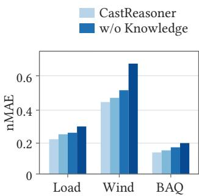

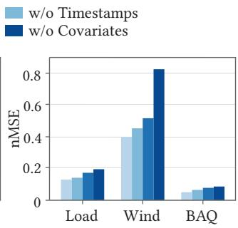

Figure 3: Contextual-input ablations on Load, Wind, and BAQ. We separately remove timestamps, exogenous covariates, and domain knowledge to measure each source’s contribution.  
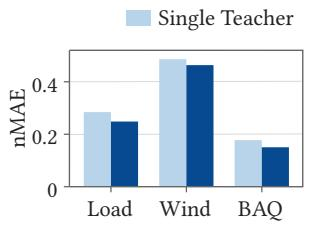

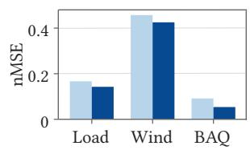  
Figure 4: Single- and multi-teacher SFT on Load, Wind, and BAQ. We compare one teacher with diverse teachers under the same trajectory budget and trajectory selection strategy.

4.3.1 Reasoning-Step Ablation. To assess the three reasoning steps, we retrain the model after removing one step at a time. All domains worsen most without evidence analysis, showing that identifying relevant context and inferring its future efects is critical to forecasting. Strategy selection makes the model output an explicit decision—retain, revise, or reconstruct—and removing it also degrades performance. Forecast construction converts the decision into a complete horizon prediction; removing this step weakens the rationale-output link. Together, these results show that all three steps are essential to high-quality reasoning and forecasting; none can be omitted without compromising performance.

4.3.2 Training-Stage Ablation. Removing either stage hurts all domains, but omitting SFT causes the larger decline, especially on weakly periodic Wind. Teacher traces train the model to extract evidence, choose a prior-handling strategy, and produce a valid full-horizon forecast. Without SFT, the model must discover both its reasoning process and output format through outcome rewards, making exploration dificult. RL refines this SFT-taught policy using accuracy, uplift, interval, and teacher-guided rewards. Without RL, the structured process remains but receives less feedback about predictive accuracy. SFT establishes how to reason; RL improves how well the model applies that process to forecasting.

## 4.4 In-Depth Analysis

We analyze contextual inputs, reasoning quality, and adaptive strategy selection, then examine how SFT supervision and RL design shape evidence-grounded forecasting.

Table 4: SFT trajectory selection: Random samples one of four teacher traces; Accuracy Only selects the lowest-MAE trace; Ours combines accuracy with student learnability.
<table><tr><td rowspan="2">Method</td><td colspan="2">Load</td><td colspan="2">Wind</td><td colspan="2">BAQ</td></tr><tr><td>nMAE</td><td>nMSE</td><td>nMAE</td><td>nMSE</td><td>nMAE</td><td>nMSE</td></tr><tr><td>Random</td><td>0.2604</td><td>0.1657</td><td>0.5105</td><td>0.5068</td><td>0.1839</td><td>0.0697</td></tr><tr><td>Accuracy Only 0.2528</td><td></td><td></td><td></td><td>0.16060.47140.43820.1586</td><td></td><td>0.0602</td></tr><tr><td>Ours</td><td>0.24850.14240.46340.42540.1503 0.0537</td><td></td><td></td><td></td><td></td><td></td></tr></table>

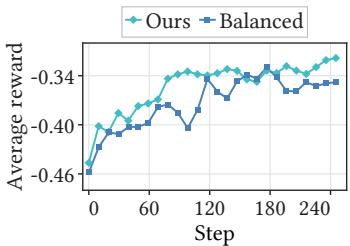

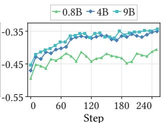  
(a) Data allocation  
(b) Model size  
Figure 5: Eight-domain mean RL reward: (a) equal (Balanced) versus convergence-guided (Ours) sampling; (b) 0.8B, 4B, and 9B students with fixed data allocation.

4.4.1 Contextual Features Analysis. Figure 3 compares ablations of timestamps, covariates, and domain knowledge. Covariates matter most, especially on Wind, where their removal more than doubles nMSE. Weather signals describe changing conditions that historical repetition alone cannot capture. Domain knowledge helps interpret such signals, while timestamps place them within daily or seasonal patterns. Removing timestamps has a generally modest efect, suggesting that temporal cues complement but cannot replace external context. These findings support combining contextual sources to infer future dynamics and guide evidence-grounded forecasts across diverse temporal patterns and domains.

4.4.2 Inference-Time Reasoning-Trace Intervention. Table 3 changes the intermediate trace while fixing forecasting inputs. Across all domains, original traces perform best, followed by removed, shufled, and corrupted traces. Removing reasoning deprives the model of useful guidance, while inconsistent or misleading traces can steer predictions toward unsupported changes. Their greater harm suggests that the model uses its intermediate reasoning when constructing forecasts. Together, these results show that coherent reasoning helps translate contextual evidence into well-supported forecast decisions, establishing a connection between intermediate inferences and the quality of final numerical forecasts.

4.4.3 SFT Analysis. Figure 4 compares single- and multi-teacher supervision with the same trajectory budget and selection strategy. Multiple teachers improve both metrics across all three domains, with the largest relative gains on BAQ, providing diverse interpretations of contextual evidence. Table 4 shows that accuracy-only selection improves over random selection, while incorporating student learnability performs best. Accurate forecasts can still be dificult to imitate; the joint criterion favors useful trajectories within the student’s reach. Together, diverse teachers and joint selection improve supervision for evidence-grounded forecasting.

Table 5: Reward ablation of CastReasoner (4B) on Load, Wind, and BAQ in nMAE/nMSE. Each variant removes one reward during RL; the full model uses all five.
<table><tr><td rowspan="2">Method</td><td colspan="2">Load</td><td colspan="2">Wind BAQ</td></tr><tr><td>nMAE nMSE</td><td>nMAE nMSE</td><td>nMAE</td><td>nMSE</td></tr><tr><td></td><td>CastReasoner 0.2120 0.1299 0.4394 0.3978 0.1317 0.0506</td><td></td><td></td><td></td></tr><tr><td> $\mathbf { w } / \mathbf { o } R _ { \mathrm { f o r m a t } }$ </td><td>0.21350.1327</td><td>0.4413 0.4119</td><td></td><td>0.1396 0.0587</td></tr><tr><td>w/o  $R _ { \mathrm { a c c u r a c y } }$ </td><td>0.37860.2913 0.7145 0.6539</td><td></td><td></td><td>0.24310.1022</td></tr><tr><td> $\mathrm { w } / { \mathrm { o } R _ { \mathrm { u p l i f t } } }$ </td><td>0.23210.13750.47050.4277</td><td></td><td></td><td>0.1564 0.0748</td></tr><tr><td> $\mathbf { w } / \mathbf { o } R _ { \mathrm { i n t e r v a l } }$ </td><td>0.23010.1329</td><td>0.46090.4211</td><td></td><td>0.1485 0.0721</td></tr><tr><td>w/o  $R _ { \mathrm { r e a s o n i n g } }$ </td><td>0.22190.13370.45520.41680.14010.0597</td><td></td><td></td><td></td></tr></table>

4.4.4 RL Analysis. Figure 5(a) shows that convergence-guided quotas achieve higher reward through most of training than equal sampling under the same budget. Square-root allocation gives slowerconverging domains more examples while limiting quota disparities. Table 5 shows that accuracy reward matters most, grounding optimization in forecast errors. Baseline outperformance encourages gains over elementary forecasts; interval feedback guides localized corrections; teacher preference reinforces efective reasoning. Format reward matters least, consistent with SFT establishing output structure. These results support convergence-guided allocation and complementary rewards for accurate, context-sensitive forecasting.

4.4.5 Strategy Adaptation to Evidence Scope. Four teacher LLMs independently label test samples by predictive evidence: none, localized impact, or broad impact afecting over 80% of the forecast horizon; the most-voted label defines each group. CastReasoner receives no labels during inference. Figure 6 reports strategy distributions and relative nMAE/nMSE reductions over the prior using the main evaluation protocol. Without evidence, Retain dominates at 78.8% with modest gains, showing restraint against unsupported changes. Localized evidence favors Revise (65.9%) and substantially greater improvements. For broad impact, Reconstruct rises from 19.0% to 42.1%, alongside further error reductions. These results demonstrate adaptive strategy selection: preserving the prior without supporting evidence, revising afected intervals, and increasingly reconstructing forecasts when evidence has broad efects.

## 4.5 Sensitivity Analysis

We examine how model capacity and local interval-reward weight afect forecasting accuracy across domains.

4.5.1 Model Size. Figure 5(b) compares reward trajectories for 0.8B, 4B, and 9B students. Both larger models sustain higher reward, suggesting that capacity helps learn evidence-grounded forecasting. The 0.8B curve recovers after a late dip, showing uneven gains from further training. Appendix B.2 confirms lower errors for both larger students across all domains. Gains from 4B to 9B are selective: 9B improves both metrics on Price, BAQ, and HS, while 4B remains stronger on Solar and BS. Scaling thus improves overall forecasting, while gains depend on the dataset and evaluation metric.

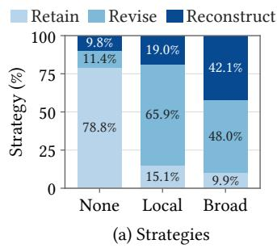

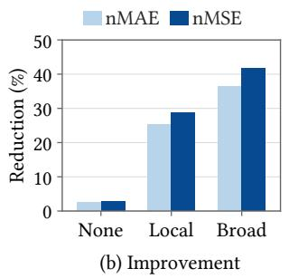  
Figure 6: By evidence group (None, Local, Broad): (a) student strategies; (b) relative nMAE/nMSE reduction over the prior.

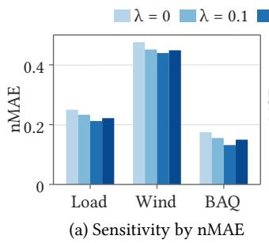

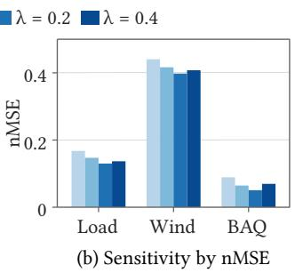  
Figure 7: Local interval-reward weight � sensitivity on Load, Wind, and BAQ, measured by nMAE and nMSE.

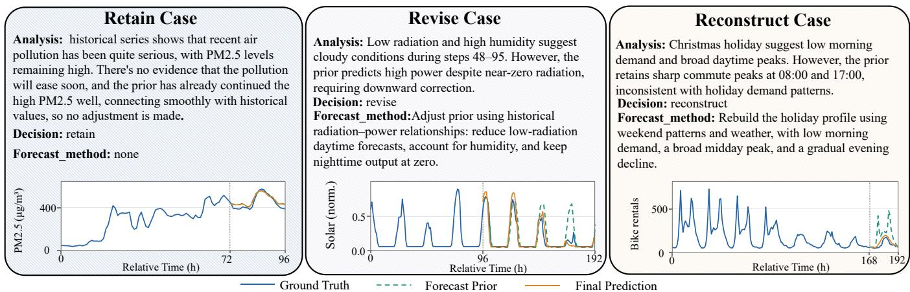  
Figure 8: Reasoning and forecasts for BAQ (retain), Solar (revise), and BS (reconstruct). Curves compare ground truth, forecast priors, and final predictions, showing how contextual evidence guides the scope of forecast intervention.

4.5.2 Local Interval Reward Weight. Figure 7 varies the intervalreward weight while retaining the other rewards. Both errors decrease across all domains as � rises from zero to 0.2, then increase at 0.4. The initial gains support directing feedback toward intervals where evidence warrants revising the prior. Global accuracy alone gives less explicit guidance about where to revise. The reversal at higher weight suggests that local revisions must remain balanced with complete-forecast accuracy. Moderate local feedback thus helps translate evidence into targeted corrections, with � = 0.2 giving the best joint accuracy among the tested settings.

## 4.6 Case Study

Figure 8 illustrates how contextual evidence guides three priorhandling strategies. In BAQ, recent pollution remains high and no evidence suggests relief, supporting retention of the prior’s level and trajectory. In Solar, low radiation and high humidity imply lower generation than the prior predicts, motivating downward revision within the afected forecast interval. In BS, holiday context contradicts the prior’s sharp commute peaks, motivating reconstruction from weekend patterns and weather, with lower morning demand and a broader daytime peak. The cases link the extent of forecast intervention to the prior’s agreement with the future dynamics inferred from contextual evidence. This reasoning guides both the direction and temporal scope of intervention.

## 5 Conclusion

CastReasoner links contextual evidence to forecast priors through evidence analysis, strategy selection, and forecast construction, guiding whether to retain, revise, or reconstruct forecasts. Its twostage training combines multi-teacher demonstrations selected for accuracy and student learnability with fine-grained RL rewards and convergence-guided cross-domain data balancing. Experiments on eight datasets show consistent gains in nMAE and nMSE across diverse temporal patterns and contextual influences. Ablations highlight the complementary roles of the three reasoning steps and the two training stages. Reasoning-trace interventions further show that coherent intermediate reasoning matters for numerical prediction, while case studies illustrate how evidence guides the direction and scope of forecast intervention. We hope these findings advance evidence-grounded reasoning for context-aware time series forecasting and encourage further studies across diverse domains.

## References

[1] Abdul Fatir Ansari, Oleksandr Shchur, Jaris Küken, Andreas Auer, Boran Han, Pedro Mercado, Syama Sundar Rangapuram, Huibin Shen, Lorenzo Stella, Xiyuan Zhang, Mononito Goswami, Shubham Kapoor, Danielle C. Maddix, Pablo Guer ron, Tony Hu, Junming Yin, Nick Erickson, Prateek Mutalik Desai, Hao Wang, Huzefa Rangwala, George Karypis, Yuyang Wang, and Michael Bohlke-Schneider. 2025. Chronos-2: From Univariate to Universal Forecasting. arXiv preprint arXiv:2510.15821 (2025).

[2] Abdul Fatir Ansari, Lorenzo Stella, Caner Turkmen, Xiyuan Zhang, Pedro Mercado, Huibin Shen, Oleksandr Shchur, Syama Sundar Rangapuram, Sebastian Pineda Arango, Shubham Kapoor, Jasper Zschiegner, Danielle C. Maddix, Hao Wang, Michael W. Mahoney, Kari Torkkola, Andrew Gordon Wilson, Michael Bohlke-Schneider, and Yuyang Wang. 2024. Chronos: Learning the Language of Time Series. Transactions on Machine Learning Research (2024). arXiv:2403.07815.

[3] Abdul Fatir Ansari, Caner Turkmen, Oleksandr Shchur, and Lorenzo Stella. 2024. Fast and accurate zero-shot forecasting with Chronos-Bolt and AutoGluon. AWS Machine Learning Blog. https://aws.amazon.com/blogs/machine-learning/fastand-accurate-zero-shot-forecasting-with-chronos-bolt-and-autogluon/

[4] Anthropic. 2026. Claude Opus 5.5 System Card. Technical Report. Anthropic. https://anthropic.com/claude-opus-5-5-system-card

[5] George E. P. Box and Gwilym M. Jenkins. 1970. Time Series Analysis: Forecasting and Control. Holden-Day, San Francisco.

[6] Ruichu Cai, Zhifan Jiang, Kaitao Zheng, Zijian Li, Weilin Chen, Xuexin Chen, Yifan Shen, Guangyi Chen, Zhifeng Hao, and Kun Zhang. 2025. Learning Disentangled Representation for Multi-Modal Time-Series Sensing Signals. In Proceedings of the ACM on Web Conference 2025. 3247–3266.

[7] Defu Cao, Michael Gee, Jinbo Liu, Hengxuan Wang, Wei Yang, Rui Wang, and Yan Liu. 2025. Conversational Time Series Foundation Models: Towards Explainable and Efective Forecasting. arXiv preprint arXiv:2512.16022 (2025).

[8] Defu Cao, Furong Jia, Sercan O. Arik, Tomas Pfister, Yixiang Zheng, Wen Ye, and Yan Liu. 2024. TEMPO: Prompt-based Generative Pre-trained Transformer for Time Series Forecasting. In International Conference on Learning Representations.

[9] Jinwen Chen, Hao Miao, Chenxi Liu, Yan Zhao, and Kai Zheng. 2026. VisionST: Coordinating Cross-modal Trafic Prediction with Interactive Geo-image Encod ing. In Proceedings ofthe ACM Web Conference 2026. ACM, 7307–7317.

[10] Jianlyu Chen, Shitao Xiao, Peitian Zhang, Kun Luo, Defu Lian, and Zheng Liu. 2024. M3-Embedding: Multi-Linguality, Multi-Functionality, Multi-Granularity Text Embeddings Through Self-Knowledge Distillation. In Findings ofthe Association for Computational Linguistics: ACL 2024. Association for Computational Linguistics, 2318–2335.

[11] Mingyue Cheng, Jiahao Wang, Daoyu Wang, Xiaoyu Tao, Qi Liu, and Enhong Chen. 2026. Can Slow-Thinking LLMs Reason Over Time? Empirical Studies in Time Series Forecasting. In Proceedings ofthe 19th ACM International Conference on Web Search and Data Mining.

[12] Abhimanyu Das, Weihao Kong, Andrew Leach, Shaan K Mathur, Rajat Sen, and Rose Yu. 2023. Long-term Forecasting with TiDE: Time-series Dense Encoder. Transactions on Machine Learning Research (2023)

[13] Abhimanyu Das, Weihao Kong, Rajat Sen, and Yichen Zhou. 2024. A Decoder-Only Foundation Model for Time-Series Forecasting. In Proceedings ofthe 41st International Conference on Machine Learning (Proceedings ofMachine Learning Research, Vol. 235). PMLR, 10148–10167.

[14] Narjes Davari, Bruno Veloso, Rita P. Ribeiro, Pedro Mota Pereira, and Joao Gama. 2021. Predictive maintenance based on anomaly detection using deep learning for air production unit in the railway industry. In 2021 IEEE 8th International Conference on Data Science and Advanced Analytics (DSAA). 1–10.

[15] DeepSeek-AI et al. 2025. DeepSeek-R1: Incentivizing Reasoning Capability in LLMs via Reinforcement Learning. arXiv preprint arXiv:2501.12948 (2025).

[16] DeepSeek-AI et al. 2026. DeepSeek-V4: Towards Highly Eficient Million-Token Context Intelligence. arXiv preprint arXiv:2606.19348 (2026).

[17] Hadi Fanaee-T and Joao Gama. 2014. Event labeling combining ensemble detectors and background knowledge. Progress in Artificial Intelligence 2, 2-3 (2014), 113–127.

[18] Nate Gruver, Marc Finzi, Shikai Qiu, and Andrew G. Wilson. 2023. Large Language Models Are Zero-Shot Time Series Forecasters. In Advances in Neural Information Processing Systems, Vol. 36. 19622–19635

[19] Arthur E. Hoerl and Robert W. Kennard. 1970. Ridge Regression: Biased Estimation for Nonorthogonal Problems. Technometrics 12, 1 (1970), 55–67.

[20] Tao Hong, Pierre Pinson, Shu Fan, Hamidreza Zareipour, Alberto Troccoli, and Rob J. Hyndman. 2016. Probabilistic energy forecasting: Global Energy Forecasting Competition 2014 and beyond. International Journal of Forecasting 32, 3 (2016), 896–913.

[21] Yayao Hong, Liyue Chen, Leye Wang, Xiuhuai Xie, Guofeng Luo, Cheng Wang, and Longbiao Chen. 2025. STKOpt: Automated Spatio-Temporal Knowledge Optimization for Trafic Prediction. In Proceedings ofthe ACM on Web Conference 2025. 2238–2249.

[22] Qihe Huang, Zhengyang Zhou, Kuo Yang, and Yang Wang. 2025. Exploiting Language Power for Time Series Forecasting with Exogenous Variables. In Proceedings ofthe ACM Web Conference 2025. ACM, 4043–4052.

[23] Furong Jia, Kevin Wang, Yixiang Zheng, Defu Cao, and Yan Liu. 2024. GPT4MTS: Prompt-based Large Language Model for Multimodal Time-series Forecasting. Proceedings of the AAAI Conference on Artificial Intelligence 38, 21 (2024), 23343– 23351.

[24] Yue Jiang, Chenxi Liu, Yile Chen, Qin Chao, Shuai Liu, Cheng Long, and Gao Cong. 2026. Cross-city Time Series Forecasting with Retrieval-Augmented Large Language Models. In Proceedings ofthe ACM Web Conference 2026. ACM, 4962– 4973.

[25] Ming Jin, Shiyu Wang, Lintao Ma, Zhixuan Chu, James Zhang, Xiaoming Shi, Pin-Yu Chen, Yuxuan Liang, Yuan-Fang Li, Shirui Pan, and Qingsong Wen. 2024. Time-LLM: Time Series Forecasting by Reprogramming Large Language Models. In International Conference on Learning Representations. 23857–23880.

[26] Woosuk Kwon, Zhuohan Li, Siyuan Zhuang, Ying Sheng, Lianmin Zheng, Cody Hao Yu, Joseph E. Gonzalez, Hao Zhang, and Ion Stoica. 2023. Eficient Memory Management for Large Language Model Serving with PagedAttention. arXiv preprint arXiv:2309.06180 (2023).

[27] Xinglin Lian, Chengtai Cao, Yan Liu, Xovee Xu, Yu Zheng, and Fan Zhou. 2025. Facing Anomalies Head-On: Network Trafic Anomaly Detection via Uncertainty-Inspired Inter-Sample Diferences. In Proceedings ofthe ACM on Web Conference 2025. 3908–3917.

[28] Haoxin Liu, Yichen Zhou, Rajat Sen, B. Aditya Prakash, and Abhimanyu Das. 2026. Rethinking Post-Training Recipes for Multimodal Time-Series Forecasting. arXiv preprint arXiv:2605.29401 (2026).

[29] Xu Liu, Junfeng Hu, Yuan Li, Shizhe Diao, Yuxuan Liang, Bryan Hooi, and Roger Zimmermann. 2024. UniTime: A Language-Empowered Unified Model for Cross-Domain Time Series Forecasting. In Proceedings ofthe ACM Web Conference 2024. 4095–4106.

[30] Yong Liu, Tengge Hu, Haoran Zhang, Haixu Wu, Shiyu Wang, Lintao Ma, and Mingsheng Long. 2024. iTransformer: Inverted Transformers Are Efective for Time Series Forecasting. In International Conference on Learning Representations.

[31] Yong Liu, Guo Qin, Zhiyuan Shi, Zhi Chen, Caiyin Yang, Xiangdong Huang, Jianmin Wang, and Mingsheng Long. 2025. Sundial: A Family of Highly Capable Time Series Foundation Models. In Proceedings of the 42nd International Conference on Machine Learning (Proceedings ofMachine Learning Research, Vol. 267). PMLR, 39295–39317.

[32] Paolo Mancuso, Veronica Piccialli, and Antonio M. Sudoso. 2021. A machine learning approach for forecasting hierarchical time series. Expert Systems with Applications 182 (2021), 115102.

[33] Yuqi Nie, Nam H. Nguyen, Phanwadee Sinthong, and Jayant Kalagnanam. 2023. A Time Series Is Worth 64 Words: Long-Term Forecasting with Transformers. In International Conference on Learning Representations. arXiv:2211.14730 [cs.LG]

[34] OpenAI. 2026. GPT-6.1 Sol Model. https://developers.openai.com/api/docs/ models/gpt-6.1-sol Oficial model documentation. Accessed October 20, 2026.

[35] Qwen Team. 2026. Qwen3.5: Towards Native Multimodal Agents. https://qwen. ai/blog?id=qwen3.5

[36] Zhihong Shao, Peiyi Wang, Qihao Zhu, Runxin Xu, Junxiao Song, Xiao Bi, Haowei Zhang, Mingchuan Zhang, Y. K. Li, Y. Wu, and Daya Guo. 2024. DeepSeekMath: Pushing the Limits of Mathematical Reasoning in Open Language Models. arXiv preprint arXiv:2402.03300 (2024).

[37] Guangming Sheng, Chi Zhang, Zilingfeng Ye, Xibin Wu, Wang Zhang, Ru Zhang, Yanghua Peng, Haibin Lin, and Chuan Wu. 2024. HybridFlow: A Flexible and Eficient RLHF Framework. arXiv preprint arXiv:2409.19256 (2024).

[38] Xiaoyu Tao, Shilong Zhang, Mingyue Cheng, Daoyu Wang, Tingyue Pan, Bokai Pan, Changqing Zhang, and Shijin Wang. 2025. From Values to Tokens: An LLM-Driven Framework for Context-Aware Time Series Forecasting via Symbolic Discretization. arXiv preprint arXiv:2508.09191 (2025).

[39] Sean J. Taylor and Benjamin Letham. 2018. Forecasting at Scale. The American Statistician 72, 1 (2018), 37–45.

[40] Xinlei Wang, Maike Feng, Jing Qiu, Jinjin Gu, and Junhua Zhao. 2024. From News to Forecast: Integrating Event Analysis in LLM-Based Time Series Forecasting with Reflection. In Advances in Neural Information Processing Systems, Vol. 37. Curran Associates, Inc., 58118–58153.

[41] Yuxuan Wang, Haixu Wu, Jiaxiang Dong, Guo Qin, Haoran Zhang, Yong Liu, Yunzhong Qiu, Jianmin Wang, and Mingsheng Long. 2024. TimeXer: Empowering Transformers for Time Series Forecasting with Exogenous Variables. In Advances in Neural Information Processing Systems, Vol. 37. 469–498

[42] Gerald Woo, Chenghao Liu, Akshat Kumar, Caiming Xiong, Silvio Savarese, and Doyen Sahoo. 2024. Unified Training of Universal Time Series Forecasting Transformers. In Proceedings of the 41st International Conference on Machine Learning (Proceedings ofMachine Learning Research, Vol. 235). PMLR, 53140– 53164.

[43] Hao Xue and Flora D. Salim. 2024. PromptCast: A New Prompt-Based Learning Paradigm for Time Series Forecasting. IEEE Transactions on Knowledge and Data Engineering 36, 11 (2024), 6851–6864.

[44] Z.ai. 2026. GLM-5.3-Flash/FlashX: Overview. https://docs.z.ai/guides/vlm/glm-5.3-flash Oficial model documentation. Accessed October 19, 2026.

[45] Huajian Zhang, Mingyue Cheng, Yucong Luo, and Xiaoyu Tao. 2026. STaR: Towards Efective and Stable Table Reasoning via Slow-Thinking Large Language Models. In Proceedings ofthe ACM Web Conference 2026. ACM, 7189–7200.

[46] Jianqi Zhang, Jingyao Wang, Wenwen Qiang, Fanjiang Xu, and Changwen Zheng. 2026. Enhancing Large Language Models for Time-Series Forecasting via Vector-Injected In-Context Learning. In Proceedings ofthe ACM Web Conference 2026. ACM, 7211–7222.

[47] Shuyi Zhang, Bin Guo, Anlan Dong, Jing He, Ziping Xu, and Song Xi Chen. 2017. Cautionary tales on air-quality improvement in Beijing. Proceedings ofthe Royal Society A: Mathematical, Physical and Engineering Sciences 473, 2205 (2017), 20170457.

[48] Jiahui Zhou, Dan Li, Boxin Li, Xiao Zhang, Erli Meng, Lin Li, Zhuomin Chen, Jian Lou, and See-Kiong Ng. 2026. Time Series Reasoning via Process-Verifiable Thinking Data Synthesis and Scheduling for Tailored LLM Reasoning. In Proceedings ofthe 43rd International Conference on Machine Learning (Proceedings of Machine Learning Research, Vol. 306). PMLR, 165197–165221.

[49] Yitong Zhou, Yucong Luo, Mingyue Cheng, Qi Liu, Jiahao Wang, Daoyu Wang, and Enhong Chen. 2026. Time Series Forecasting via Reasoning: A Slow-Thinking Approach with Reinforcement Fine-Tuned LLMs. In Proceedings ofthe 35th ACM International Conference on Information and Knowledge Management.

## A Experimental Setup

## A.1 Datasets

Table 6 summarizes the eight datasets in main-results order and gives time ranges at month resolution. Splits are strictly ordered and disjoint, with windows constructed independently; exogenousvariable counts include task-provided calendar or event inputs where applicable.

History/prediction/stride lengths (in sampling steps) are 96/96/24 for Load, Price, Solar, and Wind; 72/24/24 for BAQ; 120/30/30 for MetroPT-3; 30/7/7 for HS; and 168/24/24 for BS.

The exogenous variables are: Load, w1–w25; Price, forecasted\_ total\_load and forecasted\_zonal\_load; Solar, VAR78, VAR79, VAR134, VAR157, VAR164, VAR165, VAR166, VAR167, VAR169, VAR175, VAR178, and VAR228; Wind, U10, V10, U100, and V100; BS, holiday, weekday, workingday, weathersit, temp, atemp, hum, and windspeed; BAQ, PM10, SO2, NO2, CO, O3, TEMP, PRES, DEWP, RAIN, wd, and WSPM; HS, PROMO; and MetroPT-3, TP2, DV\_pressure, Motor\_current, Oil\_temperature, DV\_eletric, LPS, and COMP.

## A.2 Baselines

To ensure a leakage-free and fair evaluation, all models are provided with the same forecast-time available information whenever supported by their input interfaces. For Price, Solar, and Wind, we use the provided future exogenous forecasts. For the remaining datasets, future observed exogenous values are excluded, and only historical exogenous observations and known future calendar features are used. Prophet, iTransformer, TimeXer, TiDE, Chronos-2, Moirai, TimeReasoner, Time-R1, and PostTime support exogenous inputs and receive exactly the same exogenous variables as CastReasoner. For TimeReasoner, Time-R1, and PostTime, we use the prompt templates presented in their respective papers.

## A.3 Experimental Parameters

SFT uses 2,000 trajectories for three epochs with learning rate $2 \times { 1 0 } ^ { - 5 }$ and batch size 32. GRPO RL uses two epochs with learning rate $1 0 ^ { - 6 }$ and batch size 16. The accuracy reward combines nMAE and nMSE with weights 0.9 and 0.1, respectively. The local interval reward weight is 0.2.

All model sizes share the output schema and fixed convergenceguided quotas. RL uses clipping parameter $\epsilon = 0 . 2$ , KL coeficient $\beta = 0 . 0 0 1$ , group size $G = 8 ,$ sampling temperature 1.0, maximum completion length 2,048 tokens, and random seed 42.

Trajectory selection uses relative MAE tolerance $\delta = 0 . 0 3$ and token-rank cap $r _ { \operatorname* { m a x } } = 1 0 0$ for SAD. Cross-domain allocation uses validation weight $\alpha _ { \mathrm { v a l } } = 0 . 9$ and example budget $B = 2 0 0 0$

For output validity and forecast loss, we use $\lambda _ { f } = 1 , \rho = 0 . 0 5 .$ $\epsilon _ { s } = 1 0 ^ { - 8 } , \alpha = 0 . 9$ , and $C \ = \ 4$ . Baseline outperformance uses $\lambda _ { U } = 0 . 1 0 , \tau _ { g } = 0 . 0 5 , c _ { g } = 0 . 2 0 , \tau _ { \Delta } = 0 . 0 2 , c _ { \Delta } = 0 . 0 8$ , and $\epsilon _ { U } = 0 . 1 0$ Interval revision uses $\lambda _ { \mathrm { l o c } } = 0 . 2 0 , c _ { \mathrm { l o c } } = 1 , \lambda _ { O } = 0 . 1 0 ,$ , and $c _ { O } = 1$ Teacher-guided reasoning preference uses $\lambda _ { T } = 0 . 0 2$ and $\tau _ { T } = 0 . 7 0$

To compute nMAE and nMSE, we concatenate ground truth from all test prediction windows within each dataset–series group and calculate its mean and population variance. Predictions and ground truth use this shared standardization: each window’s MAE is divided by the pooled standard deviation and its MSE by the pooled variance, after which normalized errors are averaged equally across test windows. Pooling avoids inflated normalized errors when an individual window has near-zero variance and provides a common scale across the test set.

## B Additional Experimental Results

## B.1 Cross-Domain Data Allocation

We isolate the efect of the allocation rule by fixing the 4B student and total example budget �. Balanced allocation assigns equal quotas across domains, whereas our convergence-guided rule uses $p _ { i } \propto \sqrt { T _ { i } }$ . For comparison, linear allocation assigns quotas directly in proportion to the pilot convergence steps:

$$
\tilde { p } _ { i } ^ { \mathrm { l i n } } = \frac { T _ { i } } { \sum _ { j = 1 } ^ { D } T _ { j } } , \qquad \widetilde { N } _ { i } ^ { \mathrm { l i n } } = B \dot { p } _ { i } ^ { \mathrm { l i n } } ,\tag{9}
$$

where � is the number of domains and $T _ { i }$ is the pilot training step at which domain � reaches its minimum validation loss under equal sampling. Quotas are fixed from this pilot before formal training. Figure 9(a) shows that square-root allocation has the lowest eightdataset mean nMAE (0.2919), versus 0.3071 for balanced and 0.3128 for linear allocation. In panel (b), best-validation-step variance rises under linear allocation and falls under square-root allocation relative to balanced sampling. Thus, square-root allocation improves aggregate accuracy while bringing convergence steps closer together across datasets.

## B.2 Model Size

Table 7 compares the 0.8B, 4B, and 9B students across eight datasets. Increasing the size from 0.8B to 4B reduces all sixteen dataset– metric errors, with equally averaged nMAE/nMSE decreasing from 0.3346/0.3921 to 0.2919/0.3014. The improvement from 4B to 9B is smaller in aggregate: mean nMAE/nMSE reach 0.2865/0.2877, with gains in nine of the sixteen entries. Both metrics improve on Price, BAQ, and HS, but 4B remains better on Solar and BS. The two metrics also need not favor the same size: on Wind, 9B lowers nMSE from 0.3978 to 0.3821 but raises nMAE from 0.4394 to 0.4443. Similarly, 4B has slightly lower Load nMAE and lower MetroPT-3 nMSE. These results show broad benefits from moving beyond 0.8B, followed by smaller and more dataset-dependent gains at 9B. We use

Table 6: Dataset domains, sampling frequencies, time points, chronological split periods, and available exogenous-variable counts.
<table><tr><td>Dataset</td><td>Domain</td><td>Freq. Time points</td><td></td><td>Train</td><td>Validation</td><td>Test</td><td>Exogenous Variables</td></tr><tr><td>Load</td><td>Energy</td><td>1h</td><td>61,344</td><td></td><td>2005-01-2009-11 2009-11-2010-12 2010-12-2012-01</td><td></td><td>25</td></tr><tr><td>Price</td><td>Energy</td><td>1h</td><td>25,968</td><td></td><td>2011-01-2013-01 2013-01-2013-072013-07-2013-12</td><td></td><td>2</td></tr><tr><td>Solar</td><td>Energy</td><td>1h</td><td>19,704</td><td></td><td>2012-04-2013-102013-10-2014-022014-02-2014-07</td><td></td><td>12</td></tr><tr><td>Wind</td><td>Energy</td><td>1h</td><td>17,544</td><td></td><td>2012-01-2013-052013-05-2013-092013-09-2014-01</td><td></td><td>4</td></tr><tr><td>BS</td><td>Urban Mobility</td><td>1h</td><td>17,455</td><td></td><td>2011-01-2012-072012-07-2012-092012-09-2012-12</td><td></td><td>8</td></tr><tr><td>BAQ</td><td>Environment</td><td>1h</td><td>35,064</td><td></td><td>2013-03-2015-122015-12-2016-072016-07-2017-02</td><td></td><td>11</td></tr><tr><td>HS</td><td>Retail</td><td>1 day</td><td>1,798</td><td></td><td>2014-01-2017-062017-06-2018-032018-03-2018-12</td><td></td><td>1</td></tr><tr><td></td><td>MetroPT-3 Industrial Monitoring 1 min</td><td></td><td>306,960</td><td></td><td></td><td>2020-02-2020-062020-06-2020-072020-07-2020-09</td><td>7</td></tr></table>

Table 7: Forecasting nMAE and nMSE of CastReasoner with 0.8B, 4B, and 9B student models across eight datasets. The best result for each metric is shown in bold.
<table><tr><td rowspan="2">Model</td><td colspan="2">Load</td><td colspan="2">Price</td><td colspan="2">Solar</td><td colspan="2">Wind</td><td colspan="2">BS</td><td colspan="2">BAQ</td><td colspan="2">HS</td><td colspan="2">MetroPT-3</td></tr><tr><td>nMAE</td><td>nMSE</td><td>nMAE</td><td>nMSE</td><td>nMAE</td><td>nMSE</td><td>nMAE</td><td>nMSE</td><td>nMAE</td><td>nMSE</td><td>nMAE</td><td>nMSE</td><td>nMAE</td><td>nMSE</td><td>nMAE</td><td>nMSE</td></tr><tr><td>0.8B</td><td>0.2769</td><td>0.1914</td><td>0.3352</td><td>0.5993</td><td>0.1743</td><td>0.1576</td><td>0.5057</td><td>0.5392</td><td>0.2083</td><td>0.1203</td><td>0.1472</td><td>0.0624</td><td>0.7848</td><td>1.2904</td><td>0.2445</td><td>0.1764</td></tr><tr><td>4B</td><td>0.2120</td><td>0.1299</td><td>0.2811</td><td>0.4066</td><td>0.1548</td><td>0.1226</td><td>0.4394</td><td>0.3978</td><td>0.1754</td><td>0.0822</td><td>0.1317</td><td>0.0506</td><td>0.7496</td><td>1.1267</td><td>0.1912</td><td>0.0944</td></tr><tr><td>9B</td><td>0.2123</td><td>0.1101</td><td>0.2623</td><td>0.3658</td><td>0.1579</td><td>0.1277</td><td>0.4443</td><td>0.3821</td><td>0.1773</td><td>0.0858</td><td>0.1290</td><td>0.0478</td><td>0.7215</td><td>1.0828</td><td>0.1877</td><td>0.0998</td></tr></table>

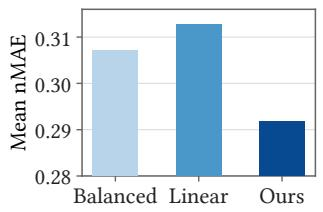  
(a)

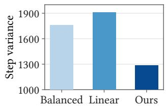  
(b)  
Figure 9: Comparison of balanced, linear, and square-root (Ours) data allocation: (a) eight-dataset mean nMAE; (b) variance of best-validation training steps.

9B for its stronger overall average, while 4B remains competitive across the evaluated tasks despite using fewer parameters.

## B.3 Accuracy Reward Objective

Figure 10 varies the relative emphasis on nMAE and nMSE in the accuracy reward, weighted by � and 1 − �, respectively. Among the three tested settings, 0.9/0.1 gives the lowest errors on both metrics for Load, Wind, and BAQ. On Load and Wind, both errors rise as more weight shifts to nMSE. BAQ is nonmonotonic: 0.1/0.9 improves on equal weighting but remains worse than 0.9/0.1 on both metrics. Thus, increasing the direct weight on nMSE does not necessarily reduce the final evaluated nMSE. Across these three datasets, the results favor an nMAE-focused reward that retains a smaller nMSE component, supporting the 0.9/0.1 setting used throughout our main experimental comparisons.

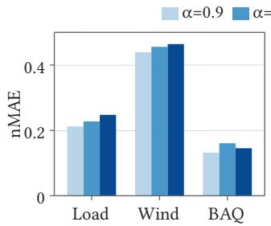

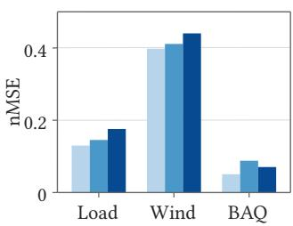  
Figure 10: Accuracy-reward sensitivity across Load, Wind, and BAQ for $\alpha \in \{ 0 . 9 , 0 . 5 , 0 . 1 \}$ . Here, � and 1 − � denote the nMAE and nMSE weights, respectively.

## C Prompt

Template 1 supplies the task definition, indexed target history, available context, and cached point forecast $F _ { 0 } .$ Its guidance asks the model to interpret calendar and exogenous signals rather than copy historical windows verbatim. It explicitly distinguishes $F _ { 0 }$ from the unavailable future targets, clarifying the information boundary during reasoning and strategy selection.

The three strategies define distinct relationships to the prior: retain it unchanged, revise supported aspects using it as the starting point, or reconstruct independently from history and supplied covariates. The reasoning block records the analysis, selected strategy, and forecasting method. The answer block contains exactly � finite values indexed from 0 to � − 1, with no extra text outside the two blocks. Under retain, every value must exactly match the displayed prior. This structure connects the stated decision to the numerical forecast used in the final evaluation.

## CastReasoner Forecasting Prompt

<table><tr><td>Role and objective. You are forecasting a time series. Use the observed history and supplied future covariates to review the prior forecast  $F _ { 0 } .$  Analyze the situational context and forecast prior to infer evidence relevant to forecasting. Choose retain, revise, or reconstruct, and output the complete final forecast in the required format. 1. Task and visible history. &lt;forecast_context&gt;</td></tr><tr><td>{task definition} {context information} {L observed-window rows, indexed 0 to L-1}</td></tr><tr><td>&lt;/forecast_context&gt; Forecasting guidance. Avoid mechanically copying historical patterns without assessing their relevance to the forecast hori- zon. When using an analogous historical shape, adjust it using exogenous evidence and context, including future level, peaks,</td></tr><tr><td>troughs, and timing. Consider holidays, special dates, weekday/weekend changes, and seasonality. Field conventions. Each window is indexed independently from 0; time uses YYYY-MM-DD HH:MM. Covariates include</td></tr><tr><td>calendar features and available exogenous variables. 2. Prior forecast and context information.</td></tr><tr><td>{context information} {H forecast-window rows, indexed 0 to H-1 with forecast prior}</td></tr><tr><td>prior_forecast is a cached point forecast  $F _ { 0 } ,$  not the future target; it is displayed at the observed target precision. Future target values are unavailable.</td></tr><tr><td>3. Decision and final forecast. Choose one option:</td></tr><tr><td>• retain: Keep  $F _ { 0 }$  unchanged. • revise: Use  $F _ { 0 }$  as the starting forecast and correct its level, shape, or timing where the observed history and supplied</td></tr><tr><td>covariates support a correction.</td></tr><tr><td>• reconstruct: Discard  $F _ { 0 }$  as the forecasting basis and independently construct a new forecast from the observed history and supplied covariates. Do not use  $F _ { 0 }$  as the starting forecast or merely apply corrections to it.</td></tr><tr><td>Present your analysis, selected strategy, and forecasting method using the supplied information. Return exactly these two blocks:</td></tr><tr><td>&lt;think&gt;</td></tr><tr><td>analysis: [analyze the situational context and forecast prior to infer evidence relevant to forecasting] decision: [retain, revise, or reconstruct]</td></tr><tr><td>forecast_method: [none for retain; corrections to  $F _ { 0 }$  for revise; independent forecast construction for reconstruct] &lt;/think&gt;</td></tr><tr><td>&lt;answer&gt;</td></tr><tr><td>index | value 0 | [finite numeric value]</td></tr></table>