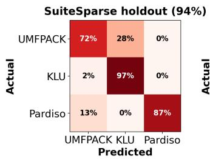
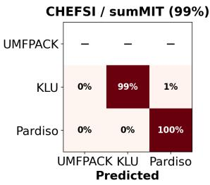

# Learning to Select Sparse Linear Solvers with Convolutional Neural Networks

Artemis Pados1,4, Alan Edelman2,5, Emmanuel Lujan2,6, Daniel Pickard3,7, Felipe Tome2,8, and Christopher Rackauckas2,9

1Department of Electrical Engineering and Computer Science, Massachusetts Institute of Technology, USA.

2Computer Science & Artificial Intelligence Laboratory, Massachusetts Institute of Technology, USA.

3Department of Aeronautics and Astronautics, Massachusetts Institute of Technology, USA.

apados@mit.edu 5edelman@mit.edu 6eljn@mit.edu 7pickard@mit.edu 8felipe0@mit.edu 9crackauc@mit.edu

Abstract—We investigate convolutional-neural-network (CNN) based automatic solver selection for sparse linear systems, a problem of practical importance where solver performance varies dramatically with matrix sparsity structure. A CNN is trained to regress log timing ratios between candidate solvers using spy plot images of matrix nonzero structure as input, achieving strong prediction accuracy on both held-out SuiteSparse matrices and real-world matrices from high-performance simulation codes.

Index Terms—Sparse matrices, linear systems, convolutional neural network, scientific computing

## I. INTRODUCTION

Sparse linear systems of the form Ax = b where ${ \textbf { A } } \in$ Rn×n is a large sparse matrix arise throughout scientific computing, from finite element analysis and circuit simulation to fluid dynamics and structural mechanics applications. The efficiency of solving such systems is critical to the scientific application and the choice of direct solver can have a dramatic impact. For the same matrix, different solvers can vary in wallclock time by orders of magnitude, ranging from milliseconds to several seconds [1].

Julia [2] has emerged as a leading language for highperformance scientific computing, combining the productivity of high-level languages with the performance of compiled code. Its LinearSolve.jl [3] package provides a unified interface to multiple high-performance direct sparse solvers. Despite this flexibility, current software, including MATLAB, Python/SciPy, and Julia, relies on fixed default backends regardless of the structural properties of the input matrix. This means that users who do not manually benchmark solvers on their specific matrices are likely leaving significant performance gains on the table.

In this paper, we propose the use of convolutional neural networks (CNNs) as a data-driven approach to automatic solver selection, trained to regress log timing ratios collected across a large corpus of sparse matrices from the SuiteSparse Matrix Collection [4]. Further, we release NeuralLinear-Solve.jl1, an open-source Julia package integrating the trained model bundled with frozen weights into the SciML ecosystem2 and the broader SMARTSOLVE effort [5] at the MIT Julia Lab, exposing solver recommendations via a single function call with no benchmarking or domain expertise required.

## II. RELATED WORK

Direct sparse linear solvers have been extensively studied, with different methods optimized for different matrix structures, yielding no single solver dominating across problem types [1], [7]. Davis [6] provides a comprehensive overview of solvers including those that we consider: UMFPACK implements multifrontal LU and is Julia’s default, KLU uses a leftlooking sparse LU optimized for nearly-triangular matrices, and MKL Pardiso is Intel’s parallel supernodal direct solver. For symmetric positive definite matrices, CHOLMOD [8] selects between solvers using a reliable hand-engineered heuristic. For general sparse matrices, however, no such heuristic exists, motivating a learning-based approach. Recent work in this direction has explored LLM-driven heuristic generation [9]. Yamada et al. [10] propose a similar CNN-based approach but for classification of preconditioners in iterative solvers, using full-color RGB feature images.

## III. OUR METHODOLOGY

## A. Data Collection

We benchmark the three solvers mentioned in Section II across approximately 1500 square, real-valued sparse matrices from the SuiteSparse Matrix Collection [4]. Wall-clock solve times are measured using a minimum-over-trials strategy to reduce sensitivity to OS scheduling noise and transient system load. The fastest solver per matrix serves as the ground-truth label. The intentional imbalance of the resulting dataset is addressed during training via class-weighted loss.

## B. Spy Plot Generation and CNN

Each matrix is converted to a 64×64 binary spy plot image, where each pixel indicates the presence of at least one nonzero in the corresponding matrix block. Matrices larger than 64×64 are downsampled via block aggregation, whereas smaller matrices are upsampled via nearest-neighbour interpolation. The global sparsity pattern of the original matrix captures the structural properties that determine solver suitability: neartriangular structure favors KLU’s reordering strategies, dense or irregular patterns favor UMFPACK’s multifrontal approach, and larger structured problems favor Pardiso’s parallelism. These coarse-grained features are well-preserved at $6 4 \times 6 4$ resolution.

The CNN is trained on pairs of spy plot images and their corresponding timing labels, learning to map visual sparsity structure directly to solver performance. The architecture consists of three convolutional blocks and three fully connected layers with ReLU activations, max pooling, and dropout, yielding two scalar outputs.

Rather than treating solver selection as a three-class classification problem, we formulate it as regression on log timing ratios. KLU serves as the denominator baseline since it is the fastest solver for the majority of matrices in our training dataset, making it the most stable reference point. Log ratios are used in place of raw ratios to symmetrize the target distribution and reduce sensitivity to outliers. The regression targets are $\begin{array} { r } { \hat { y } ~ = ~ \left. \log \frac { t _ { \mathrm { U M F P A C K } } } { t _ { \mathrm { K L U } } } \right. } \end{array}$ , log $\frac { t _ { \mathrm { P a r d i s o } } } { t _ { \mathrm { K L U } } }$ and the predicted solver is sˆ = argmin $( \hat { y } _ { 1 } , ~ 0 , ~ \hat { y } _ { 2 } )$ , where 0 is the implicit KLU score. This formulation encourages the model to learn the magnitude of performance differences rather than just which solver wins, yielding more robust predictions near decision boundaries. The model is trained using MSE loss, the Adam optimizer, and an 80/20 train/test split.

## C. Julia Package

The trained weights are bundled as a BSON artifact within NeuralLinearSolve.jl. The package exposes two functions: predict solver(A) and predict solver scores(A), returning the recommended solver and relative speed scores. Both accept a matrix as input and generate the spy plot internally.

## IV. EXPERIMENTAL RESULTS

On the held-out test set (20% of the corpus), the model achieves 94% accuracy in predicting the fastest solver (Fig. 1). The improvement (over 84% that would have been achieved if we fixed KLU as the solver) is concentrated in the minority classes where the performance gap between solvers is largest.

To evaluate generalization beyond the SuiteSparse training distribution, we test NeuralLinearSolve.jl on a corpus of matrices harvested from real high-performance scientific computing applications, namely $\Sigma \mathbf { M I T } ^ { 3 }$ and CHEFSI4. On this corpus, NeuralLinearSolve.jl achieves 99% prediction accuracy (Fig. 1).

## V. CONCLUSION AND FUTURE WORK

We have presented NeuralLinearSolve.jl, a Julia package that uses a pretrained CNN to automatically predict the fastest direct sparse linear solver for a given matrix from its spy plot image, achieving strong accuracy on both SuiteSparse heldout matrices and real-world stiffness matrices from CHEFSI and ΣMIT simulations.

Several directions are planned for future work. First, we aim to expand the solver set beyond the current three backends to include additional solvers available in LinearSolve.jl. More ambitiously, we plan to extend the framework to the joint selection of solver and preconditioner (PC) combinations using a dedicated PETSc benchmarking engine5. This work would constitute a strict superset of NeuralLinearSolve.jl. Ultimately, we aim to conduct interpretability analyses and integrate the learned selection model directly into LinearSolve.jl and ΣMIT, enabling near-optimal solver dispatch for practitioners with no domain expertise required.

  
Fig. 1. Normalized confusion matrices for SuiteSparse holdout (left) and CHEFSI/ΣMIT evaluation (right).

## ACKNOWLEDGMENT

This material is based upon work supported by the Department of Energy, National Nuclear Security Administration under Award Number DE-NA0004266 and by the Defense Advanced Research Projects Agency (DARPA) under Agreement No. HR00112490488. Claude Sonnet 4.6 (Anthropic) was used to revise full author-written drafts for clarity, coherence, and correct typographical errors.

## REFERENCES

[1] E. Lujan and A. Edelman, “When structure is silent: Opportunities for algorithmic dispatch in linear algebra,” in Proc. IEEE High Performance Extreme Computing Conf. (HPEC), 2025, pp. 1–7.

[2] J. Bezanson, A. Edelman, S. Karpinski, and V. B. Shah, “Julia: A fresh approach to numerical computing,” SIAM Review, vol. 59, no. 1, pp. 65–98, 2017.

[3] “LinearSolve.jl: High-performance unified linear solvers,” SciML, 2026. [Online]. Available: https://docs.sciml.ai/LinearSolve/stable/

[4] T. A. Davis and Y. Hu, “The University of Florida sparse matrix collection,” ACM Trans. Math. Softw., vol. 38, no. 1, pp. 1–25, Dec. 2011.

[5] E. Lujan, R. N. Shah, R. Alomairy, and A. Edelman, “Smart-Solve.jl: AI for algorithmic discovery,” Jul. 2025. [Online]. Available: https://doi.org/10.5281/zenodo.15784217

[6] T. A. Davis, Direct Methods for Sparse Linear Systems. Philadelphia, PA: Society for Industrial and Applied Mathematics (SIAM), 2006.

[7] M. Ferrari, “A comparison of sparse solvers for severely ill-conditioned linear systems in geophysical marker-in-cell simulations,” arXiv preprint arXiv:2409.11515, 2024.

[8] Y. Chen, T. A. Davis, W. W. Hager, and S. Rajamanickam, “Algorithm 887: CHOLMOD, supernodal sparse Cholesky factorization and update/downdate,” ACM Trans. Math. Softw., vol. 35, no. 3, pp. 1–14, Oct. 2008.

[9] R. Shah, E. Lujan, R. Alomairy, and A. Edelman, “Data-driven dynamic algorithm dispatch with large language models,” in Proc. IEEE High Performance Extreme Computing Conf. (HPEC), 2025.

[10] K. Yamada et al., “Preconditioner auto-tuning using deep learning for sparse iterative algorithms,” in Proc. 6th Int. Symp. Computing and Networking Workshops (CANDARW), 2018, pp. 257–262.