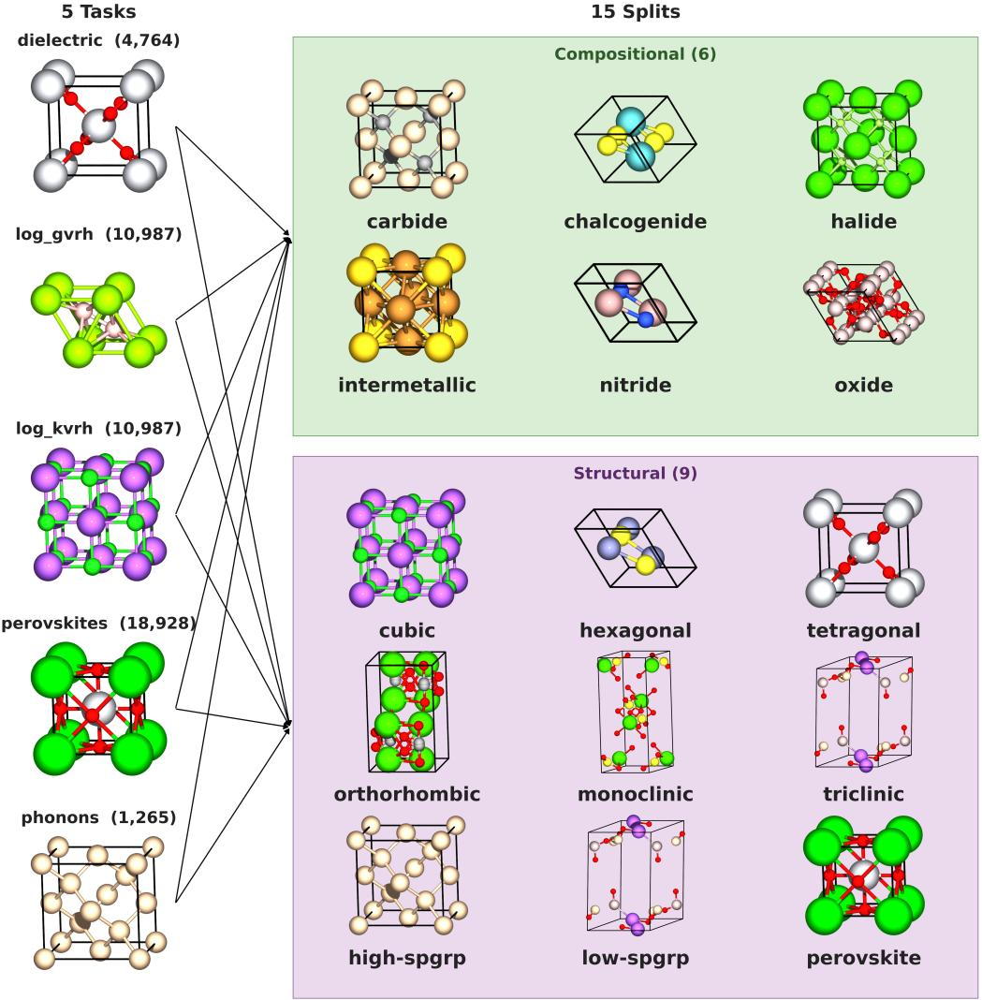
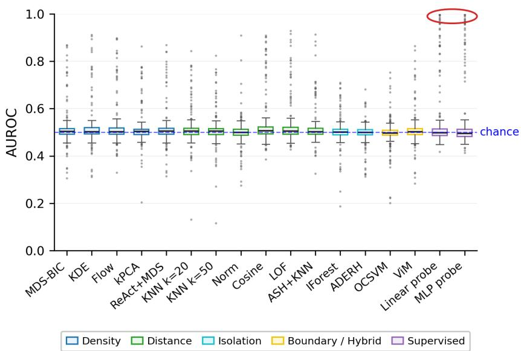
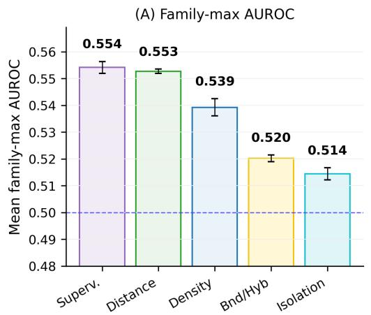
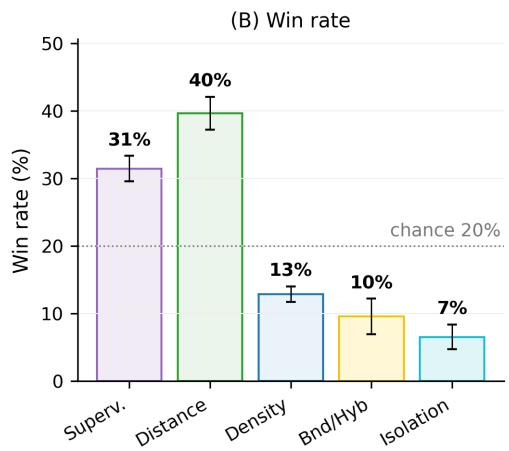
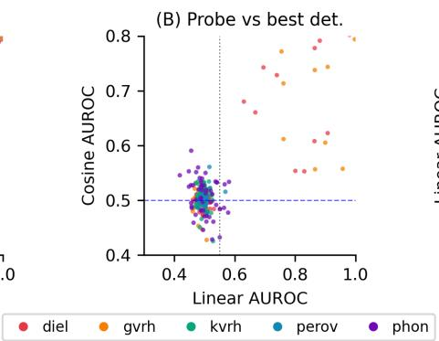
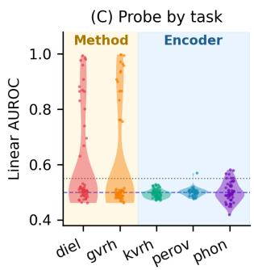
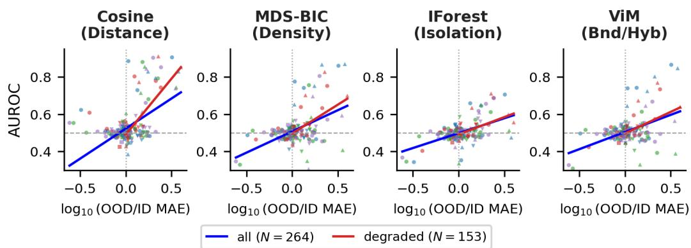
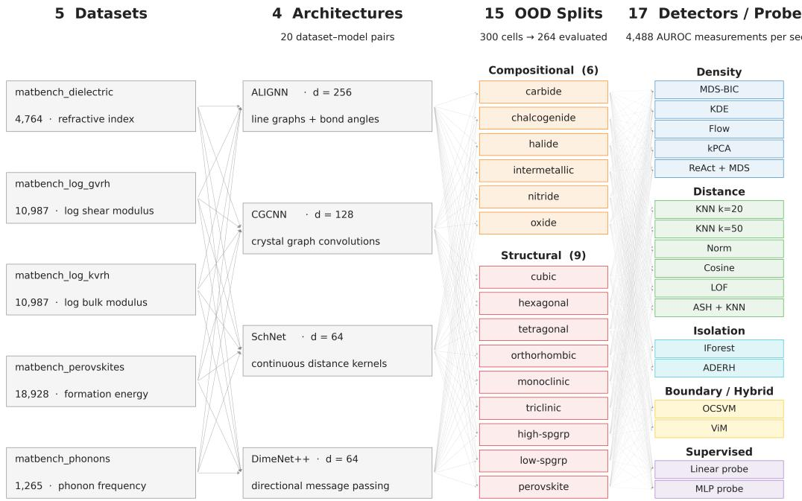
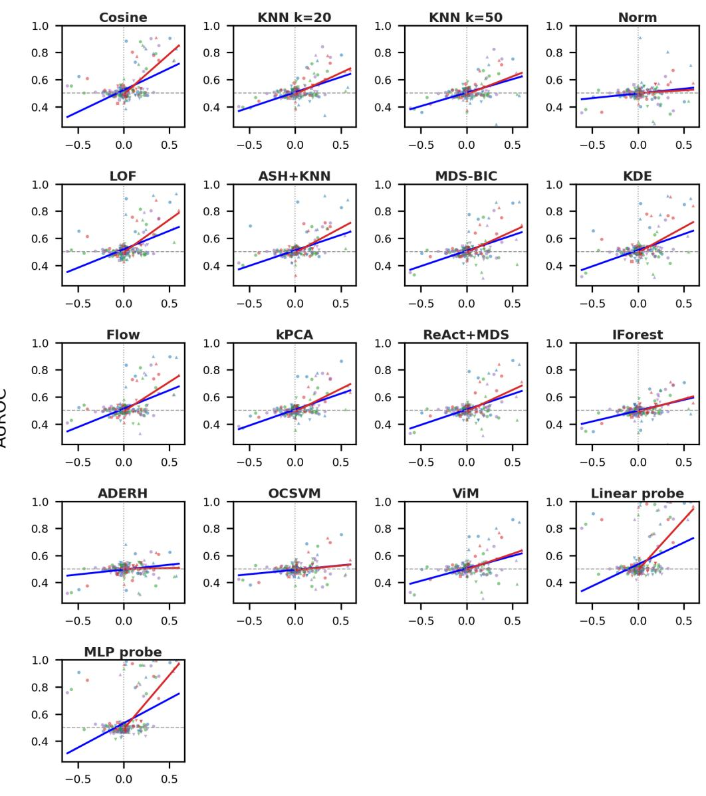
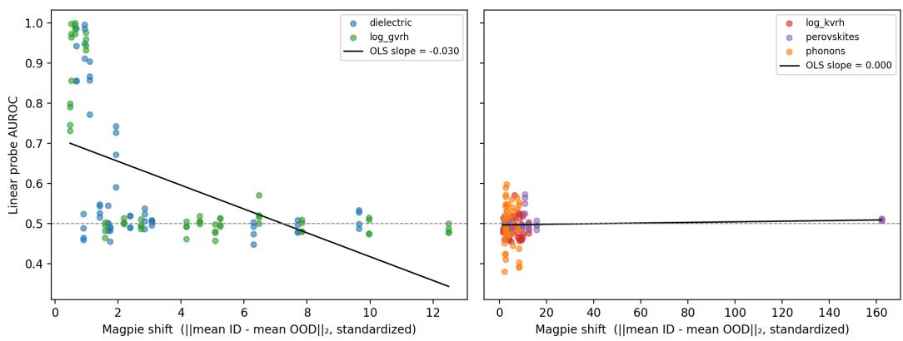

# MOOD: Benchmarking Post-Hoc OOD Detection for Materials Property Prediction

Shirley X. Yu<sup>1,3</sup> Amey P. Pasarkar<sup>2,3</sup> Adji Bousso Dieng<sup>1,3</sup>

<sup>1</sup>Department of Computer Science, Princeton University <sup>2</sup>Lewis-Sigler Institute for Integrative Genomics, Princeton University <sup>3</sup>Vertaix

## Abstract

Out-of-distribution (OOD) detection is essential for deploying machine learning models in high stakes scientific applications, yet methods that flag OOD inputs without retraining the model have been validated almost exclusively on image classification. We introduce MOOD (Materials Out-of-Distribution Detection), a benchmark for evaluating whether these post-hoc OOD detectors transfer to graph neural networks (GNNs) on materials property prediction. MOOD evaluates 15 post-hoc detectors and 2 supervised diagnostic probes across 4 GNN architectures, 5 MatBench tasks, and 15 physically motivated compositional and structural shifts, yielding 264 evaluation settings and over 13,000 AUROC measurements across three encoder training seeds. Our evaluation reveals three key findings. First, current post-hoc detectors perform near chance; all 15 detectors achieve an AUROC around 0.5. Second, detector failures decompose into two regimes: method bottlenecks and encoder bottlenecks. Method bottlenecks arise when supervised probes can separate in-distribution (ID) from OOD samples but unsupervised detectors fail, meaning that the embeddings contain OOD signal that current detectors do not extract. Encoder bottlenecks arise when even supervised probes fail to separate ID from OOD samples, indicating that the relevant shift is not accessible in the frozen GNN representation. Third, when OOD prediction error exceeds ID error, the AU-ROC of distance-based and density-based detectors correlates with the size of that gap. Collectively, these findings indicate that reliable OOD detection in scientific domains requires representation learning strategies that explicitly preserve OOD relevant signal, particularly for tasks where current GNN architectures encode no extractable signal at all.

Code: https://github.com/vertaix/mood-benchmark Data: https://huggingface.co/datasets/shirlyu/mood-benchmark

## 1 Introduction

Machine learning (ML) models often encounter inputs that differ from their training data, making outof-distribution (OOD) detection important for reliable deployment. Many OOD detection methods have been developed and benchmarked extensively in computer vision, especially for image classification. However, OOD detection remains far less explored in scientific ML, where data are often non-image, models are trained for regression, and distribution shifts reflect domain-specific structure.

Addressing this gap is especially important for scientific ML because model predictions often guide expensive downstream simulations or experiments. When deployment inputs differ from the training distribution, unreliable predictions can waste substantial computational, experimental, or synthesis effort. In materials discovery, this risk is built in. Screening pipelines deliberately seek candidates with new compositions or structures, which are exactly the inputs where graph neural network (GNN) predictions degrade [Omee et al., 2024], and a regression model gives little to no signal that it is extrapolating. This setting stresses OOD detection differently from computer vision because GNNs for materials property prediction are typically trained for regression, so their embeddings are not organized around class boundaries in the way image classifier embeddings often are. Recent work has benchmarked predictive performance under distribution shift for GNNs [Gui et al., 2022, Ji et al., 2023] and materials property prediction models [Omee et al., 2024, Tan et al., 2026], but OOD detection for frozen pre-trained materials GNNs has not been systematically benchmarked.

  
Figure 1: MatBench tasks with sample sizes and OOD splits applied to each. Every panel shows a representative material. On the left is a general example from the task’s dataset: rutile $\mathrm { T i O _ { 2 } }$ for dielectric, $\mathbf { M g B } _ { 2 }$ for log\_gvrh, NaCl for log\_kvrh, $\mathrm { S r T i O _ { 3 } }$ for perovskites, diamond Si for phonons. On the right is an example belonging to the split’s OOD class: SiC for carbide, NaCl for cubic, $\mathrm { S r T i O _ { 3 } }$ for perovskite, etc.

As such, we introduce MOOD (Materials Out-of-Distribution Detection), a benchmark for evaluating OOD detection on frozen embeddings from GNNs trained for materials property prediction (Figure 1). This setting is useful for materials discovery pipelines because detectors can be added after a GNN property predictor is trained, without modifying the model or rerunning the training pipeline [Sun et al., 2022, Lee et al., 2018, Djurisic et al., 2023, Wang et al., 2022]. Following prior work, we call these detectors “post-hoc,” meaning they score frozen model embeddings at inference time.

Our evaluation reveals three findings. First, all 15 unsupervised post-hoc detectors perform near chance, with the strongest reaching only 0.531 mean AUROC, indicating that the vision OOD posthoc toolkit does not transfer. Second, this near chance performance reflects two distinct failure regimes: method bottlenecks and encoder bottlenecks. In method bottlenecks, supervised probes can separate ID from OOD samples, but unsupervised detectors fail to do so, indicating that the embeddings contain OOD signal that current detectors do not extract. In encoder bottlenecks, both probes and detectors fail to separate ID from OOD samples, indicating that the relevant shift is not encoded in the frozen GNN representation. Third, when the predictor performs worse on OOD samples than on ID samples, distance-based and density-based detector AUROC correlates with the OOD-to-ID error gap. These regimes point to different interventions. In method-bottlenecked settings, better detectors are needed to extract OOD signal already present in the embeddings; in encoder-bottlenecked settings, better encoders are needed to preserve OOD relevant signal.

Contributions. We make three main contributions.

• We introduce MOOD, the first systematic benchmark for post-hoc OOD detection on GNNs trained for materials property prediction. It covers 264 evaluation settings across 5 tasks, 4 architectures, and 15 physically motivated shifts. We release the embeddings, data splits, and evaluation code.

• We propose a diagnostic decomposition that sorts detector failures into two types. In a method bottleneck, the frozen embeddings contain ID/OOD signal, but current detectors fail to extract it. In an encoder bottleneck, the embeddings contain no ID/OOD signal that a probe can decode. We tell the two apart with supervised probes, which measure how much OOD signal a classifier can decode from each embedding.

• We provide an empirical characterization of when post-hoc OOD detection works, based on over 13,000 AUROC measurements. All detectors perform near chance overall. However, distance- and density-based detectors improve when the GNN predicts OOD samples worse than ID samples, and their AUROC tracks the size of this error gap.

## 2 Related Work

Post-hoc OOD detection on frozen embeddings. Post-hoc detectors score samples using a pretrained model’s penultimate layer embeddings without retraining. Distance-based methods score proximity to the training data, including k-nearest-neighbor (KNN) distance [Sun et al., 2022], embedding norm [Yu et al., 2023], and cosine similarity to the nearest training neighbor [Tack et al., 2020, Sun et al., 2022]. Density-based methods estimate the training distribution explicitly, including parametric Mahalanobis models with class conditional Gaussian components [Lee et al., 2018], kernel density estimation [Bishop, 1994], and normalizing flows [Dinh et al., 2017]. Classical anomaly-detection methods such as Isolation Forest [Liu et al., 2008], one class SVM [Schölkopf et al., 1999], and local outlier factor [Breunig et al., 2000] provide additional baselines. These methods are appealing for deployment because they operate at inference time on a fixed pre-trained model, without retraining. This matches materials screening pipelines, where a trained GNN predicts properties for large pools of candidate materials.

Post-hoc embedding space detection. MOOD focuses on detectors that score frozen embeddings from a pre-trained GNN. This setting matches the dominant post-hoc OOD detection literature and reflects a common scientific ML workflow, where a trained encoder is reused across downstream property prediction tasks without modification. This scope separates MOOD from three related settings. Training time OOD methods [Hendrycks et al., 2019, Liu et al., 2020, Winkens et al., 2020, Katz-Samuels et al., 2022] modify the training objective or require retraining the model, often with auxiliary outlier data. Confidence-based and internal layer methods [Hendrycks and Gimpel, 2017, Lakshminarayanan et al., 2017, Gal and Ghahramani, 2016, Gu et al., 2025] rely on predictive uncertainty, ensembles, stochastic inference, or architecture specific activations. Domain adaptation methods [Wilson and Cook, 2020] assume access to target domain data and aim to improve model performance under shift. MOOD instead isolates a complementary question: how much OOD signal can be recovered from frozen GNN embeddings?

OOD benchmarks. The Open Graph Benchmark [Hu et al., 2020] established standardized dataset splits for evaluating graph ML models, which later graph benchmarks build on. OpenOOD [Yang et al., 2022] provides one of the most comprehensive vision OOD detection benchmarks, evaluating 30+ methods across image classification tasks. GOOD [Gui et al., 2022] and DrugOOD [Ji et al., 2023] benchmark OOD generalization on graphs and molecules respectively, and BOOM [Antoniuk et al., 2025] benchmarks extrapolation to out-of-range molecular property values; all three evaluate model robustness rather than post-hoc detection. GeSS [Zou et al., 2024] benchmarks geometric deep learning under distribution shift across multiple scientific domains with three levels of OOD information access, focusing on prediction accuracy rather than detection. In materials specifically, the structure-based OOD benchmark of Omee et al. [2024] evaluates property prediction performance using five clustering-based splits on three MatBench datasets, and MatUQ [Tan et al., 2026] benchmarks uncertainty quantification across six materials datasets under structural distribution shifts. Both focus on prediction quality and uncertainty calibration rather than identifying which test samples are OOD in the first place. BROAD [Guille-Escuret et al., 2024] is the closest methodological precedent, because it benchmarks post-hoc OOD detection in ImageNet vision classification across five shift types. MOOD asks the analogous question for materials GNN property prediction, using 15 physically motivated compositional and structural shifts, and introduces supervised diagnostic probes to decompose detector failures into method and encoder bottlenecks.

OOD generalization on materials GNNs. Materials property prediction GNNs achieve strong in-distribution (ID) performance on MatBench [Dunn et al., 2020, Choudhary and DeCost, 2021], but their OOD generalization is fragile [Omee et al., 2024]. Omee et al. [2024] show that state-of-the-art GNNs significantly underperform their MatBench baselines on structurally OOD test sets, with mean absolute error (MAE) degradation reaching 5× on some splits. Tan et al. [2026] find that OOD error persists even under uncertainty-aware training. These findings motivate the central question MOOD addresses: can post-hoc methods reliably flag unreliable GNN predictions on OOD inputs?

## 3 Benchmark Design

We construct a benchmark for evaluating post-hoc OOD detection on frozen embeddings from materials property prediction GNNs. Each evaluation setting combines one MatBench task, one GNN architecture, and one OOD split, where a split is a rule that partitions a dataset into ID and OOD samples (Figure 1). The 5 tasks, 4 architectures, and 15 OOD splits yield 300 possible settings, of which 264 are retained after filtering small OOD groups. Seven CGCNN/phonons encoders collapse to constant embeddings under seed 42 only and train normally under seeds 123 and 456; for these settings we average over the two valid seeds. The full benchmark schematic is in Appendix A.

## 3.1 Tasks and architectures

We use 5 regression tasks from MatBench [Dunn et al., 2020], a standard materials property prediction dataset suite, with each target shown in parentheses: dielectric (refractive index), log\_gvrh (log shear modulus), log\_kvrh (log bulk modulus), perovskites (formation energy), and phonons (phonon frequency). These span optical, mechanical, thermodynamic, and vibrational properties. We evaluate four GNN architectures: ALIGNN [Choudhary and DeCost, 2021] (d = 256), CGCNN [Xie and Grossman, 2018] (d = 128), SchNet [Schütt et al., 2017] (d = 64), and DimeNet++ [Gasteiger et al., 2020] (d = 64). Each is trained with three random seeds (42, 123, 456) on a 90/10 random split of the ID set, using default hyperparameters from the original implementations; we report mean ± std across seeds. Embeddings are extracted as penultimate layer activations and held fixed during detection, making the comparison strictly post-hoc.

## 3.2 OOD splits

We construct 15 deterministic OOD splits, 6 compositional and 9 structural. The compositional splits group materials by what elements they contain: carbide, chalcogenide, halide, intermetallic, nitride, oxide. The structural splits group materials by crystal shape and symmetry, and break down into 6 crystal shape categories (cubic, hexagonal, tetragonal, orthorhombic, monoclinic, triclinic), 2 symmetry levels (high and low), and 1 group of perovskite-shaped materials. Each split is a binary rule that partitions every material into one of two groups based on whether it has the compositional or structural property in question. Full definitions are in Appendix A.

For each split, the two groups are sorted by size. The majority becomes the ID pool and the minority becomes the OOD test set, so group size—not which side of the rule a material falls on— determines the ID/OOD assignment. The ID pool is partitioned 90/10 into train and test with a fixed random seed. To enable class balanced AUROC, both test sets are subsampled to the same size, min $\big ( | \mathrm { I D } _ { \mathrm { t e s t } } | , | \mathrm { O O D } _ { \mathrm { t e s t } } | \big )$ , so detectors are evaluated on equal numbers of ID and OOD samples.

## 3.3 Detection methods

We evaluate 15 unsupervised detectors in four mechanism families, plus two supervised diagnostic probes. Distance (6): KNN k=20 [Sun et al., 2022], KNN $k { = } 5 0$ , embedding norm [Yu et al., 2023], Cosine [Tack et al., 2020, Sun et al., 2022], LOF [Breunig et al., 2000], ASH+KNN [Djurisic et al., 2023]. Density (5): MDS-BIC [Lee et al., 2018], Gaussian KDE [Bishop, 1994], Real-NVP normalizing flow [Dinh et al., 2017], kernel PCA reconstruction error [Hoffmann, 2007], ReAct+MDS [Sun et al., 2021]. Isolation (2): Isolation Forest [Liu et al., 2008], ADERH [Durani et al., 2025]. Boundary/Hybrid (2): one-class SVM [Schölkopf et al., 1999], ViM [Wang et al., 2022] applied as residual norm only since our regression GNNs lack a class manifold for the original logit-space component. Supervised diagnostic probes (2): a linear probe and an MLP probe, trained on ID/OOD labels under 5 fold stratified cross validation. Probes are diagnostic ceilings, not deployable detectors, because they require OOD labels at fit time and bound the OOD signal that a linear or MLP classifier can decode from the frozen embedding, not all information the embedding may contain. Full hyperparameters and detector implementations are in Appendix B.

## 3.4 Bottleneck classification

Detector performance is measured by AUROC on balanced ID/OOD test sets. The family-max is the best AUROC achieved within each family (Distance, Density, Isolation, Boundary/Hybrid) per setting. To establish whether probe performance reflects genuine ID/OOD separability rather than overfitting, we run a per-setting permutation test with $B = \bar { 1 } 0 0$ label shuffles under the same 5 fold protocol, computing $p = ( 1 + \# \{ \mathfrak { n } \mathfrak { u } \} ) \geq$ observed} $\cdot ) / ( B + 1 )$ and $z = ( \mathrm { o b s e r v e d } - \mu _ { \mathrm { n u l l } } ) / \sigma _ { \mathrm { n u l l } }$ . Under the null, ∼1% of settings should reach $p < 0 . 0 1$ by chance. Results are in Appendix D, Table 13.

We classify each task as method-bottlenecked, encoder-bottlenecked, or mixed, where probe gap is the mean linear probe AUROC minus the mean AUROC of the 15 unsupervised detectors. A task is method-bottlenecked if linear probe $\mathrm { A U R O C } \geq 0 . 5 5$ and probe $\mathrm { g a p } \geq 0 . 0 5$ , meaning signal exists in the embeddings but detectors fail to extract it. It is encoder-bottlenecked if probe $\mathrm { A U R O C } < 0 . 5 5$ meaning no signal that a linear or MLP probe can decode exists in the embeddings. It is mixed if probe $\mathrm { A U R O C } \geq 0 . 5 5$ and probe $\mathrm { g a p < 0 . 0 5 }$ , meaning both probe and detector recover signal, or both sit just above chance. The 0.55 probe threshold and 0.05 probe gap threshold are conservative cutoffs; we discuss their justification in Appendix H. Our primary probe gap is measured against the mean of all 15 detectors. We also report it against the single best detector (Cosine). Under this stricter definition, both method-bottlenecked tasks fall below the 0.05 gap cutoff and would be labeled Mixed, while the encoder-bottleneck labels, which depend on probe AUROC alone, are unchanged.

## 3.5 Linking detection to regression error

To test whether detection performance tracks distribution shift magnitude, we define the per-setting MAE gap as $\log _ { 1 0 } ( \mathrm { M A E _ { O O D } / M A E _ { I D } } )$ ), where MAE is the GNN’s regression error. For each detector we fit an Ordinary Least Squares (OLS) regression

$$
\mathrm { A U R O C } _ { s } = \alpha + \beta \cdot \log _ { 1 0 } \frac { \mathbf { M A E } _ { \mathrm { O O D } , s } } { \mathbf { M A E } _ { \mathrm { I D } , s } } + \varepsilon _ { s }\tag{1}
$$

reported on all $N _ { a l l } ~ = ~ 2 6 4$ settings and on the degraded subset $N _ { d e g } ~ = ~ 1 5 3$ (settings where M $\mathrm { A E _ { O O D } > M A E _ { I D } }$ with both MAEs averaged over the three encoder seeds, the regime in which the GNN actually degrades on OOD). The MAE gap is a retrospective mechanism check on when distance- and density-based detectors have purchase; it requires OOD labels to compute and cannot be used to decide in advance whether detection will work.

Table 1: Per-detector performance summary across $N a l l = 2 6 4$ settings (mean ± std over three encoder training seeds). Win count splits ties equally; % settings $> 0 . 5 5$ uses the above chance threshold of §3. Supervised probes (bottom two rows) are diagnostic ceilings, not deployable detectors. Bold is the best unsupervised detector per family. ↑ indicates higher is better.
<table><tr><td>Family</td><td>Detector</td><td></td><td>Mean AUROC ↑ Median AUROC ↑ Win count ↑</td><td></td><td> $\% \ { \mathrm { s e t t i n g s } } > 0 . 5 5 \uparrow$ </td></tr><tr><td rowspan="6">Distance</td><td>KNN-k20-norm</td><td> $0 . 5 1 2 \pm 0 . 0 0 1$ </td><td> $0 . 5 0 4 \pm 0 . 0 0 1$ </td><td> $1 3 . 2 \pm { 3 . 0 }$ </td><td> $1 0 . 4 \pm 0 . 8 \%$ </td></tr><tr><td>KNN-k50-norm</td><td> $0 . 5 0 8 \pm 0 . 0 0 1$ </td><td> $0 . 5 0 3 \pm 0 . 0 0 1$ </td><td> $7 . 7 \pm 3 . 5$ </td><td> $9 . 3 \pm 1 . 8 \%$ </td></tr><tr><td>Norm</td><td> $0 . 5 0 0 \pm 0 . 0 0 1$ </td><td> $0 . 5 0 0 \pm 0 . 0 0 1$ </td><td> $2 3 . 3 \pm 4 . 0$ </td><td> $6 . 1 \pm 1 . 1 \%$ </td></tr><tr><td>Cosine</td><td> $\mathbf { 0 . 5 3 1 \pm 0 . 0 0 1 }$ </td><td> $\mathbf { 0 . 5 0 7 \pm 0 . 0 0 1 }$ </td><td> ${ \pm } 4 . 8 \pm 8 . 6$ </td><td> $\mathbf { 1 } 3 . 5 \pm \mathbf { 0 . 6 \% }$ </td></tr><tr><td>LOF</td><td> $0 . 5 2 6 \pm 0 . 0 0 1$ </td><td> $0 . 5 0 5 \pm 0 . 0 0 1$ </td><td> $3 0 . 2 \pm 3 . 3$ </td><td> $1 3 . 1 \pm 0 . 2 \%$ </td></tr><tr><td>ASH+KNN</td><td> $0 . 5 1 6 \pm 0 . 0 0 2$ </td><td> $0 . 5 0 5 \pm 0 . 0 0 2$ </td><td> $3 0 . 8 \pm 5 . 3$ </td><td> $1 1 . 3 \pm 0 . 6 \%$ </td></tr><tr><td rowspan="5">Density</td><td>MDS-BIC</td><td> $0 . 5 1 3 \pm 0 . 0 0 1$ </td><td> $\mathbf { 0 . 5 0 4 \ : \pm 0 . 0 0 0 }$ </td><td> $3 . 7 \pm 2 . 3$ </td><td> $8 . 5 \pm 1 . 2 \%$ </td></tr><tr><td>KDE</td><td> $0 . 5 1 8 \pm 0 . 0 0 1$ </td><td> $\mathbf { 0 . 5 0 4 \ : \pm 0 . 0 0 1 }$ </td><td> $1 6 . 7 \pm 3 . 8$ </td><td> ${ \bf 1 0 . 2 \pm 0 . 4 \% }$ </td></tr><tr><td>Flow</td><td> $\mathbf { 0 . 5 2 0 \pm 0 . 0 0 3 }$ </td><td> $0 . 5 0 3 \pm 0 . 0 0 1$ </td><td> ${ \bf 1 7 . 3 \pm 5 . 9 }$ </td><td> $9 . 0 \pm 0 . 1 \%$ </td></tr><tr><td>kPCA</td><td> $0 . 5 1 2 \pm 0 . 0 0 0$ </td><td> $0 . 5 0 3 \pm 0 . 0 0 0$ </td><td> $5 . 7 \pm 1 . 5$ </td><td> $9 . 0 \pm 1 . 4 \%$ </td></tr><tr><td>ReAct+MDS</td><td> $0 . 5 1 2 \pm 0 . 0 0 1$ </td><td> $0 . 5 0 3 \pm 0 . 0 0 0$ </td><td> $6 . 0 \pm 3 . 0$ </td><td> $8 . 0 \pm 1 . 3 \%$ </td></tr><tr><td rowspan="2">Isolation</td><td>IForest</td><td> $\mathbf { 0 . 5 0 2 \pm 0 . 0 0 1 }$ </td><td> $\mathbf { 0 . 5 0 0 \pm 0 . 0 0 1 }$ </td><td> ${ \bf 1 1 . 7 \pm 4 . 5 }$ </td><td> $7 . 4 \pm 0 . 6 \%$ </td></tr><tr><td>ADERH</td><td> $0 . 4 9 7 \pm 0 . 0 0 2$ </td><td> $\mathbf { 0 . 5 0 0 \pm 0 . 0 0 1 }$ </td><td> $1 1 . 2 \pm 2 . 3$ </td><td> $4 . 7 \pm 0 . 9 \%$ </td></tr><tr><td rowspan="2">Boundary/ Hybrid</td><td>OCSVM</td><td> $0 . 4 9 6 \pm 0 . 0 0 1$ </td><td> $0 . 4 9 8 \pm 0 . 0 0 1$ </td><td> ${ \bf 1 9 . 3 \pm 6 . 1 }$ </td><td> $7 . 4 \pm 1 . 6 \%$ </td></tr><tr><td>ViM</td><td> $\mathbf { 0 . 5 0 9 \pm 0 . 0 0 1 }$ </td><td> $\mathbf { 0 . 5 0 3 \pm 0 . 0 0 1 }$ </td><td> $1 0 . 2 \pm 2 . 0$ </td><td> $8 . 5 \pm 1 . 8 \%$ </td></tr><tr><td rowspan="2">Supervised</td><td>Linear probe</td><td> $\mathbf { 0 . 5 4 3 \pm 0 . 0 0 1 }$ </td><td> $\mathbf { 0 . 5 0 0 \pm 0 . 0 0 1 }$ </td><td></td><td> ${ \bf 1 6 . 4 \pm 1 . 2 \% }$ </td></tr><tr><td>MLP probe</td><td> $0 . 5 4 2 \pm 0 . 0 0 2$ </td><td> $0 . 4 9 6 \pm 0 . 0 0 2$ </td><td></td><td> $1 5 . 5 \pm 0 . 8 \%$ </td></tr></table>

  
Figure 2: Headline AUROC across $N a l l = 2 6 4$ settings. Every unsupervised detector median is within 0.01 of chance. The supervised probes extend to $\mathrm { \bar { A } U R O C } \approx 1 . 0$ on multiple settings (circled in red), indicating extractable OOD signal exists in some embeddings.

## 4 Evaluation

We organize our analysis around three findings: aggregate near chance performance (§4.1), bottleneck dichotomy (§4.2), and AUROC tracking the MAE gap (§4.3); robustness analyses are in Appendix E.2.



  
Figure 3: Family level analysis. (A) Per-setting family-max AUROC. Error bars are ±1 Standard Error of the Mean (SEM) across $N _ { a l l } = 2 6 4$ settings. (B) Win rate per family, including the supervised probes as a fifth group, with ties split equally.

## 4.1 Post-hoc detectors fail uniformly across the benchmark

Across all $N a l l = 2 6 4$ settings, every unsupervised detector achieves a median AUROC within 0.01 of chance (Table 1, Figure 2). The strongest detector, Cosine, reaches mean AUROC 0.531 and exceeds 0.55 on only 13.5% of settings; the weakest, ADERH, reaches mean 0.497 with 4.7% of settings above 0.55. The supervised probes recover more signal (mean 0.543 linear, 0.542 MLP; 16.4% and 15.5% above 0.55), but their medians remain near chance, so strong probe results come from a minority of settings.

Figure 3 reports family-max AUROC, which is the best AUROC of all detectors within that family for each setting. Even under this best case per-setting view, every family sits only modestly above chance and below the supervised AUROC at 0.554. Distance methods are the strongest of the four detector families, winning 40% of settings against a 20% random baseline over the five groups in Figure 3B (the four detector families plus the supervised probes); even so, their mean family-max AUROC of 0.553 remains far below practical deployment thresholds.

Detector scores are not entirely uninformative. In a risk coverage analysis on the seed 42 encoders, abstaining on the samples a detector flags as most anomalous removes high error predictions somewhat more often than random abstention. However, mean selective prediction effectiveness (SPE) ranges only from 0.14 to 0.37, where an oracle that abstains on the worst predictions first scores 1 (Appendix E.3). Current detectors therefore close at most 37% of the gap between random and oracle abstention, leaving most unreliable predictions unflagged. The near chance ceiling is also not an artifact of our split construction. Under the three alternative split protocols of Omee et al. [2024] (LOCO, SparseXcluster, and SparseYcluster), Mahalanobis and KNN detectors stay within about 0.05 of chance on dielectric and log\_gvrh (Appendix E.4).

## 4.2 Failures decompose into method and encoder bottlenecks

The aggregate picture hides substantial variation across tasks, which fall into two distinct regimes. We classify each task by its bottleneck regime per §3; Table 2 reports the assignment. Under the mean-detector probe gap, the five tasks partition into the two regimes, with none Mixed; against the single best detector (Cosine), dielectric and log\_gvrh would be Mixed, as the probe still exceeds Cosine but by less than 0.05. Dielectric (probe 0.599, gap +0.078) and log\_gvrh (probe 0.600, gap +0.076) are method-bottlenecked. Log\_kvrh (probe 0.494), perovskites (probe 0.500), and phonon (probe 0.499) are encoder-bottlenecked.

Figure 4 illustrates the two regimes. Panel (B) splits into two clusters. In the lower right group (method bottleneck), the probe reaches 0.7–1.0 while Cosine remains near 0.5–0.6, showing that signal is in the embeddings but unsupervised detectors cannot extract it. In the lower left group (encoder bottleneck), points sit near (0.5, 0.5), showing that neither probes nor detectors can find

Table 2: Bottleneck dichotomy by task (mean ± std over three encoder training seeds). Linear/MLP are the supervised probe AUROCs. Mean/Best detector are the mean across all 15 unsupervised detectors and Cosine (highest-mean detector). Gap (mean) = Linear − Mean detector (sets the Bottleneck label); Gap (best) = Linear − Best detector. On both method-bottlenecked tasks the probe exceeds even the best detector, by less than 0.05 (§3.4, Appendix H). Method columns shaded yellow, Encoder columns blue. Bold is the best value per row. ↑ indicates higher is better.
<table><tr><td></td><td>dielectric</td><td>log_gvrh</td><td>log_kvrh</td><td>perovskites</td><td>phonons</td></tr><tr><td>N</td><td>56</td><td>60</td><td>60</td><td>36</td><td>52</td></tr><tr><td>Linear ↑</td><td> $0 . 5 9 9 \pm 0 . 0 0 1$ </td><td> $\mathbf { 0 . 6 0 0 \pm 0 . 0 0 2 }$ </td><td> $0 . 4 9 4 \pm 0 . 0 0 4$ </td><td> $0 . 5 0 0 \pm 0 . 0 0 5$ </td><td> $0 . 4 9 9 \pm 0 . 0 0 9$ </td></tr><tr><td> $\mathbf { M L P } \uparrow$ </td><td> $0 . 6 0 1 \pm 0 . 0 0 5$ </td><td> $\mathbf { 0 . 6 0 6 \pm 0 . 0 0 3 }$ </td><td> $0 . 4 9 0 \pm 0 . 0 0 3$ </td><td> $0 . 4 9 9 \pm 0 . 0 0 2$ </td><td> $0 . 4 9 3 \pm 0 . 0 0 8$ </td></tr><tr><td>Mean det. ↑</td><td> $0 . 5 2 2 \pm 0 . 0 0 2$ </td><td> $\mathbf { 0 . 5 2 4 \ : \pm 0 . 0 0 1 }$ </td><td> $0 . 5 0 4 \pm 0 . 0 0 1$ </td><td> $0 . 5 0 0 \pm 0 . 0 0 1$ </td><td> $0 . 5 0 2 \pm 0 . 0 0 3$ </td></tr><tr><td>Best det. ↑</td><td> $\mathbf { 0 . 5 6 9 \pm 0 . 0 0 3 }$ </td><td> $0 . 5 6 0 \pm 0 . 0 0 1$ </td><td> $0 . 5 0 5 \pm 0 . 0 0 1$ </td><td> $0 . 5 0 2 \pm 0 . 0 0 1$ </td><td> $0 . 5 0 6 \pm 0 . 0 0 3$ </td></tr><tr><td>Gap (mean) ↑</td><td> $\mathbf { + 0 . 0 7 8 \pm 0 . 0 0 2 }$ </td><td> $+ 0 . 0 7 6 \pm 0 . 0 0 2$ </td><td> $- 0 . 0 1 0 \pm 0 . 0 0 4$ </td><td> $+ 0 . 0 0 1 \pm 0 . 0 0 5$ </td><td> $- 0 . 0 0 3 \pm 0 . 0 1 0$ </td></tr><tr><td>Gap (best) ↑</td><td> $+ 0 . 0 3 1 \pm 0 . 0 0 4$ </td><td> $\mathbf { + 0 . 0 4 0 \pm 0 . 0 0 3 }$ </td><td> $- 0 . 0 1 1 \pm 0 . 0 0 3$ </td><td> $- 0 . 0 0 2 \pm 0 . 0 0 5$ </td><td> $- 0 . 0 0 7 \pm 0 . 0 1 0$ </td></tr><tr><td>Bottleneck</td><td>Method</td><td>Method</td><td>Encoder</td><td>Encoder</td><td>Encoder</td></tr></table>



  
Figure 4: Method vs. encoder bottlenecks. (A) Linear vs. MLP probe AUROC; close agreement (r=0.971) rules out nonlinearity as the explanation for the encoder bottleneck. (B) Linear probe vs. Cosine (best deployable detector); two clusters emerge separating method-bottlenecked tasks (probe high, detector low) from encoder-bottlenecked ones (both near chance). (C) Linear probe AUROC by task; yellow (Method) and blue (Encoder) shading mark the two bottleneck regimes.

OOD signal. Panel (C) shows the same split by task. Probe AUROCs on dielectric and log\_gvrh spread from chance up to 1.0, while those on the other three tasks stay at chance regardless of split. Panel (A) rules out probe non-linearity as the explanation for the encoder-bottleneck regime, since the MLP probe agrees with the linear probe to within mean $\left| \Delta \right| = 0 . 0 2 3 \left( r = 0 . 9 7 1 \right)$ and never exceeds AUROC 0.629 on encoder-bottlenecked settings.

To certify the dichotomy reflects genuine ID/OOD separability rather than overfitting, we run a per-setting permutation test on the linear probe (§3); Table 13 (Appendix D) reports rejection rates. The method-bottlenecked tasks reject the null at $p < 0 . 0 1$ in 28.6% of settings (dielectric, 16/56 under every seed) and 26.7% (log\_gvrh, 16/60 every seed), with mean z-scores of +3.10 and +4.95 and the strongest settings reaching $z = 1 8 – 3 3$ . The encoder-bottlenecked tasks reject at $p < 0 . 0 1$ in at most 1 of 52 settings under any seed (phonons, seed 456), consistent with the ∼1% expected under the null, and at $p < 0 . 0 5$ in 2–4% of settings. Method-bottlenecked tasks exceed the chance floor by an order of magnitude or more; encoder-bottlenecked tasks sit at or below it. The dichotomy is statistically real and invariant to architecture; all 20 (dataset, architecture) cells fall on the same side of the 0.55 threshold as the dataset-level label (Table 15).

Stability across training seeds. Across the three training seeds, the two regimes are separated by 0.101–0.105 in mean probe AUROC, while seed-to-seed standard deviations are 0.001–0.009, roughly an order of magnitude smaller than the gap a seed would need to close to change a label. No dataset changes label under any seed or architecture. A minority of individual settings cross the 0.55 cutoff on a single seed (Appendix E.2), concentrated in phonons, the smallest task.

  
Figure 5: Detector AUROC tracks regression failure magnitude. Per-setting AUROC against $\mathrm { l o \overline { { g } } _ { 1 0 } ( M A E _ { O O D } / M A E _ { I D } ) }$ for one representative detector per family. Blue lines fit $N _ { a l l } = 2 6 4$ settings; red lines fit the degraded subset $N _ { d e g } = 1 5 3$ . Per-detector grid in Appendix D, Figure 7.

## 4.3 Detector AUROC tracks regression-error degradation

Table 3: Regression of detector AUROC against $\bf { l o g _ { 1 0 } ( M A E _ { O O D } / M A E _ { I D } ) }$ . OLS slope $\beta$ and $R ^ { 2 }$ for one representative detector per family plus the supervised probes, fit on the seed-averaged per-setting points (AUROC and MAE ratio averaged over the three encoder seeds) for all $N a l l = \overline { { 2 6 4 } }$ settings and the degraded subset $N _ { d e q } = 1 5 3$ . Per-seed fits (β±std) are in Appendix Table 14. Bold is the best value per column. ↑ indicates higher is better.
<table><tr><td>Detector</td><td>β(all)↑</td><td> $R ^ { 2 } \left( \mathrm { a l l } \right) \uparrow$ </td><td>β (degraded) ↑</td><td> $R ^ { 2 }$  (degraded) ↑</td></tr><tr><td>Cosine (Distance)</td><td>+0.322</td><td>0.27</td><td>+0.598</td><td>0.45</td></tr><tr><td>MDS-BIC (Density)</td><td>+0.228</td><td>0.23</td><td>+0.309</td><td>0.21</td></tr><tr><td>IForest (Isolation)</td><td>+0.160</td><td>0.21</td><td>+0.185</td><td>0.15</td></tr><tr><td>ViM (Boundary / Hybrid)</td><td>+0.184</td><td>0.19</td><td>+0.230</td><td>0.15</td></tr><tr><td>Linear probe (Śupervised)</td><td>+0.321</td><td>0.13</td><td>+0.745</td><td>0.38</td></tr><tr><td>MLP probe (Supervised)</td><td>+0.361</td><td>0.15</td><td>+0.795</td><td>0.40</td></tr></table>

When do distance- and density-based detectors gain purchase? We examine this retrospectively using the per-setting log MAE gap, log $_ { 1 0 } ( \mathrm { M A E _ { O O D } / M A E _ { I D } } )$ . The intuition is that when the GNN’s MAE degrades on OOD, the embedding has moved away from the training distribution in some measurable way, and detectors should be able to pick up on this displacement.

Figure 5 and Table 3 report OLS slopes $\beta$ and $R ^ { 2 }$ for one representative detector per family plus the supervised probes; the full per-detector grid is in Appendix Table 14. We find that distance and density detectors respond most strongly to this displacement, while isolation and boundary methods respond more weakly. In Figure 5, the Cosine (Distance) and MDS-BIC (Density) panels show red regression lines from the degraded subset steeply sloping upward, meaning that AUROC rises with the MAE gap. The IForest (Isolation) and ViM (Boundary/Hybrid) panels show shallower red lines, indicating a weaker response to the regression failure signal. Cosine responds most strongly, with the steepest red line of any detector in the figure. Other detectors within each family follow these patterns (Appendix Table 14).

However, this relationship is strongest when the GNN actually degrades on OOD samples. The blue regression lines, fit on all $N a l l = 2 \bar { 6 } 4$ settings, are visibly flatter than the red lines (Figure 5), because settings with $\mathrm { M A E _ { O O D } \leq M A E _ { I D } }$ add points with little shift for the MAE gap to track.

## 4.4 Discussion: what MOOD reveals

The current post-hoc OOD detection toolkit does not transfer to materials GNNs, and its aggregate near chance performance hides two different failure modes. In method-bottlenecked settings, frozen embeddings contain ID/OOD signal, but unsupervised detectors fail to extract it. In encoder-bottlenecked settings, even supervised probes cannot recover ID/OOD signal, indicating that the relevant shift is not encoded in the representation. A linear probe tests whether separable OOD signal exists in the embedding, while the OOD-to-ID MAE ratio tests whether the GNN’s prediction error worsens under the shift. Together, these diagnostics show whether failure comes from the detector or the encoder.

These two failure modes are physically interpretable. In the method-bottlenecked tasks (e.g., dielectric/refractive index), the OOD splits often change features that are also useful for property prediction; refractive index depends strongly on composition-driven electronic structure [Shannon, 1993, Petousis et al., 2017]. Thus, when MOOD applies compositional or structural splits to these tasks, the GNN has reason to preserve the same chemical or structural information that separates ID from OOD samples. Supervised probes can recover this signal, even when current unsupervised detectors cannot. By contrast, in the encoder-bottlenecked tasks (e.g., log\_kvrh/bulk modulus), accurate prediction can rely on more aggregated physical signals such as mean bond stiffness and density for bulk modulus [De Jong et al., 2015]. These coarse signals may suffice for accurate property prediction but may not preserve the composition or symmetry details needed to separate ID from OOD samples.

A composition-only analysis supports this reading. On the encoder-bottlenecked tasks, probe AUROC stays within 0.02 of chance even when ID and OOD materials differ substantially in Magpie compositional features [Ward et al., 2016], so the shift exists in the input but does not survive the GNN’s property prediction objective (Appendix F).

The two regimes imply different next steps. Method-bottlenecked settings call for better post-hoc detectors; the signal is present, but current unsupervised methods do not extract it reliably. The method-bottleneck subset (dielectric and log\_gvrh; 116 settings) is therefore the most appropriate testbed for future detector work. Encoder-bottlenecked settings instead call for better representation learning; if the frozen GNN embedding does not encode the shift, a post-hoc detector has little signal to use. Promising directions include auxiliary objectives, contrastive pretraining over composition or symmetry variation, and equivariance-aware architectures that preserve OOD relevant structure.

## 5 Conclusion

We introduce MOOD, a benchmark for evaluating post-hoc OOD detection on GNNs trained for materials property prediction. MOOD spans 5 MatBench regression tasks, 4 GNN architectures, and 15 physically motivated compositional and structural shifts, yielding $N a l l = 2 6 4$ evaluation settings across 17 detection methods and up to 4,488 AUROC measurements per seed (13,345 across the three seeds). Two supervised diagnostic probes bound the OOD signal decodable from each frozen embedding, separating method from encoder bottlenecks.

Three findings emerge. First, the vision OOD post-hoc toolkit does not transfer, as every unsupervised detector achieves a median AUROC within 0.01 of chance. Second, these failures fall into two groups. On method-bottlenecked tasks (dielectric, log\_gvrh), probes find OOD signal that detectors miss. On encoder-bottlenecked tasks (log\_kvrh, perovskites, phonons), neither probes nor detectors beat chance. Third, on the degraded subset where OOD error exceeds ID error, AUROC tracks the MAE gap with Cosine reaching $\beta = 0 . 6 0 , R ^ { 2 } = 0 . 4 5$

Limitations and future work. MOOD focuses on post-hoc detectors applied to frozen GNN embeddings. We do not evaluate training-time methods (outlier exposure, energy-based fine-tuning, contrastive pretraining), detectors based on intermediate activations, uncertainty, or ensembles, or domain adaptation methods with access to target domain data. Results may also differ for equivariant architectures such as MACE or for classification objectives. Our compositional and structural splits are physically motivated but not exhaustive. Alternatives such as SOAP-LOCO [Tan et al., 2026] or property driven splits may reveal additional failure modes. MOOD also scores only GNN embeddings; running detectors directly on composition or structure fingerprints such as Magpie [Ward et al., 2016] or SOAP [Bartók et al., 2013] is a natural next step.

Broader impact. MOOD helps practitioners judge when post-hoc OOD detection can work, so less simulation and synthesis effort is wasted on predictions that silently fail. A method-bottleneck label means the signal exists, not that a detector is ready to deploy; no detector we tested reaches practical accuracy. Our split rules reflect the makeup of the Materials Project data, and the released embeddings carry any blind spots of the encoders that produced them.

## Acknowledgments and Disclosure of Funding

Experiments were run on the Princeton Computer Science Department’s Ionic cluster. Adji Bousso Dieng acknowledges support from the National Science Foundation, Office of Advanced Cyberinfrastructure (OAC) #2118201. Amey P. Pasarkar is supported by an NSF-GRFP fellowship. The authors declare no competing interests.

AI use statement. Generative AI tools were used to assist with implementing detection methods, building the evaluation pipeline, preparing the released code repository, and editing the manuscript for clarity. They were not used to formulate hypotheses, design the methodology, analyze data, or interpret results. The authors reviewed and tested all AI assisted code, verified that it reproduces published performance metrics where available, and take full responsibility for the content of this work.

## References

Evan R. Antoniuk, Shehtab Zaman, Tal Ben-Nun, Peggy Li, James Diffenderfer, Busra Demirci, Obadiah Smolenski, Everett Grethel, Tim Hsu, Anna M. Hiszpanski, Kenneth Chiu, Bhavya Kailkhura, and Brian Van Essen. BOOM: Benchmarking out-of-distribution molecular property predictions of machine learning models. In Advances in Neural Information Processing Systems (NeurIPS), Datasets and Benchmarks Track, volume 38, 2025. URL https://arxiv.org/abs/ 2505.01912.

Albert P. Bartók, Risi Kondor, and Gábor Csányi. On representing chemical environments. Physical Review B, 87(18):184115, 2013. ISSN 1550-235X. doi: 10.1103/physrevb.87.184115. URL https://doi.org/10.1103/PhysRevB.87.184115.

Christopher M. Bishop. Novelty detection and neural network validation. IEE Proceedings – Vision, Image and Signal Processing, 141(4):217–222, 1994. URL https://www.microsoft.com/ en-us/research/publication/novelty-detection-neural-network-validation/.

Markus M. Breunig, Hans-Peter Kriegel, Raymond T. Ng, and Jörg Sander. LOF: identifying density-based local outliers. In ACM SIGMOD International Conference on Management ofData (SIGMOD), pages 93–104, 2000. doi: 10.1145/342009.335388. URL https://doi.org/10. 1145/342009.335388.

Ivano E. Castelli, David D. Landis, Kristian S. Thygesen, Søren Dahl, Ib Chorkendorff, Thomas F. Jaramillo, and Karsten W. Jacobsen. New cubic perovskites for one- and two-photon water splitting using the computational materials repository. Energy & Environmental Science, 5(10):9034–9043, 2012. doi: 10.1039/C2EE22341D. URL https://doi.org/10.1039/C2EE22341D.

Kamal Choudhary and Brian DeCost. Atomistic line graph neural network for improved materials property predictions. npj Computational Materials, 7(1):185, 2021. ISSN 2057-3960. doi: 10.1038/s41524-021-00650-1. URL https://doi.org/10.1038/s41524-021-00650-1.

Maarten De Jong, Wei Chen, Thomas Angsten, Anubhav Jain, Randy Notestine, Anthony Gamst, Marcel Sluiter, Chaitanya Krishna Ande, Sybrand van der Zwaag, Jose J. Plata, Cormac Toher, Stefano Curtarolo, Gerbrand Ceder, Kristin A. Persson, and Mark Asta. Charting the complete elastic properties of inorganic crystalline compounds. Scientific Data, 2(1):150009, 2015. doi: 10.1038/sdata.2015.9. URL https://doi.org/10.1038/sdata.2015.9.

Laurent Dinh, Jascha Sohl-Dickstein, and Samy Bengio. Density estimation using Real NVP. In International Conference on Learning Representations (ICLR), 2017. URL https://arxiv. org/abs/1605.08803.

Andrija Djurisic, Nebojsa Bozanic, Arjun Ashok, and Rosanne Liu. Extremely simple activation shaping for out-of-distribution detection. In International Conference on Learning Representations (ICLR), 2023. URL https://arxiv.org/abs/2209.09858.

Alexander Dunn, Qi Wang, Alex Ganose, Daniel Dopp, and Anubhav Jain. Benchmarking materials property prediction methods: the Matbench test set and Automatminer reference algorithm. npj Computational Materials, 6(1):138, 2020. ISSN 2057-3960. doi: 10.1038/s41524-020-00406-3. URL https://doi.org/10.1038/s41524-020-00406-3.

Walid Durani, Collin Leiber, Khalid Durani, Claudia Plant, and Christian Böhm. Anomaly detection by an ensemble of random pairs of hyperspheres. In Advances in Neural Information Processing Systems (NeurIPS), volume 38, 2025. URL https://neurips.cc/virtual/2025/poster/ 115418.

Yarin Gal and Zoubin Ghahramani. Dropout as a Bayesian approximation: Representing model uncertainty in deep learning. In International Conference on Machine Learning (ICML), volume 48 of Proceedings of Machine Learning Research, pages 1050–1059, 2016. URL https://proceedings.mlr.press/v48/gal16.html.

Johannes Gasteiger, Shankari Giri, Johannes T. Margraf, and Stephan Günnemann. Fast and uncertainty-aware directional message passing for non-equilibrium molecules. In Machine Learning for Molecules Workshop at Advances in Neural Information Processing Systems (NeurIPS), 2020. URL https://arxiv.org/abs/2011.14115.

Jiawei Gu, Ziyue Qiao, and Zechao Li. SpectralGap: Graph-level out-of-distribution detection via Laplacian eigenvalue gaps. In International Joint Conference on Artificial Intelligence (IJ-CAI), pages 5244–5252, 2025. doi: 10.24963/ijcai.2025/584. URL https://www.ijcai.org/ proceedings/2025/584.

Shurui Gui, Xiner Li, Limei Wang, and Shuiwang Ji. GOOD: A graph out-of-distribution benchmark. In Advances in Neural Information Processing Systems (NeurIPS), Datasets and Benchmarks Track, volume 35, 2022. URL https://arxiv.org/abs/2206.08452.

Charles Guille-Escuret, Pierre-André Noël, Ioannis Mitliagkas, David Vazquez, and Joao Monteiro. Expecting the unexpected: Towards broad out-of-distribution detection. In Advances in Neural Information Processing Systems (NeurIPS), Datasets and Benchmarks Track, volume 37, 2024. doi: 10.52202/079017-4162. URL https://arxiv.org/abs/2308.11480.

Dan Hendrycks and Kevin Gimpel. A baseline for detecting misclassified and out-of-distribution examples in neural networks. In International Conference on Learning Representations (ICLR), 2017. URL https://arxiv.org/abs/1610.02136.

Dan Hendrycks, Mantas Mazeika, and Thomas Dietterich. Deep anomaly detection with outlier exposure. In International Conference on Learning Representations (ICLR), 2019. URL https: //arxiv.org/abs/1812.04606.

Heiko Hoffmann. Kernel PCA for novelty detection. Pattern Recognition, 40(3):863–874, 2007. doi: 10.1016/j.patcog.2006.07.009. URL https://doi.org/10.1016/j.patcog.2006.07.009.

Weihua Hu, Matthias Fey, Marinka Zitnik, Yuxiao Dong, Hongyu Ren, Bowen Liu, Michele Catasta, and Jure Leskovec. Open graph benchmark: Datasets for machine learning on graphs. In Advances in Neural Information Processing Systems (NeurIPS), volume 33, pages 22118–22133, 2020. URL https://arxiv.org/abs/2005.00687.

Paul F. Jaeger, Carsten T. Lüth, Lukas Klein, and Till J. Bungert. A call to reflect on evaluation practices for failure detection in image classification. In International Conference on Learning Representations (ICLR), 2023. URL https://arxiv.org/abs/2211.15259.

Yuanfeng Ji, Lu Zhang, Jiaxiang Wu, Bingzhe Wu, Lanqing Li, Long-Kai Huang, Tingyang Xu, Yu Rong, Jie Ren, Ding Xue, Houtim Lai, Wei Liu, Junzhou Huang, Shuigeng Zhou, Ping Luo, Peilin Zhao, and Yatao Bian. DrugOOD: Out-of-distribution dataset curator and benchmark for AI-aided drug discovery – A focus on affinity prediction problems with noise annotations. In AAAI Conference on Artificial Intelligence (AAAI), volume 37, pages 8023–8031, 2023. doi: 10.1609/aaai.v37i7.25970. URL https://doi.org/10.1609/aaai.v37i7.25970.

Julian Katz-Samuels, Julia B. Nakhleh, Robert Nowak, and Yixuan Li. Training OOD detectors in their natural habitats. In International Conference on Machine Learning (ICML), volume 162 of Proceedings of Machine Learning Research, pages 10848–10865, 2022. URL https: //proceedings.mlr.press/v162/katz-samuels22a.html.

Balaji Lakshminarayanan, Alexander Pritzel, and Charles Blundell. Simple and scalable predictive uncertainty estimation using deep ensembles. In Advances in Neural Information Processing Systems (NeurIPS), volume 30, pages 6402–6413, 2017. URL https://arxiv.org/abs/1612. 01474.

Kimin Lee, Kibok Lee, Honglak Lee, and Jinwoo Shin. A simple unified framework for detecting out-of-distribution samples and adversarial attacks. In Advances in Neural Information Processing Systems (NeurIPS), volume 31, pages 7167–7177, 2018. URL https://arxiv.org/abs/1807. 03888.

Fei Tony Liu, Kai Ming Ting, and Zhi-Hua Zhou. Isolation forest. In IEEE International Conference on Data Mining (ICDM), pages 413–422. IEEE, 2008. doi: 10.1109/ICDM.2008.17. URL https://doi.org/10.1109/ICDM.2008.17.

Weitang Liu, Xiaoyun Wang, John D. Owens, and Yixuan Li. Energy-based out-of-distribution detection. In Advances in Neural Information Processing Systems (NeurIPS), volume 33, 2020. URL https://arxiv.org/abs/2010.03759.

Sadman Sadeed Omee, Nihang Fu, Rongzhi Dong, Ming Hu, and Jianjun Hu. Structure-based out-of-distribution (OOD) materials property prediction: a benchmark study. npj Computational Materials, 10(1):144, 2024. URL https://arxiv.org/abs/2401.08032.

Ioannis Petousis, David Mrdjenovich, Eric Ballouz, Miao Liu, Donald Winston, Wei Chen, Tanja Graf, Thomas D. Schladt, Kristin A. Persson, and Fritz B. Prinz. High-throughput screening of inorganic compounds for the discovery of novel dielectric and optical materials. Scientific Data, 4(1):160134, 2017. doi: 10.1038/sdata.2016.134. URL https://doi.org/10.1038/sdata.2016.134.

Guido Petretto, Shyam Dwaraknath, Henrique P. C. Miranda, Donald Winston, Matteo Giantomassi, Michiel J. Van Setten, Xavier Gonze, Kristin A. Persson, Geoffroy Hautier, and Gian-Marco Rignanese. High-throughput density-functional perturbation theory phonons for inorganic materials. Scientific Data, 5(1):180065, 2018. doi: 10.1038/sdata.2018.65. URL https://doi.org/10. 1038/sdata.2018.65.

Bernhard Schölkopf, Robert C. Williamson, Alex J. Smola, John Shawe-Taylor, and John C. Platt. Support vector method for novelty detection. In Advances in Neural Information Processing Systems (NeurIPS), volume 12, pages 582–588, 1999. URL https://mlanthology.org/neurips/ 1999/scholkopf1999neurips-support/.

Kristof T. Schütt, Pieter-Jan Kindermans, Huziel E. Sauceda, Stefan Chmiela, Alexandre Tkatchenko, and Klaus-Robert Müller. SchNet: A continuous-filter convolutional neural network for modeling quantum interactions. In Advances in Neural Information Processing Systems (NeurIPS), volume 30, pages 991–1001, 2017. URL https://arxiv.org/abs/1706.08566.

Robert D. Shannon. Dielectric polarizabilities of ions in oxides and fluorides. Journal of Applied Physics, 73(1):348–366, 1993. doi: 10.1063/1.353856. URL https://doi.org/10.1063/1. 353856.

Yiyou Sun, Chuan Guo, and Yixuan Li. ReAct: Out-of-distribution detection with rectified activations. In Advances in Neural Information Processing Systems (NeurIPS), volume 34, pages 144–157, 2021. URL https://arxiv.org/abs/2111.12797.

Yiyou Sun, Yifei Ming, Xiaojin Zhu, and Yixuan Li. Out-of-distribution detection with deep nearest neighbors. In International Conference on Machine Learning (ICML), volume 162 of Proceedings of Machine Learning Research, pages 20827–20840, 2022. URL https://proceedings.mlr. press/v162/sun22d.html.

Jihoon Tack, Sangwoo Mo, Jongheon Jeong, and Jinwoo Shin. CSI: Novelty detection via contrastive learning on distributionally shifted instances. In Advances in Neural Information Processing Systems (NeurIPS), volume 33, pages 11839–11852, 2020. URL https://arxiv.org/abs/ 2007.08176.

Liqin Tan, Xiean Wang, Yuexin Zou, Pin Chen, and Qingsong Zou. MatUQ: a benchmark for uncertainty-aware out-of-distribution materials property prediction with graph neural networks. npj Computational Materials, 2026. doi: 10.1038/s41524-026-02272-x. URL https://doi. org/10.1038/s41524-026-02272-x.

Haoqi Wang, Zhizhong Li, Litong Feng, and Wayne Zhang. ViM: Out-of-distribution with virtual-logit matching. In IEEE/CVF Conference on Computer Vision and Pattern Recognition (CVPR), pages 4921–4930, 2022. doi: 10.1109/CVPR52688.2022. 00487. URL https://openaccess.thecvf.com/content/CVPR2022/html/Wang\_ViM\_ Out-of-Distribution\_With\_Virtual-Logit\_Matching\_CVPR\_2022\_paper.html.

Logan Ward, Ankit Agrawal, Alok Choudhary, and Christopher Wolverton. A general-purpose machine learning framework for predicting properties of inorganic materials. npj Computational Materials, 2(1):16028, 2016. ISSN 2057-3960. doi: 10.1038/npjcompumats.2016.28. URL https://doi.org/10.1038/npjcompumats.2016.28.

Logan Ward, Alexander Dunn, Alireza Faghaninia, Nils E. R. Zimmermann, Saurabh Bajaj, Qi Wang, Joseph Montoya, Jiming Chen, Kyle Bystrom, Maxwell Dylla, Kyle Chard, Mark Asta, Kristin A. Persson, G. Jeffrey Snyder, Ian Foster, and Anubhav Jain. Matminer: An open source toolkit for materials data mining. Computational Materials Science, 152:60–69, 2018. ISSN 0927-0256. doi: 10.1016/j.commatsci.2018.05.018. URL https://doi.org/10.1016/j.commatsci.2018.05. 018.

Garrett Wilson and Diane J. Cook. A survey of unsupervised deep domain adaptation. ACM Transactions on Intelligent Systems and Technology, 11(5):51:1–51:46, 2020. doi: 10.1145/ 3400066. URL https://doi.org/10.1145/3400066.

Jim Winkens, Rudy Bunel, Abhijit Guha Roy, Robert Stanforth, Vivek Natarajan, Joseph R. Ledsam, Patricia MacWilliams, Pushmeet Kohli, Alan Karthikesalingam, Simon Kohl, Taylan Cemgil, S. M. Ali Eslami, and Olaf Ronneberger. Contrastive training for improved out-of-distribution detection, 2020. URL https://arxiv.org/abs/2007.05566.

Tian Xie and Jeffrey C. Grossman. Crystal graph convolutional neural networks for an accurate and interpretable prediction of material properties. Physical Review Letters, 120(14):145301, 2018. ISSN 1079-7114. doi: 10.1103/physrevlett.120.145301. URL https://doi.org/10.1103/ PhysRevLett.120.145301.

Jingkang Yang, Pengyun Wang, Dejian Zou, Zitang Zhou, Kunyuan Ding, Wenxuan Peng, Haoqi Wang, Guangyao Chen, Bo Li, Yiyou Sun, Xuefeng Du, Kaiyang Zhou, Wayne Zhang, Dan Hendrycks, Yixuan Li, and Ziwei Liu. OpenOOD: Benchmarking generalized out-of-distribution detection. In Advances in Neural Information Processing Systems (NeurIPS), Datasets and Benchmarks Track, volume 35, pages 32598–32611, 2022. doi: 10.52202/068431-2362. URL https://arxiv.org/abs/2210.07242.

Yeonguk Yu, Sungho Shin, Seongju Lee, Changhyun Jun, and Kyoobin Lee. Block selection method for using feature norm in out-of-distribution detection. In IEEE/CVF Conference on Computer Vision and Pattern Recognition (CVPR), pages 15701–15711, 2023. URL https://openaccess. thecvf.com/content/CVPR2023/papers/Yu\_Block\_Selection\_Method\_for\_Using\_ Feature\_Norm\_in\_Out-of-Distribution\_Detection\_CVPR\_2023\_paper.pdf.

Deyu Zou, Shikun Liu, Siqi Miao, Victor Fung, Shiyu Chang, and Pan Li. GeSS: Benchmarking geometric deep learning under scientific applications with distribution shifts. In Advances in Neural Information Processing Systems (NeurIPS), Datasets and Benchmarks Track, volume 37, 2024. doi: 10.52202/079017-2937. URL https://arxiv.org/abs/2310.08677.

Table 4: Per-dataset benchmark statistics. For each MatBench task we report the prediction target, total task size, number of OOD splits retained after the $\geq 5 0$ minority class filter, number of architectures evaluated, total number of settings (arch × split), and mean balanced ID/OOD test sizes across settings.
<table><tr><td>Dataset</td><td>Target</td><td>MatBench n</td><td>Splits</td><td>Archs</td><td>Cells Mean</td><td> $| \mathrm { I D } _ { \mathrm { t e s t } } |$  Mean</td></tr><tr><td>dielectric</td><td>refractive index</td><td>4,764</td><td>14</td><td>4</td><td>56</td><td>361 361</td></tr><tr><td>log_gvrh</td><td>log shear modulus</td><td>10,987</td><td>15</td><td>4</td><td>60</td><td>691 691</td></tr><tr><td>log_kvrh</td><td>log bulk modulus</td><td>10,987</td><td>15</td><td>4</td><td>60</td><td>712 712</td></tr><tr><td>perovskites</td><td>formation energy</td><td>18,928</td><td>9</td><td>4</td><td>36 1,274</td><td>1,274</td></tr><tr><td>phonons</td><td>phonon frequency</td><td>1,265</td><td>13</td><td>4</td><td>52</td><td>98 98</td></tr></table>

## A Dataset details

Source data and licensing. All datasets come from MatBench [Dunn et al., 2020], which collects regression tasks from the Materials Project. We do not redistribute the source structures; we load them through MatBench’s matminer loader. MatBench is released under the BSD license; the underlying Materials Project structures are released under CC-BY-4.0.

Selected tasks. We pick 5 of the 10 MatBench regression tasks: matbench\_dielectric (refractive index), matbench\_log\_gvrh (log shear modulus), matbench\_log\_kvrh (log bulk modulus), matbench\_perovskites (formation energy), and matbench\_phonons (highest optical phonon frequency). We chose these because they take crystal structures as input and are big enough to support OOD splits with at least 50 minority class samples. See Table 4.

Positioning relative to prior MatBench work. MatBench leaderboards report 5 fold crossvalidation MAE on ID data only; no public MatBench benchmark measures OOD MAE under deterministic compositional or structural splits at the scale we report here. We release our 264 setting ID/OOD MAE matrix (Tables 8 and 9) as a separate artifact for future work on training time OOD interventions.

OOD split construction. For each dataset we build 15 binary splits: 6 compositional splits (carbide / chalcogenide / halide / intermetallic / nitride / oxide) and 9 structural splits (cubic / hexagonal / tetragonal / orthorhombic / monoclinic / triclinic crystal systems / high-spacegroup / low-spacegroup / perovskite rules). Each split rule is a fixed function of a structure and is documented in the data/ood\_splits.py file. The 90/10 ID train/test partition uses random seed 42; the OOD test set is balanced to the same size as the ID test set by stratified subsampling (also random seed 42). All splits can be reproduced from a structure object and a seed.

Split rule definitions. Each of the 15 split rules is a fixed function of a pymatgen Structure object. Table 5 lists them with plain-language definitions; full implementations are in data/ood\_splits.py. A spacegroup number is an integer from 1 to 230 (from the International Tables for Crystallography) that classifies a crystal’s symmetry, where higher means more symmetric. $\mathrm { A B X _ { 3 } }$ is a chemical formula template with two cations A and B and an anion X in 1:1:3 ratio, the standard perovskite family.

Edge cases and excluded settings. We apply one filter across all analyses (Figures 2–5, Tables 1–4), which produces the 264/300 retained-settings count (Table 6), and handle one training failure:

• Minority class size < 50. Splits with fewer than 50 minority class samples are dropped at construction (9 splits; full list in Table 6).

• Encoder collapse. Seven CGCNN/phonons encoders collapse to constant embeddings under seed 42 (variance below $1 0 ^ { - 1 0 ^ { \circ } }$ ; full list in Table 6). All seven train normally under seeds 123 and 456, so the collapse is a property of the seed, not of CGCNN. We retain these settings and average over the two valid seeds, bringing the benchmark from 257 to 264 settings.

Table 5: OOD split rule definitions. Each rule maps a structure to a binary OOD label.
<table><tr><td>Split rule</td><td>Type</td><td>Definition</td></tr><tr><td>comp_oxide</td><td>composition</td><td>structure contains at least one O atom</td></tr><tr><td>comp_halide</td><td>composition</td><td>structure contains at least one F/Cl/Br/I atom</td></tr><tr><td>comp_chalcogenide</td><td>composition</td><td>structure contains at least one S/Se/Te atom</td></tr><tr><td>comp_nitride</td><td>composition</td><td>structure contains at least one N atom</td></tr><tr><td>comp_carbide</td><td>composition</td><td>structure contains at least one C atom</td></tr><tr><td>comp_intermetallic</td><td>composition</td><td>structure contains only metallic elements</td></tr><tr><td>struct_cubic</td><td>structure</td><td>spacegroup ∈ [195, 230]</td></tr><tr><td>struct_hexagonal</td><td>structure</td><td>spacegroup ∈ [168, 194]</td></tr><tr><td>struct_tetragonal</td><td>structure</td><td>spacegroup ∈ [75, 142]</td></tr><tr><td>struct_orthorhombic</td><td>structure</td><td>spacegroup ∈ [16, 74]</td></tr><tr><td>struct_monoclinic</td><td>structure</td><td>spacegroup ∈ [3, 15]</td></tr><tr><td>struct_triclinic</td><td>structure</td><td>spacegroup ∈ [1, 2]</td></tr><tr><td>struct_high_spacegroup</td><td>structure</td><td>spacegroup ≥ 195</td></tr><tr><td>struct_low_spacegroup</td><td>structure</td><td>spacegroup ≤ 15</td></tr><tr><td>struct_perovskite</td><td>structure</td><td>composition matches  $\mathrm { A B X _ { 3 } }$  template</td></tr></table>

Table 6: Excluded splits and seed 42 collapses. One filter reduces the candidate $5 \times 1 5 \times 4 = 3 0 0$ settings to the 264 reported in the main paper. Top: splits dropped at construction because the minority OOD class has fewer than 50 samples in the source dataset $( N = 9$ splits, all 4 architectures). Bottom: CGCNN/phonons encoders that collapse to constant embeddings under seed 42 only $( N = 7$ settings); these train normally under seeds 123 and 456, are retained, and are averaged over the two valid seeds.
<table><tr><td>Dataset</td><td>Split</td><td>Arch</td><td>Reason</td><td>Details</td><td></td></tr><tr><td colspan="6">Splits dropped at construction (minority class &lt; 50):</td></tr><tr><td>dielectric</td><td>comp_carbide</td><td>all</td><td>minority class &lt; 50</td><td> $N < 5 0$ </td><td></td></tr><tr><td>perovskites</td><td>comp_carbide</td><td>all</td><td>minority class &lt; 50</td><td> $N < 5 0$ </td><td></td></tr><tr><td>perovskites</td><td>comp_intermetallic</td><td>all</td><td>minority class &lt; 50</td><td> $N < 5 0$ </td><td></td></tr><tr><td>perovskites</td><td>struct_hexagonal</td><td>all</td><td>minority class &lt; 50</td><td> $N < 5 0$ </td><td></td></tr><tr><td>perovskites</td><td>struct_low_spacegroup</td><td>all</td><td>minority class &lt; 50</td><td> $N < 5 0$ </td><td></td></tr><tr><td>perovskites</td><td>struct_monoclinic</td><td>all</td><td>minority class &lt; 50</td><td> $N < 5 0$ </td><td></td></tr><tr><td>perovskites</td><td>struct_triclinic</td><td>all</td><td>minority class &lt; 50</td><td> $N < 5 0$ </td><td></td></tr><tr><td>phonons</td><td>comp_carbide</td><td>all</td><td>minority class &lt; 50</td><td> $N < 5 0$ </td><td></td></tr><tr><td>phonons</td><td>struct_triclinic</td><td>all</td><td>minority class &lt; 50</td><td> $N < 5 0$ </td><td></td></tr><tr><td></td><td>Cells with seed 42 encoder collapse (retained, averaged over seeds 123, 456):</td><td></td><td></td><td></td><td></td></tr><tr><td colspan="6"></td></tr><tr><td>phonons</td><td>comp_chalcogenide</td><td>cgcnn</td><td>seed 42 collapse</td><td> $\mathrm { v a r } ( z ) < 1 0 ^ { - 1 0 }$ </td><td></td></tr><tr><td>phonons</td><td>comp_halide</td><td>cgcnn</td><td>seed 42 collapse</td><td> $\mathrm { v a r } ( z ) < 1 0 ^ { - 1 0 }$ </td><td></td></tr><tr><td>phonons</td><td>comp_nitride</td><td>cgcnn</td><td>seed 42 collapse</td><td> $\mathrm { v a r } ( z ) < 1 0 ^ { - 1 0 }$ </td><td></td></tr><tr><td>phonons</td><td>struct_cubic</td><td>cgcnn</td><td>seed 42 collapse</td><td> $\mathrm { v a r } ( z ) < 1 0 ^ { - 1 0 }$ </td><td></td></tr><tr><td>phonons</td><td>struct_high_spacegroup</td><td>cgcnn</td><td>seed 42 collapse</td><td> $\mathrm { v a r } ( z ) < 1 0 ^ { - 1 0 }$ </td><td></td></tr><tr><td>phonons</td><td>struct_low_spacegroup</td><td>cgcnn</td><td>seed 42 collapse</td><td></td><td> $\mathrm { v a r } ( z ) < 1 0 ^ { - 1 0 }$ </td></tr><tr><td>phonons</td><td>struct_perovskite</td><td>cgcnn</td><td>seed 42 collapse</td><td></td><td> $\mathrm { v a r } ( z ) < 1 0 ^ { - 1 0 }$ </td></tr></table>

Benchmark overview schematic. Figure 6 shows the four benchmark axes (datasets, architectures, OOD splits, detectors) and the setting retention filtering described above.

  
Figure 6: MOOD benchmark axes. 5 MatBench datasets, 4 GNN architectures, 15 OOD splits (6 compositional, 9 structural), and 17 detectors across 5 families. The full grid yields 300 candidate (dataset, architecture, split) settings; 264 are kept after dropping splits with fewer than 50 minority class samples. Seven CGCNN/phonons settings collapse under seed 42 only and are averaged over the two valid seeds. Running 17 detection methods on each setting yields 4,488 AUROC measurements per seed.

## B Algorithm and baseline details

We give implementation details for the 17 detection methods evaluated in MOOD, one per item below. All detectors run on penultimate layer GNN embeddings extracted from the trained encoder; the encoder is held fixed during detection. Notation: $z \in \mathbb { R } ^ { \tilde { d } }$ is a test embedding, train is the set of ID training embeddings, and “higher score = more $\mathrm { I D - l i k e } ^ { , \prime }$ is the convention throughout (we flip signs where the natural quantity goes the other way).

## Distance-based detectors.

• KNN $( k = 2 0 / k = 5 0 )$ . Mean Euclidean distance to the k nearest training neighbours, computed on $L _ { 2 } .$ -normalised embeddings; sign-flipped so smaller distance scores higher.

• Embedding norm. $- \| z \| _ { 2 } ,$ , so smaller norms score as more ID-like. This sign is a fixed convention, opposite to that of Yu et al. [2023]; the detector performs near chance in our regression GNNs (mean AUROC 0.500), so the choice of sign does not affect our conclusions.

• Cosine. Maximum cosine similarity to any training embedding, ma $\mathbf { X } _ { z ^ { \prime } } { \in } \mathrm { t r a i n } \left. z / \| z \| , z ^ { \prime } / \| z ^ { \prime } \| \right.$ Computed once between the test point and every training embedding (not just the nearest in Euclidean space); higher = more ID-like.

• LOF [Breunig et al., 2000]. Local Outlier Factor with $k = 2 0$ neighbours and the standard local-reachability-density formulation.

• ASH+KNN [Djurisic et al., 2023]. Drop the lowest 90% of feature magnitudes (90thpercentile threshold), then apply $k = 2 0 \mathrm { K N N }$ on the remaining embeddings.

Density-based detectors.

• MDS-BIC. Mahalanobis distance under a K-component Gaussian mixture; $K \in$ {1, 2, 4, 8, 16, 32, 64, 128} chosen by the Bayesian information criterion on the ID training set.

• Gaussian KDE. Kernel density estimate with Scott’s rule for bandwidth; OOD score is negative log-density.

• Real-NVP [Dinh et al., 2017]. Normalising flow with 8 coupling layers, hidden width 128, trained 200 epochs at learning rate $1 0 ^ { - 3 }$ , batch 256, NLL loss. OOD score is the test point negative log-likelihood.

• Kernel PCA reconstruction error [Hoffmann, 2007]. RBF kernel with $\gamma = 2 ,$ , 50 components; OOD score is the residual norm after reconstruction in feature space.

• ReAct+MDS [Sun et al., 2021]. Cap activations at the 90th percentile, then apply singlecomponent Mahalanobis on the capped embeddings.

## Isolation detectors.

• Isolation Forest [Liu et al., 2008]. 100 estimators with the default subsample size $\mathrm { n i n } ( 2 5 6 , n _ { \mathrm { t r a i n } } )$ ; OOD score is the (negative) average path length.

• ADERH [Durani et al., 2025]. Anomaly Detection by an Ensemble of Random pairs of Hyperspheres. Implemented per the published reference; no hyperparameters tuned on our data.

## Boundary/hybrid detectors.

• One-class SVM [Schölkopf et al., 1999]. RBF kernel with $\gamma = { \mathfrak { s c a l e } } ^ { , }$ (sklearn default, $1 / ( d \cdot \mathrm { V a r } ( X ) ) )$ and $\nu = 0 . 1 \cdot$ ; OOD score is the (negative) decision function.

• ViM [Wang et al., 2022]. Used as a classifier-free residual-norm score: fit PCA on the centred ID training embeddings, keep the top components covering 95% of the training variance, score a test embedding by the (negative) norm of its residual after reconstruction in that subspace. The original ViM combines this feature-space residual with a logit-space “virtual logit” term; we drop the logit term because our regression GNNs produce a single scalar output rather than a class manifold. See Appendix E.1 for more.

## Supervised diagnostic probes.

• Linear probe. L<sub>2</sub>-regularised logistic regression on the ID/OOD label, $C = 1 . 0 , { \mathrm { L B F G S } } .$ max 1000 iterations, inputs standardised per fold.

• MLP probe. Two hidden layers (widths 256 and 128, ReLU); Adam at learning rate $1 0 ^ { - 3 }$ batch 256, max 500 iterations; $L _ { 2 }$ weight decay $\alpha = 1 . 0$ matched to the linear probe’s $C = 1 . 0 ;$ early stopping on a 10% validation fold with patience 20.

We evaluate both probes under 5 fold stratified cross-validation, with mean AUROC across folds reported per setting. They are diagnostic ceilings, not deployable detectors: they need OOD labels at fit time and bound the OOD signal that a linear or MLP classifier can decode from the frozen embedding.

GNN backbones. We use the reference implementations of ALIGNN [Choudhary and DeCost, 2021] (d = 256), CGCNN [Xie and Grossman, 2018] (d = 128), SchNet [Schütt et al., 2017] $( d = 6 4 )$ , and DimeNet++ [Gasteiger et al., 2020] $( d = 6 4 )$ . We train each backbone on the 90/10 random partition of the ID set with default hyperparameters from the original implementations.

## C Implementation details and reproducibility

Code release. All training, embedding-extraction, detector-evaluation, and figure-generation code is publicly released at https://github.com/vertaix/mood-benchmark. The README lists the command that regenerates each main-paper table and figure (python reproduce.py).

Pre-extracted embeddings. Penultimate-layer GNN embeddings for every retained (architecture, dataset, split) setting are released on HuggingFace (https://huggingface.co/datasets/ shirlyu/mood-benchmark). Researchers can reproduce all detector results without re-training the GNNs by downloading this archive (about 3.7 GB).

Software versions. Pinned versions are tracked in requirements.txt in the code release.

Random seeds. Every random step uses an explicit seed:

• Split construction (scripts/generate\_physics\_splits.py): seed 42 for the 90/10 ID train/test partition and the balanced subsampling.

• Linear and MLP probe CV (scripts/run\_linear\_probe.py, scripts/run\_mlp\_probe.py): seed 42 for both the balanced ID/OOD subsample and StratifiedKFold with shuffling.

• Permutation test (analysis/probe\_permutation\_test.py): random state 42 for sklearn’s permutation\_test\_score (the balanced subsample and 5-fold CV). The test is run separately for each encoder seed—two seeds for the seven collapsed CGCNN/phonons settings—and per-dataset rejection rates and z-scores are reported as mean ± std across seeds.

• GNN training: three seeds (42, 123, 456) per (architecture, dataset, split) setting; reported numbers are mean ± std across seeds.

Compute used. Training all 264 × 3 − 7 = 785 encoders (264 settings over three seeds, minus the seven CGCNN/phonons settings that collapse under seed 42) took about 288 GPU hours on a single node NVIDIA A100 cluster. Detector evaluation is CPU only: the full 15 detector × 264 setting sweep, run across all three encoder seeds (including the per-seed linear probe permutation test at B = 100 shuffles), took about 740 CPU hours. Re-using the released embeddings, evaluating one new detector on the full benchmark takes under one CPU hour.

## D Complete numerical results

This section contains the full per-architecture, per-split-type, and per-detector breakdowns underlying Figures 2–5 and Tables 1–2 of the main paper. Each per-table preamble points back to the main-paper counterpart where applicable.

Per-detector performance summary (full version). Table 7 adds two columns to the main paper Table 1: mean AUROC (degraded), restricted to the $N _ { d e g } = 1 5 3$ settings where seed mean OOD MAE > seed mean ID MAE (the regime where the GNN degrades on OOD), and probe gap, the mean of (linear probe AUROC − this detector’s AUROC) across all settings. Two patterns emerge that aren’t visible in the compact main paper table. First, every detector improves on the degraded subset, by +0.002 to +0.018 (e.g., Cosine: 0.531 → 0.549, IForest: 0.502 → 0.509): restricting to the regime where embeddings register the shift gives every method a small but consistent boost. Second, the probe gap is non-trivial even for the best detector: Cosine recovers only about three quarters of the linear probe’s above chance AUROC—72% overall and 75% on the degraded subset.

Held-out ID vs OOD MAE per architecture. Table 8 reports the held out (test fold) regression error of each architecture on each dataset, averaged across the OOD splits retained for that dataset. The OOD/ID gap is the independent variable in Figure 7 and Table 14.

Held-out ID and OOD MAE per setting. Table 9 reports the same numbers at the level of individual (task, split, architecture) settings—one row per retained setting, $N _ { a l l } = 2 6 4$ —which is the data input that justifies the sample size of the central regression in Table 14.

Table 9: Per-setting held-out ID and OOD MAE (mean ± std over three encoder seeds). Each row is one retained (dataset, split, arch) setting $( N ~ = ~ 2 6 4 )$ $\log _ { 1 0 } { \mathrm { ~ g a p ~ } } =$ $\log _ { 1 0 }$ (seed mean OOD MAE/seed mean ID MAE).
<table><tr><td>Dataset</td><td>Split</td><td>Arch</td><td>ID MAE</td><td>OOD MAE</td></tr><tr><td>dielectric</td><td>comp_chalcogenide</td><td>alignn</td><td>0.4153±0.0313</td><td>0.3598±0.0395</td></tr><tr><td></td><td></td><td>cgcnn</td><td>0.5958±0.0585</td><td>0.5928±0.1980</td></tr><tr><td></td><td></td><td>dimenet</td><td>0.6899±0.3254</td><td>0.3388±0.0031</td></tr><tr><td></td><td></td><td>schnet</td><td>0.3327±0.0181</td><td>0.5772±0.0804</td></tr><tr><td></td><td>comp_halide</td><td>alignn</td><td>0.4861±0.0517</td><td>1.5563±0.0865</td></tr><tr><td></td><td></td><td>cgcnn</td><td>0.5829±0.0062</td><td>1.2402±0.3578</td></tr><tr><td></td><td></td><td>dimenet</td><td>0.4748±0.0079</td><td>1.1516±0.2391</td></tr><tr><td></td><td></td><td>schnet</td><td>0.4611±0.0362</td><td>1.0344±0.0649</td></tr><tr><td></td><td>comp_intermetallic</td><td>alignn</td><td>0.3751±0.0276</td><td>0.5342±0.0399</td></tr><tr><td></td><td></td><td>cgcnn</td><td>0.5907±0.0869</td><td>0.6340±0.0433</td></tr><tr><td></td><td></td><td>dimenet</td><td>0.3356±0.0217</td><td>0.5186±0.0044</td></tr><tr><td></td><td></td><td>schnet</td><td>0.3567±0.0250</td><td>0.5434±0.0186</td></tr><tr><td></td><td>comp_nitride</td><td>alignn</td><td>0.3292±0.0645</td><td>0.2553±0.0168</td></tr><tr><td></td><td></td><td>cgcnn</td><td>0.4791±0.1020</td><td>0.3821±0.0683</td></tr><tr><td></td><td></td><td>dimenet</td><td>0.3038±0.0468</td><td>0.2412±0.0103</td></tr><tr><td></td><td></td><td>schnet</td><td>0.2674±0.0093</td><td>0.2011±0.0058</td></tr><tr><td></td><td>comp_oxide</td><td>alignn</td><td>0.5089±0.0189</td><td>0.5428±0.0922</td></tr><tr><td></td><td></td><td>cgcnn</td><td>0.6761±0.0171</td><td>0.8417±0.0507</td></tr><tr><td></td><td></td><td>dimenet</td><td>0.5582±0.0382</td><td>1.1110±0.2785</td></tr><tr><td></td><td></td><td>schnet</td><td>0.5787±0.0801</td><td>0.8817±0.1868</td></tr><tr><td></td><td>struct_cubic</td><td>alignn</td><td>0.4902±0.0227</td><td>0.6567±0.0718</td></tr><tr><td></td><td></td><td>cgcnn</td><td>0.4952±0.0051</td><td>1.1952±0.0768</td></tr><tr><td></td><td></td><td>dimenet</td><td>0.3821±0.0091</td><td>0.6307±0.0011</td></tr><tr><td></td><td></td><td>schnet</td><td>0.3803±0.0144</td><td>0.6721±0.0752</td></tr><tr><td></td><td>struct_hexagonal</td><td>alignn</td><td>0.5692±0.0324</td><td>0.3972±0.0117</td></tr><tr><td></td><td></td><td>cgcnn</td><td>0.6212±0.0110</td><td>0.5079±0.0028</td></tr><tr><td></td><td></td><td>dimenet</td><td>0.5416±0.0447 0.5212±0.0024</td><td>0.4218±0.0127</td></tr><tr><td></td><td></td><td>schnet</td><td>0.3448±0.0276</td><td>0.4019±0.0046</td></tr><tr><td></td><td>struct_high_spacegroup</td><td>alignn</td><td></td><td>0.4371±0.0420</td></tr><tr><td></td><td></td><td>cgcnn</td><td>0.4167±0.0176 0.2537±0.0106</td><td>0.5368±0.0066 0.5386±0.1293</td></tr><tr><td></td><td></td><td>dimenet</td><td>0.2618±0.0182</td><td>0.4395±0.0356</td></tr><tr><td></td><td>struct_low_spacegroup</td><td>schnet</td><td>0.5645±0.0716</td><td>0.3929±0.0226</td></tr><tr><td></td><td></td><td>alignn</td><td>0.6127±0.0285</td><td></td></tr><tr><td></td><td></td><td>cgcnn</td><td>0.5813±0.1046</td><td>0.4517±0.0376 0.3522±0.0019</td></tr><tr><td></td><td></td><td>dimenet</td><td>0.4505±0.0236</td><td></td></tr><tr><td></td><td>struct_monoclinic</td><td>schnet</td><td>0.2582±0.0303</td><td>0.3497±0.0069 0.4716±0.0215</td></tr><tr><td></td><td></td><td>alignn</td><td>0.3561±0.0473</td><td></td></tr><tr><td></td><td></td><td>cgcnn</td><td>0.2242±0.0165</td><td>0.5177±0.0310</td></tr><tr><td></td><td></td><td>dimenet</td><td>0.2343±0.0081</td><td>0.3931±0.0087 0.3943±0.0103</td></tr><tr><td></td><td>struct_orthorhombic</td><td>schnet</td><td>0.5271±0.0383</td><td>0.3159±0.0196</td></tr><tr><td></td><td></td><td>alignn</td><td>0.7976±0.1458</td><td>0.4954±0.0771</td></tr><tr><td></td><td></td><td>cgcnn dimenet</td><td>0.4116±0.0299</td><td>0.3013±0.0219</td></tr><tr><td></td><td></td><td>schnet</td><td>0.8029±0.3031</td><td>0.2972±0.0165</td></tr><tr><td></td><td>struct_perovskite</td><td>alignn</td><td>0.5039±0.0279</td><td>0.1635±0.0103</td></tr><tr><td></td><td></td><td>cgcnn</td><td>0.5811±0.0069</td><td>0.2331±0.0176</td></tr><tr><td></td><td></td><td>dimenet</td><td>0.4460±0.0256</td><td>0.1082±0.0179</td></tr><tr><td></td><td></td><td>schnet</td><td>0.3998±0.0051</td><td>0.1073±0.0043</td></tr><tr><td></td><td>struct_tetragonal</td><td>alignn</td><td>0.5807±0.0147</td><td>0.3693±0.0302</td></tr><tr><td></td><td></td><td>cgcnn</td><td>0.6798±0.0484</td><td>0.4773±0.0647</td></tr><tr><td></td><td></td><td>dimenet</td><td>0.5032±0.0116</td><td>0.2959±0.0059</td></tr><tr><td></td><td></td><td>schnet</td><td>0.5068±0.0106</td><td>0.3334±0.0368</td></tr><tr><td></td><td>struct_triclinic</td><td>alignn</td><td>0.3027±0.0435</td><td>0.2702±0.0349</td></tr><tr><td></td><td></td><td>cgcnn</td><td>0.4494±0.0261</td><td>0.3676±0.0476</td></tr><tr><td></td><td></td><td>dimenet</td><td>0.3203±0.0121</td><td>0.2672±0.0081</td></tr><tr><td></td><td></td><td>schnet</td><td>0.2885±0.0106</td><td>0.2436±0.0135</td></tr><tr><td>log_gvrh</td><td>comp_carbide</td><td>alignn</td><td>0.0733±0.0020</td><td>0.0831±0.0023</td></tr><tr><td></td><td></td><td>cgcnn</td><td>0.0974±0.0053</td><td>0.1057±0.0043</td></tr><tr><td></td><td></td><td>dimenet</td><td>0.0967±0.0077</td><td>0.1086±0.0117</td></tr><tr><td></td><td></td><td>schnet</td><td>0.0934±0.0049</td><td>0.1070±0.0018</td></tr><tr><td></td><td>comp_chalcogenide</td><td>alignn</td><td>0.0773±0.0025</td><td>0.0718±0.0015</td></tr><tr><td></td><td></td><td>cgcnn</td><td> $0 . 1 0 0 8 { \scriptstyle \pm 0 . 0 0 2 2 }$ </td><td>0.0929±0.0008</td></tr><tr><td></td><td></td><td>dimenet</td><td> $0 . 1 0 1 7 { \scriptstyle \pm 0 . 0 0 6 5 }$ </td><td>0.0967±0.0062</td></tr><tr><td></td><td></td><td>schnet</td><td>0.0962±0.0060</td><td>0.0921±0.0013</td></tr><tr><td></td><td>comp_halide</td><td>alignn</td><td>0.0707±0.0005</td><td>0.2662±0.0086</td></tr><tr><td></td><td></td><td>cgcnn</td><td>0.0955±0.0059</td><td>0.3824±0.0620</td></tr><tr><td></td><td></td><td>dimenet</td><td>0.0947±0.0033</td><td>0.3309±0.0316</td></tr><tr><td></td><td></td><td>schnet</td><td>0.0874±0.0035</td><td>0.3114±0.0161</td></tr><tr><td></td><td>comp_intermetallic</td><td>alignn</td><td>0.0799±0.0030</td><td>0.0853±0.0022</td></tr><tr><td></td><td></td><td>cgcnn</td><td>0.1025±0.0090</td><td>0.1086±0.0040</td></tr><tr><td></td><td></td><td>dimenet</td><td>0.1043±0.0031 0.0996±0.0035</td><td>0.1199±0.0037</td></tr><tr><td></td><td>comp_nitride</td><td>schnet</td><td>0.0756±0.0010</td><td>0.1061±0.0007 0.0717±0.0039</td></tr><tr><td></td><td></td><td>alignn</td><td>0.0976±0.0012</td><td>0.0966±0.0008</td></tr><tr><td></td><td></td><td>cgcnn dimenet</td><td>0.0929±0.0054</td><td>0.0963±0.0040</td></tr><tr><td></td><td></td><td>schnet</td><td>0.0937±0.0047</td><td>0.0920±0.0035</td></tr><tr><td></td><td>comp_oxide</td><td>alignn</td><td>0.0710±0.0003</td><td>0.1498±0.0116</td></tr><tr><td></td><td></td><td></td><td>0.0961±0.0022</td><td>0.2176±0.0395</td></tr><tr><td></td><td></td><td>cgcnn dimenet</td><td>0.0992±0.0099</td><td>0.1666±0.0331</td></tr><tr><td></td><td></td><td>schnet</td><td>0.0922±0.0005</td><td>0.1486±0.0155</td></tr><tr><td></td><td>struct_cubic</td><td>alignn</td><td>0.0678±0.0008</td><td>0.1186±0.0006</td></tr><tr><td></td><td></td><td>cgcnn</td><td>0.0949±0.0021</td><td>0.1325±0.0007</td></tr><tr><td></td><td></td><td>dimenet</td><td>0.0946±0.0022</td><td>0.1430±0.0056</td></tr><tr><td></td><td></td><td>schnet</td><td>0.0943±0.0053</td><td>0.1375±0.0087</td></tr><tr><td></td><td>struct_hexagonal</td><td>alignn</td><td>0.0726±0.0034</td><td>0.0734±0.0023</td></tr><tr><td></td><td></td><td>cgcnn</td><td>0.0935±0.0004</td><td>0.0971±0.0013</td></tr><tr><td></td><td></td><td>dimenet</td><td>0.0957±0.0018</td><td> $0 . 1 0 1 0 { \scriptstyle \pm 0 . 0 0 1 6 }$ </td></tr><tr><td></td><td></td><td>schnet</td><td>0.0918±0.0018</td><td> $0 . 0 9 5 1 { \scriptstyle \pm 0 . 0 0 1 4 }$ </td></tr><tr><td></td><td>struct_high_spacegroup</td><td>alignn</td><td>0.0833±0.0021</td><td> $0 . 0 8 1 1 { \scriptstyle \pm 0 . 0 0 3 3 }$ </td></tr><tr><td></td><td></td><td>cgcnn</td><td>0.1042±0.0024</td><td> $0 . 1 0 2 4 { \scriptstyle \pm 0 . 0 0 1 8 }$ </td></tr><tr><td></td><td></td><td>dimenet</td><td>0.1063±0.0112</td><td> $0 . 1 0 6 9 { \scriptstyle \pm 0 . 0 0 8 4 }$ </td></tr><tr><td></td><td></td><td>schnet</td><td> $0 . 1 0 1 0 { \scriptstyle \pm 0 . 0 0 2 2 }$ </td><td> $0 . 0 9 8 2 { \scriptstyle \pm 0 . 0 0 1 2 }$ </td></tr><tr><td></td><td>struct_low_spacegroup</td><td>alignn</td><td> $0 . 0 7 0 1 { \scriptstyle \pm 0 . 0 0 2 7 }$ </td><td> $0 . 0 7 6 7 { \scriptstyle \pm 0 . 0 0 2 6 }$ </td></tr><tr><td></td><td></td><td></td><td> $0 . 0 9 4 7 { \scriptstyle \pm 0 . 0 0 2 7 }$ </td><td> $0 . 0 9 7 2 { \scriptstyle \pm 0 . 0 0 1 9 }$ </td></tr><tr><td></td><td></td><td>cgcnn dimenet</td><td> $0 . 0 9 0 0 { \scriptstyle \pm 0 . 0 0 4 0 }$ </td><td> $0 . 0 9 8 6 { \scriptstyle \pm 0 . 0 0 3 8 }$ </td></tr><tr><td></td><td></td><td></td><td>0.0924±0.0056</td><td> $0 . 0 9 6 4 { \scriptstyle \pm 0 . 0 0 4 5 }$ </td></tr><tr><td></td><td>struct_monoclinic</td><td>schnet alignn</td><td> $0 . 0 7 3 3 { \scriptstyle \pm 0 . 0 0 1 6 }$ </td><td> $0 . 0 7 4 2 { \scriptstyle \pm 0 . 0 0 3 4 }$ </td></tr><tr><td></td><td></td><td></td><td> $0 . 0 9 7 7 { \scriptstyle \pm 0 . 0 0 1 9 }$ </td><td> $0 . 0 9 6 9 { \scriptstyle \pm 0 . 0 0 0 8 }$ </td></tr><tr><td></td><td></td><td>cgcnn dimenet</td><td> $0 . 0 9 1 7 { \scriptstyle \pm 0 . 0 0 3 7 }$ </td><td> $0 . 0 9 6 4 { \scriptstyle \pm 0 . 0 0 3 8 }$ </td></tr><tr><td></td><td></td><td>schnet</td><td> $0 . 0 9 3 9 { \scriptstyle \pm 0 . 0 0 1 6 }$ </td><td> $0 . 0 9 4 6 { \scriptstyle \pm 0 . 0 0 2 8 }$ </td></tr><tr><td></td><td>struct_orthorhombic</td><td>alignn</td><td> $0 . 0 7 2 1 { \scriptstyle \pm 0 . 0 0 0 2 }$ </td><td> $0 . 0 7 4 4 { \scriptstyle \pm 0 . 0 0 0 4 }$ </td></tr><tr><td></td><td></td><td>cgcnn</td><td> $0 . 0 9 7 3 { \scriptstyle \pm 0 . 0 0 0 5 }$ </td><td> $0 . 0 9 9 1 { \scriptstyle \pm 0 . 0 0 0 6 }$ </td></tr><tr><td></td><td></td><td>dimenet</td><td> $0 . 0 9 9 1 { \scriptstyle \pm 0 . 0 0 8 6 }$ </td><td> $0 . 1 0 4 8 { \scriptstyle \pm 0 . 0 0 6 9 }$ </td></tr><tr><td></td><td></td><td>schnet</td><td> $0 . 0 9 5 0 { \scriptstyle \pm 0 . 0 0 5 5 }$ </td><td> $0 . 0 9 8 1 { \scriptstyle \pm 0 . 0 0 4 5 }$ </td></tr><tr><td></td><td>struct_perovskite</td><td>alignn</td><td> $0 . 0 7 6 0 { \scriptstyle \pm 0 . 0 0 2 3 }$ </td><td> $0 . 0 8 0 2 { \scriptstyle \pm 0 . 0 0 0 8 }$ </td></tr><tr><td></td><td></td><td>cgcnn</td><td> $0 . 0 9 6 2 { \scriptstyle \pm 0 . 0 0 0 6 }$ </td><td> $0 . 0 9 7 5 { \scriptstyle \pm 0 . 0 0 3 8 }$ </td></tr><tr><td></td><td></td><td>dimenet</td><td> $0 . 1 0 2 6 { \scriptstyle \pm 0 . 0 0 8 7 }$ </td><td> $0 . 0 9 4 1 { \scriptstyle \pm 0 . 0 1 1 4 }$ </td></tr><tr><td></td><td></td><td>schnet</td><td> $0 . 0 9 7 6 { \scriptstyle \pm 0 . 0 0 1 1 }$ </td><td> $0 . 0 9 8 4 { \scriptstyle \pm 0 . 0 0 2 6 }$ </td></tr><tr><td></td><td>struct_tetragonal</td><td>alignn</td><td> $0 . 0 7 6 4 { \scriptstyle \pm 0 . 0 0 2 6 }$ </td><td> $0 . 0 7 7 0 { \scriptstyle \pm 0 . 0 0 3 0 }$ </td></tr><tr><td></td><td></td><td>cgcnn</td><td> $0 . 0 9 6 2 { \scriptstyle \pm 0 . 0 0 0 8 }$ </td><td> $0 . 0 9 8 0 { \scriptstyle \pm 0 . 0 0 1 8 }$ </td></tr><tr><td></td><td></td><td>dimenet</td><td> $0 . 1 0 2 3 { \scriptstyle \pm 0 . 0 0 7 7 }$ </td><td> $0 . 0 9 7 9 { \scriptstyle \pm 0 . 0 0 7 4 }$ </td></tr><tr><td></td><td></td><td>schnet</td><td> $0 . 0 9 5 9 { \scriptstyle \pm 0 . 0 0 3 6 }$ </td><td> $0 . 0 9 6 2 { \scriptstyle \pm 0 . 0 0 2 4 }$ </td></tr><tr><td></td><td>struct_triclinic</td><td>alignn</td><td> $0 . 0 7 2 3 { \scriptstyle \pm 0 . 0 0 2 6 }$ </td><td> $0 . 0 7 9 0 { \scriptstyle \pm 0 . 0 0 5 2 }$ </td></tr><tr><td></td><td></td><td>cgcnn</td><td> $0 . 0 9 2 9 { \scriptstyle \pm 0 . 0 0 1 7 }$ </td><td> $0 . 0 9 3 6 { \scriptstyle \pm 0 . 0 0 4 5 }$ </td></tr><tr><td></td><td></td><td>dimenet</td><td> $0 . 0 9 3 9 { \scriptstyle \pm 0 . 0 0 4 4 }$ </td><td> $0 . 0 9 2 2 { \scriptstyle \pm 0 . 0 0 5 0 }$ </td></tr></table>

(continued)

<table><tr><td>Dataset</td><td>Split</td><td>Arch</td><td>ID MAE</td><td>OOD MAE</td></tr><tr><td>log_kvrh</td><td></td><td>schnet</td><td>0.0917±0.0029</td><td>0.0967±0.0060</td></tr><tr><td></td><td>comp_carbide</td><td>alignn</td><td> $0 . 0 5 7 8 { \scriptstyle \pm 0 . 0 0 2 9 }$ </td><td> $0 . 0 5 8 6 { \scriptstyle \pm 0 . 0 0 2 1 }$ </td></tr><tr><td></td><td></td><td>cgcnn</td><td>0.0772±0.0063</td><td>0.0824±0.0091</td></tr><tr><td></td><td></td><td>dimenet</td><td>0.0649±0.0024</td><td>0.0637±0.0026</td></tr><tr><td></td><td></td><td>schnet</td><td>0.0700±0.0035</td><td>0.0692±0.0026</td></tr><tr><td></td><td>comp_chalcogenide</td><td>alignn</td><td>0.0558±0.0025</td><td>0.0589±0.0028</td></tr><tr><td></td><td></td><td>cgcnn</td><td>0.0754±0.0069</td><td>0.0782±0.0054</td></tr><tr><td></td><td></td><td>dimenet</td><td>0.0652±0.0035</td><td>0.0669±0.0037</td></tr><tr><td></td><td></td><td>schnet</td><td>0.0665±0.0024</td><td>0.0694±0.0022</td></tr><tr><td></td><td>comp_halide</td><td>alignn</td><td>0.0604±0.0036</td><td>0.0591±0.0034</td></tr><tr><td></td><td></td><td>cgcnn</td><td>0.0833±0.0056</td><td>0.0779±0.0052</td></tr><tr><td></td><td></td><td>dimenet</td><td>0.0691±0.0023</td><td>0.0650±0.0015</td></tr><tr><td></td><td></td><td>schnet</td><td>0.0731±0.0031</td><td>0.0668±0.0023</td></tr><tr><td></td><td>comp_intermetallic</td><td>alignn</td><td>0.0664±0.0055</td><td>0.0678±0.0046</td></tr><tr><td></td><td></td><td>cgcnn</td><td>0.0830±0.0056</td><td>0.0871±0.0068</td></tr><tr><td></td><td></td><td>dimenet</td><td>0.0731±0.0016</td><td>0.0806±0.0018</td></tr><tr><td></td><td>comp_nitride</td><td>schnet</td><td>0.0759±0.0030</td><td>0.0789±0.0025</td></tr><tr><td></td><td></td><td>alignn</td><td>0.0621±0.0017</td><td>0.0638±0.0040</td></tr><tr><td></td><td></td><td>cgcnn</td><td>0.0809±0.0058</td><td>0.0811±0.0051</td></tr><tr><td></td><td></td><td>dimenet</td><td>0.0668±0.0046</td><td>0.0684±0.0052</td></tr><tr><td></td><td>comp_oxide</td><td>schnet</td><td>0.0691±0.0005</td><td>0.0742±0.0022</td></tr><tr><td></td><td></td><td>alignn</td><td>0.0646±0.0047</td><td>0.0628±0.0044</td></tr><tr><td></td><td></td><td>cgcnn</td><td>0.0833±0.0070 0.0722±0.0014</td><td>0.0833±0.0060</td></tr><tr><td></td><td></td><td>dimenet</td><td>0.0718±0.0028</td><td>0.0720±0.0018</td></tr><tr><td></td><td>struct_cubic</td><td>schnet</td><td>0.0634±0.0039</td><td> $0 . 0 7 2 0 { \scriptstyle \pm 0 . 0 0 3 5 }$ </td></tr><tr><td></td><td></td><td>alignn</td><td>0.0796±0.0082</td><td> $0 . 0 6 3 9 { \scriptstyle \pm 0 . 0 0 6 4 }$ </td></tr><tr><td></td><td></td><td>cgcnn</td><td>0.0727±0.0045</td><td> $0 . 0 8 5 0 { \scriptstyle \pm 0 . 0 0 6 5 }$ </td></tr><tr><td></td><td></td><td>dimenet</td><td></td><td> $0 . 0 7 4 5 { \scriptstyle \pm 0 . 0 0 2 4 }$ </td></tr><tr><td></td><td>struct_hexagonal</td><td>schnet</td><td> $0 . 0 7 1 5 { \scriptstyle \pm 0 . 0 0 1 9 }$   $0 . 0 5 6 6 { \scriptstyle \pm 0 . 0 0 4 6 }$ </td><td> $0 . 0 7 5 8 { \scriptstyle \pm 0 . 0 0 1 8 }$ </td></tr><tr><td></td><td></td><td>alignn</td><td> $0 . 0 7 5 6 { \scriptstyle \pm 0 . 0 0 4 2 }$ </td><td> $0 . 0 5 7 2 { \scriptstyle \pm 0 . 0 0 3 0 }$   $0 . 0 7 6 1 { \scriptstyle \pm 0 . 0 0 5 7 }$ </td></tr><tr><td></td><td></td><td>cgcnn</td><td> $0 . 0 7 3 0 { \scriptstyle \pm 0 . 0 0 5 0 }$ </td><td> $0 . 0 7 0 4 { \scriptstyle \pm 0 . 0 0 5 4 }$ </td></tr><tr><td></td><td></td><td>dimenet</td><td> $0 . 0 6 8 9 { \scriptstyle \pm 0 . 0 0 2 0 }$ </td><td> $0 . 0 6 9 0 { \scriptstyle \pm 0 . 0 0 2 6 }$ </td></tr><tr><td></td><td>struct_high_spacegroup</td><td>schnet alignn</td><td> $0 . 0 6 3 4 { \scriptstyle \pm 0 . 0 0 3 9 }$ </td><td> $0 . 0 6 3 9 { \scriptstyle \pm 0 . 0 0 6 4 }$ </td></tr><tr><td></td><td></td><td>cgcnn</td><td> $0 . 0 7 9 6 { \scriptstyle \pm 0 . 0 0 8 2 }$ </td><td> $0 . 0 8 5 0 { \scriptstyle \pm 0 . 0 0 6 5 }$ </td></tr><tr><td></td><td></td><td>dimenet</td><td> $0 . 0 7 3 6 { \scriptstyle \pm 0 . 0 0 1 9 }$ </td><td> $0 . 0 7 6 2 { \scriptstyle \pm 0 . 0 0 3 7 }$ </td></tr><tr><td></td><td></td><td>schnet</td><td> $0 . 0 7 0 0 { \scriptstyle \pm 0 . 0 0 2 0 }$ </td><td> $0 . 0 7 6 2 { \scriptstyle \pm 0 . 0 0 2 8 }$ </td></tr><tr><td></td><td>struct_low_spacegroup</td><td>alignn</td><td>0.0601±0.0042</td><td> $0 . 0 6 2 1 { \scriptstyle \pm 0 . 0 0 2 0 }$ </td></tr><tr><td></td><td></td><td>cgcnn</td><td> $0 . 0 7 9 3 { \scriptstyle \pm 0 . 0 0 4 8 }$ </td><td> $0 . 0 7 7 3 { \scriptstyle \pm 0 . 0 0 7 1 }$ </td></tr><tr><td></td><td></td><td>dimenet</td><td> $0 . 0 7 1 9 { \scriptstyle \pm 0 . 0 0 1 9 }$ </td><td> $0 . 0 6 7 4 { \scriptstyle \pm 0 . 0 0 2 6 }$ </td></tr><tr><td></td><td></td><td>schnet</td><td> $0 . 0 7 2 6 { \scriptstyle \pm 0 . 0 0 0 5 }$ </td><td> $0 . 0 7 0 0 { \scriptstyle \pm 0 . 0 0 0 9 }$ </td></tr><tr><td></td><td>struct_monoclinic</td><td>alignn</td><td> $0 . 0 6 0 0 { \scriptstyle \pm 0 . 0 0 1 9 }$ </td><td> $0 . 0 6 1 4 { \scriptstyle \pm 0 . 0 0 2 8 }$ </td></tr><tr><td></td><td></td><td>cgcnn</td><td> $0 . 0 7 7 7 { \scriptstyle \pm 0 . 0 0 5 1 }$ </td><td> $0 . 0 7 6 9 { \scriptstyle \pm 0 . 0 0 5 6 }$ </td></tr><tr><td></td><td></td><td>dimenet</td><td> $0 . 0 6 7 7 { \scriptstyle \pm 0 . 0 0 5 8 }$ </td><td> $0 . 0 7 0 3 { \scriptstyle \pm 0 . 0 0 6 2 }$ </td></tr><tr><td></td><td></td><td>schnet</td><td> $0 . 0 7 1 0 { \scriptstyle \pm 0 . 0 0 0 8 }$ </td><td> $0 . 0 7 1 2 { \scriptstyle \pm 0 . 0 0 3 0 }$ </td></tr><tr><td></td><td>struct_orthorhombic</td><td>alignn</td><td> $0 . 0 5 7 8 { \scriptstyle \pm 0 . 0 0 0 2 }$ </td><td> $0 . 0 6 0 8 { \scriptstyle \pm 0 . 0 0 1 5 }$ </td></tr><tr><td></td><td></td><td>cgcnn</td><td> $0 . 0 7 2 4 { \scriptstyle \pm 0 . 0 0 1 6 }$ </td><td> $0 . 0 8 0 3 { \scriptstyle \pm 0 . 0 0 1 8 }$ </td></tr><tr><td></td><td></td><td>dimenet</td><td> $0 . 0 6 7 2 { \scriptstyle \pm 0 . 0 0 1 6 }$ </td><td> $0 . 0 7 3 2 { \scriptstyle \pm 0 . 0 0 3 5 }$ </td></tr><tr><td></td><td></td><td></td><td> $0 . 0 6 7 2 { \scriptstyle \pm 0 . 0 0 3 8 }$ </td><td> $0 . 0 7 3 7 { \scriptstyle \pm 0 . 0 0 0 7 }$ </td></tr><tr><td></td><td>struct_perovskite</td><td>schnet alignn</td><td> $0 . 0 5 6 3 { \scriptstyle \pm 0 . 0 0 2 0 }$ </td><td> $0 . 0 5 5 0 { \scriptstyle \pm 0 . 0 0 3 2 }$ </td></tr><tr><td></td><td></td><td>cgcnn</td><td> $0 . 0 7 7 1 { \scriptstyle \pm 0 . 0 0 5 8 }$ </td><td> $0 . 0 7 4 9 { \scriptstyle \pm 0 . 0 0 6 4 }$ </td></tr><tr><td></td><td></td><td>dimenet</td><td> $0 . 0 6 4 5 { \scriptstyle \pm 0 . 0 0 1 8 }$ </td><td> $0 . 0 5 9 7 { \scriptstyle \pm 0 . 0 0 1 2 }$ </td></tr><tr><td></td><td></td><td>schnet</td><td> $0 . 0 7 0 0 { \scriptstyle \pm 0 . 0 0 4 4 }$ </td><td> $0 . 0 6 4 1 { \scriptstyle \pm 0 . 0 0 3 4 }$ </td></tr><tr><td></td><td>struct_tetragonal</td><td>alignn</td><td>0.0601±0.0052</td><td> $0 . 0 5 9 3 { \scriptstyle \pm 0 . 0 0 4 4 }$ </td></tr><tr><td></td><td></td><td>cgcnn</td><td> $0 . 0 7 9 7 { \scriptstyle \pm 0 . 0 0 5 7 }$ </td><td> $0 . 0 7 6 8 { \scriptstyle \pm 0 . 0 0 4 2 }$ </td></tr><tr><td></td><td></td><td>dimenet</td><td>0.0699±0.0019</td><td>0.0689±0.0036</td></tr><tr><td></td><td></td><td>schnet</td><td>0.0695±0.0057</td><td>0.0699±0.0024</td></tr><tr><td></td><td>struct_triclinic</td><td>alignn</td><td>0.0597±0.0028</td><td>0.0585±0.0020</td></tr><tr><td></td><td></td><td>cgcnn</td><td>0.0791±0.0067</td><td>0.0676±0.0039</td></tr><tr><td></td><td></td><td>dimenet</td><td>0.0644±0.0003</td><td>0.0581±0.0009</td></tr><tr><td>perovskites</td><td></td><td>schnet</td><td>0.0703±0.0041</td><td>0.0667±0.0045</td></tr><tr><td></td><td>comp_chalcogenide</td><td>alignn</td><td>0.0302±0.0010</td><td>0.0286±0.0020</td></tr><tr><td></td><td></td><td>cgcnn</td><td>0.0636±0.0060</td><td>0.0622±0.0041</td></tr><tr><td></td><td></td><td>dimenet</td><td>0.0397±0.0057</td><td>0.0383±0.0049</td></tr><tr><td></td><td></td><td>schnet</td><td>0.0415±0.0066</td><td>0.0431±0.0073</td></tr><tr><td></td><td>comp_halide</td><td>alignn</td><td>0.0361±0.0010</td><td>0.0344±0.0011</td></tr><tr><td></td><td></td><td>cgcnn</td><td>0.0719±0.0057</td><td>0.0697±0.0067</td></tr><tr><td></td><td></td><td>dimenet</td><td>0.0487±0.0085</td><td>0.0459±0.0076</td></tr><tr><td></td><td>comp_nitride</td><td>schnet</td><td>0.0485±0.0046</td><td>0.0463±0.0039</td></tr><tr><td></td><td></td><td>alignn</td><td>0.0318±0.0015</td><td>0.0316±0.0014</td></tr><tr><td></td><td></td><td>cgcnn</td><td>0.0674±0.0062</td><td>0.0654±0.0054</td></tr><tr><td></td><td></td><td>dimenet</td><td>0.0436±0.0056</td><td>0.0430±0.0067</td></tr><tr><td></td><td>comp_oxide</td><td>schnet</td><td>0.0411±0.0032</td><td>0.0404±0.0037</td></tr><tr><td></td><td></td><td>alignn</td><td>0.0318±0.0015</td><td>0.0316±0.0015</td></tr><tr><td></td><td></td><td>cgcnn</td><td>0.0674±0.0062</td><td>0.0654±0.0054</td></tr><tr><td></td><td></td><td>dimenet</td><td>0.0440±0.0071 0.0430±0.0038</td><td>0.0437±0.0076</td></tr><tr><td></td><td>struct_cubic</td><td>schnet</td><td>0.0338±0.0014</td><td>0.0421±0.0045</td></tr><tr><td></td><td></td><td>alignn</td><td>0.0678±0.0047</td><td>0.0317±0.0015</td></tr><tr><td></td><td></td><td>cgcnn</td><td>0.0441±0.0082</td><td>0.0661±0.0046 0.0433±0.0076</td></tr><tr><td></td><td></td><td>dimenet</td><td>0.0454±0.0043</td><td>0.0438±0.0048</td></tr><tr><td></td><td>struct_high_spacegroup</td><td>schnet</td><td>0.0338±0.0014</td><td>0.0321±0.0011</td></tr><tr><td></td><td></td><td>alignn</td><td>0.0678±0.0047</td><td>0.0661±0.0046</td></tr><tr><td></td><td></td><td>cgcnn</td><td>0.0431±0.0060</td><td>0.0427±0.0062</td></tr><tr><td></td><td></td><td>dimenet</td><td>0.0436±0.0034</td><td></td></tr><tr><td></td><td>struct_orthorhombic</td><td>schnet</td><td>0.0333±0.0002</td><td>0.0409±0.0032</td></tr><tr><td></td><td></td><td>alignn</td><td>0.0682±0.0011</td><td>0.0351±0.0004</td></tr><tr><td></td><td></td><td>cgcnn</td><td>0.0476±0.0078</td><td>0.0689±0.0011</td></tr><tr><td></td><td></td><td>dimenet</td><td>0.0483±0.0080</td><td>0.0496±0.0082</td></tr><tr><td></td><td>struct_perovskite</td><td>schnet</td><td>0.0334±0.0022</td><td>0.0500±0.0077 0.0340±0.0011</td></tr><tr><td></td><td></td><td>alignn</td><td>0.0673±0.0050</td><td>0.0698±0.0051</td></tr><tr><td></td><td></td><td>cgcnn</td><td>0.0415±0.0038</td><td>0.0442±0.0041</td></tr><tr><td></td><td></td><td>dimenet</td><td>0.0471±0.0073</td><td>0.0478±0.0073</td></tr><tr><td></td><td>struct_tetragonal</td><td>schnet</td><td>0.0398±0.0027</td><td>0.0408±0.0020</td></tr><tr><td></td><td></td><td>alignn</td><td>0.0803±0.0056</td><td>0.0815±0.0064</td></tr><tr><td></td><td></td><td>cgcnn dimenet</td><td>0.0544±0.0074</td><td>0.0541±0.0079</td></tr><tr><td>phonons</td><td></td><td>schnet</td><td>0.0564±0.0056</td><td>0.0566±0.0043</td></tr><tr><td></td><td>comp_chalcogenide</td><td>alignn</td><td>38.9±8.5</td><td>36.0±10.3</td></tr><tr><td></td><td></td><td>cgcnn</td><td>84.5±3.1</td><td>87.0±4.5</td></tr><tr><td></td><td></td><td>dimenet</td><td>62.6±13.1</td><td>64.5±5.9</td></tr><tr><td></td><td></td><td>schnet</td><td>65.7±13.4</td><td>67.1±10.6</td></tr><tr><td></td><td>comp_halide</td><td>alignn</td><td>34.5±11.5</td><td>51.4±13.0</td></tr><tr><td></td><td></td><td>cgcnn</td><td>79.2±3.3</td><td>108.6±1.9</td></tr><tr><td></td><td></td><td>dimenet</td><td>39.7±0.7</td><td>72.2±7.8</td></tr><tr><td></td><td></td><td>schnet</td><td>48.0±5.4</td><td>70.2±6.1</td></tr><tr><td></td><td>comp_intermetallic</td><td>alignn</td><td>36.5±17.6</td><td>33.5±11.1</td></tr><tr><td></td><td></td><td>cgcnn</td><td>81.7±9.3</td><td>84.5±5.2</td></tr><tr><td></td><td></td><td>dimenet</td><td>82.0±10.8</td><td>59.1±5.4</td></tr><tr><td></td><td></td><td>schnet</td><td>79.7±1.6</td><td>65.0±9.1</td></tr><tr><td></td><td>comp_nitride</td><td>alignn</td><td>27.7±7.0</td><td>40.0±3.6</td></tr></table>

(continued)

<table><tr><td>Dataset</td><td>Split</td><td>Arch</td><td>ID MAE</td><td>OOD MAE</td></tr><tr><td></td><td rowspan="6"></td><td>cgcnn</td><td> $6 4 . 8 { \scriptstyle \pm 1 2 . 5 }$ </td><td> $6 8 . 5 { \scriptstyle \pm 4 . 7 }$ </td></tr><tr><td></td><td>dimenet</td><td> $5 7 . 9 { \scriptstyle \pm 1 2 . 1 }$ </td><td> $8 9 . 0 { \scriptstyle \pm 2 6 . 1 }$ </td></tr><tr><td></td><td>schnet</td><td> $5 2 . 5 { \scriptstyle \pm 4 . 2 }$ </td><td> $6 6 . 5 { \scriptstyle \pm 9 . 6 }$ </td></tr><tr><td>comp_oxide</td><td>alignn</td><td> $4 4 . 3 { \scriptstyle \pm 1 7 . 2 }$ </td><td> $4 2 . 3 { \pm } 1 6 . 5$ </td></tr><tr><td></td><td>cgcnn</td><td> $7 6 . 0 { \scriptstyle \pm 7 . 3 }$ </td><td> $9 6 . 4 \pm 6 . 8 $ </td></tr><tr><td></td><td>dimenet</td><td> $5 9 . 2 { \pm } 8 . 2 $ </td><td> $6 8 . 7 \pm 5 . 5$ </td></tr><tr><td rowspan="5"></td><td rowspan="5">struct_cubic</td><td>schnet</td><td> $6 1 . 9 2 6 . 6 $ </td><td> $7 2 . 1 \pm 0 . 9$ </td></tr><tr><td>alignn</td><td> $3 7 . 0 { \scriptstyle \pm 8 . 8 }$ </td><td> $4 9 . 7 \pm 1 1 . 3$ </td></tr><tr><td>cgcnn</td><td> $6 2 . 4 \pm 2 . 8$ </td><td> $9 6 . 7 \pm 1 . 7$ </td></tr><tr><td>dimenet</td><td> $4 2 . 7 \pm 1 0 . 4$ </td><td> $6 9 . 5 { \scriptstyle \pm 7 . 3 }$ </td></tr><tr><td>schnet alignn</td><td> $5 1 . 6 { \scriptstyle \pm 9 . 9 }$ </td><td> $8 0 . 3 \pm 6 . 1$ </td></tr><tr><td rowspan="5">struct_hexagonal</td><td></td><td></td><td> $3 1 . 0 { \scriptstyle \pm 3 . 5 }$   $8 1 . 4 { \pm } 5 . 5$ </td><td> $3 2 . 3 { \pm } 4 . 4$   $7 9 . 4 \pm 6 . 4$ </td></tr><tr><td></td><td>cgcnn dimenet</td><td> $5 8 . 2 { \scriptstyle \pm 7 . 7 }$ </td><td> $5 5 . 7 \pm 8 . 8$ </td></tr><tr><td>schnet</td><td></td><td> $6 7 . 9 { \scriptstyle \pm 2 . 8 }$ </td><td> $6 3 . 5 { \scriptstyle \pm 3 . 2 }$ </td></tr><tr><td>struct_high_spacegroup alignn</td><td></td><td> $3 7 . 0 { \scriptstyle \pm 8 . 8 }$ </td><td> $4 9 . 7 \pm 1 1 . 3$ </td></tr><tr><td>cgcnn</td><td> $6 2 . 4 \pm 2 . 8$ </td><td></td><td> $9 6 . 7 \pm 1 . 7$ </td></tr><tr><td rowspan="5">struct_low_spacegroup</td><td></td><td>dimenet</td><td> $4 1 . 1 \pm 6 . 5$ </td><td> $7 1 . 4 { \pm } 1 0 . 3 $ </td></tr><tr><td></td><td>schnet</td><td> $4 6 . 7 \pm 2 . 4$ </td><td> $7 2 . 5 { \scriptstyle \pm 5 . 2 }$ </td></tr><tr><td>alignn</td><td></td><td> $4 0 . 8 { \scriptstyle \pm 4 . 7 }$ </td><td> $3 3 . 1 \pm 5 . 9$ </td></tr><tr><td>cgcnn</td><td></td><td> $9 3 . 9 { \scriptstyle \pm 3 . 3 }$ </td><td> $7 7 . 9 { \scriptstyle \pm 1 0 . 7 }$ </td></tr><tr><td>dimenet</td><td> $6 8 . 3 { \scriptstyle \pm 1 9 . 9 }$ </td><td></td><td> $5 9 . 4 \pm 1 3 . 6 $ </td></tr><tr><td rowspan="5"></td><td>struct_monoclinic</td><td>schnet</td><td> $6 0 . 2 { \scriptstyle \pm 8 . 6 }$ </td><td> $5 5 . 3 { \pm } 4 . 1$ </td></tr><tr><td></td><td>alignn</td><td> $2 5 . 7 \pm 5 . 1$ </td><td> $2 8 . 4 \pm 6 . 0$ </td></tr><tr><td>cgcnn</td><td></td><td> $6 6 . 0 { \scriptstyle \pm 4 . 1 }$ </td><td> $8 4 . 0 { \scriptstyle \pm 6 . 5 }$ </td></tr><tr><td>dimenet</td><td></td><td> $4 2 . 6 { \pm } 9 . 2$ </td><td> $5 4 . 8 { \scriptstyle \pm 1 3 . 3 }$ </td></tr><tr><td>schnet</td><td></td><td> $5 0 . 4 { \scriptstyle \pm 6 . 0 }$ </td><td> $4 6 . 6 { \pm } 2 . 4$ </td></tr><tr><td rowspan="4"></td><td>struct_orthorhombic</td><td>alignn</td><td> $2 7 . 9 { \pm 2 . 8 }$ </td><td> $3 2 . 3 { \scriptstyle \pm 3 . 7 }$ </td></tr><tr><td></td><td>cgcnn</td><td> $7 8 . 9 { \scriptstyle \pm 1 . 7 }$ </td><td> $8 3 . 3 { \scriptstyle \pm 1 . 0 }$ </td></tr><tr><td>dimenet</td><td></td><td> $6 6 . 2 2 \substack { \pm 6 . 4 }$ </td><td> $7 2 . 3 { \scriptstyle \pm 1 0 . 3 }$ </td></tr><tr><td>schnet</td><td></td><td> $6 1 . 8 { \scriptstyle \pm 5 . 5 }$ </td><td> $6 3 . 4 \pm 6 . 0$ </td></tr><tr><td rowspan="5">struct_perovskite</td><td>alignn</td><td> $3 3 . 9 2 5 . 7$ </td><td></td><td> $3 4 . 3 { \scriptstyle \pm 3 . 1 }$ </td></tr><tr><td></td><td>cgcnn</td><td> $8 9 . 4 \pm 1 6 . 9$ </td><td> $8 0 . 7 \pm 2 . 1$ </td></tr><tr><td>dimenet</td><td> $7 8 . 0 { \scriptstyle \pm 8 . 7 }$ </td><td></td><td> $5 4 . 6 { \pm } 8 . 1$ </td></tr><tr><td>schnet</td><td></td><td> $5 8 . 2 { \scriptstyle \pm 1 . 7 }$ </td><td> $5 9 . 1 \pm 5 . 4$ </td></tr><tr><td>alignn</td><td></td><td> $3 8 . 4 \pm 1 1 . 7$ </td><td> $3 5 . 0 { \scriptstyle \pm 6 . 1 }$ </td></tr><tr><td rowspan="5"></td><td>struct_tetragonal</td><td></td><td> $9 1 . 9 2 \substack { 7 . 4 }$ </td><td> $7 9 . 3 { \scriptstyle \pm 3 . 3 }$ </td></tr><tr><td></td><td>cgcnn</td><td></td><td></td></tr><tr><td>dimenet</td><td></td><td> $5 6 . 1 \pm 1 4 . 2$ </td><td> $6 9 . 8 { \scriptstyle \pm 1 4 . 4 }$ </td></tr><tr><td>schnet</td><td></td><td> $5 3 . 9 { \scriptstyle \pm 5 . 1 }$ </td><td> $6 5 . 7 \pm 4 . 1$ </td></tr><tr><td></td><td></td><td></td><td></td></tr></table>

Per-detector AUROC by architecture and split type. Table 10 breaks the per-detector AUROC down by GNN backbone (left four columns) and by split family (right two columns). No detector exceeds 0.55 mean AUROC in any column except Cosine on the compositional subset (0.556); the near chance ceiling otherwise holds across both architecture and split type.

Mean AUROC by detector family and dataset. Table 11 aggregates the same per-setting AUROCs along the dataset axis instead of the architecture / split type axis. Two patterns emerge. First, no unsupervised family reaches mean $\mathrm { A U R O C } \geq 0 . 5 5$ on any individual dataset: the column maxima top out at 0.531 (Distance, dielectric) and $0 . 5 3 4$ (Density, log\_gvrh). This shows that the “no detector mechanism escapes the near chance ceiling” claim from Section 4.1 of the main paper holds at the family × dataset granularity, not just in aggregate. Second, the cross-dataset spread tracks the bottleneck dichotomy directly. On the method-bottlenecked datasets (dielectric, log\_gvrh) the unsupervised families sit at $0 . 4 9 – 0 . 5 3$ while the supervised ceiling jumps to 0.60, leaving a ∼0.07 gap that captures the OOD signal unsupervised detectors fail to extract. On the encoder-bottlenecked datasets (log\_kvrh, perovskites, phonons) every family, including supervised, sits within 0.008 of

Table 7: Per-detector performance summary (full version with degraded subset and probe gap columns; the main paper Table 1 omits these for width; central values are means over three encoder seeds). Mean / Median AUROC: across all $N a l l = 2 6 4$ settings. Mean AUROC (degraded): restricted to the $N _ { d e g } = 1 5 3$ settings where seed mean OOD MAE > seed mean ID MAE. Probe gap: mean per-setting (linear probe AUROC − this AUROC); smaller is better. Win count: ties split equally. Bold is the best value per column among unsupervised detectors. ↑ indicates higher is better; ↓ indicates lower is better.
<table><tr><td>Family</td><td>Detector</td><td>Mean ↑</td><td>Median ↑</td><td>Mean (deg.) ↑</td><td>Probe gap ↓</td><td>Wins ↑</td><td>%&gt;0.55↑</td></tr><tr><td rowspan="6">Distance</td><td>KNN-k20-norm</td><td>0.512</td><td>0.504</td><td>0.523</td><td>+0.031</td><td>13.2</td><td>10.4%</td></tr><tr><td>KNN-k50-norm</td><td>0.508</td><td>0.503</td><td>0.518</td><td>+0.034</td><td>7.7</td><td>9.3%</td></tr><tr><td>Norm</td><td>0.500</td><td>0.500</td><td>0.504</td><td>+0.043</td><td>23.3</td><td>6.1%</td></tr><tr><td>Cosine</td><td>0.531</td><td>0.507</td><td>0.549</td><td>+0.012</td><td>54.8</td><td>13.5%</td></tr><tr><td>LOF</td><td>0.526</td><td>0.505</td><td>0.542</td><td>+0.017</td><td>30.2</td><td>13.1%</td></tr><tr><td>ASH+KNN</td><td>0.516</td><td>0.505</td><td>0.530</td><td>+0.026</td><td>30.8</td><td>11.3%</td></tr><tr><td rowspan="5">Density</td><td>MDS-BIC</td><td>0.513</td><td>0.504</td><td>0.526</td><td>+0.029</td><td>3.7</td><td>8.5%</td></tr><tr><td>KDE</td><td>0.518</td><td>0.504</td><td>0.531</td><td>+0.025</td><td>16.7</td><td>10.2%</td></tr><tr><td>Flow</td><td>0.520</td><td>0.503</td><td>0.535</td><td>+0.023</td><td>17.3</td><td>9.0%</td></tr><tr><td>kPCA</td><td>0.512</td><td>0.503</td><td>0.524</td><td>+0.030</td><td>5.7</td><td>9.0%</td></tr><tr><td>ReAct+MDS</td><td>0.512</td><td>0.503</td><td>0.525</td><td>+0.030</td><td>6.0</td><td>8.0%</td></tr><tr><td rowspan="2">Isolation</td><td>IForest</td><td>0.502</td><td>0.500</td><td>0.509</td><td>+0.040</td><td>11.7</td><td>7.4%</td></tr><tr><td>ADERH</td><td>0.497</td><td>0.500</td><td>0.501</td><td>+0.045</td><td>11.2</td><td>4.7%</td></tr><tr><td rowspan="2">Boundary/ Hybrid</td><td>OCSVM</td><td>0.496</td><td>0.498</td><td>0.498</td><td>+0.047</td><td>19.3</td><td>7.4%</td></tr><tr><td>ViM</td><td>0.509</td><td>0.503</td><td>0.519</td><td>+0.034</td><td>10.2</td><td>8.5%</td></tr><tr><td rowspan="2">Supervised</td><td>Linear probe</td><td>0.543</td><td>0.500</td><td>0.565</td><td>一</td><td>一</td><td>16.4%</td></tr><tr><td>MLP probe</td><td>0.542</td><td>0.496</td><td>0.567</td><td>一</td><td>一</td><td>15.5%</td></tr></table>

Table 8: Mean ID and OOD MAE per dataset and architecture (mean ± std over three encoder seeds). Averaged across the OOD splits retained for each dataset. ↓ indicates lower is better.
<table><tr><td></td><td colspan="2">Alignn</td><td colspan="2">CGCNN</td><td colspan="2">SchNet</td><td colspan="2">DimeNet</td></tr><tr><td>Dataset</td><td>ID↓</td><td>O0D↓</td><td>ID↓</td><td>O0D↓</td><td>ID↓</td><td>OOD↓</td><td>ID↓</td><td>OOD↓</td></tr><tr><td>dielectric</td><td>0.447 ±0.020 0.480 ±0.018 0.567 ±0.007 0.605 ±0.021 0.417 ±0.028</td><td></td><td></td><td></td><td></td><td></td><td></td><td>0.463 ±0.010 0.430 ±0.025 0.476 ±0.034</td></tr><tr><td>log_gvrh</td><td>0.074 ±0.002 0.098 ±0.001 0.097 ±0.002 0.128 ±0.007 0.094 ±0.003</td><td></td><td></td><td></td><td></td><td> $0 . 1 1 8 \pm 0 . 0 0 4$ </td><td></td><td>0.098 ±0.006 0.124 ±0.008</td></tr><tr><td>log_kvrh</td><td>0.060 ±0.003 0.061 ±0.003 0.079 ±0.005 0.079 ±0.006 0.070 ±0.002</td><td></td><td></td><td></td><td></td><td> $0 . 0 7 1 \pm 0 . 0 0 2$ </td><td></td><td>0.069 ±0.001 0.069 ±0.000</td></tr><tr><td>perovskites</td><td>0.034 ±0.001 0.033 ±0.001 0.069 ±0.005 0.068 ±0.005 0.046 ±0.005</td><td></td><td></td><td></td><td></td><td>0.046 ±0.005 0.045 ±0.007 0.045 ±0.007</td><td></td><td></td></tr><tr><td>phonons</td><td>34.9 ±8.2</td><td>38.3 ±7.6</td><td>78.4 ±3.6</td><td>85.8 ±1.6</td><td>58.3 ±4.3</td><td>65.2 ±4.3</td><td>58.1 ±5.7</td><td>66.2 ±8.4</td></tr></table>

chance: the OOD signal is not in the embeddings for any method, unsupervised or otherwise, to recover.  
FPR95. Table 12 reports FPR95 (false-positive rate at TPR = 95%; lower is better) for each detector and each dataset. Mean $\mathrm { F P R 9 5 } \geq 0 . 9 3$ in every column mirrors the near chance AUROC ceiling.

  
log10 (OOD MAE / ID MAE)  
Figure 7: Detector AUROC vs $\log _ { 1 0 } ( \mathbf { O O D \ M A E / I D \ M A E } )$ , one panel per detector. Full $4 \times 5$ grid (17 panels) corresponding to the compacted main-paper Figure 5 (one panel per family). Blue regression lines fit all $\dot { N } _ { a l l } = \dot { 2 } 6 4$ settings; red regression lines fit the degraded subset $( N _ { d e g } = 1 5 3 ,$ seed mean OOD MAE > seed mean ID MAE).

Table 10: Per-detector AUROC, stratified by architecture and split type (mean ± std over three encoder seeds). Compositional $N { = } 1 0 4 .$ , structural N=160 settings. No detector exceeds 0.55 in any column except Cosine on the compositional subset (0.556). Bold is the best value per column among unsupervised detectors. ↑ indicates higher is better.
<table><tr><td></td><td colspan="5">Architecture</td><td colspan="4">Split type</td></tr><tr><td>Detector</td><td>Alignn ↑</td><td>Cgcnn ↑</td><td></td><td>Schnet↑</td><td colspan="2">Dimenet ↑</td><td>Comp. ↑</td><td colspan="2"></td><td>Struct. ↑</td></tr><tr><td>KNN-k20</td><td> $0 . 5 0 2 \pm 0 . 0 0 2$ </td><td> $0 . 5 1 8 \pm 0 . 0 0 7$ </td><td></td><td> $0 . 5 0 9 \pm 0 . 0 0 3$ </td><td></td><td> $0 . 5 1 9 \pm 0 . 0 0 2$ </td><td> $0 . 5 2 9 \pm 0 . 0 0 2$ </td><td></td><td> $0 . 5 0 1 \pm 0 . 0 0 1$ </td><td></td></tr><tr><td>KNN-k50</td><td> $0 . 4 9 7 \pm 0 . 0 0 2$ </td><td> $0 . 5 1 4 \pm 0 . 0 0 8$ </td><td></td><td> $0 . 5 0 6 \pm 0 . 0 0 3$ </td><td></td><td> $0 . 5 1 7 \pm 0 . 0 0 1$ </td><td> $0 . 5 2 3 \pm 0 . 0 0 3$ </td><td></td><td> $0 . 4 9 9 \pm 0 . 0 0 2$ </td><td></td></tr><tr><td>Norm</td><td> $0 . 5 1 2 \pm 0 . 0 0 1$ </td><td> $0 . 5 0 3 \pm 0 . 0 0 2$ </td><td></td><td> $0 . 4 9 1 \pm 0 . 0 0 1$ </td><td></td><td> $0 . 4 9 4 \pm 0 . 0 0 1$ </td><td> $0 . 5 0 2 \pm 0 . 0 0 3$ </td><td></td><td> $0 . 4 9 8 \pm 0 . 0 0 1$ </td><td></td></tr><tr><td>Cosine</td><td> $0 . 5 3 0 \pm 0 . 0 0 1$ </td><td> $\mathbf { 0 . 5 3 5 \ : \pm 0 . 0 0 3 }$ </td><td></td><td> $\mathbf { 0 . 5 2 9 \ : \pm 0 . 0 0 1 }$ </td><td></td><td> $\mathbf { 0 . 5 3 0 \ : \pm 0 . 0 0 2 }$ </td><td> $\mathbf { 0 . 5 5 6 \ : \pm 0 . 0 0 1 }$ </td><td></td><td> $\mathbf { 0 . 5 1 5 \ : \pm 0 . 0 0 1 }$ </td><td></td></tr><tr><td>LOF</td><td> $0 . 5 3 6 \pm 0 . 0 0 2$ </td><td></td><td> $0 . 5 3 0 \pm 0 . 0 0 3$ </td><td> $0 . 5 1 5 \pm 0 . 0 0 2$ </td><td></td><td> $0 . 5 2 2 \pm 0 . 0 0 1$ </td><td> $0 . 5 4 5 \pm 0 . 0 0 2$ </td><td></td><td> $0 . 5 1 3 \pm 0 . 0 0 1$ </td><td></td></tr><tr><td>ASH+KNN</td><td> $0 . 5 3 2 \pm 0 . 0 0 1$ </td><td></td><td> $0 . 5 1 7 \pm 0 . 0 0 4$ </td><td> $0 . 5 0 6 \pm 0 . 0 0 3$ </td><td></td><td> $0 . 5 1 0 \pm 0 . 0 0 8$ </td><td> $0 . 5 3 6 \pm 0 . 0 0 1$ </td><td></td><td> $0 . 5 0 4 \pm 0 . 0 0 3$ </td><td></td></tr><tr><td>MDS-BIC</td><td> $0 . 5 3 2 \pm 0 . 0 0 2$ </td><td></td><td> $0 . 5 2 0 \pm 0 . 0 0 5$ </td><td> $0 . 4 9 8 \pm 0 . 0 0 0$ </td><td></td><td> $0 . 5 0 5 \pm 0 . 0 0 1$ </td><td> $0 . 5 3 0 \pm 0 . 0 0 2$ </td><td></td><td> $0 . 5 0 3 \pm 0 . 0 0 0$ </td><td></td></tr><tr><td>KDE</td><td> $\mathbf { 0 . 5 3 9 \ : \pm 0 . 0 0 1 }$ </td><td></td><td> $0 . 5 3 2 \pm 0 . 0 0 2$ </td><td> $0 . 4 9 8 \pm 0 . 0 0 1$ </td><td></td><td> $0 . 5 0 4 \pm 0 . 0 0 1$ </td><td></td><td> $0 . 5 3 7 \pm 0 . 0 0 1$ </td><td> $0 . 5 0 6 \pm 0 . 0 0 1$ </td><td></td></tr><tr><td>Flow</td><td> $0 . 5 3 6 \pm 0 . 0 0 4$ </td><td></td><td> $0 . 5 2 4 \pm 0 . 0 0 2$ </td><td> $0 . 5 1 0 \pm 0 . 0 1 1$ </td><td></td><td> $0 . 5 0 9 \pm 0 . 0 0 1$ </td><td></td><td> $0 . 5 4 3 \pm 0 . 0 0 7$ </td><td> $0 . 5 0 5 \pm 0 . 0 0 1$ </td><td></td></tr><tr><td>kPCA</td><td> $0 . 5 1 2 \pm 0 . 0 0 1$ </td><td></td><td> $0 . 5 1 6 \pm 0 . 0 0 6$ </td><td> $0 . 5 0 7 \pm 0 . 0 0 3$ </td><td></td><td> $0 . 5 1 4 \pm 0 . 0 0 1$ </td><td></td><td> $0 . 5 2 9 \pm 0 . 0 0 3$ </td><td> $0 . 5 0 2 \pm 0 . 0 0 1$ </td><td></td></tr><tr><td>ReAct+MDS</td><td> $0 . 5 2 5 \pm 0 . 0 0 3$ </td><td></td><td> $0 . 5 2 0 \pm 0 . 0 0 4$ </td><td> $0 . 4 9 9 \pm 0 . 0 0 2$ </td><td></td><td> $0 . 5 0 5 \pm 0 . 0 0 1$ </td><td></td><td> $0 . 5 2 9 \pm 0 . 0 0 2$ </td><td> $0 . 5 0 1 \pm 0 . 0 0 0$ </td><td></td></tr><tr><td>IForest</td><td> $0 . 4 9 2 \pm 0 . 0 0 1$ </td><td></td><td> $0 . 5 0 8 \pm 0 . 0 0 6$ </td><td> $0 . 5 0 1 \pm 0 . 0 0 3$ </td><td></td><td> $0 . 5 0 8 \pm 0 . 0 0 2$ </td><td></td><td> $0 . 5 0 9 \pm 0 . 0 0 3$ </td><td> $0 . 4 9 8 \pm 0 . 0 0 1$ </td><td></td></tr><tr><td>ADERH</td><td> $0 . 5 0 3 \pm 0 . 0 0 5$ </td><td></td><td> $0 . 5 0 0 \pm 0 . 0 0 5$ </td><td> $0 . 4 9 2 \pm 0 . 0 0 0$ </td><td></td><td> $0 . 4 9 5 \pm 0 . 0 0 1$ </td><td></td><td> $0 . 5 0 0 \pm 0 . 0 0 4$ </td><td> $0 . 4 9 5 \pm 0 . 0 0 2$ </td><td></td></tr><tr><td>OCSVM</td><td> $0 . 4 8 8 \pm 0 . 0 0 0$ </td><td></td><td> $0 . 5 0 6 \pm 0 . 0 0 4$ </td><td> $0 . 4 9 6 \pm 0 . 0 0 2$ </td><td></td><td> $0 . 4 9 4 \pm 0 . 0 0 2$ </td><td></td><td> $0 . 4 9 2 \pm 0 . 0 0 4$ </td><td></td><td> $0 . 4 9 8 \pm 0 . 0 0 2$ </td></tr><tr><td>ViM</td><td> $0 . 5 3 0 \pm 0 . 0 0 3$ </td><td></td><td> $0 . 5 1 4 \pm 0 . 0 0 6$ </td><td> $0 . 4 9 3 \pm 0 . 0 0 1$ </td><td></td><td> $0 . 4 9 9 \pm 0 . 0 0 1$ </td><td></td><td> $0 . 5 2 1 \pm 0 . 0 0 2$ </td><td></td><td> $0 . 5 0 1 \pm 0 . 0 0 1$ </td></tr></table>

Table 11: Mean AUROC by detector family and dataset (mean ± std over three encoder seeds). Each row aggregates the per-setting AUROCs of every detector in that family. The supervised row is a diagnostic ceiling, excluded from rankings. No unsupervised family reaches $\geq 0 . 5 5$ on any dataset. Bold is the best value per column among unsupervised detectors. ↑ indicates higher is better.
<table><tr><td>Family</td><td></td><td>All ↑ dielectric ↑ log_gvrh ↑ log_kvrh ↑ perovskites ↑</td><td></td><td></td><td></td><td> $\mathrm { p h o n o n s \uparrow }$ </td></tr><tr><td>Distance</td><td> $\mathbf { 0 . 5 1 6 \ : \pm 0 . 0 0 0 }$ </td><td> $\mathbf { 0 . 5 3 1 \ : \pm 0 . 0 0 1 }$ </td><td> $0 . 5 3 0 \pm 0 . 0 0 1$ </td><td> $\mathbf { 0 . 5 0 6 \ : \pm 0 . 0 0 0 }$ </td><td> $\mathbf { 0 . 5 0 1 \ : \pm 0 . 0 0 1 }$ </td><td> $0 . 5 0 2 \pm 0 . 0 0 3$ </td></tr><tr><td>Density</td><td> $0 . 5 1 5 \pm 0 . 0 0 1$ </td><td> $0 . 5 3 0 \pm 0 . 0 0 2$ </td><td> $\mathbf { 0 . 5 3 4 \ : \pm 0 . 0 0 1 }$ </td><td> $0 . 5 0 5 \pm 0 . 0 0 1$ </td><td> $0 . 5 0 0 \pm 0 . 0 0 1$ </td><td> $0 . 4 9 9 \pm 0 . 0 0 3$ </td></tr><tr><td>Isolation</td><td> $0 . 5 0 0 \pm 0 . 0 0 2$ </td><td> $0 . 4 9 4 \pm 0 . 0 0 4$ </td><td> $0 . 4 9 8 \pm 0 . 0 0 3$ </td><td> $0 . 5 0 2 \pm 0 . 0 0 1$ </td><td> $0 . 4 9 7 \pm 0 . 0 0 1$ </td><td> $\mathbf { 0 . 5 0 7 \ : \pm 0 . 0 0 3 }$ </td></tr><tr><td>Boundary / Hybrid</td><td> $0 . 5 0 2 \pm 0 . 0 0 1$ </td><td> $0 . 5 0 1 \pm 0 . 0 0 3$ </td><td> $0 . 5 0 7 \pm 0 . 0 0 2$ </td><td> $0 . 5 0 0 \pm 0 . 0 0 1$ </td><td> $0 . 4 9 7 \pm 0 . 0 0 1$ </td><td> $0 . 5 0 5 \pm 0 . 0 0 4$ </td></tr><tr><td>Supervised</td><td> $0 . 5 4 3 \pm 0 . 0 0 1$ </td><td> $0 . 6 0 0 \pm 0 . 0 0 3$ </td><td> $0 . 6 0 3 \pm 0 . 0 0 2$ </td><td> $0 . 4 9 2 \pm 0 . 0 0 3$ </td><td> $0 . 4 9 9 \pm 0 . 0 0 4$ </td><td> $0 . 4 9 6 \pm 0 . 0 0 8$ </td></tr></table>

Table 12: FPR95 per detector and per dataset (mean ± std over three encoder seeds). Lower is better. Covers 14 of 15 unsupervised detectors (Flow FPR95 is deferred to v2). KNN-k10 is the default k=10 KNN from the per-setting evaluation outputs, distinct from the $k { = } 2 0 / k { = } 5 0$ variants in Table 1. Bold is the best value per column among unsupervised detectors. ↓ indicates lower is better.
<table><tr><td>Detector</td><td>All↓</td><td></td><td>dielectric ↓ log_gvrh ↓ log_kvrh ↓ perovskites ↓</td><td></td><td></td><td></td><td> $\mathrm { p h o n o n s } \downarrow$ </td></tr><tr><td>MDS-BIC</td><td>0.935 ±0.002</td><td> $0 . 9 2 6 \pm 0 . 0 0 4$ </td><td></td><td>0.917 ±0.003</td><td> $0 . 9 4 6 \pm 0 . 0 0 1$ </td><td> $0 . 9 5 3 \pm 0 . 0 0 1$ </td><td> $0 . 9 3 9 \pm 0 . 0 0 7$ </td></tr><tr><td>KNN-k10</td><td> $0 . 9 4 2 \pm 0 . 0 0 2$ </td><td> $0 . 9 3 5 \pm 0 . 0 0 5$ </td><td> $0 . 9 3 7 \pm 0 . 0 0 4$ </td><td></td><td> $0 . 9 4 5 \pm 0 . 0 0 2$ </td><td> $0 . 9 4 9 \pm 0 . 0 0 2$ </td><td> $0 . 9 4 6 \pm 0 . 0 0 5$ </td></tr><tr><td>kPCA</td><td> $0 . 9 3 8 \pm 0 . 0 0 2$ </td><td>0.926 ±0.004</td><td> $0 . 9 2 9 \pm 0 . 0 0 5$ </td><td> $\mathbf { 0 . 9 4 5 \ : \pm 0 . 0 0 2 }$ </td><td></td><td> $0 . 9 5 0 \pm 0 . 0 0 1$ </td><td> $0 . 9 4 4 \pm 0 . 0 0 6$ </td></tr><tr><td>Norm</td><td> $0 . 9 4 7 \pm 0 . 0 0 2$ </td><td>0.953 ±0.003</td><td>0.939 ±0.002</td><td></td><td> $0 . 9 4 8 \pm 0 . 0 0 1$ </td><td> $0 . 9 5 1 \pm 0 . 0 0 1$ </td><td> $0 . 9 4 6 \pm 0 . 0 0 6$ </td></tr><tr><td>LOF</td><td> $0 . 9 2 8 \pm 0 . 0 0 1$ </td><td>0.910 ±0.005</td><td> $\mathbf { 0 . 8 9 4 \ : \pm 0 . 0 0 4 }$ </td><td> $0 . 9 4 5 \pm 0 . 0 0 2$ </td><td></td><td> $0 . 9 5 1 \pm 0 . 0 0 3$ </td><td> $0 . 9 5 3 \pm 0 . 0 0 6$ </td></tr><tr><td>OCSVM</td><td></td><td>0.946 ±0.002 0.943 ±0.004</td><td>0.945 ±0.005</td><td> $0 . 9 4 8 \pm 0 . 0 0 0$ </td><td></td><td> $0 . 9 5 0 \pm 0 . 0 0 2$ </td><td> $0 . 9 4 4 \pm 0 . 0 0 4$ </td></tr><tr><td>IForest</td><td></td><td>0.945 ±0.003 0.947 ±0.005</td><td> $0 . 9 4 2 \pm 0 . 0 0 6$ </td><td> $0 . 9 4 7 \pm 0 . 0 0 1$ </td><td></td><td> $0 . 9 5 0 \pm 0 . 0 0 3$ </td><td> $0 . 9 3 7 \pm 0 . 0 1 0$ </td></tr><tr><td>ADERH</td><td></td><td>0.947 ±0.002 0.955 ±0.002</td><td> $0 . 9 4 3 \pm 0 . 0 0 4$ </td><td> $0 . 9 4 8 \pm 0 . 0 0 2$ </td><td></td><td> $0 . 9 5 2 \pm 0 . 0 0 1$ </td><td> $0 . 9 4 0 \pm 0 . 0 0 7$ </td></tr><tr><td>KDE</td><td></td><td>0.935 ±0.000 0.929 ±0.003 0.914 ±0.004</td><td></td><td> $0 . 9 4 8 \pm 0 . 0 0 1$ </td><td></td><td> $0 . 9 5 1 \pm 0 . 0 0 3$ </td><td> $0 . 9 3 9 \pm 0 . 0 0 3$ </td></tr><tr><td>ViM</td><td></td><td>0.938 ±0.002 0.936 ±0.002 0.923 ±0.003</td><td></td><td> $0 . 9 4 7 \pm 0 . 0 0 0$ </td><td></td><td> $0 . 9 5 4 \pm 0 . 0 0 2$ </td><td> $\mathbf { 0 . 9 3 7 \ : \pm 0 . 0 0 8 }$ </td></tr><tr><td>Cosine</td><td> $\mathbf { 0 . 9 2 7 \ : \pm 0 . 0 0 1 }$ </td><td>0.900 ±0.003</td><td> $0 . 9 0 0 \pm 0 . 0 0 2$ </td><td>0.946 ±0.003</td><td></td><td>0.952 ±0.002</td><td> $0 . 9 4 9 \pm 0 . 0 0 4$ </td></tr><tr><td>ReAct+MDS</td><td> $0 . 9 3 6 \pm 0 . 0 0 1$ </td><td>0.928 ±0.004</td><td> $0 . 9 2 0 \pm 0 . 0 0 3$ </td><td>0.946 ±0.001</td><td></td><td>0.953 ±0.002</td><td> $0 . 9 4 0 \pm 0 . 0 0 4$ </td></tr><tr><td>ASH+KNN</td><td> $0 . 9 3 3 \pm 0 . 0 0 2$ </td><td>0.918 ±0.002</td><td> $0 . 9 1 7 \pm 0 . 0 0 2$ </td><td> $0 . 9 4 5 \pm 0 . 0 0 3$ </td><td></td><td> $\mathbf { 0 . 9 4 9 \ : \pm 0 . 0 0 3 }$ </td><td> $0 . 9 4 3 \pm 0 . 0 0 7$ </td></tr><tr><td> $\mathrm { K N N - k } 2 0 \mathrm { - n o r m }$ </td><td> $0 . 9 4 0 \pm 0 . 0 0 2$ </td><td></td><td>0.933 ±0.004 0.931 ±0.004</td><td> $0 . 9 4 5 \pm 0 . 0 0 1$ </td><td></td><td>0.951 ±0.001</td><td> $0 . 9 4 4 \pm 0 . 0 0 5$ </td></tr><tr><td> $\mathrm { K N N - k } 5 0 \mathrm { - n o r m }$ </td><td>0.941 ±0.002</td><td></td><td>0.938 ±0.003 0.935 ±0.004</td><td></td><td> $0 . 9 4 5 \pm 0 . 0 0 1$ </td><td>0.949 ±0.002</td><td> $0 . 9 4 0 \pm 0 . 0 0 6$ </td></tr></table>

Table 13: Per-setting permutation test of the linear probe $( B { = } 1 0 0 ,$ , same 5-fold protocol), per encoder seed. $p = \bar { ( 1 ^ { + } + \# \{ \mathrm { n u l l } \geq \mathrm { r e a l } \} ) } / ( B + 1 )$ . Rejection rates are mean ± std across seeds; per-seed counts given as $c _ { 4 2 } / c _ { 1 2 3 } / c _ { 4 5 6 }$ out of N. The linear probe column is from the canonical probe pipeline. Under the null, ∼1% of settings reach $p < 0 . 0 1$ by chance.
<table><tr><td>Dataset</td><td></td><td>N Mean linear probe</td><td> $\% p < 0 . 0 1$ </td><td> $\% p < 0 . 0 5$ </td><td>Bottleneck</td></tr><tr><td>dielectric</td><td>56</td><td> $0 . 5 9 9 \pm 0 . 0 0 1$ </td><td> $2 8 . 6 \pm 0 . 0 \ : ( 1 6 / 5 6 , 1 6 / 5 6 , 1 6 / 5 6 )$ </td><td> $3 1 . 5 \pm 1 . 0 \ : ( 1 8 / 5 6 , 1 7 / 5 6 , 1 8 / 5 6 )$ </td><td>Method</td></tr><tr><td>log_gvrh</td><td>60</td><td> $0 . 6 0 0 \pm 0 . 0 0 2$ </td><td> $2 6 . 7 \pm 0 . 0 \ : ( 1 6 / 6 0 , 1 6 / 6 0 , 1 6 / 6 0 )$ </td><td> $2 6 . 7 \pm 0 . 0 \ : ( 1 6 / 6 0 , 1 6 / 6 0 , 1 6 / 6 0 )$ </td><td>Method</td></tr><tr><td>log_kvrh</td><td>60</td><td> $0 . 4 9 4 \pm 0 . 0 0 4$ </td><td> $0 . 0 \pm 0 . 0 ( 0 / 6 0 , 0 / 6 0 , 0 / 6 0 )$ </td><td> $4 . 4 \pm { 4 . 8 } \ : ( 1 / 6 0 , 1 / 6 0 , 6 / 6 0 )$ </td><td>Encoder</td></tr><tr><td>perovskites 36</td><td></td><td> $0 . 5 0 0 \pm 0 . 0 0 5$ </td><td> $0 . 0 \pm 0 . 0 \ ( 0 / 3 6 , 0 / 3 6 , 0 / 3 6 )$ </td><td> $2 . 8 \pm 2 . 8 ( 0 / 3 6 , 1 / 3 6 , 2 / 3 6 )$ </td><td>Encoder</td></tr><tr><td>phonons</td><td>52</td><td> $0 . 4 9 9 \pm 0 . 0 0 9$ </td><td> $0 . 6 \pm 1 . 1 ( 0 / 4 5 , 0 / 5 2 , 1 / 5 2 )$ </td><td> $1 . 9 \pm 1 . 9 ( 0 / 4 5 , 1 / 5 2 , 2 / 5 2 )$ </td><td>Encoder</td></tr></table>

Table 14: Full per-detector OLS of AUROC against log $_ { 1 0 } ( \mathrm { M A E _ { O O D } / M A E _ { I D } } )$ (mean $\pm \mathrm { \ s t d }$ over three encoder seeds), on all $N a l l = 2 6 4$ settings and the degraded subset. Bold is the best value per column. ↑ indicates higher is better.
<table><tr><td>Detector</td><td>β(all) ↑</td><td> $R ^ { 2 } \left( \mathrm { a l l } \right) \uparrow$ </td><td>β (degraded) ↑</td><td> $R ^ { 2 } \ : ( \mathrm { d e g r a d e d } ) \uparrow$ </td></tr><tr><td>KNN-k20-norm</td><td> $+ 0 . 2 1 5 \pm 0 . 0 2 0$ </td><td> $0 . 2 2 \pm 0 . 0 1$ </td><td> $+ 0 . 2 9 5 \pm 0 . 0 0 9$ </td><td> $0 . 2 0 \pm 0 . 0 1$ </td></tr><tr><td>KNN-k50-norm</td><td> $+ 0 . 1 9 1 \pm 0 . 0 1 9$ </td><td> $0 . 1 8 \pm 0 . 0 1$ </td><td> $+ 0 . 2 4 3 \pm 0 . 0 1 3$ </td><td> $0 . 1 5 \pm 0 . 0 1$ </td></tr><tr><td>Norm</td><td> $+ 0 . 0 6 9 \pm 0 . 0 1 8$ </td><td> $0 . 0 4 \pm 0 . 0 2$ </td><td> $+ 0 . 0 4 2 \pm 0 . 0 1 6$ </td><td> $0 . 0 1 \pm 0 . 0 0$ </td></tr><tr><td>Cosine</td><td> $+ 0 . 3 1 1 \pm 0 . 0 2 7$ </td><td> ${ \bf 0 . 2 6 \pm 0 . 0 2 }$ </td><td> $+ 0 . 5 7 9 \pm 0 . 0 2 4$ </td><td> ${ \bf 0 . 4 3 \pm 0 . 0 2 }$ </td></tr><tr><td>LOF</td><td> $+ 0 . 2 5 9 \pm 0 . 0 4 2$ </td><td> $0 . 2 2 \pm 0 . 0 6$ </td><td> $+ 0 . 4 6 6 \pm 0 . 0 2 7$ </td><td> $0 . 3 6 \pm 0 . 0 3$ </td></tr><tr><td>ASH+KNN</td><td> $+ 0 . 2 1 5 \pm 0 . 0 3 2$ </td><td> $0 . 2 1 \pm 0 . 0 4$ </td><td> $+ 0 . 3 4 7 \pm 0 . 0 5 3$ </td><td> $0 . 2 9 \pm 0 . 0 8$ </td></tr><tr><td>MDS-BIC</td><td> $+ 0 . 2 1 8 \pm 0 . 0 2 7$ </td><td> $0 . 2 0 \pm 0 . 0 3$ </td><td> $+ 0 . 2 9 7 \pm 0 . 0 2 5$ </td><td> $0 . 1 8 \pm 0 . 0 3$ </td></tr><tr><td>KDE</td><td> $+ 0 . 2 3 0 \pm 0 . 0 1 9$ </td><td> $0 . 1 9 \pm 0 . 0 2$ </td><td> $+ 0 . 3 6 2 \pm 0 . 0 1 0$ </td><td> $0 . 2 3 \pm 0 . 0 1$ </td></tr><tr><td>Flow</td><td> $+ 0 . 2 5 9 \pm 0 . 0 1 8$ </td><td> $0 . 2 3 \pm 0 . 0 4$ </td><td> $+ 0 . 4 1 6 \pm 0 . 0 2 9$ </td><td> $0 . 2 8 \pm 0 . 0 2$ </td></tr><tr><td>kPCA</td><td> $+ 0 . 2 2 6 \pm 0 . 0 3 0$ </td><td> $0 . 2 4 \pm 0 . 0 4$ </td><td> $+ 0 . 3 2 3 \pm 0 . 0 3 2$ </td><td> $0 . 2 4 \pm 0 . 0 4$ </td></tr><tr><td>ReAct+MDS</td><td> $+ 0 . 2 1 9 \pm 0 . 0 2 5$ </td><td> $0 . 2 1 \pm 0 . 0 3$ </td><td> $+ 0 . 3 0 4 \pm 0 . 0 1 8$ </td><td> $0 . 2 0 \pm 0 . 0 2$ </td></tr><tr><td>IForest</td><td> $+ 0 . 1 5 7 \pm 0 . 0 3 0$ </td><td> $0 . 1 7 \pm 0 . 0 5$ </td><td> $+ 0 . 1 7 8 \pm 0 . 0 3 1$ </td><td> $0 . 1 2 \pm 0 . 0 4$ </td></tr><tr><td>ADERH</td><td> $+ 0 . 0 6 9 \pm 0 . 0 2 8$ </td><td> $0 . 0 6 \pm 0 . 0 4$ </td><td> $+ 0 . 0 0 4 \pm 0 . 0 3 9$ </td><td> $0 . 0 1 \pm 0 . 0 1$ </td></tr><tr><td>OCSVM</td><td> $+ 0 . 0 6 7 \pm 0 . 0 3 0$ </td><td> $0 . 0 3 \pm 0 . 0 3$ </td><td> $+ 0 . 0 7 3 \pm 0 . 0 4 3$ </td><td> $0 . 0 2 \pm 0 . 0 2$ </td></tr><tr><td>ViM</td><td> $+ 0 . 1 7 7 \pm 0 . 0 2 4$ </td><td> $0 . 1 6 \pm 0 . 0 3$ </td><td> $+ 0 . 2 2 1 \pm 0 . 0 3 2$ </td><td> $0 . 1 3 \pm 0 . 0 4$ </td></tr><tr><td>Linear probe</td><td> $+ 0 . 3 0 9 \pm 0 . 0 4 3$ </td><td> $0 . 1 2 \pm 0 . 0 3$ </td><td> $+ 0 . 7 3 6 \pm 0 . 0 3 9$ </td><td> $0 . 3 8 \pm 0 . 0 4$ </td></tr><tr><td>MLP probe</td><td> $\mathbf { + 0 . 3 4 8 \pm 0 . 0 4 6 }$ </td><td> $0 . 1 5 \pm 0 . 0 3$ </td><td> $\mathbf { + 0 . 7 8 2 \pm 0 . 0 4 9 }$ </td><td> $0 . 4 0 \pm 0 . 0 4$ </td></tr></table>

## E Extended analysis

## E.1 Detector-level failure modes

The aggregate near chance performance shown in Tables 1 and 2 averages over different detector behaviour. Three specific failure modes are worth flagging because they are not generic “every detector underperformed” and may help future work.

Embedding norm achieves chance and rarely tracks shift. The plain embedding norm detector (mean AUROC 0.500, median 0.500) is no better than a coin flip on the unsupervised side. Its regression slope against log(OOD MAE/ID MAE) is among the smallest of any detector (Table 14: degraded $\beta = \bar { 0 . 0 \bar { 4 } 2 } , R ^ { 2 } = \bar { 0 . 0 1 } )$ . One possible explanation is that embedding norms in supervised graph regression are mostly controlled by the regression head’s normalisation, not by distribution shift signal: norm size correlates with target size rather than with how familiar the input is. Logit-based scores (e.g., MSP, energy) have no direct analogue for a scalar regression head.

ASH+KNN does not improve on plain KNN. ASH (activation shaping) was designed to suppress non-essential activations and improve detection on classification networks. On our regression encoders ASH+KNN $( \mu = 0 . 5 1 6$ , win count 31) matches plain KNN with the same $k = 2 0$ neighbour count $( \mu = 0 . 5 1 2$ , win count 13) and underperforms the simple Cosine baseline $( \mu = 0 . 5 3 1$ , win count 55). ASH’s pruning mask is calibrated against an activation distribution shaped by softmax-driven sparsity; the dense regression embeddings here have no such structure for ASH to use.

ViM’s virtual-logit term is undefined for regression. ViM combines a logit-space score with a feature-space residual norm, relying on a classification head that produces logits. Our GNNs produce a single scalar output without a class manifold, so we score only the embedding-subspace residual: this loses the logit cross coupling responsible for much of ViM’s reported gain on classification benchmarks. Performance is near chance $( \mu = 0 . 5 0 9$ , above-0.55 rate 8.5%), and adapting ViM style methods to regression encoders is an open direction.

## E.2 Robustness analyses

We address three possible alternative explanations for the bottleneck dichotomy. The first is summarised in the main paper; the latter two are new in this appendix.

Probe non-linearity is not the bottleneck. The linear and MLP probes agree to within mean $| \Delta | = 0 . 0 2 3$ across all 264 settings; see main-paper Figure 4A.

Excluded settings. Seven CGCNN/phonons encoders collapse to constant embeddings under seed 42 (variance below $1 0 ^ { - 1 0 } )$ . All seven train normally under seeds 123 and 456; we retain these settings and average over the two valid seeds, so no setting is excluded for collapse.

Table 15: Linear-probe AUROC by dataset and architecture (mean ± std over three seeds). All 20 cells fall on the same side of the 0.55 threshold as the dataset-level label. Bold is the best value per row. ↑ indicates higher is better.
<table><tr><td>Dataset</td><td> $\mathbf { A L I G N N } \uparrow$ </td><td>CGCNN↑</td><td> $\mathrm { S c h N e t \uparrow }$ </td><td> $\mathrm { D i m e N e t + + } \uparrow$ </td><td>Spread</td><td>Label</td></tr><tr><td>dielectric</td><td> $\mathbf { 0 . 6 1 2 \pm 0 . 0 0 3 }$ </td><td> $0 . 5 9 9 \pm 0 . 0 0 2$ </td><td> $0 . 5 9 6 \pm 0 . 0 0 2$ </td><td> $0 . 5 9 1 \pm 0 . 0 0 4$ </td><td>0.022</td><td>Method</td></tr><tr><td>log_gvrh</td><td> $\mathbf { 0 . 6 1 2 \pm 0 . 0 0 2 }$ </td><td> $0 . 6 0 8 \pm 0 . 0 0 1$ </td><td> $0 . 5 9 5 \pm 0 . 0 0 3$ </td><td> $0 . 5 8 5 \pm 0 . 0 0 3$ </td><td>0.027</td><td>Method</td></tr><tr><td>log_kvrh</td><td> $0 . 4 8 8 \pm 0 . 0 0 4$ </td><td> $\mathbf { 0 . 5 0 2 \pm 0 . 0 1 0 }$ </td><td> $0 . 4 9 6 \pm 0 . 0 0 6$ </td><td> $0 . 4 9 1 \pm 0 . 0 0 7$ </td><td>0.014</td><td>Encoder</td></tr><tr><td>perovskites</td><td> $0 . 4 9 5 \pm 0 . 0 1 4$ </td><td> $\mathbf { 0 . 5 0 4 \ : \pm 0 . 0 0 6 }$ </td><td> ${ \bf 0 . 5 0 4 } \pm { \bf 0 . 0 0 2 }$ </td><td> $0 . 4 9 8 \pm 0 . 0 0 5$ </td><td>0.009</td><td>Encoder</td></tr><tr><td>phonons</td><td> $\mathbf { 0 . 5 2 1 } \pm \mathbf { 0 . 0 0 8 }$ </td><td> $0 . 4 9 8 \pm 0 . 0 1 9$ </td><td> $0 . 4 9 1 \pm 0 . 0 1 1$ </td><td> $0 . 4 8 5 \pm 0 . 0 2 0$ </td><td>0.036</td><td>Encoder</td></tr></table>

Per-setting seed stability. Beyond the dataset-level labels (Table 15), the per-setting linear probe AUROC is stable across the three encoder seeds. At the dataset level, seed-to-seed standard deviations are 0.001–0.009, an order of magnitude below the 0.101–0.105 separation between the two regimes in mean probe AUROC. At the individual-setting level the seed std is larger, ranging from 0.000 to 0.092, which is why a minority of settings cross the 0.55 cutoff on a single seed. Of the 66 settings per architecture, the number whose probe stays below 0.55 on every valid seed is 52 (ALIGNN), 49 (CGCNN), 51 (SchNet) and 53 (DimeNet++); only 23 settings cross the 0.55 cutoff on exactly one seed and 2 on exactly two seeds (never flipping a dataset label); these one-seed crossings are concentrated in phonons, the smallest task (14 of 23), with the rest in log\_kvrh (4), dielectric (3) and perovskites (2). The single highest probe AUROC in any (setting, seed) cell is 0.999.

Table 16: Risk-coverage summary per detector. Per-setting AURC (area under the risk-coverage curve, lower is better) and SPE (selective-prediction effectiveness; $\mathrm { S P E } = 1$ matches an oracle abstaining on worst error samples first, $\mathrm { S P E } = 0$ matches random abstention, $\mathrm { S P E } < 0$ is worse than random) aggregated across $N = 2 5 7$ seed 42 settings. Unlike the other appendix tables, these values are computed on the seed 42 encoder run only: the risk-coverage curves require per-sample detector scores, which are not stored per seed, so a 3-seed mean ± std is deferred to the next benchmark version. The eight detectors with directly comparable score direction conventions (Mahalanobis variants, KNN $\scriptstyle { k = 1 0 , \mathrm { L O F } }$ , kPCA, OCSVM, IForest, Norm, normalising flow density) are reported. Here KNN k=10 is the default k=10 KNN from the per-setting evaluation outputs, distinct from the $k { = } 2 0 / k { = } 5 0$ variants in Table 1. Bold is the best value per column. ↓ indicates lower is better; ↑ indicates higher is better.
<table><tr><td>Detector</td><td>N</td><td>Mean AURC ↓</td><td>Median AURC ↓</td><td>Mean SPE ↑</td><td>Median SPE ↑</td><td>% SPE &gt; 0 ↑</td></tr><tr><td>MDS-BIC</td><td>257</td><td>6.936</td><td>0.088</td><td>+0.340</td><td>+0.349</td><td>94.2%</td></tr><tr><td>KNN k=10</td><td>257</td><td>7.571</td><td>0.084</td><td>+0.363</td><td>+0.348</td><td>93.4%</td></tr><tr><td>LOF</td><td>257</td><td>6.970</td><td>0.082</td><td>+0.347</td><td>+0.306</td><td>98.8%</td></tr><tr><td>kPCA</td><td>257</td><td>6.700</td><td>0.085</td><td>+0.372</td><td>+0.374</td><td>99.2%</td></tr><tr><td>OCSVM</td><td>257</td><td>7.212</td><td>0.082</td><td>+0.317</td><td>+0.289</td><td>99.6%</td></tr><tr><td>IForest</td><td>257</td><td>6.591</td><td>0.086</td><td>+0.354</td><td>+0.333</td><td>99.2%</td></tr><tr><td>Norm</td><td>257</td><td>8.124</td><td>0.096</td><td>+0.136</td><td>+0.148</td><td>69.3%</td></tr><tr><td>Flow</td><td>257</td><td>7.124</td><td>0.088</td><td>+0.291</td><td>+0.318</td><td>86.4%</td></tr></table>

## E.3 Risk-coverage analysis

AUROC measures whether a detector ranks ID points above OOD points, but it does not directly answer “does the detector reduce downstream prediction error if we abstain on its highest anomaly samples?” Jaeger et al. [2023] argue this is the deployment relevant question, and propose AURC (Area Under the Risk-Coverage curve, lower is better) and SPE (Selective Prediction Effectiveness; $\mathrm { S P E } = 1$ matches an oracle abstaining on worst error samples first, SPE = 0 matches random abstention, $\mathrm { S P E } < 0$ is worse than random). Risk coverage adds to the AUROC story rather than replacing it: even when AUROC sits near chance on average, every detector reported in Table 16 achieves positive median SPE. This means that their score ordering correlates non-trivially with prediction error on a majority of settings. The weakest is the plain embedding-norm baseline, with the lowest mean SPE (+0.14, 69% of settings SPE-positive), matching its near chance AUROC profile.

## E.4 Omee distribution-shift cross-check

To check that the near chance ceiling is not specific to our split construction, we re-run the two detectors with directly comparable implementations (Mahalanobis and KNN) on three alternative split protocols defined by the Omee suite [Omee et al., 2024]: LOCO (leave-one-cluster-out), SparseXcluster (sparse covariate clusters), and SparseYcluster (sparse target clusters). Mean AUROC stays within about 0.05 of chance on every (task, split protocol) combination, matching the near chance story under physics motivated splits (Table 17).

## E.5 Where this lands in the OOD literature

Consistency with image classification OOD literature. The image classification OOD detection literature has converged on the finding that no single detector dominates across benchmarks; the relative ranking of detectors is sensitive to the choice of dataset, encoder, and shift type [Yang et al., 2022, Guille-Escuret et al., 2024]. Our finding that no detector exceeds 0.55 mean AUROC under any architecture (Table 10) is the regression domain analogue: not only does no detector dominate, but the entire family fails to meaningfully exceed chance on a substantial fraction of settings.

Table 17: Omee distribution-shift cross-check. The Omee suite (Omee et al. [2024]) defines three alternative split protocols: LOCO (leave-one-cluster-out), SparseXcluster (sparse covariate clusters), and SparseYcluster (sparse target clusters). We rerun the two detectors with directly comparable implementations (Mahalanobis and KNN) on these splits using the same ALIGNN and CGCNN embeddings as the main paper, 50 folds per split. Mean AUROC remains within ∼0.05 of chance, consistent with the near chance story under physics motivated splits. ↓ indicates lower is better. ↑ indicates higher is better.
<table><tr><td>Dataset</td><td>Split</td><td>ID MAE↓</td><td>OOD MAE↓</td><td>log gap</td><td>Maha AUROC ↑</td><td>KNN AUROC ↑</td></tr><tr><td rowspan="3">dielectric</td><td>LOCO</td><td>0.429</td><td>0.408</td><td>-0.021</td><td>0.503</td><td>0.501</td></tr><tr><td>SparseXcluster</td><td>0.469</td><td>0.537</td><td>+0.068</td><td>0.507</td><td>0.519</td></tr><tr><td>SparseYcluster</td><td>0.463</td><td>0.685</td><td>+0.222</td><td>0.502</td><td>0.509</td></tr><tr><td rowspan="3">log_gvrh</td><td>LOCO</td><td>0.089</td><td>0.089</td><td>-0.001</td><td>0.500</td><td>0.498</td></tr><tr><td>SparseXcluster</td><td>0.090</td><td>0.091</td><td>+0.001</td><td>0.544</td><td>0.547</td></tr><tr><td>SparseYcluster</td><td>0.090</td><td>0.081</td><td>-0.009</td><td>0.528</td><td>0.523</td></tr></table>

Disparity with vision OOD benchmarks. On image classification benchmarks (CIFAR-10, ImageNet), post-hoc detectors commonly reach AUROC above 0.85, particularly on far-OOD splits [Yang et al., 2022]. On our regression encoders, the best unsupervised detector averages 0.531, and even the supervised probes average only about 0.60 on the method-bottlenecked datasets (Table 2), although individual settings approach 1.0. This gap is what motivates the bottleneck dichotomy.

Relation to GeSS. GeSS [Zou et al., 2024] benchmarks OOD generalization of geometric deep learning models across particle physics, biochemistry, and materials science, and finds that no single learning algorithm is best across shift types. It does not evaluate post-hoc OOD detection. MOOD is complementary: it asks whether a shift can be detected from frozen embeddings, rather than whether a model can generalize across it, and adds a quantitative bottleneck classification that separates detector failures from encoder failures.

## F Chemistry-aware analysis of bottleneck regimes

The dataset-level bottleneck classification in §4.2 treats each MatBench task as an opaque unit. This appendix asks why the partition falls where it does. We argue that the dichotomy is not arbitrary: it tracks the physical drivers of each target property and how well those drivers line up with our split axes. Datasets land in the method-bottleneck regime when the GNN must encode property relevant variation that also defines the OOD shift, and in the encoder-bottleneck regime when the property is governed by aggregate quantities the network can predict accurately while throwing away the OOD defining structure.

## F.1 Property physics and split-axis alignment

Table 18 summarizes, for each MatBench task, the dominant physical drivers of the target property and which of our split axes (compositional family vs. structural symmetry) we expect to be property relevant, meaning a shift along that axis moves the input through the subspace the GNN must encode in order to predict accurately.

The first two rows are method-bottlenecked in our results; the last three rows are encoder-bottlenecked. The pattern matches the alignment column: when at least one split axis is property relevant, the embedding is forced to keep that information, and a supervised probe can recover it. We expand on the physics below.

Method-bottlenecked: dielectric and log\_gvrh. The static refractive index of a crystal is mostly set by electronic polarizability and the bandgap, both of which depend strongly on which elements are present and their bonding character: oxides, chalcogenides, and halides occupy distinct regions in the $\bar { ( n , E _ { \mathrm { g a p } } ) }$ plane [Shannon, 1993, Petousis et al., 2017]. A compositional family shift is therefore a shift in the property’s physical inputs, and the GNN must encode element family signal to achieve low MAE. Probes on these embeddings recover that signal. Shear modulus $G _ { \mathrm { V R H } }$ depends on bond direction: it depends on the directional stiffness of bonds and is suppressed in low symmetry crystals where slip systems proliferate [De Jong et al., 2015]. Structural splits (cubic vs. low-spacegroup) move the input along this axis, and the GNN must encode symmetry information.

Table 18: Physical drivers of MatBench targets and split-axis alignment. Compositional axes shift element families (oxide, halide, etc.); structural axes shift lattice symmetry (cubic, low-spacegroup, etc.). A shift is property relevant if the property’s physical drivers are sensitive to that axis.
<table><tr><td>Dataset</td><td>Target</td><td>Dominant drivers</td><td></td><td>Comp. rel. Struct. rel.</td></tr><tr><td>dielectric</td><td>refractive index n</td><td>electronic polarizability, bandgap [Shannon, 1993, Petousis et al., 2017]</td><td>√</td><td>partial</td></tr><tr><td>log_gvrh</td><td>log GvRH (shear)</td><td>bond directionality, anisotropy [De Jong et al., 2015]</td><td>partial</td><td>√</td></tr><tr><td>log_kvrh</td><td>log KvRH (bulk)</td><td>mean bond stiffness, density [De Jong et al., 2015]</td><td>weak</td><td>weak</td></tr><tr><td></td><td>perovskites formation energy</td><td>cohesive energy within ABX3 [Castelli et al., 2012]</td><td>weak</td><td>weak</td></tr><tr><td>phonons</td><td></td><td>highest optical phonon freq. reduced mass, local force constants [Petretto et al., 2018]</td><td>weak</td><td>weak</td></tr></table>

Encoder-bottlenecked: log\_kvrh, perovskites, phonons. Bulk modulus $K _ { \mathrm { V R H } }$ measures resistance to volumetric compression and scales mostly with mean bond stiffness and density—an aggregate, near-isotropic quantity [De Jong et al., 2015]. A GNN can predict K accurately while collapsing both compositional and structural detail into a low-dimensional density-stiffness summary, leaving nothing for a probe to find. The MatBench perovskites task is restricted by construction to $\mathrm { \bf A B } \bar { \bf X } _ { 3 }$ compositions in perovskite-like structures [Castelli et al., 2012]: most of our split rules either select almost the entire dataset (oxide: most perovskite entries are oxides) or leave the residual manifold the GNN already covers, so the “OOD” set is not really out of the training distribution. The highest optical phonon frequency depends on reduced masses and local force constants [Petretto et al., 2018]; with a 64–256 dimensional embedding optimized to predict a scalar frequency, much of the mode resolving information is thrown away. Across all three, the GNN’s training objective and the OOD split axes are roughly orthogonal.

## F.2 Compositional shift magnitude vs. probe recoverability

To test the alignment claim quantitatively, we measure compositional shift magnitude in a representation that does not depend on the GNN. For each setting we compute the Magpie compositional fingerprint [Ward et al., 2016] for every structure, take the mean fingerprint vector for the ID and OOD pools, and define the Magpie shift as the $L _ { 2 }$ distance between these means after per-feature standardization on the ID pool. Magpie features are elemental statistics (electronegativity, atomic radius, valence counts, etc.) aggregated over composition; they make no use of structure or learned representations, so the resulting distance reflects raw compositional dissimilarity. Implementation notes are in Appendix F.4.

Figure 8 separates the two regimes by AUROC range, not by slope. On the encoder-bottlenecked datasets (log\_kvrh, perovskites, phonons), every probe AUROC sits within ±0.02 of chance regardless of how different ID and OOD are in Magpie space; the OLS slope is 0.000. Compositional shifts that are large in raw feature space do not produce probe-recoverable signal in the embedding, the hallmark of an encoder bottleneck: information that exists in the raw input does not survive the GNN’s property-prediction objective.

The method-bottlenecked datasets (dielectric, log\_gvrh) span probe AUROCs from 0.5 all the way to 1.0, but this spread is not correlated with Magpie shift: the OLS slope is −0.030, basically flat or slightly negative. The highest AUROC settings cluster at low Magpie shift—seven of the eight settings with probe AUROC > 0.97 are comp\_oxide or comp\_halide splits on log\_gvrh and dielectric, and all four of these (dataset, split) pairs sit at Magpie shift < 1.0. These are the splits where most of the source dataset is the ID class (oxides dominate the source pool), so the mean composition difference is small in raw feature space, yet the GNN encodes the split rule cleanly because oxide-vs.-non-oxide drives the property’s electronic structure. The contrast between the two regimes is therefore not that one tracks Magpie shift and the other doesn’t—neither does in the linear slope sense. The contrast is that method-bottlenecked embeddings can register the split rule when the property physics demands it, while encoder-bottlenecked embeddings cannot register it at all.

  
Figure 8: Probe AUROC against composition-only shift magnitude. The two regimes are distinguished by AUROC range, not slope: encoder-bottlenecked datasets are pinned at chance regardless of compositional shift (OLS slope 0.000), while method-bottlenecked datasets reach probe AUROCs up to 1.0 but the highest values cluster at low Magpie shift (OLS slope −0.030), showing that probe recoverability is governed by property relevant encoding rather than crude compositional distance.

## F.3 Per-split breakdown

The dataset-level summary hides a lot of per-split structure. Two patterns recur. First, splits that isolate a property-relevant composition class (comp\_oxide and comp\_halide in particular) produce the highest probe AUROCs on dielectric and log\_gvrh, often above 0.9. High AUROC here reflects a split rule that the GNN encodes cleanly because the property depends on it, not element rarity: oxides are the majority of the source pool. By contrast, comp\_intermetallic stays near chance (≤ 0.53). Second, high spacegroup splits (sg ≥ 195) are the weakest probe targets even on method-bottlenecked datasets: high symmetry structures sit near the centre of the training distribution rather than at its edges, so the split rule picks out a denser region of the training manifold rather than a genuinely shifted one. In several settings the high-spacegroup “OOD” pool is closer to the ID mean in Magpie space than a random ID subsample. Rule-based splits are not automatically OOD; whether they are depends on the property and the data.

A practical takeaway for benchmark design: per-split AUROC should not be averaged uniformly across split axes when the axes have different a priori distances from the training distribution. We keep uniform averaging for headline numbers in §4.1 for comparability with prior benchmarks, but caution that gains driven by oxide/halide settings on dielectric should not be read as gains on materials OOD detection broadly.

## F.4 Magpie analysis: implementation

We use the Magpie elemental statistics implementation in matminer [Ward et al., 2018] via the ElementProperty featurizer with the magpie preset. For each composition we compute the minimum, maximum, range, mean, average deviation, and mode of 22 elemental properties, yielding a 132- dimensional fingerprint. Per-feature means and standard deviations are computed on the ID pool only and used to standardize both ID and OOD fingerprints. Setting-level shift magnitudes are computed on the same balanced subsamples used for AUROC evaluation, so sample size effects are controlled.

## F.5 Summary

The bottleneck partition is not arbitrary. Method-bottlenecked datasets have at least one split axis that is property relevant, forcing the GNN to encode OOD defining variation; encoder-bottlenecked datasets do not, and the GNN’s compression throws away what little OOD relevant signal exists. This sharpens §4.4: the call for representation learning that preserves OOD relevant structure is specifically a call to keep variation along axes the property prediction objective treats as nuisance, which the physics determines per dataset.

## G Usage guide

The minimal interface is a function score(z\_train, z\_test) that returns a numpy array. It takes raw training and test embeddings (normalise inside the detector if needed) and returns one score per test point (higher = more ID-like, matching the convention in Appendix B). Wrapping this into the MOOD evaluation harness:

from mood.evaluate import evaluate\_detector

```python
def my_detector(z_train, z_test):
# ... compute scores ...
return scores
results = evaluate_detector(
score_fn=my_detector,
embeddings_root="data/embeddings/",
output="results/my_detector.csv",
)
print(results.groupby("dataset")["auroc"].mean())
```

The harness handles per-setting I/O, AUROC computation, and aggregation; total runtime on the full 264-setting matrix is under one CPU-hour for a typical post-hoc detector. Extending the benchmark axes (new dataset, architecture, or split rule) is documented in the README.md of the code release.

## H Author statement, licensing, and limitations

Responsibility. The authors take responsibility in case of violation of rights or other issues arising from the data, code, or pre-extracted embeddings released with this benchmark. Source-data ownership remains with the MatBench authors and the Materials Project; pre-extracted embeddings and aggregated AUROC tables are derivative works released under CC-BY-4.0 and credit the original MatBench publication.

Intended uses. MOOD is intended as a diagnostic benchmark for post-hoc OOD detection on graph-structured scientific data. The evaluation matrix is designed to support claims about whether existing detectors transfer to this domain (the answer is largely no). Researchers proposing new detectors should use MOOD as one of several benchmarks, not the sole target.

Maintenance and growth commitment. We commit to maintaining and expanding MOOD as an actively supported benchmark rather than a one-off release. Concretely, we plan to (1) keep the code, splits, and pre-extracted embeddings hosted at the URLs above for at least five years from publication, (2) issue patch releases for any bugs reported through the repository’s issue tracker, (3) accept community contributions of new detectors, architectures, and split rules through pull requests, and (4) expand benchmark coverage in a v2 release that adds the missing items called out in the limitations: AUPR-In / AUPR-Out across all 17 detectors, additional encoder architectures (Matformer, MACE), and additional MatBench tasks. We will version every release (v1, v2, . . .) so prior results remain reproducible against the snapshot they were computed on. We encourage the community to propose new tasks, detectors, and split axes; the README documents the contribution interface.

## Licensing.

• Source code. Released under the MIT License.

• Embeddings and aggregated AUROC tables. Released under CC-BY-4.0.

• Source MatBench data. Not redistributed; remains under the original Materials Project licensing terms.

## Scope and limitations.

• Coverage. 5 MatBench tasks and 4 architectures cover a portion of crystal-property prediction but do not cover molecular property prediction, force/energy prediction, or additional encoder architectures such as Matformer or MACE. Related benchmarks study OOD generalization for molecules (DrugOOD [Ji et al., 2023], BOOM [Antoniuk et al., 2025]) and for geometric deep learning across scientific domains (GeSS [Zou et al., 2024]), but none evaluates post-hoc detection.

• Seed-dependent encoder collapse on phonons. Seven of the 13 CGCNN/phonons settings collapse to constant embeddings under seed 42 only (variance below $1 0 ^ { - 1 0 } ) ;$ ; all seven train normally under seeds 123 and 456. This is a property of the single seed, not of CGCNN: we retain these settings and average over the two valid seeds (§E.2), so no setting is excluded and per-architecture comparisons on phonons use all four architectures.

• Supervised probe regularisation mismatch. The linear probe uses sklearn’s C=1.0 (L2 strength = 1.0) and the MLP probe uses alpha=1.0 (matched). We checked empirically that the original sklearn-default $\dot { \alpha } = 1 0 ^ { - 4 } \mathrm { M L P }$ and the α = 1.0 MLP differ by $\leq 0 . 0 0 7$ mean AUROC on every dataset; the bottleneck classifications do not change. Both configurations are released for reproducibility.

• FPR95 and AUPR coverage. We report FPR95 for 14 of the 15 unsupervised detectors (all detectors from Table 1 except Flow, whose FPR95 is stored separately and is deferred to v2 of this benchmark). AUPR-In / AUPR-Out across all 17 detectors require a cluster recompute and are deferred to the next benchmark version. Because the benchmark’s reported AUROCs are computed on class-balanced ID/OOD test sets (subsampled to min(|ID|, |OOD|) per setting; §3), AUPR-In and AUPR-Out under that balanced-sampling protocol are expected to track AUROC closely; deployment realism AUPR on the natural unbalanced test sets is a more informative companion measurement and is also deferred to v2.

• Bottleneck threshold choice. Our dataset classification uses a 0.55 probe AUROC threshold (five points above chance) and a 0.05 probe gap threshold. These are conservative cutoffs chosen to sit between the two regimes our datasets fall into: method-bottlenecked datasets reach mean probe AUROC 0.599–0.600, while encoder-bottlenecked datasets stay within 0.006 of chance. Under the mean-detector probe gap, no dataset sits near either threshold. Measured against the single best detector (Cosine), both method-bottlenecked datasets fall below the 0.05 gap cutoff and would be labeled Mixed rather than Method; Mixed still means the probe beats the best detector, by less than 0.05. The encoder-bottleneck labels depend on probe AUROC alone and are unaffected. We report both definitions in Table 2. On a benchmark where datasets cluster differently, the thresholds may need to be re-anchored to the observed bimodality.

Data and code availability. All artifacts for MOOD are publicly released:

• Code: https://github.com/vertaix/mood-benchmark

• Pre-extracted GNN embeddings, OOD splits, and detector outputs, including the aggregated per-setting results (per\_seed\_cells.csv, perm\_per\_seed.csv) used by reproduce.py: https://huggingface.co/datasets/shirlyu/mood-benchmark $( \mathbf { C } \mathbf { C } \mathbf { - } \mathbf { B } \mathbf { Y } \mathbf { - } 4 . 0 )$

• Croissant metadata (with Responsible AI fields): included in the OpenReview submission and on the HuggingFace dataset page.

Source MatBench data is not redistributed; users obtain it directly from the Materials Project.