# One-Shot Federated Graph Learning via High-Fidelity Proxies and Transferability-Guided Collaboration

Jia Jiang1 Zihan Tan1,2 Wenke Huang3 Bin Yang1 Mang Ye1,2∗ 1 School of Computer Science, Wuhan University, Wuhan, China.

2 Guangdong Laboratory of Artificial Intelligence and Digital Economy, Shenzhen, China.

3 College of Computing and Data Science, Nanyang Technological University, Singapore. {jiangjia,zihantan,yangbin\_cv,yemang}@whu.edu.cn

## Abstract

One-shot Federated Graph Learning (OFGL) has emerged as a communicationefficient paradigm for federated graph learning under strict bandwidth constraints, compressing collaboration into a single transmission round. Nevertheless, this extreme setting suffers from a fundamental Single-Transmission Bottleneck, which limits both the quality and utility of exchanged knowledge. First, while existing methods attempt to distill private graphs into shareable proxies, their aggressive one-shot compression inherently triggers a fidelity crisis. This compression distorts local graph topology and semantics across clients, leading to externalized knowledge underexpression. Second, although the server aggregates these proxies to update global models, current integration schemes suffer from transferability agnosticism. The server cannot reliably identify cross-client collaboration potential, thus resulting in integrated knowledge underutilization. To tackle these dual challenges, we propose FedHFT, an effective One-shot Personalized Federated Graph Learning (OPFGL) framework that addresses this bottleneck from two perspectives, namely High-Fidelity Knowledge Externalization and Transferability-Ware Knowledge Integration. We use Fidelity-Driven Proxy Refinement to preserve client-side knowledge fidelity, and Transferability-Steered Personalized Collaboration to enable adaptive server-side collaboration. The superiority of FedHFT is validated through extensive experiments on both homophilic and heterophilic graphs. The code is available at https://github.com/Jumpy-Juice/FedHFT.

## 1 Introduction

Graph-structured data, such as social networks, molecular structures, and knowledge graphs, is ubiquitous and often originates from edge devices [47, 117]. The existence of data silos hinders model training, while centralized training poses privacy leakage risks. In this context, Federated Graph Learning (FGL) has emerged [15]. It combines the privacy-preserving mechanism of Federated Learning (FL) [26, 31, 43, 57, 61, 68, 83, 107] and the powerful graph modeling capabilities of Graph Neural Networks (GNN) [92], making it an effective machine learning paradigm [28, 49, 55, 96]. Furthermore, FGL is often communication-constrained in practice. To avoid the high communication overhead caused by frequent parameter exchanges and to achieve efficient training under extremely low communication budgets, One-shot Federated Graph Learning (OFGL) has garnered significant attention. However, while OFGL minimizes communication overhead, it involves far less knowledge in the overall training process compared to multi-round interactions [29]. It leads to the Single-Transmission Bottleneck as Fig.1 demonstrates. Presented in Fig.2, we analyze this from two perspectives of knowledge transfer: externalized knowledge underexpression, which occurs when clients distill private graph data into shareable proxies, and integrated knowledge underutilization, which arises when the server aggregates these proxies to update models.

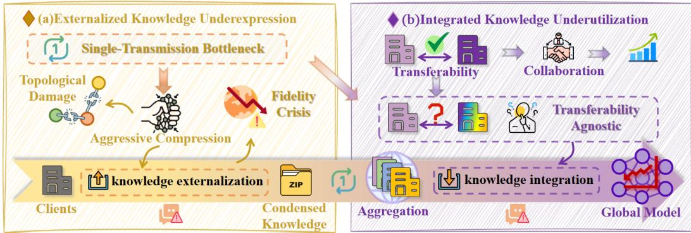  
Figure 2: Problem Illustration. The Single-Transmission Bottleneck in OFGL impedes knowledge transfer via two challenges. (a) Externalized Knowledge Underexpression: Aggressive compression damages graph topology, causing a fidelity crisis. (b) Integrated Knowledge Underutilization: Compressed capacity obscures cross-client collaboration potential, driving transferability agnosticism.

First, one-shot FL (OFL) faces much stricter communication limitations than common FL [35, 40, 52, 85, 110]. It can only upload highly compressed or distilled proxy knowledge in a single interaction for global collaboration [22, 30, 114]. To meet the data compression requirements under a single communication limit, existing OFL methods primarily rely on strategies such as parameter distillation, feature space alignment, or global statistic integration [1, 19]. While these strategies reduce the communication burden, they cause severe fidelity loss when applied to graph data [64]. Aggressive compression damages inherent topological information and node correlations [77, 80]. Specifically, a single transmission has limited information capacity. The compression process inevitably introduces information loss, creating a significant deviation between the proxy knowledge and the original data distribution. We refer to this as the fidelity crisis. Consequently, we propose question 1) How can we achieve high-fidelity in the knowledge externalization phase?

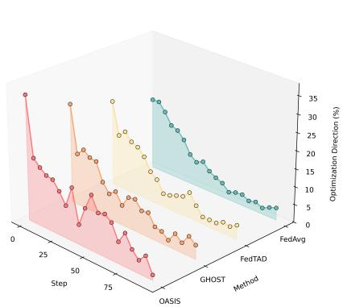  
Figure 1: Single-Transmission Bottleneck. With increasing training steps, the optimization gradients induced by existing methods progressively deviate from the true optimization direction, highlight ing the bottleneck in the OFGL setting.

On the other hand, due to the lack of an iterative correction mechanism over multiple rounds, OFGL struggles to

recover the complete knowledge structure embedded in client data [1, 59]. Traditional federated learning employs a global aggregation strategy, assigning uniform weights to all clients for parameter alignment [57] . This allows local models to slowly converge towards the common knowledge across clients through multi-round averaging [42, 48, 108, 119]. However, in OFGL scenarios, a single round eliminates the possibility of iterative refinement. Applying the global aggregation strategy under such constraints not only fails to extract effective common knowledge but also risks catastrophic feature misalignment [25, 63, 88, 97, 99, 109]. In fact, clients with relevant domain features or complementary information often serve as high-quality collaborators for each other, providing greater positive gains for model updates [78, 102, 105]. Nevertheless, due to the extremely limited and highly compressed knowledge capacity in one-shot communication, the server struggles to perceive the knowledge transfer potential across client data distributions and build an effective collaboration network when adopting personalized aggregation [54]. This leads to the challenge of transferability agnosticism. Thus, we introduce question 2) How can we accurately assess and utilize client transferability in the knowledge integration phase?

For question 1), in the client-side knowledge externalization phase, we propose a Fidelity-Driven Proxy Refinement (FPR) mechanism. It reduces graph topology and semantic distortion during transmission. We utilize the Fisher Information Matrix (FIM) as a sensitivity scale [75], aligning graph structural information by introducing a gradient matching constraint. Simultaneously, we select the top-M dimensions most semantically relevant to each class to align global features with local prototypes [111], thereby preserving graph semantic information [17]. This mechanism implicitly preserves topology and explicitly purifies semantics, unlike destructive blind compression. It maximizes the information density of the proxy knowledge, protecting the topological information and node correlations in the graph, maintaining fidelity.

For question 2), in the server-side knowledge integration phase, we propose a Transferability-Steered Personalized Collaboration (TPC) mechanism. It handles data heterogeneity and collaborative matching under one-shot communication. Specifically, the server performs global forward inference on the prototypes uploaded by clients, extracting the negative log-likelihood (NLL) loss vector for each class [106]. By quantifying the distribution differences among these loss vectors, a global similarity matrix is obtained, which drives a dynamic personalized aggregation mechanism. This mechanism accurately assesses client transferability from a global perspective during the extreme single interaction. It implicitly matches each client with high-gain collaborative teammates, ensuring highly personalized delivered models and full utilization of local knowledge.

In summary, the main contributions of this paper are as follows:

• We pinpoint two challenges in the Single-Transmission Bottleneck of OFGL: The fidelity crisis of externalized knowledge and transferability agnosticism of integrated knowledge.

• We propose an efficient OPFGL framework, FedHFT, maintaining fidelity on the client side and evaluating transferability on the server side.

• Extensive experimental validation demonstrates that FedHFT significantly outperforms existing baseline methods under one-shot communication.

## 2 Related Work

## 2.1 Federated Learning

Federated Learning (FL) enables privacy-preserving distributed collaborative training, yet it confronts the severe challenge of non-independent and identically distributed (non-IID) data [4, 10, 36, 50]. To tackle this problem, existing research enhances the alignment capacity of global models from the dimensions of bottom-level optimization and high-level representation (e.g., FedProx [41], FedNova [86], MOON [39], FedGPS [104], FedEL [69, 76, 94, 95, 116]). For highly heterogeneous scenarios, Personalized Federated Learning (pFL) further customizes optimal local models via architecture decoupling (e.g., FedCP [113], FedRoD [8], APPLE [53]) or parameter control and state preservation (e.g., FedALA [112], FedPHP [45], FedWBA [90]). Nevertheless, failing to effectively capture complex graph topological structures and node correlation information, the aforementioned traditional FL and pFL methods generally cannot maintain their superiority in Federated Graph Learning (FGL) scenarios [12, 23, 58, 71, 89].

## 2.2 Federated Graph Learning

Federated Graph Learning (FGL) [7] applies the principles of federated learning to graph neural networks [21, 37, 38, 44]. Existing research generally falls into two tracks: inter-graph methods (e.g., GCFL+ [98], FedStar [72]) that boost the generalization of disjoint graphs, and intra-graph methods (e.g., FedSSP [73, 74], FGGP [82]) that tackle global subgraph collaboration. Besides, targeting the unique attribute challenges of graph data, research such as FedSPA [75] further explores the bias issues brought by homophily level heterogeneity [20, 51, 70, 81, 87]. Although the above methods have been extensively explored in processing graph data [9, 16, 65], aggressive knowledge compression severely destroys graph structure information when facing extreme communication constraints [67]. Inspired by this, this paper focuses on research from the perspective of maintaining the fidelity of graph knowledge externalization.

## 2.3 One-shot Federated Graph Learning

One-shot Federated Graph Learning (OFGL) acts as an efficient solution by reducing communication rounds and enhancing security against eavesdropping attacks. Recent methods [22, 30, 103, 114] utilize knowledge distillation or neuron-matching techniques to optimize the global model. For graph data, the GHOST framework [64] explores the dilemma of dual heterogeneity across clients. However, existing OFGL methods excessively compress the knowledge uploaded by clients, making the server unable to realize complete expression and full utilization of knowledge. In this study, we adopt an innovative approach that focuses on the transferability among clients, aiming to maximize the collaborative gain of local knowledge in the single aggregation phase.

## 3 Preliminary

## 3.1 One-shot Federated Graph Learning and Personalized Aggregation

In one-shot federated graph learning, a central server coordinates a set of clients $\mathcal { C }$ with $| { \mathcal { C } } | = K$ indexed by k. Each client k owns a private local graph dataset $\mathcal { G } ^ { k } = ( V ^ { k } , E ^ { k } )$ with adjacency matrix $\mathbf { A } ^ { k }$ . For each node $v _ { i } \in V ^ { k }$ , its feature and label are denoted by $\mathbf { x } _ { i } ^ { k }$ and $y _ { i } ^ { k }$ , respectively. Each client maintains a local differentiable model parameterized by $\theta ^ { k }$ and optimizes it on private graph data. Unlike conventional iterative FGL, OFGL allows only one communication round: each client externalizes compact local knowledge once and uploads it to the server.

Personalized aggregation at the server aims to deliver a client-specific model for each client [34, 91]. Given uploaded proxy knowledge from all clients, the server performs one-shot integration and obtains $\mathrm { \dot { \Theta } ^ { o u t } = \dot { \left\{ \right\} } \theta _ { o u t } ^ { 1 } , \cdot . . . , \theta _ { o u t } ^ { K } } $ , where $\theta _ { \mathrm { o u t } } ^ { k }$ is the model dispatched to client k. This integration can be written as $\Theta ^ { \mathrm { o u t } } = \mathcal { A } ( \widetilde { \mathcal { G } } )$ , where $\widetilde { \mathcal { G } } = \{ \widetilde { \mathcal { G } } ^ { 1 } , \dots , \widetilde { \mathcal { G } } ^ { K } \}$ is the set of client proxies and $\boldsymbol { \mathcal { A } } ( \cdot )$ is the server-side personalized aggregation operator. Compared with uniform global aggregation, personalized aggregation explicitly addresses client heterogeneity by constructing tailored model outputs for different clients [13, 79].

## 3.2 Proxy Knowledge Generation

To avoid transmitting raw local graphs in OFGL, each client externalizes compact proxy knowledge through a local conditional generator [64]. For client $k ,$ Gaussian noise and label conditions are used as inputs, i.e., $\mathbf Z ^ { k } \sim \mathcal N ( \mathbf 0 , \mathbf I _ { d _ { z } } )$ and $\mathbf { Y } ^ { k }$ , and the generator $g _ { \phi ^ { k } }$ produces synthetic node representations:

$$
\widetilde { { \mathbf { X } } } ^ { k } = g _ { \phi ^ { k } } ( { \mathbf { Z } } ^ { k } , { \mathbf { Y } } ^ { k } ) .
$$

The generator is optimized locally so that the generated representations preserve task-relevant information from private data while remaining communication-efficient. Based on $\widetilde { \mathbf { X } } ^ { k }$ , the client constructs proxy edges from feature-space relations and obtains a local proxy graph

$$
\begin{array} { r } { \widetilde { \mathcal { G } } ^ { k } = ( \widetilde { \mathbf { X } } ^ { k } , \widetilde { \mathbf { E } } ^ { k } ) , } \end{array}
$$

which is used for local alignment training with the private graph. After local training, each client uploads only compact proxy knowledge rather than raw nodes, raw edges, or full training trajectories. Upon receiving proxies from all clients, the server reconstructs corresponding pseudo graphs from the uploaded knowledge and performs one-shot model integration on these pseudo graphs. Therefore, proxy knowledge generation serves as the bridge between local private optimization and server-side collaborative learning under a strict single-round communication budget.

## 4 Methodology

Overview. One-shot federated graph learning faces a Single-Transmission Bottleneck, causing a fidelity crisis in knowledge externalization and transferability agnosticism in knowledge integration. Our coupled framework addresses these vulnerabilities. Locally, FPR enhances the fidelity of uploaded proxy knowledge via structural and semantic alignment. Globally, TPC resolves agnosticism by evaluating inter-client transferability from the uploads to drive personalized aggregation. Each client uploads its generator weights and class-level proxy prototypes once (overhead and privacy analyses are in Appendix L and J).

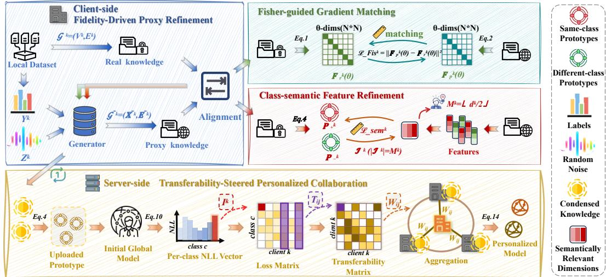  
Figure 3: Architecture of FedHFT for one-shot federated graph learning. Top: Client-side FPR. Clients generate high-fidelity proxy knowledge via Fisher-guided gradient matching and top-M class-semantic feature refinement prior to the single upload. Bottom: Server-side TPC. The server performs personalized aggregation using inter-client transferability matrices derived from per-class NLL of the uploaded prototypes.

## 4.1 Client-side FPR: Fidelity-Driven Proxy Refinement

Motivation. Existing proxy generators fail to align parameter-gradient responses at the optimizationtrajectory level between proxy and real training. Furthermore, full-dimensional semantic constraints inevitably mix class-critical signals with noisy dimensions. In one-shot communication, such local mismatch is irreparable on the server. Therefore, FPR introduces Fisher-guided matching to align optimization trajectories, alongside top-M class-semantic alignment focused strictly on gradientselected informative dimensions, filtering out noisy channel interference before upload. Details are presented in Fig.3.

## 4.1.1 Fisher-guided Gradient Matching

The key idea of this module is to reduce the optimization mismatch between real local training and proxy-based training. In OFGL, the server can only observe uploaded proxy knowledge, so if the proxy path induces a different parameter-update tendency from the real-data path, this bias will be directly transferred to the server and cannot be corrected later.

To make this mismatch measurable, we construct two Fisher statistics for each client k and parameter θ over a batch of size B. $\mathbf { F } _ { r } ^ { k } ( \theta )$ is computed from real local data and reflects how strongly parameter θ responds to real supervision:

$$
\mathbf { F } _ { r } ^ { k } ( \theta ) = \left( \frac { 1 } { B } \sum _ { b = 1 } ^ { B } \frac { \partial \log p _ { \theta } ( y _ { b } ^ { k } \mid \mathbf { x } _ { b } ^ { k } ) } { \partial \theta } \right) ^ { 2 } .\tag{1}
$$

In implementation, this corresponds to accumulating log-likelihood gradients on local real data and squaring averaged gradients. In parallel, we compute $\mathbf { F } _ { p } ^ { \overline { { k } } } ( \theta )$ on the proxy path:

$$
\mathbf { F } _ { p } ^ { k } ( \theta ) = \left( \frac { 1 } { B _ { p } } \sum _ { b = 1 } ^ { B _ { p } } \frac { \partial \log p _ { \theta } ( \tilde { y } _ { b } ^ { k } \mid \tilde { \mathbf { x } } _ { b } ^ { k } ) } { \partial \theta } \right) ^ { 2 } .\tag{2}
$$

This branch is evaluated by retaining the computation graph to compute higher-order derivatives, so the discrepancy term can backpropagate through the generation process and directly optimize the generator. The alignment objective is defined as

$$
\mathcal { L } _ { \mathrm { F i s } } ^ { k } = \sum _ { \theta \in \Theta } \left( \mathbf { F } _ { p } ^ { k } ( \theta ) - \mathbf { F } _ { r } ^ { k } ( \theta ) \right) ^ { 2 } .\tag{3}
$$

Here, Θ denotes the model parameter set used in Fisher matching. Minimizing this term encourages proxy-induced parameter responses to follow real-data-induced responses, thereby reducing trajectorylevel deviation before upload. The comprehensive explanation of Fisher matching is provided in Appendix B.

## 4.1.2 Class-semantic Feature Refinement

The goal of this module is to enforce semantic alignment only on informative channels, rather than on the full feature space. In graph data, class-discriminative semantics and structure-dependent signals are entangled. Forcing all dimensions to match class prototypes can mix useful class cues with noisy channels, weaken anomalous-node expression, and interfere with normal nodes that rely on neighborhood-dependent information. Therefore, we first estimate topology-aware class priors, then select gradient-informative channels, and finally apply class-semantic alignment only on the selected top-M dimensions.

For client $k ,$ topology importance is computed by PageRank:

$$
\mathbf { v } ^ { k , ( t + 1 ) } = \alpha \mathbf { T } ^ { k } \mathbf { v } ^ { k , ( t ) } + \frac { 1 - \alpha } { N ^ { k } } \mathbf { 1 } .\tag{4}
$$

Where $\mathbf { T } ^ { k }$ is the local transition matrix, $N ^ { k }$ is the local node number, and $\alpha = 0 . 8 5$ . The term $\alpha \mathbf { T } ^ { k } \mathbf { v } ^ { k , ( t ) }$ propagates node importance through local connectivity, while $\textstyle { \frac { 1 - \alpha } { N ^ { k } } } \mathbf { 1 }$ is a restart term that stabilizes the computation. After a fixed number of local power-iteration steps, we obtain topologyaware node importance scores for client k. These scores are then used to build class priors from real local features (not generated features):

$$
{ \bf p } _ { c } ^ { k } = \frac { \sum _ { i \in \mathcal { V } _ { c } ^ { k } } v _ { i } ^ { k } { \bf x } _ { i } ^ { k } } { \sum _ { i \in \mathcal { V } _ { c } ^ { k } } v _ { i } ^ { k } + \epsilon } .\tag{5}
$$

Here, $\mathcal { V } _ { c } ^ { k }$ denotes nodes of class c on client $k ,$ and each node feature $\mathbf { x } _ { i } ^ { k }$ contributes proportionally to its topology weight $v _ { i } ^ { k }$ . ϵ is a small constant for numerical stability. This weighted prototype acts as a class prior that emphasizes structurally central evidence. Compared with plain averaging, it suppresses contributions from weakly connected or less informative nodes and yields a more topology-consistent class summary for subsequent semantic alignment. With topology-aware class priors, we identify informative dimensions from the generated features by gradient probing. Specifically, we detach generated node logits, enable gradient tracking, and compute a probe loss $\mathcal { L } _ { \mathrm { p r o b e } }$ (cross-entropy on generated nodes) to obtain gradients with respect to generated features. Channel salience is defined as

$$
{ \bf g } ^ { k } = \mathrm { m e a n } _ { i } \left| \frac { \partial \mathcal { L } _ { \mathrm { p r o b e } } } { \partial \widetilde { \bf x } _ { i } ^ { k } } \right| .\tag{6}
$$

For each feature channel, this quantity measures how strongly the probe classification loss reacts when that channel changes. A larger value indicates that this channel is more influential to the local decision boundary and thus should be prioritized in semantic refinement.

Then we select the Top-M channels, setting $\begin{array} { r } { M = \lfloor \frac { d ^ { k } } { 2 } \rfloor } \end{array}$ , where $d ^ { k }$ is the feature dimension of client k. This fixed refinement budget focuses alignment on high-impact semantic dimensions instead of spreading constraints over the full space. This selective strategy is crucial for avoiding noisy-channel interference in graph scenarios where semantic and structural factors are mixed. On the selected channels, we compute class-semantic positive/negative KL terms. A sensitivity analysis of Top-M can be found in Appendix C.

For each generated sample on client $k ,$ we construct class-semantic positive and negative prototype matrices by indexing class prototypes according to its label and a mismatched label, respectively. We denote them as $\mathbf { P } _ { + } ^ { k }$ and $\mathbf { P } _ { - } ^ { k }$ , where $\mathbf { P } _ { + } ^ { k }$ contains same-class prototypes and $\mathbf { P } _ { - } ^ { k }$ contains differentclass prototypes aligned sample-wise with $\widetilde { \mathbf { X } } ^ { k }$ . On the selected channel index set $\mathcal { T } ^ { k }$ with $| \mathcal { T } ^ { k } | = M ^ { k }$ we define

$$
\begin{array} { r } { q ^ { k } = \mathrm { s o f t m a x } \big ( \widetilde { \mathbf { X } } ^ { k } [ : , { \mathcal { Z } } ^ { k } ] \big ) , \quad p _ { + } ^ { k } = \mathrm { s o f t m a x } \big ( \mathbf { P } _ { + } ^ { k } [ : , { \mathcal { Z } } ^ { k } ] \big ) , \quad p _ { - } ^ { k } = \mathrm { s o f t m a x } \big ( \mathbf { P } _ { - } ^ { k } [ : , { \mathcal { Z } } ^ { k } ] \big ) . } \end{array}
$$

$$
\begin{array} { r } { \mathcal { L } _ { \mathrm { p o s } } ^ { k } = D _ { \mathrm { K L } } ( q ^ { k } \| p _ { + } ^ { k } ) , \qquad \mathcal { L } _ { \mathrm { n e g } } ^ { k } = D _ { \mathrm { K L } } ( q ^ { k } \| p _ { - } ^ { k } ) . } \end{array}\tag{7}
$$

Here, all three distributions are constructed on the selected feature channels (i.e., the top-M dimensions), where $p _ { + } ^ { k }$ is the same-class prototype distribution and $p _ { - } ^ { k }$ is a different-class prototype

distribution. We therefore impose a contrastive semantic constraint: generated features should remain close to their class-consistent prior while being separated from mismatched classes. The resulting top-M class-semantic alignment term is

$$
\begin{array} { r } { \mathcal { L } _ { \mathrm { s e m } } ^ { k } = \lambda _ { \mathrm { s e m } } \exp \left( \mathcal { L } _ { \mathrm { p o s } } ^ { k } - \mathcal { L } _ { \mathrm { n e g } } ^ { k } \right) . } \end{array}\tag{8}
$$

Where $\lambda _ { \mathrm { s e m } }$ is a trade-off hyperparameter controlling the strength of class-semantic alignment.

Minimizing this term encourages generated representations to stay closer to the same-class priors than the different-class priors on informative dimensions, reducing semantic drift while avoiding full-dimensional over-constraint.

## 4.2 Server-side TPC: Transferability-Steered Personalized Collaboration

Motivation. In OFGL, lack of multi-round correction makes uniform aggregation unreliable, risking severe feature misalignment [11, 14, 93]. While some clients offer high collaborative gain to specific peers, highly compressed uploads in one-shot communication obscure these relationships, causing transferability agnosticism in personalized aggregation. Consequently, the core requirement at this stage is to accurately estimate inter-client transferability from the limited uploaded proxy knowledge to construct an effective personalized collaboration network. Details are presented in Fig.3.

Each client uploads class-level prototypes of proxy knowledge to the server. At this stage, prototype construction also uses PageRank weighting, and the PageRank update is the same as Eq.4; therefore, we directly reuse the same topology-aware formulation. For client $k ,$ the uploaded prototype matrix is

$$
\mathbf { P } ^ { k } = [ \mathbf { p } _ { 1 } ^ { k } , \dots , \mathbf { p } _ { C } ^ { k } ] ^ { \top } ,\tag{9}
$$

where $C$ is the total number of classes. These prototypes provide compact class summaries that retain topology-aware semantic cues while avoiding raw graph exposure. Receiving $\mathbf { P } ^ { k }$ , the server performs global forward inference using the initial global model $f _ { \theta }$ and computes class-wise NLL values:

$$
\begin{array} { r } { \mathbf { l } ^ { k } [ c ] = \mathrm { N L L } \big ( f _ { \theta } ( \mathbf { p } _ { c } ^ { k } ) , c \big ) . } \end{array}\tag{10}
$$

Here, $f _ { \theta }$ is obtained by determining the model architecture based on task configuration and dataset statistics, and initializing its parameters under a fixed random seed. Stacking all client vectors yields

$$
\mathbf { L } = \left[ \begin{array} { l } { ( \mathbf { l } ^ { 1 } ) ^ { \top } } \\ { ( \mathbf { l } ^ { 2 } ) ^ { \top } } \\ { \vdots } \\ { ( \mathbf { l } ^ { K } ) ^ { \top } } \end{array} \right] \in \mathbb { R } ^ { K \times C } .\tag{11}
$$

This stacked loss matrix L serves as a behavior-level representation of uploaded knowledge under a common model view. In one-shot heterogeneous settings, minority-class prototypes derived from scarce samples lack multi-round refinement and often degenerate into unreliable near-random vectors, rendering direct geometric metrics (e.g., MMD [2] or Cosine Similarity) highly misleading. To circumvent this spatial fragility, we evaluate class-wise NLL via the globally initialized model $f _ { \theta }$ This mapping translates noisy prototypes into output logits, acting as an advanced representation of the label distribution. By assessing class-wise distributional strength rather than unstable spatial coordinates, this loss-based mechanism provides a highly robust proxy for inter-client transferability.

Based on $\mathbf { L } ,$ transferability between clients i and $j$ is defined as

$$
T _ { i j } = \cos \bigl ( \mathbf { l } ^ { i , ( \cap ) } , \mathbf { l } ^ { j , ( \cap ) } \bigr ) \cdot \frac { | \mathcal { V } ^ { i } \cap \mathcal { V } ^ { j } | } { | \mathcal { V } ^ { i } \cup \mathcal { V } ^ { j } | } .\tag{12}
$$

Here, $\mathcal { V } ^ { i }$ denotes the set of valid classes on client i, and $1 ^ { i , ( \cap ) }$ and $\mathbf { \nabla } [ \ j , ( \cap )$ denote loss vectors restricted to the overlapping class set $\mathcal { V } ^ { i } \cap \mathcal { V } ^ { j }$ . The cosine component measures whether two clients exhibit similar class-wise loss patterns, while the Jaccard term downweights pairs with weak class overlap. This combination prevents unreliable relations from being overestimated and produces a transferability matrix $\mathbf { T } \in \mathbb { R } ^ { K \times K }$ that is both behavior-aware and label-overlap-aware. To convert transferability into actionable collaboration strength, we normalize each row by temperature-scaled softmax:

$$
W _ { i j } = \frac { \exp ( T _ { i j } / \tau ) } { \sum _ { j ^ { \prime } } \exp ( T _ { i j ^ { \prime } } / \tau ) } .\tag{13}
$$

Where τ is a temperature hyperparameter. The resulting weight matrix W makes each target client emphasize highly transferable sources and suppress weakly related ones. The server synthesizes pseudo-graphs using the complete set of uploaded generator parameters, and subsequently performs personalized integration through transferability-driven weighted supervision:

$$
\mathcal { L } _ { i } = \sum _ { j } \mathcal { L } _ { i  j } = \sum _ { j } W _ { i j } \mathcal { L } _ { \mathrm { s u p } } ^ { ( i  j ) } .\tag{14}
$$

Here, $\mathcal { L } _ { \mathrm { s u p } } ^ { ( i  j ) }$ denotes the supervised loss of the target personalized model for client i evaluated on the uploaded proxy graph from client $j .$ After optimization, the server dispatches personalized models to corresponding clients. Through this process, TPC uses limited one-shot uploaded knowledge to assess client transferability from a global perspective. It builds a personalized collaboration network, identifies positive-gain collaborators for each client, and aggregates models that better match each client’s local data characteristics.

## 5 Experiments

## 5.1 Experimental Setup

Datasets. We evaluate our method on seven benchmark graph datasets for node classification tasks: Cora [56], CiteSeer [18], PubMed [6], Actor [60], Amazon-Photo [66], Roman-empire [62], and Ogbn-Arxiv [24]. Specifically, Cora, CiteSeer, and PubMed are citation networks; Amazon-Photo is an Amazon co-purchase graph; Actor and Roman-empire are commonly used heterophilous benchmarks; and Ogbn-Arxiv is a large-scale graph benchmark. These datasets jointly cover diverse graph scales and structural properties for a comprehensive evaluation. Detailed descriptions and splits for these datasets can be found in Appendix E.

Baselines. We compare our method against 14 representative baselines: (1) FedAvg [57] as the canonical FL algorithm; (2) FedProx [41] and (3) FedNova [86] as robust optimization and personalization methods under data heterogeneity; (4) FedPub [3], (5) FedTAD [118], (6) FedGTA [46], (7) FGGP [82], and (8) FGSSL [27] as recent state-of-the-art FGL approaches; (9) DENSE [114], (10) FedCVAE [22], (11) FedSD2C [115], and (12) FedFisher [30] as data-free and one-shot FL baselines; and (13) GHOST [64] and (14) OASIS [84] as highly relevant OFGL competitors. Detailed descriptions of all baselines can be found in the Appendix F.

Implementation Details. We use a two-layer GCN backbone with hidden size 128 and dropout 0.3. The federated setting uses $K = 1 0$ clients, where client label proportions are sampled from a Dirichlet distribution with $\alpha = 0 . 0 5$ to simulate non-IID data. Each client performs local optimization with Adam for $T _ { L } = 1 0 0$ steps, and experiments are conducted with one communication round. For performance evaluation, we record the average local accuracy across all clients to comprehensively reflect the personalized local performance. To ensure statistical reliability, all reported results are averaged over at least ten independent runs with different random seeds. More implementation details and additional studies are provided in the Appendix G.

## 5.2 Experimental Results

Performance Comparison Across diverse non-IID federated graph learning settings , FedHFT consistently shows better overall generalization and stability than existing baselines, indicating stronger robustness to distribution shifts. As Tab.1 demonstrates, while OFGL methods are generally more competitive than traditional FL, FGL and OFL approaches, they still remain inferior to FedHFT overall. Notably, FedHFT exhibits exceptional effectiveness on large-scale and complex graphs compare to recent state-of-the-art one-shot methods. Additional experimental results under different settings are provided in the Appendix H and Appendix I. A comparison under matched total communication budgets is further reported in Appendix K.

## 5.3 Ablation Study

Effects of Key Components Mechanism of FedHFT To evaluate specific design components, we conduct an ablation study on our two main modules: FPR and TPC. As shown in table 2, employing either FPR or TPC independently significantly enhances accuracy across all datasets. Combining both achieves the optimal performance, validating that high-fidelity externalization (FPR) and transferability-steered integration (TPC) mutually reinforce each other to overcome the single-transmission bottleneck.

Table 1: Comparison with state-of-the-art baselines on seven datasets. We report node classification accuracy (%) for downstream performance evaluation. Green arrows ↑ indicate improvements over FedAvg, while red arrows ↓ denote performance drops relative to FedAvg. OOM means out-ofmemory error. The best and second-best results in each column are marked in bold and underline, respectively. Among the baselines, FedPub and FedGTA are personalized methods, while the others learn a single global model.
<table><tr><td>Category</td><td>Methods</td><td> $\mathbf { C o r a }$ </td><td>CiteSeer</td><td>PubMed</td><td>Actor</td><td>Amz-Photo</td><td>Roman-Empire</td><td>Ogbn-Arxiv</td></tr><tr><td rowspan="3">FL</td><td>FedAvg [ASTAT17]</td><td>34.09</td><td>43.00</td><td>55.45</td><td>24.00</td><td>29.87</td><td>21.41</td><td>23.83</td></tr><tr><td>FedProx [MLSys20]</td><td> $3 3 . 3 1 _ { \downarrow 0 . 7 8 }$ </td><td> $4 1 . 8 4 _ { \downarrow 1 . 1 6 }$ </td><td> $4 3 . 0 4 _ { \downarrow 1 2 . 4 0 }$ </td><td> $2 2 . 6 9 _ { \downarrow 1 . 3 0 }$ </td><td> $2 7 . 4 4 _ { \downarrow 2 . 4 2 }$ </td><td> $1 9 . 3 2 _ { \perp 2 . 0 9 }$ </td><td> $2 3 . 5 8 _ { \perp 0 . 2 5 }$ </td></tr><tr><td>FedNova [NeurIPS20]</td><td> $1 5 . 5 0 _ { \downarrow 1 8 . 5 9 }$ </td><td> $1 6 . 4 5 _ { \downarrow 2 6 . 5 5 }$ </td><td> $3 5 . 3 3 _ { \perp 2 0 . 1 2 }$ </td><td> $2 0 . 0 1 _ { \perp 3 . 9 8 }$ </td><td> $1 3 . 0 0 _ { \scriptstyle \downarrow 1 6 . 8 6 }$ </td><td> $6 . 6 4 _ { \downarrow 1 4 . 7 7 }$ </td><td> $3 . 2 0 _ { \perp 2 0 . 6 4 }$ </td></tr><tr><td rowspan="5">FGL</td><td>FedPub [ICML23]</td><td> $3 1 . 0 6 _ { \perp 3 . 0 3 }$ </td><td> $2 4 . 6 3 _ { \downarrow 1 8 . 3 7 }$ </td><td> $4 1 . 2 9 _ { \downarrow 1 4 . 1 5 }$ </td><td> $2 4 . 1 9 _ { \uparrow 0 . 1 9 }$ </td><td> $2 5 . 6 9 _ { \downarrow 4 . 1 8 }$ </td><td> $1 7 . 0 6 _ { \downarrow 4 . 3 5 }$ </td><td> $1 4 . 3 4 _ { \downarrow 9 . 4 9 }$ </td></tr><tr><td>FedTAD [IJCAI24]</td><td> $3 4 . 6 2 \substack { \mathrm { : 0 . 5 3 } }$ </td><td> $\underline { { 4 6 . 3 7 } } _ { \uparrow 3 . 3 6 }$ </td><td> $4 7 . 4 0 _ { \downarrow 8 . 0 4 }$ </td><td> $2 1 . 7 1 _ { \perp 2 . 2 8 }$ </td><td> $2 8 . 6 7 _ { \downarrow 1 . 2 0 }$ </td><td> $2 0 . 3 4 _ { \downarrow 1 . 0 7 }$ </td><td> $1 1 . 5 0 _ { \downarrow 1 2 . 3 4 }$ </td></tr><tr><td>FedGTA [VLDB24]</td><td> $1 5 . 9 4 _ { \downarrow 1 8 . 1 4 }$ </td><td> $1 4 . 1 5 _ { \downarrow 2 8 . 8 6 }$ </td><td> $8 . 2 7 _ { \perp 4 7 . 1 8 }$ </td><td> $1 4 . 2 0 _ { \downarrow 9 . 7 9 }$ </td><td> $9 . 3 3 _ { \perp 2 0 . 5 3 }$ </td><td> $1 3 . 2 9 _ { \perp 8 . 1 2 }$ </td><td> $8 . 0 1 _ { \perp 1 5 . 8 2 }$ </td></tr><tr><td>FGGP [AAAI24]</td><td> $3 2 . 5 0 _ { \downarrow 1 . 5 9 }$ </td><td> $3 6 . 8 5 _ { \downarrow 6 . 1 5 }$ </td><td> $4 9 . 1 3 _ { \downarrow 6 . 3 1 }$ </td><td> $2 4 . 3 7 _ { \uparrow 0 . 3 8 }$ </td><td> $2 6 . 3 1 _ { \perp 3 . 5 6 }$ </td><td> $2 1 . 2 9 _ { \downarrow 0 . 1 2 }$ </td><td>OOM</td></tr><tr><td>FGSSL [IJCAI23]</td><td> $1 3 . 8 5 _ { \perp 2 0 . 2 4 }$ </td><td> $1 9 . 0 4 _ { \downarrow 2 3 . 9 6 }$ </td><td> $3 1 . 5 7 _ { \downarrow 2 3 . 8 8 }$ </td><td> $1 9 . 5 3 _ { \downarrow 4 . 4 6 }$ </td><td> $1 0 . 1 8 _ { \downarrow 1 9 . 6 9 }$ </td><td> $6 . 2 0 _ { \scriptstyle \downarrow 1 5 . 2 1 }$ </td><td> $3 . 0 2 _ { \downarrow 2 0 . 8 1 }$ </td></tr><tr><td rowspan="4">OFL</td><td>DENSE [NeurIPS22]</td><td> $2 6 . 2 7 _ { \downarrow 7 . 8 2 }$ </td><td> $2 6 . 9 1 _ { \downarrow 1 6 . 0 9 }$ </td><td> $4 6 . 9 8 _ { \perp 8 . 4 7 }$ </td><td> $2 0 . 1 6 _ { \perp 3 . 8 3 }$ </td><td> $2 0 . 2 2 _ { \downarrow 9 . 6 5 }$ </td><td> $1 5 . 8 6 _ { \downarrow 5 . 5 5 }$ </td><td> $2 0 . 8 0 _ { \perp 3 . 0 4 }$ </td></tr><tr><td>FedCVAE [ICLR23]</td><td> $3 1 . 9 1 _ { \downarrow 2 . 1 7 }$ </td><td> $2 6 . 9 1 _ { \downarrow 1 6 . 1 0 }$ </td><td> $4 7 . 6 7 _ { \downarrow 7 . 7 7 }$ </td><td> $1 9 . 9 2 _ { \downarrow 4 . 0 8 }$ </td><td> $2 7 . 8 7 _ { \downarrow 2 . 0 0 }$ </td><td> $1 4 . 9 3 _ { \downarrow 6 . 4 8 }$ </td><td> $1 1 . 9 5 _ { \downarrow 1 1 . 8 8 }$ </td></tr><tr><td>FedSD2C [NeurIPS24]</td><td> $2 8 . 8 4 _ { \scriptstyle \downarrow 5 . 2 4 }$ </td><td> $3 0 . 2 8 _ { \downarrow 1 2 . 7 2 }$ </td><td> $3 7 . 5 8 _ { \downarrow 1 7 . 8 6 }$ </td><td> $1 9 . 8 0 _ { \downarrow 4 . 2 0 }$ </td><td> $2 2 . 3 8 _ { \downarrow 7 . 4 9 }$ </td><td> $2 2 . 6 2 _ { \uparrow 1 . 2 1 }$ </td><td> $2 8 . 1 2 \substack { + 4 . 2 8 }$ </td></tr><tr><td>FedFisher [AISTATS24]</td><td> $3 6 . 1 4 _ { \uparrow 2 . 0 5 }$ </td><td> $3 4 . 3 3 _ { \perp 8 . 6 7 }$ </td><td> $5 0 . 1 3 _ { \perp 5 . 3 2 }$ </td><td> $1 8 . 8 8 _ { \downarrow 5 . 1 2 }$ </td><td> $3 4 . 8 3 _ { \uparrow 4 . 9 6 }$ </td><td> $1 5 . 7 4 _ { \downarrow 5 . 6 7 }$ </td><td> $4 . 4 1 _ { \downarrow 1 9 . 4 2 }$ </td></tr><tr><td rowspan="3">OFGL</td><td>GHOST [ICML25]</td><td> $3 3 . 5 5 _ { \downarrow 0 . 5 4 }$ </td><td> $3 5 . 4 5 _ { \downarrow 7 . 5 5 }$ </td><td> $4 6 . 3 5 _ { \perp 9 . 0 9 }$ </td><td> $2 3 . 4 1 _ { \downarrow 0 . 5 9 }$ </td><td> $2 9 . 8 5 _ { \perp 0 . 0 2 }$ </td><td> $1 9 . 9 0 _ { \downarrow 1 . 5 1 }$ </td><td> $1 4 . 0 3 _ { \perp 9 . 8 0 }$ </td></tr><tr><td>OASIS [NeurIPS25]</td><td> $\underline { { 4 0 . 0 5 } } _ { \uparrow 5 . 9 6 }$ </td><td> $4 2 . 8 2 _ { \downarrow 0 . 1 8 }$ </td><td> ${ \bf 6 5 . 9 6 } _ { \uparrow 1 0 . 5 1 }$ </td><td> $2 5 . 5 1 _ { \uparrow 1 . 5 1 }$ </td><td> $4 6 . 0 4 _ { \uparrow 1 6 . 1 7 }$ </td><td> $2 3 . 6 8 _ { \uparrow 2 . 2 7 }$ </td><td> $2 8 . 8 7 _ { \cdot \cdot 5 . 0 4 }$ </td></tr><tr><td>FedHFT (ours)</td><td> $5 2 . 2 4 _ { \uparrow 1 8 . 1 5 }$ </td><td> $\mathbf { 5 6 . 0 2 } _ { \parallel 3 . 0 2 }$ </td><td> $\underline { { 5 6 . 9 8 } } _ { \uparrow 1 . 5 3 }$ </td><td> ${ \bf 4 1 . 5 1 } _ { \uparrow 1 7 . 5 1 }$ </td><td> $\mathbf { 4 9 . 3 0 } _ { \uparrow 1 9 . 4 3 }$ </td><td> ${ \bf 4 0 . 8 2 } _ { \mathrm { \uparrow 1 9 . 4 1 } }$ </td><td> $\mathbf { 4 4 . 5 0 } _ { \uparrow 2 0 . 6 7 }$ </td></tr></table>

Effects of Key Components Mechanism of FPR To evaluate the FPR mechanism, we ablate Fisher-guided gradient matching $( \mathcal { L } _ { \mathrm { F i s } } )$ and class-semantic alignment $( \mathcal { L } _ { \mathrm { { s e m } } } )$ . As shown in table 3, while applying either trajectory-level matching or semantic refinement alone brings noticeable improvements, their combination yields optimal gains. This validates FPR’s effectiveness in enhancing the fidelity of uploaded proxy knowledge by aligning graph structures and refining semantic proximity.

Table 2: Ablation study of FPR and TPC across datasets.  
Table 3: Ablation study of Fisher matching $( \mathcal { L } _ { \mathrm { F i s } } )$ and class-semantic alignment $( \mathcal { L } _ { \mathrm { s e m } } )$
<table><tr><td rowspan="2">FPR</td><td rowspan="2">TPC</td><td colspan="4">Dataset</td></tr><tr><td>cora</td><td>citeseer</td><td>actor</td><td>roman_empire</td></tr><tr><td>x</td><td>x</td><td>29.01</td><td>27.26</td><td>18.20</td><td>23.93</td></tr><tr><td>√</td><td>x</td><td>41.35</td><td>39.46</td><td>25.36</td><td>30.11</td></tr><tr><td>x</td><td>√</td><td>45.25</td><td>54.19</td><td>34.34</td><td>34.21</td></tr><tr><td>√</td><td>√</td><td>52.24</td><td>56.02</td><td>41.51</td><td>40.82</td></tr></table>

<table><tr><td rowspan="2"> $\mathcal { L } _ { \mathrm { F i s } }$ </td><td rowspan="2"> $\mathcal { L } _ { \mathrm { s e m } }$ </td><td colspan="3">Dataset</td></tr><tr><td>cora citeseer</td><td>actor</td><td>roman_empire</td></tr><tr><td>x</td><td>x</td><td>29.01 27.26</td><td>18.20</td><td>23.93</td></tr><tr><td>√</td><td>x</td><td>37.01 36.46</td><td>24.98</td><td>29.27</td></tr><tr><td>x</td><td>√</td><td>39.95 35.13</td><td>23.59</td><td>26.37</td></tr><tr><td>√</td><td>√</td><td>41.35 39.46</td><td>25.36</td><td>30.11</td></tr></table>

## 5.4 Hyper-parameter Study

We further conduct a hyper-parameter sensitivity analysis for FedHFT in Fig.4, investigating the impact of the temperature coefficient τ from TPC, Fisher matching weight $\lambda _ { F } ,$ , and class-semantic alignment weight $\lambda _ { \mathrm { s e m } }$ . With other configurations fixed, a consistent trend is observed across various datasets and non-IID scenarios: FedHFT achieves stable performance across a broad range of parameter values, but experiences significant degradation at extreme values. This indicates that while our method exhibits strong hyper-parameter robustness, it still relies on appropriate parameter selection. Based on this analysis, our main experiments utilize the optimal hyper-parameters identified on the validation set for each dataset, thereby ensuring fair comparisons and fully demonstrating the model’s capabilities.

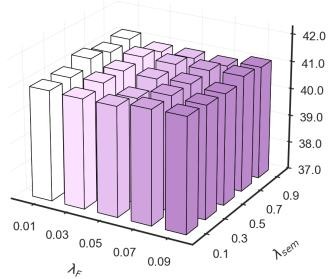  
Actor

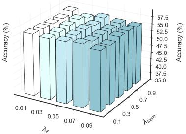  
(a) Analysis of λ  
CiteSeer

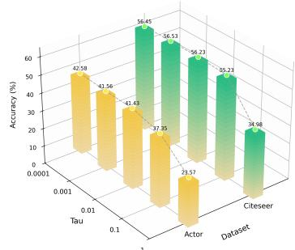  
(b) Analysis of τ  
Figure 4: Analysis on hyper-parameters in FedHFT. Node classification results under different refinement weights (a) and temperature coefficient (b). The results illustrate the performance sensitivity across representative datasets, demonstrating that FedHFT maintains stable accuracy over a broad range of parameter values. The dashed lines represent the baseline test accuracy for each setting.

## 5.5 Superiority Analysis

To demonstrate the superiority of our method in proxy knowledge generation, we conduct comparisons under a unified experimental setting against GHOST, OASIS, FedTAD, and other methods that also rely on proxy data, and perform a comprehensive analysis from the perspectives of structural preservation and feature preservation. Specifically, the WL kernel characterizes structural similarity between the generated results and the original graph, Cosine Similarity measures the consistency of feature representation directions, Degree MMD reflects differences in node degree distributions, and Feature MMD quantifies shifts in feature distributions. The results in Fig.5 show that our method achieves the best overall performance across these metrics, indicating that it preserves the structural information and feature semantics of the original graph more effectively. The transferability–accuracy correlation is reported in Appendix D.

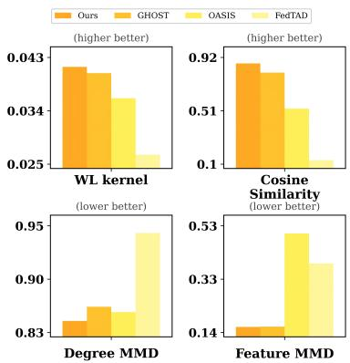  
Figure 5: Proxy Data Analysis. Our method consistently performs best across all four proxy-quality metrics.

## 6 Conclusion

In this paper, we propose FedHFT to address the Single-Transmission Bottleneck in OFGL, specifically targeting the fidelity crisis, and the transferability agnosticism. We introduce High-Fidelity Knowledge Externalization via Fidelity-Driven Proxy Refinement on the client side, and Transferability-Steered Personalized Collaboration on the server side. Extensive experiments validate the effectiveness and superiority of FedHFT in establishing a robust collaborative learning paradigm.

## Acknowledgments and Disclosure of Funding

This work is supported by National Natural Science Foundation of China under Grant (62361166629, 62501428), the Youth Student Basic Research Project for Doctoral Students of National Natural Science Foundation of China under Grant 623B2080, the China Postdoctoral Science Foundation (2026T190427), Hubei Provincial Natural Science Foundation of China (2025AFB219), the Open Research Fund of Guangdong Laboratory of Artificial Intelligence and Digital Economy (GMLKF-24-10), and the Independent Research Project of the National Key Laboratory of Big Data and Decision (DSJ-ZZKY-2025-02). This work was supported by the National Research Foundation (NRF), Singapore, under Grant ID NRF-PA2025-NTU, and by Nanyang Technological University (NTU). The numerical calculations in this paper have been supported by the super-computing system in the Supercomputing Center of Wuhan University.

## References

[1] Youssef Allouah, Akash Balasaheb Dhasade, Rachid Guerraoui, Nirupam Gupta, Anne-Marie Kermarrec, Rafael Pinot, Rafael Pires, and Rishi Sharma. Revisiting ensembling in one-shot federated learning. In NeurIPS, 2024.

[2] Sana Ayromlou and David B. Emerson. Adaptive latent-space constraints in personalized federated learning. In NeurIPS, pages 81479–81506, 2025.

[3] Jinheon Baek, Wonyong Jeong, Jiongdao Jin, Jaehong Yoon, and Sung Ju Hwang. Personalized subgraph federated learning. In ICML, pages 1396–1415, 2023.

[4] Weihao Bo, Yanpeng Sun, Yu Wang, Xinyu Zhang, and Zechao Li. Fedmgp: Personalized federated learning with multi-group text-visual prompts. In NeurIPS, pages 51792–51826, 2025.

[5] SOHAM BONNERJEE, Sayar Karmakar, and Wei Biao Wu. Sharp gaussian approximations for decentralized federated learning. In NeurIPS, pages 157224–157270, 2025.

[6] Kathi Canese and Sarah Weis. Pubmed: the bibliographic database. The NCBI handbook, page 2013, 2013.

[7] Fahao Chen, Peng Li, Toshiaki Miyazaki, and Celimuge Wu. Fedgraph: Federated graph learning with intelligent sampling. IEEE TPDS, pages 1775–1786, 2022.

[8] Hong-You Chen and Wei-Lun Chao. On bridging generic and personalized federated learning for image classification. In ICLR, 2022.

[9] Mohammed Haroon Dupty, Yanfei Dong, Sicong Leng, Guoji Fu, Yong Liang Goh, Wei Lu, and Wee Sun Lee. Constrained layout generation with factor graphs. In CVPR, pages 12851–12860, 2024.

[10] Alireza Fallah, Aryan Mokhtari, and Asuman E. Ozdaglar. Personalized federated learning with theoretical guarantees: A model-agnostic meta-learning approach. In NeurIPS, 2020.

[11] Xiuwen Fang and Mang Ye. Towards robust parameter-efficient fine-tuning for federated learning. In NeurIPS, pages 141777–141800, 2025.

[12] Chun-Mei Feng, Kai Yu, Nian Liu, Xinxing Xu, Salman Khan, and Wangmeng Zuo. Towards instanceadaptive inference for federated learning. In ICCV, pages 23230–23239, 2023.

[13] Dario Fenoglio, Mohan Li, Pietro Barbiero, Nicholas Lane, Marc Langheinrich, and Martin Gjoreski. Flux: Efficient descriptor-driven clustered federated learning under arbitrary distribution shifts. In NeurIPS, pages 71229–71292, 2025.

[14] Lele Fu, Tianchi Liao, Sheng Huang, Bowen Deng, zhangchuanfu, Shirui Pan, and Chuan Chen. Unsupervised federated graph learning. In NeurIPS, pages 97431–97457, 2025.

[15] Xingbo Fu, Binchi Zhang, Yushun Dong, Chen Chen, and Jundong Li. Federated graph machine learning: A survey of concepts, techniques, and applications. SIGKDD, pages 32–47, 2022.

[16] Shiwei Gan, Yafeng Yin, Zhiwei Jiang, Hongkai Wen, Lei Xie, and Sanglu Lu. Signgraph: A sign sequence is worth graphs of nodes. In CVPR, pages 13470–13479, 2024.

[17] Yuan Gao, Xiang Wang, Xiangnan He, Zhenguang Liu, Huamin Feng, and Yongdong Zhang. Alleviating structural distribution shift in graph anomaly detection. In WSDM, page 357–365, 2023.

[18] C. Lee Giles, Kurt Dewitt Bollacker, and Steve Lawrence. Citeseer: An automatic citation indexing system. In ACM DL, pages 89–98, 1998.

[19] Dipam Goswami, Simone Magistri, Kai Wang, Bartł omiej Twardowski, Andrew Bagdanov, and Joost van de Weijer. Covariances for free: Exploiting mean distributions for training-free federated learning. In NeurIPS, pages 65081–65115, 2025.

[20] Hanyao Guo, Zihan Tan, Wenke Huang, Bin Yang, and Mang Ye. Fedfst: Mitigating spectral catastrophic forgetting in federated graph continual learning. In KDD, 2026.

[21] Zeeshan Hayder and Xuming He. DSGG: dense relation transformer for an end-to-end scene graph generation. In CVPR, pages 28317–28326, 2024.

[22] Clare Elizabeth Heinbaugh, Emilio Luz-Ricca, and Huajie Shao. Data-free one-shot federated learning under very high statistical heterogeneity. In ICLR, 2023.

[23] Erdong Hu, Yuxin Tang, Anastasios Kyrillidis, and Chris Jermaine. Federated learning over images: Vertical decompositions and pre-trained backbones are difficult to beat. In ICCV, pages 19328–19339, 2023.

[24] Weihua Hu, Matthias Fey, Marinka Zitnik, Yuxiao Dong, Hongyu Ren, Bowen Liu, Michele Catasta, and Jure Leskovec. Open graph benchmark: Datasets for machine learning on graphs. In NeurIPS, 2020.

[25] Sheng Huang, Lele Fu, Fanghua Ye, Tianchi Liao, Bowen Deng, zhangchuanfu, and Chuan Chen. Softconsensual federated learning for data heterogeneity via multiple paths. In NeurIPS, pages 9968–10002, 2025.

[26] Wenke Huang, Mang Ye, and Bo Du. Learn from others and be yourself in heterogeneous federated learning. In CVPR, pages 10133–10143, 2022.

[27] Wenke Huang, Guancheng Wan, Mang Ye, and Bo Du. Federated graph semantic and structural learning. In IJCAI, pages 3830–3838, 2023.

[28] Wenke Huang, Mang Ye, Zekun Shi, Guancheng Wan, He Li, Bo Du, and Qiang Yang. Federated learning for generalization, robustness, fairness: A survey and benchmark. IEEE TPAMI, 2024.

[29] Khiem HUYNH, Malcolm Egan, Giovanni Neglia, and Jean-Marie Gorce. Streaming federated learning with markovian data. In NeurIPS, pages 128137–128189, 2025.

[30] Divyansh Jhunjhunwala, Shiqiang Wang, and Gauri Joshi. Fedfisher: Leveraging fisher information for one-shot federated learning. In AISTATS, pages 1612–1620, 2024.

[31] Yanwen Jia, Yinuo Zhang, Zitong Shi, Yuxin Wu, Zihan Tan, Xuankun Rong, Liangtao Zheng, Wenke Huang, and Mang Ye. Consistency-verified backdoor defense for federated graph learning via cross-layer drift. In NeurIPS, 2026.

[32] Yuqi Jia, Minghong Fang, and Neil Gong. Competitive advantage attacks to decentralized federated learning. In NeurIPS, pages 86116–86145, 2025.

[33] Yuqi Jia, Minghong Fang, Hongbin Liu, Jinghuai Zhang, and Neil Gong. Tracing back the malicious clients in poisoning attacks to federated learning. In NeurIPS, pages 116470–116497, 2025.

[34] Pengfei Jiao, Zian Zhou, Meiting Xue, Huijun Tang, Zhidong Zhao, and Huaming Wu. Fedcch: Automatic personalized graph federated learning for inter-client and intra-client heterogeneity. In IJCAI, pages 2991–2999, 2025.

[35] Jisoo Kim, Sungmin Kang, and Sunwoo Lee. Layer-wise update aggregation with recycling for communication-efficient federated learning. In NeurIPS, pages 86242–86273, 2025.

[36] Gihun Lee, Minchan Jeong, Sangmook Kim, Jaehoon Oh, and Se-Young Yun. Fedsol: Stabilized orthogonal learning with proximal restrictions in federated learning. In CVPR, pages 12512–12522, 2024.

[37] De Li, Jinyan Wang, Qiyu Li, Yuhang Hu, and Xianxian Li. A privacy preservation framework for feedforward-designed convolutional neural networks. Neural Networks, pages 14–27, 2022.

[38] Jiankai Li, Yunhong Wang, Xiefan Guo, Ruijie Yang, and Weixin Li. Leveraging predicate and triplet learning for scene graph generation. In CVPR, pages 28369–28379, 2024.

[39] Qinbin Li, Bingsheng He, and Dawn Song. Model-contrastive federated learning. In CVPR, pages 10713–10722, 2021.

[40] Qinbin Li, Bingsheng He, and Dawn Song. Practical one-shot federated learning for cross-silo setting. In IJCAI, pages 1484–1490, 2021.

[41] Tian Li, Anit Kumar Sahu, Manzil Zaheer, Maziar Sanjabi, Ameet Talwalkar, and Virginia Smith. Federated optimization in heterogeneous networks. In MLSys, 2020.

[42] Tianle Li, Yongzhi Huang, Linshan Jiang, Chang Liu, Qipeng Xie, Wenfeng Du, Lu Wang, and Kaishun Wu. Fedwmsam: Fast and flat federated learning via weighted momentum and sharpness-aware minimization. In NeurIPS, pages 4425–4462, 2025.

[43] Xiang Li, Chendi Wang, Buxin Su, Qi Long, and Weijie Su. Mitigating the privacy–utility trade-off in decentralized federated learning via f-differential privacy. In NeurIPS, pages 168588–168624, 2025.

[44] Xianxian Li, Qiyu Li, De Li, Haodong Qian, and Jinyan Wang. Contrastive learning of graphs under label noise. Neural Networks, page 106113, 2024.

[45] Xin-Chun Li, De-Chuan Zhan, Yunfeng Shao, Bingshuai Li, and Shaoming Song. Fedphp: Federated personalization with inherited private models. In ECML PKDD, pages 587–602, 2021.

[46] Xunkai Li, Zhengyu Wu, Wentao Zhang, Yinlin Zhu, Ronghua Li, and Guoren Wang. Fedgta: Topologyaware averaging for federated graph learning. VLDB, pages 41–50, 2023.

[47] Yichen Li, Yuying Wang, Jiahua Dong, Haozhao Wang, Yining Qi, Rui Zhang, and Ruixuan Li. Resourceconstrained federated continual learning: What does matter? In NeurIPS, pages 79493–79518, 2025.

[48] Yunbo Li, Jiaping Gui, Zhihang Deng, Fanchao Meng, and Yue Wu. Fedqs: Optimizing gradient and model aggregation for semi-asynchronous federated learning. In NeurIPS, pages 86502–86550, 2025.

[49] Dandan Liang, Jianing Zhang, Evan Chen, Zhe Li, Rui Li, and Haibo Yang. Towards straggler-resilient split federated learning: An unbalanced update approach. In NeurIPS, pages 31634–31673, 2025.

[50] Dongping Liao, Xitong Gao, and Cheng-Zhong Xu. Flip: Towards comprehensive and reliable evaluation of federated prompt learning. In NeurIPS, 2025.

[51] Jiaqi Liu, Zihan Tan, Guancheng Wan, Wenke Huang, He Li, and Mang Ye. Fedsdr: Federated graph learning with structural noise detection and reconstruction. In CVPR, 2026.

[52] Xiang Liu, Zhenheng Tang, Xia Li, Yijun Song, Sijie Ji, Zemin Liu, Bo Han, Linshan Jiang, and Jialin Li. One-shot federated learning methods: A practical guide. In IJCAI, pages 10573–10581, 2025.

[53] Jun Luo and Shandong Wu. Adapt to adaptation: Learning personalization for cross-silo federated learning. In IJCAI, pages 2166–2173, 2022.

[54] Evelyn Ma, Chao Pan, S. Rasoul Etesami, Han Zhao, and Olgica Milenkovic. Fedgtst: Boosting global transferability of federated models via statistics tuning. In NeurIPS, 2024.

[55] Tianxing Man, Yu Bai, Ganyu Wang, Jinjie Fang, Haoran Fang, Bin Gu, and Yi Chang. Accelerated vertical federated adversarial learning through decoupling layer-wise dependencies. In NeurIPS, pages 147561–147593, 2025.

[56] Andrew Kachites McCallum, Kamal Nigam, Jason Rennie, and Kristie Seymore. Automating the construction of internet portals with machine learning. Inf. Retr., pages 127–163, 2000.

[57] Brendan McMahan, Eider Moore, Daniel Ramage, Seth Hampson, and Blaise Aguera y Arcas. Communication-Efficient Learning of Deep Networks from Decentralized Data. In AISTATS, pages 1273–1282, 2017.

[58] Azadeh Motamedi, Jae-Mo Kang, and Il-Min Kim. Normfit: A lightweight solution for few-shot federated learning with non-iid data. In NeurIPS, pages 166297–166320, 2025.

[59] Duong Nguyen, Nghia Hoang, Thanh Trung Huynh, Quoc Viet Hung Nguyen, and Phi Le Nguyen. Learning reconfigurable representations for multimodal federated learning with missing data. In NeurIPS, pages 28808–28845, 2025.

[60] Hongbin Pei, Bingzhe Wei, Kevin Chen-Chuan Chang, Yu Lei, and Bo Yang. Geom-gcn: Geometric graph convolutional networks. In ICLR, 2020.

[61] Martin Pelikan, Shams Azam, Vitaly Feldman, Jan Silovsky, Kunal Talwar, Christopher Brinton, and Tatiana Likhomanenko. Enabling differentially private federated learning for speech recognition: Bench marks, adaptive optimizers, and gradient clipping. In NeurIPS, pages 110958–111020, 2025.

[62] Oleg Platonov, Denis Kuznedelev, Michael Diskin, Artem Babenko, and Liudmila Prokhorenkova. A critical look at the evaluation of gnns under heterophily: Are we really making progress? In ICLR, 2023.

[63] Zhuang Qi, Ying-Peng Tang, Lei Meng, Han Yu, Xiaoxiao Li, and Xiangxu Meng. Class-wise balancing data replay for federated class-incremental learning. In NeurIPS. Curran Associates, Inc., 2025.

[64] Jiaru Qian, Guancheng Wan, Wenke Huang, Guibin Zhang, Yuxin Wu, Bo Du, and Mang Ye. GHOST: generalizable one-shot federated graph learning with proxy-based topology knowledge retention. In ICML, 2025.

[65] Wei Shao, Yangyang Shi, Daoqiang Zhang, Junjie Zhou, and Peng Wan. Tumor micro-environment interactions guided graph learning for survival analysis of human cancers from whole-slide pathological images. In CVPR, pages 11694–11703, 2024.

[66] Oleksandr Shchur, Maximilian Mumme, Aleksandar Bojchevski, and Stephan Günnemann. Pitfalls of graph neural network evaluation. CoRR, 2018.

[67] Zitong Shi, Guancheng Wan, Wenke Huang, Guibin Zhang, He Li, Carl Yang, and Mang Ye. Eagles: Towards effective, efficient, and economical federated graph learning via unified sparsification. In ICML, 2025.

[68] Zitong Shi, Guancheng Wan, Wenke Huang, Guibin Zhang, Jiawei Shao, Mang Ye, and Carl Yang. Privacy-enhancing paradigms within federated multi-agent systems. arXiv preprint arXiv:2503.08175, 2025.

[69] Zitong Shi, Frank Wan, Haixin Wang, Ruoyan Li, Zijie Huang, Wanjia Zhao, Yijia Xiao, Xiao Luo, Carl Yang, Yizhou Sun, et al. Don’t forget the enjoin: Focallora for instruction hierarchical alignment in large language models. NeurIPS, 2026.

[70] Zitong Shi, Guancheng Wan, Wenke Huang, Yuxin Wu, Quan Zhang, and Mang Ye. Towards robust text-attributed federated graph learning: multimodal threats and defense. In AAAI, 2026.

[71] Guangyu Sun, Matías Mendieta, Jun Luo, Shandong Wu, and Chen Chen. Fedperfix: Towards partial model personalization of vision transformers in federated learning. In ICCV, pages 4965–4975, 2023.

[72] Yue Tan, Yixin Liu, Guodong Long, Jing Jiang, Qinghua Lu, and Chengqi Zhang. Federated learning on non-iid graphs via structural knowledge sharing. In AAAI, pages 9953–9961, 2023.

[73] Zihan Tan, Guancheng Wan, Wenke Huang, and Mang Ye. Fedssp: Federated graph learning with spectral knowledge and personalized preference. In NeurIPS, 2024.

[74] Zihan Tan, Suyuan Huang, Guancheng Wan, Wenke Huang, He Li, and Mang Ye. S2fgl: Spatial spectral federated graph learning. arXiv preprint arXiv:2507.02409, 2025.

[75] Zihan Tan, Guancheng Wan, Wenke Huang, He Li, Guibin Zhang, Carl Yang, and Mang Ye. Fedspa: Generalizable federated graph learning under homophily heterogeneity. In CVPR, pages 15464–15475, 2025.

[76] Zihan Tan, Leixin Sun, Zitong Shi, Yitao Liu, Jiajun Wu, Nathaniel Brooks, Jiaru Qian, Xiaoran Shang, Suyuan Huang, Yi Ding, Yangxu Liao, Mukai Li, Qiushi Sun, Shudong Liu, Xuankun Rong, Xiaohang Yu, Zhuo Chen, Hejia Geng, Chenxin Li, Aozhou Wang, Zengji Tu, Robert Tang, Yuxin Zhan, Eric Jiang, Yuxin Wu, Jianqing Zhang, Xiao Liang, Fang Wu, Haochi Zhang, Alexander Marlow, and Guancheng Wan. Metarsi / rsi2: A meta-recursive self-improving system for recursive self-improving systems themselves. arXiv preprint arXiv:2609.06396, 2026.

[77] Zihan Tan, Guancheng Wan, Wenke Huang, Bin Yang, and Mang Ye. Fedpre: Robust federated graph learning against topological corruption. In KDD, pages 1390–1400, 2026.

[78] Xiaoli Tang, Han Yu, and Xiaoxiao Li. A reinforcement learning-based bidding strategy for data consumers in auction-based federated learning. In NeurIPS, pages 82666–82684, 2025.

[79] Frank Wan, Xu Cheng, Run Liu, Wenke Huang, Zitong Shi, Pinyi Jin, Guibin Zhang, Bo Du, and Mang Ye. Multi-order orchestrated curriculum distillation for model-heterogeneous federated graph learning. In NeurIPS, pages 70587–70611, 2025.

[80] Frank Wan, Fengyuan Ran, Ruikang Zhang, Wenke Huang, Xuankun Rong, Guibin Zhang, Yuxin Wu, Bo Du, and Mang Ye. Motion: Multi-sculpt evolutionary coarsening for federated continual graph learning. In NeurIPS, pages 70280–70304, 2025.

[81] Frank Wan, Xiaoran Shang, Yuxin Wu, Guibin Zhang, Jinhe Bi, Liangtao Zheng, Xin Lin, Yue Liu, Yanbiao Ma, Wenke Huang, and Bo Du. Hyperion: Fine-grained hypersphere alignment for robust federated graph learning. In NeurIPS, pages 65655–65680, 2025.

[82] Guancheng Wan, Wenke Huang, and Mang Ye. Federated graph learning under domain shift with generalizable prototypes. In AAAI, pages 15429–15437, 2024.

[83] Guancheng Wan, Zitong Shi, Wenke Huang, Guibin Zhang, Dacheng Tao, and Mang Ye. Energy-based backdoor defense against federated graph learning. In ICLR, 2025.

[84] Guancheng Wan, Jiaru Qian, Wenke Huang, Qilin Xu, Xianda Guo, Boheng Li, Guibin Zhang, Bo Du, and Mang Ye. OASIS: One-shot federated graph learning via wasserstein assisted knowledge integration. In NeurIPS, 2026.

[85] Haolin Wang, Xuefeng Liu, Jianwei Niu, Wenkai Guo, and Shaojie Tang. Why go full? elevating federated learning through partial network updates. In NeurIPS, 2024.

[86] Jianyu Wang, Qinghua Liu, Hao Liang, Gauri Joshi, and H. Vincent Poor. Tackling the objective inconsistency problem in heterogeneous federated optimization. In NeurIPS, 2020.

[87] Jingbo Wang, Zitong Shi, Yuxin Wu, Zihan Tan, Qiqi Lin, Xuankun Rong, Liangtao Zheng, Wenke Huang, and Mang Ye. E2Gen: Evidential energy-based generation for fair federated graph learning. In NeurIPS, 2026.

[88] Lingren Wang, Wenxuan Tu, Jiaxin Wang, Xiong Wang, Jieren Cheng, and Jingxin Liu. Fedigl: Federated invariant graph learning for non-iid graphs. In NeurIPS, pages 117917–117940, 2025.

[89] Yuan Wang, Huazhu Fu, Renuga Kanagavelu, Qingsong Wei, Yong Liu, and Rick Siow Mong Goh. An aggregation-free federated learning for tackling data heterogeneity. In CVPR, pages 26223–26232, 2024.

[90] Ting Wei, Biao Mei, Junliang Lyu, Renquan Zhang, Feng Zhou, and Yifan Sun. Personalized bayesian federated learning with wasserstein barycenter aggregation. In NeurIPS, pages 75398–75427, 2025.

[91] Fan Wu, Xinyu Yan, Jiabei Liu, and Wei Yang Bryan Lim. Fedram: Federated reweighting and aggregation for multi-task learning. In NeurIPS, pages 102379–102406, 2025.

[92] Fei Wu, Xiao-Yuan Jing, Pengfei Wei, Chao Lan, Yimu Ji, Guo-Ping Jiang, and Qinghua Huang. Semisupervised multi-view graph convolutional networks with application to webpage classification. Inf. Sci., pages 142–154, 2022.

[93] Jiahao Wu, Ming Hu, Yanxin Yang, Xiaofei Xie, ZeKai Chen, Chenyu Song, and Mingsong Chen. Rising from ashes: Generalized federated learning via dynamic parameter reset. In NeurIPS, pages 15502–15528, 2025.

[94] Jiajun Wu, Leixin Sun, Zihan Tan, Yitao Liu, Shuo Li, Jiaru Qian, Yuxin Wu, Shanghaoran Quan, Chuangxin Zhao, Yangxu Liao, Yang Liu, Bin Chong, and Guancheng Wan. Swe-polyvision: Benchmarking cross-image abductive reasoning for repository-level software engineering. arXiv preprint arXiv:2609.29754, 2026.

[95] Jiajun Wu, Leixin Sun, Zihan Tan, Yitao Liu, Shuo Li, Jiaru Qian, Yuxin Wu, Shanghaoran Quan, Chuangxin Zhao, Yangxu Liao, Yang Liu, Bin Chong, and Guancheng Wan. Swe-prometheus: Measuring engineering governance improvements in real-world repositories. arXiv preprint arXiv:2609.29465, 2026.

[96] Siyuan Wu, Yongzhe Jia, Haolong Xiang, Xiaolong Xu, Xuyun Zhang, Lianyong Qi, and Wanchun Dou. A fair federated learning method for handling client participation probability inconsistencies in heterogeneous environments. In NeurIPS, pages 150102–150131, 2025.

[97] Xinghao Wu, Xuefeng Liu, Jianwei Niu, Guogang Zhu, Mingjia Shi, Shaojie Tang, and Jing Yuan. Tackling feature-classifier mismatch in federated learning via prompt-driven feature transformation. In NeurIPS, pages 73655–73691, 2025.

[98] Han Xie, Jing Ma, Li Xiong, and Carl Yang. Federated graph classification over non-iid graphs. In NeurIPS, pages 18839–18852, 2021.

[99] Kunlun Xu, Yibo Feng, Jiangmeng Li, Yongsheng Qi, and Jiahuan Zhou. Cˆ2prompt: Class-aware client knowledge interaction for federated continual learning. In NeurIPS, pages 44109–44139, 2025.

[100] Jiaqi Xue, Mayank Kumar, Yuzhang Shang, Shangqian Gao, Rui Ning, Mengxin Zheng, Xiaoqian Jiang, and Qian Lou. Dictpfl: Efficient and private federated learning on encrypted gradients. In NeurIPS, pages 119806–119829, 2025.

[101] Gang Yan, Sikai Yang, and Wan Du. Fedrace: A hierarchical and statistical framework for robust federated learning. In NeurIPS, pages 61155–61178, 2025.

[102] Danni Yang, Zhikang Chen, Sen Cui, Mengyue Yang, Ding Li, Abudukelimu Wuerkaixi, Haoxuan Li, Jinke Ren, and Mingming Gong. Decentralized dynamic cooperation of personalized models for federated continual learning. In NeurIPS, pages 111897–111926, 2025.

[103] Mingzhao Yang, Shangchao Su, Bin Li, and Xiangyang Xue. Exploring one-shot semi-supervised federated learning with pre-trained diffusion models. In AAAI, pages 16325–16333, 2024.

[104] Zhiqin Yang, Yonggang Zhang, Chenxin Li, Yiu-ming Cheung, Bo Han, and Yixuan Yuan. Fedgps: Statistical rectification against data heterogeneity in federated learning. In NeurIPS, pages 94731–94772, 2025.

[105] Ziqi Yang, Zhaopeng Peng, Zihui Wang, Jianzhong Qi, Chaochao Chen, Weike Pan, Chenglu Wen, Cheng Wang, and Xiaoliang Fan. Federated graph learning for cross-domain recommendation. In NeurIPS, 2024.

[106] Mang Ye, Yuhang Chen, Wenke Huang, Hui Cai, and Laizhong Cui. Towards generalization fairness in federated learning. IEEE TMC, pages 2546–2560, 2026.

[107] Pukang Ye, Luo Junwei, Jiachen Shen, Saipan Zhou, Shangmin Dou, Zhenfu Cao, Hanzhe Yao, Xiaolei Dong, and Yunbo Yang. Fedrw: Efficient privacy-preserving data reweighting for enhancing federated learning of language models. In NeurIPS, pages 140725–140750, 2025.

[108] Bicheng Ying, Zhe Li, and Haibo Yang. Exact and linear convergence for federated learning under arbitrary client participation is attainable. In NeurIPS, pages 40156–40201, 2025.

[109] Hui Zeng, Wenke Huang, Tongqing Zhou, Xinyi Wu, Guancheng Wan, Yingwen Chen, and Zhiping Cai. Does one-shot give the best shot? mitigating model inconsistency in one-shot federated learning. In ICML, 2025.

[110] Haochen Zhang, Zhong Zheng, and Lingzhou Xue. Regret-optimal q-learning with low cost for singleagent and federated reinforcement learning. In NeurIPS, pages 128711–128799, 2025.

[111] Jianqiao Zhang, Caifeng Shan, and Jungong Han. Fedgmkd: An efficient prototype federated learning framework through knowledge distillation and discrepancy-aware aggregation. In NeurIPS, 2024.

[112] Jianqing Zhang, Yang Hua, Hao Wang, Tao Song, Zhengui Xue, Ruhui Ma, and Haibing Guan. Fedala: Adaptive local aggregation for personalized federated learning. In AAAI, pages 11237–11244, 2023.

[113] Jianqing Zhang, Yang Hua, Hao Wang, Tao Song, Zhengui Xue, Ruhui Ma, and Haibing Guan. Fedcp: Separating feature information for personalized federated learning via conditional policy. In KDD, pages 3249–3261, 2023.

[114] Jie Zhang, Chen Chen, Bo Li, Lingjuan Lyu, Shuang Wu, Shouhong Ding, Chunhua Shen, and Chao Wu. DENSE: data-free one-shot federated learning. In NeurIPS, 2022.

[115] Junyuan Zhang, Songhua Liu, and Xinchao Wang. One-shot federated learning via synthetic distillerdistillate communication. In NeurIPS, pages 102611–102633, 2024.

[116] Letian Zhang, Bo Chen, Jieming Bian, Lei Wang, and Jie Xu. Fedel: Federated elastic learning for heterogeneous devices. In NeurIPS, pages 35665–35696, 2025.

[117] Xiao-Meng Zhang, Li Liang, Lin Liu, and Ming-Jing Tang. Graph neural networks and their current applications in bioinformatics. Frontiers in Genetics, 2021.

[118] Yinlin Zhu, Xunkai Li, Zhengyu Wu, Di Wu, Miao Hu, and Rong-Hua Li. Fedtad: Topology-aware data-free knowledge distillation for subgraph federated learning. In IJCAI, pages 5716–5724, 2024.

[119] Shiyuan Zuo, Xingrun Yan, Rongfei Fan, Li Shen, Puning Zhao, Jie Xu, and Han Hu. Efficient federated learning against byzantine attacks and data heterogeneity via aggregating normalized gradients. In NeurIPS, pages 28998–29035, 2025.

## A Notations

We present a comprehensive review of the commonly used notations and their definitions in Tab.4.

Table 4: Notation and Definitions
<table><tr><td>Notation</td><td>Definition</td></tr><tr><td> $K$ </td><td>The number of clients.</td></tr><tr><td> $k , i , j$   $N ^ { k }$ </td><td>The client indices.</td></tr><tr><td></td><td>The number of nodes on client  $k .$ </td></tr><tr><td> $C$ </td><td>The total number of classes.</td></tr><tr><td> $d ^ { k }$ </td><td>The feature dimension of client  $k .$ </td></tr><tr><td> $f _ { \theta }$ </td><td>The initial global model.</td></tr><tr><td> $\Theta$ </td><td>The set of model parameters.</td></tr><tr><td> $\mathbf { x } _ { b } ^ { k } , y _ { b } ^ { k }$ </td><td>The real node features and labels.</td></tr><tr><td> $\bar { \mathbf { x } } _ { b } ^ { \kappa } , \bar { y } _ { b } ^ { \kappa }$ </td><td>The proxy node features and labels.</td></tr><tr><td> $y ^ { k }$ </td><td>The set of valid classes on client k.</td></tr><tr><td> $B , B _ { p }$ </td><td>The real and proxy batch sizes.</td></tr><tr><td> $\mathbf { F } _ { r } ^ { k } ( { \bar { \theta } } )$ </td><td>The Fisher statistic on real data.</td></tr><tr><td> $\mathbf { F } _ { p } ^ { k } ( \theta )$ </td><td>The Fisher statistic on proxy data.</td></tr><tr><td> $\mathbf { T } ^ { k }$ </td><td>The local transition matrix of client  $k .$ </td></tr><tr><td> $\mathbf { v } ^ { k , ( t ) }$ </td><td>The node importance vector at iteration  $t .$ </td></tr><tr><td> $v _ { i } ^ { k }$ </td><td>The topology importance score of node  $i .$ </td></tr><tr><td> $\alpha$   $\mathbf { p } _ { c } ^ { k }$ </td><td>The PageRank damping factor.</td></tr><tr><td> $\smash { \mathcal { V } _ { c } ^ { k } }$ </td><td>The topology-aware class prior.</td></tr><tr><td></td><td>The node set of class c on client k.</td></tr><tr><td> $\mathcal { L } _ { \mathrm { p r o b e } }$ </td><td>The probe loss.</td></tr><tr><td> $\mathbf { g } ^ { k }$ </td><td>The channel salience vector.</td></tr><tr><td> $M ^ { k }$ </td><td>The number of selected informative channels.</td></tr><tr><td> $\mathcal { T } ^ { k }$ </td><td>The index set of top-M channels.</td></tr><tr><td> $\widetilde { \mathbf { X } } ^ { k }$ </td><td>The generated node feature matrix.</td></tr><tr><td> $\mathbf { P } _ { + } ^ { k } , \mathbf { P } _ { - } ^ { k }$ </td><td>The positive and negative prototype matrices.</td></tr><tr><td> $q ^ { k } , p _ { + } ^ { k } , p _ { - } ^ { k }$ </td><td>The softmax distributions on selected channels.</td></tr><tr><td> $\lambda _ { \mathrm { s e m } }$ </td><td>The trade-off hyperparameter.</td></tr><tr><td> $\mathcal { L } _ { \mathrm { F i s } } ^ { k }$ </td><td></td></tr><tr><td> $\mathcal { L } _ { \mathrm { { s e m } } } ^ { k }$ </td><td>The Fisher matching objective.</td></tr><tr><td> $\mathbf { P } ^ { k }$ </td><td>The semantic alignment objective.</td></tr><tr><td></td><td>The uploaded prototype matrix of client k.</td></tr><tr><td> $1 ^ { k } [ c ]$ </td><td>The NLL of prototype  $\mathbf { p } _ { c } ^ { k }$ </td></tr><tr><td> $\mathbf { L }$ </td><td>The stacked loss matrix.</td></tr><tr><td> $1 ^ { i , ( \cap ) }$ </td><td>The loss vector on overlapping classes.</td></tr><tr><td> $T _ { i j }$ </td><td>The estimated transferability score.</td></tr><tr><td> $\mathbf { T } ^ { \dot { } }$ </td><td>The transferability matrix.</td></tr><tr><td> $W _ { i j }$ </td><td>The normalized collaboration weight.</td></tr><tr><td> $\mathbf { W }$ </td><td>The personalized collaboration weight matrix.</td></tr><tr><td> $\tau$ </td><td>The temperature hyperparameter.</td></tr><tr><td> $\mathcal { L } _ { \mathrm { s u p } } ^ { ( i  j ) }$ </td><td>The supervised loss evaluated on the proxy graph.</td></tr><tr><td> $\mathcal { L } _ { i }$ </td><td>The personalized integration loss.</td></tr></table>

## B Fisher matching

Parameter sensitivity in our framework is quantified by a Fisher-guided statistic. Let $\mathcal { G }$ denote the local graph data distribution and θ denote the model parameters. The classical Fisher Information Matrix (FIM) is defined as:

$$
\mathbf { I } ( \theta ) = \mathbb { E } _ { ( x , y ) \sim \mathcal { G } } \left[ \nabla _ { \theta } \log p _ { \theta } ( y \mid x ) \nabla _ { \theta } \log p _ { \theta } ( y \mid x ) ^ { \top } \right] .\tag{15}
$$

The FIM inherently captures the curvature of the log-likelihood function in the parameter space. Crucially, it provides a fundamental connection between parameter perturbations and model output variations. Specifically, the expected Kullback-Leibler (KL) divergence between the original distribution and a distribution perturbed by a small parameter shift δ can be bounded via the second-order Taylor expansion:

$$
\mathbb { E } _ { \mathcal { G } } \left[ D _ { \mathrm { K L } } ( p ( \mathcal { G } \mid \theta ) \parallel p ( \mathcal { G } \mid \theta + \delta ) ) \right] \approx \frac { 1 } { 2 } \delta ^ { \top } \mathbf { I } ( \theta ) \delta .\tag{16}
$$

This property is highly desirable in our one-shot setting, as it theoretically bounds the output divergence caused by optimization trajectory deviations.

However, directly computing $\mathbf { I } ( \theta ) \ \in \ \mathbb { R } ^ { | \theta | \times | \theta | }$ , or even its standard diagonal approximation $\mathbb { E } [ ( \nabla _ { \theta } \log p ) ^ { 2 } ]$ , is computationally prohibitive for GNNs. The message-passing mechanism structurally entangles node representations, making the acquisition of independent sample-level gradients computationally intractable without incurring catastrophic memory overheads.

To maintain tractability under the strict resource constraints of one-shot federated learning, we utilize a mini-batch empirical Fisher surrogate. Concretely, for each parameter coordinate $\theta _ { t } ,$ , we compute the batch-averaged score gradients on real data and proxy data, and square them element-wise to form our sensitivity profiles $F _ { r , t } ^ { k }$ and $F _ { p , t } ^ { k } .$ The gradient matching objective is formulated as:

$$
\mathcal { L } _ { \mathrm { F i s } } ^ { k } = \sum _ { t \in \Theta } \left( F _ { p , t } ^ { k } - F _ { r , t } ^ { k } \right) ^ { 2 } .\tag{17}
$$

Building upon the traditional Fisher formulation, $F _ { r } ^ { k }$ and $F _ { p } ^ { k }$ serve as optimized, memory-efficient sensitivity surrogates tailored for graph data. Rather than blindly aligning features, matching $F _ { p } ^ { k }$ to $F _ { r } ^ { k }$ explicitly forces the proxy data to induce similar parameter-update tendencies as the real data. This effectively minimizes the trajectory-level gradient-response mismatch and restricts the posterior parameter divergence before the single-round upload.

## C Sensitivity Analysis of Top-M.

To evaluate the sensitivity of FedHFT to the Top-M   
selection ratio, we conduct a systematic compari  
son within the range of $M \in \{ \bar { 0 } , 0 . 2 5 , 0 . 5 , 0 . 7 \bar { 5 } , 1 \}$   
and report the average test accuracy across multiple   
datasets, including Actor, CiteSeer, Cora and Roman-  
Empire. As illustrated in Figure 6, the model gen  
erally exhibits a trend where a moderate M yields   
superior results, whereas excessively small or large   
values lead to performance degradation. Specifically,   
as M increases from 0 to the range of $0 . 5 \sim 0 . 7 5$   
the performance on most datasets steadily improves;   
however, when M further increases to 1, the accuracy   
experiences a general decline. This phenomenon indi  
cates that forcing all dimensions to strictly align with   
class prototypes tends to entangle useful categorical   
cues with noisy channels, thereby impairing model   
performance. Consequently, either omitting the filter  
ing process entirely $( { \bar { M } } = { \bar { 1 } } )$ or applying excessively   
strict filtering $( M = 0 )$ weakens the model’s capa  
bilities. Considering the optimal performance and stability across different datasets, the model bilities. Considering the optimal performance and demonstrates the most robust behavior around demonstrates the most robust behavior around $M = 0 . 5$   
configuration for FedHFT. configuration for FedHFT.

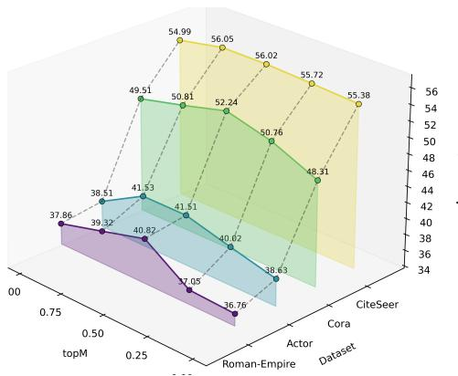  
Figure 6: Sensitivity analysis of the Top-M selection ratio.

. Therefore, we adopt $M = 0 . 5$ as the default

## D transferability–accuracy correlation

Our federated framework explicitly routes inter-client knowledge through prototype-based transfer weights and realizes the assigned migration in personalized graph networks. On label-skewed Citeseer at α = 0.05, we quantify transfer strength with the pairwise transfer degree matrix and measure realized migration with the cross-client transfer accuracy matrix $A _ { i j }$ , where client i’s personalized model is evaluated on client j’s synthesized proxy under $j ^ { \flat } \boldsymbol { \mathrm { s } }$ test mask. The result in Fig.7 confirms that our method not only estimates migration reliably but also converts it into strong personalized performance.

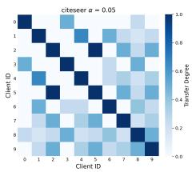

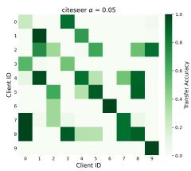  
Figure 7: Correlation between estimated transferability and realized transfer accuracy.

## E Dataset Details

We evaluate our method on seven real-world graph datasets: Cora, CiteSeer, PubMed, Actor, Amazon-Photo, Roman-Empire, and OGBN-Arxiv. According to their homophily characteristics, we group them into homophilous and heterophilous datasets. The key statistics of these datasets are summarized in table 5. The details are as follows:

• Homophilous datasets (Cora, CiteSeer, PubMed, Amazon-Photo, OGBN-Arxiv). These datasets exhibit strong label consistency among connected nodes and are widely used to evaluate GNNs under homophily-favorable conditions. Cora is a citation network where nodes are papers, edges are citation links, and node features are derived from paper text for topic classification. CiteSeer is also a citation graph of scientific publications, with sparse high-dimensional text features and multiple research topic labels. PubMed is a large biomedical citation network in which papers are represented by TF-IDF-like text features and classified into disease-related categories. Amazon-Photo is a co-purchase graph where nodes are products in the photo category, edges connect frequently co-purchased items, and labels indicate product categories. OGBN-Arxiv is a large-scale directed citation network from arXiv, where node features are derived from paper titles and abstracts, and labels correspond to subject areas.

• Heterophilous datasets (Actor, Roman-Empire). These datasets contain many edges connecting nodes with different labels, making them suitable for testing model robustness under heterophily. Actor is a co-occurrence network of actors from Wikipedia pages, where node features are bag-of-words attributes and neighboring nodes often belong to different classes. Roman-Empire is a heterophilous benchmark graph with low local label agreement, designed to challenge message passing methods that rely on homophily.

Table 5: Statistics of datasets used in experiments.
<table><tr><td>Dataset</td><td>#Nodes</td><td>#Edges</td><td>#Classes</td><td>#Features</td></tr><tr><td>Cora</td><td>2,708</td><td>5,278</td><td>7</td><td>1,433</td></tr><tr><td>CiteSeer</td><td>3,327</td><td>4,552</td><td>6</td><td>3,703</td></tr><tr><td>PubMed</td><td>19,717</td><td>44,324</td><td>3</td><td>500</td></tr><tr><td>Amz-Photo</td><td>7,650</td><td>287,326</td><td>8</td><td>745</td></tr><tr><td>OGBN-Arxiv</td><td>169,343</td><td>1,166,243</td><td>40</td><td>128</td></tr><tr><td>Actor</td><td>7,600</td><td>30,019</td><td>5</td><td>932</td></tr><tr><td>Roman-Empire</td><td>22,622</td><td>65,854</td><td>18</td><td>300</td></tr></table>

## F Baseline Details

This section provides a comprehensive overview of the baseline approaches employed in our study. To systematically evaluate the proposed FedHFT, we compare it against 14 representative baselines spanning four distinct categories: traditional FL, FGL, OFL, and OFGL. Under our experimental settings, traditional FL and FGL methods are included to demonstrate the performance collapse of multi-round models when suffering from the Single-Transmission Bottleneck.

• FedAvg [AISTATS17]. FedAvg introduces a foundational decentralized learning paradigm that trains a shared global model while keeping data localized on client devices. It iteratively aggregates locally computed client updates instead of centralized training. This mechanism addresses privacy constraints and remains robust to unbalanced non-IID data. By reducing continuous server-client synchronization needs, FedAvg establishes a practical and communication-efficient federated learning framework.

• FedProx [MLSys20]. FedProx addresses systems and statistical heterogeneity in realistic federated networks. As a generalization of FedAvg, it allows clients to perform a variable amount of local work before aggregation under device-level constraints. It also restricts local updates to prevent excessive drift from the global model. This refinement yields more stable, robust, and accurate convergence in highly heterogeneous environments.

• FedNova [NeurIPS20]. FedNova improves federated optimization by correcting objective inconsistency from heterogeneous local datasets and varying client computation speeds. Instead of naive weighted aggregation, it applies normalized averaging based on the number of local updates. This drives convergence toward the true stationary point rather than a mismatched objective. By removing solution bias, FedNova delivers more balanced and efficient convergence under heterogeneity.

• FedPub [ICML23]. FedPub pioneers a personalized federated learning paradigm for subgraph settings, emphasizing joint improvement of interrelated local GNNs rather than a single global model. To handle subgraph heterogeneity, it uses functional embeddings of local models to compute similarities for weighted server-side aggregation. Each client additionally learns a personalized sparse mask to update only relevant parameter subsets. This prevents collapse of incompatible knowledge and improves personalized graph representations.

• FedTAD [IJCAI24]. FedTAD proposes a topology-aware, data-free knowledge distillation strategy to mitigate global GNN degradation under severe subgraph heterogeneity. It decouples node and topology variations, showing how label distribution and structural homophily differences cause class-wise reliability gaps in local knowledge. Based on this, FedTAD dynamically calibrates aggregation to prioritize reliable transfer. This reduces misguided aggregation and improves collaborative training across multi-client subgraphs.

• FedGTA [VLDB24]. FedGTA presents a scalable federated graph topology-aware aggregation strategy for collaborative training on large-scale subgraphs. To address slow convergence and heavy optimization overhead, it introduces a personalized mechanism based on topology-aware local smoothing confidence and mixed neighbor features. The method bridges large-scale graph learning and federated optimization without requiring complex local architectures. As a result, FedGTA achieves robust performance and efficient convergence on massive real-world graphs.

• FGGP [AAAI24]. FGGP introduces a federated graph learning framework with generalizable prototypes to combat performance drops from diverse domain distributions. It decouples the global model into feature extraction and classification levels, connected via semantic prototypes. Using clustered prototypes instead of conventional classifiers, it captures richer domain information and improves class discriminability. It further injects global knowledge through feature-level contrastive learning, enhancing multi-domain prediction and generalization.

• FGSSL [IJCAI23]. FGSSL handles severe non-IID federated graph learning by reducing local distortion from node semantics and graph structures. At the node level, it applies contrastive learning to pull local nodes toward same-class global nodes and push away different classes. At the structural level, rather than directly aligning adjacent nodes, it converts adjacency into a similarity distribution and distills relational knowledge from the global model. This preserves structural integrity and discriminability across distributed graphs.

• DENSE [NeurIPS22]. DENSE pioneers a practical data-free one-shot federated learning framework that removes dependence on auxiliary public datasets and homogeneous architectures. Within a single communication round, it uses a two-stage pipeline of data generation and model distillation. It transfers only standard model parameters between clients and server while supporting model heterogeneity. This provides an efficient solution for communication-constrained settings with strong collaborative performance.

• FedCVAE [ICLR23]. FedCVAE introduces a data-free one-shot federated learning approach using conditional variational autoencoders (CVAEs) to handle extreme statistical heterogeneity. By reframing local learning with a CVAE and shifting its prior distribution, it ensures pipeline security without auxiliary public datasets. Together with FedCVAE-KD, it supports heterogeneous local architectures and efficiently compresses client decoders. It thus retains strong performance in severely non-IID settings with only one communication round.

• FedSD2C [NeurIPS24]. FedSD2C is a practical one-shot federated learning framework designed to reduce the severe two-step information loss in traditional data-free knowledge distillation. Rather than aggregating inconsistent local models, it uses a local distiller to synthesize informative distillates from raw client data. By sharing these synthetic distillates with the server, it avoids misleading teacher knowledge under extreme heterogeneity. This direct distillation strategy improves scalability and global model quality in one communication round.

• FedFisher [AISTATS24]. FedFisher is a Bayesian one-shot federated learning algorithm that addresses the communication and computational costs of iterative FL. It leverages Fisher information matrices from local models to guide single-round server aggregation. For practical scalability, it uses approximations including diagonal Fisher and K-FAC. This efficient formulation enables an accurate global model while reducing network dependence and privacy-attack susceptibility.

• GHOST [ICML25]. GHOST introduces a one-shot federated graph learning framework to overcome catastrophic forgetting and structural bias under restricted communication. Instead of gradual personalized optimization, it builds a proxy model per client to capture localized knowledge. During single-round training, it identifies and consolidates key parameters for critical topological information. This targeted consolidation avoids overfitting to isolated local distributions and improves generalization across diverse graph structures.

• OASIS [NeurIPS25]. OASIS pioneers a generative one-shot federated graph learning framework to capture fine-grained structural correlations often missed by image-based generative methods. It introduces a Synergy Graph Synthesizer and Topological Codebook to build a structural latent space and generate informative synthetic graphs. To transfer local structural insight, it uses Wasserstein-driven distillation to capture inter-class semantic affinities and topological relations. This resolves integration challenges and improves robustness in resource-constrained graph learning scenarios.

## G Additional Implementation Details.

Experiments are conducted on a Linux platform with NVIDIA GeForce RTX 4090 GPUs and Intel Xeon Gold 6240 CPUs. The implementation uses Python 3.12.7 with PyTorch 2.2.2+cu121 and CUDA 12.1. Beyond the settings reported in the main text, three key hyperparameters are tuned: $\lambda _ { \mathrm { f i s } } \in \{ 1 0 ^ { - 4 } , 1 0 ^ { \overset { . } { - } 3 } , 1 0 ^ { - 2 } , 1 0 ^ { - 1 } \overset { \sim } { \big \rangle } , \lambda _ { \mathrm { s e m } } \in \{ 1 0 ^ { - 4 } , 1 0 ^ { - 3 } , 1 0 ^ { - 2 } , 1 0 ^ { - 1 } \}$ , and $\bar { \tau } \in \{ 1 0 ^ { - 2 } , 1 0 ^ { - 1 } , 1 \}$ ; the learning rate is selected from $\{ 5 \times 1 0 ^ { - 4 } , 5 \times 1 0 ^ { - 3 } \}$ . We use a train/validation/test split ratio of $0 . 2 / 0 . \bar { 4 } / 0 . 4$ . The communication budget is fixed to one round $( R = 1 )$ , and each selected client performs $T _ { L } = 1 0 0$ local update steps per round. On the server side, global proxy-model optimization uses $T _ { G } = 5$ inner steps and $M = 3$ outer iterations during aggregation. For dataset-specific scaling, $f _ { \mathrm { s c a l e } } = 1 0 ^ { - 4 }$ for Photo and $f _ { \mathrm { s c a l e } } = 1 0 ^ { - 7 }$ for Ogbn-Arxiv, while $f _ { \mathrm { s c a l e } } = 1$ is used for all other datasets.

## H Ablation Study on Different Numbers of Clients

To evaluate the scalability and stability of FedHFT, we compare it with 14 baseline methods across four datasets under varying numbers of clients (i.e., 5, 10, and 20 clients). As shown in Table 6, FedHFT consistently achieves superior performance across all settings, demonstrating strong robustness and adaptability against diverse network scales.

Table 6: Comparison with state-of-the-art baselines under different client numbers (5, 10, 20) on Cora, CiteSeer, Actor, and Roman-Empire datasets. Green arrows ↑ indicate improvements over FedAvg, while red arrows ↓ denote performance drops relative to FedAvg. The best and second-best results in each column are marked in bold and underline, respectively.
<table><tr><td colspan="2">Datasets (→)</td><td colspan="3">Cora</td><td colspan="3">CiteSeer</td></tr><tr><td>Category</td><td>Methods (↓)</td><td>5 Clients</td><td>10 Clients</td><td>20 Clients</td><td>5 Clients</td><td>10 Clients</td><td>20 Clients</td></tr><tr><td rowspan="3">FL</td><td>FedAvg [AISTATS17]</td><td>41.27</td><td>34.09</td><td>30.46</td><td>47.21</td><td>43.00</td><td>38.13</td></tr><tr><td>FedProx [MLSys20]</td><td> $4 0 . 1 6 _ { \downarrow 1 . 1 1 }$ </td><td> $3 3 . 3 1 _ { \downarrow 0 . 7 8 }$ </td><td> $3 1 . 6 0 _ { \uparrow 1 . 1 4 }$ </td><td> $4 4 . 2 0 _ { \downarrow 3 . 0 1 }$ </td><td> $4 1 . 8 4 _ { \downarrow 1 . 1 6 }$ </td><td> $3 9 . 1 7 _ { \uparrow 1 . 0 4 }$ </td></tr><tr><td>FedNova [NeurIPS20]</td><td> $1 6 . 2 5 _ { \downarrow 2 5 . 0 2 }$   $3 6 . 7 9 _ { \downarrow 4 . 4 8 }$ </td><td> $1 5 . 5 0 _ { \downarrow 1 8 . 5 9 }$ </td><td> $1 7 . 4 4 _ { \perp 1 3 . 0 2 }$ </td><td> $1 6 . 4 8 _ { \downarrow 3 0 . 7 3 }$ </td><td> $1 6 . 4 5 _ { \downarrow 2 6 . 5 5 }$ </td><td> $1 7 . 2 6 _ { \downarrow 2 0 . 8 7 }$ </td></tr><tr><td rowspan="5">FGL</td><td>FedPub [ICML23] FedTAD [IJCAI24]</td><td> $4 0 . 5 0 _ { \downarrow 0 . 7 7 }$ </td><td> $3 1 . 0 6 _ { \downarrow 3 . 0 3 }$   $3 4 . 6 2 _ { \uparrow 0 . 5 3 }$ </td><td> $2 9 . 8 8 _ { \downarrow 0 . 5 8 }$   $3 1 . 5 4 _ { \uparrow 1 . 0 8 }$ </td><td> $3 5 . 6 2 _ { \downarrow 1 1 . 5 9 }$   $4 4 . 6 3 _ { \downarrow 2 . 5 8 }$ </td><td> $2 4 . 6 3 _ { \downarrow 1 8 . 3 7 }$   $\underline { { 4 6 . 3 7 } } _ { \uparrow 3 . 3 7 }$ </td><td> $2 8 . 4 5 _ { \downarrow 9 . 6 8 }$   $4 2 . 2 1 _ { \uparrow 4 . 0 8 }$ </td></tr><tr><td>FedGTA [VLDB24]</td><td> $1 3 . 4 5 _ { \downarrow 2 7 . 8 2 }$ </td><td></td><td></td><td></td><td></td><td></td></tr><tr><td></td><td></td><td> $1 5 . 9 4 _ { \downarrow 1 8 . 1 5 }$ </td><td> $1 5 . 9 3 _ { \downarrow 1 4 . 5 3 }$ </td><td> $1 6 . 8 9 _ { \downarrow 3 0 . 3 2 }$ </td><td> $1 4 . 1 5 _ { \downarrow 2 8 . 8 5 }$ </td><td> $1 4 . 9 7 _ { \downarrow 2 3 . 1 6 }$ </td></tr><tr><td>FGGP [AAAI24]</td><td> $4 0 . 6 3 _ { \downarrow 0 . 6 4 }$ </td><td> $3 2 . 5 0 _ { \downarrow 1 . 5 9 }$ </td><td> $3 0 . 7 4 _ { \uparrow 0 . 2 8 }$ </td><td> $4 4 . 9 0 _ { \downarrow 2 . 3 1 }$ </td><td> $3 6 . 8 5 _ { \downarrow 6 . 1 5 }$ </td><td> $3 6 . 1 7 _ { \downarrow 1 . 9 6 }$ </td></tr><tr><td>FGSSL [IJCAI23]</td><td> $1 6 . 3 4 _ { \downarrow 2 4 . 9 3 }$ </td><td> $1 3 . 8 5 _ { \downarrow 2 0 . 2 4 }$ </td><td> $1 9 . 5 9 _ { \downarrow 1 0 . 8 7 }$ </td><td> $1 9 . 0 1 _ { \downarrow 2 8 . 2 0 }$ </td><td> $1 9 . 0 4 _ { \downarrow 2 3 . 9 6 }$ </td><td> $1 8 . 2 7 _ { \downarrow 1 9 . 8 6 }$ </td></tr><tr><td rowspan="4">OFL</td><td>DENSE [NeurIPS22]</td><td> $3 4 . 8 7 _ { \downarrow 6 . 4 0 }$ </td><td> $2 6 . 2 7 _ { \downarrow 7 . 8 2 }$ </td><td> $3 0 . 1 5 _ { \downarrow 0 . 3 1 }$ </td><td> $3 0 . 9 9 _ { \downarrow 1 6 . 2 2 }$ </td><td> $2 6 . 9 1 _ { \downarrow 1 6 . 0 9 }$ </td><td> $2 6 . 8 4 _ { \downarrow 1 1 . 2 9 }$ </td></tr><tr><td>FedCVAE [ICLR23]</td><td> $3 7 . 4 6 _ { \downarrow 3 . 8 1 }$ </td><td> $3 1 . 9 1 _ { \downarrow 2 . 1 8 }$ </td><td> $3 0 . 0 0 _ { \perp 0 . 4 6 }$ </td><td> $3 8 . 4 1 _ { \scriptstyle \downarrow 8 . 8 0 }$ </td><td> $2 6 . 9 1 _ { \downarrow 1 6 . 0 9 }$ </td><td> $2 4 . 7 6 _ { \downarrow 1 3 . 3 7 }$ </td></tr><tr><td>FedSD2C [NeurIPS24]</td><td> $4 4 . 6 9 _ { \uparrow 3 . 4 2 }$ </td><td> $2 8 . 8 4 _ { \downarrow 5 . 2 5 }$ </td><td> $3 4 . 7 6 _ { \uparrow 4 . 3 0 }$ </td><td> $3 6 . 1 8 _ { \downarrow 1 1 . 0 3 }$ </td><td> $3 0 . 2 8 _ { \downarrow 1 2 . 7 2 }$ </td><td> $2 9 . 2 4 _ { \downarrow 8 . 8 9 }$ </td></tr><tr><td>FedFisher [AISTATS24]</td><td> $4 0 . 4 0 _ { \downarrow 0 . 8 7 }$ </td><td> $3 6 . 1 4 _ { \uparrow 2 . 0 5 }$ </td><td> $3 0 . 8 3 _ { \uparrow 0 . 3 7 }$ </td><td> $4 4 . 1 4 _ { \downarrow 3 . 0 7 }$ </td><td> $3 4 . 3 3 _ { \scriptstyle \downarrow 8 . 6 7 }$ </td><td> $3 4 . 2 9 _ { \downarrow 3 . 8 4 }$ </td></tr><tr><td rowspan="3">OFGL</td><td>GHOST [ICML25]</td><td> $4 0 . 3 7 _ { \downarrow 0 . 9 0 }$ </td><td> $3 3 . 5 5 _ { \downarrow 0 . 5 4 }$ </td><td> $2 6 . 4 9 _ { \downarrow 3 . 9 7 }$ </td><td> $3 4 . 6 4 _ { \downarrow 1 2 . 5 7 }$ </td><td> $3 5 . 4 5 _ { \downarrow 7 . 5 5 }$ </td><td> $2 8 . 1 9 _ { \downarrow 9 . 9 4 }$ </td></tr><tr><td>OASIS [NeurIPS25]</td><td> $4 9 . 5 2 _ { \uparrow 8 . 2 5 }$ </td><td> $\underline { { 4 0 . 0 5 } } _ { \uparrow 5 . 9 6 }$ </td><td> $\mathbf { 4 5 . 3 6 } _ { \uparrow 1 4 . 9 0 }$ </td><td> ${ \underline { { 5 2 . 3 9 } } } _ { \uparrow 5 . 1 8 }$ </td><td> $4 2 . 8 2 _ { \downarrow 0 . 1 8 }$ </td><td> ${ \bar { \bf 5 } } 2 . 8 { \bf 8 } _ { \uparrow 1 4 . 7 5 }$ </td></tr><tr><td>FedHFT (ours)</td><td> ${ \bf 6 2 . 1 7 _ { \mathrm { \uparrow 2 0 . 9 0 } } }$ </td><td> $5 2 . 2 4 _ { \uparrow 1 8 . 1 5 }$ </td><td> $\underline { { 3 9 . 8 1 } } _ { \uparrow 9 . 3 5 }$  </td><td> ${ \bf 6 8 . 1 3 } _ { \uparrow 2 0 . 9 2 }$ </td><td> ${ \bf 5 6 . 0 2 } _ { \mathrm { \uparrow 1 3 . 0 2 } }$ </td><td> $4 3 . 4 2 _ { \uparrow 5 . 2 9 }$ </td></tr></table>

<table><tr><td colspan="2">Datasets (→)</td><td colspan="3">Actor</td><td colspan="3">Roman-Empire</td></tr><tr><td>Category</td><td>Methods (↓)</td><td>5 Clients</td><td>10 Clients</td><td>20 Clients</td><td>5 Clients</td><td>10 Clients</td><td>20 Clients</td></tr><tr><td rowspan="3">FL</td><td>FedAvg [AISTATS17]</td><td>23.96</td><td>24.00</td><td>25.93</td><td>21.56</td><td>21.41</td><td>18.88</td></tr><tr><td>FedProx [MLSys20]</td><td> $2 3 . 8 5 _ { \downarrow 0 . 1 1 }$ </td><td> $2 2 . 6 9 _ { \downarrow 1 . 3 1 }$ </td><td> $2 5 . 0 3 _ { \downarrow 0 . 9 0 }$ </td><td> $2 1 . 1 5 _ { \downarrow 0 . 4 1 }$ </td><td> $1 9 . 3 2 _ { \downarrow 2 . 0 9 }$ </td><td> $1 8 . 4 5 _ { \downarrow 0 . 4 3 }$ </td></tr><tr><td>FedNova [NeurIPS20]</td><td> $2 0 . 6 1 _ { \downarrow 3 . 3 5 }$ </td><td> $2 0 . 0 1 _ { \downarrow 3 . 9 9 }$ </td><td> $2 0 . 0 2 _ { \downarrow 5 . 9 1 }$ </td><td> $5 . 8 3 _ { \downarrow 1 5 . 7 3 }$ </td><td> $6 . 6 4 _ { \downarrow 1 4 . 7 7 }$ </td><td> $6 . 0 4 _ { \downarrow 1 2 . 8 4 }$ </td></tr><tr><td rowspan="5">FGL</td><td>FedPub [ICML23]</td><td> $2 1 . 5 1 _ { \downarrow 2 . 4 5 }$ </td><td> $2 4 . 1 9 _ { \uparrow 0 . 1 9 }$ </td><td> $2 4 . 0 6 _ { \downarrow 1 . 8 7 }$ </td><td> $1 9 . 5 4 _ { \perp 2 . 0 2 }$ </td><td> $1 7 . 0 6 _ { \downarrow 4 . 3 5 }$ </td><td> $1 5 . 3 6 _ { \downarrow 3 . 5 2 }$ </td></tr><tr><td>FedTAD [IJCAI24]</td><td> $2 3 . 8 8 _ { \perp 0 . 0 8 }$ </td><td> $2 1 . 7 1 _ { \downarrow 2 . 2 9 }$ </td><td> $\underline { { 2 6 . 5 4 } } _ { \uparrow 0 . 6 1 }$ </td><td> $2 1 . 5 8 _ { \uparrow 0 . 0 2 }$ </td><td> $2 0 . 3 4 _ { \downarrow 1 . 0 7 }$ </td><td> $1 9 . 9 2 _ { \uparrow 1 . 0 4 }$ </td></tr><tr><td>FedGTA [VLDB24]</td><td> $1 9 . 7 0 _ { \perp 4 . 2 6 }$ </td><td> $1 4 . 2 0 _ { \downarrow 9 . 8 0 }$ </td><td> $2 1 . 2 2 _ { \downarrow 4 . 7 1 }$ </td><td> $5 . 3 8 _ { \downarrow 1 6 . 1 8 }$ </td><td> $1 3 . 2 9 _ { \downarrow 8 . 1 2 }$ </td><td> $5 . 9 6 _ { \downarrow 1 2 . 9 2 }$ </td></tr><tr><td>FGGP [AAAI24]</td><td> $2 3 . 6 9 _ { \downarrow 0 . 2 7 }$ </td><td> $2 4 . 3 7 _ { \uparrow 0 . 3 7 }$ </td><td> $2 4 . 9 3 _ { \downarrow 1 . 0 0 }$ </td><td> $2 1 . 8 3 _ { \uparrow 0 . 2 7 }$ </td><td> $2 1 . 2 9 _ { \downarrow 0 . 1 2 }$ </td><td> $2 0 . 6 1 _ { \uparrow 1 . 7 3 }$ </td></tr><tr><td>FGSSL [IJCAI23]</td><td> $2 1 . 6 4 _ { \downarrow 2 . 3 2 }$ </td><td> $1 9 . 5 3 _ { \downarrow 4 . 4 7 }$ </td><td> $1 9 . 6 7 _ { \downarrow 6 . 2 6 }$ </td><td> $5 . 9 7 _ { \scriptstyle \downarrow 1 5 . 5 9 }$ </td><td> $6 . 2 0 _ { \perp 1 5 . 2 1 }$ </td><td> $3 . 9 3 _ { \downarrow 1 4 . 9 5 }$ </td></tr><tr><td rowspan="4">OFL</td><td>DENSE [NeurIPS22]</td><td> $2 3 . 1 2 _ { \downarrow 0 . 8 4 }$ </td><td> $2 0 . 1 6 _ { \downarrow 3 . 8 4 }$ </td><td> $2 5 . 6 0 _ { \downarrow 0 . 3 3 }$ </td><td> $1 4 . 2 6 _ { \downarrow 7 . 3 0 }$ </td><td> $1 5 . 8 6 _ { \downarrow 5 . 5 5 }$ </td><td> $1 3 . 8 9 _ { \downarrow 4 . 9 9 }$ </td></tr><tr><td>FedCVAE [ICLR23]</td><td> $2 0 . 8 4 _ { \downarrow 3 . 1 2 }$ </td><td> $1 9 . 9 2 _ { \downarrow 4 . 0 8 }$ </td><td> $2 4 . 2 1 _ { \downarrow 1 . 7 2 }$ </td><td> $1 7 . 0 5 _ { \downarrow 4 . 5 1 }$ </td><td> $1 4 . 9 3 _ { \downarrow 6 . 4 8 }$ </td><td> $1 2 . 4 0 _ { \downarrow 6 . 4 8 }$ </td></tr><tr><td>FedSD2C [NeurIPS24]</td><td> $2 3 . 6 1 _ { \downarrow 0 . 3 5 }$ </td><td> $1 9 . 8 0 _ { \downarrow 4 . 2 0 }$ </td><td> $2 1 . 4 9 _ { \downarrow 4 . 4 4 }$ </td><td> $2 4 . 0 6 _ { \uparrow 2 . 5 0 }$ </td><td> $2 2 . 6 2 _ { \uparrow 1 . 2 1 }$ </td><td> $2 2 . 3 5 _ { \uparrow 3 . 4 7 }$ </td></tr><tr><td>FedFisher [AISTATS24]</td><td> $1 9 . 2 8 _ { \downarrow 4 . 6 8 }$ </td><td> $1 8 . 8 8 _ { \downarrow 5 . 1 2 }$ </td><td> $2 1 . 2 2 _ { \downarrow 4 . 7 1 }$ </td><td> $1 7 . 5 9 _ { \downarrow 3 . 9 7 }$ </td><td> $1 5 . 7 4 _ { \downarrow 5 . 6 7 }$ </td><td> $1 1 . 6 3 _ { \downarrow 7 . 2 5 }$ </td></tr><tr><td rowspan="3">OFGL</td><td>GHOST [ICML25]</td><td> $2 1 . 8 6 _ { \perp 2 . 1 0 }$ </td><td> $2 3 . 4 1 _ { \downarrow 0 . 5 9 }$ </td><td> $2 2 . 1 1 _ { \downarrow 3 . 8 2 }$ </td><td> $2 0 . 3 5 _ { \downarrow 1 . 2 1 }$ </td><td> $1 9 . 9 0 _ { \downarrow 1 . 5 1 }$ </td><td> $2 1 . 1 7 _ { \uparrow 2 . 2 9 }$ </td></tr><tr><td>OASIS [NeurIPS25]</td><td> $2 3 . 6 6 _ { \perp 0 . 3 0 }$ </td><td> $2 5 . 5 1 _ { \uparrow 1 . 5 1 }$ </td><td> $2 3 . 3 5 _ { \downarrow 2 . 5 8 }$ </td><td> $2 3 . 4 1 _ { \uparrow 1 . 8 5 }$ </td><td> $2 3 . 6 8 _ { \uparrow 2 . 2 7 }$ </td><td> $2 4 . 1 0 _ { \uparrow 5 . 2 2 }$ </td></tr><tr><td>FedHFT (ours)</td><td> $\mathbf { 4 1 . 5 4 } _ { \uparrow 1 7 . 5 8 }$ </td><td> ${ \bf 4 1 . 5 1 } _ { \uparrow 1 7 . 5 1 }$ </td><td> $\mathbf { 4 0 . 8 7 } _ { \uparrow 1 4 . 9 4 }$ </td><td> $3 8 . 3 5 _ { \uparrow 1 6 . 7 9 }$ </td><td> ${ \bf 4 0 . 8 2 } _ { \uparrow 1 9 . 4 1 }$ </td><td> ${ \bf 3 1 . 9 5 } _ { \uparrow 1 3 . 0 7 }$ </td></tr></table>

## I The Performance under various degrees of data heterogeneity

To evaluate the resilience of FedHFT, we compare it with 14 baseline methods across seven datasets under the non-IID setting with $\alpha = 0 . 1$ . As shown in Table 7, FedHFT consistently achieves superior performance in all settings, demonstrating strong robustness against data heterogeneity.

## J Privacy Security

Privacy security is a critical requirement in federated graph learning [5, 32, 33, 100, 101]. To evaluate the privacy robustness of fedHFT, we consider a worst-case eavesdropping adversary that can intercept all transmitted client-side updates. Following this threat model, we design two practical reconstruction attempts on CiteSeer and Actor under the setting dirichlet\_alpha=0.05, num\_clients=10.

Table 7: Comparison with state-of-the-art FL, FGL, OFL and OFGL baselines on seven datasets $( \alpha = 0 . 1 )$ . We report node classification accuracy (%) for downstream performance evaluation. Green arrows ↑ indicate improvements over FedAvg, while red arrows ↓ denote performance drops relative to FedAvg. OOM means out-of-memory error. The best and second-best results in each column are marked in bold and underline, respectively.
<table><tr><td>Category</td><td>Methods</td><td>Cora</td><td>CiteSeer</td><td>PubMed</td><td>Actor</td><td>Amz-Photo</td><td>Roman-Empire</td><td>Ogbn-Arxiv</td></tr><tr><td rowspan="3">FL</td><td>FedAvg [AISTATS17]</td><td>38.56</td><td>36.11</td><td>56.58</td><td>22.80</td><td>32.64</td><td>23.06</td><td>26.04</td></tr><tr><td>FedProx [MLSys20]</td><td> $3 6 . 1 2 _ { \perp 2 . 4 4 }$ </td><td> $4 6 . 5 9 _ { \uparrow 1 0 . 4 8 }$ </td><td> $4 0 . 3 6 _ { \perp 1 6 . 2 2 }$ </td><td> $2 2 . 3 8 _ { \downarrow 0 . 4 2 }$ </td><td> $2 7 . 8 8 _ { \downarrow 4 . 7 6 }$ </td><td> $2 2 . 7 6 _ { \perp 0 . 3 0 }$ </td><td> $2 5 . 7 0 _ { \downarrow 0 . 3 4 }$ </td></tr><tr><td>FedNova [NeurIPS20]</td><td> $1 5 . 3 1 _ { \perp 2 3 . 2 5 }$ </td><td> $1 6 . 9 5 _ { \perp 1 9 . 1 6 }$ </td><td> $3 5 . 6 9 _ { \downarrow 2 0 . 8 9 }$ </td><td> $1 9 . 8 1 _ { \perp 2 . 9 9 }$ </td><td> $1 2 . 2 9 _ { \downarrow 2 0 . 3 5 }$ </td><td> $6 . 5 4 _ { \perp 1 6 . 5 2 }$ </td><td> $3 . 2 3 _ { \perp 2 2 . 8 1 }$ </td></tr><tr><td rowspan="5">FGL</td><td>FedPub [ICML23]</td><td> $3 0 . 7 7 _ { \downarrow 7 . 7 9 }$ </td><td> $2 8 . 4 1 _ { \downarrow 7 . 7 0 }$ </td><td> $4 4 . 6 8 _ { \downarrow 1 1 . 9 0 }$ </td><td> $2 3 . 1 4 _ { \uparrow 0 . 3 4 }$ </td><td> $3 2 . 0 6 _ { \perp 0 . 5 8 }$ </td><td> $2 0 . 8 2 _ { \perp 2 . 2 4 }$ </td><td> $2 0 . 0 1 _ { \perp 6 . 0 3 }$ </td></tr><tr><td>FedTAD [IJCAI24]</td><td> $3 8 . 2 6 _ { \perp 0 . 3 0 }$ </td><td> $4 0 . 8 3 _ { \uparrow 4 . 7 2 }$ </td><td> $5 2 . 2 7 _ { \downarrow 4 . 3 1 }$ </td><td> $2 1 . 1 4 _ { \downarrow 1 . 6 6 }$ </td><td> $2 6 . 6 7 _ { \downarrow 5 . 9 7 }$ </td><td> $2 2 . 3 1 _ { \downarrow 0 . 7 5 }$ </td><td> $1 5 . 3 0 _ { \downarrow 1 0 . 7 4 }$ </td></tr><tr><td>FedGTA [VLDB24]</td><td> $1 2 . 9 8 _ { \downarrow 2 5 . 5 8 }$ </td><td> $1 4 . 8 4 _ { \downarrow 2 1 . 2 7 }$ </td><td> $7 . 4 1 _ { \perp 4 9 . 1 7 }$ </td><td> $1 9 . 5 0 _ { \perp 3 . 3 0 }$ </td><td> $5 . 6 5 _ { \perp 2 6 . 9 9 }$ </td><td> $1 4 . 2 3 _ { \perp 8 . 8 3 }$ </td><td> $9 . 0 6 _ { \perp 1 6 . 9 8 }$ </td></tr><tr><td>FGGP [AAAI24]</td><td> $3 6 . 4 0 _ { \perp 2 . 1 6 }$ </td><td> $4 2 . 7 4 _ { \downarrow 6 . 6 3 }$ </td><td> $4 7 . 7 3 _ { \perp 8 . 8 5 }$ </td><td> $2 2 . 4 9 _ { \downarrow 0 . 3 1 }$ </td><td> $3 3 . 6 2 _ { \uparrow 0 . 9 8 }$ </td><td> $2 4 . 0 0 _ { \uparrow 0 . 9 4 }$ </td><td>OOM</td></tr><tr><td>FGSSL [IJCAI23]</td><td> $1 3 . 1 0 _ { \downarrow 2 5 . 4 6 }$ </td><td> $1 8 . 6 3 _ { \perp 1 7 . 4 8 }$ </td><td> $3 1 . 8 6 _ { \downarrow 2 4 . 7 2 }$ </td><td> $1 9 . 6 6 _ { \perp 3 . 1 4 }$ </td><td> $1 1 . 4 0 _ { \downarrow 2 1 . 2 4 }$ </td><td> $6 . 6 5 _ { \perp 1 6 . 4 1 }$ </td><td> $2 . 0 2 _ { \downarrow 2 4 . 0 2 }$ </td></tr><tr><td rowspan="4">OFL</td><td>DENSE [NeurIPS22]</td><td> $3 5 . 9 3 _ { \perp 2 . 6 3 }$ </td><td> $2 3 . 2 5 _ { \downarrow 1 2 . 8 6 }$ </td><td> $5 4 . 2 5 _ { \perp 2 . 3 3 }$ </td><td> $2 0 . 6 8 _ { \perp 2 . 1 2 }$ </td><td> $1 9 . 0 7 _ { \downarrow 1 3 . 5 7 }$ </td><td> $1 6 . 1 2 _ { \downarrow 6 . 9 4 }$ </td><td> $2 1 . 7 8 _ { \downarrow 4 . 2 6 }$ </td></tr><tr><td>FedCVAE [ICLR23]</td><td> $3 3 . 5 7 _ { \downarrow 4 . 9 9 }$ </td><td> $2 3 . 3 0 _ { \downarrow 1 2 . 8 1 }$ </td><td> $4 6 . 5 8 _ { \perp 1 0 . 0 0 }$ </td><td> $1 9 . 5 8 _ { \perp 3 . 2 2 }$ </td><td> $2 1 . 6 1 _ { \downarrow 1 1 . 0 3 }$ </td><td> $1 3 . 6 4 _ { \downarrow , 9 . 4 2 }$ </td><td> $1 6 . 9 1 _ { \perp 9 . 1 3 }$ </td></tr><tr><td>FedSD2C [NeurIPS24]</td><td> $3 4 . 1 1 _ { \downarrow 4 . 4 5 }$ </td><td> $3 2 . 7 4 _ { \perp 3 . 3 7 }$ </td><td> $4 7 . 3 0 _ { \perp 9 . 2 8 }$ </td><td> $2 0 . 9 7 _ { \downarrow 1 . 8 3 }$ </td><td> $2 3 . 9 6 _ { \perp 8 . 6 8 }$ </td><td> $2 6 . 4 4 _ { \uparrow 3 . 3 8 }$ </td><td> $3 1 . 2 2 \substack { \uparrow 5 . 1 8 }$ </td></tr><tr><td>FedFisher [AISTATS24]</td><td> $3 7 . 7 1 _ { \downarrow 0 . 8 5 }$ </td><td> $2 4 . 4 2 _ { \downarrow 1 1 . 6 9 }$ </td><td> $5 7 . 5 1 _ { \uparrow 0 . 9 3 }$ </td><td> $2 1 . 1 2 _ { \downarrow 1 . 6 8 }$ </td><td> $3 5 . 1 5 _ { \uparrow 2 . 5 1 }$ </td><td> $2 2 . 7 0 _ { \perp 0 . 3 6 }$ </td><td> $9 . 8 5 _ { \perp 1 6 . 1 9 }$ </td></tr><tr><td rowspan="3">OFGL</td><td>GHOST [ICML25]</td><td> $3 9 . 9 3 _ { \uparrow 1 . 3 7 }$ </td><td> $3 2 . 5 5 _ { \downarrow 3 . 5 6 }$ </td><td> $5 3 . 0 5 _ { \downarrow 3 . 5 3 }$ </td><td> $2 1 . 6 6 _ { \downarrow 1 . 1 4 }$ </td><td> $3 4 . 5 6 _ { \uparrow 1 . 9 2 }$ </td><td> $2 5 . 0 9 _ { \uparrow 2 . 0 3 }$ </td><td> $2 0 . 8 3 _ { \perp 5 . 2 1 }$ </td></tr><tr><td>OASIS [NeurIPS25]</td><td> $4 7 . 7 1 _ { \uparrow 9 . 1 5 }$ </td><td> $4 5 . 0 0 _ { \uparrow 8 . 8 9 }$ </td><td> $5 5 . 5 0 _ { \downarrow 1 . 0 8 }$ </td><td> $2 6 . 0 8 \substack { \uparrow 3 . 2 8 }$ </td><td> $5 1 . 0 5 _ { \uparrow 1 8 . 4 1 }$ </td><td> $2 7 . 4 1 _ { \uparrow 4 . 3 5 }$ </td><td> $2 8 . 3 6 _ { \uparrow 2 . 3 2 }$ </td></tr><tr><td>FedHFT (ours)</td><td> $\underline { { 4 7 . 6 0 } } _ { \uparrow 9 . 0 4 }$ </td><td> $\mathbf { 5 0 . 9 2 } _ { \uparrow 1 4 . 8 1 }$ </td><td> $\bar { \mathbf { 5 7 . 5 8 } } _ { \mathrm { \uparrow 1 . 0 0 } }$ </td><td> $3 9 . 3 2 _ { \uparrow 1 6 . 5 2 }$ </td><td> ${ \bf 5 2 . 0 9 } _ { \mathrm { \uparrow 1 9 . 4 5 } }$ </td><td> $4 4 . 3 3 _ { \uparrow 2 1 . 2 7 }$ </td><td> $3 8 . 5 2 _ { \uparrow 1 2 . 4 8 }$ </td></tr></table>

(a) Actor  
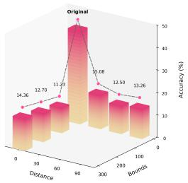

(b) Citeseer  
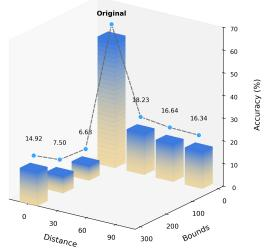

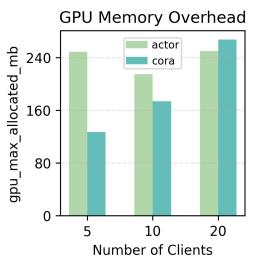

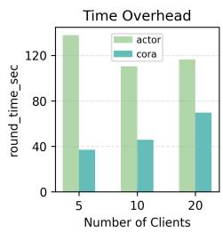  
Figure 8: Privacy Security Analysis. Privacy security results on Actor and CiteSeer under centerguess and range-overlap attacks.  
Figure 9: Overhead Analysis. Comparison of the memory and computation overhead.

(1) Center-guess attack. The attacker does not know the true latent sampling center and therefore tries several guessed centers. Specifically, we evaluate guesses {0, 30, 60, 90}, generate attacked pseudo-graphs from intercepted information, and then train attacked models on these pseudo-graphs.

(2) Range-overlap attack. The attacker further attempts to recover private distributions by enlarging candidate ranges to overlap the hidden latent distribution. We test three ranges: [−100, 100], [−200, 200], and [−300, 300], and repeat the same attacked training/evaluation protocol.

Experimental results (Fig. 8) show that, in both attack settings, the reconstructed pseudo-graphs consistently yield significantly lower performance than the Original baseline. This gap indicates that intercepted updates are insufficient to recover useful private graph information, demonstrating strong empirical privacy robustness offedHFT.

## K Equal Communication Budget Analysis

Our one-round setting follows the standard OFGL evaluation protocol established by GHOST [ICML25] and OASIS [NeurIPS25]. To more directly demonstrate the superiority of FedHFT, we

further compare one-round FedHFT with multi-round baselines under matched total communication budgets.

Table 8: Comparison under matched total communication budgets: one-round FedHFT versus multiround baselines on seven datasets. We report node classification accuracy (%) for downstream performance evaluation. OOM means out-of-memory error. The best and second-best results in each column are marked in bold and underline, respectively. On Ogbn-Arxiv, FedAvg, FedProx, and FedTAD are allowed three rounds and FGGP two rounds; all baselines use two rounds on the other datasets; all ten FGGP runs on Ogbn-Arxiv failed with OOM. FedHFT uses one round in all cases.
<table><tr><td>Methods (↓)</td><td>Cora</td><td>CiteSeer</td><td>PubMed</td><td>Actor</td><td>Amz-Photo</td><td>Roman-Empire</td><td>Ogbn-Arxiv</td></tr><tr><td>FedAvg [AISTATS17]</td><td>0.3326</td><td>0.5411</td><td>0.5366</td><td>0.2561</td><td>0.3380</td><td>0.2190</td><td>0.2376</td></tr><tr><td>FedProx [MLSys20]</td><td>0.3417</td><td>0.5350</td><td>0.5397</td><td>0.2542</td><td>0.4402</td><td>0.2183</td><td>0.2348</td></tr><tr><td>FedTAD [IJCAI24]</td><td>0.3468</td><td>0.5136</td><td>0.5196</td><td>0.2534</td><td>0.3634</td><td>0.2249</td><td>0.1011</td></tr><tr><td>FGGP [AAAI24]</td><td>0.3318</td><td>0.4965</td><td>0.4978</td><td>0.2489</td><td>0.3948</td><td>0.2231</td><td>00M</td></tr><tr><td>FedHFT (ours)</td><td>0.5224</td><td>0.5602</td><td>0.5698</td><td>0.4151</td><td>0.4931</td><td>0.4082</td><td>0.4450</td></tr></table>

As shown in Table 8, under this stricter matched-budget protocol, one-round FedHFT consistently outperforms every baseline on all seven datasets, further demonstrating its superiority.

## L overhead

Computational Overhead. FedHFT is designed for one-shot federated graph learning. Under this constraint, the method intentionally concentrates computation inside the single training cycle to maximize the utility of uploaded knowledge. On the client side, the dominant cost comes from fidelity-driven proxy refinement, including Fisher-guided gradient matching and class-semantic refinement on informative top-M channels, together with topology-aware proxy construction. On the server side, the dominant cost comes from transferability estimation and transferability-steered personalized collaboration. Details are presented in Fig.9.

Memory Overhead. The memory overhead of FedHFT mainly comes from three sources: topology-aware proxy construction and graph-level intermediate tensors, higher-order gradient retention required by Fisher-guided matching, and personalized model states used during server-side transferability-steered aggregation. Relative to lightweight uniform one-shot baselines, memory usage is higher during training. However, this overhead is stage-bounded and scales predictably with client count, feature dimensionality, and local graph size. Since the protocol executes only one communication round, the memory increase is not repeatedly accumulated across rounds. Details are presented in Fig.9.

Overall Discussion. FedHFT addresses the single-transmission bottleneck by coupling fidelity enhancement before upload and transferability-aware collaboration after upload. The framework does not rely on future rounds to repair local distortions or transfer misalignment, and instead enforces knowledge quality and collaboration structure within the only available interaction opportunity. Consequently, FedHFT incurs bounded computational and memory overhead to sharply reduce communication rounds. Importantly, this controlled resource investment is fundamentally justified by the enhanced effectiveness of knowledge transfer. FedHFT effectively translates bounded local computation into highly concentrated knowledge utility, successfully breaking the single-transmission bottleneck as evidenced by an average 15.67% performance margin over the standard FedAvg paradigm.

## M Discussion on Limitations

While the proposed framework demonstrates strong empirical performance, it exhibits certain limitations. Currently, the experimental validation is primarily constrained to standard benchmark datasets comprising typical homophilic and heterophilic graphs. The generalizability and robustness of the method across more complex data distributions, such as large scale dynamic networks or graphs with severe topological noise, remain to be comprehensively evaluated. Furthermore, the methodology relies on specific hyperparameter configurations. Since the central server lacks direct access to raw local data in a federated environment, optimally tuning these parameters for unseen system deployments presents a practical challenge. To address these constraints, future research will explore automated hyperparameter optimization strategies tailored for decentralized environments. Building upon the current high fidelity externalization and transferability steered mechanisms, subsequent work will extend this paradigm to multi round settings and conduct in depth theoretical analyses to facilitate broader real world applications.

## NeurIPS Paper Checklist

## 1. Claims

Question: Do the main claims made in the abstract and introduction accurately reflect the paper’s contributions and scope?

Answer: [Yes]

Justification:The main claims made in the abstract and introduction accurately reflect the contributions and scope of this paper.

Guidelines:

• The answer [N/A] means that the abstract and introduction do not include the claims made in the paper.

• The abstract and/or introduction should clearly state the claims made, including the contributions made in the paper and important assumptions and limitations. A [No] or [N/A] answer to this question will not be perceived well by the reviewers.

• The claims made should match theoretical and experimental results, and reflect how much the results can be expected to generalize to other settings.

• It is fine to include aspirational goals as motivation as long as it is clear that these goals are not attained by the paper.

## 2. Limitations

Question: Does the paper discuss the limitations of the work performed by the authors?

Answer: [Yes]

Justification: We discuss the limitations in M

Guidelines:

• The answer [N/A] means that the paper has no limitation while the answer [No] means that the paper has limitations, but those are not discussed in the paper.

• The authors are encouraged to create a separate “Limitations” section in their paper.

• The paper should point out any strong assumptions and how robust the results are to violations of these assumptions (e.g., independence assumptions, noiseless settings, model well-specification, asymptotic approximations only holding locally). The authors should reflect on how these assumptions might be violated in practice and what the implications would be.

• The authors should reflect on the scope of the claims made, e.g., if the approach was only tested on a few datasets or with a few runs. In general, empirical results often depend on implicit assumptions, which should be articulated.

• The authors should reflect on the factors that influence the performance of the approach. For example, a facial recognition algorithm may perform poorly when image resolution is low or images are taken in low lighting. Or a speech-to-text system might not be used reliably to provide closed captions for online lectures because it fails to handle technical jargon.

• The authors should discuss the computational efficiency of the proposed algorithms and how they scale with dataset size.

• If applicable, the authors should discuss possible limitations of their approach to address problems of privacy and fairness.

• While the authors might fear that complete honesty about limitations might be used by reviewers as grounds for rejection, a worse outcome might be that reviewers discover limitations that aren’t acknowledged in the paper. The authors should use their best judgment and recognize that individual actions in favor of transparency play an important role in developing norms that preserve the integrity of the community. Reviewers will be specifically instructed to not penalize honesty concerning limitations.

## 3. Theory assumptions and proofs

Question: For each theoretical result, does the paper provide the full set of assumptions and a complete (and correct) proof?

Answer: [N/A]

Justification: The paper does not include theoretical results.

Guidelines:

• The answer [N/A] means that the paper does not include theoretical results.

• All the theorems, formulas, and proofs in the paper should be numbered and crossreferenced.

• All assumptions should be clearly stated or referenced in the statement of any theorems.

• The proofs can either appear in the main paper or the supplemental material, but if they appear in the supplemental material, the authors are encouraged to provide a short proof sketch to provide intuition.

• Inversely, any informal proof provided in the core of the paper should be complemented by formal proofs provided in appendix or supplemental material.

• Theorems and Lemmas that the proof relies upon should be properly referenced.

## 4. Experimental result reproducibility

Question: Does the paper fully disclose all the information needed to reproduce the main experimental results of the paper to the extent that it affects the main claims and/or conclusions of the paper (regardless of whether the code and data are provided or not)?

Answer: [Yes]

Justification: We fully disclose all the information needed to reproduce the main experimental results in this paper and our code. We are convinced that the obtained results can be reproduced.

Guidelines:

• The answer [N/A] means that the paper does not include experiments.

• If the paper includes experiments, a [No] answer to this question will not be perceived well by the reviewers: Making the paper reproducible is important, regardless of whether the code and data are provided or not.

• If the contribution is a dataset and/or model, the authors should describe the steps taken to make their results reproducible or verifiable.

• Depending on the contribution, reproducibility can be accomplished in various ways. For example, if the contribution is a novel architecture, describing the architecture fully might suffice, or if the contribution is a specific model and empirical evaluation, it may be necessary to either make it possible for others to replicate the model with the same dataset, or provide access to the model. In general. releasing code and data is often one good way to accomplish this, but reproducibility can also be provided via detailed instructions for how to replicate the results, access to a hosted model (e.g., in the case of a large language model), releasing of a model checkpoint, or other means that are appropriate to the research performed.

• While NeurIPS does not require releasing code, the conference does require all submissions to provide some reasonable avenue for reproducibility, which may depend on the nature of the contribution. For example

(a) If the contribution is primarily a new algorithm, the paper should make it clear how to reproduce that algorithm.

(b) If the contribution is primarily a new model architecture, the paper should describe the architecture clearly and fully.

(c) If the contribution is a new model (e.g., a large language model), then there should either be a way to access this model for reproducing the results or a way to reproduce the model (e.g., with an open-source dataset or instructions for how to construct the dataset).

(d) We recognize that reproducibility may be tricky in some cases, in which case authors are welcome to describe the particular way they provide for reproducibility. In the case of closed-source models, it may be that access to the model is limited in some way (e.g., to registered users), but it should be possible for other researchers to have some path to reproducing or verifying the results.

## 5. Open access to data and code

Question: Does the paper provide open access to the data and code, with sufficient instructions to faithfully reproduce the main experimental results, as described in supplemental material?

Answer: [Yes]

Justification: Code is accessible in this paper.

## Guidelines:

• The answer [N/A] means that paper does not include experiments requiring code.

• Please see the NeurIPS code and data submission guidelines (https://neurips.cc/ public/guides/CodeSubmissionPolicy) for more details.

• While we encourage the release of code and data, we understand that this might not be possible, so [No] is an acceptable answer. Papers cannot be rejected simply for not including code, unless this is central to the contribution (e.g., for a new open-source benchmark).

• The instructions should contain the exact command and environment needed to run to reproduce the results. See the NeurIPS code and data submission guidelines (https: //neurips.cc/public/guides/CodeSubmissionPolicy) for more details.

• The authors should provide instructions on data access and preparation, including how to access the raw data, preprocessed data, intermediate data, and generated data, etc.

• The authors should provide scripts to reproduce all experimental results for the new proposed method and baselines. If only a subset of experiments are reproducible, they should state which ones are omitted from the script and why.

• At submission time, to preserve anonymity, the authors should release anonymized versions (if applicable).

• Providing as much information as possible in supplemental material (appended to the paper) is recommended, but including URLs to data and code is permitted.

## 6. Experimental setting/details

Question: Does the paper specify all the training and test details (e.g., data splits, hyperparameters, how they were chosen, type of optimizer) necessary to understand the results?

Answer: [Yes]

Justification: Details are included in G

Guidelines:

• The answer [N/A] means that the paper does not include experiments.

• The experimental setting should be presented in the core of the paper to a level of detail that is necessary to appreciate the results and make sense of them.

• The full details can be provided either with the code, in appendix, or as supplemental material.

## 7. Experiment statistical significance

Question: Does the paper report error bars suitably and correctly defined or other appropriate information about the statistical significance of the experiments?

Answer: [Yes]

Justification: Statistical significance of the experiments is considered and included in G Guidelines:

• The answer [N/A] means that the paper does not include experiments.

• The authors should answer [Yes] if the results are accompanied by error bars, confidence intervals, or statistical significance tests, at least for the experiments that support the main claims of the paper.

• The factors of variability that the error bars are capturing should be clearly stated (for example, train/test split, initialization, random drawing of some parameter, or overall run with given experimental conditions).

• The method for calculating the error bars should be explained (closed form formula, call to a library function, bootstrap, etc.)

• The assumptions made should be given (e.g., Normally distributed errors).

• It should be clear whether the error bar is the standard deviation or the standard error of the mean.

• It is OK to report 1-sigma error bars, but one should state it. The authors should preferably report a 2-sigma error bar than state that they have a 96% CI, if the hypothesis of Normality of errors is not verified.

• For asymmetric distributions, the authors should be careful not to show in tables or figures symmetric error bars that would yield results that are out of range (e.g., negative error rates).

• If error bars are reported in tables or plots, the authors should explain in the text how they were calculated and reference the corresponding figures or tables in the text.

## 8. Experiments compute resources

Question: For each experiment, does the paper provide sufficient information on the computer resources (type of compute workers, memory, time of execution) needed to reproduce the experiments?

Answer: [Yes]

Justification: We provide sufficient information on the computer resources.

Guidelines:

• The answer [N/A] means that the paper does not include experiments.

• The paper should indicate the type of compute workers CPU or GPU, internal cluster, or cloud provider, including relevant memory and storage.

• The paper should provide the amount of compute required for each of the individual experimental runs as well as estimate the total compute.

• The paper should disclose whether the full research project required more compute than the experiments reported in the paper (e.g., preliminary or failed experiments that didn’t make it into the paper).

## 9. Code of ethics

Question: Does the research conducted in the paper conform, in every respect, with the NeurIPS Code of Ethics https://neurips.cc/public/EthicsGuidelines?

Answer: [Yes]

Justification: The research conducted in the paper strictly adheres to the NeurIPS Code of Ethics, ensuring that all aspects of the work are in compliance with the guidelines

Guidelines:

• The answer [N/A] means that the authors have not reviewed the NeurIPS Code of Ethics.

• If the authors answer [No], they should explain the special circumstances that require a deviation from the Code of Ethics.

• The authors should make sure to preserve anonymity (e.g., if there is a special consideration due to laws or regulations in their jurisdiction).

## 10. Broader impacts

Question: Does the paper discuss both potential positive societal impacts and negative societal impacts of the work performed?

Answer: [N/A]

Justification: The research presented in this paper is foundational. It is not directly tied to any specific applications or deployments.

Guidelines:

• The answer [N/A] means that there is no societal impact of the work performed.

• If the authors answer [N/A] or [No], they should explain why their work has no societal impact or why the paper does not address societal impact.

• Examples of negative societal impacts include potential malicious or unintended uses (e.g., disinformation, generating fake profiles, surveillance), fairness considerations (e.g., deployment of technologies that could make decisions that unfairly impact specific groups), privacy considerations, and security considerations.

• The conference expects that many papers will be foundational research and not tied to particular applications, let alone deployments. However, if there is a direct path to any negative applications, the authors should point it out. For example, it is legitimate to point out that an improvement in the quality of generative models could be used to generate Deepfakes for disinformation. On the other hand, it is not needed to point out that a generic algorithm for optimizing neural networks could enable people to train models that generate Deepfakes faster.

• The authors should consider possible harms that could arise when the technology is being used as intended and functioning correctly, harms that could arise when the technology is being used as intended but gives incorrect results, and harms following from (intentional or unintentional) misuse of the technology.

• If there are negative societal impacts, the authors could also discuss possible mitigation strategies (e.g., gated release of models, providing defenses in addition to attacks, mechanisms for monitoring misuse, mechanisms to monitor how a system learns from feedback over time, improving the efficiency and accessibility of ML).

## 11. Safeguards

Question: Does the paper describe safeguards that have been put in place for responsible release of data or models that have a high risk for misuse (e.g., pre-trained language models, image generators, or scraped datasets)?

Answer: [N/A]

Justification: This paper poses no such risks

Guidelines:

• The answer [N/A] means that the paper poses no such risks.

• Released models that have a high risk for misuse or dual-use should be released with necessary safeguards to allow for controlled use of the model, for example by requiring that users adhere to usage guidelines or restrictions to access the model or implementing safety filters.

• Datasets that have been scraped from the Internet could pose safety risks. The authors should describe how they avoided releasing unsafe images.

• We recognize that providing effective safeguards is challenging, and many papers do not require this, but we encourage authors to take this into account and make a best faith effort.

## 12. Licenses for existing assets

Question: Are the creators or original owners of assets (e.g., code, data, models), used in the paper, properly credited and are the license and terms of use explicitly mentioned and properly respected?

Answer: [N/A]

Justification: This paper does not use existing assets.

Guidelines:

• The answer [N/A] means that the paper does not use existing assets.

• The authors should cite the original paper that produced the code package or dataset.

• The authors should state which version of the asset is used and, if possible, include a URL.

• The name of the license (e.g., CC-BY 4.0) should be included for each asset.

• For scraped data from a particular source (e.g., website), the copyright and terms of service of that source should be provided.

• If assets are released, the license, copyright information, and terms of use in the package should be provided. For popular datasets, paperswithcode.com/datasets has curated licenses for some datasets. Their licensing guide can help determine the license of a dataset.

• For existing datasets that are re-packaged, both the original license and the license of the derived asset (if it has changed) should be provided.

• If this information is not available online, the authors are encouraged to reach out to the asset’s creators.

## 13. New assets

Question: Are new assets introduced in the paper well documented and is the documentation provided alongside the assets?

Answer: [N/A]

Justification: This paper does not release new assets.

Guidelines:

• The answer [N/A] means that the paper does not release new assets.

• Researchers should communicate the details of the dataset/code/model as part of their submissions via structured templates. This includes details about training, license, limitations, etc.

• The paper should discuss whether and how consent was obtained from people whose asset is used.

• At submission time, remember to anonymize your assets (if applicable). You can either create an anonymized URL or include an anonymized zip file.

## 14. Crowdsourcing and research with human subjects

Question: For crowdsourcing experiments and research with human subjects, does the paper include the full text of instructions given to participants and screenshots, if applicable, as well as details about compensation (if any)?

Answer: [N/A]

Justification: This paper does not involve crowdsourcing nor research with human subjects. Guidelines:

• The answer [N/A] means that the paper does not involve crowdsourcing nor research with human subjects.

• Including this information in the supplemental material is fine, but if the main contribution of the paper involves human subjects, then as much detail as possible should be included in the main paper.

• According to the NeurIPS Code of Ethics, workers involved in data collection, curation, or other labor should be paid at least the minimum wage in the country of the data collector.

## 15. Institutional review board (IRB) approvals or equivalent for research with human subjects

Question: Does the paper describe potential risks incurred by study participants, whether such risks were disclosed to the subjects, and whether Institutional Review Board (IRB) approvals (or an equivalent approval/review based on the requirements of your country or institution) were obtained?

Answer: [N/A]

Justification: The paper does not involve crowdsourcing nor research with human subjects. Guidelines:

• The answer [N/A] means that the paper does not involve crowdsourcing nor research with human subjects.

• Depending on the country in which research is conducted, IRB approval (or equivalent) may be required for any human subjects research. If you obtained IRB approval, you should clearly state this in the paper.

• We recognize that the procedures for this may vary significantly between institutions and locations, and we expect authors to adhere to the NeurIPS Code of Ethics and the guidelines for their institution.

• For initial submissions, do not include any information that would break anonymity (if applicable), such as the institution conducting the review.

## 16. Declaration of LLM usage

Question: Does the paper describe the usage of LLMs if it is an important, original, or non-standard component of the core methods in this research? Note that if the LLM is used only for writing, editing, or formatting purposes and does not impact the core methodology, scientific rigor, or originality of the research, declaration is not required.

Answer: [N/A]

Justification: The core method development in this research does not involve LLMs as any important, original, or non-standard components.

Guidelines:

• The answer [N/A] means that the core method development in this research does not involve LLMs as any important, original, or non-standard components.

• Please refer to our LLM policy in the NeurIPS handbook for what should or should not be described.