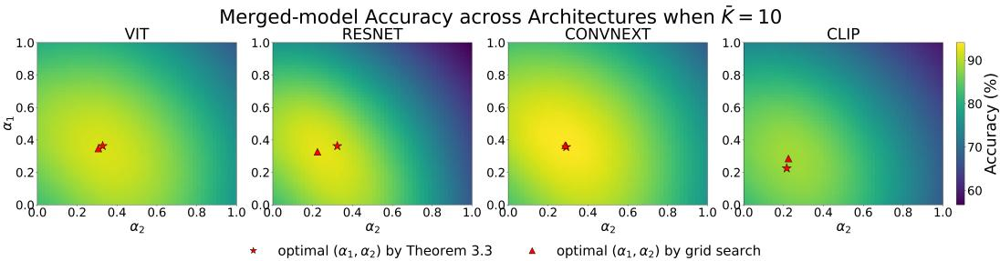
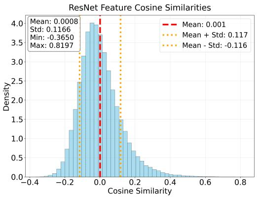
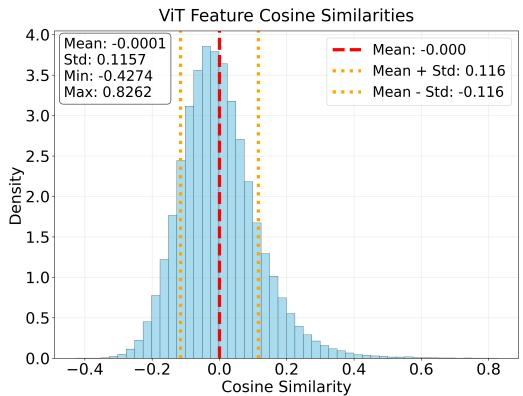
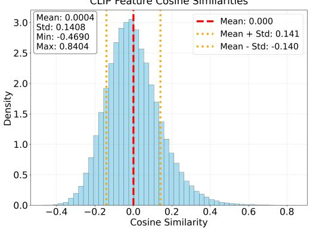
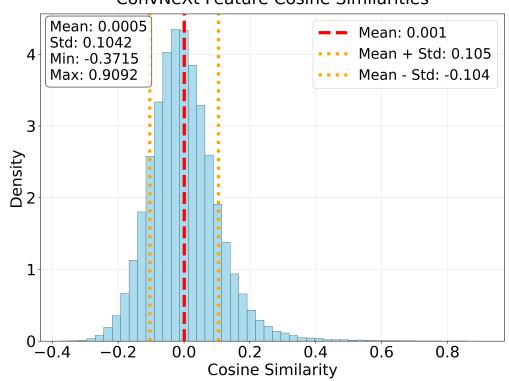
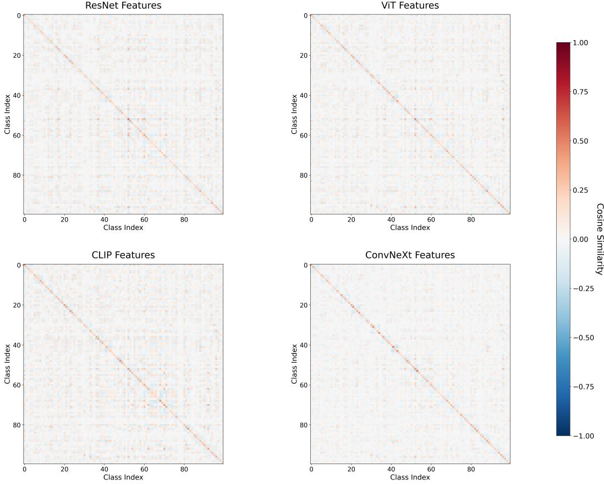
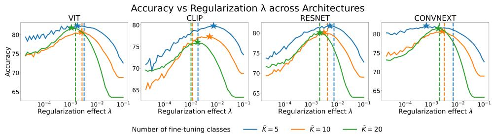
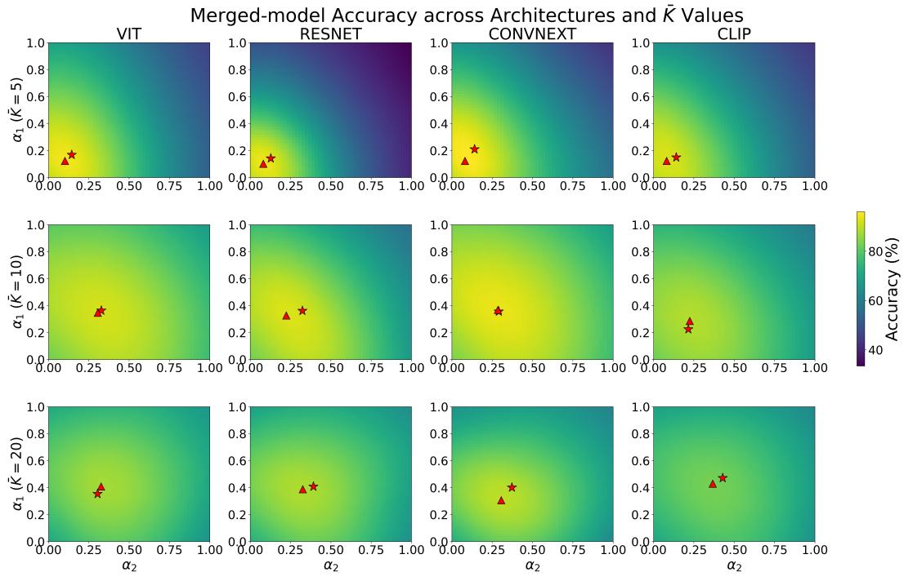

# A Margin Perspective on LoRA: Robustness to Catastrophic Forgetting and Adapter Merging (MaLoRA)

Ziqing Xu1,4∗ Hancheng Min7 Lachlan Ewen MacDonald3,4 Salma Tarmoun2,4 Enrique Mallada8 Weijie Su1 René Vidal2,3,4,5,6

1Statistics and Data Science 2AMCS 3ESE 4IDEAS 5Radiology 6CIS University of Pennsylvania

7INS & SMS, Shanghai Jiao Tong University 8ECE, Johns Hopkins University

## Abstract

Low-rank adaptation (LoRA) is the de facto method for parameter-efficient finetuning of large neural networks, achieving strong task adaptation with minimal trainable parameters and low optimization cost. Beyond this efficiency, practitioners have observed two striking properties: robustness to catastrophic forgetting and the ability to merge independently trained adapters into a single model that performs competitively across multiple tasks. These properties are central to continual and multi-task learning, yet remain poorly understood. In this work, we provide a theoretical explanation through a unified margin-based perspective. We analyze LoRA in multiclass linear classification under a near-orthogonal task regime with ℓ2-regularization, and characterize the optimal LoRA adapter across regularization regimes. Our analysis shows that, in an intermediate regime of regularization parameters, the optimal adapter aligns with the max-margin solution on the fine-tuning data. Building on this characterization, we derive two key consequences. First, we obtain closed-form expressions for the margins on pre-training and fine-tuning data, revealing a precise margin trade-off: the regularization parameter controls the balance between retention and adaptation. Second, we analyze adapter merging, proving that merged models achieve positive margin on each task and deriving optimal mixing coefficients that balance margins across tasks and maximize the margin over their union. These results lead to a simple, training-free merging rule, which we term margin-based LoRA merging (MaLoRA). Experiments on modern architectures and real datasets validate our theoretical predictions, showing that MaLoRA matches or outperforms several adapter-merging baselines across a range of vision and language classification tasks.

## 1 Introduction

Foundation models have transformed artificial intelligence across numerous domains. However, deploying these models in real-world applications typically requires fine-tuning on specialized datasets to meet accuracy, safety, and alignment requirements. Traditional full fine-tuning, which updates all parameters of a pre-trained model, incurs substantial computational cost, including large memory footprints, long training times, and significant storage demands. Low-Rank Adaptation (LoRA) [Hu et al., 2022] addresses this challenge by augmenting pre-trained weight matrices W with low-rank adapters B, A while keeping W frozen. Empirically, LoRA matches the performance of full fine-tuning while training only a small fraction of the parameters.

While LoRA was originally introduced for its computational efficiency, practitioners have since identified two striking empirical properties.

1. Robustness to catastrophicforgetting. In fine-tuning and continual learning, the degradation of performance on previously learned tasks after adapting to new ones (a.k.a. catastrophic forgetting) is a fundamental challenge [McCloskey and Cohen, 1989, Kirkpatrick et al., 2017, Ramasesh et al., 2021]. Surprisingly, recent studies show that LoRA exhibits strong robustness to catastrophic forgetting, even after substantial adaptation [Wistuba et al., 2023, Biderman et al., 2024, Qiao and Mahdavi, 2024]. This robustness makes LoRA particularly appealing for continual learning.

2. Effective adapter merging. In multi-task settings, maintaining separate fine-tuned models for each task is storage-intensive. Remarkably, LoRA adapters trained independently on different tasks can be merged (e.g., via simple weighted averaging) into a single adapter that performs well across all tasks [Huang et al., 2023, Yadav et al., 2023, Wang et al., 2024, Yu et al., 2024, Zhao et al., 2024]. This property enables flexible and efficient deployment.

Despite these empirical benefits, the theoretical mechanisms underlying LoRA’s robustness to catastrophicforgetting and its adapter merging capabilities remain poorly understood. In this work, we provide a unified theoretical explanation for both phenomena through a margin-based perspective.

Paper contributions. We study LoRA in multiclass linear classification under a near-orthogonal-task regime, in which fine-tuning samples are nearly orthogonal to one another and to the pre-training samples. In this setting, we characterize the global minimizer of the LoRA objective and use this characterization to analyze forgetting and adapter merging. Compared with prior theoretical work on LoRA (see Appendix B), our work makes the following contributions:

• Characterization ofthe optimal solution. We characterize the global minimizer of LoRA across different regularization regimes (Theorem 3.1). In the high-penalty regime, the optimal adapter is zero. In the intermediate regime, the adapter aligns with the max-margin direction on the fine-tuning data. In the low-penalty regime, the adapter aligns with a non-max-margin classifier whose direction generally does not admit a simple closed form. Nevertheless, we show that this direction converges to an interpretable limit as the regularization parameter tends to zero.

• Theory for reduced forgetting. We define forgetting as the reduction in margin on the pre-training data after fine-tuning, and derive closed-form expressions for the normalized margins on the pretraining data, the fine-tuning data, and their union (Theorem 3.2). Our analysis shows that these margins are governed by the regularization parameter and satisfy a precise trade-off: decreasing the regularization parameter increases the fine-tuning margin but also increases the Frobenius-norm ratio of the adapter to the pre-trained weights, leading to greater forgetting. We further identify the regularization parameter that maximizes the margin on the union of pre-training and fine-tuning tasks, thereby optimally balancing retention and adaptation.

• Theory for adapter merging. Under the intermediate-regime assumption for each task, we derive closed-form expressions for the margin of the merged model on every task (Theorem 3.3). We show that the merged model attains strictly positive margin on each task, providing a theoretical explanation for the effectiveness of adapter merging. We also characterize, in closed form, the mixing coefficients that maximize the margin of the merged model on the union of all tasks, which naturally leads to margin-based LoRA merging (MaLoRA), a theoretically motivated adaptermerging method. This contrasts with many existing model-merging approaches, which rely primarily on heuristic prescriptions for choosing how to combine task-specific models.

• Numerical validation. Experiments on real datasets and modern architectures support the theory in three ways: (i) in the linear probing setting, the empirically optimal regularization parameter agrees with the value predicted by our analysis; (ii) in the same setting, the empirically optimal adapter mixing weights agree with our closed-form coefficients; and (iii) in LoRA adapter merging, MaLoRA achieves performance comparable to, and in several cases better than, strong heuristic adapter-merging baselines across vision and language classification tasks.

## 2 Preliminaries

In this section, we first introduce the multiclass linear classification problem and its corresponding hard-margin SVM formulation. We then describe the specific learning problem considered in this

work, which consists of a pre-training and fine-tuning phase. Finally, we state the key assumptions that underpin our analysis, and discuss their motivation and implications.

## 2.1 Background on multiclass linear classification

We first review the standard K-class linear classification problem. Given a dataset D, the goal is to learn a weight matrix $W \in \mathbb { R } ^ { K \times d }$ that minimizes the mean empirical cross-entropy loss:

$$
\begin{array} { r } { \operatorname* { m i n } _ { W \in \mathbb { R } ^ { K \times d } } L ( W ; \mathcal { D } ) : = \frac { 1 } { | \mathcal { D } | } \sum _ { ( \pmb { x } , \pmb { y } ) \in \mathcal { D } } \mathcal { L } _ { \mathrm { C E } } ( \pmb { y } , W \pmb { x } ) , } \end{array}\tag{1}
$$

where x $\mathbf { \chi } ; \in \mathbb { R } ^ { d }$ is the input and $\ b { y } \in \mathbb { R } ^ { K }$ is a one-hot label vector. The cross-entropy loss is given by:

$$
\mathcal { L } _ { \mathrm { C E } } ( \pmb { y } , \hat { \pmb { y } } ) : = - \sum _ { c = 1 } ^ { K } y _ { c } \log \left( \frac { \exp ( \hat { y } _ { c } ) } { \sum _ { i = 1 } ^ { K } \exp ( \hat { y } _ { i } ) } \right) , \qquad \hat { \pmb { y } } = W \pmb { x } .\tag{2}
$$

Recent studies have shown that when the data are linearly separable, gradient descent (GD) implicitly biases the solution of (1) toward the max-margin classifier [Soudry et al., 2018, Lyu and Li, 2019, Ravi et al., 2024]. Specifically, the iterates of GD converge in direction to the max-margin solution of the following hard-margin SVM problem2:

$$
W ^ { \mathrm { S V M } } ( \mathcal { D } ) : = \underset { W \in \mathbb { R } ^ { K \times d } } { \arg \operatorname* { m i n } } \| W \| _ { F } ^ { 2 } \quad \mathrm { s u b j e c t t o } \quad C ( W ; \mathcal { D } ) \geq 1 ,\tag{3}
$$

where $C ( W ; { \mathcal { D } } )$ is the minimum margin over the dataset:

$$
C ( W ; \mathcal { D } ) : = \operatorname* { m i n } _ { ( \pmb { x } , \pmb { y } ) \in \mathcal { D } } \ \operatorname* { m i n } _ { k \neq c , y _ { c } = 1 } \left( \pmb { w } _ { c } ^ { \top } \pmb { x } - \pmb { w } _ { k } ^ { \top } \pmb { x } \right) , \quad \mathrm { w i t h } \quad W = [ \pmb { w } _ { 1 } ; \ldots ; \pmb { w } _ { K } ] ^ { \top } .\tag{4}
$$

The hard-margin SVM problem in (3) seeks a weight matrix of minimum norm that separates all examples with at least unit margin between the correct class and the nearest competing class.

Intuitively, classification decisions depend primarily on the direction of the weight matrix rather than its scale. To enable comparisons across different scales of W, we adopt the normalized margin used in [Crammer and Singer, 2001], i.e., $\begin{array} { r } { \gamma ( W ; \mathcal { D } ) { : = } \frac { C ( W ; \mathcal { D } ) } { \| W \| _ { F } } } \end{array}$ for $W \neq 0$ . This definition has been used in recent theoretical studies [Lyu and Li, 2019, Ravi et al., 2024]. We additionally set $\gamma ( 0 ; \mathcal { D } ) { : = } 0$ by convention.

## 2.2 Pre-training and fine-tuning setup

We now describe the specific pre-training and fine-tuning framework used in our theoretical analysis.

Pre-training stage. Let $\mathcal { D } _ { \mathrm { p r e } }$ be a labeled dataset with K classes, and let $W _ { \mathrm { p r e } } \in \mathbb { R } ^ { K \times d }$ denote a pre-trained linear classifier obtained by GD minimizing the cross-entropy loss $L ( W ; { \mathcal { D } } _ { \mathrm { p r e } } )$ . When $\mathcal { D } _ { \mathrm { p r e } }$ is linearly separable, this objective admits no finite minimizer. The GD iterates instead diverge in norm while converging in direction to the max-margin solution [Lyu and Li, 2019, Soudry et al., 2018]. We formalize this directional structure in Assumption 2.4.

Fine-tuning stage. We adapt the pre-trained model to a downstream dataset $\mathcal { D } _ { \mathrm { f t } }$ consisting of n additional samples from each of $2 \bar { \le K } \le K$ classes selected from the original K pre-training classes. This restriction applies throughout the paper and appendix, including to every task in adapter merging. This setup captures practical scenarios such as domain-incremental learning [Esaki et al., 2024], domain adaptation [Zohrizadeh et al., 2019, Zhang et al., 2022], and bias-rebalancingfine-tuning [Li and Xu, 2021, ValizadehAslani et al., 2024].

When LoRA is applied to adapt the pre-trained model to the fine-tuning task, we introduce a low-rank update to the weights, parameterized by matrices $B \in \mathbb { R } ^ { K \times r }$ and $A \in \mathbb { R } ^ { r \times d }$

$$
\begin{array} { r } { \operatorname* { m i n } _ { B , A } \ L ( W _ { \mathrm { p r e } } + B A ; \mathcal { D } _ { \mathrm { f t } } ) + \frac { \lambda } { 2 } ( \| B \| _ { F } ^ { 2 } + \| A \| _ { F } ^ { 2 } ) . } \end{array}\tag{5}
$$

Here, the Frobenius-norm penalties explicitly constrain the adapters in weight space, limiting the deviation of the fine-tuned model from the pretrained initialization.

Although some empirical studies of LoRA do not include this penalty explicitly in the loss, they train the adapters using the AdamW optimizer [Loshchilov and Hutter, 2017], whose decoupled weight decay induces an effect analogous to $L _ { 2 }$ regularization on B and A. Thus, the objective in $( 5 )$ captures the regularization that is, explicitly or implicitly, used in standard LoRA fine-tuning practice [Hu et al., 2022, Wistuba et al., 2023, Biderman et al., 2024].

Our goal is to understand the structure of the optimal solution to (5), and how it explains both LoRA’s robustness to catastrophic forgetting and its effectiveness in enabling adapter merging.

## 2.3 Assumptions and their implications

Our theoretical analysis uses the following assumptions. Let $N _ { \mathrm { f t } } = \bar { K } n$ be the number of fine-tuning samples, write $X _ { \mathrm { f t } } = [ \bar { \pmb { x } } _ { 1 } , \dots , \bar { \pmb { x } } _ { N _ { \mathrm { f t } } } ]$ , and let $X _ { \mathrm { p r e } }$ collect the pre-training feature vectors as columns. Assumption 2.1 (Task geometry). The combined pre-training and fine-tuning datasets are linearly separable. There exist $\epsilon _ { 1 } , \epsilon _ { 2 } \in [ 0 , 1 )$ such that,for all $i , j \in [ N _ { \mathrm { f t } } ]$ ] and $\mathbf { \boldsymbol { x } } \in \mathcal { D } _ { \mathrm { p r e } } ,$

$$
\begin{array} { r } { \left( a \right) \| \bar { \mathbf { x } } _ { i } \| _ { 2 } = \| \pmb { x } \| _ { 2 } = 1 , \quad \left( b \right) | \bar { \mathbf { x } } _ { i } ^ { \top } \bar { \mathbf { x } } _ { j } | \leq \epsilon _ { 1 } \left( i \neq j \right) , \quad \left( c \right) | \bar { \mathbf { x } } _ { i } ^ { \top } \pmb { x } | \leq \epsilon _ { 2 } . } \end{array}\tag{6}
$$

Assumption 2.2 (Dimension). In the strict-orthogonal case $\epsilon _ { 1 } = \epsilon _ { 2 } = 0 ,$ , the input dimension satisfies $d { \geq } N _ { \mathrm { f t } } { \mathrm { ' r a n k } } ( X _ { \mathrm { p r e } } )$ . For near-orthogonal data, we assume $( N _ { \mathrm { f t } } - 1 ) \epsilon _ { 1 } < 1$

Assumption 2.3 (LoRA rank). The LoRA rank parameter satisfies $r \geq \bar { K }$ , where $\bar { K }$ is the number of fine-tuning classes.

Assumption 2.4 (Pre-trained classifier). The pre-trained classifier $W _ { \mathrm { p r e } }$ is a scaled version ofthe hard-margin SVM solution on $\mathcal { D } _ { \mathrm { p r e } } \colon W _ { \mathrm { p r e } } = \rho _ { \mathrm { p r e } } \cdot W _ { \mathrm { p r e } } ^ { \mathrm { S V M } } / \| W _ { \mathrm { p r e } } ^ { \mathrm { S V M } } \| _ { F } ^ { \star }$ , for some scalar $\rho _ { \mathrm { p r e } } > 0$ where $W _ { \mathrm { p r e } } ^ { \mathrm { S V M } } { = } W ^ { \mathrm { S V M } } ( \mathcal { D } _ { \mathrm { p r e } } )$

Assumption justification. The near-orthogonal task Assumption 2.1 is arguably a strong assumption in practice, but reflects the realistic geometric structure of fine-tuning data, and similar orthogonalitytype assumptions are commonly used in theoretical analyses to enable closed-form characterizations [Bui Thi Mai and Lampert, 2021, Boursier et al., 2022, Frei et al., 2022, Kou et al., 2023]. The feature-correlation analyses on CIFAR-100 and six multi-domain benchmarks in Appendices H.1.1 and H.2.1 provide empirical motivation for studying this reference geometry. Assumption 2.2 makes the geometric feasibility and conditioning requirements explicit. The strict-case bound accounts for both the fine-tuning sample count and the pre-training feature span, specifying a high-dimensional, sample-limited setting. Assumption 2.3 requires only $r \bar { \geq } \bar { K }$ , meaning the LoRA rank needs only to be at least the number of fine-tuning classes. Finally, Assumption 2.4 is motivated by recent theoretical results on the implicit bias of GD in multiclass classification [Lyu et al., 2021, Ravi et al., 2024], as discussed in $\ S 2 . 1 . \ \rho _ { \mathrm { p r e } }$ captures the (unspecified) scale at which pre-training was stopped, which arises naturally in implicit-bias analyses where the GD iterate diverges along the SVM direction.

For clarity of exposition, all theorems in the main paper are stated under the strict-orthogonal special case $( \epsilon _ { 1 } = \epsilon _ { 2 } = 0 )$ of Assumption 2.1. The general versions of these results for $\epsilon _ { 1 } , \epsilon _ { 2 } > 0$ , together with their proofs, are deferred to the Appendix D–F.

Implications. The assumptions introduced above lead to a clean closed-form expression for the ${ \bar { K } } .$ class hard-margin SVM solution for the fine-tuning task, and also imply near-orthogonality between the pre-trained weights $W _ { \mathrm { p r e } }$ and the fine-tuning dataset ${ \mathcal { D } } _ { \mathrm { f t } }$ , which underpins our subsequent theoretical analysis in $\ S 3$ . To formalize these implications, we begin by introducing the concept of a simplex equiangular tight frame (simplex ETF), which characterizes the geometry of the hard-margin SVM solution in our setting

Definition 2.1 (Simplex ETF). For m $\geq 2 ,$ an m-simplex ETF is a collection of m vectors in $\mathbb { R } ^ { p }$ for some $p { \geq } m$ , given by the columns of $\begin{array} { r } { M _ { m } : = \sqrt { \frac { m } { m - 1 } } P \left( { \cal I } _ { m } - \frac { 1 } { m } \mathbf { 1 } _ { m } \mathbf { 1 } _ { m } ^ { \top } \right) } \end{array}$ , where $P \in \mathbb { R } ^ { p \times m }$ satisfies $P ^ { \top } P { = } I _ { m }$

Throughout, we use the canonical choice $p { = } m$ and $P { = } I _ { m } , { \mathrm { s o } } M _ { m } { \in } \mathbb { R } ^ { m \times m }$ . Using this definition, we now present a proposition that, under the strict-orthogonal specialization, characterizes the structure of the hard-margin SVM solution for the fine-tuning data $( \mathcal { D } _ { \mathrm { f t } } )$ and the orthogonality between the pre-trained weights $( W _ { \mathrm { p r e } } )$ and the fine-tuning data.

Proposition 2.1. Let $\bar { K } \geq 2 .$ . Under Assumption 2.1 with $\epsilon _ { 1 } = \epsilon _ { 2 } = 0$ and Assumption 2.4, the following hold:

(i) The minimum-norm SVM solution $W _ { \mathrm { f t } } ^ { \mathrm { S V M } } \in \mathbb { R } ^ { \bar { K } \times d }$ for ${ \mathcal { D } } _ { \mathrm { f t } }$ , defined by (3) with $\bar { K }$ output classes, admits the closed-form solution $\begin{array} { r } { W _ { \mathrm { f t } } ^ { \mathrm { S V M } } = \sqrt { \frac { \bar { K } - 1 } { \bar { K } } \left( M _ { \bar { K } } \otimes \mathbf { 1 } _ { n } ^ { \top } \right) X _ { \mathrm { f t } } ^ { \top } } } \end{array}$ , where $\scriptstyle { \pmb x } _ { i , j }$ is the j-th sample from class i, and $X _ { \mathrm { f t } } = [ \pmb { x } _ { 1 , 1 } , \dotsc , \pmb { x } _ { 1 , n } , \dotsc , \pmb { x } _ { \bar { K } , n } ]$ is the fine-tuning data matrix.

(ii) The pre-trained weights are orthogonal to the fine-tuning data: $W _ { \mathrm { p r e } } \pmb { \bar { x } } = 0 f o r a l l \pmb { \bar { x } } \in \mathcal { D } _ { \mathrm { f t } }$

Remark on Proposition 2.1. Proposition 2.1 reveals that the hard-margin SVM solution for the finetuning task admits a compact closed-form expression: $\begin{array} { r } { W _ { \mathrm { f t } } ^ { \mathrm { S V M } } = \sqrt { \frac { \bar { K } - 1 } { \bar { K } } \left( M _ { \bar { K } } \otimes \mathbf { 1 } _ { n } ^ { \top } \right) X _ { \mathrm { f t } } ^ { \top } } } \end{array}$ . However, this form does not immediately reveal how the classifier aggregates information from the fine-tuning data. To provide insight, we explicitly derive the expression for thefirst row of $W _ { \mathrm { f t } } ^ { \mathrm { S V M } }$ (the remaining rows follow symmetrically), yielding $\begin{array} { r } { \left( \frac { \bar { K } - 1 } { \bar { K } } \sum _ { i = 1 } ^ { n } \bar { \pmb x } _ { 1 , i } - \frac { 1 } { \bar { K } } \sum _ { k = 2 } ^ { \bar { K } } \sum _ { j = 1 } ^ { n } \bar { \pmb x } _ { k , j } \right) ^ { \mathrm { ~ } } } \end{array}$

Intuitively, each row of $W _ { \mathrm { f t } } ^ { \mathrm { S V M } }$ encodes a direction that emphasizes its corresponding class mean while uniformly suppressing the influence of all other classes, leading to class separation in maxmargin classification. The second result in Proposition 2.1 follows from the representer theorem for $\mathrm { { S V M s } , }$ , which implies that the hard-margin SVM solution on pre-training data lies in the span of $\mathcal { D } _ { \mathrm { p r e } }$ By Assumption $\dot { 2 } . 4 , W _ { \mathrm { p r e } }$ inherits this property; combined with condition (c) of Assumption 2.1 at $\epsilon _ { 2 } = 0$ , each row of $W _ { \mathrm { p r e } }$ is therefore orthogonal to the fine-tuning data.

Building upon these assumptions and propositions, we develop a rigorous theoretical framework that provides a principled explanation for LoRA’s empirical advantages in the subsequent section. Our analysis reveals properties that enable precise quantification of LoRA’s benefits in terms of robustness to catastrophic forgetting and adapter merging performance.

## 3 Main Results

In this section, we first analyze the optimization landscape of the LoRA objective and characterize its global minimum in §3.1. We then derive closed-form expressions for the margins on the union of pre-training and fine-tuning datasets, explaining why LoRA mitigates catastrophicforgetting in §3.2. Finally, in §3.3, we extend our margin-based analysis to the multi-task setting, explaining the effectiveness of adapter merging and deriving optimal mixing coefficients that maximize the margin on the union of all tasks. Moreover, building on these closed-form coefficients, we translate them into a simple training-free merging rule, margin-based LoRA merging (MaLoRA, Algorithm 1).

## 3.1 Global minimum of the LoRA objective

In this subsection, we present our main theoretical result characterizing the global minimizer of the LoRA objective in (5). Interestingly, under suitable regularization, we find that part of the optimal LoRA adapter aligns exactly with the K¯ -class hard-margin SVM solution $( W _ { \mathrm { f t } } ^ { \mathrm { S V M } } )$ for the fine-tuning data (see Proposition 2.1 for its definition). While our analysis neither assumes nor relies on this alignment, its emergence reveals a geometric structure that partially explains LoRA’s effectiveness.

Theorem 3.1. Let K and $\bar { K } \le K$ be the number of pre-training and fine-tuning classes, respectively. There exist scalarfunctions $a _ { \lambda } , b _ { \lambda } , c _ { \lambda } , \Theta _ { \lambda }$ of λ such that for any global minimizer $\left( B _ { \lambda } ^ { * } , \dot { A _ { \lambda } ^ { * } } \right)$ of (5) with $\lambda > 0 ,$ , we have

$$
B _ { \lambda } ^ { \ast } A _ { \lambda } ^ { \ast } = \left( \left( \begin{array} { c c } { { \left( a _ { \lambda } + b _ { \lambda } \right) { \bf I } _ { \bar { K } } \ - \ b _ { \lambda } { \bf 1 } _ { \bar { K } } { \bf 1 } _ { \bar { K } } ^ { \top } } } \\ { { - c _ { \lambda } { \bf 1 } _ { K - \bar { K } } { \bf 1 } _ { \bar { K } } ^ { \top } } } \end{array} \right) \otimes { \bf 1 } _ { n } ^ { \top } \right) X _ { \mathrm { f t } } ^ { \top } , \quad \| B _ { \lambda } ^ { \ast } A _ { \lambda } ^ { \ast } \| _ { F } = \Theta _ { \lambda } .\tag{7}
$$

When $\bar { K } \geq 2 ,$ , there exists a critical regularization weight $\begin{array} { r } { \lambda _ { \mathrm { c r i t } } \in [ 0 , \frac { 1 } { K \sqrt { n } } ) } \end{array}$ such that the scalar functions $a _ { \lambda } , b _ { \lambda } , c _ { \lambda } , \Theta _ { \lambda }$ are characterized asfollows:

(i) High-penalty regime $\scriptstyle \left( \lambda \geq { \frac { 1 } { K { \sqrt { n } } } } \right) : a _ { \lambda } = b _ { \lambda } = c _ { \lambda } = \Theta _ { \lambda } = 0$ , thus $B _ { \lambda } ^ { * } A _ { \lambda } ^ { * } { = } { \bf 0 } _ { K \times d }$

(ii) Intermediate regime $\begin{array} { r } { \big ( \lambda _ { \mathrm { c r i t } } < \lambda < \frac { 1 } { \bar { K } \sqrt { n } } \big ) \colon a _ { \lambda } = \frac { \Theta _ { \lambda } \sqrt { \bar { K } - 1 } } { \bar { K } \sqrt { n } } , b _ { \lambda } = \frac { \Theta _ { \lambda } } { \bar { K } \sqrt { n ( \bar { K } - 1 ) } } , c _ { \lambda } = 0 } \end{array}$ , and $\Theta _ { \lambda }$ is the unique root ofa nonlinear equation (see (29) in Appendix D), thus the minimizer is

$$
\begin{array} { r } { B _ { \lambda } ^ { * } A _ { \lambda } ^ { * } = \frac { \Theta _ { \lambda } } { \sqrt { \bar { K } n } } \left( \left( \begin{array} { c } { M _ { \bar { K } } } \\ { \mathbf { 0 } _ { ( K - \bar { K } ) \times \bar { K } } } \end{array} \right) \otimes \mathbf { 1 } _ { n } ^ { \top } \right) X _ { \mathrm { f t } } ^ { \top } . } \end{array}\tag{8}
$$

(iii) Low-penalty regime $( 0 < \lambda \leq \lambda _ { \mathrm { c r i t } } ) \colon a _ { \lambda } , b _ { \lambda } , c _ { \lambda } , \Theta _ { \lambda }$ are non-negative.

Moreover, the small-regularization limit satisfies

$$
\begin{array} { r } { \operatorname* { l i m } _ { \lambda \to 0 ^ { + } } \Theta _ { \lambda } = \infty , \qquad \operatorname* { l i m } _ { \lambda \to 0 ^ { + } } \frac { B _ { \lambda } ^ { * } A _ { \lambda } ^ { * } } { \| B _ { \lambda } ^ { * } A _ { \lambda } ^ { * } \| _ { F } } = \sqrt { \frac { 1 } { n \bar { K } } } \left( M _ { K } ^ { ( \bar { K } ) } \otimes \mathbf { 1 } _ { n } ^ { \top } \right) X _ { \mathrm { f t } } ^ { \top } , } \end{array}\tag{9}
$$

where $M _ { K } ^ { ( \bar { K } ) }$ is the first $\bar { K }$ columns ofthe K-ETF matrix $M _ { K }$

Remark 3.1. For $\bar { K } \geq 2 ,$ , the critical weight satisfies $\lambda _ { \mathrm { c r i t } } = 0$ if and only if ${ \bar { K } } = K$ . In this case, the intermediate regime covers all $0 < \bar { \lambda ^ { - } } < 1 / ( \bar { K } \sqrt { n } )$ , and the low-penalty regime contains no positive regularization weights. The limits in (9) remain valid as $\lambda \to \bar { 0 } ^ { + }$ , approached through the intermediate regime.

The proof of Theorem 3.1 is provided in Appendix D. The theorem shows that the optimal LoRA update $B _ { \lambda } ^ { * } A _ { \lambda } ^ { * }$ has the unified form in (7), and identifies up to three regimes based on the regularization parameter λ. We make the following remarks:

Effect of regularization and connection with max-margin classifier. The theorem shows that the regularization parameter governs the structure of the optimal LoRA adapters. In the high-penalty regime, the regularization term dominates and drives the optimal adapters to zero. In the intermediate regime, the adapters balance cross-entropy and regularization, yielding the explicit form in (8). In particular, the first $\bar { K }$ rows of $B _ { \lambda } ^ { * } A _ { \lambda } ^ { * }$ align with the $\bar { K } .$ -class hard-margin SVM solution on the finetuning data (Proposition 2.1), which gives a clear max-margin interpretation of the learned solution. In the low-penalty regime, explicit formulas for $a _ { \lambda }$ and $b _ { \lambda }$ are no longer available. Nevertheless, as $\lambda  0 ^ { + }$ , the cross-entropy term dominates and $\Theta _ { \lambda } \to \infty$ , while our asymptotic analysis still characterizes the limiting direction of $B _ { \lambda } ^ { * } A _ { \lambda } ^ { * }$ in (9). This direction coincides with the hard-margin SVM solution only when ${ \bar { K } } = K$

Implication for the fine-tuned model. The structured form of the optimal LoRA adapters in (7) naturally enables $W _ { \mathrm { L o R A } } ^ { \lambda } { : = } W _ { \mathrm { p r e } } { + } B _ { \lambda } ^ { * } A _ { \lambda } ^ { * }$ to perform well on both pre-training and fine-tuning data. Under Assumptions 2.1 and $2 . 4 .$ , Proposition 2.1 and Theorem 3.1 imply that $W _ { \mathrm { p r e } } { \bar { \mathbf { x } } } = 0$ for all $\bar { \mathbf { \boldsymbol { x } } } \in \mathcal { D } _ { \mathrm { f t } }$ and ${ \bar { B } } _ { \lambda } ^ { * } A _ { \lambda } ^ { * } { \pmb x } = 0$ for all $\mathbf { \boldsymbol { x } } \in \mathcal { D } _ { \mathrm { p r e } }$ . That is, the two components operate independently: $W _ { \mathrm { p r e } }$ classifies the pre-training data, while $B _ { \lambda } ^ { * } A _ { \lambda } ^ { * }$ adapts to the fine-tuning data:

$$
\forall x \in \mathcal { D } _ { \mathrm { p r e } } \cup \mathcal { D } _ { \mathrm { f t } } , \quad W _ { \mathrm { L o R A } } ^ { \lambda } x = \left\{ \begin{array} { l l } { W _ { \mathrm { p r e } } x } & { \mathrm { i f ~ } x \in \mathcal { D } _ { \mathrm { p r e } } , } \\ { B _ { \lambda } ^ { * } A _ { \lambda } ^ { * } x } & { \mathrm { i f ~ } x \in \mathcal { D } _ { \mathrm { f t } } . } \end{array} \right. \mathrm { h o l d s } \quad \forall \lambda > 0 .\tag{10}
$$

This clean separation lets us decompose the normalized margin of $W _ { \mathrm { L o R A } } ^ { \lambda }$ on each component dataset into a contribution from the relevant component (either $W _ { \mathrm { p r e } } ^ { \mathrm { ^ { - } } }$ or $B _ { \lambda } ^ { * } A _ { \lambda } ^ { * } )$ and a relative-norm factor:

$$
\gamma ( W _ { \mathrm { L o R A } } ^ { \lambda } ; \mathcal { D } ) = \gamma ( W ; \mathcal { D } ) \frac { \| W \| _ { F } } { \| W _ { \mathrm { L o R A } } ^ { \lambda } \| _ { F } } , \qquad ( W , \mathcal { D } ) \in \{ ( W _ { \mathrm { p r e } } , \mathcal { D } _ { \mathrm { p r e } } ) , ( B _ { \lambda } ^ { * } A _ { \lambda } ^ { * } , \mathcal { D } _ { \mathrm { f t } } ) \} .\tag{11}
$$

The expression in (11) shows that the normalized margin on the combined dataset depends not only on the individual normalized margins of $W _ { \mathrm { p r e } }$ and $B _ { \lambda } ^ { * } A _ { \lambda } ^ { * }$ on the $\mathcal { D } _ { \mathrm { p r e } }$ and ${ \mathcal { D } } _ { \mathrm { f t } }$ respectively, but also on the relative Frobenius norms of these components. In the following sections, we use (11) to derive closed-form expressions for the normalized margin on the combined dataset and to compute the optimal mixing coefficients for adapter merging. For clarity of presentation, we focus on the case ${ \dot { K } } = K$ and refer the reader to Appendix E and Appendix F for the full version of our results.

## 3.2 Margin trade-off between forgetting and fine-tuning under LoRA adaptation

We now analyze catastrophic forgetting through the normalized margin. Our goal is to characterize how the LoRA fine-tuned model trades off performance on the pre-training data and the fine-tuning

data as the regularization parameter varies, and to identify the regularization level that maximizes the margin on their union. For convenience, define $\gamma _ { \mathrm { p r e } } : = \gamma ( \bar { W _ { \mathrm { p r e } } } ; \mathcal { D } _ { \mathrm { p r e } } ) , \gamma _ { \mathrm { f t } , \lambda } : = \gamma ( B _ { \lambda } ^ { * } A _ { \lambda } ^ { * } ; \mathcal { D } _ { \mathrm { f t } } )$ Moreover, we define the adaptation to the fine-tuning data and forgetting on the pre-training data by

$$
\mathrm { A d a p t } ( \lambda ) = \gamma \big ( W _ { \mathrm { L o R A } } ^ { \lambda } ; \mathcal { D } _ { \mathrm { f t } } \big ) - \gamma ( W _ { \mathrm { p r e } } , \mathcal { D } _ { \mathrm { f t } } ) , \quad \mathrm { F o r g e t } ( \lambda ) : = \gamma _ { \mathrm { p r e } } - \gamma \big ( W _ { \mathrm { L o R A } } ^ { \lambda } ; \mathcal { D } _ { \mathrm { p r e } } \big ) .\tag{12}
$$

Based on these definitions, we now present the theorem.

Theorem 3.2. Adopt the setup ofTheorem 3.1 under strict orthogonality, and assume $\bar { K } = K \ge 2$ $L e t \gamma _ { \mathrm { f t } } ^ { * }$ be the max normalized margin any linear classifier can obtain on the fine-tuning data $\mathcal { D } _ { \mathrm { f t } }$ , and recall the scalar $\rho _ { \mathrm { p r e } }$ from Assumption 2.4. Then, Adapt(λ) and Forget(λ) can be characterized uniformly over all λ asfollows:

$$
\mathrm { A d a p t } ( \lambda ) = \gamma _ { \mathrm { f t } , \lambda } \frac { \Theta _ { \lambda } } { \sqrt { \Theta _ { \lambda } ^ { 2 } + \rho _ { \mathrm { p r e } } ^ { 2 } } } , \quad \mathrm { F o r g e t } ( \lambda ) = \gamma _ { \mathrm { p r e } } \left( 1 - \frac { \rho _ { \mathrm { p r e } } } { \sqrt { \Theta _ { \lambda } ^ { 2 } + \rho _ { \mathrm { p r e } } ^ { 2 } } } \right) .\tag{13}
$$

Moreover, the effect ofthe regularization parameter λ is characterized by two regimes:

(i) High-penalty regime: $\begin{array} { r } { i f \lambda \ge \frac { 1 } { K \sqrt { n } } } \end{array}$ , then $\Theta _ { \lambda } = 0 ,$ and hence Forget(λ)=Adapt(λ)= 0.

(ii) Intermediate and low-penalty regimes: $\scriptstyle { i f \lambda < { \frac { 1 } { K { \sqrt { n } } } } }$ , then $\gamma _ { \mathrm { f t } , \lambda } = \gamma _ { \mathrm { f t } } ^ { \ast }$ , and $\Theta _ { \lambda }$ is decreasing in λ. Therefore, Adapt(λ) and Forget(λ) are both decreasing in λ. In particular,

$$
\operatorname* { l i m } _ { \lambda \to 0 ^ { + } } \big ( \mathrm { A d a p t } ( \lambda ) , \mathrm { F o r g e t } ( \lambda ) \big ) = \big ( \gamma _ { \mathrm { f t } } ^ { * } , \gamma _ { \mathrm { p r e } } \big ) , \ : \ : \ : \ : \operatorname* { l i m } _ { \lambda \to \frac { 1 } { K \sqrt { n } } } \big ( \mathrm { A d a p t } ( \lambda ) , \mathrm { F o r g e t } ( \lambda ) \big ) = ( 0 , 0 ) .\tag{14}
$$

Remark 3.2. Notably, the intermediate and low-penalty regimes coincide when $\bar { K } = K$ . This merging is specific to the case ${ \bar { K } } = K ,$ ; when $\bar { K } < \bar { K }$ , the two regimes remain distinct.

Balancing adaptation and forgetting. Theorem 3.2 shows that the same quantity $\Theta _ { \lambda }$ controls both adaptation and forgetting. As λ decreases, the adapter scale $\Theta _ { \lambda }$ increases, improving $\operatorname { A d a p t } ( \lambda )$ on the fine-tuning data while also increasing Forget(λ) on the pre-training data. Thus, LoRA fine-tuning induces a direct margin trade-off: stronger adaptation comes at the cost of larger pre-training margin degradation. The natural question is how to choose λ to balance these effects. In the following Corollary 3.1, we quantify this trade-off by studying the normalized margin on the union of the pre-training and fine-tuning datasets, which leads to an explicit optimal regularization level.

Corollary 3.1 (Optimal balance between adaptation and forgetting). Under the conditions ofTheorem 3.2, with $\bar { K } = K ,$ , the normalized margin of $W _ { \mathrm { L o R A } } ^ { \lambda }$ on the union $\mathcal { D } _ { \mathrm { p r e } } \cup \mathcal { D } _ { \mathrm { f t } }$ is

$$
\gamma ( W _ { \mathrm { L o R A } } ^ { \lambda } ; \mathcal { D } _ { \mathrm { p r e } } \cup \mathcal { D } _ { \mathrm { f t } } ) = \operatorname* { m i n } \left\{ \gamma _ { \mathrm { p r e } } - \mathrm { F o r g e t } ( \lambda ) , \mathrm { A d a p t } ( \lambda ) \right\} .\tag{15}
$$

This margin is uniquely maximized at the balancing point $\lambda ^ { * } \in ( 0 , 1 / ( K \sqrt { n } ) )$ , with

$$
\operatorname* { m a x } _ { \lambda > 0 } \gamma ( W _ { \mathrm { L o R A } } ^ { \lambda } ; \mathcal { D } _ { \mathrm { p r e } } \cup \mathcal { D } _ { \mathrm { f t } } ) = \left( \frac { 1 } { ( \gamma _ { \mathrm { f t } } ^ { * } ) ^ { 2 } } + \frac { 1 } { \gamma _ { \mathrm { p r e } } ^ { 2 } } \right) ^ { - 1 / 2 } .\tag{16}
$$

## 3.3 Margin characterization of merged LoRA models and optimal mixing coefficients

We now extend the margin-based analysis to the multi-task setting, where a single pre-trained model is independently adapted by T LoRA adapters that we wish to merge into a unified model. Through the same margin lens, we derive closed-form expressions for the merged model’s margin on each task and identify mixing coefficients that maximize the margin on the union of all tasks (Theorem 3.3). Building on this characterization, we design a practical LoRA merging algorithm margin-based LoRA merging (MaLoRA, Algorithm 1).

Let $\left( B _ { i } ^ { * } , A _ { i } ^ { * } \right)$  denote the LoRA adapter trained on dataset $\mathcal { D } _ { i }$ , for $i \in [ T ]$ . We merge the adapters with the pre-trained weight matrix as follows:

$$
\begin{array} { r l r } { W _ { \mathrm { L o R A } } ( \pmb { \alpha } ) : = W _ { \mathrm { p r e } } + \sum _ { i = 1 } ^ { T } \alpha _ { i } B _ { i } ^ { * } A _ { i } ^ { * } , } & { \quad \alpha _ { 1 } , \ldots , \alpha _ { T } \geq 0 , } \end{array}\tag{17}
$$

where ${ \pmb { \alpha } } = ( \alpha _ { 1 } , \dots , \alpha _ { T } )$ are mixing coefficients. Moreover, we generalize Assumption 2.1 to the setting of learning multiple tasks as follows.

Algorithm 1 Margin-based LoRA Merging (MaLoRA)   
Require: $W _ { \mathrm { p r e } } , \{ ( B _ { i } ^ { * } , A _ { i } ^ { * } ) \} _ { i = 1 } ^ { T } , { \mathcal { D } } _ { \mathrm { p r e } } ^ { \mathrm { v a l } } , \{ { \mathcal { D } } _ { i } ^ { \mathrm { v a l } } \} _ { i = 1 } ^ { T } , S \subset \mathbb { R } _ { > 0 }$   
1: $\bar { C } _ { \mathrm { p r e } }  \bar { C } ( W _ { \mathrm { p r e } } ; \mathcal { D } _ { \mathrm { p r e } } ^ { \mathrm { v a l } } )$   
2: for $i = 1 , \dots , T$ do   
3: $\bar { C } _ { i } \gets \bar { C } ( W _ { \mathrm { p r e } } + B _ { i } ^ { * } A _ { i } ^ { * } ; \mathcal { D } _ { i } ^ { \mathrm { v a l } } ) , ~ \beta _ { i } \gets \left\{ \begin{array} { l l } { \bar { C } _ { \mathrm { p r e } } / \bar { C } _ { i } , } & { \bar { C } _ { i } > 0 , } \\ { 0 , } & { \mathrm { o t h e r w i s } } \end{array} \right.$   
e   
4: end for   
5: $\begin{array} { r } { s ^ { * } \in \arg \operatorname* { m a x } _ { s \in \cal { S } } \mathrm { V a l A c c } \Big ( W _ { \mathrm { p r e } } + s \sum _ { i = 1 } ^ { T } \beta _ { i } B _ { i } ^ { * } A _ { i } ^ { * } \Big ) } \end{array}$   
6: return $\begin{array} { r } { W _ { \mathrm { p r e } } + s ^ { * } \sum _ { i = 1 } ^ { T } \beta _ { i } B _ { i } ^ { * } A _ { i } ^ { * } } \end{array}$

Assumption 3.1. There exis $\epsilon _ { 1 } , \epsilon _ { 2 } \in [ 0 , 1 )$ such that

(a) Every sample has unit norm: $\| \pmb { x } \| _ { 2 } = 1$ for every $\begin{array} { r } { \pmb { x } \in \bigcup _ { i = 1 } ^ { T } \mathcal { D } _ { i } \cup \mathcal { D } _ { \mathrm { p r e } } } \end{array}$

(b) Within-task: for each $i \in [ T ]$ and each pair ofdistinct x¯, $\bar { \pmb x } ^ { \prime } \in \mathcal { D } _ { i } , | \bar { \pmb x } ^ { \top } \bar { \pmb x } ^ { \prime } | \leq \epsilon _ { 1 }$

(c) Cross-task and pre-training: $\forall \bar { \pmb { x } } \in \mathcal { D } _ { i } , \bar { \pmb { x } } ^ { \prime } \in \mathcal { D } _ { j } , i \neq j , o r x \in \mathcal { D } _ { \mathrm { p r e } } ,$ then $| \bar { \pmb x } ^ { \top } \bar { \pmb x } ^ { \prime } | , | \bar { \pmb x } ^ { \top } { \pmb x } | \le \epsilon _ { 2 } .$

The following theorem characterizes the optimal mixing coefficients in the strict orthogonal case $( \epsilon _ { 1 } = \epsilon _ { 2 } = 0 )$ . We refer the reader to Appendix F for the proof.

Theorem 3.3. Under Assumption 3.1, suppose eachfine–tuning task $\mathcal { D } _ { i } \left( i = 1 , \ldots , T \right)$ is trained with a regularization parameter in the intermediate or low-penalty regime. Let $\Theta _ { \lambda , i } = \| B _ { i } ^ { * } A _ { i } ^ { * } \| _ { F }$ and $\gamma _ { i } = \gamma ( B _ { i } ^ { * } A _ { i } ^ { * } ; { \mathcal { D } } _ { i } )$ . For any nonnegative coefficient vector ${ \pmb { \alpha } } = ( \alpha _ { 1 } , \dots , \alpha _ { T } ) \in \mathbb { R } _ { \ge 0 } ^ { T } ,$ , the merged model (17) achieves the normalized margins on each task asfollows

$$
\begin{array} { r } { \gamma \big ( W _ { \mathrm { L o R A } } ( \alpha ) ; \mathcal { D } _ { \mathrm { p r e } } \big ) = \frac { \gamma _ { \mathrm { p r e } } \rho _ { \mathrm { p r e } } } { \sqrt { \rho _ { \mathrm { p r e } } ^ { 2 } + \sum _ { j = 1 } ^ { T } \alpha _ { j } ^ { 2 } \Theta _ { \lambda , j } ^ { 2 } } } , \quad \gamma \big ( W _ { \mathrm { L o R A } } ( \alpha ) ; \mathcal { D } _ { i } \big ) = \frac { \gamma _ { i } \alpha _ { i } \Theta _ { \lambda , i } } { \sqrt { \rho _ { \mathrm { p r e } } ^ { 2 } + \sum _ { j = 1 } ^ { T } \alpha _ { j } ^ { 2 } \Theta _ { \lambda , j } ^ { 2 } } } , } \end{array}\tag{18}
$$

$$
\gamma \big ( W _ { \mathrm { L o R A } } ( \alpha ) ; \mathcal { D } _ { \mathrm { p r e } } \cup \{ D _ { i } \} _ { i = 1 } ^ { T } \big ) = \operatorname* { m i n } \left\{ \gamma \big ( W _ { \mathrm { L o R A } } ( \alpha ) ; \mathcal { D } _ { \mathrm { p r e } } \big ) , \gamma \big ( W _ { \mathrm { L o R A } } ( \alpha ) ; \mathcal { D } _ { i } \big ) , i \in [ T ] \right\}
$$

Choosing the weights $\begin{array} { r } { \alpha _ { i } = \frac { C ( W _ { \mathrm { p r e } } ; \mathcal { D } _ { \mathrm { p r e } } ) } { C ( B _ { i } A _ { i } ; \mathcal { D } _ { i } ) } , i \in [ T ] } \end{array}$ , maximizes the margin on the union ofall tasks:

$$
\begin{array} { r } { \operatorname* { m a x } _ { \alpha \in \mathbb { R } _ { \geq 0 } ^ { T } } \gamma \big ( W _ { \mathrm { L o R A } } ( \alpha ) ; { \mathcal D } _ { \mathrm { p r e } } \cup \{ D _ { i } \} _ { i = 1 } ^ { T } \big ) = \left( \frac { 1 } { \gamma _ { \mathrm { p r e } } ^ { 2 } } + \sum _ { j = 1 } ^ { T } \frac { 1 } { ( \gamma _ { j } ) ^ { 2 } } \right) ^ { - 1 / 2 } . } \end{array}
$$

Theorem 3.3 characterizes the margins on each task as well as on the union of tasks as functions of the mixing coefficients. In particular, it shows that the optimal mixing coefficients are given by the ratio between the unnormalized margin of the pre-trained model on $\mathcal { D } _ { \mathrm { p r e } }$ and that of each fine-tuned adapter on its own task. The unnormalized margin measures how confidently a classifier separates classes on its dataset, with smaller values indicating more challenging classification problems. This formula admits a direct interpretation: an adapter that achieves a smaller margin on its task is assigned a larger mixing weight, increasing its contribution so as to preserve a positive margin for that task in the merged model.

Towards practical margin-based adapter mixing The preceding analysis suggests choosing adapter mixing coefficients according to how confidently each adapter separates its task data, as measured by the unnormalized margin. In practice, however, datasets are often not perfectly separable, so the minimum margin $C ( \cdot ; \cdot )$ can be negative and overly sensitive to hard examples. We therefore use the average margin $\bar { C } ( \cdot ; \mathcal { D } )$ as a more stable proxy for adapter performance. Under the strictorthogonal assumptions of Theorem 3.3, the per-sample margins of each optimal adapter are equal on its own fine-tuning dataset. Consequently, minimum and average margins coincide on these fine-tuning datasets. In our practical algorithm, we therefore use average margins as empirical proxies for the minimum margins appearing in the theoretical mixing rule.

Algorithm 1: Margin-based LoRA merging (MaLoRA). Motivated by Theorem 3.3, we propose a practical LoRA merging algorithm using the average-margin proxies $\dot { \bar { C } } ( W ; \mathcal { D } )$ . When a task has non-positive average margin $\bar { C } _ { i }$ the corresponding coefficient would be negative and no longer consistent with the regime motivated by the theorem. Algorithm 1 therefore drops such tasks by setting their coefficients to zero. We also tune a global scaling factor $s ^ { * }$ on a held-out validation set, following Ilharco et al. [2022], and find that this further improves performance. In §4.2, we compare the resulting method with other popular adapter-merging baselines.

  
Figure 1: Merged-model accuracy across architectures. Each panel shows the accuracy of the merged model evaluated on the combined dataset, across a $5 0 \times 5 0$ grid of mixing coefficients $( \alpha _ { 1 } , \stackrel { - } { \alpha _ { 2 } } ) \in ( 0 , 1 ) ^ { 2 }$ . For each architecture, the red star indicates the theoretically predicted optimal coefficients from Theorem 3.3, while the red triangle marks the empirically optimal coefficients.

## 4 Experiments

Our experiments aim to validate the theoretical predictions in Section 3 and assess how well they transfer beyond the linear setting, rather than to establish state-of-the-art performance. Since our analysis gives closed-form predictions for optimal regularization and adapter mixing coefficients, we test whether these quantities match empirical behavior in modern architectures. Specifically, we focus on two questions: (i) whether the mixing coefficients derived from our margin analysis agree with empirically optimal coefficients, and (ii) whether the resulting theory-driven merging rule, MaLoRA, remains competitive with adapter-merging baselines in nonlinear models. Experiments on the effect of regularization are deferred to Appendix H.1.2.

Setup and metric. We evaluate our theory and method in two complementary settings. First, in linear probing on CIFAR-100 [Krizhevsky et al., 2009] (§4.1), we use four frozen pre-trained backbones (ResNet-50, ViT-B/16, ConvNeXt, and CLIP) as feature extractors [He et al., 2016, Dosovitskiy et al., 2021, Radford et al., 2021, Liu et al., 2022], apply LoRA only to the final linear classifier [Kornblith et al., 2019], and construct tasks from the CIFAR-100 superclass hierarchy. Second, in multi-domain adapter merging (§4.2), we evaluate ViT-B/16 on PACS, VLCS, and TerraIncognita [Fang et al., 2013, Li et al., 2017, Beery et al., 2018], and XLM-RoBERTa Base on MNLI, Amazon Reviews, and CivilComments [Zhang et al., 2015, Williams et al., 2018, Borkan et al., 2019, Conneau et al., 2020]. Although our theory is stated in terms of normalized margin, we report classification accuracy in experiments, since real-world classification tasks often do not achieve perfect separation and can have negative normalized margins. Additional details are given in Appendix H.

## 4.1 Optimal mixing coefficients for adapter merging: theory vs. grid search

We fine-tune LoRA adapters on two disjoint tasks $( \mathcal { D } _ { 1 } , \mathcal { D } _ { 2 } )$ , then merge them with the pre-trained weights using mixing coefficients $\left( \alpha _ { 1 } , \alpha _ { 2 } \right)$ . We evaluate the merged model’s performance on the combined dataset $\mathcal { D } _ { \mathrm { p r e } } \cup \mathcal { D } _ { 1 } \cup \mathcal { D } _ { 2 }$ . As shown in Figure 1, our predicted mixing coefficients closely match the grid-searched optima, confirming the practical accuracy of our merging theory.

## 4.2 Comparison between MaLoRA and other training-free baselines

Following Ilharco et al. [2022], we report average normalized accuracy (per-task merged accuracy divided by per-task finetuned accuracy, averaged across tasks) and its complement, relative accuracy drop, in Table 1. The aggregate performance of the methods is comparable, with average normalized accuracy ranging from 92.87% to 93.32%. MaLoRA lies at the top of this range, achieving an average normalized accuracy of 93.32% and the smallest relative accuracy drop of 6.68%. We emphasize that although MaLoRA is competitive with baselines, our purpose here is not to achieve state-of-the-art results but to demonstrate the efficacy of our theoretically-grounded method.

Table 1: Average normalized accuracy and relative accuracy drop, following Ilharco et al. [2022]. Results are averaged over 10 seeds. Bold indicates the best result in each column.
<table><tr><td rowspan="2">Method</td><td colspan="6">Per-benchmark normalized accuracy</td><td colspan="2">Aggregate metrics</td></tr><tr><td>PACS</td><td>VLCS</td><td>Terra Inc.</td><td>MNLI</td><td>Amazon</td><td>CivilComm.</td><td>Avg. norm. acc</td><td>Rel. drop</td></tr><tr><td>Soup</td><td>96.38</td><td>96.89</td><td>64.31</td><td>101.16</td><td>100.64</td><td>98.27</td><td>92.94</td><td>7.06</td></tr><tr><td>TA</td><td>97.52</td><td>97.19</td><td>64.46</td><td>101.27</td><td>100.68</td><td>97.80</td><td>93.15</td><td>6.85</td></tr><tr><td>TIES</td><td>97.52</td><td>96.95</td><td>63.78</td><td>100.87</td><td>100.64</td><td>98.00</td><td>92.96</td><td>7.04</td></tr><tr><td>DARE-TIES</td><td>97.57</td><td>97.23</td><td>64.23</td><td>100.90</td><td>100.45</td><td>97.92</td><td>93.05</td><td>6.95</td></tr><tr><td>DARE-Linear</td><td>96.48</td><td>96.77</td><td>64.73</td><td>101.12</td><td>100.50</td><td>97.61</td><td>92.87</td><td>7.13</td></tr><tr><td>MaLoRA</td><td>96.69</td><td>97.54</td><td>65.75</td><td>101.23</td><td>100.69</td><td>98.00</td><td>93.32</td><td>6.68</td></tr></table>

Computational overhead. MaLoRA computes task margins once and reuses them throughout the scale search. Under a separate matched 49-configuration timing protocol, the mean runtime is 972.6 s versus 950.3 s for TA, approximately 2.35% overhead across the six benchmarks. Detailed timings and the measurement protocol are in Appendix H.2.2.

## 5 Conclusion, Limitations, and Future Work

In this work, we study LoRA fine-tuning through the normalized margin under a near-orthogonal task regime. We characterize the global minimizer of the regularized LoRA objective across three regularization regimes (Theorem 3.1), derive closed-form expressions for the margins on the pretraining and fine-tuning data, and identify the regularization level that maximizes the margin on their union (Theorem 3.2). We further extend the analysis to multi-task settings by deriving closed-form optimal mixing coefficients for adapter merging (Theorem 3.3). Based on this theory, we propose margin-based LoRA merging (MaLoRA, Algorithm 1), which matches or outperforms several adapter merging baselines on a range of vision and language benchmarks. Across architectures and tasks, the empirical results closely align with the theoretical predictions.

Limitations and future work. First, our analysis relies on simplifying assumptions, most notably near-orthogonal task structure (Assumption 2.1) and balanced class sizes in the fine-tuning data. These assumptions enable a sharp closed-form characterization, but they also limit the scope of the theory. An important direction for future work is to relax them and study LoRA under more general data distributions and pre-training conditions. Second, experiments applying MaLoRA to nonlinear models provide empirical support for the practical usefulness of our merging rule beyond multiclass linear classification. These findings motivate extending the margin-based theoretical analysis to nonlinear adaptation. Third, our theory characterizes margins on the training datasets; establishing corresponding generalization or test-risk guarantees requires further analysis.

## Acknowledgments and Disclosure of Funding

Ziqing Xu, Lachlan Ewen MacDonald, Salma Tarmoun, and René Vidal acknowledge support from NSF grant 2031985, Simons Foundation grant 814201 (Theorinet), ONR MURI 503405-78051, and University of Pennsylvania startup funds. Enrique Mallada acknowledges support from NSF Global Centers grant 2330450 and DOE Office of Science (ASCR) award 826565. Hancheng Min acknowledges support from the Science and Technology Commission of Shanghai Municipality through the Shanghai Pujiang Programme (grant 25PJA070) and Shanghai Jiao Tong University startup funds.

## References

Rahaf Aljundi, Francesca Babiloni, Mohamed Elhoseiny, Marcus Rohrbach, and Tinne Tuytelaars. Memory aware synapses: Learning what (not) to forget. In Proceedings of the European Conference

on Computer Vision (ECCV), pages 139–154, 2018.

Sara Beery, Grant Van Horn, and Pietro Perona. Recognition in terra incognita. In Proceedings ofthe European conference on computer vision (ECCV), pages 456–473, 2018.

Dan Biderman, Jacob Portes, Jose Javier Gonzalez Ortiz, Mansheej Paul, Philip Greengard, Connor Jennings, Daniel King, Sam Havens, Vitaliy Chiley, Jonathan Frankle, et al. Lora learns less and forgets less. arXiv preprint arXiv:2405.09673, 2024.

Daniel Borkan, Lucas Dixon, Jeffrey Sorensen, Nithum Thain, and Lucy Vasserman. Nuanced metrics for measuring unintended bias with real data for text classification. CoRR, abs/1903.04561, 2019. URL http://arxiv.org/abs/1903.04561.

Etienne Boursier, Loucas Pullaud-Vivien, and Nicolas Flammarion. Gradient flow dynamics of shallow relu networks for square loss and orthogonal inputs. In Advances in Neural Information Processing Systems, volume 35, pages 20105–20118, 2022.

Phuong Bui Thi Mai and Christoph Lampert. The inductive bias of relu networks on orthogonally separable data. In 9th International Conference on Learning Representations, 2021.

Christopher J Burges and David Crisp. Uniqueness of the svm solution. Advances in neural information processing systems, 12, 1999.

Alexis Conneau, Kartikay Khandelwal, Naman Goyal, Vishrav Chaudhary, Guillaume Wenzek, Francisco Guzmán, Edouard Grave, Myle Ott, Luke Zettlemoyer, and Veselin Stoyanov. Unsupervised cross-lingual representation learning at scale. In Proceedings ofthe 58th annual meeting ofthe associationfor computational linguistics, pages 8440–8451, 2020.

Koby Crammer and Yoram Singer. On the algorithmic implementation of multiclass kernel-based vector machines. Journal ofmachine learning research, 2(Dec):265–292, 2001.

Thang Doan, Mehdi Abbana Bennani, Bogdan Mazoure, Guillaume Rabusseau, and Pierre Alquier. A theoretical analysis of catastrophic forgetting through the ntk overlap matrix. In International Conference on Artificial Intelligence and Statistics, pages 1072–1080. PMLR, 2021.

Alexey Dosovitskiy, Lucas Beyer, Alexander Kolesnikov, Dirk Weissenborn, Xiaohua Zhai, Thomas Unterthiner, Mostafa Dehghani, Matthias Minderer, Georg Heigold, Sylvain Gelly, et al. An image is worth 16x16 words: Transformers for image recognition at scale. arXiv preprint arXiv:2010.11929, 2021.

Yasushi Esaki, Satoshi Koide, and Takuro Kutsuna. One-shot domain incremental learning. In 2024 International Joint Conference on Neural Networks (IJCNN), pages 1–8. IEEE, 2024.

Itay Evron, Edward Moroshko, Rachel Ward, Nathan Srebro, and Daniel Soudry. How catastrophic can catastrophic forgetting be in linear regression? In Conference on Learning Theory, pages 4028–4079. PMLR, 2022.

Chen Fang, Ye Xu, and Daniel N Rockmore. Unbiased metric learning: On the utilization of multiple datasets and web images for softening bias. In Proceedings of the IEEE international conference on computer vision, pages 1657–1664, 2013.

Cong Fang, Hangfeng He, Qi Long, and Weijie J Su. Exploring deep neural networks via layer-peeled model: Minority collapse in imbalanced training. Proceedings of the National Academy of Sciences, 118(43):e2103091118, 2021.

Spencer Frei, Gal Vardi, Peter L Bartlett, Nathan Srebro, and Wei Hu. Implicit bias in leaky relu networks trained on high-dimensional data. arXiv preprint arXiv:2210.07082, 2022.

Kaiming He, Xiangyu Zhang, Shaoqing Ren, and Jian Sun. Deep residual learning for image recognition. In Proceedings of the IEEE Conference on Computer Vision and Pattern Recognition (CVPR), June 2016.

Wanli Hong and Shuyang Ling. Neural collapse for unconstrained feature model under cross-entropy loss with imbalanced data. arXiv preprint arXiv:2309.09725, 2023.

Roger A Horn and Charles R Johnson. Matrix analysis. Cambridge university press, 2012.

Edward J Hu, Yelong Shen, Phillip Wallis, Zeyuan Allen-Zhu, Yuanzhi Li, Shean Wang, Liang Wang, Weizhu Chen, et al. Lora: Low-rank adaptation of large language models. Iclr, 1(2):3, 2022.

Chengsong Huang, Qian Liu, Bill Yuchen Lin, Tianyu Pang, Chao Du, and Min Lin. Lorahub: Efficient cross-task generalization via dynamic lora composition. arXiv preprint arXiv:2307.13269, 2023.

Gabriel Ilharco, Marco Tulio Ribeiro, Mitchell Wortsman, Suchin Gururangan, Ludwig Schmidt, Hannaneh Hajishirzi, and Ali Farhadi. Editing models with task arithmetic. arXiv preprint arXiv:2212.04089, 2022.

Uijeong Jang, Jason D Lee, and Ernest K Ryu. Lora training in the ntk regime has no spurious local minima. arXiv preprint arXiv:2402.11867, 2024.

James Kirkpatrick, Razvan Pascanu, Neil Rabinowitz, Joel Veness, Guillaume Desjardins, Andrei A Rusu, Kieran Milan, John Quan, Tiago Ramalho, Agnieszka Grabska-Barwinska, et al. Overcoming catastrophic forgetting in neural networks. Proceedings ofthe national academy ofsciences, 114 (13):3521–3526, 2017.

Simon Kornblith, Jonathon Shlens, and Quoc V Le. Do better imagenet models transfer better? In Proceedings of the IEEE/CVF conference on computer vision and pattern recognition, pages 2661–2671, 2019.

Yiwen Kou, Zixiang Chen, and Quanquan Gu. Implicit bias of gradient descent for two-layer relu and leaky relu networks on nearly-orthogonal data. Advances in Neural Information Processing Systems, 36:30167–30221, 2023.

Alex Krizhevsky, Geoffrey Hinton, et al. Learning multiple layers of features from tiny images.(2009), 2009.

Da Li, Yongxin Yang, Yi-Zhe Song, and Timothy M. Hospedales. Deeper, broader and artier domain generalization, 2017. URL https://arxiv.org/abs/1710.03077.

Xuhong Li, Yves Grandvalet, and François Davoine. Explicit inductive bias for transfer learning with convolutional networks. In International Conference on Machine Learning (ICML), pages 2825–2834, 2018.

Zhiheng Li and Chenliang Xu. Discover the unknown biased attribute of an image classifier. In Proceedings of the IEEE/CVF International Conference on Computer Vision, pages 14970–14979, 2021.

Zhizhong Li and Derek Hoiem. Learning without forgetting. In European Conference on Computer Vision (ECCV), pages 614–629, 2016.

Zhuang Liu, Hanzi Mao, Chao-Yuan Wu, Christoph Feichtenhofer, Trevor Darrell, and Saining Xie. A convnet for the 2020s. In Proceedings of the IEEE/CVF conference on computer vision and pattern recognition, pages 11976–11986, 2022.

Ilya Loshchilov and Frank Hutter. Decoupled weight decay regularization. arXiv preprint arXiv:1711.05101, 2017.

Kaifeng Lyu and Jian Li. Gradient descent maximizes the margin of homogeneous neural networks. arXiv preprint arXiv:1906.05890, 2019.

Kaifeng Lyu, Zhiyuan Li, Runzhe Wang, and Sanjeev Arora. Gradient descent on two-layer nets: Margin maximization and simplicity bias. Advances in Neural Information Processing Systems, 34:12978–12991, 2021.

Sadhika Malladi, Alexander Wettig, Dingli Yu, Danqi Chen, and Sanjeev Arora. A kernel-based view of language model fine-tuning. In International Conference on Machine Learning, pages 23610–23641. PMLR, 2023.

Michael McCloskey and Neal J Cohen. Catastrophic interference in connectionist networks: The sequential learning problem. In Psychology of learning and motivation, volume 24, pages 109–165. Elsevier, 1989.

Fuli Qiao and Mehrdad Mahdavi. Learn more, but bother less: parameter efficient continual learning. Advances in Neural Information Processing Systems, 37:97476–97498, 2024.

Alec Radford, Jong Wook Kim, Chris Hallacy, Aditya Ramesh, Gabriel Goh, Sandhini Agarwal, Girish Sastry, Amanda Askell, Pamela Mishkin, Jack Clark, et al. Learning transferable visual models from natural language supervision. In International conference on machine learning, pages 8748–8763. PmLR, 2021.

Vinay Venkatesh Ramasesh, Aitor Lewkowycz, and Ethan Dyer. Effect of scale on catastrophic forgetting in neural networks. In International conference on learning representations, 2021.

Hrithik Ravi, Clay Scott, Daniel Soudry, and Yutong Wang. The implicit bias of gradient descent on separable multiclass data. Advances in Neural Information Processing Systems, 37:81324–81359, 2024.

Benjamin Recht, Maryam Fazel, and Pablo A Parrilo. Guaranteed minimum-rank solutions of linear matrix equations via nuclear norm minimization. SIAM review, 52(3):471–501, 2010.

Kurt S Riedel. A sherman–morrison–woodbury identity for rank augmenting matrices with application to centering. SIAM Journal on Matrix Analysis and Applications, 13(2):659–662, 1992.

Bernhard Scholkopf and Alexander J Smola. Learning with kernels: support vector machines, regularization, optimization, and beyond. MIT press, 2018.

Jonathan Schwarz, Wojciech M Czarnecki, Jelena Luketina, Agnieszka Grabska-Barwinska, Yee Whye Teh, Razvan Pascanu, and Raia Hadsell. Progress & compress: A scalable framework for continual learning. In International Conference on Machine Learning (ICML), pages 4528–4537, 2018.

Daniel Soudry, Elad Hoffer, Mor Shpigel Nacson, Suriya Gunasekar, and Nathan Srebro. The implicit bias of gradient descent on separable data. Journal ofMachine Learning Research, 19(70):1–57, 2018.

Rangarajan K Sundaram. A first course in optimization theory. Cambridge university press, 1996.

Taha ValizadehAslani, Yiwen Shi, Jing Wang, Ping Ren, Yi Zhang, Meng Hu, Liang Zhao, and Hualou Liang. Two-stage fine-tuning with chatgpt data augmentation for learning class-imbalanced data. Neurocomputing, 592:127801, 2024.

Hanqing Wang, Bowen Ping, Shuo Wang, Xu Han, Yun Chen, Zhiyuan Liu, and Maosong Sun. Lora-flow: Dynamic lora fusion for large language models in generative tasks. arXiv preprint arXiv:2402.11455, 2024.

G Alistair Watson. Characterization of the subdifferential of some matrix norms. Linear Algebra Appl, 170(1):33–45, 1992.

Adina Williams, Nikita Nangia, and Samuel Bowman. A broad-coverage challenge corpus for sentence understanding through inference. In Proceedings ofthe 2018 Conference ofthe North American Chapter of the Association for Computational Linguistics: Human Language Technologies, Volume 1 (Long Papers), pages 1112–1122. Association for Computational Linguistics, 2018. URL http://aclweb.org/anthology/N18-1101.

Martin Wistuba, Prabhu Teja Sivaprasad, Lukas Balles, and Giovanni Zappella. Continual learning with low rank adaptation. arXiv preprint arXiv:2311.17601, 2023.

Mitchell Wortsman, Gabriel Ilharco, Samir Ya Gadre, Rebecca Roelofs, Raphael Gontijo-Lopes, Ari S Morcos, Hongseok Namkoong, Ali Farhadi, Yair Carmon, Simon Kornblith, et al. Model soups: averaging weights of multiple fine-tuned models improves accuracy without increasing inference time. In International conference on machine learning, pages 23965–23998. PMLR, 2022.

Ziqing Xu, Hancheng Min, Lachlan Ewen MacDonald, Jinqi Luo, Salma Tarmoun, Enrique Mallada, and Rene Vidal. Understanding the learning dynamics of lora: A gradient flow perspective on low-rank adaptation in matrix factorization. arXiv preprint arXiv:2503.06982, 2025.

Prateek Yadav, Derek Tam, Leshem Choshen, Colin Raffel, and Mohit Bansal. Resolving interference when merging models. arXiv preprint arXiv:2306.01708, 1, 2023.

Le Yu, Bowen Yu, Haiyang Yu, Fei Huang, and Yongbin Li. Language models are super mario: Absorbing abilities from homologous models as a free lunch. In Forty-first International Conference on Machine Learning, 2024.

Yuchen Zeng and Kangwook Lee. The expressive power of low-rank adaptation. arXiv preprint arXiv:2310.17513, 2023.

Friedemann Zenke, Ben Poole, and Surya Ganguli. Continual learning through synaptic intelligence. In International conference on machine learning, pages 3987–3995. PMLR, 2017.

Wenyu Zhang, Li Shen, Wanyue Zhang, and Chuan-Sheng Foo. Few-shot adaptation of pre-trained networks for domain shift. arXiv preprint arXiv:2205.15234, 2022.

Xiang Zhang, Junbo Zhao, and Yann LeCun. Character-level convolutional networks for text classification. Advances in neural information processing systems, 28, 2015.

Ziyu Zhao, Leilei Gan, Guoyin Wang, Wangchunshu Zhou, Hongxia Yang, Kun Kuang, and Fei Wu. Loraretriever: Input-aware lora retrieval and composition for mixed tasks in the wild. arXiv preprint arXiv:2402.09997, 2024.

Fariba Zohrizadeh, Mohsen Kheirandishfard, and Farhad Kamangar. Class subset selection for partial domain adaptation. In CVPR Workshops, 2019.

## Contents

1 Introduction 1   
2 Preliminaries 2   
2.1 Background on multiclass linear classification . 3   
2.2 Pre-training and fine-tuning setup 3   
2.3 Assumptions and their implications 4   
3 Main Results 5   
3.1 Global minimum of the LoRA objective 5   
3.2 Margin trade-off between forgetting and fine-tuning under LoRA adaptation 6   
3.3 Margin characterization of merged LoRA models and optimal mixing coefficients 7   
4 Experiments 9   
4.1 Optimal mixing coefficients for adapter merging: theory vs. grid search 9   
4.2 Comparison between MaLoRA and other training-free baselines 9   
5 Conclusion, Limitations, and Future Work 10   
A LLM Usage 17   
B Related work 17   
C Characterization of Hard-margin SVM Solution for Orthogonal data 18   
D Proof of Theorem 3.1 19   
D.1 Proof of Theorem 3.1 19   
D.2 Proof of General Version 25   
E Proof of Theorem 3.2 and Corollary 3.1 29   
E.1 Proof of Theorem 3.2 30   
E.2 Proof of Corollary 3.1 . 32   
E.3 Proof of General Version 32   
F Proof of Theorem 3.3 36   
F.1 Proof of Theorem 3.3 . 36   
F.2 Proof of General Version 37   
G Lemmas 40   
G.1 Preliminary Lemmas 40   
G.2 Proof of Lemma D.1 41   
G.3 Proof of Lemma D.2 42   
G.4 Proof of Lemma G.6 45   
H Experiment 46   
H.1 Details for experiments in §H.1.2 and §4.1 . 46   
H.1.1 Empirical Motivation for the Task Geometry Assumption . 47   
H.1.2 Effect of regularization . 49   
H.1.3 Details for experiments in §4.1 49   
H.2 Details for experiments in §4.2 51   
H.2.1 Feature correlations across domains 53   
H.2.2 Computational overhead 54

## A LLM Usage

In this work, we use LLM to revise the writing, and help build standard training baselines of the experiments, such as dataset downloading, data processing, and pre-trained model loading.

## B Related work

Theory of LoRA. There are many works theoretically studying the expressiveness, characterizing the loss landscape, and understanding the learning dynamics of LoRA. Zeng and Lee [2023] prove that, under mild assumptions, LoRA can approximate any deep linear, feed-forward, or transformer network. Within the NTK regime, Malladi et al. [2023] characterize the conditions under which one can study LoRA in the NTK regime, while Jang et al. [2024] show that when the LoRA rank is $r _ { i } \gtrsim \sqrt { N }$ , where N is the number of samples, the optimization landscape of LoRA has no spurious local minima, and GD can find $\mathcal { O } ( \sqrt { N } )$ -rank solutions that generalize well. Moreover, Xu et al. [2025] study the learning dynamics of LoRA in the context of matrix factorization, and show that smaller initialization leads to longer training time and lower training error. However, none of these studies theoretically characterize why LoRA reduces catastrophicforgetting and support effective adapter merging.

LoRA merging. A variety of techniques have been proposed to merge task-specific LoRA adapters by forming a weighted average of their parameters. For example, LoRA-Hub [Huang et al., 2023] learns per-task mixing coefficients first, and then applies a weighted average of LoRA weight matrices B and A separately. LoRA-Flow [Wang et al., 2024] introduces token-level gates that dynamically assign merging coefficients to each LoRA adapter before taking weighted averaging. LoRA-Retriever [Zhao et al., 2024] first retrieves the most relevant adapters for each input, and then averages the selected LoRA adapters. Beyond weighted averaging, another line of work attempts to address redundancy and conflicting updates directly. TIES [Yadav et al., 2023] proceeds in three steps: trimming redundant parameters, resolving sign conflicts into an aggregate vector, and averaging only the parameters consistent with the aggregate sign, thereby mitigating degradation from redundant or conflicting updates. DARE [Yu et al., 2024] can be used as a preprocessing step for other merging methods, where parameters are randomly dropped according to a specified rate and the remaining ones are rescaled, reducing redundancy and potential interference among merged adapters. However, all these methods remain largely heuristic and lack theoretical guarantees.

Regularization and task orthogonality help reduce forgetting. A large body of work in finetuning and continual learning shows that controlling deviation of the fine-tuned model from the pretrained model reduces catastrophic forgetting. Concretely, these approaches impose weight-space penalties that restrict the magnitude and direction of parameter updates away from the pretrained solution. Weight-anchoring and importance-aware penalties exemplify this idea: Kirkpatrick et al. [2017] penalize movement along directions identified by the Fisher information matrix, while Zenke et al. [2017] accumulate path-wise importance during training. Schwarz et al. [2018] extend this idea to long sequences of tasks. Related approaches estimate parameter sensitivity [Aljundi et al., 2018], apply output-level distillation to preserve prior behavior [Li and Hoiem, 2016], or explicitly regularize parameters toward the pretrained anchor [Li et al., 2018]. Although these approaches differ in how importance or anchoring is computed, the common mechanism is the same: weightspace regularizers constrain updates duringfine-tuning relative to the pretrained model to mitigate catastrophic forgetting. Another complementary perspective highlights the role of task relations. When task representations are sufficiently decorrelated, interference between tasks is naturally reduced and forgetting is alleviated. In linear and kernelized models, it has been shown that when tasks are orthogonal or nearly orthogonal, cross-task gradient interference vanishes in expectation, implying negligible forgetting [Doan et al., 2021, Evron et al., 2022]. These insights resonate with our analysis of LoRA, where we explicitly study a regularized objective on low-rank adapters and make the simplifying assumption that the fine-tuning data are orthogonal to the pretraining data. This assumption directly connects to prior findings on task orthogonality and provides a tractable setting in which we can isolate and analyze the role of regularization in mitigating forgetting.

## C Characterization of Hard-margin SVM Solution for Orthogonal data

In this section, we characterize the hard-margin SVM solution for ${ \bar { K } } .$ -class classification problem for orthogonal data. We show the solution is closely related to the K¯ -ETF simplex.

Problem Formulation. Consider a ${ \bar { K } } .$ -class classification problem with data $\{ ( x _ { i , j } , y _ { i } ) \} _ { i = 1 , j = 1 } ^ { \bar { K } , n }$ where:

$\bar { K } \ge 2$ is the number of classes in the dataset

• n is the number of samples per class

$y _ { i } \in [ \bar { K } ]$ denotes the class label for samples $x _ { i , j }$

• All data vectors $x _ { i , j }$ have unit norm: $\| x _ { i , j } \| = 1$

• All data vectors are mutually orthogonal: $x _ { i , j } ^ { T } x _ { k , l } = 0 \mathrm { f o r } ( i , j ) \neq ( k , l )$

Let $W \in \mathbb { R } ^ { \bar { K } \times d }$ be a weight matrix for a linear classifier, where the predicted class for input x is arg ma $\mathrm { x } _ { k } ( W _ { k } x )$ . For simplicity, we use the following notation to denote all the data points: $X =$ $[ x _ { 1 , 1 } , \cdots , x _ { { \bar { K } } , n } ]$ . We use the canonical ETF $M _ { \bar { K } } { : = } \sqrt { \bar { K } / ( \bar { K } - 1 ) } \big ( I _ { \bar { K } } { - } { \bf 1 } _ { \bar { K } } { \bf 1 } _ { \bar { K } } ^ { \top } / \bar { K } \big )$ , corresponding to $\scriptstyle { P = I _ { \bar { K } } }$ in Definition 2.1.

Now, we are ready to present the main result.

Theorem C.1 (Maximum Margin with Frobenius Norm). Under the above data assumptions, the largest normalized margin any nonzero linear classifier can achieve is:

$$
\gamma ^ { * } = \frac { 1 } { \sqrt { n ( \bar { K } - 1 ) } }\tag{19}
$$

The unique unit-margin minimum-Frobenius-norm SVM solution is

$$
W ^ { \mathrm { S V M } } = \sqrt { \frac { \bar { K } - 1 } { \bar { K } } } \left( M _ { \bar { K } } \otimes \mathbf { 1 } _ { n } ^ { \top } \right) X ^ { \top } .
$$

The normalized margin is maximized precisely by $W { = } c W ^ { \mathrm { S V M } }$ with $c > 0 .$

Proof. We first solve the unit-margin minimum-norm SVM problem (3) with $\bar { K }$ output classes. By Proposition G.1, its solution has the form $W ^ { \mathrm { S V M } } = A ^ { * } \bar { X } ^ { \top }$ for some $A ^ { * } \in \mathbb { R } ^ { \bar { K } \times \bar { K } n }$ . Since $\dot { X ^ { \top } } X \dot { = } I _ { \bar { K } n } .$ , the logits satisfy $W ^ { \mathrm { S V M } } X = A ^ { * }$ and $\| W ^ { \mathrm { S V M } } \| _ { F } = \| A ^ { * } \| _ { F } .$ . Thus, $A ^ { * }$ solves

$$
\begin{array} { r l } { A ^ { * } = \underset { A \in \mathbb { R } ^ { { \bar { K } } \times { \bar { K } } n } } { \mathrm { a r g } \operatorname* { m i n } } \frac { 1 } { 2 } \| A \| _ { F } ^ { 2 } } & { \mathrm { s u b j e c t ~ t o } } \\ { A _ { i , ( i - 1 ) n + j } - A _ { k , ( i - 1 ) n + j } \geq 1 , } & { \quad i , k \in [ \bar { K } ] , i \neq k , j \in [ n ] . } \end{array}\tag{20}
$$

This feasible problem has a strictly convex objective and a convex constraint set, so its solution is unique [Burges and Crisp, 1999]. We use the permutation invariances of this fixed-scale problem to characterize $A ^ { * }$ . We first decompose $A ^ { * }$ into block matrices, i.e., $A ^ { * } = \left[ A _ { 1 } ^ { * } \quad \cdot \cdot \quad A _ { \bar { K } } ^ { * ^ { \bullet } } \right]$ where $A _ { i } ^ { * } \in \mathbb R ^ { \bar { K } \times n } , i \in [ \bar { K } ]$

Invariance under column permutation within block matrices. Permuting columns within a class block preserves both the constraints and the objective in (20). Thus, for any permutation matrices $\Pi _ { i } \in \bar { \mathbb { R } } ^ { n \times n }$ , the matrix $\left[ A _ { 1 } ^ { * } \Pi _ { 1 } \quad \cdot \cdot \quad A _ { \bar { K } } ^ { * } \Pi _ { \bar { K } } \right]$ is also optimal. Uniqueness gives $A _ { i } ^ { * } \Pi _ { i } = A _ { i } ^ { * }$ for every $\Pi _ { i } .$ , so all columns of each block are equal: $A _ { i } ^ { * } { = } v _ { i } \mathbf { 1 } _ { n } ^ { \top }$ for some $\boldsymbol { v } _ { i } \in \mathbb { R } ^ { \bar { K } }$

Invariance under permutation across block matrices. Let $V : = [ \pmb { v } _ { 1 } , \ldots , \pmb { v } _ { \bar { K } } ]$ . Simultaneously permuting output rows and the corresponding class blocks preserves the constraints and objective in (20). Uniqueness therefore gives $\Pi V \Pi ^ { \top } = V$ for every permutation matrix $\Pi \in \mathbb { R } ^ { \bar { K } \times \bar { K } }$ . By Lemma G.5, $\mathbf { \xi } , \bar { V } = a \pmb { I } _ { \bar { K } } - b \mathbf { 1 } _ { \bar { K } } \mathbf { 1 } _ { \bar { K } } ^ { \top }$ for some $a , b \in \mathbb { R }$

Scalar optimization. The unit-margin constraints reduce to $a \ge 1$ , and

$$
\begin{array} { l } { { \| A ^ { * } \| _ { F } ^ { 2 } = n \bar { K } ( a - b ) ^ { 2 } + n \bar { K } ( \bar { K } - 1 ) b ^ { 2 } } } \\ { { = n \left[ ( \bar { K } - 1 ) a ^ { 2 } + \bar { K } ^ { 2 } \left( b - \frac { a } { \bar { K } } \right) ^ { 2 } \right] . } } \end{array}
$$

The unique minimum is attained at $a = 1$ and $b { = } 1 / \bar { K }$ . Hence,

$$
W ^ { \mathrm { S V M } } = \left[ \left( I _ { \bar { K } } - \frac { 1 } { \bar { K } } { \bf 1 } _ { \bar { K } } { \bf 1 } _ { \bar { K } } ^ { \top } \right) \otimes { \bf 1 } _ { n } ^ { \top } \right] X ^ { \top } , \qquad \| W ^ { \mathrm { S V M } } \| _ { F } = \sqrt { n ( \bar { K } - 1 ) } ,
$$

which gives the stated ETF formula and has $C ( W ^ { \mathrm { S V M } } ; { \mathcal { D } } ) = 1$

Finally, any classifier W with $C ( W ; { \mathcal { D } } ) > 0$ can be rescaled to the feasible unit-margin classifier $W / C ( W ; { \dot { \mathcal { D } } } )$ ). Minimum-norm optimality yields

$$
\gamma ( W ; \mathcal { D } ) = \frac { 1 } { \| W / C ( W ; \mathcal { D } ) \| _ { F } } \le \frac { 1 } { \| W ^ { \mathrm { S V M } } \| _ { F } } = \frac { 1 } { \sqrt { n ( \bar { K } - 1 ) } } .
$$

Equality holds precisely when $W / C ( W ; \mathcal { D } ) = W ^ { \mathrm { S V M } }$ , by uniqueness of the unit-margin minimumnorm solution. Thus all normalized-margin maximizers are exactly the positive multiples of $W ^ { \mathrm { S V M } }$ Classifiers with nonpositive margin cannot attain this positive optimum. □

## D Proof of Theorem 3.1

In this section, we first present the proof of Theorem 3.1. Then, under additional assumptions on $\epsilon _ { 1 } , \epsilon _ { 2 }$ , we show that the same conclusion still holds, with additional error terms that depend on $\epsilon _ { 1 } , \epsilon _ { 2 }$

## D.1 Proof of Theorem 3.1

For the case $2 \leq \bar { K } < K$ , we first define the following functions used in the proof of Theorem 3.1.   
The balanced case ${ \bar { K } } = K$ is treated separately below.

$$
\begin{array} { r l } & { g _ { N } ( x ) : = \sqrt { \frac { \rho \left( K - \widehat K \right) } { K \left( K - \widehat K \right) x ^ { 2 } + \frac { K } { K \kappa } \left( 1 - x \right) ^ { 2 } } } } \\ & { g _ { n } ( x ) : = \exp \left( \frac { g _ { N } ( x ) \sqrt { \frac { P } { K n } } } { \sqrt { x ^ { 2 } + \frac { K } { K - K } ( 1 - x ) ^ { 2 } } } [ x ^ { 2 } + \sqrt { \frac { K } { K - \widehat K } } ( 1 - x ) ^ { 2 } ] \right) } \\ & { g _ { b } ( x ) : = \exp \left( \frac { g _ { N } ( x ) \sqrt { \frac { P } { K n } } } { \sqrt { x ^ { 2 } + \frac { K } { K - \widehat K } ( 1 - x ) ^ { 2 } } } [ - \frac { x ^ { 2 } } { K - 1 } + \sqrt { \frac { K } { K - \widehat K } } ( 1 - x ) ^ { 2 } ] \right) } \\ & { g _ { e } ( x ) : = \exp \left( \frac { g _ { N } ( x ) \sqrt { \frac { P } { K n } } } { \sqrt { x ^ { 2 } + \frac { K } { K - \widehat K } ( 1 - x ) ^ { 2 } } } [ - \frac { \widehat K } { K - \widehat K } \cdot \sqrt { \frac { K } { K - \widehat K } } ( 1 - x ) ^ { 2 } ] \right) . } \end{array}\tag{21}
$$

Moreover, let $x _ { 0 } \in [ 0 , 1 ]$ be the root of the equation

$$
\frac { g _ { b } ( x ) } { g _ { c } ( x ) } = \frac { 1 } { \sqrt { \frac { K } { K - \bar { K } } } + 1 } .
$$

Remark D.1. Our proof technique follows Fang et al. [2021], and the readers can see the same definition of $g _ { a } ( x ) , g _ { b } ( x ) , g _ { c } ( x )$ and $x _ { 0 }$ in Fang et al. [2021]. Moreover, the authors prove the existence ofx under certain conditions.

Now, we begin the proof of Theorem 3.1.

Theorem D.1 (Restatement of Theorem 3.1). Let $\left( B _ { \lambda } ^ { * } , A _ { \lambda } ^ { * } \right)$ be any minimizer of (5). There exist scalarfunctions $a _ { \lambda } , b _ { \lambda } , c _ { \lambda } , \Theta _ { \lambda }$ of λ such that for any global minimizer $\left( B _ { \lambda } ^ { \ast } , A _ { \lambda } ^ { \ast } \right) o f \left( 5 \right)$ with $\lambda > 0$ we have

$$
B _ { \lambda } ^ { \ast } A _ { \lambda } ^ { \ast } = \left( \left( \begin{array} { c c } { { \left( a _ { \lambda } + b _ { \lambda } \right) { \bf I } _ { \bar { K } } \ - \ b _ { \lambda } { \bf 1 } _ { \bar { K } } { \bf 1 } _ { \bar { K } } ^ { \top } } } \\ { { - c _ { \lambda } { \bf 1 } _ { K - \bar { K } } { \bf 1 } _ { \bar { K } } ^ { \top } } } \end{array} \right) \otimes { \bf 1 } _ { n } ^ { \top } \right) X _ { \mathrm { f t } } ^ { \top } , \quad \| B _ { \lambda } ^ { \ast } A _ { \lambda } ^ { \ast } \| _ { F } = \Theta _ { \lambda } .\tag{22}
$$

When $\bar { K } \ge 2$ , there exists a critical regularization weight $\begin{array} { r } { \lambda _ { \mathrm { c r i t } } \in [ 0 , \frac { 1 } { K \sqrt { n } } ) } \end{array}$ , with $\lambda _ { \mathrm { c r i t } } = 0$ if and only $i f { \bar { K } } = K$ , such that the scalarfunctions $a _ { \lambda } , b _ { \lambda } , c _ { \lambda } , \Theta _ { \lambda }$ are characterized asfollows:

(i) High-penalty regime $\begin{array} { r } { \big ( \lambda \geq \frac { 1 } { K \sqrt { n } } \big ) \colon a _ { \lambda } = b _ { \lambda } = c _ { \lambda } = \Theta _ { \lambda } = 0 , t h u s \ B _ { \lambda } ^ { \ast } A _ { \lambda } ^ { \ast } = \mathbf { 0 } _ { K \times d } } \end{array}$

(ii) Intermediate regime $\begin{array} { r } { \big ( \lambda _ { \mathrm { c r i t } } < \lambda < \frac { 1 } { \bar { K } \sqrt { n } } \big ) \colon a _ { \lambda } = \frac { \Theta _ { \lambda } \sqrt { \bar { K } - 1 } } { \bar { K } \sqrt { n } } , b _ { \lambda } = \frac { \Theta _ { \lambda } } { \bar { K } \sqrt { n ( \bar { K } - 1 ) } } , c _ { \lambda } = 0 } \end{array}$ , and $\Theta _ { \lambda }$ is the unique root ofa nonlinear equation (see (29) in Appendix D), thus the minimizer is

$$
B _ { \lambda } ^ { * } A _ { \lambda } ^ { * } = \frac { \Theta _ { \lambda } } { \sqrt { { \bar { K } } n } } \left( \left( { \bf 0 } _ { ( K - { \bar { K } } ) \times { \bar { K } } } ^ { M _ { \bar { K } } } \right) \otimes { \bf 1 } _ { n } ^ { \top } \right) X _ { \mathrm { f t } } ^ { \top } .\tag{23}
$$

(iii) Low-penalty regime $( 0 < \lambda \leq \lambda _ { \mathrm { c r i t } } ) \colon a _ { \lambda } , b _ { \lambda } , c _ { \lambda } , \Theta _ { \lambda }$ are non-negative.

Moreover, the small-regularization limit satisfies

$$
\operatorname* { l i m } _ { \lambda \to 0 ^ { + } } \Theta _ { \lambda } { = } { \infty } , \qquad \operatorname* { l i m } _ { \lambda \to 0 ^ { + } } \frac { B _ { \lambda } ^ { * } A _ { \lambda } ^ { * } } { \left\| B _ { \lambda } ^ { * } A _ { \lambda } ^ { * } \right\| _ { F } } { = } \sqrt { \frac { 1 } { n \bar { K } } } \left( M _ { K } ^ { ( \bar { K } ) } \otimes \mathbf { 1 } _ { n } ^ { \top } \right) X _ { \mathrm { f t } } ^ { \top } ,\tag{24}
$$

where $M _ { K } ^ { ( \bar { K } ) }$ is the first $\bar { K }$ columns ofthe K-ETF matrix $M _ { K }$

Proof. We first show that one can simplify the objective in (5) based on the following Lemma.

Lemma D.1. Under Assumptions 2.1 and 2.4 with $\epsilon _ { 1 } = \epsilon _ { 2 } = 0 $ , the originalfine-tuning problem in (5) is equivalent to the following symmetric formulation:

$$
\operatorname* { m i n } _ { B , \tilde { A } } \mathcal { L } ( B , \tilde { A } ) : = \frac { 1 } { \bar { K } n } \sum _ { c = 1 } ^ { \bar { K } } \sum _ { j = 1 } ^ { n } \mathcal { L } _ { \mathrm { C E } } \big ( y _ { c } , B \tilde { A } e _ { n ( c - 1 ) + j } \big ) + \frac { \lambda } { 2 } \big ( \| B \| _ { F } ^ { 2 } + \| \tilde { A } \| _ { F } ^ { 2 } \big ) ,\tag{25}
$$

where $X _ { \mathrm { f t } } = [ \bar { x } _ { 1 , 1 } , \ldots , \bar { x } _ { 1 , n } , \cdots , \bar { x } _ { K , 1 } , \cdots \bar { x } _ { K , n } ] , B \in \mathbb { R } ^ { K \times r } , \tilde { A } = A X _ { \mathrm { f t } } \in \mathbb { R } ^ { r \times \bar { K } n }$

Let $X _ { \mathrm { f t , \perp } }$ be an orthonormal complement of $X _ { \mathrm { f t } }$ . Then:

1. $H ( B ^ { * } , A ^ { * } )$ is any global minimizer of (5), then

$$
( B ^ { * } , \tilde { A } ^ { * } ) w i t h \tilde { A } ^ { * } = A ^ { * } X _ { \mathrm { { f t } } }
$$

is a global minimizer of (25).

2. Conversely, $i f ( B ^ { * } , { \tilde { A } } ^ { * } )$ is any global minimizer of (25), then $( B ^ { * } , \tilde { A } ^ { * } X _ { \mathrm { f t } } ^ { \top } )$ yields a global minimizer of the original problem in (5).

We refer the readers to Appendix G.2 for the proof of Lemma D.1. Lemma D.1 indicates that to characterize the global minimizer of the objective in (5), one can instead characterize the global minimizer of the objective in (25).

We start with the following equations that characterize the global minimizer of (25)

$$
\frac { \partial \mathcal { L } ( B , \tilde { A } ) } { \partial B } = \lambda B + \frac { 1 } { \bar { K } n } \sum _ { c = 1 } ^ { \bar { K } } \sum _ { j = 1 } ^ { n } \frac { \partial } { \partial B \tilde { A } } \bigg ( \mathcal { L } _ { \mathrm { C E } } \left( y _ { c } , B \tilde { A } e _ { ( c - 1 ) n + j } \right) \bigg ) e _ { ( c - 1 ) n + j } ^ { \top } \tilde { A } ^ { \top } = 0
$$

$$
\frac { \partial \mathcal { L } ( B , \tilde { A } ) } { \partial \tilde { A } } = \lambda \tilde { A } + B ^ { \top } \frac { 1 } { \tilde { K } n } \sum _ { c = 1 } ^ { \tilde { K } } \sum _ { j = 1 } ^ { n } \frac { \partial } { \partial B \tilde { A } } \Bigg ( \mathcal { L } _ { \mathrm { C E } } \left( y _ { c } , B \tilde { A } e _ { ( c - 1 ) n + j } \right) \Bigg ) e _ { ( c - 1 ) n + j } ^ { \top } = 0 .
$$

Based on the above equation, we can conclude that any minimizer $( B , { \tilde { A } } )$ of (25) must satisfy

$$
\lambda B ^ { \top } B = \lambda \tilde { A } \tilde { A } ^ { \top } \Rightarrow \| B \| _ { F } ^ { 2 } = \| \tilde { A } \| _ { F } ^ { 2 } .\tag{26}
$$

Our second step is to converge the problem into a constraint optimization problem. The following lemma characterizes this.

Lemma D.2. Let $B \in \mathbb { R } ^ { K \times r } , \tilde { A } \in \mathbb { R } ^ { r \times \bar { K } n }$ , and assume $r \geq \bar { K }$ as in Assumption 2.3. For each $\lambda > 0$ there exists a unique non-negative value $\rho _ { \lambda }$ such that the solution set for the following optimization problems are equivalent

$$
\operatorname* { m i n } _ { B , \tilde { A } } \ \frac { 1 } { \bar { K } n } \sum _ { c = 1 } ^ { \bar { K } } \sum _ { j = 1 } ^ { n } \mathcal { L } _ { \mathrm { C E } } \big ( y _ { c } , B \tilde { A } e _ { ( c - 1 ) n + j } \big ) + \frac { \lambda } { 2 } \big ( \| B \| _ { F } ^ { 2 } + \| \tilde { A } \| _ { F } ^ { 2 } \big ) ,\tag{Problem one}
$$

$$
\operatorname* { m i n } _ { B , \tilde { A } } \ \frac { 1 } { \tilde { K } n } \sum _ { c = 1 } ^ { \tilde { K } } \sum _ { j = 1 } ^ { n } \mathcal { L } _ { \mathrm { C E } } \big ( y _ { c } , \ B \tilde { A } e _ { ( c - 1 ) n + j } \big ) \quad s . t . \| B \| _ { F } ^ { 2 } \leq \rho _ { \lambda } , \| \tilde { A } \| _ { F } ^ { 2 } \leq \rho _ { \lambda } . \qquad ( \mathrm { P r o b l e m ~ t w o } )
$$

Moreover, the map $\lambda \mapsto \rho _ { \lambda }$ enjoys the following properties:

(i) Monotonicity and continuity. $\rho _ { \lambda }$ is continuous and non-increasing on $( 0 , \infty )$

(ii) Asymptotic behaviour.

$$
\operatorname * { l i m } _ { \lambda  0 ^ { + } } \rho _ { \lambda } = \infty , \qquad \operatorname * { l i m } _ { \lambda  \infty } \rho _ { \lambda } = 0 .
$$

(iii) Flat regions. For any $0 < \lambda _ { 1 } < \lambda _ { 2 } , \rho ( \lambda _ { 1 } ) = \rho ( \lambda _ { 2 } ) \iff \rho ( \lambda _ { 1 } ) = \rho ( \lambda _ { 2 } ) = 0$

We refer the readers to Appendix G.3 for the proof.

Balanced case ${ \bar { K } } = K \geq 2 .$ By Lemmas D.1 and D.2, it suffices to solve the convex problem (Problem three). Let $\ell ( Z )$ denote its mean cross-entropy term and set $C { : = } ( I _ { K } - \mathbf { 1 } _ { K } \mathbf { 1 } _ { K } ^ { \top } / \dot { K } ) \otimes$ $\mathbf { 1 } _ { n } ^ { \top }$ . The $K - 1$ nonzero singular values of $C$ equal ${ \sqrt { n } } .$ , so for $t > 0$

$$
\nabla \ell ( t C ) = - \frac { C } { n ( e ^ { t } + K - 1 ) } , \qquad \frac { C } { \sqrt { n } } \in \partial \| t C \| _ { * } .
$$

Thus the global optimality condition $\begin{array} { r } { 0 \in \nabla \ell ( Z ) + \lambda \partial \| Z \| , } \end{array}$ ∗ holds at $Z { = } t C$ exactly when $e ^ { t } { + } K { - } 1 =$ $1 / ( \lambda { \sqrt { n } } )$ . At zero, $\| \dot { \nabla \ell } ( 0 ) \| _ { \mathrm { o p } } = 1 / ( K \dot { \sqrt { n } } )$ , so zero is optimal exactly when $\lambda \geq 1 / ( K { \sqrt { n } } )$ Uniqueness (Lemma G.6) therefore gives

$$
Z _ { \lambda } ^ { * } = t _ { \lambda } C , \qquad t _ { \lambda } = \left\{ { \log } \left( { \frac { 1 } { \lambda \sqrt { n } } } - ( K - 1 ) \right) , 0 < \lambda < { \frac { 1 } { K \sqrt { n } } } , \right.
$$

Since rank $( Z _ { \lambda } ^ { \ast } ) { \leq } K { - } 1 { \leq } r ,$ , this solution is feasible for the factorized problem. Writing $\bar { A } _ { \lambda } ^ { * } { : = } A _ { \lambda } ^ { * } X _ { \mathrm { f t } }$ every global minimizer satisfies $B _ { \lambda } ^ { * } \bar { A } _ { \lambda } ^ { * } = Z _ { \lambda } ^ { * }$ and $B _ { \lambda } ^ { \ast } A _ { \lambda } ^ { \ast } { = } t _ { \lambda } C X _ { \mathrm { f t } } ^ { \top }$ . Consequently, $\rho _ { \lambda } = \sqrt { n } ( K - 1 ) t _ { \lambda }$ and $\Theta _ { \lambda } = \sqrt { n ( K - 1 ) } t _ { \lambda }$ . These formulas prove the intermediate ETF form and both limits in (9). We set $\lambda _ { \mathrm { c r i t } } = 0$ and $\rho _ { \mathrm { c r i t } } = + \infty$ as limiting boundaries; no minimizer at $\lambda { = } 0$ is asserted.

For the remainder of this strict-orthogonal proof, assume $2 \leq \bar { K } < K$ . For simplicity, we will use $\rho$ to denote $\rho _ { \lambda }$ for convenience.

Characterization to solution of (Problem two). (Problem two) can be viewed as a special case of the neural collapse phenomenon in the extreme setting of an imbalanced dataset: for the first $\bar { K }$ classes we observe n data points per class, while all remaining classes have zero samples. In thi context, we directly invoke the following result from Fang et al. Fang et al. [2021] (see p. 26 in . Fang et al. [2021]).

Lemma D.3 (Neural collapse under extreme imbalance; [Fang et al., 2021, Page 26]). Assume $2 \leq \bar { K } < K$ . For any constants $c _ { 1 } , c _ { 2 } , c _ { 3 } , \rho > 0 ,$ , define

$$
\begin{array} { r l } & { c _ { 1 } ^ { \prime } = \frac { c _ { 1 } } { c _ { 1 } + ( \bar { K } - 1 ) c _ { 2 } + ( \bar { K } - \bar { K } ) c _ { 3 } } } \\ & { c _ { 2 } ^ { \prime } = \frac { c _ { 2 } } { c _ { 1 } + ( \bar { K } - 1 ) c _ { 2 } + ( \bar { K } - \bar { K } ) c _ { 3 } } } \\ & { c _ { 3 } ^ { \prime } = \frac { c _ { 3 } } { c _ { 1 } + ( \bar { K } - 1 ) c _ { 2 } + ( \bar { K } - \bar { K } ) c _ { 3 } } } \\ & { c _ { 4 } ^ { \prime } = - c _ { \bar { \epsilon } _ { 1 } } ^ { \prime } \log c _ { 1 } ^ { \prime } - c _ { \bar { \epsilon } _ { 2 } } ^ { \prime } ( \bar { K } - 1 ) \log c _ { 2 } ^ { \prime } - ( \bar { K } - \bar { K } ) c _ { 3 } ^ { \prime } \log ( c _ { 3 } ^ { \prime } ) } \\ & { c _ { 5 } = \frac { \bar { K } c _ { 2 } } { \bar { K } c _ { 2 } + ( \bar { K } - \bar { K } ) c _ { 3 } } } \\ & { c _ { 6 } = \frac { ( \bar { K } - \bar { K } ) c _ { 3 } } { \bar { K } c _ { 2 } + ( \bar { K } - \bar { K } ) c _ { 3 } } } \\ & { c _ { 7 } = \frac { \bar { K } c _ { 2 } + ( \bar { K } - \bar { K } ) c _ { 3 } } { c _ { 1 } + ( \bar { K } - 1 ) c _ { 2 } + ( \bar { K } - \bar { K } ) c _ { 3 } } } \end{array}
$$

For any feasible solution $( B , { \tilde { A } } ) o f$ (Problem two), the objective value of (Problem two) can be simplified to

$$
\frac { 1 } { \bar { K } n } \sum _ { c = 1 } ^ { \bar { K } } \sum _ { j = 1 } ^ { n } \mathcal { L } _ { \mathrm { C E } } \big ( y _ { c } , B \tilde { A } e _ { ( c - 1 ) n + j } \big ) \overset { a } { \geq } - \frac { c _ { 7 } } { \bar { K } } \sqrt { \frac { \rho } { n } } \sqrt { \sum _ { i = 1 } ^ { \bar { K } } \| c _ { 5 } w _ { 1 } + c _ { 6 } w _ { 2 } - b _ { i } \| ^ { 2 } + c _ { 4 } }
$$

where $\begin{array} { r } { w _ { 1 } = \frac { 1 } { K } \sum _ { i = 1 } ^ { \bar { K } } b _ { i } , w _ { 2 } = \frac { 1 } { K - K } \sum _ { i = \bar { K } + 1 } ^ { K } b _ { i } } \end{array}$ , and $\begin{array} { c } { { a } } \\ { { \geq } } \end{array}$ becomes equality under certain choices of $c _ { 1 } , c _ { 2 } , c _ { 3 } .$

Readers are referred to Fang et al. [2021] for the full proof. Note the following distinction between Lemma D.3 and its analogue in Fang et al. [2021]: the inequality in Fang et al. [2021] becomes tight only when all minority-class features are zero and certain choices of $c _ { 1 } , c _ { 2 } , c _ { 3 }$ , whereas in our lemma, we do not require that all minority-class features are zero. This difference is resolved by our change of variables $\tilde { A } = A X _ { \mathrm { f t } }$ , which effectively confines $\tilde { A }$ to the subspace of observed (majority-class) features and thus guarantees equality in Lemma D.3.

Now, we carefull pick the $B , { \tilde { A } }$ and $c _ { 1 } , c _ { 2 } , c _ { 3 }$ to achieve the global minimum of the objective in (Problem two). The following lemma characterizes this exactly.

Lemma D.4 (Lemma 5 in Fang et al. [2021]). Under the assumptions of Theorem 3.1, with $2 \leq \bar { K } < K$ define

$$
\rho _ { \mathrm { c r i t } } = \sqrt { n } \bar { K } ( \bar { K } - 1 ) \log \left( \sqrt { \frac { K } { K - \bar { K } } } + 1 \right)
$$

such that the optimal value to (Problem two) is asfollows

• when $\bar { K } \ge 2$ and $\rho _ { \lambda } < \rho _ { \mathrm { c r i t } }$ , we choose $\begin{array} { r } { c _ { 1 } = \exp { \bigg ( \frac { \rho _ { \lambda } } { \bar { K } \sqrt { n } } \bigg ) } , c _ { 2 } = \exp { \bigg ( \frac { - \rho _ { \lambda } } { \sqrt { n } \bar { K } ( \bar { K } - 1 ) } \bigg ) } , c _ { 3 } = 1 , } \end{array}$ and (Problem two) attain its minimum

$$
- \frac { \rho _ { \lambda } } { \sqrt { n } \bar { K } } + \log \left( K - \bar { K } + ( \bar { K } - 1 ) \exp \big ( - \frac { \rho _ { \lambda } } { \sqrt { n } \bar { K } ( \bar { K } - 1 ) } \big ) + \exp \big ( \frac { \rho _ { \lambda } } { \sqrt { n } \bar { K } } \big ) \right) ,
$$

where $B ^ { * } , \tilde { A } ^ { * }$ takes the following form

$$
\begin{array} { c } { { \left[ b _ { 1 } ^ { * } , b _ { 2 } ^ { * } , \ldots , b _ { \bar { K } } ^ { * } \right] = \sqrt { n } \left[ \bar { a } _ { 1 } ^ { * } , \bar { a } _ { 2 } ^ { * } , \ldots , \bar { a } _ { \bar { K } } ^ { * } \right] = \sqrt { \frac { \rho } { \bar { K } } } { \cal P } M _ { \bar { K } } , } } \\ { { { } } } \\ { { a _ { i } ^ { * } = \bar { a } _ { \lceil i / n \rceil } ^ { * } , \quad i = 1 , \ldots , \bar { K } n , } } \\ { { b _ { j } ^ { * } = 0 , \qquad j > \bar { K } . } } \end{array}
$$

Here $P \in \mathbb { R } ^ { r \times \bar { K } }$ satisfies $P ^ { \top } P = \mathbf { I } _ { \bar { K } } , a _ { i } ^ { * }$ is the i-th column of $\tilde { A } ^ { * }$ , and $\bar { a } _ { c } ^ { * }$ is the common column for samples in class c. Writing $\bar { A } ^ { * } : = \tilde { A } ^ { * } = A ^ { * } X _ { \mathrm { f t } }$ for the data-coordinate factor, the product takes thefollowingform

$$
B ^ { * } \bar { A } ^ { * } = \frac { \rho _ { \lambda } } { \sqrt { \bar { K } n ( \bar { K } - 1 ) } } \left( \begin{array} { c } { { M _ { \bar { K } } } } \\ { { { \bf 0 } _ { ( K - \bar { K } ) \times \bar { K } } } } \end{array} \right) \otimes { \bf 1 } _ { n } ^ { \top } .\tag{27}
$$

• when $\bar { K } \ge 2$ and $\rho \ge \rho _ { \mathrm { c r i t } }$ , one choose

$$
c _ { 1 } = g _ { a } ( x _ { 0 } ) , \quad c _ { 2 } = g _ { b } ( x _ { 0 } ) , \quad c _ { 3 } = g _ { c } ( x _ { 0 } ) ,
$$

where $g _ { a } ( x ) , g _ { b } ( x ) , g _ { c } ( x )$ and $x _ { 0 }$ are defined in (21). Then, (Problem two) attain its minimum

$$
\log \left( \frac { g _ { a } ( x _ { 0 } ) + ( \bar { K } - 1 ) g _ { b } ( x _ { 0 } ) + ( K - \bar { K } ) g _ { c } ( x _ { 0 } ) } { g _ { a } ( x _ { 0 } ) } \right) ,
$$

where

$$
\begin{array} { r } { b _ { i } ^ { * } \ = \ \left\{ \begin{array} { l l } { g _ { N } ( x _ { 0 } ) P \left[ \frac { \bar { K } x _ { 0 } } { \sqrt { \bar { K } ( \bar { K } - 1 ) } } \bar { y } _ { i } + \Big ( \frac { 1 - x _ { 0 } } { \sqrt { \bar { K } } } - \frac { x _ { 0 } } { \sqrt { \bar { K } ( \bar { K } - 1 ) } } \Big ) \mathbf { 1 } _ { \bar { K } } \right] , } & { i \leq \bar { K } , } \\ { - \frac { g _ { N } ( x _ { 0 } ) \sqrt { \bar { K } } ( 1 - x _ { 0 } ) } { K - \bar { K } } P \mathbf { 1 } _ { \bar { K } } , } & { i > \bar { K } . } \end{array} \right. } \end{array}
$$

$$
\bar { a } _ { c } ^ { * } = \frac { g _ { N } ( x _ { 0 } ) } { \sqrt { n } } P \biggl [ x _ { 0 } \sqrt { \frac { \bar { K } } { \bar { K } - 1 } } \bar { y } _ { c } + \bigl ( \frac { ( 1 - x _ { 0 } ) \sqrt { \frac { K } { K - \bar { K } } } } { \sqrt { \bar { K } } } - \frac { x _ { 0 } } { \sqrt { \bar { K } ( \bar { K } - 1 ) } } \bigr ) { \bf 1 } _ { \bar { K } } \biggr ] ,
$$

where $\bar { y } _ { c } \in \mathbb { R } ^ { \bar { K } }$ is a one-hot vector with the c-th entry equal to one (and $\bar { y } _ { i }$ is defined analogously with the i-th entry equal to one), and $P \in \mathbb { R } ^ { r \times \bar { K } }$ is a partial orthogonal matrix such that $\dot { P } ^ { \top } P = \mathbf { I } _ { \bar { K } }$ . The sample columns satisfy $a _ { ( c - 1 ) n + j } ^ { * } = \bar { a } _ { c } ^ { * } f o r c \in [ \bar { K } ]$ and $j \in [ n ]$ Moreover, $B ^ { * } \tilde { A } ^ { * }$ takes the following form

$$
\begin{array} { r } { B ^ { * } \tilde { A } ^ { * } = \left( { \left( \log g _ { a } ( x _ { 0 } ) - \log g _ { b } ( x _ { 0 } ) \right) \mathbf { I } _ { \bar { K } } + \log g _ { b } ( x _ { 0 } ) \mathbf { 1 } _ { \bar { K } } \mathbf { 1 } _ { \bar { K } } ^ { \top } } \right) \otimes \mathbf { 1 } _ { n } ^ { \top } . } \\ { \log g _ { c } ( x _ { 0 } ) \mathbf { 1 } _ { K - \bar { K } } \mathbf { 1 } _ { \bar { K } } ^ { \top } } \end{array}
$$

Lemma D.4 is Lemma 5 in Fang et al. [2021]. We refer the readers to Fang et al. [2021] for the proof.   
Lemma D.4 exactly characterize the optimal solution and value of the objective in (Problem two).

Computation of the product of LoRA adapters. Based on Lemma D.4, we can characterize the solution to the LoRA objective in (5), then it suffices to compute the product of the minimizer to prove Theorem 3.1.

In the Intermediate regime, restricting $B ^ { * }$ to its first $\bar { K }$ rows gives

$$
\begin{array} { l } { { \displaystyle \left( B ^ { * } \right) _ { 1 : \bar { K } , : } \left[ \bar { a } _ { 1 } ^ { * } , \bar { a } _ { 2 } ^ { * } , \ldots , \bar { a } _ { \bar { K } } ^ { * } \right] = \frac { \rho _ { \lambda } } { \bar { K } \sqrt { n } } M _ { \bar { K } } ^ { \top } P ^ { \top } P M _ { \bar { K } } } } \\ { ~ } \\ { { \displaystyle ~ = \frac { \rho _ { \lambda } } { \bar { K } \sqrt { n } } \frac { \bar { K } } { \bar { K } - 1 } \big ( I _ { \bar { K } } - \frac { 1 } { \bar { K } } { \bf 1 } _ { \bar { K } } { \bf 1 } _ { \bar { K } } ^ { \top } \big ) } } \\ { { \displaystyle ~ = \frac { \rho _ { \lambda } } { \sqrt { \bar { K } n ( \bar { K } - 1 ) } } M _ { \bar { K } } , } } \end{array}
$$

and it leads to the product of final solution

$$
B ^ { * } \tilde { A } ^ { * } = { \frac { \rho _ { \lambda } } { \sqrt { \bar { K } n ( \bar { K } - 1 ) } } } \left( \mathbf { 0 } _ { ( K - \bar { K } ) \times \bar { K } } ^ { { \cal M } _ { \bar { K } } } \right) \otimes \mathbf { 1 } _ { n } ^ { \top } .\tag{28}
$$

In the Low penalty regime, in Fang et al. [2021], the authors further show that

$$
( b _ { i } ^ { * } ) ^ { \top } \bar { a } _ { j } ^ { * } = \left\{ \begin{array} { l l } { \log g _ { a } ( x _ { 0 } ) } & { i = j \leq \bar { K } } \\ { \log g _ { b } ( x _ { 0 } ) } & { i \neq j , i \leq \bar { K } } \\ { \log g _ { c } ( x _ { 0 } ) } & { \bar { K } < i \leq K } \end{array} \right. \quad i \in [ K ] , j \in [ \bar { K } ] .
$$

Thus, one can show that

$$
\begin{array} { r } { B ^ { * } \tilde { A } ^ { * } = \left( { \left( \log g _ { a } ( x _ { 0 } ) - \log g _ { b } ( x _ { 0 } ) \right) \mathbf { I } _ { \bar { K } } + \log g _ { b } ( x _ { 0 } ) \mathbf { 1 } _ { \bar { K } } \mathbf { 1 } _ { \bar { K } } ^ { \top } } \right) \otimes \mathbf { 1 } _ { n } ^ { \top } . } \\ { \log g _ { c } ( x _ { 0 } ) \mathbf { 1 } _ { K - \bar { K } } \mathbf { 1 } _ { \bar { K } } ^ { \top } } \end{array}
$$

Characterization of $\lambda _ { \mathrm { c r i t } }$ . In Lemma $_ { \mathrm { D . 4 . } }$ when $\bar { K } \geq 2 .$ , we see that the solution takes different form based on whether $\rho _ { \lambda } < \rho _ { \mathrm { c r i t } }$ or $\rho _ { \lambda } \ge \rho _ { \mathrm { c r i t } }$ . Moreover, based on Lemma ${ \bf D } . 2 .$ , there must exist a unique $\lambda _ { \mathrm { c r i t } }$ such that $\rho _ { \mathrm { c r i t } } = \rho ( \lambda _ { \mathrm { c r i t } } )$ . Now, we characterize the range of $\lambda _ { \mathrm { c r i t } }$ here.

Due to Lemma D.4, we know when $\lambda > \lambda _ { \mathrm { c r i t } }$ , the solution takes the form

$$
B ^ { * } \bar { A } ^ { * } = \frac { \rho } { \sqrt { n } ( \bar { K } - 1 ) } \left( \begin{array} { c } { \mathbf { I } _ { \bar { K } } - \frac { 1 } { \bar { K } } \mathbf { 1 } _ { \bar { K } } \mathbf { 1 } _ { \bar { K } } ^ { \top } } \\ { \mathbf { 0 } _ { ( K - \bar { K } ) \times \bar { K } } } \end{array} \right) \otimes \mathbf { 1 } _ { n } ^ { \top } ,
$$

and adding the penalty $\lambda \rho$ to this constrained minimum cross entropy gives the scalar penalized objective

$$
\psi ( \rho ) : = \lambda \rho - \frac { \rho } { \sqrt { n } \bar { K } } + \log \left( K - \bar { K } + ( \bar { K } - 1 ) \exp \big ( - \frac { \rho } { \sqrt { n } \bar { K } ( \bar { K } - 1 ) } \big ) + \exp \big ( \frac { \rho } { \sqrt { n } \bar { K } } \big ) \right) ,
$$

For this ETF-form update, $\rho = \sqrt { \bar { K } - 1 } \Theta$ . Differentiating $\psi ( \rho )$ and substituting this relation into the stationarity condition gives

$$
\begin{array} { c } { { \displaystyle \frac { d \psi ( \rho ) } { d \rho } = 0 } } \\ { { \displaystyle \Longleftrightarrow ( \lambda - \frac { 1 } { \sqrt { n } \bar { K } } ) + \frac { 1 } { \sqrt { n } \bar { K } } \cdot \frac { \exp \bigl ( \frac { \rho } { \sqrt { n } \bar { K } } \bigr ) - \exp \bigl ( - \frac { \rho } { \sqrt { n } \bar { K } ( \bar { K } - 1 ) } \bigr ) } { K - \bar { K } + ( \bar { K } - 1 ) \exp \bigl ( - \frac { \rho } { \sqrt { n } \bar { K } ( \bar { K } - 1 ) } \bigr ) + \exp \bigl ( \frac { \rho } { \sqrt { n } \bar { K } } \bigr ) } = 0 } } \\ { { \displaystyle \Longleftrightarrow ( \lambda - \frac { 1 } { \sqrt { n } \bar { K } } ) + \frac { 1 } { \sqrt { n } \bar { K } } \cdot \frac { \exp \bigl ( \frac { \theta } { \sqrt { n ( \bar { K } - 1 ) } } \bigr ) - 1 } { \bigl ( K - \bar { K } \bigr ) \exp \bigl ( \frac { \theta } { \bar { K } \sqrt { n ( \bar { K } - 1 ) } } \bigr ) + \bigl ( \bar { K } - 1 \bigr ) + \exp \bigl ( \frac { \Theta } { \sqrt { n ( \bar { K } - 1 ) } } \bigr ) } = 0 } } \end{array}\tag{29}
$$

We argue by contradiction. Suppose $\lambda _ { \mathrm { c r i t } } \geq 1 / ( \sqrt { n } \bar { K } )$ . For every $\lambda > \lambda _ { \mathrm { c r i t } }$ , the preceding ETF form (including the zero product) applies and $( 2 9 )$ gives $d \psi / d \rho > 0$ for $\rho > 0 ;$ , so $\rho _ { \lambda } = 0$ . Letting $\lambda \downarrow \lambda _ { \mathrm { c r i t } }$ and using continuity from Lemma D.2 yields $\rho ( \lambda _ { \mathrm { c r i t } } ) \dot { = } 0 ,$ , contradicting its defining value $\rho _ { \mathrm { c r i t } } > 0$ This covers both equality and strict inequality in the contradiction hypothesis. Therefore

$$
\lambda _ { \mathrm { c r i t } } < \frac { 1 } { \sqrt { n } \bar { K } } .
$$

Characterization of $\rho _ { \lambda }$ . In this part, we characterize the $\rho _ { \lambda }$ when $\lambda > \lambda _ { \mathrm { c r i t } }$ . By Lemma D.4, in this ETF regime $\psi ( \rho )$ equals the constrained minimum cross entropy at budget $\rho ,$ plus the penalty $\lambda \rho .$ . Thus, $\rho _ { \lambda }$ must attain the minimum of $\psi ( \rho )$ . Based on (29), one can first see that if $\begin{array} { r } { \lambda \overset { \bullet } { \ge } \frac { 1 } { \sqrt { n } K } } \end{array}$ $\frac { d \psi ( \rho ) } { d \rho } > 0 .$ , and the minimum is attained when $\rho _ { \lambda } = 0$ . When $\begin{array} { r } { \lambda _ { \mathrm { c r i t } } < \lambda < \frac { 1 } { \sqrt { n } \bar { K } } } \end{array}$ , solve (29) for $\Theta _ { \lambda }$ and recover $\rho _ { \lambda } = \sqrt { \bar { K } - 1 } \Theta _ { \lambda }$

Asymptotic behaviour of $\rho _ { \lambda }$ . On one hand, as $\lambda \to 0 +$ , one obviously has lim $\lambda {  } 0 { + } \| B ^ { * } \tilde { A } ^ { * } \| _ { F } = \infty$ since by Lemma D.2 we have $Z _ { \lambda } ^ { * } = B ^ { * } \tilde { A } ^ { * }$ where $Z _ { \lambda } ^ { * }$ is the unique minimizer of (Problem three) and $\lVert Z _ { \lambda } ^ { * } \rVert _ { * } = \rho _ { \lambda } \to \infty$ . Then, we characterize its asymptotic direction, which is equivalent to study the limit of $\frac { \log g _ { a } ( x _ { 0 } ) } { \log g _ { b } ( x _ { 0 } ) }$ and $\frac { \log g _ { a } ( x _ { 0 } ) } { \log g _ { c } ( x _ { 0 } ) }$ as $\lambda  0 +$ . We will use $x _ { 0 , \lambda }$ denote the choice of $x _ { 0 }$ for fix regularization effect λ.

First, the equation to derive for $x _ { 0 }$ is as follows

$$
\begin{array} { l } { \displaystyle \frac { g _ { b } ( x ) } { g _ { c } ( x ) } = \frac { 1 } { 1 + \sqrt { \frac { K } { K - K } } } } \\ { \Longleftrightarrow \frac { \rho _ { \lambda } } { \bar { K } \sqrt { n } } \cdot \frac { - \frac { x ^ { 2 } } { \bar { K } - 1 } + ( \frac { K } { K - \bar { K } } ) ^ { 3 / 2 } ( 1 - x ) ^ { 2 } } { x ^ { 2 } + \frac { K } { K - \bar { K } } ( 1 - x ) ^ { 2 } } = - \log \bigl ( 1 + \sqrt { \frac { K } { K - \bar { K } } } \bigr ) } \end{array}
$$

Since lim $^ { 1 } \lambda {  } 0 { + } \rho _ { \lambda } = \infty$ , one must have $x _ { 0 , \lambda }$ approaches the solution of the following quadratic equation

$$
\frac { x _ { 0 , \lambda } ^ { 2 } } { \bar { K } - 1 } = \big ( \frac { K } { K - \bar { K } } \big ) ^ { 3 / 2 } ( 1 - x _ { 0 , \lambda } ) ^ { 2 } .
$$

Moreover, one can see that the expression for $\frac { \log g _ { a } ( x _ { 0 , \lambda } ) } { \log g _ { b } ( x _ { 0 , \lambda } ) }$ and $\frac { \log g _ { a } ( x _ { 0 , \lambda } ) } { \log g _ { c } ( x _ { 0 , \lambda } ) }$ takes the following form

$$
\frac { \log g _ { a } ( x _ { 0 , \lambda } ) } { \log g _ { b } ( x _ { 0 , \lambda } ) } = \frac { x _ { 0 , \lambda } ^ { 2 } + \sqrt { \frac { K } { K - \bar { K } } } ( 1 - x _ { 0 , \lambda } ) ^ { 2 } } { - \frac { x _ { 0 , \lambda } ^ { 2 } } { \bar { K } - 1 } + \sqrt { \frac { K } { K - \bar { K } } } ( 1 - x _ { 0 , \lambda } ) ^ { 2 } }
$$

$$
\frac { \log g _ { a } ( x _ { 0 , \lambda } ) } { \log g _ { c } ( x _ { 0 , \lambda } ) } = \frac { x _ { 0 , \lambda } ^ { 2 } + \sqrt { \frac { K } { K - \bar { K } } } ( 1 - x _ { 0 , \lambda } ) ^ { 2 } } { - \frac { \bar { K } } { K - \bar { K } } \cdot \sqrt { \frac { K } { K - \bar { K } } } ( 1 - x _ { 0 , \lambda } ) ^ { 2 } } .
$$

Thus, combine the above two equations, we can compute that

$$
\operatorname * { l i m } _ { \lambda  0 + } { \frac { \log g _ { a } ( x _ { 0 , \lambda } ) } { \log g _ { b } ( x _ { 0 , \lambda } ) } } = \operatorname * { l i m } _ { \lambda  0 + } { \frac { \log g _ { a } ( x _ { 0 , \lambda } ) } { \log g _ { c } ( x _ { 0 , \lambda } ) } } = - ( K - 1 ) .
$$

Connection between $\rho _ { \lambda }$ and $\Theta _ { \lambda } .$ . In previous analysis, we have shown that

$$
\rho _ { \lambda } = \| B _ { \lambda } ^ { * } A _ { \lambda } ^ { * } \| _ { * } , \qquad \Theta _ { \lambda } = \| B _ { \lambda } ^ { * } A _ { \lambda } ^ { * } \| _ { F }\tag{30}
$$

It remains to relate $\rho _ { \lambda }$ and $\Theta _ { \lambda }$ across the regularization regimes. Write $\bar { A } _ { \lambda } ^ { * } { : = } A _ { \lambda } ^ { * } X _ { \mathrm { f t } }$ for the datacoordinate factor denoted by $\tilde { A } ^ { * }$ above. By Lemma D.1, $B _ { \lambda } ^ { * } A _ { \lambda } ^ { * } { = } B _ { \lambda } ^ { * } \bar { A } _ { \lambda } ^ { * } X _ { \mathrm { { f t } } } ^ { \top }$ . Since $X _ { \mathrm { f t } } ^ { \top } X _ { \mathrm { f t } } { = } I _ { \bar { K } n }$ the weight-space and data-coordinate products have the same nonzero singular values, and hence the same nuclear and Frobenius norms.

First, it is obvious in the high-penalty regime, $\rho _ { \lambda } = \Theta _ { \lambda } = 0$

Second, in the intermediate regime, the data-coordinate product is

$$
B _ { \lambda } ^ { * } \bar { A } _ { \lambda } ^ { * } = { \frac { \rho _ { \lambda } } { \sqrt { \bar { K } n ( \bar { K } - 1 ) } } } \left( { \frac { M _ { \bar { K } } } { { \bf 0 } _ { ( K - \bar { K } ) \times \bar { K } } } } \right) \otimes { \bf 1 } _ { n } ^ { \top } .
$$

Consequently,

$$
\rho _ { \lambda } = \vert \vert B _ { \lambda } ^ { * } \bar { A } _ { \lambda } ^ { * } \vert \vert _ { * } , \qquad \Theta _ { \lambda } = \vert \vert B _ { \lambda } ^ { * } \bar { A } _ { \lambda } ^ { * } \vert \vert _ { F } = \frac { \rho _ { \lambda } } { \sqrt { K - 1 } } .
$$

Equivalently, the data-coordinate product in the intermediate regime is

$$
B _ { \lambda } ^ { * } \bar { A } _ { \lambda } ^ { * } = \frac { \Theta _ { \lambda } } { \sqrt { n \bar { K } } } \left( { \bf 0 } _ { ( K - \bar { K } ) \times \bar { K } } ^ { M _ { \bar { K } } } \right) \otimes { \bf 1 } _ { n } ^ { \top } .
$$

Multiplying by $X _ { \mathrm { f t } } ^ { \top }$ recovers the weight-space formula (8). Third, in the low-penalty regime, the preceding asymptotic analysis gives lim $^ { 1 } \lambda \to 0 ^ { + } \left\| B _ { \lambda } ^ { * } \bar { A } _ { \lambda } ^ { * } \right\| _ { F } = \infty$ and characterizes the limiting direction.

The solution of (5). Finally, one can use Lemma D.1 to characterize the optimal solution of (5) based on the above results.

## D.2 Proof of General Version

In this subsection we present the general version of Theorem 3.1: under the near-orthogonal regime in Assumption 2.1 $( \mathrm { i . e . , } \epsilon _ { 1 } , \epsilon _ { 2 }$ small but possibly nonzero), the optimal LoRA update $B _ { \lambda } ^ { \ast } A _ { \lambda } ^ { \ast }$ remains close, in Frobenius norm, to its closed-form orthogonal-case description, with the deviation controlled linearly in $\epsilon _ { 1 }$ and $\epsilon _ { 2 }$

Notation. Write $G : = X _ { \mathrm { { f t } } } ^ { \intercal } X _ { \mathrm { { f t } } } ~ \in ~ \mathbb { R } ^ { \bar { K } n \times \bar { K } n } , ~ R : = G ^ { 1 / 2 } , ~ Q : = ~ X _ { \mathrm { { f t } } } R ^ { - 1 } ~ \in ~ \mathbb { R } ^ { d \times \bar { K } n }$ (so that $Q ^ { \top } Q = I _ { \bar { K } n }$ and $X _ { \mathrm { f t } } = Q R ) , S : = W _ { \mathrm { p r e } } X _ { \mathrm { f t } } \in \mathbb { R } ^ { K \times \bar { K } n }$ , and let $N _ { \mathrm { p r e } } : = | \mathcal { D } _ { \mathrm { p r e } } |$ be the number of pre-training samples. Set $\delta : = ( \bar { K } n - 1 ) \epsilon _ { 1 }$ . For any $\bar { S } \in \mathbb { R } ^ { K \times \bar { K } n }$ and any positive-definite $\bar { R } \in \mathbb R ^ { \bar { K } n \times \bar { K } n }$ , define

$$
\Phi ( Z ; \bar { S } , \bar { R } ) : = \frac { 1 } { \bar { K } n } \sum _ { c = 1 } ^ { \bar { K } } \sum _ { j = 1 } ^ { n } \mathcal { L } _ { \mathrm { C E } } \left( y _ { c } , \left( Z \bar { R } + \bar { S } \right) e _ { ( c - 1 ) n + j } \right) + \lambda \| Z \| _ { * } ,\tag{31}
$$

$$
Z _ { \lambda } ^ { * } ( { \bar { S } } , { \bar { R } } ) : = \arg \operatorname* { m i n } _ { Z \in \mathbb { R } ^ { K \times { \bar { K } } n } } \Phi ( Z ; { \bar { S } } , { \bar { R } } ) .\tag{32}
$$

The minimizer $Z _ { \lambda } ^ { * }$ is unique by Lemma G.6 (for $\bar { S } = 0 , \bar { R } = I ;$ the same argument applies for general $\bar { R } \succ 0 )$ ).

Theorem D.2 (General version of Theorem 3.1). Fix $\lambda > 0$ and suppose Assumptions $2 . l { - } 2 . 4$ hold with $\epsilon _ { 1 } , \epsilon _ { 2 } \in [ 0 , 1 )$ . There exist constants $\delta _ { 0 } \in ( 0 , 1 / 2 ] , s _ { 0 } \in ( 0 , 1 ] ,$ , and $\mu _ { 0 } , C _ { 0 } > 0$ , depending on $\lambda , K , \bar { K } , n , \| \dot { Z } _ { \lambda } ^ { * } ( \overset { } { 0 } , I ) \|$ but not on $\epsilon _ { 1 } , \epsilon _ { 2 } ,$ such that whenever $\delta : = \bar { ( } \bar { K } n - 1 ) \epsilon _ { 1 } \leq \delta _ { 0 }$ and $\| S \| _ { F } \le s _ { 0 }$

$$
\left. B _ { \lambda } ^ { \ast } A _ { \lambda } ^ { \ast } - Z _ { \lambda } ^ { \ast } ( 0 , I ) X _ { \mathrm { f t } } ^ { \top } \right. _ { F } \leq \frac { C _ { 0 } } { \mu _ { 0 } } \left( \Vert S \Vert _ { F } + \delta \left( 1 + \Vert Z _ { \lambda } ^ { \ast } ( 0 , I ) \Vert _ { F } \right) \right) .\tag{33}
$$

In particular, as $\epsilon _ { 1 } , \epsilon _ { 2 } \to 0 , \ B _ { \lambda } ^ { * } A _ { \lambda } ^ { * }$ converges in Frobenius norm to its orthogonal-case form $Z _ { \lambda } ^ { * } ( 0 , I ) X _ { \mathrm { f t } } ^ { \top }$

Remark D.2 (Bounding $\| S \| _ { F }$ in $\epsilon _ { 2 } )$ . The bound (33) is stated directly in terms of $\| S \| _ { F } ~ =$ $\| W _ { \mathrm { p r e } } X _ { \mathrm { f t } } \| _ { F } .$ To translate this into a bound in $\epsilon _ { 2 } ,$ , one needs a lower bound on $\sigma _ { \mathrm { m i n } } ( X _ { \mathrm { p r e } } ) . \ B y$ Proposition $G . l$ and Assumption 2.4, each row $w _ { k }$ of $W _ { \mathrm { p r e } }$ admits the representation $w _ { k } = X _ { \mathrm { p r e } } \beta _ { k }$ with $\| \beta _ { k } \| _ { 2 } \leq \| w _ { k } \| _ { 2 } / \sigma _ { \operatorname* { m i n } } ( X _ { \mathrm { p r e } } )$ . Combined with Assumption $2 . l ( c )$

$$
| w _ { k } ^ { \top } \bar { x } _ { c , j } | = | \beta _ { k } ^ { \top } X _ { \mathrm { p r e } } ^ { \top } \bar { x } _ { c , j } | \leq \| \beta _ { k } \| _ { 2 } \sqrt { N _ { \mathrm { p r e } } } \epsilon _ { 2 } \leq \frac { \| w _ { k } \| _ { 2 } \sqrt { N _ { \mathrm { p r e } } } \epsilon _ { 2 } } { \sigma _ { \mathrm { m i n } } ( X _ { \mathrm { p r e } } ) } ,\tag{34}
$$

hence $\| S \| _ { F } \leq \sqrt { \bar { K } n N _ { \mathrm { p r e } } } \| W _ { \mathrm { p r e } } \| _ { F } \epsilon _ { 2 } / \sigma _ { \mathrm { m i n } } ( X _ { \mathrm { p r e } } )$ . In particular, $\| S \| _ { F } \to 0 a s \epsilon _ { 2 } \to 0$ whenever $\sigma _ { \mathrm { m i n } } ( X _ { \mathrm { p r e } } )$ is bounded below by a positive constant. The cleanest specialization is the orthonormal case $X _ { \mathrm { p r e } } ^ { \top } X _ { \mathrm { p r e } } = I _ { N _ { \mathrm { p r e } } } \left( s o \sigma _ { \mathrm { m i n } } ( X _ { \mathrm { p r e } } ) = 1 \right)$ , which yields

$$
\| S \| _ { F } \le \sqrt { \bar { K } n N _ { \mathrm { p r e } } } \| W _ { \mathrm { p r e } } \| _ { F } \epsilon _ { 2 } .\tag{35}
$$

The same conclusion holds, up to a multiplicative conditioning constant, whenever $\sigma _ { \mathrm { m i n } } ( X _ { \mathrm { p r e } } )$ can be lower-bounded (e.g., near-orthogonal pre-trainingfeatures, or unit-norm pre-trainingfeatures with bounded condition number). We highlight that we do not claim (35) is tight. The goal of Remark D.2 is to show that $\| S \| _ { F }$ can be controlled by $\epsilon _ { 2 }$ under mild assumptions, so that the right-hand side of (33) goes to zero as $\epsilon _ { 2 }  0 .$

ProofofTheorem D.2. We first reformulate the optimization problem in $Z$ as it was done in the previous proof. By the same change of variable used in the proof of Lemma D.1, decompose $A = \tilde { A } Q ^ { \top } { + } A _ { \perp }$ where $\tilde { A } : = A Q \in \mathbb { R } ^ { r \times \bar { K } n }$ and $A _ { \perp } : = A ( I _ { d } { - } Q Q ^ { \top } )$ . Then $A x _ { c , j } = \tilde { A } R e _ { ( c - 1 ) n + j }$ and (5) can be rewritten as

$$
\mathcal { L } ( B , A ) = \frac { 1 } { \bar { K } n } \sum _ { c , j } \mathcal { L } _ { \mathrm { C E } } \left( y _ { c } , ( B \tilde { A } R + S ) e _ { ( c - 1 ) n + j } \right) + \frac { \lambda } { 2 } \left( \| B \| _ { F } ^ { 2 } + \| \tilde { A } \| _ { F } ^ { 2 } + \| A _ { \bot } \| _ { F } ^ { 2 } \right) .\tag{36}
$$

The component $A _ { \perp }$ contributes only to the regularizer and is therefore zero at any minimizer. Setting $Z = B \tilde { A }$ and applying the variational form of the nuclear norm (Lemma G.2), the LoRA problem becomes the rank-constrained minimization min $\cdot _ { Z \in \mathbb { R } ^ { K \times \bar { K } n } , \operatorname { r a n k } ( Z ) \leq r } \Phi ( Z ; S , R )$ , where $\Phi ( Z ; \bar { S } , \bar { R } ) : = L ( Z ; \bar { S } , \bar { R } ) + \lambda \| Z \| ,$ ∗. Let $Z _ { \lambda } ^ { * } ( S , R )$ denote the unique unconstrained minimizer of $\Phi ( \cdot ; S , R )$ over $\mathbb { R } ^ { K \times \bar { K } n }$ (Lemma G.6). We first establish a perturbation bound for this unconstrained problem, then verify that its minimizer satisfies the rank constraint.

Then, we provide a spectral bound on R. By Assumption 2.1, $G _ { i i } = \| \bar { x } _ { i } \| ^ { 2 } = 1$ and $| G _ { i j } | =$ $| \bar { x } _ { i } ^ { \top } \bar { x } _ { j } | \leq \epsilon _ { 1 }$ for $i \neq j$ . By Gershgorin’s circle theorem,

$$
\| G - I \| _ { \mathrm { o p } } \leq \operatorname* { m a x } _ { i } \sum _ { j \neq i } \left| G _ { i j } \right| \leq \left( { \bar { K } } n - 1 \right) \epsilon _ { 1 } = \delta .\tag{37}
$$

Hence every eigenvalue of G lies in $[ 1 - \delta , 1 + \delta ]$ , so $\sigma _ { i } ( R ) = \sqrt { \sigma _ { i } ( G ) } \in [ \sqrt { 1 - \delta } , \sqrt { 1 + \delta } ]$ , which gives $\sigma _ { \operatorname* { m i n } } ( R ) \geq \sqrt { 1 - \delta }$ . Using $| { \sqrt { x } } - 1 | \leq | x - 1 |$ for $x \geq 0$

$$
\begin{array} { r } { \| R - I \| _ { \mathrm { o p } } = \displaystyle \operatorname* { m a x } _ { i } | \sqrt { \sigma _ { i } ( G ) } - 1 | \leq \displaystyle \operatorname* { m a x } _ { i } | \sigma _ { i } ( G ) - 1 | = \| G - I \| _ { \mathrm { o p } } \leq \delta . } \end{array}\tag{38}
$$

Based on the previous spectral bound, we can now bound the deviation of $Z _ { \lambda } ^ { * } ( S , R )$ from $Z _ { \lambda } ^ { * } ( 0 , I )$ which will lead to the desired bound on $\lVert B _ { \lambda } ^ { * } A _ { \lambda } ^ { * } - Z _ { \lambda } ^ { * } ( 0 , I ) X _ { \mathrm { f t } } ^ { \top } \rVert _ { F }$ . Let ${ \cal L } ( Z ; \bar { S } , \bar { R } ) : = \Phi ( Z ; \bar { S } , \bar { R } ) -$ $\lambda \| Z \|$ be the smooth (cross-entropy) part of the objective, and write $Z _ { 1 } : = \overline { { { Z } } } _ { \lambda } ^ { \ast } ( S , R ) , Z _ { 0 } : =$ $Z _ { \lambda } ^ { * } ( 0 , I )$ . The first-order optimality conditions read

$$
\begin{array} { r } { - \nabla _ { Z } L ( Z _ { 1 } ; S , R ) \in \lambda \partial \| Z _ { 1 } \| _ { * } , \qquad - \nabla _ { Z } L ( Z _ { 0 } ; 0 , I ) \in \lambda \partial \| Z _ { 0 } \| _ { * } . } \end{array}\tag{39}
$$

Subdifferentials of convex functions are monotone, so $\langle G _ { 1 } - G _ { 0 } , Z _ { 1 } - Z _ { 0 } \rangle \geq 0$ for any $G _ { i } \in \partial \Vert Z _ { i } \Vert ,$ k• Substituting,

$$
\langle \nabla L ( Z _ { 1 } ; S , R ) - \nabla L ( Z _ { 0 } ; 0 , I ) , Z _ { 1 } - Z _ { 0 } \rangle \le 0 .\tag{40}
$$

We work under the preliminary bound $\| S \| _ { F } \leq 1$ and will choose $s _ { 0 } \leq 1$ below. By Lemma G.6, both $Z _ { 0 }$ and $Z _ { 1 }$ lie in the subspace $\{ Z : \mathbf { 1 } _ { K } ^ { \top } Z = 0 \}$ . We next establish an a priori F-norm bound to enable application of local strong convexity. The unperturbed bound $\| Z _ { 0 } \| _ { * } \overset { \cdot } { \le } \log K / \lambda$ is already given in the proof of Lemma D.1 (using $\Phi ( { \bar { 0 } } ; 0 , I ) = { \bar { \log { K } } } )$ . The same argument extends to the perturbed problem: by optimality of $Z _ { 1 }$ and feasibility of $Z = 0$

$$
\lambda \left\| Z _ { 1 } \right\| _ { F } \leq \lambda \left\| Z _ { 1 } \right\| _ { * } \leq \Phi ( Z _ { 1 } ; S , R ) \leq \Phi ( 0 ; S , R ) = L ( 0 ; S , R ) \leq \log K + 2 \| S \| _ { F } ,\tag{41}
$$

where the last inequality uses $\begin{array} { r } { \mathcal { L } _ { \mathrm { C E } } ( y _ { c } , z ) = - z _ { c } + \log \sum _ { i } e ^ { z _ { i } } \leq \log K + 2 \| z \| _ { \infty } } \end{array}$ together with $\| S e _ { ( c - 1 ) n + j } \| _ { \infty } \leq \| S \| _ { F }$ . Define

$$
R _ { 0 } : = \frac { \log K + 2 } { \lambda } , \qquad \boldsymbol { \mathcal { B } } : = \left\{ Z \in \mathbb { R } ^ { K \times \bar { K } n } : \| Z \| _ { F } \leq R _ { 0 } , \mathbf { 1 } _ { K } ^ { \top } Z = 0 \right\} ,
$$

so that $\{ Z _ { 0 } , Z _ { 1 } \} \subset B$ . By Lemma G.7 applied with radius $R _ { 0 } , L ( \cdot ; 0 , I )$ is $\mu _ { 0 }$ -strongly convex on B in directions $\Delta _ { Z } \in \{ \Delta _ { Z } : \mathbf { 1 } _ { K } ^ { \top } \Delta _ { Z } = 0 \}$ , where $\mu _ { 0 } = \mu _ { 0 } ( R _ { 0 } ) > 0$ . Consequently

$$
\begin{array} { r } { \langle \nabla L ( Z _ { 1 } ; 0 , I ) - \nabla L ( Z _ { 0 } ; 0 , I ) , Z _ { 1 } - Z _ { 0 } \rangle \ge \mu _ { 0 } \| Z _ { 1 } - Z _ { 0 } \| _ { F } ^ { 2 } . } \end{array}\tag{42}
$$

Subtracting from (40),

$$
\mu _ { 0 } \| Z _ { 1 } - Z _ { 0 } \| _ { F } ^ { 2 } \leq \langle \nabla L ( Z _ { 1 } ; 0 , I ) - \nabla L ( Z _ { 1 } ; S , R ) , Z _ { 1 } - Z _ { 0 } \rangle\tag{43}
$$

$$
\begin{array} { r } { \leq \| \nabla L ( Z _ { 1 } ; 0 , I ) - \nabla L ( Z _ { 1 } ; S , R ) \| _ { F } \| Z _ { 1 } - Z _ { 0 } \| _ { F } , } \end{array}\tag{44}
$$

hence

$$
\begin{array} { r } { \mu _ { 0 } \left. Z _ { 1 } - Z _ { 0 } \right. _ { F } \le \left. \nabla L ( Z _ { 1 } ; 0 , I ) - \nabla L ( Z _ { 1 } ; S , R ) \right. _ { F } . } \end{array}\tag{45}
$$

It remains to bound the right-hand side of (45). Direct calculation gives

$$
\nabla L ( Z ; \bar { S } , \bar { R } ) = \frac { 1 } { \bar { K } n } \sum _ { c , j } \sigma _ { c , j } ( Z ; \bar { S } , \bar { R } ) ( \bar { R } e _ { ( c - 1 ) n + j } ) ^ { \top } ,\tag{46}
$$

where $\sigma _ { c , j } ( Z ; \bar { S } , \bar { R } ) : = \mathrm { s o f t m a x } \big ( ( Z \bar { R } + \bar { S } ) e _ { ( c - 1 ) n + j } \big ) - y _ { c } \in \mathbb { R } ^ { K }$ . Splitting,

$$
\nabla L ( Z ; S , R ) - \nabla L ( Z ; 0 , I ) = \frac { 1 } { \bar { K } n } \sum _ { c , j } \left[ \left( \sigma _ { c , j } ( Z ; S , R ) - \sigma _ { c , j } ( Z ; 0 , I ) \right) \left( R e _ { ( c - 1 ) n + j } \right) ^ { \top } \right.\tag{47}
$$

$$
+ \sigma _ { c , j } ( Z ; 0 , I ) ( ( R - I ) e _ { ( c - 1 ) n + j } ) ^ { \top } ] .\tag{48}
$$

The softmax map is 1-Lipschitz, so

$$
\begin{array} { r l } & { \| \sigma _ { c , j } ( Z ; S , R ) - \sigma _ { c , j } ( Z ; 0 , I ) \| _ { 2 } \leq \| \big ( ( Z R + S ) - Z \big ) e _ { ( c - 1 ) n + j } \| _ { 2 } } \\ & { \qquad \leq \| Z \| _ { F } \| R - I \| _ { \mathrm { o p } } + \| S e _ { ( c - 1 ) n + j } \| _ { 2 } , } \end{array}\tag{49}
$$

and $\| \sigma _ { c , j } ( Z ; 0 , I ) \| _ { 2 } \leq \sqrt { 2 }$ since $\sigma _ { c , j }$ is the difference of a probability vector and a one-hot label, both in $[ 0 , 1 ] ^ { K }$ . Combining via the triangle inequality and Cauchy–Schwarz (using $\begin{array} { r } { \sum _ { c , j } \| S e _ { ( c - 1 ) n + j } \| _ { 2 } \leq } \end{array}$ $\sqrt { \bar { K } n } \| S \| _ { F }$ and $\begin{array} { r } { \sum _ { c , j } \| ( R - I ) e _ { ( c - 1 ) n + j } \| _ { 2 } \leq \sqrt { \bar { K } n } \| R - I \| _ { F } \leq \bar { K } n \delta ) } \end{array}$

$$
\| \nabla L ( Z ; S , R ) - \nabla L ( Z ; 0 , I ) \| _ { F } \leq ( 1 + \delta ) \Big ( \delta \| Z \| _ { F } + \frac { \| S \| _ { F } } { \sqrt { \bar { K } n } } \Big ) + \sqrt { 2 } \delta .\tag{50}
$$

Evaluating at $Z = Z _ { 1 }$ , using $\Vert Z _ { 1 } \Vert _ { F } \leq \Vert Z _ { 0 } \Vert _ { F } + \Vert Z _ { 1 } - Z _ { 0 } \Vert _ { F }$ , and substituting into (45):

$$
\big ( \mu _ { 0 } - ( 1 + \delta ) \delta \big ) \| Z _ { 1 } - Z _ { 0 } \| _ { F } \leq ( 1 + \delta ) \Big ( \delta \| Z _ { 0 } \| _ { F } + \frac { \| S \| _ { F } } { \sqrt { \bar { K } n } } \Big ) + \sqrt { 2 } \delta .\tag{51}
$$

Set $\eta _ { 0 } : = \operatorname* { m i n } ( 1 / 2 , \mu _ { 0 } / 3 ) \in ( 0 , 1 / 2 ]$ . For any $\delta \leq \eta _ { 0 }$ we have $1 + \delta \le 3 / 2$ and

$$
\begin{array} { r } { ( 1 + \delta ) \delta \le \frac 3 2 \delta \le \frac 3 2 \cdot \frac { \mu _ { 0 } } 3 = \frac { \mu _ { 0 } } 2 , } \end{array}
$$

so $\mu _ { 0 } - ( 1 + \delta ) \delta \geq \mu _ { 0 } / 2 > 0$ . Dividing through and using $1 + \delta \le 3 / 2 , \sqrt { 2 } \delta \le \sqrt { 2 } \delta \left( 1 + \| Z _ { 0 } \| _ { F } \right)$

$$
\Vert Z _ { 1 } - Z _ { 0 } \Vert _ { F } \leq \frac { C _ { 1 } } { \mu _ { 0 } } \left( \Vert S \Vert _ { F } + \delta \left( 1 + \Vert Z _ { 0 } \Vert _ { F } \right) \right) ,\tag{52}
$$

where $C _ { 1 }$ is an absolute constant absorbing the factors $2 , 3 / \sqrt { \bar { K } n } , \sqrt { 2 }$ from the previous display. By Lemma D.5 below, there exist thresholds $\delta _ { 0 } ^ { \prime } \leq \eta _ { 0 }$ and $s _ { 0 } \leq 1$ such that rank $( Z _ { 1 } ) \le \bar { K } \le r$ whenever $\delta \overset { \cdot } { \leq } \delta _ { 0 } ^ { \prime }$ and $\| S \| _ { F } \le s _ { 0 }$ . Choose the theorem’s threshold $\delta _ { 0 } : = \delta _ { 0 } ^ { \prime }$ . Under the joint conditions in the statement, the rank constraint is therefore non-binding, so $B ^ { * } \tilde { A } ^ { * } { = } Z _ { 1 }$ and $B ^ { * } A ^ { * } = Z _ { 1 } Q ^ { \top }$

Finally, we bound $\| B _ { \lambda } ^ { * } A _ { \lambda } ^ { * } - Z _ { 0 } X _ { \mathrm { f t } } ^ { \top } \| _ { F }$ . From the reformulation above, $B _ { \lambda } ^ { * } A _ { \lambda } ^ { * } = Z _ { 1 } Q ^ { \top }$ . Using $X _ { \mathrm { f t } } = Q R$ , hence $X _ { \mathrm { f t } } ^ { \top } = R Q ^ { \top }$ , we obtain $Z _ { 0 } X _ { \mathrm { f t } } ^ { \top } = Z _ { 0 } R Q ^ { \top }$ , so

$$
\begin{array} { r l } & { \left\| \boldsymbol B _ { \lambda } ^ { * } \boldsymbol A _ { \lambda } ^ { * } - Z _ { 0 } \boldsymbol X _ { \mathrm { f t } } ^ { \top } \right\| _ { F } = \left\| \left( Z _ { 1 } - Z _ { 0 } \boldsymbol R \right) \boldsymbol Q ^ { \top } \right\| _ { F } } \\ & { \qquad = \left\| Z _ { 1 } - Z _ { 0 } \boldsymbol R \right\| _ { F } } \\ & { \qquad \leq \left\| Z _ { 1 } - Z _ { 0 } \right\| _ { F } + \left\| Z _ { 0 } ( I - \boldsymbol R ) \right\| _ { F } } \\ & { \qquad \leq \left\| Z _ { 1 } - Z _ { 0 } \right\| _ { F } + \delta \left\| Z _ { 0 } \right\| _ { F } . } \end{array}
$$

$$
( \mathrm { s i n c e } Q ^ { \top } Q = I )\tag{53}
$$

Combining with (52) and using $\delta \| Z _ { 0 } \| _ { F } \le \delta ( 1 + \| Z _ { 0 } \| _ { F } )$

$$
\bigl \| B _ { \lambda } ^ { * } A _ { \lambda } ^ { * } - Z _ { 0 } X _ { \mathrm { f t } } ^ { \top } \bigr \| _ { F } \leq \frac { C _ { 1 } } { \mu _ { 0 } } \bigl ( \| S \| _ { F } + \delta \left( 1 + \| Z _ { 0 } \| _ { F } \right) \bigr ) + \delta \left( 1 + \| Z _ { 0 } \| _ { F } \right)\tag{54}
$$

$$
\leq \frac { C _ { 1 } + \mu _ { 0 } } { \mu _ { 0 } } \big ( \| S \| _ { F } + \delta \left( 1 + \| Z _ { 0 } \| _ { F } \right) \big ) .\tag{55}
$$

Setting $C _ { 0 } : = C _ { 1 } + \mu _ { 0 }$ (which depends only on $\lambda , K , \bar { K } , n , \| Z _ { 0 } \|$ ∗, as required) gives (33). □

Lemma D.5 (Rank stability of the unconstrained minimizer). Adopt the notationfrom the proofof Theorem D.2. Let $Z _ { \lambda } ^ { * } ( \bar { S } , \bar { R } )$ denote the unique unconstrained minimizer of $\Phi ( \cdot ; \bar { S } , \bar { \bar { R } } ) = L ( \cdot ; \bar { S } , \bar { \bar { R } } ) \dot { + }$ $\lambda \parallel \cdot \parallel ,$ ∗ over $\mathbb { R } ^ { K \times \bar { K } n }$ (Lemma $G . 6 ) ,$ , and write $Z _ { 0 } : = Z _ { \lambda } ^ { \ast } ( 0 , I )$ . There exist constants $\delta _ { 0 } ^ { \prime } \in ( 0 , \eta _ { 0 } ]$ and $s _ { 0 } \in ( 0 , 1 ]$ , depending on $\lambda , K , \bar { K } , n , \mu _ { 0 } , C _ { 1 } , \| Z _ { 0 } \|$ \* but not on $\epsilon _ { 1 } , \epsilon _ { 2 } ,$ , such that whenever $\delta \leq \delta _ { 0 } ^ { \prime }$ and $\| S \| _ { F } \le s _ { 0 }$

$$
\operatorname { r a n k } \left( Z _ { \lambda } ^ { * } ( S , R ) \right) \leq \bar { K } .
$$

Proof. Write $Z _ { 1 } : = Z _ { \lambda } ^ { * } ( S , R )$ and $G _ { i } : = - \nabla L ( Z _ { i } ; \bar { S } _ { i } , \bar { R } _ { i } ) / \lambda$ for $i \in \{ 0 , 1 \}$ , with $( \bar { S } _ { 0 } , \bar { R } _ { 0 } ) = ( 0 , I )$ and $( \bar { S } _ { 1 } , \bar { R } _ { 1 } ) = ( S , R )$

By the within-class permutation argument in the proof of Lemma D.2, $Z _ { 0 } = V \otimes \mathbf { 1 } _ { n } ^ { \top }$ for some $V \in \mathbb { R } ^ { K \times \bar { K } }$

Consequently, $\sigma ( Z _ { 0 } e _ { ( c - 1 ) n + j } ) = \sigma ( V _ { : , c } ) = : p _ { c }$ depends only on c. Letting $\begin{array} { r } { D : = \sum _ { c = 1 } ^ { \bar { K } } ( p _ { c } - } \end{array}$ $y _ { c } ) e _ { c } ^ { \top } \in \mathbb { R } ^ { K \times \bar { K } }$

$$
\nabla L ( Z _ { 0 } ; 0 , I ) = \frac { 1 } { \bar { K } n } \sum _ { c = 1 } ^ { \bar { K } } ( p _ { c } - y _ { c } ) \sum _ { j = 1 } ^ { n } e _ { ( c - 1 ) n + j } ^ { \top } = \frac { 1 } { \bar { K } n } D \otimes { \bf 1 } _ { n } ^ { \top } ,\tag{56}
$$

so rank $\left( \nabla L ( Z _ { 0 } ; 0 , I ) \right) \le \mathrm { r a n k } ( D ) \le \bar { K }$ , and

$$
\sigma _ { i } ( G _ { 0 } ) = 0 \quad \mathrm { f o r } \mathrm { a l l } i > \bar { K } .\tag{57}
$$

Then, we study the first-order optimality condition for the unconstrained convex problem reads $G _ { 1 } \in \partial \Vert Z _ { 1 } \Vert _ { * }$ . Letting $Z _ { 1 } = \dot { U _ { 1 } \Sigma _ { 1 } } V _ { 1 } ^ { \top }$ be a compact SVD of rank $r _ { 1 } : = \mathrm { r a n k } ( Z _ { 1 } )$ , the standard subdifferential characterization of the nuclear norm [Watson, 1992] gives $G _ { 1 } = { \cal U } _ { 1 } V _ { 1 } ^ { \top } + { \cal W }$ with $U _ { 1 } ^ { \top } W = 0 , W V _ { 1 } = 0$ , and $\| W \| _ { \mathrm { o p } } \leq 1$ . Since $U _ { 1 } V _ { 1 } ^ { \top }$ and W have orthogonal column and row spaces, their singular values combine: $\sigma _ { i } ( G _ { 1 } ) = 1$ for $i \leq r _ { 1 }$ , and $\sigma _ { i } { ( G _ { 1 } ) } ^ { - } = \sigma _ { i - r _ { 1 } } ( W ) \leq 1$ for $i > r _ { 1 }$ . Applying Weyl’s inequality for singular values to $G _ { 1 }$ and $G _ { 0 }$ , together with $( 5 7 )$ ,

$$
\sigma _ { \bar { K } + 1 } ( G _ { 1 } ) \leq \sigma _ { \bar { K } + 1 } ( G _ { 0 } ) + \| G _ { 1 } - G _ { 0 } \| _ { \mathrm { o p } } = \| G _ { 1 } - G _ { 0 } \| _ { \mathrm { o p } } \leq \| G _ { 1 } - G _ { 0 } \| _ { F } .\tag{58}
$$

Next, based on the previous analysis, we bound the difference between the gradients. Decompose

$$
\begin{array} { r } { \nabla L ( Z _ { 1 } ; S , R ) - \nabla L ( Z _ { 0 } ; 0 , I ) = \underbrace { \nabla L ( Z _ { 1 } ; S , R ) - \nabla L ( Z _ { 1 } ; 0 , I ) } _ { = : ( \mathrm { I } ) } + \underbrace { \nabla L ( Z _ { 1 } ; 0 , I ) - \nabla L ( Z _ { 0 } ; 0 , I ) } _ { = : ( \mathrm { I I } ) } . } \end{array}
$$

The bound (59) on (I) follows from the gradient calculation in the proof of Theorem D.2 (the display preceding (52)): for $\delta \leq \eta _ { 0 }$

$$
\| ( \mathrm { I } ) \| _ { F } \leq ( 1 + \delta ) \Big ( \delta \| Z _ { 1 } \| _ { F } + \frac { \| S \| _ { F } } { \sqrt { \bar { K } n } } \Big ) + \sqrt { 2 } \delta .\tag{59}
$$

For (II), the softmax map $\sigma : \mathbb { R } ^ { K }  \Delta ^ { K - 1 }$ has Jacobian $\mathrm { d i a g } ( p ) - p p ^ { \top }$ with operator norm at most 1, and is therefore 1-Lipschitz in $\ell _ { 2 }$ . Since $\{ e _ { ( c - 1 ) n + j } \} _ { c , j }$ is an orthonormal basis of $\mathbb { R } ^ { \bar { K } r }$ ,

$$
\left. ( \Pi ) \right. _ { F } ^ { 2 } = \frac { 1 } { ( \bar { K } n ) ^ { 2 } } \sum _ { c , i } \left. \sigma ( Z _ { 1 } e _ { ( c - 1 ) n + j } ) - \sigma ( Z _ { 0 } e _ { ( c - 1 ) n + j } ) \right. _ { 2 } ^ { 2 } \leq \frac { \lVert Z _ { 1 } - Z _ { 0 } \rVert _ { F } ^ { 2 } } { ( \bar { K } n ) ^ { 2 } } .\tag{60}
$$

By (52), $\begin{array} { r } { \| Z _ { 1 } - Z _ { 0 } \| _ { F } \le \frac { C _ { 1 } } { u _ { 0 } } \big ( \| S \| _ { F } + \delta ( 1 + \| Z _ { 0 } \| _ { F } ) \big ) } \end{array}$ . Combined with $\left\| Z _ { 1 } \right\| _ { F } \leq \left\| Z _ { 0 } \right\| _ { F } + \left\| Z _ { 1 } - Z _ { 0 } \right\| _ { F }$ and restricting to $\delta \leq \eta _ { 0 }$ and $\| S \| _ { F } \leq 1$ , there exists a constant

$$
\begin{array} { r } { C _ { 2 } : = ( 1 + \eta _ { 0 } ) \Big ( \| Z _ { 0 } \| _ { F } + \frac { C _ { 1 } } { \mu _ { 0 } } ( 1 + \| Z _ { 0 } \| _ { F } ) + \frac { 1 } { \sqrt { \bar { K } { n } } } \Big ) + \sqrt { 2 } + \frac { C _ { 1 } ( 1 + \| Z _ { 0 } \| _ { F } ) } { \mu _ { 0 } \bar { K } { n } } , } \end{array}
$$

depending only on $\lambda , K , \bar { K } , n , \mu _ { 0 } , C _ { 1 } , \| Z _ { 0 } \| _ { * }$ , such that

$$
\| \nabla L ( Z _ { 1 } ; S , R ) - \nabla L ( Z _ { 0 } ; 0 , I ) \| _ { F } \leq C _ { 2 } \left( \delta + \| S \| _ { F } \right) .\tag{61}
$$

Finally, we use the above bounds to establish a condition under which the rank of $Z _ { 1 }$ is bounded. Set

$$
\begin{array} { r } { \delta _ { 0 } ^ { \prime } : = \mathrm { m i n } \big ( \eta _ { 0 } , { \frac { \lambda } { 4 C _ { 2 } } } \big ) , \qquad s _ { 0 } : = \mathrm { m i n } \big ( 1 , { \frac { \lambda } { 4 C _ { 2 } } } \big ) . } \end{array}
$$

For $\delta \leq \delta _ { 0 } ^ { \prime }$ and $\| S \| _ { F } \le s _ { 0 }$

$$
\| G _ { 1 } - G _ { 0 } \| _ { F } = \frac { 1 } { \lambda } \| \nabla L ( Z _ { 1 } ; S , R ) - \nabla L ( Z _ { 0 } ; 0 , I ) \| _ { F } \le \frac { C _ { 2 } ( \delta _ { 0 } ^ { \prime } + s _ { 0 } ) } { \lambda } \le \frac { 1 } { 2 } < 1 .
$$

Combined with (58), $\sigma _ { \bar { K } + 1 } ( G _ { 1 } ) < 1$ . Since at most $\bar { K }$ singular values of $G _ { 1 }$ can equal 1 by Step $^ { 2 , }$ we conclude rank $\left( Z _ { 1 } \right) \leq \bar { K }$ □

## E Proof of Theorem 3.2 and Corollary 3.1

In this section, we first present the proofs of Theorem 3.2 and Corollary 3.1. Then, under additional smallness assumptions on $\epsilon _ { 1 } , \epsilon _ { 2 } ,$ , we show that the same conclusions still hold, with additional error terms that depend on $\epsilon _ { 1 } , \epsilon _ { 2 }$

## E.1 Proof of Theorem 3.2

For convenience, we will first define the following notations. Let $W _ { \mathrm { L o R A } } ^ { \lambda } = W _ { \mathrm { p r e } } + B _ { \lambda } ^ { * } A _ { \lambda } ^ { * }$ , and define the following shorthand for margins as: $\tilde { \gamma _ { \mathrm { p r e } } } = \gamma ( W _ { \mathrm { p r e } } ; \mathcal { D } _ { \mathrm { p r e } } ) , \tilde { \gamma _ { \mathrm { f t } , \lambda } } = \gamma \dot { ( } B _ { \lambda } ^ { * } A _ { \lambda } ^ { * } ; \mathcal { D } _ { \mathrm { f t } } \big )$ , and $\gamma _ { \lambda } = \gamma ( W _ { \mathrm { L o R A } } ^ { \lambda } ; \mathcal { D } _ { \mathrm { p r e } } \cup \mathcal { D } _ { \mathrm { f t } } )$ . Additionally, given an K¯ -class max-margin classifier $W _ { \mathrm { f t } } ^ { * } \in \mathbb { R } ^ { \bar { K } }$ ×d on the fine-tuning data, let $\gamma _ { \mathrm { f t } } ^ { \mathrm { p a d } } = \gamma ( ( [ W _ { \mathrm { f t } } ^ { * } ; \mathbf { 0 } _ { ( K - \bar { K } ) \times d } ] ) ; \mathcal { D } _ { \mathrm { f t } } )$ . When $\bar { K } < K$ this is in general a lower bound on maxW∈RK×d $\gamma ( W ; \mathcal { D } _ { \mathrm { f t } } )$ , with equality iff $\bar { K } = K$ . In the balanced case $\bar { K } = K$ $\gamma _ { \mathrm { f t } } ^ { \mathrm { p a d } } = \gamma _ { \mathrm { f t } } ^ { \ast }$ as defined in the main theorem.

With these definitions in place, we restate Theorem 3.2 in expanded form covering the general $\bar { K } \le K$ setting. The expanded version specifies the closed-form values of $\Theta _ { \lambda }$ and $\gamma _ { \mathrm { f t } , \lambda }$ in three regimes when $\bar { K } < K$ . In the balanced case $\bar { K } = K$ , the intermediate and low-penalty regimes coincide in their ETF geometry and margin formulas, recovering the two-regime statement of Theorem 3.2. More precisely, $\lambda _ { \mathrm { c r i t } } = 0$ , so the intermediate formula holds for every $\overline { { 0 } } < \lambda < 1 / ( K \sqrt { n } )$ , and the limit $\lambda \to 0 ^ { \bar { + } }$ retains the same ETF geometry.

Theorem E.1 (Detailed version of Theorem 3.2). Adopt the setup of Theorem 3.1 and let $\Theta _ { \lambda } : =$ $\| B _ { \lambda } ^ { * } A _ { \lambda } ^ { * } \| _ { F }$ . The normalized margins of $W _ { \mathrm { L o R A } } ^ { \lambda }$ on the pre-training andfine-tuning data are

$$
\gamma \big ( W _ { \mathrm { L o R A } } ^ { \lambda } ; \mathcal { D } _ { \mathrm { p r e } } \big ) = \gamma _ { \mathrm { p r e } } \frac { \rho _ { \mathrm { p r e } } } { \sqrt { \Theta _ { \lambda } ^ { 2 } + \rho _ { \mathrm { p r e } } ^ { 2 } } } , \quad \gamma \big ( W _ { \mathrm { L o R A } } ^ { \lambda } ; \mathcal { D } _ { \mathrm { f t } } \big ) = \gamma _ { \mathrm { f t } , \lambda } \frac { \Theta _ { \lambda } } { \sqrt { \Theta _ { \lambda } ^ { 2 } + \rho _ { \mathrm { p r e } } ^ { 2 } } } ,\tag{62}
$$

which yield the closed-form $\mathrm { A d a p t } ( \lambda )$ and Forget(λ) in (13) via $\mathrm { A d a p t } ( \lambda ) = \gamma ( W _ { \mathrm { L o R A } } ^ { \lambda } ; { \mathcal D } _ { \mathrm { f t } } )$ (since $\gamma ( W _ { \mathrm { p r e } } ; \mathcal { D } _ { \mathrm { f t } } ) = 0$ in the strict-orthogonal regime) and $\mathrm { F o r g e t } ( \lambda ) = \gamma _ { \mathrm { p r e } } - \gamma ( W _ { \mathrm { L o R A } } ^ { \lambda } ; \mathcal { D } _ { \mathrm { p r e } } )$ Moreover, $\Theta _ { \lambda }$ and $\gamma _ { \mathrm { f t } , \lambda }$ take thefollowing values:

(i) High–penalty regime $\begin{array} { r } { \lambda \ge \frac { 1 } { \bar { K } \sqrt { n } } \colon \Theta _ { \lambda } = \gamma _ { \mathrm { f t } , \lambda } = 0 , } \end{array}$ , and hence $\mathrm { A d a p t } ( \lambda ) = \mathrm { F o r g e t } ( \lambda ) = 0$

(ii) Intermediate regime $\begin{array} { r } { \lambda _ { \mathrm { c r i t } } < \lambda < \frac { 1 } { \bar { K } \sqrt { n } } \colon \Theta _ { \lambda } = \frac { \rho _ { \lambda } } { \sqrt { \bar { K } - 1 } } , \gamma _ { \mathrm { f t } , \lambda } = \gamma _ { \mathrm { f t } } ^ { \mathrm { p a d } } } \end{array}$ , and $\Theta _ { \lambda }$ is a strictly decreasing function of λ. Both Adapt(λ) and Forget(λ) are therefore strictly decreasing in λ on this regime.

(iii) Low–penalty regime $0 < \lambda \leq \lambda _ { \mathrm { c r i t } }$

$$
\Theta _ { \lambda } = \sqrt { n \bar { K } a _ { \lambda } ^ { 2 } + n \bar { K } ( \bar { K } - 1 ) b _ { \lambda } ^ { 2 } + n \bar { K } ( K - \bar { K } ) c _ { \lambda } ^ { 2 } } , \gamma _ { \mathrm { f t } , \lambda } = { \frac { a _ { \lambda } + c _ { \lambda } } { \Theta _ { \lambda } } } .
$$

Remark E.1. Full fine-tuning as an alternative method. While our work focuses on LoRA, it is instructive to briefly contrast it with the more conventional strategy offull fine-tuning. Full fine-tuning updates all parameters of the pretrained model, which is considerably less efficient in both computation and storage, whereas LoRA achieves adaptation through a compact low-rank parameterization. In the linear classification setting, the two approaches correspond to the following regularized objectives:

$$
\operatorname* { m i n } _ { B , A } \ { \cal L } ( W _ { \mathrm { p r e } } + B A ; \mathcal { D } _ { \mathrm { f t } } ) + { \textstyle \frac { \lambda } { 2 } } \big ( \| B \| _ { F } ^ { 2 } + \| A \| _ { F } ^ { 2 } \big ) \ , \qquad L o R A \ o b j e c t i v e ,\tag{63}
$$

$$
\operatorname* { m i n } _ { W } \cal { L } ( W ; \mathcal { D } _ { \mathrm { f t } } ) + \textstyle \frac { \lambda } { 2 } \| W - W _ { \mathrm { p r e } } \| _ { F } ^ { 2 } ,
$$

$$
F u l l f i n e - t u n i n g o b j e c t i \nu e .\tag{64}
$$

Beyond efficiency, the two formulations induce fundamentally different (implicit) biases. By exploiting the variationalform of the nuclear norm [Recht et al., 2010], one can show thatfor any solution $( B ^ { * } , A ^ { * } )$ of (63), the induced update $W _ { \mathrm { L o R A } } ^ { \lambda }$ is equivalently the solution of

$$
\operatorname* { m i n } _ { W , \mathrm { r a n k } ( W - W _ { \mathrm { p r e } } ) \leq r } L ( W ; \mathcal { D } _ { \mathrm { f t } } ) + \lambda \| W - W _ { \mathrm { p r e } } \| _ { * } ,
$$

$$
I m p l i c i t b i a s o f L o R A f i n e - t u n i n g ,\tag{65}
$$

which highlights LoRA’s connection to nuclear-norm regularization under rank constraints. We refer the readers to Jang et al. [2024]for the proofofthe argument. Understanding the consequences of this distinction between nuclear norm regularization and Frobenius norm regularization remains an open directionforfuture work. Importantly, our goal is not to compare LoRA andfullfine-tuning, but to rigorously analyze why LoRA exhibits reducedforgetting and to provide principled guidancefo selecting regularization parameters in adapter-based fine-tuning.

Proof. Our key observation is that when one computes the margin of $W _ { \mathrm { L o R A } } ^ { \lambda }$ on the pre-training and fine-tuning datasets, only $W _ { \mathrm { p r e } }$ or $B _ { \lambda } ^ { * } A _ { \lambda } ^ { * }$ is activated. This is because by Theorem 3.1, the product of the optimal LoRA adapters lies in the span of fine-tuning data, and by Proposition G.1 together with Assumption 2.1, $W _ { \mathrm { p r e } }$ lies in the span of pre-training data. Thus, under Assumption $2 . 1 , B _ { \lambda } ^ { * } A _ { \lambda } ^ { * } x = 0$ if $x \in \mathcal { D } _ { \mathrm { p r e } }$ , and $\dot { W } _ { \mathrm { p r e } } x \ = \ 0 \ \mathrm { i f } \ x \ \in \ \mathcal { D } _ { \mathrm { f t } }$ In particular, $\gamma ( W _ { \mathrm { p r e } } ; \mathcal { D } _ { \mathrm { f t } } ) \doteq 0 .$ , so $\mathrm { A d } \ddot { \mathrm { a p t } } ( \lambda ) =$ $\gamma ( W _ { \mathrm { L o R A } } ^ { \lambda } ; \mathcal { D } _ { \mathrm { f t } } )$ . Before proving that the margins take the structures shown in Theorem E.1, we introduce the following notation. Let $W _ { \mathrm { p r e } } = [ w _ { 1 } , \dots , w _ { K } ] ^ { \intercal }$ and $B _ { \lambda } ^ { \ast } A _ { \lambda } ^ { \ast } = [ \delta w _ { \lambda , 1 } , \cdot \cdot \cdot , \delta w _ { \lambda , K } ] ^ { \top }$

Now, when we compute the margin of $W _ { \mathrm { L o R A } } ^ { \lambda }$ on pre-training data, one has

$$
\begin{array} { r l } & { \gamma ( W _ { \mathrm { L o R A } } ^ { \lambda } ; \mathcal { D } _ { \mathrm { p r e } } ) = \frac { \operatorname* { m i n } _ { ( x _ { i , c } , y _ { c } ) \in \mathcal { D } _ { \mathrm { p r e } } } ( w _ { c } + \delta _ { \lambda , c } ) ^ { \top } x - \operatorname* { m a x } _ { i \neq y } ( w _ { i } + \delta _ { \lambda , i } ) ^ { \top } x } { \| W _ { \mathrm { L o R A } } ^ { \lambda } \| _ { F } } } \\ & { \qquad = \frac { \operatorname* { m i n } _ { ( x _ { i , c } , y _ { c } ) \in \mathcal { D } _ { \mathrm { p r e } } } w _ { c } ^ { \top } x - \operatorname* { m a x } _ { i \neq y } w _ { i } ^ { \top } x } { \| W _ { \mathrm { p r e } } \| _ { F } } \cdot \frac { \| W _ { \mathrm { p r e } } \| _ { F } } { \| W _ { \mathrm { L o R A } } ^ { \lambda } \| _ { F } } } \\ & { \qquad = \gamma _ { \mathrm { p r e } } \cdot \frac { \rho _ { \mathrm { p r e } } } { \sqrt { \rho _ { \mathrm { p r e } } ^ { 2 } + \| B _ { \lambda } ^ { * } A _ { \lambda } ^ { * } \| _ { F } ^ { 2 } } } . } \end{array}
$$

Then, for the fine-tuning data, one has

$$
\begin{array} { r l } & { \gamma ( W _ { \mathrm { L o R A } } ^ { \lambda } ; \mathcal { D } _ { \mathrm { f t } } ) = \frac { \operatorname* { m i n } _ { ( x _ { i , c } , y _ { c } ) \in \mathcal { D } _ { \mathrm { f t } } } ( w _ { c } + \delta _ { \lambda , c } ) ^ { \top } x - \operatorname* { m a x } _ { i \neq y } ( w _ { i } + \delta _ { \lambda , i } ) ^ { \top } x } { \| W _ { \mathrm { L o R A } } ^ { \lambda } \| _ { F } } } \\ & { \quad \quad \quad = \frac { C ( B _ { \lambda } ^ { * } A _ { \lambda } ^ { * } ; \mathcal { D } _ { \mathrm { f t } } ) } { \sqrt { \rho _ { \mathrm { p r e } } ^ { 2 } + \| B _ { \lambda } ^ { * } A _ { \lambda } ^ { * } \| _ { F } ^ { 2 } } } , } \\ & { \quad \quad \quad = \gamma _ { \mathrm { f t } , \lambda } \cdot \frac { \| B _ { \lambda } ^ { * } A _ { \lambda } ^ { * } \| _ { F } } { \sqrt { \rho _ { \mathrm { p r e } } ^ { 2 } + \| B _ { \lambda } ^ { * } A _ { \lambda } ^ { * } \| _ { F } ^ { 2 } } } . } \end{array}
$$

The last equality also holds when $B _ { \lambda } ^ { * } A _ { \lambda } ^ { * } = 0$ by the convention $\gamma ( 0 ; \mathcal { D } ) = 0$ . These are exactly the formulas in (62) with $\Theta _ { \lambda } = \lVert B _ { \lambda } ^ { * } A _ { \lambda } ^ { * } \rVert _ { F } .$ , and substituting them into the definitions of $\mathrm { A d a p t } ( \lambda )$ and Forget(λ) recovers (13). It remains to compute $\| B _ { \lambda } ^ { * } A _ { \lambda } ^ { * } \| _ { F }$ in each regime.

High-penalty regime. In this regime, $B _ { \lambda } ^ { * } A _ { \lambda } ^ { * } = 0 , { \mathrm { s o } } \| B _ { \lambda } ^ { * } A _ { \lambda } ^ { * } \| _ { F } = 0$

Intermediate regime. In the intermediate regime, one has

$$
B _ { \lambda } ^ { * } A _ { \lambda } ^ { * } = \frac { \rho _ { \lambda } } { \sqrt { { \bar { K } } n ( { \bar { K } } - 1 ) } } \left( \left( { \bf 0 } _ { ( K - { \bar { K } } ) \times { \bar { K } } } ^ { { \cal M } _ { { \bar { K } } } } \right) \otimes { \bf 1 } _ { n } ^ { \top } \right) X _ { \mathrm { f t } } ^ { \top } ,\tag{66}
$$

and one can compute its norm as follows

$$
\begin{array} { r l } & { \| B _ { \lambda } ^ { * } A _ { \lambda } ^ { * } \| _ { F } ^ { 2 } = \frac { \rho _ { \lambda } ^ { 2 } } { \bar { K } n ( \bar { K } - 1 ) } \cdot \frac { \bar { K } } { \bar { K } - 1 } \| \bigg ( ( I _ { \bar { K } } - \frac { 1 } { \bar { K } } \mathbf { 1 } _ { \bar { K } } \mathbf { 1 } _ { \bar { K } } ^ { \top } ) \bigg ) \otimes \mathbf { 1 } _ { n } ^ { \top } X _ { \mathrm { f t } } ^ { \top } \big \| _ { F } ^ { 2 } } \\ & { \quad \quad \quad = \frac { \rho _ { \lambda } ^ { 2 } } { \bar { K } n ( \bar { K } - 1 ) } \cdot \frac { \bar { K } } { \bar { K } - 1 } \cdot \bar { K } \bigg ( n \cdot ( \frac { \bar { K } - 1 } { \bar { K } } ) ^ { 2 } + \frac { ( \bar { K } - 1 ) n } { \bar { K } ^ { 2 } } \bigg ) } \\ & { \quad \quad \quad = \frac { \rho _ { \lambda } ^ { 2 } } { \bar { K } - 1 } . } \end{array}
$$

Thus, $\begin{array} { r } { \Theta _ { \lambda } = \| B _ { \lambda } ^ { * } A _ { \lambda } ^ { * } \| _ { F } = \frac { \rho _ { \lambda } } { \sqrt { \bar { K } - 1 } } . } \end{array}$

Low-penalty regime. In this regime, $B _ { \lambda } ^ { * } A _ { \lambda } ^ { * }$ takes the following form

$$
B _ { \lambda } ^ { \ast } A _ { \lambda } ^ { \ast } = \left( \left( \begin{array} { c } { { \left( a _ { \lambda } + b _ { \lambda } \right) { \bf I } _ { \bar { K } } \ - \ b _ { \lambda } { \bf 1 } _ { \bar { K } } { \bf 1 } _ { \bar { K } } ^ { \top } } } \\ { { - c _ { \lambda } { \bf 1 } _ { K - \bar { K } } { \bf 1 } _ { \bar { K } } ^ { \top } } } \end{array} \right) \otimes { \bf 1 } _ { n } ^ { \top } \right) X _ { \mathrm { f t } } ^ { \top } ,\tag{67}
$$

and its Frobenius norm is

$$
\begin{array} { l } { { \displaystyle \| B _ { \lambda } ^ { * } A _ { \lambda } ^ { * } \| _ { F } = \sqrt { n } \bigg \| \bigg ( \big ( a _ { \lambda } + b _ { \lambda } \big ) \mathbf { I } _ { \bar { K } } ~ - ~ b _ { \lambda } \mathbf { 1 } _ { \bar { K } } \mathbf { 1 } _ { \bar { K } } ^ { \top } } } \\ { { \displaystyle ~ - c _ { \lambda } \mathbf { 1 } _ { K - \bar { K } } \mathbf { 1 } _ { \bar { K } } ^ { \top } } } \\ { { \displaystyle ~ = \sqrt { n } \cdot \sqrt { \bar { K } a _ { \lambda } ^ { 2 } + \bar { K } ( \bar { K } - 1 ) b _ { \lambda } ^ { 2 } + ( K - \bar { K } ) \bar { K } c _ { \lambda } ^ { 2 } } . } } \end{array}
$$

For any sample $\bar { \pmb { x } } _ { c , j } ~ \in ~ \mathcal { D } _ { \mathrm { f t } }$ in class $c \leq \bar { K }$ , the score on the correct class is $a _ { \lambda }$ , the score on any other class $k \overset { ^ { \cdot } } { \leq } \bar { K } , k \neq c \mathrm { i } \mathrm { s } - b _ { \lambda }$ , and the score on any class $k > \bar { K } \mathrm { \ i s \ - } c _ { \lambda }$ . Hence the per-sample margin is $a _ { \lambda } - \operatorname * { m a x } ( - b _ { \lambda } , - c _ { \lambda } ) = a _ { \lambda } + \operatorname * { m i n } ( \bar { b _ { \lambda } } , c _ { \lambda } )$ . By the defining equation of $x _ { 0 }$ in Lemma $\Delta . 4 , g _ { b } ( x _ { 0 } ) / g _ { c } ( x _ { 0 } ) = 1 / ( \sqrt { K / ( K - \bar { K } ) } + 1 ) < 1$ , so log $g _ { b } ( x _ { 0 } ) <$ log $g _ { c } ( x _ { 0 } )$ Combined with $b _ { \lambda } = - \log g _ { b } ( x _ { 0 } )$ and $c _ { \lambda } = - \log g _ { c } ( x _ { 0 } )$ , this gives $b _ { \lambda } > c _ { \lambda } , \operatorname { s o } \operatorname* { m i n } ( b _ { \lambda } , c _ { \lambda } ) = c _ { \lambda }$ and the unnormalized fine-tuning margin equals $a _ { \lambda } + c _ { \lambda }$ . Dividing by $\Theta _ { \lambda } = \| B _ { \lambda } ^ { * } A _ { \lambda } ^ { * } \| _ { F } \ \mathrm { y i e l d s }$ $\gamma _ { \mathrm { f t } , \lambda } = ( a _ { \lambda } + c _ { \lambda } ) / \Theta _ { \lambda }$ □

## E.2 Proof of Corollary 3.1

Proof. The first identity in Corollary 3.1,

$$
\gamma ( W _ { \mathrm { L o R A } } ^ { \lambda } ; \mathcal { D } _ { \mathrm { p r e } } \cup \mathcal { D } _ { \mathrm { f t } } ) = \operatorname* { m i n } \left\{ \gamma _ { \mathrm { p r e } } - \mathrm { F o r g e t } ( \lambda ) , \mathrm { A d a p t } ( \lambda ) \right\} ,
$$

follows from the definition of the union margin together with $\gamma ( W _ { \mathrm { L o R A } } ^ { \lambda } ; { \mathcal { D } } _ { \mathrm { p r e } } ) = \gamma _ { \mathrm { p r e } } - \mathrm { F o r g e t } ( \lambda )$ and $\gamma ( W _ { \mathrm { L o R A } } ^ { \lambda } ; { \mathcal { D } } _ { \mathrm { f t } } ) = \mathrm { A d a p t } ( \lambda )$ from Theorem 3.2. It remains to maximize this minimum over λ.

We work in the balanced setting $\bar { K } = K$ of Corollary 3.1. In the high-penalty regime $( \lambda \ge 1 / ( K \sqrt { n } ) )$ , $\Theta _ { \lambda } = 0$ and so $\operatorname { A d a p t } ( \lambda ) = 0$ , which gives a union margin of 0. Every $\dot { 0 ^ { - } } < \bar { \lambda } < 1 / ( K \bar { \sqrt { n } } )$ gives a positive union margin, so the optimum lies in this interval.

On this interval, $\gamma _ { \mathrm { f t } , \lambda } = \gamma _ { \mathrm { f t } } ^ { \ast }$ is constant. By the balanced-case solution in Appendix $\mathbf { D } , \Theta _ { \lambda }$ decreases continuously and strictly from +∞ to 0 as λ increases from 0 to $1 / ( K { \sqrt { n } } )$ . From (62), the pretraining margin is strictly decreasing in $\Theta _ { \lambda }$ and the fine-tuning margin is strictly increasing in $\Theta _ { \lambda }$ Their minimum is therefore uniquely maximized where they are equal:

$$
\gamma _ { \mathrm { p r e } } \frac { \rho _ { \mathrm { p r e } } } { \sqrt { \Theta _ { \lambda } ^ { 2 } + \rho _ { \mathrm { p r e } } ^ { 2 } } } = \gamma _ { \mathrm { f t } } ^ { * } \frac { \Theta _ { \lambda } } { \sqrt { \Theta _ { \lambda } ^ { 2 } + \rho _ { \mathrm { p r e } } ^ { 2 } } } \iff \Theta _ { \lambda } = \Theta ^ { * } : = \frac { \rho _ { \mathrm { p r e } } \gamma _ { \mathrm { p r e } } } { \gamma _ { \mathrm { f t } } ^ { * } } .
$$

Since $0 < \Theta ^ { * } < \infty$ , there is a unique $\lambda ^ { * } \in ( 0 , 1 / ( K { \sqrt { n } } ) )$ ) with $\Theta _ { \lambda ^ { * } } = \Theta ^ { * }$ . No additional balancing condition is needed. Substituting $\bar { \Theta } ^ { * }$ into (62) gives

$$
\gamma ( W _ { \mathrm { L o R A } } ^ { \lambda ^ { * } } ; \mathcal { D } _ { \mathrm { p r e } } \cup \mathcal { D } _ { \mathrm { f t } } ) = \frac { \gamma _ { \mathrm { p r e } } \gamma _ { \mathrm { f t } } ^ { * } } { \sqrt { \gamma _ { \mathrm { p r e } } ^ { 2 } + ( \gamma _ { \mathrm { f t } } ^ { * } ) ^ { 2 } } } = \left( \frac { 1 } { ( \gamma _ { \mathrm { f t } } ^ { * } ) ^ { 2 } } + \frac { 1 } { \gamma _ { \mathrm { p r e } } ^ { 2 } } \right) ^ { - 1 / 2 } .
$$

## E.3 Proof of General Version

In this subsection we present the general version of Theorem 3.2: under the near-orthogonal regime in Assumption 2.1, the normalized margins of $W _ { \mathrm { L o R A } } ^ { \lambda }$ on pre-training, fine-tuning, and combined data remain close to their strict-orthogonal closed-form values from Theorem E.1, with deviations controlled by the perturbation error $E _ { \lambda } + \epsilon _ { 2 }$ defined below.

Notation. We adopt the notation of Theorem D.2: $G , R , Q , S , \delta , \delta _ { 0 } , s _ { 0 } , \mu _ { 0 } , C _ { 0 }$ , and $Z _ { \lambda } ^ { * } ( \bar { S } , \bar { R } )$ , with the key bound (33). Additionally, write

$$
\Theta _ { \lambda } ^ { ( 0 ) } : = \lVert Z _ { \lambda } ^ { * } ( 0 , I ) \rVert _ { F } , \qquad \left. \gamma _ { \mathrm { f t } , \lambda } ^ { ( 0 ) } : = \gamma _ { \mathrm { f t } , \lambda } \right| _ { \epsilon _ { 1 } = \epsilon _ { 2 } = 0 } ,\tag{68}
$$

for the strict-orthogonal adapter Frobenius norm and the strict-orthogonal fine-tuning margin from Theorem E.1. (When $X _ { \mathrm { f t } } ^ { \top } X _ { \mathrm { f t } } = I , \Theta _ { \lambda } ^ { ( 0 ) } = \| B _ { \lambda } ^ { * } A _ { \lambda } ^ { * } \| _ { F }$ and $\gamma _ { \mathrm { f t } , \lambda } ^ { ( 0 ) } = \gamma _ { \mathrm { f t } , \lambda \cdot } )$ Set

$$
E _ { \lambda } : = \frac { C _ { 0 } } { \mu _ { 0 } } \big ( \| S \| _ { F } + \delta \left( 1 + \| Z _ { \lambda } ^ { * } ( 0 , I ) \| _ { F } \right) \big ) \quad ( \mathrm { t h e b o u n d i n } ( 3 3 ) ) .\tag{69}
$$

The construction $C _ { 0 } { = } C _ { 1 } + \mu _ { 0 }$ in the proof of Theorem D.2 gives $C _ { 0 } / \mu _ { 0 } > 1$ , so $\| S \| _ { F } \le E _ { \lambda }$ and $\delta \leq E _ { \lambda }$ . Therefore, $\| S \| _ { F } = O ( \epsilon _ { 2 } )$ , and $E _ { \lambda } \to 0$ as $\epsilon _ { 1 } , \epsilon _ { 2 }  0$

Theorem E.2 (General version of Theorem 3.2). Adopt the setup of Theorem $D . 2 \ ( s o \ \delta \le \delta _ { 0 }$ and $\| S \| _ { F } \le s _ { 0 } )$ . Assume additionally that pre-training samples are unit-norm. There exists a constant

$C > 0 ,$ , depending on $\lambda , K , \bar { K } , n , \rho _ { \mathrm { p r e } } , \mu _ { 0 } , C _ { 0 } , \| Z _ { \lambda } ^ { * } ( 0 , I ) \|$ ∗ but not on $\epsilon _ { 1 } , \epsilon _ { 2 }$ , such that

$$
\left| \gamma \left( W _ { \mathrm { L o R A } } ^ { \lambda } ; \mathcal { D } _ { \mathrm { p r e } } \right) - \gamma _ { \mathrm { p r e } } \frac { \rho _ { \mathrm { p r e } } } { \sqrt { ( \Theta _ { \lambda } ^ { ( 0 ) } ) ^ { 2 } + \rho _ { \mathrm { p r e } } ^ { 2 } } } \right| \leq C \left( E _ { \lambda } + \epsilon _ { 2 } \right) ,\tag{70}
$$

$$
\left| \gamma \big ( W _ { \mathrm { L o R A } } ^ { \lambda } ; \mathcal { D } _ { \mathrm { f t } } \big ) - \gamma _ { \mathrm { f t } , \lambda } ^ { ( 0 ) } \frac { \Theta _ { \lambda } ^ { ( 0 ) } } { \sqrt { ( \Theta _ { \lambda } ^ { ( 0 ) } ) ^ { 2 } + \rho _ { \mathrm { p r e } } ^ { 2 } } } \right| \leq C \left( E _ { \lambda } + \epsilon _ { 2 } \right) .\tag{71}
$$

The corresponding bound on $\gamma ( W _ { \mathrm { L o R A } } ^ { \lambda } ; { \mathcal { D } } _ { \mathrm { p r e } } \cup { \mathcal { D } } _ { \mathrm { f t } } ) = \operatorname* { m i n } \{ \cdot , \cdot \}$ inherits the same right-hand side. In particular, as $\bar { E } _ { \lambda } + \epsilon _ { 2 }  0$ , the three margins converge to their strict-orthogonal closed-form valuesfrom Theorem E.1.

Proof. Throughout the proof, C denotes a positive constant whose value may change line to line, but always depends only on the quantities listed in the theorem statement.

We first establish leakage bounds quantifying how much pre-training and fine-tuning components mix in the near-orthogonal regime. Since $S { \stackrel { - } { = } } W _ { \mathrm { p r e } } X _ { \mathrm { f t } }$ , for any fine-tuning sample $\bar { x } _ { j }$ and any row $w _ { k }$ of $W _ { \mathrm { p r e } }$

$$
| w _ { k } ^ { \top } \bar { x } _ { j } | = | S _ { k j } | \leq \| S \| _ { F } \leq E _ { \lambda } .\tag{72}
$$

For the symmetric direction, write $\delta _ { \lambda , k } : = ( B _ { \lambda } ^ { * } A _ { \lambda } ^ { * } ) _ { k } ^ { \top }$ for the k-th row of $B _ { \lambda } ^ { * } A _ { \lambda } ^ { * }$ . By the reformulation in the proof of Theorem D.2, $B _ { \lambda } ^ { \ast } A _ { \lambda } ^ { \ast } = Z _ { \lambda } ^ { \ast } ( S , R ) Q ^ { \intercal }$ , so for any unit-norm $x \in \mathcal { D } _ { \mathrm { p r e } }$

$$
\begin{array} { r } { \vert \delta _ { \lambda , k } ^ { \top } x \vert \leq \Vert ( Z _ { \lambda } ^ { * } ( S , R ) ) _ { k } \Vert _ { 2 } \Vert Q ^ { \top } x \Vert _ { 2 } . } \end{array}\tag{73}
$$

Since $\begin{array} { r } { \| Q ^ { \top } x \| _ { 2 } = \| R ^ { - 1 } X _ { \mathrm { f t } } ^ { \top } x \| _ { 2 } \leq \| R ^ { - 1 } \| _ { \mathrm { o p } } \| X _ { \mathrm { f t } } ^ { \top } x \| _ { 2 } , \| R ^ { - 1 } \| _ { \mathrm { o p } } \leq 1 / \sqrt { 1 - \delta } , } \end{array}$ and $\| X _ { \mathrm { f t } } ^ { \top } x \| _ { 2 } ^ { 2 } =$ $\begin{array} { r } { \sum _ { l } | \bar { x } _ { l } ^ { \top } x | ^ { 2 } \le \bar { K } n \epsilon _ { 2 } ^ { 2 } } \end{array}$ by Assumption 2.1(c), we have $\begin{array} { r } { \vert \delta _ { \lambda , k } ^ { \top } x \vert \le \frac { \sqrt { \bar { K } n \epsilon _ { 2 } } } { \sqrt { 1 - \delta } } \vert \vert ( Z _ { \lambda } ^ { \ast } ( S , R ) ) _ { k } \vert \vert _ { 2 } } \end{array}$ . Using $\| Z _ { \lambda } ^ { * } ( S , R ) \| _ { F } \le \| Z _ { \lambda } ^ { * } ( 0 , I ) \| _ { F } + E _ { \lambda }$ from (52),

$$
\begin{array} { r } { \vert \delta _ { \lambda , k } ^ { \top } x \vert \le C \left( \Vert Z _ { \lambda } ^ { * } ( 0 , I ) \Vert _ { F } + E _ { \lambda } \right) \epsilon _ { 2 } \le C \epsilon _ { 2 } . } \end{array}\tag{74}
$$

Then, we bound the perturbation of the Frobenius norm $\| W _ { \mathrm { L o R A } } ^ { \lambda } \| _ { F }$ from $\sqrt { \rho _ { \mathrm { p r e } } ^ { 2 } + ( \Theta _ { \lambda } ^ { ( 0 ) } ) ^ { 2 } }$ . Expanding,

$$
\lVert W _ { \mathrm { L o R A } } ^ { \lambda } \rVert _ { F } ^ { 2 } = \lVert W _ { \mathrm { p r e } } \rVert _ { F } ^ { 2 } + 2 \left. W _ { \mathrm { p r e } } , B _ { \lambda } ^ { * } A _ { \lambda } ^ { * } \right. + \lVert B _ { \lambda } ^ { * } A _ { \lambda } ^ { * } \rVert _ { F } ^ { 2 } .\tag{75}
$$

Each row of $B _ { \lambda } ^ { * } A _ { \lambda } ^ { * }$ lies in $\operatorname { s p a n } ( \mathcal { D } _ { \mathrm { f t } } )$ (the column space of $X _ { \mathrm { f t } } )$ , so

$$
\left| \left. W _ { \mathrm { p r e } } , B _ { \lambda } ^ { * } A _ { \lambda } ^ { * } \right. \right| = \left| \sum _ { k } w _ { k } ^ { \top } \delta _ { \lambda , k } \right| \leq \sum _ { k } \| P _ { X _ { \mathrm { f t } } } w _ { k } \| _ { 2 } \| ( B _ { \lambda } ^ { * } A _ { \lambda } ^ { * } ) _ { k } \| _ { 2 } ,\tag{76}
$$

where $P _ { X _ { \mathrm { f t } } }$ is the orthogonal projection onto $\operatorname { s p a n } ( \mathcal { D } _ { \mathrm { f t } } )$ . The identity $W _ { \mathrm { p r e } } Q = S R ^ { - 1 }$ gives $\Vert W _ { \mathrm { p r e } } Q \Vert _ { F } \le \Vert S \Vert _ { F } / \sqrt { 1 - \delta }$ . Thus, Cauchy–Schwarz and $B _ { \lambda } ^ { \ast } A _ { \lambda } ^ { \ast } { = } Z _ { \lambda } ^ { \ast } ( S , R ) Q ^ { \intercal }$ yield

$$
\left| \left. W _ { \mathrm { p r e } } , B _ { \lambda } ^ { * } A _ { \lambda } ^ { * } \right. \right| \leq \frac { \| S \| _ { F } \| B _ { \lambda } ^ { * } A _ { \lambda } ^ { * } \| _ { F } } { \sqrt { 1 - \delta } } \leq C \left( \Theta _ { \lambda } ^ { ( 0 ) } + E _ { \lambda } \right) \| S \| _ { F } .\tag{77}
$$

Write $\Delta _ { \lambda } { : } = B _ { \lambda } ^ { \ast } A _ { \lambda } ^ { \ast }$ . Equation (52) and $Q ^ { \top } Q = I \mathrm { ~ g i v e ~ } \big | \| \Delta _ { \lambda } \| _ { F } - \Theta _ { \lambda } ^ { ( 0 ) } \big | \leq E _ { \lambda }$ . Comparing first with $\sqrt { \rho _ { \mathrm { p r e } } ^ { 2 } + \| \Delta _ { \lambda } \| _ { F } ^ { 2 } }$ and then using this norm bound yields

$$
\begin{array} { r l r } { \Big | \left\| { W _ { \mathrm { L o R A } } ^ { \lambda } } \right\| _ { F } - \sqrt { \rho _ { \mathrm { p r e } } ^ { 2 } + ( \Theta _ { \lambda } ^ { ( 0 ) } ) ^ { 2 } } \Big | \leq \frac { 2 \left| \langle W _ { \mathrm { p r e } } , \Delta _ { \lambda } \rangle \right| } { \left\| { W _ { \mathrm { L o R A } } ^ { \lambda } } \right\| _ { F } + \sqrt { \rho _ { \mathrm { p r e } } ^ { 2 } + \left\| \Delta _ { \lambda } \right\| _ { F } ^ { 2 } } } + E _ { \lambda } } & \\ { \leq \frac { 2 \left\| S \right\| _ { F } } { \sqrt { 1 - \delta } } + E _ { \lambda } \leq C \left( E _ { \lambda } + \epsilon _ { 2 } \right) . } & \end{array}\tag{78}
$$

Next, we bound the perturbation of the unnormalized margins $C ( W _ { \mathrm { L o R A } } ^ { \lambda } ; \cdot )$ on each dataset. For pre-training data $( x , y _ { c } ) \in \mathcal { D } _ { \mathrm { p r e } }$ and $k \neq c ,$

$$
\begin{array} { r } { \left[ ( \boldsymbol { w } _ { c } + \delta _ { \lambda , c } ) - ( \boldsymbol { w } _ { k } + \delta _ { \lambda , k } ) \right] ^ { \top } \boldsymbol { x } = \left( \boldsymbol { w } _ { c } - \boldsymbol { w } _ { k } \right) ^ { \top } \boldsymbol { x } + \left( \delta _ { \lambda , c } - \delta _ { \lambda , k } \right) ^ { \top } \boldsymbol { x } . } \end{array}\tag{79}
$$

Taking the minimum over $( x , c , k )$ and combining min $( w _ { c } - w _ { k } ) ^ { \top } \boldsymbol { x } = C ( W _ { \mathrm { p r e } } ; \mathcal { D } _ { \mathrm { p r e } } ) = \rho _ { \mathrm { p r e } } \gamma _ { \mathrm { p r } }$ re (definition of $\gamma _ { \mathrm { p r e } } )$ with $| \delta _ { \lambda , c } ^ { \top } x - \delta _ { \lambda , k } ^ { \top } x | \le 2 C \epsilon _ { 2 }$ from (74),

$$
\left| C ( W _ { \mathrm { L o R A } } ^ { \lambda } ; { \mathcal { D } } _ { \mathrm { p r e } } ) - \rho _ { \mathrm { p r e } } \gamma _ { \mathrm { p r e } } \right| \leq C \epsilon _ { 2 } .\tag{80}
$$

For fine-tuning data $( \bar { x } , y _ { c } ) \in \mathcal { D } _ { \mathrm { f t } }$ and $k \neq c ,$

$$
[ ( w _ { c } + \delta _ { \lambda , c } ) - ( w _ { k } + \delta _ { \lambda , k } ) ] ^ { \top } \bar { x } = ( \delta _ { \lambda , c } - \delta _ { \lambda , k } ) ^ { \top } \bar { x } + ( w _ { c } - w _ { k } ) ^ { \top } \bar { x } .\tag{81}
$$

The unnormalized fine-tuning margin is 2-Lipschitz in the F-norm of the classifier matrix (since for any $W , W ^ { \prime } \in \mathbb { R } ^ { K \times d }$ and any unit-norm x¯, $| \big ( ( W - W ^ { \prime } ) _ { c } - ( W - W ^ { \prime } ) _ { k } \big ) ^ { \top } \bar { x } | \le 2 \| W - \dot { W } ^ { \prime } \| _ { F } )$ , so by Theorem D.2,

$$
\left| C ( B _ { \lambda } ^ { \ast } A _ { \lambda } ^ { \ast } ; \mathcal { D } _ { \mathrm { f t } } ) - C ( Z _ { \lambda } ^ { \ast } ( 0 , I ) X _ { \mathrm { f t } } ^ { \top } ; \mathcal { D } _ { \mathrm { f t } } ) \right| \leq 2 E _ { \lambda } .\tag{82}
$$

We further compare $C ( Z _ { \lambda } ^ { \ast } ( 0 , I ) X _ { \mathrm { f t } } ^ { \top } ; { \mathcal { D } } _ { \mathrm { f t } } )$ — the unnormalized margin of the strict-orthogonal classifier evaluated on the actual (near-orthogonal) data — with its strict-orthogonal value $\Theta _ { \lambda } ^ { ( 0 ) } \gamma _ { \mathrm { f t } , \lambda } ^ { ( 0 ) }$ . For any sample $\bar { x } _ { c ^ { \prime } , j ^ { \prime } } \in \mathcal { D } _ { \mathrm { f t } }$

$$
X _ { \mathrm { f t } } ^ { \top } \bar { x } _ { c ^ { \prime } , j ^ { \prime } } = e _ { ( c ^ { \prime } - 1 ) n + j ^ { \prime } } + r _ { c ^ { \prime } , j ^ { \prime } } , \qquad r _ { c ^ { \prime } , j ^ { \prime } } ^ { \top } : = X _ { \mathrm { f t } } ^ { \top } \bar { x } _ { c ^ { \prime } , j ^ { \prime } } - e _ { ( c ^ { \prime } - 1 ) n + j ^ { \prime } } ,\tag{83}
$$

where the $( ( c ^ { \prime \prime } - 1 ) n + j ^ { \prime \prime } )$ -th entry of $r _ { c ^ { \prime } , j ^ { \prime } }$ is $\bar { x } _ { c ^ { \prime \prime } , j ^ { \prime \prime } } ^ { \top } \bar { x } _ { c ^ { \prime } , j ^ { \prime } }$ for $( c ^ { \prime \prime } , j ^ { \prime \prime } ) \neq ( c ^ { \prime } , j ^ { \prime } )$ and 0 otherwise. By Assumption 2.1(b),

$$
\| r _ { c ^ { \prime } , j ^ { \prime } } \| _ { 2 } ^ { 2 } \le \sum _ { ( c ^ { \prime \prime } , j ^ { \prime \prime } ) \neq ( c ^ { \prime } , j ^ { \prime } ) } \epsilon _ { 1 } ^ { 2 } = \left( \bar { K } n - 1 \right) \epsilon _ { 1 } ^ { 2 } ,\tag{84}
$$

hence $\| r _ { c ^ { \prime } , j ^ { \prime } } \| _ { 2 } \le \sqrt { \bar { K } n - 1 } \epsilon _ { 1 } = \delta / \sqrt { \bar { K } n - 1 }$ . For any class $k \in [ K ]$

$$
\begin{array} { r } { \left| ( Z _ { \lambda } ^ { * } ( 0 , I ) X _ { \mathrm { f t } } ^ { \top } \bar { x } _ { c ^ { \prime } , j ^ { \prime } } ) _ { k } - ( Z _ { \lambda } ^ { * } ( 0 , I ) ) _ { k , ( c ^ { \prime } - 1 ) n + j ^ { \prime } } \right| = \left| ( Z _ { \lambda } ^ { * } ( 0 , I ) ) _ { k } r _ { c ^ { \prime } , j ^ { \prime } } \right| \leq \| ( Z _ { \lambda } ^ { * } ( 0 , I ) ) _ { k } \| _ { 2 } \| r _ { c ^ { \prime } , j ^ { \prime } } \| _ { 2 } , } \end{array}\tag{85}
$$

where $( Z _ { \lambda } ^ { * } ( 0 , I ) ) _ { k }$ denotes the k-th row. Since maxk $\| ( Z _ { \lambda } ^ { * } ( 0 , I ) ) _ { k } \| _ { 2 } \leq \| Z _ { \lambda } ^ { * } ( 0 , I ) \| _ { F } = \Theta _ { \lambda } ^ { ( 0 ) }$ , the difference of two-class scores satisfies

$$
\big | [ ( Z _ { \lambda } ^ { * } ( 0 , I ) X _ { \mathrm { f t } } ^ { \top } \bar { x } _ { c ^ { \prime } , j ^ { \prime } } ) _ { c } - ( Z _ { \lambda } ^ { * } ( 0 , I ) X _ { \mathrm { f t } } ^ { \top } \bar { x } _ { c ^ { \prime } , j ^ { \prime } } ) _ { k } ] - [ ( Z _ { \lambda } ^ { * } ( 0 , I ) ) _ { c , ( c ^ { \prime } - 1 ) n + j ^ { \prime } } - ( Z _ { \lambda } ^ { * } ( 0 , I ) ) _ { k , ( c ^ { \prime } - 1 ) n + j ^ { \prime } } ] \big |
$$

$$
\leq \frac { 2 \Theta _ { \lambda } ^ { ( 0 ) } \delta } { \sqrt { K n - 1 } }\tag{86}
$$

for every $\bar { x } \in \mathcal { D } _ { \mathrm { f t } }$ and every pair $c \neq k$ . Setting $c = c ^ { \prime }$ and taking the minimum over $c ^ { \prime } \in [ \bar { K } ]$ $j ^ { \prime } \in [ n ]$ ], and $k \in [ K ] \setminus \{ c ^ { \prime } \}$ , the 1-Lipschitz property of min gives

$$
\left| C ( Z _ { \lambda } ^ { * } ( 0 , I ) X _ { \mathrm { f t } } ^ { \top } ; \mathcal { D } _ { \mathrm { f t } } ) - \operatorname* { m i n } _ { c ^ { \prime } , j ^ { \prime } , k \neq e ^ { \prime } } \left[ ( Z _ { \lambda } ^ { * } ( 0 , I ) ) _ { c ^ { \prime } , ( c ^ { \prime } - 1 ) n + j ^ { \prime } } - ( Z _ { \lambda } ^ { * } ( 0 , I ) ) _ { k , ( c ^ { \prime } - 1 ) n + j ^ { \prime } } \right] \right| \leq \frac { 2 \Theta _ { \lambda } ^ { ( 0 ) } \delta } { \sqrt { K } n - 1 } .\tag{87}
$$

The displayed minimum is precisely the strict-orthogonal unnormalized margin $\Theta _ { \lambda } ^ { ( 0 ) } \gamma _ { \mathrm { f t } , \lambda } ^ { ( 0 ) }$ (it is the minimum-margin definition applied to $Z _ { \lambda } ^ { * } ( 0 , I )$ on a one-hot $\bar { K } n$ -dimensional input set, which is what Theorem E.1 characterizes). Hence

$$
\left. C ( Z _ { \lambda } ^ { \ast } ( 0 , I ) X _ { \mathrm { f t } } ^ { \top } ; \mathcal { D } _ { \mathrm { f t } } ) - \Theta _ { \lambda } ^ { ( 0 ) } \gamma _ { \mathrm { f t } , \lambda } ^ { ( 0 ) } \right. \leq \frac { 2 \Theta _ { \lambda } ^ { ( 0 ) } } { \sqrt { \bar { K } n - 1 } } \delta \leq C \delta .\tag{88}
$$

The leakage from the pre-training rows on ${ \mathcal { D } } _ { \mathrm { f t } }$ contributes at most $2 \| S \| _ { F }$ to the per-pair score difference via (72), so taking the min,

$$
\big | C ( W _ { \mathrm { L o R A } } ^ { \lambda } ; \mathcal { D } _ { \mathrm { f t } } ) - C ( B _ { \lambda } ^ { * } A _ { \lambda } ^ { * } ; \mathcal { D } _ { \mathrm { f t } } ) \big | \le 2 \| S \| _ { F } \le 2 E _ { \lambda } .\tag{89}
$$

Combining with (82) and (88) via the triangle inequality (and noting $\delta \leq ( \mu _ { 0 } / C _ { 0 } ) E _ { \lambda }$ by definition of $E _ { \lambda }$ , so the δ from (88) is absorbed into $C E _ { \lambda } )$

$$
\left. C ( W _ { \mathrm { L o R A } } ^ { \lambda } ; \mathcal { D } _ { \mathrm { f t } } ) - \Theta _ { \lambda } ^ { ( 0 ) } \gamma _ { \mathrm { f t } , \lambda } ^ { ( 0 ) } \right. \leq C \left( E _ { \lambda } + \epsilon _ { 2 } \right) .\tag{90}
$$

Finally, we combine the bounds. For a dataset of unit-norm inputs, $| \gamma ( W ; \mathcal { D } ) | \le \sqrt { 2 }$ whenever $W \neq 0$ Let $a : = \| W _ { \mathrm { L o R A } } ^ { \lambda } \| _ { F } , b : = \sqrt { \rho _ { \mathrm { p r e } } ^ { 2 } + ( \Theta _ { \lambda } ^ { ( 0 ) } ) ^ { 2 } , u : = C ( W _ { \mathrm { L o R A } } ^ { \lambda } ; \mathcal { D } ) }$ , and let $u _ { 0 }$ be the corresponding strict-orthogonal unnormalized margin. Then

$$
\left| { \frac { u } { a } } - { \frac { u _ { 0 } } { b } } \right| = \left| { \frac { u - u _ { 0 } } { b } } + { \frac { u } { a } } { \frac { b - a } { b } } \right| \leq { \frac { | u - u _ { 0 } | + { \sqrt { 2 } } | a - b | } { b } } .\tag{91}
$$

Since $b \geq \rho _ { \mathrm { p r e } } > 0 .$ , (78) combined with (80) gives (70) and combined with (90) gives (71). Taking the minimum of the pre-training and fine-tuning margins gives the combined-data bound by the 1-Lipschitz property of min. □

We now translate Theorem E.2 into perturbation bounds on $\mathrm { A d a p t } ( \lambda )$ and $\mathrm { F o r g e t } ( \lambda )$ , and on the optimal-trade-off value of Corollary 3.1.

Corollary E.1 (Near-orthogonal bounds on Adapt and Forget). Under the hypotheses of Theorem E.2, with C as there,

$$
\Big | \mathrm { A d a p t } ( \lambda ) - \gamma _ { \mathrm { f t } , \lambda } ^ { ( 0 ) } \frac { \Theta _ { \lambda } ^ { ( 0 ) } } { \sqrt { ( \Theta _ { \lambda } ^ { ( 0 ) } ) ^ { 2 } + \rho _ { \mathrm { p r e } } ^ { 2 } } } \Big | \le C \left( E _ { \lambda } + \epsilon _ { 2 } \right) ,\tag{92}
$$

$$
\left| \mathrm { F o r g e t } ( \lambda ) - \gamma _ { \mathrm { p r e } } \left( 1 - \frac { \rho _ { \mathrm { p r e } } } { \sqrt { ( \Theta _ { \lambda } ^ { ( 0 ) } ) ^ { 2 } + \rho _ { \mathrm { p r e } } ^ { 2 } } } \right) \right| \leq C \left( E _ { \lambda } + \epsilon _ { 2 } \right) .\tag{93}
$$

In particular, as $E _ { \lambda } + \epsilon _ { 2 }  0 \ ,$ , both $\mathrm { A d a p t } ( \lambda )$ and Forget(λ) converge to their strict-orthogonal closed-form values from Theorem E.1.

Proof. For the Forget bound, note that $\gamma _ { \mathrm { p r e } } = \gamma ( W _ { \mathrm { p r e } } ; \mathcal { D } _ { \mathrm { p r e } } )$ does not depend on $\epsilon _ { 1 } , \epsilon _ { 2 }$ and that $\mathrm { F o r g e t } ( \lambda ) = \gamma _ { \mathrm { p r e } } - \gamma ( W _ { \mathrm { L o R A } } ^ { \lambda } ; \mathcal { D } _ { \mathrm { p r e } } )$ , so (93) is just (70) with the $\gamma _ { \mathrm { p r e } }$ term absorbed. For the Adapt bound, use Adapt $\begin{array} { r } { \mathrm { ( \lambda ) } = \gamma ( W _ { \mathrm { L o R A } } ^ { \lambda } ; \mathcal { D } _ { \mathrm { f t } } ) - \gamma ( W _ { \mathrm { p r e } } ; \mathcal { D } _ { \mathrm { f t } } ) } \end{array}$ . The leakage bound (72) controls the second term: for any $\bar { x } \in \mathcal { D } _ { \mathrm { f t } }$ and any pair $c \neq k , | ( w _ { c } - w _ { k } ) ^ { \top } \bar { x } | \leq 2 \| S \| _ { F } .$ , so taking the min over $( \bar { x } , c , k )$ and dividing by $\| W _ { \mathrm { p r e } } \| _ { F } = \rho _ { \mathrm { p r e } }$ gives $| \gamma ( W _ { \mathrm { p r e } } ; { \mathcal { D } } _ { \mathrm { f t } } ) | \leq 2 \| S \| _ { F } / \rho _ { \mathrm { p r e } } \leq 2 E _ { \lambda } / \rho _ { \mathrm { p r e } } .$ Combining with (71) via the triangle inequality yields (92). □

Corollary E.2 (Near-orthogonal version of Corollary 3.1). $L e t \gamma _ { \mathrm { f t } } ^ { \mathrm { p a d , ( 0 ) } }$ denote the strict-orthogonal reference value $o f \gamma _ { \mathrm { f t } } ^ { \mathrm { p a d } }$ . Adopt the hypotheses ofTheorem E.2, and set $\Theta ^ { \ast } : = \rho _ { \mathrm { p r e } } \gamma _ { \mathrm { p r e } } / \gamma _ { \mathrm { f t } } ^ { \mathrm { p a d } , ( 0 ) }$ . If $\bar { K } < K$ , assume $\Theta ^ { * } < \Theta _ { \lambda _ { \mathrm { c r i t } } } ^ { ( 0 ) }$ ; when $\bar { K } = K$ , no additional balancing condition is needed. Let $\lambda ^ { * }$ be the unique solution o $f \Theta _ { \lambda ^ { * } } ^ { ( 0 ) } { = } \Theta ^ { * } i n \left( \lambda _ { \mathrm { c r i t } } , 1 / ( \bar { K } \sqrt { n } ) \right)$ , and choose a compact subinterval Λ ofthis open interval containing $\lambda ^ { * }$ . Writing $\delta _ { 0 } ( \lambda ) , s _ { 0 } ( \lambda )$ for the local thresholds in Theorem D.2, require

$$
\delta \leq \operatorname* { i n f } _ { \lambda \in \Lambda } \delta _ { 0 } ( \lambda ) , \qquad \| S \| _ { F } \leq \operatorname* { i n f } _ { \lambda \in \Lambda } s _ { 0 } ( \lambda ) .
$$

Suppose $E _ { \lambda } \leq \bar { E }$ for all $\lambda \in \Lambda$ , and the constant C in Theorem $E . 2$ can be taken uniform on $\Lambda$ with value C¯. Then

$$
\left. \operatorname* { m a x } _ { \lambda \in \Lambda } \gamma ( W _ { \mathrm { L o R A } } ^ { \lambda } ; \mathcal { D } _ { \mathrm { p r e } } \cup \mathcal { D } _ { \mathrm { f t } } ) - \left( \frac { 1 } { ( \gamma _ { \mathrm { f t } } ^ { \mathrm { p a d } , ( 0 ) } ) ^ { 2 } } + \frac { 1 } { \gamma _ { \mathrm { p r e } } ^ { 2 } } \right) ^ { - 1 / 2 } \right. \leq \bar { C } \left( \bar { E } + \epsilon _ { 2 } \right) .\tag{94}
$$

In particular, as $\bar { E } + \epsilon _ { 2 }  0$ (with Λ fixed), the maximum converges to the corresponding strictorthogonal intermediate-regime balancing value, which reduces to the value in Corollary 3.1 when ${ \bar { K } } = { \overset { \smile } { K } }$

Proof. By Theorem E.2 applied uniformly on Λ, together with the 1-Lipschitz property of min,

$$
\left. \gamma \big ( W _ { \mathrm { L o R A } } ^ { \lambda } ; \mathcal { D } _ { \mathrm { p r e } } \cup \mathcal { D } _ { \mathrm { f t } } \big ) - \gamma ^ { ( 0 ) } ( \lambda ) \right. \leq \bar { C } \left( \bar { E } + \epsilon _ { 2 } \right) \mathrm { f o r e v e r y } \lambda \in \Lambda ,
$$

where $\begin{array} { r l r } { \gamma ^ { ( 0 ) } ( \lambda ) } & { : = } & { \operatorname* { m i n } \big \{ \gamma _ { \mathrm { p r e } } \rho _ { \mathrm { p r e } } / \sqrt { ( \Theta _ { \lambda } ^ { ( 0 ) } ) ^ { 2 } + \rho _ { \mathrm { p r e } } ^ { 2 } } , \gamma _ { \mathrm { f t } , \lambda } ^ { ( 0 ) } \Theta _ { \lambda } ^ { ( 0 ) } / \sqrt { ( \Theta _ { \lambda } ^ { ( 0 ) } ) ^ { 2 } + \rho _ { \mathrm { p r e } } ^ { 2 } } \big \} } \end{array}$ is the strictorthogonal union margin. $\mathrm { T a k i n g \ s u p } _ { \lambda \in \Lambda }$ on both sides and using $| \operatorname* { s u p } _ { \Lambda } f - \operatorname* { s u p } _ { \Lambda } g | \leq \operatorname* { s u p } _ { \Lambda } | f - g |$

$$
 \operatorname* { m a x } _ { \lambda \in \Lambda } \gamma \big ( W _ { \mathrm { L o R A } } ^ { \lambda } ; \mathcal { D } _ { \mathrm { p r e } } \cup \mathcal { D } _ { \mathrm { f t } } \big ) - \operatorname* { m a x } _ { \lambda \in \Lambda } \gamma ^ { ( 0 ) } ( \lambda ) \Big \vert \leq \bar { C } ( \bar { E } + \epsilon _ { 2 } ) .
$$

On $\Lambda , \gamma _ { \mathrm { f t } , \lambda } ^ { ( 0 ) } = \gamma _ { \mathrm { f t } } ^ { \mathrm { p a d } , ( 0 ) }$ and $\Theta _ { \lambda } ^ { ( 0 ) }$ is strictly decreasing in λ. The pre-training term in $\gamma ^ { ( 0 ) }$ is strictly decreasing in $\Theta _ { \lambda } ^ { ( 0 ) }$ , while the fine-tuning term is strictly increasing. Their minimum is therefore uniquely maximized when $\Theta _ { \lambda } ^ { ( 0 ) } = \Theta ^ { * }$ , which occurs at $\lambda ^ { * } \in \Lambda$ . Hence max $\operatorname { \lambda } \in \Lambda \gamma ^ { ( 0 ) } ( \lambda ) = \gamma ^ { ( 0 ) } ( \lambda ^ { * } ) =$ $( 1 / ( \gamma _ { \mathrm { f t } } ^ { \mathrm { p a d , ( 0 ) } } ) ^ { 2 } + 1 / \gamma _ { \mathrm { p r e } } ^ { 2 } ) ^ { - 1 / 2 }$ , proving (94) for both $\bar { K } = K$ and $\bar { K } < K$ □

Remark E.2 (Explicit bounds on $\bar { E }$ and $\bar { C } )$ . The constants in Corollary E.2 can be chosen with the following explicit upper bounds. Set $\bar { E } : = \operatorname* { s u p } _ { \lambda \in \Lambda } E _ { \lambda }$ and $\Theta _ { \mathrm { m a x } } ^ { ( 0 ) } : = \operatorname* { m a x } _ { \lambda \in \Lambda } \Theta _ { \lambda } ^ { ( 0 ) }$ . Since $a { : = } \operatorname* { m i n } \Lambda { > } 0$ , the proof of Theorem $D . 2$ uses radii bounded by (log $K + 2 ) / a$ . Thus $\mu _ { 0 } ( \lambda )$ can be chosen uniformly bounded below by a positive constant and $C _ { 0 } ( \lambda )$ uniformly bounded above. Write $\begin{array} { r } { \kappa _ { \Lambda } : = \operatorname* { s u p } _ { \lambda \in \Lambda } C _ { 0 } ( \lambda ) / \mu _ { 0 } ( \lambda ) < \infty } \end{array}$

Bound on $\bar { E } .$ For the conversion to an epsilon-only bound, assume the uniform positive singular-value lower bound discussed in Remark D.2. Combining the definition ofEλ in (69) with $\delta = ( \bar { K } n - 1 ) \epsilon _ { 1 }$ from Theorem D.2 and the explicit bound $\| S \| _ { F } \le \sqrt { \bar { K } n N _ { \mathrm { p r e } } } \rho _ { \mathrm { p r e } } \epsilon _ { 2 } / \sigma _ { \mathrm { m i n } } ( X _ { \mathrm { p r e } } )$ from that remark,

$$
\bar { E } \le \kappa _ { \Lambda } \left( \frac { \sqrt { \bar { K } n { N _ { \mathrm { p r e } } } } \rho _ { \mathrm { p r e } } } { \sigma _ { \mathrm { m i n } } ( X _ { \mathrm { p r e } } ) } \epsilon _ { 2 } + ( \bar { K } n - 1 ) \big ( 1 + \Theta _ { \mathrm { m a x } } ^ { ( 0 ) } \big ) \epsilon _ { 1 } \right) ,\tag{95}
$$

which is linear in $\epsilon _ { 1 }$ and $\epsilon _ { 2 }$

Bound on $\bar { C } .$ The constant C in the proofofTheorem E.2 is builtfrom three sources:

(i) the direct leakage bound (72) has coefficient 1 in $\| S \| _ { F }$ , the projection bound $( 7 7 )$ contributes $L _ { \mathrm { p r o j } } : = { \sqrt { 2 } } ,$ , and (74) contributes $L _ { \mathrm { f t } } : = \sqrt { 2 \bar { K } n }$ , uniformly since $\delta \leq 1 / 2 ,$

(ii) Cauchy–Schwarz over K classes contributes a factor $\sqrt { K }$ ;

(iii) the unit-norm input bound $| \gamma ( W ; \mathcal { D } ) | \le \sqrt { 2 }$ and (91) contribute a factor at most $( 1 +$ $\sqrt { 2 } ) / \rho _ { \mathrm { p r e } }$ when converting numerator and norm errors to normalized-margin errors.

Using $E _ { \lambda } \epsilon _ { 2 } \leq E _ { \lambda }$ in (74) and absorbing universal numericalfactors into $C _ { * } > 0$

$$
\bar { C } \leq \frac { C _ { * } \sqrt { K } \left( 1 + L _ { \mathrm { p r o j } } + L _ { \mathrm { f t } } \right) } { \rho _ { \mathrm { p r e } } } \left( 1 + \rho _ { \mathrm { p r e } } + \Theta _ { \mathrm { m a x } } ^ { ( 0 ) } \right) .\tag{96}
$$

Under the stated conditioning requirement, substituting (95) and (96) into the right-hand side of (94) yields afully explicit linear-in- $( \epsilon _ { 1 } , \epsilon _ { 2 } )$ bound on the gap between the near-orthogonal optimum and the strict-orthogonal value.

## F Proof of Theorem 3.3

In this section, we first present the proof of Theorem 3.3. Then, under additional smallness assumptions on $\epsilon _ { 1 } , \epsilon _ { 2 }$ , we show that the same conclusions still hold, with additional error terms that depend on $\epsilon _ { 1 } , \epsilon _ { 2 }$

## F.1 Proof of Theorem 3.3

Proof. For $\pmb { \alpha } \in \mathbb { R } _ { > 0 } ^ { T }$ , following the same argument as in Appendix E, one can show that the margin of linear classifier $W _ { \mathrm { L o R A } }$ for each task is

$$
\gamma \big ( W _ { \mathrm { L o R A } } ( \alpha ) ; \mathcal { D } _ { \mathrm { p r e } } \big ) = \gamma _ { \mathrm { p r e } } \frac { \rho _ { \mathrm { p r e } } } { \sqrt { \rho _ { \mathrm { p r e } } ^ { 2 } + \sum _ { j = 1 } ^ { T } \alpha _ { j } ^ { 2 } \Theta _ { \lambda , j } ^ { 2 } } } ,\tag{97}
$$

$$
\gamma \bigl ( W _ { \mathrm { L o R A } } ( \alpha ) ; \mathcal { D } _ { i } \bigr ) = \gamma _ { i } \frac { \alpha _ { i } \Theta _ { \lambda , i } } { \sqrt { \rho _ { \mathrm { p r e } } ^ { 2 } + \sum _ { j = 1 } ^ { T } \alpha _ { j } ^ { 2 } \Theta _ { \lambda , j } ^ { 2 } } } , \quad i = 1 , \ldots , T .\tag{98}
$$

Then, our goal is to solve the following optimization problem

$$
\operatorname* { m a x } _ { \alpha _ { 1 } , \cdots , \alpha _ { T } \geq 0 } \operatorname* { m i n } \biggl ( \gamma _ { \mathrm { p r e } } \frac { \rho _ { \mathrm { p r e } } } { \sqrt { \rho _ { \mathrm { p r e } } ^ { 2 } + \sum _ { j = 1 } ^ { T } \alpha _ { j } ^ { 2 } \Theta _ { \lambda , j } ^ { 2 } } } , \quad \operatorname* { m i n } _ { i \leq T } \gamma _ { i } \frac { \alpha _ { i } \Theta _ { \lambda , i } } { \sqrt { \rho _ { \mathrm { p r e } } ^ { 2 } + \sum _ { j = 1 } ^ { T } \alpha _ { j } ^ { 2 } \Theta _ { \lambda , j } ^ { 2 } } } \biggr )
$$

For convenience, we introduce the following notation $x _ { i } = \alpha _ { i } \Theta _ { \lambda , i } \ge 0 , i \in [ T ]$ , then the above optimization problem can be rewritten as

$$
\operatorname* { m a x } _ { x _ { 1 } , \cdots , x _ { T } \geq 0 } \operatorname* { m i n } \left( \frac { \rho _ { \mathrm { p r e } } \gamma _ { \mathrm { p r e } } } { \sqrt { \rho _ { \mathrm { p r e } } ^ { 2 } + \sum _ { j = 1 } ^ { T } x _ { j } ^ { 2 } } } , \ : \ : \ : \operatorname* { m i n } _ { i \in [ T ] } \frac { \gamma _ { i } x _ { i } } { \sqrt { \rho _ { \mathrm { p r e } } ^ { 2 } + \sum _ { j = 1 } ^ { T } x _ { j } ^ { 2 } } } \right) .\tag{99}
$$

Let $\begin{array} { r } { S : = \sqrt { \rho _ { \mathrm { p r e } } ^ { 2 } + \sum _ { j = 1 } ^ { T } x _ { j } ^ { 2 } } } \end{array}$ and t := min $\textstyle \left\{ { \frac { \gamma _ { i } x _ { i } } { S } } , { \frac { \gamma _ { \mathrm { p r e } } \rho _ { \mathrm { p r e } } } { S } } \right\}$ , then Problem 99 is equivalent to

$$
\begin{array} { c l c r } { { } } & { { \displaystyle \operatorname* { m a x } _ { t , S , x _ { 1 } , \cdots , x _ { T } } t } } \\ { { \mathrm { s . t . } } } & { { x _ { i } \geq 0 , \quad \gamma _ { i } x _ { i } \geq t S , \quad i \in [ T ] } } \\ { { } } & { { \displaystyle \gamma _ { \mathrm { p r e } } \rho _ { \mathrm { p r e } } \geq t S , \quad } } \\ { { } } & { { \displaystyle \sum _ { i = 1 } ^ { T } x _ { i } ^ { 2 } + \rho _ { \mathrm { p r e } } ^ { 2 } = S ^ { 2 } , \quad S > 0 . } } \end{array}\tag{100}
$$

We first claim at optimum, the inequalities w.r.t. $x _ { i }$ will be tight, i.e., $\begin{array} { r } { x _ { i } = \frac { t S } { \gamma _ { i } } , \forall i \in [ T ] } \end{array}$ . In this case, one can see that

$$
S ^ { 2 } = \rho _ { \mathrm { p r e } } ^ { 2 } + \sum _ { j = 1 } ^ { T } x _ { j } ^ { 2 } \geq S ^ { 2 } t ^ { 2 } \cdot \left( \sum _ { i = 1 } ^ { T } \frac { 1 } { \gamma _ { i } ^ { 2 } } + \frac { 1 } { \gamma _ { \mathrm { p r e } } ^ { 2 } } \right) .
$$

Thus, the optimal value of the objective is $t \leq \frac { 1 } { \sqrt { \frac { 1 } { \gamma _ { \mathrm { p r e } } ^ { 2 } } + \sum _ { j = 1 } ^ { T } \frac { 1 } { \gamma _ { j } ^ { 2 } } } }$ , and the equality is achieved under

$$
\gamma _ { i } x _ { i } = \gamma _ { \mathrm { p r e } } \rho _ { \mathrm { p r e } }
$$

$$
\begin{array} { r } { \alpha _ { i } = \frac { \rho _ { \mathrm { p r e } } \dot { \gamma } _ { \mathrm { p r e } } } { \gamma _ { i } \Theta _ { \lambda , i } } , i = 1 , \ldots , T } \end{array}
$$

Finally, we show that at the optimum of Problem 100, both the adapter and pre-training inequalities are tight.

Case 1: some adapter inequality is slack. Assume for the optimal solution $( t ^ { * } , S ^ { * } , x ^ { * } )$ there exists $j \in [ T ]$ such that $\bar { \gamma } _ { j } x _ { j } ^ { * } > t ^ { * } S ^ { * }$ ∗. Decrease $\boldsymbol { x } _ { j } ^ { * }$ slightly to $x _ { j } ^ { * } - \epsilon$ with $\epsilon > 0$ . The new S is

$$
\tilde { S } = \sqrt { \rho _ { \mathrm { p r e } } ^ { 2 } + \sum _ { i \ne j } ( x _ { i } ^ { * } ) ^ { 2 } + ( x _ { j } ^ { * } - \epsilon ) ^ { 2 } } < S ^ { * } .
$$

For ϵ sufficiently small, every other adapter inequality remains satisfied (since ${ \tilde { S } } < S ^ { * } )$ , the pretraining inequality remains satisfied $( \gamma _ { \mathrm { p r e } } \rho _ { \mathrm { p r e } } \geq t ^ { * } S ^ { * } > t ^ { * } \tilde { S } )$ , and $\gamma _ { j } ( x _ { j } ^ { * } - \epsilon ) > t ^ { * } \tilde { S }$ by continuity. Therefore one can increase $t ^ { * }$ until one inequality becomes tight, raising the objective and contradicting optimality.

Case 2: all adapter inequalities are tight but the pre-training inequality is slack. Assume $\gamma _ { i } x _ { i } ^ { * } = t ^ { * } S ^ { * }$ for every $i \in [ T ]$ but $\gamma _ { \mathrm { p r e } } \rho _ { \mathrm { p r e } } > t ^ { * } S ^ { * }$ . Take $\tilde { x } _ { i } : = c x _ { i } ^ { * }$ for some $c > 1$ , leaving $\rho _ { \mathrm { p r e } }$ unchanged. Then

$$
\tilde { S } = \sqrt { \rho _ { \mathrm { p r e } } ^ { 2 } + c ^ { 2 } \sum _ { i } ( x _ { i } ^ { * } ) ^ { 2 } } = \sqrt { c ^ { 2 } ( S ^ { * } ) ^ { 2 } - \rho _ { \mathrm { p r e } } ^ { 2 } ( c ^ { 2 } - 1 ) } < c S ^ { * } .
$$

Setting $\tilde { t } : = c t ^ { * } S ^ { * } / \tilde { S }$ keeps all adapter inequalities tight (since $\gamma _ { i } \tilde { x } _ { i } = c \gamma _ { i } x _ { i } ^ { * } = c t ^ { * } S ^ { * } = \tilde { t } \tilde { S } )$ , and $\tilde { t } > t ^ { * }$ from $\tilde { S } < c S ^ { * }$ . For c close enough to 1, the pre-training inequality $\gamma _ { \mathrm { p r e } } \rho _ { \mathrm { p r e } } \geq \tilde { t } \tilde { S } = c t ^ { * } S ^ { * }$ remains satisfied by continuity. Hence $( \tilde { t } , \tilde { S } , \tilde { { \pmb x } } )$ is feasible with $\tilde { t } > t ^ { * }$ , again contradicting optimality. Combining the two cases, all inequalities must be tight at any optimum. □

## F.2 Proof of General Version

In this subsection we present the general version of Theorem 3.3: under a near-orthogonal multi-task assumption (defined below), the margins of the merged model $W _ { \mathrm { L o R A } } ( \pmb { \alpha } )$ on the pre-training data and on each fine-tuning task remain close to the strict-orthogonal closed-form values from Theorem 3.3, with deviations controlled by the perturbation error E defined below. Consequently, the optimal mixing coefficients of Theorem 3.3 continue to (approximately) maximize the merged margin.

Near-orthogonal multi-task assumption. Let $X _ { i } \in \mathbb { R } ^ { d \times \bar { K } _ { i } n _ { i } }$ denote the data matrix of task $i \in [ T ]$ We replace Assumption 3.1 by the following near-orthogonal version: there exist $\epsilon _ { 1 } , \epsilon _ { 2 } \in [ 0 , 1 )$ such that

(a) Every fine-tuning sample has unit norm: $\| \bar { x } \| _ { 2 } = 1$ for every $\bar { x } \in \bigcup _ { i = 1 } ^ { T } \mathcal { D } _ { i }$

(b) Within-task: for each $i \in [ T ]$ and each pair of distinct $\bar { x } , \bar { x } ^ { \prime } \in \mathcal { D } _ { i } , | \bar { x } ^ { \top } \bar { x } ^ { \prime } | \leq \epsilon _ { 1 }$

(c) Cross-task and pre-training: for each $i \neq j$ in [T], every $\bar { x } \in \mathcal { D } _ { i }$ and $\bar { x } ^ { \prime } \in \mathcal { D } _ { j }$ satisfy $| \bar { x } ^ { \top } \bar { x } ^ { \prime } | \le \epsilon _ { 2 } ;$ and for every $\bar { x } \in \bigcup _ { i } \mathcal { D } _ { i }$ and every $x \in \mathcal { D } _ { \mathrm { p r e } } , | \bar { x } ^ { \top } x | \le \epsilon _ { 2 }$

The strict-orthogonal Assumption 3.1 is recovered at $\epsilon _ { 1 } = \epsilon _ { 2 } = 0$

Notation. For each task $i \in [ T ]$ we adopt the per-task analogues of the notation of Theorem D.2: $G _ { i } : = { X _ { i } ^ { \top } } X _ { i } , R _ { i } : = { G _ { i } ^ { 1 / 2 } } , Q _ { i } : = { X _ { i } R _ { i } ^ { - 1 } } , S _ { i } : = { W _ { \mathrm { p r e } } X _ { i } } , \delta _ { i } : = ( { \bar { K } } _ { i } n _ { i } - 1 ) \epsilon _ { 1 }$ , and the unique optimum $Z _ { \lambda , i } ^ { * } ( \bar { S } , \bar { R } )$ of $\Phi _ { i } ( Z ; \bar { S } , \bar { R } )$ defined as in Theorem D.2 but with $X _ { i } , \bar { K } _ { i } , n _ { i }$ in place of $X _ { \mathrm { f t } } , \bar { K } , n$ . We take $\delta _ { 0 } , s _ { 0 } , \mu _ { 0 }$ as the minima of their per-task counterparts and $C _ { 0 }$ as the maximum. By the per-task reformulation, $B _ { i } ^ { * } A _ { i } ^ { * } = Z _ { \lambda , i } ^ { * } ( S _ { i } , R _ { i } ) \mathrm { \bar { \it Q } } _ { i } ^ { \top }$ , where the rank constraint rank $( Z ) \leq r$ is non-binding for $\delta _ { i } , \lVert S _ { i } \rVert _ { F }$ sufficiently small by Lemma D.5 applied per task. Write

$$
\Theta _ { \lambda , i } ^ { ( 0 ) } : = \rVert Z _ { \lambda , i } ^ { * } ( 0 , I ) \rVert _ { F } , \qquad \left. \gamma _ { i } ^ { ( 0 ) } : = \gamma _ { i } \right| _ { \epsilon _ { 1 } = \epsilon _ { 2 } = 0 } ,\tag{101}
$$

for the strict-orthogonal per-task adapter Frobenius norm and per-task margin (so $\Theta _ { \lambda , i } ^ { ( 0 ) } = \Theta _ { \lambda , i }$ and $\gamma _ { i } ^ { ( 0 ) } = \gamma _ { i }$ from Theorem 3.3 when $\epsilon _ { 1 } = \epsilon _ { 2 } = 0 )$ . Set

$$
E _ { \lambda , i } : = \frac { C _ { 0 } } { \mu _ { 0 } } \big ( \| S _ { i } \| _ { F } + \delta _ { i } ( 1 + \Theta _ { \lambda , i } ^ { ( 0 ) } ) \big ) , \qquad E { : = } \operatorname* { m a x } _ { i \in [ T ] } E _ { \lambda , i } + \epsilon _ { 2 } .\tag{102}
$$

The common constants satisfy $C _ { 0 } / \mu _ { 0 } \geq 1$ , so $\| S _ { i } \| _ { F } \le E _ { \lambda , i } \le E$ . Under a uniform positive lower bound on $\sigma _ { \mathrm { m i n } } ( X _ { \mathrm { p r e } } ) , \lVert S _ { i } \rVert _ { F } = O ( \epsilon _ { 2 } )$ uniformly in i (Remark D.2), so $E \to 0$ as $\epsilon _ { 1 } , \epsilon _ { 2 }  0$

Theorem F.1 (General version of Theorem 3.3). Adopt the near-orthogonal multi-task assumption above with $\delta _ { i } \leq \delta _ { 0 }$ and $\lVert S _ { i } \rVert _ { F } \leq s _ { 0 }$ for every $i \in [ T ]$ , using the common thresholds chosen above. Suppose each task is trained in the intermediate or low-penalty regime, and the pre-training samples have unit norm. There exist constants $E _ { 0 } \in ( 0 , 1 ]$ and $C > 0 _ { : }$ , depending on $\lambda , K , \{ \check { K } _ { i } , n _ { i } \} _ { i = 1 } ^ { T } , \rho _ { \mathrm { p r e } } , \mu _ { 0 } , C _ { 0 } , \{ \| Z _ { \lambda , i } ^ { * } ( 0 , I ) \| _ { * } \} _ { i = 1 } ^ { T }$ but not on $\epsilon _ { 1 } , \epsilon _ { 2 }$ or α, such that whenever $E \leq E _ { 0 }$ , thefollowing bounds hold uniformlyfor all nonnegative coefficient vectors $\alpha \in \mathbb { R } _ { \geq 0 } ^ { T } \therefore$

$$
\left| \gamma \big ( W _ { \mathrm { L o R A } } ( \alpha ) ; \mathcal { D } _ { \mathrm { p r e } } \big ) - \frac { \gamma _ { \mathrm { p r e } } \rho _ { \mathrm { p r e } } } { \sqrt { \rho _ { \mathrm { p r e } } ^ { 2 } + \sum _ { i = 1 } ^ { T } \alpha _ { i } ^ { 2 } ( \Theta _ { \lambda , i } ^ { ( 0 ) } ) ^ { 2 } } } \right| \leq C E ,\tag{103}
$$

$$
\left| \gamma \big ( W _ { \mathrm { L o R A } } ( \alpha ) ; \mathcal { D } _ { j } \big ) - \frac { \gamma _ { j } ^ { ( 0 ) } \alpha _ { j } \Theta _ { \lambda , j } ^ { ( 0 ) } } { \sqrt { \rho _ { \mathrm { p r e } } ^ { 2 } + \sum _ { i = 1 } ^ { T } \alpha _ { i } ^ { 2 } ( \Theta _ { \lambda , i } ^ { ( 0 ) } ) ^ { 2 } } } \right| \leq C E , \quad j \in [ T ] .\tag{104}
$$

Write $F ( \pmb { \alpha } ) : = \gamma ( W _ { \mathrm { L o R A } } ( \pmb { \alpha } ) ; \mathcal { D } _ { \mathrm { p r e } } \cup \bigcup _ { i } \mathcal { D } _ { i } )$ and let $F ^ { ( 0 ) } ( { \pmb \alpha } )$ be the minimum of the reference margins displayed above. The 1-Lipschitz property of min gives $| F ( { \pmb \alpha } ) - F ^ { ( 0 ) } ( { \pmb \alpha } ) | \leq C E$ uniformly over $\alpha \geq 0 .$ . In particular, the strict-orthogonal optimum $\alpha _ { i } ^ { * } = \rho _ { \mathrm { p r e } } \gamma _ { \mathrm { p r e } } / ( \gamma _ { i } ^ { ( 0 ) } \Theta _ { \lambda , i } ^ { ( 0 ) } )$ satisfies

$$
0 \leq \operatorname* { s u p } _ { \pmb { \alpha } \in \mathbb { R } _ { \geq 0 } ^ { T } } F ( \pmb { \alpha } ) - F ( \pmb { \alpha } ^ { * } ) \leq 2 C E .
$$

Thus $\ b { \alpha } ^ { * }$ remains optimal up to an additive $O ( E )$ error in achieved margin, and all margins converge uniformly to their strict-orthogonal reference values as $E \to 0$

Proof. Throughout, C denotes a positive constant whose value may change line to line, but always depends only on the quantities listed in the theorem statement. We work with $E \leq 1$ and choose $\bar { E _ { 0 } } \overset { ^ { - } } { \leq } 1$ below.

We first establish leakage bounds. Since $S _ { i } = W _ { \mathrm { p r e } } X _ { i } .$ , for every task $i \in [ T ]$ , sample $\bar { x } _ { j } ^ { ( i ) } \in \mathcal { D } _ { i }$ , and row $w _ { k }$ of $W _ { \mathrm { p r e } }$

$$
| w _ { k } ^ { \top } \bar { x } _ { j } ^ { ( i ) } | = | ( S _ { i } ) _ { k j } | \leq \| S _ { i } \| _ { F } \leq E _ { \lambda , i } .\tag{105}
$$

For each i, write $\delta _ { \lambda , i , k } : = ( B _ { i } ^ { * } A _ { i } ^ { * } ) _ { k } ^ { \top }$ for the k-th row of $B _ { i } ^ { * } A _ { i } ^ { * }$ . Using $B _ { i } ^ { * } A _ { i } ^ { * } = Z _ { \lambda , i } ^ { * } ( S _ { i } , R _ { i } ) Q _ { i } ^ { \top }$ , we obtain (i) for any unit-norm $x \in \mathcal { D } _ { \mathrm { p r e } }$

$$
\begin{array} { r } { \vert \delta _ { \lambda , i , k } ^ { \top } x \vert \le \Vert ( Z _ { \lambda , i } ^ { * } ( S _ { i } , R _ { i } ) ) _ { k } \Vert _ { 2 } \Vert Q _ { i } ^ { \top } x \Vert _ { 2 } \le C \epsilon _ { 2 } , } \end{array}\tag{106}
$$

where the last step uses $\begin{array} { r l r } { \| Q _ { i } ^ { \top } x \| _ { 2 } } & { { } \le } & { \sqrt { { \bar { K } } _ { i } n _ { i } } \epsilon _ { 2 } / \sqrt { 1 - \delta _ { i } } } \end{array}$ (from $| \bar { x } _ { l } ^ { ( i ) , \top } x | \quad \leq \quad \epsilon _ { 2 } )$ and $\| Z _ { \lambda , i } ^ { * } ( S _ { i } , R _ { i } ) \| _ { F } \leq \Theta _ { \lambda , i } ^ { ( 0 ) } + E _ { \lambda , i } \leq C$ . (ii) For any $\bar { x } \in \mathcal D _ { j }$ with $j \neq i ,$ , the same argument with $X _ { j }$ in place of {x} gives

$$
\vert \delta _ { \lambda , i , k } ^ { \top } \bar { x } \vert \le C \epsilon _ { 2 } ,\tag{107}
$$

since each entry of $X _ { i } ^ { \top } { \bar { x } }$ is bounded by $\epsilon _ { 2 }$ (cross-task assumption). The adapter leakage bounds are $O ( \epsilon _ { 2 } )$ uniformly in $i , k ,$ , and the pre-trained classifier leakage is controlled by $\| S _ { i } \| _ { F }$

Then, we bound the perturbation of the merged-model Frobenius norm. Expanding,

$$
\| W _ { \mathrm { L o R A } } ( \alpha ) \| _ { F } ^ { 2 } = \rho _ { \mathrm { p r e } } ^ { 2 } + \sum _ { i = 1 } ^ { T } \alpha _ { i } ^ { 2 } \left\| B _ { i } ^ { * } A _ { i } ^ { * } \right\| _ { F } ^ { 2 } + 2 \sum _ { i = 1 } ^ { T } \alpha _ { i } \langle W _ { \mathrm { p r e } } , B _ { i } ^ { * } A _ { i } ^ { * } \rangle + \sum _ { i \neq j } \alpha _ { i } \alpha _ { j } \langle B _ { i } ^ { * } A _ { i } ^ { * } , B _ { j } ^ { * } A _ { j } ^ { * } \rangle .\tag{108}
$$

The identity $W _ { \mathrm { p r e } } Q _ { i } { = } S _ { i } R _ { i } ^ { - 1 }$ and the same projection argument as in the proof of Theorem E.2 give

$$
\left| \left. W _ { \mathrm { p r e } } , B _ { i } ^ { * } A _ { i } ^ { * } \right. \right| \leq \frac { \left\| S _ { i } \right\| _ { F } \left\| B _ { i } ^ { * } A _ { i } ^ { * } \right\| _ { F } } { \sqrt { 1 - \delta _ { i } } } \leq C \left( \Theta _ { \lambda , i } ^ { ( 0 ) } + E _ { \lambda , i } \right) \left\| S _ { i } \right\| _ { F } .\tag{109}
$$

For the cross-task term with $i \neq j ,$ , each row $( B _ { i } ^ { * } A _ { i } ^ { * } ) _ { k }$ lies in span $( X _ { i } )$ and $( B _ { j } ^ { \ast } A _ { j } ^ { \ast } ) _ { k } \in \operatorname { s p a n } ( X _ { j } )$ Writing $u \in \operatorname { s p a n } ( X _ { i } )$ as $u = X _ { i } \alpha$ with $\| { \boldsymbol { \alpha } } \| _ { 2 } \leq \| { \boldsymbol { u } } \| _ { 2 } / \sigma _ { \operatorname* { m i n } } ( R _ { i } ) \leq \| { \boldsymbol { u } } \| _ { 2 } / { \sqrt { 1 - \delta _ { i } } } \leq C \| { \boldsymbol { u } } \| _ { 2 }$ (and similarly for $v = X _ { j } \beta )$ , we have $u ^ { \top } v = \alpha ^ { \top } X _ { i } ^ { \top } X _ { j } \beta$ with each entry of $X _ { i } ^ { \top } X _ { j }$ bounded by $\epsilon _ { 2 }$ in absolute value, hence $\begin{array} { r } { | u ^ { \top } v | \leq \| X _ { i } ^ { \top } X _ { j } \| _ { \mathrm { o p } } \| \alpha \| _ { 2 } \| \beta \| _ { 2 } \leq C \epsilon _ { 2 } \| u \| _ { 2 } \| v \| _ { 2 } } \end{array}$ . Summing this bound over rows k and applying Cauchy–Schwarz,

$$
\begin{array} { r } { \left| \left. B _ { i } ^ { * } A _ { i } ^ { * } , B _ { j } ^ { * } A _ { j } ^ { * } \right. \right| \leq C \epsilon _ { 2 } \| B _ { i } ^ { * } A _ { i } ^ { * } \| _ { F } \| B _ { j } ^ { * } A _ { j } ^ { * } \| _ { F } \leq C \epsilon _ { 2 } \left( \Theta _ { \lambda , i } ^ { ( 0 ) } + E _ { \lambda , i } \right) ( \Theta _ { \lambda , j } ^ { ( 0 ) } + E _ { \lambda , j } ) . } \end{array}\tag{110}
$$

Set $a _ { \pmb { \alpha } } : = \| W _ { \mathrm { L o R A } } ( \pmb { \alpha } ) \| _ { F }$ and $\begin{array} { r } { b _ { \pmb { \alpha } } ^ { 2 } : = \rho _ { \mathrm { p r e } } ^ { 2 } + \sum _ { i } { \alpha _ { i } ^ { 2 } } ( \Theta _ { \lambda , i } ^ { ( 0 ) } ) ^ { 2 } } \end{array}$ . Combining (109), (110) with the per-task bound $\big | \| B _ { i } ^ { * } A _ { i } ^ { * } \| _ { F } - \Theta _ { \lambda , i } ^ { ( 0 ) } \big | \le E _ { \lambda , i } + O ( \delta _ { i } \Theta _ { \lambda , i } ^ { ( 0 ) } )$ from Theorem D.2 and using $E \leq 1 \mathrm { y i e l d s } .$ for some $D > 0$ independent of $\alpha , \epsilon _ { 1 } , \epsilon _ { 2 }$

$$
| a _ { \alpha } ^ { 2 } - b _ { \alpha } ^ { 2 } | \leq D E ( 1 + \| \alpha \| _ { 2 } ^ { 2 } ) .
$$

Here the linear and mixed coefficient terms are controlled using $\| \pmb { \alpha } \| _ { 1 } \le \sqrt { T } \| \pmb { \alpha } \| _ { 2 }$ and $\| \alpha \| _ { 1 } ^ { 2 } \leq$ $T \| \alpha \| _ { 2 } ^ { 2 }$ . The stated regimes ensure $\Theta _ { \lambda , i } ^ { ( 0 ) } > 0$ for every $i ,$ so

$$
\begin{array} { r } { c : = \operatorname* { m i n } \{ \rho _ { \mathrm { p r e } } , \operatorname* { m i n } _ { i } \Theta _ { \lambda , i } ^ { ( 0 ) } \} > 0 , \qquad b _ { \alpha } ^ { 2 } \geq c ^ { 2 } ( 1 + \| \pmb { \alpha } \| _ { 2 } ^ { 2 } ) . } \end{array}
$$

Thus, setting $\kappa : = D / c ^ { 2 }$ , we obtain the uniform relative bound

$$
| a _ { \alpha } ^ { 2 } - b _ { \alpha } ^ { 2 } | \leq \kappa E b _ { \alpha } ^ { 2 } .\tag{111}
$$

Choose $E _ { 0 } : = \operatorname* { m i n } \{ 1 , ( 2 \kappa ) ^ { - 1 } \}$ . For $E \leq E _ { 0 }$ , this gives, uniformly over $\alpha \geq 0$

$$
a _ { \alpha } \geq \frac { b _ { \alpha } } { \sqrt { 2 } } > 0 , \qquad \frac { | a _ { \alpha } - b _ { \alpha } | } { b _ { \alpha } } = \frac { | a _ { \alpha } ^ { 2 } - b _ { \alpha } ^ { 2 } | } { b _ { \alpha } ( a _ { \alpha } + b _ { \alpha } ) } \leq \kappa E .
$$

Next, we bound the perturbation of the unnormalized margins on each dataset. For $( x , y _ { c } ) \in \mathcal { D } _ { \mathrm { p r e } }$ and $k \neq c ,$ , decomposing

$$
\begin{array} { r } { \Big [ \big ( w _ { c } + \sum _ { i } \alpha _ { i } \delta _ { \lambda , i , c } \big ) - \big ( w _ { k } + \sum _ { i } \alpha _ { i } \delta _ { \lambda , i , k } \big ) \Big ] ^ { \top } \boldsymbol { x } = ( w _ { c } - w _ { k } ) ^ { \top } \boldsymbol { x } + \sum _ { i = 1 } ^ { T } \alpha _ { i } \big ( \delta _ { \lambda , i , c } - \delta _ { \lambda , i , k } \big ) ^ { \top } \boldsymbol { x } , } \end{array}\tag{112}
$$

and applying (106) to each adapter term,

$$
\begin{array} { r } { \left| C ( W _ { \mathrm { L o R A } } ( \pmb { \alpha } ) ; \mathcal { D } _ { \mathrm { p r e } } ) - \rho _ { \mathrm { p r e } } \gamma _ { \mathrm { p r e } } \right| \leq C \left\| \pmb { \alpha } \right\| _ { 1 } \epsilon _ { 2 } . } \end{array}\tag{113}
$$

For $( \bar { x } , y _ { c } ) \in \mathcal { D } _ { j }$ and $k \neq c ,$

$$
\left[ \cdots \right] ^ { \top } \bar { x } = \alpha _ { j } ( \delta _ { \lambda , j , c } - \delta _ { \lambda , j , k } ) ^ { \top } \bar { x } + \sum _ { i \neq j } \alpha _ { i } ( \delta _ { \lambda , i , c } - \delta _ { \lambda , i , k } ) ^ { \top } \bar { x } + ( w _ { c } - w _ { k } ) ^ { \top } \bar { x } .\tag{114}
$$

The first term in (114) is the within-task contribution. Since $\alpha _ { j } \ \geq \ 0 _ { }$ it can be taken outside the minimum. By the same argument as in the proof of Theorem E.2 (Step 3 there), $\left| \operatorname* { m i n } ( w . r . t . ( \bar { x } , c , k ) ) \alpha _ { j } ( \delta _ { \lambda , j , c } - \delta _ { \lambda , j , k } ) ^ { \top } \bar { x } - \alpha _ { j } \Theta _ { \lambda , j } ^ { ( 0 ) } \gamma _ { j } ^ { ( 0 ) } \right| \leq C \left| \alpha _ { j } \right| ( E _ { \lambda , j } + \delta _ { j } )$ . The cross-task adapter terms are bounded via $( 1 0 7 ) \colon | \alpha _ { i } ( \delta _ { \lambda , i , c } - \delta _ { \lambda , i , k } ) ^ { \top } \bar { x } | \leq 2 C | \alpha _ { i } | \epsilon _ { 2 }$ , and the pre-training leakage on $\mathcal { D } _ { j }$ contributes at most $2 \| S _ { j } \| _ { F } { \le } 2 E _ { \lambda , j }$ via (105). Combining via the triangle inequality,

$$
\begin{array} { r } { \big \vert C ( W _ { \mathrm { L o R A } } ( \alpha ) ; \mathcal { D } _ { j } ) - \alpha _ { j } \Theta _ { \lambda , j } ^ { ( 0 ) } \gamma _ { j } ^ { ( 0 ) } \big \vert \leq C \left( 1 + \| \alpha \| _ { 1 } \right) E , } \end{array}\tag{115}
$$

where we have absorbed $\delta _ { j }$ into E via $\delta _ { j } \leq ( \mu _ { 0 } / C _ { 0 } ) E _ { \lambda , j } \leq ( \mu _ { 0 } / C _ { 0 } ) E .$

Finally, fix any dataset $\mathcal { D } \in \{ { \mathcal { D } } _ { \mathrm { p r e } } , { \mathcal { D } } _ { 1 } , \dotsc , { \mathcal { D } } _ { T } \}$ and set $u _ { \alpha } : = C ( W _ { \mathrm { L o R A } } ( \alpha ) ; { \mathcal { D } } )$ . Its reference numerator $u _ { \alpha } ^ { ( 0 ) }$ is $\rho _ { \mathrm { p r e } } \gamma _ { \mathrm { p r e } }$ for $\mathcal { D } _ { \mathrm { p r e } } ,$ , and $\alpha _ { j } \Theta _ { \lambda , j } ^ { ( 0 ) } \gamma _ { j } ^ { ( 0 ) }$ for $\mathcal { D } _ { j }$ . Equations (113)–(115) give $\left| u _ { \alpha } - \right.$ $u _ { \alpha } ^ { ( 0 ) } \vert \le C ( 1 + \| \pmb { \alpha } \| _ { 1 } ) E$ . Since

$$
{ \frac { 1 + \| { \boldsymbol { \alpha } } \| _ { 1 } } { b _ { \alpha } } } \leq { \frac { { \sqrt { T + 1 } } { \sqrt { 1 + \| { \boldsymbol { \alpha } } \| _ { 2 } ^ { 2 } } } } { b _ { \alpha } } } \leq { \frac { { \sqrt { T + 1 } } } { c } } ,
$$

the numerator error divided by $b _ { \alpha }$ is uniformly $O ( E )$ . All inputs have unit norm and $a _ { \alpha } > 0 ,$ so $| u _ { \alpha } / a _ { \alpha } | \leq \sqrt { 2 }$ . Applying the ratio estimate (91) and the relative norm bound above,

$$
\left| \frac { u _ { \alpha } } { a _ { \alpha } } - \frac { u _ { \alpha } ^ { ( 0 ) } } { b _ { \alpha } } \right| \leq \frac { | u _ { \alpha } - u _ { \alpha } ^ { ( 0 ) } | + \sqrt { 2 } | a _ { \alpha } - b _ { \alpha } | } { b _ { \alpha } } \leq C E .
$$

This proves (103)–(104) uniformly in $_ { \pmb { \alpha } }$ . Taking the minimum across datasets gives $| F ( \pmb { \alpha } ) - \pmb { \alpha } |$ $F ^ { ( 0 ) } ( { \pmb { \alpha } } ) | \le C E$ uniformly.

For the optimality claim, Theorem 3.3 gives $F ^ { ( 0 ) } ( \alpha ) \leq F ^ { ( 0 ) } ( \alpha ^ { * } )$ for every $\alpha \geq 0$ . Therefore,

$$
F ( \pmb { \alpha } ) \leq F ^ { ( 0 ) } ( \pmb { \alpha } ) + C E \leq F ^ { ( 0 ) } ( \pmb { \alpha } ^ { * } ) + C E \leq F ( \pmb { \alpha } ^ { * } ) + 2 C E .
$$

Taking the supremum over all nonnegative coefficient vectors proves the stated 2CE near-optimality bound. □

## G Lemmas

This section first lists the preliminary lemmas (cited from external sources) used throughout the proofs, and then gives full proofs of the paper-specific supporting lemmas.

## G.1 Preliminary Lemmas

In this subsection, we provide several preliminary lemmas that will be used in the proof.

Lemma G.1 (Theorem 3 in Riedel [1992]). Let $A \in \mathbb { R } ^ { l \times l }$ with ran $\operatorname { \rho } _ { \operatorname { \rho } } ( A ) < l ,$ , and $v _ { i } , w _ { i } , i = 1 , 2$ be vectors in Rl. Le $t v _ { 1 } \in M ( A ) , w _ { 1 } \bot M ( A )$ , and $v _ { 2 } \in M ( A ^ { * } ) , w _ { 2 } \bot M ( A ^ { * } )$ , where $M ( A )$ denotes the range of A. Assume w2 ∥ w1 and $w _ { i } \neq 0 , i = 1 , 2 . L e t \Omega = A + ( v _ { 1 } + w _ { 1 } ) ( v _ { 2 } + w _ { 2 } ) ^ { * }$ , Then

$$
\Omega ^ { \dagger } = A ^ { \dagger } - \frac { w _ { 2 } v _ { 2 } ^ { * } A ^ { \dagger } } { \| w _ { 2 } \| ^ { 2 } } - \frac { A ^ { \dagger } v _ { 1 } w _ { 1 } ^ { * } } { \| w _ { 1 } \| ^ { 2 } } + \left( 1 + v _ { 2 } ^ { * } A ^ { \dagger } v _ { 1 } \right) \cdot \frac { w _ { 2 } w _ { 1 } ^ { * } } { \| w _ { 1 } \| ^ { 2 } \| w _ { 2 } \| ^ { 2 } } .
$$

We refer the readers to Riedel [1992] for the proof.

Lemma G.2 (Variational form of the nuclear norm). For any fixed $Z \in \mathbb { R } ^ { K \times m }$ , we have

$$
\| Z \| _ { * } = \operatorname* { m i n } _ { Z = B A } \frac { 1 } { 2 } ( \| B \| _ { F } ^ { 2 } + \| A \| _ { F } ^ { 2 } ) .
$$

We refer the readers to Recht et al. [2010] for the proof.

Lemma G.3. For any $Z \in \mathbb { R } ^ { K \times m }$

$$
\| Z \| _ { * } = \operatorname* { m a x } _ { V \in \mathbb { R } ^ { m \times K } , \| V \| _ { \mathrm { o p } } \leq 1 } \mathrm { T r } ( Z V ) .
$$

For any orthogonal projection $P \in \mathbb { R } ^ { K \times K }$ and any $Z \in \mathbb { R } ^ { K \times m }$

$$
\begin{array} { r } { \| P Z \| _ { * } \le \| P \| _ { \mathrm { o p } } \| Z \| _ { * } \le \| Z \| _ { * } , } \end{array}
$$

Equality $\| P Z \| _ { * } = \| Z \|$ ∗ holds if and only if ${ \bf \nabla } P Z = Z .$ Moreover, for any two matrices $A , B \in$ $\mathbb { R } ^ { \hat { K } \times m }$ , one has

$$
\sum _ { i = 1 } ^ { \operatorname* { m i n } ( K , m ) } \sigma _ { i } ( A B ^ { \top } ) \leq \sum _ { i = 1 } ^ { \operatorname* { m i n } ( K , m ) } \sigma _ { i } ( A ) \sigma _ { i } ( B ) .
$$

We refer the readers to Horn and Johnson [2012] for the proof.

Lemma G.4 (Berge’s Maximum Theorem). Let $X , \Theta$ be topological spaces, $f : X \times \Theta \to \mathbb { R }$ be a continuousfunction on the product $X \times \Theta$ , and $C : \Theta \to \bar { X }$ be a compact-valued correspondence such that $C ( \theta ) \neq \varnothing ,$ for all $\theta \in \Theta$ . Define the marginalfunction $f ^ { * } : \Theta \to \mathbb { R }$ and the set ofminimizers $C ^ { * } : \Theta \to \dot { X } \stackrel { } { b y }$

$$
\begin{array} { r l } & { f ^ { * } ( \theta ) = \operatorname* { s u p } \{ f ( x , \theta ) : x \in C ( \theta ) \} } \\ & { C ^ { * } ( \theta ) = \arg \operatorname* { m a x } \{ f ( x , \theta ) : x \in C ( \theta ) \} = \{ x \in C ( \theta ) : f ( x ; \theta ) = f ^ { * } ( \theta ) \} . } \end{array}
$$

IfC is continuous at θ, then the valuefunction $f ^ { * } ( \theta )$ is continuous, and the set ofmaximizers $C ^ { * } ( \theta )$ is upper-hemicontinuous with nonempty and compact values. Moreover, $i f C ^ { * } ( \theta )$ is single-valued, and thus is a continuous function rather than a correspondence.

We refer the readers to Sundaram [1996] for the proof.

Lemma G.5 (Invariance under Permutation). Suppose X satisfies $\Pi X \Pi ^ { \top } = X$ for any permutation Π, then $X = \overset { \cdot } { a } I + c \mathbf { 1 1 } ^ { \top }$ for any constants $a , c \in \mathbb { R }$

We refer the readers to Lemma 10 in Hong and Ling [2023] for the proof.

Proposition G.1 (Representer Theorem for Hard-margin SVM Problem). Let $\{ ( \pmb { x } _ { c , i } , \pmb { y } _ { c } ) \} _ { i = 1 , c = 1 } ^ { n _ { c } , K }$ be the dataset withfeatures $\pmb { x } _ { c , i } \in \mathbb { R } ^ { d }$ and class labels $\boldsymbol { y } _ { c } \in \mathbb { R } ^ { K }$ . Then, let $W ^ { \mathrm { m m } }$ be the solution ofthe following hard-margin SVM problem, $i . e . _ { \cdot }$

$$
\operatorname* { m i n } _ { W \in \mathbb { R } ^ { K \times d } } \frac { 1 } { 2 } \| W \| _ { F } ^ { 2 } \quad s . t . \quad \forall i \in [ K ] , \forall j \in [ n _ { i } ] , \forall k \neq i : \ : w _ { i } ^ { \top } x _ { i , j } \geq w _ { k } ^ { \top } x _ { i , j } + 1 ,
$$

where $W = [ \pmb { w } _ { 1 } , \cdots , \pmb { w } _ { K } ] ^ { \top }$ . Then, there exists a set ofscalars $\{ \alpha _ { i , c , j } \} _ { i = 1 , c = 1 , j = 1 } ^ { K , K , n _ { i } }$ such that each row $o f W ^ { \mathrm { m m } }$ has thefollowing structure

$$
{ \pmb w } _ { i } ^ { \mathrm { m m } } = \sum _ { c = 1 } ^ { K } \sum _ { j = 1 } ^ { n _ { c } } \alpha _ { i , c , j } { \pmb x } _ { c , j } .
$$

We refer the readers to Scholkopf and Smola [2018] for the proof.

## G.2 Proof of Lemma D.1

Proof. By Proposition G.1 and Assumption 2.4, each row of $W _ { \mathrm { p r e } }$ lies in the span of the pre-training features. Under Assumption 2.1(c) with $\epsilon _ { 2 } = 0$ , every fine-tuning feature is orthogonal to this span, so

$$
{ \cal W } _ { \mathrm { p r e } } X _ { \mathrm { f t } } = 0 .\tag{116}
$$

□

Moreover, Assumption $2 . 1 ( \mathrm { a } ) \mathrm { - } ( \mathrm { b } )$ with $\epsilon _ { 1 } = 0$ gives $X _ { \mathrm { f t } } ^ { \top } X _ { \mathrm { f t } } = I _ { \bar { K } r }$ . We apply change of variable as follows: $\tilde { A } = A X _ { \mathrm { f t } } \in \mathbb { R } ^ { r \times \bar { K } n }$

$$
\frac { 1 } { \bar { K } n } \sum _ { c = 1 } ^ { \bar { K } } \sum _ { j = 1 } ^ { n } \mathcal { L } _ { \mathrm { C E } } \left( y _ { c } , ( W _ { \mathrm { p r e } } + B A ) x _ { c , j } \right) + \frac { \lambda } { 2 } \left( \| B \| _ { F } ^ { 2 } + \| A \| _ { F } ^ { 2 } \right)
$$

$$
= \frac { 1 } { \bar { K } n } \sum _ { c = 1 } ^ { \bar { K } } \sum _ { j = 1 } ^ { n } \mathcal { L } _ { \mathrm { C E } } \left( y _ { c } , W _ { \mathrm { p r e } } X _ { \mathrm { f t } } e _ { ( c - 1 ) n + j } + B A X _ { \mathrm { f t } } e _ { ( c - 1 ) n + j } \right) + \frac { \lambda } { 2 } \left( \| B \| _ { F } ^ { 2 } + \| A \| _ { F } ^ { 2 } \right)
$$

$$
= \frac { 1 } { \bar { K } n } \sum _ { c = 1 } ^ { \bar { K } } \sum _ { j = 1 } ^ { n } \mathcal { L } _ { \mathrm { C E } } \left( y _ { c } , W _ { \mathrm { p r e } } X _ { \mathrm { f t } } e _ { ( c - 1 ) n + j } + B A Q R e _ { ( c - 1 ) n + j } \right) + \frac { \lambda } { 2 } \left( \| B \| _ { F } ^ { 2 } + \| A Q \| _ { F } ^ { 2 } + \| A Q _ { \perp } \| _ { F } ^ { 2 } \right)
$$

$$
= \frac { 1 } { \bar { K } n } \sum _ { c = 1 } ^ { \bar { K } } \sum _ { j = 1 } ^ { n } \mathcal { L } _ { \mathrm { C E } } \left( y _ { c } , W _ { \mathrm { p r e } } X _ { \mathrm { f t } } e _ { ( c - 1 ) n + j } + B \tilde { A } R e _ { ( c - 1 ) n + j } \right) + \frac { \lambda } { 2 } \left( \| B \| _ { F } ^ { 2 } + \| \tilde { A } \| _ { F } ^ { 2 } + \| A Q _ { \perp } \| _ { F } ^ { 2 } \right) .
$$

Under this transformation, the objective in (5) can be rewritten as follows

$$
\frac { 1 } { \bar { K } n } \sum _ { c = 1 } ^ { \bar { K } } \sum _ { j = 1 } ^ { n } \mathcal { L } _ { \mathrm { C E } } \left( y _ { c } , ( W _ { \mathrm { p r e } } + B A ) x _ { c , j } \right) + \frac { \lambda } { 2 } \left( \| B \| _ { F } ^ { 2 } + \| A \| _ { F } ^ { 2 } \right)
$$

$$
= \frac { 1 } { \bar { K } n } \sum _ { c = 1 } ^ { \bar { K } } \sum _ { j = 1 } ^ { n } \mathcal { L } _ { \mathrm { C E } } \left( y _ { c } , B A X _ { \mathrm { f t } } e _ { ( c - 1 ) n + j } \right) + \frac { \lambda } { 2 } \left( \Vert B \Vert _ { F } ^ { 2 } + \Vert A \Vert _ { F } ^ { 2 } \right)
$$

$$
= \frac { 1 } { \bar { K } n } \sum _ { c = 1 } ^ { \bar { K } } \sum _ { j = 1 } ^ { n } \mathcal { L } _ { \mathrm { C E } } \left( y _ { c } , B \tilde { A } e _ { ( c - 1 ) n + j } \right) + \frac { \lambda } { 2 } \left( \| B \| _ { F } ^ { 2 } + \| A X _ { \mathrm { f t } } \| _ { F } ^ { 2 } + \| A X _ { \mathrm { f t } , \perp } \| _ { F } ^ { 2 } \right)
$$

$$
= \frac { 1 } { \bar { K } n } \sum _ { c = 1 } ^ { \bar { K } } \sum _ { j = 1 } ^ { n } \mathcal { L } _ { \mathrm { C E } } \left( y _ { c } , B \tilde { A } e _ { ( c - 1 ) n + j } \right) + \frac { \lambda } { 2 } \left( \| B \| _ { F } ^ { 2 } + \| \tilde { A } \| _ { F } ^ { 2 } + \| A X _ { \mathrm { f t , \perp } } \| _ { F } ^ { 2 } \right) .
$$

Notice that the component $A X _ { \mathrm { f t , - } }$ ⊥ contributes only to the regularization term and does not affect the cross-entropy loss. Hence at any global minimizer $( B ^ { * } , A ^ { * } )$ of (5) we must have

$$
A X _ { \mathrm { f t , \perp } } = 0 .
$$

Moreover, if $( B ^ { * } , A ^ { * } )$ is a global minimizer of the original problem, then

$$
\left( B ^ { * } , A ^ { * } X _ { \mathrm { f t } } \right)
$$

is a global minimizer of the objective in (25). Conversely, let $( B ^ { * } , \tilde { A } ^ { * } )$ be any global minimizer of (25), then one can solve the following equation to obtain $( B ^ { * } , A ^ { * } )$ which is a global minimizer of the original objective in (5).

$$
A ^ { * } X _ { \mathrm { f t } } = \tilde { A } ^ { * } , \quad A ^ { * } X _ { \mathrm { f t , \perp } } = 0 .\tag{117}
$$

## G.3 Proof of Lemma D.2

Proof. To show that there exists a unique value $\rho _ { \lambda }$ such that the (Problem one) and (Problem two) enjoys the same set of solutions, we first introduce two additional optimization problems.

$$
\operatorname* { m i n } _ { Z } \frac { 1 } { \bar { K } n } \sum _ { c = 1 } ^ { \bar { K } } \sum _ { j = 1 } ^ { n } \mathcal { L } _ { \mathrm { C E } } \big ( y _ { c } , Z e _ { ( c - 1 ) n + j } \big ) + \lambda \| Z \| _ { * } ,\tag{Problem three}
$$

$$
\operatorname* { m i n } _ { Z } \ \frac { 1 } { \bar { K } n } \sum _ { c = 1 } ^ { \bar { K } } \sum _ { j = 1 } ^ { n } \mathcal { L } _ { \mathrm { C E } } \big ( y _ { c } , Z e _ { ( c - 1 ) n + j } \big ) \quad \mathrm { s . t . } \| Z \| _ { * } \leq \rho _ { \lambda } .\tag{Problem four}
$$

where $Z \in \mathbb { R } ^ { K \times \bar { K } n }$ . Let $S _ { i } ( \lambda ) , i = 1 , 2 , 3 , 4$ be the solution sets of the above four optimization problems for the same fixed λ. We will show that

$S _ { 1 } ( \lambda ) = S _ { 2 } ( \lambda ) , S _ { 3 } ( \lambda ) = S _ { 4 } ( \lambda )$

$S _ { 3 } ( \lambda ) , S _ { 4 } ( \lambda )$ contains only one element for any fixed $\lambda > 0$

$\forall B ^ { * } , \tilde { A } ^ { * } \in S _ { 1 } ( \lambda )$ , one has $B ^ { * } \tilde { A } ^ { * } \in S _ { 3 } ( \lambda )$

• Let $S _ { 3 } ( \lambda ) = S _ { 4 } ( \lambda ) = \{ Z _ { \lambda } ^ { * } \}$ , then there exists $B ^ { * } \tilde { A } ^ { * } = Z _ { \lambda } ^ { * }$ such that $( B ^ { * } , \tilde { A } ^ { * } ) \in S _ { 1 } ( \lambda )$

We first establish that (Problem three) has a unique solution. Our analysis is based on the following lemma.

Lemma G.6 (Cross entropy loss with nuclear norm has a unique minimizer). For any $\lambda > 0 ,$ , define

$$
\phi ( Z ; \lambda ) = \frac { 1 } { \bar { K } n } \sum _ { c = 1 } ^ { \bar { K } } \sum _ { j = 1 } ^ { n } \mathcal { L } _ { \mathrm { C E } } \big ( y _ { c } , \ : Z e _ { ( c - 1 ) n + j } \big ) + \lambda \| Z \| _ { * } ,
$$

where $y _ { c }$ is a one-hot vector with $c { - } t h$ index equals one. Then $\phi ( Z ; \lambda )$ has a unique solution.

We refer the readers to later sections in Appendix G.4 for the proof.

Based on Lemma G.6, (Problem three) has a unique solution, denoted by $Z _ { \lambda } ^ { * }$

Before relating this solution to the fixed-width factorization in (Problem one), we verify its rank feasibility. Let $\Pi = \operatorname { d i a g } ( \Pi _ { 1 } , \dots , \Pi _ { \bar { K } } )$ , where each $\Pi _ { c } \in \mathbb { R } ^ { n \times n }$ is a permutation matrix. Permuting columns within a class leaves the mean cross entropy unchanged, and $\| Z \Pi \| _ { * } = \| Z \| .$ ∗ by unitary invariance. Thus $\phi ( Z \Pi ; \lambda ) = \phi ( Z ; \lambda )$ , and uniqueness implies $Z _ { \lambda } ^ { * } \ddot { \Pi } = \stackrel { * } { Z } _ { \lambda } ^ { * }$ for every such Π. Consequently, columns within each class coincide, so

$$
Z _ { \lambda } ^ { * } = V _ { \lambda } \otimes \mathbf { 1 } _ { n } ^ { \top } , \qquad V _ { \lambda } \in \mathbb { R } ^ { K \times { \bar { K } } } , \qquad \mathrm { r a n k } ( Z _ { \lambda } ^ { * } ) \leq { \bar { K } } \leq r ,
$$

where the final inequality follows from Assumption 2.3.

Set $q = \mathrm { r a n k } ( Z _ { \lambda } ^ { * } )$ . If $q > 0$ , take the compact SVD $Z _ { \lambda } ^ { * } = U _ { q } \Sigma _ { q } V _ { q } ^ { \top }$ , with $U _ { q } ~ \in ~ \mathbb { R } ^ { K \times q }$ and $V _ { q } \in \mathbb { R } ^ { \bar { K } n \times q }$ , and define

$$
\begin{array} { r l } & { B _ { 0 } = \left[ U _ { q } \Sigma _ { q } ^ { 1 / 2 } \ \mathbf { 0 } _ { K \times ( r - q ) } \right] \in \mathbb { R } ^ { K \times r } , } \\ & { \tilde { A } _ { 0 } = \left[ \begin{array} { l } { \Sigma _ { q } ^ { 1 / 2 } V _ { q } ^ { \top } } \\ { \mathbf { 0 } _ { ( r - q ) \times \bar { K } n } } \end{array} \right] \in \mathbb { R } ^ { r \times \bar { K } n } . } \end{array}
$$

If $q = 0$ , take $B _ { 0 } = 0$ and $\tilde { A } _ { 0 } = 0$ with the same dimensions. In either case,

$$
B _ { 0 } \tilde { A } _ { 0 } = Z _ { \lambda } ^ { * } , \qquad \| B _ { 0 } \| _ { F } ^ { 2 } = \| \tilde { A } _ { 0 } \| _ { F } ^ { 2 } = \| Z _ { \lambda } ^ { * } \| _ { * } .
$$

By Lemma G.2, the objective of (Problem one) at any $( B , { \tilde { A } } )$ is at least $\phi ( B \tilde { A } ; \lambda ) \ge \phi ( Z _ { \lambda } ^ { \ast } ; \lambda )$ , and $( B _ { 0 } , \tilde { A } _ { 0 } )$ attains this lower bound. Hence the minimum values of (Problem one) and (Problem three) agree. Every $( B ^ { * } , \tilde { A } ^ { * } ) \in S _ { 1 } ( \lambda )$ must therefore satisfy

$$
B ^ { * } \tilde { A } ^ { * } = Z _ { \lambda } ^ { * } , \qquad 2 \| Z _ { \lambda } ^ { * } \| _ { * } = \| B ^ { * } \| _ { F } ^ { 2 } + \| \tilde { A } ^ { * } \| _ { F } ^ { 2 } .
$$

Equality in $\| B ^ { * } \tilde { A } ^ { * } \| _ { * } \leq \| B ^ { * } \| _ { F } \| \tilde { A } ^ { * } \| _ { F } \leq ( \| B ^ { * } \| _ { F } ^ { 2 } + \| \tilde { A } ^ { * } \| _ { F } ^ { 2 } ) / 2$ also gives $\| B ^ { * } \| _ { F } ^ { 2 } = \| \tilde { A } ^ { * } \| _ { F } ^ { 2 } =$ $\| \bar { Z } _ { \lambda } ^ { * } \| _ { * }$

Then, one can choose $\rho _ { \lambda } = \| Z _ { \lambda } ^ { * } \| _ { * }$ , and based on strong duality, (Problem three) and (Problem four) admits the same set of solutions, $\mathrm { i . e . , } S _ { 3 } ( \lambda ) = S _ { 4 } ( \lambda )$

Next, we show that $\forall ( B ^ { * } , \tilde { A } ^ { * } ) \in S _ { 2 } ( \lambda )$ , it must satisfy

$$
B ^ { * } \tilde { A } ^ { * } \in S _ { 4 } ( \lambda ) , \qquad 2 \| B ^ { * } \tilde { A } ^ { * } \| _ { * } = \| B ^ { * } \| _ { F } ^ { 2 } + \| \tilde { A } ^ { * } \| _ { F } ^ { 2 } .
$$

This is because first, the minimum objective value of (Problem two) and (Problem four) must be equal. Given $Z _ { \lambda } ^ { \ast } \in S _ { 4 } ( \lambda )$ , one can do balanced factorization, and obtain the corresponding $B ^ { * } , \tilde { A } ^ { * }$ This implies that the minimum objective value of (Problem two) is less than or equal to that of (Problem four). On the other hand, $\forall ( B ^ { * } , \tilde { A } ^ { * } ) \in S _ { 2 } ( \lambda )$ , one has $\begin{array} { r } { \| B ^ { * } \tilde { A } ^ { * } \| _ { * } \leq \frac { \| B ^ { * } \| _ { F } ^ { 2 } + \| \tilde { A } ^ { * } \| _ { F } ^ { 2 } } { 2 } \leq } \end{array}$ $\rho _ { \lambda }$ which implies $B ^ { * } \tilde { A } ^ { * }$ is a feasible solution of (Problem four). Thus, the minimum objective value of (Problem four) is less than or equal to that of (Problem two). Combine these together, we conclude that the minimum objective value of (Problem two) and (Problem four) must be equal, and $\forall ( B ^ { * } , \tilde { A } ^ { * } ) \in S _ { 2 } ( \lambda ) , B ^ { * } \tilde { A } ^ { * } \in S _ { 4 } ( \lambda )$ must hold. Since $S _ { 4 } ( \lambda ) = \{ Z _ { \lambda } ^ { * } \}$ , the preceding norm inequalities are equalities, and $\| B ^ { * } \| _ { F } ^ { 2 } = \| \tilde { A } ^ { * } \| _ { F } ^ { 2 } = \rho _ { \lambda }$

Finally, we show $S _ { 1 } ( \lambda ) = S _ { 2 } ( \lambda )$

This is because, on one hand, $\forall B _ { 1 } ^ { * } , \tilde { A } _ { 1 } ^ { * } \in S _ { 1 } ( \lambda )$ , from previous reasoning, they must satisfy

$$
{ B } _ { 1 } ^ { * } \tilde { A } _ { 1 } ^ { * } \in S _ { 3 } ( \lambda ) = S _ { 4 } ( \lambda ) , \qquad \| { B } _ { 1 } ^ { * } \| _ { F } ^ { 2 } = \| \tilde { A } _ { 1 } ^ { * } \| _ { F } ^ { 2 } = \rho _ { \lambda } ,
$$

and this indicates $B _ { 1 } ^ { * } , \tilde { A } _ { 1 } ^ { * } \in S _ { 2 } ( \lambda )$

On the other hand, $\forall B _ { 2 } ^ { * } , \tilde { A } _ { 2 } ^ { * } \in S _ { 2 } ( \lambda )$ , they must satisfy

$$
{ B } _ { 2 } ^ { * } \tilde { A } _ { 2 } ^ { * } \in S _ { 3 } ( \lambda ) = S _ { 4 } ( \lambda ) , \qquad \| { B } _ { 2 } ^ { * } \| _ { F } ^ { 2 } = \| \tilde { A } _ { 2 } ^ { * } \| _ { F } ^ { 2 } = \rho _ { \lambda } ,
$$

and this indicates $( B _ { 2 } ^ { * } , \tilde { A } _ { 2 } ^ { * } ) \in S _ { 1 } ( \lambda )$ . Thus, we finish the proof for $S _ { 1 } ( \lambda ) = S _ { 2 } ( \lambda )$

The last step is to show $\rho _ { \lambda }$ is a continuous and non-increasing function of λ that satisfies

$$
\operatorname * { l i m } _ { \rho \to 0 + } \rho _ { \lambda } = \infty , \qquad \operatorname * { l i m } _ { \rho \to \infty } \rho _ { \lambda } = 0 .
$$

Continuity of $\rho _ { \lambda }$ . In this part, we will use Lemma G.4 to prove the solution to (Problem three) is continuous, which implies that $\rho _ { \lambda }$ is a continuous function w.r.t. λ. Notice Lemma G.4 is presented for maximization problem, one can replace the objective $f { \mathrm { ~ t o ~ } } - f$ to extend it to minimization problem. Moreover, it is obvious that the objective function is continuous, convex, and the set of minimizers is single-valued for any fixed $\lambda > 0$ . Thus, in order to apply Lemma G.4 to show the continuity of $\rho _ { \lambda }$ , we only need to check $C ( \lambda )$ , which is the range of ${ \dot { Z } } ,$ is a compact-valued correspondence. At first glance, this seems wrong since $Z$ can take any values in $\mathbb { R } ^ { K \times \bar { K } n }$ in (Problem three). However, we will show that one can constrain the domain of $Z$ which leads to the same minimizer. Notice that when $Z = \mathbf { 0 } .$ , the objective in (Problem three) takes the value log $K$ Thus, we can choose $C ( \lambda ) { = } \left\{ Z \| \| Z \| _ { * } \le { \frac { \log K } { \lambda } } \right\}$ , which is a compact set. Therefore, for any fix $\lambda ,$ one can apply Lemma G.4 to show $Z _ { \lambda } ^ { * }$ is continuous w.r.t. λ, which implies $\rho _ { \lambda } : = \| Z _ { \lambda } ^ { * } \|$ ∗ is also continuous w.r.t. $\lambda .$

$\rho _ { \lambda }$ is a non-increasing function. For any $0 ~ < ~ \lambda _ { 1 } ~ < ~ \lambda _ { 2 }$ , let $Z _ { \lambda _ { 1 } } , Z _ { \lambda _ { 2 } }$ be the solutions for (Problem three) with the corresponding regularization penalty. Then, our first observation is

$$
\begin{array} { r l } & { \quad \phi ( Z _ { \lambda _ { 2 } } ; \lambda _ { 2 } ) \leq \phi ( Z _ { \lambda _ { 1 } } ; \lambda _ { 2 } ) } \\ & { \Longleftrightarrow \phi ( Z _ { \lambda _ { 2 } } ; \lambda _ { 1 } ) + ( \lambda _ { 2 } - \lambda _ { 1 } ) \| Z _ { \lambda _ { 2 } } \| _ { * } \leq \phi ( Z _ { \lambda _ { 1 } } ; \lambda _ { 1 } ) + ( \lambda _ { 2 } - \lambda _ { 1 } ) \| Z _ { \lambda _ { 1 } } \| _ { * } } \\ & { \Longleftrightarrow \phi ( Z _ { \lambda _ { 2 } } ; \lambda _ { 1 } ) - \phi ( Z _ { \lambda _ { 1 } } ; \lambda _ { 1 } ) \leq ( \lambda _ { 2 } - \lambda _ { 1 } ) ( \| Z _ { \lambda _ { 1 } } \| _ { * } - \| Z _ { \lambda _ { 2 } } \| _ { * } ) } \\ & { \Longleftrightarrow \phi ( Z _ { \lambda _ { 2 } } ; \lambda _ { 1 } ) - \phi ( Z _ { \lambda _ { 1 } } ; \lambda _ { 1 } ) \leq ( \lambda _ { 2 } - \lambda _ { 1 } ) ( \rho ( \lambda _ { 1 } ) - \rho ( \lambda _ { 2 } ) ) . } \end{array}
$$

Notice $Z _ { \lambda _ { 1 } } \in \mathsf $ arg min ϕ $( Z ; \lambda _ { 1 } )$ , thus, we have $\phi ( Z _ { \lambda _ { 2 } } ; \lambda _ { 1 } ) - \phi ( Z _ { \lambda _ { 1 } } ; \lambda _ { 1 } ) \ge 0 \mathrm { ~ }$ , and it leads to $\rho ( \lambda _ { 1 } ) \geq \rho ( \lambda _ { 2 } )$ . Therefore, $\rho _ { \lambda }$ is non-increasing in λ. $\operatorname { I f } \rho ( \lambda _ { 1 } ) = \rho ( \lambda _ { 2 } ) .$ , the preceding comparison and uniqueness imply $Z _ { \lambda _ { 1 } } = Z _ { \lambda _ { 2 } } = : Z$ . Write $\ell ( Z ) : = \phi ( Z ; 0 )$ . By first-order optimality, choose $G _ { i } \in \partial \Vert ^ { 2 } Z \Vert$ such that

$$
\nabla \ell ( Z ) + \lambda _ { i } G _ { i } = 0 , \qquad i = 1 , 2 .
$$

Subtracting these optimality conditions gives

$$
\lambda _ { 1 } G _ { 1 } = \lambda _ { 2 } G _ { 2 } .\tag{118}
$$

Every nuclear-norm subgradient satisfies $\langle G _ { i } , Z \rangle = \| Z \| _ { * }$ . Taking Frobenius inner products of (118) with $\cdot _ { Z }$ therefore yields

$$
\begin{array} { r } { ( \lambda _ { 1 } - \lambda _ { 2 } ) \lVert Z \rVert _ { * } = 0 . } \end{array}
$$

Since $0 < \lambda _ { 1 } < \lambda _ { 2 }$ , this forces $\| Z \| _ { * } = 0 .$ , hence $Z = 0$ . Thus, when $\rho ( \lambda _ { 1 } ) = \rho ( \lambda _ { 2 } )$ holds, one must have $Z _ { \lambda _ { 1 } } = Z _ { \lambda _ { 2 } } = 0$

Asymptotic behaviour of $\rho _ { \lambda }$ . In this part, we aim to show

$$
\operatorname * { l i m } _ { \lambda \to 0 } \rho _ { \lambda } = \infty , \operatorname * { l i m } _ { \lambda \to \infty } \rho _ { \lambda } = 0 .
$$

We first use proof by contradiction to show that lim $_ { \cdot \lambda \to \infty } \rho _ { \lambda } = 0$ . Assume there exists $M > 0$ such that $\forall \lambda > 0$ , one has $\rho _ { \lambda } \geq M$ . Then, we take a series $\lambda _ { i }$ such that $\operatorname* { l i m } _ { i \to \infty } \lambda _ { i } = \infty$ , and let ${ \cal { S } } = \{ \rho ( \lambda _ { i } ) \} _ { i = 1 } ^ { \infty }$ . Based on the assumption, we know all the elements in S has a lower bound M. Moreover, we know $\begin{array} { r } { \forall \lambda _ { i } , \rho ( \lambda _ { i } ) \leq \frac { \log K } { \lambda _ { i } } } \end{array}$ . This is because $\phi ( 0 ; \lambda ) = \log K$ which is independent of the choices of $\lambda _ { i }$ . Thus, there exists $M ^ { \prime }$ such that $\forall \rho _ { \lambda } \in { \cal S }$ , we have $\rho _ { \lambda } \ \leq \ M ^ { \prime }$ . Based on Bolzano–Weierstrass theorem, there exists a subsequence $\lambda _ { i _ { k } }$ such that lim $\mathfrak { l } _ { k \to \infty } \rho ( \lambda _ { i _ { k } } ) = M ^ { * }$ where $M \leq M ^ { * } \leq M ^ { \prime }$ . However, in this case, lim ${ \begin{array} { r } { 1 } \\ { 1 } \end{array} } \to \infty \phi \big ( Z _ { \lambda _ { i _ { k } } } ^ { * } ; \lambda _ { i _ { k } } \big ) \ge \operatorname* { l i m } _ { k \to \infty } \lambda _ { i _ { k } } \rho ( \lambda _ { i _ { k } } ) = \infty$ . This is in contradictory to the assumption that $Z _ { \lambda _ { i _ { k } } } ^ { * }$ minimizes $\tilde { \phi } ( Z ; \lambda _ { i _ { k } } )$ and $\phi ( 0 ; \lambda ) = \log K$ . Thus, one must have lim $\iota _ { \lambda \to \infty } \rho _ { \lambda } = 0$

Next, we first use proof by contradiction to show that lim $\iota _ { \lambda \to 0 } \rho _ { \lambda } = \infty$ . Assume there exists $N > 0$ such that $\forall \lambda > 0$ , one has $\rho _ { \lambda } \leq N$ . For every finite $R > 0 , \phi ( Z ; 0 )$ is continuous and strictly positive on the compact nuclear-norm ball $\{ Z : \| Z \| _ { * } \leq R \}$ . Consequently,

$$
\epsilon _ { R } : = \operatorname* { m i n } _ { \| Z \| _ { * } \leq R } \phi ( Z ; 0 ) > 0 .
$$

Then, we pick a series $\begin{array} { r } { \lambda _ { k } = \frac { 1 } { k ^ { 2 } } , R _ { k } = k } \end{array}$ , and choose

$$
\begin{array} { r } { \tilde { Z } _ { k } = k \left( \begin{array} { l l l l l } { \mathbf { 1 } _ { n } ^ { \top } } & { \mathbf { 0 } _ { n } ^ { \top } } & { } & { \mathbf { 0 } _ { n } ^ { \top } } & { \hdots , } & { \mathbf { 0 } _ { n } ^ { \top } } \\ { \mathbf { 0 } _ { n } ^ { \top } } & { \mathbf { 1 } _ { n } ^ { \top } } & { } & { \mathbf { 0 } _ { n } ^ { \top } } & { \hdots } & { \mathbf { 0 } _ { n } ^ { \top } } \\ { \mathbf { 0 } _ { n } ^ { \top } } & { \mathbf { 0 } _ { n } ^ { \top } } & { } & { \hdots } & { } & { \mathbf { 0 } _ { n } ^ { \top } } & { \mathbf { 1 } _ { n } ^ { \top } } \\ { } & { } & { } & { \mathbf { 0 } _ { \left( K - \bar { K } \right) \times \bar { K } n } } & { } & { } \end{array} \right) } \end{array}
$$

Based on the optimality of $Z _ { \lambda _ { k } } ^ { * }$ , one must have

$$
\phi ( Z _ { \lambda _ { k } } ^ { * } ; \lambda _ { k } ) \le \phi ( \tilde { Z } _ { k } ; \lambda _ { k } ) = \log \bigl ( 1 + ( K - 1 ) \exp ( - k ) \bigr ) + \frac { \bar { K } \sqrt { n } } { k } .
$$

On the other hand,

$$
\phi ( Z _ { \lambda _ { k } } ^ { * } ; \lambda _ { k } ) \ge \phi ( Z _ { \lambda _ { k } } ^ { * } ; 0 ) \ge \epsilon _ { N } > 0 .
$$

Combine these two inequalities together, one has

$$
\epsilon _ { N } \leq \log \bigl ( 1 + ( K - 1 ) \exp ( - k ) \bigr ) + \frac { \bar { K } \sqrt { n } } { k } .
$$

However, one can choose k sufficiently large that the above inequality breaks. Thus, there cannot exist a $N > 0$ such that $\rho _ { \lambda } \leq N$ holds $\forall \lambda > 0$ . Therefore, one must have lim $_ { \cdot \lambda \to 0 } \rho _ { \lambda } = \infty$ □

## G.4 Proof of Lemma G.6

Proof. Our starting point is the following lemma which is developed in Hong and Ling [2023].

Lemma G.7 (Cross entropy loss is locally strongly convex in restricted direction). Define

$$
\phi ( Z ) = \frac { 1 } { \bar { K } n } \sum _ { c = 1 } ^ { \bar { K } } \sum _ { j = 1 } ^ { n } \mathcal { L } _ { \mathrm { C E } } \left( y _ { c } , Z e _ { ( c - 1 ) n + j } \right) ,
$$

where $y _ { c }$ is a one-hot vector with c-th entry equal to one. For any $R > 0 ;$ , there exists $\mu ( R ) > 0$ such that on the compact set $\{ Z \in \mathbb { R } ^ { K \times \bar { K } n } : \lVert Z \rVert _ { F } \leq R \} , \phi ( Z ) i s \mu ( R )$ -strongly convex in any direction $\Delta _ { Z } \in \{ \Delta _ { Z } : \mathbf { 1 } _ { K } ^ { \top } \Delta _ { Z } = 0 \}$

This bounded-set statement follows from the pointwise restricted Hessian bound in the proof of Lemma 5.1 in Hong and Ling [2023].

Fix $\lambda > 0$ and write $\phi ( Z ; \lambda ) : = \phi ( Z ) + \lambda \| Z \|$ ∗. Since cross entropy is nonnegative,

$$
\phi ( Z ; \lambda ) \ge \lambda \| Z \| _ { * } \ge \lambda \| Z \| _ { F } .
$$

Hence $\phi ( \cdot ; \lambda )$ is continuous and coercive, so it attains a global minimum. Every global minimizer $Z ^ { \ast }$ satisfies

$$
\lambda \| Z ^ { * } \| _ { F } \le \phi ( Z ^ { * } ; \lambda ) \le \phi ( 0 ; \lambda ) = \log K ,
$$

and therefore $\| Z ^ { * } \| _ { F } \leq$ log $K / \lambda$

We next show that every global minimizer is centered. Let $Z ^ { \ast }$ be any global minimizer and decompose it as

$$
Z ^ { * } = \frac { 1 } { K } 1 _ { K } 1 _ { K } ^ { \top } Z ^ { * } + ( I _ { K } - \frac { 1 } { K } 1 _ { K } 1 _ { K } ^ { \top } ) Z ^ { * } .
$$

For simplicity, let $\begin{array} { r } { P = I _ { K } - \frac { 1 } { K } \mathbb { 1 } _ { K } \mathbb { 1 } _ { K } ^ { \top } } \end{array}$ be the projection matrix onto the space orthogonal to 1K. The removed component $\scriptstyle { \frac { 1 } { K } } 1 _ { K } 1 _ { K } ^ { \top } Z ^ { * }$ has constant entries within each column. Since cross entropy is invariant under such logit shifts, $\phi ( Z ^ { * } ) = \phi ( P Z ^ { * } )$ . By the contraction property in Lemma $\bar { \mathbf { G } } . \bar { 3 }$ applied to the orthogonal projection $P ,$

$$
\| P Z ^ { * } \| _ { * } \leq \| Z ^ { * } \| _ { * } ,
$$

with equality if and only if $P Z ^ { * } = Z ^ { * }$ . Combined with $\phi ( Z ^ { * } ) = \phi ( P Z ^ { * } )$ , we have $\phi ( P Z ^ { * } ; \lambda ) \le$ $\phi ( Z ^ { * } ; \bar { \lambda } )$ ), and optimality of $Z ^ { \ast }$ forces equality, hence $P Z ^ { * } = \dot { Z } ^ { * }$ and

$$
\mathbf { 1 } _ { K } ^ { \top } Z ^ { * } = 0 .
$$

Finally, choose $R >$ log $K / \lambda .$ All global minimizers belong to the convex set

$$
\mathcal { B } _ { R } : = \{ Z \in \mathbb { R } ^ { K \times \bar { K } n } : \mathbf { 1 } _ { K } ^ { \top } Z = 0 , \ \| Z \| _ { F } \leq R \} .
$$

By Lemma $\mathbf { G } . 7 , \phi ( Z )$ is $\mu ( R )$ -strongly convex on $\scriptstyle B _ { R }$ . Since the nuclear norm is convex, the regularized objective $\phi ( Z ; \lambda )$ is also $\mu ( R )$ -strongly convex on this set. Thus, for any two global minimizers $\bar { Z _ { 1 } , Z _ { 2 } }$

$$
\phi \mathopen { } \mathclose \bgroup \left( \frac { Z _ { 1 } + Z _ { 2 } } 2 ; \lambda \aftergroup \egroup \lambda \aftergroup \egroup \lambda \aftergroup \egroup \right) \leq \frac { \phi ( Z _ { 1 } ; \lambda ) + \phi ( Z _ { 2 } ; \lambda ) } { 2 } - \frac { \mu ( R ) } { 8 } \| Z _ { 1 } - Z _ { 2 } \| _ { F } ^ { 2 } .
$$

If $Z _ { 1 } \ \ne \ Z _ { 2 } ,$ , their midpoint would have a strictly smaller objective value, contradicting global optimality. Therefore the global minimizer is unique. □

## H Experiment

In this section, we present the detailed setup of the experiments in $\ S 4$

Code availability. Code is available at https://github.com/simonxu97/MaLoRA.

Hardware. All experiments are run on a single NVIDIA RTXA5000 GPU (24GB) per (benchmark, seed), allocated through an academic SLURM cluster. The backbones—ViT-Base/16 pre-trained on ImageNet-21k and XLM-RoBERTa Base—are loaded directly from public checkpoints; we do not pretrain any model from scratch. Per-domain LoRA finetuning runs for 20 fixed epochs with AdamW and takes 5–30 minutes per domain depending on the dataset, totalling roughly 0.5–3GPU-hours per (benchmark, seed) across all per-domain adapters and the pretrain-task adapter. Computational overhead and merge-selection runtime are reported in Appendix H.2.2, using a dedicated matchedbudget timing protocol.

## H.1 Details for experiments in §H.1.2 and §4.1

Definition of superclasses of CIFAR-100. CIFAR-100 groups its 100 fine categories into 20 coarse superclasses as follows

Construction of pre-training and fine-tuning tasks. For every superclass S, let $[ c _ { 1 } ^ { S } , \ldots , c _ { 5 } ^ { S } ]$ be a fixed random permutation of its five fine labels. We build three disjoint labelled sets

$$
{ \mathcal D } _ { \mathrm { p r e } } = \bigcup _ { S } \{ c _ { 1 } ^ { S } , c _ { 2 } ^ { S } , c _ { 3 } ^ { S } \} , \quad { \mathcal D } _ { 1 } = \bigcup _ { S } \{ c _ { 4 } ^ { S } \} , \quad { \mathcal D } _ { 2 } = \bigcup _ { S } \{ c _ { 5 } ^ { S } \} .
$$

Hence $\mathcal { D } _ { \mathrm { p r e } }$ contains 60 fine classes (three per super-class) while each fine-tuning task $\mathcal { D } _ { i }$ contains exactly one new class per superclass, preserving maximal diversity yet zero overlap with $\mathcal { D } _ { \mathrm { p r e } }$

Table 2: CIFAR-100 coarse superclasses and their five fine labels.
<table><tr><td>Superclass</td><td>Fine classes (5 per superclass)</td></tr><tr><td>aquatic mammals</td><td>beaver, dolphin, otter, seal, whale</td></tr><tr><td>fish</td><td>aquarium fish, flatfish, ray, shark, trout</td></tr><tr><td>flowers</td><td>orchid, poppy, rose, sunflower, tulip</td></tr><tr><td>food containers</td><td>bottle, bowl, can, cup, plate</td></tr><tr><td>fruit &amp; vegetables</td><td>apple, mushroom, orange, pear, sweet pepper</td></tr><tr><td>household electrical devices</td><td>clock, computer keyboard, lamp, telephone, television</td></tr><tr><td>household furniture</td><td>bed, chair, couch, table, wardrobe</td></tr><tr><td>insects</td><td>bee, beetle, butterfly, caterpillar, cockroach</td></tr><tr><td>large carnivores</td><td>bear, leopard, lion, tiger, wolf</td></tr><tr><td>large man-made outdoor things</td><td>bridge, castle, house, road, skyscraper</td></tr><tr><td>large natural outdoor scenes</td><td>cloud, forest, mountain, plain, sea</td></tr><tr><td>large omnivores &amp; herbivores</td><td>camel, cattle, chimpanzee, elephant, kangaroo</td></tr><tr><td>medium-sized mammals</td><td>fox, porcupine, possum, raccoon, skunk</td></tr><tr><td>non-insect invertebrates</td><td>crab, lobster, snail, spider, worm</td></tr><tr><td>people</td><td>baby, boy, girl, man, woman</td></tr><tr><td>reptiles</td><td>crocodile, dinosaur, lizard, snake, turtle</td></tr><tr><td>small mammals</td><td>hamster, mouse, rabbit, shrew, squirrel</td></tr><tr><td>trees</td><td>maple, oak, palm, pine, willow</td></tr><tr><td>vehicles 1</td><td>bicycle, bus, motorcycle, pickup truck, train</td></tr><tr><td>vehicles 2</td><td>lawn-mower, rocket, streetcar, tank, tractor</td></tr></table>

Frozen feature extractors. We evaluate four widely used backbones, noting their different pretraining dataset:

• ResNet-50 [He et al., 2016] (torchvision, supervised ImageNet-1K).

• ViT-Base/16 [Dosovitskiy et al., 2021] (timm: supervised pre-training on ImageNet-21K, then fine-tuned on ImageNet-1K).

• ConvNeXt-Tiny [Liu et al., 2022] pre-trained on ImageNet-12K, then fine-tuned on ImageNet-1K.

• CLIP ViT-B/32 [Radford et al., 2021] (OpenAI’s contrastive pre-training on web-scale image–text pairs; no ImageNet supervision).

All models are kept frozen; we extract the CLS token (ViT/CLIP) or the global-average-pooled penultimate tensor (CNNs) at 224 × 224 resolution for every CIFAR-100 image.

Pre-training stage. A linear classifier $W _ { \mathrm { p r e } } \in \mathbb { R } ^ { 2 0 \times d }$ (d = embedding dimension) is trained from scratch on $\mathcal { D } _ { \mathrm { p r e } }$ for 600 epochs with Adam $( \eta = 0 . 2 )$ . The 20 rows correspond to the super-classes, not the 60 fine labels; this matches our theoretical model where each task’s labels share a common output.

## H.1.1 Empirical Motivation for the Task Geometry Assumption

In this section, we conduct a comprehensive feature correlation analysis on CIFAR-100. This analysis quantifies both intra-class and inter-class correlations in the feature space to provide empirical motivation for the near-orthogonal task geometry in Assumption 2.1.

Let ${ \mathcal { F } } _ { \theta } ( x )$ denote the feature extraction function of a neural network with parameters $\theta ,$ where $\boldsymbol { x } \in \mathbb { R } ^ { \dot { 3 } \times \dot { 3 } 2 \times 3 2 }$ represents an input image from CIFAR-100. For each architecture (ResNet-50, ViT-Base/16, CLIP ViT-B/32, and ConvNeXt-Tiny), we extract features from the penultimate layer, obtaining feature vectors $f _ { i } = \mathcal { F } _ { \theta } ( x _ { i } ) \in \mathbb { R } ^ { d }$ for each training sample $x _ { i }$

We organize the extracted features by class, creating sets $S _ { c } ~ = ~ \{ f _ { i } ~ : ~ y _ { i } ~ = ~ c \}$ for each class $c \in \{ 0 , 1 , \ldots , 9 9 \}$ , where $y _ { i }$ is the ground truth label of sample $x _ { i }$

Pairwise Feature Cosine-Similarity Distributions Across Architectures (no mean subtraction)

CLIP Feature Cosine Similarities  

ConvNeXt Feature Cosine Similarities  
  
Figure 2: Distributions of pairwise feature correlation across four pre-trained models. The red dashed line represent the mean value of correlations, and the dashed lines represent mean plus and minus one std.

Cosine-Similarity Computation. For any two feature vectors $f _ { i } , f _ { j } \in \mathbb { R } ^ { d }$ , we compute the cosine similarity:

$$
s ( f _ { i } , f _ { j } ) = \frac { \langle f _ { i } , f _ { j } \rangle } { \| f _ { i } \| _ { 2 } \| f _ { j } \| _ { 2 } } = \frac { \sum _ { k = 1 } ^ { d } f _ { i } ^ { ( k ) } f _ { j } ^ { ( k ) } } { \sqrt { \sum _ { k = 1 } ^ { d } \left( f _ { i } ^ { ( k ) } \right) ^ { 2 } } \sqrt { \sum _ { k = 1 } ^ { d } \left( f _ { j } ^ { ( k ) } \right) ^ { 2 } } } ,\tag{119}
$$

where $f _ { i } ^ { ( k ) }$ denotes the k-th coordinate of $f _ { i }$

Intra-class Similarity. For each class c, we compute the average intra-class cosine similarity:

$$
s _ { \mathrm { i n t r a } } ( c ) = \frac { 1 } { | S _ { c } | ( | S _ { c } | - 1 ) / 2 } \sum _ { f _ { i } , f _ { j } \in S _ { c } , \ : i < j } s ( f _ { i } , f _ { j } ) .\tag{120}
$$

This measures how aligned features are within the same class, indicating the consistency of learned representations for semantically similar samples.

Inter-class Similarity. For any two distinct classes $c _ { 1 } \neq c _ { 2 }$ , we compute the average inter-class cosine similarity:

$$
s _ { \mathrm { i n t e r } } ( c _ { 1 } , c _ { 2 } ) = \frac { 1 } { | S _ { c _ { 1 } } | \cdot | S _ { c _ { 2 } } | } \sum _ { f _ { i } \in S _ { c _ { 1 } } } \sum _ { f _ { j } \in S _ { c _ { 2 } } } s ( f _ { i } , f _ { j } ) .\tag{121}
$$

This quantifies the alignment between features from different classes, with values closer to zero indicating more orthogonal (i.e., better separated) classes.

<table><tr><td></td><td>CLIP</td><td>RESNET</td><td>VIT</td><td>CONVNEXT</td></tr><tr><td>Intra-class mean (std)</td><td>0.2713(0.0769)</td><td>0.2312(0.0689)</td><td>0.2536(0.0652)</td><td>0.2731(0.0784)</td></tr><tr><td>Inter-class mean (std)</td><td>-0.0024(0.0670)</td><td>-0.0021(0.0621)</td><td>-0.0021(0.0563)</td><td>-0.0027(0.0439)</td></tr></table>

Table 3: Mean and standard deviation of intra-class and inter-class feature cosine similarities. Values closer to zero indicate greater orthogonality between features.

Similarity Matrix Construction. We construct a $1 0 0 \times 1 0 0$ similarity matrix S where:

$$
S _ { i j } = { \left\{ \begin{array} { l l } { s _ { \mathrm { i n t r a } } ( i ) } & { { \mathrm { i f ~ } } i = j } \\ { s _ { \mathrm { i n t e r } } ( i , j ) } & { { \mathrm { i f ~ } } i \neq j . } \end{array} \right. }\tag{122}
$$

Implementation Details. To ensure computational efficiency while maintaining statistical reliability, we subsample feature pairs for similarity computation. Specifically, for each class we randomly sample 100 points (10,000 in total). We first report the distribution of pairwise cosine similarities across all sampled points in Figure 2. To further distinguish intra-class and inter-class relationships, we visualize the corresponding similarities as a heatmap in Figure 3. For intra-class similarities, we randomly sample up to 1,000 distinct sample pairs per class (drawn without replacement to exclude trivial self-pairs whose cosine would be 1); for inter-class similarities, we sample up to 1,000 pairs for each class pair. This subsampling strategy yields robust similarity estimates while keeping the computation tractable.

Figure 2 highlights two key observations: (1) most pairwise cosine similarities are concentrated around zero; and (2) the mean similarity ± one standard deviation remains below 0.15 for every architecture. These descriptive statistics provide qualitative motivation for studying a near-orthogonal reference geometry.

Figure 3 highlights three observations: (1) higher diagonal values indicate stronger within-class alignment; (2) near-zero off-diagonal values indicate weak average inter-class alignment; and (3) Table 3 quantifies this contrast, with inter-class means close to zero and intra-class means around 0.23–0.27. The weak average inter-class and within-class alignment provides qualitative motivation for studying a near-orthogonal reference geometry. Extending the analysis to richer within-class structure and stronger correlations remains an important direction for future work.

## H.1.2 Effect of regularization

In this section, we numerically verify Theorem 3.2.

We first pre-train a linear classifier on the pretraining task, and then fine-tune it using LoRA across 50 logarithmically spaced regularization strengths, with $\lambda \in [ 1 0 ^ { - 5 } , 1 0 ^ { - 1 } ]$ . Figure 4 shows that LoRA’s performance exhibits a non-monotonic relationship with λ, peaking at a moderate value. For ViT and ResNet, the theoretically predicted optimal λ is within a factor of 1.8 of the best empirical choice for every K¯ , and for ConvNeXt within a factor of 1.2 when $\bar { K } \in \{ 1 0 , 2 0 \}$ ; for CLIP, the empirical optimum is 1.8–4.4 times larger than predicted. Detailed comparisons are reported in Appendix H.

For each fine-tuning task, we freeze the pre-trained weights $W _ { \mathrm { p r e } }$ and attach a rank-r LoRA block, where r is set to the number of classes in the fine-tuning task. This satisfies Assumption 2.3. We evaluate performance across three fine-tuning tasks with varying class counts: $\bar { K } = 5 , 1 0 , 2 0$ . Each task is constructed by selecting the top K¯ superclasses from $\mathcal { D } _ { 2 }$

We fine-tune the model on each task using SGD for 3000 steps with a learning rate of 0.5, sweeping over regularization values $\lambda \in [ 1 0 ^ { - 5 } , 1 0 ^ { - 1 } ]$ with 50 logarithmically spaced regularization strengths. For each K¯ and each frozen feature extractor, we record both the empirically optimal regularization parameter and the theoretically predicted one from Theorem 3.2. The detailed figures are given in Table 4.

## H.1.3 Details for experiments in §4.1

For the experiments in §4.1, we fine-tune $\mathcal { D } _ { 1 } , \mathcal { D } _ { 2 }$ using different LoRA adapters $( B _ { i } , A _ { i } ) , i = 1 , 2$ with LoRA rank 20. We fine-tune the LoRA adapters using Adam $( \eta = 0 . 1 )$ with regularization parameter $\lambda = 5 \times 1 0 ^ { - 7 }$ . Let $( B _ { i } ^ { * } , A _ { i } ^ { * } ) , i = 1$ , 2 be the optimal LoRA adapters we achieve at the

Figure 3: Feature correlation analysis across different pretrained models.  
  
Figure 4: Accuracy of the fine-tuned model across varying regularization levels for four different pre-trained models. Each line represents a fine-tuning task, indicated by color. Stars highlight the bestperforming regularization value for each task. Vertical dashed lines indicate the theoretically predicted optimal regularization parameter for each setting. Alignment between the star and the dashed line of the same color reflects how well our theory predicts the empirically optimal regularization level.

end of fine-tuning, we merge them together as follows

$$
W _ { \mathrm { L o R A } } ^ { \lambda } ( \alpha _ { 1 } , \alpha _ { 2 } ) = W _ { \mathrm { p r e } } + \alpha _ { 1 } B _ { 1 } ^ { * } A _ { 1 } ^ { * } + \alpha _ { 2 } B _ { 2 } ^ { * } A _ { 2 } ^ { * }
$$

To seek for the optimal mixing coefficients $\left( \alpha _ { 1 } , \alpha _ { 2 } \right)$ , we run grid search over a $5 0 \times 5 0$ lattice on $( 0 , 1 ) ^ { 2 }$ , and compare it with the optimal theoretical mixing coefficients presented in Theorem 3.3. We test different number of classes in the fine-tuning datasets, i.e., $\bar { K } = 5 , 1 0 , 2 0$ , and reports their results here.

Table 4: Empirical (Emp) and theoretical (Thm) optimal regularization parameters λ for different pre-trained models and fine-tuning task sizes (K¯ ).
<table><tr><td>Model</td><td> $\bar { K } = 5$ </td><td> $\bar { K } = 1 0$ </td><td> $\bar { K } = 2 0$ </td></tr><tr><td rowspan="2">ResNet-50</td><td>Emp: 0.005208</td><td>Emp: 0.003092</td><td>Emp: 0.002184</td></tr><tr><td>Thm: 0.007424</td><td>Thm: 0.004158</td><td>Thm: 0.002121</td></tr><tr><td rowspan="2">ViT-B/16</td><td>Emp: 0.001835</td><td>Emp: 0.002599</td><td>Emp: 0.001090</td></tr><tr><td>Thm: 0.003304</td><td>Thm: 0.002763</td><td>Thm: 0.001551</td></tr><tr><td rowspan="2">ConvNeXt</td><td>Emp: 0.000647</td><td>Emp: 0.002599</td><td>Emp: 0.001835</td></tr><tr><td>Thm: 0.006709</td><td>Thm: 0.003114</td><td>Thm: 0.002039</td></tr><tr><td rowspan="2">CLIP</td><td>Emp: 0.007373</td><td>Emp: 0.005208</td><td>Emp: 0.001835</td></tr><tr><td>Thm: 0.001889</td><td>Thm: 0.001178</td><td>Thm: 0.001030</td></tr></table>

$$
( \alpha _ { 1 } , \alpha _ { 2 } )
$$

$$
( \alpha _ { 1 } , \alpha _ { 2 } )
$$

Figure 5: Merged-model accuracy across architectures and different number of classes in the finetuning tasks. Each panel shows the accuracy of the merged model evaluated on the combined dataset, across a 50 × 50 grid of mixing coefficients $( \alpha _ { 1 } , \alpha _ { 2 } ) \ { \stackrel { \mathbf { \textstyle \subset } } { \in } } \ ( 0 , 1 ) ^ { 2 }$ . For each architecture, the red star indicates the theoretically predicted optimal coefficients from Theorem 3.3, while the red triangle marks the empirically optimal coefficients.

## H.2 Details for experiments in §4.2

In §4.2, the datasets tested are all multi-domain benchmarks (See Table 7 for details).

Table 5: Average normalized accuracy (%) following Ilharco et al. [2022]: each task’s merged-model accuracy is divided by the per-domain finetuned model’s accuracy on that task, then averaged across domains within each benchmark. Mean ± std over 10 seeds. Bold = best per column. Values >100 indicate the merged model outperforms the per-task finetuned model on that benchmark.
<table><tr><td>Method</td><td>PACS</td><td>VLCS</td><td>Terra Inc.</td><td>MNLI</td><td>Amazon</td><td>CivilComm.</td><td>Avg</td></tr><tr><td>Soup</td><td> $9 6 . 3 8 \pm 0 . 7 7$ </td><td> $9 6 . 8 9 \pm 0 . 4 7$ </td><td> $6 4 . 3 1 \pm 2 . 5 3$ </td><td> $1 0 1 . 1 6 \pm 0 . 1 9$ </td><td> $1 0 0 . 6 4 \pm 0 . 5 4$ </td><td> ${ \bf 9 8 . 2 7 \pm 1 . 6 6 }$ </td><td> $9 2 . 9 4 \pm 0 . 5 3$ </td></tr><tr><td>TA</td><td> $9 7 . 5 2 \pm 0 . 9 7$ </td><td> $9 7 . 1 9 \pm 0 . 9 6$ </td><td> $6 4 . 4 6 \pm 2 . 6 5$ </td><td> $\mathbf { 1 0 1 . 2 7 \pm 0 . 2 4 }$ </td><td> $1 0 0 . 6 8 \pm 0 . 6 4$ </td><td> $9 7 . 8 0 \pm 1 . 6 9$ </td><td> $9 3 . 1 5 \pm 0 . 5 8$ </td></tr><tr><td>TIES</td><td> $9 7 . 5 2 \pm 0 . 8 6$ </td><td> $9 6 . 9 5 \pm 0 . 7 2$ </td><td> $6 3 . 7 8 \pm 2 . 3 6$ </td><td> $1 0 0 . 8 7 \pm 0 . 2 1$ </td><td> $1 0 0 . 6 4 \pm 0 . 5 4$ </td><td> $9 8 . 0 0 \pm 1 . 9 8$ </td><td> $9 2 . 9 6 \pm 0 . 5 5$ </td></tr><tr><td>DARE-TIES</td><td> ${ \bf 9 7 . 5 7 \pm 0 . 8 5 }$ </td><td> $9 7 . 2 3 \pm 0 . 9 6$ </td><td> $6 4 . 2 3 \pm 2 . 2 7$ </td><td> $1 0 0 . 9 0 \pm 0 . 2 3$ </td><td> $1 0 0 . 4 5 \pm 0 . 6 5$ </td><td> $9 7 . 9 2 \pm 1 . 9 4$ </td><td> $9 3 . 0 5 \pm 0 . 5 5$ </td></tr><tr><td>DARE-Linear</td><td> $9 6 . 4 8 \pm 0 . 7 7$ </td><td> $9 6 . 7 7 \pm 0 . 5 1$ </td><td> $6 4 . 7 3 \pm 2 . 3 4$ </td><td> $1 0 1 . 1 2 \pm 0 . 2 1$ </td><td> $1 0 0 . 5 0 \pm 0 . 5 7$ </td><td> $9 7 . 6 1 \pm 1 . 8 8$ </td><td> $9 2 . 8 7 \pm 0 . 5 3$ </td></tr><tr><td>MaLoRA</td><td> $9 6 . 6 9 \pm 0 . 8 3$ </td><td> ${ \bf 9 7 . 5 4 \pm 0 . 6 2 }$ </td><td> ${ \bf 6 5 . 7 5 \pm 2 . 3 1 }$ </td><td> $1 0 1 . 2 3 \pm 0 . 2 2$ </td><td> ${ \bf 1 0 0 . 6 9 \pm 0 . 5 6 }$ </td><td> $9 8 . 0 0 \pm 1 . 9 9$ </td><td> ${ \bf 9 3 . 3 2 \pm 0 . 5 5 }$ </td></tr></table>

Table 6: Average relative accuracy drop (%), the complement of normalized accuracy (1 − merged/oracle, averaged across domains within each benchmark and across benchmarks). Mean ± std over 10 seeds. Bold = smallest per column (least forgetting). Negative values indicate the merged model outperforms the per-task finetuned model on average. Avg is the equally weighted mean across benchmarks; its std is $\sqrt { \sum _ { b } \sigma _ { b } ^ { 2 } } / 6$ , where $\sigma _ { b }$ is the per-benchmark std, assuming independent benchmarks.
<table><tr><td>Method</td><td>PACS</td><td>VLCS</td><td>Terra Inc.</td><td>MNLI</td><td>Amazon</td><td> $\mathrm { C i v i l C o m m } .$ </td><td> $\mathbf { A v } \mathbf { g }$ </td></tr><tr><td>Soup</td><td> $3 . 6 2 \pm 0 . 7 7$ </td><td> $3 . 1 1 \pm 0 . 4 7$ </td><td> $3 5 . 6 9 \pm 2 . 5 3$ </td><td> $- 1 . 1 6 \pm 0 . 1 9$ </td><td> $- 0 . 6 4 \pm 0 . 5 4$ </td><td> ${ \bf 1 . 7 3 \pm 1 . 6 6 }$ </td><td> $7 . 0 6 \pm 0 . 5 3$ </td></tr><tr><td>TA</td><td> $2 . 4 8 \pm 0 . 9 7$ </td><td> $2 . 8 1 \pm 0 . 9 6$ </td><td> $3 5 . 5 4 \pm 2 . 6 5$ </td><td> $- 1 . 2 7 \pm \mathbf { 0 . 2 4 }$ </td><td> $- 0 . 6 8 \pm 0 . 6 4$ </td><td> $2 . 2 0 \pm 1 . 6 9$ </td><td> $6 . 8 5 \pm 0 . 5 8$ </td></tr><tr><td>TIES</td><td> $2 . 4 8 \pm 0 . 8 6$ </td><td> $3 . 0 5 \pm 0 . 7 2$ </td><td> $3 6 . 2 2 \pm 2 . 3 6$ </td><td> $- 0 . 8 7 \pm 0 . 2 1$ </td><td> $- 0 . 6 4 \pm 0 . 5 4$ </td><td> $2 . 0 0 \pm 1 . 9 8$ </td><td> $7 . 0 4 \pm 0 . 5 5$ </td></tr><tr><td>DARE-TIES</td><td> ${ \bf 2 . 4 3 \pm 0 . 8 5 }$ </td><td> $2 . 7 7 \pm 0 . 9 6$ </td><td> $3 5 . 7 7 \pm 2 . 2 7$ </td><td> $- 0 . 9 0 \pm 0 . 2 3$ </td><td> ${ } \cdot 0 . 4 5 \pm 0 . 6 5$ </td><td> $2 . 0 8 \pm 1 . 9 4$ </td><td> $6 . 9 5 \pm 0 . 5 5$ </td></tr><tr><td>DARE-Linear</td><td> $3 . 5 2 \pm 0 . 7 7$ </td><td> $3 . 2 3 \pm 0 . 5 1$ </td><td> $3 5 . 2 7 \pm 2 . 3 4$ </td><td> $- 1 . 1 2 \pm 0 . 2 1$ </td><td> $- 0 . 5 0 \pm 0 . 5 7$ </td><td> $2 . 3 9 \pm 1 . 8 8$ </td><td> $7 . 1 3 \pm 0 . 5 3$ </td></tr><tr><td>MaLoRA</td><td> $3 . 3 1 \pm 0 . 8 3$ </td><td> ${ \bf 2 . 4 6 \pm 0 . 6 2 }$ </td><td> $3 4 . 2 5 \pm 2 . 3 1$ </td><td> $- 1 . 2 3 \pm 0 . 2 2$ </td><td>-  ${ \bf - 0 . 6 9 \pm 0 . 5 6 }$ </td><td> $2 . 0 0 \pm 1 . 9 9$ </td><td> ${ \bf 6 . 6 8 \pm 0 . 5 5 }$ </td></tr></table>

Table 7: Benchmarks used in the main paper. “Domains” lists every domain in the dataset; the pretrain column marks the one folded into base\_with\_pretrain. “# merged” is the number of LoRA adapters that participate in the dense task-arithmetic merge (i.e. all non-pretrain adapters).
<table><tr><td>Dataset</td><td></td><td></td><td>Modality # domains # classes</td><td> # merged</td><td>Domains (pretrain in bold)</td></tr><tr><td>PACS</td><td>vision</td><td>4</td><td>7</td><td>3</td><td>art painting, cartoon, photo, sketch</td></tr><tr><td>VLCS</td><td>vision</td><td>4</td><td>5</td><td>3</td><td>Caltech101, LabelMe, SUN09, VOC2007</td></tr><tr><td>Terra Incognita</td><td>vision</td><td>4</td><td>10</td><td>3</td><td>location_38, location_43, location_46, lo- cation_100</td></tr><tr><td>MNLI</td><td>language</td><td>5</td><td>3</td><td>4</td><td>fiction, government, slate, telephone, travel</td></tr><tr><td>Amazon Reviews language</td><td></td><td>4</td><td>2</td><td>3</td><td>books, electronics, kitchen, movies</td></tr><tr><td>CivilComments</td><td>language</td><td>5</td><td>2</td><td>4</td><td>identity_attack, insult, obscene, sex- ual_explicit, threat</td></tr></table>

Validation/test splits. For every domain, we hold out a stratified 10% validation split and a stratified 10% test split from the per-domain training set, with the remaining 80% used for finetuning. The split indices are deterministic in the configured random seed and are reused across all methods so that Soup, Task Arithmetic, and MaLoRA are evaluated on the same per-domain val/test sets within a seed. Validation accuracy averaged over all merged domains is the criterion for selecting the merge coefficient λ∗.

LoRA configuration. We use LoRA Hu et al. [2022] with the following layout, applied identically to every adapter (per-domain, per-seed):

• Target modules: query and value projections only (no key, no MLP, no embeddings, no normalization).

• Layers transformed: the last four transformer layers, indexed {8, 9, 10, 11} (out of 12). This was identified as the best layer placement in our preliminary layer-sweep ablation.

• Scaling factor: $\alpha _ { \mathrm { L o R A } } = 1 6$ for all adapters.

• LoRA dropout: 0.05.

• Classifier head: a fresh classification head is initialized for each adapter and trained jointly with the LoRA parameters. At merge time, each merged adapter contributes both its classifier head and its LoRA delta to the weighted sum, so that the merged model has a coherent classifier without an external head-aggregation step.

Training and per-dataset hyperparameters. All adapters are trained with AdamW for 20 epochs (no early stopping; lora\_patience = 0). Before enabling the LoRA branch, we warm up the classifier head for 5 epochs at learning rate $3 \times 1 0 ^ { - 4 }$ (head\_epochs = 5, head\_ $. 1 \Upsilon \ = \ 3 \mathsf e { - } 4 ) ;$ ; each domain trains its own head (train\_shared\_head = false). We use default PyTorch gradient clipping. The four hyperparameters that vary across datasets, i.e., LoRA rank r, learning rate, batch size, and weight decay, are summarized in Table 8.

Table 8: Per-dataset training hyperparameters. All adapters use AdamW with LoRA $\alpha = 1 6 ,$ dropout 0.05, query and value projections of the final four transformer layers, and 20 training epochs. The pretrain domain is the one folded into the base\_with\_pretrain model, with the remaining domains fine-tuned on top.
<table><tr><td>Dataset</td><td>Pretrain domain</td><td>LoRA rank r</td><td>Learning rate</td><td>Batch size</td><td>Weight decay</td></tr><tr><td>PACS</td><td>art painting</td><td>4</td><td> $5 \times 1 0 ^ { - 4 }$ </td><td>32</td><td> $5 \times 1 0 ^ { - 3 }$ </td></tr><tr><td>VLCS</td><td>VOC2007</td><td>4</td><td> $5 \times 1 0 ^ { - 4 }$ </td><td>32</td><td> $5 \times 1 0 ^ { - 2 }$ </td></tr><tr><td>Terra Incognita</td><td>location_100</td><td>4</td><td> $5 \times 1 0 ^ { - 4 }$ </td><td>32</td><td> $5 \times 1 0 ^ { - 3 }$ </td></tr><tr><td>MNLI</td><td>fiction</td><td>8</td><td> $5 \times 1 0 ^ { - 4 }$ </td><td>32</td><td> $5 \times 1 0 ^ { - 3 }$ </td></tr><tr><td>Amazon Reviews</td><td>books</td><td>8</td><td> $5 \times 1 0 ^ { - 4 }$ </td><td>128</td><td> $5 \times 1 0 ^ { - 3 }$ </td></tr><tr><td>CivilComments</td><td>insult</td><td>32</td><td> $5 \times 1 0 ^ { - 4 }$ </td><td>32</td><td> $5 \times 1 0 ^ { - 3 }$ </td></tr></table>

Baseline methods.. We compare the following methods for merging the LoRA adapters,

• Uniform Soup Wortsman et al. [2022]: $\alpha _ { i } = 1 / N$ (equal weight across all merged adapters). Equivalent to Task Arithmetic at $\lambda = 1 / N$

• Task Arithmetic (TA) Ilharco et al. [2022]: $\alpha _ { i } = \lambda$ for every i, with λ tuned on validation.

• DARE-Linear Yu et al. [2024]: each task vector $\Delta W _ { i }$ is randomly sparsified by a Bernoulli mask with keep rate d and rescaled by $1 / d ,$ then linearly averaged with global scale λ, i.e. $\Delta W _ { \mathrm { m e r g e d } } =$ $\smash { ( \lambda / N ) \sum _ { i } \Delta \tilde { W } _ { i } }$ where $\Delta \tilde { W } _ { i }$ is the dropped-and-rescaled task vector. Both d and λ are tuned on validation.

• DARE-TIES Yu et al. [2024]: applies the DARE drop-and-rescale step above to each task vector, then aggregates via the TIES sign-election and disjoint-merge procedure with global scale λ. Both d and λ are tuned on validation.

• TIES Yadav et al. [2023]: each task vector is first trimmed to its top-d fraction of parameters by magnitude; per parameter, the dominant sign is elected across adapters by total signed magnitude; the merged delta averages only the sign-aligned values and is scaled by λ. Both d and λ are tuned on validation.

All baselines that involve density and λ are tuned over $d ~ \in ~ \{ 0 . 2 , 0 . 3 , \dots , 0 . 9 \}$ and $\lambda \in$ $\{ 0 . 1 , 0 . 2 , \ldots , 1 . 0 \}$ (80 configurations); Task Arithmetic uses the same λ grid (10 configurations).

## H.2.1 Feature correlations across domains

We extend the CIFAR-100 analysis in Appendix H.1.1 to the six multi-domain benchmarks in §4.2. For this analysis, we extract features using the stock pre-trained checkpoints google/vit-base-patch16-224-in21k for PACS, VLCS, and Terra Incognita, and xlm-roberta-base for MNLI, Amazon Reviews, and CivilComments. The backbones are kept fixed and used for inference only. Each domain is treated as a task, and the domain counts include both the pre-training domain and all fine-tuning domains.

In Table 9, cross-domain mean correlations range from −0.060 to 0.060, providing qualitative motivation for weak average cross-task alignment. Within domains, small mean correlations for different-class pairs on VLCS (0.008) and for both same-class and different-class pairs on Amazon Reviews and CivilComments (0.039–0.073) also motivate a near-orthogonal reference geometry. Stronger same-class alignment on PACS (0.376) and Terra Incognita (0.312) highlights structured departures from this geometry, showing that agreement with the reference geometry varies across benchmarks and pair categories.

Table 9: Feature correlations within and across classes and domains. Entries report mean correlations, with ± denoting spread across class–domain cell pairs in each group. A cell is a class–domain combination.
<table><tr><td>Dataset</td><td># classes</td><td># domains</td><td colspan="2">Same class</td><td colspan="2">Different classes</td></tr><tr><td></td><td></td><td></td><td>Same domain</td><td>Different domains</td><td>Same domain</td><td>Different domains</td></tr><tr><td>PACS</td><td>7</td><td>4</td><td>+0.376±0.155</td><td>+0.020±0.157</td><td>+0.139±0.100</td><td>-0.060±0.090</td></tr><tr><td>VLCS</td><td>5</td><td>4</td><td>+0.183±0.169</td><td>+0.029±0.047</td><td>+0.008±0.042</td><td>-0.019±0.029</td></tr><tr><td>Terra Incognita</td><td>10</td><td>4</td><td>+0.312±0.143</td><td>+0.060±0.085</td><td>+0.059±0.152</td><td>-0.033±0.095</td></tr><tr><td>MNLI</td><td>3</td><td>5</td><td>+0.145±0.132</td><td>-0.018±0.048</td><td>+0.143±0.131</td><td>-0.019±0.048</td></tr><tr><td>Amazon Reviews</td><td>2</td><td>4</td><td>+0.073±0.024</td><td>-0.003±0.018</td><td>+0.039±0.023</td><td>-0.026±0.020</td></tr><tr><td>CivilComments</td><td>2</td><td>5</td><td>+0.053±0.024</td><td>+0.018±0.020</td><td>+0.044±0.020</td><td>+0.011±0.018</td></tr><tr><td>Mean</td><td></td><td></td><td>+0.191</td><td>+0.018</td><td>+0.072</td><td>-0.025</td></tr></table>

## H.2.2 Computational overhead

We measure end-to-end merge-selection runtime on all six benchmarks over ten random seeds, using one NVIDIA RTX A5000 GPU and a fixed budget of four CPU threads. For the six methods compared in Table 10, we use a matched budget of 49 configurations per method, separately from the accuracy-selection grids described above. The timings measure merging and coefficient selection from trained adapters; adapter-training costs are reported separately in the hardware description.

MaLoRA estimates margins with one forward pass over each domain’s validation split, costing 1.05– 1.48 times a single validation pass. The resulting margins are computed once and reused throughout the global-scale search. For fixed adapters and validation sets, this additional margin-computation cost is independent of the number of candidate scales.

Table 10 reports the mean runtime for each benchmark and the arithmetic mean across the six benchmarks. MaLoRA’s aggregate mean runtime is 972.6 s, compared with 950.3 s for TA, an increase of 22.3 s or approximately 2.35%. Its aggregate mean runtime is lower than those of DARE-Linear, DARE-TIES, and TIES (980.2–991.0 s).

Table 10: Mean end-to-end merge-selection runtime (seconds) over ten seeds per benchmark under the matched-budget timing protocol. Avg. is the arithmetic mean across the six benchmarks; the final column divides each method’s Avg. by MaLoRA’s.
<table><tr><td>Method</td><td>PACS</td><td>VLCS</td><td>Terra Inc.</td><td>MNLI</td><td>Amazon</td><td>CivilComm.</td><td>Avg.</td><td>Ratio</td></tr><tr><td>Soup</td><td>287.6</td><td>752.2</td><td>904.1</td><td>3207.7</td><td>253.6</td><td>297.4</td><td>950.4</td><td>0.98×</td></tr><tr><td>TA</td><td>287.6</td><td>752.8</td><td>903.8</td><td>3206.7</td><td>253.5</td><td>297.2</td><td>950.3</td><td>0.98×</td></tr><tr><td>DARE-Linear</td><td>316.4</td><td>784.1</td><td>937.1</td><td>3230.9</td><td>280.4</td><td>332.4</td><td>980.2</td><td>1.01×</td></tr><tr><td>DARE-TIES</td><td>323.2</td><td>787.3</td><td>940.8</td><td>3242.7</td><td>285.2</td><td>340.0</td><td>986.5</td><td>1.01×</td></tr><tr><td>TIES</td><td>324.9</td><td>790.6</td><td>939.9</td><td>3254.4</td><td>290.0</td><td>346.2</td><td>991.0</td><td>1.02×</td></tr><tr><td>MaLoRA</td><td>295.4</td><td>769.6</td><td>924.0</td><td>3277.4</td><td>261.7</td><td>307.3</td><td>972.6</td><td>1.00×</td></tr></table>

## NeurIPS Paper Checklist

## 1. Claims

Question: Do the main claims made in the abstract and introduction accurately reflect the paper’s contributions and scope?

Answer: [Yes]

Justification: The claim made in the abstract can be found in Theorem 3.1, Theorem 3.2, Theorem 3.3, and Algorithm 1.

Guidelines:

• The answer [N/A] means that the abstract and introduction do not include the claims made in the paper.

• The abstract and/or introduction should clearly state the claims made, including the contributions made in the paper and important assumptions and limitations. A [No] or [N/A] answer to this question will not be perceived well by the reviewers.

• The claims made should match theoretical and experimental results, and reflect how much the results can be expected to generalize to other settings.

• It is fine to include aspirational goals as motivation as long as it is clear that these goals are not attained by the paper.

## 2. Limitations

Question: Does the paper discuss the limitations of the work performed by the authors?

Answer: [Yes]

Justification: we discuss the limitations of the work in §5.

Guidelines:

• The answer [N/A] means that the paper has no limitation while the answer [No] means that the paper has limitations, but those are not discussed in the paper.

• The authors are encouraged to create a separate “Limitations” section in their paper.

• The paper should point out any strong assumptions and how robust the results are to violations of these assumptions (e.g., independence assumptions, noiseless settings, model well-specification, asymptotic approximations only holding locally). The authors should reflect on how these assumptions might be violated in practice and what the implications would be.

• The authors should reflect on the scope of the claims made, e.g., if the approach was only tested on a few datasets or with a few runs. In general, empirical results often depend on implicit assumptions, which should be articulated.

• The authors should reflect on the factors that influence the performance of the approach. For example, a facial recognition algorithm may perform poorly when image resolution is low or images are taken in low lighting. Or a speech-to-text system might not be used reliably to provide closed captions for online lectures because it fails to handle technical jargon.

• The authors should discuss the computational efficiency of the proposed algorithms and how they scale with dataset size.

• If applicable, the authors should discuss possible limitations of their approach to address problems of privacy and fairness.

• While the authors might fear that complete honesty about limitations might be used by reviewers as grounds for rejection, a worse outcome might be that reviewers discover limitations that aren’t acknowledged in the paper. The authors should use their best judgment and recognize that individual actions in favor of transparency play an important role in developing norms that preserve the integrity of the community. Reviewers will be specifically instructed to not penalize honesty concerning limitations.

## 3. Theory assumptions and proofs

Question: For each theoretical result, does the paper provide the full set of assumptions and a complete (and correct) proof?

Answer: [Yes]

Justification: we list all the assumptions in §2.1, and provide proofs in Appendix D– Appendix F.

## Guidelines:

• The answer [N/A] means that the paper does not include theoretical results.

• All the theorems, formulas, and proofs in the paper should be numbered and crossreferenced.

• All assumptions should be clearly stated or referenced in the statement of any theorems.

• The proofs can either appear in the main paper or the supplemental material, but if they appear in the supplemental material, the authors are encouraged to provide a short proof sketch to provide intuition.

• Inversely, any informal proof provided in the core of the paper should be complemented by formal proofs provided in appendix or supplemental material.

• Theorems and Lemmas that the proof relies upon should be properly referenced.

## 4. Experimental result reproducibility

Question: Does the paper fully disclose all the information needed to reproduce the main experimental results of the paper to the extent that it affects the main claims and/or conclusions of the paper (regardless of whether the code and data are provided or not)?

Answer: [Yes]

Justification: we list all the model architectures, datasets, and training setups in AppendixH. Guidelines:

• The answer [N/A] means that the paper does not include experiments.

• If the paper includes experiments, a [No] answer to this question will not be perceived well by the reviewers: Making the paper reproducible is important, regardless of whether the code and data are provided or not.

• If the contribution is a dataset and/or model, the authors should describe the steps taken to make their results reproducible or verifiable.

• Depending on the contribution, reproducibility can be accomplished in various ways. For example, if the contribution is a novel architecture, describing the architecture fully might suffice, or if the contribution is a specific model and empirical evaluation, it may be necessary to either make it possible for others to replicate the model with the same dataset, or provide access to the model. In general. releasing code and data is often one good way to accomplish this, but reproducibility can also be provided via detailed instructions for how to replicate the results, access to a hosted model (e.g., in the case of a large language model), releasing of a model checkpoint, or other means that are appropriate to the research performed.

• While NeurIPS does not require releasing code, the conference does require all submissions to provide some reasonable avenue for reproducibility, which may depend on the nature of the contribution. For example

(a) If the contribution is primarily a new algorithm, the paper should make it clear how to reproduce that algorithm.

(b) If the contribution is primarily a new model architecture, the paper should describe the architecture clearly and fully.

(c) If the contribution is a new model (e.g., a large language model), then there should either be a way to access this model for reproducing the results or a way to reproduce the model (e.g., with an open-source dataset or instructions for how to construct the dataset).

(d) We recognize that reproducibility may be tricky in some cases, in which case authors are welcome to describe the particular way they provide for reproducibility. In the case of closed-source models, it may be that access to the model is limited in some way (e.g., to registered users), but it should be possible for other researchers to have some path to reproducing or verifying the results.

## 5. Open access to data and code

Question: Does the paper provide open access to the data and code, with sufficient instructions to faithfully reproduce the main experimental results, as described in supplemental material?

## Answer: [Yes]

Justification: all the experiments conducted in this paper use open source datasets, and we provide citations to them.

## Guidelines:

• The answer [N/A] means that paper does not include experiments requiring code.

• Please see the NeurIPS code and data submission guidelines (https://neurips.cc/ public/guides/CodeSubmissionPolicy) for more details.

• While we encourage the release of code and data, we understand that this might not be possible, so [No] is an acceptable answer. Papers cannot be rejected simply for not including code, unless this is central to the contribution (e.g., for a new open-source benchmark).

• The instructions should contain the exact command and environment needed to run to reproduce the results. See the NeurIPS code and data submission guidelines (https: //neurips.cc/public/guides/CodeSubmissionPolicy) for more details.

• The authors should provide instructions on data access and preparation, including how to access the raw data, preprocessed data, intermediate data, and generated data, etc.

• The authors should provide scripts to reproduce all experimental results for the new proposed method and baselines. If only a subset of experiments are reproducible, they should state which ones are omitted from the script and why.

• At submission time, to preserve anonymity, the authors should release anonymized versions (if applicable).

• Providing as much information as possible in supplemental material (appended to the paper) is recommended, but including URLs to data and code is permitted.

## 6. Experimental setting/details

Question: Does the paper specify all the training and test details (e.g., data splits, hyperparameters, how they were chosen, type of optimizer) necessary to understand the results?

Answer: [Yes]

Justification: in Appendix H, we provide details on the experiments.

Guidelines:

• The answer [N/A] means that the paper does not include experiments.

• The experimental setting should be presented in the core of the paper to a level of detail that is necessary to appreciate the results and make sense of them.

• The full details can be provided either with the code, in appendix, or as supplemental material.

## 7. Experiment statistical significance

Question: Does the paper report error bars suitably and correctly defined or other appropriate information about the statistical significance of the experiments?

Answer: [Yes]

Justification: in Appendix H, we report the mean normalized accuracy and drop with std computed based on 10 repetitions.

Guidelines:

• The answer [N/A] means that the paper does not include experiments.

• The authors should answer [Yes] if the results are accompanied by error bars, confidence intervals, or statistical significance tests, at least for the experiments that support the main claims of the paper.

• The factors of variability that the error bars are capturing should be clearly stated (for example, train/test split, initialization, random drawing of some parameter, or overall run with given experimental conditions).

• The method for calculating the error bars should be explained (closed form formula, call to a library function, bootstrap, etc.)

• The assumptions made should be given (e.g., Normally distributed errors).

• It should be clear whether the error bar is the standard deviation or the standard error of the mean.

• It is OK to report 1-sigma error bars, but one should state it. The authors should preferably report a 2-sigma error bar than state that they have a 96% CI, if the hypothesis of Normality of errors is not verified.

• For asymmetric distributions, the authors should be careful not to show in tables or figures symmetric error bars that would yield results that are out of range (e.g., negative error rates).

• If error bars are reported in tables or plots, the authors should explain in the text how they were calculated and reference the corresponding figures or tables in the text.

## 8. Experiments compute resources

Question: For each experiment, does the paper provide sufficient information on the computer resources (type of compute workers, memory, time of execution) needed to reproduce the experiments?

Answer: [Yes]

Justification: we report the usage of computational resources in Appendix H.

Guidelines:

• The answer [N/A] means that the paper does not include experiments.

• The paper should indicate the type of compute workers CPU or GPU, internal cluster, or cloud provider, including relevant memory and storage.

• The paper should provide the amount of compute required for each of the individual experimental runs as well as estimate the total compute.

• The paper should disclose whether the full research project required more compute than the experiments reported in the paper (e.g., preliminary or failed experiments that didn’t make it into the paper).

## 9. Code of ethics

Question: Does the research conducted in the paper conform, in every respect, with the NeurIPS Code of Ethics https://neurips.cc/public/EthicsGuidelines?

Answer: [Yes]

Justification: we have reviewed the NeurIPS Code of Ethics and followed it.

Guidelines:

• The answer [N/A] means that the authors have not reviewed the NeurIPS Code of Ethics.

• If the authors answer [No], they should explain the special circumstances that require a deviation from the Code of Ethics.

• The authors should make sure to preserve anonymity (e.g., if there is a special consideration due to laws or regulations in their jurisdiction).

## 10. Broader impacts

Question: Does the paper discuss both potential positive societal impacts and negative societal impacts of the work performed?

Answer: [N/A]

Justification: there is no societal impact of the work performed.

Guidelines:

• The answer [N/A] means that there is no societal impact of the work performed.

• If the authors answer [N/A] or [No], they should explain why their work has no societal impact or why the paper does not address societal impact.

• Examples of negative societal impacts include potential malicious or unintended uses (e.g., disinformation, generating fake profiles, surveillance), fairness considerations (e.g., deployment of technologies that could make decisions that unfairly impact specific groups), privacy considerations, and security considerations.

• The conference expects that many papers will be foundational research and not tied to particular applications, let alone deployments. However, if there is a direct path to any negative applications, the authors should point it out. For example, it is legitimate to point out that an improvement in the quality of generative models could be used to generate Deepfakes for disinformation. On the other hand, it is not needed to point out that a generic algorithm for optimizing neural networks could enable people to train models that generate Deepfakes faster.

• The authors should consider possible harms that could arise when the technology is being used as intended and functioning correctly, harms that could arise when the technology is being used as intended but gives incorrect results, and harms following from (intentional or unintentional) misuse of the technology.

• If there are negative societal impacts, the authors could also discuss possible mitigation strategies (e.g., gated release of models, providing defenses in addition to attacks, mechanisms for monitoring misuse, mechanisms to monitor how a system learns from feedback over time, improving the efficiency and accessibility of ML).

## 11. Safeguards

Question: Does the paper describe safeguards that have been put in place for responsible release of data or models that have a high risk for misuse (e.g., pre-trained language models, image generators, or scraped datasets)?

Answer: [N/A]

Justification: the paper poses no such risks.

Guidelines:

• The answer [N/A] means that the paper poses no such risks.

• Released models that have a high risk for misuse or dual-use should be released with necessary safeguards to allow for controlled use of the model, for example by requiring that users adhere to usage guidelines or restrictions to access the model or implementing safety filters.

• Datasets that have been scraped from the Internet could pose safety risks. The authors should describe how they avoided releasing unsafe images.

• We recognize that providing effective safeguards is challenging, and many papers do not require this, but we encourage authors to take this into account and make a best faith effort.

## 12. Licenses for existing assets

Question: Are the creators or original owners of assets (e.g., code, data, models), used in the paper, properly credited and are the license and terms of use explicitly mentioned and properly respected?

Answer: [Yes]

Justification: in §4, we cite the original paper that produces the datasets used in the experiment.

Guidelines:

• The answer [N/A] means that the paper does not use existing assets.

• The authors should cite the original paper that produced the code package or dataset.

• The authors should state which version of the asset is used and, if possible, include a URL.

• The name of the license (e.g., CC-BY 4.0) should be included for each asset.

• For scraped data from a particular source (e.g., website), the copyright and terms of service of that source should be provided.

• If assets are released, the license, copyright information, and terms of use in the package should be provided. For popular datasets, paperswithcode.com/datasets has curated licenses for some datasets. Their licensing guide can help determine the license of a dataset.

• For existing datasets that are re-packaged, both the original license and the license of the derived asset (if it has changed) should be provided.

• If this information is not available online, the authors are encouraged to reach out to the asset’s creators.

## 13. New assets

Question: Are new assets introduced in the paper well documented and is the documentation provided alongside the assets?

Answer: [N/A]

Justification: the paper does not release new assets.

Guidelines:

• The answer [N/A] means that the paper does not release new assets.

• Researchers should communicate the details of the dataset/code/model as part of their submissions via structured templates. This includes details about training, license, limitations, etc.

• The paper should discuss whether and how consent was obtained from people whose asset is used.

• At submission time, remember to anonymize your assets (if applicable). You can either create an anonymized URL or include an anonymized zip file.

## 14. Crowdsourcing and research with human subjects

Question: For crowdsourcing experiments and research with human subjects, does the paper include the full text of instructions given to participants and screenshots, if applicable, as well as details about compensation (if any)?

Answer: [N/A]

Justification: the paper does not involve crowdsourcing nor research with human subjects. Guidelines:

• The answer [N/A] means that the paper does not involve crowdsourcing nor research with human subjects.

• Including this information in the supplemental material is fine, but if the main contribution of the paper involves human subjects, then as much detail as possible should be included in the main paper.

• According to the NeurIPS Code of Ethics, workers involved in data collection, curation, or other labor should be paid at least the minimum wage in the country of the data collector.

## 15. Institutional review board (IRB) approvals or equivalent for research with human subjects

Question: Does the paper describe potential risks incurred by study participants, whether such risks were disclosed to the subjects, and whether Institutional Review Board (IRB) approvals (or an equivalent approval/review based on the requirements of your country or institution) were obtained?

Answer: [N/A]

Justification: the paper does not involve crowdsourcing nor research with human subjects. Guidelines:

• The answer [N/A] means that the paper does not involve crowdsourcing nor research with human subjects.

• Depending on the country in which research is conducted, IRB approval (or equivalent) may be required for any human subjects research. If you obtained IRB approval, you should clearly state this in the paper.

• We recognize that the procedures for this may vary significantly between institutions and locations, and we expect authors to adhere to the NeurIPS Code of Ethics and the guidelines for their institution.

• For initial submissions, do not include any information that would break anonymity (if applicable), such as the institution conducting the review.

## 16. Declaration of LLM usage

Question: Does the paper describe the usage of LLMs if it is an important, original, or non-standard component of the core methods in this research? Note that if the LLM is used only for writing, editing, or formatting purposes and does not impact the core methodology, scientific rigor, or originality of the research, declaration is not required.

Answer: [N/A]

Justification: we document how we use LLM in Appendix A.

Guidelines:

• The answer [N/A] means that the core method development in this research does not involve LLMs as any important, original, or non-standard components.

• Please refer to our LLM policy in the NeurIPS handbook for what should or should not be described.