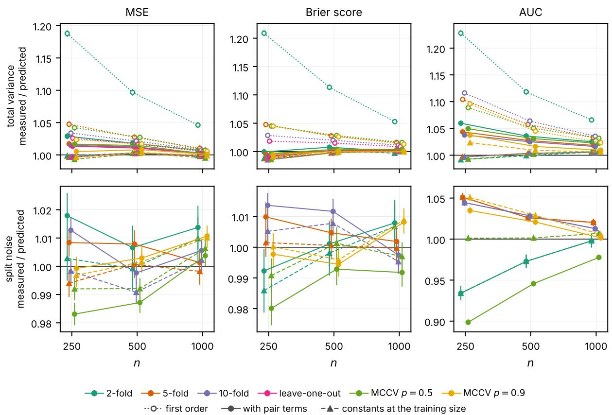
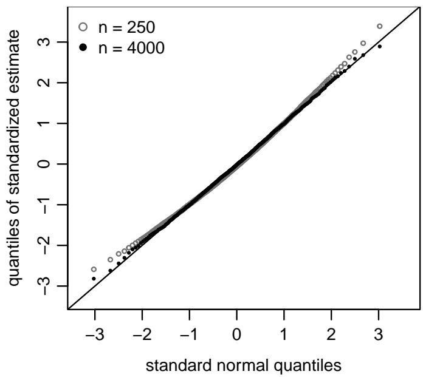

# A Theory of Cross-Validation Variance

Nathaniel S. O’Connell Jaime L. Speiser Department of Biostatistics and Data Science Wake Forest University School of Medicine Winston-Salem, NC, United States Corresponding author: nathaniel.oconnell@wfusm.edu

## Abstract

Cross-validation estimates predictive performance by repeatedly splitting the data into training and validation sets, fitting the model on the first and evaluating it on the second. Every observation influences the estimate in two roles, through its own evaluation when it is held out and through the models it helps fit when it trains. The random splits determine its weight in each role. From this representation, we prove an exact finite-sample identity for the variance of the cross-validated estimate. For a given splitting scheme with a common training set size, the variance is a function of these weights, with constants of the model, the metric, and the population. It covers metrics averaged over observations, such as mean squared error, and over case–control pairs, such as the AUC. The identity shows which schemes to use. The variance decomposes into sampling variance, which depends only on the training size, and variance due to the random fold splitting, which arises when the weights change from one draw of the splits to the next. K-fold cross-validation, whose weights are equal across observations by design, is therefore variance optimal at first order; Monte Carlo and bootstrap cross-validation are not. The first-order variance of K-fold does not depend on K, and under reasonable conditions on the model leave-one-out has the smallest variance of any K-fold scheme. For the AUC the same holds for leave-pair-out, which evaluates every case–control pair. Finally, we show the crossvalidated estimate is asymptotically normal with the identity’s full variance. Together, these results provide a general theoretical foundation for inference on cross-validated performance and establish principles for selecting variance-optimal cross-validation designs.

Keywords: Cross-validation; variance; resampling designs; Hoefding decomposition; asymptotic normality; AUC.

## 1 Introduction

Cross-validation is among the most widely used procedures in statistics, machine learning, and data science. It estimates a model’s predictive performance by repeatedly splitting a dataset into training and validation subsets, fitting the model on the first, evaluating it on the second, and averaging the held-out evaluations (Arlot and Celisse, 2010). The most common forms of crossvalidation – K-fold and repeated K-fold (Stone, 1974; Geisser, 1975), Monte Carlo split-sampling, and the bootstrap (Efron, 1983; Efron and Tibshirani, 1997) – difer only in how they generate the splits. Under every form, each observation influences the estimate in two ways: it is evaluated when it is held out, and when it is in a training set it helps fit the models that evaluate the other observations. The held-out evaluations are correlated through the training data they share.

Despite its widespread use, no general theory explains how the model, training fraction, and resampling design jointly determine cross-validation variance. Existing results study individual cross-validation designs in isolation. Burman (1989) derived variance expansions for K-fold and repeated K-fold cross-validation, Nadeau and Bengio (2003) proposed a corrected variance for Monte Carlo splitting based on the correlation between split estimates, and Bengio and Grandvalet (2004) parameterized the variance of K-fold at a fixed partition by three covariances among the held-out errors and showed that no distribution-free unbiased estimator of it exists. For leastsquares density estimation, Arlot and Lerasle (2016) showed that K-fold has smaller variance than Monte Carlo splitting at matched training size and attributed the diference to the balanced use of observations. Fixed-model variance formulas, such as DeLong’s for the AUC (DeLong et al., 1988), quantify only the uncertainty from the evaluation observations. None of these separates an observation’s two roles, validation and training.

In parallel, others have studied the asymptotic distribution of cross-validation estimates under stability and regularity conditions (Dudoit and van der Laan, 2005; LeDell et al., 2015; Lei, 2020; Li, 2023). Austern and Zhou (2020) proved a central limit theorem centered at the expected performance of the model, for a number of folds that may grow with n, whose asymptotic variance includes the variability of the fitted models. Bayle et al. (2020) built their interval from the sample variance of the out-of-fold losses, valid for a random target, the average performance of the K models fitted in that run, and Lei (2025) gave a stability condition under which the two targets coincide. Bates et al. (2024) made a related point from the estimation side, that crossvalidation estimates the performance of a model trained on a random sample rather than of one fitted model. Cai et al. (2025) and Bayle et al. (2025) studied the bootstrap of the whole procedure and the comparison of two models. These results identify validation, training, and cross-covariance components of the asymptotic variance of K-fold. They do not express these components through the roles an observation plays across designs, or give an exact finite-sample decomposition of the variance itself.

We treat cross-validation as a randomized design: both the sample and the splits vary, and the splits determine how each observation is weighted in validation and training. The main result is a variance identity that holds exactly, at every sample size, for every design that trains on the same fraction of the data in every split (Theorems 1 and 2). It covers continuous and binary outcomes alike: metrics that average over observations, such as squared error and the Brier score, and, given the labels, metrics that average over case–control pairs, such as the AUC (Theorem 3). Existing representations of the variance (Burman, 1989; Nadeau and Bengio, 2003; Bengio and Grandvalet, 2004; Austern and Zhou, 2020) are special cases of the identity (Sections 3.4, 4.2, and 5).

The identity separates sampling variance, attributable to random sampling of the data, from split noise, caused by randomly assigning observations to folds. At a fixed training fraction every design has the same sampling variance and difers only in its split noise, which arises when the weights vary from one draw of the splits to the next, so a balanced design, whose weights do not vary, is variance optimal. K-fold is balanced at first order, unlike Monte Carlo and bootstrap CV (Theorem 4, Corollary 2). Its first-order variance does not depend on K (Corollary 3). Under additional conditions, a fixed fitting budget favors one run with as many folds as possible, approaching leave-one-out as its limit (Corollary 4). For AUC and other pairwise metrics, ordinary K-fold evaluates only pairs sharing a fold, adding split noise that grows with K. Paired K-fold (Yousef, 2019) evaluates every case–control pair, removes this noise, and approaches leave-pair-out (Section 4.6). Finally, we prove asymptotic normality with the full variance given the splits, including higher orders. With positive limiting variance, a consistent estimate yields valid Wald intervals and tests (Theorem 5). Related to this, we identify which terms several existing variance estimators capture (Section 5.4).

Section 2 sets up the design, the role weights and the influences, Section 3 proves the identity, Section 4 derives the design results, Section 5 proves normality, and Section 6 checks the identity against variances measured over repeated datasets. Proofs and further numerical results are in the Supplementary Material, whose sections are numbered S1–S6.

## 2 A Design-Based Representation of Cross-Validation

We show how validation and training weights arise from the random splits of the data, and how each observation’s influence in these roles enters the variance identity of Section 3. We also state the two conditions used throughout. Unit-level metrics, such as the Brier score and log-loss, and pairwise metrics, such as the AUC, are set up side by side, since the identity treats both with the same weights and influences. Notation is tabulated in Supplement S6.

## 2.1 Data, models, and performance metrics

Let P denote the underlying, unknown population distribution, and let $\mathcal { D } _ { n } = \{ Z _ { i } \} _ { i = 1 } ^ { n }$ be an i.i.d. sample from P. Each observation $Z _ { i } = ( X _ { i } , Y _ { i } )$ consists of a covariate vector $X _ { i }$ and an outcome $Y _ { i }$ A model is fit to a training set $T \subset \{ 1 , \ldots , n \}$ to produce the fitted model $\hat { f } _ { T }$ , a function mapping covariates to predictions. Any model that produces predictions from data is covered, including but not limited to parametric regression models, tree-based ensembles, neural networks, and other statistical and machine learning procedures.

Predictive performance is assessed through a metric that averages contributions from basic units. For a unit-level metric, such as the Brier score, log-loss, or squared error, a basic unit is one observation and its contribution is the loss of its prediction; for a pairwise metric, such as the AUC, a basic unit is a pair of observations and its contribution compares the two predictions. Let B be the set of basic units and $\ell _ { i } ( \hat { f } _ { T } )$ the contribution of unit i at $\hat { f } _ { T }$

For a binary outcome the pairs are case–control pairs, and the contribution $\mathcal { C } ( s , t )$ compares the prediction s for the case with the prediction t for the control; the AUC has ${ \mathcal C } ( s , t ) = \mathbb I ( s >$ $\begin{array} { r } { t ) + \frac { 1 } { 2 } \mathbb { I } ( s = t ) } \end{array}$ , and the Gini coeficient, Somers’ D and the pairwise ranking loss are afine in it. The results for pairwise metrics rest on two properties: each observation enters all of its pairs in the same role, as a case or as a control, so its contributions averaged over its partners form one function of it, and the pairs are fixed by the design and the labels. Metrics without these properties are not covered, such as the concordance index under censoring, in which the comparable pairs are selected by the data.

## 2.2 Cross-validation as a randomized design

A cross-validation procedure is specified by a design $D ,$ which fixes the resampling mechanism, a per-split training fraction $p \in ( 0 , 1 ]$ , and the number of splits S. Applied to the index set $\{ 1 , \ldots , n \}$ the design generates S splits $\{ ( T _ { r } , V _ { r } ) \} _ { r = 1 } ^ { S }$ into a training set and a validation set, represented by their inclusion structure, the $n \times S$ array $I = \left( I _ { i r } \right)$ with $I _ { i r } = \mathbb { I } ( i \in T _ { r } )$ . The design is a probability distribution over I: its training fraction fixes the probability that an observation is in a given training set, and its resampling mechanism fixes how the indicators depend on one another within and across splits. For the bootstrap, observation i enters the training resample of split r with multiplicity $\tilde { I } _ { i r } \in \{ 0 , 1 , 2 , \ldots \}$ , and $I _ { i r } = \mathbb { I } ( \tilde { I } _ { i r } \geq 1 )$ . The inclusion structure, with the multiplicities when applicable, is the only random variable the design introduces. Fitting the model to each $T _ { r }$ and evaluating it on $V _ { r }$ yields the cross-validation estimate, $\widehat { R } _ { D }$

We restrict attention to ordinary designs:

(i) An observation is never evaluated on a model it helped fit: $V _ { r } = T _ { r } ^ { c }$ for each split r.

(ii) Each split operates at a fixed training fraction $p \in ( 0 , 1 ]$ , in the sense that $| T _ { r } | / n  p$ as $n \to \infty$

(iii) The design does not distinguish observations: permuting the observation indices leaves the distribution of I unchanged.

This class includes K-fold cross-validation with $p = ( K - 1 ) / K$ and its repeated version with R repetitions, leave-one-out, Monte Carlo cross-validation, and the bootstrap, whose distinct training fraction tends to $p = 1 - e ^ { - 1 }$ . Throughout, K divides n. A design is fixed-size if every training set has the same size $m .$ , with $m / n  p$ . K-fold, its repetitions, leave-one-out, and Monte Carlo cross-validation are fixed-size. The bootstrap is not, because sampling with replacement makes the size of the validation set vary. For a pairwise metric, a design is class-stratified if every validation set has the same numbers of cases and of controls, so that every training set has $m _ { 1 }$ cases and $m _ { 0 }$ controls. The number of splits S is set by the analyst, with $S = R K$ for repeated $K { \mathrm { - f o l d } }$ and the results of Sections 3 and 4 hold for every S. Bootstrap variants that mix training and validation contributions, such as the .632 rule, fit the weighted form below but need a separate variance treatment (Supplement S1.1).

The cross-validation estimate targets $R _ { p , n } : = \mathbb { E } \{ \ell _ { i } ( \hat { f } _ { T } ) \}$ , the expected contribution of a held-out unit when the model is fit to m other observations. The expectation is over the training sample and the held-out unit. Bootstrap training sets have no common size, so for the bootstrap the target is $\mathbb { E } ( \widehat { R } _ { D } )$ . For a binary outcome, the $\it { l a b e l s }$ are the observed outcomes $Y .$ , which mark each observation as a case or a control and so determine which pairs are case–control pairs. The pairwise analysis conditions on the labels. Under a class-stratified design every training set then has $m _ { 1 }$ cases and $m _ { 0 }$ controls, fixed proportions of the $n _ { 1 }$ cases and $n _ { 0 }$ controls in the sample, and the target is $R _ { p , n } ( Y )$ , the expected value of the metric for a model fitted to $m _ { 1 }$ cases and $m _ { 0 }$ controls. Unlike $R _ { p , n }$ , it varies from sample to sample, through the class counts $n _ { 1 }$ and $n _ { 0 }$

Whichever the target, the quantity this paper studies is the variance of $\widehat { R } _ { D }$ under the joint randomness of the data and the inclusion structure,

$$
\mathrm { V a r } \Big ( \widehat { R } _ { D } \Big ) : = \mathrm { V a r } _ { \mathscr { D } _ { n } , I } \Big ( \widehat { R } _ { D } ( \mathscr { D } _ { n } , I ) \Big ) .
$$

Conditional on $I , \operatorname { V a r } ( \widehat { R } _ { D } \mid I )$ measures variation across datasets with the splits held fixed.

## 2.3 Weighted representation and role weights

Cross-validation designs generate splits diferently, but their estimates share one weighted form: each held-out unit contributes whenever it is validated, and those contributions are averaged across splits. Let $\ell _ { i } ^ { ( r ) }$ denote the contribution of unit i when it is validated in split r. A pair is validated when both of its members are, so that both predictions come from the same fitted model.

The estimate averages all validation evaluations equally. Let $\begin{array} { r } { M : = \sum _ { r } | V _ { r } | } \end{array}$ be the total number of evaluations, $\begin{array} { r } { N _ { i } : = \sum _ { r } \mathbb { I } ( i \in V _ { r } ) } \end{array}$ the number of times unit i is validated, and $\ell _ { i }$ the average of unit $i \mathrm { \ ' } _ { \mathrm { S } }$ contributions. Then

$$
\widehat { R } _ { D } = \frac { 1 } { M } \sum _ { r = 1 } ^ { S } \sum _ { i \in V _ { r } } \ell _ { i } ^ { ( r ) } = \sum _ { i \in B } v _ { i } \ell _ { i } , \qquad v _ { i } : = \frac { N _ { i } } { M } ,
$$

where $v _ { i } .$ , the validation weight of unit $i ,$ is the fraction of all validation evaluations contributed by unit $i ,$ with $\textstyle \sum _ { i } v _ { i } = 1$ . An observation also influences the splits where it is not evaluated through

the models it helps train. The training weight of observation i is its share of all training use,

$$
w _ { i } : = \sum _ { r = 1 } ^ { S } \frac { | V _ { r } | } { M } \frac { I _ { i r } } { | T _ { r } | } , \qquad \sum _ { i = 1 } ^ { n } w _ { i } = 1 ,
$$

It multiplies split r’s share $| V _ { r } | / M$ of the estimate by observation i’s share $1 / | T _ { r } |$ of its training set, then sums over splits that train on i. For the bootstrap, $I _ { i r } / | T _ { r } |$ is replaced by $\tilde { I } _ { i r } / n$ . Together, $v _ { i }$ and $w _ { i }$ are the role weights, one for each of the two roles. Other ways of aggregating the evaluations, such as averaging split-level estimates, change only these weights and their higherorder counterparts (Supplement S1.1).

Under each design, with $q : = 1 - p ,$ , the weights are

• K-fold cross-validation with R repetitions: every observation is validated R times and included in $R ( K - 1 )$ training sets of size m, so $v _ { i } = w _ { i } = 1 / n$ for every i.

• Monte Carlo cross-validation with S splits of validation size nq: $v _ { i } = N _ { i } / ( S n q )$ and $w _ { i } =$ $( S - N _ { i } ) / ( S n p )$ , so that $w _ { i } = 1 / ( n p ) - ( q / p ) v _ { i }$

• Bootstrap cross-validation with S resamples: $v _ { i } = N _ { i } / M$ , with $N _ { i }$ the number of resamples that leave i out, and $\begin{array} { r } { w _ { i } = \sum _ { r } ( | V _ { r } | / M ) ( \tilde { I } _ { i r } / n ) } \end{array}$ . The two weights are separate random quantities, since $N _ { i }$ does not determine how many times the other resamples draw i.

In each design the validation weights are of order $1 / n$ . A design is balanced if $v _ { i } = w _ { i } = 1 / n$ for every observation. K-fold cross-validation is balanced. Monte Carlo and bootstrap cross-validation are not, because the number of times an observation is validated is random.

The units of a pairwise metric are the case–control pairs. Let $M _ { A } > 0$ be the total number of validated case–control pairs, summed over the splits. Each pair’s validation weight is the number of splits that validate it divided by $M _ { A }$ , and with these weights the estimate is the averaged K-fold AUC of Airola et al. (2011) under exact class stratification. An observation influences the estimate through every validated pair that contains it, so its validation weight is its total weight $\tilde { v } _ { i }$ through those pairs. Every validated pair contains one case and one control, so the $\tilde { v } _ { i }$ sum to one within each class. The training weight $w _ { i }$ is as defined above, with the share $| V _ { r } | / M$ of split r replaced by its share of the $M _ { A }$ validated pairs. With $n _ { y }$ the number of observations of class $y ,$ under class-stratified K-fold every observation has $\tilde { v } _ { i } = 1 / n _ { Y _ { i } }$ and $w _ { i } = 1 / n$ , the pairwise counterpart of balance.

## 2.4 Influences and conditions

The identity depends on how much an observation moves the estimate in each of its roles. We distinguish three efects: a unit’s validation influence, a training observation’s efect on its contribution, and the joint efect of several observations (Section 3.1). The first-order variance uses the first two. Take a unit-level metric, so that unit i is observation i, and let i be validated in split r. Let

$$
\ell _ { i } ^ { \star } : = \mathbb { E } ( \ell _ { i } ^ { ( r ) } | Z _ { i } )
$$

be its contribution with the training observations averaged out, its validation influence. Its mean is $R _ { p , n }$ . For a training observation $j \in T _ { r }$ , let

$$
\phi _ { i } ( z ) : = | T _ { r } | \left\{ \mathbb { E } \big ( \ell _ { i } ^ { ( r ) } \big | Z _ { i } , Z _ { j } = z \big ) - \mathbb { E } \big ( \ell _ { i } ^ { ( r ) } \big | Z _ { i } \big ) \right\}
$$

be the influence of a training observation at z on unit i’s expected contribution, scaled by the training-set size. For each $Z _ { i }$ its mean over z is zero. Averaging over the validated observation gives the training influence $\bar { \phi } ( z ) : = \mathbb { E } _ { Z _ { i } } \{ \phi _ { i } ( z ) \}$ , the influence of a training observation at $z \ \mathrm { o n }$ the fitted model’s expected performance. The validation and training influences are defined for any model and any metric with finite variance. For a fixed-size design neither depends on the split, and both depend on n through the training size, a subscript we suppress.

A pairwise metric has the same two influences, defined given the labels. Which pairs are case–control pairs depends on the labels, so the pairwise analysis conditions on the label vector $Y$ throughout. Given $Y$ , the covariates are independent, with $X _ { i }$ distributed as X given $Y _ { i } .$ , and they are the only random part of the data. For a case i and a control $j$ validated together in split r, the case’s validation influence

$$
\ell _ { i } ^ { \star } : = \mathbb { E } \big [ \mathcal { C } \{ \hat { f } _ { T _ { r } } ( X _ { i } ) , \hat { f } _ { T _ { r } } ( X _ { j } ) \} \big | X _ { i } , Y \big ]
$$

is its contribution with its partner and the training observations averaged out. A control’s validation influence is defined in the same way, with its case partner averaged out. For a class-stratified design its mean is $R _ { p , n } ( Y )$ in either class. The training influence $\bar { \phi } _ { Y }$ is $\bar { \phi }$ with every expectation also given $Y _ { i }$ , so that $\phi _ { Y } ( x )$ is the influence of a training observation at x on the fitted model’s expected metric given the labels. Given $Y$ , a training observation’s covariate has the distribution of its class, so $\bar { \phi } _ { Y }$ has mean zero within each class. Both influences are defined within a class because a case and a control play diferent roles in their pairs.

Two conditions are used throughout: A1 on the data, the design and the model, and A2 on how much of the variance the joint efects of several observations carry.

A1 (Data, design, model). $\mathcal { D } _ { n }$ is i.i.d. from P. The inclusion structure is independent of ${ \mathcal { D } } _ { n } ,$ or for a pairwise metric of the covariates given the labels, and the design is ordinary. The contributions $\ell _ { i } ^ { ( r ) }$ have finite variance, and $\begin{array} { r } { \operatorname* { s u p } _ { n } [ \mathrm { V a r } ( \ell _ { i } ^ { \star } ) + \mathrm { V a r } \{ \bar { \phi } ( Z ) \} ] < \infty } \end{array}$ . The model is fit symmetrically in its training observations, with any internal randomization held fixed or averaged out.

A1 states that the splits are independent of the data. A class-stratified design forms its folds from the labels, so for a pairwise metric they need only be independent of the covariates given the labels. A symmetric fit depends on its training set and not on the order of its members, which, with i.i.d. data and a common training size, makes an observation’s influence the same in every split that trains on it (Section 3.1). For a model with internal randomization, such as a random forest, the same symmetric fitting rule is applied in every split, with the seeds held fixed in a way that preserves its symmetry or averaged over, so the variance studied here is over the data and the splits, not over the seeds.

A2 (Dominance). A2 concerns the parts of the estimate that depend jointly on sets of observations. Fix the inclusion structure I. For a set $s$ of observations write $Z _ { S }$ for their values. Let $g$ be a square-integrable function of the observations. For each subset $\mathcal { A }$ of $\boldsymbol { s }$ , including the empty set and S itself, $\mathbb { E } ( g \mid Z _ { \mathcal { A } } )$ is the conditional mean of $g$ given the observations in A. The Hoefding component of $g$ on $\boldsymbol { s }$ is the alternating sum of these conditional means,

$$
g _ { S } : = \sum _ { \mathcal { A } \subseteq \mathcal { S } } ( - 1 ) ^ { | \mathcal { S } | - | \mathcal { A } | } \mathbb { E } ( g \mid Z _ { \mathcal { A } } ) .
$$

For one observation, $g _ { \{ i \} } = \mathbb { E } ( \boldsymbol { g } \mid Z _ { i } ) - \mathbb { E } ( \boldsymbol { g } )$ is what knowing $Z _ { i }$ changes in the expected value of $g .$ For a pair, $\mathfrak { g } _ { \{ i , j \} } = \mathbb { E } ( \mathfrak { g } \mid Z _ { i } , Z _ { j } ) - \mathbb { E } ( \mathfrak { g } \mid Z _ { i } ) - \mathbb { E } ( \mathfrak { g } \mid Z _ { j } ) + \mathbb { E } ( \mathfrak { g } )$ is what knowing both changes beyond what each changes alone. In general $g _ { S }$ is the part of g that depends jointly on the observations in ${ \mathcal { S } } _ { : }$ with every efect of a smaller set removed. Components on diferent sets are uncorrelated, and $\begin{array} { r } { g - \mathbb { E } ( g ) = \sum _ { \mathcal { S } \neq \mathcal { D } } g _ { \mathcal { S } } } \end{array}$ (Hoefding, 1948). Write $h _ { \mathcal { S } }$ for the components of $\widehat { R } _ { D }$ given $I ,$ or given I

and Y for a pairwise metric, and let

$$
\rho _ { n } ^ { ( k ) } ( I ) : = \sum _ { | \mathcal { S } | = k } \mathbb { E } \bigl ( h _ { \boldsymbol { S } } ^ { 2 } \big | I \bigr ) , \qquad \rho _ { n } ^ { ( k + ) } ( I ) : = \sum _ { l \ge k } \rho _ { n } ^ { ( l ) } ( I )
$$

be the variance carried by the components of order $k ,$ and by those of order k and above. For a pairwise metric they are written $\rho _ { n } ^ { ( k ) } ( I , Y )$ and $\rho _ { n } ^ { ( k + ) } ( I , Y )$

At order k, $\mathbb { E } _ { I } \{ \rho _ { n } ^ { ( ( k + 1 ) + ) } ( I ) \} = o ( n ^ { - k } )$ . A2(i) and A2(ii) denote $A \mathcal { Q }$ at orders one and two.

A2 limits the variance from joint efects of observations, rather than restricting the form of the model. For a function g of the data let $\nabla _ { j } g : = g ( \mathcal D _ { n } ) - g ( \mathcal D _ { n } ^ { ( j ) } )$ , where $\mathcal { D } _ { n } ^ { ( j ) }$ replaces $Z _ { j }$ by an independent copy, and $\nabla _ { j } \nabla _ { k } g : = \nabla _ { j } ( \nabla _ { k } g )$ . For fixed-size designs whose validation weights are of order $1 / n$ , bounds on such diferences of the contributions imply A2 at every order, and $\mathrm { A 2 ( i ) }$ holds in the influence-function case, in which a held-out contribution is its value at the limit of the fitted model plus an average of one term per training observation, up to a remainder small in mean square; this covers M-estimators and fixed-bandwidth smoothers (Supplement S1.2). The models that meet the stability conditions of $\mathrm { A }$ ustern and Zhou (2020) at a fixed number of folds also satisfy A2(i) (Supplement S4.2). A2(i) is not needed for a normal limit (Theorem 5).

## 3 The Variance Identity

At every sample size, the cross-validation variance is exactly a finite series. Each order is a quadratic form in design-dependent weights, with constants determined by the model, metric, and population. Theorems 1 and 2 prove it for unit-level metrics and Theorem 3 for pairwise metrics.

## 3.1 The dual-role representation

Expectations are under the joint distribution of the data and the inclusion structure unless stated otherwise. Conditioning on I and applying the law of total variance,

$$
\mathrm { V a r } \Big ( \widehat { R } _ { D } \Big ) = \mathbb { E } _ { I } \Big \{ \mathrm { V a r } \Big ( \widehat { R } _ { D } \ | \ I \Big ) \Big \} + \mathrm { V a r } _ { I } \Big \{ \mathbb { E } \Big ( \widehat { R } _ { D } \ | \ I \Big ) \Big \} .\tag{1}
$$

For a fixed-size design the second term is zero. Given $I ,$ a validated observation is independent of the training data used to fit its model, and every training set has size $m .$ , so $\mathbb { E } ( \widehat { R } _ { D } \mid I ) = R _ { p , n }$ for every realized I. The variance is then the average of $\mathrm { V a r } ( \widehat { R } _ { D } \mid I )$ over the design, and the rest of this section decomposes that conditional variance.

A held-out contribution $\ell _ { i } ^ { ( r ) }$ depends only on $Z _ { i }$ and the observations in $T _ { r }$ . Thus a set $s$ of $k \geq 2$ observations can contribute only when one member is validated and the rest train, or when every member trains. In the latter case, its component is that of the fitted model’s expected performance, $R ( \hat { f } _ { T } ) : = \mathbb { E } _ { Z _ { i } } \{ \ell _ { i } ( \hat { f } _ { T } ) \}$ , because a held-out observation is independent of the training data. Under i.i.d. sampling, a symmetric fit, and common training size $m ,$ each split type contributes the same function of $Z _ { S }$ . The component of $\widehat { R } _ { D }$ on $\boldsymbol { s }$ is therefore that function times the number of relevant splits.

The counts are the weights of order k. For an observation i and a set $\mathcal { I }$ of $k - 1 \geq 1$ other observations, and for a set $\boldsymbol { s }$ of $k \geq 2$ observations, let

$$
c _ { i ; \mathcal { I } } ^ { ( k ) } : = \frac { 1 } { M m ^ { k - 1 } } \sum _ { r = 1 } ^ { S } \mathbb { I } ( i \in V _ { r } ) \prod _ { j \in \mathcal { I } } I _ { j r } , \qquad d _ { \mathcal { S } } ^ { ( k ) } : = \frac { 1 } { m ^ { k } } \sum _ { r = 1 } ^ { S } \frac { | V _ { r } | } { M } \prod _ { j \in \mathcal { S } } I _ { j r } .
$$

Here $c _ { i ; \mathcal { I } } ^ { ( k ) }$ weights the joint influence of validated observation i and training observations $\mathcal { I } _ { : }$ reflecting how often they occur in those roles. The weight $d _ { S } ^ { ( k ) }$ reflects how often all members of $s$ train together, scaling their joint influence on expected performance. Both are determined by I alone. $\mathrm { A t } \ k = 2$ they are the pair weights $c _ { i j }$ and $d _ { i j }$ , and at $k = 1$ , with $\mathcal { I }$ empty, they are the role weights $v _ { i }$ and $w _ { i }$

The fixed functions are the kernels of the Hoefding components: for a set $s ,$ the part of a held-out contribution and the part of the fitted model’s expected performance that depend on the observations in S jointly. For $i \in V _ { r }$ and sets $\mathcal { I } \subseteq T _ { r }$ of $k - 1$ and $\mathcal { S } \subseteq T _ { r }$ of k training observations, let

$$
\phi ^ { ( k ) } ( Z _ { i } ; Z _ { \mathcal { I } } ) : = m ^ { k - 1 } \left( \ell _ { i } ^ { ( r ) } \right) _ { \{ i \} \cup \mathcal { I } } , \qquad \chi ^ { ( k ) } ( Z _ { \mathcal { S } } ) : = m ^ { k } \{ R ( \hat { f } _ { T _ { r } } ) \} _ { \mathcal { S } } ,
$$

where a set in the subscript denotes the Hoefding component on that set. By the argument above, neither kernel depends on the split or on which training observations are chosen. $\mathrm { A t } ~ k = 1$ they are the two influences of Section 2.4, $\ell _ { i } ^ { \star } - R _ { p , n }$ and $\bar { \phi } . \mathrm { A t } \mathrm { \ } k = 2$ the first is $\phi _ { i } ( Z _ { j } ) - \bar { \phi } ( Z _ { j } )$ , the part of a training observation’s influence that is specific to validated observation i. The second, defined as $\chi ,$ measures how much two training observations together move expected performance beyond the sum of their separate moves. When every training observation afects the fitted model everywhere, as for a parametric fit, one observation moves expected performance at order $1 / m$ and a pair at order $1 / m ^ { 2 }$ , and the scaling makes these kernels of order one. When the prediction at a point rests on a few training observations, joint efects are larger and the variance of the kernels can grow with m.

Theorem 1 (Dual-role representation). Assume A1, let the design be fixed-size, and fix a realized inclusion structure I. For a unit-level metric, the Hoefding component of $\widehat { R } _ { D }$ on one observation is

$$
h _ { i } ( Z _ { i } ) = v _ { i } ( \ell _ { i } ^ { \star } - R _ { p , n } ) + w _ { i } \bar { \phi } ( Z _ { i } ) , \qquad i = 1 , \ldots , n ,
$$

and on a set S of $k \geq 2$ observations is

$$
h s = \sum _ { i \in \cal S } c _ { i ; \cal S \backslash \{ i \} } ^ { ( k ) } \phi ^ { ( k ) } ( Z _ { i } ; Z _ { \cal S \backslash \{ i \} } ) + d _ { \cal S } ^ { ( k ) } \chi ^ { ( k ) } ( Z _ { \cal S } ) .\tag{2}
$$

The proof is in Supplement S2.1. At $k = 2$ the two kinds of split give the two orientations of the validation–training interaction, $c _ { i j } \phi ^ { ( 2 ) } ( Z _ { i } ; Z _ { j } )$ and $c _ { j i } \phi ^ { ( 2 ) } ( Z _ { j } ; Z _ { i } )$ , and the training–training interaction $d _ { i j } \chi ( Z _ { i } , Z _ { j } )$ . Summing over the observations,

$$
\widehat { R } _ { D } - R _ { p , n } = \sum _ { i = 1 } ^ { n } v _ { i } ( \ell _ { i } ^ { \star } - R _ { p , n } ) + \sum _ { i = 1 } ^ { n } w _ { i } \bar { \phi } ( Z _ { i } ) + \varrho _ { D } ,
$$

where $\varrho D$ contains the components on two or more observations, is uncorrelated with every function of a single observation, and has $\mathbb { E } ( \varrho _ { D } ^ { 2 } \mid I ) = \rho _ { n } ^ { ( 2 + ) } ( I )$ . The first sum is the aggregate validation influence and the second is the aggregate training influence from refitting. Observations are independent, so the validation and training sums can covary only through the two influences of the same observation.

## 3.2 Role moments and the variance identity

The variance of the single-observation component involves three constants, the variance of an observation’s validation influence, $\sigma _ { V } ^ { 2 } : = \mathrm { V a r } ( \ell _ { i } ^ { \star } )$ , the variance of its training influence on expected

performance, $\sigma _ { T } ^ { 2 } : = \mathrm { V a r } \{ \bar { \phi } ( Z ) \}$ , and their covariance, $\gamma _ { 0 } : = \mathrm { C o v } \{ \ell _ { i } ^ { \star } , \bar { \phi } ( Z _ { i } ) \}$ . The $h _ { i } ( Z _ { i } )$ are independent across i and uncorrelated with $\varrho _ { D }$ , so for a fixed-size design,

$$
\mathrm { V a r } \Big ( \widehat { R } _ { D } \ | \ I \Big ) = \sigma _ { V } ^ { 2 } \sum _ { i = 1 } ^ { n } v _ { i } ^ { 2 } + \sigma _ { T } ^ { 2 } \sum _ { i = 1 } ^ { n } w _ { i } ^ { 2 } + 2 \gamma _ { 0 } \sum _ { i = 1 } ^ { n } v _ { i } w _ { i } + \rho _ { n } ^ { ( 2 + ) } ( I ) ,\tag{3}
$$

with $\rho _ { n } ^ { ( 2 + ) } ( I ) \geq 0$ . The design afects this part only through the three weight sums.

The part $\rho _ { n } ^ { ( 2 + ) } ( I )$ of (3) is, order by order, a quadratic form in the weights of that order, as the first-order part is, with one constant for each kind of product of the kernels in (2). For observations $Z _ { 1 } , \dots , Z _ { k } , \ : k \ge 2$ , write $\phi _ { l } ^ { ( k ) }$ for $\phi ^ { ( k ) }$ with $Z _ { l }$ validated and the others training, and $\chi ^ { ( k ) }$ for $\chi ^ { ( k ) } ( Z _ { 1 } , \ldots , Z _ { k } )$ . Define

$$
\tau _ { k , n } ^ { 2 } : = \mathrm { V a r } ( \phi _ { 1 } ^ { ( k ) } ) , \quad \kappa _ { k , n } : = \mathbb { E } ( \phi _ { 1 } ^ { ( k ) } \phi _ { 2 } ^ { ( k ) } ) , \quad \sigma _ { \chi , k , n } ^ { 2 } : = \mathrm { V a r } ( \chi ^ { ( k ) } ) , \quad \xi _ { k , n } : = \mathbb { E } ( \phi _ { 1 } ^ { ( k ) } \chi ^ { ( k ) } ) .
$$

Here $\tau _ { k , n } ^ { 2 }$ is the variance of the validation–training interaction, $\kappa _ { k , n }$ is the covariance between two of its orientations, $\sigma _ { \chi , k , n } ^ { 2 }$ is the variance of the training–training interaction, and $\xi _ { k , n }$ is the covariance between the two kinds of interaction. At $k = 2$ the order is dropped, giving the pair constants $\tau _ { n } ^ { 2 } ,$ $\kappa _ { n } , \sigma _ { \chi , n } ^ { 2 } .$ , and $\xi _ { n }$ , with $\tau _ { n } ^ { 2 } = \mathbb { E } \{ \phi _ { i } ( Z _ { j } ) ^ { 2 } \} - \sigma _ { T } ^ { 2 }$ . Squaring the components (2) and summing over the sets of size $k .$ ,

$$
\begin{array} { r l } & { \rho _ { n } ^ { ( k ) } ( I ) = \displaystyle \sum _ { | S | = k } \left\{ \tau _ { k , n } ^ { 2 } \sum _ { i \in S } \big ( c _ { i ; S \backslash \{ i \} } ^ { ( k ) } \big ) ^ { 2 } + \kappa _ { k , n } \sum _ { i \ne i ^ { \prime } \in S } c _ { i ; S \backslash \{ i \} } ^ { ( k ) } c _ { i ^ { \prime } ; S \backslash \{ i ^ { \prime } \} } ^ { ( k ) } \right. } \\ & { \qquad \quad \left. + \sigma _ { \chi , k , n } ^ { 2 } \big ( d _ { S } ^ { ( k ) } \big ) ^ { 2 } + 2 \xi _ { k , n } d _ { S } ^ { ( k ) } \sum _ { i \in S } c _ { i ; S \backslash \{ i \} } ^ { ( k ) } \right\} . } \end{array}\tag{4}
$$

The simplest model shows what these constants are. Take the training-set mean as the fitted model and evaluate it by squared error, which for a binary outcome is the Brier score of the fitted risk. Each held-out contribution $( Y _ { i } - { \bar { Y } } _ { T _ { r } } ) ^ { 2 }$ is a quadratic in the observations, so its components on three or more observations are zero and the identity stops at order two. With $\sigma ^ { 2 } : = \operatorname { V a r } ( Y )$ , which is $\theta ( 1 - \theta )$ for a binary outcome with mean $\theta ,$ the four pair constants are explicit and of order $\sigma ^ { 4 }$

$$
\tau _ { n } ^ { 2 } = \kappa _ { n } = \sigma _ { \chi , n } ^ { 2 } = - \xi _ { n } = 4 \sigma ^ { 4 } .
$$

For the sample mean under squared error, the validation–training and training–training pair interactions are equal in magnitude and opposite in sign, giving $\xi _ { n } = - 4 \sigma ^ { 4 }$ . This negative covariance matters for comparing fold counts, but its sign depends on the learner and loss (Section 4.5).

Averaging (3) and (4) over the inclusion structure replaces each weight sum by its average, and these averages are all the design contributes. Define the first-order role moments

$$
\Gamma _ { D } : = \mathbb { E } _ { I } \Big ( \sum _ { i } v _ { i } ^ { 2 } \Big ) , \qquad \Lambda _ { D } : = \mathbb { E } _ { I } \Big ( \sum _ { i } w _ { i } ^ { 2 } \Big ) , \qquad \Omega _ { D } : = \mathbb { E } _ { I } \Big ( \sum _ { i } v _ { i } w _ { i } \Big ) ,
$$

and, at order $k \geq 2 .$ , the role moments $\Theta _ { D } ^ { ( k ) } , \Theta _ { D } ^ { \prime ( k ) } , \Psi _ { D } ^ { ( k ) }$ , and $\Psi _ { D } ^ { \prime ( k ) }$ , the expectations over I of the four weight sums in (4), in order. At $k = 2$ the order is dropped. These moments measure how unevenly the design weights observations and their interactions.

Theorem 2 (Variance identity). Let D be a fixed-size design with S splits, and assume A1. For a unit-level metric,

$$
\begin{array} { l } { { \mathrm { V a r } ( \widehat { R } _ { D } ) = \sigma _ { V } ^ { 2 } \Gamma _ { D } + \sigma _ { T } ^ { 2 } \Lambda _ { D } + 2 \gamma _ { 0 } \Omega _ { D } } } \\ { { \displaystyle \quad \quad + \sum _ { k = 2 } ^ { n } \lbrace \tau _ { k , n } ^ { 2 } \Theta _ { D } ^ { ( k ) } + \kappa _ { k , n } \Theta _ { D } ^ { \prime ( k ) } + \sigma _ { \chi , k , n } ^ { 2 } \Psi _ { D } ^ { ( k ) } + 2 \xi _ { k , n } \Psi _ { D } ^ { \prime ( k ) } \rbrace } , } \end{array}
$$

where the term of order k equals EI $\{ \rho _ { n } ^ { ( k ) } ( I ) \} \ge 0$

The proof is in Supplement S2.1. The identity is exact at every sample size, and all design dependence enters through the role moments, which is how Section 4 compares designs at a common training size. The terms of order $k > m + 1$ are zero, because a set of observations enters a split together only as one validated observation and at most m observations of its training set. Each term of the series is nonnegative, so every truncation is a lower bound on the variance under A1 alone, even though individual constants such as $\kappa _ { k , n }$ and $\xi _ { k , n }$ can be negative. For a balanced design $\Gamma _ { D } = \Lambda _ { D } = \Omega _ { D } = 1 / n$ exactly, and Section 4.1 presents them for Monte Carlo and bootstrap cross-validation.

Under A2(i) the components on two or more observations carry variance of smaller order than $1 / n ,$ and only the single-observation terms remain. The variance of a unit-level metric is then the first-order part of Theorem 2,

$$
\sigma _ { V } ^ { 2 } \Gamma _ { D } + \sigma _ { T } ^ { 2 } \Lambda _ { D } + 2 \gamma _ { 0 } \Omega _ { D } ,
$$

up to $o ( n ^ { - 1 } )$ , a quadratic form in the two role weights with one constant for each role and one for their covariance.

The bootstrap is not fixed-size, so Theorem 2 does not cover it. Under a condition A3 on how the fit responds to the multiplicities of a resample, stated in Supplement S2.3, the first-order part of the identity holds for it up to $o ( n ^ { - 1 } )$ , with the influences defined per unit of multiplicity and $\mathbb { E } ( \widehat { R } _ { D } )$ in place of $R _ { p , n }$ .

## 3.3 Pairwise metrics

For pairwise metrics, one evaluation involves two observations rather than one. The variance identity extends to this setting, with three changes to account for the case–control pair.

First, which pairs count depends on the labels, so all expectations in this subsection are taken given the labels, with the components in the covariates. Let $\begin{array} { r } { m _ { 1 r } : = \sum _ { l \in T _ { r } } Y _ { l } } \end{array}$ be the number of cases in the training set of split $r ,$ its training composition, and $\mu _ { m } ( m _ { 1 } / m )$ the expected value of the metric for a model fitted to $m _ { 1 }$ cases and $m - m _ { 1 }$ controls, so that a pair validated in split r has expected contribution $\mu _ { m } ( m _ { 1 r } / m )$ . Changing the training class mix changes the fitted model and hence its kernels. Under a class-stratified design every split has the same composition, so the constants are single numbers and the target is fixed, as under a common training size for a unit-level metric.

Second, an observation is weighted through its validated pairs, which it enters in one role, so its kernels are specific to its class. The weights count a split by its validated pairs that contain $i ,$ and by all its validated pairs, over the splits of one composition at a time:

$$
\begin{array} { r } { c } { c _ { i ; \mathcal { I } , m _ { 1 } } ^ { ( k ) } : = \cfrac { 1 } { M _ { A } m ^ { k - 1 } } \displaystyle \sum _ { r : m _ { 1 r } = m _ { 1 } } \mathbb { I } ( i \in V _ { r } ) \Big \{ \displaystyle \sum _ { j \in V _ { r } } \mathbb { I } ( Y _ { j } \ne Y _ { i } ) \Big \} \prod _ { l \in \mathcal { I } } I _ { l r } , } \\ { d _ { \mathcal { S } , m _ { 1 } } ^ { ( k ) } : = \cfrac { 1 } { M _ { A } m ^ { k } } \displaystyle \sum _ { r : m _ { 1 r } = m _ { 1 } } \Big \{ \displaystyle \sum _ { j , j ^ { \prime } \in V _ { r } } \mathbb { I } ( Y _ { j } = 1 , Y _ { j ^ { \prime } } = 0 ) \Big \} \prod _ { l \in \mathcal { S } } I _ { l r } . } \end{array}
$$

Summed over compositions and at order one they are $\tilde { v } _ { i }$ and $w _ { i }$ of Section 2.3; $\tilde { v } _ { i , m _ { 1 } }$ and $w _ { i , m _ { 1 } }$ are the parts from composition $m _ { 1 }$ , and $s _ { m _ { 1 } }$ is the share of the validated pairs from splits of that composition. The kernels $\phi _ { y , m _ { 1 } } ^ { ( k ) }$ and $\chi _ { m _ { 1 } } ^ { ( k ) }$ are those of Section 3.1 for a validated observation of class y, with its partner averaged out, and a model trained at composition $m _ { 1 } ;$ ; at order one they are $\ell _ { i , m _ { 1 } } ^ { \star } - \mu _ { m } ( m _ { 1 } / m )$ and $\phi _ { Y , m _ { 1 } }$

Third, a pair has two validated observations, so a split can contribute to the component on $s$ in a third way: a case i and a control j of S are validated together while the rest of $\boldsymbol { s }$ trains their model. With J a set of $k - 2$ training observations, its weight and kernel are

$$
\begin{array} { r l } & { \quad \quad e _ { i j ; \mathcal { T } , m _ { 1 } } ^ { ( k ) } : = \cfrac { 1 } { M _ { A } m ^ { k - 2 } } \displaystyle \sum _ { r : m _ { 1 r } = m _ { 1 } } \mathbb { I } ( i , j \in V _ { r } ) \prod _ { l \in \mathcal { T } } I _ { l r } , } \\ & { \zeta _ { m _ { 1 } } ^ { ( k ) } ( X _ { i } , X _ { j } ; X _ { \mathcal { I } } ) : = m ^ { k - 2 } \big [ \mathcal { C } \{ \hat { f } _ { T _ { r } } ( X _ { i } ) , \hat { f } _ { T _ { r } } ( X _ { j } ) \} \big ] _ { \{ i , j \} \cup \mathcal { I } } . } \end{array}
$$

At $k = 2 , e _ { i j } ^ { ( 2 ) }$ summed over compositions is the validation weight of the pair, and $\zeta ^ { ( 2 ) } ( X _ { i } , X _ { j } )$ , the validation-pair interaction, is the part of the pair’s contribution that depends on both members jointly. Unit-level metrics have no counterpart, since a unit-level contribution has one validated observation.

The argument of Theorem 1, applied given the labels, then gives the Hoefding component of $\widehat { R } _ { D }$ on one observation,

$$
h _ { i } ( X _ { i } ) = \sum _ { m _ { 1 } } \left[ \tilde { v } _ { i , m _ { 1 } } \{ \ell _ { i , m _ { 1 } } ^ { \star } - \mu _ { m } ( m _ { 1 } / m ) \} + w _ { i , m _ { 1 } } \bar { \phi } _ { Y , m _ { 1 } } ( X _ { i } ) \right] , \qquad i = 1 , \ldots , n ,
$$

and on a set $\boldsymbol { \mathcal { S } }$ of $k \geq 2$ observations,

$$
\begin{array} { r l r }   { h _ { \mathcal { S } } = \sum _ { m _ { 1 } } \Bigg \{ \sum _ { i \in \mathcal { S } } c _ { i ; \mathcal { S } \backslash \{ i \} , m _ { 1 } } ^ { ( k ) } \phi _ { Y _ { i } , m _ { 1 } } ^ { ( k ) } ( X _ { i } ; X _ { \mathcal { S } \backslash \{ i \} } ) + d _ { S , m _ { 1 } } ^ { ( k ) } \chi _ { m _ { 1 } } ^ { ( k ) } ( X _ { \mathcal { S } } ) } \\ & { } & { + \sum _ { i , j \in \mathcal { S } } e _ { i j ; \mathcal { S } \backslash \{ i , j \} , m _ { 1 } } ^ { ( k ) } \zeta _ { m _ { 1 } } ^ { ( k ) } ( X _ { i } , X _ { j } ; X _ { \mathcal { S } \backslash \{ i , j \} } ) \Bigg \} , } \\ & { } & { Y _ { i } = 1 , Y _ { j } = 0 } \end{array}
$$

with kernels that depend on the set only through its class counts (Supplement S2.2).

The first-order constants are taken within each class and at a pair of compositions: for an observation of class y, $\sigma _ { V | y } ( m _ { 1 } , m _ { 1 } ^ { \prime } ) , \sigma _ { T | y } ( m _ { 1 } , m _ { 1 } ^ { \prime } )$ and $\gamma _ { 0 | y } ( m _ { 1 } , m _ { 1 } ^ { \prime } )$ are the covariances, given $Y .$ of its validation influences, of its training influences, and of a validation influence with a training influence, under models trained at compositions $m _ { 1 }$ and $m _ { 1 } ^ { \prime }$ . At a single composition they are the class constants $\sigma _ { V | y } ^ { 2 } , \sigma _ { T | y } ^ { 2 }$ and $\gamma _ { 0 | y } ,$ and the class role moments $\Gamma _ { D , y } , \Lambda _ { D , y } , \Omega _ { D , y }$ are the averages over the design of $\begin{array} { r } { \sum _ { Y _ { i } = y } \tilde { v } _ { i } ^ { 2 } , \sum _ { Y _ { i } = y } w _ { i } ^ { 2 } , \sum _ { Y _ { i } = y } \tilde { v } _ { i } w _ { i } } \end{array}$ given Y. For any design whose law is invariant to relabeling within a class, all of these depend on Y only through the class counts $n _ { 1 }$ and $n _ { 0 } = n - n _ { 1 }$

Theorem 3 (Variance identity for pairwise metrics). Assume A1, let the metric be pairwise, and let the design be fixed-size. Given the labels and a realized inclusion structure $I { : }$

(a) The conditional mean is $\begin{array} { r } { \mathbb { E } ( \widehat { R } _ { D } \mid I , Y ) = \sum _ { m _ { 1 } } s _ { m _ { 1 } } \mu _ { m } ( m _ { 1 } / m ) } \end{array}$ , and

$$
\begin{array} { l } { { \mathrm { V a r } ( \widehat { R } _ { D } \mid I , Y ) = \displaystyle \sum _ { i } \displaystyle \sum _ { m _ { 1 } , m _ { 1 } ^ { \prime } } \left\{ \widetilde { v } _ { i , m _ { 1 } } \widetilde { v } _ { i , m _ { 1 } ^ { \prime } } \sigma _ { V | Y _ { i } } ( m _ { 1 } , m _ { 1 } ^ { \prime } ) + w _ { i , m _ { 1 } } w _ { i , m _ { 1 } ^ { \prime } } \sigma _ { T | Y _ { i } } ( m _ { 1 } , m _ { 1 } ^ { \prime } ) \right. } } \\ { { \displaystyle \qquad \left. + 2 \widetilde { v } _ { i , m _ { 1 } } w _ { i , m _ { 1 } ^ { \prime } } \gamma _ { 0 | Y _ { i } } ( m _ { 1 } , m _ { 1 } ^ { \prime } ) \right\} + \displaystyle \sum _ { k = 2 } ^ { n } \rho _ { n } ^ { ( k ) } ( I , Y ) , } } \end{array}
$$

where $\rho _ { n } ^ { ( k ) } ( I , Y ) \ge 0$ is a quadratic form in the weights of order k above, with constants indexed by pairs of compositions and by the numbers of cases and controls in a set.

(b) If the design is class-stratified, $\mathbb { E } ( \widehat { R } _ { D } \mid I , Y ) = R _ { p , n } ( Y )$ for every realized I, and the variance given the class counts is

$$
\begin{array} { l } { { \mathrm { V a r } ( \widehat { R } _ { D } \mid n _ { 1 } ) = \displaystyle \sum _ { y \in \{ 0 , 1 \} } \left( \sigma _ { V \mid y } ^ { 2 } \Gamma _ { D , y } + \sigma _ { T \mid y } ^ { 2 } \Lambda _ { D , y } + 2 \gamma _ { 0 \mid y } \Omega _ { D , y } \right) } } \\ { { \displaystyle \quad + \sum _ { k = 2 } ^ { n } \mathbb { E } _ { I } \{ \rho _ { n } ^ { ( k ) } ( I , Y ) \mid Y \} , } } \end{array}
$$

where $\rho _ { n } ^ { ( k ) } ( I , Y )$ is (4) given $Y$ , with constants indexed by the numbers of cases and controls in a set and the weights $e ^ { ( k ) }$ added.

The proof is in Supplement S2.2. Without class stratification the conditional mean in (a) varies with the splits, and by (1) given Y its variance across split draws is added to the average of (a) over the design. Every term of (a) and (b) is nonnegative, so every truncation is a lower bound. Averaging (b) over the class counts adds Var $\{ R _ { p , n } ( Y ) \}$ , the efect of the labels on the target through the training composition. The proofs use only the two properties of Section 2.1, so they cover a pair average without labels, whose first-order identity is Theorem 2 with the validation influence doubled.

Sections 4 and 5 are stated in the unit-level form, a quadratic form in the two role weights with three constants, and the corollary below gives that form for pairwise metrics. The pair-specific part $\zeta ^ { ( 2 ) }$ drops out at first order because a pair’s validation weight is of order $n ^ { - 2 }$ : summed over the $n ^ { 2 }$ pairs, its variance is of order $n ^ { - 2 }$ . It enters at second order, where under class-stratified K-fold it adds split noise that increases in K (Section 4.6). It remains to replace the composition-indexed constants by limits. For a design that splits without regard to the labels, the training case fractions $m _ { 1 r } / m$ concentrate near the population class proportion $\pi _ { 1 }$ , where $\pi _ { y } : = \mathbb { P } ( Y = y )$ , so the limits are taken there.

A4 (Pairwise metric). (i) $\mathbb { E } _ { I , Y } \{ \rho _ { n } ^ { ( 2 + ) } ( I , Y ) \} = o ( n ^ { - 1 } )$ . (ii) For a training set of m observations with $m _ { 1 }$ cases, the centered validation influence $\ell _ { i } ^ { \star } - \mu _ { m } ( m _ { 1 } / m )$ and the training influence $\bar { \phi } _ { Y }$ of an observation of either class converge in $L _ { 2 }$ as $m  \infty$ , uniformly for $m _ { 1 } / m$ near $\pi _ { 1 }$ , to limits continuous in $m _ { 1 } / m$ at $\pi _ { 1 } . ( i i i ) \mu _ { m }$ has a diferentiable extension near $\pi _ { 1 }$ whose derivative converges uniformly there to a limit $\mu _ { \infty } ^ { \prime }$ continuous at $\pi _ { 1 }$

A4(i) is the counterpart of $\mathrm { A 2 ( i ) }$ . Under A4(ii) the composition-indexed covariances in Theorem 3(a) converge to the class constants, and two features of pairwise metrics determine the unit-level constants. The weights $\tilde { v } _ { i }$ sum to one within each class, so an observation of class y has validation weight $v _ { i } / \pi _ { y }$ to first order, and its validation influence on the unit-level scale is its centered validation influence divided by $\pi _ { y }$ . The label of a training observation shifts the case fraction of the training set and with it the expected metric, by $\mu _ { \infty } ^ { \prime } ( \pi _ { 1 } )$ per unit of case fraction under A4(iii). The unit-level constants are therefore

$$
\sigma _ { A } ^ { 2 } : = \frac { \sigma _ { V | 1 } ^ { 2 } } { \pi _ { 1 } } + \frac { \sigma _ { V | 0 } ^ { 2 } } { \pi _ { 0 } } , \qquad \gamma _ { A } : = \gamma _ { 0 | 1 } + \gamma _ { 0 | 0 } , \qquad \sigma _ { T } ^ { 2 } = \pi _ { 1 } \sigma _ { T | 1 } ^ { 2 } + \pi _ { 0 } \sigma _ { T | 0 } ^ { 2 } + \pi _ { 1 } \pi _ { 0 } \mu _ { \infty } ^ { \prime } ( \pi _ { 1 } ) ^ { 2 } ,
$$

the last being $\sigma _ { T } ^ { 2 }$ of Section 3.1 with the labels random (Supplement S2.6); its final term is the label part, which in Theorem 3 comes from the variance of the conditional mean in (a) across split draws and from $\operatorname { V a r } \{ R _ { p , n } ( Y ) \}$

Corollary 1 (Pairwise metrics at first order). Assume A1 and $A \llangle$ with a bounded pair contribution, and let the design be fixed-size with $p < 1$ , independent of the labels, and with a number of splits polynomial in $n .$ . Then (3) holds with $\sigma _ { V } ^ { 2 }$ and γ0 replaced by $\sigma _ { A } ^ { 2 }$ and $\gamma _ { A }$ at their limits, $v _ { i }$ and $w _ { i }$ the unit-level role weights, and $\rho _ { n } ^ { ( 2 + ) } ( I )$ replaced by a remainder of expected absolute value $o ( n ^ { - 1 } )$ over the design. The same holds with $v _ { i } = w _ { i } = 1 / n$ , that is, $\mathrm { V a r } ( \widehat { R } _ { D } ) = ( \sigma _ { A } ^ { 2 } + \sigma _ { T } ^ { 2 } + 2 \gamma _ { A } ) / n + o \bigl ( n ^ { - 1 } \bigr )$ 2 for stratified K-fold cross-validation, whose folds have class counts that difer by at most one, if adding one case or one control to a training set moves the expected value of the metric by $o ( n ^ { - 1 / 2 } )$ 2 uniformly over training sets of size at least $p n - 2$ with case fraction near $\pi _ { 1 }$

The proof is in Supplement S2.7. At first order a pairwise metric behaves as a unit-level metric with constants $\sigma _ { A } ^ { 2 } , \sigma _ { T } ^ { 2 } , \gamma _ { A }$ . For stratified K-fold every training composition is fixed up to one observation, so under the corollary’s condition the conditional mean in Theorem $\mathrm { 3 ( a ) }$ varies by $o ( n ^ { - 1 / 2 } )$ and the label part enters the first-order variance only through the variance of the target across class counts, n $\operatorname { V a r } \{ R _ { p , n } ( Y ) \} \to \pi _ { 1 } \pi _ { 0 } \mu _ { \infty } ^ { \prime } ( \pi _ { 1 } ) ^ { 2 }$ . If K divides both class counts, stratified K-fold is class-stratified.

## 3.4 Refitting and established variance formulas

Refitting enters first-order variance through training-influence variance $\sigma _ { T } ^ { 2 }$ and its covariance with validation, γ0 (or $\gamma _ { A }$ for pairwise metrics). A variance formula for a fixed model treats the fitted model as given and keeps only the validation term.

For a learner evaluated with the smooth loss it minimizes, $\bar { \phi }$ converges to the directional derivative of expected loss. That derivative goes to zero at the limiting minimizer, so $\sigma _ { T } ^ { 2 }$ and $\gamma _ { 0 }$ vanish and only the validation term remains at first order (Supplement S2.4). A fixed-model variance formula is therefore right at first order for logistic regression fit by maximum likelihood and evaluated by log-loss, but misses the training terms when cross-validation reports a loss the model was not fit to, such as the Brier score, unless the limiting fit minimizes that loss as well. The argument does not apply to the AUC, whose contribution is an indicator on a pair, not a smooth loss of one observation.

Established variance formulas use the variance $\sigma _ { \ell } ^ { 2 } : = \mathrm { V a r } ( \ell _ { i } ^ { ( r ) } )$ of a held-out contribution and the covariances between held-out contributions, and the training terms are inside those covariances. In the influence-function case of Section 2.4, $\sigma _ { \ell } ^ { 2 } = \sigma _ { V } ^ { 2 } + o ( 1 )$ , and two contributions of units $i \neq i ^ { \prime }$ validated on splits r and $r ^ { \prime }$ of a fixed-size design, have covariance

$$
\mathrm { C o v } \left( \ell _ { i } ^ { ( r ) } , \ell _ { i ^ { \prime } } ^ { ( r ^ { \prime } ) } \left| I \right. \right) = \frac { \left| T _ { r } \cap T _ { r ^ { \prime } } \right| } { m ^ { 2 } } \sigma _ { T } ^ { 2 } + \frac { \mathbb { I } ( i \in T _ { r ^ { \prime } } ) + \mathbb { I } ( i ^ { \prime } \in T _ { r } ) } { m } \gamma _ { 0 } + o ( n ^ { - 1 } ) .\tag{5}
$$

The first term comes from the training observations the two fitted models share, and the second from each unit training the other’s model. At independently drawn training sets the covariance is $C _ { \ell } = ( \sigma _ { T } ^ { 2 } + 2 \gamma _ { 0 } ) / n + o ( n ^ { - 1 } )$ , and Theorem 2 reads

$$
\mathrm { V a r } ( \widehat { R } _ { D } ) = \sigma _ { \ell } ^ { 2 } \Gamma _ { D } + C _ { \ell } + \sigma _ { T } ^ { 2 } \Big ( \Lambda _ { D } - \frac { 1 } { n } \Big ) + 2 \gamma _ { 0 } \Big ( \Omega _ { D } - \frac { 1 } { n } \Big ) + o \big ( n ^ { - 1 } \big )\tag{6}
$$

(Supplement S2.5). For K-fold the last two terms are zero, and the sample variance of held-out contributions divided by n estimates $\sigma _ { \ell } ^ { 2 } / n$ and misses $C _ { \ell }$ , the training terms that refitting adds. The within-fold and between-fold covariances $\omega$ and $\gamma ^ { \mathrm { B G } }$ of Bengio and Grandvalet (2004) are (5) at the two overlap patterns of K-fold, and only $q \omega + p \gamma ^ { \mathrm { B G } } = C _ { \ell }$ enters the variance at first order (Supplement S2.5). For the AUC under class-stratified K-fold, the fixed-model variance is the first term of Theorem 3(b), $\sigma _ { V | 1 } ^ { 2 } / n _ { 1 } + \sigma _ { V | 0 } ^ { 2 } / n _ { 0 }$ , the within-fold analogue of the variance of DeLong et al. (1988), and by Corollary 1 the cross-validation variance exceeds it at first order by the training terms $( \sigma _ { T } ^ { 2 } + 2 \gamma _ { A } ) / n$ , which can have either sign because $\gamma _ { A }$ can be negative; given the class counts, as DeLong’s estimator is computed, the label part of $\sigma _ { T } ^ { 2 }$ drops out of this diference.

## 4 Balanced Designs and Design Comparison

Sections 4.1 to 4.5 are stated for unit-level metrics. Their first-order results hold for pairwise metrics at the constants of Corollary 1, and the balance results of Section 4.3 hold for class-stratified designs (Supplement S3.5 and S3.10). The fold-count comparison of Section 4.5 does not carry over, because K-fold evaluates only the case–control pairs that share a fold, so Section 4.6 treats pairwise metrics separately, with leave-pair-out (Yousef et al., 2005; Airola et al., 2011) in the role of leave-one-out.

## 4.1 The first-order imbalance penalty

Across designs, imbalance in role weights can add split noise at every order. At first order the weights are $v _ { i }$ and $w _ { i }$ , and balanced weights attain the minimum. When every observation has $v _ { i } =$ $w _ { i } = 1 / n$ , the first-order component of Theorem 1 is $\textstyle \sum _ { i } H ( Z _ { i } ) / n$ , with $H ( Z _ { i } ) : = \ell _ { i } ^ { \star } - R _ { p , n } + \bar { \phi } ( Z _ { i } )$ the combined influence of an observation, the sum of its two influences. Its variance is $\nu / n ,$ , with

$$
{ \mathcal V } : = \mathrm { V a r } \{ H ( Z ) \} = \sigma _ { V } ^ { 2 } + \sigma _ { T } ^ { 2 } + 2 \gamma _ { 0 } .
$$

For any other design, write each weight as $1 / n$ plus a deviation. Since $\textstyle \sum _ { i } v _ { i } = \sum _ { i } w _ { i } = 1$ , the deviations sum to zero, the cross terms between $1 / n$ and the deviations drop out, and (3) becomes

$$
\mathrm { V a r } ( \widehat { R } _ { D } \mid I ) = \frac { \mathcal { V } } { n } + \sum _ { i = 1 } ^ { n } \left( v _ { i } - \frac { 1 } { n } , w _ { i } - \frac { 1 } { n } \right) \Sigma \left( v _ { i } - \frac { 1 } { n } , w _ { i } - \frac { 1 } { n } \right) ^ { \top } + \rho _ { n } ^ { ( 2 + ) } ( I ) ,\tag{7}
$$

with Σ the covariance matrix of $( \ell _ { i } ^ { \star } , \bar { \phi } ( Z _ { i } ) )$ , exactly at every realized set of splits. The second term is the first-order imbalance penalty: extra variance from unequal role weights. It is nonnegative because Σ is a covariance matrix and vanishes for a balanced design. Averaged over the splits it is the imbalance penalty of the design,

$$
Q _ { D } : = \sigma _ { V } ^ { 2 } \Bigl ( \Gamma _ { D } - \frac { 1 } { n } \Bigr ) + \sigma _ { T } ^ { 2 } \Bigl ( \Lambda _ { D } - \frac { 1 } { n } \Bigr ) + 2 \gamma _ { 0 } \Bigl ( \Omega _ { D } - \frac { 1 } { n } \Bigr ) ,
$$

so that $\mathrm { V a r } ( \widehat { R } _ { D } ) = \mathcal { V } / n + Q _ { D } + \mathbb { E } _ { I } \{ \rho _ { n } ^ { ( 2 + ) } ( I ) \}$ The leading term of every fixed-size design is therefore at least $\nu / n$ , and a balanced design attains it. For a pairwise metric, class-stratified K-fold is balanced in the sense of Section 2.3, and K-fold independent of the labels has a penalty below first order, because its unit-level weights in Corollary 1 are all $1 / n$

The penalty of a design follows from the moments of its weights. Under Monte Carlo crossvalidation $N _ { i } \sim$ Binomial(S, q), and the bootstrap is taken at $p = 1 - e ^ { - 1 }$ . The binomial and multinomial moments of the weights of Section 2.3 give (Supplement S3.1)

$$
\begin{array} { r l } { { \displaystyle { \cal K } \mathrm { - } \mathrm { f o l d } : } } & { { \displaystyle { \Gamma _ { D } = \Lambda _ { D } = \Omega _ { D } = \frac { 1 } { n } } , } } \\ { { \ \mathrm { M o n t e ~ C a r l o } : } } & { { \displaystyle { \Gamma _ { D } = \frac { 1 } { n } \biggl ( 1 + \frac { p } { q S } \biggr ) } , \quad \Lambda _ { D } = \frac { 1 } { n } \biggl ( 1 + \frac { q } { p S } \biggr ) , \quad \Omega _ { D } = \frac { 1 } { n } \biggl ( 1 - \frac { 1 } { S } \biggr ) , } } \\ { { \ \mathrm { b o o t s t r a p } : } } & { { \displaystyle { \Gamma _ { D } = \frac { 1 } { n } \biggl ( 1 + \frac { p } { q S } \biggr ) } , \quad \Lambda _ { D } = \frac { 1 } { n } \biggl ( 1 + \frac { 1 } { S } \biggr ) , \quad \Omega _ { D } = \frac { 1 } { n } \biggl ( 1 - \frac { 1 } { S } \biggr ) , } } \end{array}\tag{8}
$$

the first two exactly and the third up to $o ( n ^ { - 1 } )$ . Substituting into $Q _ { D }$ gives, under A1 and, for the bootstrap, A3,

$$
{ \cal Q } _ { \cal D } = \left\{ \begin{array} { l l } { { 0 , } } & { { K \mathrm { - f o l d , ~ a n y ~ n ~ } } } \\ { { { \displaystyle \frac { 1 } { n S } \left( \frac { p } { q } \sigma _ { V } ^ { 2 } + \frac { q } { p } \sigma _ { T } ^ { 2 } - 2 \gamma _ { 0 } \right) } , } } & { { \mathrm { M o n t e ~ C a r l o , } } } \\ { { { \displaystyle \frac { 1 } { n S } \left( \frac { p } { q } \sigma _ { V } ^ { 2 } + \sigma _ { T } ^ { 2 } - 2 \gamma _ { 0 } \right) + o ( n ^ { - 1 } ) } , } } & { { \mathrm { b o o t s t r a p . } } } \end{array} \right.\tag{9}
$$

Monte Carlo and the bootstrap validate each observation a random number of times, and their penalties fall at $1 / S$ . Under Monte Carlo cross-validation the two weights are also tied, since an observation validated more often trains less often: $w _ { i } - 1 / n = - ( q / p ) ( v _ { i } - 1 / n )$ , so its penalty is $p / ( q n S )$ times Var $\{ \ell _ { i } ^ { \star } - ( q / p ) \bar { \phi } ( Z _ { i } ) \}$ . At a fixed number of splits the penalty is of order $1 / n$ , the order of the variance itself.

## 4.2 Sampling variance and split noise

To derive the identity, we fixed the splits and varied the independent observations. To compare designs, we reverse that conditioning: at a common training size, designs difer only in the added variance caused by their split assignments. By the law of total variance conditional on the data,

$$
\operatorname { V a r } ( \widehat { R } _ { D } ) = \operatorname { V a r } _ { \mathcal { D } } \Big \{ \mathbb { E } _ { I } ( \widehat { R } _ { D } \mid \mathcal { D } _ { n } ) \Big \} + \mathbb { E } _ { \mathcal { D } } \Big \{ \operatorname { V a r } _ { I } ( \widehat { R } _ { D } \mid \mathcal { D } _ { n } ) \Big \} .\tag{10}
$$

The first term, the sampling variance, is the variance from the random draw of the data: the variance across datasets of the estimate averaged over all split assignments. It is the variance the estimate would have after unlimited repetition, and no amount of repetition brings the variance below it. The second term, the split noise, is the variance across split assignments at a fixed dataset, averaged over datasets. It is the part of the variance that comes from the random splitting of the data.

The separation holds at every order: averaging over splits changes the weights but not the kernels. By condition (iii) of Section 2.2 the weights of each order are exchangeable, so the averages over I of the first-order weights are $1 / n$ , and for a fixed-size design the averages of the weights of order k depend only on $n , m$ , and k. Because I is independent of the data, the Hoefding components of $\mathbb { E } _ { I } ( \widehat { R } _ { D } \mid \mathcal { D } _ { n } )$ are those of $\widehat { R } _ { D }$ with every weight replaced by its average over I (Supplement S3.3). The sampling variance is therefore the variance identity evaluated at the averaged weights, and the split noise is the rest of each term. At first order the rest is $Q _ { D }$ . Hence

$$
\operatorname { V a r } _ { \mathcal { D } } \{ \mathbb { E } _ { I } ( \widehat { R } _ { D } \mid \mathcal { D } _ { n } ) \} = \frac { \mathcal { V } } { n } + \sum _ { k \geq 2 } \Pi _ { n } ^ { ( k ) } , \qquad \mathbb { E } _ { \mathcal { D } } \{ \operatorname { V a r } _ { I } ( \widehat { R } _ { D } \mid \mathcal { D } _ { n } ) \} = Q _ { D } + \sum _ { k \geq 2 } \mathcal { N } _ { D } ^ { ( k ) } ,\tag{11}
$$

where $\Pi _ { n } ^ { ( k ) }$ , written $\Pi _ { n }$ at $k = 2$ , is the term of order k of the identity at the averaged weights, and $\mathcal { N } _ { D } ^ { ( k ) } : = \mathbb { E } _ { I } \{ \rho _ { n } ^ { ( k ) } ( I ) \} - \Pi _ { n } ^ { ( k ) }$ is the variance of order k from the weights of order k changing from one split draw to the next.

The sampling variance depends on the design only through the sample and training sizes, so every design at a given training size has the same sampling variance, written $\mathrm { V a r } _ { \mathrm { s a m p } } ( m )$ . For a pairwise metric, given the class counts, it depends on the design only through the training composition $( m _ { 1 } , m _ { 0 } )$ , and averaging over the class counts adds the variance of the target $R _ { p , n } ( Y )$ across them (Supplement S3.4). Because split noise is nonnegative, sampling variance is the lower bound for every design at that training size.

The split noise is where designs difer. For a fixed-size design with S splits, the estimate is the average of the split estimates, $\begin{array} { r } { \widetilde { R } _ { D } = S ^ { - 1 } \sum _ { r } \widehat { R } _ { r } } \end{array}$ , and

$$
\mathbb { E } _ { \mathcal { D } } \Big \{ \mathrm { V a r } _ { I } ( \widehat { R } _ { D } \mid \mathcal { D } _ { n } ) \Big \} = \frac { 1 } { S } \mathbb { E } _ { \mathcal { D } } \Big \{ \mathrm { V a r } _ { I } ( \widehat { R } _ { 1 } \mid \mathcal { D } _ { n } ) \Big \} + \frac { 1 } { S ^ { 2 } } \sum _ { r \neq r ^ { \prime } } \mathbb { E } _ { \mathcal { D } } \Big \{ \mathrm { C o v } _ { I } ( \widehat { R } _ { r } , \widehat { R } _ { r ^ { \prime } } \mid \mathcal { D } _ { n } ) \Big \} .\tag{12}
$$

Each split by itself is a uniformly drawn training set of size $m ,$ so the first term is the same for every design at that training size. Designs difer only through the covariances between their splits. Monte Carlo splits are drawn independently, so the covariances are zero, and every part of the split noise falls at $1 / S _ { \ l }$ . The folds of a K-fold partition are dependent. Every observation is validated in exactly one fold and trains in the others, so the covariance sum cancels the first-order part of the first term for any number of repetitions, and $Q _ { D } = 0$ . What remains is $\sum _ { k \geq 2 } \mathcal { N } _ { D } ^ { ( k ) }$ , the split noise left after averaging over the folds.

Repetition reduces this remaining split noise and does not change the sampling variance. Write $\widehat { R } _ { K , R }$ for the average of R independently repeated K-fold estimates and $\mathcal { N } _ { K , 1 }$ for the split noise of one partition. Given the data the R estimates are independent and identically distributed, so (10) gives

$$
\mathrm { V a r } ( \widehat { R } _ { K , R } ) = \mathrm { V a r } _ { \mathrm { s a m p } } ( m ) + \frac { \mathcal { N } _ { K , 1 } } { R }\tag{13}
$$

exactly, under A1 alone.

Two established results follow from these decompositions. Burman (1989) expands the variance of repeated K-fold cross-validation for a bias-corrected version of the estimate, and finds the number of repetitions only in a term of order n−2. By (13) the number of repetitions divides only the split noise of one partition. Under A2(i) that split noise is $o ( n ^ { - 1 } )$ , because $Q _ { D } = 0$ for K-fold (Step 4 of Supplement S3.3), and under $\mathrm { A 2 ( i i ) }$ with convergent pair constants it is of order $n ^ { - 2 }$ (Section 4.5). When the order-two term is of first order, so is the split noise of one partition, which repetition then reduces.

Nadeau and Bengio (2003) estimate the variance of Monte Carlo cross-validation by $\hat { \sigma } ^ { 2 } ( 1 / S +$ $q / p )$ , with $\hat { \sigma } ^ { 2 }$ the sample variance of the S split estimates at the fixed dataset, on the argument that two split estimates are correlated by about q. In the identity’s terms $\hat { \sigma } ^ { 2 }$ estimates the split noise of a single split, whose first-order part is $Q _ { D }$ at $S = 1$ , so their estimator targets

$$
\frac { \gamma } { n } + Q _ { D } - \frac { ( 2 p - 1 ) \sigma _ { T } ^ { 2 } + 2 p \gamma _ { 0 } } { p ^ { 2 } n }\tag{14}
$$

up to $o ( n ^ { - 1 } )$ under A2(i) (Supplement S3.2). The first two terms are the variance of Monte Carlo cross-validation. The correction is therefore exact at first order if and only if $2 p \gamma _ { 0 } = ( q - p ) \sigma _ { T } ^ { 2 }$ which is the condition for two split estimates to have correlation $q .$ When the model is fit by minimizing the reported loss, both sides go to zero with the training terms, so the condition holds in the limit (Section 3.4). Otherwise the error can have either sign.

## 4.3 Optimal designs at a fixed training size

The sampling variance sets a lower bound; we now ask which designs attain it, and through which orders. At each order the variance given the splits is a quadratic form in the weights of that order, (3) and (4), and the sampling variance is the same form at the weights averaged over the splits, so variation of the weights around their average adds variance. A design is balanced at order k if its weights of order k do not vary with $I ;$ at order one this is balance in the sense of Section 2.3, since a weight that does not vary equals its average $1 / n$ . Balance through order k removes the split noise through order k and leaves the parts above it.

Balance at order one does not imply balance at order two. Under K-fold the pair weights $c _ { i j }$ and $d _ { i j }$ depend on whether the two observations share a fold, in which case they are validated and trained together, and otherwise one is validated while the other trains. Which pairs share a fold changes from one partition to the next, and that variation is the second-order split noise of K-fold. For repeated K-fold the pair weights depend only on how many repetitions put the two in the same fold, so balance at order two, pair balance, means that every pair shares a fold equally often.

Theorem 4 (Optimality of balanced designs). Under A1, let $1 \leq k \leq m + 1$ . A fixed-size design balanced at order k is balanced at every lower order and the parts of its split noise through order k are zero, so that its variance is the first expression below exactly, while every fixed-size design at that training size satisfies the second:

$$
\mathrm { V a r } ( \widehat { R } _ { D } ) = \frac { \mathcal { V } } { n } + \sum _ { l = 2 } ^ { k } \Pi _ { n } ^ { ( l ) } + \mathbb { E } _ { I } \{ \rho _ { n } ^ { ( ( l + 1 ) + ) } ( I ) \} , \qquad \mathrm { V a r } ( \widehat { R } _ { D } ) \geq \frac { \mathcal { V } } { n } + \sum _ { l = 2 } ^ { k } \Pi _ { n } ^ { ( l ) } + Q _ { D } + \sum _ { l = 2 } ^ { k } N _ { D } ^ { ( l ) } ,
$$

where $\mathcal { N } _ { D } ^ { ( l ) }$ is zero only if the components of order l of $\widehat { R } _ { D }$ do not vary with I. Under $A \mathcal { Q }$ at order k, a fixed-size design is therefore variance-optimal at its training size up to $o ( n ^ { - k } )$ if and only if $\begin{array} { r } { Q _ { D } + \sum _ { l = 2 } ^ { k } \mathcal { N } _ { D } ^ { ( l ) } = o ( n ^ { - k } ) } \end{array}$ , and a design balanced at order k is.

The proof is in Supplement S3.5. Balance through order k ensures optimality through that order. Conversely, when the kernels of an order are linearly independent, eliminating its split noise requires balance at that order (Theorem 1). Asymptotic optimality needs only the condition of the theorem, which a design with small imbalance also meets. A design that is not balanced at order one exceeds the optimum by $Q _ { D }$ at first order.

Corollary 2 (First-order optimality of K-fold cross-validation). Under A1 and $A \mathcal { Q } ( i )$ , K-fold crossvalidation with any number of repetitions has variance $\mathcal { V } / n + o ( n ^ { - 1 } )$ and is first-order varianceoptimal among fixed-size designs at training fraction $p = ( K - 1 ) / K$

This is Theorem 4 at $k = 1$ together with (9). Balance at order two is not achieved by random partitions and must be constructed. Independent repetitions of K-fold divide its second-order split noise by R but do not remove it, because the numbers $\lambda _ { i j }$ of partitions in which i and j share a fold still difer across pairs. Choosing the partitions so that every pair shares a fold equally often removes it exactly, whatever its size, and by Theorem 4, under A1 alone, the variance of pair-balanced K-fold then equals the sampling variance through order two. For a fixed set of R partitions with the observations in random order, let $\bar { \lambda } : = R ( n / K - 1 ) / ( n - 1 )$ be the average of the $\lambda _ { i j }$ . The second-order split noise is then exactly

$$
\mathcal { N } _ { D } ^ { ( 2 ) } = \frac { 1 } { R ^ { 2 } } \Big \{ \frac { \tau _ { n } ^ { 2 } + \kappa _ { n } } { n ^ { 2 } m ^ { 2 } } - \frac { 2 \xi _ { n } } { n K m ^ { 3 } } + \frac { \sigma _ { \chi , n } ^ { 2 } } { 2 K ^ { 2 } m ^ { 4 } } \Big \} \sum _ { i \neq j } ( \lambda _ { i j } - \bar { \lambda } ) ^ { 2 }\tag{15}
$$

(Supplement S3.5), which ranks any set of partitions by how unevenly its pairs share folds. Pairbalanced partitions make it zero, and exact pair balance needs at least $K ( n - 1 ) / ( K - 1 )$ fits, more than leave-one-out (Supplement S3.5). When the sampling variance does not rise with the training size, leave-one-out also has the smaller variance (Section 4.5), so pair balance is generally not worth its compute.

## 4.4 Fold counts at first order

Corollary 2 compares designs at one training fraction, not diferent fold counts. Changing K changes the training size and thus both $R _ { p , n }$ and $\nu _ { p n }$ . The model used in practice is fit to all n observations, while cross-validation trains on $m < n ,$ so when the model improves with more data, cross-validation is conservative for the deployed model. A larger K trains closer to the deployed model, and leave-one-out trains closest. Bias is therefore smallest at the largest K, and the choice of K is a question of variance.

Throughout, $K \geq 2$ and R are fixed as $n  \infty$ . The validation and training influences, and with them $\sigma _ { V } ^ { 2 } , \sigma _ { T } ^ { 2 }$ , and $\gamma _ { 0 } .$ , depend on the training size (a dependence suppressed so far). Write $H _ { m }$ and $\nu _ { m }$ for H and V at training size $m .$ , so that $\nu = \nu _ { p n }$ . Comparing fold counts needs these influences to converge as the training size grows, as $\mathrm { A 4 ( i i ) }$ requires for pairwise metrics.

A5 (Limit). As $m  \infty$ with $m / n  p ,$ the centered validation influence $\ell _ { i } ^ { \star } - R _ { p , n }$ and the training influence $\phi$ converge in $L _ { 2 } ( P )$ . Write $\nu _ { \infty }$ for the limit of $\nu _ { m }$

The common claim that more folds increase variance because training sets overlap is misleading. Overlap makes held-out contributions covary through $\sigma _ { T } ^ { 2 }$ and $\gamma _ { 0 } \left( 5 \right)$ , but for K-fold these covariances total $( \sigma _ { T } ^ { 2 } + 2 \gamma _ { 0 } ) / n$ at first order for every K, because each observation has training weight $1 / n$ Thus K afects first-order variance only through training size, and not at all when $\nu _ { m }$ has a common limit.

Corollary 3 (K-invariance at first order). Under $A 1 , A { \mathcal { Z } } ( i )$ and $A 5 , \ i f \mathcal { V } _ { \infty }$ is common across the training fractions compared, then

$$
\mathrm { V a r } ( \widehat { R } _ { K , R } ) = \frac { \mathcal { V } _ { \infty } } { n } + o ( n ^ { - 1 } ) .
$$

This follows from Corollary 2, since $\mathcal { V } = \mathcal { V } _ { p n } \to \mathcal { V } _ { \infty }$ , and it is the K-independence of the limiting variance in Austern and Zhou (2020). The condition holds whenever each fit depends on its training set alone, including tuning by an inner cross-validation on that set, since then $\nu _ { m }$ depends only on m and every training fraction has the same limit. It fails when the fit also depends on the ful sample size. For example, a ridge penalty set to cn and applied to a training set of size pn penalizes at $c / p$ per training observation, so the limit of the fitted model, and with it $\nu _ { \infty }$ , changes with K.

## 4.5 Leave-one-out and a fixed number of fits

Leave-one-out uses every holdout of size one, so it has no split noise and its variance is $\mathrm { V a r } _ { \mathrm { s a m p } } ( n { - } 1 )$ It is the limit of the K-fold family. When the sampling variance does not rise with the training size, no K-fold design has a smaller variance. Further, when also the covariance between the two kinds of pair interaction is not positive, a fixed number of fits is best spent on one run with as many folds as they allow, not on repetitions (Corollary 4, below). At first order leave-one-out and K-fold have the same variance, by Corollary 3.

Let the pair constants converge to common limits $\tau ^ { 2 } , \kappa , \sigma _ { \chi } ^ { 2 } , \xi$ at the training sizes compared, and write $G ( K ) / n ^ { 2 }$ for the limiting second-order split noise of one K-fold partition, where

$$
G ( K ) : = \frac { \tau ^ { 2 } + \kappa } { K - 1 } - \frac { 2 \xi } { ( K - 1 ) ^ { 2 } } + \frac { \sigma _ { \chi } ^ { 2 } } { 2 ( K - 1 ) ^ { 3 } } .
$$

Under $\mathrm { A 1 }$ , and $\mathrm { A 2 ( i ) }$ and (ii) for K-fold and for leave-one-out, the variance of repeated K-fold through second order is (Supplement S3.6)

$$
\mathrm { V a r } ( \widehat { R } _ { K , R } ) = \frac { \gamma _ { p n } } { n } + \frac { \tau ^ { 2 } + \kappa + \frac { 1 } { 2 } \sigma _ { \chi } ^ { 2 } + 2 \xi } { n ^ { 2 } } + \frac { G ( K ) } { R n ^ { 2 } } + o ( n ^ { - 2 } ) ,\tag{16}
$$

and hence

$$
\operatorname { V a r } ( \widehat { R } _ { K , R } ) - \operatorname { V a r } ( \widehat { R } _ { \mathrm { L O O } } ) = \frac { \mathcal { V } _ { p n } - \mathcal { V } _ { n - 1 } } { n } + \frac { G ( K ) } { R n ^ { 2 } } + o ( n ^ { - 2 } ) ,\tag{17}
$$

whatever the rate at which $\nu _ { m }$ converges. The first two terms of (16) are the sampling variance. The first depends on K only through the training size, and the second, from the pair constants, is

the same at every K. Repetition divides only the third term of (16), the split noise, so repeated K-fold converges to its own sampling variance, not that of leave-one-out.

If the model learns so that $\mathcal { V } _ { m } = \mathcal { V } _ { \infty } + b m ^ { - \gamma } + o ( m ^ { - \gamma } )$ for some $0 < \gamma \leq 1$ , then

$$
\frac { \mathcal V _ { p n } - \mathcal V _ { n - 1 } } { n } = \frac { b \left( p ^ { - \gamma } - 1 \right) } { n ^ { 1 + \gamma } } + o ( n ^ { - 1 - \gamma } ) .\tag{18}
$$

$\mathrm { A t } \ \gamma = 1$ this is $b / \{ ( K - 1 ) n ^ { 2 } \} + o ( n ^ { - 2 } )$ , of the order of the split noise, and at $\gamma < 1$ it is of larger order and determines the sign of the diference.

With $S = R K$ fits, the split noise in (16) is $K G ( K ) / ( S n ^ { 2 } )$ , so a fixed number of fits compares designs by KG(K), the split noise per fit. Its first and third terms are nonnegative $( | \kappa | \leq \tau ^ { 2 }$ by Cauchy–Schwarz) and decrease in K, so more folds lower it if $\xi < 0$

Neither sign is guaranteed mathematically, although both conditions arise in typical model settings. The sign of b is that of the covariance between the limiting and finite-training parts of an observation’s influence, when $H _ { m }$ itself expands at that rate (Supplement S3.7): $b > 0$ when the observations that move the estimate most move it more with less training data. For the sample mean under squared error or the Brier score an observation far from the mean has a large loss when validated and pulls the fitted mean away from the population mean when it trains, so $b = 2 \mathrm { V a r } \{ ( Y - \mathbb { E } ( Y ) ) ^ { 2 } \} \ge 0$ , or $2 \theta ( 1 - \theta ) ( 1 - 2 \theta ) ^ { 2 }$ for a binary outcome with mean θ. For the sample mean under squared error, $\xi = - 4 \sigma ^ { 4 } < 0 \colon$ a training observation lowers the loss of a similarly deviating validation observation, whereas two such training observations jointly increase expected loss. This opposition need not hold for other learners; convexity alone does not determine the sign. Examples of both reversals appear in Supplements S3.7 and S3.8. Although these sign reversals are mathematically possible, a negative b corresponds to the counterintuitive situation in which increasing the training size increases the sampling variance of estimated risk, contrary to the behavior ordinarily expected of a well-behaved learner. Thus, under conventional learning conditions, leave-one-out is generally the minimum-variance endpoint of the K-fold family, rather than the high-variance extreme it is often argued to be.

Corollary 4 (Leave-one-out as the limit of K-fold cross-validation). Under A1, A2(i) and (ii) for K-fold and for leave-one-out, and convergence of the pair constants to common limits, suppose that $\nu _ { m }$ does not increase in m.

(a) Up to $o ( n ^ { - 2 } )$ , the variance of repeated K-fold cross-validation is at least that of leave-one-out, the case $K = n$ , for every K and R.

(b) If also $\xi \le 0$ , then up to $o ( n ^ { - 2 } )$ the variance of repeated K-fold cross-validation does not increase in K, and at a fixed number $S = R K$ of fits one run of S-fold cross-validation has the smallest variance among these designs.

The proof is in Supplement S3.9. It uses only that the smaller training fraction has the larger sampling variance for all large n, so $b > 0$ sufices, and part (a) holds whatever the pair constants, because the split noise is nonnegative and goes to zero as K grows. Leave-one-out is also the smallest among fixed-size designs whose training sizes include $n - 1$ , exhaustive designs included, exactly when $\mathrm { V a r } _ { \mathrm { s a m p } } ( n - 1 )$ is the smallest sampling variance among them (Supplement S3.9).

## 4.6 Pairwise metrics: cross-validation on case–control pairs

Ordinary class-stratified K-fold evaluates only case–control pairs in the same validation fold: $n _ { \mathrm { 1 } } n _ { \mathrm { 0 } } / K$ of the $n _ { 1 } n _ { 0 }$ pairs. Thus each partition averages the pair-specific interaction $\zeta ^ { ( 2 ) }$ over a diferent $1 / K$ share of pairs. The resulting split noise grows linearly in K and, scaling as $1 / ( \pi _ { 1 } \pi _ { 0 } )$ is larger for rare outcomes. Unit-level metrics have no counterpart, since each partition evaluates every observation. More folds therefore raise the training size and lower pair coverage.

Leave-pair-out (Yousef et al., 2005; Airola et al., 2011) evaluates every case–control pair once, eliminating split noise. For a class-stratified design, the first-order sampling variance follows from Theorem 3(b) at the averaged weights $\Gamma _ { D , y } = 1 / n _ { y } , \Lambda _ { D , y } = m _ { y } ^ { 2 } / ( n _ { y } m ^ { 2 } )$ , and $\Omega _ { D , y } = m _ { y } / ( n _ { y } m )$ Averaging over class counts also adds the variance of the target:

$$
\mathcal { W } _ { 1 , n } = \mathbb { E } _ { Y } \Bigg \{ \sum _ { y \in \{ 0 , 1 \} } \frac { 1 } { n _ { y } } \Big ( \sigma _ { V | y } ^ { 2 } + \frac { m _ { y } ^ { 2 } } { m ^ { 2 } } \sigma _ { T | y } ^ { 2 } + \frac { 2 m _ { y } } { m } \gamma _ { 0 | y } \Big ) \Bigg \} + \mathrm { V a r } \{ R _ { p , n } ( Y ) \} ,\tag{19}
$$

with the constants of Theorem $3$ at training composition $m _ { 1 }$ (Supplement S3.4). Write $\mathcal { W } _ { 1 , n } ( K )$ and $\mathcal { W } _ { 1 , n } ( \mathrm { L P O } )$ for its values at $m _ { y } = p n _ { y }$ and $m _ { y } = n _ { y } - 1$ . Under A1, A4, A2(ii) given the labels and $L _ { 2 }$ convergence of the pair kernels (Supplement S3.10), class-stratified K-fold with R independent repetitions has

$$
\operatorname { V a r } ( \widehat { R } _ { K , R } ) - \operatorname { V a r } ( \widehat { R } _ { \mathrm { L P O } } ) = \mathcal { W } _ { 1 , n } ( K ) - \mathcal { W } _ { 1 , n } ( \mathrm { L P O } ) + \frac { G _ { A } ( K ) } { R n ^ { 2 } } + o ( n ^ { - 2 } ) ,\tag{20}
$$

where $G _ { A } ( K ) \geq 0$ has the terms of $G ( K )$ of Section 4.5 at the pairwise analogues of the pair constants, covariances between $\zeta ^ { ( 2 ) }$ and the training efects, and the pair-coverage cost $\lambda _ { 4 } ( K - 1 )$ , $\lambda _ { 4 } : = \varsigma ^ { 2 } / ( \pi _ { 1 } \pi _ { 0 } )$ with $\varsigma ^ { 2 }$ the limiting variance of $\zeta ^ { ( 2 ) }$ : a case–control pair has validation weight $K / ( n _ { 1 } n _ { 0 } )$ when its members share a fold and zero otherwise, and the variance this adds, summed over the $n _ { \mathrm { 1 } } n _ { \mathrm { 0 } }$ pairs, is $( K - 1 ) \varsigma ^ { 2 } / ( n _ { 1 } n _ { 0 } ) = \lambda _ { 4 } ( K - 1 ) / n ^ { 2 } + o ( n ^ { - 2 } )$ . Because this term increases in K, Corollary 4(b) does not carry over and an intermediate fold count can be best, while Corollary 4(a) carries over to leave-pair-out whenever its first-order sampling variance is lower (Supplement S3.11).

Paired K-fold cross-validation (Yousef, 2019) divides each class into K folds and fits all $K ^ { 2 }$ combinations, holding out one case fold and one control fold per fit. Every case–control pair is then evaluated once. Its training composition and averaged weights agree with class-stratified K-fold, so sampling variance is unchanged, while the pair-coverage noise, including $\lambda _ { 4 } ( K - 1 )$ and the other case–control terms in $G _ { A } ( K )$ , is removed.With R independent repetitions (Supplement S3.10)

$$
\operatorname { V a r } \big ( \widehat { R } _ { K , R } ^ { \mathrm { p a i r e d } } \big ) - \operatorname { V a r } ( \widehat { R } _ { \mathrm { L P O } } ) = \mathcal { W } _ { 1 , n } ( K ) - \mathcal { W } _ { 1 , n } ( \mathrm { L P O } ) + \frac { G _ { s } ( K ) } { R n ^ { 2 } } + o ( n ^ { - 2 } ) ,\tag{21}
$$

where $G _ { s }$ is $G$ at the same-class parts of $\tau _ { A } ^ { 2 } + \kappa _ { A } , \sigma _ { \chi , A } ^ { 2 }$ and $\xi _ { A }$ . Paired K-fold is therefore never worse than class-stratified K-fold at the same R, and at the same number of fits it has the smaller variance for all large enough K whenever $\lambda _ { 4 } > 0$ , since $G _ { A } ( K ) / K  \lambda _ { 4 }$ while $G _ { s } ( K )  0$ . Its split noise does not increase in K when the same-class part of $\xi _ { A }$ is not positive, and its variance does not when also $\mathcal { W } _ { 1 , n } ( K )$ does not. With class-specific fold counts, leave-pair-out, whose folds are single cases and single controls, is its limit, as leave-one-out is of K-fold.

## 5 Asymptotic Normality

The exact identity captures every order of variance. Under the conditions of Theorem $5 ,$ the estimate is asymptotically normal with the full variance given the splits. A2(i) states that the first-order term dominates the variance. Theorem $\mathrm { 5 ( a ) }$ does not require it; it requires that n times the conditional variance converge and that single observations move the estimate little, so it covers models whose higher-order terms are of the same order as the first (Supplement S4.3 gives an example). Under $\mathrm { A 2 ( i ) }$ the limiting variance is $\nu _ { \infty }$ , the first-order variance of a balanced design, plus the imbalance penalty. Except in the degenerate case in which the first-order influence has zero variance, so that the variance of the estimate is $o ( 1 / n )$ , the limiting variance is positive, and normality with a consistent estimate of it yields Wald intervals and tests, and it makes the design comparisons of Section 4, which compare variances, comparisons of limiting laws.

Earlier central limit theorems difer in their target. Austern and Zhou (2020) center at $R _ { p , n } ,$ a fixed target that is the same for every design at a given training size, and prove their theorem for K-fold cross-validation under stability conditions. Bayle et al. (2020) and Lei (2025) center at a random target, the average expected performance of the K models fitted in the run. Theorem 5 extends the limit at a fixed target to Monte Carlo and bootstrap cross-validation, to pairwise metrics, and to models for which A2(i) fails.

## 5.1 A normal approximation for functions of independent observations

Given the splits, the estimate depends on n independent observations but is not a sum of independent terms. Sum-based CLTs need higher-order efects to vanish, as in A2(i). Theorem 5(a) instead uses the normal approximation of Chatterjee (2008) for functions of independent inputs, allowing higher-order terms to contribute to variance. Recall from Section 2.4 that $\nabla _ { j } g$ is the change in g when $Z _ { j }$ is replaced by an independent copy, and $\nabla _ { j } \nabla _ { k } g$ the change in $\nabla _ { k } g$ when $Z _ { j }$ is replaced as well. For a pairwise metric, conditioning on I below means conditioning on $( I , Y )$ , and the independent inputs are the covariates given their labels.

Theorem 5 (Asymptotic normality). Assume A1.

(a) If n Var $( \widehat { R } _ { D } \mid I )  V$ in probability, then

$$
\sqrt { n } \left\{ \widehat { R } _ { D } - \mathbb { E } ( \widehat { R } _ { D } \mid I ) \right\} \Rightarrow N ( 0 , V ) ,
$$

given I and unconditionally, whenever some function ${ \widetilde { R } } _ { D }$ of the observations with n $\mathrm { V a r } ( \widehat { R } _ { D } -$ $\widetilde { R } _ { D } | \ I   0$ satisfies, in probability,

$$
\begin{array} { l } { { \displaystyle \sum _ { j } \mathbb { E } \big \{ ( \nabla _ { j } \widetilde { R } _ { D } ) ^ { 4 } \big | I \big \} = o ( n ^ { - 2 } ) , \qquad \displaystyle \sum _ { j } \mathbb { E } \big \{ | \nabla _ { j } \widetilde { R } _ { D } | ^ { 3 } \big | I \big \} = o ( n ^ { - 3 / 2 } ) , \ } } \\ { { \displaystyle \qquad \sum _ { k } \mathbb { E } \Big [ \Big \{ \sum _ { j \ne k } | \nabla _ { j } \nabla _ { k } \widetilde { R } _ { D } | | \nabla _ { j } \widetilde { R } _ { D } | \Big \} ^ { 2 } \Big | I \Big ] = o ( n ^ { - 2 } ) , \qquad } } \end{array}
$$

where each diference may be evaluated at any point whose jth coordinate is $Z _ { j }$ or one of its independent copies, for every j, and the rates hold uniformly over these choices. For a unit-level metric, ${ \sqrt { n } } ( { \widehat { R } } _ { D } - R _ { p , n } ) \Rightarrow N ( 0 , V )$ , under A3 with $\mathbb { E } ( \widehat { R } _ { D } )$ in place of $R _ { p , n }$ for the bootstrap.

(b) For balanced fixed-size designs, and for Monte Carlo and bootstrap cross-validation with a fixed number of splits, the conditions of (a) hold under $A \mathcal { Q } ( i )$ and A5, and A3 for the bootstrap, with $V = \mathcal { V } _ { \infty } + \operatorname* { l i m } _ { n } n Q _ { D }$

The proof is in Supplement S4.1. The limit holds given the splits, which is the position in practice, and unconditionally, and for a unit-level metric and a fixed-size design $\mathbb { E } ( \widehat { R } _ { D } \mid I ) = R _ { p , n }$ for every realized I, so it is centered at the fixed target. The conditions of part (a) say that no single observation moves the estimate by a share of its standard deviation that does not vanish, and that the efect of one observation depends on the others weakly, or strongly on only a few; they may be checked on a surrogate ${ \widetilde { R } } _ { D }$ because a part of the estimate with variance $o ( 1 / n )$ changes neither the limit nor $V ,$ which is how part (b) needs no moment condition beyond A1 and the $L _ { 2 }$ convergence in $\mathrm { A 5 }$

For a balanced design the imbalance penalty is zero and $V = \mathcal { V } _ { \infty }$ , for any number of repetitions and, when each fit depends only on its own training set, for any number of folds, leave-one-out included. For Monte Carlo and bootstrap cross-validation, V exceeds $\nu _ { \infty }$ by the imbalance penalty of the realized splits, which remains in the limiting variance given those splits, so an interval for $R _ { p , n }$ from one run must use $V / n ,$ penalty included. An interval at $\nu _ { \infty } / n$ falls short of its nominal coverage whenever the penalty is positive, and one at the validation term $\sigma _ { V } ^ { 2 } / n$ alone omits, in addition, the training terms $\sigma _ { T } ^ { 2 } + 2 \gamma _ { 0 }$ , which can have either sign. Without $\mathrm { A 2 ( i ) }$ , an interval at the identity’s full variance given the splits is asymptotically valid by part (a), while one at its first-order part omits the higher orders’ share.

## 5.2 Pairwise metrics

Pairwise metrics have the same normal-limit form, but a diferent target. For K-fold and Monte Carlo cross-validation with a fixed number of splits, independent of the labels, and for stratified K-fold under the condition of Corollary 1, under A4

$$
\sqrt { n } \big \{ \widehat { R } _ { D } - \mu _ { m } ( \pi _ { 1 } ) \big \} \Rightarrow N \big ( 0 , \sigma _ { A } ^ { 2 } + \sigma _ { T } ^ { 2 } + 2 \gamma _ { A } + \operatorname * { l i m } _ { n } n Q _ { D } \big ) ,
$$

where $Q _ { D }$ is the imbalance penalty at the constants of Corollary 1 (Supplement S4.1). Only the constants and the target difer. The target is $\mu _ { m } ( \pi _ { 1 } )$ , the expected metric of a model fitted to m observations at the population class proportion, because the conditional mean $\mathbb { E } ( \widehat { R } _ { D } \mid I , Y )$ varies with the labels through the class compositions of the training sets, unlike its unit-level counterpart. That variation is asymptotically normal and independent of the limit given the labels, and its variance is the label part of $\sigma _ { T } ^ { 2 }$ (Section 3.3) times lim $\mathsf { l } _ { n } n \Lambda _ { D }$ , which is one for K-fold and larger for Monte Carlo, whose training use is uneven. For K-fold the penalty is zero and the limiting variance is $\sigma _ { A } ^ { 2 } + \sigma _ { T } ^ { 2 } + 2 \gamma _ { A }$

## 5.3 Relation to earlier central limit theorems

Austern and Zhou (2020) prove, for K-fold with a number of folds that may grow with $n ,$ that $\sqrt { n } ( \widehat { R } _ { K , 1 } - R _ { p , n } )$ is asymptotically normal with variance $\sigma _ { 1 , \mathrm { A Z } } ^ { 2 } + \sigma _ { 2 , \mathrm { A Z } } ^ { 2 } + 2 \rho _ { \mathrm { A Z } }$ , under $L _ { 4 }$ stability conditions on the first and second diferences of a contribution and of the expected performance of the fitted model. Their $\rho _ { \mathrm { A Z } }$ is lim $\gamma _ { 0 }$ exactly, and at a fixed number of folds their conditions imply A2(i), $\sigma _ { \mathrm { 2 , A Z } } ^ { 2 } =$ lim $\sigma _ { T } ^ { 2 }$ , and $\sigma _ { 1 , \mathrm { A Z } } ^ { 2 } =$ lim $\sigma _ { V } ^ { 2 }$ (Supplement S4.2). Their limiting variance is therefore $\nu _ { \infty }$ term by term, and Theorem 5 obtains their conclusion with $\mathrm { A 2 ( i ) }$ and A5 in place of their stability and convergence conditions. Their Proposition 3 with its Remark 6, that $\rho _ { \mathrm { A Z } } = 0$ when a parametric M-estimator is evaluated with its own fitting loss, is the parametric case of the matched-loss argument of Section 3.4.

Bayle et al. (2020), centering at the random target, need only the perturb-one stability of the centered contribution, and their limiting variance is $\sigma _ { V } ^ { 2 }$ , the validation term. Lei (2025) gives the same randomly centered theorem under perturb-one stability of the uncentered contribution, together with a condition under which the two centerings coincide. In the identity’s terms they coincide when $\sigma _ { T } ^ { 2 } = 0$ , which forces $\gamma _ { 0 } = 0$ . The two limiting variances agree under the weaker condition $\sigma _ { T } ^ { 2 } + \bar { 2 \gamma _ { 0 } } = 0$ , and otherwise difer in either direction.

## 5.4 What existing variance estimators estimate

Theorem 5 supports Wald inference with a consistent estimator of V. The identity identifies what it must contain: at first order the validation term, the training terms $\sigma _ { T } ^ { 2 } + 2 \gamma _ { 0 }$ and, for a design that is not balanced, the imbalance penalty; beyond first order, the higher-order terms whenever they carry variance of order $1 / n$ . Each estimator in use captures part of this.

The standard variance estimate, the sample variance of held-out losses divided by n, estimates the validation term and misses $C _ { \ell } = ( \sigma _ { T } ^ { 2 } { + } 2 \gamma _ { 0 } ) / n$ , the covariance that held-out contributions acquire through the training observations their models share (6). The interval of Bayle et al. (2020) uses it, which is valid for their random target but not for $R _ { p , n }$ unless the training terms are negligible. Bates et al. (2024) show that intervals from it undercover and trace the shortfall to the within-fold and between-fold covariances of Bengio and Grandvalet (2004), the $\omega$ and $\gamma ^ { \mathrm { B G } }$ of Section 3.4; their nested cross-validation estimates the error about a random target, the performance of the model fitted to the data at hand, at the cost of many more fits. For the AUC, DeLong’s variance and the influence-curve variance of LeDell et al. (2015), which holds each fold’s fitted model fixed, both estimate the validation term $\sigma _ { A } ^ { 2 } / n$ and under stratified K-fold miss the training terms $( \sigma _ { T } ^ { 2 } + 2 \gamma _ { A } ) / n$ of Corollary 1.

Repeating cross-validation does not estimate V either. Given the data, the spread of R repeated K-fold estimates estimates the split noise $\mathcal { N } _ { K , 1 }$ of one partition (13), which under A2(i) is $o ( n ^ { - 1 } )$ , so as a standard error it is asymptotically negligible relative to the total variance. The correction of Nadeau and Bengio (2003) for Monte Carlo splits is exact at first order only when $2 p \gamma _ { 0 } = ( q - p ) \sigma _ { T } ^ { 2 }$ (Section 4.2).

Cai et al. (2025) target $R _ { p , n }$ itself. Their first-order expansion of the Monte Carlo estimate averaged over many splits has the validation influence and the limiting training influence of Section 3.4 as its two terms, so its variance is $\nu _ { \infty }$ , and they estimate it by a weighted bootstrap of the whole procedure with a random-efects fit that removes the split noise within each replicate. The result is the first-order sampling variance, training terms included. It omits the higher-order terms that Theorem 5(a) keeps in V, since it rests on a first-order expansion, and the penalty $Q _ { D }$ of a run with few Monte Carlo splits, since it removes split noise. Training on reweighted observations reproduces the deployed procedure’s training influence only under the comparability that A3(iii) asks of bootstrap cross-validation, and its own Monte Carlo error takes thousands of fits to make small.

No unbiased estimate of the variance of K-fold exists from the held-out contributions of one run (Bengio and Grandvalet, 2004), so a consistent estimator needs structure beyond independence. Stability conditions or a random target set the training terms aside, and resampling the observations keeps them but changes the training sets the model sees. A third approach is to draw replicate datasets from an estimated population and rerun the procedure with its realized splits. This reproduces all variance components, including refitting and imbalance, to the extent that the estimated population is accurate.

## 6 Empirical Verification

We compare predicted variance components with their empirical values across replicated datasets. Every constant is computed from its definition, not fitted to the results. The first-order and pair terms of Theorems 2 and 3 are checked against the total variance, and the split of Section 4.2 against the split noise.

The simulation fits a fixed-bandwidth Nadaraya–Watson smoother, which is in the influencefunction case of Section 2.4, for three metrics, three sample sizes, and several designs. The population is $X \ \sim \ \mathrm { U n i f o r m } ( - 1 , 1 ) ^ { 2 }$ with $\eta ( X ) = 1 . 5 X _ { 1 } + 2 \sin ( 3 X _ { 2 } ) - 0 . 5 $ . The continuous outcome $\boldsymbol { Y } = \boldsymbol { \eta } ( \boldsymbol { X } ) + \boldsymbol { \epsilon } , \boldsymbol { \epsilon } \sim N ( 0 , 1 )$ , is evaluated by squared error (MSE). The binary outcome $Y \sim$ Bernoulli{expit η(X)} is evaluated by the Brier score and by the within-fold AUC with classstratified folds. The Gaussian kernel has bandwidth $h = 0 . 7$ , held fixed. Its population limit is smoothed relative to the conditional mean, which allows nonzero first-order training and cross terms (Section 3.4).

  
Figure 1: Measured variance against the identity’s predictions, for three metrics, six designs, and three sample sizes. Error bars are one standard error. Top row: total variance over $1 0 ^ { 5 }$ datasets, as a ratio to the prediction at first order (hollow markers, dotted) and to the prediction with the limiting pair terms added (filled markers, solid). Bottom row: split noise over 6000 datasets with 30 redraws, as a ratio to the prediction with the pair terms. Triangles: ratio to the prediction with the constants at the training size, through order three for MSE and the Brier score and at first order for the AUC. Leave-one-out has no split noise.

The limiting constants are evaluated by quadrature over the covariates and exact integration of the outcome moments, and their finite-training corrections by diferentiating the expectedperformance expansion of Supplement S5.1. The simulation evaluates the $\mathrm { A U C }$ with the indicator; its constants are computed with the indicator smoothed to $\Phi ( u / \varepsilon )$ and extrapolated to $\varepsilon = 0$ (Supplement S5.1, which also gives $b _ { A } )$ . The limit of this classifier ranks covariates by the ratio of its kernel averages over cases and over controls, which does not depend on the training class fraction, so the label part of $\sigma _ { T } ^ { 2 }$ is zero. Supplement S5.1 gives the constants. The designs are K-fold with $K \in \{ 2 , 5 , 1 0 \}$ , leave-one-out for the unit-level metrics, which holds out no case–control pair, and Monte Carlo cross-validation with $( p , S ) = ( 0 . 5 , 1 0 ) \mathrm { ~ o r ~ } ( 0 . 9 , 1 0 )$ , at $n \in \{ 2 5 0 , 5 0 0 , 1 0 0 0 \}$ . Figure 1 shows the comparisons and Supplement S5 the numbers.

The identity’s predictions agree with the measured variances. Across 51 cells the total-variance ratios lie between 0.992 and 1.060, and across 45 nonzero cells the split-noise ratios lie between 0.899 and 1.051, with relative standard errors of about 0.5% and 0.4–0.9%. The pair terms are needed: at first order alone the discrepancies reach 23% for total variance and 73% for split noise. With the finite-training correction b added as well, the total-variance ratios range from 0.994 to 1.004 for MSE and from 0.986 to 1.002 for the Brier score, and with its AUC analogue $b _ { A }$ (Supplement S5.1) from 0.992 to 1.023 for the AUC. The remaining diferences are shared by the designs at each $n ,$ which use the same datasets. The terms the predictions omit, of order $n ^ { - 3 }$ , move them by less than 1% at these sample sizes, except the finite-training corrections to the pair constants of the AUC, which are not computed and leave its K-fold split noise up to 7% from the prediction at n = 250 (Supplement S5.1). Refitting matters: for the Brier score, the term $\sigma _ { T } ^ { 2 } + 2 \gamma _ { 0 }$ omitted by a fixed-model formula accounts for 45% of first-order variance (Section 3.4). The measured variances order the fold counts as Section 4 predicts. At n = 250 the totals for both MSE and the Brier score fall from two-fold through five- and ten-fold to leave-one-out (Corollary 4), and for the AUC five-fold is below ten-fold at each sample size (Section 4.6).

Additional checks compare the identity with the exact sample-mean variance (Supplement S5.3), test the efect of pair balance (Supplement S5.4), and verify Theorem 5(a) when A2(i) fails (Supplements S5.5 and S4.3).

## 7 Conclusion

Cross-validation is typically understood through how the data are partitioned and how much the resulting training sets overlap. Neither alone determines the variance of the performance estimate. The relevant structure is how each observation contributes through its own evaluation and through the models it helps fit. Expressing these contributions as design-dependent weights yields an exact finite-sample variance identity and separates the uncertainty due to sampling the dataset from the additional variation introduced by assigning observations to folds. This distinction provides a common basis for understanding and comparing resampling procedures that have traditionally been studied separately.

The implications for choosing a cross-validation design are substantial. At a common training size, designs share the same sampling variance and difer only in their split noise. Ordinary K-fold is balanced at first order, so increasing the overlap between training sets does not inflate its leading variance, which under the conditions developed here is independent of K. Moreover, leave-one-out eliminates split noise entirely and has the smallest variance in the K-fold family whenever sampling variance does not increase with training size. Thus, the commonly held view that leave-one-out sufers from high variance because its training sets overlap is not generally justified. The preferred fold count still depends on the learner and how sampling variance changes with training size, but under the additional second-order conditions established here, increasing the number of folds is also a more eficient use of a fixed fitting budget than repeating partitions with fewer folds.

The appropriate design also depends on the performance metric. For metrics averaged over individual observations, K-fold evaluates every observation once per partition. For pairwise metrics such as the AUC, however, ordinary K-fold evaluates only case–control pairs assigned to the same fold, introducing a source of split noise that increases with the number of folds. Paired K-fold removes this pair-coverage cost by evaluating every case–control pair. This distinction illustrates why balancing observations alone is not always suficient: the design must also account for the units over which predictive performance is evaluated.

Beyond design selection, the decomposition has implications for statistical inference. Repeating cross-validation on a fixed dataset measures variation due to the splitting, not the sampling uncertainty of the performance estimate. Conversely, variance estimates based only on held-out contributions can omit the uncertainty arising from refitting the model. The exact identity, together with the normal approximation developed here, provides a basis for inference that accounts for both roles and, when necessary, higher-order interactions. An important direction for future research is the development of computationally practical estimators of these variance components for complex learning procedures, as well as extensions to dependent observations and metrics whose evaluation units are determined by the observed data.

Taken together, these results shift the focus of cross-validation design from the overlap of training sets to the distribution of statistical influence across observations and their interactions. Understanding that structure is essential not only for choosing how to cross-validate, but also for quantifying what can be learned from the resulting performance estimate.

## References

Antti Airola, Tapio Pahikkala, Willem Waegeman, Bernard De Baets, and Tapio Salakoski. An experimental comparison of cross-validation techniques for estimating the area under the ROC curve. Computational Statistics & Data Analysis, 55(4):1828–1844, 2011. doi: 10.1016/j.csda. 2010.11.018.

Sylvain Arlot and Alain Celisse. A survey of cross-validation procedures for model selection. Statistics Surveys, 4:40–79, 2010.

Sylvain Arlot and Matthieu Lerasle. Choice of V for V-fold cross-validation in least-squares density estimation. Journal of Machine Learning Research, 17(208):1–50, 2016.

Morgane Austern and Wenda Zhou. Asymptotics of cross-validation, 2020. URL https://arxiv. org/abs/2001.11111.

Stephen Bates, Trevor Hastie, and Robert Tibshirani. Cross-validation: what does it estimate and how well does it do it? Journal of the American Statistical Association, 119(546):1434–1445, 2024.

Alexandre Bayle, Lucas Janson, and Lester Mackey. The relative instability of model comparison with cross-validation, 2025. URL https://arxiv.org/abs/2508.04409.

Pierre Bayle, Alexandre Bayle, Lucas Janson, and Lester Mackey. Cross-validation confidence intervals for test error. Advances in Neural Information Processing Systems, 33:16339–16350, 2020.

Yoshua Bengio and Yves Grandvalet. No unbiased estimator of the variance of k-fold crossvalidation. Journal of machine learning research, 5(Sep):1089–1105, 2004.

Prabir Burman. A comparative study of ordinary cross-validation, v-fold cross-validation and the repeated learning-testing methods. Biometrika, 76(3):503–514, 1989.

Bryan Cai, Yuanhui Luo, Xinzhou Guo, Fabio Pellegrini, Menglan Pang, Carl de Moor, Changyu Shen, Vivek Charu, and Lu Tian. Bootstrapping the cross-validation estimate. The Annals of Applied Statistics, 19(4):2981–3002, 2025. URL https://arxiv.org/abs/2307.00260.

Sourav Chatterjee. A new method of normal approximation. The Annals of Probability, 36(4): 1584–1610, 2008.

Elizabeth R. DeLong, David M. DeLong, and Daniel L. Clarke-Pearson. Comparing the areas under two or more correlated receiver operating characteristic curves: A nonparametric approach. Biometrics, 44(3):837–845, 1988.

Sandrine Dudoit and Mark J. van der Laan. Asymptotics of cross-validated risk estimation in estimator selection and performance assessment. Statistical Methodology, 2(2):131–154, 2005. doi: 10.1016/j.stamet.2005.02.003.

Bradley Efron. Estimating the error rate of a prediction rule: improvement on cross-validation. Journal of the American statistical association, 78(382):316–331, 1983.

Bradley Efron and Robert Tibshirani. Improvements on cross-validation: the 632+ bootstrap method. Journal of the American Statistical Association, 92(438):548–560, 1997.

Seymour Geisser. The predictive sample reuse method with applications. Journal of the American Statistical Association, 70(350):320–328, 1975.

Wassily Hoefding. A class of statistics with asymptotically normal distribution. Annals of Mathematical Statistics, 19(3):293–325, 1948. doi: 10.1214/aoms/1177730196.

Erin LeDell, Maya Petersen, and Mark van der Laan. Computationally eficient confidence intervals for cross-validated area under the ROC curve estimates. Electronic Journal of Statistics, 9(1): 1583–1607, 2015. doi: 10.1214/15-EJS1035.

Jing Lei. Cross-validation with confidence. Journal of the American Statistical Association, 115 (532):1978–1997, 2020.

Jing Lei. A modern theory of cross-validation through the lens of stability. arXiv preprint arXiv:2505.23592, 2025.

Jessie Li. Asymptotics of k-fold cross validation. Journal of Artificial Intelligence Research, 78: 491–526, 2023.

Claude Nadeau and Yoshua Bengio. Inference for the generalization error. Machine Learning, 52 (3):239–281, 2003.

Mervyn Stone. Cross-validatory choice and assessment of statistical predictions. Journal of the royal statistical society: Series B (Methodological), 36(2):111–133, 1974.

Waleed A. Yousef. On the smoothness of cross-validation-based estimators of classifier performance, 2019. URL https://arxiv.org/abs/1907.13413.

Waleed A. Yousef, Robert F. Wagner, and Murray H. Loew. Estimating the uncertainty in the estimated mean area under the ROC curve of a classifier. Pattern Recognition Letters, 26(16): 2600–2610, 2005.

## S1 Aggregation and Suficient Conditions for A2

This section extends the estimate to general aggregation (Section S1.1) and gives suficient conditions for A2 (Section S1.2). Throughout, $\mathcal { D } _ { n } = \{ Z _ { i } \} _ { i = 1 } ^ { n }$ is i.i.d. from $P ,$ a model is fit to a training set $T$ to produce the fitted model $\bar { \hat { f } } _ { T }$ , and $\ell _ { i } ( f )$ is the contribution of unit i evaluated at the model $f .$ For fixed-size designs every training set has size m with $m / n  p .$ . A1 and A2 are as stated in Section 2.4, A3 in Section S2.3, A4 in Section 3.3, and A5 in Section 4.4.

## S1.1 General aggregation and variants of the estimate

The appendices allow any aggregation of the evaluations that is determined by the inclusion structure. Let $a _ { i r } \geq 0$ be the weight on unit i’s contribution in split r, with $a _ { i r } = 0$ unless $i \in V _ { r }$ and $\begin{array} { r } { \sum _ { r , i } a _ { i r } = 1 } \end{array}$ , so that

$$
\widehat { R } _ { D } = \sum _ { r } \sum _ { i \in V _ { r } } a _ { i r } \ell _ { i } ^ { ( r ) } ,
$$

and let $\begin{array} { r } { s _ { r } : = \sum _ { i } a _ { i r } } \end{array}$ be the share of the estimate produced by split r. The role weights are

$$
v _ { i } : = \sum _ { r } a _ { i r } , \qquad w _ { i } : = \sum _ { r } s _ { r } \frac { I _ { i r } } { | T _ { r } | } ,
$$

with $\tilde { I } _ { i r } / n$ in place of $I _ { i r } / | T _ { r } |$ for the bootstrap, and $\begin{array} { r } { \ell _ { i } : = v _ { i } ^ { - 1 } \sum _ { r } a _ { i r } \ell _ { i } ^ { ( r ) } } \end{array}$ . For a fixed-size design the weights of order k are

$$
c _ { i ; \mathcal { T } } ^ { ( k ) } : = \frac { 1 } { m ^ { k - 1 } } \sum _ { r = 1 } ^ { S } a _ { i r } \prod _ { j \in \mathcal { I } } I _ { j r } , \qquad d _ { \mathcal { S } } ^ { ( k ) } : = \frac { 1 } { m ^ { k } } \sum _ { r = 1 } ^ { S } s _ { r } \prod _ { j \in \mathcal { S } } I _ { j r } ,
$$

for a set $\mathcal { I }$ of $k - 1$ observations other than i and a set $s$ of $k$ observations. At $k = 1$ they are $v _ { i }$ and $w _ { i } ,$ and at $k = 2$ they are the pair weights $c _ { i j }$ and $d _ { i j }$ . Pooled aggregation, the case of the main text, is $a _ { i r } = \mathbb { I } ( i \in V _ { r } ) / M$ with $\begin{array} { r } { M = \sum _ { r } | V _ { r } | } \end{array}$ , so that $s _ { r } = | V _ { r } | / M$ and the weights reduce to those of Sections 2.3 and 3.1. The representation and the identities are proved for general $a _ { i r }$ Theorem 2 applies exactly whenever the design is fixed-size and the coeficients are determined by the inclusion structure and sum to one. Changing the aggregation changes only the role weights. Averaging split-level estimates, $a _ { i r } = \mathbb { I } ( i \in V _ { r } ) / ( S | V _ { r } | )$ , coincides with pooling for fixed-size designs.

The .632 and .632+ estimators. Both mix the out-of-bag estimate with the apparent error of the full-data fit. The apparent error evaluates every observation on a model it helped fit, which breaks condition (i), and each of its contributions depends on $Z _ { i }$ through the prediction as well as the outcome, a term Theorem 1 does not contain, so the mixture is outside Theorem 2.

## S1.2 Suficient conditions for A2

This proves the statements of Section 2.4 that bounds on finite diferences of the contributions give A2 at every order and that the influence-function case satisfies $\mathrm { A 2 ( i ) }$ . With $\nabla _ { j }$ as in Section 2.4, for a set $\mathcal { I }$ of observations let $\nabla _ { \mathcal { I } }$ apply $\nabla _ { j }$ for every $j \in \mathcal I$ , and let $\begin{array} { r } { \bar { \ell } ^ { ( r ) } : = s _ { r } ^ { - 1 } \sum _ { b \in V _ { r } } a _ { b r } \ell _ { b } ^ { ( r ) } } \end{array}$ be the average contribution of split r. For $k \geq 1$ let

$$
\beta _ { k } ^ { \prime } : = \operatorname* { s u p } \big \| \nabla _ { \mathcal { I } } \ell _ { i } ^ { ( r ) } \big \| _ { 2 } , \qquad \beta _ { k + 1 } : = \operatorname* { s u p } \big \| \nabla _ { \mathcal { S } } \bar { \ell } ^ { ( r ) } \big \| _ { 2 } ,
$$

the suprema over splits $r ,$ validated units $i \in V _ { r }$ , and sets $\mathcal { I }$ of k and S of $k + 1$ distinct members of $T _ { r }$ . The first measures how much k training observations jointly move one held-out contribution, the second how much $k + 1$ of them jointly move the average contribution of a split. With $Z _ { i }$ fixed, write $\varrho _ { i r }$ for the part of $\ell _ { i } ^ { ( r ) }$ that depends jointly on two or more of its training observations.

The following holds under A1 for a fixed-size design with maxi $v _ { i } \leq c / n$ , with $h _ { \mathcal { S } }$ the components of $\widehat { R } _ { D }$ given I.

(a) For $k \geq 1$ and every realized I,

$$
\rho _ { n } ^ { ( ( k + 1 ) + ) } ( I ) \leq \frac { k + 2 } { 2 ^ { k + 1 } } \Big \{ \frac { 4 m ^ { k } \operatorname* { m a x } _ { i } v _ { i } } { k ! } \beta _ { k } ^ { \prime 2 } + \frac { m ^ { k + 1 } } { ( k + 1 ) ! } \beta _ { k + 1 } ^ { 2 } \Big \} .
$$

Hence $\mathrm { A 2 }$ at order k holds when $\beta _ { k } ^ { \prime } = o ( n ^ { - ( 2 k - 1 ) / 2 } )$ and $\beta _ { k + 1 } = o ( n ^ { - ( 2 k + 1 ) / 2 } )$ . When $\beta _ { k } ^ { \prime } =$ $O ( m ^ { - k } )$ and $\beta _ { k + 1 } = O ( m ^ { - ( k + 1 ) } ) , \rho _ { n } ^ { ( ( k + 1 ) + ) } ( I )$ is $O ( n ^ { - ( k + 1 ) } ) ,$ ).

(b) A2(i) holds for every realized I when

(S1)

$$
\mathbb { E } \{ \phi _ { i } ( Z ) ^ { 2 } \} = o ( n ) ,
$$

(S2)

$$
\operatorname* { s u p } _ { i , r } \mathbb { E } ( \varrho _ { i r } ^ { 2 } ) = o ( n ^ { - 1 } ) .
$$

Proof of $( a )$ . Step 1: Replacing the members of a set isolates the components that contain it. Let S be a set of $k + 1$ observations and $S ^ { \prime }$ any set. Then

$$
\nabla s h _ { \mathcal { S } ^ { \prime } } = \sum _ { \mathcal { A } \subseteq \mathcal { S } } ( - 1 ) ^ { | \mathcal { A } | } h _ { \mathcal { S } ^ { \prime } } ^ { ( \mathcal { A } ) } ,
$$

where the superscript marks which members of $\boldsymbol { \mathcal { S } }$ are replaced by independent copies. If ${ \mathcal { S } } \ { \mathcal { Z } } \ S ^ { \prime }$ some member of S is not an argument of $h _ { { \cal S } ^ { \prime } }$ , and $\nabla _ { S } h _ { S ^ { \prime } } = 0$ . If ${ \mathcal { S } } \subseteq S ^ { \prime }$ , any two of the $2 ^ { k + 1 }$ terms difer in a replaced observation, in which $h _ { S ^ { \prime } }$ has conditional mean zero given its other arguments. The terms are therefore uncorrelated, and

$$
\| \nabla _ { S } h _ { S ^ { \prime } } \| _ { 2 } ^ { 2 } = 2 ^ { k + 1 } \| h _ { S ^ { \prime } } \| _ { 2 } ^ { 2 } .
$$

Step 2: The remainder is bounded by a sum of diferences. The operator $\nabla s$ removes $\mathbb { E } ( \widehat { R } _ { D } \mid I )$ and components on diferent sets stay orthogonal after the replacements, since for $S ^ { \prime } \ne S ^ { \prime \prime }$ one of the two depends on an observation, original or copy, that the other does not. Summing Step 1 over the sets of size $k + 1$ -，

$$
\sum _ { | S | = k + 1 } \| \nabla _ { \mathcal { S } } \widehat { R } _ { D } \| _ { 2 } ^ { 2 } = 2 ^ { k + 1 } \sum _ { \mathcal { S } ^ { \prime } } \binom { | S ^ { \prime } | } { k + 1 } \| h _ { \mathcal { S } ^ { \prime } } \| _ { 2 } ^ { 2 } \geq 2 ^ { k + 1 } \rho _ { n } ^ { ( ( k + 1 ) + ) } ( I ) .
$$

Step 3: One diference in terms of the stability constants. Apply $\nabla s$ to $\begin{array} { r } { \widehat { R } _ { D } = \sum _ { r } \sum _ { b \in V _ { r } } a _ { b r } \ell _ { b } ^ { ( r ) } } \end{array}$ The contribution $\ell _ { b } ^ { ( r ) }$ depends only on $Z _ { b }$ and $Z _ { T _ { r } }$ , so a term survives only if ${ \cal S } \subseteq \{ b \} \cup T _ { r } ,$ in one of two ways.

(1) $b \in S$ and ${ \mathcal { S } } \setminus \{ b \} \subseteq T _ { r }$ . Then $\nabla _ { S } \ell _ { b } ^ { ( r ) }$ is the diference of two values of $\nabla _ { S \backslash \{ b \} } \ell _ { b } ^ { ( r ) }$ , at $Z _ { b }$ and at its copy, so

$$
\| \nabla _ { S } \ell _ { b } ^ { ( r ) } \| _ { 2 } \leq 2 \beta _ { k } ^ { \prime } .
$$

(2) $\mathcal { S } \subseteq T _ { r }$ . Then the terms over $b \in V _ { r }$ sum to $s _ { r } \nabla _ { S } \bar { \ell } ^ { ( r ) }$ , and

$$
\Big \| \sum _ { b \in V _ { r } } a _ { b r } \nabla _ { \mathcal { S } } \ell _ { b } ^ { ( r ) } \Big \| _ { 2 } \leq s _ { r } \beta _ { k + 1 } .
$$

Summing over splits by Minkowski’s inequality, with $\left| T _ { r } \right| = m$

$$
\| \nabla _ { S } \widehat { R } _ { D } \| _ { 2 } \leq 2 \beta _ { k } ^ { \prime } m ^ { k } \sum _ { i \in \mathcal { S } } c _ { i ; \mathcal { S } \backslash \{ i \} } ^ { ( k + 1 ) } + \beta _ { k + 1 } m ^ { k + 1 } d _ { \mathcal { S } } ^ { ( k + 1 ) } .
$$

Step 4: The bound in the weights. The right side of Step 3 has $k + 2$ terms, and $( \textstyle \sum _ { l = 1 } ^ { k + 2 } x _ { l } ) ^ { 2 } \le$ $\left( k + 2 \right) \textstyle \sum _ { l } x _ { l } ^ { 2 }$ . With Step 2,

$$
\rho _ { n } ^ { ( ( k + 1 ) + ) } ( I ) \leq \frac { k + 2 } { 2 ^ { k + 1 } } \Bigl \{ 4 \beta _ { k } ^ { \prime 2 } m ^ { 2 k } \sum _ { | S | = k + 1 } \sum _ { i \in S } \big ( c _ { i , S \setminus \{ i \} } ^ { ( k + 1 ) } \big ) ^ { 2 } + \beta _ { k + 1 } ^ { 2 } m ^ { 2 k + 2 } \sum _ { | S | = k + 1 } \big ( d _ { S } ^ { ( k + 1 ) } \big ) ^ { 2 } \Bigr \} .
$$

Step 5: The weight sums. Each $c _ { i ; \mathcal { I } } ^ { ( k + 1 ) }$ is at most $v _ { i } / m ^ { k }$ , and a training set contains ${ \binom { m } { k } } \leq m ^ { k } / k !$ sets J of size k, so

$$
\sum _ { \mathcal { T } } c _ { i ; \mathcal { T } } ^ { ( k + 1 ) } \leq \frac { v _ { i } } { k ! } , \qquad \sum _ { | S | = k + 1 } \sum _ { i \in \mathcal { S } } \big ( c _ { i ; \mathcal { S } \backslash \{ i \} } ^ { ( k + 1 ) } \big ) ^ { 2 } \leq \sum _ { i } \frac { v _ { i } ^ { 2 } } { k ! m ^ { k } } \leq \frac { \operatorname* { m a x } _ { i } v _ { i } } { k ! m ^ { k } } ,
$$

using $\textstyle \sum _ { i } v _ { i } ^ { 2 } \leq \operatorname* { m a x } _ { i } v _ { i }$ . In the same way $d _ { S } ^ { ( k + 1 ) } \leq 1 / m ^ { k + 1 }$ and $\textstyle \sum _ { S } d _ { S } ^ { ( k + 1 ) } \leq 1 / ( k + 1 ) !$ , so

$$
\sum _ { | S | = k + 1 } \big ( d _ { S } ^ { ( k + 1 ) } \big ) ^ { 2 } \leq \frac { 1 } { ( k + 1 ) ! m ^ { k + 1 } } .
$$

Substituting into Step 4 gives the bound of (a).

Step 6: The rates. With maxi $v _ { i } \leq c / n , m \leq n$ and $m / n \to p > 0$ , the bound is at most a constant times

$$
n ^ { k - 1 } \beta _ { k } ^ { \prime 2 } + n ^ { k + 1 } \beta _ { k + 1 } ^ { 2 } ,
$$

which is $o ( n ^ { - k } )$ when $\beta _ { k } ^ { \prime } = o ( n ^ { - ( 2 k - 1 ) / 2 } )$ and $\beta _ { k + 1 } = o ( n ^ { - ( 2 k + 1 ) / 2 } )$ , and $O ( n ^ { - ( k + 1 ) } )$ when $\beta _ { k } ^ { \prime } =$ $O ( m ^ { - k } )$ and $\beta _ { k + 1 } = O ( \ddot { m } ^ { - ( k + 1 ) } )$ □

The condition maxi $v _ { i } \leq c / n$ holds for K-fold, including leave-one-out, for Monte Carlo crossvalidation with $p < 1$ , where $v _ { i } \leq 1 / ( n - m )$ , and for exhaustive leave- $( n - m ) { \mathrm { - o u t } }$

Proof of (b). Step 1: The projection of a contribution. At fixed $Z _ { i }$ , the Hoefding decomposition of $\ell _ { i } ^ { ( r ) }$ in its training observations is

$$
\ell _ { i } ^ { ( r ) } = \ell _ { i } ^ { \star } + \frac { 1 } { m } \sum _ { j \in { \cal T } _ { r } } \phi _ { i } ( Z _ { j } ) + \varrho _ { i r } ,\tag{22}
$$

since $\mathbb { E } ( \ell _ { i } ^ { ( r ) } \mid Z _ { i } , Z _ { j } ) - \mathbb { E } ( \ell _ { i } ^ { ( r ) } \mid Z _ { i } ) = \phi _ { i } ( Z _ { j } ) / m$ . Write $\phi _ { i } ^ { \circ } : = \phi _ { i } - \bar { \phi }$ . Substituting into $\widehat { R } _ { D }$ , and using $\textstyle \sum _ { i } c _ { i j } = w _ { j } $

$$
\widehat { R } _ { D } - R _ { p , n } = \sum _ { i } h _ { i } ( Z _ { i } ) + U _ { D } + \bar { \varrho } _ { D } , \qquad U _ { D } : = \sum _ { i \neq j } c _ { i j } \phi _ { i } ^ { \circ } ( Z _ { j } ) , \qquad \bar { \varrho } _ { D } : = \sum _ { r } \sum _ { i \in V _ { r } } a _ { i r } \varrho _ { i r } .
$$

Neither $U _ { D }$ nor $\bar { \varrho } _ { D }$ has a component on a single observation, so

$$
\begin{array} { r } { \rho _ { n } ^ { ( 2 + ) } ( I ) = \mathrm { V a r } ( U _ { D } + \bar { \varrho } _ { D } \mid I ) \le 2 \mathrm { V a r } ( U _ { D } \mid I ) + 2 \mathrm { V a r } ( \bar { \varrho } _ { D } \mid I ) . } \end{array}
$$

Step 2: The pair term. The function $\phi _ { i } ^ { \circ } ( Z _ { j } )$ has conditional mean zero given either $Z _ { i }$ or $Z _ { j } ,$ , so two terms of $U _ { D }$ are uncorrelated unless they involve the same unordered pair. With

$$
\tau _ { n } ^ { 2 } = \mathbb { E } \{ \phi _ { i } ^ { \circ } ( Z ) ^ { 2 } \} \leq \mathbb { E } \{ \phi _ { i } ( Z ) ^ { 2 } \} = o ( n )
$$

by (S1),

$$
\operatorname { V a r } ( U _ { D } \mid I ) \leq 2 \tau _ { n } ^ { 2 } \sum _ { i \neq j } c _ { i j } ^ { 2 } .
$$

Since $c _ { i j } \leq v _ { i } / m$ and $\textstyle \sum _ { j } c _ { i j } \leq v _ { i }$

$$
\sum _ { i \neq j } c _ { i j } ^ { 2 } \leq \frac { \operatorname* { m a x } _ { i } v _ { i } } { m } = O ( n ^ { - 2 } ) ,
$$

so $\operatorname { V a r } ( U _ { D } \mid I ) = o ( n ^ { - 1 } )$

Step 3: The remainder. By Minkowski’s inequality and (S2),

$$
\operatorname { V a r } ( { \bar { \varrho } } _ { D } \mid I ) \leq \Big ( \sum _ { r } \sum _ { i \in V _ { r } } a _ { i r } \Big ) ^ { 2 } \operatorname* { s u p } _ { i , r } \mathbb { E } ( \varrho _ { i r } ^ { 2 } ) = o ( n ^ { - 1 } ) .
$$

With Step 1, $\rho _ { n } ^ { ( 2 + ) } ( I ) = o ( n ^ { - 1 } )$ for every realized I.

The influence-function case. Suppose the fitted model converges to a limit $f _ { p } ^ { \star }$ and has an influence function ψ, and the induced contribution satisfies the mean-square expansion

$$
\ell _ { i } ( \hat { f } _ { T } ) = L \{ Y _ { i } , f _ { p } ^ { \star } ( X _ { i } ) \} + \frac { 1 } { m } \sum _ { j \in T } \partial _ { 2 } L \{ Y _ { i } , f _ { p } ^ { \star } ( X _ { i } ) \} \psi ( Z _ { j } ; X _ { i } ) + \varrho _ { i T } ,
$$

with $\begin{array} { r } { \operatorname* { s u p } _ { i , T } \mathbb { E } ( \varrho _ { i T } ^ { 2 } ) = o ( n ^ { - 1 } ) } \end{array}$ and $\psi$ centered, and with

$$
{ \mathbb E } \{ \psi ( Z ; X ) ^ { 2 } \} < \infty , \qquad { \mathbb E } \big [ \partial _ { 2 } L \{ Y , f _ { p } ^ { \star } ( X ) \} \psi ( Z ; X ) \big ] ^ { 2 } \mathrm { ~ b o u n d e d . }
$$

These are conditions on the contribution, since an $L _ { 2 }$ expansion of the fitted prediction alone does not control the quadratic Taylor remainder in $L _ { 2 }$ . Under them (S1) and (S2) hold, so $\mathrm { A 2 ( i ) }$ holds, and A5 holds with the limits in closed form.

Proof. Step 1: The training influence. Write $\ell _ { i } ^ { \mathrm { l i n } } ( Z _ { j } ) : = \partial _ { 2 } L \{ Y _ { i } , f _ { p } ^ { \star } ( X _ { i } ) \} \psi ( Z _ { j } ; X _ { i } )$ . Since ψ is centered,

$$
\phi _ { i } ( z ) = \ell _ { i } ^ { \mathrm { l i n } } ( z ) + m \big \{ \mathbb { E } ( \varrho _ { i T } \mid Z _ { i } , Z _ { j } = z ) - \mathbb { E } ( \varrho _ { i T } \mid Z _ { i } ) \big \} .
$$

At fixed $Z _ { i }$ the projections of $\varrho _ { i T }$ onto the m single training observations are orthogonal and, by symmetry, have equal norms, so

$$
m \left\| \mathbb { E } ( \varrho _ { i T } \mid Z _ { i } , Z _ { j } ) - \mathbb { E } ( \varrho _ { i T } \mid Z _ { i } ) \right\| _ { 2 } \leq \left\{ m \mathbb { E } ( \varrho _ { i T } ^ { 2 } ) \right\} ^ { 1 / 2 } = o ( 1 ) ,
$$

and $\phi _ { i } = \ell _ { i } ^ { \mathrm { l i n } } + o _ { L _ { 2 } } ( 1 )$

Step 2: The validation influence. Averaging over the training observations,

$$
\ell _ { i } ^ { \star } = L \{ Y _ { i } , f _ { p } ^ { \star } ( X _ { i } ) \} + \mathbb { E } ( \varrho _ { i T } \mid Z _ { i } ) , \qquad \| \mathbb { E } ( \varrho _ { i T } \mid Z _ { i } ) \| _ { 2 } \le \| \varrho _ { i T } \| _ { 2 } = o ( n ^ { - 1 / 2 } ) .
$$

Step 3: Conditions (S1) and (S2). By Step 1 and the bounded second moment of $\ell _ { i } ^ { \mathrm { l i n } } , \mathbb { E } \{ \phi _ { i } ( Z ) ^ { 2 } \} =$ $O ( 1 )$ , which is (S1). The linear term of the expansion is a sum of functions of one training observation each, so the components of $\ell _ { i } ^ { ( r ) }$ on two or more training observations are those of $\varrho _ { i T }$ and

$$
\mathbb { E } ( \varrho _ { i r } ^ { 2 } ) \le \mathbb { E } ( \varrho _ { i T } ^ { 2 } ) = o ( n ^ { - 1 } ) ,
$$

which is (S2).

Step $\it 4 3 4 4 6 e$ closed-form limits. Averaging Step 1 over $Z _ { i }$ , by Jensen’s inequality $\bar { \phi }$ converges in $L _ { 2 } ( P )$ to

$$
\bar { \phi } _ { \infty } ( z ) = \mathbb { E } \bigl [ \partial _ { 2 } L \{ Y , f _ { p } ^ { \star } ( X ) \} \psi ( z ; X ) \bigr ] ,
$$

and by Step $2 \ \ell _ { i } ^ { \star }$ converges to $L \{ Y _ { i } , f _ { p } ^ { \star } ( X _ { i } ) \}$ . So $\sigma _ { V } ^ { 2 } , ~ \sigma _ { T } ^ { 2 }$ , and $\gamma _ { 0 }$ converge to the variances and covariance of these two limits, which is A5 with the limiting covariance in closed form. □

## S2 Proofs for Section 3

Throughout, $a _ { i r } , ~ s _ { r } , ~ v _ { i } , ~ w _ { i }$ , and the weights of order k are those of general aggregation (Section S1.1). The main text is the pooled case $a _ { i r } = \mathbb { I } ( i \in V _ { r } ) / M , s _ { r } = | V _ { r } | / M$

## S2.1 Proof of Theorems 1 and 2

The design is fixed-size, so every training set has m observations, and by A1 every contribution is a symmetric function of the training observations of its split.

Proof. Step 1: The components and their support. With the components of A2, taken given I, each component has conditional mean zero given all but one of its arguments, components on diferent sets are orthogonal, and $g \mapsto g _ { \mathcal { S } }$ is linear. Let g be a function of $Z _ { \mathcal { U } }$ alone and $u \in S \setminus u$ For every ${ \mathcal { A } } \subseteq S \setminus \{ u \} , Z _ { u }$ is independent of $( g , Z _ { \cal A } )$ , so

$$
\operatorname { \mathbb { E } } ( g \mid Z _ { { \mathcal { A } } \cup \{ u \} } ) = \operatorname { \mathbb { E } } ( g \mid Z _ { { \mathcal { A } } } ) .
$$

The terms for A and $\textstyle A \cup \{ u \}$ in $g _ { S }$ have opposite signs and cancel, so

$$
g _ { S } = 0 \quad \mathrm { u n l e s s } \ S \subseteq { \mathcal { U } } .\tag{23}
$$

The components of $\widehat { R } _ { D }$ given I are $h _ { \mathcal { S } } = ( \widehat { R } _ { D } ) _ { \mathcal { S } }$ , and by linearity

$$
h _ { \mathcal { S } } = \sum _ { r = 1 } ^ { S } \sum _ { b \in V _ { r } } a _ { b r } \big ( \ell _ { b } ^ { ( r ) } \big ) _ { \mathcal { S } } .
$$

Step 2: Which terms contribute. The contribution $\ell _ { b } ^ { ( r ) }$ is a function of $Z _ { b }$ and $Z _ { T _ { r } }$ . By (23), $( \ell _ { b } ^ { ( r ) } ) _ { S } \neq 0$ requires $S \subseteq \{ b \} \cup T _ { r }$ . Since $b \in V _ { r }$ and $V _ { r } \cap T _ { r } = \emptyset$ , either $b \in S$ and ${ \mathcal { S } } \setminus \{ b \} \subseteq T _ { r }$ , or $b \notin { S }$ and $S \subseteq T _ { r }$ . A split in which two members of S are validated contributes nothing to $h _ { \mathcal { S } }$ Step 3: A member of S is validated. Let $b = i \in \mathcal { S }$ and ${ \mathcal { I } } : = { \mathcal { S } } \setminus \{ i \} \subseteq T _ { r }$ , with $| \mathcal { I } | = k - 1$ The component $( \ell _ { i } ^ { ( r ) } ) _ { \{ i \} \cup \mathcal { I } }$ is a function of $( Z _ { i } , Z _ { \mathcal { I } } )$ . The observations are i.i.d., the law of the fit is unchanged by permuting its training observations, and every training set has size $m ,$ so this function is the same for every split and every choice of $\mathcal { I } \subseteq T _ { r }$ , is symmetric in $Z _ { \mathcal { I } }$ , and equals $m ^ { - ( k - 1 ) } \phi ^ { ( k ) } ( Z _ { i } ; Z _ { \mathcal { I } } )$ . Summing over the splits in which i is validated and $\mathcal { I }$ trains,

$$
\sum _ { r } a _ { i r } \prod _ { j \in \mathcal { I } } I _ { j r } m ^ { - ( k - 1 ) } \phi ^ { ( k ) } ( Z _ { i } ; Z _ { \mathcal { I } } ) = c _ { i ; S \backslash \{ i \} } ^ { ( k ) } \phi ^ { ( k ) } ( Z _ { i } ; Z _ { S \backslash \{ i \} } ) .
$$

Step 4: All of S trains. Let $b \notin { S }$ and ${ \mathcal { S } } \subseteq T _ { r }$ . Since $Z _ { b }$ is independent of $Z _ { T _ { r } }$

$$
\mathbb { E } ( \ell _ { b } ^ { ( r ) } \mid Z _ { T _ { r } } ) = \mathbb { E } _ { Z _ { b } } \{ \ell _ { b } ( \hat { f } _ { T _ { r } } ) \} = R ( \hat { f } _ { T _ { r } } ) = : R _ { r } ,
$$

and by the tower property $\mathbb { E } ( \ell _ { b } ^ { ( r ) } \mid Z _ { \mathcal { A } } ) = \mathbb { E } ( R _ { r } \mid Z _ { \mathcal { A } } )$ for every ${ \mathcal { A } } \subseteq { \mathcal { S } }$ . Hence $( \ell _ { b } ^ { ( r ) } ) _ { S } = ( R _ { r } ) _ { S }$ which does not depend on $b ,$ and by the symmetry of the fit equals $m ^ { - k } \chi ^ { ( k ) } ( Z s )$ for every split and every $S \subseteq T _ { r }$ . No member of S is in $V _ { r ; \mathbf { \theta } }$ , so summing over $b \in V _ { r }$ gives the weight $s _ { r }$ , and summing over splits,

$$
\sum _ { r } s _ { r } \prod _ { j \in \cal S } I _ { j r } \ : m ^ { - k } \chi ^ { ( k ) } ( Z _ { \cal S } ) = d _ { \cal S } ^ { ( k ) } \chi ^ { ( k ) } ( Z _ { \cal S } ) .
$$

Steps 2–4 give (2).

Step 5: Order one. At k = 1 the validated case has $\mathcal { I } = \emptyset$ , and

$$
\begin{array} { r } { \big ( \boldsymbol { \ell } _ { i } ^ { ( r ) } \big ) _ { \{ i \} } = \boldsymbol { \ell } _ { i } ^ { \star } - R _ { p , n } , } \end{array}
$$

the same in every split because every training set has size m. The training case has, by the definition of $\phi ,$ ,

$$
\operatorname { \big ( } R _ { r } \operatorname { \big ) } _ { \{ j \} } = \operatorname { \mathbb { E } } ( R _ { r } \mid Z _ { j } ) - \operatorname { \mathbb { E } } ( R _ { r } ) = { \frac { { \bar { \phi } } ( Z _ { j } ) } { m } } .
$$

The weights of order one are $c _ { i ; \mathcal { O } } ^ { ( 1 ) } = v _ { i }$ and $d _ { \{ i \} } ^ { ( 1 ) } = w _ { i }$ , so Steps 2–4 give

$$
h _ { i } ( Z _ { i } ) = v _ { i } ( \ell _ { i } ^ { \star } - R _ { p , n } ) + w _ { i } \bar { \phi } ( Z _ { i } ) ,
$$

which completes Theorem 1.

Step 6: The second moment of one component. Write $c _ { i } : = c _ { i ; S \backslash \{ i \} } ^ { ( k ) }$ and $d : = d _ { S } ^ { ( k ) }$ . The observations are i.i.d., $\phi ^ { ( k ) }$ is symmetric in its last $k - 1$ arguments, and $\chi ^ { ( k ) }$ is symmetric, so relabelling the members of S gives, for $i \neq i ^ { \prime }$ in $\boldsymbol { s }$

$$
\begin{array} { r l r } { \mathbb { E } \{ \phi ^ { ( k ) } ( Z _ { i } ; Z _ { S \backslash \{ i \} } ) ^ { 2 } \} = \tau _ { k , n } ^ { 2 } , } & { { \mathbb { E } \{ \chi ^ { ( k ) } ( Z _ { S } ) ^ { 2 } \} = \sigma _ { \chi , k , n } ^ { 2 } } , } & \\ { \mathbb { E } \{ \phi ^ { ( k ) } ( Z _ { i } ; Z _ { S \backslash \{ i \} } ) \phi ^ { ( k ) } ( Z _ { i ^ { \prime } } ; Z _ { S \backslash \{ i ^ { \prime } \} } ) \} = \kappa _ { k , n } , } & { { \mathbb { E } \{ \phi ^ { ( k ) } ( Z _ { i } ; Z _ { S \backslash \{ i \} } ) \chi ^ { ( k ) } ( Z _ { S } ) \} = \xi _ { k , n } } . } & \end{array}
$$

Squaring (2) and taking the expectation given I,

$$
\begin{array} { r } { \mathbb { E } ( h _ { \mathcal { S } } ^ { 2 } \mid I ) = \tau _ { k , n } ^ { 2 } \displaystyle \sum _ { i \in \mathcal { S } } c _ { i } ^ { 2 } + \kappa _ { k , n } \displaystyle \sum _ { i \neq i ^ { \prime } \in \mathcal { S } } c _ { i } c _ { i ^ { \prime } } } \\ { + \sigma _ { \chi , k , n } ^ { 2 } d ^ { 2 } + 2 \xi _ { k , n } d \displaystyle \sum _ { i \in \mathcal { S } } c _ { i } . } \end{array}\tag{24}
$$

With $\phi ^ { ( 1 ) } ( Z _ { i } ) : = \ell _ { i } ^ { \star } - R _ { p , n }$ and $\chi ^ { ( 1 ) } : = \bar { \phi }$ , the constants at order one are $\tau _ { 1 , n } ^ { 2 } = \sigma _ { V } ^ { 2 } , \sigma _ { \chi , 1 , n } ^ { 2 } = \sigma _ { T } ^ { 2 }$ and $\xi _ { 1 , n } = \gamma _ { 0 }$   
Step 7: The variance given I. Every evaluated contribution has expectation $R _ { p , n }$ given I and the aggregation weights sum to one, so $\mathbb { E } ( \widehat { R } _ { D } \mid I ) = R _ { p , n }$ , and (1) reduces to Var $( \widehat { R } _ { D } ) = \mathbb { E } _ { I } \{ \mathrm { V a r } ( \widehat { R } _ { D } \ |$ $I ) \}$ . By orthogonality of the components,

$$
\operatorname { V a r } ( { \widehat { R } } _ { D } \mid I ) = \sum _ { { \mathcal { S } } \neq \emptyset } \mathbb { E } ( h _ { \mathcal { S } } ^ { 2 } \mid I ) = \sum _ { k = 1 } ^ { n } \rho _ { n } ^ { ( k ) } ( I ) .
$$

Step 8: The terms of order $k \geq 2$ . Summing (24) over the sets of size $k \geq 2$ and averaging over I gives, by the definitions of the role moments,

$$
\mathbb { E } _ { I } \{ \rho _ { n } ^ { ( k ) } ( I ) \} = \tau _ { k , n } ^ { 2 } \Theta _ { D } ^ { ( k ) } + \kappa _ { k , n } \Theta _ { D } ^ { \prime ( k ) } + \sigma _ { \chi , k , n } ^ { 2 } \Psi _ { D } ^ { ( k ) } + 2 \xi _ { k , n } \Psi _ { D } ^ { \prime ( k ) } ,
$$

which is nonnegative as an average of conditional variances. The weights of order k are zero for $k > m + 1$ , since a split has m training observations.

Step 9: The first-order term and the series. $\mathrm { A t } ~ k = 1$ the set has one member, so (24) has no κ term, and by Step 5

$$
\mathbb { E } ( h _ { i } ^ { 2 } \mid I ) = \sigma _ { V } ^ { 2 } v _ { i } ^ { 2 } + \sigma _ { T } ^ { 2 } w _ { i } ^ { 2 } + 2 \gamma _ { 0 } v _ { i } w _ { i } .
$$

Summed over i this is the first-order part of (3), whose average over I is $\sigma _ { V } ^ { 2 } \Gamma _ { D } + \sigma _ { T } ^ { 2 } \Lambda _ { D } + 2 \gamma _ { 0 } \Omega _ { D }$ Summing over k gives the series of Theorem 2.

## S2.2 Proof of Theorem 3

The argument does not use class stratification. It holds for any fixed-size design whose inclusion structure is independent of the covariates given the labels, with every training set of size m. Steps 1– 5 prove the representation of the components stated in Section 3.3, Steps 6–7 prove Theorem $\mathrm { 3 ( a ) }$ and Step 8 specializes both to class-stratified designs, which gives part (b).

Training compositions, kernels and weights. Condition on Y . For split r, write $V _ { r } ^ { y }$ for its validated observations of class $y , \mathcal { P } _ { r } = V _ { r } ^ { 1 } \times V _ { r } ^ { 0 }$ for its validated case–control pairs, and

$$
m _ { 1 r } : = \sum _ { l \in T _ { r } } Y _ { l }
$$

for the number of cases in its training set, its training composition. A design is class-stratified when $m _ { 1 r }$ is the same for every split. For a case i and a control j validated in split r, write $\ell _ { i j } ^ { ( r ) } : = \mathcal { C } \{ \hat { f } _ { T _ { r } } ( X _ { i } ) , \hat { f } _ { T _ { r } } ( X _ { j } ) \}$ , let

$$
\bar { \ell } _ { i \cdot } ^ { ( r ) } : = \mathbb { E } ( \ell _ { i j } ^ { ( r ) } \mid X _ { i } , X _ { T _ { r } } ) , \qquad \bar { \ell } _ { \cdot j } ^ { ( r ) } : = \mathbb { E } ( \ell _ { i j } ^ { ( r ) } \mid X _ { j } , X _ { T _ { r } } )
$$

be the contribution with the partner averaged over its class, and let $R _ { r } : = \mathrm { A U C } ( \hat { f } _ { T _ { r } } )$ , the expected value of the metric for the fitted model. For a split r of composition $m _ { 1 }$ and sets $\mathcal { I } \subseteq T _ { r }$ and ${ \mathcal { S } } \subseteq T _ { r }$ of training observations, define the kernels

$$
\begin{array} { r l } & { \zeta _ { m _ { 1 } } ^ { ( k ) } ( X _ { i } , X _ { j } ; X _ { \mathcal { I } } ) : = m ^ { k - 2 } \big ( \ell _ { i j } ^ { ( r ) } \big ) _ { \{ i , j \} \cup \mathcal { I } } , \qquad \chi _ { A , m _ { 1 } } ^ { ( k ) } ( X _ { S } ) : = m ^ { k } \big ( R _ { r } \big ) _ { \mathcal { S } } , } \\ & { \quad \phi _ { 1 , m _ { 1 } } ^ { ( k ) } ( X _ { i } ; X _ { \mathcal { I } } ) : = m ^ { k - 1 } \big ( \bar { \ell } _ { i \cdot } ^ { ( r ) } \big ) _ { \{ i \} \cup \mathcal { I } } , \quad \phi _ { 0 , m _ { 1 } } ^ { ( k ) } ( X _ { j } ; X _ { \mathcal { I } } ) : = m ^ { k - 1 } \big ( \bar { \ell } _ { \cdot j } ^ { ( r ) } \big ) _ { \{ j \} \cup \mathcal { I } } , } \end{array}
$$

with $| \mathcal { I } | = k - 2$ for $\zeta _ { m _ { 1 } } ^ { ( k ) } , k \geq 2$ , with $| \mathcal { I } | = k - 1$ for $\phi _ { 1 , m _ { 1 } } ^ { ( k ) }$ and $\phi _ { 0 , m _ { 1 } } ^ { ( k ) }$ , and with $| S | = k , k \ge 1$ Step 2 shows that they are the same for every split of composition $m _ { 1 }$ . With $\mu _ { m } ( m _ { 1 } / m )$ the expected value of the metric for a model fitted to $m _ { 1 }$ cases and $m - m _ { 1 }$ controls, as in Section 3.3, the kernels at $k = 1$ are $\phi _ { y , m _ { 1 } } ^ { ( 1 ) } = g _ { y , m _ { 1 } }$ and $\chi _ { A , m _ { 1 } } ^ { ( 1 ) } ( x ) = \bar { \phi } _ { y , m _ { 1 } } ( x )$ , where

$$
g _ { 1 , m _ { 1 } } ( x ) : = \mathbb { E } ( \bar { \ell } _ { i \cdot } ^ { ( r ) } \mid X _ { i } = x ) - \mu _ { m } ( m _ { 1 } / m ) ,
$$

$$
g _ { 0 , m _ { 1 } } ( x ) : = \mathbb { E } ( \bar { \ell } _ { \cdot j } ^ { ( r ) } \mid X _ { j } = x ) - \mu _ { m } ( m _ { 1 } / m ) ,
$$

$$
\begin{array} { r } { \bar { \phi } _ { y , m _ { 1 } } ( x ) : = m \big \{ \mathbb { E } ( R _ { r } \mid X _ { l } = x ) - \mu _ { m } ( m _ { 1 } / m ) \big \} , } \end{array}
$$

the first two for a validated case and a validated control, with the partner and the training set averaged out, and the third for a training observation l of class y. All three have mean zero within their class. At $k = 2 , \phi _ { 1 , m _ { 1 } } ^ { ( 2 ) }$ and $\bar { \phi _ { 0 , m _ { 1 } } ^ { ( 2 ) } }$ are the validation–training interactions of a case and of a control, $\chi _ { A , m _ { 1 } } ^ { ( 2 ) }$ is the training–training interaction, and $\zeta _ { m _ { 1 } } ^ { ( 2 ) } ( X _ { i } , X _ { j } )$ is the validation-pair interaction, at composition $m _ { 1 }$ . With $\begin{array} { r } { M _ { A } : = \sum _ { r } | V _ { r } ^ { 1 } | | V _ { r } ^ { 0 } | } \end{array}$ the number of validated pairs, define the weights

$$
\begin{array} { l } { { \displaystyle e _ { i j ; \mathcal { I } , m _ { 1 } } ^ { ( k ) } : = \frac { 1 } { M _ { A } m ^ { k - 2 } } \sum _ { r : m _ { 1 r } = m _ { 1 } } \mathbb { I } ( i , j \in V _ { r } ) \prod _ { l \in \mathcal { I } } I _ { l r } , } } \\ { { \displaystyle e _ { i ; \mathcal { I } , m _ { 1 } } ^ { ( k ) } : = \frac { 1 } { M _ { A } m ^ { k - 1 } } \sum _ { r : m _ { 1 r } = m _ { 1 } } \mathbb { I } ( i \in V _ { r } ) \left| V _ { r } ^ { 1 - Y _ { i } } \right| \prod _ { l \in \mathcal { I } } I _ { l r } , \quad \quad \displaystyle s _ { m _ { 1 } } : = \sum _ { r : m _ { 1 r } = m _ { 1 } } \frac { \left| V _ { r } ^ { 1 } \right| \left| V _ { r } ^ { 0 } \right| } { M _ { A } } . } } \\ { { \displaystyle d _ { S , m _ { 1 } } ^ { ( k ) } : = \frac { 1 } { m ^ { k } } \sum _ { r : m _ { 1 r } = m _ { 1 } } \frac { \left| V _ { r } ^ { 1 } \right| \left| V _ { r } ^ { 0 } \right| } { M _ { A } } \prod _ { l \in S } I _ { l r } , } } \end{array}
$$

Among the splits of composition $m _ { 1 }$ , they count those in which a case and a control of the set are validated together, those in which one member is validated, and those in which the whole set trains, and $s _ { m _ { 1 } }$ is the share of the validated pairs that come from splits of composition $m _ { 1 }$ , so that $\begin{array} { r } { \sum _ { m _ { 1 } } s _ { m _ { 1 } } = 1 } \end{array}$ . Summed over $m _ { 1 }$ they are the weights $e ^ { ( k ) } , c ^ { ( k ) } , d ^ { ( k ) }$ of Section 3.3. At $k = 1$ write $\tilde { v } _ { i , m _ { 1 } } : = c _ { i ; \mathcal { D } , m _ { 1 } } ^ { ( 1 ) }$ and $w _ { l , m _ { 1 } } : = d _ { \{ l \} , m _ { 1 } } ^ { ( 1 ) }$ for the validation and training weights that an observation receives from splits of composition $m _ { 1 }$ , so that $\begin{array} { r } { \sum _ { m _ { 1 } } \tilde { v } _ { i , m _ { 1 } } = \tilde { v } _ { i } } \end{array}$ and $\begin{array} { r } { \sum _ { m _ { 1 } } w _ { l , m _ { 1 } } = w _ { l } } \end{array}$ . At $k = 2$ $\begin{array} { r } { \sum _ { m _ { 1 } } e _ { i j , m _ { 1 } } ^ { ( 2 ) } = v _ { ( i , j ) } } \end{array}$ is the validation weight of the pair. The covariances of the first-order kernels across two compositions are

$$
\begin{array} { r l } & { \sigma _ { V \mid y } ( m _ { 1 } , m _ { 1 } ^ { \prime } ) : = \mathbb { E } \{ g _ { y , m _ { 1 } } ( X ) g _ { y , m _ { 1 } ^ { \prime } } ( X ) \mid Y = y \} , } \\ & { \sigma _ { T \mid y } ( m _ { 1 } , m _ { 1 } ^ { \prime } ) : = \mathbb { E } \{ \bar { \phi } _ { y , m _ { 1 } } ( X ) \bar { \phi } _ { y , m _ { 1 } ^ { \prime } } ( X ) \mid Y = y \} , } \\ & { \gamma _ { 0 \mid y } ( m _ { 1 } , m _ { 1 } ^ { \prime } ) : = \mathbb { E } \{ g _ { y , m _ { 1 } } ( X ) \bar { \phi } _ { y , m _ { 1 } ^ { \prime } } ( X ) \mid Y = y \} , } \end{array}
$$

and on the diagonal $m _ { 1 } = m _ { 1 } ^ { \prime }$ they are $\sigma _ { V | y } ^ { 2 } , \sigma _ { T | y } ^ { 2 }$ , and $\gamma _ { 0 | y }$ at composition $m _ { 1 }$ . The proof shows that, for every set S of $k \geq 2$ observations,

$$
\begin{array} { l } { { \displaystyle h _ { S } = \sum _ { m _ { 1 } } \Big \{ \sum _ { \stackrel { i , j \in S } { Y _ { i } = 1 , Y _ { j } = 0 } } e _ { i j ; S \backslash \{ i , j \} , m _ { 1 } } ^ { ( k ) } \zeta _ { m _ { 1 } } ^ { ( k ) } ( X _ { i } , X _ { j } ; X _ { S \backslash \{ i , j \} } ) } } \\ { { \displaystyle \quad \qquad + \sum _ { i \in S } c _ { i ; S \backslash \{ i \} , m _ { 1 } } ^ { ( k ) } \phi _ { Y _ { i } , m _ { 1 } } ^ { ( k ) } ( X _ { i } ; X _ { S \backslash \{ i \} } ) + d _ { S , m _ { 1 } } ^ { ( k ) } \chi _ { A , m _ { 1 } } ^ { ( k ) } ( X _ { S } ) \Big \} } , }  \end{array}\tag{25}
$$

that

$$
\begin{array} { l } { { \mathbb { E } ( \widehat { R } _ { D } \mid I , Y ) = \displaystyle \sum _ { m _ { 1 } } s _ { m _ { 1 } } \mu _ { m } ( m _ { 1 } / m ) , } } \\ { { \mathrm { V a r } ( \widehat { R } _ { D } \mid I , Y ) = \displaystyle \sum _ { i } \sum _ { m _ { 1 } , m _ { 1 } ^ { \prime } } \left\{ \widetilde { v } _ { i , m _ { 1 } } \widetilde { v } _ { i , m _ { 1 } ^ { \prime } } \sigma _ { V | Y _ { i } } ( m _ { 1 } , m _ { 1 } ^ { \prime } ) + w _ { i , m _ { 1 } } w _ { i , m _ { 1 } ^ { \prime } } \sigma _ { T | Y _ { i } } ( m _ { 1 } , m _ { 1 } ^ { \prime } ) \right. } } \\ { { \displaystyle \qquad \left. + 2 \widetilde { v } _ { i , m _ { 1 } } w _ { i , m _ { 1 } ^ { \prime } } \gamma _ { 0 | Y _ { i } } ( m _ { 1 } , m _ { 1 } ^ { \prime } ) \right\} + \displaystyle \sum _ { k \ge 2 } \rho _ { n } ^ { ( k ) } ( I , Y ) , } } \end{array}\tag{26}
$$

with $\rho _ { n } ^ { ( k ) } ( I , Y )$ a quadratic form in the weights of order k whose coeficients are indexed by a pair of compositions and the class pattern of S, and that

$$
\operatorname { V a r } ( { \widehat { R } } _ { D } \mid Y ) = \operatorname { \mathbb { E } } _ { I } { \big \{ } \operatorname { V a r } ( { \widehat { R } } _ { D } \mid I , Y ) \mid Y { \big \} } + \operatorname { V a r } _ { I } { \Big \{ } \sum _ { m _ { 1 } } s _ { m _ { 1 } } \mu _ { m } ( m _ { 1 } / m ) { \Big | } Y { \Big \} } .\tag{27}
$$

The first display is the representation stated in Section 3.3 and the second is Theorem $\mathrm { 3 ( a ) }$ , with $\chi _ { A , m _ { 1 } } ^ { ( k ) }$ written $\chi _ { m _ { 1 } } ^ { ( k ) }$ and $g _ { y , m _ { 1 } }$ written $\ell _ { i , m _ { 1 } } ^ { \star } - \mu _ { m } ( m _ { 1 } / m )$ there. For a class-stratified design there is one composition, the sums over $m _ { 1 }$ have one term, the last term of (27) is zero, and the displays reduce to Theorem 3(b) (Step 8).

Proof. Condition on Y and I throughout. The covariates are independent given $Y _ { i }$ , with $X _ { l } \sim P _ { Y _ { l } }$ so the components of Step 1 of Section S2.1, taken in the covariates under this product law, have the same properties, and (23) holds. Write the estimate as

$$
\widehat { R } _ { D } = \sum _ { r } \sum _ { ( i , j ) \in \mathcal { P } _ { r } } a _ { i j r } \ell _ { i j } ^ { ( r ) } ,
$$

where $a _ { i j r } \geq 0$ are aggregation weights summing to one, pooled aggregation being $a _ { i j r } = 1 / M _ { A }$ By linearity,

$$
h _ { \mathcal { S } } = \sum _ { r } \sum _ { ( i , j ) \in \mathcal { P } _ { r } } a _ { i j r } \big ( \ell _ { i j } ^ { ( r ) } \big ) _ { \mathcal { S } } .
$$

Step 1: Which terms contribute. The contribution $\ell _ { i j } ^ { ( r ) }$ is a function of $X _ { i } , ~ X _ { j }$ , and $X _ { T _ { r } }$ , so by (23) its component on $\boldsymbol { s }$ is zero unless ${ \cal S } \subseteq \{ i , j \} \cup T _ { r } ^ { * } .$ Since $V _ { r } \cap T _ { r } = \emptyset$ , there are three cases. Both i and $j$ are in $s ,$ , with ${ \mathcal { S } } \setminus \{ i , j \} \subseteq T _ { r }$ . Exactly one of them is in $s ,$ with the rest of $\boldsymbol { s }$ in $T _ { r }$ Neither is in $s ,$ and $S \subseteq T _ { r }$

Step 2: Both validated members in S. Let $\mathcal { I } : = \mathcal { S } \setminus \{ i , j \} \subseteq T _ { r } , | \mathcal { I } | = k - 2$ . The component $( \ell _ { i j } ^ { ( r ) } ) _ { \{ i , j \} \cup \mathcal { T } }$ is an alternating sum of the conditional means $\mathbb { E } ( \ell _ { i j } ^ { ( r ) } \mid X _ { A } ) , \mathcal { A } \subseteq \{ i , j \} \cup \mathcal { I }$ , each of which integrates the training covariates outside A against their class laws. The law of the fit is unchanged by permuting its training observations and the covariates of a class are i.i.d., so this component depends on the split and on the choice of $\mathcal { I }$ only through the classes of the members of $\mathcal { I }$ and the numbers of cases and controls among the training observations outside $\mathcal { I }$ . Every training set has m observations, so given the classes of the members of $\mathcal { I }$ these numbers are fixed by $m _ { 1 r }$ . The component is therefore the same function of $( X _ { i } , X _ { j } , X _ { \mathcal { I } } )$ for every split of the same composition, and it is symmetric in the training arguments of each class. By definition it is $m ^ { - ( k - 2 ) } \zeta _ { m _ { 1 r } } ^ { ( k ) } ( X _ { i } , X _ { j } ; X _ { \mathcal { I } } )$ . Summing $a _ { i j r }$ over the splits of composition $m _ { 1 }$ in which i and $j$ are validated and $\mathcal { I }$ trains gives

$$
e _ { i j ; \mathcal { I } , m _ { 1 } } ^ { ( k ) } \zeta _ { m _ { 1 } } ^ { ( k ) } ( X _ { i } , X _ { j } ; X _ { \mathcal { I } } ) , \qquad e _ { i j ; \mathcal { I } , m _ { 1 } } ^ { ( k ) } = m ^ { - ( k - 2 ) } \sum _ { r : m _ { 1 r } = m _ { 1 } } a _ { i j r } \prod _ { l \in \mathcal { I } } I _ { l r } ,
$$

which is the weight defined above under pooled aggregation. Summing over $m _ { 1 }$ gives the first term of (25).

Step 3: One validated member in S. Let $i \in { \mathcal { S } } , j \notin { \mathcal { S } }$ , and $\mathcal { I } : = \mathcal { S } \setminus \{ i \} \subseteq T _ { r } , | \mathcal { I } | = k - 1$ . For ${ \mathcal { A } } \subseteq { \mathcal { S } } , X _ { j }$ is independent of $( X _ { i } , X _ { T _ { r } } )$ given Y , so

$$
\mathbb { E } ( \ell _ { i j } ^ { ( r ) } \mid X _ { \mathcal { A } } ) = \mathbb { E } ( \bar { \ell } _ { i \cdot } ^ { ( r ) } \mid X _ { \mathcal { A } } ) .
$$

Hence

$$
\begin{array} { r } { \big ( \ell _ { i j } ^ { ( r ) } \big ) _ { \mathcal { S } } = \big ( \bar { \ell } _ { i \cdot } ^ { ( r ) } \big ) _ { \{ i \} \cup \mathcal { J } } = m ^ { - ( k - 1 ) } \phi _ { 1 , m _ { 1 r } } ^ { ( k ) } ( X _ { i } ; X _ { \mathcal { J } } ) , } \end{array}
$$

the same for every control partner $j \in V _ { r } ^ { 0 }$ and, by the argument of Step 2, for every split of the same composition and every $\mathcal { I }$ with the same class pattern. Summing over the partners gives $\textstyle \sum _ { j \in V _ { r } ^ { 0 } } a _ { i j r }$ , which is $| V _ { r } ^ { 0 } | / M _ { A }$ under pooled aggregation, and summing over the splits of composition

m1 gives $c _ { i ; \mathcal { T } , m _ { 1 } } ^ { ( k ) } \phi _ { 1 , m _ { 1 } } ^ { ( k ) } ( X _ { i } ; X _ { \mathcal { T } } )$ . A validated control in S with its case partner outside contributes $c _ { j ; \mathcal { J } , m _ { 1 } } ^ { ( k ) } \phi _ { 0 , m _ { 1 } } ^ { ( k ) } ( X _ { j } ; X _ { \mathcal { I } } )$ in the same way. Summing over $m _ { 1 }$ gives the second term of (25). Step 4: All of S trains. Let $i , j \notin S \subseteq T _ { r }$ . Since $( X _ { i } , X _ { j } )$ is independent of $X _ { T _ { r } }$ given $Y _ { i }$

$$
\mathbb { E } ( \ell _ { i j } ^ { ( r ) } \mid \boldsymbol { X } _ { T _ { r } } ) = R _ { r } , \qquad \mathbb { E } ( \ell _ { i j } ^ { ( r ) } \mid \boldsymbol { X } _ { A } ) = \mathbb { E } ( R _ { r } \mid \boldsymbol { X } _ { A } ) , \quad \boldsymbol { A } \subseteq \mathcal { S } .
$$

Hence $( \ell _ { i j } ^ { ( r ) } ) _ { \mathcal { S } } = ( R _ { r } ) _ { \mathcal { S } } = m ^ { - k } \chi _ { A , m _ { 1 r } } ^ { ( k ) } ( X _ { \mathcal { S } } )$ for every pair of ${ \mathcal P _ { r } } ,$ by the argument of Step 2 the same function for every split of the same composition and every S with the same class pattern. Summing $a _ { i j r }$ over the pairs of $\mathcal { P } _ { r }$ gives $\begin{array} { r } { s _ { r } : = \sum _ { ( i , j ) \in \mathcal { P } _ { r } } a _ { i j r } : } \end{array}$ , which is $| V _ { r } ^ { 1 } | | V _ { r } ^ { 0 } | / M _ { A }$ under pooled aggregation, and summing over the splits of composition $m _ { 1 }$ gives $d _ { S , m _ { 1 } } ^ { ( k ) } \chi _ { A , m _ { 1 } } ^ { ( k ) } ( X _ { S } )$ . Summing over $m _ { 1 }$ gives the third term, and Steps 1–4 give (25).

Step 5: Order one. Steps 1–4 hold at $k = 1$ as well, where Step 2 is empty. In Step 3, the component of $\ell _ { i j } ^ { ( r ) }$ on {i} is $\mathbb { E } ( \ell _ { i j } ^ { ( r ) } \mid X _ { i } ) - \mathbb { E } ( \ell _ { i j } ^ { ( r ) } ) = g _ { Y _ { i } , m _ { 1 r } } ( X _ { i } )$ . In Step 4, the component on {l} for $l \in T _ { r }$ is $\mathbb { E } ( \tilde { R } _ { r } \mid X _ { l } ) - \mathbb { E } ( R _ { r } ) = \bar { \phi } _ { Y _ { l } , m _ { 1 r } } ( X _ { l } ) / m$ . Summing as there,

$$
h _ { \{ i \} } = \sum _ { m _ { 1 } } \left\{ \tilde { v } _ { i , m _ { 1 } } g _ { Y _ { i } , m _ { 1 } } ( X _ { i } ) + w _ { i , m _ { 1 } } \bar { \phi } _ { Y _ { i } , m _ { 1 } } ( X _ { i } ) \right\} .
$$

Step 6: Second moments and the series. By orthogonality of the components,

$$
\operatorname { V a r } ( \widehat { R } _ { D } \mid I , Y ) = \sum _ { s } \mathbb { E } ( h _ { s } ^ { 2 } \mid I , Y ) ,
$$

and the sum over the sets of size k is nonnegative as a sum of conditional variances. Given $( I , Y )$ the covariate $X _ { i }$ has law $P _ { Y _ { i } }$ , and $g _ { y , m _ { 1 } }$ and $\bar { \phi } _ { y , m _ { 1 } }$ have mean zero within class y, so by Step 5

$$
\begin{array} { r l } { \mathbb { E } ( h _ { \{ i \} } ^ { 2 } \mid I , Y ) = \displaystyle \sum _ { m _ { 1 } , m _ { 1 } ^ { \prime } } \big \{ \tilde { v } _ { i , m _ { 1 } } \tilde { v } _ { i , m _ { 1 } ^ { \prime } } \sigma _ { V | Y _ { i } } ( m _ { 1 } , m _ { 1 } ^ { \prime } ) + w _ { i , m _ { 1 } } w _ { i , m _ { 1 } ^ { \prime } } \sigma _ { T | Y _ { i } } ( m _ { 1 } , m _ { 1 } ^ { \prime } ) } & { } \\ & { + \left. \tilde { v } _ { i , m _ { 1 } } w _ { i , m _ { 1 } ^ { \prime } } \gamma _ { 0 | Y _ { i } } ( m _ { 1 } , m _ { 1 } ^ { \prime } ) + w _ { i , m _ { 1 } } \tilde { v } _ { i , m _ { 1 } ^ { \prime } } \gamma _ { 0 | Y _ { i } } ( m _ { 1 } ^ { \prime } , m _ { 1 } ) \right\} . } \end{array}
$$

Exchanging the labels $m _ { 1 }$ and $m _ { 1 } ^ { \prime }$ in the last sum shows that it equals the third, which gives the factor 2 in (26). For $k \geq 2$ the kernels of a set S are functions of $X _ { \mathcal { S } }$ with the symmetries of Step 2, and the covariates of a class are i.i.d., so the second moments and cross moments of the kernels of $\boldsymbol { s }$ at two compositions, over all assignments of roles to its members, depend on $\boldsymbol { s }$ only through its numbers of cases and controls. Squaring (25) and taking the expectation given $( I , Y )$ therefore gives a quadratic form in the weights of S, with coeficients indexed by the pair of compositions and the class pattern of S. This gives the variance in (26).

Step 7: The conditional mean and the variance given the labels. A validated pair is independent of its training set given $Y ,$ and a pair validated in a split of composition $m _ { 1 }$ has expected contribution $\mu _ { m } ( m _ { 1 } / m )$ . Hence

$$
\mathbb { E } ( \widehat { R } _ { D } \mid I , Y ) = \sum _ { r } s _ { r } \mu _ { m } ( m _ { 1 r } / m ) = \sum _ { m _ { 1 } } s _ { m _ { 1 } } \mu _ { m } ( m _ { 1 } / m ) ,
$$

the mean in (26). The law of total variance over I given Y gives (27). When relabeling the observations carries the design’s law given Y to its law given any other label vector with the same class counts, as for a design independent of the labels whose law is unchanged by permuting the observations, both terms of (27) depend on Y only through the class counts.

Step 8: Class-stratified designs. Let every training set have $m _ { 1 }$ cases and $m _ { 0 }$ controls. There is then one composition, $m _ { 1 r } \equiv m _ { 1 }$ , with $s _ { m _ { 1 } } = 1$ , and the weights of Steps 2–4 are $e ^ { ( k ) } , c ^ { ( k ) }$ , and $d ^ { ( k ) }$ Write the kernels without the composition index, $\zeta ^ { ( k ) } , \phi _ { Y _ { i } } ^ { ( k ) }$ , and ${ \chi \smash [ t ] { \mathstrut } } _ { A } ^ { ( k ) }$ , and at $k = 1$ write $g _ { Y _ { i } , m }$ and $\bar { \phi } _ { Y , m } ( X _ { l } )$ for $g _ { Y _ { i } , m _ { 1 } }$ and $\bar { \phi } _ { Y _ { l } , m _ { 1 } } ( X _ { l } )$ at this common composition. These are the first-order objects of Section $2 . 4$ with the training size marked, $g _ { Y _ { i } , m } ( X _ { i } ) = \ell _ { i } ^ { \star } - R _ { p , n } ( Y )$ and $\bar { \phi } _ { Y , m } = \bar { \phi } _ { Y }$ , because $\mu _ { m } ( m _ { 1 } / m ) = R _ { p , n } ( Y )$ . The representation (25) is

$$
\begin{array} { r l } {  { h _ { \mathcal { S } } = \sum _ { i , j \in \mathcal { S } } e _ { i j ; \mathcal { S } \backslash \{ i , j \} } ^ { ( k ) } \zeta ^ { ( k ) } ( X _ { i } , X _ { j } ; X _ { \mathcal { S } \backslash \{ i , j \} } ) } \quad } & { } \\ & { + \sum _ { i \in \mathcal { S } } c _ { i ; \mathcal { S } \backslash \{ i \} } ^ { ( k ) } \phi _ { Y _ { i } } ^ { ( k ) } ( X _ { i } ; X _ { \mathcal { S } \backslash \{ i \} } ) + d _ { \mathcal { S } } ^ { ( k ) } \chi _ { A } ^ { ( k ) } ( X _ { \mathcal { S } } ) , } \end{array}\tag{28}
$$

which is the class-stratified case of the representation in Section 3.3, with $h _ { \{ i \} } = \tilde { v } _ { i } g _ { Y _ { i } , m } ( X _ { i } ) +$ $w _ { i } \bar { \phi } _ { Y , m } ( X _ { i } )$ at order one. Each double sum over compositions in Step 6 has one term, with the constants $\sigma _ { V | y } ^ { 2 } , \sigma _ { T | y } ^ { 2 } ,$ and $\gamma _ { 0 | y }$ at the training composition $( m _ { 1 } , m _ { 0 } )$ , so

$$
\mathbb { E } ( h _ { \{ i \} } ^ { 2 } \ | \ I , Y ) = \tilde { v } _ { i } ^ { 2 } \sigma _ { V | Y _ { i } } ^ { 2 } + w _ { i } ^ { 2 } \sigma _ { T | Y _ { i } } ^ { 2 } + 2 \tilde { v } _ { i } w _ { i } \gamma _ { 0 | Y _ { i } } ,
$$

and the sum over i is the three first-order sums of Theorem $\mathrm { 3 ( b ) }$ . The conditional mean is $R _ { p , n } ( Y )$ for every I, so the last term of (27) is zero, and averaging the conditional variances over I given Y gives $\operatorname { V a r } ( \widehat { R } _ { D } \mid Y )$ . It depends on $Y$ only through the class counts, since the covariates of a class are i.i.d., the training composition is a function of the class counts, and relabeling the observations carries the design’s law given $Y$ to its law given any other label vector with the same class counts. Since $\mathbb { E } ( \widehat { R } _ { D } \mid Y ) = R _ { p , n } ( Y )$ is also a function of the class counts, Var $( \widehat { R } _ { D } \mid n _ { 1 } ) = \operatorname { V a r } ( \widehat { R } _ { D } \mid Y )$ which is Theorem 3(b). The law of total variance over $Y$ then adds Var $\{ R _ { p , n } ( Y ) \}$ , which gives the variance over the population stated after the theorem. □

Other pair-average metrics. This proves the statement on pair averages without labels in Section 3.3.

Proof. Step 1: Symmetric metrics. For a symmetric pair-average metric in which every pair of validated observations enters, Steps 1–4 of Section S2.2 hold without conditioning on the labels, with the components taken in the observations, one kernel in place of $\phi _ { 1 } ^ { ( k ) }$ and $\phi _ { 0 } ^ { ( \bar { k } ) }$ , and $| V _ { r } | - 1$ in place of $\vert V _ { r } ^ { 1 - Y _ { i } } \vert$ . At k = 1 the validation influence is $\ell _ { i } ^ { \star } - R _ { p , n }$ , with $\ell _ { i } ^ { \star } : = \mathbb { E } ( \ell _ { i j } ^ { ( r ) } \mid Z _ { i } )$ for any validated partner j.

Step 2: The weights. Under pooled aggregation at a fixed-size design every split has $( n - m ) ( n -$ $m - 1 ) / 2$ pairs, so

$$
\tilde { v } _ { i } = \frac { N _ { i } ( n - m - 1 ) } { M _ { A } } = 2 v _ { i } ,
$$

and every split carries the same share of the pairs, so $w _ { i }$ is the unit-level training weight. Hence

$$
h _ { i } = v _ { i } \lbrace 2 ( \ell _ { i } ^ { \star } - R _ { p , n } ) \rbrace + w _ { i } \bar { \phi } ( Z _ { i } ) ,
$$

and (3) holds with $2 ( \ell _ { i } ^ { \star } - R _ { p , n } )$ in place of $\ell _ { i } ^ { \star } - R _ { p , n }$ , its remainder including the validation-pair interactions. □

## S2.3 The bootstrap identity

This states the bootstrap condition A3 named in Section 3.2 and proves the first-order identity for bootstrap cross-validation stated there.

A3 (Bootstrap). For the bootstrap, $\ell _ { i } ^ { \star } , \ \phi _ { i }$ , and $\bar { \phi }$ are defined with the training set drawn as a resample and the influence of a training observation counted per unit of multiplicity. (i) Given the resamples, $\begin{array} { r } { \widehat { R } _ { D } - \mathbb { E } ( \widehat { R } _ { D } \mid I ) = \sum _ { i } v _ { i } \{ \ell _ { i } ^ { \star } - \mathbb { E } ( \ell _ { i } ^ { \star } ) \} + \sum _ { i } w _ { i } \bar { \phi } ( Z _ { i } ) + r _ { D } } \end{array}$ , with $\mathbb { E } ( r _ { D } ^ { 2 } ) = o ( n ^ { - 1 } )$ . (ii) The mean of the estimate given the resamples has variance $\operatorname { V a r } _ { I } \{ \mathbb { E } ( \widehat { R } _ { D } \mid I ) \} = o ( n ^ { - 1 } )$ . (iii) For comparisons with fixed-size designs at $p = 1 - e ^ { - 1 }$ , the model’s limiting constants are the same under weighted and fixed-size training.

Under $\mathrm { A 3 ( i i ) }$ the second term of (1) is $o ( n ^ { - 1 } )$ , and under A3(i)–(ii) the first-order part of Theorem 2 holds up to $o ( n ^ { - 1 } )$ .

Proof. Step 1: The conditional mean. By the law of total variance,

$$
\mathrm { V a r } ( \widehat { R } _ { D } ) = \mathbb { E } _ { I } \{ \mathrm { V a r } ( \widehat { R } _ { D } \mid I ) \} + \mathrm { V a r } _ { I } \{ \mathbb { E } ( \widehat { R } _ { D } \mid I ) \} ,
$$

and the second term is $o ( n ^ { - 1 } )$ by A3(ii).

Step 2: The linear part. Let

$$
A _ { D } : = \sum _ { i } v _ { i } \{ \ell _ { i } ^ { \star } - \mathbb { E } ( \ell _ { i } ^ { \star } ) \} + \sum _ { i } w _ { i } \bar { \phi } ( Z _ { i } ) .
$$

Given I, its summands are independent across i with mean zero, so

$$
\mathrm { V a r } ( A _ { D } \mid I ) = \sigma _ { V } ^ { 2 } \sum _ { i } v _ { i } ^ { 2 } + \sigma _ { T } ^ { 2 } \sum _ { i } w _ { i } ^ { 2 } + 2 \gamma _ { 0 } \sum _ { i } v _ { i } w _ { i } .
$$

Step 3: The remainder. By $\mathrm { A 3 ( i ) } , r _ { D }$ has mean zero given I, and

$$
\mathrm { V a r } ( \widehat { R } _ { D } \mid I ) = \mathrm { V a r } ( A _ { D } \mid I ) + 2 \mathrm { C o v } ( A _ { D } , r _ { D } \mid I ) + \mathbb { E } ( r _ { D } ^ { 2 } \mid I ) .
$$

The bootstrap role moments are $1 / n + O \{ 1 / ( n S ) \} + o ( n ^ { - 1 } )$ by Step 3 of Section S3.1, and the constants are bounded by A1, so $\mathbb { E } _ { I } \{ \mathrm { V a r } ( A _ { D } \mid I ) \} = O ( n ^ { - 1 } )$ . By the Cauchy–Schwarz inequality,

$$
\left| \mathbb { E } _ { I } \{ \operatorname { C o v } ( A _ { D } , r _ { D } \mid I ) \} \right| \leq \left[ \mathbb { E } _ { I } \{ \operatorname { V a r } ( A _ { D } \mid I ) \} \right] ^ { 1 / 2 } \{ \mathbb { E } ( r _ { D } ^ { 2 } ) \} ^ { 1 / 2 } = O ( n ^ { - 1 / 2 } ) o ( n ^ { - 1 / 2 } ) .
$$

Averaging over I and adding Step 1,

$$
\mathrm { V a r } ( \widehat { R } _ { D } ) = \sigma _ { V } ^ { 2 } \Gamma _ { D } + \sigma _ { T } ^ { 2 } \Lambda _ { D } + 2 \gamma _ { 0 } \Omega _ { D } + o ( n ^ { - 1 } ) .
$$

## S2.4 The training terms when the model is fit by minimizing the reported loss

This derives the statement of Section 3.4, for a fixed-size design with max $v _ { i } \le c / n$ (Section S1.2). Let $\ell _ { i } ( f ) = L ( Y _ { i } , f ( X _ { i } ) )$ with L twice continuously diferentiable in its second argument and with bounded second derivative, as squared error, the Brier score, and log-loss on predictions bounded away from 0 and 1 are. Let the fitted model have the influence-function expansion of Section S1.2, in which a training observation at z moves the prediction at x by $\psi ( z ; x ) / m$ to first order, and write $f _ { p } ^ { \star }$ for the limit of the fitted model and $R ( f ) = \mathbb { E } [ L \{ Y , f ( X ) \} ]$ . The model is fit by minimizing the reported loss when the derivative of R at $f _ { p } ^ { \star }$ is zero in the direction $\psi ( z ; \cdot )$ for every z. This holds when the model minimizes the average of L over its class, and when $f _ { p } ^ { \star }$ minimizes R over all functions, as for a correctly specified model evaluated by a strictly proper scoring rule.

Proof. Step 1: The limit of the training influence. By Steps 1 and 4 of the influence-function case in Section S1.2, $\bar { \phi } _ { m } \to \bar { \phi } _ { \infty }$ in $L _ { 2 } ( P )$

Step 2: The limit is a directional derivative. For $R ( f ) = \mathbb { E } [ L \{ Y , f ( X ) \} ]$ and a direction $h \in$ $L _ { 2 } ( P _ { X } )$ , the bound on the second derivative of L bounds its second-order remainder by a constant times $t ^ { 2 } h ( X ) ^ { 2 }$ , so

$$
\frac { d } { d t } R ( f _ { p } ^ { \star } + t h ) \Big | _ { t = 0 } = \mathbb { E } \big [ \partial _ { 2 } L \{ Y , f _ { p } ^ { \star } ( X ) \} h ( X ) \big ] .
$$

At $h = \psi ( z ; \cdot )$ , which is in $L _ { 2 } ( P _ { X } )$ for almost every z, this is $\bar { \phi } _ { \infty } ( z )$

Step 3: Zero when the model is fit by minimizing the reported loss. If the derivative of Step 2 is zero in the direction $\psi ( z ; \cdot )$ for every z, then $\bar { \phi } _ { \infty } \equiv 0$

Step 4: The constants. By Step 1,

$$
\sigma _ { T , m } ^ { 2 } = \mathrm { V a r } \{ \bar { \phi } _ { m } ( Z ) \}  \mathrm { V a r } \{ \bar { \phi } _ { \infty } ( Z ) \} = 0 ,
$$

and by the Cauchy–Schwarz inequality and the moment condition of A1,

$$
\vert \gamma _ { 0 , m } \vert = \big \vert \operatorname { C o v } \{ \ell _ { i } ^ { \star } , \bar { \phi } _ { m } ( Z _ { i } ) \} \big \vert \leq \{ \operatorname { V a r } ( \ell _ { i } ^ { \star } ) \sigma _ { T , m } ^ { 2 } \} ^ { 1 / 2 } \to 0 .
$$

Step 5: The variance. For a fixed-size design $w _ { i } \leq 1 / m$ , so $\textstyle \sum _ { i } w _ { i } ^ { 2 } \leq 1 / m$ and $| \sum _ { i } v _ { i } w _ { i } | \ \leq$ maxi $w _ { i } \sum _ { i } v _ { i } \le 1 / m$ . Hence

$$
\left| \sigma _ { T , m } ^ { 2 } \Lambda _ { D } + 2 \gamma _ { 0 , m } \Omega _ { D } \right| \leq \frac { \sigma _ { T , m } ^ { 2 } + 2 | \gamma _ { 0 , m } | } { m } = o ( n ^ { - 1 } ) .
$$

Step 3 of the influence-function case in Section S1.2 gives $\mathrm { ( S 1 ) - ( S 2 ) }$ , so $\mathrm { A 2 ( i ) }$ holds by (b) of Section S1.2, since max $v _ { i } \leq c / n$ , and Theorem 2 gives $\mathrm { V a r } ( \widehat { R } _ { D } ) = \sigma _ { V } ^ { 2 } \Gamma _ { D } + o ( n ^ { - 1 } )$ □

## S2.5 Derivation of (5), (6), and the constants of Bengio and Grandvalet

Throughout, the design is fixed-size with maxi $v _ { i } \le c / n$ , A1 and (S1)–(S2) of Section S1.2 hold, and (22) writes a contribution of unit i validated on split r as

$$
\ell _ { i } ^ { ( r ) } = \ell _ { i } ^ { \star } + \frac { 1 } { m } \sum _ { k \in { \cal T } _ { r } } \phi _ { i } ( Z _ { k } ) + \varrho _ { i r } .
$$

Proof. Step $\displaystyle \boldsymbol { \mathit { 1 } } \colon \sigma _ { \ell } ^ { 2 } .$ . At fixed $Z _ { i }$ the three terms are the parts of $\ell _ { i } ^ { ( r ) }$ of order zero, one, and two and higher in the training observations, so they are uncorrelated, and the terms $\phi _ { i } ( Z _ { k } )$ are uncorrelated across k. Hence

$$
\sigma _ { \ell } ^ { 2 } = \sigma _ { V } ^ { 2 } + \frac { { \mathbb E } \{ \phi _ { i } ( Z ) ^ { 2 } \} } { m } + { \mathbb E } ( \varrho _ { i r } ^ { 2 } ) .
$$

The second term is $o ( 1 )$ by (S1). The third is $o ( n ^ { - 1 } )$ by (S2).

Step 2: (5). Let units $i \neq i ^ { \prime }$ be validated on splits r and $r ^ { \prime } .$ . Expanding both contributions, the covariances of order $n ^ { - 1 }$ are

(1) between $\ell _ { i } ^ { \star }$ and the term $k = i$ of the expansion of $\ell _ { i ^ { \prime } } ^ { ( r ^ { \prime } ) }$ , present when $i \in T _ { r ^ { \prime } }$ , and symmetrically;

(2) between the two sums through their common training observations $k \in T _ { r } \cap T _ { r ^ { \prime } }$

Averaging over $Z _ { i ^ { \prime } }$ first, since E $\{ \phi _ { i ^ { \prime } } ( z ) \} = \bar { \phi } ( z )$

$$
{ \mathbb E } \{ \ell _ { i } ^ { \star } \phi _ { i ^ { \prime } } ( Z _ { i } ) \} = { \mathbb E } \{ \ell _ { i } ^ { \star } \bar { \phi } ( Z _ { i } ) \} = \gamma _ { 0 } .
$$

Averaging over $Z _ { i }$ and $Z _ { i ^ { \prime } }$ separately,

$$
{ \mathbb E } \{ \phi _ { i } ( Z _ { k } ) \phi _ { i ^ { \prime } } ( Z _ { k } ) \} = { \mathbb E } \{ \bar { \phi } ( Z _ { k } ) ^ { 2 } \} = \sigma _ { T } ^ { 2 } .
$$

The remaining covariances are a $\kappa _ { n }$ term, $\xi _ { n }$ terms, and the covariance of the two remainders, of sizes at most

$$
\frac { \mathbb { I } ( i \in T _ { r ^ { \prime } } ) \mathbb { I } ( i ^ { \prime } \in T _ { r } ) | \kappa _ { n } | } { m ^ { 2 } } , \qquad \frac { 2 | T _ { r } \cap T _ { r ^ { \prime } } | | \xi _ { n } | } { m ^ { 3 } } , \qquad \operatorname* { s u p } \mathbb { E } ( \varrho _ { i r } ^ { 2 } ) .
$$

By (S1), $| \kappa _ { n } | \leq \tau _ { n } ^ { 2 } \leq \mathbb { E } \{ \phi _ { i } ( Z ) ^ { 2 } \} = o ( n )$ . Averaged over $Z _ { i }$ , the component of $\varrho _ { i r }$ on two training observations is the component of $R _ { r }$ on them, so

$$
\mathbb { E } ( \varrho _ { i r } ^ { 2 } ) \geq { \binom { m } { 2 } } \frac { \sigma _ { \chi , n } ^ { 2 } } { m ^ { 4 } } ,
$$

and (S2) gives $\sigma _ { \chi , n } ^ { 2 } = o ( n )$ and $| \xi _ { n } | \leq \tau _ { n } \sigma _ { \chi , n } = o ( n )$ . Each remaining covariance is therefore $o ( n ^ { - 1 } )$ , and

$$
\mathrm { C o v } \left( \ell _ { i } ^ { ( r ) } , \ell _ { i ^ { \prime } } ^ { ( r ^ { \prime } ) } \ : \middle | I \right) = \frac { \left| T _ { r } \cap T _ { r ^ { \prime } } \right| } { m ^ { 2 } } \sigma _ { T } ^ { 2 } + \frac { \mathbb { I } ( i \in T _ { r ^ { \prime } } ) + \mathbb { I } ( i ^ { \prime } \in T _ { r } ) } { m } \gamma _ { 0 } + o ( n ^ { - 1 } ) .
$$

Step $\it { 3 ; C _ { \ell } }$ . For training sets drawn independently, each uniform among the subsets of size $m _ { \colon }$

$$
\mathbb { E } ( | T _ { r } \cap T _ { r ^ { \prime } } | ) = \frac { m ^ { 2 } } { n } + O ( 1 ) , \qquad \mathbb { P } ( i \in T _ { r ^ { \prime } } ) = \frac { m } { n } + O ( n ^ { - 1 } ) ,
$$

so averaging the display of Step 2 over the two training sets gives

$$
C _ { \ell } = \frac { \sigma _ { T } ^ { 2 } + 2 \gamma _ { 0 } } { n } + o ( n ^ { - 1 } ) .
$$

Step 4: (6). With max $_ { i } v _ { i } \leq c / n , ( \mathrm { S 1 } ) – ( \mathrm { S 2 } )$ give A2(i) by (b) of Section S1.2, and Theorem 2 gives $\mathrm { V a r } ( \widehat { R } _ { D } ) = \sigma _ { V } ^ { 2 } \Gamma _ { D } + \sigma _ { T } ^ { 2 } \Lambda _ { D } + 2 \gamma _ { 0 } \Omega _ { D } + o ( n ^ { - 1 } )$ . Adding and subtracting $( \sigma _ { T } ^ { 2 } + 2 \gamma _ { 0 } ) / n$

$$
\mathrm { V a r } ( \widehat { R } _ { D } ) = \sigma _ { V } ^ { 2 } \Gamma _ { D } + \frac { \sigma _ { T } ^ { 2 } + 2 \gamma _ { 0 } } { n } + \sigma _ { T } ^ { 2 } \Big ( \Lambda _ { D } - \frac { 1 } { n } \Big ) + 2 \gamma _ { 0 } \Big ( \Omega _ { D } - \frac { 1 } { n } \Big ) + o \big ( n ^ { - 1 } \big ) .
$$

By Step 1 and $\Gamma _ { D } = O ( n ^ { - 1 } )$ , and by Step 3,

$$
\sigma _ { V } ^ { 2 } \Gamma _ { D } = \sigma _ { \ell } ^ { 2 } \Gamma _ { D } + o ( n ^ { - 1 } ) , \qquad { \frac { \sigma _ { T } ^ { 2 } + 2 \gamma _ { 0 } } { n } } = C _ { \ell } + o ( n ^ { - 1 } ) .
$$

Step 5: The constants of Bengio and Grandvalet. Let K divide $n ,$ so that $m = p n$ and $q = 1 / K$ Two units validated in the same fold have $\left| T _ { r } \cap T _ { r ^ { \prime } } \right| = m$ , and neither is in the other’s training set, so by Step 2

$$
\omega = \frac { m } { m ^ { 2 } } \sigma _ { T } ^ { 2 } + o ( n ^ { - 1 } ) = \frac { \sigma _ { T } ^ { 2 } } { p n } + o ( n ^ { - 1 } ) .
$$

Two units validated in diferent folds have $| T _ { r } \cap T _ { r ^ { \prime } } | = ( 1 - 2 q ) n$ , and each is in the other’s training set, so

$$
\gamma ^ { \mathrm { B G } } = \frac { ( 1 - 2 q ) n } { m ^ { 2 } } \sigma _ { T } ^ { 2 } + \frac { 2 } { m } \gamma _ { 0 } + o ( n ^ { - 1 } ) = \frac { ( 1 - 2 q ) \sigma _ { T } ^ { 2 } / p + 2 \gamma _ { 0 } } { p n } + o ( n ^ { - 1 } ) .
$$

With $p + q = 1$

$$
q \omega + p \gamma ^ { \mathrm { B G } } = \frac { q + 1 - 2 q } { p n } \sigma _ { T } ^ { 2 } + \frac { 2 } { n } \gamma _ { 0 } + o ( n ^ { - 1 } ) = C _ { \ell } + o ( n ^ { - 1 } ) .
$$

## S2.6 The label part of $\sigma _ { T } ^ { 2 }$

This proves the display for $\sigma _ { T } ^ { 2 }$ in Section 3.3. Let $T$ be a training set of m independent draws from $P , R _ { T } : = \mathrm { A U C } ( \hat { f } _ { T } )$ , and

$$
\bar { \phi } ( z ) : = m \{ \mathbb { E } ( R _ { T } \mid Z _ { l } = z ) - \mathbb { E } ( R _ { T } ) \} , \qquad l \in T ,
$$

the training influence of Section 2.4, with the label of the training observation random. Write $\phi _ { y , m , m _ { 1 } }$ for the training influence $\phi _ { Y }$ of an observation of class $y$ in a training set of m observations with $m _ { 1 }$ cases, and $\bar { \phi } _ { y } ^ { \circ }$ for its $L _ { 2 }$ limit as $m _ { 1 } / m  \pi _ { 1 }$ under $\mathrm { A 4 ( i i ) }$ . Let $\delta _ { m } : = m ^ { - 1 / 3 }$

Proof. Step 1: Split by the label. For $z = ( x , y )$ 2

$$
\bar { \phi } ( z ) = m \{ \mathbb { E } ( R _ { T } \mid Z _ { l } = z ) - \mathbb { E } ( R _ { T } \mid Y _ { l } = y ) \} + m \{ \mathbb { E } ( R _ { T } \mid Y _ { l } = y ) - \mathbb { E } ( R _ { T } ) \} .
$$

Step 2: The label term. Let $N \sim \mathrm { B i n } ( m - 1 , \pi _ { 1 } )$ be the number of cases among the other training observations. Then

$$
m \{ \mathbb { E } ( R _ { T } \mid Y _ { l } = 1 ) - \mathbb { E } ( R _ { T } ) \} = ( 1 - \pi _ { 1 } ) \mathbb { E } \Big [ m \Big \{ \mu _ { m } \Big ( \frac { N + 1 } { m } \Big ) - \mu _ { m } \Big ( \frac { N } { m } \Big ) \Big \} \Big ] .
$$

On the event $| N / m - \pi _ { 1 } | \leq \delta _ { m }$ , the bracket is $\mu _ { m } ^ { \prime }$ at a point within $\delta _ { m } + 1 / m$ of $\pi _ { 1 }$ , which tends to $\mu _ { \infty } ^ { \prime } ( \pi _ { 1 } )$ by $\mathrm { A 4 ( i i i ) }$ . Of the event the bracket is at most $m ,$ and by Hoefding’s inequality the event fails with probability $o ( m ^ { - j } )$ for every $j .$ . So the label term tends to $( 1 - \pi _ { 1 } ) \mu _ { \infty } ^ { \prime } ( \pi _ { 1 } )$ for $y = 1$ , and in the same way $\mathrm { t o } - \pi _ { 1 } \mu _ { \infty } ^ { \prime } ( \pi _ { 1 } )$ for $y = 0$ 2

$$
\begin{array} { r } { m \{ \mathbb { E } ( R _ { T } \mid Y _ { l } = y ) - \mathbb { E } ( R _ { T } ) \} \to ( y - \pi _ { 1 } ) \mu _ { \infty } ^ { \prime } ( \pi _ { 1 } ) . } \end{array}
$$

Step 3: The within-class term. The number N is independent of $Z _ { l }$ , and given N and $Y _ { l } = y$ the training set has $N + y$ cases, so the first term of Step 1 is

$$
\mathbb { E } _ { N } \big \{ \bar { \phi } _ { y , m , N + y } ( x ) \big \} .
$$

On the event of Step $2 , \mathrm { A 4 ( i i ) }$ and the continuity of the limits at $\pi _ { 1 }$ put $\bar { \phi } _ { y , m , N + y }$ within $o ( 1 )$ of $\bar { \phi } _ { y } ^ { \circ }$ in $L _ { 2 } ( P _ { y } )$ . Of it, $| \bar { \phi } _ { y , m , m _ { 1 } } | \leq m$ . By Jensen’s inequality the average over N converges in $L _ { 2 } ( P _ { y } )$ to $\phi _ { y } ^ { \circ }$

Step 4: The variance. By Steps $1 { - } 3 , \bar { \phi } ( Z )$ converges in $L _ { 2 } ( P )$ to

$$
\bar { \phi } _ { Y } ^ { \circ } ( X ) + ( Y - \pi _ { 1 } ) \mu _ { \infty } ^ { \prime } ( \pi _ { 1 } ) .
$$

The two parts are uncorrelated, since $\bar { \phi } _ { y } ^ { \circ }$ has mean zero within each class, so

$$
\mathrm { V a r } \{ \bar { \phi } ( Z ) \}  \pi _ { 1 } \sigma _ { T | 1 } ^ { 2 } + \pi _ { 0 } \sigma _ { T | 0 } ^ { 2 } + \pi _ { 1 } \pi _ { 0 } \mu _ { \infty } ^ { \prime } ( \pi _ { 1 } ) ^ { 2 } = \sigma _ { T } ^ { 2 } .
$$

## S2.7 Proof of Corollary 1 and of the statements after it

Setting. Write $\hat { \pi } _ { y } : = n _ { y } / n$ for the class proportions of the sample and $u _ { i } : = \hat { \pi } _ { Y _ { i } } \tilde { v } _ { i }$ for the validation weights rescaled to the unit-level scale, so that $\textstyle \sum _ { i } u _ { i } = 1$ . Let $\mu _ { m }$ be as in Section 3.3, a function of the case fraction of the training set. For a split r with $m _ { 1 \ i }$ cases in its training set, write $g _ { y , r }$ for the centered validation influence $\ell _ { i } ^ { \star } - \mu _ { m } ( m _ { 1 r } / m )$ of a validated observation of class $y ,$ and $\phi _ { y , r }$ for the training influence $\phi _ { Y }$ of a training observation of class $y ,$ both at the training composition of split r. Write $g _ { y }$ for the $L _ { 2 }$ limit of $g _ { y , r }$ at π under $\mathrm { A 4 ( i i ) }$ , and $\bar { \phi } _ { y } ^ { \circ }$ for that of $\bar { \phi } _ { y , r } ,$ as in Section S2.6. Below, as in $\sigma _ { A } ^ { 2 }$ and $\gamma _ { A }$ , the constants $\sigma _ { V | y } ^ { 2 } , \sigma _ { T | y } ^ { 2 } ,$ and $\gamma _ { 0 | y }$ are taken at these limits, the variances and covariance of $g _ { y }$ and $\bar { \phi } _ { y } ^ { \circ }$ under $P _ { y }$ . Let $\delta _ { n } : = n ^ { - 1 / 3 }$ . By $\mathrm { A 4 ( i i ) }$ and (iii) and the continuity of the limits at $\pi _ { 1 }$

$$
\bar { \varepsilon } _ { n } : = \operatorname* { s u p } _ { \substack { y , m ^ { \prime } \geq p n - 2 } \atop | m _ { 1 } ^ { \prime } / m ^ { \prime } - \pi _ { 1 } | \leq 2 \delta _ { n } } \left( \| g _ { y , m ^ { \prime } , m _ { 1 } ^ { \prime } } - g _ { y } \| _ { 2 } + \| \bar { \phi } _ { y , m ^ { \prime } , m _ { 1 } ^ { \prime } } - \bar { \phi } _ { y } ^ { \circ } \| _ { 2 } + | \mu _ { m ^ { \prime } } ^ { \prime } ( m _ { 1 } ^ { \prime } / m ^ { \prime } ) - \mu _ { \infty } ^ { \prime } ( \pi _ { 1 } ) | \right)
$$

tends to zero, with the subscript $m ^ { \prime } , m _ { 1 } ^ { \prime }$ marking a training set of $m ^ { \prime }$ observations with $m _ { 1 } ^ { \prime }$ cases. All statements below are on an event ${ \mathcal { E } } _ { n }$ whose complement has probability $o ( n ^ { - j } )$ for every $j .$ The estimate and its first-order terms are bounded, so the complement contributes $o ( n ^ { - 1 } )$ to every variance below.

Proof of Corollary 1. The design is fixed-size with $p < 1$ and independent of the labels, so given I the labels are i.i.d. Bernoull $\left( \pi _ { 1 } \right)$ . Let ${ \mathcal { E } } _ { n }$ be the event that every split has $| m _ { 1 r } / m - \pi _ { 1 } | \leq \delta _ { n }$ and $| n _ { 1 r } / ( n - m ) - \pi _ { 1 } | \leq \delta _ { n }$ , with $n _ { y r }$ the number of validated observations of class y in split r. By Hoefding’s inequality and a union bound over at most polynomially many splits, its complement has probability at most $4 S \exp \{ - 2 \operatorname * { m i n } ( m , n - m ) \delta _ { n } ^ { 2 } \}$ , uniformly in I.

Step 1: The first-order representation given $( I , Y )$ . The proof of Theorem 3 in Section S2.2 does not use class stratification. Its single-observation component (Step 5 there), written split by split, is

$$
h _ { i } ( \boldsymbol { X } _ { i } ) = \sum _ { r } a _ { i r } g _ { Y _ { i } , r } ( \boldsymbol { X } _ { i } ) + \sum _ { r } \frac { s _ { r } I _ { i r } } { m } \bar { \phi } _ { Y _ { i } , r } ( \boldsymbol { X } _ { i } ) , \qquad a _ { i r } : = \frac { \mathbb { I } ( i \in V _ { r } ) n _ { 1 - Y _ { i } , r } } { M _ { A } } ,
$$

with $s _ { r } = n _ { 1 r } n _ { 0 r } / M _ { A }$ the share of the validated pairs in split $^ { r , }$ so that $\begin{array} { r } { \tilde { v } _ { i } = \sum _ { r } a _ { i r } } \end{array}$ and $w _ { i } =$ $\sum _ { r } s _ { r } I _ { i r } / m$ . By orthogonality of the components,

$$
\operatorname { V a r } ( \widehat { R } _ { D } \mid I , Y ) = \sum _ { i } \operatorname { V a r } ( h _ { i } \mid I , Y ) + \sum _ { k \geq 2 } \rho _ { n } ^ { ( k ) } ( I , Y ) .
$$

Step 2: The kernels at their limits. Let $\tilde { h } _ { i } : = \tilde { v } _ { i } g _ { Y _ { i } } ( X _ { i } ) + w _ { i } \bar { \phi } _ { Y _ { i } } ^ { \circ } ( X _ { i } )$ . On ${ \mathcal { E } } _ { n }$ , every split’s kernels are within $\bar { \varepsilon } _ { n }$ of the limits, so

$$
\| h _ { i } - \tilde { h } _ { i } \| _ { 2 } \leq \bar { \varepsilon } _ { n } ( \tilde { v } _ { i } + w _ { i } ) .
$$

On $\mathcal { E } _ { n } , n _ { y r }$ and $M _ { A } / S$ are of order n and $n ^ { 2 }$ , so $\tilde { v } _ { i } \leq C / n$ and $w _ { i } \leq 1 / m$ . The kernels have bounded norms, so

$$
\Big | \sum _ { i } \operatorname { V a r } ( h _ { i } \mid I , Y ) - \sum _ { i } \operatorname { V a r } ( \tilde { h } _ { i } \mid I , Y ) \Big | \leq C \bar { \varepsilon } _ { n } \sum _ { i } ( \tilde { v } _ { i } + w _ { i } ) ^ { 2 } = o ( n ^ { - 1 } ) ,
$$

and

$$
\sum _ { i } \operatorname { V a r } ( \tilde { h } _ { i } \mid I , Y ) = \sum _ { i } \tilde { v } _ { i } ^ { 2 } \sigma _ { V \mid Y _ { i } } ^ { 2 } + \sum _ { i } w _ { i } ^ { 2 } \sigma _ { T \mid Y _ { i } } ^ { 2 } + 2 \sum _ { i } \tilde { v } _ { i } w _ { i } \gamma _ { 0 \mid Y _ { i } } .
$$

Step 3: The weights. Let $v _ { i } = N _ { i } / M$ and $\begin{array} { r } { w _ { i } ^ { \mathrm { u } } = \sum _ { r } | V _ { r } | I _ { i r } / ( M m ) } \end{array}$ be the unit-level weights, which are functions of I alone. The design is fixed-size, so $| V _ { r } | = n - m$ and $\begin{array} { r } { w _ { i } ^ { \mathrm { u } } = \sum _ { r } I _ { i r } / ( S m ) } \end{array}$ . On $\mathcal { E } _ { n } .$

$$
n _ { 1 r } n _ { 0 r } = ( n - m ) ^ { 2 } \pi _ { 1 } \pi _ { 0 } \{ 1 + O ( \delta _ { n } ) \} , \qquad M _ { A } = S ( n - m ) ^ { 2 } \pi _ { 1 } \pi _ { 0 } \{ 1 + O ( \delta _ { n } ) \} ,
$$

uniformly over splits, so

$$
s _ { r } = \frac { 1 } { S } \{ 1 + O ( \delta _ { n } ) \} , \qquad w _ { i } = w _ { i } ^ { \mathrm { u } } \{ 1 + O ( \delta _ { n } ) \} , \qquad \tilde { v } _ { i } = \frac { v _ { i } } { \pi _ { Y _ { i } } } \{ 1 + O ( \delta _ { n } ) \} .
$$

Since $\begin{array} { r } { \sum _ { i } v _ { i } ^ { 2 } , \sum _ { i } ( w _ { i } ^ { \mathrm { u } } ) ^ { 2 } } \end{array}$ , and $\sum _ { i } v _ { i } w _ { i } ^ { \mathrm { u } }$ are $O ( n ^ { - 1 } )$ , Step 2 gives, on $\mathcal { E } _ { n } .$

$$
\sum _ { i } \operatorname { V a r } ( h _ { i } \mid I , Y ) = \sum _ { i } { \frac { v _ { i } ^ { 2 } \sigma _ { V \mid Y _ { i } } ^ { 2 } } { \pi _ { Y _ { i } } ^ { 2 } } } + \sum _ { i } ( w _ { i } ^ { \mathrm { u } } ) ^ { 2 } \sigma _ { T \mid Y _ { i } } ^ { 2 } + 2 \sum _ { i } { \frac { v _ { i } w _ { i } ^ { \mathrm { u } } \gamma _ { 0 \mid Y _ { i } } } { \pi _ { Y _ { i } } } } + o ( n ^ { - 1 } ) .
$$

Step 4: The conditional mean. A validated pair of split r has expectation $\mu _ { m } ( m _ { 1 r } / m ) \mathrm { g i v e n } ( I , Y )$ ，

$$
\mathbb { E } ( \widehat { R } _ { D } \mid I , Y ) = \sum _ { r } s _ { r } \mu _ { m } ( m _ { 1 r } / m ) .
$$

On $\mathcal { E } _ { n } .$ , by the mean value theorem,

$$
\mu _ { m } ( m _ { 1 r } / m ) = \mu _ { m } ( \pi _ { 1 } ) + \mu _ { \infty } ^ { \prime } ( \pi _ { 1 } ) ( m _ { 1 r } / m - \pi _ { 1 } ) + e _ { r } , \qquad | e _ { r } | \le \bar { \varepsilon } _ { n } | m _ { 1 r } / m - \pi _ { 1 } | .
$$

With $\textstyle \sum _ { r } s _ { r } = 1$ and $\begin{array} { r } { m _ { 1 r } / m - \pi _ { 1 } = m ^ { - 1 } \sum _ { l \in { T } _ { r } } ( Y _ { l } - \pi _ { 1 } ) } \end{array}$

$$
\mathbb { E } ( \widehat { R } _ { D } \mid I , Y ) = \mu _ { m } ( \pi _ { 1 } ) + \mu _ { \infty } ^ { \prime } ( \pi _ { 1 } ) \sum _ { l } w _ { l } ^ { \mathfrak { n } } ( Y _ { l } - \pi _ { 1 } ) + \mu _ { \infty } ^ { \prime } ( \pi _ { 1 } ) \sum _ { r } \Big ( s _ { r } - \frac { 1 } { S } \Big ) ( m _ { 1 r } / m - \pi _ { 1 } ) + \sum _ { r } s _ { r } e _ { r } .
$$

On ${ \mathcal { E } } _ { n }$ the third term is at most a constant times $\delta _ { n } ^ { 2 } = n ^ { - 2 / 3 }$ . By Jensen’s inequality,

$$
\Big ( \sum _ { r } s _ { r } e _ { r } \Big ) ^ { 2 } \leq \bar { \varepsilon } _ { n } ^ { 2 } \sum _ { r } s _ { r } ( m _ { 1 r } / m - \pi _ { 1 } ) ^ { 2 } , \qquad \mathbb { E } \Big \{ \sum _ { r } s _ { r } ( m _ { 1 r } / m - \pi _ { 1 } ) ^ { 2 } \Big | I \Big \} \leq \{ 1 + O ( \delta _ { n } ) \} \frac { \pi _ { 1 } \pi _ { 0 } } { m } ,
$$

so the last term has second moment $o ( n ^ { - 1 } )$ . The second term has variance $\mu _ { \infty } ^ { \prime } ( \pi _ { 1 } ) ^ { 2 } \pi _ { 1 } \pi _ { 0 } \sum _ { l } ( w _ { l } ^ { \mathrm { u } } ) ^ { 2 }$ given I, which is $O ( n ^ { - 1 } )$ . Hence

$$
\mathrm { V a r } _ { Y } \{ \mathbb { E } ( \widehat { R } _ { D } \mid I , Y ) \mid I \} = \pi _ { 1 } \pi _ { 0 } \mu _ { \infty } ^ { \prime } ( \pi _ { 1 } ) ^ { 2 } \sum _ { l } ( w _ { l } ^ { \mathrm { u } } ) ^ { 2 } + o ( n ^ { - 1 } ) .
$$

Step 5: Average over the labels. Given I the labels are i.i.d., and $v _ { i }$ and $w _ { i } ^ { \mathrm { u } }$ do not depend on them, so averaging Step 3 over Y ,

$$
\mathbb { E } _ { Y } \Big \{ \sum _ { i } \mathrm { V a r } ( h _ { i } \mid I , Y ) \Big | I \Big \} = \sigma _ { A } ^ { 2 } \sum _ { i } v _ { i } ^ { 2 } + ( \pi _ { 1 } \sigma _ { T | 1 } ^ { 2 } + \pi _ { 0 } \sigma _ { T | 0 } ^ { 2 } ) \sum _ { i } ( w _ { i } ^ { \mathrm { u } } ) ^ { 2 } + 2 \gamma _ { A } \sum _ { i } v _ { i } w _ { i } ^ { \mathrm { u } } + o ( n ^ { - 1 } ) .
$$

By the law of total variance given I, Steps 1 and 4, and the display for $\sigma _ { T } ^ { 2 }$ in Section 3.3 (Section S2.6),

$$
\mathrm { V a r } ( \widehat { R } _ { D } \mid I ) = \sigma _ { A } ^ { 2 } \sum _ { i } v _ { i } ^ { 2 } + \sigma _ { T } ^ { 2 } \sum _ { i } ( w _ { i } ^ { \mathrm { u } } ) ^ { 2 } + 2 \gamma _ { A } \sum _ { i } v _ { i } w _ { i } ^ { \mathrm { u } } + \mathbb { E } _ { Y } \Big \{ \sum _ { k \geq 2 } \rho _ { n } ^ { ( k ) } ( I , Y ) \Big | I \Big \} + o ( n ^ { - 1 } ) ,
$$

with the $o ( n ^ { - 1 } )$ uniform in I. By $\mathrm { A 4 ( i ) }$ the average over I of the fourth term is $o ( n ^ { - 1 } )$ . The fourth term is nonnegative, and on ${ \mathcal { E } } _ { n }$ the $o ( n ^ { - 1 } )$ is uniform, so the remainder of the first display of the corollary has expected absolute value $o ( n ^ { - 1 } )$

Step 6: The conditional mean given I. Averaging Step 4 over Y, the second term has mean zero, the third is $O ( n ^ { - 2 / 3 } )$ , and the fourth is $o ( n ^ { - 1 / 2 } )$ , all uniformly in I. So $\mathbb { E } ( \widehat { R } _ { D } \mid I ) =$ $\mu _ { m } ( \pi _ { 1 } ) + o ( n ^ { - 1 / 2 } )$ uniformly, and

$$
\operatorname { V a r } _ { I } \{ \mathbb { E } ( \widehat { R } _ { D } \mid I ) \} = o ( n ^ { - 1 } ) .
$$

This proves the statement of Section 4.1 on the penalty of a design independent of the labels. For such a design, the matrix with diagonal $( \sigma _ { A } ^ { 2 } , \sigma _ { T } ^ { 2 } )$ and of-diagonal $\gamma _ { A }$ is the covariance matrix of $( \{ \ell _ { i } ^ { \star } - \mu _ { m } ( \pi _ { 1 } ) \} / \pi _ { Y _ { i } } , \bar { \phi } ( Z _ { i } ) )$ , with $\phi$ not conditioned on the labels, because the first coordinate has mean zero within each class. It is therefore positive semidefinite, and by the first display of the corollary (7) holds with it in place of $\Sigma ,$ up to a remainder of expected absolute value $o ( n ^ { - 1 } )$ . For $K \mathrm { - f o l d } , v _ { i } = w _ { i } = 1 / n$ , so the penalty is zero.

Stratified K-fold. This proves the stratified K-fold statement of Corollary 1. Each fold contains $n _ { y r }$ observations of class $y ,$ with $n _ { y r }$ equal to $\lfloor n _ { y } / K \rfloor { \mathrm { ~ o r ~ } } \lceil n _ { y } / K \rceil$ . The folds are assigned at random within each class, and the labels are i.i.d. Let $\mathcal { E } _ { n } : = \{ | \hat { \pi } _ { 1 } - \pi _ { 1 } | \leq \delta _ { n } \}$ , whose complement has probability $o ( n ^ { - j } )$ for every $j .$ . The one-observation condition of the corollary is that adding one case or one control to a training set of size at least $p n - 2$ with class fraction within $2 \delta _ { n }$ of $\pi _ { 1 }$ changes the expected AUC by at most $\theta _ { n } n ^ { - 1 / 2 }$ , with $\theta _ { n } \to 0$

Proof. Step 1: The weights. Write $n _ { y r } = n _ { y } / K + \delta _ { y r }$ , with $| \delta _ { y r } | < 1$ and $\begin{array} { r } { \sum _ { r } \delta _ { y r } = 0 } \end{array}$ . Then

$$
M _ { A } = \sum _ { r } n _ { 1 r } n _ { 0 r } = \frac { n _ { 1 } n _ { 0 } } { K } + \sum _ { r } \delta _ { 1 r } \delta _ { 0 r } = \frac { n _ { 1 } n _ { 0 } } { K } \{ 1 + O ( n ^ { - 2 } ) \} .
$$

For i of class y in fold $r , \tilde { v } _ { i } = n _ { 1 - y , r } / M _ { A } = 1 / n _ { y } + O ( n ^ { - 2 } )$ , so $u _ { i } = 1 / n + O ( n ^ { - 2 } )$ . Every split carries share $s _ { r } = n _ { 1 r } n _ { 0 r } / M _ { A } = 1 / K + O ( n ^ { - 1 } )$ of the pairs and has $| T _ { r } | = p n + O ( 1 )$ , so

$$
w _ { i } = \sum _ { r ^ { \prime } \neq r } \frac { s _ { r ^ { \prime } } } { | T _ { r ^ { \prime } } | } = \frac { 1 } { n } + O ( n ^ { - 2 } ) .
$$

When K divides both class counts, every $\delta _ { y r }$ is zero and $\tilde { v } _ { i } = 1 / n _ { Y _ { i } } , u _ { i } = w _ { i } = 1 / n$ exactly. Step 2: The conditional variance. Fold r trains on $n _ { y } - n _ { y r }$ observations of class y, with class $y ,$ fraction $\hat { \pi } _ { 1 } + { \cal O } ( n ^ { - 1 } )$ and size $p n + O ( 1 )$ . On ${ \mathcal { E } } _ { n }$ its kernels are within $\bar { \varepsilon } _ { n }$ of the limits, as in Step 2 of the proof of Corollary 1, with the same bounds on the weights. Steps 1–2 of that proof and Step 1 here give, on ${ \mathcal { E } } _ { n }$

$$
\sum _ { i } \mathrm { V a r } ( h _ { i } \mid I , Y ) = \frac { 1 } { n } \Big \{ \frac { \sigma _ { V | 1 } ^ { 2 } } { \hat { \pi } _ { 1 } } + \frac { \sigma _ { V | 0 } ^ { 2 } } { \hat { \pi } _ { 0 } } + \hat { \pi } _ { 1 } \sigma _ { T | 1 } ^ { 2 } + \hat { \pi } _ { 0 } \sigma _ { T | 0 } ^ { 2 } + 2 \gamma _ { 0 | 1 } + 2 \gamma _ { 0 | 0 } \Big \} + o ( n ^ { - 1 } ) .
$$

Since $\hat { \pi } _ { y }$ is within $\delta _ { n }$ of $\pi _ { y }$ on ${ \mathcal { E } } _ { n }$ ,

$$
\mathbb { E } _ { I , Y } \Big \{ \sum _ { i } \mathrm { V a r } ( h _ { i } \mid I , Y ) \Big \} = \frac { \sigma _ { A } ^ { 2 } + \pi _ { 1 } \sigma _ { T \mid 1 } ^ { 2 } + \pi _ { 0 } \sigma _ { T \mid 0 } ^ { 2 } + 2 \gamma _ { A } } { n } + o ( n ^ { - 1 } ) .
$$

Step 3: The conditional mean. Write $\mu _ { ( r ) }$ for the expected AUC of a model fitted to the training composition of fold $r ,$ so that

$$
\mathbb { E } ( \widehat { R } _ { D } \mid I , Y ) = \sum _ { r } s _ { r } \mu _ { ( r ) } .
$$

When K divides both class counts, every fold trains on $m = p n$ observations with class fraction $\hat { \pi } _ { 1 }$ , and this is $\mu _ { m } ( \hat { \pi } _ { 1 } )$ exactly. In general, let $m _ { \star } : = n - \lceil n / K \rceil - 1$ . The composition $( n _ { 1 } \mathrm { ~ - ~ }$ $\lceil n _ { 1 } / K \rceil , n _ { 0 } - \lceil n _ { 0 } / K \rceil )$ has size $m _ { \star }$ or $m _ { \star } + 1$ , and every fold’s composition difers from it by at most one case and one control. Removing one observation where needed gives a composition of size $m _ { \star }$ with $\tilde { m } _ { 1 }$ cases, where $\tilde { m } _ { 1 } / m _ { \star } = \hat { \pi } _ { 1 } + O ( n ^ { - 1 } )$ . By the one-observation condition,

$$
\mathbb { E } ( \widehat { R } _ { D } \mid I , Y ) = \mu _ { m _ { \star } } ( \tilde { m } _ { 1 } / m _ { \star } ) + b _ { n } , \qquad | b _ { n } | \leq 3 \theta _ { n } n ^ { - 1 / 2 } .
$$

The training size m⋆ does not depend on Y . On ${ \mathcal { E } } _ { n }$ , as in Step 4 of the proof of Corollary 1,

$$
\mu _ { m _ { \star } } \bigl ( \tilde { m } _ { 1 } / m _ { \star } \bigr ) = \mu _ { m _ { \star } } \bigl ( \pi _ { 1 } \bigr ) + \mu _ { \infty } ^ { \prime } \bigl ( \pi _ { 1 } \bigr ) \bigl ( \tilde { m } _ { 1 } / m _ { \star } - \pi _ { 1 } \bigr ) + e , \qquad | e | \le \bar { \varepsilon } _ { n } \bigl | \tilde { m } _ { 1 } / m _ { \star } - \pi _ { 1 } \bigr | ,
$$

and $\mathrm { V a r } ( \tilde { m } _ { 1 } / m _ { \star } ) = \mathrm { V a r } ( \hat { \pi } _ { 1 } ) + { \cal O } ( n ^ { - 3 / 2 } ) = \pi _ { 1 } \pi _ { 0 } / n + o ( n ^ { - 1 } )$ . Since $\mu _ { m _ { \star } } ( \tilde { m } _ { 1 } / m _ { \star } )$ has standard deviation $O ( n ^ { - 1 / 2 } )$ and $b _ { n }$ and e are $o ( n ^ { - 1 / 2 } )$ in $L _ { 2 } .$

$$
\operatorname { V a r } _ { I , Y } \{ \mathbb { E } ( \widehat { R } _ { D } \mid I , Y ) \} = \frac { \pi _ { 1 } \pi _ { 0 } \mu _ { \infty } ^ { \prime } ( \pi _ { 1 } ) ^ { 2 } } { n } + o ( n ^ { - 1 } ) .
$$

Step 4: The total. Adding Steps 2 and 3, with $\mathrm { A 4 ( i ) }$ for the components on two or more observations and the display for $\sigma _ { T } ^ { 2 }$ of Section S2.6,

$$
\mathrm { V a r } ( \widehat { R } _ { D } ) = \frac { \sigma _ { A } ^ { 2 } + \sigma _ { T } ^ { 2 } + 2 \gamma _ { A } } { n } + o ( n ^ { - 1 } ) .
$$

## S3 Proofs and derivations for Section 4

## S3.1 Derivation of the role moments (8)

Proof. Step 1: K-fold with R repetitions. With equal folds, every observation is validated R times and appears in $R ( K - 1 )$ training sets of size $n ( K - 1 ) / K$ , with $M = R n$ and $s _ { r } = 1 / ( R K )$ . Hence

$$
v _ { i } = { \frac { R } { R n } } = { \frac { 1 } { n } } , \qquad w _ { i } = R ( K - 1 ) \cdot { \frac { 1 } { R K } } \cdot { \frac { K } { n ( K - 1 ) } } = { \frac { 1 } { n } } ,
$$

and the three moments equal $1 / n$ exactly.

Step 2: Monte Carlo cross-validation. With independent splits of validation size nq, each split validates observation i with probability q independently of the others, so $N _ { i } \sim$ Binomial $( S , q )$ exactly, and $M = S n q$ is constant. With $v _ { i } = N _ { i } / ( S n q )$ and $w _ { i } = ( S - N _ { i } ) / ( S n p )$ ，

$$
\Gamma _ { D } = \frac { n \mathbb { E } ( N _ { i } ^ { 2 } ) } { S ^ { 2 } n ^ { 2 } q ^ { 2 } } = \frac { S p q + S ^ { 2 } q ^ { 2 } } { S ^ { 2 } n q ^ { 2 } } = \frac { 1 } { n } \bigg ( 1 + \frac { p } { q S } \bigg ) , \qquad \Lambda _ { D } = \frac { n \mathbb { E } \{ ( S - N _ { i } ) ^ { 2 } \} } { S ^ { 2 } n ^ { 2 } p ^ { 2 } } = \frac { 1 } { n } \bigg ( 1 + \frac { q } { p S } \bigg ) ,
$$

$$
\Omega _ { D } = { \frac { n \mathbb { E } \{ N _ { i } ( S - N _ { i } ) \} } { S ^ { 2 } n ^ { 2 } p q } } = { \frac { S ^ { 2 } q - S ^ { 2 } q ^ { 2 } - S p q } { S ^ { 2 } n p q } } = { \frac { 1 } { n } } { \Big ( } 1 - { \frac { 1 } { S } } { \Big ) } .
$$

Step 3: Bootstrap cross-validation. With independent resamples, $\tilde { I } _ { i r } \sim$ Binomial $( n , 1 / n )$ , independent across r, with

$$
\mathbb { E } ( \tilde { I } _ { i r } ) = 1 , \qquad \mathbb { E } ( \tilde { I } _ { i r } ^ { 2 } ) = 2 - \frac { 1 } { n } .
$$

The count $\begin{array} { r } { N _ { i } = \sum _ { r } \mathbb { I } ( \tilde { I } _ { i r } = 0 ) } \end{array}$ is Binomial $( S , q _ { n } )$ with $q _ { n } = ( 1 - 1 / n ) ^ { n } \to e ^ { - 1 }$ , and $\begin{array} { r } { M = \sum _ { r } | V _ { r } | } \end{array}$ with $\operatorname { V a r } ( | V _ { r } | ) = O ( n )$ , so

$$
M = S n q _ { n } \{ 1 + O _ { P } ( n ^ { - 1 / 2 } ) \} , \qquad { \frac { | V _ { r } | } { M } } = { \frac { 1 } { S } } \{ 1 + O _ { P } ( n ^ { - 1 / 2 } ) \} .
$$

The relative errors are bounded, so they converge in $L _ { 1 }$ and contribute $o ( n ^ { - 1 } )$ to moments of order $n ^ { - 1 }$ . Then

$$
\Gamma _ { D } = \frac { n \mathbb { E } ( N _ { i } ^ { 2 } ) } { ( S n q _ { n } ) ^ { 2 } } + o ( n ^ { - 1 } ) = \frac { 1 } { n } \Big ( 1 + \frac { p } { q S } \Big ) + o ( n ^ { - 1 } ) ,
$$

$$
\begin{array} { c l } { \Lambda _ { D } = \displaystyle \frac { n \mathbb { E } \big \{ ( \sum _ { r } \bar { I } _ { i r } ) ^ { 2 } \big \} } { S ^ { 2 } n ^ { 2 } } + o ( n ^ { - 1 } ) = \displaystyle \frac { S ( 2 - 1 / n ) + S ( S - 1 ) } { S ^ { 2 } n } + o ( n ^ { - 1 } ) = \displaystyle \frac { 1 } { n } \Big ( 1 + \displaystyle \frac { 1 } { S } \Big ) + o ( n ^ { - 1 } ) , } \\ { \Omega _ { D } = \displaystyle \frac { n \mathbb { E } \big ( N _ { i } \sum _ { r ^ { \prime } } \tilde { I } _ { i r ^ { \prime } } \big ) } { S n q _ { n } \cdot S n } + o ( n ^ { - 1 } ) = \displaystyle \frac { S ( S - 1 ) q _ { n } } { S ^ { 2 } n q _ { n } } + o ( n ^ { - 1 } ) = \displaystyle \frac { 1 } { n } \Big ( 1 - \displaystyle \frac { 1 } { S } \Big ) + o ( n ^ { - 1 } ) , } \end{array}
$$

using $\mathbb { E } \{ \mathbb { I } ( \tilde { I } _ { i r } = 0 ) \tilde { I } _ { i r ^ { \prime } } \} = q _ { n }$ for $r \neq r ^ { \prime }$ and 0 for $r = r ^ { \prime } .$

## S3.2 Derivation of (14)

Let D be Monte Carlo cross-validation with S splits at training fraction $p ,$ under A1 and $\mathrm { A 2 ( i ) }$ and write $q = 1 - p$

Proof. Step 1: What $\hat { \sigma } ^ { 2 }$ estimates. Given the data the $S$ split estimates are independent and identically distributed, so $\mathbb { E } ( \hat { \sigma } ^ { 2 } \mid \mathcal { D } _ { n } ) = \operatorname { V a r } _ { I } ( \widehat { R } _ { 1 } \mid \mathcal { D } _ { n } )$ , and $\mathbb { E } ( \hat { \sigma } ^ { 2 } )$ is the split noise of a single split. By (11) and Step 4 of Section S3.3, its parts above first order are $o ( n ^ { - 1 } )$ under $\mathrm { A 2 ( i ) }$ , and its first-order part is $Q _ { D }$ at $S = 1$ , so

$$
\mathbb { E } ( \hat { \sigma } ^ { 2 } ) = \frac { 1 } { n } \Big ( \frac { p } { q } \sigma _ { V } ^ { 2 } + \frac { q } { p } \sigma _ { T } ^ { 2 } - 2 \gamma _ { 0 } \Big ) + o ( n ^ { - 1 } ) .
$$

Multiplying by $1 / S + q / p$ gives the expected value of the estimator.

Step 2: The error of the target. The variance of Monte Carlo cross-validation is $\nu / n { + } Q _ { D } { + } o ( n ^ { - 1 } )$ , where $Q _ { D }$ is its term in $1 / ( n S )$ . The target therefore exceeds it by

$$
\frac { 1 } { n } \Big ( \frac { p } { q } \sigma _ { V } ^ { 2 } + \frac { q } { p } \sigma _ { T } ^ { 2 } - 2 \gamma _ { 0 } \Big ) \frac { q } { p } - \frac { \gamma } { n } = \frac { 1 } { n } \Big \{ \sigma _ { T } ^ { 2 } \Big ( \frac { q ^ { 2 } } { p ^ { 2 } } - 1 \Big ) - 2 \gamma _ { 0 } \Big ( \frac { q } { p } + 1 \Big ) \Big \} .
$$

Step 3: Simplify with $p + q = 1$ . The two coeficients are

$$
{ \frac { q ^ { 2 } } { p ^ { 2 } } } - 1 = { \frac { ( q - p ) ( q + p ) } { p ^ { 2 } } } = { \frac { q - p } { p ^ { 2 } } } , \qquad { \frac { q } { p } } + 1 = { \frac { 1 } { p } } ,
$$

so the error is

$$
- \frac { ( 2 p - 1 ) \sigma _ { T } ^ { 2 } + 2 p \gamma _ { 0 } } { p ^ { 2 } n } ,
$$

which is zero if and only if $2 p \gamma _ { 0 } = ( q - p ) \sigma _ { T } ^ { 2 }$ . At $p = q$ the error is $- 4 \gamma _ { 0 } / n$

Step $\it { 4 } \mathrm { : }$ The same condition as a correlation. By (10), two independent splits have covariance equal to the sampling variance, which is $\mathcal { V } / n + o ( n ^ { - 1 } )$ under $\mathrm { A 2 ( i ) }$ . One split has variance $\nu / n$ plus $Q _ { D }$ at $S = 1$

$$
\frac { \sigma _ { V } ^ { 2 } + \sigma _ { T } ^ { 2 } + 2 \gamma _ { 0 } } { n } + \frac { 1 } { n } \Bigl ( \frac { p } { q } \sigma _ { V } ^ { 2 } + \frac { q } { p } \sigma _ { T } ^ { 2 } - 2 \gamma _ { 0 } \Bigr ) = \frac { 1 } { n } \Bigl ( \frac { \sigma _ { V } ^ { 2 } } { q } + \frac { \sigma _ { T } ^ { 2 } } { p } \Bigr ) ,
$$

up to $o ( n ^ { - 1 } )$ . So at first order the correlation of two split estimates is

$$
\rho _ { S } = \frac { \sigma _ { V } ^ { 2 } + \sigma _ { T } ^ { 2 } + 2 \gamma _ { 0 } } { \sigma _ { V } ^ { 2 } / q + \sigma _ { T } ^ { 2 } / p } .
$$

For split estimates with common correlation $\rho _ { S }$

$$
\hat { \sigma } ^ { 2 } \Big ( \frac { 1 } { S } + \frac { \rho _ { S } } { 1 - \rho _ { S } } \Big )
$$

is unbiased for the variance of their average, and the factor $q / p$ of Nadeau and Bengio (2003) is $\rho _ { S } / ( 1 - \rho _ { S } )$ at $\rho _ { S } = q$ . Setting $\rho _ { S } = q$ gives

$$
\sigma _ { T } ^ { 2 } \Big ( 1 - \frac { q } { p } \Big ) + 2 \gamma _ { 0 } = 0 ,
$$

which is the condition of Step 3.

## S3.3 Derivation of the sampling variance and the split noise by order

This derives (11), the split of Section 4.2 into the sampling variance and the split noise, order by order.

Proof. Step 1: Decompose the variance order by order. Let the design be fixed-size, satisfy condition (iii), and use pooled aggregation. Fix a realized inclusion structure I, and write the conditional Hoefding decomposition as

$$
\widehat { R } _ { D } - R _ { p , n } = \sum _ { \substack { \emptyset \neq S \subseteq \{ 1 , \dots , n \} } } h _ { S , I } .
$$

The components are mutually orthogonal. Since I is independent of the data, averaging over I commutes with conditioning on any subset of the observations. Therefore

$$
\bar { h } _ { \mathcal { S } } : = \mathbb { E } _ { I } ( h _ { \mathcal { S } , I } )
$$

is the corresponding Hoefding component of $\mathbb { E } _ { I } ( \widehat { R } _ { D } \mid \mathcal { D } _ { n } ) - R _ { p , n }$

It follows that

$$
\operatorname { V a r } _ { \mathcal { D } } \biggr \{ \mathbb { E } _ { I } ( \widehat { R } _ { D } \mid \mathcal { D } _ { n } ) \biggr \} = \sum _ { s } \| \bar { h } _ { S } \| _ { 2 } ^ { 2 } ,
$$

whereas

$$
\operatorname { V a r } ( \widehat { R } _ { D } ) = \sum _ { s } \mathbb { E } _ { I } ( \Vert h _ { S , I } \Vert _ { 2 } ^ { 2 } ) .
$$

Subtracting gives the split noise:

$$
{ \mathbb E } _ { \mathcal { D } } \Big \{ \mathrm { V a r } _ { I } ( \widehat { R } _ { D } \ | \ \mathcal { D } _ { n } ) \Big \} = \sum _ { \mathcal { S } } \big [ { \mathbb E } _ { I } ( \| h _ { \mathcal { S } , I } \| _ { 2 } ^ { 2 } ) - \| \bar { h } _ { \mathcal { S } } \| _ { 2 } ^ { 2 } \big ] .\tag{29}
$$

Each bracket is nonnegative by Jensen’s inequality. Thus split noise can be separated exactly by Hoefding order.

Step 2: Single-observation terms. By Theorem 1, $h _ { \{ i \} , I } = v _ { i } ( \ell _ { i } ^ { \star } - R _ { p , n } ) + w _ { i } \bar { \phi } ( Z _ { i } )$ . Exchangeability over observation indices and $\textstyle \sum _ { i } v _ { i } = \sum _ { i } w _ { i } = 1$ give

$$
\mathbb { E } _ { I } ( v _ { i } ) = \mathbb { E } _ { I } ( w _ { i } ) = \frac { 1 } { n } , \qquad \mathrm { s o } \qquad \bar { h } _ { \{ i \} } = \frac { 1 } { n } H ( Z _ { i } ) ,
$$

and the first-order part of the sampling variance is

$$
\sum _ { i } \| \bar { h } _ { \{ i \} } \| _ { 2 } ^ { 2 } = \frac { \mathrm { V a r } \{ H ( Z ) \} } { n } = \frac { \mathcal { V } } { n } .
$$

The first-order part of (29) is the first-order term of Theorem 2 minus $\nu / n$ , which is $Q _ { D }$ by $( 7 )$ Step 3: Order k. By (2), for a set $\boldsymbol { s }$ of k observations,

$$
h _ { { \cal S } , I } = \sum _ { i \in { \cal S } } c _ { i ; \mathscr { S } \backslash \{ i \} } ^ { ( k ) } \phi ^ { ( k ) } ( Z _ { i } ; Z _ { { \cal S } \backslash \{ i \} } ) + d _ { \cal S } ^ { ( k ) } \chi ^ { ( k ) } ( Z _ { \cal S } ) .
$$

Under condition (iii) the distribution of I is invariant under permutations of the observation indices, so the marginal distribution of each training set $T _ { r }$ is invariant under permutations of the subsets of size m, and $T _ { r }$ is uniformly distributed over them. Under pooled aggregation, $M = S ( n - m )$ , so

$$
\mathbb { E } _ { I } \big ( c _ { i ; \mathcal { I } } ^ { ( k ) } \big ) = \frac { 1 } { M m ^ { k - 1 } } \sum _ { r } \mathbb { P } _ { D } ( i \in V _ { r } , ~ \mathcal { I } \subseteq T _ { r } ) = \frac { 1 } { ( n - m ) m ^ { k - 1 } } \binom { n - k } { m - k + 1 } \Big / \binom { n } { m } ,
$$

and, since $\begin{array} { r } { \sum _ { r } | V _ { r } | / M = 1 } \end{array}$

$$
\mathbb { E } _ { I } \big ( d _ { S } ^ { ( k ) } \big ) = \frac { 1 } { m ^ { k } } \sum _ { r } \frac { | V _ { r } | } { M } \mathbb { P } _ { D } ( S \subseteq T _ { r } ) = \frac { 1 } { m ^ { k } } { \binom { n - k } { m - k } } \Big / { \binom { n } { m } } ,
$$

the same for every index set. Write $\bar { c } ^ { ( k ) }$ and $\bar { d } ^ { ( k ) }$ for these averages. Then $\bar { h } _ { \mathcal { S } }$ is $h _ { \mathbf { \lambda } { \mathcal { S } } , I }$ with $\bar { c } ^ { ( k ) }$ and $\bar { d } ^ { ( k ) }$ in place of the weights, so the order-k part of the sampling variance, $\textstyle \sum _ { | S | = k } \| { \bar { h } } _ { S } \| _ { 2 } ^ { 2 }$ , is the order-k term of Theorem 2 with every weight replaced by its average. It depends on the design only through n and m. The order-k part of (29) is the order-k term of Theorem 2 minus this quantity. It is nonnegative by Jensen’s inequality, and it is zero when the weights of order k do not vary with I, since then $h _ {  { S } , I } = \bar { h } _ {  { S } }$ for every S.

At $k = 1 , \bar { c } ^ { ( 1 ) } = \bar { d } ^ { ( 1 ) } = 1 / n$ , which is Step 2. At $k = 2 , \bar { c } : = \bar { c } ^ { ( 2 ) } = 1 / \{ n ( n - 1 ) \}$ and $\bar { d } : = \bar { d } ^ { ( 2 ) } = ( 1 - 1 / m ) / \{ n ( n - 1 ) \}$ . With

$$
\Theta ^ { \circ } : = n ( n - 1 ) \bar { c } ^ { 2 } , \qquad \Psi ^ { \circ } : = { \binom { n } { 2 } } \bar { d } ^ { 2 } , \qquad \Psi ^ { \prime \circ } : = n ( n - 1 ) \bar { c } \bar { d } ,
$$

the pair part of the sampling variance is

$$
\Pi _ { n } = \sum _ { i < j } \| \bar { h } _ { \{ i , j \} } \| _ { 2 } ^ { 2 } = ( \tau _ { n } ^ { 2 } + \kappa _ { n } ) \Theta ^ { \circ } + \sigma _ { \chi , n } ^ { 2 } \Psi ^ { \circ } + 2 \xi _ { n } \Psi ^ { \prime \circ } ,
$$

the pair term of Theorem 2 is $\tau _ { n } ^ { 2 } \Theta _ { D } + \kappa _ { n } \Theta _ { D } ^ { \prime } + \sigma _ { \chi , n } ^ { 2 } \Psi _ { D } + 2 \xi _ { n } \Psi _ { D } ^ { \prime } ,$ , and their diference is the secondorder split noise

$$
\mathcal { N } _ { D } ^ { ( 2 ) } = \tau _ { n } ^ { 2 } ( \Theta _ { D } - \Theta ^ { \circ } ) + \kappa _ { n } ( \Theta _ { D } ^ { \prime } - \Theta ^ { \circ } ) + \sigma _ { \chi , n } ^ { 2 } ( \Psi _ { D } - \Psi ^ { \circ } ) + 2 \xi _ { n } ( \Psi _ { D } ^ { \prime } - \Psi ^ { \prime \circ } ) ,
$$

nonnegative as a whole.

Step 4: Higher-order terms. By Step 3 and (29), the parts of order three and higher are

$$
\sum _ { k \geq 3 } \Pi _ { n } ^ { ( k ) } = \sum _ { | \mathcal { S } | \geq 3 } \| \bar { h } _ { \mathcal { S } } \| _ { 2 } ^ { 2 } , \qquad \sum _ { k \geq 3 } \mathcal { N } _ { D } ^ { ( k ) } = \sum _ { | \mathcal { S } | \geq 3 } \left[ \mathbb { E } _ { I } ( \| h _ { \mathcal { S } , I } \| _ { 2 } ^ { 2 } ) - \| \bar { h } _ { \mathcal { S } } \| _ { 2 } ^ { 2 } \right] .
$$

Both are nonnegative, and they sum to $\mathbb { E } _ { I } \{ \rho _ { n } ^ { ( 3 + ) } ( I ) \}$ . Combining Steps 2–4 gives

$$
\operatorname { V a r } _ { \mathcal { D } } \Bigl \{ \mathbb { E } _ { I } ( \widehat { R } _ { D } \mid \mathcal { D } _ { n } ) \Bigr \} = \frac { \mathcal { V } } { n } + \Pi _ { n } + \sum _ { k \geq 3 } \Pi _ { n } ^ { ( k ) } , \qquad \mathbb { E } _ { \mathcal { D } } \Bigl \{ \operatorname { V a r } _ { I } ( \widehat { R } _ { D } \mid \mathcal { D } _ { n } ) \Bigr \} = Q _ { D } + \mathcal { N } _ { D } ^ { ( 2 ) } + \sum _ { k \geq 3 } \mathcal { N } _ { D } ^ { ( k ) } ,
$$

which are the two lines of (11). By Step 3, $\Pi _ { n } ^ { ( k ) }$ and $\mathcal { N } _ { D } ^ { ( k ) }$ are nonnegative and add to $\mathbb { E } _ { I } \{ \rho _ { n } ^ { ( k ) } ( I ) \}$ at every $k \geq 2$ , so the parts of the sampling variance and of the split noise above first order are each at most $\mathbb { E } _ { I } \{ \rho _ { n } ^ { ( 2 + ) } ( I ) \}$ . Under $\mathrm { A 2 ( i ) }$ both are therefore $o ( n ^ { - 1 } )$ . For K-fold, $Q _ { D } = 0$ by (9), so its sampling variance is $\mathcal { V } / n + o ( n ^ { - 1 } )$ and the split noise of one partition is $o ( n ^ { - 1 } )$ Step 5: Leave-one-out. Leave-one-out has a single inclusion structure, so $h _ { \mathcal { S } , I } = \bar { h } _ { \mathcal { S } }$ for every $\boldsymbol { s }$ every bracket in (29) is zero, and the split noise is zero at every order.

## S3.4 The sampling variance and the split noise for the within-fold AUC

This section proves the decomposition of Section 4.2 for the within-fold AUC. The labels Y have their law conditioned on an event of the class counts on which every class has at least two observations, for example $n _ { y } \ge 2 \mathrm { o r } \{ n _ { 1 } \ge K , n _ { 0 } \ge K \}$ . The design is class-stratified and fixed-size. Every training set has m1 cases and m0 controls, m = m1 + m0, and $( m _ { 1 } , m _ { 0 } )$ may depend on the class counts $( n _ { 1 } , n _ { 0 } )$ . The map from $( n _ { 1 } , n _ { 0 } )$ to $( m _ { 1 } , m _ { 0 } )$ is the design’s training-composition rule. Every validation set is the complement of its training set and contains at least one case and one control, so $1 \le n _ { y } - m _ { y }$ . Given the labels $Y ,$ the inclusion structure I is independent of the covariates, and permuting the cases among themselves, or the controls among themselves, leaves its distribution unchanged. The model is fit symmetrically in its training observations, and aggregation is pooled. We write $R _ { p , n } ( Y )$ , as in Section 2.2, for the expected AUC of a model fitted to $m _ { 1 }$ cases and $m _ { 0 }$ controls.

Proof. Step 1: Separate the labels. For a class-stratified fixed-size design, $\mathbb { E } ( \widehat { R } _ { D } \mid I , Y ) = R _ { p , n } ( Y )$ for every realized I (Section 3.3). Write $\mathbf { X } = \left( X _ { 1 } , \ldots , X _ { n } \right)$ , so that the data are (X, Y). Since

$$
\mathbb { E } _ { \mathbf { X } } \{ \mathbb { E } _ { I } ( \widehat { R } _ { D } \mid \mathbf { X } , Y ) \mid Y \} = \mathbb { E } ( \widehat { R } _ { D } \mid Y ) = R _ { p , n } ( Y ) ,
$$

the two terms of (10) are

$$
\operatorname { V a r } _ { \mathbf { X } , Y } \{ \mathbb { E } _ { I } ( { \widehat { R } } _ { D } \mid \mathbf { X } , Y ) \} = \operatorname { V a r } \{ R _ { p , n } ( Y ) \} + \mathbb { E } _ { Y } { \big [ } \operatorname { V a r } _ { \mathbf { X } } \{ \mathbb { E } _ { I } ( { \widehat { R } } _ { D } \mid \mathbf { X } , Y ) \mid Y \} { \big ] }
$$

and

$$
\operatorname { \mathbb { E } } _ { \mathbf { X } , Y } \{ \operatorname { V a r } _ { I } ( \widehat { R } _ { D } \mid \mathbf { X } , Y ) \} = \operatorname { \mathbb { E } } _ { Y } \left[ \operatorname { \mathbb { E } } _ { \mathbf { X } } \{ \operatorname { V a r } _ { I } ( \widehat { R } _ { D } \mid \mathbf { X } , Y ) \mid Y \} \right] .
$$

The term $\operatorname { V a r } \{ R _ { p , n } ( Y ) \}$ is the variance across label vectors of the expected AUC at the training composition. It depends on the design only through its training-composition rule.

Step 2: Decompose given the labels. Fix $Y .$ . Given $\begin{array} { r } { ( I , Y ) , \widehat { R } _ { D } - R _ { p , n } ( Y ) = \sum _ { \emptyset \neq S } h _ { S , I } } \end{array}$ , with the components (28) in the covariates under their product law given Y , and with

$$
h _ { \{ i \} , I } = \tilde { v } _ { i } g _ { Y _ { i } , m } ( X _ { i } ) + w _ { i } \bar { \phi } _ { Y , m } ( X _ { i } )
$$

at first order (Section S2.2). The components are mutually orthogonal given $( I , Y )$ . Write $\| \cdot \|$ for the norm of $L _ { 2 }$ under the law of X given Y . Since I is independent of X given $Y$ , averaging over I given $Y$ commutes with conditioning on any subset of the covariates. Therefore

$$
\bar { h } _ { \mathcal { S } } : = \mathbb { E } _ { I } ( h _ { \mathcal { S } , I } \mid Y )
$$

is the Hoefding component of $\mathbb { E } _ { I } ( \widehat { R } _ { D } \mid \mathbf { X } , Y ) - R _ { p , n } ( Y )$ on S. Because $\mathbb { E } ( \widehat { R } _ { D } \mid I , Y )$ does not vary with $I ,$

$$
\operatorname { V a r } ( \widehat { R } _ { D } \mid Y ) = \operatorname { \mathbb { E } } _ { I } \{ \operatorname { V a r } ( \widehat { R } _ { D } \mid I , Y ) \mid Y \} = \sum _ { S } \operatorname { \mathbb { E } } _ { I } \left( \Vert h _ { S , I } \Vert ^ { 2 } \mid Y \right) .
$$

As in Step 1 of Section S3.3, it follows that

$$
\operatorname { V a r } _ { \mathbf { X } } \{ \mathbb { E } _ { I } ( \widehat { R } _ { D } \mid \mathbf { X } , Y ) \mid Y \} = \sum _ { s } \| \bar { h } _ { S } \| ^ { 2 }
$$

and

$$
\mathbb { E } _ { \mathbf { X } } \{ \operatorname { V a r } _ { I } ( \widehat { R } _ { D } \mid \mathbf { X } , Y ) \mid Y \} = \sum _ { \mathcal { S } } \left[ \mathbb { E } _ { I } ( \Vert h _ { \mathcal { S } , I } \Vert ^ { 2 } \mid Y ) - \Vert \bar { h } _ { \mathcal { S } } \Vert ^ { 2 } \right] .
$$

Step 3: The averaged weights. The marginal law of a training set $T _ { r }$ given $Y$ is invariant under permutations of the cases among themselves and of the controls among themselves. These permutations act transitively on the sets with $m _ { 1 }$ cases and m0 controls, so $T _ { r }$ is uniformly distributed over them. Its cases are therefore a uniformly drawn $m _ { 1 } \mathrm { - s u b s e t }$ of the $n _ { 1 }$ cases and, independently, its controls a uniformly drawn $m _ { 0 } \mathrm { { \cdot } }$ -subset of the $n _ { 0 }$ controls. Every validation set is the complement of its training set, so $| V _ { r } ^ { y } | = n _ { y } - m _ { y }$ and $M _ { A } = S ( n _ { 1 } - m _ { 1 } ) ( n _ { 0 } - m _ { 0 } )$ for a design with S splits. Each weight of order $k$ of Section S2.2 counts the splits in which some members of its set are validated and the others train. With $| V _ { r } ^ { y } |$ and $M _ { A }$ fixed, its average over I given Y is the probability of that event under this law of $T _ { r }$ , divided by $( n _ { 1 } - m _ { 1 } ) ( n _ { 0 } - m _ { 0 } ) m ^ { k - 2 }$ for $e ^ { ( k ) }$ , by $( n _ { y } - m _ { y } ) m ^ { k - 1 }$ for $c _ { i ; \mathcal { I } } ^ { ( k ) }$ with i of class $y ,$ and by $m ^ { k }$ for $d ^ { ( k ) }$ . Each average therefore depends on its set only through its numbers of cases and controls, and on the design only through $( n _ { 1 } , n _ { 0 } , m _ { 1 } , m _ { 0 } )$ $\mathrm { A t } ~ k = 1$ , for i of class $y ,$ this gives

$$
\mathbb { E } _ { I } ( \tilde { v } _ { i } \mid Y ) = \frac { 1 } { n _ { y } } , \qquad \mathbb { E } _ { I } ( w _ { i } \mid Y ) = \frac { m _ { y } } { n _ { y } m } .
$$

Step $\it 4 :$ Sampling variance and split noise by order. By Steps 2 and $3 , \bar { h } _ { \mathscr { S } }$ is (28) with every weight replaced by its average given $Y$ . The kernels of S are the same in every split, and they depend on $\boldsymbol { \mathcal { S } }$ only through its numbers of cases and controls and on the design only through $( m _ { 1 } , m _ { 0 } )$ (Section S2.2). Hence $\| \bar { h } _ { \mathcal { S } } \| ^ { 2 }$ depends on $s$ only through its numbers of cases and controls, and on the design only through $( n _ { 1 } , n _ { 0 } , m _ { 1 } , m _ { 0 } )$ . With Step 1, the sampling variance

$$
\operatorname { V a r } _ { \mathrm { s a m p } } ( D ) : = \operatorname { V a r } \{ R _ { p , n } ( Y ) \} + \mathbb { E } _ { Y } { \Big ( } \sum _ { s } \| { \bar { h } } s \| ^ { 2 } { \Big ) }\tag{30}
$$

depends on the design only through n and its training-composition rule. The order-k part of the split noise is

$$
\mathbb { E } _ { Y } \Big \{ \sum _ { | \mathcal { S } | = k } \big [ \mathbb { E } _ { I } ( \| h _ { \mathcal { S } , I } \| ^ { 2 } \mid Y ) - \| \bar { h } _ { \mathcal { S } } \| ^ { 2 } \big ] \Big \} .
$$

Given $Y , \ h _ { S , I }$ is linear in the weights of S with kernels that do not depend on I, so $\| h _ { S , I } \| ^ { 2 }$ is a positive semidefinite quadratic form in those weights. Each bracket is therefore nonnegative by Jensen’s inequality, and it is zero when the weights of $\boldsymbol { s }$ do not vary with I given $Y$

At first order, Step 3 gives

$$
\bar { h } _ { \{ i \} } = \frac { g _ { y , m } ( X _ { i } ) + ( m _ { y } / m ) \bar { \phi } _ { y , m } ( X _ { i } ) } { n _ { y } }
$$

for i of class $y ,$ with $g _ { y , m }$ and $\bar { \phi } _ { y , m }$ the first-order kernels at the training composition. Let $\mathcal { Q } _ { y , m } ( m _ { y } / m )$ be the variance under $P _ { y }$ of $g _ { y , m } + ( m _ { y } / m ) \bar { \phi } _ { y , m }$ , which is $\sigma _ { V | y } ^ { 2 } + 2 ( m _ { y } / m ) \gamma _ { 0 | y } +$ $( m _ { y } / m ) ^ { 2 } \sigma _ { T \mid y } ^ { 2 }$ . The $n _ { y }$ observations of class y contribute $\mathcal { Q } _ { y , m } ( m _ { y } / m ) / n _ { y }$ , so the first-order part of the sampling variance is

$$
\mathrm { V a r } \{ R _ { p , n } ( Y ) \} + \mathbb { E } _ { Y } \Big \{ \frac { \mathcal { Q } _ { 1 , m } ( m _ { 1 } / m ) } { n _ { 1 } } + \frac { \mathcal { Q } _ { 0 , m } ( m _ { 0 } / m ) } { n _ { 0 } } \Big \} = \mathcal { W } _ { 1 , n } ( D )
$$

of (19). When the weights of order one do not vary with I given ${ \cal Y } ,$ as for stratified K-fold with K dividing both class counts and for leave-pair-out, $\mathcal { W } _ { 1 , n } ( D )$ is also the first-order part of the variance.

Step 5: Designs whose weights do not vary. If the weights of every order do not vary with I given $Y ,$ , then $h _ {  { S } , I } = \bar { h } _ {  { S } }$ for every S, the split noise is zero at every order, and the variance is the sampling variance. Leave-pair-out is such a design, with $m _ { y } = n _ { y } - 1$ , when its splits are taken in random order, which changes no weight. So is exhaustive validation at any training-composition rule, which uses every training set with the prescribed numbers of cases and controls once, in random order. Its variance is therefore the sampling variance of every design with that rule. □

## S3.5 Proof of Theorem 4, (15), and the cost of pair balance

Proof. Step 1: Balance at order k implies balance at order $k - 1$ , for $2 \leq k \leq m + 1$ . Fix i and a set ${ \mathcal { I } } ^ { \prime }$ of $k - 2$ observations not containing i. In a split with $i \in V _ { r }$ and $\mathcal { T } ^ { \prime } \subseteq T _ { r }$ , the number of training observations outside ${ \mathcal { I } } ^ { \prime }$ is $m - k + 2$ , so

$$
\sum _ { j \notin \mathcal { I } ^ { \prime } \cup \{ i \} } c _ { i ; \mathcal { I } ^ { \prime } \cup \{ j \} } ^ { ( k ) } = \frac { 1 } { m ^ { k - 1 } } \sum _ { r } a _ { i r } \prod _ { j ^ { \prime } \in \mathcal { I } ^ { \prime } } I _ { j ^ { \prime } r } \sum _ { j \notin \mathcal { I } ^ { \prime } \cup \{ i \} } I _ { j r } = \frac { m - k + 2 } { m } c _ { i ; \mathcal { I } ^ { \prime } } ^ { ( k - 1 ) } ,
$$

with a nonzero multiplier for $k \leq m + 1$ . For a set $\mathcal { I }$ of $k - 1$ observations, a split with $\mathcal { I } \subseteq T _ { r }$ has $\begin{array} { r } { \sum _ { i \notin \mathcal { T } } a _ { i r } = \sum _ { i \in V _ { r } } a _ { i r } = s _ { r } } \end{array}$ , since $a _ { i r } = 0$ unless $i \in V _ { r }$ and $V _ { r }$ is disjoint from ${ \mathcal { I } } _ { : }$ so

$$
\sum _ { i \notin \mathcal { I } } c _ { i ; \mathcal { I } } ^ { ( k ) } = \frac { 1 } { m ^ { k - 1 } } \sum _ { r } s _ { r } \prod _ { j \in \mathcal { I } } I _ { j r } = d _ { \mathcal { I } } ^ { ( k - 1 ) } .
$$

If the weights of order k do not vary with I, neither do the two left-hand sides, so the weights of order $k - 1$ do not vary with I. Induction gives balance at every lower order. The restriction to $k \leq m + 1$ is needed. For $k > m + 1$ every weight of order k is zero, and the first multiplier is zero at $k = m + 2$

Step 2: Variance of a balanced design and the lower bound. By Section 4.2, the variance of any fixed-size ordinary design is the sum over orders of the sampling variance and the split noise, the sampling variance is $\nu / n$ at order one and $\Pi _ { n } ^ { ( l ) }$ at order $l \geq 2$ for every such design at the same n and $m _ { \colon }$ , and the split noise at every order is nonnegative. Hence every such design has variance

$$
\mathrm { V a r } ( \widehat { R } _ { D } ) = \frac { \mathcal { V } } { n } + \sum _ { l \geq 2 } \Pi _ { n } ^ { ( l ) } + Q _ { D } + \sum _ { l \geq 2 } { \mathcal { N } _ { D } ^ { ( l ) } } \geq \frac { \mathcal { V } } { n } + \sum _ { l = 2 } ^ { k } \Pi _ { n } ^ { ( l ) } + Q _ { D } + \sum _ { l = 2 } ^ { k } \mathcal { N } _ { D } ^ { ( l ) } ,
$$

since every $\Pi _ { n } ^ { ( l ) }$ and every $\mathcal { N } _ { D } ^ { ( l ) }$ is nonnegative. By (29),

$$
\mathcal { N } _ { D } ^ { ( l ) } = \sum _ { | S | = l } \Big \{ \mathbb { E } _ { I } \big ( \| h _ { S , I } \| _ { 2 } ^ { 2 } \big ) - \| \bar { h } _ { S } \| _ { 2 } ^ { 2 } \Big \} ,
$$

and since $\bar { h } _ { S } = \mathbb { E } _ { I } ( h _ { S , I } )$ with I independent of the data,

$$
\mathbb { E } _ { I } \big ( \| h _ { S , I } \| _ { 2 } ^ { 2 } \big ) - \| \bar { h } _ { S } \| _ { 2 } ^ { 2 } = \mathbb { E } _ { I } \big ( \| h _ { S , I } - \bar { h } _ { S } \| _ { 2 } ^ { 2 } \big ) .
$$

So $\mathcal { N } _ { D } ^ { ( l ) } = 0$ only if $h _ {  { S } , I } = \bar { h } _ {  { S } }$ for almost every I and every set S of size l, that is, only if the components of order l do not vary with I. For a design balanced at order k the split noise is zero at orders $1 , \ldots , k$ by Step 1 and Section 4.2, and the sampling variance and split noise at orders above k sum to $\begin{array} { r } { \sum _ { l > k } \mathbb { E } _ { I } \{ \rho _ { n } ^ { ( l ) } ( I ) \} = \mathbb { E } _ { I } \{ \rho _ { n } ^ { ( ( k + 1 ) + ) } ( I ) \} } \end{array}$ by Theorem 2. This gives the displayed identity. For any fixed-size design the parts above order k sum to $\textstyle \sum _ { l > k } \{ \Pi _ { n } ^ { ( l ) } + \mathcal { N } _ { D } ^ { ( l ) } \} = \mathbb { E } _ { I } \{ \rho _ { n } ^ { ( ( k + 1 ) + ) } ( I ) \}$ , which is $o ( n ^ { - k } )$ under A2 at order k. Then

$$
\mathrm { V a r } ( \widehat { R } _ { D } ) = \frac { \gamma } { n } + \sum _ { l = 2 } ^ { k } \Pi _ { n } ^ { ( l ) } + Q _ { D } + \sum _ { l = 2 } ^ { k } \mathcal { N } _ { D } ^ { ( l ) } + o ( n ^ { - k } ) ,
$$

so the design attains the lower bound up to $o ( n ^ { - k } )$ if and only if $\begin{array} { r } { Q _ { D } + \sum _ { l = 2 } ^ { k } \mathcal { N } _ { D } ^ { ( l ) } = o ( n ^ { - k } ) } \end{array}$ , and a design balanced at order k has $\begin{array} { r } { Q _ { D } + \sum _ { l = 2 } ^ { k } \mathcal { N } _ { D } ^ { ( l ) } = 0 } \end{array}$

Step 3: The within-fold AUC. Condition on Y and take a class-stratified fixed-size design as in Section S3.4, with the weights $e ^ { ( k ) } , c ^ { ( k ) } , d ^ { ( k ) }$ of Section S2.2. For $2 \leq k \leq m + 1$ , sets $\mathcal { I } ^ { \prime \prime } , \mathcal { I } ^ { \prime } , \mathcal { I }$ of $k - 3 , k - 2$ , and $k - 1$ observations, and $i , j$ outside them, summing the indicators of the training set over a split as in Step 1 gives

$$
\sum _ { l \notin \mathcal { T } ^ { \prime \prime } \cup \{ i , j \} } e _ { i j ; \mathcal { T } ^ { \prime \prime } \cup \{ l \} } ^ { ( k ) } = \frac { m - k + 3 } { m } e _ { i j ; \mathcal { I } ^ { \prime \prime } } ^ { ( k - 1 ) } , \qquad \sum _ { j \notin \mathcal { I } ^ { \prime \prime } \cup \{ i \} } c _ { i ; \mathcal { I } ^ { \prime } \cup \{ j \} } ^ { ( k ) } = \frac { m - k + 2 } { m } c _ { i ; \mathcal { I } ^ { \prime } } ^ { ( k - 1 ) } ,
$$

the first for $k \geq 3 .$ , and summing over the validated observations of a split gives

$$
\sum _ { i \notin \mathcal { I } } c _ { i ; \mathcal { I } } ^ { ( k ) } = 2 d _ { \mathcal { I } } ^ { ( k - 1 ) } ,
$$

since $\begin{array} { r } { \sum _ { i \in V _ { r } } | V _ { r } ^ { 1 - Y _ { i } } | = 2 | V _ { r } ^ { 1 } | | V _ { r } ^ { 0 } | } \end{array}$ . As in Step 1, weights of order k that do not vary with I given Y make those of every lower order constant too. By Steps 4 and 5 of Section S3.4, given Y the variance is the sampling variance plus a nonnegative split noise at every order, the sampling variance depends on the design only through its training-composition rule, and the split noise of an order is zero when its weights do not vary. Step 2 then holds given $Y$ , and averaging over Y gives Theorem 4 for the within-fold AUC, with the class-stratified designs of a common training-composition rule in place of the fixed-size designs of a common training size.

Step 4: Repeated K-fold designs and the split noise at order two. For K-fold with R partitions into equal folds, pooled, $a _ { i r } \ = \ 1 / ( R n )$ for $i \in V _ { r } , s _ { r } = 1 / ( R K )$ , and $m = n - n / K$ . Every observation is validated once and trains in $K - 1$ folds per partition, so every K-fold design is balanced at order one. At $k = 2 ,$ with $\lambda _ { i j }$ the number of partitions in which i and $j$ share a fold, i is validated while j trains in $R - \lambda _ { i j }$ partitions, and the number of folds containing neither is $( R - \lambda _ { i j } ) ( K - 2 ) + \lambda _ { i j } ( K - 1 )$ , so

$$
c _ { i j } = c _ { j i } = \frac { R - \lambda _ { i j } } { R n m } , \qquad d _ { i j } = \frac { R ( K - 2 ) + \lambda _ { i j } } { R K m ^ { 2 } } .
$$

Each partition gives every observation $n / K - 1$ fold-mates, so $\textstyle \sum _ { i \neq i } \lambda _ { i j } = R ( n / K - 1 )$ for every $i ,$ and the average of $\lambda _ { i j }$ over ordered pairs is $\bar { \lambda } = R ( n - K ) / \{ K ( \bar { n - 1 } ) \}$ . With the observations in random order, condition (iii) holds, $\mathbb { E } _ { I } ( c _ { i j } ) = \bar { c } : = ( R - \bar { \lambda } ) / ( R n m )$ , and $\mathbb { E } _ { I } ( d _ { i j } ) = \bar { d } : = \{ R ( K -$ $2 ) + \bar { \lambda } \} / ( R K m ^ { 2 } )$ . Since these hold for every pair, each second-order excess is an expected sum of products of deviations,

$$
\Theta _ { D } - \Theta ^ { \circ } = \Theta _ { D } ^ { \prime } - \Theta ^ { \circ } = \mathbb { E } _ { I } \Big \{ \sum _ { i \neq j } ( c _ { i j } - \bar { c } ) ^ { 2 } \Big \} , \quad \Psi _ { D } - \Psi ^ { \circ } = \mathbb { E } _ { I } \Big \{ \sum _ { i < j } ( d _ { i j } - \bar { d } ) ^ { 2 } \Big \} ,
$$

$$
\Psi _ { D } ^ { \prime } - \Psi ^ { \prime \circ } = \mathbb { E } _ { I } \Big \{ \sum _ { i \neq j } ( c _ { i j } - \bar { c } ) ( d _ { i j } - \bar { d } ) \Big \} ,
$$

where the first equality uses $c _ { i j } = c _ { j i }$ . Reordering the observations permutes the multiset of cooccurrence counts, so the sums do not vary with I and the expectations can be dropped. With $c _ { i j } - \bar { c } = - ( \lambda _ { i j } - \bar { \lambda } ) / ( R n m )$ and $d _ { i j } - \bar { d } = ( \lambda _ { i j } - \bar { \lambda } ) / ( R K m ^ { 2 } )$ , writing $\begin{array} { r } { \Delta : = \sum _ { i \neq j } ( \lambda _ { i j } - \bar { \lambda } ) ^ { 2 } } \end{array}$

$$
\mathcal { N } _ { D } ^ { ( 2 ) } = \frac { \Delta } { R ^ { 2 } } \Big \{ \frac { \tau _ { n } ^ { 2 } + \kappa _ { n } } { n ^ { 2 } m ^ { 2 } } + \frac { \sigma _ { \chi , n } ^ { 2 } } { 2 K ^ { 2 } m ^ { 4 } } - \frac { 2 \xi _ { n } } { n K m ^ { 3 } } \Big \} = \frac { K ^ { 2 } G _ { n } ( K ) } { ( K - 1 ) n ^ { 4 } R ^ { 2 } } \Delta ,
$$

the second form by $m = n ( K - 1 ) / K$ and the definition of $G ,$ with $G _ { n }$ the function G of Section 4.5 at the pair constants of training size $m$ , which is (15). It is zero when $\Delta = 0$ , and only then when $G _ { n } ( K ) > 0 . \Delta = 0$ holds if and only if every pair shares a fold in the same number of partitions, which is the constancy of $c _ { i j }$ and $d _ { i j }$ across pairs and realizations. For independently drawn partitions, $\lambda _ { i j }$ is binomial with R trials and success probability $( n / K - 1 ) / ( n - 1 )$ , so

$$
\mathbb { E } ( \Delta ) = n ( n - 1 ) \operatorname { V a r } ( \lambda _ { i j } ) = \frac { n m R ( n - K ) } { K ( n - 1 ) } .
$$

The second-order split noise of independently repeated K-fold is therefore

$$
\mathcal { N } _ { D } ^ { ( 2 ) } = \frac { G _ { n } ( K ) \left( n - K \right) } { R n ^ { 2 } ( n - 1 ) } ,
$$

and its excess role moments satisfy $n ^ { 2 } ( \Theta _ { D } - \Theta ^ { \circ } ) = n ^ { 2 } ( \Theta _ { D } ^ { \prime } - \Theta ^ { \circ } ) \to 1 / \{ R ( K - 1 ) \} , n ^ { 2 } ( \Psi _ { D } - \Psi ^ { \circ } ) \to 0$ $1 / \{ 2 R ( K - 1 ) ^ { 3 } \}$ , and $n ^ { 2 } ( \Psi _ { D } ^ { \prime } - \Psi ^ { \prime \circ } )  - 1 / \{ R ( K - 1 ) ^ { 2 } \}$ , with $n ^ { 2 } \Theta ^ { \circ } \to 1 , n ^ { 2 } \Psi ^ { \circ } \to \frac { 1 } { 2 }$ , and $n ^ { 2 } \Psi ^ { \prime \circ }  1$ Step 5: The number of fits exact pair balance needs. Take R partitions of n observations into K folds of size $g = n / K$ , and let A be the co-occurrence matrix, with $\mathbf { A } _ { i i } = R$ and $\mathbf { A } _ { i j } = \lambda _ { i j }$ . With $\mathbf { P } _ { \rho }$ the orthogonal projection onto the span of the fold indicators of partition $\rho ,$

$$
\mathbf { A } = g \sum _ { \rho = 1 } ^ { R } \mathbf { P } _ { \rho } , \qquad \mathbf { P } _ { \rho } = { \frac { \mathbf { 1 1 } ^ { \top } } { n } } + \mathbf { P } _ { \rho } ^ { \circ } ,
$$

with $\mathbf { P } _ { \rho } ^ { \circ }$ a projection of rank $K - 1$ orthogonal to 1. On the orthogonal complement of 1, A is $g \sum _ { \rho } \mathbf { P } _ { \rho } ^ { \mathrm { i } } ,$ of rank at most $R ( K - 1 )$ . If every $\lambda _ { i j }$ equals λ¯, then on that complement

$$
{ \bf A } = ( R - \bar { \lambda } ) { \bf I } , \qquad R - \bar { \lambda } = { \frac { R g ( K - 1 ) } { n - 1 } } > 0 ,
$$

which has rank $n - 1$ . Hence exact pair balance needs $R ( K - 1 ) \geq n - 1$ , that is, at least $K ( n - 1 ) / ( K - 1 )$ fits.

Step 6: Balance at order three. For K-fold with folds of size $g = n / K$ , each partition puts a given set of three observations in one of three patterns: all three in one fold, one of them apart from the other two, which share a fold, or, when $K \geq 3$ , all three in diferent folds. Over the n triples, one partition has $K \ O ( \ O _ { 3 } ^ { g } )$ of the first, $K \binom { g } { 2 } \left( n - g \right)$ of the second, and ${ \binom { K } { 3 } } g ^ { 3 }$ of the third. For a triple $\{ i , j , l \}$ let $B _ { i }$ and C count the partitions with i apart and with all three apart. Up to factors common to all triples, the order-three weight with i validated and $j , l$ training is $B _ { i } + C$ , and the weight with all three training is $( K - 1 ) R - ( B _ { i } + B _ { j } + B _ { l } ) - 2 C$ . Both are the same for every triple only if every $B _ { i }$ and C are, and then so is the number $R - B _ { i } - B _ { j } - B _ { l } - C$ of partitions with the triple together. Balance at order three therefore requires every triple to be in each pattern, and every member to be the one apart, in the same number of partitions, so

$$
\begin{array} { r } { \frac { R K { \binom { g } { 3 } } } { { \binom { n } { 3 } } } , \qquad \frac { R K { \binom { g } { 2 } } ( n - g ) } { 3 { \binom { n } { 3 } } } , \qquad \frac { R { \binom { K } { 3 } } g ^ { 3 } } { { \binom { n } { 3 } } } } \end{array}
$$

must be integers, together with $\bar { \lambda } = R ( g - 1 ) / ( n - 1 )$ . At $n = 2 7$ and $K = 3$ this requires R to be a multiple of 325, against 13 partitions for pair balance. □

## S3.6 Derivation of (16) and (17)

Proof. Step 1: The first-order part. By (11), the variance of K-fold is its sampling variance plus its split noise. By Step 2 of Section S3.3, the single-observation part of the sampling variance of a fixed-size design at training size m is

$$
\frac { \mathrm { V a r } \{ H _ { m } ( Z ) \} } { n } = \frac { \mathcal { V } _ { m } } { n } ,
$$

and K-fold has no first-order split noise, by (9).

Step 2: The pair part. By Step 3 of Section S3.3, the pair part of the sampling variance at training size m is

$$
\Pi _ { n } ( m ) = \frac { 1 } { n ( n - 1 ) } \Bigl \{ \tau _ { n } ^ { 2 } + \kappa _ { n } + \textstyle { \frac { 1 } { 2 } } \sigma _ { \chi , n } ^ { 2 } \bigl ( 1 - \textstyle { \frac { 1 } { m } } \bigr ) ^ { 2 } + 2 \xi _ { n } \bigl ( 1 - \textstyle { \frac { 1 } { m } } \bigr ) \Bigr \} ,
$$

with the pair constants at training size m, so $n ^ { 2 } \Pi _ { n } ( m )  \tau ^ { 2 } + \kappa + { \textstyle { \frac { 1 } { 2 } } } \sigma _ { \chi } ^ { 2 } + 2 \xi$ at both $m = p n$ and $m = n - 1$ when they converge to common limits. By Step 4 of Section S3.5, the pair part of the split noise of repeated K-fold is $G _ { n } ( K ) ( n - K ) / \{ R n ^ { 2 } ( n - 1 ) \} = G ( K ) / ( R n ^ { 2 } ) + o ( n ^ { - 2 } )$ Step 3: Higher orders. The parts of the sampling variance and of the split noise of order three and higher are bounded by $\mathbb { E } _ { I } \{ \rho _ { n } ^ { ( 3 + ) } ( I ) \}$ (Step 4 of Section S3.3), which is $o ( n ^ { - 2 } )$ under A2(ii). Step 4: The two variances. Adding Steps 1–3, with $p = ( K - 1 ) / K$

$$
\begin{array} { l } { \mathrm { V a r } ( \widehat { R } _ { K , R } ) = \displaystyle \frac { \gamma _ { p n } } { n } + \frac { \tau ^ { 2 } + \kappa + \frac { 1 } { 2 } \sigma _ { \chi } ^ { 2 } + 2 \xi } { n ^ { 2 } } + \displaystyle \frac { G ( K ) } { R n ^ { 2 } } + o ( n ^ { - 2 } ) , } \\ { \mathrm { V a r } ( \widehat { R } _ { \mathrm { L O O } } ) = \displaystyle \frac { \gamma _ { n - 1 } } { n } + \frac { \tau ^ { 2 } + \kappa + \frac { 1 } { 2 } \sigma _ { \chi } ^ { 2 } + 2 \xi } { n ^ { 2 } } + o ( n ^ { - 2 } ) . } \end{array}
$$

The second line holds because leave-one-out has no split noise at any order (Step 5 of Section S3.3). Subtraction proves (17). □

## S3.7 The sign of the finite-training-size correction

A general covariance interpretation. This derives (18) and writes b as a covariance.

Proof. Step 1: Expand the variance. Let $H _ { m } ( Z ) = \ell _ { m } ^ { \star } ( Z ) - \mathbb { E } ( \ell _ { m } ^ { \star } ) + \bar { \phi } _ { m } ( Z )$ be the combined influence at training size m. Suppose that

$$
H _ { m } = H _ { \infty } + \Delta _ { H } m ^ { - \gamma } + r _ { m } , \qquad \| r _ { m } \| _ { L _ { 2 } ( P ) } = o ( m ^ { - \gamma } ) , \qquad H _ { \infty } , \Delta _ { H } \in L _ { 2 } ( P ) ,
$$

for some $0 < \gamma \leq 1$ . Then $\mathbb { E } ( H _ { \infty } ) = \mathbb { E } ( \Delta _ { H } ) = 0$ , since $\mathbb { E } ( H _ { m } ) = 0$ for every m. Expanding,

$$
\mathrm { V a r } ( H _ { m } ) = \mathrm { V a r } ( H _ { \infty } ) + 2 m ^ { - \gamma } \mathrm { C o v } ( H _ { \infty } , \Delta _ { H } ) + m ^ { - 2 \gamma } \mathrm { V a r } ( \Delta _ { H } ) + 2 \mathrm { C o v } ( H _ { \infty } + \Delta _ { H } m ^ { - \gamma } , r _ { m } ) + \mathrm { V a r } ( r _ { m } ) .
$$

Step 2: The coeficient. The third term is $O ( m ^ { - 2 \gamma } )$ , which is $o ( m ^ { - \gamma } )$ because $\gamma > 0$ . By Cauchy– Schwarz the fourth is $o ( m ^ { - \gamma } )$ ), and the fifth is $o ( m ^ { - 2 \gamma } )$ . Hence $\mathcal { V } _ { m } = \mathcal { V } _ { \infty } + b m ^ { - \gamma } + o ( m ^ { - \gamma } )$ with

$$
b = 2 \cos ( H _ { \infty } , \Delta _ { H } ) .
$$

Step 3: The gap between two training sizes. For a fixed $p \in ( 0 , 1 )$ ,

$$
( p n ) ^ { - \gamma } - ( n - 1 ) ^ { - \gamma } = n ^ { - \gamma } ( p ^ { - \gamma } - 1 ) + O ( n ^ { - 1 - \gamma } ) ,
$$

and under the scalar expansion of Step 2 the remainders at the two sizes are $o ( n ^ { - \gamma } )$ . Dividing by n gives (18), and at $\gamma = 1 , p ^ { - 1 } - 1 = 1 / ( K - 1 )$ □

An exact fixed-shrinkage family. This gives the shrinkage example of Section 4.5, with the sample mean at $\alpha = 1$ . Let Y have mean $\mu ,$ variance $\sigma ^ { 2 }$ , and finite fourth central moment. Write $\epsilon = Y - \mu , \mu _ { 3 } = \mathbb { E } ( \epsilon ^ { 3 } )$ , and $\mu _ { 4 } = \mathbb { E } ( \epsilon ^ { 4 } )$ . For a fixed $0 < \alpha \leq 1$ and fixed target t, fit the constant prediction

$$
\widehat { f } _ { T } = \alpha \bar { Y } _ { T } + ( 1 - \alpha ) t ,
$$

and evaluate by squared error.

Proof. Step 1: The validation influence. Put $d = ( 1 - \alpha ) ( \mu - t )$ . An independent validation error is $\epsilon + d - \alpha \bar { \epsilon } _ { T }$ . Taking the training expectation gives

$$
\ell _ { m } ^ { \star } ( Y ) = ( \epsilon + d ) ^ { 2 } + \frac { \alpha ^ { 2 } \sigma ^ { 2 } } { m } , \qquad \mathbb { E } ( \ell _ { m } ^ { \star } ) = \sigma ^ { 2 } + d ^ { 2 } + \frac { \alpha ^ { 2 } \sigma ^ { 2 } } { m } .
$$

Step 2: The training influence. The population risk of a fitted constant is $\sigma ^ { 2 } + ( d - \alpha \bar { \epsilon } _ { T } ) ^ { 2 }$ . Conditioning on one training observation and multiplying its centered efect by m gives exactly

$$
\bar { \phi } _ { m } ( Y ) = - 2 \alpha d \epsilon + \frac { \alpha ^ { 2 } } { m } ( \epsilon ^ { 2 } - \sigma ^ { 2 } ) .
$$

Step 3: The combined influence. Adding Steps 1 and 2,

$$
H _ { m } ( Y ) = \left( 1 + \frac { \alpha ^ { 2 } } { m } \right) ( \epsilon ^ { 2 } - \sigma ^ { 2 } ) + 2 ( 1 - \alpha ) ^ { 2 } ( \mu - t ) \epsilon .
$$

Step 4: Its variance and b. With $\mathrm { V a r } ( \epsilon ^ { 2 } ) = \mu _ { 4 } - \sigma ^ { 4 }$

$$
\begin{array} { l } { { \mathrm { V a r } ( H _ { m } ) = \displaystyle \left( 1 + \frac { \alpha ^ { 2 } } { m } \right) ^ { 2 } \mathrm { V a r } ( \epsilon ^ { 2 } ) + 4 \left( 1 + \frac { \alpha ^ { 2 } } { m } \right) ( 1 - \alpha ) ^ { 2 } ( \mu - t ) \mu _ { 3 } + 4 ( 1 - \alpha ) ^ { 4 } ( \mu - t ) ^ { 2 } \sigma ^ { 2 } } } \\ { { \displaystyle \qquad = \gamma _ { \infty } + \frac { b } { m } + \frac { \alpha ^ { 4 } \mathrm { V a r } ( \epsilon ^ { 2 } ) } { m ^ { 2 } } } , } \end{array}
$$

where

$$
b = 2 \alpha ^ { 2 } \left\{ \mu _ { 4 } - \sigma ^ { 4 } + 2 ( 1 - \alpha ) ^ { 2 } ( \mu - t ) \mu _ { 3 } \right\} .\tag{31}
$$

Step 5: The sign of b. At α = 1 the rule is the sample mean and $b = 2 ( \mu _ { 4 } - \sigma ^ { 4 } ) \geq 0$ . At $\mu _ { 3 } = 0$ or at $t = \mu , b = 2 \alpha ^ { 2 } ( \mu _ { 4 } - \sigma ^ { 4 } ) \geq 0$ for every α. For $0 < \alpha < 1 , b < 0$ exactly when

$$
2 ( 1 - \alpha ) ^ { 2 } ( \mu - t ) \mu _ { 3 } < - ( \mu _ { 4 } - \sigma ^ { 4 } ) .
$$

This happens for a Bernoulli outcome. For Y ∼ Bernoulli(θ), where squared error is the Brier score, $\mu _ { 3 } = \theta ( 1 - \theta ) ( 1 - 2 \theta )$ and $\mu _ { 4 } - \sigma ^ { 4 } = \theta ( 1 - \theta ) ( 1 - 2 \theta ) ^ { 2 }$ . At $\alpha = 1 / 2$ and $t = 3 / 4$ , so that $\widehat { f } _ { T } = \bar { Y } _ { T } / 2 + \dot { 3 } / 8$ lies in $[ 3 / 8 , 7 / 8 ]$

$$
b = { \frac { 1 } { 2 } } \theta ( 1 - \theta ) ( 1 - 2 \theta ) \left( { \frac { 5 } { 8 } } - { \frac { 3 } { 2 } } \theta \right) < 0 \qquad { \mathrm { f o r ~ } } { \frac { 5 } { 1 2 } } < \theta < { \frac { 1 } { 2 } } .
$$

## S3.8 The sign of ξ

A distorted risk. This gives the example of Section 4.5. Let Y ∼ Bernoulli(θ) with $0 < \theta < 1$ and write $\epsilon = Y - \theta$ and $\sigma ^ { 2 } = \theta ( 1 - \theta )$ . For a fixed function g that is bounded on [0, 1] and three times continuously diferentiable near θ, fit the risk

$$
\widehat { f } _ { T } = g ( \bar { Y } _ { T } ) ,
$$

and evaluate by the Brier score. $\mathrm { A t } ~ g ( y ) = y$ the rule is the sample mean. Write $g , g ^ { \prime } , g ^ { \prime \prime }$ for the values at θ.

Proof. Step 1: The fit. With $\bar { \epsilon } _ { T } = \bar { Y } _ { T } - \theta .$

$$
\begin{array} { r } { g ( \bar { Y } _ { T } ) = g + g ^ { \prime } \bar { \epsilon } _ { T } + \frac 1 2 g ^ { \prime \prime } \bar { \epsilon } _ { T } ^ { 2 } + r _ { T } . } \end{array}
$$

On $| \bar { \epsilon } _ { T } | \leq \delta$ the remainder is at most a constant times $| \bar { \epsilon } _ { T } | ^ { 3 }$ , and $\mathbb { P } ( | \bar { \epsilon } _ { T } | > \delta )$ decreases exponentially in m while g is bounded, so $\| r _ { T } \| _ { L _ { 4 } } = O ( m ^ { - 3 / 2 } )$

Step 2: The validation–training kernel. The contribution of a validated observation i is $Y _ { i } ~ -$ $2 Y _ { i } g ( \bar { Y } _ { T } ) + g ( \bar { Y } _ { T } ) ^ { 2 }$ . Only the middle term depends jointly on $Y _ { i }$ and a training observation $j ,$ through the part of $g ( { \bar { Y } _ { T } } )$ that depends on $Y _ { j }$ alone, which is $g ^ { \prime } \epsilon _ { j } / m + O ( m ^ { - 2 } )$ by Step 1. Hence

$$
\phi ^ { ( 2 ) } ( Z _ { i } ; Z _ { j } ) = - 2 g ^ { \prime } \epsilon _ { i } \epsilon _ { j } + O ( m ^ { - 1 } ) .
$$

Step 3: The training–training kernel. The expected Brier score of a fitted risk $f$ is $\sigma ^ { 2 } + ( \theta - f ) ^ { 2 }$ ， and

$$
\{ \theta - g ( \bar { Y } _ { T } ) \} ^ { 2 } = ( \theta - g ) ^ { 2 } - 2 ( \theta - g ) \{ g ( \bar { Y } _ { T } ) - g \} + \{ g ( \bar { Y } _ { T } ) - g \} ^ { 2 } .
$$

By Step 1, the part of $g ( { \bar { Y } } _ { T } ) - g$ that depends jointly on two training observations $j$ and k is $g ^ { \prime \prime } \epsilon _ { j } \epsilon _ { k } / m ^ { 2 }$ , and that of $\{ g ( \bar { Y } _ { T } ) - g \} ^ { 2 }$ is $2 g ^ { \prime 2 } \epsilon _ { j } \epsilon _ { k } / m ^ { 2 }$ , each up to $O ( m ^ { - 5 / 2 } )$ . Hence

$$
\chi ( Z _ { j } , Z _ { k } ) = 2 \bigl \{ g ^ { \prime 2 } - ( \theta - g ) g ^ { \prime \prime } \bigr \} \epsilon _ { j } \epsilon _ { k } + O ( m ^ { - 1 / 2 } ) .
$$

Step $\not \langle \xi \xi \xi \xi \xi \xi \xi \xi \xi \xi \xi \xi \xi \xi \xi \xi \xi \xi \xi \xi \xi \xi \xi \xi \xi$ . Since $\mathbb { E } ( \epsilon _ { 1 } ^ { 2 } \epsilon _ { 2 } ^ { 2 } ) = \sigma ^ { 4 }$ , Steps 2 and 3 give

$$
\xi = - 4 \sigma ^ { 4 } g ^ { \prime } \{ g ^ { \prime 2 } - ( \theta - g ) g ^ { \prime \prime } \} .
$$

At $g ( y ) = y , \xi = - 4 \sigma ^ { 4 }$ , the value for the sample mean.

Step 5: The sign. For increasing $g , \xi > 0$ exactly when

$$
( \theta - g ) g ^ { \prime \prime } > g ^ { \prime 2 } .
$$

The left side is zero when the fitted risk is calibrated, $g = \theta$ , and when $g$ is linear, and then $\xi < 0$ Step 6: Risks pushed toward 0 and 1. Take

$$
g ( y ) = \frac { y ^ { \alpha } } { y ^ { \alpha } + ( 1 - y ) ^ { \alpha } } , \qquad \alpha > 1 ,
$$

which multiplies the log-odds by α. Then $g ( 1 / 2 ) = 1 / 2$ , and for $\theta \neq 1 / 2$ the fitted risk lies between θ and the nearer of 0 and 1. With

$$
g ^ { \prime } = \frac { \alpha g ( 1 - g ) } { \theta ( 1 - \theta ) } , \qquad g ^ { \prime \prime } = \frac { \alpha g ( 1 - g ) \{ \alpha ( 1 - 2 g ) + 2 \theta - 1 \} } { \theta ^ { 2 } ( 1 - \theta ) ^ { 2 } } ,
$$

the condition of Step 5 becomes

$$
( \theta - g ) \{ \alpha ( 1 - 2 g ) + 2 \theta - 1 \} > \alpha g ( 1 - g ) .
$$

At $\theta = 1 / 2$ the left side is zero, so $\xi < 0 . \mathrm { \ A t \ } \theta = 0 . 1$ the condition holds exactly when $\alpha > 1 . 5 7 1$ 1, where the fitted risk is 0.0307. □

## S3.9 Proof of Corollary 4 and exhaustive designs

## Corollary 4.

Proof. Step 1: The two terms. By (17), with $p = ( K - 1 ) / K$ , the diference of the two variances is the sampling variance term $( \gamma _ { p n } - \gamma _ { n - 1 } ) / n$ plus the split-noise term $G ( K ) / ( R n ^ { 2 } )$ , up to $o ( n ^ { - 2 } )$ Step 2: The sampling variance term. The training size $p n = n - n / K$ increases in K and is at most $n - 1$ . When $\nu _ { m }$ does not increase in m, $\gamma _ { p n } \geq \gamma _ { n - 1 }$ , and $\nu _ { p n }$ does not increase in K. So the first term is nonnegative and does not increase in K.

Step 3: The split-noise term is nonnegative. At training size m, write $\phi _ { 1 } ^ { ( 2 ) }$ and $\phi _ { 2 } ^ { ( 2 ) }$ for the validation–training kernel of a pair in its two orientations, as in Section 3.2, and $\chi$ for its training– training kernel. The two orientations have the same law and $\chi$ is symmetric, so

$$
\begin{array} { r } { \mathbb { E } \{ ( \phi _ { 1 } ^ { ( 2 ) } + \phi _ { 2 } ^ { ( 2 ) } ) ^ { 2 } \} = 2 ( \tau _ { n } ^ { 2 } + \kappa _ { n } ) , \quad \quad \mathbb { E } \{ ( \phi _ { 1 } ^ { ( 2 ) } + \phi _ { 2 } ^ { ( 2 ) } ) \chi \} = 2 \xi _ { n } , \quad \quad \mathbb { E } ( \chi ^ { 2 } ) = \sigma _ { \chi , n } ^ { 2 } . } \end{array}
$$

Hence

$$
\frac { \tau _ { n } ^ { 2 } + \kappa _ { n } } { K - 1 } - \frac { 2 \xi _ { n } } { ( K - 1 ) ^ { 2 } } + \frac { \sigma _ { \chi , n } ^ { 2 } } { 2 ( K - 1 ) ^ { 3 } } = \frac 1 { 2 ( K - 1 ) } \mathbb E \Big \{ \Big ( \phi _ { 1 } ^ { ( 2 ) } + \phi _ { 2 } ^ { ( 2 ) } - \frac { \chi } { K - 1 } \Big ) ^ { 2 } \Big \} \geq 0 ,
$$

and in the limit

$$
G ( K ) = \frac { \tau ^ { 2 } + \kappa } { K - 1 } - \frac { 2 \xi } { ( K - 1 ) ^ { 2 } } + \frac { \sigma _ { \chi } ^ { 2 } } { 2 ( K - 1 ) ^ { 3 } } \geq 0
$$

for every $K \geq 2$ , whatever the sign of ξ. With Step 2, up to $o ( n ^ { - 2 } )$ , the variance of repeated K-fold is at least that of leave-one-out. At $K = n$ , K-fold cross-validation is leave-one-out. This proves (a).

Step 4: The split-noise term does not increase in K when $\xi \le 0$ . By Cauchy–Schwarz, $| \kappa | \leq \tau ^ { 2 }$ , so $\tau ^ { 2 } + \kappa \geq 0$ . Also $\sigma _ { \chi } ^ { 2 } \geq 0$ , and $- 2 \xi \ge 0$ when $\xi \le 0$ . Each of the three terms of $G ( K )$ is then nonnegative and does not increase in K. With Step 2, up to $o ( n ^ { - 2 } )$ , the variance of repeated K-fold does not increase in $K .$

Step 5: The variance at a fixed number of fits. With $R = S / K$ , (16) gives

$$
\mathrm { V a r } ( \widehat { R } _ { K , S / K } ) = \frac { \mathcal { V } _ { p n } } { n } + \frac { \tau ^ { 2 } + \kappa + \frac { 1 } { 2 } \sigma _ { \chi } ^ { 2 } + 2 \xi } { n ^ { 2 } } + \frac { K G ( K ) } { S n ^ { 2 } } + o ( n ^ { - 2 } ) ,
$$

with

$$
K G ( K ) = \frac K { K - 1 } \Bigl \{ \tau ^ { 2 } + \kappa - \frac { 2 \xi } { K - 1 } + \frac { \sigma _ { \chi } ^ { 2 } } { 2 ( K - 1 ) ^ { 2 } } \Bigr \} .
$$

Step 6: The split noise per $\mathit { f i t }$ does not increase in $K$ . By Step 4, both factors of $K G ( K )$ in Step 5 are nonnegative and do not increase in $K ,$ , so neither does $K G ( K )$

Step 7: The sampling variance. For $K _ { 1 } > K _ { 2 }$ dividing S, the training fractions satisfy $p _ { 1 } > p _ { 2 }$ , so $\mathcal { V } _ { p _ { 1 } n } \leq \mathcal { V } _ { p _ { 2 } n }$ by Step 2. With Step 6,

$$
\mathrm { V a r } ( \widehat { R } _ { K _ { 1 } , S / K _ { 1 } } ) \leq \mathrm { V a r } ( \widehat { R } _ { K _ { 2 } , S / K _ { 2 } } ) + o ( n ^ { - 2 } ) ,
$$

and the largest $K ,$ one run of S-fold, has the smallest variance up to $o ( n ^ { - 2 } )$ . This proves (b).

Exhaustive designs. Leave-one-out is the case $m = n - 1$ of exhaustive leave- $( n - m ) { \mathrm { - o u t } }$ , which uses every training set of size m once, so it has no split noise and attains the minimum, $\mathrm { V a r } _ { \mathrm { s a m p } } ( m )$ Among fixed-size designs whose training sizes lie in a given set containing $n - 1$ , exhaustive designs included, leave-one-out is therefore smallest exactly when $\mathrm { V a r } _ { \mathrm { s a m p } } ( n - 1 ) \leq \mathrm { V a r } _ { \mathrm { s a m p } } ( m )$ at every m in the set (below). Under $\mathrm { A 2 ( i i ) }$ and convergence of the pair constants this turns only on $\nu _ { m } ,$ since $\mathrm { V a r } _ { \mathrm { s a m p } } ( p n ) - \mathrm { V a r } _ { \mathrm { s a m p } } ( n - 1 ) = ( \mathcal { V } _ { p n } - \mathcal { V } _ { n - 1 } ) / n + o ( n ^ { - 2 } )$ . When $\mathrm { V a r } _ { \mathrm { s a m p } } ( p n )$ is lower, as when $b < 0$ , more than $\mathcal { N } _ { K , 1 } / \{ \mathrm { V a r } _ { \mathrm { s a m p } } ( n - 1 ) - \mathrm { V a r } _ { \mathrm { s a m p } } ( p n ) \}$ repetitions give K-fold the smaller variance, by (13).

Proof. Step 1: Every design is its sampling variance plus its split noise. Fix n. Section S3.3 uses of the design only that it is fixed-size, that each validation set is the complement of its training set, condition (iii), pooled aggregation, and independence of I from the data, so its conclusions hold for every design compared. Each such design has variance equal to its sampling variance plus its split noise, the split noise is nonnegative, and the sampling variance depends on the design only through n and its training size $m .$

Step 2: Exhaustive designs have no split noise. Exhaustive leave- $( n - m )$ -out uses every training set of size m once, in random order, so it is a fixed-size design that satisfies condition (iii), and its weights of every order do not vary with I. By the argument of Step 5 of Section S3.3, its split noise is zero at every order, so its variance is $\mathrm { V a r } _ { \mathrm { s a m p } } ( m )$ . In particular $\mathrm { V a r } ( \widehat { R } _ { \mathrm { L O O } } ) = \mathrm { V a r } _ { \mathrm { s a m p } } ( n - 1 )$ Step 3: The two directions. If $\mathrm { V a r } _ { \mathrm { s a m p } } ( n - 1 ) \leq \mathrm { V a r } _ { \mathrm { s a m p } } ( m )$ for every training size m in the set, every design D compared, at training size $m _ { D }$ , has

$$
\operatorname { V a r } ( \widehat { R } _ { D } ) \geq \operatorname { V a r } _ { \mathrm { s a m p } } ( m _ { D } ) \geq \operatorname { V a r } _ { \mathrm { s a m p } } ( n - 1 ) = \operatorname { V a r } ( \widehat { R } _ { \mathrm { L O O } } ) .
$$

If $\mathrm { V a r } _ { \mathrm { s a m p } } ( m ) < \mathrm { V a r } _ { \mathrm { s a m p } } ( n - 1 )$ for some training size m in the set, exhaustive leave- $( n - m ) { \mathrm { - o u } }$ t is among the designs compared and has variance $\mathrm { V a r } _ { \mathrm { s a m p } } ( m ) < \mathrm { V a r } ( \widehat { R } _ { \mathrm { L O O } } )$ Step $\it 4 :$ The second-order form. By Steps 1–4 of Section S3.3,

$$
\mathrm { V a r } _ { \mathrm { s a m p } } ( m ) = \frac { \mathcal { V } _ { m } } { n } + \Pi _ { n } ( m ) + \sum _ { k > 3 } \Pi _ { n } ^ { ( k ) } ( m ) ,
$$

where $\begin{array} { r } { 0 \leq \sum _ { k > 3 } \Pi _ { n } ^ { ( k ) } ( m ) \leq \mathbb { E } _ { I } \{ \rho _ { n } ^ { ( 3 + ) } ( I ) \} } \end{array}$ for every design at training size $m$ . Under $\mathrm { A 2 ( i i ) }$ and convergence of the pair constants, this sum is $o ( n ^ { - 2 } )$ at $m = p n$ and at $m = n - 1$ , and $n ^ { 2 } \{ \Pi _ { n } ( p n ) -$ $\Pi _ { n } ( n - 1 ) \} \to 0$ . Hence

$$
\mathrm { V a r } _ { \mathrm { s a m p } } ( p n ) - \mathrm { V a r } _ { \mathrm { s a m p } } ( n - 1 ) = { \frac { \mathcal { V } _ { p n } - \mathcal { V } _ { n - 1 } } { n } } + o ( n ^ { - 2 } ) .
$$

Step 5: The sign when $b < 0$ . If $\mathcal { V } _ { m } = \mathcal { V } _ { \infty } + b m ^ { - \gamma } + o ( m ^ { - \gamma } )$ with $b < 0$ and $0 < \gamma \leq 1$ , the diference in Step 4 is negative and of exact order n−1−γ by (18), so the sampling variance at $p n$ is the lower one for all large n. □

## S3.10 Derivation of (20) and (21)

The conditions of (20) and (21), for each design compared and for leave-pair-out, are A4, A2(ii) under the law given the labels, which is (32) below, and convergence in $L _ { 2 }$ of the pair kernels as the training size grows, uniformly for training class fractions near $\pi _ { 1 }$ , to limits continuous at $\pi _ { 1 }$

Condition on the label vector Y and on a class-stratified inclusion structure I. Conditional on Y, the covariates are independent under the product law $\otimes _ { i } P _ { Y _ { i } }$ . Write $\begin{array} { r } { n _ { 1 } = \sum _ { i } Y _ { i } , n _ { 0 } = n - n _ { 1 } } \end{array}$ $\hat { \pi } = n _ { 1 } / n$ , and $p = ( K - 1 ) / K , m = p n$ . For fixed K and population class proportions bounded away from zero, the event $\mathcal { E } _ { n , K } : = \{ n _ { 1 } \geq K , n _ { 0 } \geq K \}$ has probability $1 - O ( e ^ { - c n } )$ for some $c > 0$ . All AUC statements are understood on this event, whose complement is negligible at every polynomial order considered below. Throughout, K divides both class counts, so that every training set has $m _ { y } = p n _ { y }$ observations of class y.

Proof. Step 1: The decomposition. Write $\mu _ { I , Y } : = \operatorname { \mathbb { E } } ( \widehat { R } _ { D } \mid I , Y )$ and $h _ { \mathcal { S , I , Y } }$ for the components (28) under the conditional product law. By Theorem 3, with the norms conditional on $( I , Y )$ 2

$$
\begin{array} { l } { { \mathrm { V a r } ( \widehat { R } _ { D } ) \displaystyle = \mathrm { V a r } _ { I , Y } \big ( \mu _ { I , Y } \big ) + \mathbb { E } _ { I , Y } \Big \{ \displaystyle \sum _ { i } \| h _ { \{ i \} , I , Y } \| _ { 2 } ^ { 2 } \Big \} \ ~ } } \\ { { \displaystyle ~ + \mathbb { E } _ { I , Y } \Big \{ \sum _ { a < b } \| h _ { \{ a , b \} , I , Y } \| _ { 2 } ^ { 2 } \Big \} + \mathbb { E } _ { I , Y } \{ \rho _ { n } ^ { ( 3 + ) } ( I , Y ) \} } , } \end{array}
$$

the first-order part, the pair part, and the rest. The remainder condition is $\mathrm { A 2 ( i i ) }$ under the conditional law,

$$
\mathbb { E } _ { I , Y } \{ \rho _ { n } ^ { ( 3 + ) } ( I , Y ) \} = o ( n ^ { - 2 } ) ,\tag{32}
$$

uniformly over the designs compared, leave-pair-out included.

Step $\it 2 .$ The exact kernels at a class fraction. The expansion over the random class count below diferentiates in the training class fraction, so the first-order influences and the kernels at $k = 2$ of Section S2.2 are indexed here by the fixed-count training law $\mathbb { P } _ { m , t }$ , with mt class-1 observations from $P _ { 1 }$ and $m ( 1 - t )$ class-0 observations from $\mathfrak { z } _ { 0 } , t \in \mathcal { R } _ { m } : = \{ j / m : j = 1 , \dots , m - 1 \}$ . The model is fit symmetrically, so their ordering is immaterial. With the subscript m, t marking the law, write

$$
\begin{array} { r l r } { \mu _ { m } ( t ) : = { \mathbb E } _ { m , t } \{ \operatorname { A U C } ( \widehat f _ { T } ) \} , \ } & { g _ { y , m , t } : = g _ { y , m } \mathrm { ~ f o r ~ a ~ v a l i d a t e d ~ o b s e r v a t i o n ~ o f ~ c l a s s ~ } y , } \\ { \zeta _ { m , t } : = \zeta ^ { ( 2 ) } , \ } & { \bar { \phi } _ { c , m , t } : = \bar { \phi } _ { Y , m } \mathrm { ~ f o r ~ a ~ t r a i n i n g ~ o b s e r v a t i o n ~ o f ~ c l a s s ~ } c , } \\ { \phi _ { y , c ; m , t } ^ { \circ } : = \phi _ { y } ^ { ( 2 ) } , \ } & { \chi _ { c c ^ { \prime } ; m , t } : = \chi _ { A } ^ { ( 2 ) } , } \end{array}
$$

with the training observation of $\phi ^ { \circ }$ of class c and those of $\chi$ of classes c and $c ^ { \prime } .$ . Each has mean zero in every argument under the product law. The class-normalized form

$$
\phi _ { y , c ; m , t } ^ { u \circ } ( x , z ) : = \frac { \phi _ { y , c ; m , t } ^ { \circ } ( x , z ) } { \pi _ { y } ( t ) } , \qquad \pi _ { 1 } ( t ) = t , \quad \pi _ { 0 } ( t ) = 1 - t ,
$$

carries the AUC weights onto the unit-level pair weights. For R exactly class-balanced partitions, $M _ { A } = R n _ { 1 } n _ { 0 } / K$ , and $| V _ { r } ^ { 1 - y } | = n _ { 1 - y } / K$ , so the weight $c _ { a ; b } ^ { ( 2 ) }$ of Section S2.2 equals $c _ { a b } / \hat { \pi } _ { Y _ { a } }$ , with $c _ { a b }$ the unit-level pair weight of the same partitions, and

$$
c _ { a ; b } ^ { ( 2 ) } \phi _ { Y _ { a } , Y _ { b } ; m , \hat { \pi } } ^ { \circ } = c _ { a b } \phi _ { Y _ { a } , Y _ { b } ; m , \hat { \pi } } ^ { u \circ } .
$$

The training share $| V _ { r } ^ { 1 } | | V _ { r } ^ { 0 } | / M _ { A } = 1 / ( R K )$ equals $| V _ { r } | / M$ , so $d _ { a b } ^ { ( 2 ) } = d _ { a b }$ . The pair weight $e _ { a b } ^ { ( 2 ) }$ is the validation weight $v _ { a b } ^ { A }$ of the pair in its case–control orientation, zero for a same-class pair. With $( X _ { a b } ^ { ( 1 ) } , X _ { a b } ^ { ( 0 ) } )$ the covariates of a pair in case–control order, (28) at k = 2 (Section S2.2) reads

$$
\begin{array} { r l } & { h _ { \{ a , b \} , I , Y } = v _ { a b } ^ { A } \zeta _ { m , \hat { \pi } } ( X _ { a b } ^ { ( 1 ) } , X _ { a b } ^ { ( 0 ) } ) + c _ { a b } \phi _ { Y _ { a } , Y _ { b } ; m , \hat { \pi } } ^ { u \circ } ( X _ { a } , X _ { b } ) } \\ & { \qquad + c _ { b a } \phi _ { Y _ { b } , Y _ { a } ; m , \hat { \pi } } ^ { u \circ } ( X _ { b } , X _ { a } ) + d _ { a b } \chi _ { Y _ { a } Y _ { b } ; m , \hat { \pi } } ( X _ { a } , X _ { b } ) . } \end{array}\tag{33}
$$

No asymptotic approximation is used.

Step 3: Reduction to the limiting kernels. Assume both population class proportions are bounded away from zero and, uniformly for t in a neighbourhood of $\pi _ { 1 }$ and over the finitely many class combinations,

$$
\zeta _ { m , t } \to \zeta _ { t } , \qquad \phi _ { y , c ; m , t } ^ { u o } \to \phi _ { y , c ; t } ^ { u o } , \qquad \chi _ { c c ^ { \prime } ; m , t } \to \chi _ { c c ^ { \prime } ; t } \quad \mathrm { i n ~ } L _ { 2 } ,\tag{34}
$$

as $m \to \infty$ , and suppose the three limiting kernel maps are $L _ { 2 } .$ -continuous at $t = \pi _ { 1 }$ . Write

$$
\zeta : = \zeta _ { \pi _ { 1 } } , \qquad \phi _ { y , c } ^ { u \circ } : = \phi _ { y , c ; \pi _ { 1 } } ^ { u \circ } , \qquad \chi _ { c c ^ { \prime } } : = \chi _ { c c ^ { \prime } ; \pi _ { 1 } } .
$$

At fixed K and $R , v _ { a b } ^ { A } , c _ { a b }$ , and $d _ { a b }$ are all $O ( n ^ { - 2 } )$ , and there are $O ( n ^ { 2 } )$ observation pairs. Hence (34), its continuity condition, and $\hat { \pi } - \pi _ { 1 } = O _ { P } ( n ^ { - 1 / 2 } )$ imply

$$
\mathbb { E } _ { I , Y } \Big \{ \sum _ { a < b } \| h _ { \{ a , b \} , I , Y } - q _ { a b , I , Y } \| _ { 2 } ^ { 2 } \Big \} = o ( n ^ { - 2 } ) ,
$$

where ${ q } _ { a b , I , Y }$ is (33) with the limiting kernels and population class proportions. Let

$$
W _ { 2 } : = \sum _ { a < b } q _ { a b , I , Y } , \qquad \Delta _ { 2 } : = \sum _ { a < b } ( h _ { \{ a , b \} , I , Y } - q _ { a b , I , Y } ) .
$$

Orthogonality of distinct second-order Hoefding kernels gives $\mathbb { E } ( W _ { 2 } ^ { 2 } ) \ : = \ : O ( n ^ { - 2 } )$ and $\mathbb { E } ( \Delta _ { 2 } ^ { 2 } ) =$ $o ( n ^ { - 2 } )$ . Therefore

$$
| \operatorname { V a r } ( W _ { 2 } + \Delta _ { 2 } ) - \operatorname { V a r } ( W _ { 2 } ) | \leq 2 \{ \mathbb { E } ( W _ { 2 } ^ { 2 } ) \} ^ { 1 / 2 } \{ \mathbb { E } ( \Delta _ { 2 } ^ { 2 } ) \} ^ { 1 / 2 } + \mathbb { E } ( \Delta _ { 2 } ^ { 2 } ) = o ( n ^ { - 2 } ) ,
$$

which justifies replacing the exact pair component by the limiting one. Under stratification a pair shares a fold with probability $1 / K + O ( n ^ { - 1 } )$ , and since the pair part is $O ( n ^ { - 2 } )$ , this changes it only by $O ( n ^ { - 3 } )$

Step 4: The constants. For independent observations $Z _ { a }$ and $Z _ { b } ,$ , with $\phi _ { Y _ { a } , Y _ { b } } ^ { u o }$ and $\chi _ { Y _ { a } Y _ { b } }$ the limiting class-normalized validation–training and training–training kernels, the four pair constants are the mixture averages over the class pair

$$
\begin{array} { r } { \tau _ { A } ^ { 2 } : = \mathbb { E } \left[ \left\{ \phi _ { Y _ { a } , Y _ { b } } ^ { u o } ( X _ { a } , X _ { b } ) \right\} ^ { 2 } \right] , \kappa _ { A } : = \mathbb { E } \left[ \phi _ { Y _ { a } , Y _ { b } } ^ { u o } ( X _ { a } , X _ { b } ) \phi _ { Y _ { b } , Y _ { a } } ^ { u o } ( X _ { b } , X _ { a } ) \right] , } \\ { \sigma _ { \chi , A } ^ { 2 } : = \mathbb { E } \left[ \left\{ \chi _ { Y _ { a } Y _ { b } } ( X _ { a } , X _ { b } ) \right\} ^ { 2 } \right] , \xi _ { A } : = \mathbb { E } \left[ \phi _ { Y _ { a } , Y _ { b } } ^ { u o } ( X _ { a } , X _ { b } ) \chi _ { Y _ { a } Y _ { b } } ( X _ { a } , X _ { b } ) \right] . } \end{array}
$$

For a case–control pair $( a , b )$ the limiting pair-specific kernel and its variance are

$$
\begin{array} { r } { \zeta _ { a b } : = \ell _ { ( a , b ) } ^ { \star } - \mathrm { A U C } _ { p } - g _ { 1 } ( Z _ { a } ) - g _ { 0 } ( Z _ { b } ) , \qquad \varsigma ^ { 2 } = \mathrm { V a r } \left( \ell _ { ( a , b ) } ^ { \star } \right) - \sigma _ { V | 1 } ^ { 2 } - \sigma _ { V | 0 } ^ { 2 } , } \end{array}
$$

and its oriented covariances with the training kernels are

$$
\omega _ { A } : = \mathbb { E } \{ \zeta _ { a b } \phi _ { 1 , 0 } ^ { u \infty } ( X _ { a } , X _ { b } ) \} , \qquad \omega _ { A } ^ { \prime } : = \mathbb { E } \{ \zeta _ { a b } \phi _ { 0 , 1 } ^ { u \infty } ( X _ { b } , X _ { a } ) \} , \qquad \omega _ { A } ^ { \prime \prime } : = \mathbb { E } \{ \zeta _ { a b } \chi _ { 1 0 } ( X _ { a } , X _ { b } ) \} .
$$

Step 5: The first-order part. By Step 4 of Section S3.4, the first-order part of stratified K-fold is its first-order sampling variance $\mathcal { W } _ { 1 , n } ( K )$ , with no first-order split noise, since $\tilde { v } _ { i } = 1 / n _ { Y _ { i } }$ and $w _ { i } = 1 / n$ in every partition. With $t _ { 1 } = t , t _ { 0 } = 1 - t$ , and $\mathcal { Q } _ { y , m }$ of that step at training class fraction $t ,$ let

$$
\mathcal { Q } _ { m } ( t ) : = \frac { \mathcal { Q } _ { 1 , m } ( t _ { 1 } ) } { t } + \frac { \mathcal { Q } _ { 0 , m } ( t _ { 0 } ) } { 1 - t } .
$$

At the proportional composition, $R _ { p , n } ( Y ) = \mu _ { m } ( \hat { \pi } )$ and $n _ { y } = n \hat { \pi } _ { y }$ , so (19) is

$$
\mathcal { W } _ { 1 , n } ( K ) = \mathrm { V a r } \{ \mu _ { m } ( \hat { \pi } ) \} + \frac { 1 } { n } \mathbb { E } \{ \mathcal { Q } _ { m } ( \hat { \pi } ) \} ,\tag{35}
$$

which does not depend on R.

Step 6: The pair part of repeated $K { \mathrm { - } } f o l d .$ . For independent observations $Z = ( X , Y )$ and $Z ^ { \prime } =$ $( X ^ { \prime } , Y ^ { \prime } )$ , set

$$
F _ { A } = \phi ^ { u \circ } ( Z , Z ^ { \prime } ) + \phi ^ { u \circ } ( Z ^ { \prime } , Z ) , \qquad \zeta ^ { u } = \frac {  { \mathbb { I } } ( Y \neq Y ^ { \prime } ) } { \pi _ { 1 } \pi _ { 0 } } \zeta ( X _ { \mathrm { c a s e } } , X _ { \mathrm { c o n t r o l } } ) , \qquad \chi = \chi _ { Y Y ^ { \prime } } ( X , X ^ { \prime } ) ,
$$

with $\phi ^ { u \circ } ( Z , Z ^ { \prime } ) : = \phi _ { Y , Y ^ { \prime } } ^ { u \circ } ( X , X ^ { \prime } )$ , which includes the factor $1 / \pi _ { y }$ for the validated observation’s class. By Step 4,

$$
\begin{array} { c } { { \mathbb { E } ( F _ { A } ^ { 2 } ) = 2 ( \tau _ { A } ^ { 2 } + \kappa _ { A } ) , \quad \mathbb { E } ( \chi ^ { 2 } ) = \sigma _ { \chi , A } ^ { 2 } , \quad \mathbb { E } ( F _ { A } \chi ) = 2 \xi _ { A } , } } \\ { { \mathbb { E } \{ ( \zeta ^ { u } ) ^ { 2 } \} = \displaystyle \frac { 2 \varsigma ^ { 2 } } { \pi _ { 1 } \pi _ { 0 } } , \quad \mathbb { E } ( F _ { A } \zeta ^ { u } ) = 2 ( \omega _ { A } + \omega _ { A } ^ { \prime } ) , \quad \mathbb { E } ( \chi \zeta ^ { u } ) = 2 \omega _ { A } ^ { \prime \prime } . } } \end{array}
$$

In one partition, a pair that shares a fold has $v _ { a b } ^ { A } = K / ( n _ { 1 } n _ { 0 } )$ if it is a case–control pair, $c _ { a b } =$ $c _ { b a } = 0$ , and $d _ { a b } = ( K - 1 ) / ( K m ^ { 2 } )$ , and a pair that does not has $v _ { a b } ^ { A } = 0 , c _ { a b } = c _ { b a } = 1 / ( n m )$ and $d _ { a b } = ( K - 2 ) / ( K m ^ { 2 } )$ . Replacing $n _ { \mathrm { 1 } } n _ { \mathrm { 0 } }$ by $n ^ { 2 } \pi _ { 1 } \pi _ { 0 }$ changes the variance only by $O ( n ^ { - 3 } )$ , since $\mathbb { E } \{ 1 / ( \hat { \pi } ( 1 - \hat { \pi } ) ) \mid \mathcal { E } _ { n , K } \} = 1 / ( \pi _ { 1 } \pi _ { 0 } ) + O ( n ^ { - 1 } )$ . By (33) and Step $3 , n ^ { 2 }$ times the pair’s component is then, up to a term negligible in mean square,

$$
K \zeta ^ { u } + \frac { K } { K - 1 } \chi \quad \mathrm { i f ~ t h e ~ p a i r ~ s h a r e s ~ a ~ f o l d } , \qquad \frac { K } { K - 1 } F _ { A } + \{ 1 - ( K - 1 ) ^ { - 2 } \} \chi \quad \mathrm { o t h e r w i s e } ,
$$

with limiting probabilities $1 / K$ and $( K { - } 1 ) / K$ . The average of the two configurations is $F _ { A } + \chi + \zeta ^ { u }$ and their variance is $( K - 1 ) ^ { - 1 } \{ F _ { A } - \chi / ( K - 1 ) - ( K - 1 ) \zeta ^ { u } \} ^ { 2 }$ . For R independent partitions the pair’s weights average R independent configurations, so the average is unchanged and the variance is divided by R. Summing over the $n ^ { 2 } / 2 + O ( n )$ pairs, the pair part is $\begin{array} { r } { \{ \frac { 1 } { 2 } \mathbb { E } ( F _ { A } + \chi + \zeta ^ { u } ) ^ { 2 } + } \end{array}$ $G _ { A } ( K ) / R \} / n ^ { 2 } + o ( n ^ { - 2 } )$ , with

$$
G _ { A } ( K ) = \frac { 1 } { 2 ( K - 1 ) } \mathbb { E } \left\{ \left( F _ { A } - \frac { \chi } { K - 1 } - ( K - 1 ) \zeta ^ { u } \right) ^ { 2 } \right\} \geq 0 .\tag{36}
$$

With $\varsigma ^ { 2 }$ the limiting variance of the pair-specific part $\zeta ^ { ( 2 ) } , \ \omega _ { A } , \ \omega _ { A } ^ { \prime } , \ \omega _ { A } ^ { \prime \prime }$ its covariances with the training efects on the case, the control and the pair, and $\tau _ { A } ^ { 2 } , \kappa _ { A } , \sigma _ { \chi , A } ^ { 2 } , \xi _ { A }$ the pairwise-metric analogues of the pair constants, let

$$
\lambda _ { 1 } : = \tau _ { A } ^ { 2 } + \kappa _ { A } + 2 \omega _ { A } ^ { \prime \prime } , \qquad \lambda _ { 2 } : = - 2 \xi _ { A } , \qquad \lambda _ { 3 } : = \frac { \sigma _ { \chi , A } ^ { 2 } } { 2 } , \qquad \lambda _ { 4 } : = \frac { \varsigma ^ { 2 } } { \pi _ { 1 } \pi _ { 0 } } .
$$

Expanding the square with the moments above gives

$$
G _ { A } ( K ) = \frac { \lambda _ { 1 } } { K - 1 } + \frac { \lambda _ { 2 } } { ( K - 1 ) ^ { 2 } } + \frac { \lambda _ { 3 } } { ( K - 1 ) ^ { 3 } } + \lambda _ { 4 } ( K - 1 ) - 2 ( \omega _ { A } + \omega _ { A } ^ { \prime } ) .
$$

Setting $\varsigma ^ { 2 } , \omega _ { A } , \omega _ { A } ^ { \prime }$ and $\omega _ { A } ^ { \prime \prime }$ to zero leaves $G ( K )$ of Section 4.5 at the pairwise-metric analogues of the pair constants; the rest comes from the pair-specific part, its variance contributing $\lambda _ { 4 } ( K - 1 )$ and its covariances with the training efects the $\omega$ terms. The first part, $\textstyle { \frac { 1 } { 2 } } \mathbb { E } ( F _ { A } + \chi + \zeta ^ { u } ) ^ { 2 }$ , does not depend on K.

Step 7: The pair part of leave-pair-out. At leave-pair-out the pair coeficient is $1 / ( n _ { 1 } n _ { 0 } )$ , and the normalized validation–training and training–training coeficients are $n ^ { - 2 } + O ( n ^ { - 3 } )$ . So, by the argument of Step $3 , \ n ^ { 2 }$ times the pair’s component tends to $F _ { A } + \chi + \zeta ^ { u }$ , and the pair part is $\textstyle { \frac { 1 } { 2 } } \mathbb { E } ( F _ { A } + \chi + \zeta ^ { u } ) ^ { 2 } / n ^ { 2 } + o ( n ^ { - 2 } )$

Step 8: The diference. Leave-pair-out has no split noise, and its first-order part is its first-order sampling variance $\mathcal { W } _ { 1 , n } ( \mathrm { L P O } )$ (Steps 4 and 5 of Section S3.4). The parts of order three and higher are $o ( n ^ { - 2 } )$ for both designs by (32). Adding the parts of Steps 5–7,

$$
\operatorname { V a r } ( \widehat { R } _ { K , R } ) - \operatorname { V a r } ( \widehat { R } _ { \mathrm { L P O } } ) = \mathcal { W } _ { 1 , n } ( K ) - \mathcal { W } _ { 1 , n } ( \mathrm { L P O } ) + \frac { G _ { A } ( K ) } { R n ^ { 2 } } + o ( n ^ { - 2 } ) ,
$$

with no expansion of $\mathcal { W } _ { 1 , n }$ in m, which is (20).

## Paired K-fold.

Proof. Step 1: The weights. The cases are split at random into folds $C _ { 1 } , \ldots , C _ { K }$ of size $n _ { 1 } / K$ and the controls into folds $D _ { 1 } , \ldots , D _ { K }$ of size $n _ { 0 } / K$ . Split $( a , b )$ holds out $C _ { a }$ ∪ $D _ { b } ,$ so every training set has $m _ { y } = p n _ { y }$ observations of class y, as under stratified K-fold. Every case–control pair is evaluated in exactly one of the $K ^ { 2 }$ splits, so $M _ { A } = n _ { 1 } n _ { 0 }$ and every case–control pair has $v _ { a b } ^ { A } = 1 / ( n _ { 1 } n _ { 0 } )$ . Every observation is validated in K splits, with $\tilde { v } _ { i } = 1 / n _ { Y _ { i } }$ , and trains in $K ( K - 1 )$ of the $K ^ { 2 }$ splits, with $w _ { i } = 1 / n$ . For a case a and a control b, b trains in $K - 1$ of the K splits that validate a, a trains in $K - 1$ of the K splits that validate $b ,$ and both train in $( K - 1 ) ^ { 2 }$ of the $K ^ { 2 }$ splits, ${ \mathrm { s o } } ,$ in the normalization of Step 6,

$$
c _ { a b } = c _ { b a } = \frac { K - 1 } { K } \frac { 1 } { n m } , \qquad d _ { a b } = \frac { ( K - 1 ) ^ { 2 } } { K ^ { 2 } m ^ { 2 } } .
$$

Two observations of the same class either share a fold, with $c _ { a b } = c _ { b a } = 0$ and $d _ { a b } = ( K - 1 ) / ( K m ^ { 2 } )$ or do not, with $c _ { a b } = c _ { b a } = 1 / ( n m )$ and $d _ { a b } = ( K - 2 ) / ( K m ^ { 2 } )$ , and they share a fold with probability $1 / K + O ( n ^ { - 1 } )$

Step 2: The case–control pairs add no split noise. Under stratified K-fold a case–control pair shares a fold with probability $1 / K + O ( n ^ { - 1 } )$ , and averaging the weights of Step 6 over the two configurations gives

$$
\mathbb { E } _ { I } ( v _ { a b } ^ { A } ) = \frac { 1 } { n _ { 1 } n _ { 0 } } , \qquad \mathbb { E } _ { I } ( c _ { a b } ) = \frac { K - 1 } { K } \frac { 1 } { n m } , \qquad \mathbb { E } _ { I } ( d _ { a b } ) = \frac { ( K - 1 ) ^ { 2 } } { K ^ { 2 } m ^ { 2 } } ,
$$

up to $O ( n ^ { - 1 } )$ relative error. These are the weights of Step 1. Under paired K-fold the weights of a case–control pair are therefore fixed at their averages over I, so its component does not vary with the split assignment and contributes to the sampling variance only. The first-order weights are those of stratified K-fold, and so are the averaged weights of every order, since both designs are class-stratified with the same training composition and do not distinguish observations within a class. The two designs therefore have the same sampling variance, with first-order part $\mathcal { W } _ { 1 , n } ( K )$ by Step 5.

Step 3: The same-class pairs. A same-class pair has no pair-specific validation term, so $\zeta ^ { u } = 0$ in Step 6. Its two configurations and their probabilities are those of one stratified partition, so by Step 6 its weighted component, times $n ^ { 2 }$ , is

$$
\frac { K } { K - 1 } \chi \mathrm { ~ i f ~ t h e ~ p a i r ~ s h a r e s ~ a ~ f o l d , ~ } \qquad \frac { K } { K - 1 } F _ { A } + \{ 1 - ( K - 1 ) ^ { - 2 } \} \chi \mathrm { ~ o t h e r w i s e , }
$$

with average $F _ { A } + \chi$ and variance $( K - 1 ) ^ { - 1 } \{ F _ { A } - \chi / ( K - 1 ) \} ^ { 2 }$ . With R independent assignments the variance is divided by R. Summing over the pairs as in Step 6, the second-order split noise is

$G _ { s } ( K ) / ( R n ^ { 2 } ) + o ( n ^ { - 2 } )$ , with

$$
G _ { s } ( K ) : = \frac { 1 } { 2 ( K - 1 ) } \mathbb { E } \Big [ \Big \{ F _ { A } - \frac { \chi } { K - 1 } \Big \} ^ { 2 } \mathbb { I } ( Y = Y ^ { \prime } ) \Big ] = \frac { \tau _ { s } ^ { 2 } + \kappa _ { s } } { K - 1 } - \frac { 2 \xi _ { s } } { ( K - 1 ) ^ { 2 } } + \frac { \sigma _ { \chi , s } ^ { 2 } } { 2 ( K - 1 ) ^ { 3 } } ,
$$

where $\begin{array} { r } { \tau _ { s } ^ { 2 } + \kappa _ { s } : = \frac 1 2 \mathbb { E } \{ F _ { A } ^ { 2 } \mathbb { I } ( Y = Y ^ { \prime } ) \} , \xi _ { s } : = \frac 1 2 \mathbb { E } \{ F _ { A } \chi \mathbb { I } ( Y = Y ^ { \prime } ) \} } \end{array}$ , and $\sigma _ { \chi , s } ^ { 2 } : = \mathbb { E } \{ \chi ^ { 2 } \mathbb { I } ( Y = Y ^ { \prime } ) \}$ are the same-class parts of the constants of Step 4. This is the function G of Section 4.5 at these constants.

Step $\it 4 :$ The diference. The parts of order three and higher are $o ( n ^ { - 2 } )$ by (32). With Steps 2 and 3 and Step 7,

$$
\operatorname { V a r } \left( \widehat { R } _ { K , R } ^ { \mathrm { p a i r e d } } \right) - \operatorname { V a r } ( \widehat { R } _ { \mathrm { L P O } } ) = \mathcal { W } _ { 1 , n } ( K ) - \mathcal { W } _ { 1 , n } ( \mathrm { L P O } ) + \frac { G _ { s } ( K ) } { R n ^ { 2 } } + o ( n ^ { - 2 } ) ,
$$

which is (21).

Step $5 { : }$ Comparison with stratified $K { \mathrm { - } } f o l d .$ Splitting the expectation in (36) by whether the two observations share a class,

$$
G _ { A } ( K ) - G _ { s } ( K ) = { \frac { 1 } { 2 ( K - 1 ) } } \mathbb { E } \Big [ \Big \{ F _ { A } - { \frac { \chi } { K - 1 } } - ( K - 1 ) \zeta ^ { u } \Big \} ^ { 2 } \mathbb { I } ( Y \neq Y ^ { \prime } ) \Big ] \geq 0 ,
$$

so with the same number of repetitions paired K-fold has the smaller variance. Expanding the square with the moments of Step 6,

$$
G _ { A } ( K ) - G _ { s } ( K ) = \lambda _ { 4 } ( K - 1 ) - 2 ( \omega _ { A } + \omega _ { A } ^ { \prime } ) + { \cal O } \{ ( K - 1 ) ^ { - 1 } \} ,
$$

and

$$
( K - 1 ) G _ { s } ( K ) = \tau _ { s } ^ { 2 } + \kappa _ { s } + O \{ ( K - 1 ) ^ { - 1 } \} .
$$

One paired run and stratified K-fold repeated K times both take $K ^ { 2 }$ fits, and the first has the smaller variance when $G _ { s } ( K ) < G _ { A } ( K ) / K$ , that is, when $\left( K - 1 \right) G _ { s } ( K ) < G _ { A } ( K ) - G _ { s } ( K )$ . When $\lambda _ { 4 } > 0$ this holds for all large enough K. When $\xi _ { s } \le 0$ , each term of $G _ { s }$ is nonnegative and does not increase in $K _ { i }$ , as in Step 4 of Section S3.9. □

## S3.11 Derivation of (37) and proofs of the fold-count statements of Section 4.6

Under expansions of the expected metric and the first-order constants in $1 / m ,$ , stated below,

$$
\mathcal { W } _ { 1 , n } ( K ) - \mathcal { W } _ { 1 , n } ( \mathrm { L P O } ) = \frac { { b _ { A } } / ( K - 1 ) - \ell _ { A } } { n ^ { 2 } } + o ( n ^ { - 2 } ) ,\tag{37}
$$

where $b _ { A }$ is the finite-training correction to the first-order sampling variance and $\ell _ { A }$ the correction for the class composition of leave-pair-out, which removes one case and one control where classstratified K-fold removes the same fraction of each class. The correction $\ell _ { A }$ is a change in the sampling variance, not split noise. For the AUC, $\ell _ { A }$ and the part of $b _ { A }$ that comes from the variance of the target across class counts are zero when the limiting fitted ranking does not depend on the training class proportion, a property of the model, not of the metric. The variance of leavepair-out does not depend on $K ,$ , so by (20) and (37) repeated K-fold depends on K only through $b _ { A } / ( K - 1 ) + G _ { A } ( K ) / R ;$ at a slower rate $m ^ { - \gamma } , 0 < \gamma < 1$ , the sign of $b _ { A }$ determines which fold count has the smaller variance, as that of b does for unit-level metrics.

The first-order sampling variance of K-fold. Write $\pi : = \pi _ { 1 } , \sigma _ { \pi } ^ { 2 } : = \pi ( 1 - \pi )$ , and use $\mu _ { m }$ $\mathcal { Q } _ { y , m } .$ , and $\mathcal { Q } _ { m }$ of Section S3.10. Suppose that, for some $0 < \gamma \leq 1$ and uniformly for t near π,

$$
\begin{array} { c } { { \mu _ { m } ( t ) = \mu _ { \infty } ( t ) + \beta _ { A } ( t ) m ^ { - \gamma } + o ( m ^ { - \gamma } ) , } } \\ { { \mathcal Q _ { y , m } ( t _ { y } ) = \mathcal Q _ { y } ( t ) + b _ { y } ( t ) m ^ { - \gamma } + o ( m ^ { - \gamma } ) , } } \end{array}
$$

where the remainders and their first derivatives in t are $o ( m ^ { - \gamma } )$ , and the grid-indexed functions extend to a neighbourhood of $\pi$ as in Section S3.10. Suppose also that $\mu _ { \infty } , \beta _ { A } , \mathcal { Q } _ { y } ,$ , and $b _ { y }$ are continuously diferentiable near π, that the second derivative of $\mu _ { m }$ in t is bounded near π uniformly in $m ,$ , and that these functions have polynomial bounds away from $\pi ,$ , whose contribution is then negligible on $\mathcal { E } _ { n , K }$ because $\hat { \pi }$ leaves the neighbourhood with exponentially small probability.

Proof. Step 1: The within-class variance. By the expansions of $\mathcal { Q } _ { y , m }$ ，

$$
\mathcal { Q } _ { m } ( t ) = \mathcal { Q } _ { \infty } ( t ) + b _ { Q } ( t ) m ^ { - \gamma } + o ( m ^ { - \gamma } ) ,
$$

with

$$
\mathcal { Q } _ { \infty } ( t ) = \frac { \mathcal { Q } _ { 1 } ( t ) } { t } + \frac { \mathcal { Q } _ { 0 } ( t ) } { 1 - t } , \qquad b _ { Q } ( t ) = \frac { b _ { 1 } ( t ) } { t } + \frac { b _ { 0 } ( t ) } { 1 - t } .
$$

Step 2: The expansion. With Step 1, (35) gives

$$
\mathcal { W } _ { 1 , n } ( K ) = \mathrm { V a r } \{ \mu _ { \infty } ( \hat { \pi } ) \} + \frac { 1 } { n } \mathbb { E } \{ \mathcal { Q } _ { \infty } ( \hat { \pi } ) \} + \frac { b _ { A } } { n m ^ { \gamma } } + o ( n ^ { - 1 - \gamma } ) ,\tag{38}
$$

where

$$
b _ { A } : = b _ { Q } ( \pi ) + 2 \sigma _ { \pi } ^ { 2 } \mu _ { \infty } ^ { \prime } ( \pi ) \beta _ { A } ^ { \prime } ( \pi ) .\tag{39}
$$

Step 3: The two terms of $b _ { A }$ . The first term of $b _ { A }$ comes from n− $^ { - 1 } \mathbb { E } \{ \mathcal { Q } _ { m } ( \hat { \pi } ) \}$ , since $b _ { Q }$ is contin uous. The second comes from $2 m ^ { - \gamma } \operatorname { C o v } \{ \mu _ { \infty } ( \hat { \pi } ) , \beta _ { A } ( \hat { \pi } ) \}$ , with

$$
\mathrm { C o v } \{ \mu _ { \infty } ( \hat { \pi } ) , \beta _ { A } ( \hat { \pi } ) \} = \frac { \sigma _ { \pi } ^ { 2 } \mu _ { \infty } ^ { \prime } ( \pi ) \beta _ { A } ^ { \prime } ( \pi ) } { n } + o ( n ^ { - 1 } ) .
$$

The term $m ^ { - 2 \gamma } \operatorname { V a r } \{ \beta _ { A } ( \hat { \pi } ) \}$ is $O ( n ^ { - 1 - 2 \gamma } )$ , and the remainders contribute $o ( n ^ { - 1 - \gamma } )$ by Cauchy– Schwarz and the derivative bounds.

Step $\it 4 \mathrm { : }$ Two fold counts. The first two terms of (38) do not depend on $K$ , so the first-order sampling variances of two fold counts, at training fractions $p _ { 1 }$ and $p _ { 2 }$ , difer by

$$
\frac { b _ { A } ( p _ { 1 } ^ { - \gamma } - p _ { 2 } ^ { - \gamma } ) } { n ^ { 1 + \gamma } } + o ( n ^ { - 1 - \gamma } ) .
$$

The first-order sampling variance of leave-pair-out.

Proof. Step 1: The exact form. Leave-pair-out trains at $m = n - 2$ with class fraction

$$
\tilde { t } = \frac { n _ { 1 } - 1 } { n - 2 } = \hat { \pi } + \frac { 2 \hat { \pi } - 1 } { n - 2 } , \qquad \tilde { t } _ { 1 } = \tilde { t } , \quad \tilde { t } _ { 0 } = 1 - \tilde { t } ,
$$

and validates a class-y observation at weight $1 / n _ { y }$ , so by Step 4 of Section S3.4

$$
\mathcal { W } _ { 1 , n } ( \mathrm { L P O } ) = \mathrm { V a r } \{ \mu _ { m } ( \boldsymbol { \tilde { t } } ) \} + \frac { 1 } { n } \mathbb { E } \left\{ \frac { \mathcal { Q } _ { 1 , m } ( \boldsymbol { \tilde { t } } _ { 1 } ) } { \boldsymbol { \hat { \pi } } } + \frac { \mathcal { Q } _ { 0 , m } ( \boldsymbol { \tilde { t } } _ { 0 } ) } { 1 - \boldsymbol { \hat { \pi } } } \right\} .\tag{40}
$$

Step 2: The rate $\gamma < 1$ $\mathrm { A t } ~ \gamma < 1$ , putting ˆπ for $\tilde { t }$ changes this by $O ( n ^ { - 2 } )$ . In the conditional variance term the change is $n ^ { - 1 }$ times $O ( n ^ { - 1 } )$ , since $\mathcal { Q } _ { y , m }$ has a bounded derivative and $\tilde { t } - \hat { \pi } =$ $O ( n ^ { - 1 } )$ . In the mean term, $\mu _ { m } ( \tilde { t } ) - \mu _ { m } ( \hat { \pi } )$ , as a function of ˆπ, is $O ( n ^ { - 1 } )$ with derivative $O ( n ^ { - 1 } )$ by the bounded second derivative of $\mu _ { m }$ . Its variance is therefore $O ( n ^ { - 3 } )$ , and Var $\{ \mu _ { m } ( \tilde { t } ) \}$ Var $\{ \mu _ { m } ( \hat { \pi } ) \} = O ( n ^ { - 2 } )$ by Cauchy–Schwarz. With ˆπ in place of $\tilde { t } , \mathcal { W } _ { 1 , n } ( \mathrm { L P O } )$ is (35) at $m = n - 2$ With $( n - 2 ) ^ { - \gamma } = n ^ { - \gamma } + O ( n ^ { - 1 - \gamma } )$ , (38) then gives

$$
\mathcal { W } _ { 1 , n } ( K ) - \mathcal { W } _ { 1 , n } ( \mathrm { L P O } ) = \frac { b _ { A } ( p ^ { - \gamma } - 1 ) } { n ^ { 1 + \gamma } } + o ( n ^ { - 1 - \gamma } ) ,
$$

and the class-composition correction is of smaller order.

Step 3: The rate $\gamma = 1$ . At $\gamma = 1$ , suppose also that $\mu _ { \infty }$ is twice and $\mathcal { Q } _ { y }$ once continuously diferentiable near π. The shift of the class fraction is then of the order of the training correction. Expanding in $\tilde { t } - \hat { \pi }$ 2

$$
\begin{array} { r l } & { \mu _ { m } ( \tilde { t } ) = \mu _ { \infty } ( \hat { \pi } ) + \frac { \beta _ { A } ( \hat { \pi } ) + ( 2 \hat { \pi } - 1 ) \mu _ { \infty } ^ { \prime } ( \hat { \pi } ) } { n } + o ( n ^ { - 1 } ) , } \\ & { \mathcal { Q } _ { y , m } ( \tilde { t } _ { y } ) = \mathcal { Q } _ { y } ( \hat { \pi } ) + \frac { b _ { y } ( \hat { \pi } ) + ( 2 \hat { \pi } - 1 ) \mathcal { Q } _ { y } ^ { \prime } ( \hat { \pi } ) } { n } + o ( n ^ { - 1 } ) . } \end{array}
$$

The covariance of the two terms of the first, by the delta method, and the second, with the observed validation denominators ˆπ and $1 - { \hat { \pi } }$ retained, give

$$
\mathcal { W } _ { 1 , n } ( \mathrm { L P O } ) = \operatorname { V a r } \{ \mu _ { \infty } ( \hat { \pi } ) \} + \frac { 1 } { n } \mathbb { E } \{ \mathcal { Q } _ { \infty } ( \hat { \pi } ) \} + \frac { b _ { A } + \ell _ { A } } { n ^ { 2 } } + o ( n ^ { - 2 } ) ,\tag{41}
$$

where

$$
\begin{array} { l } { { \displaystyle \ell _ { A } = ( 2 \pi - 1 ) \left\{ \frac { Q _ { 1 } ^ { \prime } ( \pi ) } { \pi } + \frac { Q _ { 0 } ^ { \prime } ( \pi ) } { 1 - \pi } \right\} } \ ~ } \\ { { \displaystyle ~ + 2 \sigma _ { \pi } ^ { 2 } \mu _ { \infty } ^ { \prime } ( \pi ) \left\{ 2 \mu _ { \infty } ^ { \prime } ( \pi ) + ( 2 \pi - 1 ) \mu _ { \infty } ^ { \prime \prime } ( \pi ) \right\} . } } \end{array}\tag{42}
$$

Step 4: The diference. Subtracting (41) from (38) at $\gamma = 1$ and $m = p n$ , with $1 / p { - } 1 = 1 / ( K { - } 1 )$ 2 gives (37). □

## The interior optimum.

Proof. Step 1: The part that depends on K. The variance of leave-pair-out does not depend on K, so by (20) and (37) the part of $n ^ { 2 } \mathrm { V a r } ( \widehat { R } _ { K , R } )$ that depends on K is $b _ { A } / ( K - 1 ) + G _ { A } ( K ) / R + o ( 1 )$ Multiplying it by R and dropping the constant $- 2 ( \omega _ { A } + \omega _ { A } ^ { \prime } )$ gives

$$
F _ { R } ( K ) = \frac { \lambda _ { 1 , R } } { K - 1 } + \frac { \lambda _ { 2 } } { ( K - 1 ) ^ { 2 } } + \frac { \lambda _ { 3 } } { ( K - 1 ) ^ { 3 } } + \lambda _ { 4 } ( K - 1 ) , \qquad \lambda _ { 1 , R } : = \lambda _ { 1 } + R b _ { A } .
$$

Step 2: The stationary point. Its derivative in K is zero exactly at $\lambda _ { 4 } ( K - 1 ) ^ { 4 } = \lambda _ { 1 , R } ( K - 1 ) ^ { 2 } +$ $2 \lambda _ { 2 } ( K - 1 ) + 3 \lambda _ { 3 }$ . If $\lambda _ { 4 } > 0$ and $\lambda _ { 1 , R } , \lambda _ { 2 }$ , λ3 are nonnegative and not all zero, this has one root $K _ { R } ^ { * } > 1$

Step 3: The minimum. The second derivative is

$$
F _ { R } ^ { \prime \prime } ( K ) = \frac { 2 \lambda _ { 1 , R } } { ( K - 1 ) ^ { 3 } } + \frac { 6 \lambda _ { 2 } } { ( K - 1 ) ^ { 4 } } + \frac { 1 2 \lambda _ { 3 } } { ( K - 1 ) ^ { 5 } } > 0 ,
$$

so the minimum over $K \geq 2$ is at max $\{ 2 , K _ { R } ^ { * } \}$ , and $K _ { R } ^ { * } > 2$ exactly when $\lambda _ { 4 } < \lambda _ { 1 , R } + 2 \lambda _ { 2 } + 3 \lambda _ { 3 }$ Admissible fold counts must leave both classes represented in every validation fold. □

Ranking invariance. Suppose the limiting ranking functional is independent of the training class proportion, locally in the two class-conditional training laws, that is, $f _ { t , P _ { 0 } , P _ { 1 } } ^ { \star } = \mathcal { M } _ { t , P _ { 0 } , P _ { 1 } } \circ \mathsf { s } _ { P _ { 0 } , P _ { 1 } }$ with $\mathcal { M } _ { t , P _ { 0 } , P _ { 1 } }$ strictly increasing and the ranking function $\mathsf { S } P _ { 0 } , P _ { 1 }$ free of t, locally in $t , P _ { 0 } , P _ { 1 }$

Proof. Step 1: The influences do not depend on the class fraction. The validation influences $g _ { y }$ and the limiting $\mathrm { A U C } ~ \mu _ { \infty }$ then do not depend on $t . \mathrm { ~ I f ~ } \Delta _ { y }$ denotes the within-class training efect on limiting AUC, it also does not depend on $t ,$ and

$$
\bar { \phi } _ { y , \infty , t } = \Delta _ { y } / t _ { y } , \qquad g _ { y , \infty , t } + t _ { y } \bar { \phi } _ { y , \infty , t } = g _ { y } + \Delta _ { y } .
$$

Step 2: The corrections are zero. Thus $\mathcal { Q } _ { y } ^ { \prime } ( t ) = 0$ and $\mu _ { \infty } ^ { \prime } ( t ) = 0$ , every term in (42) is zero, and so is the product term of (39). This proves the ranking-invariance statement at the start of this section. □

## The exhaustive endpoint given the labels.

Proof. Step 1: The argument carries over. The argument for exhaustive designs in Section S3.9 applies given the labels, with Section S3.4 in place of Section S3.3. The designs compared are classstratified and fixed-size, each validation set is the complement of its training set, and permutations within each class leave the distribution of I given Y unchanged. Given Y , the conditional sampling variance $\textstyle \sum _ { S } \| { \bar { h } } _ { S } \| ^ { 2 }$ depends on the design only through $( n _ { 1 } , n _ { 0 } , m _ { 1 } , m _ { 0 } )$ , exhaustive validation at a training composition has that conditional sampling variance as its conditional variance, and so does leave-pair-out.

Step 2: The comparison. Leave-pair-out therefore has the smallest conditional variance among the designs compared if and only if its conditional sampling variance is no larger than that of every training composition compared. □

## S4 Proofs for Section 5

## S4.1 Proof of Theorem 5

Throughout, I stands for the inclusion structure, and for the within-fold AUC for the pair $( I , Y )$ Given I, by A1 the estimate is a function of independent inputs $U _ { 1 } , \ldots , U _ { n } ,$ , the observations, or for the AUC the covariates, with $X _ { j }$ distributed as X given $Y _ { j }$ . Let $U ^ { \prime }$ and $U ^ { \prime \prime }$ be independent copies of $U = ( U _ { 1 } , \ldots , U _ { n } )$ given I. A point of evaluation takes each coordinate j from $U _ { j } , U _ { j } ^ { \prime }$ , or $U _ { j } ^ { \prime \prime }$ , and at such a point $\nabla _ { j }$ replaces coordinate j by one of its other two copies. Steps 1–9 prove the general statement. Steps 10–13 show that $\mathrm { A 2 ( i ) }$ and A5 give its conditions, and identify V.

## The general statement.

Proof. Step 1: Setting aside the remainder. Let

$$
\Delta _ { n } : = \big \{ \widehat { R } _ { D } - \mathbb { E } ( \widehat { R } _ { D } \mid I ) \big \} - \big \{ \widetilde { R } _ { D } - \mathbb { E } ( \widetilde { R } _ { D } \mid I ) \big \} .
$$

By the condition of (a), n $\mathrm { V a r } ( \Delta _ { n } \mid I )  0$ , so $\sqrt { n } \Delta _ { n }  0$ in probability, given I and unconditionally, by Chebyshev’s inequality. By the Cauchy–Schwarz inequality,

$$
\left| n \operatorname { V a r } ( \widetilde { R } _ { D } \mid I ) - n \operatorname { V a r } ( \widehat { R } _ { D } \mid I ) \right| \leq n \operatorname { V a r } ( \Delta _ { n } \mid I ) + 2 \left\{ n \operatorname { V a r } ( \Delta _ { n } \mid I ) n \operatorname { V a r } ( \widehat { R } _ { D } \mid I ) \right\} ^ { 1 / 2 } \to 0 ,
$$

so n $\operatorname { V a r } ( \widetilde { R } _ { D } \mid I )  V$ . By Slutsky’s lemma it sufices to show that $\sqrt { n } \{ \widetilde { R } _ { D } - \mathbb { E } ( \widetilde { R } _ { D } \mid I ) \} \Rightarrow N ( 0 , V )$ given I.

Step 2: The degenerate limit. If $V = 0$ , Chebyshev’s inequality gives $\sqrt { n } \{ \widetilde { R } _ { D } - \mathbb { E } ( \widetilde { R } _ { D } \mid I ) \}  0$ which is the limit $N ( 0 , 0 )$ . From here on $V > 0$ . Write

$$
f : = \widetilde { R } _ { D } - \mathbb { E } ( \widetilde { R } _ { D } \mid I ) , \qquad \sigma ^ { 2 } : = \mathrm { V a r } ( f \mid I ) ,
$$

so that $n \sigma ^ { 2 }  V$ , and $\sigma ^ { 2 } \geq V / ( 2 n )$ outside an event whose probability tends to zero. The centering does not depend on the inputs, so $\nabla _ { j } f = \nabla _ { j } \widetilde { R } _ { D }$ and $\nabla _ { j } \nabla _ { k } f = \nabla _ { j } \nabla _ { k } \widetilde { R } _ { D }$

Step 3: Chatterjee’s bound. For a set A of indices, let $U ^ { A }$ be $U$ with the coordinates in A taken from $U ^ { \prime }$ . For A a proper subset of $\{ 1 , \ldots , n \}$ , let

$$
c _ { A } : = \Big \{ \binom { n } { | A | } ( n - | A | ) \Big \} ^ { - 1 } , \qquad T : = \frac 1 2 \sum _ { j = 1 } ^ { n } \sum _ { A \geqslant j } c _ { A } \nabla _ { j } f ( U ) \nabla _ { j } f ( U ^ { A } ) ,
$$

with the replacement in each $\nabla _ { j }$ taken from $U ^ { \prime }$ . Theorem 2.2 of Chatterjee (2008) asks only that the inputs be independent and $f$ square-integrable. It gives $\mathbb { E } ( T \mid I ) = \sigma ^ { 2 }$ and

$$
d _ { W } \Big ( \frac { f } { \sigma } , N ( 0 , 1 ) \Big ) \leq \frac { \{ \operatorname { V a r } ( T \mid I ) \} ^ { 1 / 2 } } { \sigma ^ { 2 } } + \frac { 1 } { 2 \sigma ^ { 3 } } \sum _ { j } \mathbb { E } \big \{ | \nabla _ { j } f ( U ) | ^ { 3 } \big | I \big \} ,
$$

with $d _ { W }$ the Wasserstein distance between the law of $f / \sigma$ given I and $N ( 0 , 1 )$ Step $\it 4 :$ The weights. For each j,

$$
\sum _ { A \not \ni j } c _ { A } = \sum _ { a = 0 } ^ { n - 1 } { \binom { n - 1 } { a } } { \binom { n } { a } } ^ { - 1 } { \frac { 1 } { n - a } } = \sum _ { a = 0 } ^ { n - 1 } { \frac { 1 } { n } } = 1 ,
$$

so the weights $c _ { A }$ over the sets A not containing j are a probability distribution.

Step 5: Efron–Stein. T is a function of the 2n independent coordinates of $( U , U ^ { \prime } )$ . For a coordinate $s ,$ let $T _ { s }$ be $T$ with that coordinate taken from $U ^ { \prime \prime }$ . By the Efron–Stein inequality,

$$
\operatorname { V a r } ( T \mid I ) \leq { \frac { 1 } { 2 } } \sum _ { s } \operatorname { \mathbb { E } } { \bigl \{ ( T - T _ { s } ) ^ { 2 } \mid I { \bigr \} } } .
$$

Each index k owns two coordinates, $U _ { k }$ and $U _ { k } ^ { \prime }$

Step 6: The change from one coordinate. Fix a coordinate s owned by k, write

$$
g _ { j , A } : = \nabla _ { j } f ( U ) \nabla _ { j } f ( U ^ { A } ) ,
$$

and mark with a subscript s the value after the replacement. For $j = k$ both factors can change, and

$$
| g _ { k , A } - g _ { k , A , s } | \leq | g _ { k , A } | + | g _ { k , A , s } | ,
$$

two products of first diferences in k. For $j \neq k$

$$
g _ { j , A } - g _ { j , A , s } = \left\{ \nabla _ { j } f ( U ) - \nabla _ { j } f ( U ) _ { s } \right\} \nabla _ { j } f ( U ^ { A } ) + \nabla _ { j } f ( U ) _ { s } \left\{ \nabla _ { j } f ( U ^ { A } ) - \nabla _ { j } f ( U ^ { A } ) _ { s } \right\} .
$$

Each brace is zero when the coordinate does not enter the evaluation, and otherwise it is a second diference $\nabla _ { j } \nabla _ { k } f$ at a point of evaluation. So each term is a second diference times a first diference, each at its own point.

Step 7: Squaring. Let $\alpha _ { k }$ be the largest value of ${ \mathbb E } \{ ( \nabla _ { k } f ) ^ { 4 } \ | \ I \}$ , and $\beta _ { k }$ the largest value of ${ \mathbb E } [ \{ \sum _ { j \neq k } | \nabla _ { j } \nabla _ { k } f | | \nabla _ { j } f | \} ^ { 2 } \mid I ]$ , over the points of evaluation, with each diference at its own point.

These are the summands of the theorem’s first and third conditions. Split $T - T _ { s } = \Delta _ { 1 } + \Delta _ { 2 }$ , with $\Delta _ { 1 }$ the terms $j = k$ and $\Delta _ { 2 }$ the rest. By Step 6, Jensen’s inequality over the weights of Step 4, and the Cauchy–Schwarz inequality,

$$
\Delta _ { 1 } ^ { 2 } \leq { \frac { 1 } { 2 } } \sum _ { A \geqslant k } c _ { A } { \big ( } g _ { k , A } ^ { 2 } + g _ { k , A , s } ^ { 2 } { \big ) } , \qquad \mathbb { E } ( \Delta _ { 1 } ^ { 2 } \mid I ) \leq \alpha _ { k } .
$$

For $\Delta _ { 2 } .$ let $A _ { j } , j \neq k _ { \cdot }$ , be independent random sets, $A _ { j }$ with the law $c _ { A }$ of Step 4. Then $\Delta _ { 2 }$ is the expectation over the $A _ { j }$ of $\begin{array} { r } { \frac { \bar { 1 } } { 2 } \sum _ { j \neq k } ( g _ { j , A _ { j } } - g _ { j , A _ { j } , s } ) } \end{array}$ . By Step 6 this sum is at most ${ \frac { 1 } { 2 } } ( P + Q )$ in absolute value, with P and $Q$ sums over $j \neq k$ of a second diference times a first diference, each at its own point. By Jensen’s inequality over the $A _ { j }$ and $( a + b ) ^ { 2 } \leq 2 a ^ { 2 } + 2 b ^ { 2 }$ 2

$$
\mathbb { E } ( \Delta _ { 2 } ^ { 2 } \mid I ) \le \frac { 1 } { 2 } \mathbb { E } \big ( P ^ { 2 } + Q ^ { 2 } \big | I \big ) \le \beta _ { k } .
$$

Hence ${ \mathbb E } \{ ( T - T _ { s } ) ^ { 2 } \mid I \} \le 2 ( \alpha _ { k } + \beta _ { k } )$ , and summing over the two coordinates of each k in Step 5,

$$
\operatorname { V a r } ( T \mid I ) \leq 2 \sum _ { k } ( \alpha _ { k } + \beta _ { k } ) .
$$

Step 8: Normality given I. By Step $2 , \sigma ^ { 2 } \geq V / ( 2 n )$ . By the theorem’s conditions,

$$
\begin{array} { r l r } {  { \frac { \{ \mathrm { V a r } ( T \mid I ) \} ^ { 1 / 2 } } { \sigma ^ { 2 } } \le \frac { 2 n } { V } \{ 2 \sum _ { k } ( \alpha _ { k } + \beta _ { k } ) \} ^ { 1 / 2 } = \frac { 2 n } { V } o ( n ^ { - 1 } ) = o ( 1 ) , } } \\ & { } & { \frac { 1 } { 2 \sigma ^ { 3 } } \displaystyle \sum _ { j } \mathbb { E } \{ | \nabla _ { j } f | ^ { 3 } \mid I \} \leq \frac { ( 2 n ) ^ { 3 / 2 } } { 2 V ^ { 3 / 2 } } o ( n ^ { - 3 / 2 } ) = o ( 1 ) , \quad \quad } \end{array}
$$

in probability. So $f / \sigma \Rightarrow N ( 0 , 1 )$ given I, and with $n \sigma ^ { 2 }  V$ and Step 1, ${ \sqrt { n } } \{ { \widehat { R } } _ { D } - \mathbb { E } ( { \widehat { R } } _ { D } \mid I ) \} \Rightarrow$ $N ( 0 , V )$ given I.

Step 9: Removing the conditioning. Let $W _ { 1 } : = \sqrt { n } \{ \widehat { R } _ { D } - \mathbb { E } ( \widehat { R } _ { D } \mid I ) \}$ . The real and imaginary parts of $x \mapsto e ^ { i t x }$ are Lipschitz, so by Step 8

$$
\left| \mathbb { E } ( e ^ { i t W _ { 1 } } \mid I ) - e ^ { - t ^ { 2 } V / 2 } \right| \to 0
$$

in probability. The left side is at most 2, so $\mathbb { E } ( e ^ { i t W _ { 1 } } ) \to e ^ { - t ^ { 2 } V / 2 }$ by dominated convergence, which is the unconditional statement. Let $W _ { 2 } : = \sqrt { n } \{ \mathbb { E } ( \widehat { R } _ { D } \mid I ) - R _ { p , n } \}$ , a function of I. If $W _ { 2 } \Rightarrow N ( 0 , V ^ { \prime } )$ ， then by the same bound

$$
{ \mathbb E } \big \{ e ^ { i t ( W _ { 1 } + W _ { 2 } ) } \big \} = { \mathbb E } \big \{ e ^ { i t W _ { 2 } } { \mathbb E } ( e ^ { i t W _ { 1 } } \mid I ) \big \} \to e ^ { - t ^ { 2 } V / 2 } e ^ { - t ^ { 2 } V ^ { \prime } / 2 } ,
$$

and ${ \sqrt { n } } ( { \widehat { R } } _ { D } - R _ { p , n } ) \Rightarrow N ( 0 , V + V ^ { \prime } )$ . For a unit-level metric under a fixed-size design, $\mathbb { E } ( \widehat { R } _ { D } \mid I ) =$ $R _ { p , n } ,$ so $W _ { 2 } = 0$ . For the bootstrap, centered at $\mathbb { E } ( \widehat { R } _ { D } )$ , A3(ii) and Chebyshev’s inequality give $W _ { 2 } \to 0$ in probability. Step 13 gives $W _ { 2 }$ for the AUC.

## Under A2(i) and A5.

Proof. Step 10: The first-order representation. In each case, given I,

$$
{ \widehat { R } } _ { D } - \mathbb { E } ( { \widehat { R } } _ { D } \mid I ) = \sum _ { j } L _ { j } ( U _ { j } ) + r _ { D } , \qquad n \mathbb { E } ( r _ { D } ^ { 2 } \mid I ) \to 0 { \mathrm { ~ i n ~ p r o b a b i l i t y , } }\tag{43}
$$

where the $L _ { j }$ have mean zero and $| L _ { j } | \leq a _ { j } e _ { j }$ , with $a _ { j } \geq 0$ a function of I and envelopes $e _ { j }$ whose squares are uniformly integrable over n.

For a unit-level metric and a fixed-size design, Theorem 1 gives $L _ { j } = v _ { j } ( \ell _ { j } ^ { \star } - R _ { p , n } ) + w _ { j } \bar { \phi } ( Z _ { j } )$ and $r _ { D } = \varrho _ { D }$ , with $\mathbb { E } ( \varrho _ { D } ^ { 2 } \mid I ) = \rho _ { n } ^ { ( 2 + ) } ( I )$ , which $\mathrm { A 2 ( i ) }$ and Markov’s inequality make $o ( n ^ { - 1 } )$ in probability. Take $a _ { j } : = \operatorname* { m a x } ( v _ { j } , w _ { j } )$ and $e _ { j } : = | \ell _ { j } ^ { \star } - R _ { p , n } | + | \bar { \phi } ( Z _ { j } ) |$ . By A5 the influences converge in $L _ { 2 }$ , so the $e _ { j } ^ { 2 }$ are uniformly integrable. For the bootstrap, $\mathrm { A 3 ( i ) }$ gives the same, with $\ell _ { j } ^ { \star } - \mathbb { E } ( \ell _ { j } ^ { \star } )$ in place of $\ell _ { j } ^ { \star } - R _ { p , n }$ and the influences of $\mathrm { A 3 }$ , to which A5 applies.

For the within-fold AUC, given $( I , Y )$ , Step 1 of the proof of Corollary 1 gives the components $h _ { j } ( X _ { j } )$ on one observation, with kernels at the training composition of each split. Let $L _ { j } : =$ $\tilde { v } _ { j } \ g _ { Y _ { j } } ( X _ { j } ) + w _ { j } \ \bar { \phi } _ { Y _ { i } } ^ { \circ } ( X _ { j } )$ , with the limiting influences $g _ { y }$ and $\bar { \phi } _ { y } ^ { \circ }$ of Section S2.7, which have mean zero in each class. By Step 2 of that proof, and its counterpart for stratified K-fold, $\| h _ { j } - L _ { j } \| _ { 2 } \leq$ $\bar { \varepsilon } _ { n } ( \tilde { v } _ { j } + w _ { j } )$ with $\bar { \varepsilon } _ { n } \to 0$ , on an event of probability tending to one. The $h _ { j } - L _ { j }$ are independent across $j ,$ so with $r _ { D }$ the sum of the $h _ { j } - L _ { j }$ and of the components on two or more observations,

$$
\mathbb { E } ( r _ { D } ^ { 2 } \mid I , Y ) \le 2 \bar { \varepsilon } _ { n } ^ { 2 } \sum _ { j } ( \tilde { v } _ { j } + w _ { j } ) ^ { 2 } + 2 \sum _ { k \ge 2 } \rho _ { n } ^ { ( k ) } ( I , Y ) ,
$$

which is $o ( n ^ { - 1 } )$ in probability by $\mathrm { A 4 ( i ) }$ , since $\begin{array} { r } { \sum _ { j } ( \tilde { v } _ { j } + w _ { j } ) ^ { 2 } = O _ { P } ( n ^ { - 1 } ) } \end{array}$ . Take $a _ { j } : = \operatorname* { m a x } ( \tilde { v } _ { j } , w _ { j } )$ and $e _ { j } : = | g _ { Y _ { j } } ( X _ { j } ) | + | \bar { \phi } _ { Y _ { i } } ^ { \circ } ( X _ { j } ) |$ , which does not depend on n.

Step 11: The weights. Let $s _ { n } ^ { 2 } ( I ) : = \mathrm { V a r } ( \sum _ { j } L _ { j } \mid I )$ . In each case there is a constant $V _ { D }$ such that, in probability,

$$
\begin{array} { r l } { \mathrm { ( D 1 ) } } & { n s _ { n } ^ { 2 } ( I ) \to V _ { D } \mathrm { a n d } n \sum _ { j } a _ { j } ^ { 2 } \mathrm { i s \ b o u n d e d , } \qquad \mathrm { ( D 2 ) } \quad n ^ { 1 / 2 } \operatorname* { m a x } _ { j } a _ { j } \to 0 . } \end{array}
$$

For a unit-level metric, $\begin{array} { r } { s _ { n } ^ { 2 } ( I ) = \sum _ { j } ( v _ { j } , w _ { j } ) \Sigma _ { m } ( v _ { j } , w _ { j } ) ^ { \top } } \end{array}$ , with $\Sigma _ { m }$ the covariance matrix of $( \ell _ { j } ^ { \star } -$ $R _ { p , n } , \bar { \phi } ( Z _ { j } ) )$ at training size $m ,$ , and $\Sigma _ { m }$ converges, to $\Sigma _ { \infty }$ say, by A5.

(11a) Balanced fixed-size designs. Here $v _ { j } ~ = ~ w _ { j } ~ = ~ 1 / n$ for every I, so $n s _ { n } ^ { 2 } ( I ) = \mathcal { V } _ { m } \to \mathcal { V } _ { \infty }$ n $\begin{array} { r } { \mathbb { \ } , \sum _ { j } ( v _ { j } ^ { 2 } + w _ { j } ^ { 2 } ) = 2 } \end{array}$ , and $n ^ { 1 / 2 } \mathrm { m a x } _ { j } a _ { j } = n ^ { - 1 / 2 }$ , whatever the number of folds and repetitions.

(11b) Monte Carlo cross-validation. With validation sets of size $q n , n v _ { j } = N _ { j } / ( S q )$ and $n w _ { j } = ( S -$ $N _ { j } ) / ( S p )$ , where N ∼ Binomial(S, q) counts the splits that validate j. So n $\begin{array} { r } { \sum _ { j } v _ { j } ^ { 2 } , \ ' n \sum _ { j } w _ { j } ^ { 2 } } \end{array}$ and n $\textstyle \sum _ { j } v _ { j } w _ { j }$ are averages over $j$ of bounded functions of $N _ { j }$ . The vector $( N _ { 1 } , \ldots , N _ { n } )$ is a sum over the S independent splits of the indicator vectors of uniformly random qn-subsets, so the joint law of $( N _ { j } , N _ { j ^ { \prime } } )$ difers from the product of its marginals by $O ( n ^ { - 1 } )$ in total variation, and each average has variance $O ( n ^ { - 1 } )$ . The averages therefore converge in probability to their means, $1 + p / ( q S ) , 1 + q / ( p S )$ , and $1 - 1 / S$ of (8), and

$$
n s _ { n } ^ { 2 } ( I )  \sigma _ { V } ^ { 2 } \Big ( 1 + { \frac { p } { q S } } \Big ) + \sigma _ { T } ^ { 2 } \Big ( 1 + { \frac { q } { p S } } \Big ) + 2 \gamma _ { 0 } \Big ( 1 - { \frac { 1 } { S } } \Big ) = \mathcal { V } _ { \infty } + \operatorname* { l i m } _ { n } n Q _ { D } ,
$$

with the constants at their limits. Since $v _ { j } \leq 1 / ( n q )$ and $w _ { j } \leq 1 / ( n p )$ , (D1) and (D2) hold.

(11c) Bootstrap cross-validation. Here $v _ { j } = N _ { j } / M$ , with $N _ { j }$ the number of resamples that exclude j and $\begin{array} { r } { M = \sum _ { r } | V _ { r } | } \end{array}$ , and $\begin{array} { r } { w _ { j } = \sum _ { r } s _ { r } \tilde { I } _ { j r } / n } \end{array}$ with $s _ { r } = | V _ { r } | / M$ . By the law of large numbers over the multiplicities, $M / n  S e ^ { - 1 }$ and $s _ { r }  1 / S$ in probability. The argument of (11b), with $\operatorname { C o v } ( \tilde { I } _ { j r } , \tilde { I } _ { j ^ { \prime } r } ) = - \mathrm { { 1 } } / n$ and all moments of $\tilde { I } _ { j r }$ bounded, gives the limits $1 + p / ( q S )$ $1 + 1 / S$ , and $1 - 1 / S$ of (8), so $n s _ { n } ^ { 2 } ( I )  \mathcal { V } _ { \infty } + \mathrm { l i m } _ { n } n Q _ { D }$ with the bootstrap value of $Q _ { D }$ Also $n v _ { j } \leq n S / M = O _ { P } ( 1 )$ , and $\begin{array} { r } { n w _ { j } \leq \operatorname* { m a x } _ { r } s _ { r } \sum _ { r } \tilde { I } _ { j r } } \end{array}$ , whose maximum over $j ,$ a sum of S multiplicities each Binomial $( n , 1 / n )$ , is $O _ { P } ( \log n )$ . Hence (D1) and (D2) hold.

(11d) The within-fold AUC, given $( I , Y )$ . Here $\begin{array} { r } { n s _ { n } ^ { 2 } ( I , Y ) = n \sum _ { j } \{ \tilde { v } _ { j } ^ { 2 } \sigma _ { V | Y _ { j } } ^ { 2 } + w _ { j } ^ { 2 } \sigma _ { T | Y _ { j } } ^ { 2 } + 2 \tilde { v } _ { j } w _ { j } \gamma _ { 0 | Y _ { j } } \} } \end{array}$ For stratified K-fold, Step 1 of its proof in Section S2.7 gives $\tilde { v } _ { j } = 1 / n _ { Y _ { i } } + O ( n ^ { - 2 } )$ and $w _ { j } = 1 / n + O ( n ^ { - 2 } )$ , so $\bar { n } s _ { n } ^ { 2 }  \sigma _ { A } ^ { 2 } \stackrel { - } { + } \pi _ { 1 } \sigma _ { T | 1 } ^ { 2 } + \pi _ { 0 } \sigma _ { T | 0 } ^ { 2 } + 2 \bar { \gamma _ { A } }$ . For a design independent of the labels, Step 3 of the proof of Corollary 1 gives $\tilde { v } _ { j } = v _ { j } \pi _ { Y _ { i } } ^ { - 1 } \{ 1 + O ( n ^ { - 1 / 3 } ) \}$ and $w _ { j } =$ $w _ { j } ^ { \mathrm { u } } \{ 1 + O ( n ^ { - 1 / 3 } ) \}$ uniformly in $j ,$ on an event of probability tending to one, with $v _ { j }$ and $w _ { j } ^ { \mathrm { u } }$ the unit-level weights. Given I the labels are i.i.d. and the unit-level weights do not depend on them, so by the law of large numbers over the labels and (11a)–(11b),

$$
n s _ { n } ^ { 2 } ( I , Y ) \to \sigma _ { A } ^ { 2 } \operatorname* { l i m } _ { n } n \Gamma _ { D } + ( \pi _ { 1 } \sigma _ { T | 1 } ^ { 2 } + \pi _ { 0 } \sigma _ { T | 0 } ^ { 2 } ) \operatorname* { l i m } _ { n } n \Lambda _ { D } + 2 \gamma _ { A } \operatorname* { l i m } _ { n } n \Omega _ { D } = : V _ { D } ,
$$

which for stratified K-fold is the limit above, since there n $\vec { \bf \Phi } _ { D } = n \Lambda _ { D } = n \Omega _ { D } = 1$ . In both cases maxj $a _ { j } = O _ { P } ( n ^ { - 1 } )$ , so (D1) and (D2) hold.

Step 12: Truncation. By Steps 10 and 11 there are C and $\eta _ { n }  0$ such that the event $E _ { n }$ on which

$$
| n s _ { n } ^ { 2 } ( I ) - V _ { D } | \leq \eta _ { n } , \qquad n \sum _ { j } a _ { j } ^ { 2 } \leq C , \qquad n ^ { 1 / 2 } \operatorname* { m a x } _ { j } a _ { j } \leq \eta _ { n } , \qquad n \mathbb { E } ( r _ { D } ^ { 2 } \mid I ) \leq \eta _ { n }
$$

has probability tending to one. Let $\varepsilon _ { n } : = \eta _ { n } ^ { 1 / 2 }$ , and let $\mathcal M ( x )$ be the supremum over $n ,$ and for the AUC over the two classes, of ${ \mathbb E } \{ e _ { j } ^ { 2 } { \mathbb I } ( e _ { j } > x ) \}$ . Uniform integrability gives $\mathcal { M } ( \boldsymbol { x } )  0$ as $x \to \infty$ Since $| L _ { j } | \leq a _ { j } e _ { j }$ , on $E _ { n }$

$$
n \sum _ { j } \mathbb { E } \{ L _ { j } ^ { 2 } \mathbb { I } ( | L _ { j } | > \varepsilon _ { n } n ^ { - 1 / 2 } ) | I \} \leq n \sum _ { j } a _ { j } ^ { 2 } \mathcal { M } \Big ( \frac { \varepsilon _ { n } n ^ { - 1 / 2 } } { \operatorname* { m a x } _ { j } a _ { j } } \Big ) \leq C \mathcal { M } ( \eta _ { n } ^ { - 1 / 2 } )  0 .\tag{44}
$$

Let

$$
t _ { j } : = L _ { j } { \mathbb { I } } { \big ( } | L _ { j } | \leq \varepsilon _ { n } n ^ { - 1 / 2 } { \big ) } - { \mathbb { E } } { \big \{ } L _ { j } { \mathbb { I } } { \big ( } | L _ { j } | \leq \varepsilon _ { n } n ^ { - 1 / 2 } { \big ) } { \big | } I { \big \} } , \qquad { \widetilde { R } } _ { D } : = { \mathbb { E } } { \big ( } { \widehat { R } } _ { D } \mid I { \big ) } + \sum _ { j } t _ { j } ( U _ { j } ) .
$$

Since $L _ { j }$ has mean zero, $L _ { j } - t _ { j }$ is $L _ { j } \mathbb { I } ( | L _ { j } | > \varepsilon _ { n } n ^ { - 1 / 2 } )$ minus its mean. These are independent across $j ,$ so by (43) and (44), on $E _ { n }$

$$
n \operatorname { V a r } ( \widehat { R } _ { D } - \widetilde { R } _ { D } \mid I ) \leq 2 n \sum _ { j } \mathbb { E } \big \{ L _ { j } ^ { 2 } \mathbb { I } ( | L _ { j } | > \varepsilon _ { n } n ^ { - 1 / 2 } ) \big | I \big \} + 2 n \mathbb { E } ( r _ { D } ^ { 2 } \mid I ) \to 0 .
$$

$\widetilde { R } _ { D }$ is a sum of one-input terms, so $\nabla _ { j } \nabla _ { k } \widetilde { R } _ { D } = 0$ for $j \neq k ,$ , and the third condition holds. At every point of evaluation $| \nabla _ { j } \widetilde { R } _ { D } | = | t _ { j } ( x ) - t _ { j } ( x ^ { \prime } ) | \le 2 \varepsilon _ { n } n ^ { - 1 / 2 }$ , and $\mathbb { E } \{ ( \nabla _ { j } \widetilde { R } _ { D } ) ^ { 2 } \mid I \} \le 2 \mathrm { V a r } ( t _ { j } \mid$ $I ) \leq 2 a _ { j } ^ { 2 }$ sup $\mathbb { E } ( e _ { j } ^ { 2 } )$ . With $n \textstyle \sum _ { j } a _ { j } ^ { 2 } \leq C$

$$
\sum _ { j } \mathbb { E } \big \{ ( \nabla _ { j } \widetilde { R } _ { D } ) ^ { 4 } \big | I \big \} \le \frac { 4 \varepsilon _ { n } ^ { 2 } } { n } \sum _ { j } \mathbb { E } \big \{ ( \nabla _ { j } \widetilde { R } _ { D } ) ^ { 2 } \big | I \big \} \le \frac { 8 C \varepsilon _ { n } ^ { 2 } \operatorname* { s u p } \mathbb { E } ( e _ { j } ^ { 2 } ) } { n ^ { 2 } } = o ( n ^ { - 2 } ) ,
$$

$$
\sum _ { j } \mathbb { E } \big \{ | \nabla _ { j } \widetilde { R } _ { D } | ^ { 3 } \big | I \big \} \leq \frac { 2 \varepsilon _ { n } } { n ^ { 1 / 2 } } \sum _ { j } \mathbb { E } \big \{ ( \nabla _ { j } \widetilde { R } _ { D } ) ^ { 2 } \big | I \big \} \leq \frac { 4 C \varepsilon _ { n } \operatorname* { s u p } \mathbb { E } ( e _ { j } ^ { 2 } ) } { n ^ { 3 / 2 } } = o ( n ^ { - 3 / 2 } ) .
$$

So the conditions of the theorem hold. Finally, by (43) and the Cauchy–Schwarz inequality, $| n \operatorname { V a r } ( { \widehat { R } } _ { D } \mid I ) - n s _ { n } ^ { 2 } ( I ) | \leq \eta _ { n } + 2 \{ \eta _ { n } n s _ { n } ^ { 2 } ( I ) \} ^ { 1 / 2 }$ on $E _ { n }$ , so n $\operatorname { V a r } ( \widehat { R } _ { D } \mid I )  V _ { D }$ and $V = V _ { D }$ For a unit-level metric, (11a)–(11c) give $V = \mathcal { V } _ { \infty } + \operatorname* { l i m } _ { n } n Q _ { D }$

Step 13: The label part of the AUC. Let $W _ { 2 } : = \sqrt { n } \lbrace \mathbb { E } ( \widehat { R } _ { D } \mid I , Y ) - \mu _ { m } ( \pi _ { 1 } ) \rbrace$ (13a) Stratified K-fold. Step 3 of its proof in Section S2.7 gives $\mathbb { E } ( \widehat { R } _ { D } \mid I , Y ) = \mu _ { m _ { \star } } ( \tilde { m } _ { 1 } / m _ { \star } ) + b _ { n }$ with $\sqrt { n } b _ { n }  0 , | m _ { \star } - m | = O ( 1 )$ , and $\tilde { m } _ { 1 } / m _ { \star } = \hat { \pi } _ { 1 } + O ( n ^ { - 1 } )$ , and the one-observation condition of Corollary 1 gives $\mu _ { m _ { \star } } ( \pi _ { 1 } ) - \mu _ { m } ( \pi _ { 1 } ) = o ( n ^ { - 1 / 2 } )$ . By $\mathrm { A 4 ( i i i ) }$ and the mean value theorem,

$$
W _ { 2 } = \mu _ { \infty } ^ { \prime } ( \pi _ { 1 } ) \sqrt { n } ( \hat { \pi } _ { 1 } - \pi _ { 1 } ) + o _ { P } ( 1 ) \Rightarrow N \big ( 0 , \ \pi _ { 1 } \pi _ { 0 } \mu _ { \infty } ^ { \prime } ( \pi _ { 1 } ) ^ { 2 } \big ) ,
$$

and here $n \Lambda _ { D } = 1$

(13b) Designs independent of the labels. Step 4 of the proof of Corollary 1, which uses $\mathrm { A 4 ( i i i ) }$ alone, gives

$$
W _ { 2 } = \mu _ { \infty } ^ { \prime } ( \pi _ { 1 } ) \sqrt { n } \sum _ { l } w _ { l } ^ { \mathrm { u } } ( Y _ { l } - \pi _ { 1 } ) + o _ { P } ( 1 ) .
$$

Given I the labels are i.i.d., so the sum has independent bounded terms with mean zero, and $n \textstyle \sum _ { l } ( w _ { l } ^ { \mathrm { u } } ) ^ { 2 } \to \operatorname* { l i m } _ { n } n \Lambda _ { D }$ in probability by (11a)–(11b). So

$$
W _ { 2 } \Rightarrow { \cal N } \bigl ( 0 , \pi _ { 1 } \pi _ { 0 } \mu _ { \infty } ^ { \prime } ( \pi _ { 1 } ) ^ { 2 } \operatorname * { l i m } _ { n } n \Lambda _ { D } \bigr ) .
$$

In both cases Step 9 adds the two variances. By the display for $\sigma _ { T } ^ { 2 }$ in Section 3.3 (Section S2.6), $\pi _ { 1 } \sigma _ { T | 1 } ^ { 2 } + \pi _ { 0 } \sigma _ { T | 0 } ^ { 2 } + \pi _ { 1 } \pi _ { 0 } \mu _ { \infty } ^ { \prime } ( \pi _ { 1 } ) ^ { 2 } = \sigma _ { T } ^ { 2 }$ . Under ${ \mathrm { A 4 } } ,$ Step 12 gives $V = V _ { D }$ of (11d), so the total is

$$
\sigma _ { A } ^ { 2 } \operatorname * { l i m } _ { n } n \Gamma _ { D } + \sigma _ { T } ^ { 2 } \operatorname * { l i m } _ { n } n \Lambda _ { D } + 2 \gamma _ { A } \operatorname * { l i m } _ { n } n \Omega _ { D } = \sigma _ { A } ^ { 2 } + \sigma _ { T } ^ { 2 } + 2 \gamma _ { A } + \operatorname * { l i m } _ { n } n Q _ { D } ,
$$

with $\sigma _ { A } ^ { 2 }$ and $\gamma _ { A }$ in place of $\sigma _ { V } ^ { 2 }$ and $\gamma _ { 0 }$ in $Q _ { D }$ .

## S4.2 The stability conditions of Austern and Zhou

This proves the statement of Section 5 on the conditions of Austern and Zhou (2020). Let D be K-fold cross-validation with K fixed and dividing $n ,$ so that the design is fixed-size, assume A1, and let aggregation be pooled. Suppose that, uniformly over the training sets of the design,

$$
\| \nabla _ { j } \ell _ { i } ^ { ( r ) } \| _ { 2 } = o ( n ^ { - 1 / 2 } ) , \qquad \| \nabla _ { j } \nabla _ { j ^ { \prime } } \ell _ { i } ^ { ( r ) } \| _ { 2 } = o ( n ^ { - 1 } ) , \qquad \| \nabla _ { j } \nabla _ { j ^ { \prime } } R _ { r } \| _ { 2 } = o ( n ^ { - 3 / 2 } ) ,
$$

for $i \in V _ { r }$ and distinct $j , j ^ { \prime } \in T _ { r }$ , with $R _ { r } : = R ( \hat { f } _ { T _ { r } } )$ . The stability conditions of Austern and Zhou (2020) imply these, since they bound the same first and second diferences of a held-out contribution, and of its conditional mean given the training set, which is the second diference of $R _ { r }$ , in $L _ { 4 } ,$ , and an $L _ { 2 }$ norm is at most the $L _ { 4 }$ norm. Then $\mathrm { A 2 ( i ) }$ holds, m $\mathrm { V a r } ( R _ { r } ) = \sigma _ { T } ^ { 2 } + o ( 1 )$ $\mathbb { E } \{ \mathrm { V a r } ( \ell _ { i } ^ { ( r ) } \mid \hat { f } _ { T _ { r } } ) \} = \sigma _ { V } ^ { 2 } + o ( 1 )$ , and $\gamma _ { 0 }$ is the quantity $\rho _ { \mathrm { A Z } }$ of Austern and Zhou (2020).

Proof. Step 1: The first condition is $\beta _ { 1 } ^ { \prime } ~ = ~ o ( n ^ { - 1 / 2 } )$ . By its definition in Section S1.2, $\beta _ { 1 } ^ { \prime } \ =$ sup $\lVert \nabla _ { j } \ell _ { i } ^ { ( r ) } \rVert _ { 2 }$ , which the first condition makes $o ( n ^ { - 1 / 2 } )$   
Step 2: The second and third conditions give $\beta _ { 2 } = o ( n ^ { - 3 / 2 } )$ . Under pooled aggregation $\bar { \ell } ^ { ( r ) } =$ $| V _ { r } | ^ { - 1 } \textstyle \sum _ { i ^ { \prime } \in V _ { r } } \ell _ { i ^ { \prime } } ^ { ( r ) }$ , so

$$
\nabla _ { j } \nabla _ { j ^ { \prime } } \bar { \ell } ^ { ( r ) } = \nabla _ { j } \nabla _ { j ^ { \prime } } R _ { r } + \frac { 1 } { | V _ { r } | } \sum _ { i ^ { \prime } \in V _ { r } } \mathbf { u } _ { i ^ { \prime } } , \qquad \mathbf { u } _ { i ^ { \prime } } : = \nabla _ { j } \nabla _ { j ^ { \prime } } \bigl ( \ell _ { i ^ { \prime } } ^ { ( r ) } - R _ { r } \bigr ) .
$$

Given the training set and its two replacement copies, the $\mathsf { u } _ { i ^ { \prime } }$ for $i ^ { \prime } \in V _ { r }$ are i.i.d. with mean zero, because each $\ell _ { i ^ { \prime } } ^ { ( r ) }$ has conditional mean $R _ { r }$ under every one of the four training sets. Moreover $\mathsf { u } _ { i ^ { \prime } }$

is $\nabla _ { j } \nabla _ { j ^ { \prime } } \ell _ { i ^ { \prime } } ^ { ( r ) }$ minus its conditional mean, so $\| \mathbf { u } _ { i ^ { \prime } } \| _ { 2 } \leq \| \nabla _ { j } \nabla _ { j ^ { \prime } } \ell _ { i ^ { \prime } } ^ { ( r ) } \| _ { 2 }$ . Hence

$$
\left\| \frac { 1 } { | V _ { r } | } \sum _ { i ^ { \prime } \in V _ { r } } \mathbf { u } _ { i ^ { \prime } } \right\| _ { 2 } ^ { 2 } = \frac { \| \mathbf { u } _ { i ^ { \prime } } \| _ { 2 } ^ { 2 } } { | V _ { r } | } \leq \frac { \| \nabla _ { j } \nabla _ { j ^ { \prime } } \ell _ { i ^ { \prime } } ^ { ( r ) } \| _ { 2 } ^ { 2 } } { | V _ { r } | } .
$$

By Minkowski’s inequality,

$$
\begin{array} { r } { \beta _ { 2 } \leq \| \nabla _ { j } \nabla _ { j ^ { \prime } } R _ { r } \| _ { 2 } + | V _ { r } | ^ { - 1 / 2 } \| \nabla _ { j } \nabla _ { j ^ { \prime } } \ell _ { i ^ { \prime } } ^ { ( r ) } \| _ { 2 } = o ( n ^ { - 3 / 2 } ) + O ( n ^ { - 1 / 2 } ) o ( n ^ { - 1 } ) = o ( n ^ { - 3 / 2 } ) . } \end{array}
$$

Step $\it 3 \colon \it 4 2 ( i )$ . For K-fold, ma $\mathfrak { c } _ { i } v _ { i } = 1 / n$ . The bound (a) of Section S1.2 at $k = 1$ with Steps 1 and 2 gives, for every realized $I ,$

$$
\rho _ { n } ^ { ( 2 + ) } ( I ) \leq \frac { 3 m } { n } \beta _ { 1 } ^ { \prime 2 } + \frac { 3 m ^ { 2 } } { 8 } \beta _ { 2 } ^ { 2 } = o ( n ^ { - 1 } ) + O ( n ^ { 2 } ) o ( n ^ { - 3 } ) = o ( n ^ { - 1 } ) ,
$$

which is $\mathrm { A 2 ( i ) }$

Step $\it 4 :$ The constants. (4a) By the definitions of $\phi _ { i }$ and $\phi$ in Section 2.4,

$$
\mathbb { E } ( R _ { r } \mid Z _ { j } = z ) - R _ { p , n } = \mathbb { E } _ { Z _ { i } } \left\{ \mathbb { E } ( \ell _ { i } ^ { ( r ) } \mid Z _ { i } , Z _ { j } = z ) - \mathbb { E } ( \ell _ { i } ^ { ( r ) } \mid Z _ { i } ) \right\} = \frac { \bar { \phi } ( z ) } { \vert T _ { r } \vert } ,
$$

so

$$
| T _ { r } | \operatorname { C o v } \big \{ \ell _ { j } ^ { \star } , \ \mathbb { E } ( R _ { r } \mid Z _ { j } ) \big \} = \operatorname { C o v } \{ \ell _ { j } ^ { \star } , \bar { \phi } ( Z _ { j } ) \} = \gamma _ { 0 }
$$

exactly. This is the quantity $\rho _ { \mathrm { A Z } }$ of Austern and Zhou (2020). Their $\mathbb { E } ( \beta _ { 1 } ^ { l , n } \ | \ X _ { 1 } )$ is $\mathbb { E } ( R _ { r } \ )$ $Z _ { 1 } ) - R _ { p , n }$ , and their $\bar { \mathcal { L } } _ { l , n } ( X _ { 1 } )$ is $\ell _ { 1 } ^ { \star }$

(4b) The single-observation part of $R _ { r } - R _ { p , n }$ is $\begin{array} { r } { | T _ { r } | ^ { - 1 } \sum _ { j \in T _ { r } } \bar { \phi } ( Z _ { j } ) } \end{array}$ , with variance $\sigma _ { T } ^ { 2 } / \vert T _ { r } \vert$ |. By Steps 1–2 of the proof of (a) in Section S1.2, applied to $R _ { r }$ as a function of its training observations, the variance of the rest is at most

$$
\frac { 1 } { 4 } \sum _ { j < j ^ { \prime } } \| \nabla _ { j } \nabla _ { j ^ { \prime } } R _ { r } \| _ { 2 } ^ { 2 } = O ( m ^ { 2 } ) o ( n ^ { - 3 } ) = o ( n ^ { - 1 } ) .
$$

Hence $| T _ { r } | \operatorname { V a r } ( R _ { r } ) = \sigma _ { T } ^ { 2 } + o ( 1 )$ , which is their $\sigma _ { 2 , \mathrm { A Z } } ^ { 2 } .$

(4c) Since $\mathbb { E } ( \ell _ { i } ^ { ( r ) } \mid Z _ { i } ) = \ell _ { i } ^ { \star }$ , the law of total variance and the Efron–Stein inequality in the m training observations at fixed $Z _ { i }$ give

$$
\operatorname { V a r } ( \ell _ { i } ^ { ( r ) } ) - \sigma _ { V } ^ { 2 } = \mathbb { E } \{ \operatorname { V a r } ( \ell _ { i } ^ { ( r ) } \mid Z _ { i } ) \} \leq \frac { 1 } { 2 } \sum _ { j \in T _ { r } } \mathbb { E } \{ ( \nabla _ { j } \ell _ { i } ^ { ( r ) } ) ^ { 2 } \} \leq \frac { 1 } { 2 } m \beta _ { 1 } ^ { \prime 2 } = o ( 1 ) .
$$

With (4b),

$$
\mathbb { E } \{ \mathrm { V a r } ( \ell _ { i } ^ { ( r ) } \mid \hat { f } _ { T _ { r } } ) \} = \mathrm { V a r } ( \ell _ { i } ^ { ( r ) } ) - \mathrm { V a r } ( R _ { r } ) = \sigma _ { V } ^ { 2 } + o ( 1 ) ,
$$

which is their $\sigma _ { 1 , \mathrm { A Z } } ^ { 2 }$

## S4.3 An example where A2(i) fails: one-nearest-neighbour regression

This gives the example of Section 5. Let $X _ { 1 } , \ldots , X _ { n }$ be i.i.d. real-valued with a continuous distribution, and $Y _ { i } = \mu ( X _ { i } ) + \epsilon _ { i }$ with $\mu$ bounded and $\epsilon _ { i }$ independent of $X _ { i } , \mathrm { i . i . d . }$ ., with mean zero, variance $\sigma ^ { 2 } > 0 .$ , and finite moments of every order, as for Gaussian noise. Let D be K-fold cross-validation with $K \geq 2$ fixed and dividing $n ,$ the model one-nearest-neighbour regression, which predicts at $x$ the outcome of the training covariate nearest to x, and the metric squared error. A1 holds: an observation is the nearest training neighbour of a given validated observation with probability at most $2 / m$ given its covariate, so $| \bar { \phi } ( z ) | \le C ( 1 + y ^ { 2 } )$ , and the contributions have bounded moments.

The covariates are i.i.d. with a continuous distribution and independent of I, so ties have probability zero, and the fold labels of the ordered covariates are a uniformly random arrangement of $n / K$ copies of each label. With nn(i) the training observation nearest to $X _ { i }$ in the split in which i is validated,

$$
\widehat { R } _ { D } = \frac { 1 } { n } \sum _ { i } \big ( Y _ { i } - Y _ { \mathrm { n n } ( i ) } \big ) ^ { 2 } .
$$

We show that $n \rho _ { n } ^ { ( 2 + ) } ( I ) \geq 4 \sigma ^ { 4 }$ for every n and I, so that A2(i) fails, and that the three conditions on diferences of Theorem $5 ( \mathrm { a } )$ hold with $\widetilde { R } _ { D } = \widehat { R } _ { D }$ , so that $\{ \widehat { R } _ { D } - R _ { p , n } \} / \operatorname { V a r } ( \widehat { R } _ { D } ) ^ { 1 / 2 } \Rightarrow N ( 0 , 1 )$

Proof. Step 1: A pair term orthogonal to every single observation. With $b _ { i } : = \mu ( X _ { \mathrm { n n } ( i ) } ) - \mu ( X _ { i } )$

$$
\widehat { R } _ { D } = \frac { 1 } { n } \sum _ { i } \left( \epsilon _ { i } - \epsilon _ { \mathrm { n n } \left( i \right) } - b _ { i } \right) ^ { 2 } .
$$

Let

$$
P : = - \frac { 2 } { n } \sum _ { i } \epsilon _ { i } \epsilon _ { \mathrm { n n } ( i ) }
$$

be its part that multiplies two diferent noises. Given the covariates, the noises are independent with mean zero, and nn $. ( i ) \neq i$ . For a square-integrable function u of one observation $Z _ { j }$ , at least one of $\epsilon _ { i }$ and $\epsilon _ { \mathrm { n n } ( i ) }$ is independent of $Z _ { j }$ and of the other factors given the covariates, so

$$
{ \mathbb E } \big \{ \epsilon _ { i } \epsilon _ { \mathrm { n n } ( i ) } u ( Z _ { j } ) \mid \mathbf { X } \big \} = 0 , \qquad \mathbf { X } : = ( X _ { 1 } , \ldots , X _ { n } ) .
$$

Hence P is orthogonal to the constants and to every function of a single observation. The projection of $\widehat { R } _ { D }$ onto the orthogonal complement of the subspace of such functions is the sum of its components of order two and higher, whose variance is $\rho _ { n } ^ { ( 2 + ) } ( I )$ . The same argument shows that P is uncorrelated with every $\epsilon _ { i } ^ { 2 }$ , with every $b _ { i } \epsilon _ { k }$ , and with every function of $\mathbf { X } ,$ , so

$$
\operatorname { C o v } ( \widehat { R } _ { D } , P ) = \operatorname { V a r } ( P ) .
$$

Step 2: $A \mathcal { Q } ( i )$ fails. By Step 1 and the Cauchy–Schwarz inequality applied to $P$ and that projection,

$$
\rho _ { n } ^ { ( 2 + ) } ( I ) \geq \frac { \mathrm { C o v } ( \widehat { R } _ { D } , P ) ^ { 2 } } { \mathrm { V a r } ( P ) } = \mathrm { V a r } ( P ) .
$$

Given the covariates, the products $\epsilon _ { i } \epsilon _ { k }$ over distinct unordered pairs are uncorrelated with variance $\sigma ^ { 4 }$ . Each of the n arrows $i  \mathrm { n n } ( i )$ contributes $2 / n$ to the coeficient of its pair, and a mutual pair receives two arrows, so with $n _ { \mathrm { m u t } }$ mutual pairs

$$
\operatorname { V a r } ( P ) = \mathbb { E } \{ \operatorname { V a r } ( P \mid \mathbf { X } ) \} = { \frac { 4 \sigma ^ { 4 } } { n ^ { 2 } } } \mathbb { E } ( n + 2 n _ { \operatorname* { m u t } } ) \geq { \frac { 4 \sigma ^ { 4 } } { n } } .
$$

Hence $n \rho _ { n } ^ { ( 2 + ) } ( I ) \geq 4 \sigma ^ { 4 }$ for every n and I.

Step 3: Runs and in-degrees. The nearest training neighbour of a position is the nearer of the nearest positions on either side that carry a diferent label, so $j$ can be the nearest neighbour of i only if every position strictly between them carries the label of i. Hence the in-degree $d _ { j } : = \# \{ i$ : n $\mathbb { \Gamma } ( i ) = j \}$ is at most the total length of the two maximal runs of equal labels adjacent to $j .$ The probability that L given consecutive positions carry one given label is

$$
\prod _ { l < L } \frac { n / K - l } { n - l } \le K ^ { - L } ,
$$

so run lengths have geometric tails, and $d _ { j }$ has moments of every order, uniformly in n and $j$ . The same holds at every point at which Theorem $5 ( \mathrm { a } )$ evaluates diferences, since replacing observations by independent copies leaves an i.i.d. sample independent of $I .$

Step 4: First diferences. Replacing $Z _ { j }$ by an independent copy $Z _ { j } ^ { \prime }$ changes only the term of $j$ , the terms of the observations whose nearest neighbour is $j$ before the replacement, and those whose nearest neighbour is $j$ after it, because removing or adding a candidate that is not an observation’s nearest neighbour leaves that neighbour unchanged. With $A _ { j }$ this set of terms, $\begin{array} { r } { | A _ { j } | \leq 1 + d _ { j } + d _ { i } ^ { \prime } } \end{array}$ j where $d _ { j } ^ { \prime }$ is the in-degree of $j$ after the replacement. Each term of $A _ { j }$ changes from $( Y _ { i } - Y _ { a } ) ^ { 2 }$ to $( Y _ { i } ^ { \circ } - { Y } _ { b } ) ^ { 2 }$ , with a and b its nearest neighbours before and after and $Y _ { i } ^ { \circ } = Y _ { i }$ unless $i = j$ , so

$$
| \nabla _ { j } \widehat { R } _ { D } | \leq \frac { W _ { j } } { n } , \qquad W _ { j } : = \sum _ { i \in A _ { j } } \big \{ ( Y _ { i } - Y _ { a } ) ^ { 2 } + ( Y _ { i } ^ { \circ } - Y _ { b } ) ^ { 2 } \big \} .
$$

Given all covariates and I, the set $A _ { j }$ is fixed and each outcome has bounded eighth moment, since $\mu$ is bounded, so $\mathbb { E } ( W _ { j } ^ { 4 } \mid \mathbf { X } , X _ { j } ^ { \prime } , I ) \leq C | A _ { j } | ^ { 4 }$ . By Step 3,

$$
\mathbb { E } \{ ( \nabla _ { j } \widehat { R } _ { D } ) ^ { 4 } \mid I \} \le \frac { C } { n ^ { 4 } } \mathbb { E } \{ ( 1 + d _ { j } + d _ { j } ^ { \prime } ) ^ { 4 } \} = O ( n ^ { - 4 } ) , \qquad \mathbb { E } \{ | \nabla _ { j } \widehat { R } _ { D } | ^ { 3 } \mid I \} = O ( n ^ { - 3 } ) ,
$$

uniformly in $j$ and over the evaluation points. Summing over $j$ , the first two conditions of Theorem $5 ( \mathrm { a } )$ hold, at $O ( n ^ { - 3 } )$ and $O ( n ^ { - 2 } )$ .

Step 5: Second diferences. By Step 4, $\nabla _ { j } \nabla _ { k } \widehat { R } _ { D } = \nabla _ { j } \widehat { R } _ { D } ( \mathcal { D } _ { n } ) - \nabla _ { j } \widehat { R } _ { D } ( \mathcal { D } _ { n } ^ { ( k ) } )$ is zero unless replacing $Z _ { k }$ changes a term of $A _ { j }$ or which terms belong to it. That requires the original or replaced covariate of k to lie, in the ordering, within the runs adjacent to the original or replaced covariate of $j$ or next to them. Call such $j$ and k neighbours, and write $N _ { k }$ for the neighbours of $k .$ . The rank of a copy among the sample is uniform and independent of the labels, so the number of copies that fall within w positions of a given point has mean at most $2 w + 1$ , and with the geometric run tails of Step $3 , | N _ { k } |$ has moments of every order, uniformly in n and k. Since $| \nabla _ { j } \nabla _ { k } \widehat { R } _ { D } | \leq n ^ { - 1 } ( W _ { j } + W _ { j } ^ { ( k ) } )$ with ${ W } _ { j } ^ { ( k ) }$ the bound of Step 4 at $\mathcal { D } _ { n } ^ { ( k ) }$

$$
\sum _ { j \neq k } | \nabla _ { j } \nabla _ { k } \widehat { R } _ { D } | | \nabla _ { j } \widehat { R } _ { D } | \leq \frac { 1 } { n ^ { 2 } } \sum _ { j \in N _ { k } } \big ( W _ { j } + W _ { j } ^ { ( k ) } \big ) W _ { j } .
$$

With $F _ { j } : = ( W _ { j } + W _ { j } ^ { ( k ) } ) W _ { j }$ , the moment bounds of Step 4, which hold at every order because the noise has moments of every order, give ∥ maxj $\begin{array} { r } { F _ { j } \| _ { 4 } \le \{ \sum _ { j } \mathbb { E } ( F _ { j } ^ { 4 } ) \} ^ { 1 / 4 } = O ( n ^ { 1 / 4 } ) } \end{array}$ . Hence

$$
\begin{array} { r l } & { \mathbb { E } \Big [ \Big \{ \displaystyle \sum _ { j \neq k } | \nabla _ { j } \nabla _ { k } \widehat { R } _ { D } | \left. | \nabla _ { j } \widehat { R } _ { D } | \right\} ^ { 2 } \Big | I \Big ] \leq \frac { 1 } { n ^ { 4 } } \mathbb { E } \Big ( \big | N _ { k } \big | ^ { 2 } \operatorname* { m a x } _ { j } F _ { j } ^ { 2 } \Big ) } \\ & { \qquad \leq \frac { 1 } { n ^ { 4 } } \left\| | N _ { k } | \right\| _ { 4 } ^ { 2 } \left\| \operatorname* { m a x } _ { j } F _ { j } \right\| _ { 4 } ^ { 2 } = O ( n ^ { - 7 / 2 } ) } \end{array}
$$

uniformly in k. Summing over k gives $O ( n ^ { - 5 / 2 } )$ , the third condition.

Step 6: Normality. The folds have equal size, so a permutation of the indices carries any partition to any other, and the observations are exchangeable. Hence $\mathbb { E } ( \widehat { R } _ { D } \mid I ) = R _ { p , n }$ and $\mathrm { V a r } ( \widehat { R } _ { D } \mid I ) =$ $\mathrm { V a r } ( \widehat { R } _ { D } )$ for every I. By the Efron–Stein inequality and Step 4,

$$
n \operatorname { V a r } ( { \widehat { R } } _ { D } ) \leq { \frac { n } { 2 } } \sum _ { j } \operatorname { \mathbb { E } } \{ ( \nabla _ { j } { \widehat { R } } _ { D } ) ^ { 2 } \} = O ( 1 ) ,
$$

and by Step $2 ,$ n $\mathrm { V a r } ( \widehat { R } _ { D } ) \geq n \rho _ { n } ^ { ( 2 + ) } ( I ) \geq 4 \sigma ^ { 4 }$ . Every subsequence has a further subsequence along which n $\mathrm { V a r } ( \widehat { R } _ { D } )$ converges to some $V \geq 4 \sigma ^ { 4 }$ , and along it Theorem $5 ( \mathrm { a } )$ , with Steps 4 and $5 ,$ gives ${ \sqrt { n } } ( { \widehat { R } } _ { D } - R _ { p , n } ) \Rightarrow N ( 0 , V )$ . Hence $\{ \widehat { R } _ { D } - R _ { p , n } \} / \operatorname { V a r } ( \widehat { R } _ { D } ) ^ { 1 / 2 } \Rightarrow N ( 0 , 1 )$ along the whole sequence. □

## S5 Further empirical results

## S5.1 Constants at the training size

The exact unit-level identity uses the constants at training size m. For the Nadaraya–Watson smoother the expansions below give

$$
\sigma _ { V , m } ^ { 2 } = \sigma _ { V } ^ { 2 } + { \frac { b _ { V } } { m } } + O ( m ^ { - 2 } ) , \sigma _ { T , m } ^ { 2 } = \sigma _ { T } ^ { 2 } + { \frac { b _ { C } } { m } } + O ( m ^ { - 2 } ) , \gamma _ { 0 , m } = \gamma _ { 0 } + { \frac { b _ { \gamma } } { m } } + O ( m ^ { - 2 } ) .
$$

Then $b = b _ { V } + b _ { C } + 2 b _ { \gamma }$ , and the contribution missing from a limiting-constant prediction under a fixed-size design is

$$
\frac { b _ { V } \Gamma _ { D } + b _ { C } \Lambda _ { D } + 2 b _ { \gamma } \Omega _ { D } } { m } .\tag{45}
$$

It equals $b / ( p n ^ { 2 } )$ for balanced designs. For Monte Carlo cross-validation, (8) gives instead

$$
\frac { 1 } { p n ^ { 2 } } \left[ b + \frac { 1 } { S } \left( \frac { p } { q } b _ { V } + \frac { q } { p } b _ { C } - 2 b _ { \gamma } \right) \right] .\tag{46}
$$

Table 1 gives the limiting constants of the three metrics of Section 6 and the coeficient b for MSE and the Brier score.

Table 1: Limiting constants of the identity for the three metrics, computed from their definitions. For MSE and Brier score, b is the coeficient of $1 / m$ in $\nu _ { m }$ . The AUC entries are the limits of the indicator smoothed to $\Phi ( u / \varepsilon )$ as $\varepsilon  0 .$ , extrapolated from $\varepsilon \in \{ 0 . 0 1 , 0 . 0 2 , 0 . 0 4 \}$ (Section S5.1), with pair-level constants $\varsigma ^ { 2 } = 0 . 0 5 9 6$ $\omega _ { A } = 0 . 0 1 3 4$ $\omega _ { A } ^ { \prime } = 0 . 0 1 3 3$ $\omega _ { A } ^ { \prime \prime } = - 0 . 0 2 2 4$ , population AUC 0.8165, and $\pi _ { 1 } = 0 . 4 2 1 5 ; b _ { A }$ is given in Section S5.1.
<table><tr><td></td><td> $\overline { { \sigma _ { V } ^ { 2 } } }$ </td><td>σ{</td><td>γ0</td><td>b</td><td> $\overline { { \mathbb { E } \{ \phi _ { i } ( Z _ { j } ) ^ { 2 } \} } }$ </td><td> $\overline { { \tau ^ { 2 } } }$ </td><td>κ</td><td> $\overline { { \sigma _ { \chi } ^ { 2 } } }$ </td><td>ξ</td></tr><tr><td>MSE Brier</td><td>7.812 0.01365</td><td>1.555 0.00253</td><td>-2.127 0.00431</td><td>20.67 0.03849</td><td>36.91 0.2662</td><td>35.35 0.2637</td><td>32.87 0.2491</td><td>61.41 0.2762</td><td>-41.69 -0.2434</td></tr><tr><td>AUC</td><td> $\overline { { \sigma _ { A } ^ { 2 } } }$  0.1841</td><td> $\overline { { \sigma _ { T } ^ { 2 } } }$  0.00185</td><td> $\gamma _ { A }$  -0.00574</td><td></td><td></td><td> $\overline { { \tau _ { A } ^ { 2 } } }$  1.307</td><td>κA 0.954</td><td> $\overline { { \sigma _ { x , A } ^ { 2 } } }$  2.016</td><td> $\xi _ { A }$  -1.323</td></tr></table>

Expected-performance functional. Let $\mathcal { R } _ { m } ( P )$ be expected squared-error performance when both the m training observations and the independent validation observation have law P. Diferentiating the product law in a mean-zero direction yields the exact influence function

$$
\operatorname { I F } _ { \mathcal { R } _ { m } } ( z ) = \ell _ { m } ^ { \star } ( z ) - \mathbb { E } ( \ell _ { m } ^ { \star } ) + \bar { \phi } _ { m } ( z ) = H _ { m } ( z ) .
$$

For the fixed-bandwidth Nadaraya–Watson fit with kernel $\kappa _ { h }$ define

$$
\mathbf { a } _ { x } ( z ) = \frac { K _ { h } ( x - x _ { z } ) } { \mathbb { E } _ { P } \{ K _ { h } ( x - X ) \} } , \qquad f _ { P } ( x ) = \frac { \mathbb { E } _ { P } [ K _ { h } ( x - X ) Y ] } { \mathbb { E } _ { P } \{ K _ { h } ( x - X ) \} } , \qquad \psi _ { x } ( z ) = \mathbf { a } _ { x } ( z ) \{ y _ { z } - f _ { P } ( x ) \} ,
$$

so that $f _ { P }$ at the population P is the population limit of the smoother of Section 6. The leading conditional bias and variance of the fitted prediction are $\beta _ { P } ( x ) / m$ and $V _ { 1 , P } ( x ) / m$ , where

$$
\beta _ { P } ( x ) = - \mathbb { E } _ { P } [ { \mathsf { a } } _ { x } ( Z ) \psi _ { x } ( Z ) ] , \qquad V _ { 1 , P } ( x ) = \mathbb { E } _ { P } [ \psi _ { x } ( Z ) ^ { 2 } ] .
$$

With $r ( z ) = y - f _ { P } ( x )$ , put

$$
\delta _ { P } ( z ) = V _ { 1 , P } ( x ) - 2 r ( z ) \beta _ { P } ( x ) , \qquad \mathcal { B } ( P ) = \mathbb { E } _ { P } [ \delta _ { P } ( Z ) ] .
$$

Expanding the squared error,

$$
\ell _ { m } ^ { \star } ( z ) = r ( z ) ^ { 2 } + { \frac { \delta _ { P } ( z ) } { m } } + O _ { L _ { 2 } } ( m ^ { - 2 } ) , \qquad \mathcal { R } _ { m } ( P ) = \mathcal { R } _ { \infty } ( P ) + { \frac { \mathcal { B } ( P ) } { m } } + O ( m ^ { - 2 } ) .
$$

On the compact covariate domain the kernel denominator is bounded away from zero, so Taylor expansion of the ratio functional controls the remainder and its derivative in the population law. Diferentiating the performance expansion yields $H _ { m } = H _ { \infty } + \mathrm { I F } _ { B } / m + O _ { L _ { 2 } } ( m ^ { - 2 } )$ and hence

$$
\begin{array} { r } { b = 2 \mathbb { E } _ { P } [ H _ { \infty } ( Z ) \operatorname { I F } _ { B } ( Z ) ] . } \end{array}\tag{47}
$$

Separate coeficients. Write $v _ { 0 } ( z ) = r ( z ) ^ { 2 } - \mathcal { R } _ { \infty } ( P )$ and $t _ { 0 } ( z ) = \bar { \phi } _ { \infty } ( z )$ . For a centered perturbation direction $^ { g , }$ define

$$
\dot { B } [ g ] = \mathbb { E } _ { P } [ g ( Z ) \operatorname { I F } _ { B } ( Z ) ] .
$$

Expanding the three covariances gives

$$
\begin{array} { r l } & { b _ { V } = 2 \mathbb { E } _ { P } [ v _ { 0 } \delta _ { P } ] , } \\ & { b _ { C } = 2 \{ \dot { B } [ t _ { 0 } ] - \mathbb { E } _ { P } [ t _ { 0 } \delta _ { P } ] \} , } \\ & { b _ { \gamma } = \dot { B } [ v _ { 0 } ] - \mathbb { E } _ { P } [ v _ { 0 } \delta _ { P } ] + \mathbb { E } _ { P } [ t _ { 0 } \delta _ { P } ] . } \end{array}
$$

The combination $b _ { V } + b _ { C } + 2 b _ { \gamma }$ is $2 \dot { B } [ v _ { 0 } + t _ { 0 } ]$ , as required by (47). Table 2 reports the coeficients. Tensor-product Gauss–Legendre quadrature of order 24 per covariate dimension, with Gaussian outcome moments integrated by Gauss–Hermite quadrature and binary outcomes integrated exactly, gives $b = 2 0 . 6 6 9 6 0 3 5 6$ for MSE and $b = 0 . 0 3 8 4 8 5 9 0$ for Brier score. The order-16 and order-24 results difer by less than $4 . 5 \times 1 0 ^ { - 9 }$ and $2 . 8 \times 1 0 ^ { - 8 }$ , respectively. Analytic directional derivatives agree with central finite diferences of $B ( P )$ to numerical precision.

Table 2: Finite-training-size coeficients for the Nadaraya–Watson examples, from the expectedperformance functional and its derivatives. The final column is $b _ { V } + b _ { C } + 2 b _ { \gamma }$
<table><tr><td>Metric</td><td> $b _ { V }$ </td><td> $b _ { C }$ </td><td> $b _ { \gamma }$ </td><td></td></tr><tr><td>MSE</td><td>6.9075726</td><td>-6.0375852</td><td>9.8998081</td><td>20.669604</td></tr><tr><td>Brier</td><td>-0.0060271482</td><td>0.012459268</td><td>0.016026891</td><td>0.038485902</td></tr></table>

Order three. The same expansion of the smoother gives the kernels of order three and the $1 / m$ terms of the pair constants. At the limit, $( \tau _ { 3 } ^ { 2 } , \kappa _ { 3 } , \sigma _ { \chi , 3 } ^ { 2 } , \xi _ { 3 } ) = ( 9 9 . 7 5 , 6 8 . 9 7 , 1 4 8 . 1 , - 9 9 . 7 4 )$ for MSE and (0.6055, 0.4132, 0.6886, −0.5253) for the Brier score, with the signs of order two. The coeficients of $1 / m$ in the pair constants are 27.7, 35.5, 106.3, and −49.6 for MSE and 0.0020, 0.0470, 0.1908, and −0.0368 for the Brier score. With the constants at the training size and the order-three term, at $n = 8 0$ and $2 \times 1 0 ^ { 5 }$ datasets the measured total variances of two-, four-, and eight-fold, leave-one-out, and Monte Carlo cross-validation at $p = 0 . 5$ and 0.8 are within one standard error of the prediction for both metrics (0.997–1.003), and the split noises within two (0.994–1.016), where the prediction through order two at the limiting constants is of by up to 9% and 5%. At the sample sizes of Section 6 the order-three term changes the predicted totals by less than 0.1% and the split noise of K-fold by at most 1%. With the constants at the training size and the order-three term, the 30 unit-level split-noise ratios of Tables 4 and 5 lie in 0.986–1.010 with standard errors of 0.35–0.9%, and the total-variance ratios in 0.986–1.004, the deviations at each n shared by the designs through the common datasets.

Finite training size for the AUC. The pair contribution is $\mathbb { I } ( u _ { a b } > D _ { a b } )$ with $u _ { a b } = f _ { P } ( x _ { a } ) -$ $f _ { P } ( x _ { b } )$ and $D _ { a b } = \Delta _ { T } ( x _ { b } ) - \Delta _ { T } ( x _ { a } )$ , where $\Delta _ { T } = \widehat { f } _ { T } - f _ { P }$ . Its expectation over the training set cannot be expanded in $\Delta _ { T }$ , because the indicator is not smooth, but it can be expanded in the law of $D _ { a b } \colon$ as a distribution in $u ,$

$$
\begin{array} { r } { \mathbb { P } ( D < u ) - \mathbb { I } ( u > 0 ) = - \mathbb { E } ( D ) \delta ( u ) + \frac { 1 } { 2 } \mathbb { E } ( D ^ { 2 } ) \delta ^ { \prime } ( u ) - \frac { 1 } { 6 } \mathbb { E } ( D ^ { 3 } ) \delta ^ { \prime \prime } ( u ) + O ( m ^ { - 2 } ) , } \end{array}
$$

and the same holds for the conditional law given a training observation. The moments of $D _ { a b }$ are moments of the sample means of $\psi _ { x }$ and $\mathsf { a } _ { x } - 1$ at $x _ { a }$ and $x _ { b }$ over the training set, which are exact polynomials in $1 / m ;$ under class-stratified folds the training set has fixed class counts, which changes these moments at order $1 / m$ through within-class covariances, and we computed both laws. The validation influences $g _ { 1 }$ , g0 and the training influence $\bar { \phi } _ { A }$ at training size m follow by integrating the expansion over the control, the case, or both, which turns the $\delta ^ { ( k ) }$ into derivatives of the score densities on the level sets $f _ { P } ( x _ { a } ) = f _ { P } ( x _ { b } )$ . We evaluate these level-set integrals by Gaussian smoothing of the hard indicator at $\varepsilon \in \{ 0 . 0 2 , 0 . 0 1 , 0 . 0 0 5 \}$ and extrapolate $\varepsilon  0 ;$ the extrapolation error is $O ( \varepsilon ^ { 2 } )$ and the three values agree with it. The limits agree with the AUC row of Table 1, which extrapolates the quadrature of the smoothed indicator to $\varepsilon  0$ from the same three widths, and at $\varepsilon = 0 . 0 2$ both reproduce the earlier values 0.1827, 0.00160, −0.00370. The hard-indicator limits are

$$
\sigma _ { A } ^ { 2 } = 0 . 1 8 4 0 7 , \qquad \sigma _ { T } ^ { 2 } = 0 . 0 0 1 8 5 5 , \qquad \gamma _ { A } = - 0 . 0 0 5 7 3 5 , \qquad \sigma _ { A } ^ { 2 } + \sigma _ { T } ^ { 2 } + 2 \gamma _ { A } = 0 . 1 7 4 4 5 , \qquad \epsilon = 0 . 0 0 3 5 7 3 4 5 .
$$

with population AUC 0.81646, and the coeficients of $1 / m$ are

$$
b _ { A , V } = - 0 . 4 2 2 0 , \qquad b _ { A , C } = - 0 . 2 1 3 6 , \qquad b _ { A , \gamma } = 1 . 1 8 4 9 , \qquad b _ { A } = b _ { A , V } + b _ { A , C } + 2 b _ { A , \gamma } = 1 . 7 3 4 1 , \qquad b _ { A } = b _ { A , V } + b _ { A , C } ,
$$

the same to four digits under fixed class counts and under a random training composition. The covariance term carries the correction: $\gamma _ { A , m } = - 0 . 0 0 5 7 + 1 . 1 8 / m$ changes sign near $m = 2 0 0$ because the sampling noise of the fitted score smooths the indicator, which is also the direction in which the limits move when the smoothing width is raised. The expected estimate is $\mathbb { E } ( \widehat { R } _ { D } ) =$ $0 . 8 1 6 4 6 - 0 . 8 1 7 / m + O ( m ^ { - 2 } )$

With $b _ { A } / ( p n ^ { 2 } )$ added to the first-order term, the total-variance ratios of the K-fold cells of Table 6 move from 1.038–1.060, 1.025–1.036, and 1.016–1.025 to 0.992–0.997, 0.999–1.004, and 1.005–1.006 at n = 250, 500, 1000 (Table 3), and the split-noise ratios of Monte Carlo crossvalidation at $p = 0 . 5$ from 0.899, 0.946, 0.978 to 1.001, 1.001, 1.007. The pair constants of the AUC are at their limits, with no finite-training correction, and the split noise of K-fold, which is pure pair terms, difers from its prediction by up to 7% at $n = 2 5 0$ and 2% at $n = 1 0 0 0$ , decreasing with n; the totals at $p = 0 . 9$ , where the pair terms weigh most, remain 0.6–2.3% high.

## S5.2 The numbers behind Figure 1

Tables 4–6 give the numbers behind Figure 1. Table 3 adds the design-weighted finite-training corrections of Section S5.1 to the first-order predictions. Total variances are over $1 0 ^ { 5 }$ datasets and split noises over 6000 datasets with 30 redraws.

Table 3: Total-variance ratios with the design-weighted finite-training corrections to the three firstorder constants $( b _ { V } , b _ { C } , b _ { \gamma } ;$ for the AUC $b _ { A , V } , b _ { A , C } , b _ { A , \gamma } )$ added to the limiting prediction through order two. Numerators are the measurements of Tables 4–6.
<table><tr><td rowspan="2">n</td><td colspan="3">MSE</td><td colspan="3">Brier</td><td colspan="3">AUC</td></tr><tr><td>250</td><td>500</td><td>1000</td><td>250</td><td>500</td><td>1000</td><td>250</td><td>500</td><td>1000</td></tr><tr><td>2-fold</td><td>1.001</td><td>1.003</td><td>0.999</td><td>0.989</td><td>1.002</td><td>0.997</td><td>0.992</td><td>0.999</td><td>1.006</td></tr><tr><td>5-fold</td><td>0.998</td><td>1.002</td><td>0.998</td><td>0.988</td><td>0.998</td><td>1.001</td><td>0.997</td><td>1.003</td><td>1.006</td></tr><tr><td>10-fold</td><td>0.997</td><td>1.003</td><td>0.998</td><td>0.986</td><td>0.998</td><td>1.000</td><td>0.997</td><td>1.004</td><td>1.005</td></tr><tr><td>leave-one-out</td><td>0.997</td><td>1.002</td><td>0.998</td><td>0.986</td><td>0.999</td><td>1.000</td><td></td><td></td><td></td></tr><tr><td>MCCV  $\mathrm { p } = 0 . 5$ </td><td>0.994</td><td>1.003</td><td>0.995</td><td>0.986</td><td>0.999</td><td>1.001</td><td>0.993</td><td>1.002</td><td>1.007</td></tr><tr><td>MCCV p = 0.9</td><td>0.997</td><td>1.004</td><td>0.999</td><td>0.991</td><td>0.999</td><td>0.999</td><td>1.023</td><td>1.009</td><td>1.006</td></tr></table>

Table 4: MSE. Total variance and split noise, measured (relative standard error in percent) against the limiting first-order prediction and limiting pair contribution. The ratios divide the measurement by the first-order prediction, by the sum of the two, and (at m) by the prediction through order three with the constants at the training size. K-fold designs have no first-order split noise.
<table><tr><td rowspan="2">n</td><td colspan="8">total variance</td><td colspan="6">split noise</td></tr><tr><td rowspan="2">design</td><td colspan="3">measured (%) first</td><td colspan="2">second ratio</td><td colspan="2">ratio (both) at m</td><td colspan="2">measured (%) first</td><td colspan="2">second ratio</td><td colspan="2">ratio (both) at m</td></tr><tr><td>250 2-fold</td><td>2.429e-2 (0.47)</td><td>2.045e-2</td><td>3.158e-3</td><td>1.188</td><td>1.029</td><td>0.998</td><td>2.957e-3 (0.79)</td><td></td><td>0</td><td>2.905e-3</td><td></td><td>1.018</td><td>1.003</td></tr><tr><td>250</td><td>5-fold</td><td>2.142e-2 (0.45)</td><td>2.045e-2</td><td>6.097e-4</td><td>1.047</td><td>1.017</td><td>0.997</td><td>3.611e-4 (0.49)</td><td></td><td>0 3.581e-4</td><td></td><td></td><td>1.008</td><td>0.994</td></tr><tr><td>250</td><td>10-fold</td><td>2.114e-2 (0.45)</td><td>2.045e-2</td><td>3.848e-4</td><td>1.034</td><td>1.015</td><td>0.997</td><td>1.351e-4 (0.43)</td><td></td><td>0</td><td>1.334e-4</td><td></td><td>1.013</td><td>0.998</td></tr><tr><td>250</td><td>leave-one-out</td><td>2.098e-2 (0.45)</td><td>2.045e-2</td><td>2.512e-4</td><td>1.026</td><td>1.013</td><td>0.997</td><td></td><td>0</td><td>0</td><td>0</td><td></td><td></td><td></td></tr><tr><td>250</td><td>MCCV p = 0.5</td><td>2.699e-2 (0.45)</td><td>2.590e-2</td><td>6.486e-4</td><td>1.042</td><td>1.017</td><td>0.993</td><td>5.745e-3 (0.40)</td><td>5.448e-3</td><td></td><td>3.959e-4</td><td>1.055</td><td>0.983</td><td>0.992</td></tr><tr><td>250</td><td>MCCV p = 0.9</td><td>5.153e-2 (0.46)</td><td>5.035e-2</td><td>9.151e-4</td><td>1.023</td><td>1.005</td><td>0.996</td><td>3.054e-2 (0.42)</td><td>2.990e-2</td><td></td><td>6.638e-4</td><td>1.021</td><td>0.999</td><td>0.997</td></tr><tr><td>500</td><td>2-fold</td><td>1.122e-2 (0.46)</td><td>1.023e-2</td><td>7.904e-4</td><td>1.097</td><td>1.018</td><td>1.003</td><td>7.326e-4 (0.77)</td><td></td><td>0</td><td>7.278e-4</td><td></td><td>1.007</td><td>0.999</td></tr><tr><td>500</td><td>5-fold</td><td>1.051e-2 (0.45)</td><td>1.023e-2</td><td>1.528e-4</td><td>1.027</td><td>1.012</td><td>1.002</td><td>9.097e-5 (0.49)</td><td></td><td>0</td><td>9.026e-5</td><td></td><td>1.008</td><td>1.001</td></tr><tr><td>500</td><td>10-fold</td><td>1.045e-2 (0.45)</td><td>1.023e-2</td><td>9.651e-5</td><td>1.022</td><td>1.012</td><td>1.003</td><td>3.390e-5 (0.41)</td><td></td><td>0</td><td>3.398e-5</td><td></td><td>0.998</td><td>0.991</td></tr><tr><td>500</td><td>leave-one-out</td><td>1.040e-2 (0.45)</td><td>1.023e-2</td><td>6.250e-5</td><td>1.017</td><td>1.010</td><td>1.002</td><td></td><td>0</td><td>0</td><td>0</td><td></td><td></td><td></td></tr><tr><td>500</td><td>MCCV p = 0.5</td><td>1.330e-2 (0.45)</td><td>1.295e-2</td><td>1.619e-4</td><td>1.027</td><td>1.014</td><td>1.003</td><td>2.787e-3 (0.37)</td><td>2.724e-3</td><td></td><td>9.923e-5</td><td>1.023</td><td>0.987</td><td>0.992</td></tr><tr><td>500</td><td>MCCV p = 0.9</td><td>2.560e-2 (0.45)</td><td>2.517e-2</td><td>2.285e-4</td><td>1.017</td><td>1.008</td><td>1.004</td><td>1.516e-2 (0.39)</td><td>1.495e-2</td><td></td><td>1.660e-4</td><td>1.014</td><td>1.003</td><td>1.002</td></tr><tr><td>1000</td><td>2-fold</td><td>5.349e-3 (0.45)</td><td>5.113e-3</td><td>1.977e-4</td><td>1.046</td><td>1.007</td><td>0.999</td><td>1.846e-4 (0.76)</td><td></td><td>0</td><td>1.821e-4</td><td></td><td>1.014</td><td>1.010</td></tr><tr><td>1000</td><td>5-fold</td><td>5.166e-3 (0.45)</td><td>5.113e-3</td><td>3.825e-5</td><td>1.010</td><td>1.003</td><td>0.998</td><td>2.269e-5 (0.47)</td><td></td><td>0</td><td>2.266e-5</td><td></td><td>1.001</td><td>0.998</td></tr><tr><td>1000</td><td>10-fold</td><td>5.152e-3 (0.45)</td><td>5.113e-3</td><td>2.416e-5</td><td>1.008</td><td>1.003</td><td>0.998</td><td>8.622e-6 (0.40)</td><td></td><td>0</td><td>8.574e-6</td><td></td><td>1.006</td><td>1.002</td></tr><tr><td>1000</td><td>leave-one-out</td><td>5.140e-3 (0.45)</td><td>5.113e-3</td><td>1.559e-5</td><td>1.005</td><td>1.002</td><td>0.998</td><td></td><td>0</td><td>0</td><td>0</td><td></td><td></td><td></td></tr><tr><td>1000</td><td>MCCV p = 0.5</td><td>6.523e-3 (0.45)</td><td>6.475e-3</td><td>4.045e-5</td><td>1.007</td><td>1.001</td><td>0.995</td><td>1.392e-3 (0.36)</td><td></td><td>1.362e-3</td><td>2.484e-5</td><td>1.022</td><td>1.004</td><td>1.006</td></tr><tr><td>1000</td><td>MCCV p = 0.9</td><td>1.266e-2 (0.45)</td><td>1.259e-2</td><td>5.710e-5</td><td>1.006</td><td>1.001</td><td>0.999</td><td>7.596e-3 (0.36)</td><td>7.474e-3</td><td></td><td>4.151e-5</td><td>1.016</td><td>1.011</td><td>1.010</td></tr><tr><td></td><td></td><td></td><td></td><td></td><td></td><td></td><td></td><td></td><td></td><td></td><td></td><td></td><td></td><td></td></tr></table>

Table 5: Brier score. Total variance and split noise, measured (relative standard error in percent) against the limiting first-order prediction and limiting pair contribution. The ratios divide the measurement by the first-order prediction, by the sum of the two, and (at m) by the prediction through order three with the constants at the training size. K-fold designs have no first-order split noise.
<table><tr><td rowspan="2">n design</td><td rowspan="2"></td><td colspan="8">total variance</td><td colspan="4">split noise</td></tr><tr><td>measured (%)</td><td>first</td><td>second</td><td>ratio</td><td>ratio (both)</td><td>at m</td><td>measured (%)</td><td>first</td><td></td><td>second ratio</td><td>ratio (both)</td><td>at m</td></tr><tr><td>250</td><td>2-fold</td><td>1.199e-4 (0.47)</td><td>9.918e-5</td><td>2.079e-5</td><td>1.209</td><td>0.999</td><td>0.988</td><td>1.799e-5 (0.73)</td><td>0</td><td>1.813e-5</td><td></td><td>0.992</td><td>0.986</td></tr><tr><td>250</td><td>5-fold</td><td>1.039e-4 (0.45)</td><td>9.918e-5</td><td>5.184e-6</td><td>1.048</td><td>0.996</td><td>0.988</td><td>2.556e-6 (0.47)</td><td>0</td><td>2.531e-6</td><td></td><td>1.010</td><td>1.002</td></tr><tr><td>250</td><td>10-fold</td><td>1.020e-4 (0.45)</td><td>9.918e-5</td><td>3.625e-6</td><td>1.028</td><td>0.992</td><td>0.986</td><td>9.876e-7 (0.40)</td><td>0</td><td>9.743e-7</td><td></td><td>1.014</td><td>1.005</td></tr><tr><td>250</td><td>leave-one-out</td><td>1.010e-4 (0.45)</td><td>9.918e-5</td><td>2.649e-6</td><td>1.018</td><td>0.992</td><td>0.986</td><td>0</td><td>0</td><td>0</td><td></td><td></td><td></td></tr><tr><td>250</td><td>MCCV p = 0.5</td><td>1.068e-4 (0.45)</td><td>1.022e-4</td><td>4.961e-6</td><td>1.045</td><td>0.997</td><td>0.986</td><td>5.216e-6 (0.56)</td><td>3.024e-6</td><td>2.298e-6</td><td>1.725</td><td>0.980</td><td>0.991</td></tr><tr><td>250</td><td>MCCV p = 0.9</td><td>1.515e-4 (0.45)</td><td>1.450e-4</td><td>7.346e-6</td><td>1.045</td><td>0.994</td><td>0.991</td><td>5.037e-5 (0.45)</td><td>4.579e-5</td><td>4.695e-6</td><td>1.100</td><td>0.998</td><td>1.000</td></tr><tr><td>500</td><td>2-fold</td><td>5.521e-5 (0.46)</td><td>4.959e-5</td><td>5.203e-6</td><td>1.113</td><td>1.008</td><td>1.002</td><td>4.547e-6 (0.74)</td><td>0</td><td>4.542e-6</td><td></td><td>1.001</td><td>0.998</td></tr><tr><td>500</td><td>5-fold</td><td>5.096e-5 (0.45)</td><td>4.959e-5</td><td>1.298e-6</td><td>1.028</td><td>1.001</td><td>0.998</td><td>6.410e-7 (0.46)</td><td>0</td><td>6.380e-7</td><td></td><td>1.005</td><td>1.001</td></tr><tr><td>500</td><td>10-fold</td><td>5.058e-5 (0.45)</td><td>4.959e-5</td><td>9.077e-7</td><td>1.020</td><td>1.002</td><td>0.998</td><td>2.511e-7 (0.40)</td><td>0</td><td>2.482e-7</td><td></td><td>1.012</td><td>1.008</td></tr><tr><td>500</td><td>leave-one-out</td><td>5.033e-5 (0.45)</td><td>4.959e-5</td><td>6.593e-7</td><td>1.015</td><td>1.002</td><td>0.998</td><td>0</td><td>0</td><td>0</td><td></td><td></td><td></td></tr><tr><td>500</td><td>MCCV p = 0.5</td><td>5.255e-5 (0.45)</td><td>5.110e-5</td><td>1.237e-6</td><td>1.028</td><td>1.004</td><td>0.998</td><td>2.073e-6 (0.53)</td><td>1.512e-6</td><td>5.759e-7</td><td>1.371</td><td>0.993</td><td>1.001</td></tr><tr><td>500</td><td>MCCV p = 0.9</td><td>7.437e-5 (0.45)</td><td>7.248e-5</td><td>1.834e-6</td><td>1.026</td><td>1.001</td><td>0.999</td><td>2.393e-5 (0.40)</td><td>2.289e-5</td><td>1.174e-6</td><td>1.045</td><td>0.994</td><td>0.996</td></tr><tr><td>1000</td><td>2-fold</td><td>2.610e-5 (0.45)</td><td>2.479e-5</td><td>1.301e-6</td><td>1.053</td><td>1.000</td><td>0.997</td><td>1.146e-6 (0.75)</td><td>0</td><td>1.137e-6</td><td></td><td>1.008</td><td>1.007</td></tr><tr><td>1000</td><td>5-fold</td><td>2.519e-5 (0.45)</td><td>2.479e-5</td><td>3.247e-7</td><td>1.016</td><td>1.003</td><td>1.001</td><td>1.604e-7 (0.46)</td><td>0</td><td>1.601e-7</td><td></td><td>1.002</td><td>1.000</td></tr><tr><td>1000</td><td>10-fold</td><td>2.507e-5 (0.45)</td><td>2.479e-5</td><td>2.271e-7</td><td>1.011</td><td>1.002</td><td>1.000</td><td>6.245e-8 (0.40)</td><td>0</td><td>6.261e-8</td><td></td><td>0.997</td><td>0.995</td></tr><tr><td>1000</td><td>leave-one-out</td><td>2.500e-5 (0.45)</td><td>2.479e-5</td><td>1.645e-7</td><td>1.008</td><td>1.002</td><td>1.000</td><td>0</td><td>0</td><td>0</td><td></td><td></td><td></td></tr><tr><td>1000</td><td>MCCV p = 0.5</td><td>2.596e-5 (0.45)</td><td>2.555e-5</td><td>3.088e-7</td><td>1.016</td><td>1.004</td><td>1.001</td><td>8.928e-7 (0.46)</td><td>7.561e-7</td><td>1.441e-7</td><td>1.181</td><td>0.992</td><td>0.997</td></tr><tr><td>1000</td><td>MCCV p = 0.9</td><td>3.671e-5 (0.45)</td><td>3.624e-5</td><td>4.581e-7</td><td>1.013</td><td>1.000</td><td>0.999</td><td>1.184e-5 (0.37)</td><td>1.145e-5</td><td>2.936e-7</td><td>1.034</td><td>1.008</td><td>1.009</td></tr></table>

Table 6: AUC. Total variance and split noise, measured (relative standard error in percent) against the limiting first-order prediction and limiting pair contribution. The ratios divide the measurement by the first-order prediction, by the sum of the two, and (at m) by the sum with the first-order constants at the training size, which adds $b _ { A } .$ . K-fold designs have no first-order split noise.
<table><tr><td rowspan="2">n</td><td rowspan="2">design</td><td rowspan="2"></td><td colspan="2"></td><td rowspan="2">ratio</td><td rowspan="2">ratio (both)</td><td rowspan="2">at m</td><td rowspan="2">measured (%)</td><td rowspan="2">first</td><td rowspan="2">spit second</td><td rowspan="2">ratio</td><td rowspan="2">ratio (both)</td><td rowspan="2">at m</td></tr><tr><td>measured (%)</td><td>first second</td></tr><tr><td>250</td><td>2-fold</td><td>8.567e-4 (0.49)</td><td>6.977e-4</td><td>1.107e-4</td><td>1.228</td><td>1.060</td><td>0.992</td><td>9.022e-5 (0.90)</td><td>0</td><td>9.659e-5</td><td></td><td>0.934</td><td>0.934</td></tr><tr><td>250</td><td>5-fold</td><td>7.703e-4 (0.45)</td><td>6.977e-4</td><td>4.049e-5</td><td>1.104</td><td>1.044</td><td>0.997</td><td>2.772e-5 (0.49)</td><td>0</td><td>2.637e-5</td><td></td><td>1.051</td><td>1.051</td></tr><tr><td>250</td><td>10-fold</td><td>7.788e-4 (0.45)</td><td>6.977e-4</td><td>5.280e-5</td><td>1.116</td><td>1.038</td><td>0.997</td><td>4.041e-5 (0.39)</td><td>0</td><td>3.869e-5</td><td></td><td>1.044</td><td>1.044</td></tr><tr><td>250</td><td>MCCV p = 0.5</td><td>8.455e-4 (0.45)</td><td>7.766e-4</td><td>2.907e-5</td><td>1.089</td><td>1.049</td><td>0.993</td><td>8.434e-5 (0.40)</td><td>7.894e-5</td><td>1.492e-5</td><td>1.068</td><td>0.899</td><td>1.001</td></tr><tr><td>250</td><td>MCCV p = 0.9</td><td>1.496e-3 (0.45)</td><td>1.365e-3</td><td>7.706e-5</td><td>1.096</td><td>1.037</td><td>1.023</td><td>7.556e-4 (0.39)</td><td>6.672e-4</td><td>6.295e-5</td><td>1.132</td><td>1.035</td><td>1.051</td></tr><tr><td>500</td><td>2-fold</td><td>3.901e-4 (0.46)</td><td>3.488e-4</td><td>2.772e-5</td><td>1.118</td><td>1.036</td><td>0.999</td><td>2.354e-5 (0.85)</td><td>0</td><td>2.420e-5</td><td></td><td>0.973</td><td>0.973</td></tr><tr><td>500</td><td>5-fold</td><td>3.689e-4 (0.45)</td><td>3.488e-4</td><td>1.014e-5</td><td>1.058</td><td>1.028</td><td>1.003</td><td>6.789e-6 (0.45)</td><td>0</td><td>6.617e-6</td><td></td><td>1.026</td><td>1.026</td></tr><tr><td>500</td><td>10-fold</td><td>3.711e-4 (0.45)</td><td>3.488e-4</td><td>1.321e-5</td><td>1.064</td><td>1.025</td><td>1.004</td><td>9.969e-6 (0.37)</td><td>0</td><td>9.694e-6</td><td></td><td>1.028</td><td>1.028</td></tr><tr><td>500</td><td>MCCV p = 0.5</td><td>4.078e-4 (0.45)</td><td>3.883e-4</td><td>7.259e-6</td><td>1.050</td><td>1.031</td><td>1.002</td><td>4.086e-5 (0.37)</td><td>3.947e-5</td><td>3.737e-6</td><td>1.035</td><td>0.946</td><td>1.001</td></tr><tr><td>500</td><td>MCCV p = 0.9</td><td>7.131e-4 (0.45)</td><td>6.824e-4</td><td>1.926e-5</td><td>1.045</td><td>1.016</td><td>1.009</td><td>3.566e-4 (0.37)</td><td>3.336e-4</td><td>1.574e-5</td><td>1.069</td><td>1.021</td><td>1.029</td></tr><tr><td>1000</td><td>2-fold</td><td>1.859e-4 (0.45)</td><td>1.744e-4</td><td>6.934e-6</td><td>1.066</td><td>1.025</td><td>1.006</td><td>6.042e-6 (0.82)</td><td>0</td><td>6.055e-6</td><td></td><td>0.998</td><td>0.998</td></tr><tr><td>1000</td><td>5-fold</td><td>1.802e-4 (0.45)</td><td>1.744e-4</td><td>2.535e-6</td><td>1.033</td><td>1.018</td><td>1.006</td><td>1.691e-6 (0.42)</td><td>0</td><td>1.657e-6</td><td></td><td>1.020</td><td>1.020</td></tr><tr><td>1000</td><td>10-fold</td><td>1.806e-4 (0.45)</td><td>1.744e-4</td><td>3.304e-6</td><td>1.035</td><td>1.016</td><td>1.005</td><td>2.457e-6 (0.36)</td><td>0</td><td>2.426e-6</td><td></td><td>1.013</td><td>1.013</td></tr><tr><td>1000</td><td>MCCV p = 0.5</td><td>2.003e-4 (0.45)</td><td>1.942e-4</td><td>1.814e-6</td><td>1.032</td><td>1.022</td><td>1.007</td><td>2.021e-5 (0.36)</td><td>1.974e-5</td><td>9.353e-7</td><td>1.024</td><td>0.978</td><td>1.007</td></tr><tr><td>1000</td><td>MCCV p = 0.9</td><td>3.493e-4 (0.45)</td><td>3.412e-4</td><td>4.813e-6</td><td>1.024</td><td>1.009</td><td>1.006</td><td>1.710e-4 (0.35)</td><td>1.668e-4</td><td>3.935e-6</td><td>1.025</td><td>1.002</td><td>1.006</td></tr></table>

## S5.3 Exactness on the sample mean

For the sample mean under squared error every interaction is between two observations, so the identity stops at order two, is exact, and can be checked against a closed form. The population is Gamma(2), so that $\mu _ { 4 } \neq 3 \sigma ^ { 4 }$ and $\sigma _ { V } ^ { 2 } = \mu _ { 4 } - \sigma ^ { 4 }$ is tested as well. All seven constants are in closed form. With $\epsilon : = Y - \mathbb { E } ( Y )$ , the pair kernels are $\phi ^ { ( 2 ) } ( Z _ { i } ; Z _ { j } ) = - 2 \epsilon _ { i } \epsilon _ { j }$ and $\chi ( Z _ { j } , Z _ { k } ) = 2 \epsilon _ { j } \epsilon _ { k }$ so $\tau _ { n } ^ { 2 } = \kappa _ { n } = \sigma _ { \chi , n } ^ { 2 } = - \xi _ { n } = 4 \sigma ^ { 4 }$ , the values of Section 3.2. $\mathrm { A t } \ n = 2 4$ , for one realized fold assignment under each of 2-, 4-, 8-fold, leave-one-out, $\mathrm { 3 \times 4 – f o l d }$ , and Monte Carlo cross-validation at $( p , S ) = ( 0 . 5 , 5 )$ and (0.75, 10), the variance of $\widehat { R } _ { D }$ over $2 \times 1 0 ^ { 5 }$ datasets is compared with the identity at the realized weights. The ratios of measured to predicted variance lie in [0.998, 1.013], each within 1.6 standard errors of one, and the first-order part alone is low by 12% at 2-fold, 4% at 4-fold and at Monte Carlo $p = 0 . 5$ , and 2% at leave-one-out. For leave-one-out the variance has the closed form $\begin{array} { r } { \frac { n } { ( n - 1 ) ^ { 2 } } \{ \mu _ { 4 } - \frac { n - 3 } { n - 1 } \sigma ^ { 4 } \} } \end{array}$ , which the identity reproduces to four digits.

## S5.4 Simulation check of balance at order two

The check compares two designs of five-fold cross-validation repeated six times, on $n = 2 5$ observations: the pair-balanced design given by the six parallel classes of the afine plane of order five, with the observations in random order, and six independent random partitions. Data are $Y = \sin ( 3 X ) + \epsilon$ with X uniform on [0, 1] and $\epsilon \sim N ( 0 , 0 . 5 ^ { 2 } )$ . Two models are evaluated under squared error: the training-set mean, whose components of order three and higher are zero, so that the pair-balanced design is predicted to have no split noise at all, and one-nearest-neighbour regression, whose pair block is of first order and which has interactions of every order through its covariates. For each of 1500 datasets the estimate is computed under 60 inclusion structures of each design, giving Var $_ { I } ( \widehat { R } _ { D } \mid \mathcal { D } _ { n } )$ at that dataset, and the split noise is the average over datasets. The sampling variance is the variance across datasets of the average over inclusion structures.

Table 7: Split noise and sampling variance of pair-balanced and independently repeated five-fold cross-validation, $n = 2 5$ , six repetitions, 1500 datasets. For the sample mean the identity’s exact finite-n value of the independent design’s split noise is $6 . 2 5 \times 1 0 ^ { - 5 }$ , from Step 3 of Section S3.5 with $\tau ^ { 2 } = \kappa = \sigma _ { \chi } ^ { 2 } = - \xi = 4 \mathrm { V a r } ( Y ) ^ { 2 }$
<table><tr><td></td><td></td><td>split noise, pair-balanced split noise, independent sampling variance</td><td></td></tr><tr><td>sample mean</td><td> $\overline { { 3 . 5 \times 1 0 ^ { - 3 3 } } }$ </td><td> $\overline { { 6 . 0 7 \times 1 0 ^ { - 5 } } }$ </td><td> $\overline { { 9 . 9 2 \times 1 0 ^ { - 3 } } }$ </td></tr><tr><td>1-NN regression</td><td> $1 . 3 9 \times 1 0 ^ { - 4 }$ </td><td> $9 . 7 8 \times 1 0 ^ { - 4 }$ </td><td> $3 . 5 4 \times 1 0 ^ { - 2 }$ </td></tr></table>

For the sample mean the pair-balanced design’s split noise is zero to machine precision, and the independent design’s agrees with the identity to three percent. For one-nearest-neighbour the pairbalanced design removes six sevenths of the split noise, from 2.8 percent of the sampling variance to 0.4 percent, the remainder being its split noise of order three and higher, which pair balance leaves in place. The sampling variances of the two designs agree to 0.1 percent for both models, as they must at a common training size.

## S5.5 Simulation check of normality where A2(i) fails

This checks the conclusion of Theorem 5, that the estimate is normal at the identity’s full variance although the components of order two and higher carry variance of order $1 / n$ , for the example of Section S4.3. The check uses squared error and five-fold cross-validation with one repetition, and each replicate draws a new dataset and a new partition, so the reported variances are unconditional.

It uses $X \sim \mathrm { U n i f o r m } ( 0 , 1 )$ and $Y = \sin ( 3 X ) + \epsilon$ with $\epsilon \sim N ( 0 , 0 . 5 ^ { 2 } )$ , at $n \in \{ 2 5 0 , 1 0 0 0 , 4 0 0 0 \}$ with 20,000, 10,000, and 4,000 datasets. One-nearest-neighbour regression is a linear smoother, whose prediction is a linear combination of the training outcomes with smoother weights that depend only on the covariates and the partition. Under squared error the estimate given these is then a quadratic form $\epsilon ^ { \top } \mathbf { Q } \epsilon + \mathbf { L } ^ { \top } \epsilon + c$ in the noises $\epsilon _ { k } = Y _ { k } - \mathbb { E } ( Y _ { k } \mid X _ { k } )$ , with $\mathbf { Q } , \mathbf { L } ,$ and c computed from the realized smoother weights, and with Gaussian noise of variance $\sigma ^ { 2 }$

$$
\mathrm { V a r } ( \widehat { R } _ { D } \mid \mathbf { X } , I ) = 2 \sigma ^ { 4 } \sum _ { j } Q _ { j j } ^ { 2 } + \sigma ^ { 2 } \sum _ { j } L _ { j } ^ { 2 } + 4 \sigma ^ { 4 } \sum _ { j < k } Q _ { j k } ^ { 2 }
$$

exactly, the last sum being the pair block.

The unconditional variance $V : = \mathbb { E } \{ \mathrm { V a r } ( \widehat { R } _ { D } \mid \mathbf { X } , I ) \} + \mathrm { V a r } \{ \mathbb { E } ( \widehat { R } _ { D } \mid \mathbf { X } , I ) \}$ is computed from the exact conditional moments, by averaging the conditional variances and taking the sample variance of the conditional means over datasets, and its pair part is the pair block, averaged in the same way. Table 8 reports the ratio of the sample variance of $\widehat { R } _ { D }$ across datasets to $V$ , the pair share $s ,$ which is the expected pair block as a fraction of $V _ { ; }$ , the skewness and excess kurtosis of $\widehat { R } _ { D }$ , and two coverages. The first is the fraction of datasets with $| \widehat { R } _ { D } - \bar { R } | \leq 1 . 9 6 \sqrt { V }$ , with $\bar { R }$ the mean over datasets. It uses the exact variance and so tests only the shape of the law. The second puts $( 1 - s ) V$ , the variance with the pair block omitted, in place of $V ,$ and under a normal law it is $2 \Phi ( 1 . 9 6 \sqrt { 1 - s } ) - 1$ The pair block is the variance of the noise pair term given the covariates, not the pair component of ${ \mathrm { A 2 } } ,$ and in the full observations it spreads over orders two and higher. The argument of Steps 1 and 2 of Section S4.3 shows that the components of order two and higher carry at least the expected pair block, so the single-observation variance of Theorem 2 is at most $( 1 - s ) V$ , and an interval at that variance covers at most what the $( 1 - s ) V$ column reports.

Table 8: Theorem 5 in simulation: five-fold cross-validation, squared error, $Y ~ = ~ \sin ( 3 X ) +$ $N ( 0 , 0 . 5 ^ { 2 } )$ . V is the identity’s unconditional variance from the exact conditional moments and s the share of V in the pair block. Coverage is the fraction of datasets within 1.96 standard deviations of the mean, at the full variance V and at $( 1 - s ) V$ , the variance with the pair block omitted, with the normal-law prediction $2 \Phi ( 1 . 9 6 \sqrt { 1 - s } ) - 1$ in parentheses.
<table><tr><td>Model</td><td> $n$ </td><td>datasets</td><td> $\widehat { \mathrm { V a r } } / V$ </td><td>S</td><td>skew</td><td>ex. kurt.</td><td>cov. V</td><td>Cov.  $( 1 - s ) V$ </td></tr><tr><td>1-NN</td><td>250</td><td>20,000</td><td>1.00</td><td>0.405</td><td>0.31</td><td>0.11</td><td>0.951</td><td>0.871 (0.869)</td></tr><tr><td>1-NN</td><td>1000</td><td>10,000</td><td>1.01</td><td>0.405</td><td>0.13</td><td>0.06</td><td>0.949</td><td>0.870 (0.869)</td></tr><tr><td>1-NN</td><td>4000</td><td>4,000</td><td>0.99</td><td>0.405</td><td>0.07</td><td>-0.05</td><td>0.952</td><td>0.871 (0.869)</td></tr></table>

For one-nearest-neighbour regression the measured variance is the identity’s value to within one percent at every n (the standard error of the ratio is 0.01–0.02), and the pair share is 0.405 at $n = 2 5 0 , 1 0 0 0$ , and 4000. The interaction component is of first order and does not vanish as n grows, as Section S4.3 shows. The standardized law is nevertheless consistent with the normal approximation at the full variance, with skewness falling from 0.31 to 0.07 and coverage 0.949–0.952 at every n (Figure 2). An interval that omits the pair block covers 0.870–0.871 at every n, which is $2 \Phi ( 1 . 9 6 \sqrt { 0 . 5 9 5 } ) - 1 = 0 . 8 6 9$ , and 0.794–0.799 at the 90% level against 0.795. A first-order interval can do no better, and the shortfall does not decrease with $n .$

  
Figure 2: Theorem $5$ in simulation. Quantiles of the standardized five-fold estimate for onenearest-neighbour regression, $( \widehat { R } _ { D } - \bar { R } ) / \sqrt { V }$ with $V$ the identity’s variance, against standard normal quantiles at $n = 2 5 0$ (open) and $n = 4 0 0 0$ (filled). The pair block is 40% of $V$ at both sample sizes.

## S6 Notation

<table><tr><td>Symbol</td><td>Meaning</td><td>Section</td></tr><tr><td> $\overline { { { D a t a , ~ d e s i g n , ~ e s t i m a t e } } }$ </td><td></td><td></td></tr><tr><td> ${ \mathcal { D } } _ { n } , Z _ { i } = ( X _ { i } , Y _ { i } ) , P$ </td><td>sample, observation, population</td><td>2.1</td></tr><tr><td> ${ \hat { f } } _ { T } ; \ell _ { i } ( f ) ; B$ </td><td>model fit to training set  $T ;$  contribution of unit  $i ;$  units</td><td>set of basic 2.1</td></tr><tr><td> $D ; p , q = 1 - p ; S ; K , R$ </td><td>design; training and validation fractions; number of splits; folds, 2.2</td><td></td></tr><tr><td> $T _ { r } , V _ { r } ; I = ( I _ { i r } ) ; \tilde { I } _ { i r }$ </td><td>repetitions training and validation sets of split  $r ;$  inclusion structure; boot- 2.2</td><td></td></tr><tr><td> $m ; M ; N _ { i }$ </td><td>strap multiplicity common training size; number of evaluations; times unit i is 2.2, 2.3</td><td></td></tr><tr><td> $\widehat { R } _ { D } ; R _ { p , n } ; \widehat { R } _ { K , R }$ </td><td>validated estimate; its target; average of R repeated K-fold estimates</td><td>2.2, 4.2</td></tr><tr><td> $W e i g h t s$   $v _ { i } , w _ { i }$ </td><td>validation and training (role) weights</td><td>2.3</td></tr><tr><td> $c _ { i ; \mathcal { T } } ^ { ( k ) } , d _ { \mathcal { S } } ^ { ( k ) } ; c _ { i j } , d _ { i j }$ </td><td>weights of order  $k ;$  pair weights</td><td>3.1</td></tr><tr><td> $\Gamma _ { D } ^ { - } , \Lambda _ { D } , \Omega _ { D }$ </td><td>first-order role moments,  $\mathbb { E } _ { I }$  of  $\sum v _ { i } ^ { 2 } , \sum w _ { i } ^ { 2 } , \sum v _ { i } w _ { i }$ </td><td>3.2</td></tr><tr><td> $\Theta _ { D } ^ { ( k ) } , \Theta _ { D } ^ { \prime ( k ) } , \Psi _ { D } ^ { ( k ) } , \Psi _ { D } ^ { \prime ( k ) }$ </td><td>role moments of order  $k$ </td><td>3.2</td></tr><tr><td>Influences and constants</td><td>validation influence; training influence on unit  $i ;$ </td><td></td></tr><tr><td> $\ell _ { i } ^ { \star } ; \phi _ { i } ; \bar { \phi }$ </td><td>on expected 2.4 performance</td><td></td></tr><tr><td> $g s ; h s , h _ { i } ; \varrho _ { D }$ </td><td>Hoeffding component; components of  $\widehat { R } _ { D }$  given  $I ;$  two or more observations</td><td>their part on 2.4, 3.1</td></tr><tr><td> $\rho _ { n } ^ { ( k ) } ( I ) ; \rho _ { n } ^ { ( k + ) } ( I )$   $\nabla _ { j } , \nabla _ { j } \nabla _ { k }$ </td><td>variance of the components of order  $k ;$  of orders k and above change when  $Z _ { j }$  or  $Z _ { j }$  and  $Z _ { k }$  , are replaced by independent 2.4</td><td>2.4</td></tr><tr><td></td><td>copies</td><td></td></tr><tr><td> $R ( f )$ </td><td>expected performance of  $f$ </td><td>3.1</td></tr><tr><td> $\phi _ { _ \alpha } ^ { ( k ) } , \chi _ { _ \alpha } ^ { ( k ) } ; \chi$ </td><td>interactions of order  $k ;$  training-training interaction at order two 3.1</td><td></td></tr><tr><td> $\sigma _ { V } ^ { 2 } , \sigma _ { T } ^ { 2 } , \gamma _ { 0 }$ </td><td>variances of the two influences and their covariance</td><td>3.1</td></tr><tr><td> $\overline { { \tau _ { k , n } ^ { 2 } } } , \kappa _ { k , n } , \sigma _ { \chi , k , n } ^ { 2 } , \xi _ { k , n }$ </td><td>constants of order  $\overline { { k ; } }$  pair constants  $\overline { { \tau _ { n } ^ { 2 } , \kappa _ { n } , \sigma _ { \chi , n } ^ { 2 } , \xi _ { n } } }$  at  $k = 2 ,$  limits  $\tau ^ { 2 } , \kappa , \sigma _ { \chi } ^ { 2 } , \xi$ </td><td>3.2, 4.5</td></tr><tr><td> $f _ { p } ^ { \star } ; \psi$ </td><td>limit of the fitted model; influence function of the fit</td><td>S1.2</td></tr><tr><td> $\sigma _ { \ell } ^ { 2 } ; C _ { \ell } ; \omega , \gamma ^ { \mathrm { B G } }$ </td><td>variance of a held-out contribution; covariance at independent 3.4</td><td></td></tr><tr><td>∑</td><td>training sets; within- and across-fold covariances covariance matrix of  $( \ell _ { i } ^ { \star } , \bar { \phi } ( Z _ { i } ) )$ </td><td>4.1</td></tr><tr><td>Design comparison</td><td></td><td></td></tr><tr><td> $H , H _ { m } ; \mathcal { V } , \mathcal { V } _ { m } , \mathcal { V } _ { \infty }$   $Q _ { D }$ </td><td>combined influence; its variance, at training size m, and the limit 4.1, 4.4</td><td></td></tr><tr><td> $\mathrm { V a r } _ { \mathrm { s a m p } } ( m ) ; \Pi _ { n } ^ { ( k ) } ; \mathcal { N } _ { D } ^ { ( k ) } , \mathcal { N } _ { K , 1 }$ </td><td>imbalance penalty sampling variance at training size m; its term of order  $k ;$ </td><td>4.1 split 4.2</td></tr><tr><td></td><td>noise of order  $k ,$  of one partition</td><td></td></tr><tr><td> $\lambda _ { i j } , \bar { \lambda }$   $G ( K ) ; b , \gamma$ </td><td>partitions in which i and j share a fold, and their average</td><td>4.3</td></tr><tr><td>Pairwise metrics</td><td>split-noise coefficient; coefficient and rate in  $\nu _ { m } - \nu _ { \infty }$ </td><td>4.5</td></tr><tr><td> $\mathcal { C } ( s , t ) ; \bar { \phi } _ { Y }$ </td><td>pair contribution; training influence given the labels</td><td></td></tr><tr><td> $n _ { y } , \pi _ { y } ; m _ { 1 } , m _ { 0 }$ </td><td>class count and population proportion; training cases and con- 2.2, 2.3, 3.3</td><td>2.1, 2.4</td></tr><tr><td></td><td>trols</td><td></td></tr><tr><td> $\tilde { v } _ { i }$   ${ \dot { \sigma _ { V | y } ^ { 2 } } } , \sigma _ { T | y } ^ { 2 } , \gamma _ { 0 | y } ; \sigma _ { A } ^ { 2 } , \gamma _ { A }$ </td><td>validation weight through the pairs</td><td>2.3</td></tr><tr><td> $\mu _ { m } ( m _ { 1 } / m ) , \mu _ { \infty } ^ { \prime } ; R _ { p , n } ( Y )$ </td><td>constants within class  $y ;$  pairwise counterparts of  $\sigma _ { V } ^ { 2 }$  and  $\gamma _ { 0 }$  expected value of the metric for r  $m _ { 1 }$  cases in a training set of m,</td><td>3.3 2.2, 3.3</td></tr><tr><td></td><td>limiting derivative of  $\mu _ { m }$  in the case fraction; target given the labels</td><td></td></tr><tr><td> $\mathcal { W } _ { 1 , n } ; \tau _ { A } ^ { 2 } , \kappa _ { A } , \sigma _ { \chi , A } ^ { 2 } , \xi _ { A }$ </td><td>first-order sampling variance of a pairwise metric; pair-level con- 4.6 stants</td><td></td></tr><tr><td> $\varsigma ^ { 2 } , \omega _ { A } , \omega _ { A } ^ { \prime } , \omega _ { A } ^ { \prime \prime } ; \lambda _ { 1 } , . . . , \lambda _ { 4 } , G _ { A } ,$ </td><td>pair-specific constants; fold-count coefficients, and G at same- 4.6, S3.11</td><td></td></tr><tr><td> $G _ { s } ; b _ { A } , \ell _ { A }$ </td><td>class pair constants; finite-training and class-composition cor- rections</td><td></td></tr><tr><td>Normality</td><td></td><td></td></tr><tr><td> ${ \widetilde { R } } _ { D } ; V$ </td><td>approximation to the estimate; limiting variance</td><td></td></tr></table>