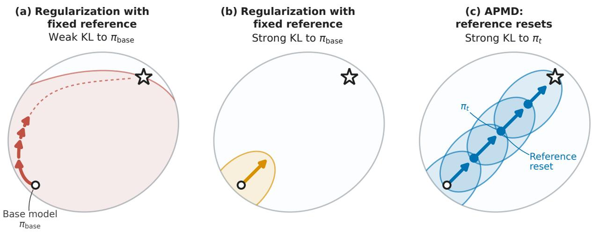
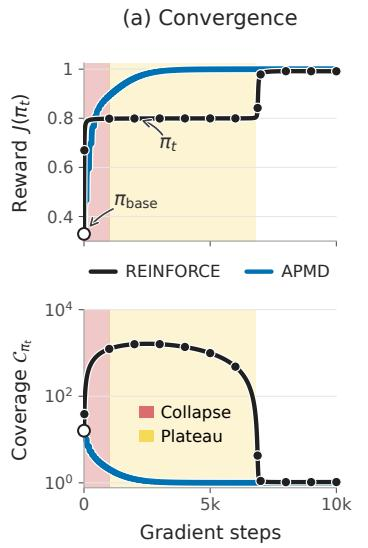
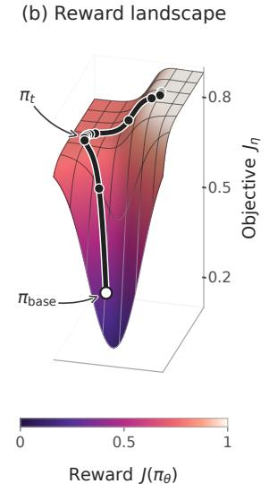
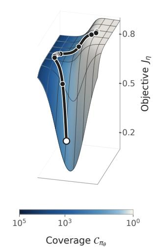
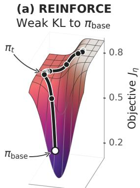
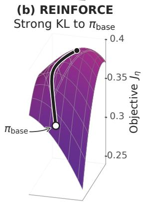
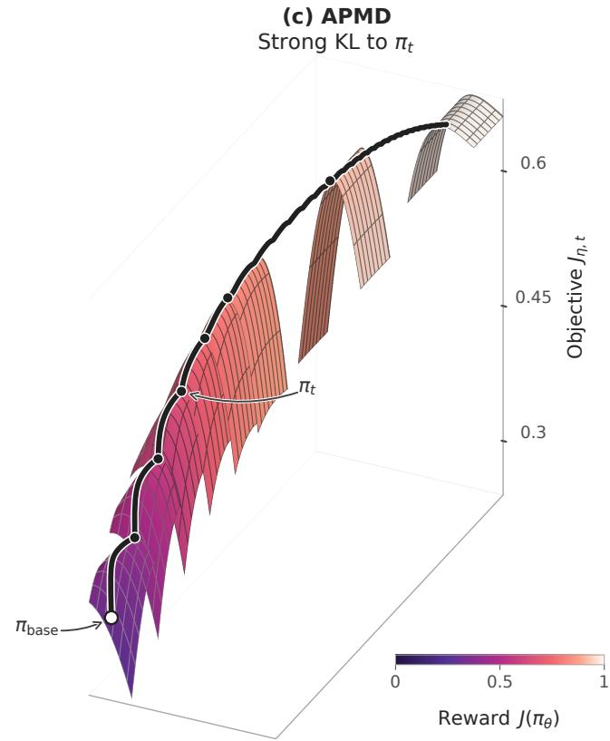

# A Theory of Policy Optimization in Post-Training: Coverage Collapse and Reference Resets

Audrey Huang1 Nan Jiang2 Sham M. Kakade3

Sadhika Malladi4 Akshay Krishnamurthy5 Dylan J. Foster5

## Abstract

Policy optimization plays a central role in language model post-training, yet principled guidance for methodology remains limited. We revisit the theoretical foundations of policy optimization to identify algorithms that learn near-optimal policies using total samples and gradient steps governed by the base model’s response coverage, a measure of how readily it generates optimal responses. We call such algorithms coverage-preserving. This guarantee captures the basic goal of amplifying capabilities already accessible through sampling from the base model, yet has remained elusive in policy optimization.

• Coverage collapse. REINFORCE, the basis for PPO and GRPO, can drive the probability of optimal responses to near zero, even as reward improves. This coverage collapse stalls optimization, and convergence can require exponentially many steps despite having a base model with good coverage. The failure arises even with exact gradients and persists under KL regularization to the base model.

• Reference resets. We show that repeatedly resetting the KL reference to the most recent policy mitigates coverage collapse. We formalize this intervention in Approximate Policy Mirror Descent (APMD), a meta-algorithm that approximately solves a sequence of KL-regularized RL subproblems. APMD improves the eficiency of optimization by enabling stronger regularization, which makes each subproblem easier to solve, while reference resets still allow convergence to global optimality.

• Coverage-preserving algorithms. For softmax linear policies over pretrained features, we use APMD to establish the first global convergence guarantees showing that widely used families of post-training algorithms are coverage-preserving. These include stylized PPO and GRPO variants with explicit KL regularization and reference resets, and squared-loss algorithms that implement them implicitly, including the methods used to train the Kimi models (Kimi Team et al., 2025b,a).

These results clarify how regularization, clipping, and objective choice afect the sampling and optimization costs of post-training, and provide a foundation for policy optimization methodology.

## 1 Introduction

Policy optimization algorithms are the reinforcement learning (RL) methods of choice in practice, with successes spanning dexterous robotic manipulation and control (Kaufmann et al., 2023; Radosavovic et al., 2024; Luo et al., 2025; Ren et al., 2025), superhuman performance in strategic games (Silver et al., 2016; Vinyals et al., 2019; OpenAI et al., 2019; Perolat et al., 2022; Baker et al., 2022), and, most notably, frontier reasoning in language models (LMs) (Ouyang et al., 2022; OpenAI, 2024; Guo et al., 2025; Kimi Team et al., 2025b). Across these applications, post-training has emerged as a successful paradigm in which policy optimization uses reward feedback to finetune an already capable base model, developed through large-scale supervised pretraining. The base model provides a foundation for learning complex tasks, while reward feedback ofers a way to improve beyond the limits of available demonstrations.

Despite these successes, principled guidance for policy optimization methodology remains limited (Ilyas et al., 2020; Ahmadian et al., 2024), while the range of interventions continues to grow (Shao et al., 2024; Yu et al., 2025; Liu et al., 2025c; Yue et al., 2025b; MiniMax, 2025; Zheng et al., 2025). Tuning any given method requires extensive trial and error (Huang et al., 2024; Eimer et al., 2023; Liu et al., 2025d), making it dificult to evaluate the efects of specific interventions (Ouyang et al., 2022; Khatri et al., 2025; Spangher et al., 2025). Even training recipes for leading open models show little consensus on core algorithmic choices, such as which objective to optimize (Guo et al., 2025; Team Olmo et al., 2025; Zheng et al., 2025; Kimi Team et al., 2025a). Principled insights are therefore increasingly important for focusing limited resources on promising interventions and hyperparameter regimes.

Theory has, in the past, provided key design principles for policy optimization methods. TRPO (Schulman et al., 2015), followed by PPO (Schulman et al., 2017), directly drew from the proximal updates and policy improvement guarantees established for early theoretical algorithms (Kakade, 2001; Kakade and Langford, 2002). In post-training, however, the central goal is to learn a performant policy while making the most of the base model, a goal that existing theory has left largely unaddressed. Most guarantees either require a uniform initial policy, sidestepping the role of the base model altogether (Mei et al., 2020b, 2021b; Lattimore, 2026b), or cannot preclude poor performance even with a high-quality base model (Agarwal et al., 2021; Mei et al., 2021b, 2023; Wang et al., 2020). They therefore ofer little guidance for understanding and designing policy optimization methods in post-training.

Motivated by this gap, we revisit the theory of policy optimization in post-training, and ask:

## Which policy optimization algorithms efectively leverage the base model for learning?

To capture this goal, we will seek algorithms whose performance is governed by the quality of the base model. This is especially important given the substantial resources invested in developing pretrained base models with strong post-training performance (Grattafiori et al., 2024; DeepSeek-AI et al., 2024). We formalize our question and summarize our contributions below.

## 1.1 Contributions

We ask which policy optimization algorithms learn near-optimal policies using total samples and gradient steps governed by the base model’s coverage over optimal responses, a guarantee that we call coverage-preserving (Section 2.2). This captures the basic post-training goal of leveraging the base model for learning and is achieved by methods such as Best-of-N sampling (Section 1.3), but has not been established in policy optimization. By designing algorithms that achieve this guarantee, we recover key interventions in modern post-training and help explain their practical eficacy.

1. Coverage collapse with a fixed reference policy or no regularization (Section 2.1). When initialized from a base model with good (constant) coverage, REINFORCE may require exponentially many gradient steps to converge, even with KL regularization to the base model. The cause is coverage collapse, in which coverage over optimal responses deteriorates even as reward improves, causing the gradient signal to vanish (Figure 2). This failure is intrinsic to the RL objective—it occurs with exact gradients and without parameter sharing—motivating interventions that preserve coverage for eficient learning.

2. Approximate Policy Mirror Descent (APMD) preserves coverage (Section 3.1). We show that algorithms built around a single intervention—resetting the reference policy—are coverage-preserving. We formalize this in APMD, a meta-algorithm that approximates mirror descent by iteratively setting the reference to the most recent policy, then running an inner optimization loop for a regularized RL subproblem. APMD algorithms can heavily regularize the learner to the reference, making each subproblem easy to solve. While the learner improves only locally, over successive resets it reaches global optimality (Figure 1).

3. Applying APMD: Coverage-preserving algorithms. APMD is a template for algorithm design and analysis, and can be combined with existing methods or directly applied to analyze them. We give end-to-end convergence guarantees for softmax linear policies, a model of learning with frozen pretrained features.

(a) PPO, GRPO, and variants (Sections 3.2 and 3.3). We analyze variants of PPO and GRPO with reference resets, as in ProRL (Liu et al., 2025a) and DeepSeek (Shao et al., 2024; Guo et al., 2025). In PPO-NoClip (Algorithm 1), which does not clip the importance weights, regularization alone enables eficient learning by controlling the policy ratios (Corollary 3.1). We then add clipping to obtain PPO-Lite (Algorithm 2). Our analysis shows that clipping complements regularization by limiting the statistical cost of large importance weights, rather than directly improving optimization (Corollary 3.2).

  
Figure 1: Overview of APMD: Continued progress through reference resets. Shaded regions depict KL neighborhoods around the chosen reference policy. Each arrow marks the learner’s progress after a fixed number of gradient steps. (a) With weak regularization to the base model, coverage can collapse and cause optimization to stall. (b) Strong regularization controls coverage and keeps the learner close to the reference policy, but far from optimality (marked ✩). (c) APMD resets the reference to the most recent policy, reaching optimality through successive local improvements.

(b) Squared-loss algorithms (Section 4). These algorithms fit log policy ratios to rewards using squared-loss objectives. We first show that Kimi-style algorithms (Kimi Team et al., 2025b,a), which shift the rewards by an estimated baseline function, are coverage-preserving for two common baseline choices, the mean reward in KimiPO (Corollary 4.1) and the normalization function in KimiPO-Norm (Corollary K.1). Lastly, we show that Rebel-OnPolicy, an on-policy variant of Rebel that eliminates the baseline using paired responses, is also coverage-preserving (Corollary 4.2).

Implications of our theory (Section 5). Our results show that optimization in a local neighborhood of the reference policy makes improvement tractable, whether regularization is explicitly used or implicit. This role of the reference in anchoring optimization is distinct from its use in importance weighting or batch reuse Compared to fixed-reference (or unregularized) policy optimization, algorithms that regularize the learner to a periodically updated reference converge using substantially fewer gradient steps and even fewer rounds of batch generation.

## 1.2 Background: Policy Optimization in Post-Training

We study policy optimization in a contextual bandit setting motivated by RL post-training, where reward feedback is used to finetune the weights of a pretrained base model. A language model (LM) is a policy $\pi _ { \theta } : \mathcal { X } $ $\Delta ( \mathcal { V } )$ that maps a prompt $x \in \mathcal { X }$ to a distribution over complete responses, denoted Y. Given a prompt distribution $\mu \in \Delta ( \mathcal { X } )$ and bounded reward function $r : \mathcal { X } \times \mathcal { Y }  [ 0 , R _ { \mathrm { m a x } } ]$ , the goal of policy optimization is to find

$$
\arg \operatorname* { m a x } _ { \pi _ { \theta } \in \Pi _ { \Theta } } J ( \pi _ { \theta } ) , \quad \mathrm { w h e r e } \quad J ( \pi ) : = \mathbb { E } _ { x \sim \mu , y \sim \pi ( \cdot | x ) } [ r ( x , y ) ] .
$$

The objective $J ( \pi )$ is the expected reward, and $\Pi _ { \Theta } = \{ \pi _ { \theta } : \theta \in \Theta \}$ denotes the policy class induced by a fixed architecture with weights in $\Theta \subseteq \mathbb { R } ^ { d }$ . Reward feedback is assigned to a complete response y, the sequence of tokens generated for prompt x. This abstraction captures RL for one-shot reasoning.

In post-training, policy optimization starts from a pretrained base model $\pi _ { 0 } = \pi _ { \mathsf { b a s e } } = \pi _ { \theta _ { \mathsf { b a s e } } } \in \Pi _ { \Theta }$ and produces the policy iterates $\{ \pi _ { t } = \pi _ { \theta _ { t } } \} _ { t = 0 } ^ { T }$ over T iterations. Objectives and update rules vary across algorithms, but we focus on first-order methods that update $\pi _ { t }$ to $\pi _ { t + 1 }$ using gradients of reward-based objectives. Regardless of the algorithm, we evaluate the learned policy by the suboptimality of its expected reward. For any $\varepsilon \in ( 0 , R _ { \mathrm { m a x } } ] ,$ we say that a policy $\pi$ is ε-optimal if $J ^ { \star } - J ( \pi ) \leq \varepsilon .$ , where $J ^ { \star } : = \mathrm { m a x } _ { \pi : \mathcal { X }  \Delta ( \mathcal { Y } ) } J ( \pi )$ is the maximum reward achievable by any conditional distribution.

Example: REINFORCE. REINFORCE (Williams, 1992; Sutton et al., 1999) is a foundational policy optimization algorithm that performs stochastic gradient ascent on the expected reward $J ( \pi _ { \theta } )$ . For a fixed learning rate $\alpha > 0$ , the parameter update with exact gradients is $\theta _ { t + 1 } = \theta _ { t } + \alpha \nabla J ( \pi _ { t } )$ , where $\nabla$ denotes diferentiation with respect to the policy parameters and $\nabla J ( \pi _ { t } )$ is evaluated at $\theta = \theta _ { t }$

$$
\nabla J ( \pi _ { t } ) = \mathbb { E } _ { x \sim \mu , y \sim \pi _ { t } ( \cdot | x ) } [ \nabla \log \pi _ { t } ( y \mid x ) r ( x , y ) ] .
$$

In practice, REINFORCE estimates $\nabla J ( \pi _ { t } )$ using responses sampled from $\pi _ { t } .$ Modern policy gradient methods build on this update with additions such as KL regularization to the base model (Ouyang et al., 2022; Shao et al., 2024), estimated advantage functions, and clipped importance weights for batch reuse (Schulman et al., 2017; Shao et al., 2024). In Section 2.1, we study REINFORCE to identify optimization challenges specific to RL. These challenges motivate from first principles the design of modern post-training methods such as PPO and GRPO (Section 3).

## 1.3 Background: Coverage and the Role of the Base Model

Policy optimization in post-training begins from a base model, and we measure the quality of the base model by its response coverage, which quantifies how often it generates optimal responses.

Definition 1.1 (Response coverage). For any prompt $x \in \mathcal X$ , let $\mathcal { Y } _ { x } ^ { \star } : = \{ y \in \mathcal { Y } : r ( x , y ) = \operatorname* { m a x } _ { y ^ { \prime } } r ( x , y ^ { \prime } ) \}$ denote the set of optimal responses. Then the response coverage of a policy π is measured by

$$
\mathcal { C } _ { \pi } : = \mathbb { E } _ { x \sim \mu } \bigg [ \frac { 1 } { \pi ( \mathcal { V } _ { x } ^ { \star } \mid x ) } \bigg ] .
$$

For the base model, we use $\mathcal { C } _ { \sf b a s e } \equiv \mathcal { C } _ { \pi _ { \sf b a s e } }$

For a policy π and prompt $x ,$ the expected number of generations needed to observe an optimal response is $\pi ( \mathcal { V } _ { x } ^ { \star } \mid x ) ^ { - 1 }$ , and $\scriptstyle { { \mathcal { C } } _ { \pi } }$ averages this cost over prompts. Smaller values of $\scriptstyle { { \mathcal { C } } _ { \pi } }$ indicate better response coverage, meaning that fewer generations are needed to find an optimal response. A central premise of post-training is that pretraining imbues the base model with favorable coverage (a moderate $\mathcal { C } _ { \sf b a s e } )$ . This has helped explain the success of inference-time sampling (Brown et al., 2024; Huang et al., 2025b) and supervised finetuning on filtered generations (Singh et al., 2024; Lee et al., 2025; Huang et al., 2025a).

Coverage and Best-of-N. The base model’s response coverage governs the performance of Best-of-N sampling, a widely used inference-time method for improving response quality without training. Given a prompt x, Best-of-N draws N independent responses from $\pi _ { \mathsf { b a s e } } ( \cdot \mid x )$ and returns the one with the highest reward $r ( x , y )$ It fails to return an optimal response only when none of the N candidates is optimal, an event with probability $\mathbb { E } _ { x } [ ( 1 - \pi _ { \mathsf { b a s e } } ( y _ { x } ^ { \star } \mid x ) ) ^ { N } ] \le \mathcal { C } _ { \mathsf { b a s e } } / N$ . Thus, by using $N = \widetilde { \Theta } ( \mathcal { C } _ { \mathrm { b a s e } } / \varepsilon )$ responses per prompt, Best-of-N returns an optimal response with probability at least 1 − ε (Huang et al., 2025b; Chen et al., 2025).

Coverage and policy optimization. The Best-of-N guarantee above suggests that policy optimization algorithms should learn near-optimal policies using total samples controlled by $\mathcal { C } _ { \sf b a s e }$ . However, unlike Best-of-N, which always samples from $\pi _ { \mathsf { b a s e } } .$ in policy optimization responses are sampled from the learner, whose coverage evolves during training. For example, with binary rewards $r ( x , y ) \in \{ 0 , 1 \}$ , the estimated REINFORCE gradient $\nabla J ( \pi _ { t } ) = \mathbb { E } _ { \pi _ { t } } [ \nabla \log \pi _ { t } ( y \mid x ) r ( x , y ) ]$ is zero unless the batch contains a correct response. It is therefore the coverage of $\pi _ { t }$ that governs convergence in policy optimization. While the initial policy inherits the base model’s coverage, it is unclear whether this coverage, which supports the learning signal, persists during training.

## 2 Motivation: The Coverage Collapse Phenomenon

We therefore ask whether policy optimization algorithms can learn eficiently when initialized from a high-quality base model, the basic goal of post-training. We first show that REINFORCE can sufer coverage collapse, causing

exponentially slow convergence despite favorable initial coverage (Section 2.1). This failure motivates our central question in Section 2.2, where we ask which policy optimization methods learn near-optimal policies with total samples and gradient steps controlled by the base model’s coverage, a guarantee we call coverage-preserving.

## 2.1 Lower Bound: Coverage Collapse in Naïve Policy Optimization Methods

We now investigate whether REINFORCE converges eficiently when initialized from a base model with good coverage. Throughout this section, we use exact rather than estimated gradients to isolate the efect of coverage on the dynamics of policy optimization. We also allow KL regularization to the base model, with regularization parameter $\eta \in ( 0 , \infty ]$ ], giving the objective

$$
J _ { \eta } ( \pi _ { \theta } ) : = J ( \pi _ { \theta } ) - \frac { 1 } { \eta } D _ { \mathsf { K L } } ( \pi _ { \theta } \parallel \pi _ { \mathsf { b a s e } } ) , \qquad \mathrm { w h e r e } \quad D _ { \mathsf { K L } } ( \pi \parallel \pi _ { \mathsf { b a s e } } ) = \mathbb { E } _ { x \sim \mu , y \sim \pi ( \cdot \mid x ) } \biggl [ \log \frac { \pi ( y \mid x ) } { \pi _ { \mathsf { b a s e } } ( y \mid x ) } \biggr ] ,\tag{1}
$$

where $\eta = \infty$ recovers the unregularized objective J. Starting from $\pi _ { 0 } = \pi _ { \mathsf { b a s e } }$ , REINFORCE performs gradient ascent with a fixed learning rate $\alpha > 0$ 2

$$
\theta _ { t + 1 } = \theta _ { t } + \alpha \nabla J _ { \eta } ( \pi _ { t } ) , \qquad \mathrm { w h e r e } \quad \nabla J _ { \eta } ( \pi _ { t } ) = \mathbb { E } _ { \pi _ { t } } \bigg [ \nabla \log \pi _ { t } ( y \mid x ) \bigg ( r ( x , y ) - \frac { 1 } { \eta } \log \frac { \pi _ { t } ( y \mid x ) } { \pi _ { \mathrm { b a s e } } ( y \mid x ) } \bigg ) \bigg ] .\tag{2}
$$

KL regularization is widely used in post-training to stabilize optimization and help preserve pre-existing behavior (Shao et al., 2024; Lambert et al., 2024; Liu et al., 2025a). Because it discourages deviations from the base model, one might expect $\pi _ { t }$ to stay close to $\pi _ { \mathsf { b a s e } }$ in distribution and retain the base model’s coverage, especially since improving performance involves assigning greater probability to higher-reward responses.

However, Theorem 2.1 shows that the policy’s coverage can deteriorate until it is exponentially worse than the base model’s, causing convergence to be exponentially slow. Favorable coverage in the base model therefore does not guarantee eficient convergence of REINFORCE, with or without KL regularization.

Theorem 2.1 (Coverage collapse in REINFORCE). Fix any $\varepsilon \in ( 0 , \frac { 1 } { 6 4 } ]$ . There exists a bandit instance with prompts ${ \mathcal { X } } = \{ x \}$ , responses ${ \mathcal { V } } ,$ a reward function r with $R _ { \mathrm { m a x } } \le 1$ , and a base model $\pi _ { \mathsf { b a s e } }$ with $\mathcal { C } _ { \sf b a s e } \leq 6$ for which the following holds. Consider the tabular softmax policy class $\Pi _ { \Theta } = \{ \pi _ { \theta } : \pi _ { \theta } ( y \mid x ) \propto \exp ( \theta _ { y } ) , \ \theta \in \mathbb { R } ^ { | \mathcal { V } | } \}$ . Initialize $\pi _ { 0 } = \pi _ { \mathsf { b a s e } }$ and run the REINFORCE update in $E q . \ ( 2 )$ with any regularization parameter $\eta \in ( 0 , \infty ]$ and any learning rate $0 < \alpha \leq 1 / 5$ . If the policy is ε-optimal from iteration T onward, then there exists $0 < t < T$ such that

$$
T = \Omega \bigg ( { \frac { \mathcal { C } _ { \pi _ { t } } } { \alpha \sqrt { \varepsilon } } } \bigg ) \qquad a n d \qquad \mathcal { C } _ { \pi _ { t } } = \exp \bigg ( \Theta \bigg ( { \frac { 1 } { \sqrt { \varepsilon } } } \bigg ) \bigg ) .
$$

Theorem 2.1 shows that the convergence of REINFORCE depends on the policy’s coverage along the optimization path, measured by $\mathcal { C } _ { \pi _ { t } } .$ , rather than just the base model’s. The problem is that, in the first phase of training, $\mathcal { C } _ { \pi _ { t } }$ grows from $\mathcal { C } _ { \sf b a s e } \leq 6$ to an exponentially large value—meaning that the optimal response has exponentially small probability—even though expected reward increases monotonically. This coverage collapse makes the gradient signal vanish, and REINFORCE requires exponentially many steps to regain coverage and converge. This can be seen in the prolonged reward plateau of Figure 2a (yellow). Given the simplicity of our construction, we expect coverage collapse to persist under the complex optimization landscapes and stochastic noise encountered in practice

Coverage collapse: Nonconcavity in RL. The dependence of convergence on coverage along the optimization path results from the nonconcavity particular to RL (Figure 2b). The objective $J ( \pi _ { \theta } )$ is nonconcave for softmax policies, even without parameter sharing (as in Theorem 2.1). Correspondingly, convergence analyses for REINFORCE use Łojasiewicz-type inequalities of the form (Mei et al., 2020b, 2021b; Agarwal et al., 2021),

$$
J ^ { \star } - J ( \pi _ { t } ) \leq c \cdot \| \pi ^ { \star } / \pi _ { t } \| _ { \infty } \cdot \| \nabla J ( \pi _ { t } ) \| .\tag{3}
$$

This bound shows how near-stationarity can still imply near-optimality, depending on a coeficient $\| \pi ^ { \star } / \pi _ { t } \| _ { \infty }$ that measures $\pi _ { t } { } ^ { \cdot } \mathrm { s }$ coverage of an optimal policy $\pi ^ { \star }$ . During coverage collapse this coeficient becomes exponentially large (Figure 2c). Eq. (3) then permits $\pi _ { t }$ to be nearly stationary yet highly suboptimal—precisely the behavior exhibited by Theorem 2.1 and Figure 2a (yellow).

(c) Coverage landscape  
  
Figure 2: Coverage collapse stalls optimization with a fixed reference policy. We compare REINFORCE (Eq. (2)) and APMD using exact gradients on a modified instance from Theorem 2.1. APMD runs PPO-NoClip (Algorithm 1) with a reference reset every $K = 1 0 0$ inner steps. (a) In REINFORCE (black), coverage collapse (red) causes a prolonged reward plateau (yellow). The shaded regions are schematic. APMD (blue) converges faster as coverage keeps improving (smaller $\mathcal { C } _ { \pi _ { t } } )$ . (b,c) The REINFORCE trajectory plotted on the optimization landscape, with surface height $J _ { \eta }$ and color indicating reward (b) or response coverage (c), over the 2D parameter plane defined in Appendix C.1.

Why regularization to $\pi _ { \mathsf { b a s e } }$ fails. Because KL regularization anchors the policy to the base model, it must be weak enough $\begin{array} { r } { \bigl ( \frac { 1 } { \eta } = { O } ( \varepsilon { ) } \bigr ) } \end{array}$ for the policy to improve substantially and achieve $J ^ { \star } - J ( \pi _ { T } ) \leq \varepsilon .$ . This freedom also permits large deviations that reduce the probability of optimal responses, which is the mechanism behind the lower bound in Theorem 2.1. There, KL regularization exerts a significant restoring force only after coverage has degraded exponentially (see Figure 1a).

Remark 2.1 (Comparison to prior work). To our knowledge, Theorem 2.1 is the first result isolating the failure of REINFORCE from coverage collapse, given that we use tabular parameters and exact gradients. Related results either (i) show asymptotic failure without characterizing coverage (Lin et al., 2025); (ii) have additional sources of hardness, such as stochastic noise (Chung et al., 2021; Mei et al., 2021a; Baudry et al., 2025; Lattimore, 2026a), parameter interference (Schaul et al., 2019), or multi-step dynamics (Li et al., 2021); or (iii) scale with the base model’s coverage, remaining mild when this coverage is constant (Agarwal et al., 2021; Razin et al., 2024; Mei et al., 2020a). In contrast, our lower bound is exponential in $1 / \sqrt \varepsilon$ even when $\mathcal { C } _ { \sf b a s e }$ is constant.

## 2.2 Question: Which Policy Optimization Algorithms Are Coverage-Preserving?

In light of Theorem 2.1, we ask which policy optimization methods learn eficiently when initialized from a base model and avoid coverage collapse. Concretely, this means that they output near-optimal policies using $N _ { \mathsf { s a m p l e } }$ samples (prompt-response pairs) and $N _ { \mathsf { s t e p } }$ gradient steps, with both quantities controlled by the response coverage $\mathcal { C } _ { \sf b a s e }$ . We call algorithms with this guarantee coverage-preserving, as formalized below.

## Which policy optimization algorithms are coverage-preserving?

For a given policy class ΠΘ with complexity comp $\left( \Pi _ { \Theta } \right)$ , an algorithm is coverage-preserving if, for every $\varepsilon \in ( 0 , R _ { \mathrm { m a x } } ]$ and $\delta \in ( 0 , 1 )$ , it returns a policy $\pi _ { \mathsf { p o s t } }$ satisfying $J ^ { \star } - J ( \pi _ { \mathsf { p o s t } } ) \leq \varepsilon$ with probability at least $1 - \delta _ { \colon }$ , using total gradient steps $N _ { \tt s t e p } ( \varepsilon , \delta )$ and total samples $N _ { \tt s a m p l e } ( \varepsilon , \delta )$ bounded as follows:

$$
N _ { \mathtt { s t e p } } ( \varepsilon , \delta ) \leq \mathrm { p o l y } \big ( \mathcal { C } _ { \mathtt { b a s e } } , \mathrm { c o m p } ( \Pi _ { \Theta } ) , \varepsilon ^ { - 1 } , \log ( 1 / \delta ) \big ) ,
$$

$$
\begin{array} { r } { N _ { \mathtt { s a m p l e } } ( \varepsilon , \delta ) \le \mathrm { p o l y } \big ( \mathcal { C } _ { \mathtt { b a s e } } , \mathrm { c o m p } ( \Pi _ { \Theta } ) , \varepsilon ^ { - 1 } , \log ( 1 / \delta ) \big ) . } \end{array}\tag{4}
$$

For coverage-preserving algorithms, the cost of learning is controlled by the base model’s coverage. The guarantee therefore formalizes the basic post-training goal of amplifying high-reward responses from the base model, sometimes called “sharpening”1 (Huang et al., 2025a; Zhao et al., 2025b; Yue et al., 2025a). Analogous sample complexity guarantees already hold for Best-of-N sampling (Section 1.3) and $\mathrm { S F T }$ on reward-filtered samples from $\pi _ { \mathsf { b a s e } }$ (Huang et al., 2025a; Liu et al., 2026). Indeed, in the construction of Theorem 2.1, where $\mathcal { C } _ { \sf b a s e } = O ( 1 )$ , Best-of-N produces an optimal response using only $O ( 1 )$ generations, whereas REINFORCE requires exponentially many gradient steps to output a near-optimal policy due to coverage collapse. This failure motivates interventions that preserve the base model’s coverage throughout training (hence the name coverage-preserving).

Focus: Online policy optimization. We focus on policy optimization algorithms that train on samples generated by the learner, as in PPO, GRPO, and other widely used post-training methods. We seek algorithms that are coverage-preserving without additional samples from the base model or other fixed distributions with favorable coverage, as standard procedures do not use them.

Theoretical testbed: Softmax linear policies. While many of our results apply to general policy parameterizations, our end-to-end complexity analyses work with softmax linear policy classes, defined below. We explicitly invoke Assumption 2.1 in results that require it.

Assumption 2.1 (Softmax linear policies). For a fixed feature map $\phi : \mathcal { X } \times \mathcal { Y }  \mathbb { R } ^ { d }$ , the policy class is

$$
\Pi _ { \Theta } : = \big \{ \pi _ { \theta } : \theta \in \mathbb { R } ^ { d } \big \} , \qquad \pi _ { \theta } ( y \mid x ) = \frac { \exp \bigl ( \phi ( x , y ) ^ { \top } \theta \bigr ) } { \sum _ { y ^ { \prime } \in \mathcal { y } } \exp ( \phi ( x , y ^ { \prime } ) ^ { \top } \theta ) } .
$$

Here, $y \in \mathcal { V }$ denotes a complete response consisting of a sequence of tokens. The reward function is linear in the same features, meaning there exists some $\boldsymbol { \theta } _ { \star } \in \mathbb { R } ^ { d }$ such that

$$
\boldsymbol { r } ( \boldsymbol { x } , y ) = \boldsymbol { \phi } ( \boldsymbol { x } , y ) ^ { \top } \boldsymbol { \theta } _ { \star } , \qquad \forall ( \boldsymbol { x } , y ) \in \mathcal { X } \times \mathcal { Y } .
$$

We write $\begin{array} { r } { B _ { \phi } : = \operatorname* { m a x } _ { x \in \mathcal { X } , y \in \mathcal { Y } } \lVert \phi ( x , y ) \rVert _ { 2 } } \end{array}$ and $B _ { \star } : = \| \theta _ { \star } \| _ { 2 }$

Assumption 2.1 is the simplest function approximation setting for policies, where shared parameters allow learning from observed samples to transfer to unseen prompts. It models post-training as finetuning weights over the base model’s frozen features ϕ. For softmax linear policies, the cross-entropy loss used in pretraining is convex (Chen et al., 2025), whereas the expected reward $J ( \pi _ { \theta } )$ is nonconcave in θ (Agarwal et al., 2021; Mei et al., 2020b). The nonconcavity is therefore particular to the RL objective rather than the parameterization itself, and is reflected in the coverage collapse exhibited by Theorem 2.1, where the policy class is a special case of Assumption 2.1 with one-hot features ϕ.

## 3 Reference Resets Preserve Coverage: APMD Framework

We now show that algorithms built around a single intervention—resetting the reference policy used for regularization—are coverage-preserving in the sense of Eq. (4). Recall from Section 2.1 that KL regularization to the base model does not prevent coverage collapse, as regularization must be weak enough for the learner to improve substantially (Figure 1a). Stronger regularization would mitigate loss of coverage but bias the learner toward the base model, limiting potential improvement (Figure 1b). When the reference is periodically reset to the most recent policy, however, the learner can keep improving and reach optimality (Figure 1c).

We formalize this intervention as a meta-algorithm, Approximate Policy Mirror Descent (APMD), which solves a sequence of RL subproblems regularized to the most recent policy. As long as each RL subproblem is solved accurately enough, the policies preserve the base model’s coverage throughout training and converge to optimality (Section 3.1). We then instantiate APMD with stylized versions of PPO and GRPO, without (Section 3.2) and with (Section 3.3) clipping. In Section 4, we study a second family of APMD algorithms based on squared-loss objectives, including those used to train the Kimi models (Kimi Team et al., 2025a,b).

## 3.1 Framework: Approximate Policy Mirror Descent

Approximate Policy Mirror Descent (APMD), defined below, starts from the base model, $\pi _ { 0 } = \pi _ { \mathsf { b a s e } }$ . At each outer iteration t, it first resets the reference—the policy to which regularization is anchored—to the most recent policy $\pi _ { t }$ . This sets the optimization target to $\pi _ { \eta , t } ^ { \star } \propto \pi _ { t } e ^ { \eta r }$ , the exact mirror descent update to $\pi _ { t }$ under KL regularization.2 APMD then trains the next policy $\pi _ { t + 1 }$ to approximate $\pi _ { \eta , } ^ { \star }$ using an algorithm-specific inner loop.

Meta-algorithm: Approximate Policy Mirror Descent (APMD)   
Require: base model $\pi _ { \mathsf { b a s e } } .$ , regularization parameter $\eta > 0 ,$ , and outer iterations $T \geq 1$   
Initialize $\pi _ { 0 } = \pi _ { \mathsf { b a s e } }$ . For each $0 \leq t < T _ { \cdot }$ , do:   
1. Reset the reference policy to $\pi _ { t }$ and define the optimization target,   
$\pi _ { \eta , t } ^ { \star } : = \operatorname * { a r g m a x } _ { \pi : \mathcal K \to \Delta ( y ) } \mathbb E _ { \pi } [ r ( x , y ) ] - \frac { 1 } { \eta } D _ { \mathsf { K L } } ( \pi \parallel \pi _ { t } ) , \quad \mathrm { w h e r e } \ \pi _ { \eta , t } ^ { \star } ( y \mid x ) \propto \pi _ { t } ( y \mid x ) e ^ { \eta r ( x , y ) } .$ (5)   
2. Learn $\pi _ { t + 1 } \approx \pi _ { \eta , t } ^ { \star }$ by running an inner optimization loop for an algorithm-specific RL subproblem.   
Return: policy iterates $\left\{ \pi _ { t } \right\} _ { t = 1 } ^ { T }$

All APMD algorithms perform the reference reset in Step 1 and share the optimization target $\pi _ { \eta , t } ^ { \star } .$ They difer in the RL subproblem and inner optimization procedure used for Step 2. For example, the algorithm in Section 3.2 uses gradient ascent on the KL-regularized expected reward in $\operatorname { E q . } \left( 5 \right)$ . The algorithms in Section 4 instead minimize squared-loss objectives to approximate the same target.

If every RL subproblem were solved exactly, so that $\pi _ { t + 1 } = \pi _ { \eta , t } ^ { \star }$ for all $t ,$ the policy iterates would follow the mirror descent path, satisfying (Appendix B.3)

$$
\pi _ { t } ( y \mid x ) \propto \pi _ { \mathsf { b a s e } } ( y \mid x ) e ^ { t \eta r ( x , y ) } , \quad \mathrm { a n d } \quad J ^ { \star } - J ( \pi _ { t } ) \leq \frac { \log \mathcal { C } _ { \mathsf { b a s e } } } { \eta t } , \qquad \forall 0 < t \leq T .\tag{6}
$$

The policies converge at the sublinear mirror descent rate above, which depends on the base model only through log $\mathcal { C } _ { \sf b a s e }$ . Moreover, both expected reward and coverage improve monotonically in $t ;$ each iterate $\pi _ { t }$ draws optimal responses at least as often as the base model, preserving useful learning signals and avoiding the coverage collapse under fixed-reference policy optimization in Theorem 2.1. The challenge is maintaining these properties when $\pi _ { t + 1 }$ only approximates $\pi _ { \eta , t } ^ { \star } ,$ given that sampling and optimization errors compound across iterations.

The following theorem, a central result of the paper, shows that the final policy π retains the mirror descent rate in Eq. (6), provided each $\pi _ { t + 1 }$ is suficiently close to $\pi _ { \eta , t } ^ { \star }$ in KL divergence. The learned policies also preserve coverage, meaning that, for most prompts, every iterate generates an optimal response at least half as often as the base model.3

Theorem 3.1 (APMD preserves coverage). Given any $\eta > 0$ and any sequence of policies $\left\{ \pi _ { t } \right\} _ { t = 0 } ^ { T }$ with $\pi _ { 0 } = \pi _ { \mathsf { b a s e } }$ and $\pi _ { t } > 0$ , suppose that

$$
D _ { \mathsf { K L } } \bigl ( \pi _ { t + 1 } \parallel \pi _ { \eta , t } ^ { \star } \bigr ) \le \varepsilon _ { \mathsf { i n } } : = \frac { 1 } { 6 4 \mathcal { C } _ { \mathsf { b a s e } } T ^ { 2 } \log ( e T ) } , \qquad \forall 0 \le t < T .\tag{7}
$$

Then the final policy converges at the mirror descent rate,

$$
J ^ { \star } - J ( \pi _ { T } ) \leq \frac { \log ( 2 \mathcal { C } _ { \mathsf { b a s e } } ) } { \eta T } ,\tag{8}
$$

and all policies preserve coverage: with probability at least $\begin{array} { r } { 1 - \frac { 1 } { 2 \sqrt { \log ( e T ) } } \ o v e r \ x \sim \mu , } \end{array}$

$$
\pi _ { t } ( \mathcal { V } _ { x } ^ { \star } \mid x ) \geq \frac { 1 } { 2 } \pi _ { \mathsf { b a s e } } ( \mathcal { V } _ { x } ^ { \star } \mid x ) , \qquad \forall 0 \leq t \leq T ,
$$

where ${ \mathcal { V } } _ { x } ^ { \star }$ is the set of optimal responses for the prompt x (Definition 1.1).

Theorem 3.1 provides a criterion for identifying coverage-preserving APMD algorithms. It applies to any policy sequence $\left\{ \pi _ { t } \right\} _ { t = 0 } ^ { \sum }$ satisfying the inner KL tolerance $\varepsilon _ { \mathrm { i n } }$ in Eq. (7). For any $\eta > 0 ;$ , the final policy is ε-optimal when

$$
T = \lceil \frac { \log ( 2 \mathcal { C } _ { \mathrm { b a s e } } ) } { \eta \varepsilon } \rceil , \qquad D _ { \mathsf { K L } } ( \pi _ { t + 1 } \| \pi _ { \eta , t } ^ { \star } \| \leq \varepsilon _ { \mathsf { i n } } = \widetilde O ( \frac { \eta ^ { 2 } \varepsilon ^ { 2 } } { \mathcal { C } _ { \mathrm { b a s e } } } ) , \quad \forall 0 \leq t < T .\tag{9}
$$

Thus, for an APMD algorithm to be coverage-preserving, the inner optimization loop should meet the KL tolerance above using a polynomial number of samples and gradient steps, for a suitable choice of $\eta .$ Following this approach, we will show that stylized variants of PPO and GRPO are coverage-preserving in Sections 3.2 and 3.3.

Intuition: APMD algorithms are coverage-preserving. Across our results, strong regularization to the reference—typically with $\eta = \Theta ( 1 )$ , compared to $\eta = \Omega ( 1 / \varepsilon )$ when the reference is fixed (Section 2.1)—is key to obtaining coverage-preserving guarantees for APMD algorithms. This sets the target $\pi _ { \eta , t } ^ { \star }$ close to the reference $\pi _ { t }$ and stabilizes the inner loop, making each RL subproblem relatively easy to solve (Figure 1b). Correspondingly, as we will see in Section 3.2, APMD algorithms converge using exponentially fewer gradient steps than REINFORCE in the construction of Theorem 2.1, illustrated in Figure 2a.

Reference resets in APMD make global optimality possible under strong regularization. Each $\pi _ { t + 1 } \approx \pi _ { \eta , i } ^ { \star }$ is only a local improvement to $\pi _ { t } .$ , but these improvements accumulate over successive resets (Figure 1c). $\operatorname { E q . } \left( 9 \right)$ makes this precise, showing that the same performance can be achieved under stronger regularization by proportionally increasing the number of outer iterations $T .$ This role of reference resets echoes empirical observations from Liu et al. (2025a), who report that the KL penalty to a fixed reference can dominate the loss and slow policy updates, and periodically reset the reference to counteract this efect.

## 3.2 Instantiating APMD: Importance-Weighted Policy Optimization (PPO-NoClip)

PPO and GRPO are the most recognizable policy optimization algorithms in post-training, yet the individual roles of key design elements—importance-weighted gradients, clipping, and KL regularization—are not well understood. To disentangle their efects, we analyze stylized variants using APMD. We begin with PPO-NoClip, which uses KL regularization with reference resets but omits clipping. We then add clipping in Section 3.3 to obtain PPO-Lite. This approach reveals how KL regularization controls the optimization landscape, while clipping controls the statistical cost of importance weighting.

In each outer iteration t, PPO-NoClip aims to maximize the KL-regularized objective with reference $\pi _ { t }$

$$
J _ { \eta , t } ( \pi ) : = \mathbb { E } _ { \pi } [ r ( x , y ) ] - \frac { 1 } { \eta } D _ { \mathsf { K L } } ( \pi \parallel \pi _ { t } ) .\tag{11}
$$

This objective is uniquely maximized by $\pi _ { \eta , t } ^ { \star } ~ ( \mathrm { E q . } ( 5 ) )$ , so PPO-NoClip implements APMD. Note that we use observed rewards rather than advantage estimates, as our focus is on the efects of regularization and clipping.

To optimize this objective, the inner loop of PPO-NoClip performs K steps of full-batch gradient ascent, starting from $\pi _ { t } ^ { 0 } = \pi _ { t }$ . It reuses a pre-collected batch of $N$ prompt-response pairs from $\pi _ { t }$ to estimate these gradients, following standard practice in PPO and GRPO to reduce generation costs (Schulman et al., 2017; Shao et al., 2024). At inner step $k ,$ the estimated gradient uses importance weights $\pi _ { t } ^ { k } ( y \mid x ) / \pi _ { t } ( y \mid x )$ to correct for distribution shift between the learner $\pi _ { t } ^ { k }$ and the sampling policy $\pi _ { t }$ (Eq. (10)). This procedure is equivalent to gradient ascent on the importance-weighted formulation of Eq. (11) below, which resembles the PPO objective without clipping and with regularization to $\pi _ { t }$

$$
J _ { \eta , t } ( \pi _ { \theta } ) = \mathbb { E } _ { \pi _ { t } } \bigg [ \frac { \pi _ { \theta } ( y \mid x ) } { \pi _ { t } ( y \mid x ) } \bigg ( r ( x , y ) - \frac { 1 } { \eta } \log \frac { \pi _ { \theta } ( y \mid x ) } { \pi _ { t } ( y \mid x ) } \bigg ) \bigg ] .\tag{12}
$$

Finally, PPO-NoClip sets $\pi _ { t + 1 } = \pi _ { t } ^ { K }$ , which becomes the reference policy, sampling policy, and starting point for the next outer iteration.

The following result shows that PPO-NoClip is coverage-preserving under Assumption 2.1.

Algorithm 1 PPO with Reference Resets, without Clipping (PPO-NoClip)   
Require: Base model $\pi _ { \mathtt { b a s e } } ,$ outer iterations T, regularization parameter $\eta > 0 ,$ , prompt batch size $N ,$   
inner steps K, and learning rate α.   
1: Initialize $\pi _ { 0 } = \pi _ { \mathsf { b a s e } } = \pi _ { \theta _ { 0 } } .$   
2: for $t = 0 , 1 , \dots , T - 1$ do   
3: Draw a batch $\mathcal { D } _ { t } = \{ ( x _ { i } , y _ { i } , r _ { i } ) \} _ { i = 1 } ^ { N } ;$ where $x _ { i } \overset { \mathrm { i i d } } { \sim } \mu , y _ { i } \sim \pi _ { t } ( \cdot \mid x _ { i } )$ , and $r _ { i } = r ( x _ { i } , y _ { i } )$   
4: Initialize $\theta _ { t } ^ { 0 } = \theta _ { t }$ and $\pi _ { t } ^ { 0 } = \pi _ { t } .$   
5: for $k = 0 , 1 , \ldots , K - 1$ do   
6: Compute the gradient estimate   
$\widehat { \nabla J _ { \eta , t } } ( \pi _ { t } ^ { k } ) = \frac { 1 } { N } \sum _ { i = 1 } ^ { N } \frac { \pi _ { t } ^ { k } ( y _ { i } \mid x _ { i } ) } { \pi _ { t } ( y _ { i } \mid x _ { i } ) } \nabla \log \pi _ { t } ^ { k } ( y _ { i } \mid x _ { i } ) \biggl ( r _ { i } - \frac { 1 } { \eta } \log \frac { \pi _ { t } ^ { k } ( y _ { i } \mid x _ { i } ) } { \pi _ { t } ( y _ { i } \mid x _ { i } ) } \biggr ) .$ (10)   
7: Update $\theta _ { t } ^ { k + 1 } = \theta _ { t } ^ { k } + \alpha \widehat { \nabla J _ { \eta , t } } ( \pi _ { t } ^ { k } )$ and $\pi _ { t } ^ { k + 1 } = \pi _ { \theta _ { t } ^ { k + 1 } }$   
8: Set $\theta _ { t + 1 } = \theta _ { t } ^ { K }$ and $\pi _ { t + 1 } = \pi _ { t } ^ { K }$   
9: return $\pi _ { \mathsf { p o s t } } = \pi _ { T }$

Corollary 3.1 (PPO-NoClip is coverage-preserving). Suppose that Assumption 2.1 holds, and let $B : = B _ { \phi } B _ { \star }$ In Algorithm 1, set $\eta = 1 / B$ . Then, for any $\varepsilon \in ( 0 , R _ { \mathrm { m a x } } ]$ and $\delta \in ( 0 , 1 )$ , there exist choices of α, N, and K (see Corollary G.1), with T specified by $E q . \ ( 9 )$ , such that PPO-NoClip returns a policy $\pi _ { \mathsf { p o s t } }$ satisfying $J ^ { \star } - J ( \pi _ { \mathsf { p o s t } } ) \leq \varepsilon$ with probability at least $1 - \delta _ { \perp }$ , using

$$
N _ { \mathtt { s t e p } } ( \varepsilon , \delta ) = \widetilde { O } \bigg ( \frac { \mathcal { C } _ { \mathtt { b a s e } } B ^ { 3 } } { \varepsilon ^ { 3 } } \bigg ) \qquad a n d \qquad N _ { \mathtt { s a m p l e } } ( \varepsilon , \delta ) = \widetilde { O } \bigg ( \frac { \mathcal { C } _ { \mathtt { b a s e } } B ^ { 3 } \big ( d + \log ( 1 / \delta ) \big ) } { \varepsilon ^ { 3 } } \bigg ) .
$$

Here, Nstep = KT and $N _ { \mathsf { s a m p l e } } = N T$

In the lower bound construction (Theorem 2.1), where $\mathcal { C } _ { \mathsf { b a s e } } B ^ { 3 } = O ( 1 )$ , Corollary 3.1 gives $N _ { \tt s t e p } = \widetilde { O } ( \varepsilon ^ { - 3 } )$ while REINFORCE on the fixed-reference objective requires $\exp ( \Omega ( 1 / \sqrt { \varepsilon } ) )$ steps to converge even with exact gradients. Figure 2a illustrates this performance gap with exact gradients for both methods. The diference is that PPO-NoClip uses strong regularization, $\eta = 1 / B ,$ thereby avoiding coverage collapse. The proof sketch below makes clear how optimization benefits from this regularization.

Overview of analysis for PPO-NoClip (Corollary 3.1) By Theorem 3.1, it sufices to show that each inner loop returns a policy with $D _ { \mathsf { K L } } \left( \pi _ { t + 1 } \parallel \boldsymbol { \pi } _ { \eta , t } ^ { \star } \right) \leq \varepsilon _ { \mathsf { i n } }$ . Maximizing $J _ { \eta , t }$ (Eq. (11)) directly controls this KL divergence, which is proportional to the suboptimality of $\pi _ { t + 1 }$ on the RL subproblem (Lemma G.2),

$$
\frac { 1 } { \eta } { D } _ { { \sf K L } } ( \pi \| \pi _ { \eta , t } ^ { \star } ) = { J } _ { \eta , t } ( \pi _ { \eta , t } ^ { \star } ) - { J } _ { \eta , t } ( \pi ) .
$$

We therefore bound the batch size N and gradient steps K needed for $\pi _ { t + 1 }$ to be $\varepsilon _ { \mathrm { i n } } / \eta \mathrm { - s u b o p t i m a l }$

(Optimization benefits of regularization) Although $J _ { \eta , t }$ is nonconcave in $\theta ,$ a local form of concavity holds at each inner iterate $\pi _ { t } ^ { k }$ (Lemma G.6),

$$
J _ { \eta , t } ( \pi _ { \eta , t } ^ { \star } ) - J _ { \eta , t } ( \pi _ { t } ^ { k } ) \leq \frac { 1 } { 2 } \biggl \| \frac { \pi _ { \eta , t } ^ { \star } } { \pi _ { t } ^ { k } } \biggl \| _ { \infty } \bigl \langle \nabla J _ { \eta , t } ( \pi _ { t } ^ { k } ) , \theta _ { t } - \theta _ { t } ^ { k } + \eta \theta _ { \star } \bigr \rangle .\tag{13}
$$

Like the Łojasiewicz inequality in $\operatorname { E q . } \left( 3 \right)$ , this bound weakens when $\pi _ { t } ^ { k }$ covers the target poorly and the ratio $\pi _ { \eta , t } ^ { \star } / \pi _ { t } ^ { k }$ is large. This allows for suboptimal policies that are also near-stationary, consistent with the training plateaus caused by coverage collapse in Section 2.1. Convergence also depends on a second policy ratio, the importance weight $\pi _ { t } ^ { k } / \pi _ { t }$ , which, when large, worsens smoothness and amplifies gradient noise.

KL regularization controls both ratios under Assumption 2.1, and we show that employing strong regularization keeps all inner iterates close both to the reference and sampling policy $\pi _ { t }$ and to the target $\pi _ { \eta , t } ^ { \star } ,$ , in the sense that

$$
\frac { \pi _ { t } ^ { k } ( y \mid x ) } { \pi _ { t } ( y \mid x ) } \leq e ^ { 8 \eta B } \quad \mathrm { a n d } \quad \frac { \pi _ { \eta , t } ^ { \star } ( y \mid x ) } { \pi _ { t } ^ { k } ( y \mid x ) } \leq e ^ { 4 \eta B } , \quad \forall k \in [ K ] .\tag{14}
$$

With $\eta = 1 / B ,$ , both ratios are bounded by absolute constants throughout the inner optimization loop, giving uniform control over gradient smoothness and the local concavity in Eq. (13), as illustrated by the optimization landscape of APMD in Figure 3c.

(Inner loop convergence) Adapting standard gradient ascent analysis shows it sufices to take

$$
K = \widetilde { \cal O } \left( \frac { 1 } { \varepsilon _ { \mathrm { i n } } } \right) ,
$$

$$
N = \widetilde O \bigg ( \frac { d + \log ( T / \delta ) } { \varepsilon _ { \mathrm { i n } } } \bigg ) .
$$

With T and $\varepsilon _ { \mathrm { i n } }$ as in Eq. (9) for $\eta = 1 / B$ , this gives the total gradient steps $N _ { \mathsf { s t e p } } ( \varepsilon , \delta ) = K T$ and samples $N _ { \tt s a m p l e } ( \varepsilon , \delta ) = N T$ stated in Corollary 3.1. The full proof appears in Appendix G.3; our analyses of other algorithms will follow the template sketched here.

On-policy PPO-NoClip. KL regularization to the reference improves convergence by controlling the distribution shift (Eq. (14)) that governs the optimization landscape (Eq. (13)). This role of the reference policy—anchoring optimization to a local region where it is well-behaved—is distinct from its use in the importance weight. To see this distinction, consider the on-policy variant of PPO-NoClip, which is also of independent interest given recent empirical work on on-policy training (Xiang et al., 2026; Marek and Ryabinin, 2026). This variant also regularizes to $\pi _ { t } .$ , but draws a fresh batch from $\pi _ { t } ^ { k }$ at each inner step to estimate the on-policy gradient,

$$
\nabla J _ { \eta , t } ( \pi _ { t } ^ { k } ) = \mathbb { E } _ { \pi _ { t } ^ { k } } \biggl [ \nabla \log \pi _ { t } ^ { k } ( y \mid x ) \biggl ( r ( x , y ) - \frac { 1 } { \eta } \log \frac { \pi _ { t } ^ { k } ( y \mid x ) } { \pi _ { t } ( y \mid x ) } \biggr ) \biggr ] .
$$

This removes importance weights, but the objective $J _ { \eta , t }$ remains the same and the local concavity bound in Eq. (13) still applies. Strong regularization to $\pi _ { t }$ therefore remains key for convergence of the inner loop. Our analysis readily adapts to establish that on-policy PPO-NoClip is coverage-preserving under Assumption 2.1.

## 3.3 Instantiating APMD: A Stylized Variant of PPO with Clipping (PPO-Lite)

For softmax linear policies, we showed that KL regularization keeps policy ratios controlled throughout training. This may not hold for more complex nonlinear policies, and to limit their efects we now add clipping to the importance weights. Clipping is a core component of PPO and GRPO widely used in practice, but its benefits are not well understood theoretically. We establish a concrete statistical benefit by obtaining sample complexity guarantees for general policy parameterizations without requiring bounded policy ratios throughout training.

PPO-Lite clips the importance weights in the PPO-NoClip objective $\left( \operatorname { E q . } \left( 1 2 \right) \right)$ , using separate lower and upper thresholds, $1 - \tau _ { - }$ and $1 + \tau _ { + }$ . We denote the clipping operator by $[ z ] _ { 1 - \tau _ { - } } ^ { 1 + \tau _ { + } } : =$ min $\{ 1 + \tau _ { + } , \operatorname* { m a x } \{ 1 - \tau _ { - } , z \} \}$ . Writing $w _ { t } ^ { \pi } ( x , y ) : = \pi ( y \mid x ) / \pi _ { t } ( y \mid x )$ for the importance weight, we define the clipped objective as

$$
J _ { t } ^ { \eta , \mathrm { c i l p } } ( \pi ) : = \mathbb { E } _ { \pi _ { t } } \Big [ \operatorname* { m i n } \Big \{ w _ { t } ^ { \pi } ( x , y ) r ( x , y ) , [ w _ { t } ^ { \pi } ( x , y ) ] _ { 1 - \tau _ { - } } ^ { 1 + \tau _ { + } } r ( x , y ) \Big \} \Big ] - \frac { 1 } { \eta } D _ { \mathsf { K L } } ( \pi \parallel \pi _ { t } ) .\tag{16}
$$

Eq. (16) uses the same clipping scheme as PPO (Schulman et al., 2017), taking the minimum of the clipped and unclipped importance-weighted rewards. It also allows for the asymmetric clipping widely adopted in RL post-training (Yu et al., 2025; Zheng et al., 2025; Yue et al., 2025b; Liu et al., 2025a). Like PPO-NoClip, PPO-Lite (Algorithm 2) optimizes $J _ { t } ^ { \eta , \mathsf { c l i p } }$ using a pre-collected batch of N prompt-response pairs from $\pi _ { t }$ at each outer iteration t. We leave the inner optimization loop abstract (Line 5); it returns a policy $\pi _ { t + 1 }$ that is approximately optimal for $\widehat { J } _ { t } ^ { \eta , \mathsf { c l i p } }$ , the empirical version of $J _ { t } ^ { \eta , \mathrm { c l i p } }$ , up to optimization error $\varepsilon _ { \tt o p t }$

The following result bounds the samples needed for PPO-Lite to learn an ε-optimal policy, provided each inner loop meets the prescribed optimization tolerance. In this sense, the sample complexity of PPO-Lite is coverage-preserving.

Algorithm 2 PPO with Reference Resets and Clipping (PPO-Lite)   
Require: Base model $\pi _ { \mathtt { b a s e } } ,$ outer iterations T, regularization parameter $\eta > 0 ,$ , prompt batch size $N ,$   
clipping thresholds $\tau _ { - }$ and $\tau _ { + }$ , and inner optimization tolerance $\varepsilon _ { \tt o p t }$   
1: Initialize $\pi _ { 0 } = \pi _ { \mathfrak { t } }$ ase.   
2: for $t = 0 , 1 , \dots , T - 1$ do   
3: Draw a batch $\mathcal { D } _ { t } = \{ ( x _ { i } , y _ { i } , r _ { i } ) \} _ { i = 1 } ^ { N }$ , where $x _ { i } \overset { \mathrm { i i d } } { \sim } \mu , y _ { i } \sim \pi _ { t } ( \cdot \mid x _ { i } )$ , and $r _ { i } = r ( x _ { i } , y _ { i } )$   
4: Define the empirical clipped objective   
$\widehat { J } _ { t } ^ { \eta , \mathrm { c i p } } ( \pi ) : = \frac { 1 } { N } \sum _ { i = 1 } ^ { N } \operatorname* { m i n } \left\{ \frac { \pi ( y _ { i } \mid x _ { i } ) } { \pi _ { t } ( y _ { i } \mid x _ { i } ) } r _ { i } , \left[ \frac { \pi ( y _ { i } \mid x _ { i } ) } { \pi _ { t } ( y _ { i } \mid x _ { i } ) } \right] _ { 1 - \tau _ { - } } ^ { 1 + \tau _ { + } } r _ { i } \right\} - \frac { 1 } { \eta } D _ { { \sf K L } } ( \pi \mid \pi _ { t } ) .$   
5: Find $\pi _ { t + 1 } = \pi _ { \theta } \in \Pi _ { \Theta }$ satisfying   
$\widehat { J } _ { t } ^ { \eta , \mathrm { c l i p } } ( \pi _ { t + 1 } ) \geq \operatorname* { s u p } _ { \pi \in \Pi _ { \Theta } } \widehat { J } _ { t } ^ { \eta , \mathrm { c l i p } } ( \pi ) - \varepsilon _ { \mathsf { o p t } } .$ (15)   
6: return $\pi _ { \mathsf { p o s t } } = \pi _ { T } .$

Corollary 3.2 (PPO-Lite is coverage-preserving (Corollary H.1, informal)). Suppose that ΠΘ is $\mathit { f i n i t e } , ^ { 4 }$ $r ( x , y ) \in [ - R _ { \mathrm { m a x } } , R _ { \mathrm { m a x } } ] .$ , and $\pi _ { \eta , t } ^ { \star } \in \Pi _ { \Theta } ~ f o r$ every t. In Algorithm 2, set $\eta = 1 / R _ { \mathrm { m a x } }$ and the clipping thresholds to $\tau _ { - } = 1 - e ^ { - 2 \eta R _ { \mathrm { m a x } } }$ and $\tau _ { + } ~ = e ^ { 2 \eta R _ { \mathrm { m a x } } } - 1$ . Then, for any $\varepsilon \in ( 0 , 2 R _ { \mathrm { m a x } } ]$ and $\delta \in ( 0 , 1 )$ , set T and $\varepsilon _ { \mathrm { i n } }$ as specified by Eq. (9). If each inner loop satisfies Eq. (15) with optimization tolerance $\varepsilon _ { \tt o p t } \leq \varepsilon _ { \mathrm { i n } } / ( 8 \eta )$ , then PPO-Lite returns a policy $\pi _ { \mathsf { p o s t } }$ satisfying $J ^ { \star } - J ( \pi _ { \mathsf { p o s t } } ) \leq \varepsilon$ with probability at least $1 - \delta ,$ , using

$$
N _ { \mathtt { s a m p l e } } ( \varepsilon , \delta ) = N T = \widetilde O \bigg ( \frac { \mathcal { C } _ { \mathrm { b a s e } } R _ { \mathrm { m a x } } ^ { 3 } \big ( \log | \Pi _ { \Theta } | + \log ( 1 / \delta ) \big ) } { \varepsilon ^ { 3 } } \bigg ) .
$$

Clipping thresholds & KL regularization. Our guarantee relies on both regularization and clipping. The strength of regularization defines how close the target $\pi _ { \eta , t } ^ { \star }$ is to the reference $\pi _ { t }$ , with $\pi _ { \eta , t } ^ { \star } / \pi _ { t } \in$ $\left[ e ^ { - 2 \eta R _ { \mathrm { m a x } } } , e ^ { 2 \eta R _ { \mathrm { m a x } } } \right] ,$ . Corollary 3.2 chooses the narrowest clipping interval guaranteed to leave $\pi _ { \eta , t } ^ { \star }$ unclipped, which therefore remains a maximizer of the clipped objective. Although clipping was introduced in PPO as an alternative to KL regularization (Schulman et al., 2017), here it complements rather than replaces regularization. Regularization defines the optimization target itself and sets the dificulty of the problem, while clipping on its own does not directly provide the same control.

Benefits and costs of clipping. To understand the benefits of clipping, let us compare Corollary 3.2 with the guarantee for PPO-NoClip in Corollary 3.1, which holds for softmax linear policies. There, suficiently strong KL regularization keeps policy ratios bounded by a constant throughout training. If clipping were added using similar thresholds to Corollary 3.2 it would bring no theoretical benefits, as the policy ratios would remain unclipped. Indeed, Corollary H.2, our end-to-end analysis for PPO-Lite under Assumption 2.1, recovers Corollary 3.1.

In contrast, Corollary H.1 applies to any final policy obtained by approximately maximizing the empirical objective $\hat { J } _ { t } ^ { \eta , \mathsf { c l i p } }$ at each outer iteration, regardless of the policy parameterization, the inner optimization procedure, or how large the importance weights become. Clipping controls the contribution of importanceweighted rewards, so the required batch size depends on the preset clipping thresholds rather than the magnitude of the policy ratios during training. To our knowledge, this benefit of clipping has not been isolated in previous theory. We note that these statistical benefits come with potentially higher optimization costs as the objective is non-smooth at clipping thresholds. We therefore do not analyze specific optimization procedures for the inner loop when clipping may be active, leaving it to future work.

Remark 3.1 (Connection to practice). PPO-Lite resembles practical methods that periodically reset the reference policy and add KL regularization to a clipped importance-weighted objective, including the DeepSeek training procedures (Shao et al., 2024; Guo et al., 2025) and ProRL and its variants (Liu et al., 2025a; Hu et al., 2025a,

2026). Our analysis ofers theoretical insight into this practice and suggests tuning the clipping thresholds together with the regularization strength, where stronger regularization may improve the optimization landscape. In particular, Corollary H.1 sets the clipping interval to $[ e ^ { - 2 \eta R _ { \mathrm { m a x } } } , e ^ { 2 \eta R _ { \mathrm { m a x } } } ]$ , so stronger regularization calls for tighter clipping.

Additional results for Section 3: General performance target. Theorem F.1 in Appendix F.1 extends Theorem 3.1 to provide performance guarantees against any comparator policy π. In particular, it bounds $J ( \pi ) - J ( \pi _ { T } )$ under an inner KL tolerance $\varepsilon _ { \mathrm { i n } }$ that depends on the base model’s coverage of $\pi .$ . Combined with the analyses of PPO-NoClip or PPO-Lite, this gives guarantees on samples and/or gradient steps (see Eq. (101)) for attaining reward at least $J ( \pi ) - \varepsilon$

## 4 Squared-Loss Algorithms Preserve Coverage: Kimi and Rebel

In this section, we study a second family of algorithms that instead minimize squared-loss objectives to approximate the APMD target $\pi _ { \eta , t } ^ { \star }$ . These objectives are derived from the identity below, obtained by rearranging the target’s closed form $\pi _ { \eta , t } ^ { \star } ( y \mid x ) \propto \pi _ { t } ( y \mid x ) e ^ { \eta r ( x , y ) }$

$$
\frac { 1 } { \eta } \log \frac { \pi _ { \eta , t } ^ { \star } ( y \mid x ) } { \pi _ { t } ( y \mid x ) } = r ( x , y ) - b _ { t } ^ { \star } ( x ) \qquad \forall ( x , y ) .\tag{17}
$$

The reference $\pi _ { t }$ now appears in the denominator of the log policy ratio, and $\begin{array} { r } { b _ { t } ^ { \star } ( x ) = \frac { 1 } { \eta } \log \mathbb { E } _ { y ^ { \prime } \sim \pi _ { t } ( \cdot | x ) } [ e ^ { \eta r ( x , y ^ { \prime } ) } ] } \end{array}$ is the normalization function that ensures $\pi _ { \eta , t } ^ { \star } ( \cdot \mid x )$ is a valid distribution. We can therefore approximate $\pi _ { \eta , i } ^ { \star }$ by fitting the log-ratios of a policy to the shifted rewards $r ( x , y ) - b _ { t } ^ { \star } ( x )$ . Take, for example, the squared-loss objective

$$
L _ { t } ( \pi _ { \theta } ) : = \mathbb { E } _ { \pi _ { t } } \Bigg [ \Bigg ( \frac { 1 } { \eta } \log \frac { \pi _ { \theta } ( y \mid x ) } { \pi _ { t } ( y \mid x ) } - r ( x , y ) + b _ { t } ^ { \star } ( x ) \Bigg ) ^ { 2 } \Bigg ] .\tag{18}
$$

This objective averages the squared residuals of Eq. (17) over $\pi _ { t } ,$ and can therefore be optimized without importance weights. It is uniquely minimized by $\pi _ { \eta , t } ^ { \star }$ and therefore implements APMD. Although the objective has no explicit KL penalty, it implicitly regularizes to $\pi _ { t }$ in the log policy ratio.

Overview. We analyze squared-loss algorithms with objectives based on Eq. (18), which difer in how they handle the unknown normalization function $b _ { t } ^ { \star } ( x )$ . Kimi-style objectives estimate a proxy baseline, while pairwise objectives eliminate $b _ { t } ^ { \star }$ using paired responses. We first establish conditions on the squared-loss error that ensure convergence under APMD (Section 4.1), then use this to show that three practical algorithms are coverage-preserving.

Kimi-style objectives: An estimated baseline (Section 4.2). Kimi-style objectives replace $b _ { t } ^ { \star } ( x )$ in Eq. (18) with a baseline $b _ { t } ( x )$ , typically estimated using samples from $\pi _ { t } .$ . This gives the objective

$$
L _ { t } ^ { \mathrm { K i m i } } ( \pi _ { \theta } ) : = \mathbb { E } _ { \pi _ { t } } \Bigg [ \bigg ( \frac { 1 } { \eta } \log \frac { \pi _ { \theta } ( y \mid x ) } { \pi _ { t } ( y \mid x ) } - r ( x , y ) + b _ { t } ( x ) \bigg ) ^ { 2 } \Bigg ] .\tag{19}
$$

The earliest uses of this formulation were, to our knowledge, in Kimi K1.5 (Kimi Team et al., 2025b) and Kimi K2 (Kimi Team et al., 2025a). It has since been adopted in algorithms such as OAPL (Ritter et al., 2026) and KARL (Chang et al., 2026). These methods difer in their choice of baseline, which generally biases the learned policies away from $\pi _ { \eta , t } ^ { \star }$ . We use APMD to analyze the two most common choices, characterizing the additional samples and gradient steps needed to control this bias.

• KimiPO (Section 4.2) uses a mean baseline $b _ { t } ( x ) = r ( x , \pi _ { t } )$ , the expected reward under $\pi _ { t }$ (Kimi Team et al., 2025b,a). The bias arises from how much $r ( x , \pi _ { t } )$ underestimates $b _ { t } ^ { \star }$ , and we show that stronger regularization controls this error.

• KimiPO-Norm (Appendix K) uses the normalizer baseline, which estimates $b _ { t } ^ { \star }$ using responses from $\pi _ { t }$ (Kimi Team et al., 2025b; Cohen et al., 2025; Ritter et al., 2026; Chang et al., 2026). This estimator is biased but consistent, and we instead use additional responses to control its error.

Pairwise objectives: Removing the baseline with paired responses (Section 4.3). Pairwise objectives eliminate $b _ { t } ^ { \star } ( x )$ by comparing two responses to the same prompt, an approach popularized by DPO (Rafailov et al., 2023). We analyze Rebel-OnPolicy, a variant of Rebel (Gao et al., 2024) tailored to online RL with observed rewards. It minimizes the following objective with both responses drawn from $\pi _ { t } .$

$$
L _ { t } ^ { \mathrm { R e b e l - o n } } ( \pi _ { \theta } ) : = \mathbb { E } _ { x \sim \mu , y , y ^ { \prime } \sim \pi _ { t } ( \cdot | x ) } \Bigg [ \Bigg ( \frac { 1 } { \eta } \log \frac { \pi _ { \theta } ( y \mid x ) } { \pi _ { t } ( y \mid x ) } - \frac { 1 } { \eta } \log \frac { \pi _ { \theta } ( y ^ { \prime } \mid x ) } { \pi _ { t } ( y ^ { \prime } \mid x ) } - ( r ( x , y ) - r ( x , y ^ { \prime } ) ) \Bigg ) ^ { 2 } \Bigg ] .\tag{20}
$$

$L _ { t } ^ { \mathsf { R e b e l - O n } }$ is unbiased with respect to $\pi _ { \eta , t } ^ { \star } ,$ making Rebel-OnPolicy a theoretically clean instance of APMD.

Natural policy gradient. NPG is a foundational policy optimization method with a squared-loss formulation closely related to the objectives studied here. We discuss these connections in Appendix M.

## 4.1 Specializing APMD: A Mean-Squared Error Criterion

The algorithms in Section 3 approximate the APMD target $\pi _ { \eta , i } ^ { \star }$ in KL divergence. For squared-loss algorithms, which fit log policy ratios rather than distributions, we instead use the mean-squared error (MSE), defined below in terms of log-ratios centered under $\pi _ { t } .$ . Centering removes response-independent normalization terms that are handled diferently across squared-loss algorithms, yielding a common criterion for analysis. For a fixed iteration t and reference policy $\pi _ { t } .$ , let

$$
l _ { t , \eta } ^ { \pi } ( x , y ) : = \frac { 1 } { \eta } \log \frac { \pi ( y \mid x ) } { \pi _ { t } ( y \mid x ) } - \mathbb { E } _ { y ^ { \prime } \sim \pi _ { t } ( \cdot \mid x ) } \biggl [ \frac { 1 } { \eta } \log \frac { \pi ( y ^ { \prime } \mid x ) } { \pi _ { t } ( y ^ { \prime } \mid x ) } \biggr ]
$$

denote the centered log-ratios of a candidate policy $\pi .$ The mean-squared error is then

$$
\mathsf { M S E } _ { t } ( \pi ) : = \mathbb { E } _ { \pi _ { t } } \Big [ \big ( l _ { t , \eta } ^ { \pi } ( x , y ) - ( r ( x , y ) - r ( x , \pi _ { t } ) ) \big ) ^ { 2 } \Big ] .
$$

The MSE compares the centered log-ratios of π with those of the target $\pi _ { \eta , t } ^ { \star }$ . Indeed, centering $\mathrm { E q . } ( 1 7 )$ under $\pi _ { t }$ gives $l _ { t , \eta } ^ { \pi _ { \eta , t } ^ { \star } } ( x , y ) = r ( x , y ) - r ( x , \pi _ { t } )$ , so $\mathsf { M S E } _ { t } ( \pi ) = \mathbb { E } _ { \pi _ { t } } [ ( l _ { t , \eta } ^ { \pi } ( x , y ) - l _ { t , \eta } ^ { \pi _ { \eta , t } ^ { \star } } ( x , y ) ) ^ { 2 } ]$ . Thus, $\pi _ { \eta , t } ^ { \star }$ uniquely minimizes ${ \mathsf { M S E } } _ { t }$ with zero error, and ${ \mathsf { M S E } } _ { t } ( \pi )$ measures how well π approximates $\pi _ { \eta , t } ^ { \star }$

Later, we will show how the Kimi-style $\left( \operatorname { E q . } \left( 1 9 \right) \right)$ and pairwise objectives $\left( \mathrm { E q . ( 2 0 ) } \right)$ control ${ \mathsf { M S E } } _ { t } ( \pi )$ and yield coverage-preserving algorithms. These results rely on the following theorem, a counterpart to Theorem 3.1, that ensures convergence and coverage preservation when $\mathsf { M S E } _ { t } ( \pi _ { t + 1 } )$ is suficiently small at every iteration.

Theorem 4.1 (APMD: Mean-squared error criterion). Given any $\eta > 0$ and any sequence of policies $\left\{ \pi _ { t } \right\} _ { t = 0 } ^ { T }$ with $\pi _ { 0 } = \pi _ { \mathsf { b a s e } }$ and $\pi _ { t } > 0$ , suppose that

$$
\mathsf { M S E } _ { t } ( \pi _ { t + 1 } ) \le \frac { 1 } { 4 \eta ^ { 2 } T ^ { 2 } ( \mathcal C _ { \mathsf { b a s e } } \log ( e T ) + e ^ { \eta S } ) } , \qquad \forall 0 \le t < T ,\tag{21}
$$

where $\begin{array} { r } { S : = \operatorname* { m a x } _ { 0 \leq t < T } \operatorname* { m a x } _ { x , y } \left| l _ { t , \eta } ^ { \pi _ { t + 1 } } ( x , y ) - ( r ( x , y ) - r ( x , \pi _ { t } ) ) \right| } \end{array}$ . Then $\begin{array} { r } { J ^ { \star } - J ( \pi _ { T } ) \leq \frac { \log ( 2 \mathcal { C } _ { \mathsf { b a s e } } ) } { \eta T } } \end{array}$ , and with probability at least $1 - \frac { 7 } { 8 \sqrt { \log ( e T ) } }$ over $x \sim \mu , \pi _ { t + 1 } ( \mathcal { V } _ { x } ^ { \star } \mid x ) \geq \frac { 1 } { 2 } \pi _ { \mathsf { b a s e } } ( \mathcal { V } _ { x } ^ { \star } \mid x )$ for all $0 \leq t < T$

Because MSEt is measured under the sampling policy $\pi _ { t }$ , squared-loss algorithms can drive it down using a pre-collected batch without importance weights. However, the inner MSE tolerance shrinks with the term $e ^ { \eta S }$ in its denominator $\left( \operatorname { E q . } \left( 2 1 \right) \right)$ , where S bounds the magnitude of the residual error. This cost arises from distribution shift when translating small $\mathsf { M S E } _ { t } ( \pi _ { t + 1 } )$ into guarantees for the learned policy $\pi _ { t + 1 }$ . In our results, suficiently strong regularization ensure $e ^ { \eta S } = O ( C _ { \mathsf { b a s e } } )$ , making this term relatively harmless.

We now apply this criterion to squared-loss algorithms, starting with the Kimi-style objectives.

## 4.2 Instantiating APMD: Kimi-Style Policy Optimization Algorithms

We first study the Kimi-style objective (Eq. (19)) with the mean baseline $b _ { t } ( \boldsymbol { x } ) = r ( \boldsymbol { x } , \pi _ { t } )$ used in Kimi K2 (Kimi Team et al., $^ { 2 0 2 5 \mathrm { b } , \mathrm { a } ) }$ . Here $r ( x , \pi _ { t } ) = \mathbb { E } _ { y ^ { \prime } \sim \pi _ { t } ( \cdot | x ) } [ r ( x , y ^ { \prime } ) ]$ is the expected reward under $\pi _ { t }$ for prompt x.

Algorithm 3 Kimi Policy Optimization (KimiPO)   
Require: Base model $\pi _ { \mathtt { b a s e } } ,$ outer iterations $T ,$ regularization parameter $\eta > 0 ,$ , prompt batch size $N ,$   
response group size G, inner steps $K$ , and learning rate $\alpha .$   
1: Initialize $\pi _ { 0 } = \pi _ { \mathsf { b a s e } } = \pi _ { \theta _ { 0 } }$   
2: for $t = 0 , 1 , \dots , T - 1$ do   
3: Draw a batch $\mathcal { D } _ { t } = \{ ( x _ { i } , y _ { i } , r _ { i } , \bar { r } _ { i } ) \} _ { i = 1 } ^ { N } ,$ where $x _ { i } \overset { \mathrm { i i d } } { \sim } \mu$ and $y _ { i } , y _ { i , 1 } ^ { \prime } , \ldots , y _ { i , G } ^ { \prime } \sim \pi _ { t } ( \cdot \mid x _ { i } )$ independently.   
Set $r _ { i } = r ( x _ { i } , y _ { i } )$ and estimate the mean baseline by $\begin{array} { r } { \bar { r } _ { i } = \frac { 1 } { G } \sum _ { j = 1 } ^ { G } r ( x _ { i } , y _ { i , j } ^ { \prime } ) } \end{array}$   
4: Define the empirical objective   
$\widehat { L } _ { t } ^ { \mathrm { K i m i } } ( \pi _ { \theta } ) : = \frac { 1 } { N } \sum _ { i = 1 } ^ { N } \biggl ( \frac { 1 } { \eta } \log \frac { \pi _ { \theta } ( y _ { i } \mid x _ { i } ) } { \pi _ { t } ( y _ { i } \mid x _ { i } ) } - ( r _ { i } - \bar { r } _ { i } ) \biggr ) ^ { 2 } .$   
5: Initialize $\theta _ { t } ^ { 0 } = \theta _ { t }$ and $\pi _ { t } ^ { 0 } = \pi _ { t }$   
6: for $k = 0 , 1 , \ldots , K - 1$ do   
7: Compute the empirical gradient $\nabla \widehat { L } _ { t } ^ { \mathsf { K i m i } } ( \pi _ { t } ^ { k } ) \ ( \mathrm { e . g . }$ , via backpropagation).   
8: Update $\theta _ { t } ^ { k + 1 } = \theta _ { t } ^ { k } - \alpha \nabla \widehat { L } _ { t } ^ { \mathsf { K i m i } } ( \pi _ { t } ^ { k } )$ and $\pi _ { t } ^ { k + 1 } = \pi _ { \theta _ { t } ^ { k + 1 } }$   
9: Set $\theta _ { t + 1 } = \theta _ { t } ^ { K }$ and $\pi _ { t + 1 } = \pi _ { t } ^ { K }$   
10: return $\pi _ { \mathsf { p o s t } } = \pi _ { T } .$

The resulting algorithm, KimiPO (Algorithm 3), uses the following objective in each outer iteration $t ,$

$$
L _ { t } ^ { \mathrm { K i m i } } ( \pi _ { \theta } ) = \mathbb { E } _ { \pi _ { t } } \Bigg [ \bigg ( \frac { 1 } { \eta } \log \frac { \pi _ { \theta } ( y \mid x ) } { \pi _ { t } ( y \mid x ) } - r ( x , y ) + r ( x , \pi _ { t } ) \bigg ) ^ { 2 } \Bigg ] .
$$

To minimize this objective, KimiPO uses a pre-collected batch of $N$ prompts and $G + 1$ responses per prompt from $\pi _ { t }$ . For each prompt, it estimates the mean baseline by averaging the rewards of $G$ responses (Line 3), then combines this estimate with the remaining response to form the empirical objective $\widehat { L } _ { t } ^ { \mathsf { K i m i } }$ (Line 4). Starting from $\pi _ { t } ,$ the inner loop takes K full-batch gradient descent steps on $\widehat { L } _ { t } ^ { \mathsf { K i m i } }$ and sets $\pi _ { t + 1 } = \pi _ { t } ^ { K } . ^ { 5 }$

The following result shows that KimiPO is coverage-preserving under Assumption 2.1.

Corollary 4.1 (KimiPO is coverage-preserving). Suppose that Assumption 2.1 holds, and let $B : = B _ { \phi } B _ { \star }$ . For any $\varepsilon \in ( 0 , R _ { \mathrm { m a x } } ]$ and $\delta \in ( 0 , 1 )$ , in Algorithm ${ \mathcal { B } } ,$ set $G = 1$ and $\eta = \widetilde { \Theta } \Big ( \sqrt { \varepsilon } / ( \mathcal { C } _ { \mathrm { b a s e } } ^ { 1 / 4 } B ^ { 3 / 2 } ) \Big )$ . Then there exist choices of α, N, and K (see Corollary $J . 1 ) _ { }$ , with $T$ specified by $E q . \ ( { \boldsymbol { g } } )$ , such that KimiPO returns a policy $\pi _ { \mathsf { p o s t } }$ satisfying $J ^ { \star } - J ( \pi _ { \mathsf { p o s t } } ) \leq \varepsilon$ with probability at least $1 - \delta ,$ , using

$$
N _ { \mathtt { s t e p } } ( \varepsilon , \delta ) = \widetilde { O } \left( \frac { \mathcal { C } _ { \mathtt { b a s e } } ^ { 5 / 4 } B ^ { 7 / 2 } } { \varepsilon ^ { 7 / 2 } } \right) \qquad a n d \qquad N _ { \mathtt { s a m p l e } } ( \varepsilon , \delta ) = \widetilde { O } \left( \frac { \mathcal { C } _ { \mathtt { b a s e } } ^ { 5 / 4 } B ^ { 7 / 2 } ( d + \log ( 1 / \delta ) ) } { \varepsilon ^ { 7 / 2 } } \right) .
$$

Here, $N _ { \tt s t e p } = K T$ and $N _ { \mathsf { s a m p l e } } = N ( G + 1 ) T .$

To our knowledge, Corollary 4.1 gives the first end-to-end global convergence guarantee for a Kimi-style algorithm. As in Section 3, this guarantee relies on reference resets, which KimiPO implements by updating $\pi _ { t }$ in the log policy ratio. This design choice is employed by both Kimi K1.5 and Kimi K2 (Kimi Team et al., 2025b,a), as well as specific instantiations of OAPL (Ritter et al., 2026) and KARL (Chang et al., 2026), all of which can be viewed as APMD algorithms. $\mathrm { B y }$ contrast, $\mathsf { A } ^ { \star } \mathsf { - P O }$ (Brantley et al., 2025) and SPO (Cohen et al., 2025) retain a fixed reference policy in the denominator of the log-ratio and do not implement APMD.

We highlight specific features of this result and our analysis below.

Bias from the baseline function. Our bounds on samples and gradient steps scale as $\widetilde { O } ( \varepsilon ^ { - 7 / 2 } )$ for KimiPO, compared with $\widetilde { \cal O } ( \varepsilon ^ { - 3 } )$ for PPO-NoClip (Corollary 3.1). This extra dependence on ε arises because Corollary 4.1 uses stronger regularization $( \eta = \widetilde { \Theta } ( \sqrt { \varepsilon } )$ rather than $\eta = 1 / B )$ and thereby requires more outer iterations. KimiPO needs stronger regularization to control the bias introduced by the mean baseline, as the following decomposition shows (Lemma J.1),

$$
L _ { t } ^ { \mathrm { K i m i } } ( \pi ) = \mathsf { M S E } _ { t } ( \pi ) + \frac { 1 } { \eta ^ { 2 } } \mathbb { E } _ { x \sim \mu } \Big [ D _ { \mathsf { K L } } \big ( \pi _ { t } ( \cdot \mid x ) \| \pi ( \cdot \mid x ) \big ) ^ { 2 } \Big ] .
$$

The first term is the MSE from Theorem 4.1 that KimiPO must control. The second favors policies close to $\pi _ { t } ,$ consistent with the implicit regularization identified by Xu et al. (2026), so even exact minimization of $L _ { t } ^ { \mathsf { K i m i } }$ may not recover the target $\pi _ { \eta , t } ^ { \star }$ . We show that this bias increases ${ \mathsf { M S E } } _ { t }$ by ${ \cal O } ( \eta ^ { 4 } B ^ { 6 } )$ (Lemma J.5)—an error that is controlled by stronger regularization. Indeed, Corollary 4.1 holds for any $G \geq 1$ , and choosing $\eta = \widetilde { \Theta } ( \sqrt { \varepsilon } )$ keeps the bias small enough to meet the MSE criterion in Theorem 4.1.

Optimization landscape of Kimi-style objectives. Although the mean baseline introduces bias, it makes the KimiPO objective globally convex in θ under Assumption 2.1 (Lemma J.3). By contrast, the PPO-NoClip objective is unbiased but satisfies only a local form of concavity around $\pi _ { t } \ \left( \operatorname { E q . } \left( 1 3 \right) \right)$ . The curvature of Kimi-style objectives depends on the baseline choice (Lemma I.4); the KimiPO-Norm objective studied below is likewise only locally convex.

Additional result: KimiPO-Norm estimates $b _ { t } ^ { \star }$ . In Appendix K, we analyze KimiPO-Norm (Algorithm 4), which optimizes the Kimi-style objective with baseline $b _ { t } = b _ { t } ^ { \star }$ . As in prior work (Kimi Team et al., 2025b; Cohen et al., 2025; Ritter et al., 2026; Chang et al., 2026), the empirical objective uses a plug-in estimate of $b _ { t } ^ { \star } ( x )$ computed over G responses sampled from $\pi _ { t }$

$$
\widehat { b } _ { t } ( x ) : = \frac { 1 } { \eta } \log \left( \frac { 1 } { G } \sum _ { j = 1 } ^ { G } e ^ { \eta r ( x , y _ { j } ^ { \prime } ) } \right) .
$$

This estimate is consistent but biased, and increasing G is what controls the resulting error (Lemma K.2). Corollary K.1 shows that KimiPO-Norm is coverage-preserving under Assumption 2.1 with $G = \widetilde { \Theta } ( 1 / \varepsilon )$ and $\eta = \Theta ( 1 / B )$ . Compared with KimiPO, which takes $\eta = \widetilde { \Theta } ( \sqrt { \varepsilon } )$ (Corollary 4.1), KimiPO-Norm uses significantly weaker regularization but more responses for accurate baseline estimation. This saves a factor of $1 / \sqrt { \varepsilon }$ in $N _ { \mathsf { s t e p } }$ but increases $N _ { \mathsf { s a m p l e } }$ by the same factor (full comparison in Table 1).

## 4.3 Instantiating APMD: Pairwise Squared-Loss Algorithms (Rebel-OnPolicy)

Finally, we study pairwise squared-loss algorithms, which do not require baseline functions. Our analysis focuses on Rebel-OnPolicy, a variant of Rebel (Gao et al., 2024) that draws two independent responses from $\pi _ { t }$ for each prompt. At outer iteration t, the objective is

$$
L _ { t } ^ { \mathrm { R e b e l - o n } } ( \pi _ { \theta } ) : = \mathbb { E } _ { x \sim \mu , y , y ^ { \prime } \sim \pi _ { t } ( \cdot | x ) } \left[ \left( \frac { 1 } { \eta } \log \frac { \pi _ { \theta } ( y \mid x ) } { \pi _ { t } ( y \mid x ) } - \frac { 1 } { \eta } \log \frac { \pi _ { \theta } ( y ^ { \prime } \mid x ) } { \pi _ { t } ( y ^ { \prime } \mid x ) } - ( r ( x , y ) - r ( x , y ^ { \prime } ) ) \right) ^ { 2 } \right] .\tag{22}
$$

To optimize this objective, Rebel-OnPolicy (Algorithm 5) draws a batch of N prompts and two independent responses per prompt from $\pi _ { t }$ . It then takes K full-batch gradient descent steps on the empirical objective starting from $\pi _ { t } ,$ and sets $\pi _ { t + 1 } = \pi _ { t } ^ { K }$

The following result shows that Rebel-OnPolicy is coverage-preserving under Assumption 2.1.

Corollary 4.2 (Rebel-OnPolicy is coverage-preserving). Suppose that Assumption 2.1 holds, and let $B : =$ $B _ { \phi } B _ { \star }$ . In Algorithm 5, set $\eta = \log ( 2 \mathcal { C } _ { \mathsf { b a s e } } ) / ( 2 B )$ . Then, for any $\varepsilon \in ( 0 , R _ { \mathrm { m a x } } ]$ and $\delta \in ( 0 , 1 )$ , there exist choices of $\alpha , N$ , and K (see Corollary $L . 1 )$ , with $T$ specified by $E q . \ ( { \mathcal { G } } )$ , such that Rebel-OnPolicy returns a policy πpost satisfying $J ^ { \star } - J ( \pi _ { \mathsf { p o s t } } ) \leq \varepsilon$ with probability at least $1 - \delta$ , using

$$
N _ { \mathsf { s t e p } } ( \varepsilon , \delta ) = \widetilde O \bigg ( \frac { \mathcal C _ { \mathsf { b a s e } } B ^ { 3 } } { \varepsilon ^ { 3 } } \bigg ) \qquad a n d \qquad N _ { \mathsf { s a m p l e } } ( \varepsilon , \delta ) = \widetilde O \bigg ( \frac { \mathcal C _ { \mathsf { b a s e } } B ^ { 3 } } { \varepsilon ^ { 3 } } \bigg ) .
$$

Here, $N _ { \tt s t e p } = K T$ and $N _ { \tt s a m p l e } = 2 N T . \ N _ { \tt s a m p l e }$ depends only logarithmically on d and $1 / \delta$

Remark 4.1 (Relation to Rebel). Gao et al. (2024) allow the second response to be sampled from a general distribution, such as $\pi _ { \mathsf { b a s e } }$ , though they use $\pi _ { t }$ for their natural language experiments. Their analysis assumes that the sampling distribution supplies the necessary coverage, so it does not by itself show that Rebel-OnPolicy is coverage-preserving. The key to our result is showing that $\pi _ { t }$ itself provides coverage by preserving the base model’s coverage throughout training.

Rebel-OnPolicy is unbiased. The Rebel-OnPolicy objective directly controls the mean-squared error, $L _ { t } ^ { \mathsf { R e b e l - o n } } ( \pi ) = 2 \mathsf { M S E } _ { t } ( \pi )$ (Lemma L.1). It is therefore uniquely minimized by the target $\pi _ { \eta , t } ^ { \star }$ and unbiased. Rebel-OnPolicy circumvents the baseline estimation in Kimi-style algorithms by taking the diference of residuals for paired responses, thereby canceling the shared normalization function $b _ { t } ^ { \star } ( x )$ . Rebel-OnPolicy is also a particularly clean instance of APMD under Assumption 2.1, because every empirical objective is a globally convex quadratic in $\theta ,$ on which $\pi _ { \eta , t } ^ { \star }$ has zero loss (Lemma L.2).

Comparison: Pairwise algorithms with a fixed reference policy. Reference resets distinguish Rebel-OnPolicy from pairwise methods that use a fixed reference, such as DPO (Rafailov et al., 2023), IPO (Gheshlaghi Azar et al., 2024), and their online variants (Calandriello et al., 2024). For example, online DPO draws response pairs from $\pi _ { t }$ but retains $\pi _ { \mathsf { b a s e } }$ in the denominator of the log-ratio. Consider its squared-loss formulation for observed rewards,

$$
L _ { t } ^ { \mathrm { 0 n l i n e - p p 0 } } ( \pi _ { \theta } ) : = \mathbb { E } _ { x \sim \mu , y , y ^ { \prime } \sim \pi _ { L } ( \cdot | x ) } \Bigg [ \Bigg ( \frac { 1 } { \eta } \log \frac { \pi _ { \theta } ( y \mid x ) } { \pi _ { \mathrm { b a s e } } ( y \mid x ) } - \frac { 1 } { \eta } \log \frac { \pi _ { \theta } ( y ^ { \prime } \mid x ) } { \pi _ { \mathrm { b a s e } } ( y ^ { \prime } \mid x ) } - ( r ( x , y ) - r ( x , y ^ { \prime } ) ) \Bigg ) ^ { 2 } \Bigg ] .
$$

This objective difers from $L _ { t } ^ { \mathsf { R e b e l - 0 n } }$ only in using $\pi _ { \mathsf { b a s e } }$ instead of $\pi _ { t }$ as the reference policy. Since it has the same solution as the KL-regularized objective with fixed reference $\pi _ { \mathsf { b a s e } }$ in Eq. (1), it is prone to the same coverage collapse highlighted by our lower bound (Theorem 2.1).

## 5 Conclusion

We develop a theory of policy optimization in post-training, where the goal is to learn eficiently from a capable base model. We formalize this goal by asking which algorithms are coverage-preserving, with learning costs governed by the base model’s response coverage, a criterion that proves discerning for algorithm design. Basic methods such as REINFORCE can sufer coverage collapse, converging exponentially slowly despite a base model with good coverage. APMD, a meta-algorithm built around reference resets, addresses this failure and yields coverage-preserving algorithms. We apply it to establish global convergence of stylized PPO and GRPO variants and squared-loss methods, including Kimi-style algorithms.

Our theory provides insights that apply to policy optimization more generally.

• Optimization benefits of regularization to the reference. Optimization in RL is challenging because the gradient signal depends on the learner’s distribution, whose coverage can deteriorate during training and thereby slow convergence to a given target. If we instead aim to optimize the policy in the proximity of a reference policy, coverage is controlled and local improvement becomes relatively inexpensive to realize. Updating the reference is what translates these local improvements into global optimality over successive resets. The reference policy therefore serves to anchor optimization, a role distinct from its use in importance weighting or batch reuse. In APMD, KL divergence defines the proximal region around the reference, but other interventions or divergences may play a similar role.

These optimization benefits also translate to improved sample eficiency, even if the batch is not reused in the inner loop. With reuse, algorithms adopting the APMD structure can improve more with a given batch in the inner loop, and may therefore require significantly fewer generation rounds. This is of particular importance in RL, where sampling can be the computational bottleneck (Qin et al., 2026; He et al., 2026; Hu et al., 2025b).

• Implications for practical methodology. These insights also provide principles underpinning practical methodology. They suggest that the inner loop should be viewed as a local improvement step on the reference. This step is more stable the more strongly it is regularized to the reference and should be solved to a suficient level to mitigate error compounding. In contrast, it is common to use 1–4 gradient steps for the inner loop (Shao et al., 2024; Hu et al., 2025c; Liu et al., 2025a; Lambert et al., 2024) and to either omit regularization (Yu et al., 2025; Hu et al., 2025c; Team Olmo et al., 2025) or treat it similarly to fixed-reference regularization (Ouyang et al., 2022; Lambert et al., 2024). Our theory also suggests that hyperparameters such as the clipping thresholds, number of inner steps, and batch size depend on the regularization parameter and should be tuned together.

• Design choices within APMD. Finally, while we unify diferent post-training algorithms under APMD, we have also highlighted diferences in the behavior of their objectives and in their sampling and optimization costs, which may be consequential in practice and merit empirical study. More broadly, APMD ofers a starting point for designing and analyzing algorithms as new practical considerations arise.

Limitations and future work. Our end-to-end guarantees are limited to softmax linear policies, which we view as a useful but simplified model of learning with pretrained features. While we expect the core insights to be rele vant more broadly, richer policy parameterizations may introduce challenges beyond the scope of our framework.

In addition, our theory focuses on the one-shot reasoning setting (Lambert et al., 2024; Guo et al., 2025) and treats each response as a single unit. In reality, responses are token sequences that vary in length and structure, and policy ratios over full responses can be large. These practical considerations can significantly afect training dynamics (Zheng et al., 2025; Tang and Munos, 2025; Shah et al., 2025; Yu et al., 2025; Liu et al., 2025c), and how they interact with our theory is an interesting open question. Beyond the one-shot setting, our results serve as a basis for understanding policy optimization in multi-step reasoning, such as agentic tasks that involve many rounds of interaction with an environment (Kimi Team et al., 2025a; Chang et al., 2026), and extending them is a natural next step.

Lastly, response coverage is only one basic notion of base model quality, and our central question addresses what we view as the first-order consideration. Ideally, post-training would do more than amplify existing behaviors (Zhao et al., 2025b; Yue et al., 2025a). Understanding when this is possible (Liu et al., 2025a; Yuan et al., 2025) and which properties of the base model matter (Chen et al., 2025; Foster et al., 2025) is an important direction for future work.

Statement on AI usage. The core results of this paper, including coverage collapse (Theorem 2.1) and coverage preservation under APMD (Theorem 3.1), were developed by the authors. AI models (GPT-5.5 and GPT-5.6) were used to greatly speed up the exploration of how to instantiate these results for specific algorithms. AI tools (Claude and GPT-6) were also used for writing assistance, including drafting, editing, and generating figures. The authors take full responsibility for all content in the final version of the paper, including its results, proofs, and writing.

## Acknowledgments

We thank Alex Damian and Wen Sun for illuminating discussions that helped shape this paper. This work was enabled in part by a gift from the Chan Zuckerberg Initiative Foundation to establish the Kempner Institute for the Study of Natural and Artificial Intelligence. Part of this research was performed while AH was visiting the Institute for Mathematical and Statistical Innovation (IMSI), which is supported by the National Science Foundation (Grant No. DMS-2425650), and while visiting the Simons Institute for the Theory of Computing. AH gratefully acknowledges their support.

## References

Alekh Agarwal, Sham M. Kakade, Jason D. Lee, and Gaurav Mahajan. On the theory of policy gradient methods: Optimality, approximation, and distribution shift. Journal of Machine Learning Research, 22(98): 1–76, 2021. URL https://www.jmlr.org/papers/v22/19-736.html.

Arash Ahmadian, Chris Cremer, Matthias Gallé, Marzieh Fadaee, Julia Kreutzer, Olivier Pietquin, Ahmet Üstün, and Sara Hooker. Back to basics: Revisiting REINFORCE-style optimization for learning from human feedback in LLMs. In Proceedings of the 62nd Annual Meeting of the Association for Computational Linguistics (Volume 1: Long Papers), pages 12248–12267. Association for Computational Linguistics, 2024. doi: 10.18653/v1/2024.acl-long.662. URL https://aclanthology.org/2024.acl-long.662/.

Reza Asad, Reza Babanezhad Harikandeh, Issam H. Laradji, Nicolas Le Roux, and Sharan Vaswani. Fast convergence of softmax policy mirror ascent. In Proceedings of the 28th International Conference on Artificial Intelligence and Statistics, volume 258 of Proceedings of Machine Learning Research, pages 3943–3951, 2025. URL https://proceedings.mlr.press/v258/asad25a.html.

Bowen Baker, Ilge Akkaya, Peter Zhokhov, Joost Huizinga, Jie Tang, Adrien Ecofet, Brandon Houghton, Raul Sampedro, and Jef Clune. Video PreTraining (VPT): Learning to act by watching unlabeled online videos. In Advances in Neural Information Processing Systems, volume 35, 2022. URL https://proceedings.neurips. cc/paper\_files/paper/2022/hash/9c7008aff45b5d8f0973b23e1a22ada0-Abstract-Conference.html.

Dorian Baudry, Emmeran Johnson, Simon Vary, Ciara Pike-Burke, and Patrick Rebeschini. Does stochastic gradient really succeed for bandits? In Advances in Neural Information Processing Systems, volume 38, 2025. doi: 10.52202/085713-3787. URL https://papers.nips.cc/paper\_files/paper/2025/hash/ a4e683f0ce6b91e7fbdae9d32642d88f-Abstract-Conference.html.

Ahmad Beirami, Alekh Agarwal, Jonathan Berant, Alexander D’Amour, Jacob Eisenstein, Chirag Nagpal, and Ananda Theertha Suresh. Theoretical guarantees on the best-of-n alignment policy. In Proceedings of the 42nd International Conference on Machine Learning, volume 267 of Proceedings of Machine Learning Research, pages 3580–3602, 2025.

Jalaj Bhandari and Daniel Russo. Global Optimality Guarantees For Policy Gradient Methods. Operations Research, 2024. URL https://arxiv.org/abs/1906.01786.

Kianté Brantley, Mingyu Chen, Zhaolin Gao, Jason Lee, Wen Sun, Wenhao Zhan, and Xuezhou Zhang. Accelerating rl for llm reasoning with optimal advantage regression. Advances in Neural Information Processing Systems, 38:151492–151531, 2025.

Bradley Brown, Jordan Juravsky, Ryan Ehrlich, Ronald Clark, Quoc V. Le, Christopher Ré, and Azalia Mirhoseini. Large language monkeys: Scaling inference compute with repeated sampling. arXiv preprint arXiv:2407.21787, 2024. doi: 10.48550/arXiv.2407.21787.

Dake Bu, Wei Huang, Andi Han, Atsushi Nitanda, Hau-San Wong, Qingfu Zhang, and Taiji Suzuki. Provable Sample Eficiency of Curriculum Post-Training for Transformer Reasoning. In International Conference on Machine Learning, 2026. URL https://arxiv.org/abs/2511.07372. Earlier arXiv title: Provable Benefit of Curriculum in Transformer Tree-Reasoning Post-Training.

Sébastien Bubeck. Convex optimization: Algorithms and complexity. Foundations and Trends in Machine Learning, 8(3–4):231–357, 2015. URL https://arxiv.org/abs/1405.4980.

Daniele Calandriello, Zhaohan Daniel Guo, Remi Munos, Mark Rowland, Yunhao Tang, Bernardo Avila Pires, Pierre Harvey Richemond, Charline Le Lan, Michal Valko, Tianqi Liu, Rishabh Joshi, Zeyu Zheng, and Bilal Piot. Human alignment of large language models through online preference optimisation. In Proceedings of the 41st International Conference on Machine Learning, volume 235 of Proceedings of Machine Learning Research, pages 5409–5435, 2024. URL https://proceedings.mlr.press/v235/calandriello24a.html.

Semih Cayci, Niao He, and R. Srikant. Convergence of entropy-regularized natural policy gradient with linear function approximation. SIAM Journal on Optimization, 34(3):2729–2755, 2024. doi: 10.1137/22M1540156. URL https://doi.org/10.1137/22M1540156.

Shicong Cen, Chen Cheng, Yuxin Chen, Yuting Wei, and Yuejie Chi. Fast Global Convergence of Natural Policy Gradient Methods with Entropy Regularization. Operations Research, 2022. URL https://arxiv. org/abs/2007.06558.

Jonathan D. Chang, Andrew Drozdov, Shubham Toshniwal, Owen Oertell, Alexander Trott, Jacob Portes, Abhay Gupta, Pallavi Koppol, Ashutosh Baheti, Sean Kulinski, Ivan Zhou, Irene Dea, Krista Opsahl-Ong, Simon Favreau-Lessard, Sean Owen, Jose Javier Gonzalez Ortiz, Arnav Singhvi, Xabi Andrade, Cindy Wang, Kartik Sreenivasan, Sam Havens, Jialu Liu, Peyton DeNiro, Wen Sun, Michael Bendersky, and Jonathan Frankle. KARL: Knowledge agents via reinforcement learning. arXiv preprint arXiv:2603.05218, 2026. doi: 10.48550/arXiv.2603.05218. URL https://arxiv.org/abs/2603.05218.

Fan Chen, Audrey Huang, Noah Golowich, Sadhika Malladi, Adam Block, Jordan T. Ash, Akshay Krishna murthy, and Dylan J. Foster. The coverage principle: How pre-training enables post-training. arXiv preprint arXiv:2510.15020, 2025. doi: 10.48550/arXiv.2510.15020. URL https://arxiv.org/abs/2510.15020.

Wesley Chung, Valentin Thomas, Marlos C. Machado, and Nicolas Le Roux. Beyond variance reduction: Understanding the true impact of baselines on policy optimization. In Proceedings of the 38th International Conference on Machine Learning, volume 139 of Proceedings of Machine Learning Research, pages 1999–2009, 2021. URL https://proceedings.mlr.press/v139/chung21a.html.

Taco Cohen, David W. Zhang, Kunhao Zheng, Yunhao Tang, Remi Munos, and Gabriel Synnaeve. Soft policy optimization: Online of-policy RL for sequence models. arXiv preprint arXiv:2503.05453, 2025. doi: 10.48550/arXiv.2503.05453. URL https://arxiv.org/abs/2503.05453.

Ganqu Cui, Yuchen Zhang, Jiacheng Chen, Lifan Yuan, Zhi Wang, Yuxin Zuo, Haozhan Li, Yuchen Fan, Huayu Chen, Weize Chen, Zhiyuan Liu, Hao Peng, Lei Bai, Wanli Ouyang, Yu Cheng, Bowen Zhou, and Ning Ding. The entropy mechanism of reinforcement learning for reasoning language models. arXiv preprint arXiv:2505.22617, 2025. doi: 10.48550/arXiv.2505.22617.

DeepSeek-AI, Aixin Liu, Bei Feng, Bing Xue, Bingxuan Wang, Bochao Wu, et al. DeepSeek-V3 technical report. arXiv preprint arXiv:2412.19437, 2024. doi: 10.48550/arXiv.2412.19437. URL https://arxiv.org/ abs/2412.19437.

Wenhao Deng, Long Wei, Chenglei Yu, and Tailin Wu. Unlocking reasoning capabilities in LLMs via reinforcement learning exploration. arXiv preprint arXiv:2510.03865, 2025. doi: 10.48550/arXiv.2510.03865. URL https://arxiv.org/abs/2510.03865.

Hanze Dong, Wei Xiong, Deepanshu Goyal, Yihan Zhang, Winnie Chow, Rui Pan, Shizhe Diao, Jipeng Zhang, Kashun Shum, and Tong Zhang. RAFT: Reward ranked finetuning for generative foundation model alignment. Transactions on Machine Learning Research, 2023.

Theresa Eimer, Marius Lindauer, and Roberta Raileanu. Hyperparameters in reinforcement learning and how to tune them. In Proceedings of the 40th International Conference on Machine Learning, volume 202 of Proceedings of Machine Learning Research, pages 9104–9149. PMLR, 2023. URL https://proceedings.mlr. press/v202/eimer23a.html.

Logan Engstrom, Andrew Ilyas, Shibani Santurkar, Dimitris Tsipras, Firdaus Janoos, Larry Rudolph, and Aleksander Madry. Implementation matters in deep policy gradients: A case study on PPO and TRPO. arXiv preprint arXiv:2005.12729, 2020. doi: 10.48550/arXiv.2005.12729.

Dylan J Foster, Zakaria Mhammedi, and Dhruv Rohatgi. Is a good foundation necessary for eficient reinforce ment learning? the computational role of the base model in exploration. arXiv preprint arXiv:2503.07453, 2025.

Leo Gao, John Schulman, and Jacob Hilton. Scaling laws for reward model overoptimization. In Proceedings of the 40th International Conference on Machine Learning, volume 202 of Proceedings of Machine Learning Research, pages 10835–10866, 2023.

Zhaolin Gao, Jonathan D. Chang, Wenhao Zhan, Owen Oertell, Gokul Swamy, Kianté Brantley, Thorsten Joachims, J. Andrew Bagnell, Jason D. Lee, and Wen Sun. REBEL: Reinforcement learning via regressing relative rewards. arXiv preprint arXiv:2404.16767, 2024.

Zhaolin Gao, Wenhao Zhan, Jonathan D. Chang, Gokul Swamy, Kianté Brantley, Jason D. Lee, and Wen Sun. Regressing the relative future: Eficient policy optimization for multi-turn RLHF. International Conference on Learning Representations, 2025.

Saurabh Garg, Joshua Zhanson, Emilio Parisotto, Adarsh Prasad, J. Zico Kolter, Zachary C. Lipton, Sivaraman Balakrishnan, Ruslan Salakhutdinov, and Pradeep Ravikumar. On proximal policy optimization’s heavytailed gradients. Proceedings of the 38th International Conference on Machine Learning, 2021. doi: 10.48550 arXiv.2102.10264.

Matthieu Geist, Bruno Scherrer, and Olivier Pietquin. A Theory of Regularized Markov Decision Processes. In International Conference on Machine Learning, 2019. URL https://arxiv.org/abs/1901.11275.

Mohammad Gheshlaghi Azar, Zhaohan Daniel Guo, Bilal Piot, Remi Munos, Mark Rowland, Michal Valko, and Daniele Calandriello. A general theoretical paradigm to understand learning from human preferences. In Proceedings of the 27th International Conference on Artificial Intelligence and Statistics, volume 238 of Proceedings of Machine Learning Research, pages 4447–4455, 2024. URL https://proceedings.mlr.press/ v238/gheshlaghi-azar24a.html.

Aaron Grattafiori, Abhimanyu Dubey, Abhinav Jauhri, Abhinav Pandey, Abhishek Kadian, Ahmad Al-Dahle, Aiesha Letman, et al. The Llama 3 herd of models. arXiv preprint arXiv:2407.21783, 2024. doi: 10.48550/arXiv.2407.21783. URL https://arxiv.org/abs/2407.21783.

Daya Guo, Dejian Yang, Haowei Zhang, Junxiao Song, Peiyi Wang, Qihao Zhu, Runxin Xu, Ruoyu Zhang, Xiao Bi, et al. DeepSeek-R1: Incentivizing reasoning capability in LLMs via reinforcement learning. Nature, 645:633–638, 2025. doi: 10.1038/s41586-025-09422-z.

Jingkai He, Tianjian Li, Erhu Feng, Dong Du, Qian Liu, Tao Liu, Yubin Xia, and Haibo Chen. History doesn’t repeat itself but rollouts rhyme: Accelerating reinforcement learning with RhymeRL. In Proceedings of the 31st ACM International Conference on Architectural Support for Programming Languages and Operating Systems, Volume 2 (ASPLOS ’26), pages 929–945. ACM, 2026. doi: 10.1145/3779212.3790172.

Jian Hu, Mingjie Liu, Shizhe Diao, Ximing Lu, Xin Dong, Pavlo Molchanov, Yejin Choi, Jan Kautz, and Yi Dong. ProRL V2: Prolonged training validates RL scaling laws. Online technical report, August 2025a. URL https://hijkzzz.notion.site/prorl-v2.

Jian Hu, Xibin Wu, Wei Shen, Jason Klein Liu, Weixun Wang, Songlin Jiang, Haoran Wang, Hao Chen, Bin Chen, Wenkai Fang, Xianyu, Yu Cao, Haotian Xu, and Yiming Liu. OpenRLHF: A ray-based easy-to-use, scalable and high-performance RLHF framework. In Ivan Habernal, Peter Schulam, and Jörg Tiedemann, editors, Proceedings of the 2025 Conference on Empirical Methods in Natural Language Processing: System Demonstrations, pages 656–666, Suzhou, China, November 2025b. Association for Computational Linguistics. doi: 10.18653/v1/2025.emnlp-demos.48. URL https://aclanthology.org/2025.emnlp-demos.48/.

Jian Hu, Mingjie Liu, Ximing Lu, Fang Wu, Zaid Harchaoui, Shizhe Diao, Yejin Choi, Pavlo Molchanov, Jun Yang, Jan Kautz, and Yi Dong. BroRL: Scaling reinforcement learning via broadened exploration. In Proceedings of the 43rd International Conference on Machine Learning, volume 306 of Proceedings of Machine Learning Research, pages 45406–45420. PMLR, 2026. URL https://proceedings.mlr.press/v306/hu26ah. html.

Jingcheng Hu, Yinmin Zhang, Qi Han, Daxin Jiang, Xiangyu Zhang, and Heung-Yeung Shum. Open-Reasoner Zero: An open source approach to scaling up reinforcement learning on the base model. arXiv preprint arXiv:2503.24290, 2025c. doi: 10.48550/arXiv.2503.24290.

Audrey Huang, Adam Block, Dylan J. Foster, Dhruv Rohatgi, Cyril Zhang, Max Simchowitz, Jordan T. Ash, and Akshay Krishnamurthy. Self-improvement in language models: The sharpening mechanism. In The Thirteenth International Conference on Learning Representations, 2025a.

Audrey Huang, Adam Block, Qinghua Liu, Nan Jiang, Akshay Krishnamurthy, and Dylan J. Foster. Is best-of-n the best of them? coverage, scaling, and optimality in inference-time alignment. In Proceedings of the 42nd International Conference on Machine Learning, volume 267 of Proceedings of Machine Learning Research, pages 25075–25126, 2025b.

Guanhua Huang, Tingqiang Xu, Mingze Wang, Qi Yi, Xue Gong, Siheng Li, Ruibin Xiong, Kejiao Li, Yuhao Jiang, and Bo Zhou. Low-probability tokens sustain exploration in reinforcement learning with verifiable reward. arXiv preprint arXiv:2510.03222, 2025c. doi: 10.48550/arXiv.2510.03222. URL https: //arxiv.org/abs/2510.03222.

Shengyi Huang, Michael Noukhovitch, Arian Hosseini, Kashif Rasul, Weixun Wang, and Lewis Tunstall. The N+ implementation details of RLHF with PPO: A case study on TL;DR summarization. arXiv preprint arXiv:2403.17031, 2024. doi: 10.48550/arXiv.2403.17031. URL https://arxiv.org/abs/2403.17031.

Yu Huang, Zixin Wen, Yuejie Chi, Yuting Wei, Aarti Singh, Yingbin Liang, and Yuxin Chen. On the Emergence of Implicit Curriculum in RLVR Learning Dynamics. arXiv preprint arXiv:2602.14872, 2026. URL https://arxiv.org/abs/2602.14872.

Andrew Ilyas, Logan Engstrom, Shibani Santurkar, Dimitris Tsipras, Firdaus Janoos, Larry Rudolph, and Aleksander Madry. A closer look at deep policy gradients. In International Conference on Learning Representations, 2020. URL https://arxiv.org/abs/1811.02553.

Sham M. Kakade. A natural policy gradient. In Advances in Neural Information Processing Systems 14, pages 1531–1538, 2001.

Sham M. Kakade and John Langford. Approximately optimal approximate reinforcement learning. In Proceedings of the Nineteenth International Conference on Machine Learning, pages 267–274, 2002.

Elia Kaufmann, Leonard Bauersfeld, Antonio Loquercio, Matthias Müller, Vladlen Koltun, and Davide Scaramuzza. Champion-level drone racing using deep reinforcement learning. Nature, 620(7976):982–987, 2023. doi: 10.1038/s41586-023-06419-4. URL https://www.nature.com/articles/s41586-023-06419-4.

Devvrit Khatri, Lovish Madaan, Rishabh Tiwari, Rachit Bansal, Sai Surya Duvvuri, Manzil Zaheer, Inderjit S. Dhillon, David Brandfonbrener, and Rishabh Agarwal. The art of scaling reinforcement learning compute for LLMs. arXiv preprint arXiv:2510.13786, 2025. doi: 10.48550/arXiv.2510.13786. URL https://arxiv.org/ abs/2510.13786.

Kimi Team, Yifan Bai, Yiping Bao, Y Charles, Cheng Chen, Guanduo Chen, Haiting Chen, Huarong Chen, Jiahao Chen, Ningxin Chen, et al. Kimi k2: Open agentic intelligence. arXiv preprint arXiv:2507.20534, 2025a.

Kimi Team, Angang Du, Bofei Gao, Bowei Xing, Changjiu Jiang, et al. Kimi k1.5: Scaling reinforcement learning with LLMs. arXiv preprint arXiv:2501.12599, 2025b. doi: 10.48550/arXiv.2501.12599.

Sara Klein, Simon Weissmann, and Leif Döring. Beyond stationarity: Convergence analysis of stochastic softmax policy gradient methods. In The Twelfth International Conference on Learning Representations, 2024. URL https://openreview.net/forum?id=1VeQ6VBbev.

Nathan Lambert, Jacob Morrison, Valentina Pyatkin, Shengyi Huang, Hamish Ivison, Faeze Brahman, Lester James V. Miranda, et al. Tulu 3: Pushing frontiers in open language model post-training. arXiv preprint arXiv:2411.15124, 2024. doi: 10.48550/arXiv.2411.15124.

Guanghui Lan. Policy Mirror Descent for Reinforcement Learning: Linear Convergence, New Sampling Complexity, and Generalized Problem Classes. Mathematical Programming, 2023. URL https://arxiv.org/ abs/2102.00135.

Tor Lattimore. A difusion analysis of policy gradient for stochastic bandits. arXiv preprint arXiv:2603.10219, 2026a. doi: 10.48550/arXiv.2603.10219. URL https://arxiv.org/abs/2603.10219.

Tor Lattimore. A Lyapunov Analysis of Softmax Policy Gradient for Stochastic Bandits. arXiv preprint arXiv:2603.26547, 2026b. URL https://arxiv.org/abs/2603.26547.

Nayoung Lee, Ziyang Cai, Avi Schwarzschild, Kangwook Lee, and Dimitris Papailiopoulos. Self-improving transformers overcome easy-to-hard and length generalization challenges. In Proceedings of the 42nd International Conference on Machine Learning, volume 267 of Proceedings of Machine Learning Research, pages 32930–32964, 2025. URL https://proceedings.mlr.press/v267/lee25d.html.

Gen Li, Yuting Wei, Yuejie Chi, Yuantao Gu, and Yuxin Chen. Softmax policy gradient methods can take exponential time to converge. In Proceedings of Thirty Fourth Conference on Learning Theory, volume 134 of Proceedings of Machine Learning Research, pages 3107–3110, 2021. URL https://proceedings.mlr.press/ v134/li21b.html.

Yan Li and Guanghui Lan. Policy Mirror Descent Inherently Explores Action Space. SIAM Journal on Optimization, 2025. URL https://arxiv.org/abs/2303.04386.

Max Qiushi Lin, Jincheng Mei, Matin Aghaei, Michael Lu, Bo Dai, Alekh Agarwal, Dale Schuurmans, Csaba Szepesvari, and Sharan Vaswani. Rethinking the global convergence of softmax policy gradient with linear function approximation. arXiv preprint arXiv:2505.03155, 2025. doi: 10.48550/arXiv.2505.03155.

Boyi Liu, Qi Cai, Zhuoran Yang, and Zhaoran Wang. Neural Proximal/Trust Region Policy Optimization Attains Globally Optimal Policy. In Advances in Neural Information Processing Systems, 2019. URL https://arxiv.org/abs/1906.10306.

Chenruo Liu, Yijun Dong, Yiqiu Shen, and Qi Lei. A task-centric theory for iterative self-improvement with easy-to-hard curricula. arXiv preprint arXiv:2602.10014, 2026. URL https://arxiv.org/abs/2602.10014.

Mingjie Liu, Shizhe Diao, Ximing Lu, Jian Hu, Xin Dong, Yejin Choi, Jan Kautz, and Yi Dong. ProRL: Prolonged reinforcement learning expands reasoning boundaries in large language models. arXiv preprint arXiv:2505.24864, 2025a. doi: 10.48550/arXiv.2505.24864.

Mingyang Liu, Gabriele Farina, and Asuman Ozdaglar. UFT: Unifying Supervised and Reinforcement Fine Tuning. arXiv preprint arXiv:2505.16984, 2025b. URL https://arxiv.org/abs/2505.16984.

Zichen Liu, Changyu Chen, Wenjun Li, Penghui Qi, Tianyu Pang, Chao Du, Wee Sun Lee, and Min Lin. Understanding R1-Zero-Like training: A critical perspective. In Second Conference on Language Modeling, 2025c. URL https://openreview.net/forum?id=5PAF7PAY2Y.

Zihe Liu, Jiashun Liu, Yancheng He, Weixun Wang, Jiaheng Liu, Ling Pan, Xinyu Hu, Shaopan Xiong, Ju Huang, Jian Hu, Shengyi Huang, Johan Obando-Ceron, Siran Yang, Jiamang Wang, Wenbo Su, and Bo Zheng. Part I: Tricks or traps? a deep dive into RL for LLM reasoning. arXiv preprint arXiv:2508.08221, 2025d. doi: 10.48550/arXiv.2508.08221. URL https://arxiv.org/abs/2508.08221.

Jianlan Luo, Charles Xu, Jefrey Wu, and Sergey Levine. Precise and dexterous robotic manipulation via human in-the-loop reinforcement learning. Science Robotics, 10(105):eads5033, 2025. doi: 10.1126/scirobotics.ads5033. URL https://arxiv.org/abs/2410.21845.

Martin Marek and Max Ryabinin. Score centering stabilizes of-policy reinforcement learning. arXiv preprint arXiv:2609.20807, 2026. doi: 10.48550/arXiv.2609.20807. URL https://arxiv.org/abs/2609.20807.

Simon Matrenok, Skander Moalla, and Caglar Gulcehre. Quantile reward policy optimization: Alignment with pointwise regression and exact partition functions. In Advances in Neural Information Processing Systems, volume 38, 2025. doi: 10.52202/085713-3434. URL https://proceedings.neurips.cc/paper\_files/paper/ 2025/hash/94840c41497ead6a84f493f029eba7fa-Abstract-Conference.html.

Jincheng Mei, Chenjun Xiao, Bo Dai, Lihong Li, Csaba Szepesvari, and Dale Schuurmans. Escaping the gravitational pull of softmax. In Advances in Neural Information Processing Systems, volume 33, 2020a. URL https://proceedings.neurips.cc/paper/2020/hash/f1cf2a082126bf02de0b307778ce73a7-Abstract. html.

Jincheng Mei, Chenjun Xiao, Csaba Szepesvari, and Dale Schuurmans. On the global convergence rates of softmax policy gradient methods. In Proceedings of the 37th International Conference on Machine Learning, volume 119 of Proceedings of Machine Learning Research, pages 6820–6829, 2020b.

Jincheng Mei, Bo Dai, Chenjun Xiao, Csaba Szepesvari, and Dale Schuurmans. Understanding the efect of stochasticity in policy optimization. In Advances in Neural Information Processing Systems, volume 34, 2021a. URL https://proceedings.nips.cc/paper\_files/paper/2021/hash/ a12f69495f41bb3b637ba1b6238884d6-Abstract.html.

Jincheng Mei, Yue Gao, Bo Dai, Csaba Szepesvari, and Dale Schuurmans. Leveraging non-uniformity in first-order non-convex optimization. In Proceedings of the 38th International Conference on Machine Learning, volume 139 of Proceedings of Machine Learning Research, pages 7555–7564, 2021b. URL https: //proceedings.mlr.press/v139/mei21a.html.

Jincheng Mei, Zixin Zhong, Bo Dai, Alekh Agarwal, Csaba Szepesvari, and Dale Schuurmans. Stochastic gradient succeeds for bandits. In Proceedings of the 40th International Conference on Machine Learning, volume 202 of Proceedings of Machine Learning Research, pages 24325–24360, 2023.

Jincheng Mei, Bo Dai, Alekh Agarwal, Sharan Vaswani, Anant Raj, Csaba Szepesvari, and Dale Schuurmans. Small steps no more: Global convergence of stochastic gradient bandits for arbitrary learning rates. In Advances in Neural Information Processing Systems, volume 37, 2024. doi: 10.52202/079017-2371.

MiniMax. MiniMax-M1: Scaling test-time compute eficiently with lightning attention. arXiv preprint arXiv:2506.13585, 2025. doi: 10.48550/arXiv.2506.13585. URL https://arxiv.org/abs/2506.13585.

Alireza Mousavi-Hosseini and Murat A Erdogdu. Post-training with policy gradients: Optimality and the base model barrier. arXiv preprint arXiv:2603.06957, 2026.

Gergely Neu, Anders Jonsson, and Vicenç Gómez. A unified view of entropy-regularized Markov decision processes. arXiv preprint arXiv:1705.07798, 2017. URL https://arxiv.org/abs/1705.07798.

Phuc Minh Nguyen, Chinh D. La, Duy M. H. Nguyen, Nitesh V. Chawla, Binh T. Nguyen, and Khoa D. Doan. The reasoning boundary paradox: How reinforcement learning constrains language models. arXiv preprint arXiv:2510.02230, 2025. doi: 10.48550/arXiv.2510.02230.

OpenAI. Learning to reason with LLMs. OpenAI, September 2024. URL https://openai.com/index/ learning-to-reason-with-llms/.

OpenAI, Christopher Berner, Greg Brockman, Brooke Chan, Vicki Cheung, et al. Dota 2 with large scale deep reinforcement learning. arXiv preprint arXiv:1912.06680, 2019. URL https://arxiv.org/abs/1912.06680.

Long Ouyang, Jef Wu, Xu Jiang, Diogo Almeida, Carroll L. Wainwright, Pamela Mishkin, Chong Zhang, Sandhini Agarwal, Katarina Slama, Alex Ray, John Schulman, Jacob Hilton, Fraser Kelton, Luke Miller, Maddie Simens, Amanda Askell, Peter Welinder, Paul Christiano, Jan Leike, and Ryan Lowe. Training language models to follow instructions with human feedback. arXiv preprint arXiv:2203.02155, 2022. doi: 10.48550/arXiv.2203.02155.

Julien Perolat, Bart De Vylder, Daniel Hennes, Eugene Tarassov, Florian Strub, et al. Mastering the game of Stratego with model-free multiagent reinforcement learning. Science, 378(6623):990–996, 2022. doi: 10.1126/science.add4679. URL https://arxiv.org/abs/2206.15378.

Ruoyu Qin, Weiran He, Weixiao Huang, Yangkun Zhang, Yikai Zhao, Bo Pang, Xinran Xu, Yingdi Shan, Yongwei Wu, and Mingxing Zhang. Seer: Online context learning for fast synchronous LLM reinforcement learning. In 20th USENIX Symposium on Operating Systems Design and Implementation (OSDI 26), pages 883–901. USENIX Association, 2026. URL https://www.usenix.org/conference/osdi26/presentation/qin.

Ilija Radosavovic, Tete Xiao, Bike Zhang, Trevor Darrell, Jitendra Malik, and Koushil Sreenath. Real world humanoid locomotion with reinforcement learning. Science Robotics, 9(89):eadi9579, 2024. doi: 10.1126/scirobotics.adi9579. URL https://arxiv.org/abs/2303.03381.

Rafael Rafailov, Archit Sharma, Eric Mitchell, Stefano Ermon, Christopher D. Manning, and Chelsea Finn. Direct preference optimization: Your language model is secretly a reward model. arXiv preprint arXiv:2305.18290, 2023. doi: 10.48550/arXiv.2305.18290.

Noam Razin, Hattie Zhou, Omid Saremi, Vimal Thilak, Arwen Bradley, Preetum Nakkiran, Joshua Susskind, and Etai Littwin. Vanishing gradients in reinforcement finetuning of language models. In International Conference on Learning Representations, 2024. URL https://proceedings.iclr.cc/paper\_files/paper/ 2024/hash/2b09bb02b90584e2be94ff3ae09289bc-Abstract-Conference.html.

Allen Z. Ren, Justin Lidard, Lars L. Ankile, Anthony Simeonov, Pulkit Agrawal, Anirudha Majumdar, Benjamin Burchfiel, Hongkai Dai, and Max Simchowitz. Difusion policy policy optimization. In International

Conference on Learning Representations, 2025. URL https://proceedings.iclr.cc/paper\_files/paper/ 2025/hash/c0749c39aaff9e9e4c91f7118bf21b1e-Abstract-Conference.html.

Pierre Harvey Richemond, Yunhao Tang, Daniel Guo, Daniele Calandriello, Mohammad Gheshlaghi Azar, Rafael Rafailov, Bernardo Avila Pires, Eugene Tarassov, Lucas Spangher, Will Ellsworth, Aliaksei Severyn, Jonathan Mallinson, Lior Shani, Gil Shamir, Rishabh Joshi, Tianqi Liu, Remi Munos, and Bilal Piot. Ofline regularised reinforcement learning for large language models alignment. arXiv preprint arXiv:2405.19107, 2024. doi: 10.48550/arXiv.2405.19107. URL https://arxiv.org/abs/2405.19107.

Daniel Ritter, Owen Oertell, Bradley Guo, Jonathan Chang, Kiante Brantley, and Wen Sun. Llms can learn to reason via of-policy rl. arXiv preprint arXiv:2602.19362, 2026.

Corby Rosset, Ching-An Cheng, Arindam Mitra, Michael Santacroce, Ahmed Awadallah, and Tengyang Xie. Direct nash optimization: Teaching language models to self-improve with general preferences. arXiv preprint arXiv:2404.03715, 2024. doi: 10.48550/arXiv.2404.03715.

Tom Schaul, Diana Borsa, Joseph Modayil, and Razvan Pascanu. Ray interference: A source of plateaus in deep reinforcement learning. arXiv preprint arXiv:1904.11455, 2019. doi: 10.48550/arXiv.1904.11455. URL https://arxiv.org/abs/1904.11455.

John Schulman, Sergey Levine, Pieter Abbeel, Michael Jordan, and Philipp Moritz. Trust region policy optimization. In Proceedings of the 32nd International Conference on Machine Learning, volume 37 of Proceedings of Machine Learning Research, pages 1889–1897, 2015.

John Schulman, Filip Wolski, Prafulla Dhariwal, Alec Radford, and Oleg Klimov. Proximal policy optimization algorithms. arXiv preprint arXiv:1707.06347, 2017. doi: 10.48550/arXiv.1707.06347.

Vedant Shah, Johan Obando-Ceron, Vineet Jain, Brian Bartoldson, Bhavya Kailkhura, et al. A comedy of estimators: On KL regularization in RL training of LLMs. arXiv preprint arXiv:2512.21852, 2025. doi: 10.48550/arXiv.2512.21852.

Lior Shani, Yonathan Efroni, and Shie Mannor. Adaptive Trust Region Policy Optimization: Global Convergence and Faster Rates for Regularized MDPs. In Proceedings of the AAAI Conference on Artificial Intelligence, 2020. URL https://arxiv.org/abs/1909.02769.

Zhihong Shao, Peiyi Wang, Qihao Zhu, Runxin Xu, Junxiao Song, Xiao Bi, Haowei Zhang, et al. DeepSeekMath: Pushing the limits of mathematical reasoning in open language models. arXiv preprint arXiv:2402.03300, 2024. doi: 10.48550/arXiv.2402.03300.

David Silver, Aja Huang, Chris J. Maddison, Arthur Guez, Laurent Sifre, et al. Mastering the game of Go with deep neural networks and tree search. Nature, 529:484–489, 2016. doi: 10.1038/nature16961. URL https://www.nature.com/articles/nature16961.

Avi Singh, John D. Co-Reyes, Rishabh Agarwal, Ankesh Anand, Piyush Patil, Xavier Garcia, Peter J. Liu, James Harrison, Jaehoon Lee, et al. Beyond human data: Scaling self-training for problem-solving with language models. Transactions on Machine Learning Research, 2024.

Lucas Spangher, Rama Kumar Pasumarthi, Nick Masiewicki, William F. Arnold, Aditi Kaushal, Dale Johnson, Peter Grabowski, and Eugene Ie. RLHF algorithms ranked: An extensive evaluation across diverse tasks, rewards, and hyperparameters. In Saloni Potdar, Lina Rojas-Barahona, and Sebastien Montella, editors, Proceedings of the 2025 Conference on Empirical Methods in Natural Language Processing: Industry Track, pages 518–529, Suzhou (China), November 2025. Association for Computational Linguistics. doi: 10.18653 v1/2025.emnlp-industry.35. URL https://aclanthology.org/2025.emnlp-industry.35/.

Nisan Stiennon, Long Ouyang, Jefrey Wu, Daniel M. Ziegler, Ryan Lowe, Chelsea Voss, Alec Radford, Dario Amodei, and Paul Christiano. Learning to summarize from human feedback. In Advances in Neural Information Processing Systems, volume 33, 2020.

Mingfei Sun, Vitaly Kurin, Guoqing Liu, Sam Devlin, Tao Qin, Katja Hofmann, and Shimon Whiteson. You may not need ratio clipping in PPO. arXiv preprint arXiv:2202.00079, 2022. doi: 10.48550/arXiv.2202.00079.

Richard S. Sutton, David McAllester, Satinder Singh, and Yishay Mansour. Policy gradient methods for reinforcement learning with function approximation. In Advances in Neural Information Processing Systems, volume 12, pages 1057–1063, 1999.

Yunhao Tang and Rémi Munos. On a few pitfalls in KL divergence gradient estimation for RL. arXiv preprint arXiv:2506.09477, 2025. doi: 10.48550/arXiv.2506.09477.

Team Olmo, Allyson Ettinger, Amanda Bertsch, Bailey Kuehl, David Graham, David Heineman, Dirk Groeneveld, et al. OLMo 3. arXiv preprint arXiv:2512.13961, 2025. doi: 10.48550/arXiv.2512.13961.

Manan Tomar, Lior Shani, Yonathan Efroni, and Mohammad Ghavamzadeh. Mirror Descent Policy Optimization. In International Conference on Learning Representations, 2022. URL https://arxiv.org/abs/2005. 09814.

Joel A. Tropp. An introduction to matrix concentration inequalities. Foundations and Trends in Machine Learning, 8(1–2):1–230, 2015. doi: 10.1561/2200000048. URL https://tropp.caltech.edu/books/ Tro14-Introduction-Matrix-preprint.pdf.

Roman Vershynin. High-Dimensional Probability: An Introduction with Applications in Data Science, volume 47 of Cambridge Series in Statistical and Probabilistic Mathematics. Cambridge University Press, 2018. doi: 10.1017/9781108231599. URL https://webapps.math.uci.edu/\~rvershyn/papers/HDP-book/HDP-1.pdf.

Oriol Vinyals, Igor Babuschkin, Wojciech M. Czarnecki, Michaël Mathieu, Andrew Dudzik, et al. Grandmaster level in StarCraft II using multi-agent reinforcement learning. Nature, 575:350–354, 2019. doi: 10.1038/ s41586-019-1724-z. URL https://www.nature.com/articles/s41586-019-1724-z.

Lingxiao Wang, Qi Cai, Zhuoran Yang, and Zhaoran Wang. Neural policy gradient methods: Global optimality and rates of convergence. In International Conference on Learning Representations, 2020. URL https: //openreview.net/forum?id=BJgQfkSYDS.

Shenzhi Wang, Le Yu, Chang Gao, Chujie Zheng, Shixuan Liu, Rui Lu, Kai Dang, Xionghui Chen, Jianxin Yang, Zhenru Zhang, Yuqiong Liu, An Yang, Andrew Zhao, Yang Yue, Shiji Song, Bowen Yu, Gao Huang, and Junyang Lin. Beyond the 80/20 rule: High-entropy minority tokens drive efective reinforcement learning for LLM reasoning. arXiv preprint arXiv:2506.01939, 2025. doi: 10.48550/arXiv.2506.01939.

Ronald J. Williams. Simple statistical gradient-following algorithms for connectionist reinforcement learning. Machine Learning, 8:229–256, 1992. doi: 10.1007/BF00992696. URL https://doi.org/10.1007/BF00992696.

Violet Xiang, Amrith Setlur, Chase Blagden, Nick Haber, and Aviral Kumar. ExpRL: Exploratory RL for LLM mid-training. arXiv preprint arXiv:2606.17024, 2026. doi: 10.48550/arXiv.2606.17024. URL https://arxiv.org/abs/2606.17024.

Lin Xiao. On the Convergence Rates of Policy Gradient Methods. Journal of Machine Learning Research, 2022. URL https://arxiv.org/abs/2201.07443.

Wei Xiong, Jiarui Yao, Yuhui Xu, Bo Pang, Lei Wang, Doyen Sahoo, Junnan Li, Nan Jiang, Tong Zhang, Caiming Xiong, and Hanze Dong. A minimalist approach to LLM reasoning: From rejection sampling to REINFORCE. arXiv preprint arXiv:2504.11343, 2025. doi: 10.48550/arXiv.2504.11343.

Zhenghao Xu, Qin Lu, Changlong Yu, and Tuo Zhao. Approximation of log-partition function in policy mirror descent induces implicit regularization for LLM post-training. arXiv preprint arXiv:2602.05933, 2026. doi: 10.48550/arXiv.2602.05933. URL https://arxiv.org/abs/2602.05933.

Qiying Yu, Zheng Zhang, Ruofei Zhu, Yufeng Yuan, Xiaochen Zuo, Yu Yue, et al. DAPO: An open-source LLM reinforcement learning system at scale. arXiv preprint arXiv:2503.14476, 2025. doi: 10.48550/arXiv. 2503.14476.

Lifan Yuan, Weize Chen, Yuchen Zhang, Ganqu Cui, Hanbin Wang, Ziming You, Ning Ding, Zhiyuan Liu, Maosong Sun, and Hao Peng. From f(x) and g(x) to f(g(x)): LLMs learn new skills in RL by composing old ones. arXiv preprint arXiv:2509.25123, 2025. doi: 10.48550/arXiv.2509.25123.

Rui Yuan, Simon S. Du, Robert M. Gower, Alessandro Lazaric, and Lin Xiao. Linear convergence of natural policy gradient methods with log-linear policies. In International Conference on Learning Representations, 2023. URL https://openreview.net/forum?id=-z9hdsyUwVQ.

Yang Yue, Zhiqi Chen, Rui Lu, Andrew Zhao, Zhaokai Wang, Shiji Song, and Gao Huang. Does reinforcement learning really incentivize reasoning capacity in LLMs beyond the base model? arXiv preprint arXiv:2504.13837, 2025a. doi: 10.48550/arXiv.2504.13837.

Yu Yue, Yufeng Yuan, Qiying Yu, Xiaochen Zuo, Ruofei Zhu, Wenyuan Xu, Jiaze Chen, Chengyi Wang, Tiantian Fan, Zhengyin Du, et al. VAPO: Eficient and reliable reinforcement learning for advanced reasoning tasks. arXiv preprint arXiv:2504.05118, 2025b. doi: 10.48550/arXiv.2504.05118.

Eric Zelikman, Yuhuai Wu, Jesse Mu, and Noah D. Goodman. STaR: Bootstrapping reasoning with reasoning. In Advances in Neural Information Processing Systems, volume 35, 2022.

Lunjun Zhang and Jimmy Ba. EMA policy gradient: Taming reinforcement learning for LLMs with EMA anchor and top-k KL. arXiv preprint arXiv:2602.04417, 2026. doi: 10.48550/arXiv.2602.04417. URL https://arxiv.org/abs/2602.04417.

Heyang Zhao, Chenlu Ye, Quanquan Gu, and Tong Zhang. Sharp Analysis for KL-Regularized Contextual Bandits and RLHF. In Advances in Neural Information Processing Systems, 2025a. URL https://arxiv. org/abs/2411.04625.

Rosie Zhao, Alexandru Meterez, Sham M. Kakade, Cengiz Pehlevan, Samy Jelassi, and Eran Malach. Echo chamber: RL post-training amplifies behaviors learned in pretraining. In Second Conference on Language Modeling, 2025b. URL https://openreview.net/forum?id=dp4KWuSDzj.

Chujie Zheng, Shixuan Liu, Mingze Li, Xiong-Hui Chen, Bowen Yu, Chang Gao, Kai Dang, Yuqiong Liu, Rui Men, An Yang, et al. Group sequence policy optimization. arXiv preprint arXiv:2507.18071, 2025. doi: 10.48550/arXiv.2507.18071.

Jin Peng Zhou, Kaiwen Wang, Jonathan Chang, Zhaolin Gao, Nathan Kallus, Kilian Q. Weinberger, Kianté Brantley, and Wen Sun. Q♯: Provably Optimal Distributional RL for LLM Post-Training. arXiv preprint arXiv:2502.20548, 2025. doi: 10.48550/arXiv.2502.20548.

A Related Work 30   
B Technical Tools: Exact Mirror Descent and Gradient Methods 32   
B.1 Exact Gradient Descent 32   
B.2 Exact Policy Gradient Ascent 35   
B.3 Exact Mirror Descent 39   
B.4 Softmax Linear Policies 42   
C Coverage Collapse under RL with a Fixed Reference (Proof of Theorem 2.1) 45   
C.1 Details for Figs. 2 and 3 45   
C.2 Proof of Theorem 2.1 . 47   
I Approximate Policy Mirror Descent 57   
D The KL Divergence Criterion (Proof of Theorem 3.1) 57   
D.1 Supporting Lemmas 57   
D.2 Proof of Theorem 3.1 60   
E The Mean-Squared Error Criterion (Proof of Theorem 4.1) 64   
E.1 Supporting Lemmas 64   
E.2 Proof of Theorem 4.1 67   
F Additional Result: KL Divergence Criterion for General Comparators 71   
F.1 Extension of Theorem 3.1 to General Comparator Policies 71   
F.2 Proofs for Appendix F.1 72   
II Section 3: PPO-Style Algorithms 77   
G PPO-NoClip: Global Convergence (Proof of Corollary 3.1) 77   
G.1 Supporting Lemmas 77   
G.2 Inner Loop Convergence 84   
G.3 Proof of Corollary 3.1 88   
H PPO-Lite: Global Convergence (Proof of Corollary 3.2) 90   
H.1 Supporting Lemmas 90   
H.2 Proof of Corollary 3.2 95   
H.3 Additional Result: Gradient Ascent for Softmax Linear Policies 97   
H.4 Comparison with PPO and GRPO 99   
III Section 4: Squared-Loss Algorithms 101   
I Overview of Kimi-Style Algorithms 101   
I.1 General Kimi-Style Objectives 101   
I.2 Mean and Normalizer Baselines: Bias, Curvature, and Complexity 102   
I.3 Supporting Lemmas for a General Baseline 103   
J KimiPO: Global Convergence (Proof of Corollary 4.1) 111   
J.1 Supporting Lemmas 111   
J.2 Inner Loop Convergence 115   
J.3 Proof of Corollary 4.1 120   
K Additional Result: KimiPO-Norm with a Normalizer Baseline 122   
K.1 KimiPO-Norm Algorithm and the Normalizer Baseline 123   
K.2 Supporting Lemmas 124   
K.3 Inner Loop Convergence 126   
K.4 Proof of Corollary K.1 131   
L Rebel-OnPolicy: Global Convergence (Proof of Corollary 4.2) 133   
L.1 Rebel-OnPolicy Algorithm 133   
L.2 Supporting Lemmas 135   
L.3 Inner Loop Convergence 138   
L.4 Proof of Corollary 4.2 139   
M Discussion: Connection to Natural Policy Gradient 140

## A Related Work

Convergence theory for policy gradient methods. A large body of work establishes global convergence of policy gradient methods, despite the nonconcavity of the expected reward. This includes results for tabular and softmax linear policies with exact gradients (Agarwal et al., 2021; Mei et al., 2020b; Bhandari and Russo, 2024), natural policy gradient (NPG) (Kakade, 2001; Agarwal et al., 2021; Cen et al., 2022), and policy mirror descent (Shani et al., 2020; Lan, 2023; Xiao, 2022), with extensions to log-linear and neural policies and to stochastic gradients (Yuan et al., 2023; Cayci et al., 2024; Wang et al., 2020; Liu et al., 2019; Klein et al., 2024; Mei et al., 2023, 2024; Asad et al., 2025; Lattimore, 2026b).

These guarantees difer in how they account for initialization. Some specialize to a uniform initial policy (Agarwal et al., 2021; Mei et al., 2020b; Lan, 2023), while others depend on properties of the policy iterates, such as the smallest probability assigned to an optimal action during training (Mei et al., 2020b; Wang et al., 2020; Klein et al., 2024; Asad et al., 2025; Cayci et al., 2024; Li and Lan, 2025). Such quantities need not remain favorable even when the base model has good coverage (Theorem 2.1). Exact mirror descent can instead depend on the initial policy through its KL divergence to an optimal policy (Xiao, 2022); related bounds hold for log-linear NPG with compatible function approximation (Yuan et al., 2023).

Inexact mirror-descent analyses also give sample-complexity guarantees. Xiao (2022) uses a generative model to control value-estimation error, while Shani et al. (2020) use uniform action sampling and a restart distribution that covers the states visited by an optimal policy. Lan (2023) analyzes both generative sampling and single trajectory sampling under exploration conditions, as well as approximate subproblem solutions. Yuan et al. (2023) give complexity bounds for solving the compatible regression problems under concentrability assumptions and lower bounds on feature covariance or Fisher matrices. Our focus is the dependence on the base model’s response coverage. In the contextual-bandit setting, our KL and MSE criteria ensure that approximate updates preserve this coverage (Theorems 3.1 and 4.1), and our algorithm analyses bound the total samples and gradient steps needed to implement them (Corollaries 3.1, 4.1 and 4.2).

Analogy to first-order convex optimization. The coverage-preserving criterion is motivated by the dependence on initialization in classical convex optimization guarantees. For an L-smooth convex function $f ,$ Euclidean gradient descent with learning rate $1 / L$ satisfies $f ( x _ { T } ) - f ( x _ { \star } ) \leq L \| x _ { 0 } - x _ { \star } \| _ { 2 } ^ { 2 } / ( 2 T )$ , where $x _ { \star }$ is a minimizer (Bubeck, 2015). This bound depends on the initial distance to an optimum rather than on uncontrolled properties of later iterates. The exact APMD guarantee in Eq. (6) has a similar form, with log $\mathcal { C } _ { \sf b a s e }$ measuring the quality of the initialization. Our question is whether implementable policy optimization methods retain a favorable dependence on the base model after accounting for both sampling and numerical optimization. Theorem 2.1 shows why this does not follow from good initialization alone.

Lower bounds for policy gradient methods. Mei et al. (2020a) show that softmax policy gradient with exact gradients can remain near a suboptimal deterministic policy for a number of gradient steps inversely proportional to the initial probability of the optimal action and the reward gap. This bound grows as the initial coverage worsens. In contrast, Theorem 2.1 starts with constant coverage $( \mathcal { C } _ { \mathtt { b a s e } } \leq 6 )$ , but coverage deteriorates while reward increases. Attaining and maintaining ε-optimality then requires a number of gradient steps exponential in $1 / { \sqrt { \varepsilon } }$ , with or without KL regularization to the base model. Section 2.1 compares this result to other policy-gradient lower bounds.

Other results identify limitations of exploration from a weak base model. Foster et al. (2025) prove coverage dependent lower bounds on sampling-oracle complexity for KL-regularized alignment, distinguishing the number of sampling-oracle calls from the number of reward queries. Mousavi-Hosseini and Erdogdu (2026) establish reward-query lower bounds for post-training linear autoregressive models, with the dificulty governed by the base model’s likelihood of correct responses. In reasoning-tree models, Liu et al. (2025b) prove an exponential query lower bound in the tree depth without hints and a polynomial guarantee with hints. Bu et al. (2026) establish an exponential-to-polynomial sample-complexity separation between a direct gradient update and staged curriculum updates. Huang et al. (2026) study a diferent barrier in compositional reasoning, showing that long horizons can produce exponentially small policy-gradient signals and that training on a mixture of dificulties can enable progress from easier to harder tasks. Our construction instead isolates a failure of exact-gradient optimization in a tabular bandit despite good initial coverage.

Coverage in post-training. The coverage of the base model governs the success of several post-training and inference-time methods. For Best-of-N sampling, the chance of finding a high-reward response depends on the probability that the base model assigns to such responses (Brown et al., 2024; Beirami et al., 2025; Huang et al., 2025b). Huang et al. (2025a) formalize self-improvement as sharpening the model toward high-scoring responses and give coverage-dependent guarantees for supervised finetuning on selected generations, as used in rejection-sampling methods (Zelikman et al., 2022; Singh et al., 2024; Dong et al., 2023; Xiong et al., 2025). Chen et al. (2025) explain why pretraining can provide this favorable initialization, showing that next-token prediction implicitly promotes coverage.

Reference-policy quality also enters statistical analyses of RL post-training. Zhao et al. (2025a) give coverage dependent sample bounds for KL-regularized contextual bandits and RLHF, while the bounds for Q♯ depend on the variance of returns under the reference policy (Zhou et al., 2025). The analyses of Rebel and A⋆-PO likewise relate policy performance to regression accuracy or online-learning regret, with coverage conditions on the sampling or reference policy (Gao et al., 2024; Brantley et al., 2025). These guarantees use optimization or online-learning oracles, or assume a bound on regression error. Our algorithm analyses additionally bound the number of gradient steps needed to solve the subproblems and show how response coverage is preserved throughout training.

Trust regions and mirror descent. Limiting how far each update moves the policy is a classical principle in policy optimization. Conservative policy iteration (Kakade and Langford, 2002) and TRPO (Schulman et al., 2015) relate policy improvement to a surrogate objective and the distance between consecutive policies. PPO (Schulman et al., 2017) replaces an explicit trust-region constraint with a clipped surrogate or an adaptive KL penalty. Neu et al. (2017) interpret entropy-regularized methods, including an exact version of TRPO, through mirror descent and dual averaging, and Geist et al. (2019) develop a theory of regularized MDPs that includes these connections.

The KL specialization of the tabular update analyzed by Shani et al. (2020) maximizes expected advantage minus a KL penalty toward the current policy; subsequent work sharpens policy mirror descent rates (Lan, 2023; Xiao, 2022). Closest to our algorithms, on-policy mirror descent policy optimization (MDPO; Tomar et al., 2022) approximately solves each KL-regularized subproblem using several gradient steps on an importance weighted objective computed from current-policy samples. In contextual bandits, this resembles PPO-NoClip (Section 3.2). For PPO-NoClip, our analysis bounds the number of samples and gradient steps under softmax linear parameterization and proves coverage preservation. Lan (2023) uses the name approximate policy mirror descent for a variant with a diminishing initial-policy KL perturbation of the reward and update. In our usage, “approximate” refers to inexact solutions of the KL-regularized subproblems; Lan also separately studies inexact subproblem solutions.

Reference resets in practice. KL regularization toward a fixed reference, typically the initial model, is commonly used to limit reward-model overoptimization (Stiennon et al., 2020; Ouyang et al., 2022; Gao et al., 2023). Several training recipes instead update the reference during training. DeepSeekMath resets it when retraining the reward model (Shao et al., 2024), while ProRL and DeepSeek-R1 use periodic resets (Liu et al., 2025a; Guo et al., 2025). EMA Policy Gradient uses an exponential moving average of the policy parameters as its reference and studies both its stability and empirical benefits (Zhang and Ba, 2026). Our analysis studies resetting the reference to the current policy at each outer iteration. It shows how this choice allows strong regularization to preserve coverage without stalling progress (Theorem 3.1).

Training without KL regularization. Successful reasoning pipelines such as DAPO and Open-Reasoner Zero omit the KL penalty and use clipped policy-gradient objectives (Yu et al., 2025; Hu et al., 2025c). Other interventions promote exploration through forward-KL regularization (Nguyen et al., 2025; Deng et al., 2025), entropy-aware token updates (Cui et al., 2025; Wang et al., 2025), or protection of low-probability tokens (Huang et al., 2025c). Our clipping analysis identifies a statistical benefit of clipping. In PPO-Lite (Section 3.3), clipping controls the contribution of large importance weights to the empirical objective, allowing sample-eficient learning without a uniform bound on policy ratios. This need not keep consecutive policies close. Empirical studies find heavy-tailed gradients in PPO (Garg et al., 2021) and violations of the nominal ratio limits (Engstrom et al., 2020); alternatives include early stopping (Sun et al., 2022) and sequence-level clipping (Zheng et al., 2025). Our guarantee for PPO-Lite still uses KL regularization toward the current policy. Whether clipping alone can ensure coverage preservation remains open.

Squared-loss objectives. Kimi K1.5 and K2 regress the log-ratio between the new and current policies onto rewards after subtracting a baseline (Kimi Team et al., 2025b,a). K1.5 considers both a sampled log-partition estimate and the sample mean reward, while K2 uses the sample mean. Sampled log-partition estimates also appear in A⋆-PO, OAPL, KARL, and SPO (Brantley et al., 2025; Ritter et al., 2026; Chang et al., 2026; Cohen et al., 2025). Xu et al. (2026) characterize the implicit regularization induced by the mean baseline and report greater training stability than with a sampled log-partition baseline in their math-reasoning experiments. Our analysis in Appendices I to K quantifies how baseline choice afects objective bias, curvature, and the sample and gradient step complexities under softmax linear parameterization.

These methods also difer in the reference policy used in the log-ratio. Kimi K1.5 and K2 use the current policy, while OAPL and KARL periodically replace the reference with the learned policy. The original formulations of A⋆-PO and SPO instead retain a fixed reference. Related single-response regression methods DRO (Richemond et al., 2024) and QRPO (Matrenok et al., 2025) also retain a fixed reference; DRO learns a value baseline, whereas QRPO uses quantile rewards to obtain an analytic partition function. Thus the use of online samples alone does not determine whether an algorithm implements reference resets.

Pairwise regression eliminates the baseline by fitting diferences of log policy ratios to diferences in rewards. Rebel (Gao et al., 2024) and its multi-turn extension REFUEL (Gao et al., 2025) take these ratios with respect to the current policy. Related preference losses in DPO and IPO (Rafailov et al., 2023; Gheshlaghi Azar et al., 2024) use a fixed reference. The online IPO formulation of Calandriello et al. (2024) retains this reference in the loss while sampling fresh responses from the current policy. By contrast, DNO (Rosset et al., 2024) uses the current policy as the reference for each batch of updates. This distinction separates fitting a target defined by a fixed reference from the successive policy-improvement targets analyzed in Section 4.3.

## B Technical Tools: Exact Mirror Descent and Gradient Methods

This section collects standard optimization results that our analysis builds on.

• Appendix B.1 includes standard gradient descent convergence guarantees for convex and smooth objectives.

• Appendix B.2 proves convergence of exact policy gradient ascent for the KL-regularized objective under Assumption 2.1. Although the expected reward $J ( \pi _ { \theta } )$ is nonconcave in θ, forms of local concavity (Lemma B.3) and local smoothness (Lemma B.4) hold. With these properties, the rest of the proof closely follows the gradient descent analysis.

• Appendix B.3 establishes convergence of exact policy mirror descent in RL, which provides the basis for the Approximate Policy Mirror Descent framework results in Section 3.1.

• Appendix B.4 collects basic properties of softmax linear policies.

Notation. Throughout this section, we use $\alpha > 0$ to denote the learning rate, and we always use exact gradients.

## B.1 Exact Gradient Descent

This section develops standard gradient descent analysis for smooth and convex functions. In this subsection, X denotes the optimization domain. We consider the optimization problem of finding

$$
x _ { \star } \in \arg \operatorname* { m i n } _ { x \in \mathcal { X } } f ( x ) ,
$$

and provide convergence analysis for population gradient descent with a fixed learning rate $\alpha > 0$ , when the function $f : \mathcal { X } \to \mathbb { R }$ is convex and smooth. For the remainder of this subsection, we assume that $\mathcal { X } \subseteq \mathbb { R } ^ { d }$ is a convex set with $x _ { \star } \in { \mathcal { X } } .$ , and f is diferentiable, convex, and smooth.

Definition B.1 (Convex function). A function $f : \mathcal { X } \to \mathbb { R }$ is convex $i f ,$ for every x, $y \in \mathcal X$ and $\lambda \in [ 0 , 1 ]$ , it holds that $f ( \lambda x + ( 1 - \lambda ) y ) \leq \lambda f ( x ) + ( 1 - \lambda ) f ( y )$ . When f is diferentiable, this is equivalent to

$$
f ( y ) \geq f ( x ) + \langle \nabla f ( x ) , y - x \rangle , \qquad x , y \in \mathcal { X } .
$$

Definition B.2 (Smooth function). A diferentiable function $f : \mathcal { X }  \mathbb { R }$ is L-smooth with respect to the Euclidean norm if $L > 0$ and

$$
\begin{array} { r } { \| \nabla f ( x ) - \nabla f ( y ) \| _ { 2 } \leq L \| x - y \| _ { 2 } , \qquad x , y \in \mathcal { X } . } \end{array}
$$

Equivalently, L-smoothness gives the quadratic upper bound

$$
f ( y ) \leq f ( x ) + \langle \nabla f ( x ) , y - x \rangle + \frac { L } { 2 } \| y - x \| _ { 2 } ^ { 2 } , \qquad x , y \in \mathcal { X } .
$$

Population gradient descent. Given an initial point $x _ { 0 } \in \mathcal { X }$ and a learning rate $\alpha > 0$ , run population gradient descent for $T \geq 1$ gradient steps using the update

$$
\boldsymbol { x } _ { t + 1 } = \boldsymbol { x } _ { t } - \alpha \nabla f ( \boldsymbol { x } _ { t } ) , \qquad t = 0 , \ldots , T - 1 .\tag{23}
$$

Assume that the iterates remain in $\mathcal { X } .$

Theorem B.1 (Gradient descent convergence). Suppose that $f$ is convex and L-smooth. Fix $T \geq 1$ and a learning rate $0 < \alpha \leq 1 / L$ . Then the iterates in Eq. (23) satisfy

$$
f ( x _ { T } ) - f ( x _ { \star } ) \leq \frac { \| x _ { 0 } - x _ { \star } \| _ { 2 } ^ { 2 } } { 2 \alpha T } .
$$

In particular, choosing $\alpha = 1 / L$ gives $\begin{array} { r } { f ( x _ { T } ) - f ( x _ { \star } ) \leq \frac { L \| x _ { 0 } - x _ { \star } \| _ { 2 } ^ { 2 } } { 2 T } } \end{array}$

The central inequality to the proof is the following one-step progress bound,

$$
f ( x _ { t } ) - f ( x _ { \star } ) \leq \frac { \| x _ { t } - x _ { \star } \| _ { 2 } ^ { 2 } - \| x _ { t + 1 } - x _ { \star } \| _ { 2 } ^ { 2 } } { 2 \alpha } + f ( x _ { t } ) - f ( x _ { t + 1 } ) ,
$$

equivalent to $\mathrm { E q . ( 2 5 ) }$ when rearranged. In words, an update to $x _ { t }$ must either cause the objective to decrease by at least half the current suboptimality, or the squared Euclidean distance to decrease by at least α times the current suboptimality. The inequality combines convexity, which states that parameter distance decreases after taking an α-step in the $- \nabla f ( x _ { t } )$ direction $\left( \operatorname { E q . } \left( 2 4 \right) \right)$ , subject to a curvature correction that grows with $\left\| \nabla f ( x _ { t } ) \right\| _ { 2 } ^ { 2 } ,$ and smoothness $\left( \mathrm { E q . ( 2 6 ) } \right)$ , which guarantees the existence of a learning rate α that decreases the objective value proportionally to $\| \nabla f ( x _ { t } ) \| _ { 2 } ^ { 2 }$

Proof of Theorem B.1. Write $g _ { t } : = \nabla f ( x _ { t } )$ . Summing the second inequality in Lemma B.1 for all $0 \leq t < T$ gives

$$
\begin{array} { r l r } {  { \sum _ { t = 0 } ^ { T - 1 } ( f ( x _ { t + 1 } ) - f ( x _ { \star } ) ) \leq \frac { \| x _ { 0 } - x _ { \star } \| _ { 2 } ^ { 2 } - \| x _ { T } - x _ { \star } \| _ { 2 } ^ { 2 } } { 2 \alpha } } } \\ & { } & \\ & { } & { \leq \frac { \| x _ { 0 } - x _ { \star } \| _ { 2 } ^ { 2 } } { 2 \alpha } . } \end{array}
$$

Moreover, Lemma B.2 and $\alpha \leq 1 / L$ imply $f ( x _ { t + 1 } ) \leq f ( x _ { t } )$ for every $0 \leq t < T$ . Therefore,

$$
T ( f ( x _ { T } ) - f ( x _ { \star } ) ) \leq \sum _ { t = 0 } ^ { T - 1 } ( f ( x _ { t + 1 } ) - f ( x _ { \star } ) ) \leq \frac { \| x _ { 0 } - x _ { \star } \| _ { 2 } ^ { 2 } } { 2 \alpha } .
$$

Dividing by T proves the first claim. The second follows by setting $\alpha = 1 / L$

Lemma B.1 (One-step progress). Suppose that $f : \mathcal { X }  \mathbb { R }$ is convex. Then the iterates of Eq. (23) for all $0 \leq t < T$ satisfy,

$$
f ( \boldsymbol { x } _ { t } ) - f ( \boldsymbol { x } _ { \star } ) \leq \langle g _ { t } , \boldsymbol { x } _ { t } - \boldsymbol { x } _ { \star } \rangle = \frac { \| \boldsymbol { x } _ { t } - \boldsymbol { x } _ { \star } \| _ { 2 } ^ { 2 } - \| \boldsymbol { x } _ { t + 1 } - \boldsymbol { x } _ { \star } \| _ { 2 } ^ { 2 } } { 2 \alpha } + \frac { \alpha } { 2 } \| \nabla f ( \boldsymbol { x } _ { t } ) \| _ { 2 } ^ { 2 } .\tag{24}
$$

If, additionally, f is L-smooth and $\begin{array} { r } { \alpha \leq \frac { 1 } { L } } \end{array}$

$$
f ( x _ { t + 1 } ) - f ( x _ { \star } ) \leq \frac { \| x _ { t } - x _ { \star } \| _ { 2 } ^ { 2 } - \| x _ { t + 1 } - x _ { \star } \| _ { 2 } ^ { 2 } } { 2 \alpha } .\tag{25}
$$

Proof of Lemma B.1. Write $g _ { t } : = \nabla f ( x _ { t } )$ . Expanding the update in Eq. (23) gives

$$
\begin{array} { r l } & { \left\| x _ { t + 1 } - x _ { \star } \right\| _ { 2 } ^ { 2 } = \left\| x _ { t } - x _ { \star } - \alpha g _ { t } \right\| _ { 2 } ^ { 2 } } \\ & { \qquad = \left\| x _ { t } - x _ { \star } \right\| _ { 2 } ^ { 2 } - 2 \alpha \langle g _ { t } , x _ { t } - x _ { \star } \rangle + \alpha ^ { 2 } \| g _ { t } \| _ { 2 } ^ { 2 } . } \end{array}
$$

Rearranging this identity and using convexity yields

$$
f ( \boldsymbol { x } _ { t } ) - f ( \boldsymbol { x } _ { \star } ) \leq \frac { \| \boldsymbol { x } _ { t } - \boldsymbol { x } _ { \star } \| _ { 2 } ^ { 2 } - \| \boldsymbol { x } _ { t + 1 } - \boldsymbol { x } _ { \star } \| _ { 2 } ^ { 2 } } { 2 \alpha } + \frac { \alpha } { 2 } \| g _ { t } \| _ { 2 } ^ { 2 } ,
$$

which proves the first claim.

Now suppose additionally that f is L-smooth and $\alpha \leq 1 / L$ . By Lemma B.2 and the preceding bound,

$$
\begin{array} { r l } & { f ( x _ { t + 1 } ) - f ( x _ { \star } ) = f ( x _ { t } ) - f ( x _ { \star } ) + f ( x _ { t + 1 } ) - f ( x _ { t } ) } \\ & { \qquad \leq \displaystyle \frac { \| x _ { t } - x _ { \star } \| _ { 2 } ^ { 2 } - \| x _ { t + 1 } - x _ { \star } \| _ { 2 } ^ { 2 } } { 2 \alpha } + \displaystyle \frac { \alpha } { 2 } \| g _ { t } \| _ { 2 } ^ { 2 } - \alpha \biggl ( 1 - \frac { L \alpha } { 2 } \biggr ) \| g _ { t } \| _ { 2 } ^ { 2 } } \\ & { \qquad = \displaystyle \frac { \| x _ { t } - x _ { \star } \| _ { 2 } ^ { 2 } - \| x _ { t + 1 } - x _ { \star } \| _ { 2 } ^ { 2 } } { 2 \alpha } - \displaystyle \frac { \alpha } { 2 } ( 1 - L \alpha ) \| g _ { t } \| _ { 2 } ^ { 2 } } \\ & { \qquad \leq \displaystyle \frac { \| x _ { t } - x _ { \star } \| _ { 2 } ^ { 2 } - \| x _ { t + 1 } - x _ { \star } \| _ { 2 } ^ { 2 } } { 2 \alpha } , } \end{array}
$$

where the last inequality uses $\alpha \leq 1 / L$

Lemma B.2 (Descent lemma). Suppose that $f : \mathcal { X } \to \mathbb { R }$ is L-smooth. Then for all $0 \leq t < T$ , the iterates of Eq. (23) satisfy

$$
f ( x _ { t + 1 } ) - f ( x _ { t } ) \leq - \alpha \biggl ( 1 - \frac { L \alpha } { 2 } \biggr ) \| \nabla f ( x _ { t } ) \| _ { 2 } ^ { 2 } .\tag{26}
$$

Proof of Lemma B.2. Applying L-smoothness with $x = x _ { t }$ and $y = x _ { t + 1 }$ gives

$$
f ( x _ { t + 1 } ) - f ( x _ { t } ) \leq \langle \nabla f ( x _ { t } ) , x _ { t + 1 } - x _ { t } \rangle + { \frac { L } { 2 } } \| x _ { t + 1 } - x _ { t } \| _ { 2 } ^ { 2 } .
$$

Substituting $x _ { t + 1 } - x _ { t } = - \alpha \nabla f ( x _ { t } )$ from Eq. (23) yields

$$
\begin{array} { r l } & { f ( x _ { t + 1 } ) - f ( x _ { t } ) \leq - \alpha \| \nabla f ( x _ { t } ) \| _ { 2 } ^ { 2 } + \displaystyle \frac { L \alpha ^ { 2 } } { 2 } \| \nabla f ( x _ { t } ) \| _ { 2 } ^ { 2 } } \\ & { \qquad = - \alpha \left( 1 - \displaystyle \frac { L \alpha } { 2 } \right) \| \nabla f ( x _ { t } ) \| _ { 2 } ^ { 2 } . } \end{array}
$$

## B.2 Exact Policy Gradient Ascent

We analyze the convergence of gradient ascent on the regularized policy gradient objective over softmax linear policies. Assume we are in the (non-contextual) bandit setting and Assumption 2.1 holds, and define the feature diameter

$$
D _ { \phi } : = \operatorname* { m a x } _ { y , y ^ { \prime } \in \mathcal { V } } \lVert \phi ( y ) - \phi ( y ^ { \prime } ) \rVert _ { 2 } .
$$

Fix a regularization parameter $\eta > 0$ and a reference policy $\pi _ { \mathsf { r e f } } = \pi _ { \theta _ { \mathsf { r e f } } } \in \Pi _ { \Theta }$ , and define

$$
J _ { \eta } ( \pi ) : = \mathbb { E } _ { y \sim \pi } [ r ( y ) ] - \frac { 1 } { \eta } D _ { \mathsf { K L } } ( \pi \parallel \pi _ { \mathsf { r e f } } ) .
$$

Here $\pi _ { \mathrm { r e f } }$ is a general reference policy, so $J _ { \eta }$ specializes to the fixed-reference objective in $\operatorname { E q . } \left( 1 \right)$ when $\pi _ { \mathsf { r e f } } = \pi _ { \mathsf { b a s } \epsilon }$ and to the objective $J _ { \eta , t }$ in $\operatorname { E q . } \left( 1 1 \right)$ when $\pi _ { \mathrm { r e f } }$ is the most recent policy. We consider the optimization problem of finding

$$
\pi _ { \eta } ^ { \star } = \underset { \pi _ { \theta } \in \Pi _ { \Theta } } { \arg \operatorname* { m a x } } J _ { \eta } ( \pi _ { \theta } ) .
$$

Under Assumption 2.1, $\pi _ { \eta } ^ { \star } = \pi _ { \theta _ { \eta } ^ { \star } }$ with $\theta _ { \eta } ^ { \star } : = \theta _ { \mathsf { r e f } } + \eta \theta ,$ ⋆ (Lemma B.11).

Policy gradient. Given a learning rate $\alpha > 0$ and an integer $T \geq 1$ , initialize $\theta _ { 0 } = \theta _ { \mathsf { r e f } }$ and run

$$
\theta _ { t + 1 } = \theta _ { t } + \alpha \nabla J _ { \eta } ( \pi _ { \theta _ { t } } ) , \qquad t = 0 , \ldots , T - 1 .\tag{27}
$$

The algorithm returns $\pi _ { \boldsymbol { \theta } _ { T } }$ . Defining $\Sigma _ { \theta } : = \mathbb { E } _ { \pi _ { \theta } } \Big [ \widetilde { \phi } _ { \theta } ( y ) \widetilde { \phi } _ { \theta } ( y ) ^ { \top } \Big ]$ , where $\widetilde { \phi } _ { \theta } ( y ) : = \phi ( y ) - \mathbb { E } _ { y ^ { \prime } \sim \pi _ { \theta } } [ \phi ( y ^ { \prime } ) ]$ , the gradient is given by

$$
\nabla J _ { \eta } ( \pi _ { \theta } ) = \frac { 1 } { \eta } \Sigma _ { \theta } \big ( \theta _ { \eta } ^ { \star } - \theta \big ) .
$$

The objective $J _ { \eta }$ is not globally concave, and its global smoothness constant can grow as the minimum response probability under the reference policy decreases. However, if the parameters remain in the ball

$$
B _ { R } : = \Big \{ \theta \in \mathbb { R } ^ { d } : \left. \theta - \theta _ { \eta } ^ { \star } \right. _ { 2 } \leq R \Big \} ,
$$

then $J _ { \eta }$ satisfies local notions of concavity (Lemma B.3) and smoothness (Lemma B.4). The guarantees in both these inequalities become looser as R grows.

Lemma B.3 (Single-policy concavity). For any $\theta \in \mathbb { R } ^ { d }$

$$
J _ { \eta } ( \pi _ { \eta } ^ { \star } ) - J _ { \eta } ( \pi _ { \theta } ) \leq \frac { 1 } { 2 } \biggl \| \frac { \pi _ { \eta } ^ { \star } } { \pi _ { \theta } } \biggr \| _ { \infty } \underbrace { \bigl \langle \nabla J _ { \eta } ( \pi _ { \theta } ) , \theta _ { \eta } ^ { \star } - \theta \bigr \rangle } _ { = \frac { 1 } { \eta } \bigl \| \theta _ { \eta } ^ { \star } - \theta \bigr \| _ { \Sigma _ { \theta } } ^ { 2 } } .
$$

Moreover, for $R > 0$ define

$$
W _ { R } : = e ^ { D _ { \phi } R } .
$$

If $\theta \in B _ { R } .$ , then

$$
J _ { \eta } ( \pi _ { \eta } ^ { \star } ) - J _ { \eta } ( \pi _ { \theta } ) \leq \frac { W _ { R } } { 2 } \langle \nabla J _ { \eta } ( \pi _ { \theta } ) , \theta _ { \eta } ^ { \star } - \theta \rangle .
$$

Lemma B.4 (Local smoothness). Fix $R > 0$ and define

$$
L _ { R } : = \frac { D _ { \phi } ^ { 2 } } { \eta } ( 1 + D _ { \phi } R ) .
$$

Then $\theta \mapsto J _ { \eta } ( \pi _ { \theta } )$ is $L _ { R }$ -smooth on $\scriptstyle { B _ { R } }$ . In particular, for any θ, $\theta ^ { \prime } \in \mathcal { B } _ { R }$ 9

$$
J _ { \eta } ( \pi _ { \theta ^ { \prime } } ) \geq J _ { \eta } ( \pi _ { \theta } ) + \langle \nabla J _ { \eta } ( \pi _ { \theta } ) , \theta ^ { \prime } - \theta \rangle - \frac { L _ { R } } { 2 } \| \theta ^ { \prime } - \theta \| _ { 2 } ^ { 2 } .
$$

With these properties, the proof follows using essentially the same steps as in the convex analysis of Theorem B.1 (with concavity in place of convexity, since we maximize $J _ { \eta } )$ . It is crucial that the iterates remain inside the ball, and there this follows purely from the population policy gradient update for softmax linear policies, not the local concavity. (Linearity here gives us extra structure; for general functions concavity is needed for this to hold.) The factors $L _ { R }$ and $W _ { R }$ carry into the final guarantee, and both grow with R. Because R is an analytical construct we can set $R = \eta \lVert \theta _ { \star } \rVert _ { 2 }$

Theorem B.2 (Policy gradient convergence). Fix $R \geq \eta \Vert \theta _ { \star } \Vert _ { 2 }$ and $T \geq 1$ , and let $L _ { R }$ and $W _ { R }$ be defined as in Lemmas B.3 and $B . 4 ,$ respectively. Let $\left\{ \boldsymbol { \theta } _ { t } \right\} _ { t = 0 } ^ { T }$ follow Eq. (27) with learning rate $\begin{array} { r } { 0 < \alpha \le \frac { 1 } { L _ { R } } } \end{array}$ . Then the iterates remain localized and the objective is nondecreasing, that is, for every $0 \leq t \leq T$

$$
\left\| \theta _ { t } - \theta _ { \eta } ^ { \star } \right\| _ { 2 } \leq \eta \| \theta _ { \star } \| _ { 2 } \leq R , \qquad a n d f o r e v e r y \ 0 \leq t < T , \qquad J _ { \eta } ( \pi _ { \theta _ { t + 1 } } ) \geq J _ { \eta } ( \pi _ { \theta _ { t } } ) .
$$

Moreover, the final iterate satisfies

$$
J _ { \eta } ( \pi _ { \eta } ^ { \star } ) - J _ { \eta } ( \pi _ { \theta _ { T } } ) \leq \frac { e ^ { D _ { \phi } R } \eta ^ { 2 } \| \theta _ { \star } \| _ { 2 } ^ { 2 } } { 2 \alpha \Big ( 2 - \alpha D _ { \phi } ^ { 2 } / \eta \Big ) T } .
$$

In particular, choosing $\begin{array} { r } { \alpha = \frac { 1 } { L _ { R } } } \end{array}$ gives

$$
J _ { \eta } ( \pi _ { \eta } ^ { \star } ) - J _ { \eta } ( \pi _ { \theta _ { T } } ) \leq \frac { W _ { R } L _ { R } \eta ^ { 2 } \| \theta _ { \star } \| _ { 2 } ^ { 2 } } { 2 T } .
$$

Setting $R = \eta B ,$ ⋆, where $B _ { \star } = \| \theta _ { \star } \| _ { 2 }$ , and using $D _ { \star } : = D _ { \phi } B _ { \star }$ ，

$$
J _ { \eta } ( \pi _ { \eta } ^ { \star } ) - J _ { \eta } ( \pi _ { \theta _ { T } } ) \leq \frac { \eta e ^ { \eta D _ { \star } } D _ { \star } ^ { 2 } ( 1 + \eta D _ { \star } ) } { 2 T } .
$$

Proof of Theorem B.2. Since $\begin{array} { r } { L _ { R } = \frac { D _ { \phi } ^ { 2 } } { \eta } ( 1 + D _ { \phi } R ) } \end{array}$ , the condition on α implies that $0 < \alpha D _ { \phi } ^ { 2 } / \eta < 2$ , so the RHS of the claim is well-behaved.

We first prove localization by induction. The base case follows from $\theta _ { 0 } = \theta _ { \mathsf { r e f } }$ , since $\theta _ { \eta } ^ { \star } - \theta _ { \mathsf { r e f } } = \eta \theta _ { \star }$ . Suppose that $\left. \theta _ { t } - \theta _ { \eta } ^ { \star } \right. _ { 2 } \leq \eta \| \theta _ { \star } \| _ { 2 }$ . By the gradient identity and $\Sigma _ { \theta _ { t } } \succeq 0$ 2

$$
\big \langle \nabla J _ { \eta } ( \pi _ { \theta _ { t } } ) , \theta _ { \eta } ^ { \star } - \theta _ { t } \big \rangle = \frac { 1 } { \eta } \big \| \theta _ { \eta } ^ { \star } - \theta _ { t } \big \| _ { \Sigma _ { \theta _ { t } } } ^ { 2 } \geq 0 .
$$

Applying Lemma B.5 and using the positivity of $\alpha \Big ( 2 - \alpha D _ { \phi } ^ { 2 } / \eta \Big )$ therefore gives

$$
\left\| \theta _ { t + 1 } - \theta _ { \eta } ^ { \star } \right\| _ { 2 } ^ { 2 } \leq \left\| \theta _ { t } - \theta _ { \eta } ^ { \star } \right\| _ { 2 } ^ { 2 } \leq \eta ^ { 2 } \| \theta _ { \star } \| _ { 2 } ^ { 2 } .
$$

We can now apply Lemma B.6 at every iteration. Since α $L _ { R } \leq 1$ , it yields

$$
\begin{array} { c } { \displaystyle { J _ { \eta } \big ( \pi _ { \theta _ { t + 1 } } \big ) - J _ { \eta } \big ( \pi _ { \theta _ { t } } \big ) \geq \alpha \bigg ( 1 - \frac { \alpha L _ { R } } { 2 } \bigg ) \| \nabla J _ { \eta } \big ( \pi _ { \theta _ { t } } \big ) \| _ { 2 } ^ { 2 } } } \\ { \displaystyle { \geq \frac { \alpha } { 2 } \| \nabla J _ { \eta } \big ( \pi _ { \theta _ { t } } \big ) \| _ { 2 } ^ { 2 } \geq 0 . } } \end{array}
$$

This proves monotonicity. Finally, summing Lemma B.5 for every $0 \leq t < T$ and telescoping gives

$$
\begin{array} { r l } & { \displaystyle \sum _ { t = 0 } ^ { T - 1 } \big ( J _ { \eta } ( \pi _ { \eta } ^ { \star } ) - J _ { \eta } ( \pi _ { \theta _ { t } } ) \big ) \leq \frac { W _ { R } } { 2 \alpha \Big ( 2 - \alpha D _ { \phi } ^ { 2 } / \eta \Big ) } \displaystyle \sum _ { t = 0 } ^ { T - 1 } \Big ( \big \| \theta _ { t } - \theta _ { \eta } ^ { \star } \big \| _ { 2 } ^ { 2 } - \big \| \theta _ { t + 1 } - \theta _ { \eta } ^ { \star } \big \| _ { 2 } ^ { 2 } \Big ) } \\ & { \quad \quad \quad \leq \frac { W _ { R } \eta ^ { 2 } \big \| \theta _ { \star } \big \| _ { 2 } ^ { 2 } } { 2 \alpha \Big ( 2 - \alpha D _ { \phi } ^ { 2 } / \eta \Big ) } . } \end{array}
$$

Combining the last two displays and dividing by T proves the final guarantee.

Lemma B.5 (One-step population PG progress). Let $\left\{ \boldsymbol { \theta } _ { t } \right\} _ { t = 0 } ^ { T }$ follow Eq. (27) with $0 < \alpha < 2 \eta / D _ { \phi } ^ { 2 }$ . Then, for every $0 \leq t < T$

$$
\left. \nabla J _ { \eta } ( \pi _ { \theta _ { t } } ) , \theta _ { \eta } ^ { \star } - \theta _ { t } \right. \leq \frac { \left\| \theta _ { t } - \theta _ { \eta } ^ { \star } \right\| _ { 2 } ^ { 2 } - \left\| \theta _ { t + 1 } - \theta _ { \eta } ^ { \star } \right\| _ { 2 } ^ { 2 } } { \alpha \Big ( 2 - \alpha D _ { \phi } ^ { 2 } / \eta \Big ) } .
$$

$H ,$ additionally, $\theta _ { t } \in B _ { R }$ for some $R > 0$ , then applying Lemma B.3 gives

$$
J _ { \eta } ( \pi _ { \eta } ^ { \star } ) - J _ { \eta } ( \pi _ { \theta _ { t } } ) \leq \frac { W _ { R } } { 2 } \cdot \frac { \left. \theta _ { t } - \theta _ { \eta } ^ { \star } \right. _ { 2 } ^ { 2 } - \left. \theta _ { t + 1 } - \theta _ { \eta } ^ { \star } \right. _ { 2 } ^ { 2 } } { \alpha \Big ( 2 - \alpha D _ { \phi } ^ { 2 } / \eta \Big ) } .
$$

Proof of Lemma B.5. Fix $0 \leq t < T$ . Expanding the update gives

$$
\begin{array} { r } { \big \| \theta _ { t + 1 } - \theta _ { \eta } ^ { \star } \big \| _ { 2 } ^ { 2 } = \big \| \theta _ { t } - \theta _ { \eta } ^ { \star } \big \| _ { 2 } ^ { 2 } - 2 \alpha \big \langle \nabla J _ { \eta } ( \pi _ { \theta _ { t } } ) , \theta _ { \eta } ^ { \star } - \theta _ { t } \big \rangle + \alpha ^ { 2 } \| \nabla J _ { \eta } ( \pi _ { \theta _ { t } } ) \| _ { 2 } ^ { 2 } . } \end{array}
$$

Since $\begin{array} { r } { \nabla J _ { \eta } ( \pi _ { \theta _ { t } } ) = \frac { 1 } { \eta } \Sigma _ { \theta _ { t } } \bigl ( \theta _ { \eta } ^ { \star } - \theta _ { t } \bigr ) } \end{array}$ and $0 \preceq \Sigma _ { \theta _ { t } } \preceq D _ { \phi } ^ { 2 } I$ , we have

$$
\begin{array} { l } { \displaystyle \| \nabla J _ { \eta } ( \pi _ { \theta _ { t } } ) \| _ { 2 } ^ { 2 } = \frac { 1 } { \eta ^ { 2 } } \big ( \theta _ { \eta } ^ { \star } - \theta _ { t } \big ) ^ { \top } \Sigma _ { \theta _ { t } } ^ { 2 } \big ( \theta _ { \eta } ^ { \star } - \theta _ { t } \big ) } \\ { \displaystyle \leq \frac { D _ { \phi } ^ { 2 } } { \eta ^ { 2 } } \big ( \theta _ { \eta } ^ { \star } - \theta _ { t } \big ) ^ { \top } \Sigma _ { \theta _ { t } } \big ( \theta _ { \eta } ^ { \star } - \theta _ { t } \big ) } \\ { \displaystyle = \frac { D _ { \phi } ^ { 2 } } { \eta } \big \langle \nabla J _ { \eta } ( \pi _ { \theta _ { t } } ) , \theta _ { \eta } ^ { \star } - \theta _ { t } \big \rangle . } \end{array}
$$

Therefore,

$$
\begin{array} { r } { \left. \theta _ { t } - \theta _ { \eta } ^ { \star } \right. _ { 2 } ^ { 2 } - \left. \theta _ { t + 1 } - \theta _ { \eta } ^ { \star } \right. _ { 2 } ^ { 2 } \geq \alpha \big ( 2 - \alpha D _ { \phi } ^ { 2 } / \eta \big ) \big \langle \nabla J _ { \eta } ( \pi _ { \theta _ { t } } ) , \theta _ { \eta } ^ { \star } - \theta _ { t } \big \rangle , } \end{array}
$$

and rearranging proves the first claim.

Now suppose $\theta _ { t } \in B _ { R }$ . Using the local concavity in Lemma B.3,

$$
J _ { \eta } ( \pi _ { \eta } ^ { \star } ) - J _ { \eta } ( \pi _ { \theta _ { t } } ) \leq \frac { W _ { R } } { 2 } \langle \nabla J _ { \eta } ( \pi _ { \theta _ { t } } ) , \theta _ { \eta } ^ { \star } - \theta _ { t } \rangle .
$$

Lemma B.6 (Population PG ascent). Fix $R > 0$ and let $L _ { R }$ be defined as in Lemma $B . 4 ^ { }$ . Let $\left\{ \boldsymbol { \theta } _ { t } \right\} _ { t = 0 } ^ { T }$ follow $E q . ( { \mathcal { Q } } 7 )$ , and suppose that $\theta _ { t } \in B _ { R }$ for all $0 \leq t \leq T$ . Then, for every $0 \leq t < T$

$$
J _ { \eta } ( \pi _ { \theta _ { t + 1 } } ) - J _ { \eta } ( \pi _ { \theta _ { t } } ) \geq \alpha \left( 1 - \frac { \alpha L _ { R } } { 2 } \right) \| \nabla J _ { \eta } ( \pi _ { \theta _ { t } } ) \| _ { 2 } ^ { 2 } .
$$

Proof of Lemma B.6.

Fix $0 \leq t < T$ . By assumption, both $\theta _ { t }$ and $\theta _ { t + 1 }$ belong to the ball $B _ { R } .$ . Since this ball is convex, the line segment joining the two iterates also lies in the ball, so the local smoothness inequality in Lemma B.4 applies and gives

$$
J _ { \eta } ( \pi _ { \theta _ { t + 1 } } ) - J _ { \eta } ( \pi _ { \theta _ { t } } ) \geq \langle \nabla J _ { \eta } ( \pi _ { \theta _ { t } } ) , \theta _ { t + 1 } - \theta _ { t } \rangle - \frac { L _ { R } } { 2 } \| \theta _ { t + 1 } - \theta _ { t } \| _ { 2 } ^ { 2 } .
$$

Substituting $\theta _ { t + 1 } - \theta _ { t } = \alpha \nabla J _ { \eta } ( \pi _ { \theta _ { t } } )$ from Eq. (27) yields

$$
\begin{array} { l } { J _ { \eta } ( \pi _ { \theta _ { t + 1 } } ) - J _ { \eta } ( \pi _ { \theta _ { t } } ) \geq \alpha \| \nabla J _ { \eta } ( \pi _ { \theta _ { t } } ) \| _ { 2 } ^ { 2 } - \displaystyle \frac { \alpha ^ { 2 } L _ { R } } { 2 } \| \nabla J _ { \eta } ( \pi _ { \theta _ { t } } ) \| _ { 2 } ^ { 2 } } \\ { \displaystyle = \alpha \bigg ( 1 - \displaystyle \frac { \alpha L _ { R } } { 2 } \bigg ) \| \nabla J _ { \eta } ( \pi _ { \theta _ { t } } ) \| _ { 2 } ^ { 2 } , \qquad } \end{array}
$$

as claimed.

Proof of Lemma B.3. Fix θ and write

$$
\delta _ { \theta } ( y ) : = \eta r ( y ) - \phi ( y ) ^ { \top } ( \theta - \theta _ { \mathsf { r e f } } ) = \phi ( y ) ^ { \top } \big ( \theta _ { \eta } ^ { \star } - \theta \big ) .
$$

For $s \in [ 0 , 1 ]$ , let $\pi _ { s } ( y ) \propto \pi _ { \theta } ( y ) e ^ { s \delta _ { \theta } ( y ) }$ be the exponential tilt of $\pi _ { \theta }$ by $s \delta _ { \theta }$ , so that $\pi _ { 1 } = \pi _ { \eta } ^ { \star }$ . We can write

$$
J _ { \eta } ( \pi _ { \eta } ^ { \star } ) - J _ { \eta } ( \pi _ { \theta } ) = \frac { 1 } { \eta } D _ { { \sf K L } } \left( \pi _ { \theta } \| \pi _ { \eta } ^ { \star } \right) = \frac { 1 } { \eta } \int _ { 0 } ^ { 1 } ( 1 - s ) \mathbb { V } _ { y \sim \pi _ { s } } ( \delta _ { \theta } ( y ) ) d s .
$$

By a change of measure and since $\| \pi _ { s } / \pi _ { \theta } \| _ { \infty }$ is nondecreasing in $s ,$

$$
\mathbb { V } _ { y \sim \pi _ { s } } ( \delta _ { \theta } ( y ) ) \leq \left. \frac { \pi _ { s } } { \pi _ { \theta } } \right. _ { \infty } \mathbb { V } _ { y \sim \pi _ { \theta } } ( \delta _ { \theta } ( y ) ) \leq \left. \frac { \pi _ { \eta } ^ { \star } } { \pi _ { \theta } } \right. _ { \infty } \mathbb { V } _ { y \sim \pi _ { \theta } } ( \delta _ { \theta } ( y ) ) .
$$

Combining the above two displays and integrating,

$$
J _ { \eta } ( \pi _ { \eta } ^ { \star } ) - J _ { \eta } ( \pi _ { \theta } ) \leq \frac { 1 } { 2 \eta } \biggl \| \frac { \pi _ { \eta } ^ { \star } } { \pi _ { \theta } } \biggl \| _ { \infty } \mathbb { V } _ { y \sim \pi _ { \theta } } ( \delta _ { \theta } ( y ) ) .
$$

Since

$$
\begin{array} { r } { \mathbb { V } _ { \boldsymbol { y } \sim \pi _ { \boldsymbol { \theta } } } ( \delta _ { \boldsymbol { \theta } } ( \boldsymbol { y } ) ) = \left. \boldsymbol { \theta } _ { \eta } ^ { \star } - \boldsymbol { \theta } \right. _ { \Sigma _ { \boldsymbol { \theta } } } ^ { 2 } = \eta \langle \nabla J _ { \eta } ( \pi _ { \boldsymbol { \theta } } ) , \boldsymbol { \theta } _ { \eta } ^ { \star } - \boldsymbol { \theta } \rangle , } \end{array}
$$

this proves the first inequality. Finally, rang $\mathrm { { e } } ( \delta _ { \theta } ) \leq D _ { \phi } R$ implies

$$
\left\| \frac { \pi _ { \eta } ^ { \star } } { \pi _ { \theta } } \right\| _ { \infty } \leq e ^ { D _ { \phi } R } ,
$$

proving the second inequality.

Proof of Lemma B.4. For every $h \in \mathbb { R } ^ { d }$

$$
\begin{array} { r l } & { h ^ { \top } \nabla ^ { 2 } J _ { \eta } ( \pi _ { \theta } ) h = - \displaystyle \frac { 1 } { \eta } \mathbb { E } _ { y \sim \pi _ { \theta } } \Big [ \Big ( h ^ { \top } \widetilde { \phi } _ { \theta } ( y ) \Big ) ^ { 2 } \Big ] } \\ & { \qquad + \displaystyle \frac { 1 } { \eta } \mathbb { E } _ { y \sim \pi _ { \theta } } \Big [ \Big ( h ^ { \top } \widetilde { \phi } _ { \theta } ( y ) \Big ) ^ { 2 } \big ( \theta _ { \eta } ^ { \star } - \theta \big ) ^ { \top } \widetilde { \phi } _ { \theta } ( y ) \Big ] . } \end{array}
$$

The definitions of the ball and $D _ { \phi }$ imply

$$
\begin{array} { r } { \Big | \big ( \theta _ { \eta } ^ { \star } - \theta \big ) ^ { \top } \widetilde { \phi } _ { \theta } ( y ) \Big | \le D _ { \phi } R , } \end{array}
$$

$$
\left| h ^ { \top } \widetilde { \phi } _ { \theta } ( y ) \right| \leq D _ { \phi } \| h \| _ { 2 } .
$$

Therefore,

$$
\begin{array} { r l r } {  { \big | h ^ { \top } \nabla ^ { 2 } J _ { \eta } ( \pi _ { \theta } ) h \big | \le \frac { 1 } { \eta } ( 1 + D _ { \phi } R ) \mathbb { E } _ { y \sim \pi _ { \theta } } \bigg [ \Big ( h ^ { \top } \widetilde { \phi } _ { \theta } ( y ) \Big ) ^ { 2 } \bigg ] } } \\ & { } & { \le L _ { R } \| h \| _ { 2 } ^ { 2 } , } \end{array}
$$

and $\left\| \nabla ^ { 2 } J _ { \eta } ( \pi _ { \theta } ) \right\| _ { \mathrm { o p } } \leq L _ { R }$ throughout the ball. To conclude, fix $\theta , \theta ^ { \prime } \in \mathcal { B } _ { R }$ . Since the ball is convex, the Hessian bound holds at $\dot { \theta _ { { + } } } s ( \theta ^ { \prime } - \theta )$ for every $s \in [ 0 , 1 ]$ . Therefore,

$$
\begin{array} { r l } & { \| \nabla J _ { \eta } ( \pi _ { \theta ^ { \prime } } ) - \nabla J _ { \eta } ( \pi _ { \theta } ) \| _ { 2 } = \left\| \displaystyle \int _ { 0 } ^ { 1 } \nabla ^ { 2 } J _ { \eta } \big ( \pi _ { \theta + s ( \theta ^ { \prime } - \theta ) } \big ) \big ( \theta ^ { \prime } - \theta \big ) d s \right\| _ { 2 } } \\ & { \qquad \le L _ { R } \| \theta ^ { \prime } - \theta \| _ { 2 } . } \end{array}
$$

Similarly, Taylor’s theorem with integral remainder gives

$$
\begin{array} { r l } & { J _ { \eta } ( \pi _ { \theta ^ { \prime } } ) - J _ { \eta } ( \pi _ { \theta } ) - \langle \nabla J _ { \eta } ( \pi _ { \theta } ) , \theta ^ { \prime } - \theta \rangle } \\ & { \quad = \displaystyle \int _ { 0 } ^ { 1 } ( 1 - s ) { ( \theta ^ { \prime } - \theta ) } ^ { \top } \nabla ^ { 2 } J _ { \eta } \big ( \pi _ { \theta + s ( \theta ^ { \prime } - \theta ) } \big ) \big ( \theta ^ { \prime } - \theta \big ) d s } \\ & { \quad \ge - L _ { R } \| \theta ^ { \prime } - \theta \| _ { 2 } ^ { 2 } \displaystyle \int _ { 0 } ^ { 1 } ( 1 - s ) d s = - \frac { L _ { R } } { 2 } \| \theta ^ { \prime } - \theta \| _ { 2 } ^ { 2 } . } \end{array}
$$

This proves both claims.

## B.3 Exact Mirror Descent

We analyze exact KL-regularized mirror descent for contextual bandits. These are the updates obtained when every RL subproblem of APMD is solved exactly.

Exact mirror descent. Fix $\eta > 0$ and initialize $\pi _ { 0 } = \pi _ { \mathrm { b a s e } } > 0$ . For every integer $t \geq 0$ , update

$$
\pi _ { t + 1 } ( \cdot \mid x ) = \pi _ { \eta , t } ^ { \star } ( \cdot \mid x ) = \operatorname * { a r g m a x } _ { \pi ( \cdot \mid x ) \in \Delta ( y ) } \bigg \{ J _ { x } ( \pi ) - \frac { 1 } { \eta } D _ { \mathsf { K L } } ( \pi ( \cdot \mid x ) \| \pi _ { t } ( \cdot \mid x ) ) \bigg \} , \qquad x \in \mathcal { X } .\tag{28}
$$

Lemma B.7 gives the closed form of this update and of the resulting policy sequence. We write $J _ { x } ( \pi ) : =$ $\mathbb { E } _ { y \sim \pi ( \cdot | x ) } [ r ( x , y ) ]$ and $r _ { x } ^ { \star } : = \operatorname* { m a x } _ { y \in \mathcal { Y } } r ( x , y )$ , and define the partition function for the rewards centered by the mean baseline $r ( x , \pi _ { t } ) = J _ { x } ( \pi _ { t } )$ by

$$
Z _ { t } ( x ) : = \mathbb { E } _ { y \sim \pi _ { t } ( \cdot | x ) } \Big [ e ^ { \eta ( r ( x , y ) - r ( x , \pi _ { t } ) ) } \Big ] .
$$

Subtracting $r ( x , \pi _ { t } )$ from every reward on prompt x leaves the exact update unchanged.

Theorem B.3 (Convergence of exact mirror descent). Let $p _ { 0 } ( x ) : = \pi _ { \mathsf { b a s e } } ( \mathcal { V } _ { x } ^ { \star } \mid x )$ denote the probability of an optimal response under the base policy. For the exact mirror descent iterates in $E q . \ ( 2 8 )$ , for every $t > 0$ , it holds that

$$
J ^ { \star } - J ( \pi _ { t } ) \leq \frac { \mathbb { E } _ { x \sim \mu } [ \log ( 1 / p _ { 0 } ( x ) ) ] } { \eta t } = \frac { D _ { \mathsf { K L } } ( \pi ^ { \star } \parallel \pi _ { \mathsf { b a s e } } ) } { \eta t } \leq \frac { \log \mathcal { C } _ { \mathsf { b a s e } } } { \eta t } ,
$$

where $\begin{array} { r } { \pi ^ { \star } ( y \mid x ) = \frac { \pi _ { \mathsf { b a s e } } ( y \mid x ) \mathbb { I } [ y \in \mathcal { V } _ { x } ^ { \star } ] } { \pi _ { \mathsf { b a s e } } ( \mathcal { V } _ { x } ^ { \star } \mid x ) } } \end{array}$ is the optimal policy induced by conditioning $\pi _ { \mathsf { b a s e } }$ on optimal responses.

Proof of Theorem B.3. For this proof and the supporting lemmas below, write $p _ { t } ( x ) : = \pi _ { t } ( \mathcal { V } _ { x } ^ { \star } \mid x )$ for $t \geq 0$ . Fix a prompt x. By Lemma B.9, the probability $p _ { t } ( x )$ of an optimal response is nondecreasing in $t ,$ so $p _ { t } ( x ) \geq p _ { 0 } ( x ) > 0$ for every $t \geq 0$

Fix an iteration $t \geq 1$ . Applying Lemma B.10 at $s = 0 , \ldots , t - 1$ and summing gives

$$
\begin{array} { r l } & { \eta \displaystyle \sum _ { s = 1 } ^ { t } ( r _ { x } ^ { \star } - J _ { x } ( \pi _ { s } ) ) \leq \sum _ { s = 0 } ^ { t - 1 } ( \log p _ { s + 1 } ( x ) - \log p _ { s } ( x ) ) } \\ & { \qquad = \log p _ { t } ( x ) - \log p _ { 0 } ( x ) \leq \log \frac { 1 } { p _ { 0 } ( x ) } . } \end{array}
$$

Since $J _ { x } ( \pi _ { s } )$ is nondecreasing in s by Lemma B.8,

$$
t ( r _ { x } ^ { \star } - J _ { x } ( \pi _ { t } ) ) \leq \sum _ { s = 1 } ^ { t } ( r _ { x } ^ { \star } - J _ { x } ( \pi _ { s } ) ) .
$$

Combining these inequalities gives

$$
r _ { x } ^ { \star } - J _ { x } ( \pi _ { t } ) \leq \frac { \log ( 1 / p _ { 0 } ( x ) ) } { \eta t } .
$$

Taking expectations over prompts gives

$$
J ^ { \star } - J ( \pi _ { t } ) \leq \frac { \mathbb { E } _ { x \sim \mu } [ \log ( 1 / p _ { 0 } ( x ) ) ] } { \eta t } .
$$

The equality in the theorem statement follows from the definition of $\pi ^ { \star }$

$$
D _ { \mathsf { K L } } ( \pi ^ { \star } \parallel \pi _ { \mathsf { b a s e } } ) = \mathbb { E } _ { x \sim \mu } \left[ \mathbb { E } _ { y \sim \pi ^ { \star } ( \cdot \vert x ) } \left[ \log \frac { 1 } { p _ { 0 } ( x ) } \right] \right] = \mathbb { E } _ { x \sim \mu } \left[ \log \frac { 1 } { p _ { 0 } ( x ) } \right] .
$$

Finally, Jensen’s inequality gives

$$
\mathbb { E } _ { \boldsymbol { x } \sim \boldsymbol { \mu } } \bigg [ \mathrm { l o g } \frac { 1 } { p _ { 0 } ( \boldsymbol { x } ) } \bigg ] \leq \mathrm { l o g } \mathbb { E } _ { \boldsymbol { x } \sim \boldsymbol { \mu } } \bigg [ \frac { 1 } { p _ { 0 } ( \boldsymbol { x } ) } \bigg ] = \mathrm { l o g } \mathcal { C } _ { \mathrm { b a s e } } .
$$

Lemma B.7 (Closed form of exact mirror descent). For any current policy $\pi _ { t }$ and $\eta > 0$ , the exact update in Eq. (28) satisfies, for every prompt x and response y,

$$
\pi _ { \eta , t } ^ { \star } ( y \mid x ) = \frac { \pi _ { t } ( y \mid x ) e ^ { \eta ( r ( x , y ) - r ( x , \pi _ { t } ) ) } } { Z _ { t } ( x ) } .\tag{29}
$$

If $\pi _ { 0 } = \pi _ { \mathsf { b a s e } }$ and $\pi _ { t + 1 } = \pi _ { \eta , t } ^ { \star }$ at every iteration, then

$$
\pi _ { t } ( y \mid x ) = { \frac { \pi _ { \mathsf { b a s e } } ( y \mid x ) e ^ { t \eta r ( x , y ) } } { \mathbb { E } _ { y ^ { \prime } \sim \pi _ { \mathsf { b a s e } } ( \cdot \mid x ) } \left[ e ^ { t \eta r ( x , y ^ { \prime } ) } \right] } } , \qquad t \geq 0 .\tag{30}
$$

In particular, $\pi _ { \eta , t } ^ { \star } ( \cdot \mid x )$ and $\pi _ { t } ( \cdot \mid x )$ have the same support, which remains equal to that of $\pi _ { \mathsf { b a s e } } ( \cdot \mid x )$ along the sequence.

Proof of Lemma B.7. Fix a prompt x. A policy assigning positive probability outside the support of $\pi _ { t } ( \cdot \mid x )$ has infinite KL divergence in Eq. (28). For any policy π with finite KL divergence, we have

$$
\begin{array} { l } { J _ { x } ( \pi ) \displaystyle - \frac { 1 } { \eta } D _ { \mathsf { K L } } ( \pi ( \cdot \mid x ) \parallel \pi _ { t } ( \cdot \mid x ) ) } \\ { \displaystyle \quad = r ( x , \pi _ { t } ) + \frac { \log Z _ { t } ( x ) } { \eta } - \frac { 1 } { \eta } \displaystyle \sum _ { y : \pi _ { t } ( y \mid x ) > 0 } \pi ( y \mid x ) \log \frac { \pi ( y \mid x ) Z _ { t } ( x ) } { \pi _ { t } ( y \mid x ) e ^ { \eta ( r ( x , y ) - r ( x , \pi _ { t } ) ) } } } \\ { \displaystyle \quad \leq r ( x , \pi _ { t } ) + \frac { \log Z _ { t } ( x ) } { \eta } . } \end{array}
$$

The sum is the KL divergence from $\pi ( \cdot \mid x )$ to the distribution in $\operatorname { E q . } \left( 2 9 \right)$ , whose probabilities sum to one by the definition of $Z _ { t } ( x )$ . It is nonnegative, with equality precisely at that distribution. This proves the closed form of $\pi _ { \eta , t } ^ { \star }$

For the policy sequence, $\mathrm { E q . ( 3 0 ) }$ holds at $t = 0$ . If it holds at iteration $t ,$ substituting into $\operatorname { E q . } \left( 2 9 \right)$ and canceling the common normalization factor gives

$$
\begin{array} { r l } & { \pi _ { t + 1 } ( y \mid x ) = \frac { \pi _ { \mathsf { b a s e } } ( y \mid x ) e ^ { t \eta r ( x , y ) } e ^ { \eta r ( x , y ) } } { \sum _ { y ^ { \prime } \in \mathcal { V } } \pi _ { \mathsf { b a s e } } ( y ^ { \prime } \mid x ) e ^ { t \eta r ( x , y ^ { \prime } ) } e ^ { \eta r ( x , y ^ { \prime } ) } } } \\ & { \quad \quad \quad = \frac { \pi _ { \mathsf { b a s e } } ( y \mid x ) e ^ { ( t + 1 ) \eta r ( x , y ) } } { \mathbb { E } _ { y ^ { \prime } \sim \pi _ { \mathsf { b a s e } } ( \cdot \mid x ) } \left[ e ^ { ( t + 1 ) \eta r ( x , y ^ { \prime } ) } \right] } . } \end{array}
$$

Induction proves the second claim. The support claims follow because the exponential factors are strictly positive. □

The following improvement bound is the contextual bandit analogue of Agarwal et al. (2021, Lemma 17). Lemma B.8 (Improvement lower bound). For the exact mirror descent iterates with $\eta > 0$ , at every iteration $t \geq 0$

$$
J ( \pi _ { t + 1 } ) - J ( \pi _ { t } ) \geq { \frac { 1 } { \eta } } \mathbb { E } _ { x \sim \mu } [ \log Z _ { t } ( x ) ] \geq 0 .
$$

For each prompt $x \in \mathcal { X }$

$$
J _ { x } ( \pi _ { t + 1 } ) - J _ { x } ( \pi _ { t } ) \geq { \frac { \log { \cal Z } _ { t } ( x ) } { \eta } } \geq 0 .
$$

Proof of Lemma B.8. Fix a prompt x. Jensen’s inequality gives

$$
\begin{array} { r } { \log Z _ { t } ( x ) = \log \mathbb { E } _ { y \sim \pi _ { t } ( \cdot | x ) } \Big [ e ^ { \eta ( r ( x , y ) - r ( x , \pi _ { t } ) ) } \Big ] \geq \eta \mathbb { E } _ { y \sim \pi _ { t } ( \cdot | x ) } [ r ( x , y ) - r ( x , \pi _ { t } ) ] = 0 . } \end{array}
$$

By Lemma B.7, for every response in the support of $\pi _ { t } ( \cdot \mid x )$

$$
\log \frac { \pi _ { t + 1 } ( y \mid x ) } { \pi _ { t } ( y \mid x ) } = \eta ( r ( x , y ) - r ( x , \pi _ { t } ) ) - \log Z _ { t } ( x ) .
$$

Taking the expectation under $y \sim \pi _ { t + 1 } ( \cdot \mid x )$ gives

$$
D _ { \mathsf { K L } } ( \pi _ { t + 1 } ( \cdot \mid x ) \parallel \pi _ { t } ( \cdot \mid x ) ) = \eta ( J _ { x } ( \pi _ { t + 1 } ) - J _ { x } ( \pi _ { t } ) ) - \log Z _ { t } ( x ) .\tag{31}
$$

Therefore,

$$
\begin{array} { l } { J _ { x } ( \pi _ { t + 1 } ) - J _ { x } ( \pi _ { t } ) = \displaystyle \frac { 1 } { \eta } D _ { \mathsf { K L } } ( \pi _ { t + 1 } ( \cdot \mid x ) \parallel \pi _ { t } ( \cdot \mid x ) ) + \frac { \log Z _ { t } ( x ) } { \eta } } \\ { \geq \displaystyle \frac { \log Z _ { t } ( x ) } { \eta } \geq 0 . } \end{array}
$$

Averaging over prompts proves the bound on $J ( \pi _ { t + 1 } ) - J ( \pi _ { t } )$

Lemma B.9 (Response coverage improvement). For the exact mirror descent iterates with $\eta > 0$ , at every iteration $t \geq 0$

$$
p _ { t + 1 } ( x ) \geq p _ { t } ( x ) , \qquad x \in \mathcal { X } .
$$

Consequently,

$$
\mathcal { C } _ { \pi _ { t + 1 } } \leq \mathcal { C } _ { \pi _ { t } } .
$$

Proof of Lemma B.9. Fix a prompt x. Since $r ( x , y ) \leq r _ { x } ^ { \star }$ for every response $y ,$

$$
Z _ { t } ( x ) = \mathbb { E } _ { y \sim \pi _ { t } ( \cdot | x ) } \Big [ e ^ { \eta ( r ( x , y ) - r ( x , \pi _ { t } ) ) } \Big ] \leq e ^ { \eta ( r _ { x } ^ { \star } - r ( x , \pi _ { t } ) ) } .
$$

Summing Eq. (29) over the optimal responses gives

$$
\begin{array} { l } { \displaystyle p _ { t + 1 } ( x ) = \sum _ { y \in \mathcal { Y } _ { x } ^ { \star } } \frac { \pi _ { t } ( y \mid x ) e ^ { \eta ( r ( x , y ) - r ( x , \pi _ { t } ) ) } } { Z _ { t } ( x ) } } \\ { \displaystyle = \frac { p _ { t } ( x ) e ^ { \eta ( r _ { x } ^ { \star } - r ( x , \pi _ { t } ) ) } } { Z _ { t } ( x ) } \geq p _ { t } ( x ) . } \end{array}\tag{32}
$$

Taking reciprocals and averaging over prompts gives the response coverage bound.

Lemma B.10 (One-step suboptimality). For the exact mirror descent iterates with $\eta > 0$ , fix an iteration $t \geq 0$ and a prompt x with $p _ { t } ( x ) > 0$ . Then

$$
\eta ( r _ { x } ^ { \star } - J _ { x } ( \pi _ { t + 1 } ) ) \leq \log \frac { p _ { t + 1 } ( x ) } { p _ { t } ( x ) } .
$$

Proof of Lemma B.10. Taking logarithms in Eq. (32) gives

$$
\log \frac { p _ { t + 1 } ( x ) } { p _ { t } ( x ) } = \eta ( r _ { x } ^ { \star } - r ( x , \pi _ { t } ) ) - \log Z _ { t } ( x ) .
$$

Subtracting Eq. (31) cancels the log partition function, yielding

$$
\begin{array} { r l } & { \eta ( r _ { x } ^ { \star } - J _ { x } ( \pi _ { t + 1 } ) ) = \log \frac { p _ { t + 1 } ( x ) } { p _ { t } ( x ) } - D _ { \mathsf { K L } } ( \pi _ { t + 1 } ( \cdot \mid x ) \parallel \pi _ { t } ( \cdot \mid x ) ) } \\ & { \qquad \le \log \frac { p _ { t + 1 } ( x ) } { p _ { t } ( x ) } . } \end{array}
$$

## B.4 Softmax Linear Policies

## B.4.1 Linear Reward and Mirror Descent Realizability

Lemma B.11 (Target realizability). Consider the softmax linear class ΠΘ with $\Theta = \mathbb { R } ^ { d }$ . Fix $\pi _ { \theta } \in \Pi _ { \Theta }$ and $\eta > 0$ , and define

$$
\pi _ { \eta } ^ { \star } ( y \mid x ) = \frac { \pi _ { \theta } ( y \mid x ) e ^ { \eta r ( x , y ) } } { \sum _ { y ^ { \prime } } \pi _ { \theta } ( y ^ { \prime } \mid x ) e ^ { \eta r ( x , y ^ { \prime } ) } } .
$$

Then $\pi _ { \eta } ^ { \star } \in \Pi _ { \Theta }$ if and only if there exist $\boldsymbol { \theta } _ { \star } \in \mathbb { R } ^ { d }$ and $c : \mathcal { X }  \mathbb { R }$ such that

$$
\begin{array} { r } { r ( x , y ) = \phi ( x , y ) ^ { \top } \theta _ { \star } + c ( x ) \qquad f o r ~ a l l ~ ( x , y ) \in \mathcal { X } \times \mathcal { Y } . } \end{array}\tag{33}
$$

In this case,

$$
\pi _ { \eta } ^ { \star } = \pi _ { \theta + \eta \theta _ { \star } } .\tag{34}
$$

The inner loop of APMD approximates $\pi _ { \eta , t } ^ { \star }$ within the policy class $\Pi _ { \Theta }$ . The linear reward assumption in Assumption 2.1 ensures that this target is realizable at every iteration. Lemma B.11 shows that target realizability is equivalent to reward linearity up to a prompt-dependent additive constant, which cancels when the target is normalized.

Proof of Lemma B.11. Suppose $\pi _ { \eta } ^ { \star } = \pi _ { \theta ^ { \prime } }$ for some $\theta ^ { \prime } \in \mathbb { R } ^ { d }$ . For every prompt x and responses $y , y ^ { \prime } ,$ , the definition of $\pi _ { \eta } ^ { \star }$ and the softmax formula give

$$
\begin{array} { r } { \eta ( r ( x , y ) - r ( x , y ^ { \prime } ) ) = \log \frac { \pi _ { \theta ^ { \prime } } ( y \mid x ) } { \pi _ { \theta ^ { \prime } } ( y ^ { \prime } \mid x ) } - \log \frac { \pi _ { \theta } ( y \mid x ) } { \pi _ { \theta } ( y ^ { \prime } \mid x ) } } \\ { = \left( \phi ( x , y ) - \phi ( x , y ^ { \prime } ) \right) ^ { \top } ( \theta ^ { \prime } - \theta ) . } \end{array}
$$

Set $\theta _ { \star } = ( \theta ^ { \prime } - \theta ) / \eta$ . The displayed identity shows that $r ( x , y ) - \phi ( x , y ) ^ { \top } \theta ,$ ⋆ is independent of y for each prompt x. Denoting this value by $c ( x )$ gives Eq. (33).

Conversely, suppose Eq. (33) holds. The factor $e ^ { \eta c ( x ) }$ is common to all responses to x and cancels in the normalization. Thus

$$
\begin{array} { l } { \pi _ { \eta } ^ { \star } ( y \mid x ) = \frac { \pi _ { \theta } ( y \mid x ) e ^ { \eta r ( x , y ) } } { \sum _ { y ^ { \prime } } \pi _ { \theta } ( y ^ { \prime } \mid x ) e ^ { \eta r ( x , y ^ { \prime } ) } } } \\ { = \frac { \exp \bigl ( \phi ( x , y ) ^ { \top } ( \theta + \eta \theta _ { \star } ) \bigr ) } { \sum _ { y ^ { \prime } } \exp ( \phi ( x , y ^ { \prime } ) ^ { \top } ( \theta + \eta \theta _ { \star } ) ) } = \pi _ { \theta + \eta \theta _ { \star } } ( y \mid x ) , } \end{array}
$$

proving Eq. (34) and membership in $\Pi _ { \Theta }$

## B.4.2 Properties of Softmax Linear Policies

We now prove various properties of the softmax linear parameterization in Assumption 2.1. Define the feature diameter

$$
D _ { \phi } : = \operatorname* { m a x } _ { x \in \mathcal { X } , y , y ^ { \prime } \in \mathcal { V } } \| \phi ( x , y ) - \phi ( x , y ^ { \prime } ) \| _ { 2 } .
$$

The following properties hold for each prompt $x \in \mathcal { X }$

Lemma B.12 (Softmax policy ratio bound). For every $\theta , \theta ^ { \prime } \in \mathbb { R } ^ { d }$ and $( x , y ) \in \mathcal { X } \times \mathcal { Y }$

$$
\frac { \pi _ { \theta ^ { \prime } } ( y \mid x ) } { \pi _ { \theta } ( y \mid x ) } \leq \exp ( D _ { \phi } \| \theta ^ { \prime } - \theta \| _ { 2 } ) .
$$

Proof of Lemma B.12. The softmax formula gives

$$
\begin{array} { r l } & { \frac { \pi _ { \theta ^ { \prime } } ( y \mid x ) } { \pi _ { \theta } ( y \mid x ) } = \frac { \exp \bigl ( \phi ( x , y ) ^ { \top } ( \theta ^ { \prime } - \theta ) \bigr ) } { \mathbb { E } _ { y ^ { \prime } \sim \pi _ { \theta } ( \cdot \mid x ) } \bigl [ \exp ( \phi ( x , y ^ { \prime } ) ^ { \top } ( \theta ^ { \prime } - \theta ) ) \bigr ] } } \\ & { \quad \quad \quad \quad = \frac { 1 } { \mathbb { E } _ { y ^ { \prime } \sim \pi _ { \theta } ( \cdot \mid x ) } \bigl [ \exp ( ( \phi ( x , y ^ { \prime } ) - \phi ( x , y ) ) ^ { \top } ( \theta ^ { \prime } - \theta ) ) \bigr ] } } \\ & { \quad \quad \quad \quad \leq \exp ( D _ { \phi } \| \theta ^ { \prime } - \theta \| _ { 2 } ) , } \end{array}
$$

where the last inequality follows from $( \phi ( x , y ^ { \prime } ) - \phi ( x , y ) ) ^ { \top } ( \theta ^ { \prime } - \theta ) \ge - D _ { \phi } \| \theta ^ { \prime } - \theta \| _ { 2 }$ for every $y ^ { \prime } \in \mathcal { V }$ by the Cauchy–Schwarz inequality. □

Lemma B.13 (Softmax KL bound). For every $\theta , \theta ^ { \prime } \in \mathbb { R } ^ { d }$ and $x \in \mathcal { X }$ ，

$$
D _ { \mathsf { K L } } ( \pi _ { \theta } ( \cdot  { \mid } x ) \| \pi _ { \theta ^ { \prime } } ( \cdot  { \mid } x ) ) \le \frac { D _ { \phi } ^ { 2 } } { 8 } \| \theta ^ { \prime } - \theta \| _ { 2 } ^ { 2 } .
$$

Proof of Lemma B.13. Fix $x \in \mathcal { X }$ . Under $y \sim \pi _ { \theta } ( \cdot \mid x )$ , the random variable $\phi ( x , y ) ^ { \top } ( \theta ^ { \prime } - \theta )$ has range of length at most $D _ { \phi } \| \theta ^ { \prime } - \theta \| _ { 2 }$ by the definition of $D _ { \phi }$ . The softmax formula and Hoefding’s lemma therefore give

$$
\begin{array} { r l } & { D _ { \mathsf { K L } } ( \pi _ { \theta } ( \cdot \mid x ) \parallel \pi _ { \theta ^ { \prime } } ( \cdot \mid x ) ) = \log \mathbb { E } _ { y \sim \pi _ { \theta } ( \cdot \mid x ) } \left[ e ^ { \phi ( x , y ) ^ { \top } ( \theta ^ { \prime } - \theta ) } \right] - \mathbb { E } _ { y \sim \pi _ { \theta } ( \cdot \mid x ) } \left[ \phi ( x , y ) ^ { \top } ( \theta ^ { \prime } - \theta ) \right] } \\ & { \qquad \le \frac { D _ { \phi } ^ { 2 } } { 8 } \left\| \theta ^ { \prime } - \theta \right\| _ { 2 } ^ { 2 } . } \end{array}
$$

Lemma B.14 (Softmax score identity). For every $\theta \in \mathbb { R } ^ { d }$ and $( x , y ) \in \mathcal { X } \times \mathcal { Y }$

$$
\nabla \log \pi _ { \theta } ( y \mid x ) = \phi ( x , y ) - \mathbb { E } _ { y ^ { \prime } \sim \pi _ { \theta } ( . | x ) } [ \phi ( x , y ^ { \prime } ) ] .
$$

Proof of Lemma B.14. Diferentiating the log policy gives

$$
\begin{array} { c } { \nabla \log \pi _ { \theta } ( y \mid x ) = \nabla \left( \phi ( x , y ) ^ { \top } \theta - \log \displaystyle \sum _ { y ^ { \prime } \in \mathcal { Y } } \exp \bigl ( \phi ( x , y ^ { \prime } ) ^ { \top } \theta \bigr ) \right) } \\ { = \phi ( x , y ) - \mathbb { E } _ { y ^ { \prime } \sim \pi _ { \theta } ( \cdot \mid x ) } [ \phi ( x , y ^ { \prime } ) ] . } \end{array}
$$

Lemma B.15 (Softmax score bound). For every $\theta \in \mathbb { R } ^ { d }$ and $( x , y ) \in \mathcal { X } \times \mathcal { Y }$

$$
\| \nabla \log \pi _ { \theta } ( y \mid x ) \| _ { 2 } \leq D _ { \phi } .
$$

Proof of Lemma B.15. The score identity in Lemma B.14 gives

$$
\begin{array} { r l } & { \| \nabla \log \pi _ { \theta } ( y \mid x ) \| _ { 2 } = \left\| \mathbb { E } _ { y ^ { \prime } \sim \pi _ { \theta } ( \cdot \mid x ) } [ \phi ( x , y ) - \phi ( x , y ^ { \prime } ) ] \right\| _ { 2 } } \\ & { \qquad \leq \mathbb { E } _ { y ^ { \prime } \sim \pi _ { \theta } ( \cdot \mid x ) } [ \| \phi ( x , y ) - \phi ( x , y ^ { \prime } ) \| _ { 2 } ] \leq D _ { \phi } . } \end{array}
$$

Lemma B.16 (Softmax log-policy Hessian). For every $\theta \in \mathbb { R } ^ { d }$ and $( x , y ) \in \mathcal { X } \times \mathcal { Y }$

$$
- \nabla ^ { 2 } \log \pi _ { \theta } ( y \mid x ) = \operatorname { C o v } _ { y ^ { \prime } \sim \pi _ { \theta } ( \cdot \mid x ) } ( \phi ( x , y ^ { \prime } ) ) .
$$

Proof of Lemma B.16. Diferentiating the score identity in Lemma B.14 yields

$$
\begin{array} { l } { \displaystyle - \nabla ^ { 2 } \log \pi _ { \theta } ( y \mid x ) = \sum _ { y ^ { \prime } \in \mathcal { V } } \pi _ { \theta } ( y ^ { \prime } \mid x ) \phi ( x , y ^ { \prime } ) \big ( \nabla \log \pi _ { \theta } ( y ^ { \prime } \mid x ) \big ) ^ { \top } } \\ { = \mathbb { E } _ { y ^ { \prime } \sim \pi _ { \theta } ( \cdot \mid x ) } \big [ \phi ( x , y ^ { \prime } ) \phi ( x , y ^ { \prime } ) ^ { \top } \big ] } \\ { \displaystyle \qquad - \mathbb { E } _ { y ^ { \prime } \sim \pi _ { \theta } ( \cdot \mid x ) } \big [ \phi ( x , y ^ { \prime } ) \big ] \mathbb { E } _ { y ^ { \prime } \sim \pi _ { \theta } ( \cdot \mid x ) } \big [ \phi ( x , y ^ { \prime } ) \big ] ^ { \top } } \\ { = \mathrm { C o v } _ { y ^ { \prime } \sim \pi _ { \theta } ( \cdot \mid x ) } \big ( \phi ( x , y ^ { \prime } ) \big ) . } \end{array}
$$

# C Coverage Collapse under RL with a Fixed Reference (Proof of Theorem 2.1)

This section provides the supplementary material for Section 2.1 and Figure 2.

First, in Appendix C.1 we provide the experimental details behind Figs. 2 and 3 as well as the details for the visualization. Then, in Appendix C.2, we provide the full statement of Theorem 2.1 and the proof, including the construction and explicit constants for the result.

## C.1 Details for Figs. 2 and 3

Instance. Figure 2 uses a modification of the single-prompt bandit constructed for Theorem 2.1 in Appendix C.2. There are $m + 2$ responses, with $m = 1 0 0$ zero-reward responses. The rewards and base model are

$$
\begin{array} { c c c c c } { { r ( 1 ) = 1 , } } & { { } } & { { } } & { { } } & { { ~ r ( 2 ) = 0 . 8 , } } & { { \qquad } } & { { ~ r ( i ) = 0 } } & { { ( i \geq 3 ) , } } \\ { { \pi _ { \mathsf { b a s e } } ( 1 ) = \displaystyle { \frac { 1 } { 1 6 } } , } } & { { } } & { { } } & { { } } & { { ~ \pi _ { \mathsf { b a s e } } ( 2 ) = \displaystyle { \frac { 1 } { 3 } } , } } & { { } } & { { ~ \pi _ { \mathsf { b a s e } } ( i ) = \displaystyle { \frac { 1 - 1 / 1 6 - 1 / 3 } { m } } } } & { { ( i \geq 3 ) . } } \end{array}
$$

We use tabular softmax policies $\begin{array} { r } { \pi _ { \theta } ( i ) = \exp ( \theta _ { i } ) / \sum _ { j = 1 } ^ { m + 2 } \exp ( \theta _ { j } ) } \end{array}$ , where $\theta _ { i }$ is the unnormalized score, or logit, for response i. Let $\theta _ { \mathsf { b a s e } }$ denote the initial logit vector representing $\pi _ { \mathsf { b a s e } }$ . We fix the target suboptimality at $\varepsilon = 0 . 0 1$ . Relative to the lower-bound construction, we increase the reward gap between the optimal response and the closest alternative from $3 \varepsilon$ to 0.2, and reduce the base model’s probability of the optimal response from $1 / 6$ to $1 / 1 6 .$ . These changes make coverage collapse and the reward plateau more visually apparent than in the construction used for the worst-case analysis.

Reading Figure 2. The horizontal axes in panels $^ { ( \mathrm { b , c } ) }$ are coordinates $( u , v )$ in a two-dimensional parameter plane. In the displayed view, u increases from left to right, while v increases from the lower foreground to the upper background. Increasing u raises the optimal response’s logit relative to that of response 2. Increasing v raises both rewarding responses’ logits relative to the zero-reward logits, without changing the relative probability of responses 1 and 2.

Surface height gives the fixed-reference objective $J _ { \eta } \ ( \mathrm { E q . } ( 1 ) )$ , while color shows expected reward in (b) and coverage $\mathcal { C } _ { \pi _ { \theta } }$ in (c).

Parameter coordinates. These coordinates represent the training trajectories exactly. Both methods use exact policy gradients, as specified below. The zero-reward logits start equal and receive equal updates by symmetry, so they remain equal throughout training. The gradient coordinates in $\mathrm { E q . ( 4 3 ) }$ sum to zero, so $\sum _ { i = 1 } ^ { m + 2 } \theta _ { i }$ remains fixed at its initial value. The same identity holds with the current reference policy in place of $\pi _ { \mathsf { b a s e } }$ for APMD, so both trajectories lie in the plane through $\theta _ { \mathsf { b a s e } }$ with orthonormal basis

$$
b _ { 1 } = \frac { ( 1 , - 1 , 0 , \dots , 0 ) } { \sqrt { 2 } } ,
$$

$$
b _ { 2 } = { \frac { ( 1 , 1 , - 2 / m , \ldots , - 2 / m ) } { \sqrt { 2 + 4 / m } } } .
$$

For a policy π with logits θ in this plane, its coordinates and reconstruction are

$$
\begin{array} { c } { u = b _ { 1 } ^ { \top } ( \theta - \theta _ { \mathsf { b a s e } } ) , } \\ { \theta ( u , v ) = \theta _ { \mathsf { b a s e } } + u b _ { 1 } + v b _ { 2 } . } \end{array}
$$

$$
v = b _ { 2 } ^ { \top } ( \theta - \theta _ { \mathsf { b a s e } } ) ,
$$

Thus, the initial base model has $( u , v ) = ( 0 , 0 )$ . Because the basis is orthonormal, the coordinates preserve Euclidean distances and gradient steps within the plane. Coverage is measured by $\mathcal { C } _ { \pi _ { \theta ( u , v ) } } = 1 / \pi _ { \theta ( u , v ) } ( 1 )$ , where smaller values indicate better coverage.

Methods and tuning. Both methods start from $\pi _ { \mathsf { b a s e } }$ and perform 10,000 gradient steps with a constant learning rate $\alpha = 1$ . REINFORCE performs exact gradient ascent on $J _ { \eta } ( \pi _ { \theta } ) = J ( \pi _ { \theta } ) - \eta ^ { - 1 } D _ { \mathsf { K L } } ( \pi _ { \theta } \parallel \pi _ { \mathsf { b a s e } } )$ . APMD instantiates Algorithm 1 with exact population gradients in place of the sampled gradient estimates. At each outer iteration, it takes $K = 1 0 0$ gradient ascent steps on $J _ { \eta , t } ( \pi _ { \theta } ) = J ( \pi _ { \theta } ) - \eta ^ { - 1 } D _ { \mathsf { K L } } ( \pi _ { \theta } \parallel \pi _ { t } )$ , then uses $\pi _ { t + 1 } = \pi _ { t } ^ { K }$ as the next reference policy. It therefore performs $T = 1 0 0$ outer iterations. The horizontal axis in Figure 2a counts individual gradient steps $n = t K + k$ , not reference resets.

For REINFORCE, we choose $\eta \approx 2 3 . 6 4 5 1 3$ by solving $1 - J ( \pi _ { \eta } ^ { \star } ) = 0 . 9 \varepsilon$ , where $\pi _ { \eta } ^ { \star } ( i ) \propto \pi _ { \mathsf { b a s e } } ( i ) e ^ { \eta r ( i ) }$ . This is the strongest regularization for which the optimal regularized policy $\pi _ { \eta } ^ { \star }$ has suboptimality at least 10% below the target ε. For APMD, we fix $\eta = 1 / ( B _ { \phi } B _ { \star } ) = 1 / \sqrt { 1 + 0 . 8 ^ { 2 } }$ ≈ 0.78087, using standard basis vectors as features and the reward parameter $\theta _ { \star } = r .$

To choose the learning rate, we compare $\alpha \in \{ 0 . 1 , 0 . 3 , 1 \}$ in runs with a fixed reference at both values of η. We use 100,000 steps for $\eta \approx 2 3 . 6 4 5 1 3$ and 1,000 steps for $\eta \approx 0 . 7 8 0 8 7$ . The selected learning rate $\alpha = 1$ gives the fastest reward improvement in both sweeps.

With $\alpha = 1$ , we test $K \in \{ 1 , 5 , 1 0 , 5 0 , 1 0 0 \}$ for APMD over 10,000 steps. The choice $K = 1 0$ reaches reward 0.99 fastest, in 520 steps, compared with 2,911 for $K = 1 0 0$ . We nevertheless use $K = 1 0 0$ to show more optimization within each subproblem. The common budget of 10,000 steps extends beyond REINFORCE’s first attainment of reward 0.99, at step 7,364.

Optimization landscapes. Figure 3c displays the optimization landscape of APMD in the same run as Figure 2. Figure 3a matches Figure 2b, while Figure 3b is the strongly regularized version that matches the lowest manifold in Figure 3c.

  
Figure 3: APMD continues improving by resetting the reference policy. We plot the optimization landscapes for the APMD run from Figure 2 in (c). Each surface shows the objective $J _ { \eta , t }$ for a selected reference policy $\pi _ { t } ,$ with color indicating reward. APMD runs PPO-NoClip with a reference reset every $K = 1 0 0$ inner steps. For visualization purposes we add height ofsets to make the trajectory continuous over resets, which does not change curvature or gradients. $^ { ( \mathbf { a } , \mathbf { b } ) }$ The corresponding fixed-reference landscapes with weak and strong KL regularization. Panel (a) matches Figure 2b, while (b) shows the initial objective in (c).

## C.2 Proof of Theorem 2.1

Instance and notation. Fix $\varepsilon \in ( 0 , \frac { 1 } { 6 4 } ]$ and consider a single-prompt bandit with response set $\mathcal { Y } = [ m + 2 ]$ where $m = \lceil 1 / \varepsilon \rceil$ is the number of zero-reward responses. The rewards are

$$
r ( 1 ) = 1 , \quad \quad r ( 2 ) = 1 - 3 \varepsilon , \quad \quad r ( i ) = 0 \quad \mathrm { f o r ~ e v e r y ~ } i \geq 3 .\tag{35}
$$

The base model assigns twice as much probability to response 2 as to the optimal response 1, and divides the remaining probability equally among the zero-reward responses,

$$
\pi _ { \mathsf { b a s e } } ( 1 ) = { \frac { 1 } { 6 } } , \qquad \pi _ { \mathsf { b a s e } } ( 2 ) = { \frac { 1 } { 3 } } , \qquad \pi _ { \mathsf { b a s e } } ( i ) = { \frac { 1 } { 2 m } } \quad \mathrm { f o r ~ e v e r y ~ } i \geq 3 .\tag{36}
$$

Thus $J ^ { \star } = 1$ and $\mathcal { C } _ { \pi _ { \mathsf { b a s e } } } = 1 / \pi _ { \mathsf { b a s e } } ( 1 ) = 6$ . We use the tabular softmax policy class

$$
\pi _ { \boldsymbol { \theta } } ( i ) = \frac { \exp ( \theta _ { i } ) } { \sum _ { j = 1 } ^ { m + 2 } \exp ( \theta _ { j } ) } .
$$

Together with a one-hot feature vector for each response, this instance satisfies Assumption 2.1 with $R _ { \operatorname* { m a x } } = 1$ For $\eta \in ( 0 , \infty ]$ , write $\beta : = 1 / \eta$ , with $1 / \infty = 0$ . The exact policy-gradient update in Eq. (2) optimizes the fixed-reference objective

$$
\begin{array} { r } { J _ { \eta } ( \pi ) : = J ( \pi ) - \beta D _ { \mathsf { K L } } ( \pi \parallel \pi _ { \mathsf { b a s e } } ) , \qquad \theta _ { t + 1 } = \theta _ { t } + \alpha \nabla J _ { \eta } ( \pi _ { t } ) . } \end{array}
$$

We denote its maximizer over the policy simplex by

$$
\pi _ { \eta } ^ { \star } : = \arg \operatorname* { m a x } _ { \pi } J _ { \eta } ( \pi ) .
$$

The following theorem is the full version of Theorem 2.1. It shows that the instance above has constant initial coverage, but becoming and remaining ε-optimal requires passing through a policy with exponentially worse coverage.

Theorem C.1 (Coverage collapse in REINFORCE, full version of Theorem 2.1). $F i x \varepsilon \in ( 0 , \frac { 1 } { 6 4 } ]$ , and consider the single-prompt bandit in Eqs. (35) and (36) with the tabular softmax policy class. Fix any $\eta > 0$ , initialize $\pi _ { 0 } = \pi _ { \mathsf { b a s e } }$ , and run $E q . \ ( 2 )$ with any fixed learning rate $\alpha \in ( 0 , \textstyle { \frac { 1 } { 5 } } ]$ . For every $T \geq 1 , \ i f J ^ { \star } - J ( \pi _ { t } ) \leq \varepsilon \ f o r$ every $t \geq T$ , then there exists an iteration ρ with $0 < \rho < T$ such that

$$
\frac { 1 } { 7 } e ^ { 1 / ( 4 \sqrt { \varepsilon } ) } < \mathcal { C } _ { \pi _ { \rho } } \leq 3 e ^ { 1 / ( 4 \sqrt { \varepsilon } ) } \qquad a n d \qquad T \geq \frac { e ^ { 1 / ( 4 \sqrt { \varepsilon } ) } } { 6 3 0 \alpha \sqrt { \varepsilon } } \geq \frac { \mathcal { C } _ { \pi _ { \rho } } } { 1 8 9 0 \alpha \sqrt { \varepsilon } } .\tag{37}
$$

For this same $\rho ,$ the expected reward increases strictly throughout the coverage-collapse phase,

$$
J ( \pi _ { t + 1 } ) > J ( \pi _ { t } ) \qquad f o r \ e v e r y \ 0 \leq t < \rho .\tag{38}
$$

These conclusions also hold for $\eta = \infty$ . In this case, the lower bound on the number of gradient steps strengthens to

$$
T \geq \frac { 2 } { 3 1 5 \alpha } \exp \left( \frac { 1 } { 1 6 \varepsilon } \right) .\tag{39}
$$

Theorem 2.1 follows by suppressing the numerical constants.

We first show that eventual ε-optimality requires $\beta \leq 3 \varepsilon / \log 4$ (Lemma C.1 and $\mathrm { E q . } \left( 4 0 \right) )$ . By symmetry, the zero-reward responses have equal probabilities throughout training, so the dynamics reduce to the probabilities of responses 1, 2, and the total probability of the zero-reward responses. We then analyze two phases.

• During coverage collapse, response 2 gains probability relative to response 1 as probability moves away from the zero-reward responses. We show that the probability of response 1 falls to orde $e ^ { - 1 / ( 4 \sqrt { \varepsilon } ) }$ giving the coverage bounds in Eqs. (58) and (59).

• To reach an ε-optimal policy, response 1 must become at least as likely as response $2 \ ( \mathrm { E q . } \ ( 4 8 ) )$ . We bound how quickly $\pi _ { t } ( 2 ) / \pi _ { t } ( 1 )$ can decrease from its exponentially large value after coverage collapse. Summing this bound gives the lower bound on the number of gradient steps in Eq. (64)

Lemma C.1 (Sustained accuracy requires weak regularization). Fix $\varepsilon \in ( 0 , 1 / 6 4 ]$ and $m = \lceil 1 / \varepsilon \rceil$ . On $\mathcal { Y } = [ m + 2 ]$ , let

$$
\begin{array} { l } { { r ( 1 ) = 1 , \qquad r ( 2 ) = 1 - 3 \varepsilon , \qquad r ( i ) = 0 \quad ( i \geq 3 ) , } } \\ { { \pi _ { \mathsf { b a s e } } ( 1 ) = \displaystyle { \frac { 1 } { 6 } } , \qquad \pi _ { \mathsf { b a s e } } ( 2 ) = \displaystyle { \frac { 1 } { 3 } } , \qquad \pi _ { \mathsf { b a s e } } ( i ) = \displaystyle { \frac { 1 } { 2 m } } \quad ( i \geq 3 ) . } } \end{array}
$$

For $\eta > 0$ , define $\begin{array} { r } { J ( \pi ) = \sum _ { i } \pi ( i ) r ( i ) } \end{array}$ and $J _ { \eta } ( \pi ) = J ( \pi ) - \eta ^ { - 1 } D _ { { \sf K L } } ( \pi \| \pi _ { { \sf b a s e } } )$ . Starting from finite logits $\theta _ { 0 }$ with $\pi _ { \theta _ { 0 } } = \pi _ { \mathsf { b a s e } }$ , run exact gradient ascent with a fixed $0 < \alpha \leq 1 / 5 .$

$$
\pi _ { t } ( i ) = \frac { e ^ { \theta _ { t , i } } } { \sum _ { j } e ^ { \theta _ { t , j } } } , \qquad \theta _ { t + 1 } = \theta _ { t } + \alpha \nabla J _ { \eta } ( \pi _ { \theta } ) | _ { \theta = \theta _ { t } } .
$$

$I f 1 - J ( \pi _ { t } ) \leq \varepsilon \ f o i$ r every $t \geq T$ for some finite T, then

$$
1 - J ( \pi _ { \eta } ^ { \star } ) \leq \varepsilon , \qquad \eta \geq \frac { \log 4 } { 3 \varepsilon } , \qquad w h e r e \qquad \pi _ { \eta } ^ { \star } ( i ) = \frac { \pi _ { \mathsf { b a s e } } ( i ) e ^ { \eta r ( i ) } } { \sum _ { j } \pi _ { \mathsf { b a s e } } ( j ) e ^ { \eta r ( j ) } } .
$$

Proof of Lemma C.1. Define

$$
\begin{array} { c } { { Q _ { t } ( i ) = r ( i ) - \eta ^ { - 1 } \log \frac { \pi _ { t } ( i ) } { \pi _ { \mathsf { b a s e } } ( i ) } , } } \\ { { g _ { t , i } = \pi _ { t } ( i ) \left( Q _ { t } ( i ) - \displaystyle \sum _ { j } \pi _ { t } ( j ) Q _ { t } ( j ) \right) . } } \end{array}
$$

Diferentiating the objective gives $\theta _ { t + 1 , i } = \theta _ { t , i } + \alpha g _ { t , i }$ . In particular, $\textstyle \sum _ { i } g _ { t , i } = 0$ , so $\textstyle \sum _ { i } \theta _ { t , i }$ is constant. The zero-reward logits remain equal by symmetry of the initialization and update.

We first rule out $\eta < 1 / 5$ under the stated accuracy condition. For every $t \geq T .$

$$
\varepsilon \geq 1 - J ( \pi _ { t } ) = 3 \varepsilon \pi _ { t } ( 2 ) + \sum _ { i \geq 3 } \pi _ { t } ( i ) \geq 3 \varepsilon ( 1 - \pi _ { t } ( 1 ) ) .
$$

Hence $\pi _ { t } ( 1 ) \geq 2 / 3 , \pi _ { t } ( 2 ) \leq 1 / 3$ , and $\begin{array} { r } { \sum _ { i \geq 3 } \pi _ { t } ( i ) \leq \varepsilon } \end{array}$ . Using symmetry for the zero-reward responses gives

$$
\begin{array} { r l r } { \displaystyle \frac { \pi _ { t } ( 1 ) } { \pi _ { \mathrm { b a s e } } ( 1 ) } \geq 4 , \qquad } & { \qquad } & { \displaystyle \frac { \pi _ { t } ( 2 ) } { \pi _ { \mathrm { b a s e } } ( 2 ) } \leq 1 , } \\ { \displaystyle \frac { \pi _ { t } ( i ) } { \pi _ { \mathrm { b a s e } } ( i ) } = 2 \displaystyle \sum _ { j \geq 3 } \pi _ { t } ( j ) \leq 2 \varepsilon \leq 1 \qquad } & { \qquad } & { \displaystyle ( i \geq 3 ) . } \end{array}
$$

Therefore, for every $i \neq 1$

$$
\begin{array} { r l r } & { } & { Q _ { t } ( 1 ) - Q _ { t } ( i ) \le 1 - \displaystyle \frac { \log 4 } { \eta } = - c , \qquad c : = \displaystyle \frac { \log 4 } { \eta } - 1 > 0 , } \\ & { } & { g _ { t , 1 } \le - c \pi _ { t } ( 1 ) ( 1 - \pi _ { t } ( 1 ) ) < 0 . \qquad } \end{array}
$$

Thus $\theta _ { t , 1 }$ decreases for $t \geq T$ . Since $\pi _ { t } ( 1 ) \geq 2 / 3$ , it remains the largest logit. Writing $S = \textstyle \sum _ { i } \theta _ { 0 , i }$ , conservation of the sum implies

$$
S - ( m + 1 ) \theta _ { T , 1 } \leq \theta _ { t , i } \leq \theta _ { T , 1 } \qquad ( t \geq T , \ i \in [ m + 2 ] ) .
$$

All probabilities are consequently bounded away from zero uniformly in $t \geq T$ . The bound on ${ { g } _ { t , 1 } }$ then makes $\theta _ { t + 1 , 1 } - \theta _ { t , 1 }$ 1 bounded above by a strictly negative constant, contradicting the displayed lower bound.

It remains to consider $\eta \geq 1 / 5$ , for which $\alpha \leq \eta$ . We show directly that $\pi _ { t }  \pi _ { \eta } ^ { \star }$ . Set

$$
\begin{array} { r l } & { \theta _ { \eta , i } ^ { \star } = \displaystyle \log \pi _ { \mathsf { b a s e } } ( i ) + \eta r ( i ) , \qquad s _ { t , i } = \theta _ { t , i } - \theta _ { \eta , i } ^ { \star } , } \\ & { \bar { s } _ { t } = \displaystyle \sum _ { i } \pi _ { t } ( i ) s _ { t , i } , \qquad h = \frac { \alpha } \eta \in ( 0 , 1 ] . } \end{array}
$$

Substitution into the gradient formula yields

$$
s _ { t + 1 , i } = ( 1 - h \pi _ { t } ( i ) ) s _ { t , i } + h \pi _ { t } ( i ) \bar { s } _ { t } .
$$

Each new error is a convex combination of the old errors. If $m _ { t } = \operatorname* { m i n } _ { i } s _ { t , i }$ and $M _ { t } = \operatorname* { m a x } _ { i } s _ { t , i }$ , then m0 $\leq m _ { t } \leq M _ { t } \leq M _ { 0 }$ and

$$
\pi _ { t } ( i ) = \frac { \pi _ { \eta } ^ { \star } ( i ) e ^ { s _ { t } } , } { \sum _ { j } \pi _ { \eta } ^ { \star } ( j ) e ^ { s _ { t , j } } } \ge e ^ { m _ { 0 } - M _ { 0 } } \pi _ { \eta } ^ { \star } ( i ) \ge \underline { { p } } , \qquad \underline { { p } } : = e ^ { m _ { 0 } - M _ { 0 } } \operatorname* { m i n } _ { i } \pi _ { \eta } ^ { \star } ( i ) > 0 .
$$

The common averaging term therefore gives

$$
\begin{array} { r } { m _ { t + 1 } \geq ( 1 - h \underline { { p } } ) m _ { t } + h \underline { { p } } \bar { s } _ { t } , } \\ { M _ { t + 1 } \leq ( 1 - h \underline { { p } } ) M _ { t } + h \underline { { p } } \bar { s } _ { t } , } \\ { M _ { t + 1 } - m _ { t + 1 } \leq ( 1 - h \underline { { p } } ) ( M _ { t } - m _ { t } ) . } \end{array}
$$

It follows that $M _ { t } - m _ { t }  0$ , and the displayed expression for $\pi _ { t } ( i )$ gives $\pi _ { t }  \pi _ { \eta } ^ { \star }$ . By continuity of J, the accuracy condition implies $1 - J ( \pi _ { \eta } ^ { \star } ) \leq \varepsilon .$ . Finally, the explicit Gibbs weights give

$$
1 - J ( \pi _ { \eta } ^ { \star } ) = \frac { 6 \varepsilon e ^ { - 3 \varepsilon \eta } + 3 e ^ { - \eta } } { 1 + 2 e ^ { - 3 \varepsilon \eta } + 3 e ^ { - \eta } } .
$$

Consequently,

$$
4 \varepsilon e ^ { - 3 \varepsilon \eta } + 3 ( 1 - \varepsilon ) e ^ { - \eta } \leq \varepsilon , \qquad e ^ { - 3 \varepsilon \eta } \leq \frac { 1 } { 4 } ,
$$

which implies $\eta \geq \log 4 / ( 3 \varepsilon )$

## Proof of Theorem C.1.

Constraint on regularization. Fix any $T \geq 1$ such that $J ^ { \star } - J ( \pi _ { t } ) \leq \varepsilon$ for every $t \geq T$ . If $\eta < \infty$ , the instance and update satisfy all the hypotheses of Lemma C.1. Hence

$$
0 < \beta = \frac { 1 } { \eta } \leq \frac { 3 \varepsilon } { \log 4 } .\tag{40}
$$

For $\eta = \infty$ , we have $\beta = 0$ , so the same upper bound holds automatically. In either case, π is ε-optimal. The remaining argument uses only this fact and $0 \leq \beta \leq 3 \varepsilon / \log 4$

Exact dynamics of the probability ratios. By symmetry, all arms in $\{ 3 , \ldots , m + 2 \}$ have the same logit and probability at every iteration. It therefore sufices to track

$$
p _ { t } : = \pi _ { t } ( 1 ) , \qquad q _ { t } : = \pi _ { t } ( 2 ) , \qquad b _ { t } : = \sum _ { i = 3 } ^ { m + 2 } \pi _ { t } ( i ) ,
$$

together with the ratios

$$
u _ { t } : = \frac { p _ { t } } { b _ { t } } , \qquad x _ { t } : = \frac { b _ { t } } { q _ { t } } , \qquad y _ { t } : = u _ { t } x _ { t } = \frac { p _ { t } } { q _ { t } } , \qquad D _ { t } : = 1 + x _ { t } + y _ { t } .\tag{41}
$$

In particular,

$$
p _ { t } = \frac { y _ { t } } { D _ { t } } , \qquad q _ { t } = \frac { 1 } { D _ { t } } , \qquad b _ { t } = \frac { x _ { t } } { D _ { t } } ,
$$

and the initialization in Eq. (36) gives

$$
u _ { 0 } = \frac 1 3 , \qquad x _ { 0 } = \frac 3 2 , \qquad y _ { 0 } = \frac 1 2 .\tag{42}
$$

For an arm i, define

$$
Q _ { t } ( i ) : = r ( i ) - \beta \log \frac { \pi _ { t } ( i ) } { \pi _ { \mathsf { b a s e } } ( i ) } .
$$

The softmax gradient has coordinate

$$
[ \nabla J _ { \eta } ( \pi _ { \theta } ) ] _ { i } \Big \vert _ { \theta = \theta _ { t } } = \pi _ { t } ( i ) ( Q _ { t } ( i ) - \mathbb { E } _ { j \sim \pi _ { t } } [ Q _ { t } ( j ) ] ) .\tag{43}
$$

Writing $Q _ { t } ( 0 )$ for the common value of $Q _ { t } ( i )$ on the arms $i \geq 3 ,$ , the three relevant gaps are

$$
\begin{array} { r l } & { Q _ { t } ( 1 ) - Q _ { t } ( 2 ) = 3 \varepsilon - \beta \log ( 2 y _ { t } ) , } \\ & { Q _ { t } ( 1 ) - Q _ { t } ( 0 ) = 1 - \beta \log ( 3 u _ { t } ) , } \\ & { Q _ { t } ( 2 ) - Q _ { t } ( 0 ) = 1 - 3 \varepsilon + \beta \log \frac { 2 x _ { t } } { 3 } . } \end{array}
$$

Substituting these gaps into Eq. (43) yields

$$
u _ { t + 1 } = u _ { t } \exp ( \alpha A _ { t } ) , \qquad x _ { t + 1 } = x _ { t } \exp ( - \alpha B _ { t } ) , \qquad y _ { t + 1 } = y _ { t } \exp ( \alpha C _ { t } ) ,\tag{44}
$$

where ${ C _ { t } = A _ { t } - B _ { t } }$ and

$$
\begin{array} { c } { \displaystyle \frac { A _ { t } } { u _ { t } } = \frac { x _ { t } } { D _ { t } ^ { 2 } } [ x _ { t } + 3 \varepsilon - \beta \log ( 2 y _ { t } ) - \beta x _ { t } \log ( 3 u _ { t } ) ] } \\ { \displaystyle + \frac { x _ { t } } { m D _ { t } ^ { 2 } } \bigg [ x _ { t } + \frac { 1 - 3 \varepsilon + \beta \log ( 2 x _ { t } / 3 ) } { u _ { t } } - \beta x _ { t } \log ( 3 u _ { t } ) \bigg ] , } \end{array}\tag{45}
$$

$$
B _ { t } = \frac { x _ { t } } { D _ { t } ^ { 2 } } \bigg [ 1 - 3 \varepsilon ( 1 + u _ { t } ) + \beta u _ { t } \log ( 2 y _ { t } ) + \beta \log \frac { 2 x _ { t } } { 3 } \bigg ]
$$

$$
+ \frac { x _ { t } } { m D _ { t } ^ { 2 } } \bigg [ y _ { t } + 1 - 3 \varepsilon - \beta y _ { t } \log ( 3 u _ { t } ) + \beta \log \frac { 2 x _ { t } } { 3 } \bigg ] ,\tag{46}
$$

$$
C _ { t } = \frac { 1 } { D _ { t } ^ { 2 } } \bigg [ x _ { t } ( y _ { t } - 1 ) + 3 \varepsilon ( x _ { t } + 2 y _ { t } ) - \beta \bigg ( ( x _ { t } + 2 ) y _ { t } \log ( 2 y _ { t } ) - ( y _ { t } - 1 ) x _ { t } \log \frac { 2 x _ { t } } { 3 } \bigg ) \bigg ] .\tag{47}
$$

The unregularized reward gap can also be written in terms of these ratios,

$$
J ^ { \star } - J ( \pi _ { t } ) = b _ { t } + 3 \varepsilon q _ { t } = \frac { x _ { t } + 3 \varepsilon } { 1 + x _ { t } + y _ { t } } .
$$

Consequently, whenever $y _ { t } < 1$

$$
J ^ { \star } - J ( \pi _ { t } ) > \frac { x _ { t } + 3 \varepsilon } { 2 + x _ { t } } > \varepsilon .\tag{48}
$$

Coverage collapse. Define the log-ratio change and the threshold for the collapse phase by

$$
\ell _ { t } : = \log \frac { x _ { 0 } } { x _ { t } } , \qquad L _ { \varepsilon } : = \frac { 1 } { 4 \sqrt { \varepsilon } } .
$$

We first record the bounds that drive the initial phase. As long as

$$
\frac { 1 } { 3 } \leq u _ { t } < 4 , \qquad y _ { t } \leq \frac { 1 } { 2 } , \qquad 0 \leq \ell _ { t } \leq L _ { \varepsilon } ,\tag{49}
$$

the quantities in Eqs. (45) to (47) satisfy

$$
\begin{array} { c } { 0 \leq A _ { t } \leq \displaystyle \frac { 1 } { 8 } , } \\ { \displaystyle \frac { 3 } { 4 } \frac { x _ { t } } { D _ { t } ^ { 2 } } \leq B _ { t } \leq \displaystyle \frac { 1 } { 5 } , } \\ { 0 \leq \displaystyle \frac { A _ { t } } { u _ { t } } \leq \frac { x _ { t } } { D _ { t } ^ { 2 } } \bigg [ x _ { t } + \displaystyle \frac { 1 5 } { 2 } \varepsilon ( 1 + \ell _ { t } ) \bigg ] , } \\ { C _ { t } < 0 . } \end{array}\tag{50}
$$

We verify these bounds directly. The identities $x _ { t } = x _ { 0 } e ^ { - \ell _ { t } }$ and $2 y _ { t } = 3 u _ { t } e ^ { - \ell _ { t } }$ imply

$$
x _ { t } \leq 3 y _ { t } \leq \frac { 3 } { 2 } , \qquad 0 \leq \log ( 3 u _ { t } ) \leq \ell _ { t } , \qquad - \log ( 2 y _ { t } ) = \ell _ { t } - \log ( 3 u _ { t } ) ,\tag{51}
$$

while $m ^ { - 1 } \leq \varepsilon$ and, by Eq. (40),

$$
\beta \ell _ { t } \leq \frac { 3 \varepsilon L _ { \varepsilon } } { \log 4 } \leq \frac { 3 } { 3 2 \log 4 } < \frac { 1 } { 1 4 } .
$$

Using these relations in Eq. (45) and dropping its negative terms gives

$$
\begin{array} { l } { \displaystyle \frac { A _ { t } } { u _ { t } } \leq \frac { x _ { t } } { D _ { t } ^ { 2 } } [ x _ { t } + 3 \varepsilon + \beta \ell _ { t } + \varepsilon x _ { t } + 3 \varepsilon ] } \\ { \displaystyle \qquad \leq \frac { x _ { t } } { D _ { t } ^ { 2 } } \bigg [ x _ { t } + \frac { 1 5 } { 2 } \varepsilon ( 1 + \ell _ { t } ) \bigg ] . } \end{array}\tag{52}
$$

Both brackets in $\mathrm { E q . } \left( 4 5 \right)$ are nonnegative. Indeed, $x _ { t } \leq 1 / ( 2 u _ { t } )$ and $\begin{array} { r } { \operatorname* { s u p } _ { u > 0 } \log ( 3 u ) / u = 3 / \mathrm { e } } \end{array}$ give

$$
\beta x _ { t } \log ( 3 u _ { t } ) \leq \frac { \beta } { 2 } \frac { \log ( 3 u _ { t } ) } { u _ { t } } \leq \frac { 3 \beta } { 2 \mathrm { e } } < 3 \varepsilon .
$$

Hence the first bracket is at least $x _ { t } + 3 \varepsilon - 3 \beta / ( 2 \mathrm { e } ) > 0$ . The second bracket is at least

$$
x _ { t } + \frac { 1 - 3 \varepsilon - \frac { 3 } { 2 } \beta \ell _ { t } } { u _ { t } } > 0 ,
$$

where we again used $x _ { t } \leq 1 / ( 2 u _ { t } )$ and $\log ( 3 u _ { t } ) \le \ell _ { t }$ . Thus $A _ { t } \geq 0$

For $B _ { t }$ , the $m ^ { - 1 }$ -bracket in Eq. (46) obeys

$$
\begin{array} { c } { { y _ { t } + 1 - 3 \varepsilon - \beta y _ { t } \log ( 3 u _ { t } ) + \beta \log \displaystyle \frac { 2 x _ { t } } { 3 } } } \\ { { \geq 1 - 3 \varepsilon - \displaystyle \frac { 3 } { 2 } \beta \ell _ { t } > \displaystyle \frac { 4 } { 5 } . } } \end{array}
$$

Substituting Eq. (51) into the other bracket in Eq. (46) gives

$$
\frac { D _ { t } ^ { 2 } } { x _ { t } } B _ { t } \geq 1 - 3 \varepsilon ( 1 + u _ { t } ) + \beta u _ { t } \log ( 3 u _ { t } ) - \beta ( u _ { t } + 1 ) L _ { \varepsilon } .\tag{53}
$$

To lower-bound this expression uniformly, let $z = \sqrt { \varepsilon } \leq 1 / 8 , a = \log ( 3 u _ { t } )$ , and $\kappa = 3 /$ log 4. Since $a \leq L _ { \varepsilon }$ , the coeficient of $\beta$ is negative, so the right-hand side is minimized at $\beta = \kappa \varepsilon$ . The resulting loss from 1 is

$$
3 z ^ { 2 } ( 1 + u _ { t } ) - \kappa z ^ { 2 } u _ { t } a + \frac { \kappa z } { 4 } ( 1 + u _ { t } ) .
$$

This loss is increasing in a because $a \leq L _ { \varepsilon }$ and its derivative has the sign of

$$
\frac { \kappa } { 4 } + z [ 3 - \kappa ( a + 1 ) ] \ge \frac { \kappa } { 4 } + z [ 3 - \kappa ( L _ { \varepsilon } + 1 ) ] = z \kappa ( \log 4 - 1 ) > 0 .
$$

If $L _ { \varepsilon } \leq$ log 12, its maximum is therefore attained at $a = L _ { \varepsilon } .$ where it is

$$
\frac { 3 + e ^ { L _ { \varepsilon } } } { 1 6 L _ { \varepsilon } ^ { 2 } } + \frac { \kappa } { 1 6 L _ { \varepsilon } } \leq \frac { 3 + e ^ { 2 } } { 6 4 } + \frac { \kappa } { 3 2 } < \frac { 1 } { 4 } .
$$

Here both terms are decreasing on $L _ { \varepsilon } \in [ 2 , \log 1 2 ]$ . If $L _ { \varepsilon } \geq \log { 1 2 }$ , the maximum is attained at $a = \log 1 2$ and is increasing in $z \le 1 / ( 4 \log 1 2 )$ , so the same bound follows by evaluating at $L _ { \varepsilon } = \log 1 2$ . Thus the right-hand side of Eq. (53) is at least $3 / 4$

Conversely, the nonpositive logarithmic terms in Eq. (46) and the relation $x _ { t } \le 3 y _ { t }$ imply

$$
B _ { t } \leq \frac { x _ { t } } { D _ { t } ^ { 2 } } \biggl ( 1 + \frac { 1 + y _ { t } } { m } \biggr ) \leq \frac { 3 } { 1 6 } \biggl ( 1 + \frac { 3 \varepsilon } { 2 } \biggr ) < \frac { 1 } { 5 } .
$$

Here we used $x _ { t } / D _ { t } ^ { 2 } \leq x _ { t } / ( 1 + 4 x _ { t } / 3 ) ^ { 2 } \leq 3 / 1 6 .$

Multiplying Eq. (45) by $u _ { t }$ and again dropping negative terms gives the envelope

$$
A _ { t } \leq \frac { x _ { t } y _ { t } + 3 \varepsilon y _ { t } - \beta y _ { t } \log ( 2 y _ { t } ) + \varepsilon x _ { t } ( 1 + y _ { t } ) } { D _ { t } ^ { 2 } } .
$$

On the region in Eq. (49), these terms are at most $1 / 1 2 , 3 \varepsilon / 2 , 3 \varepsilon / ( 2 \mathrm { e } \log 4 )$ , and $\varepsilon / 4$ , respectively. Thus $A _ { t } < 1 / 8$ . It remains to verify the sign of $C _ { t }$ . Let

$$
a _ { t } : = \log ( 3 u _ { t } ) , \qquad \delta _ { t } : = \ell _ { t } - a _ { t } = - \log ( 2 y _ { t } ) .
$$

Dividing Eq. (47) by $x _ { t } / D _ { t } ^ { 2 }$ and using Eq. (51) gives

$$
\frac { D _ { t } ^ { 2 } } { x _ { t } } C _ { t } = y _ { t } - 1 + 3 \varepsilon ( 1 + 2 u _ { t } ) + \beta [ ( 1 + 2 u _ { t } ) \ell _ { t } - ( y _ { t } + 2 u _ { t } ) a _ { t } ] .
$$

Dropping the term $- \beta y _ { t } a _ { t }$ bounds the right-hand side by

$$
h ( \ell _ { t } , \delta _ { t } ) : = \frac { 1 } { 2 } \exp ( - \delta _ { t } ) - 1 + 3 \varepsilon \bigg [ 1 + \frac { 2 } { 3 } \exp ( \ell _ { t } - \delta _ { t } ) \bigg ] + \beta \bigg [ \ell _ { t } + \frac { 2 } { 3 } \exp ( \ell _ { t } - \delta _ { t } ) \delta _ { t } \bigg ] .
$$

For fixed $\ell _ { t } ,$ , this function is strictly decreasing in $\delta _ { t } \colon$ when $\delta _ { t } \leq 1$ , this follows from $\beta < 3 \varepsilon$ , and when $\delta _ { t } \geq 1$ every term in its derivative is nonpositive. The constraints $u _ { t } < 4$ and $y _ { t } \le 1 / 2$ give $\delta _ { t } \geq \operatorname* { m a x } \{ 0 , \ell _ { t } - \log 1 2 \}$ , so it remains to check the two boundary cases. If $\ell _ { t } \leq \log { 1 2 }$ , then

$$
h ( \ell _ { t } , 0 ) = - \frac { 1 } { 2 } + 3 \varepsilon \biggl [ 1 + \frac { 2 } { 3 } \exp ( \ell _ { t } ) \biggr ] + \beta \ell _ { t } < - \frac { 1 } { 8 } .
$$

Indeed, if $L _ { \varepsilon } \leq \log 1 2 .$ the positive part is at most

$$
\frac { 3 + 2 e ^ { L _ { \varepsilon } } } { 1 6 L _ { \varepsilon } ^ { 2 } } + \frac { \kappa } { 1 6 L _ { \varepsilon } } \leq \frac { 3 + 2 e ^ { 2 } } { 6 4 } + \frac { \kappa } { 3 2 } < \frac { 3 } { 8 } .
$$

The derivative of the displayed upper bound changes sign at most once, from negative to positive, on $L _ { \varepsilon } \in [ 2$ , log 12]; its maximum is therefore attained at an endpoint, and the value at $L _ { \varepsilon } = 2$ is larger. If $L _ { \varepsilon } > \log { 1 2 }$ , the same bound follows by evaluating at $L _ { \varepsilon } = \log 1 2$

If $\ell _ { t } \geq \log { 1 2 }$ , then

$$
h ( \ell _ { t } , \ell _ { t } - \log { 1 2 } ) = 6 \exp ( - \ell _ { t } ) - 1 + 2 7 \varepsilon + \beta [ 9 \ell _ { t } - 8 \log { 1 2 } ] .
$$

This is convex in $\ell _ { t } ,$ so its maximum on [log $1 2 , L _ { \varepsilon } ]$ occurs at an endpoint. At $\ell _ { t } = \log { 1 2 }$ , it is smaller than $- 1 / 8$ by the preceding bound. At $\ell _ { t } = L _ { \varepsilon } .$ , substituting $\varepsilon = 1 / ( 1 6 L _ { \varepsilon } ^ { 2 } )$ and $\beta \le \kappa / ( 1 6 L _ { \varepsilon } ^ { 2 } )$ shows that the expression is decreasing for $L _ { \varepsilon } \geq$ log 12; hence it is again at most its value at $L _ { \varepsilon } = \log 1 2$

Thus $C _ { t } < 0$ , completing the proof of Eq. (50).

Let

$$
\rho : = \operatorname* { m i n } \{ t \geq 0 : u _ { t } \geq 4 \ \mathrm { o r } \ \ell _ { t } > L _ { \varepsilon } \} .
$$

The initialization in Eq. (42) and Eq. (50) imply inductively that, for every $t < \rho , u _ { t }$ is nondecreasing, $x _ { t }$ is nonincreasing, and $y _ { t } \le 1 / 2$ . If this hitting time is infinite, then these properties hold for all t. By Eq. (48), no iterate is ε-optimal. We may therefore suppose that $\rho < \infty$

We next show that the exit occurs through $\ell _ { \rho } > L _ { \varepsilon }$ . Suppose instead that $u _ { \rho } \geq 4$ and $\ell _ { \rho } \leq L _ { \varepsilon }$ . Define

$$
s _ { t } : = \frac { 1 } { u _ { t } } , \qquad \Delta _ { t } : = \ell _ { t + 1 } - \ell _ { t } = \alpha B _ { t } .
$$

For every $t < \rho ,$ Eq. (50) and $\alpha \leq 1 / 5$ give $0 \le \Delta _ { t } \le 1 / 2 5$ . Hence

$$
\begin{array} { r l r } {  { s _ { t + 1 } - s _ { t } = \frac { 1 } { u _ { t } } \big ( e ^ { - \alpha A _ { t } } - 1 \big ) } } \\ & { } & { \geq - \alpha \frac { A _ { t } } { u _ { t } } } \\ & { } & { \geq - \frac { 4 } { 3 } \Delta _ { t } \bigg [ x _ { t } + \frac { 1 5 } { 2 } \varepsilon ( 1 + \ell _ { t } ) \bigg ] . } \end{array}\tag{54}
$$

Also, $1 - e ^ { - z } \geq ( 2 4 / 2 5 ) z$ for $z \in [ 0 , 1 / 2 5 ]$ implies

$$
\sum _ { t = 0 } ^ { \rho - 1 } x _ { t } \Delta _ { t } \leq \frac { 2 5 } { 2 4 } \sum _ { t = 0 } ^ { \rho - 1 } ( x _ { t } - x _ { t + 1 } ) \leq \frac { 2 5 } { 1 6 } .\tag{55}
$$

Since $\ell _ { t }$ is nondecreasing, a left Riemann sum gives

$$
\sum _ { t = 0 } ^ { \rho - 1 } ( 1 + \ell _ { t } ) \Delta _ { t } \leq \ell _ { \rho } + \frac { 1 } { 2 } \ell _ { \rho } ^ { 2 } \leq L _ { \varepsilon } + \frac { 1 } { 2 } L _ { \varepsilon } ^ { 2 } .\tag{56}
$$

Summing Eq. (54) and using Eqs. (55) and (56) yields

$$
\begin{array} { c } { { s _ { \rho } \geq 3 - { \displaystyle \frac { 2 5 } { 1 2 } } - 1 0 \varepsilon \bigg ( L _ { \varepsilon } + { \displaystyle \frac { 1 } { 2 } } L _ { \varepsilon } ^ { 2 } \bigg ) } } \\ { { \geq 3 - { \displaystyle \frac { 2 5 } { 1 2 } } - { \displaystyle \frac { 5 } { 8 } } = { \displaystyle \frac { 7 } { 2 4 } } . } } \end{array}
$$

This contradicts $u _ { \rho } \geq 4$ , which would imply $s _ { \rho } \leq 1 / 4$ . Therefore $\ell _ { \rho } > L _ { \varepsilon }$ Since $u _ { \rho - 1 } < 4 , A _ { \rho - 1 } \leq 1 / 8$ , and $\alpha \leq 1 / 5$

$$
u _ { \rho } < 4 e ^ { 1 / 4 0 } .
$$

Together with $x _ { \rho } = x _ { 0 } e ^ { - \ell _ { \rho } }$ , this gives

$$
y _ { \rho } = u _ { \rho } x _ { \rho } < 6 \exp ( 1 / 4 0 - L _ { \varepsilon } ) < 7 \exp ( - L _ { \varepsilon } ) .\tag{57}
$$

In particular, $p _ { \rho } = y _ { \rho } / D _ { \rho } < y _ { \rho }$ , and hence

$$
\mathcal { C } _ { \pi _ { \rho } } = \frac { 1 } { p _ { \rho } } > \frac { 1 } { 7 } \exp \biggl ( \frac { 1 } { 4 \sqrt { \varepsilon } } \biggr ) .\tag{58}
$$

Conversely, since $\ell _ { \rho - 1 } \leq L _ { \varepsilon }$ and $\ell _ { \rho } - \ell _ { \rho - 1 } = \alpha B _ { \rho - 1 } \leq 1 / 2 5$ , while $u _ { \rho } \geq u _ { 0 } = 1 / 3$ , we have

$$
\begin{array} { r } { \displaystyle \mathcal { C } _ { \pi _ { \rho } } = 1 + \frac { 1 } { u _ { \rho } } + \frac { 1 } { y _ { \rho } } = 1 + \frac { 1 } { u _ { \rho } } + \frac { 2 \exp ( \ell _ { \rho } ) } { 3 u _ { \rho } } } \\ { \displaystyle \le 4 + 2 \exp \biggl ( L _ { \varepsilon } + \frac { 1 } { 2 5 } \biggr ) \le 3 \exp ( L _ { \varepsilon } ) . } \end{array}\tag{59}
$$

The last inequality uses $L _ { \varepsilon } \geq 2$

We also verify Eq. (38). For every $t < \rho ,$ Eqs. (44) and (50) give $u _ { t + 1 } \geq u _ { t }$ and $x _ { t + 1 } < x _ { t }$ . In the coordinates of Eq. (41), the expected reward is

$$
J ( \pi _ { t } ) = \frac { u _ { t } x _ { t } + 1 - 3 \varepsilon } { 1 + ( 1 + u _ { t } ) x _ { t } } .
$$

This expression is increasing in $u _ { t } .$ . Hence

$$
\begin{array} { l } { J ( \pi _ { t + 1 } ) - J ( \pi _ { t } ) \geq \displaystyle \frac { u _ { t } x _ { t + 1 } + 1 - 3 \varepsilon } { 1 + ( 1 + u _ { t } ) x _ { t + 1 } } - \frac { u _ { t } x _ { t } + 1 - 3 \varepsilon } { 1 + ( 1 + u _ { t } ) x _ { t } } } \\ { \displaystyle = \frac { ( 1 - 3 \varepsilon - 3 \varepsilon u _ { t } ) ( x _ { t } - x _ { t + 1 } ) } { ( 1 + ( 1 + u _ { t } ) x _ { t + 1 } ) ( 1 + ( 1 + u _ { t } ) x _ { t } ) } > 0 . } \end{array}
$$

The last inequality follows from $x _ { t + 1 } < x _ { t }$ and $1 - 3 \varepsilon - 3 \varepsilon u _ { t } > 1 - 1 5 \varepsilon \geq 4 9 / 6 4 .$ , since $u _ { t } < 4$ and $\varepsilon \leq 1 / 6 4$ Gradient steps required to reach an ε-optimal policy. We first establish two bounds that hold whenever $u _ { t } \geq 1 / 3$ and $y _ { t } < 1$ . Rewriting Eq. (45) using $x _ { t } = y _ { t } / u _ { t }$ gives

$$
A _ { t } = \frac { x _ { t } } { D _ { t } ^ { 2 } } R ( u _ { t } , y _ { t } ) ,
$$

where

$$
R ( u , y ) : = 3 \varepsilon u - \beta u \log ( 2 y ) + \biggl ( 1 + \frac { 1 } { m } \biggr ) y ( 1 - \beta \log ( 3 u ) ) + \frac { 1 - 3 \varepsilon + \beta \log ( 2 y / ( 3 u ) ) } { m } .
$$

Write $a = \log ( 3 u )$ and $s = \log ( 1 / y )$ . Grouping the terms proportional to s rewrites this expression as

$$
\begin{array} { l } { { R ( u , y ) = u ( 3 \varepsilon - \beta \log 2 ) + \beta \bigg ( u - \frac 1 m \bigg ) s } } \\ { { \qquad + \left( 1 + \displaystyle \frac 1 m \right) y ( 1 - \beta a ) + \frac { 1 - 3 \varepsilon + \beta \log 2 - \beta a } { m } . } } \end{array}
$$

By Eq. (40),

$$
3 \varepsilon - \beta \log 2 \geq { \frac { 3 } { 2 } } \varepsilon .
$$

Every term in the expression for $R ( u , y )$ is therefore nonnegative for $u \in [ 1 / 3 , 4 ]$ and $y < 1$ , and the first term is positive. Here we also used β log $1 2 < 1$ and $m ^ { - 1 } \leq \varepsilon$ . For u $\geq 4 .$ , direct diferentiation gives

$$
\partial _ { u } R ( u , y ) \geq { \frac { 3 } { 2 } } \varepsilon - { \frac { \beta } { 4 } } { \bigg ( } 1 + { \frac { 2 } { m } } { \bigg ) } > 0 .
$$

Since $R ( 4 , y ) > 0$ by the preceding case, this proves

$$
A _ { t } > 0 \qquad \mathrm { w h e n e v e r } \qquad u _ { t } \geq { \frac { 1 } { 3 } } { \mathrm { ~ a n d ~ } } y _ { t } < 1 .\tag{60}
$$

Under the same conditions, $x _ { t } = y _ { t } / u _ { t } \le 3 y _ { t }$ . Applying this relation to Eq. (47) yields

$$
C _ { t } \leq 1 8 \varepsilon y _ { t } \left( 1 + \log \frac { 1 } { y _ { t } } \right) .\tag{61}
$$

To see this, the reward term contributes at most $1 5 \varepsilon y _ { t }$ . The term containing $- \log ( 2 y _ { t } )$ is nonpositive when $y _ { t } \ge 1 / 2 ;$ when $y _ { t } < 1 / 2$ , it contributes at most $8 \varepsilon y _ { t } \log ( 1 / y _ { t } )$ . Finally, the remaining logarithmic term is positive only when $x _ { t } < 3 / 2$ . Writing $x _ { t } = c _ { t } y _ { t }$ with $c _ { t } \leq 3$ gives

$$
\begin{array} { c } { { x _ { t } \log \displaystyle \frac { 3 } { 2 x _ { t } } = c _ { t } y _ { t } \log \displaystyle \frac { 1 } { y _ { t } } + y _ { t } c _ { t } \log \displaystyle \frac { 3 } { 2 c _ { t } } } } \\ { { \leq 3 y _ { t } \log \displaystyle \frac { 1 } { y _ { t } } + y _ { t } . } } \end{array}
$$

By $\mathrm { E q . } \left( 4 0 \right)$ , its contribution is at most $3 \varepsilon y _ { t } + 7 \varepsilon y _ { t } \log ( 1 / y _ { t } )$ . Combining the three bounds proves Eq. (61). Let

$$
\tau _ { * } : = \operatorname* { m i n } \{ t \geq \rho : y _ { t } \geq 1 \} .
$$

If $\tau _ { * } = \infty$ , no iterate after $\rho$ is ε-optimal, so the theorem follows. Otherwise, $\mathrm { E q . } \left( 6 0 \right)$ and the fact that $u _ { \rho } \geq u _ { 0 } = 1 / 3$ show that $u _ { t } \geq 1 / 3$ for every $t \in [ \rho , \tau _ { * } ]$ . For $t < \tau _ { * }$ , the inequality $e ^ { - z } \geq 1 - z$ and Eq. (61) therefore give the reciprocal recursion

$$
\begin{array} { r l r } {  { \frac { 1 } { y _ { t + 1 } } = \frac { 1 } { y _ { t } } e ^ { - \alpha C _ { t } } } } \\ & { } & { \geq \frac { 1 } { y _ { t } } ( 1 - \alpha C _ { t } ) } \\ & { } & { \geq \frac { 1 } { y _ { t } } - 1 8 \alpha \varepsilon \biggl ( 1 + \log \frac { 1 } { y _ { t } } \biggr ) . } \end{array}\tag{62}
$$

Choose $t _ { \mathrm { m a x } } \in [ \rho , \tau _ { * } )$ maximizing $1 / y _ { t }$ . Summing Eq. (62) from $t _ { \mathrm { m a x } }$ to $\tau _ { * } - 1$ , and using $y _ { \tau _ { * } } ^ { - 1 } \le 1$ and $y _ { t } ^ { - 1 } \leq y _ { t _ { \operatorname* { m a x } } } ^ { - 1 }$ for $t < \tau _ { * } ,$ gives

$$
\tau _ { * } - \rho \geq \frac { y _ { t _ { \operatorname* { m a x } } } ^ { - 1 } - 1 } { 1 8 \alpha \varepsilon \big ( 1 + \log ( y _ { t _ { \operatorname* { m a x } } } ^ { - 1 } ) \big ) } .\tag{63}
$$

The function $f ( z ) = ( z - 1 ) / ( 1 + \log z )$ is increasing on $z > 1$ because

$$
f ^ { \prime } ( z ) = { \frac { \log z + 1 / z } { ( 1 + \log z ) ^ { 2 } } } > 0 .
$$

By Eq. (57), $y _ { t _ { \mathrm { m a x } } } ^ { - 1 } \geq y _ { \rho } ^ { - 1 } > e ^ { L _ { \varepsilon } } / 7$ . Since $L _ { \varepsilon } \geq 2$

$$
f { \left( \frac { e ^ { L _ { \varepsilon } } } { 7 } \right) } = e ^ { L _ { \varepsilon } } { \frac { 1 / 7 - e ^ { - L _ { \varepsilon } } } { 1 + L _ { \varepsilon } - \log 7 } } \geq { \frac { e ^ { L _ { \varepsilon } } } { 1 4 0 L _ { \varepsilon } } } .
$$

Here we used $1 / 7 - e ^ { - L _ { \varepsilon } } \geq 1 / 7 - e ^ { - 2 } > 1 / 1 4 0$ and $1 + L _ { \varepsilon } - \log 7 \leq L _ { \varepsilon }$ . Substituting this into Eq. (63) and using $\varepsilon L _ { \varepsilon } = \sqrt { \varepsilon } / 4$ yields

$$
\tau _ { * } - \rho \geq \frac { 1 } { 6 3 0 \alpha \sqrt { \varepsilon } } \exp \biggl ( \frac { 1 } { 4 \sqrt { \varepsilon } } \biggr ) .\tag{64}
$$

By $\mathrm { E q . } \left( 4 8 \right)$ , every ε-optimal iterate must occur at or after $\tau _ { * }$ . Hence any $T$ satisfying $J ^ { \star } - J ( \pi _ { T } ) \leq \varepsilon$ obeys

$$
T \geq \tau _ { * } \geq \tau _ { * } - \rho \geq \frac { 1 } { 6 3 0 \alpha \sqrt { \varepsilon } } \exp \left( \frac { 1 } { 4 \sqrt { \varepsilon } } \right) \geq \frac { \mathcal { C } _ { \pi _ { \rho } } } { 1 8 9 0 \alpha \sqrt { \varepsilon } } .
$$

Moreover, Eqs. (58) and (59) hold at the same index $\rho < \tau _ { * } \leq T$ , proving that

$$
\mathcal { C } _ { \pi _ { \rho } } = \exp \bigg ( \Theta \bigg ( \frac { 1 } { \sqrt { \varepsilon } } \bigg ) \bigg ) .
$$

Since $u _ { 0 } = 1 / 3 < 4$ and $\ell _ { 0 } = 0$ , the hitting time satisfies $\rho \geq 1$ , so $0 < \rho < T$ . Together with the preceding display, this establishes Eq. (37), and Theorem 2.1 follows by suppressing the constants.

Stronger bound without regularization. When $\beta = 0$ , the term growing with $\ell _ { t }$ in Eq. (52) disappears, allowing a longer collapse phase. For this final argument, set $L _ { \varepsilon } = 1 / ( 1 6 \varepsilon )$ and redefine $\rho$ using this threshold. Let $\tau _ { * } = \operatorname* { m i n } \{ t \geq \rho : y _ { t } \geq 1 \}$ . On the region in Eq. (49), Eq. (45) gives

$$
0 \leq \frac { A _ { t } } { u _ { t } } \leq \frac { x _ { t } } { D _ { t } ^ { 2 } } [ x _ { t } + 3 \varepsilon + \varepsilon x _ { t } + 3 \varepsilon ] \leq \frac { x _ { t } } { D _ { t } ^ { 2 } } \bigg [ x _ { t } + \frac { 1 5 } { 2 } \varepsilon \bigg ] .
$$

The other bounds in Eq. (50) remain valid; Eq. (46) gives $B _ { t } \geq ( 1 - 1 5 \varepsilon ) x _ { t } / D _ { t } ^ { 2 } \geq ( 4 9 / 6 4 ) x _ { t } / D _ { t } ^ { 2 }$ , and Eq. (47) gives $C _ { t } \le ( - 1 / 2 + 2 7 \varepsilon ) x _ { t } / D _ { t } ^ { 2 } < 0$ . The upper bounds on $A _ { t }$ and $B _ { t }$ above do not depend on the threshold when $\beta = 0$ . The same induction therefore keeps the iterates in the collapse region for $t < \rho .$ Moreover, $\rho < \infty$ since otherwise Eq. (48) would rule out the ε-optimality of $\pi _ { T }$ . Thus, if $u _ { \rho } \geq 4$ and $\ell _ { \rho } \leq L _ { \varepsilon } ,$ , repeating the arguments for Eqs. (54) and (55) with the sharper bound on $A _ { t } / u _ { t }$ and using $\begin{array} { r } { \sum _ { t < \rho } \Delta _ { t } = \ell _ { \rho } } \end{array}$ yields

$$
s _ { \rho } \geq 3 - \frac { 4 } { 3 } \sum _ { t < \rho } x _ { t } \Delta _ { t } - 1 0 \varepsilon \sum _ { t < \rho } \Delta _ { t }
$$

$$
\geq 3 - \frac { 2 5 } { 1 2 } - 1 0 \varepsilon L _ { \varepsilon } = \frac { 7 } { 2 4 } > \frac { 1 } { 4 } .
$$

Hence the exit again occurs through $\ell _ { \rho } > L _ { \varepsilon }$ , and the argument for Eq. (57) gives $y _ { \rho } < 7 e ^ { - L _ { \varepsilon } }$ . Since $L _ { \varepsilon } \geq 4$ repeating the argument for Eq. (63) and using the monotonicity of $f$ and $f ( e ^ { L _ { \varepsilon } } / 7 ) \stackrel { . } { \geq } e ^ { L _ { \varepsilon } } / ( 1 4 0 L _ { \varepsilon } )$ gives

$$
T \geq \tau _ { * } - \rho \geq \frac { e ^ { L _ { \varepsilon } } } { 2 5 2 0 \alpha \varepsilon L _ { \varepsilon } } = \frac { 2 } { 3 1 5 \alpha } \exp \mathopen { } \mathclose \bgroup \mathopen { } \mathclose \bgroup \mathopen { } \mathclose \bgroup \mathopen { } \mathclose \bgroup \mathopen { } \mathclose \bgroup \mathopen { } \mathclose \bgroup \mathopen { } \mathclose \bgroup \mathopen { } \mathclose \bgroup \mathopen { } \mathclose \bgroup \mathopen { } \mathclose \bgroup \mathopen { } \mathclose \bgroup \mathopen { } \mathclose \bgroup \mathopen { } \mathclose \bgroup \left( \frac { 1 } { 1 6 \varepsilon } \aftergroup \egroup \aftergroup \egroup \aftergroup \egroup \aftergroup \egroup \aftergroup \egroup \aftergroup \egroup \aftergroup \egroup \aftergroup \egroup \aftergroup \egroup \aftergroup \egroup \aftergroup \egroup \aftergroup \egroup \aftergroup \egroup \aftergroup \egroup \right) ,
$$

proving Eq. (39).

□

## Part I

# Approximate Policy Mirror Descent

## D The KL Divergence Criterion (Proof of Theorem 3.1)

This section proves Theorem 3.1, which establishes the KL divergence criterion suficient for convergence and coverage preservation in APMD. In Appendix D.1 we first develop supporting lemmas, then prove Theorem 3.1 in Appendix D.2.

Notation. Throughout this section, fix $\eta > 0$ , integer $T \geq 1$ , and a given sequence of policies $\left\{ \pi _ { t } \right\} _ { t = 0 } ^ { T }$ with $\pi _ { 0 } = \pi _ { \mathsf { b a s e } }$ . Recall that for all $0 \leq t < T$ , the exact APMD target is given by

$$
\pi _ { \eta , t } ^ { \star } ( y \mid x ) : = \pi _ { t } ( y \mid x ) e ^ { \eta ( r ( x , y ) - b _ { t } ^ { \star } ( x ) ) } , \quad \mathrm { w h e r e } \quad b _ { t } ^ { \star } ( x ) : = \frac { 1 } { \eta } \log \mathbb { E } _ { y \sim \pi _ { t } ( \cdot \mid x ) } \Big [ e ^ { \eta r ( x , y ) } \Big ] .
$$

We also introduce notation for a fixed prompt x. Denote the expected reward under π given x to be $J _ { x } ( \pi ) : = \mathbb { E } _ { y \sim \pi ( \cdot | x ) } [ r ( x , y ) ]$ , and the maximum reward at a prompt x to be $r _ { x } ^ { \star } : = \operatorname* { m a x } _ { y \in \mathcal { Y } } r ( x , y )$ . In addition, we denote $p _ { t } ( x )$ to be probability mass of $\pi _ { t }$ over optimal responses,

$$
p _ { t } ( \boldsymbol { x } ) : = \pi _ { t } ( \mathcal { V } _ { \boldsymbol { x } } ^ { \star } \mid \boldsymbol { x } ) , \quad \mathrm { w h e r e } \quad \mathcal { V } _ { \boldsymbol { x } } ^ { \star }
$$

$$
: = \{ y \in \mathcal { y } : r ( x , y ) = r _ { x } ^ { \star } \} ,
$$

where ${ \mathcal { V } } _ { x } ^ { \star }$ is the set of optimal responses at x. Lastly, for shorthand we use the following to denote the KL divergence error of $\pi _ { t + 1 }$

$$
\mathsf { K L } _ { t } ( x ) : = D _ { \mathsf { K L } } \big ( \pi _ { t + 1 } ( \cdot \mid x ) \parallel \pi _ { \eta , t } ^ { \star } ( \cdot \mid x ) \big ) , \qquad \mathsf { K L } _ { t } : = \mathbb { E } _ { x \sim \mu } [ \mathsf { K L } _ { t } ( x ) ] ,
$$

and the average error over T iterations to be,

$$
\overline { { \mathsf { K L } } } ( x ) : = \frac { 1 } { T } \sum _ { t = 0 } ^ { T - 1 } \mathsf { K L } _ { t } ( x ) ,
$$

$$
\overline { { \mathsf { K L } } } : = \frac { 1 } { T } \sum _ { t = 0 } ^ { T - 1 } \mathsf { K L } _ { t } .
$$

## D.1 Supporting Lemmas

We first develop supporting estimates for approximate updates.

Later, Appendix F reuses these lemmas to extend Theorem 3.1 to general target rewards and comparator policies, while Appendix E adapts their arguments to mean-squared approximation error. They are organized as follows.

• (Approximate improvement) Lemma D.1 shows that the KL divergence $D _ { \mathsf { K L } } \left( \pi _ { t + 1 } \parallel \pi _ { \eta , t } ^ { \star } \right)$ controls how much $\pi _ { t + 1 }$ can decrease in reward relative to $\pi _ { t } .$ . It is the approximate version of Lemma B.8.

• (Coverage approximately preserved) Lemma D.2 bounds how much the probabilities of upper reward quantiles degrade from $\pi _ { 0 }$ to $\pi _ { t } .$ , in terms of the accumulated KL divergence error.

• (Error accumulation) Lemma D.3 quantifies how approximation errors perturb sequential exponential reweighting under the exact APMD updates. The perturbation is measured through a given function of interest f and bounded in terms of the cumulative KL error.

• (Technical lemmas) Lemma D.4 and Lemma D.5.

Lemma D.1 (Approximate improvement). Fix $x \in \mathcal { X }$ . For every $0 \leq t < T$

$$
J _ { x } ( \pi _ { t } ) \leq b _ { t } ^ { \star } ( x ) \leq J _ { x } ( \pi _ { t + 1 } ) + \frac { \mathsf { K L } _ { t } ( x ) } { \eta } .
$$

Proof of Lemma D.1. We obtain the first inequality using Jensen’s inequality,

$$
\eta J _ { x } ( \pi _ { t } ) \le \log \mathbb { E } _ { y \sim \pi _ { t } ( \cdot | x ) } \Big [ e ^ { \eta r ( x , y ) } \Big ] = \eta b _ { t } ^ { \star } ( x ) .
$$

For the second inequality, expanding the KL divergence gives

$$
\begin{array} { r l } & { { \mathsf K } { \mathsf L } _ { t } ( x ) = \mathbb { E } _ { y \sim \pi _ { t + 1 } ( \cdot | x ) } \biggl [ \log \frac { \pi _ { t + 1 } ( y \mid x ) } { \pi _ { t } ( y \mid x ) } - \eta r ( x , y ) + \eta b _ { t } ^ { \star } ( x ) \biggr ] } \\ & { \qquad = D _ { { \mathsf K } { \mathsf L } } \bigl ( \pi _ { t + 1 } ( \cdot \mid x ) \bigr \| \pi _ { t } ( \cdot \mid x ) \bigr ) - \eta J _ { x } \bigl ( \pi _ { t + 1 } \bigr ) + \eta b _ { t } ^ { \star } ( x ) } \\ & { \qquad \geq - \eta J _ { x } \bigl ( \pi _ { t + 1 } \bigr ) + \eta b _ { t } ^ { \star } ( x ) , } \end{array}
$$

by nonnegativity of KL divergence. Rearranging gives the second inequality.

Lemma D.2 (Coverage from accumulated KL error). Fix $x \in \mathcal { X }$ and $a \ \in \ [ 0 , R _ { \mathrm { m a x } } ]$ , and let $\begin{array} { r } { \mathscr { y } _ { a } ( x ) = } \end{array}$ $\{ y \in \mathcal { Y } : r ( x , y ) \geq a \}$ . Then, for every $0 \leq t \leq T$

$$
\sqrt { \pi _ { t } ( \mathcal { Y } _ { a } ( x ) \mid x ) } \geq \sqrt { \pi _ { \mathsf { b a s e } } ( \mathcal { Y } _ { a } ( x ) \mid x ) } - \sum _ { s = 0 } ^ { t - 1 } \sqrt { { \mathsf { K L } } _ { s } ( x ) } .
$$

Proof of Lemma D.2.

For every $0 \leq t < T$ , Lemma D.5 gives

$$
\sum _ { y } \left( \sqrt { \pi _ { \eta , t } ^ { \star } ( y \mid x ) } - \sqrt { \pi _ { t + 1 } ( y \mid x ) } \right) ^ { 2 } \leq { \mathsf { K L } } _ { t } ( x ) .
$$

Applying the reverse triangle inequality to the vectors $( \sqrt { \pi _ { t + 1 } ( y \mid x ) } ) _ { y \in \mathcal { Y } _ { a } ( x ) }$ and $( \sqrt { \pi _ { \eta , t } ^ { \star } ( y \mid x ) } ) _ { y \in \mathcal { Y } _ { a } ( x ) }$ then gives

$$
\begin{array} { r l } & { \sqrt { \pi _ { t + 1 } ( \mathcal { Y } _ { a } ( x ) \mid x ) } \ge \sqrt { \pi _ { \eta , t } ^ { \star } ( \mathcal { Y } _ { a } ( x ) \mid x ) } - \left( \displaystyle \sum _ { y \in \mathcal { Y } _ { a } ( x ) } \left( \sqrt { \pi _ { \eta , t } ^ { \star } ( y \mid x ) } - \sqrt { \pi _ { t + 1 } ( y \mid x ) } \right) ^ { 2 } \right) ^ { 1 / 2 } } \\ & { \ge \sqrt { \pi _ { \eta , t } ^ { \star } ( \mathcal { Y } _ { a } ( x ) \mid x ) } - \sqrt { \mathsf { K L } _ { t } ( x ) } . } \end{array}\tag{65}
$$

The exact update also satisfies

$$
\begin{array} { r l } & { e ^ { \eta b _ { t } ^ { \star } ( x ) } \bigl ( \pi _ { \eta , t } ^ { \star } ( \mathcal { V } _ { a } ( x ) \mid x ) - \pi _ { t } ( \mathcal { V } _ { a } ( x ) \mid x ) \bigr ) } \\ & { \qquad = \displaystyle \sum _ { y \in \mathcal { V } _ { a } ( x ) } \sum _ { y ^ { \prime } \notin \mathcal { V } _ { a } ( x ) } \pi _ { t } ( y \mid x ) \pi _ { t } ( y ^ { \prime } \mid x ) \Bigl ( e ^ { \eta r ( x , y ) } - e ^ { \eta r ( x , y ^ { \prime } ) } \Bigr ) \geq 0 . } \end{array}\tag{66}
$$

Combining with Eq. (65) gives

$$
\sqrt { \pi _ { t + 1 } ( \mathcal { V } _ { a } ( x ) \mid x ) } \geq \sqrt { \pi _ { t } ( \mathcal { V } _ { a } ( x ) \mid x ) } - \sqrt { \mathsf { K L } _ { t } ( x ) } .
$$

For any $0 \leq t \leq T$ , summing over $0 \leq s < t$ gives

$$
\sqrt { \pi _ { t } ( \mathcal { Y } _ { a } ( x ) \mid x ) } \geq \sqrt { \pi _ { \mathsf { b a s e } } ( \mathcal { Y } _ { a } ( x ) \mid x ) } - \sum _ { s = 0 } ^ { t - 1 } \sqrt { { \mathsf { K L } } _ { s } ( x ) } .
$$

The intuition for the following lemma is that under exact updates, $\begin{array} { r } { \frac { \pi _ { t } ( y | x ) } { \pi _ { \mathsf { b a s e } } ( y | x ) } = e ^ { \eta \sum _ { s = 0 } ^ { t - 1 } ( r ( x , y ) - b _ { s } ^ { \star } ( x ) ) } } \end{array}$ . This result characterizes how this relationship is perturbed by cumulative approximation errors, as measured in expectation over $\pi _ { \mathsf { b a s e } }$ for a given function of interest $f ( x , y )$ . The square-root form is better suited to accounting for approximation errors measured in KL divergence, which accumulate additively when updates are unrolled.

Lemma D.3 (Accumulation of KL error). Let $f : \mathcal { X } \times \mathcal { Y }  [ 0 , \infty )$ be bounded. For every $1 \leq t \leq T$

$$
\begin{array} { r l } & { \mathbb { E } _ { \pi _ { \mathtt { b a s e } } } \bigg [ f ( x , y ) \sqrt { \frac { \pi _ { t } ( y \mid x ) } { \pi _ { \mathtt { b a s e } } ( y \mid x ) } } \bigg ] \ge \mathbb { E } _ { \pi _ { \mathtt { b a s e } } } \Big [ f ( x , y ) e ^ { \frac { \eta } { 2 } \sum _ { s = 0 } ^ { t - 1 } ( r ( x , y ) - b _ { s } ^ { * } ( x ) ) } \Big ] } \\ & { \qquad - \displaystyle \sum _ { s = 1 } ^ { t } \sqrt { { \mathsf { K L } _ { s - 1 } } } \Big ( \mathbb { E } _ { \pi _ { \mathtt { b a s e } } } \Big [ f ( x , y ) ^ { 2 } e ^ { \eta \sum _ { u = s } ^ { t - 1 } ( r ( x , y ) - b _ { u } ^ { * } ( x ) ) } \Big ] \Big ) ^ { 1 / 2 } . } \end{array}\tag{67}
$$

Proof of Lemma D.3. By Lemma D.5, for every x and $0 \leq t < T$ ，

$$
\sum _ { y } \left( \sqrt { \pi _ { \eta , t } ^ { \star } ( y \mid x ) } - \sqrt { \pi _ { t + 1 } ( y \mid x ) } \right) ^ { 2 } \leq { \mathsf { K L } } _ { t } ( x ) .\tag{68}
$$

At each $( x , y )$ , the definition of the exact update $\pi _ { \eta , t } ^ { \star }$ gives

$$
\sqrt { \pi _ { t + 1 } ( y \mid x ) } = \sqrt { \pi _ { t } ( y \mid x ) } e ^ { \frac { \eta } { 2 } ( r ( x , y ) - b _ { t } ^ { \star } ( x ) ) } - \biggl ( \sqrt { \pi _ { \eta , t } ^ { \star } ( y \mid x ) } - \sqrt { \pi _ { t + 1 } ( y \mid x ) } \biggr ) .
$$

For any $1 \leq t \leq T$ , unrolling over $0 \leq s < t$ gives

$$
\begin{array} { l } { \sqrt { \pi _ { t } ( y \mid x ) } = \sqrt { \pi _ { \mathsf { b a s e } } ( y \mid x ) } e ^ { \frac { \eta } { 2 } \sum _ { s = 0 } ^ { t - 1 } ( r ( x , y ) - b _ { s } ^ { \star } ( x ) ) } } \\ { - \displaystyle \sum _ { s = 1 } ^ { t } \biggl ( \sqrt { \pi _ { \eta , s - 1 } ^ { \star } ( y \mid x ) } - \sqrt { \pi _ { s } ( y \mid x ) } \biggr ) e ^ { \frac { \eta } { 2 } \sum _ { u = s } ^ { t - 1 } ( r ( x , y ) - b _ { u } ^ { \star } ( x ) ) } . } \end{array}\tag{69}
$$

Fix x, multiply by $\sqrt { \pi _ { \mathsf { b a s e } } ( y \mid x ) } f ( x , y )$ , and sum over responses. For each term in the sum on the RHS, the Cauchy–Schwarz inequality and Eq. (68) give

$$
\begin{array} { r l } {  { \sum _ { y } \sqrt { \pi _ { \mathfrak { b a s e } } ( y \mid x ) } f ( x , y ) \Big ( \sqrt { \pi _ { \eta , s - 1 } ^ { \star } ( y \mid x ) } - \sqrt { \pi _ { s } ( y \mid x ) } \Big ) e ^ { \frac { \eta } { 2 } \sum _ { u = s } ^ { t - 1 } ( r ( x , y ) - b _ { u } ^ { \star } ( x ) ) } } \quad } & { } \\ & { \leq ( \sum _ { y } \Big ( \sqrt { \pi _ { \eta , s - 1 } ^ { \star } ( y \mid x ) } - \sqrt { \pi _ { s } ( y \mid x ) } \Big ) ^ { 2 } ) ^ { 1 / 2 } \Big ( \mathbb { E } _ { y \sim \pi _ { \mathfrak { b a s e } } ( \cdot \vert x ) } \Big [ f ( x , y ) ^ { 2 } e ^ { \eta \sum _ { u = s } ^ { t - 1 } ( r ( x , y ) - b _ { u } ^ { \star } ( x ) ) } \Big ] \Big ) ^ { 1 / 2 } } \\ & { \leq \sqrt { \mathsf { K L } _ { s - 1 } ( x ) } \Big ( \mathbb { E } _ { y \sim \pi _ { \mathfrak { b a s e } } ( \cdot \vert x ) } \Big [ f ( x , y ) ^ { 2 } e ^ { \eta \sum _ { u = s } ^ { t - 1 } ( r ( x , y ) - b _ { u } ^ { \star } ( x ) ) } \Big ] \Big ) ^ { 1 / 2 } . } \end{array}
$$

Substituting into Eq. (69) yields

$$
\begin{array} { r l } {  { \mathbb { E } _ { y \sim \pi _ { \mathrm { b a s e } } ( \cdot \vert x ) } \Bigg [ f ( x , y ) \sqrt { \frac { \pi _ { t } ( y \mid x ) } { \pi _ { \mathrm { b a s e } } ( y \mid x ) } } \Bigg ] } \quad } & { } \\ & { \geq \mathbb { E } _ { y \sim \pi _ { \mathrm { b a s e } } ( \cdot \vert x ) } \Big [ f ( x , y ) e ^ { \frac { \eta } { 2 } \sum _ { s = 0 } ^ { t - 1 } ( r ( x , y ) - b _ { s } ^ { \star } ( x ) ) } \Big ] } \\ & { \quad - \sum _ { s = 1 } ^ { t } \sqrt { { \mathsf { K L } _ { s - 1 } ( x ) } } \Big ( \mathbb { E } _ { y \sim \pi _ { \mathrm { b a s e } } ( \cdot \vert x ) } \Big [ f ( x , y ) ^ { 2 } e ^ { \eta \sum _ { u = s } ^ { t - 1 } ( r ( x , y ) - b _ { u } ^ { \star } ( x ) ) } \Big ] \Big ) ^ { 1 / 2 } . } \end{array}
$$

Taking the expectation over $x \sim \mu$ and applying the Cauchy–Schwarz inequality to each error term proves Eq. (67). □

Lemma D.4. $F i x \ x \in { \mathcal { X } }$ . For every $0 \leq t < T$

$$
b _ { t } ^ { \star } ( x ) \leq J _ { x } ( \pi _ { T } ) + \frac { T \overline { { \mathsf { K L } } } ( x ) } { \eta } .
$$

Proof of Lemma D.4.

Fix $0 \leq t < T$ . For every $t < s < T$ , Lemma D.1 gives

$$
J _ { x } ( \pi _ { s } ) - J _ { x } ( \pi _ { s + 1 } ) \leq \frac { { \mathsf { K L } } _ { s } ( x ) } { \eta } .
$$

Summing these inequalities over $t < s < T$ , we obtain

$$
J _ { x } ( \pi _ { t + 1 } ) - J _ { x } ( \pi _ { T } ) = \sum _ { s = t + 1 } ^ { T - 1 } ( J _ { x } ( \pi _ { s } ) - J _ { x } ( \pi _ { s + 1 } ) ) \leq \frac { 1 } { \eta } \sum _ { s = t + 1 } ^ { T - 1 } \mathsf { K L } _ { s } ( x ) .
$$

Then, applying the second inequality in Lemma D.1 at iteration t and combining with the preceding inequality, we have

$$
b _ { t } ^ { \star } ( x ) \leq J _ { x } ( \pi _ { t + 1 } ) + \frac { \mathsf { K L } _ { t } ( x ) } { \eta } \leq J _ { x } ( \pi _ { T } ) + \frac { 1 } { \eta } \sum _ { s = t } ^ { T - 1 } \mathsf { K L } _ { s } ( x ) .
$$

The result follows from $\begin{array} { r } { \sum _ { s = t } ^ { T - 1 } \mathsf { K L } _ { s } ( x ) \leq \sum _ { s = 0 } ^ { T - 1 } \mathsf { K L } _ { s } ( x ) = T \overline { { \mathsf { K L } } } ( x ) } \end{array}$

Lemma D.5 (KL–Hellinger lower bound). For any probability distributions $p , q \in \Delta ( \mathcal { Y } )$

$$
D _ { { \mathsf { K L } } } ( p \parallel q ) \geq \sum _ { y \in \mathcal { V } } \biggl ( { \sqrt { p ( y ) } } - { \sqrt { q ( y ) } } \biggr ) ^ { 2 } .
$$

Proof of Lemma D.5. The inequality − log $u \geq 2 ( 1 - \sqrt { u } )$ gives

$$
D _ { \mathsf { K L } } ( p \parallel q ) \geq 2 \sum _ { y : p ( y ) > 0 } p ( y ) \left( 1 - { \sqrt { \frac { q ( y ) } { p ( y ) } } } \right)  \\  = 2 - 2 \sum _ { y } { \sqrt { p ( y ) q ( y ) } } = \sum _ { y } \left( { \sqrt { p ( y ) } } - { \sqrt { q ( y ) } } \right) ^ { 2 } .
$$

If $q ( y ) = 0 < p ( y )$ for some $y ,$ the KL divergence is infinite so the claim in the lemma is immediate. □

## D.2 Proof of Theorem 3.1

We first state Theorem D.1, which extends the exact policy mirror descent analysis in Theorem B.3 to approximate updates, where approximation error is quantified by the KL divergence $D _ { \mathsf { K L } } \left( \pi _ { t + 1 } \parallel \boldsymbol { \pi } _ { \eta , t } ^ { \star } \right)$ . The proof of Theorem 3.1 directly follows below; substituting the prescribed inner KL tolerance into Theorem D.1 yields the main theorem. Finally, we prove Theorem D.1.

Theorem D.1 (Global convergence under APMD). The final policy $\pi _ { T }$ satisfies

$$
\begin{array} { r l } & { J ^ { \star } - J ( \pi _ { T } ) \leq \frac { \mathbb { E } _ { x \sim \mu } \left[ \log \left( 1 / p _ { 0 } ( x ) \right) \right] } { \eta T } + \frac { 1 } { \eta } \displaystyle \sum _ { t = 0 } ^ { T - 1 } \mathsf { K L } _ { t } } \\ & { \qquad + \frac { 2 \sqrt { e } } { \eta } \sqrt { \mathcal { C } _ { \mathrm { b a s e } } \displaystyle \sum _ { t = 0 } ^ { T - 1 } \frac { \mathsf { K L } _ { t } } { t + 1 } } . } \end{array}\tag{70}
$$

Moreover, for any $c \in ( 0 , 1 )$ , with probability at least $\begin{array} { r } { 1 - \frac { \sqrt { \mathcal { C } _ { \mathrm { b a s e } } } } { 1 - \sqrt { c } } \sum _ { t = 0 } ^ { T - 1 } \sqrt { | \mathsf { K L } _ { t } } } \end{array}$ over $x \sim \mu ,$

$$
\pi _ { t } ( \mathcal { V } _ { x } ^ { \star } \mid x ) \geq c \pi _ { \mathsf { b a s e } } ( \mathcal { V } _ { x } ^ { \star } \mid x ) , \qquad \forall 0 \leq t \leq T .\tag{71}
$$

Proof of Theorem 3.1. We first consider the coverage claim in Theorem 3.1. We apply Theorem D.1 with $c = 1 / 2$ and the prescribed inner KL tolerance,

$$
\mathsf { K L } _ { t } \le \varepsilon _ { \mathsf { i n } } = \frac { 1 } { 6 4 \mathcal { C } _ { \mathsf { b a s e } } T ^ { 2 } \log ( e T ) } , \qquad 0 \le t < T .\tag{72}
$$

Since $\begin{array} { r } { \sum _ { t = 0 } ^ { T - 1 } \sqrt { \mathsf { K L } _ { t } } \leq T \sqrt { \varepsilon _ { \mathsf { i n } } } } \end{array}$ , the theorem gives

$$
\begin{array} { r l r } {  { \mathbb { P } _ { x \sim \mu } \big ( \pi _ { t } ( \mathcal { Y } _ { x } ^ { \star } \mid x ) \geq \frac { 1 } { 2 } \pi _ { \mathsf { b a s e } } ( \mathcal { Y } _ { x } ^ { \star } \mid x ) , \forall 0 \leq t \leq T \big ) \geq 1 - ( 2 + \sqrt { 2 } ) T \sqrt { \mathcal { C } _ { \mathsf { b a s e } } \varepsilon _ { \mathsf { i n } } } } } \\ & { } & { = 1 - \frac { 2 + \sqrt { 2 } } { 8 \sqrt { \log ( e T ) } } \geq 1 - \frac { 1 } { 2 \sqrt { \log ( e T ) } } , } \end{array}
$$

which is the claimed coverage guarantee. To prove the convergence guarantee in Theorem 3.1, we again apply Theorem D.1 with Eq. (72). Since $\mathbb { E } _ { x \sim \mu } [ \log ( 1 / p _ { 0 } ( x ) ) ] \le \log \mathcal { C } _ { \mathsf { b a s e } }$ by Jensen’s inequality and $\textstyle \sum _ { t = 1 } ^ { T } 1 / t \leq \log ( e T )$ , we obtain

$$
\begin{array} { r l r } {  { J ^ { \star } - J ( \pi _ { T } ) \leq \frac { \log \mathcal { C } _ { \mathrm { b a s e } } } { \eta T } + \frac { T \varepsilon _ { \mathrm { i n } } } { \eta } + \frac { 2 \sqrt { e } } { \eta } \sqrt { \mathcal { C } _ { \mathrm { b a s e } } \varepsilon _ { \mathrm { i n } } \log ( e T ) } } } \\ & { } & { \leq \frac { \log \mathcal { C } _ { \mathrm { b a s e } } + 1 / 6 4 + \sqrt { e } / 4 } { \eta T } \leq \frac { \log ( 2 \mathcal { C } _ { \mathrm { b a s e } } ) } { \eta T } . } \end{array}
$$

This proves the convergence claim in $\operatorname { E q . } \left( 8 \right)$ .

Next, we prove Theorem D.1, the approximate analogue of the mirror descent convergence guarantee in Theorem B.3. We use Lemma D.6, proved below, for the suboptimality bound and Lemma D.2 for the coverage guarantee.

Proof of Theorem D.1. We first prove the convergence bound by applying Lemma D.6 with $t = T$ and averaging over prompts. Since $J ^ { \star } - J ( \pi _ { T } ) = \mathbb { E } _ { x \sim \mu } [ r _ { x } ^ { \star } - J _ { x } ( \pi _ { T } ) ]$ ], this gives

$$
\begin{array} { r l r } {  { J ^ { \star } - J ( \pi _ { T } ) \leq \frac { \mathbb { E } _ { x \sim \mu } [ \log ( 1 / p _ { 0 } ( x ) ) ] } { \eta T } + \frac { 1 } { \eta } \sum _ { t = 0 } ^ { T - 1 } \mathsf { K L } _ { t } } } \\ & { } & { \quad + \frac { 2 \sqrt { e } } { \eta } \mathbb { E } _ { x \sim \mu } [ \sqrt { \frac { 1 } { p _ { 0 } ( x ) } \displaystyle \sum _ { t = 0 } ^ { T - 1 } \frac { \mathsf { K L } _ { t } ( x ) } { t + 1 } } ] . } \end{array}
$$

To further bound the last term, the Cauchy–Schwarz inequality gives

$$
\begin{array} { r l } { \mathbb { E } _ { x \sim \mu } \left[ \sqrt { \displaystyle \frac { 1 } { p _ { 0 } ( x ) } \sum _ { t = 0 } ^ { T - 1 } \frac { \mathsf { K L } _ { t } ( x ) } { t + 1 } } \right] \le \sqrt { \mathbb { E } _ { x \sim \mu } \left[ \displaystyle \frac { 1 } { p _ { 0 } ( x ) } \right] \mathbb { E } _ { x \sim \mu } \left[ \displaystyle \sum _ { t = 0 } ^ { T - 1 } \frac { \mathsf { K L } _ { t } ( x ) } { t + 1 } \right] } } & { { } } \\ { = \sqrt { \mathcal { C } _ { \mathsf { b a s e } } \displaystyle \sum _ { t = 0 } ^ { T - 1 } \frac { \mathsf { K L } _ { t } } { t + 1 } } . } \end{array}
$$

Combining the above two panels gives Eq. (70).

Next, to prove the coverage guarantee, fix $c \in ( 0 , 1 )$ and apply Lemma D.2 with $a = r _ { x } ^ { \star }$ . For every prompt x satisfying $\begin{array} { r } { \sum _ { s = 0 } ^ { T - 1 } \sqrt { { \mathsf K } { \mathsf L } _ { s } ( x ) / p _ { 0 } ( x ) } \le 1 - \sqrt { c } , } \end{array}$ the lemma gives

$$
\sqrt { p _ { t } ( x ) } \geq \sqrt { p _ { 0 } ( x ) } - \sum _ { s = 0 } ^ { t - 1 } \sqrt { { \sf K L } _ { s } ( x ) } \geq \sqrt { c p _ { 0 } ( x ) } , \quad \quad \forall 0 \leq t \leq T .
$$

Thus, $\pi _ { t } ( \mathcal { V } _ { x } ^ { \star } \mid x ) \ge c \pi _ { \mathsf { b a s e } } ( \mathcal { V } _ { x } ^ { \star } \mid x )$ for all $0 \leq t \leq T$ on every prompt satisfying the above condition. It remains to bound the probability that this condition does not hold, or $\begin{array} { r } { \sum _ { s = 0 } ^ { T - 1 } \sqrt { { \mathsf K } { \mathsf L } _ { s } ( x ) / p _ { 0 } ( x ) } > 1 - \sqrt { c } } \end{array}$ . Markov’s inequality and the Cauchy–Schwarz inequality give

$$
\begin{array} { l l l } { \displaystyle \mathbb { P } _ { x \sim \mu } \left( \sum _ { s = 0 } ^ { T - 1 } \sqrt { \frac { \mathsf { K L } _ { s } ( x ) } { p _ { 0 } ( x ) } } > 1 - \sqrt { c } \right) \leq \frac { 1 } { 1 - \sqrt { c } } \sum _ { s = 0 } ^ { T - 1 } \mathbb { E } _ { x \sim \mu } \left[ \sqrt { \frac { \mathsf { K L } _ { s } ( x ) } { p _ { 0 } ( x ) } } \right] } \\ { \displaystyle \qquad \leq \frac { \sqrt { \mathscr { C } _ { \mathrm { b a s e } } } } { 1 - \sqrt { c } } \sum _ { s = 0 } ^ { T - 1 } \sqrt { \mathsf { K L } _ { s } } . } \end{array}
$$

This proves the stated coverage guarantee.

We now prove the key lemma used in the proof above, an approximate version of the per-prompt suboptimality bound in Theorem B.3. The intuition is as follows. Under exact updates, the inequality $\tilde { p _ { t } } ( x ) \ge \dot { p _ { 0 } } ( x ) e ^ { \eta t ( r _ { x } ^ { \star } - J _ { x } ( \pi _ { t } ) ) }$ yields the mirror descent rate by rearranging. For approximate APMD updates, we use Lemma D.5 to bound the change in the probability of $\mathcal { V } _ { x } ^ { \star }$ at each iteration.

Lemma D.6. For every prompt x and every $1 \leq t \leq T$

$$
r _ { x } ^ { \star } - J _ { x } ( \pi _ { t } ) \leq \frac { \log ( 1 / p _ { 0 } ( x ) ) } { \eta t } + \frac { 1 } { \eta } \sum _ { s = 0 } ^ { t - 1 } \mathsf { K L } _ { s } ( x ) + \frac { 2 \sqrt { e } } { \eta } \sqrt { \frac { 1 } { p _ { 0 } ( x ) } \sum _ { s = 0 } ^ { t - 1 } \frac { \mathsf { K L } _ { s } ( x ) } { s + 1 } } .\tag{73}
$$

Proof of Lemma D.6. Fix $x \in \mathcal { X }$ and $1 \leq t \leq T$ . We first bound $p _ { s + 1 } ( x )$ in terms of $p _ { s } ( x )$ and $\mathsf { K L } _ { s } ( x )$ Since $r ( x , y ) = r _ { x } ^ { \star }$ on ${ \mathcal { V } } _ { x } ^ { \star }$ , the exact update satisfies

$$
\pi _ { \eta , s } ^ { \star } ( \mathcal { V } _ { x } ^ { \star } \mid x ) = p _ { s } ( x ) e ^ { \eta ( r _ { x } ^ { \star } - b _ { s } ^ { \star } ( x ) ) } .
$$

For $0 \leq s < t .$ , apply the reverse triangle inequality to the vectors $( \sqrt { \pi _ { s + 1 } ( y \mid x ) } ) _ { y \in \mathcal { V } _ { x } ^ { \star } }$ and $( \sqrt { \pi _ { \eta , s } ^ { \star } ( y \mid x ) } ) _ { y \in \mathcal { V } _ { x } ^ { \star } }$ Then using Lemma D.5, we obtain

$$
\begin{array} { r l r } {  { \sqrt { p _ { s + 1 } ( x ) } \ge \sqrt { \pi _ { \eta , s } ^ { \star } ( \mathcal { V } _ { x } ^ { \star } \mid x ) } - ( \sum _ { y \in \mathcal { V } _ { x } ^ { \star } } ( \sqrt { \pi _ { s + 1 } ( y \mid x ) } - \sqrt { \pi _ { \eta , s } ^ { \star } ( y \mid x ) } ) ^ { 2 } ) ^ { 1 / 2 } } } \\ & { } & { \ge \sqrt { p _ { s } ( x ) } e ^ { \frac { \eta } { 2 } ( r _ { x } ^ { \star } - b _ { s } ^ { \star } ( x ) ) } - \sqrt { \mathsf { K L } _ { s } ( x ) } . } \end{array}
$$

Rearranging this inequality and unrolling from iterations t to 0 gives

$$
\sqrt { p _ { 0 } ( x ) } \leq \sqrt { p _ { t } ( x ) } e ^ { - \frac { \eta } { 2 } \sum _ { u = 0 } ^ { t - 1 } ( r _ { x } ^ { \star } - b _ { u } ^ { \star } ( x ) ) } + \sum _ { s = 1 } ^ { t } \sqrt { \mathsf { K L } _ { s - 1 } ( x ) } e ^ { - \frac { \eta } { 2 } \sum _ { u = 0 } ^ { s - 1 } ( r _ { x } ^ { \star } - b _ { u } ^ { \star } ( x ) ) } .
$$

Next, we translate the exponents in the above bound to $r _ { x } ^ { \star } - J _ { x } ( \pi _ { t } )$ . Applying Lemma D.4 gives, for every $0 \leq s < t , b _ { s } ^ { \star } ( x ) \leq J _ { x } ( \pi _ { t } ) + \eta ^ { - 1 } \sum _ { u = 0 } ^ { t - 1 } { \mathsf { K L } } _ { u } ( x )$ , so

$$
\begin{array} { l } { \sqrt { p _ { 0 } ( x ) } \le \sqrt { p _ { t } ( x ) } e ^ { - \frac { \eta t } { 2 } ( r _ { x } ^ { \star } - J _ { x } ( \pi _ { t } ) ) + \frac { t } { 2 } \sum _ { u = 0 } ^ { t - 1 } { \mathsf { K L } _ { u } ( x ) } } } \\ { \quad \quad \quad + \displaystyle \sum _ { s = 1 } ^ { t } \sqrt { { \mathsf { K L } _ { s - 1 } } ( x ) } e ^ { - \frac { \eta s } { 2 } ( r _ { x } ^ { \star } - J _ { x } ( \pi _ { t } ) ) + \frac { s } { 2 } \sum _ { u = 0 } ^ { t - 1 } { \mathsf { K L } _ { u } ( x ) } } . } \end{array}\tag{74}
$$

Finally, to prove the lemma claim from $\mathrm { E q . } ( 7 4 )$ , define

$$
z _ { t } ( x ) : = \eta ( r _ { x } ^ { \star } - J _ { x } ( \pi _ { t } ) ) - \sum _ { s = 0 } ^ { t - 1 } { \mathsf { K L } } _ { s } ( x ) - { \frac { \log ( 1 / p _ { 0 } ( x ) ) } { t } } ,
$$

$$
A _ { t } ( x ) : = \sqrt { \frac { 1 } { p _ { 0 } ( x ) } \sum _ { s = 1 } ^ { t } \frac { { \sf K } { \sf L } _ { s - 1 } ( x ) } { s } } .
$$

By the definition of $z _ { t } ( x )$ , it sufices to prove

$$
z _ { t } ( x ) \leq 2 A _ { t } ( x ) ,\tag{75}
$$

which we return to in Eq. (77). We will assume going forwards that $z _ { t } ( x ) > 0$ , otherwise Eq. (75) is immediate. Dividing the bound in Eq. (74) by $\sqrt { p _ { 0 } ( x ) }$ and substituting the definition of $z _ { t } ( x )$ gives

$$
1 \leq \sqrt { p _ { t } ( x ) } e ^ { - t z _ { t } ( x ) / 2 } + \frac { 1 } { \sqrt { p _ { 0 } ( x ) } } \sum _ { s = 1 } ^ { t } \sqrt { { \mathsf { K L } } _ { s - 1 } ( x ) } p _ { 0 } ( x ) ^ { s / ( 2 t ) } e ^ { - s z _ { t } ( x ) / 2 } .
$$

Using $p _ { 0 } ( x ) , p _ { t } ( x ) \leq 1$ and rearranging, we obtain

$$
\begin{array} { l } { \displaystyle 1 - e ^ { - t z _ { t } ( x ) / 2 } \le \frac 1 { \sqrt { p _ { 0 } ( x ) } } \displaystyle \sum _ { s = 1 } ^ { t } \sqrt { { \mathsf { K L } } _ { s - 1 } ( x ) } e ^ { - s z _ { t } ( x ) / 2 } . } \\ { \displaystyle \qquad \le \frac 1 { \sqrt { p _ { 0 } ( x ) } } \left( \displaystyle \sum _ { s = 1 } ^ { t } \frac { { \mathsf { K L } } _ { s - 1 } ( x ) } { s } \right) ^ { 1 / 2 } \left( \displaystyle \sum _ { s = 1 } ^ { t } s e ^ { - s z _ { t } ( x ) } \right) ^ { 1 / 2 } } \\ { \displaystyle \qquad = A _ { t } ( x ) \left( \displaystyle \sum _ { s = 1 } ^ { t } s e ^ { - s z _ { t } ( x ) } \right) ^ { 1 / 2 } , } \end{array}\tag{76}
$$

where we have used the Cauchy-Schwarz inequality in the second line, followed by the definition of $A _ { t } ( x )$ . Next, to bound the sum on the RHS,

$$
\begin{array} { l } { \displaystyle \sum _ { s = 1 } ^ { t } s e ^ { - s z _ { t } ( x ) } = \sum _ { s = 1 } ^ { t } \left( \sum _ { j = 1 } ^ { s } e ^ { - s z _ { t } ( x ) / 2 } \right) e ^ { - s z _ { t } ( x ) / 2 } } \\ { \displaystyle \qquad \le \sum _ { s = 1 } ^ { t } \left( \sum _ { j = 1 } ^ { s } e ^ { - j z _ { t } ( x ) / 2 } \right) e ^ { - s z _ { t } ( x ) / 2 } } \\ { \displaystyle \qquad \le \sum _ { s = 1 } ^ { t } \left( \sum _ { j = 1 } ^ { t } e ^ { - j z _ { t } ( x ) / 2 } \right) e ^ { - s z _ { t } ( x ) / 2 } = \left( \sum _ { s = 1 } ^ { t } e ^ { - s z _ { t } ( x ) / 2 } \right) ^ { 2 } . } \end{array}
$$

Substituting the above panel back into Eq. (76), we obtain

$$
1 - e ^ { - t z _ { t } ( x ) / 2 } \leq A _ { t } ( x ) \Biggl ( \sum _ { s = 1 } ^ { t } e ^ { - s z _ { t } ( x ) / 2 } \Biggr ) = A _ { t } ( x ) \frac { 1 - e ^ { - t z _ { t } ( x ) / 2 } } { e ^ { z _ { t } ( x ) / 2 } - 1 } .
$$

Finally, rearranging the above gives Eq. (75),

$$
z _ { t } ( x ) \leq 2 \log ( 1 + A _ { t } ( x ) ) \leq 2 A _ { t } ( x ) .
$$

This proves the lemma claim since, using the definition of $z _ { t } ( x )$

$$
\begin{array} { l } { \displaystyle \eta ( { r _ { x } ^ { \star } - J _ { x } ( \pi _ { t } ) } ) = z _ { t } ( x ) + \sum _ { s = 0 } ^ { t - 1 } \mathsf { K L } _ { s } ( x ) + \frac { \log ( 1 / p _ { 0 } ( x ) ) } { t } } \\ { \displaystyle \qquad \le 2 A _ { t } ( x ) + \sum _ { s = 0 } ^ { t - 1 } \mathsf { K L } _ { s } ( x ) + \frac { \log ( 1 / p _ { 0 } ( x ) ) } { t } } \\ { \displaystyle \qquad = \frac { \log ( 1 / p _ { 0 } ( x ) ) } { t } + \sum _ { s = 0 } ^ { t - 1 } \mathsf { K L } _ { s } ( x ) + 2 \sqrt { \frac { 1 } { p _ { 0 } ( x ) } \sum _ { s = 0 } ^ { t - 1 } \frac { \mathsf { K L } _ { s } ( x ) } { s + 1 } } , } \end{array}\tag{77}
$$

where we have used $z _ { t } ( x ) \leq 2 A _ { t } ( x )$ in the second line and the definition of $A _ { t } ( x )$ in the last equality. Dividing both sides by η yields Eq. (73). □

## E The Mean-Squared Error Criterion (Proof of Theorem 4.1)

This section proves Theorem 4.1, which establishes the mean-squared error criterion suficient for convergence and coverage preservation in APMD. We first develop supporting lemmas in Appendix E.1, then prove Theorem 4.1 in Appendix E.2.

Notation. Throughout this section, fix $\eta > 0$ and $T \geq 1$ , and a given sequence of policies $\left\{ \pi _ { t } \right\} _ { t = 0 } ^ { T }$ with $\pi _ { 0 } = \pi _ { \mathsf { b a s e } }$ and $\pi _ { t } > 0$ . We retain the notation of Appendix D, including for a fixed prompt x the notation $J _ { x } ( \pi ) , r _ { x } ^ { \star } , \mathcal { V } _ { x } ^ { \star } , p _ { t } ( x )$ , and $\mathscr { y } _ { a } ( x )$ . For $0 \leq t < T$ , define the centered residual of $\pi _ { t + 1 }$ to be

$$
s _ { t } ( x , y ) : = \frac { 1 } { \eta } \log \frac { \pi _ { t + 1 } ( y \mid x ) } { \pi _ { t } ( y \mid x ) } - \mathbb { E } _ { y ^ { \prime } \sim \pi _ { t } ( \cdot \mid x ) } \left[ \frac { 1 } { \eta } \log \frac { \pi _ { t + 1 } ( y ^ { \prime } \mid x ) } { \pi _ { t } ( y ^ { \prime } \mid x ) } \right] - ( r ( x , y ) - J _ { x } ( \pi _ { t } ) ) ,\tag{78}
$$

and denote $S : = \operatorname* { m a x } _ { 0 \leq t < T } \left\| s _ { t } \right\| _ { \infty }$ as in Theorem 4.1.

Under Assumption 2.1, the definition of $s _ { t }$ gives

$$
s _ { t } ( x , y ) = \big ( \phi ( x , y ) - \mathbb { E } _ { y ^ { \prime } \sim \pi _ { t } ( \cdot | x ) } [ \phi ( x , y ^ { \prime } ) ] \big ) ^ { \top } \bigg ( \frac { \theta _ { t + 1 } - \theta _ { t } } { \eta } - \theta _ { \star } \bigg ) .\tag{79}
$$

We denote the mean-squared error conditional on x by MSEt(x),

$$
\begin{array} { r } { \begin{array} { l l } { \mathsf { M S E } _ { t } ( x ) : = \mathbb { E } _ { y \sim \pi _ { t } ( \cdot | x ) } \big [ s _ { t } ( x , y ) ^ { 2 } \big ] , } & { \qquad \mathrm { ~ w h e r e ~ } \quad \mathsf { M S E } _ { t } : = \mathbb { E } _ { x \sim \mu } [ \mathsf { M S E } _ { t } ( x ) ] . } \end{array} } \end{array}
$$

Throughout this section, we will call upon the following rearrangement of $\pi _ { t + 1 }$ for convenience, and use the shifted normalization constant $\widetilde { b _ { t } }$ . Define this to be

$$
\widetilde { b } _ { t } ( x ) : = \frac { 1 } { \eta } \log \mathbb { E } _ { y \sim \pi _ { t } ( \cdot | x ) } \Big [ e ^ { \eta ( r ( x , y ) + s _ { t } ( x , y ) ) } \Big ] ,
$$

then rearranging the definition of $s _ { t }$ gives

$$
\pi _ { t + 1 } ( y \mid x ) = \pi _ { t } ( y \mid x ) e ^ { \eta ( r ( x , y ) + s _ { t } ( x , y ) - \widetilde { b } _ { t } ( x ) ) } .\tag{80}
$$

## E.1 Supporting Lemmas

We first state and prove the supporting lemmas used in Appendix E.2, adapting the arguments of Appendix D.1 to the mean-squared error. They are organized as follows.

• (Approximate improvement) Lemma E.2 bounds how much performance can drop from $\pi _ { t }$ to any $\pi _ { s }$ by the cumulative mean-squared errors.

• (Coverage approximately preserved) Lemma E.3 bounds how much the probabilities of upper reward quantiles degrade from $\pi _ { 0 }$ to $\pi _ { t } .$ , in terms of the accumulated mean-squared error.

Lemma E.1 (Exponential moment of the centered residual). Fix $x \in \mathcal { X }$ . For every $0 \leq t < T$ 2

$$
\log \mathbb { E } _ { y \sim \pi _ { t } ( \cdot | x ) } \Big [ e ^ { \eta s _ { t } ( x , y ) } \Big ] \leq \frac { \eta ^ { 2 } e ^ { \eta S } } { 2 } \mathsf { M S E } _ { t } ( x ) .
$$

Proof of Lemma E.1. Fix $0 \leq t < T$ . Since $| s _ { t } ( x , y ) | \leq S$ , Taylor’s theorem gives

$$
e ^ { \eta s _ { t } ( x , y ) } \leq 1 + \eta s _ { t } ( x , y ) + \frac { \eta ^ { 2 } e ^ { \eta S } } { 2 } s _ { t } ( x , y ) ^ { 2 } .
$$

We therefore obtain

$$
\begin{array} { l } { \log \mathbb { E } _ { y \sim \pi _ { t } ( \cdot | x ) } \Big [ e ^ { \eta s _ { t } ( x , y ) } \Big ] \leq \log \biggr ( 1 + \frac { \eta ^ { 2 } e ^ { \eta S } } { 2 } \mathbb { E } _ { y \sim \pi _ { t } ( \cdot | x ) } \big [ s _ { t } ( x , y ) ^ { 2 } \big ] \biggr ) } \\ { \leq \displaystyle \frac { \eta ^ { 2 } e ^ { \eta S } } { 2 } \mathsf { M S E } _ { t } ( x ) , } \end{array}
$$

where the first inequality uses the fact that $\mathbb { E } _ { y ^ { \prime } \sim \pi _ { t } ( \cdot | x ) } \big [ s _ { t } ( x , y ^ { \prime } ) \big ] = 0$ , and the second uses $\log ( 1 + u ) \leq u$

Lemma E.2 (Approximate improvement). Fix $x \in \mathcal { X }$ . For every $0 \leq t < T$

$$
J _ { x } ( \pi _ { t } ) \leq \widetilde { b } _ { t } ( x ) \leq J _ { x } ( \pi _ { t + 1 } ) + \frac { \eta e ^ { \eta S } } { 2 } \mathsf { M S E } _ { t } ( x ) .\tag{81}
$$

More generally, for every $0 \leq s < t \leq T$ 2

$$
J _ { x } ( \pi _ { s } ) \leq \widetilde { b } _ { s } ( x ) \leq J _ { x } ( \pi _ { t } ) + \frac { \eta e ^ { \eta S } } { 2 } \sum _ { u = s } ^ { t - 1 } \mathsf { M S E } _ { u } ( x ) .\tag{82}
$$

Proof of Lemma E.2. Fix any $0 \leq t < T$ . We first prove the lower bounds in both Eq. (81) and Eq. (82). Jensen’s inequality and the definition of $s _ { t } ( x , y )$ give

$$
\eta \widetilde b _ { t } ( x ) \geq \eta \mathbb { E } _ { y \sim \pi _ { t } ( \cdot | x ) } [ r ( x , y ) + s _ { t } ( x , y ) ] = \eta J _ { x } ( \pi _ { t } ) .\tag{83}
$$

We next prove the upper bound in Eq. (81). Recall that

$$
\pi _ { t + 1 } ( y \mid x ) = \pi _ { t } ( y \mid x ) e ^ { \eta ( r ( x , y ) + s _ { t } ( x , y ) - \widetilde { b } _ { t } ( x ) ) } .
$$

Taking logarithms and rearranging, we obtain

$$
\eta \widetilde { b } _ { t } ( x ) = \eta r ( x , y ) + \eta s _ { t } ( x , y ) - \log \frac { \pi _ { t + 1 } ( y \mid x ) } { \pi _ { t } ( y \mid x ) } .
$$

Taking expectation under $\pi _ { t + 1 } ( \cdot \mid x )$ gives

$$
\begin{array} { r l } & { \eta \tilde { b } _ { t } ( x ) = \eta J _ { x } ( \pi _ { t + 1 } ) + \eta \mathbb { E } _ { y \sim \pi _ { t + 1 } ( \cdot \vert x ) } \big [ s _ { t } ( x , y ) \big ] - D _ { \mathsf { K L } } ( \pi _ { t + 1 } ( \cdot \vert x ) \| \pi _ { t } ( \cdot \vert x ) ) } \\ & { \qquad = \eta J _ { x } ( \pi _ { t + 1 } ) + \mathbb { E } _ { y \sim \pi _ { t + 1 } ( \cdot \vert x ) } \bigg [ \log \bigg ( e ^ { \eta s _ { t } ( x , y ) } \frac { \pi _ { t } ( y \vert x ) } { \pi _ { t + 1 } ( y \vert x ) } \bigg ) \bigg ] } \\ & { \qquad \leq \eta J _ { x } ( \pi _ { t + 1 } ) + \log \mathbb { E } _ { y \sim \pi _ { t } ( \cdot \vert x ) } \bigg [ e ^ { \eta s _ { t } ( x , y ) } \bigg ] } \\ & { \qquad \leq \eta J _ { x } ( \pi _ { t + 1 } ) + \frac { \eta ^ { 2 } e ^ { \eta S } } { 2 } \mathsf { M S E } _ { t } ( x ) . } \end{array}\tag{84}
$$

The first inequality uses Jensen’s inequality, and the second uses Lemma E.1. Thus, combining Eq. (83) and Eq. (84), we have shown that

$$
J _ { x } ( \pi _ { t } ) \le \widetilde b _ { t } ( x ) \le J _ { x } ( \pi _ { t + 1 } ) + \frac { \eta e ^ { \eta S } } { 2 } \mathsf { M S E } _ { t } ( x ) ,\tag{85}
$$

which proves the claim in Eq. (81). Finally, we prove the upper bound for general $0 \leq s < t \leq T$ in Eq. (82). We can write

$$
\begin{array} { r l } & { \widetilde { b } _ { s } ( x ) - J _ { x } ( \pi _ { t } ) = \widetilde { b } _ { s } ( x ) - J _ { x } ( \pi _ { s + 1 } ) + \displaystyle \sum _ { u = s + 1 } ^ { t - 1 } \left( J _ { x } ( \pi _ { u } ) - J _ { x } ( \pi _ { u + 1 } ) \right) } \\ & { \qquad \leq \displaystyle \frac { \eta e ^ { \eta S } } { 2 } \mathsf { M S E } _ { s } ( x ) + \displaystyle \frac { \eta e ^ { \eta S } } { 2 } \displaystyle \sum _ { u = s + 1 } ^ { t - 1 } \mathsf { M S E } _ { u } ( x ) } \\ & { \qquad = \displaystyle \frac { \eta e ^ { \eta S } } { 2 } \displaystyle \sum _ { u = s } ^ { t - 1 } \mathsf { M S E } _ { u } ( x ) , } \end{array}
$$

where we have used $\mathrm { E q . } \left( 8 5 \right)$ for each $s \leq u \leq t - 1$ in the second line. Rearranging proves the upper bound in Eq. (82). □

Lemma E.3 (Coverage preserved approximately). Fix $x \in \mathcal { X }$ and let $\mathcal { Y } _ { a } ( x ) = \{ y \in \mathcal { Y } : r ( x , y ) \geq a \}$ for $a \in [ 0 , R _ { \mathrm { m a x } } ]$ . Then, for every $0 \leq t \leq T$

$$
\sqrt { \pi _ { t } ( \mathcal { V } _ { a } ( x ) \mid x ) } \ge e ^ { - \frac { \eta ^ { 2 } e ^ { \eta S } } { 4 } \sum _ { s = 0 } ^ { t - 1 } \mathsf { M S E } _ { s } ( x ) } \sqrt { \pi _ { \mathsf { b a s e } } ( \mathcal { V } _ { a } ( x ) \mid x ) } - \frac { \eta } { 2 } \sum _ { s = 0 } ^ { t - 1 } \sqrt { \mathsf { M S E } _ { s } ( x ) } .
$$

Proof of Lemma E.3. For $0 \leq t < T$ , define the conditional distribution

$$
q _ { t } ( y \mid x ) : = \frac { \pi _ { t } ( y \mid x ) e ^ { \eta s _ { t } ( x , y ) } } { \mathbb { E } _ { y ^ { \prime } \sim \pi _ { t } ( \cdot \vert x ) } [ e ^ { \eta s _ { t } ( x , y ^ { \prime } ) } ] } .
$$

Note that $\begin{array} { r } { \pi _ { t + 1 } ( y \mid x ) = \frac { q _ { t } ( y \mid x ) e ^ { \eta r ( x , y ) } } { \mathbb { E } _ { y ^ { \prime } \sim q _ { t } ( \cdot \mid x ) } \left[ e ^ { \eta r ( x , y ^ { \prime } ) } \right] } } \end{array}$ from Eq. (80). Therefore, the same calculation as in Eq. (66) gives

$$
\pi _ { t + 1 } ( \mathcal { V } _ { a } ( x ) \mid x ) \geq q _ { t } ( \mathcal { V } _ { a } ( x ) \mid x ) .\tag{86}
$$

Next, since $1 \leq e ^ { u } - u \leq e ^ { u } + | u |$

$$
\begin{array} { l } { \sqrt { \pi _ { t } ( y \mid x ) } \le \sqrt { \pi _ { t } ( y \mid x ) } e ^ { \eta s _ { t } ( x , y ) / 2 } + \displaystyle \frac { \eta } { 2 } \sqrt { \pi _ { t } ( y \mid x ) } | s _ { t } ( x , y ) | } \\ { = \sqrt { q _ { t } ( y \mid x ) } \Big ( \mathbb { E } _ { y ^ { \prime } \sim \pi _ { t } ( \cdot \vert x ) } \Big [ e ^ { \eta s _ { t } ( x , y ^ { \prime } ) } \Big ] \Big ) ^ { 1 / 2 } + \displaystyle \frac { \eta } { 2 } \sqrt { \pi _ { t } ( y \mid x ) } | s _ { t } ( x , y ) | , } \end{array}
$$

where the second line uses the definition of $q _ { t }$

Then applying the above inequality to each $y \in \mathcal { Y } _ { a } ( x )$

$$
\begin{array} { r l } { \Psi _ { 1 } ( \mathcal { R } ; \hat { x } ; \theta ) } & { | x | = \displaystyle \sum _ { s \geq 0 } \mathbf { x } _ { s \geq 0 , s } \forall x _ { s } | , } \\ { \leq } & { \operatorname* { s g n } ( \theta , x ) , } \\ { \leq } & { \operatorname* { s g n } ( \theta , \theta ) , \operatorname* { l i k } ( \theta , x , \theta ) , [ \operatorname* { s g n } ( \theta , x ) , \theta ] + \frac { \theta ^ { 2 } } { 4 } \displaystyle \sum _ { s \geq 0 } ^ { s } \sum _ { \eta \in \mathcal { R } ( \mathbb { R } ^ { n } ) \setminus \{ \eta \} } \mathbf { x } _ { \eta } ( \mathbf { x } , y ) , } \\ & { + \eta ( \theta , x ) , } \\ & { + \eta ( \theta , y ) , \operatorname* { l i k } ( \theta , y ) , [ \operatorname* { s g n } ( \theta , x ) , \theta ] , \Bigg ] ^ { \theta / 2 } , \quad \sqrt { \operatorname* { s g n } ( \theta , y ) , \operatorname* { l i k } ( \theta , y ) } [ \operatorname* { s g n } ( \theta , y ) ] } \\ & { \leq \operatorname* { s g n } ( \theta , \theta , \eta ) , [ \operatorname* { s g n } ( \theta , x ) , \theta ] , \Bigg [ \theta , \operatorname* { s g n } ( \theta , y ) , \theta ] } \\ & { + \eta ( \theta , x ) , [ \operatorname* { s g n } ( \theta , y ) , \theta ] , [ \operatorname* { s g n } ( \theta , x ) , \theta ] , \Bigg [ \theta , \operatorname* { s g n } ( \theta , y ) , \theta ] ^ { \theta / 2 } , } \\ & { + \eta ( \theta , y ) , [ \operatorname* { s g n } ( \theta , y ) , \theta ] , [ \theta , \operatorname* { s g n } ( \theta , y ) , \theta ] ^ { \theta / 2 } , } \\ & { \leq \operatorname* { s g n } ( \theta , \theta ) , [ \operatorname* { s g n } ( \theta , x ) , \theta ] , [ \theta , \operatorname* { s g n } ( \theta , y ) ] , \theta ] ^ { \theta } , \quad \eta ( \theta , x ) , \theta ] } \\  \end{array}
$$

Therefore,

$$
\sqrt { \pi _ { t } ( \mathcal { V } _ { a } ( x ) \mid x ) } \leq \sqrt { q _ { t } ( \mathcal { V } _ { a } ( x ) \mid x ) } \Big ( \mathbb { E } _ { y \sim \pi _ { t } ( \cdot \mid x ) } \Big [ e ^ { \eta s _ { t } ( x , y ) } \Big ] \Big ) ^ { 1 / 2 } + \frac { \eta } { 2 } \sqrt { \mathsf { M S E } _ { t } ( x ) } .
$$

For the RHS, Eq. (86) gives $q _ { t } ( \mathcal { Y } _ { a } ( x ) \mid x ) \leq \pi _ { t + 1 } ( \mathcal { Y } _ { a } ( x ) \mid x )$ , and Lemma E.1 gives

$$
\log \mathbb { E } _ { y \sim \pi _ { t } ( \cdot | x ) } \Big [ e ^ { \eta s _ { t } ( x , y ) } \Big ] \leq \frac { \eta ^ { 2 } e ^ { \eta S } } { 2 } \mathsf { M S E } _ { t } ( x ) .
$$

Therefore,

$$
\sqrt { \pi _ { t } ( \mathcal { V } _ { a } ( x ) \mid x ) } \leq e ^ { \frac { \eta ^ { 2 } e ^ { \eta S } } { 4 } \mathsf { M S E } _ { t } ( x ) } \sqrt { \pi _ { t + 1 } ( \mathcal { V } _ { a } ( x ) \mid x ) } + \frac { \eta } { 2 } \sqrt { \mathsf { M S E } _ { t } ( x ) } .\tag{87}
$$

For $1 \leq t \leq T$ , applying Eq. (87) at iteration t − 1 and unrolling for $0 \leq s < t$ gives

$$
\begin{array} { r l } { \sqrt { \pi _ { t } ( \mathcal { Y } _ { a } ( x ) \mid x ) } \ge e ^ { \frac { - \eta ^ { 2 } e ^ { \eta \mathcal { S } } } { 4 } \mathsf { M S E } _ { t - 1 } ( x ) } \sqrt { \pi _ { t - 1 } ( \mathcal { Y } _ { a } ( x ) \mid x ) } - \displaystyle \frac { \eta } { 2 } e ^ { \frac { - \eta ^ { 2 } e ^ { \eta \mathcal { S } } } { 4 } \mathsf { M S E } _ { t - 1 } ( x ) } \sqrt { \mathsf { M S E } _ { t - 1 } ( x ) } } & \\ { \ge e ^ { - \frac { \eta ^ { 2 } e ^ { \eta \mathcal { S } } } { 4 } \sum _ { s = 0 } ^ { t - 1 } \mathsf { M S E } _ { s } ( x ) } \sqrt { \pi _ { \mathtt { b a s e } } ( \mathcal { Y } _ { a } ( x ) \mid x ) } } & \\ { ~ - \displaystyle \frac { \eta } { 2 } \displaystyle \sum _ { s = 0 } ^ { t - 1 } e ^ { - \frac { \eta ^ { 2 } e ^ { \eta \mathcal { S } } } { 4 } \sum _ { u = s } ^ { t - 1 } \mathsf { M S E } _ { u } ( x ) } \sqrt { \mathsf { M S E } _ { s } ( x ) } } & \\ { \ge e ^ { - \frac { \eta ^ { 2 } e ^ { \eta \mathcal { S } } } { 4 } \sum _ { s = 0 } ^ { t - 1 } \mathsf { M S E } _ { s } ( x ) } \sqrt { \pi _ { \mathtt { b a s e } } ( \mathcal { Y } _ { a } ( x ) \mid x ) } - \displaystyle \frac { \eta } { 2 } \displaystyle \sum _ { s = 0 } ^ { t - 1 } \sqrt { \mathsf { M S E } _ { s } ( x ) } . } & \end{array}
$$

The case t = 0 holds with equality.

## E.2 Proof of Theorem 4.1

We first state Theorem E.1, which extends the exact policy mirror descent analysis in Theorem B.3 to approximate updates using mean-squared error. The proof of Theorem 4.1 directly follows; following that, we prove Theorem E.1.

Theorem E.1 (Global convergence under APMD). The final policy $\pi _ { T }$ satisfies

$$
J ^ { \star } - J ( \pi _ { T } ) \leq \frac { \mathbb { E } _ { x \sim \mu } [ \log ( 1 / p _ { 0 } ( x ) ) ] } { \eta T } + \frac { \eta e ^ { \eta S } } { 2 } \sum _ { t = 0 } ^ { T - 1 } \mathsf { M S E } _ { t } + \sqrt { \mathcal { C } _ { \mathsf { b a s e } } \sum _ { t = 0 } ^ { T - 1 } \frac { \mathsf { M S E } _ { t } } { t + 1 } } .\tag{88}
$$

Moreover, for any $c \in ( 0 , 1 )$ , with probability at least

$$
1 - \frac { \eta ^ { 2 } e ^ { \eta S } } { 4 ( 1 - \sqrt { c } ) } \sum _ { t = 0 } ^ { T - 1 } \mathsf { M S E } _ { t } - \frac { \eta \sqrt { \mathscr { C } _ { \mathrm { b a s e } } } } { 2 ( 1 - \sqrt { c } ) } \sum _ { t = 0 } ^ { T - 1 } \sqrt { \mathsf { M S E } _ { t } }
$$

over $x \sim \mu ,$

$$
\pi _ { t } ( \mathcal { V } _ { x } ^ { \star } \mid x ) \geq c \pi _ { \mathsf { b a s e } } ( \mathcal { V } _ { x } ^ { \star } \mid x ) , \qquad \forall 0 \leq t \leq T .\tag{89}
$$

Proof of Theorem 4.1. We first prove the coverage claim by applying Theorem E.1 with $c = 1 / 2$ and the prescribed MSE tolerance in Eq. (21),

$$
\mathsf { M S E } _ { t } \le \frac { 1 } { 4 \eta ^ { 2 } T ^ { 2 } ( \mathcal { C } _ { \mathsf { b a s e } } \log ( e T ) + e ^ { \eta S } ) } , \qquad 0 \le t < T .\tag{90}
$$

Substituting into the theorem gives

$$
\begin{array} { r l } & { \mathbb { P } _ { x \sim \mu } \big ( \exists 0 \leq t \leq T : \pi _ { t } ( y _ { x } ^ { * } \mid x ) < \frac { 1 } { 2 } \pi _ { \mathsf { b a s e } } ( y _ { x } ^ { * } \mid x ) \big ) } \\ & { \quad \leq ( 2 + \sqrt { 2 } ) \Bigg ( \frac { e ^ { \eta S } } { 1 6 T ( \mathcal { C } _ { \mathsf { b a s e } } \log ( e T ) + e ^ { \eta S } ) } + \frac { 1 } { 4 } \sqrt { \frac { \mathcal { C } _ { \mathsf { b a s e } } } { \mathcal { C } _ { \mathsf { b a s e } } \log ( e T ) + e ^ { \eta S } } } \Bigg ) } \\ & { \quad \leq \frac { 2 + \sqrt { 2 } } { 8 \sqrt { \log ( e T ) } } \Big ( \frac { e ^ { \eta S } } { \mathcal { C } _ { \mathsf { b a s e } } \log ( e T ) + e ^ { \eta S } } + 1 + \frac { \mathcal { C } _ { \mathsf { b a s e } } \log ( e T ) } { \mathcal { C } _ { \mathsf { b a s e } } \log ( e T ) + e ^ { \eta S } } \Big ) } \\ & { \quad = \frac { 2 + \sqrt { 2 } } { 4 \sqrt { \log ( e T ) } } \leq \frac { 7 } { 8 \sqrt { \log ( e T ) } } . } \end{array}
$$

The second inequality uses $\sqrt { u } \leq ( 1 + u ) / 2$ for $u \geq 0$ . This proves the coverage claim.

To prove convergence, we again substitute Eq. (90) into Theorem E.1. Since $\mathbb { E } _ { x \sim \mu } [ \log ( 1 / p _ { 0 } ( x ) ) ] \le \log \mathcal { C } _ { \mathsf { b a s e } }$ by Jensen’s inequality, we obtain

$$
\begin{array} { r l } & { J ^ { \star } - J ( \pi _ { T } ) \leq \displaystyle \frac { \log \mathcal { C } _ { \mathrm { b a s e } } } { \eta T } + \frac { e ^ { \eta S } } { 8 \eta T \left( \mathcal { C } _ { \mathrm { b a s e } } \log \left( e T \right) + e ^ { \eta S } \right) } + \frac { 1 } { 2 \eta T } \sqrt { \frac { \mathcal { C } _ { \mathrm { b a s e } } \sum _ { t = 1 } ^ { T } 1 / t } { \mathcal { C } _ { \mathrm { b a s e } } \log \left( e T \right) + e ^ { \eta S } } } } \\ & { \qquad \leq \displaystyle \frac { \log \mathcal { C } _ { \mathrm { b a s e } } } { \eta T } + \frac { e ^ { \eta S } } { 8 \eta T \left( \mathcal { C } _ { \mathrm { b a s e } } \log \left( e T \right) + e ^ { \eta S } \right) } + \frac { 1 } { 2 \eta T } \sqrt { \frac { \mathcal { C } _ { \mathrm { b a s e } } \log \left( e T \right) } { \mathcal { C } _ { \mathrm { b a s e } } \log \left( e T \right) + e ^ { \eta S } } } } \\ & { \qquad \leq \displaystyle \frac { \log \mathcal { C } _ { \mathrm { b a s e } } + 1 / 8 + 1 / 2 } { \eta T } \leq \frac { \log \left( 2 \mathcal { C } _ { \mathrm { b a s e } } \right) } { \eta T } . } \end{array}
$$

The second inequality uses $\textstyle \sum _ { t = 1 } ^ { T } 1 / t \leq \log ( e T )$ . This proves the convergence claim.

Next, we prove Theorem E.1, which extends the exact mirror descent convergence guarantee in Theorem B.3 to handle approximation error measured in MSE . We use Lemma E.4, proved below, for the suboptimality bound and Lemma E.3 for the coverage guarantee.

Proof of Theorem E.1. We first prove the convergence bound by applying Lemma E.4 with $t = T$ and averaging over prompts. Since $J ^ { \star } - J ( \pi _ { T } ) = \mathbb { E } _ { x \sim \mu } [ r _ { x } ^ { \star } - J _ { x } ( \pi _ { T } ) ]$ ], this gives

$$
\begin{array} { r l } & { J ^ { \star } - J ( \pi _ { T } ) \leq \frac { \mathbb { E } _ { x \sim \mu } \left[ \log \left( 1 / p _ { 0 } ( x ) \right) \right] } { \eta T } + \frac { \eta e ^ { \eta S } } { 2 } \displaystyle \sum _ { t = 0 } ^ { T - 1 } \mathsf { M S E } _ { t } + \mathbb { E } _ { x \sim \mu } \left[ \sqrt { \frac { 1 } { p _ { 0 } ( x ) } \displaystyle \sum _ { t = 0 } ^ { T - 1 } \frac { \mathsf { M S E } _ { t } ( x ) } { t + 1 } } \right] } \\ & { \qquad \leq \frac { \mathbb { E } _ { x \sim \mu } \left[ \log \left( 1 / p _ { 0 } ( x ) \right) \right] } { \eta T } + \frac { \eta e ^ { \eta S } } { 2 } \displaystyle \sum _ { t = 0 } ^ { T - 1 } \mathsf { M S E } _ { t } + \sqrt { \mathcal { C } _ { \mathrm { b a s e } } \displaystyle \sum _ { t = 0 } ^ { T - 1 } \frac { \mathsf { M S E } _ { t } } { t + 1 } } , } \end{array}
$$

using Cauchy–Schwarz in the second line, which gives Eq. (88).

Next, to prove the coverage guarantee, fix $c \in ( 0 , 1 )$ and apply Lemma E.3 with $a = r _ { x } ^ { \star }$ . For every $0 \leq t \leq T$ we obtain

$$
\begin{array} { r l r } & { } & { \sqrt { \frac { p _ { t } ( x ) } { p _ { 0 } ( x ) } } \ge e ^ { - \frac { \eta ^ { 2 } e ^ { \eta S } } { 4 } \sum _ { s = 0 } ^ { t - 1 } \mathsf { M S E } _ { s } ( x ) } - \displaystyle \frac { \eta } { 2 } \sum _ { s = 0 } ^ { t - 1 } \sqrt { \frac { \mathsf { M S E } _ { s } ( x ) } { p _ { 0 } ( x ) } } } \\ & { } & { \ge 1 - \displaystyle \frac { \eta ^ { 2 } e ^ { \eta S } } { 4 } \sum _ { s = 0 } ^ { T - 1 } \mathsf { M S E } _ { s } ( x ) - \displaystyle \frac { \eta } { 2 } \sum _ { s = 0 } ^ { T - 1 } \sqrt { \frac { \mathsf { M S E } _ { s } ( x ) } { p _ { 0 } ( x ) } } . } \end{array}
$$

The second inequality uses $e ^ { - u } \geq 1 - u$ and $t \leq T$ . Thus, every prompt satisfying

$$
\frac { \eta ^ { 2 } e ^ { \eta S } } { 4 } \sum _ { s = 0 } ^ { T - 1 } \mathsf { M S E } _ { s } ( x ) + \frac { \eta } { 2 } \sum _ { s = 0 } ^ { T - 1 } \sqrt { \frac { \mathsf { M S E } _ { s } ( x ) } { p _ { 0 } ( x ) } } \le 1 - \sqrt { c }\tag{91}
$$

has

$$
\sqrt { p _ { t } ( x ) / p _ { 0 } ( x ) } \geq \sqrt { c } ,
$$

and hence $\pi _ { t } ( \mathcal { V } _ { x } ^ { \star } \mid x ) \ge c \pi _ { \mathsf { b a s e } } ( \mathcal { V } _ { x } ^ { \star } \mid x )$ , for all $0 \leq t \leq T$ . It remains to bound the probability that $\operatorname { E q . } \left( 9 1 \right)$ does

not hold. We have

$$
\begin{array} { l } { \displaystyle \mathbb { P } _ { x \sim \mu } \Bigg ( \frac { \eta ^ { 2 } e ^ { \eta S } } { 4 } \sum _ { s = 0 } ^ { T - 1 } \mathsf { M S E } _ { s } ( x ) + \frac { \eta } { 2 } \sum _ { s = 0 } ^ { T - 1 } \sqrt { \frac { \mathsf { M S E } _ { s } ( x ) } { p _ { 0 } ( x ) } } > 1 - \sqrt { c } \Bigg ) } \\ { \displaystyle \quad \leq \frac { 1 } { 1 - \sqrt { c } } \Bigg ( \frac { \eta ^ { 2 } e ^ { \eta S } } { 4 } \sum _ { s = 0 } ^ { T - 1 } \mathsf { M S E } _ { s } + \frac { \eta } { 2 } \sum _ { s = 0 } ^ { T - 1 } \mathbb { E } _ { x \sim \mu } \Bigg [ \sqrt { \frac { \mathsf { M S E } _ { s } ( x ) } { p _ { 0 } ( x ) } } \Bigg ] \Bigg ) } \\ { \displaystyle \quad \leq \frac { 1 } { 1 - \sqrt { c } } \Bigg ( \frac { \eta ^ { 2 } e ^ { \eta S } } { 4 } \sum _ { s = 0 } ^ { T - 1 } \mathsf { M S E } _ { s } + \frac { \eta \sqrt { \mathscr { C } _ { \mathrm { b a s e } } } } { 2 } \sum _ { s = 0 } ^ { T - 1 } \sqrt { \mathsf { M S E } _ { s } } \Bigg ) . } \end{array}
$$

The first inequality uses Markov’s inequality, and the second uses Cauchy–Schwarz and the definition of $\mathcal { C } _ { \sf b a s e }$ This proves the coverage guarantee in Eq. (89). □

The remaining per-prompt bound uses the residual form of the update on ${ \mathcal { V } } _ { x } ^ { \star }$

Lemma E.4. For every prompt x and every $1 \leq t \leq T$ 2

$$
r _ { x } ^ { \star } - J _ { x } ( \pi _ { t } ) \leq \frac { \log ( 1 / p _ { 0 } ( x ) ) } { \eta t } + \frac { \eta e ^ { \eta S } } { 2 } \sum _ { s = 0 } ^ { t - 1 } \mathsf { M S E } _ { s } ( x ) + \sqrt { \frac { 1 } { p _ { 0 } ( x ) } \sum _ { s = 0 } ^ { t - 1 } \frac { \mathsf { M S E } _ { s } ( x ) } { s + 1 } } .
$$

Proof of Lemma $\mathbf { E } . 4 .$ . Fix $x \in \mathcal { X }$ and $1 \leq t \leq T$ . We bound the excess over the first two terms in the claimed inequality. Define

$$
z _ { t } ( x ) : = \eta ( r _ { x } ^ { \star } - J _ { x } ( \pi _ { t } ) ) - \frac { \eta ^ { 2 } e ^ { \eta S } } { 2 } \sum _ { s = 0 } ^ { t - 1 } \mathsf { M S E } _ { s } ( x ) - \frac { \log ( 1 / p _ { 0 } ( x ) ) } { t } .
$$

The desired bound is equivalent to

$$
z _ { t } ( x ) \leq \eta \sqrt { \frac { 1 } { p _ { 0 } ( x ) } \sum _ { s = 0 } ^ { t - 1 } \frac { \mathsf { M S E } _ { s } ( x ) } { s + 1 } } ,\tag{92}
$$

and it sufices to prove that $\operatorname { E q . }$ (92) holds. We may assume $z _ { t } ( x ) > 0$ , since otherwise it holds immediately. First, observe that by Lemma E.2, for every $0 \leq s < t$

$$
\eta \Big ( r _ { x } ^ { \star } - \widetilde b _ { s } ( x ) \Big ) \geq \eta ( r _ { x } ^ { \star } - J _ { x } ( \pi _ { t } ) ) - \frac { \eta ^ { 2 } e ^ { \eta S } } { 2 } \sum _ { u = s } ^ { t - 1 } \mathsf { M S E } _ { u } ( x ) \geq z _ { t } ( x ) + \frac { \log ( 1 / p _ { 0 } ( x ) ) } { t } .\tag{93}
$$

Using Eq. (93), we lower bound $\sqrt { p _ { s + 1 } ( x ) }$ in terms of $z _ { t } ( x )$ . Since $r ( x , y ) = r _ { x } ^ { \star }$ on $\mathcal { V } _ { x } ^ { \star }$ , the update for $\pi _ { s + 1 }$ in Eq. (80) gives

$$
\begin{array} { l } { \sqrt { p _ { s + 1 } ( x ) } = \sqrt { p _ { s } ( x ) } e ^ { \frac { \eta } { 2 } ( r _ { x } ^ { \star } - \widetilde { b } _ { s } ( x ) ) } \left( \displaystyle \sum _ { y \in \mathcal { V } _ { x } ^ { \star } } \frac { \pi _ { s } ( y \mid x ) } { p _ { s } ( x ) } e ^ { \eta s _ { s } ( x , y ) } \right) ^ { 1 / 2 } } \\ { \geq p _ { 0 } ( x ) ^ { - 1 / ( 2 t ) } \sqrt { p _ { s } ( x ) } e ^ { z _ { t } ( x ) / 2 } \left( \displaystyle \sum _ { y \in \mathcal { V } _ { x } ^ { \star } } \frac { \pi _ { s } ( y \mid x ) } { p _ { s } ( x ) } e ^ { \eta s _ { s } ( x , y ) } \right) ^ { 1 / 2 } , } \end{array}
$$

where in the inequality we use Eq. (93). We next bound the contribution of $s _ { s } ( x , y )$ by $\mathsf { M S E } _ { s } ( x )$ . Using Jensen’s

inequality on the sum in the parentheses,

$$
\begin{array} { l } { \sqrt { \displaystyle p _ { s + 1 } ( x ) } \ge p _ { 0 } ( x ) ^ { - 1 / ( 2 t ) } \sqrt { p _ { s } ( x ) } \exp \left( \frac { z _ { t } ( x ) } { 2 } + \frac { \eta } { 2 p _ { s } ( x ) } \displaystyle \sum _ { y \in \mathcal { Y } _ { x } ^ { \star } } \pi _ { s } ( y \mid x ) s _ { s } ( x , y ) \right) } \\ { \ge p _ { 0 } ( x ) ^ { - 1 / ( 2 t ) } \left( \left( 1 + \frac { z _ { t } ( x ) } { 2 } \right) \sqrt { p _ { s } ( x ) } + \frac { \eta } { 2 \sqrt { p _ { s } ( x ) } } \displaystyle \sum _ { y \in \mathcal { Y } _ { x } ^ { \star } } \pi _ { s } ( y \mid x ) s _ { s } ( x , y ) \right) } \\ { \ge p _ { 0 } ( x ) ^ { - 1 / ( 2 t ) } \left( \left( 1 + \frac { z _ { t } ( x ) } { 2 } \right) \sqrt { p _ { s } ( x ) } - \frac { \eta } { 2 } \sqrt { \mathsf { M } \mathsf { S } \mathsf { E } _ { s } ( x ) } \right) , } \end{array}\tag{94}
$$

where the second inequality above uses $e ^ { u } \geq 1 + u _ { : }$ , and the third uses Cauchy–Schwarz,

$$
\begin{array} { l } { { \displaystyle \sum _ { y \in \mathcal { V } _ { x } ^ { \star } } \pi _ { s } ( y \mid x ) s _ { s } ( x , y ) \geq - \sqrt { \displaystyle \sum _ { y \in \mathcal { V } _ { x } ^ { \star } } \pi _ { s } ( y \mid x ) } \sqrt { \displaystyle \sum _ { y \in \mathcal { V } _ { x } ^ { \star } } \pi _ { s } ( y \mid x ) s _ { s } ( x , y ) ^ { 2 } } } } \\ { { \geq - \sqrt { p _ { s } ( x ) \mathsf { M S E } _ { s } ( x ) } . } } \end{array}
$$

We now use Eq. (94) to prove Eq. (92). Rearranging the bound on $\sqrt { p _ { s + 1 } ( x ) }$ gives

$$
\sqrt { p _ { s } ( x ) } \leq \frac { p _ { 0 } ( x ) ^ { 1 / ( 2 t ) } } { 1 + z _ { t } ( x ) / 2 } \sqrt { p _ { s + 1 } ( x ) } + \frac { \eta \sqrt { \mathsf { M S E } _ { s } ( x ) } } { 2 ( 1 + z _ { t } ( x ) / 2 ) } .
$$

Unrolling this inequality through iterations $t - 1 , \ldots , 0$ and dividing by $\sqrt { p _ { 0 } ( x ) }$ , we obtain

$$
1 \leq \frac { \sqrt { p _ { t } ( x ) } } { \left( 1 + z _ { t } ( x ) / 2 \right) ^ { t } } + \frac { \eta } { 2 \sqrt { p _ { 0 } ( x ) } } \sum _ { s = 1 } ^ { t } \frac { p _ { 0 } ( x ) ^ { ( s - 1 ) / ( 2 t ) } \sqrt { \mathsf { M S E } _ { s - 1 } ( x ) } } { \left( 1 + z _ { t } ( x ) / 2 \right) ^ { s } } .
$$

Using $p _ { 0 } ( x ) , p _ { t } ( x ) \leq 1$ and rearranging,

$$
\begin{array} { r l } & { 1 - \left( 1 + z _ { t } ( x ) / 2 \right) ^ { - t } \leq \frac { \eta } { 2 \sqrt { p _ { 0 } ( x ) } } \displaystyle \sum _ { s = 1 } ^ { t } \frac { \sqrt { \mathsf { M S E } _ { s - 1 } ( x ) } } { \left( 1 + z _ { t } ( x ) / 2 \right) ^ { s } } } \\ & { \qquad \leq \frac { \eta } { 2 } \sqrt { \frac { 1 } { p _ { 0 } ( x ) } \displaystyle \sum _ { s = 1 } ^ { t } \frac { \mathsf { M S E } _ { s - 1 } ( x ) } { s } } \left( \displaystyle \sum _ { s = 1 } ^ { t } \frac { s } { \left( 1 + z _ { t } ( x ) / 2 \right) ^ { 2 s } } \right) ^ { 1 / 2 } , } \end{array}\tag{95}
$$

where the second inequality uses Cauchy–Schwarz. To bound the sum in the rightmost term of Eq. (95),

$$
\begin{array} { r l r } {  { \sum _ { s = 1 } ^ { t } \frac { s } { ( 1 + z _ { t } ( x ) / 2 ) ^ { 2 s } } \le \sum _ { s = 1 } ^ { t } \sum _ { j = 1 } ^ { s } \frac { 1 } { ( 1 + z _ { t } ( x ) / 2 ) ^ { s + j } } } } \\ & { } & { \le ( \sum _ { s = 1 } ^ { t } \frac { 1 } { ( 1 + z _ { t } ( x ) / 2 ) ^ { s } } ) ^ { 2 } = \frac { 4 } { z _ { t } ( x ) ^ { 2 } } \Big ( 1 - ( 1 + z _ { t } ( x ) / 2 ) ^ { - t } \Big ) ^ { 2 } . } \end{array}
$$

Substituting this bound into Eq. (95) gives

$$
1 - ( 1 + z _ { t } ( x ) / 2 ) ^ { - t } \leq \frac { \eta } { z _ { t } ( x ) } \sqrt { \frac { 1 } { p _ { 0 } ( x ) } \sum _ { s = 1 } ^ { t } \frac { \mathsf { M S E } _ { s - 1 } ( x ) } { s } } \Big ( 1 - ( 1 + z _ { t } ( x ) / 2 ) ^ { - t } \Big ) .
$$

Since $z _ { t } ( x ) > 0 , 1 - ( 1 + z _ { t } ( x ) / 2 ) ^ { - t } > 0$ . Multiplying both sides by $z _ { t } ( x ) / ( 1 - ( 1 + z _ { t } ( x ) / 2 ) ^ { - t } )$ gives

$$
z _ { t } ( x ) \leq \eta \sqrt { \frac { 1 } { p _ { 0 } ( x ) } \sum _ { s = 1 } ^ { t } \frac { \mathsf { M S E } _ { s - 1 } ( x ) } { s } } = \eta \sqrt { \frac { 1 } { p _ { 0 } ( x ) } \sum _ { s = 0 } ^ { t - 1 } \frac { \mathsf { M S E } _ { s } ( x ) } { s + 1 } } .
$$

This proves Eq. (92) and the claimed lemma statement.

## F Additional Result: KL Divergence Criterion for General Comparators

In this section, we extend Theorem 3.1 to general comparator policies and performance targets.

(Appendix F.1) In Theorem F.1, we establish suficient conditions in terms of T and the inner KL tolerance $D _ { \mathsf { K L } } \left( \pi _ { t + 1 } \parallel \pi _ { \eta , t } ^ { \star } \right) \leq \varepsilon _ { \mathsf { i n } }$ for $J ( \pi ) - J ( \pi _ { T } ) \leq \varepsilon$ . For a given π the tolerance $\varepsilon _ { \mathrm { i n } }$ scales with the coverage of the base model over π, and the guarantee holds for every comparator π. The conditions in Eq. (100) also guarantee $J - J ( \pi _ { T } ) \leq \varepsilon$ , where $J \in [ 0 , J ^ { \star } ]$ is a target performance.

We omit analogous results for the mean-squared error criterion (Theorem 4.1), as well as end-to-end analyses for algorithms such as PPO-NoClip, which follow straightforwardly from the results here.

(Appendix F.2) Here we prove the results in Appendix F.1. The proofs in this section build on the supporting lemmas in Appendix D.1.

Notation. Fix an $\eta > 0$ and $T \geq 1$ , as well as a sequence of policies $\left\{ \pi _ { t } \right\} _ { t = 0 } ^ { T }$ with $\pi _ { 0 } = \pi _ { \mathsf { b a s e } }$ with $\pi _ { t } > 0$ for all t. We retain the setup and notation of Appendix D, including the per-prompt rewards $J _ { x } ( \pi )$ and approximation errors $\mathsf { K L } _ { t } ( x )$ and $\overline { { { \mathsf { K L } } } } ( x )$ . The inner KL tolerance $\varepsilon _ { \mathrm { i n } } \geq 0$ is a free parameter in this section.

## F.1 Extension of Theorem 3.1 to General Comparator Policies

In this section, we write $\pi _ { \mathsf { p o s t } } = \pi _ { T }$ and consider performance targets of the form $J ( \pi ) - J ( \pi _ { T } )$ , where π is a given comparator policy. Our convergence guarantees will scale with $\mathcal { C } _ { \sf b a s e } ^ { \pi } ,$ the response coverage of $\pi _ { \mathsf { b a s e } }$ over π, defined below.

Definition F.1 (Coverage coeficient). Fix a comparator policy π. The coverage of π by another policy $\pi ^ { \prime }$ is measured by

$$
\mathcal { C } _ { \pi ^ { \prime } } ^ { \pi } : = \mathbb { E } _ { x \sim \mu } \left[ \sum _ { y \in \mathcal { V } } \frac { \pi ( y \mid x ) ^ { 2 } } { \pi ^ { \prime } ( y \mid x ) } \right] = \mathbb { E } _ { \pi } \left[ \frac { \pi ( y \mid x ) } { \pi ^ { \prime } ( y \mid x ) } \right] .\tag{96}
$$

For the base model, we use $\mathcal { C } _ { \sf b a s e } ^ { \pi } \equiv \mathcal { C } _ { \pi _ { \sf b a s e } } ^ { \pi }$ . For the policy iterate $\pi _ { t }$ we use $\mathcal { C } _ { t } ^ { \pi } \equiv \mathcal { C } _ { \pi _ { t } } ^ { \pi }$

The comparator policy π need not be optimal or belong to the learner’s policy class. An example is the distribution induced by Best-of-N on the base model with N responses per prompt, denoted $\pi _ { N } ^ { \mathsf { B o N } }$ , for which $\mathcal { C } _ { \sf { b a s e } } ^ { \pi _ { N } ^ { \sf { B o N } } } \leq N$ (Huang et al., 2025b, Lemma F.1). Another example is the optimal policy induced by conditioning the base model on optimal responses, given by $\begin{array} { r } { \pi _ { \mathsf { b a s e } } ^ { \star } : = \frac { \pi _ { \mathsf { b a s e } } ( y | x ) \mathbb { I } [ y \in \mathcal { V } _ { x } ^ { \star } ] } { \pi _ { \mathsf { b a s e } } ( \mathcal { V } _ { x } ^ { \star } | x ) } } \end{array}$ . This comparator policy has $J ( \pi _ { \mathsf { b a s e } } ^ { \star } ) = J ^ { \star }$ moreover,

$$
\begin{array} { r } { \mathcal { C } _ { \mathsf { b a s e } } ^ { \pi _ { \mathsf { b a s e } } ^ { \star } } = \underbrace { \mathcal { C } _ { \mathsf { b a s e } } } _ { \mathrm { D e f i n i t i o n } ~ 1 . 1 } . } \end{array}\tag{97}
$$

Therefore, the performance target of the main body (Eq. (4)) is a special case of the formulation here with comparator policy $\pi = \pi _ { \mathsf { b a s e } } ^ { \star }$

We now extend the convergence guarantee and KL criterion of Theorem 3.1 to hold for any comparator policy π, where the inner tolerance $\varepsilon _ { \mathrm { i n } }$ now depends on $\mathcal { C } _ { \sf b a s e } ^ { \pi }$ , the coverage of the base model over the comparator.

Theorem F.1 (Convergence relative to a comparator). Fix $\eta > 0$ and a sequence of policies $\left\{ \pi _ { t } \right\} _ { t = 0 } ^ { T }$ with $\pi _ { 0 } = \pi _ { \mathsf { b a s e } }$ and $\pi _ { t } > 0$ for all t. Recall that $\mathsf { K L } _ { t } = D _ { \mathsf { K L } } \left( \pi _ { t + 1 } \parallel \pi _ { \eta , t } ^ { \star } \right)$ . Then it holds for every comparator policy π that

$$
J ( \pi ) - J ( \pi _ { T } ) \le \frac { D _ { \mathsf { K L } } ( \pi \parallel \pi _ { \mathsf { b a s e } } ) } { \eta T } + \frac { 1 } { \eta } \sum _ { t = 0 } ^ { T - 1 } \mathsf { K L } _ { t } + \frac { 4 } { \eta } \sqrt { { \mathcal C } _ { \mathsf { b a s e } } ^ { \pi } \sum _ { t = 0 } ^ { T - 1 } \frac { \mathsf { K L } _ { t } } { t + 1 } } ,\tag{98}
$$

where $\mathcal { C } _ { \sf b a s e } ^ { \pi }$ is given in Definition F.1. In particular, for any target suboptimality $\varepsilon \in ( 0 , R _ { \mathrm { m a x } } ]$ , we have $J ( \pi ) - J ( \pi _ { T } ) \leq \varepsilon$ whenever

$$
T \geq \lceil \frac { \log ( 2 \mathcal { C } _ { \mathrm { b a s e } } ^ { \pi } ) } { \eta \varepsilon } \rceil , \qquad D _ { \mathsf { K L } } ( \pi _ { t + 1 } \| \pi _ { \eta , t } ^ { \star }  \leq \varepsilon _ { \mathsf { i n } } : = \frac { 1 } { 6 4 \mathcal { C } _ { \mathrm { b a s e } } ^ { \pi } T ^ { 2 } \log ( e T ) } , \qquad \forall 0 \leq t < T .\tag{99}
$$

Theorem F.1 holds simultaneously for all comparator policies $\pi .$ . Taking $\pi = \pi _ { \mathsf { b a s e } } ^ { \star } \left( \mathrm { E q . } \left( 9 7 \right) \right)$ recovers the convergence guarantee of Theorem 3.1. More generally, smaller KL errors $D _ { \mathsf { K L } } \left( \pi _ { t + 1 } \parallel \pi _ { \eta , t } ^ { \star } \right)$ allow the fina policy to compete with comparators having larger coverage coeficients.

In particular, to achieve $J - J ( \pi _ { T } ) \leq \varepsilon$ for a target performance $J \in [ 0 , J ^ { \star } ]$ , it sufices to have an inner KL tolerance that scales inversely with the best response coverage (lowest $\mathcal { C } _ { \mathsf { b a s e } } ^ { \pi } )$ of any policy with $J ( \pi ) \geq J _ { \mathrm { : } }$

$$
T = \left\lceil \frac { \operatorname* { i n f } _ { \pi : J ( \pi ) \geq J } \log ( 2 \mathcal { C } _ { \mathrm { b a s e } } ^ { \pi } ) } { \eta \varepsilon } \right\rceil ; \qquad D _ { \mathsf { K L } } \bigl ( \pi _ { t + 1 } \parallel \pi _ { \eta , t } ^ { \star } \bigr ) \leq \frac { 1 } { 6 4 \bigl ( \operatorname* { i n f } _ { \pi : J ( \pi ) \geq J } \mathcal { C } _ { \mathrm { b a s e } } ^ { \pi } \bigr ) T ^ { 2 } \log ( e T ) } , \quad \forall 0 \leq t < T .\tag{100}
$$

Lastly, under Assumption 2.1, combining Theorem F.1 with the inner loop convergence result for PPO-NoClip (Theorem G.1) yields end-to-end sample complexity and gradient step complexity guarantees. Choosing $\eta = 1 / ( B _ { \phi } B _ { \star } )$ , for any comparator policy π, PPO-NoClip with other parameters set according to $\mathcal { C } _ { \sf b a s e } ^ { \pi }$ returns a final iterate satisfying $J ( \pi ) - J ( \pi _ { \mathsf { p o s t } } ) \le \varepsilon$ with probability at least $1 - \delta .$ , using gradient steps and sampled responses, respectively,

$$
N _ { \mathrm { s t e p } } ( \varepsilon , \delta ; \pi ) = \widetilde { O } \left( \frac { \mathcal { C } _ { \mathrm { b a s e } } ^ { \pi } B _ { \phi } ^ { 3 } B _ { \star } ^ { 3 } } { \varepsilon ^ { 3 } } \right) , \qquad N _ { \mathrm { s a m p l e } } ( \varepsilon , \delta ; \pi ) = \widetilde { O } \left( \frac { \mathcal { C } _ { \mathrm { b a s e } } ^ { \pi } B _ { \phi } ^ { 3 } B _ { \star } ^ { 3 } } { \varepsilon ^ { 3 } } \left[ d + \log \frac { 1 } { \delta } \right] \right) .\tag{101}
$$

## F.2 Proofs for Appendix F.1

We first prove Theorem F.1, then the reward-target guarantee under Eq. (100).

Proof of Theorem F.1. We will use the following reward threshold from Lemma F.1. Define

$$
\tau _ { \pi } ( x , y ) = J _ { x } ( \pi _ { T } ) + \frac { 1 } { \eta } \sum _ { t = 0 } ^ { T - 1 } { \mathsf { K L } } _ { t } ( x ) + \frac { \log ( \pi ( y \mid x ) / \pi _ { \mathsf { b a s e } } ( y \mid x ) ) - 1 } { \eta T } ,
$$

where $\pi ( y \mid x ) > 0$ , and $\tau _ { \pi } ( x , y ) = 0$ otherwise. Using $r ( x , y ) \leq \tau _ { \pi } ( x , y ) + [ r ( x , y ) - \tau _ { \pi } ( x , y ) ] _ { + }$ , we obtain

$$
\begin{array} { l } { \displaystyle { J ( \pi ) - J ( \pi _ { T } ) \le \mathbb { E } _ { \pi } \big [ \tau _ { \pi } ( x , y ) - J _ { x } ( \pi _ { T } ) \big ] + \mathbb { E } _ { \pi } \big [ [ r ( x , y ) - \tau _ { \pi } ( x , y ) \big ] _ { + } \big ] } } \\ { \displaystyle { \phantom { \sum _ { \alpha } \sum _ { \alpha } \big [ \pi \pi \pi \delta \mathrm { e s e } } = \frac { D _ { \mathrm { K L } } ( \pi \| \pi _ { \mathrm { b a s e } } ) - 1 } { \eta T } + \frac { 1 } { \eta } \sum _ { t = 0 } ^ { T - 1 } \mathsf { K L } _ { t } + \mathbb { E } _ { \pi } \big [ [ r ( x , y ) - \tau _ { \pi } ( x , y ) \big ] _ { + } \big ] . } } \end{array}
$$

Lemma F.1 bounds the last term as

$$
\mathbb { E } _ { \boldsymbol \pi } [ [ r ( x , y ) - \tau _ { \pi } ( x , y ) ] _ { + } ] \le \frac { 1 } { \eta T } + \frac { 2 } { \eta } \sqrt { e \mathcal { C } _ { \mathrm { b a s e } } ^ { \pi } \sum _ { t = 0 } ^ { T - 1 } \frac { \mathsf { K L } _ { t } } { t + 1 } } ,
$$

and substituting gives

$$
J ( \pi ) - J ( \pi _ { T } ) \le \frac { D _ { \mathsf { K L } } ( \pi \parallel \pi _ { \mathsf { b a s e } } ) } { \eta T } + \frac { 1 } { \eta } \sum _ { t = 0 } ^ { T - 1 } \mathsf { K L } _ { t } + \frac { 2 } { \eta } \sqrt { e \mathcal { C } _ { \mathsf { b a s e } } ^ { \pi } \sum _ { t = 0 } ^ { T - 1 } \frac { \mathsf { K L } _ { t } } { t + 1 } } .
$$

This proves the first theorem claim in Eq. (98), which uses $2 \sqrt { e } \le 4$

Next, for the second claim in the theorem, Jensen’s inequality gives

$$
D _ { \mathsf { K L } } ( \pi \parallel \pi _ { \mathsf { b a s e } } ) = \mathbb { E } _ { \pi } \left[ \log { \frac { \pi ( y \mid x ) } { \pi _ { \mathsf { b a s e } } ( y \mid x ) } } \right] \leq \log \mathbb { E } _ { \pi } \left[ { \frac { \pi ( y \mid x ) } { \pi _ { \mathsf { b a s e } } ( y \mid x ) } } \right] = \log \mathcal { C } _ { \mathsf { b a s e } } ^ { \pi } .\tag{102}
$$

Under the KL tolerance $D _ { \mathsf { K L } } \left( \pi _ { t + 1 } \parallel \boldsymbol { \pi } _ { \eta , t } ^ { \star } \right) \leq \varepsilon _ { \mathsf { i n } }$ from Eq. (99),

$$
\sum _ { t = 0 } ^ { T - 1 } \mathsf { K L } _ { t } \le T \varepsilon _ { \mathsf { i n } } , \qquad \sum _ { t = 0 } ^ { T - 1 } \frac { \mathsf { K L } _ { t } } { t + 1 } \le \varepsilon _ { \mathsf { i n } } \sum _ { t = 1 } ^ { T } \frac { 1 } { t } \le \varepsilon _ { \mathsf { i n } } \log ( e T ) .
$$

Substituting these bounds into Eq. (98) and the bounds on $T$ and $\varepsilon _ { \mathrm { i n } }$ from Eq. (99) gives

$$
\begin{array} { r l } & { J ( \pi ) - J ( \pi _ { T } ) \leq \displaystyle \frac { \log \mathcal { C } _ { \mathrm { b a s e } } ^ { \pi } } { \eta T } + \frac { T \varepsilon _ { \mathrm { i n } } } { \eta } + \frac { 4 } { \eta } \sqrt { \mathcal { C } _ { \mathrm { b a s e } } ^ { \pi } \varepsilon _ { \mathrm { i n } } \log ( e T ) } } \\ & { \quad \quad \quad = \displaystyle \frac { 1 } { \eta T } \biggl ( \log \mathcal { C } _ { \mathrm { b a s e } } ^ { \pi } + \frac { 1 } { 6 4 \mathcal { C } _ { \mathrm { b a s e } } ^ { \pi } \log ( e T ) } + \frac { 1 } { 2 } \biggr ) } \\ & { \quad \quad \quad \leq \displaystyle \frac { \log ( 2 \mathcal { C } _ { \mathrm { b a s e } } ^ { \pi } ) } { \eta T } \leq \varepsilon . } \end{array}
$$

This proves the second theorem claim.

Proof of Eq. (100). Fix a target performance $J \in [ 0 , J ^ { \star } ]$ and write $\begin{array} { r } { C : = \operatorname* { i n f } _ { \pi : J ( \pi ) \geq J } \mathcal { C } _ { \mathsf { b a s e } } ^ { \pi } . } \end{array}$ . The choices in Eq. (100) give $T = \lceil \log ( 2 C ) / ( \eta \varepsilon ) \rceil$ and $\mathsf { K L } _ { t } \leq \varepsilon _ { \mathsf { i n } } : = 1 / \bar { ( 6 4 C T ^ { 2 } \log ( e T ) ) }$ for every $0 \leq t < T$ . For any comparator policy π with $J ( \pi ) \ge J$ , applying Eq. (98) with the KL bound Eq. (102) gives

$$
\begin{array} { r l r } {  { J - J ( \pi _ { T } ) \le J ( \pi ) - J ( \pi _ { T } ) } } \\ & { } & { \quad \le \frac { \log \mathcal { C } _ { \mathrm { b a s e } } ^ { \pi } } { \eta T } + \frac { T \varepsilon _ { \mathrm { i n } } } { \eta } + \frac { 4 } { \eta } \sqrt { \mathcal { C } _ { \mathrm { b a s e } } ^ { \pi } \varepsilon _ { \mathrm { i n } } \log ( e T ) } , } \end{array}
$$

where we used ${ \mathsf { K L } } _ { t } \leq \varepsilon _ { \mathsf { i n } }$ and $\textstyle \sum _ { t = 1 } ^ { T } 1 / t \leq \log ( e T )$ . The right-hand side is continuous and increasing in $\mathcal { C } _ { \sf b a s e } ^ { \pi } .$ , so taking the infimum over these comparators and substituting $\varepsilon _ { \mathrm { i n } }$ yields

$$
\begin{array} { l } { J - J ( \pi _ { T } ) \leq \displaystyle \frac { \log C } { \eta T } + \frac { T \varepsilon _ { \mathrm { i n } } } { \eta } + \frac { 4 } { \eta } \sqrt { C \varepsilon _ { \mathrm { i n } } \log ( e T ) } } \\ { \displaystyle = \frac { 1 } { \eta T } \biggl ( \log C + \frac { 1 } { 6 4 C \log ( e T ) } + \frac { 1 } { 2 } \biggr ) \leq \frac { \log ( 2 C ) } { \eta T } \leq \varepsilon . } \end{array}
$$

The last inequality uses the choice of T in Eq. (100).

We now state and prove the supporting lemmas used in the proof of Theorem F.1.

Lemma F.1. For any comparator policy $\pi ,$ define the reward threshold $\tau _ { \pi } : \mathcal { X } \times \mathcal { Y }  ( - \infty , \infty )$ to be

$$
\tau _ { \pi } ( x , y ) : = { \cal J } _ { x } ( \pi _ { T } ) + \frac { 1 } { \eta } \sum _ { t = 0 } ^ { T - 1 } { \mathsf { K L } } _ { t } ( x ) + \frac { \log ( \pi ( y \mid x ) / \pi _ { \mathsf { b a s e } } ( y \mid x ) ) - 1 } { \eta T } ,
$$

where $\pi ( y \mid x ) > 0$ , and $\tau _ { \pi } ( x , y ) = 0$ otherwise. Then

$$
\mathbb { E } _ { \pi } [ [ r ( x , y ) - \tau _ { \pi } ( x , y ) ] _ { + } ] \leq \frac { 1 } { \eta T } + \frac { 2 } { \eta } \sqrt { e \mathcal { C } _ { \mathrm { b a s e } } ^ { \pi } \sum _ { t = 0 } ^ { T - 1 } \frac { \mathsf { K L } _ { t } } { t + 1 } } .\tag{103}
$$

Proof of Lemma F.1. To bound Eq. (103), define

$$
f ( x , y ) : = \frac { \pi ( y \mid x ) } { \pi _ { \mathrm { b a s e } } ( y \mid x ) } [ r ( x , y ) - \tau _ { \pi } ( x , y ) ] _ { + } .
$$

Where $\pi ( y \mid x ) > 0$ , the definition of $\tau _ { \pi }$ gives

$$
0 \le f ( x , y ) \le \frac { \pi ( y \mid x ) } { \eta T \pi _ { \mathrm { b a s e } } ( y \mid x ) } \biggl [ 1 + \eta T R _ { \mathrm { m a x } } - \log \frac { \pi ( y \mid x ) } { \pi _ { \mathrm { b a s e } } ( y \mid x ) } \biggr ] _ { + } \le \frac { e ^ { \eta T R _ { \mathrm { m a x } } } } { \eta T } ,
$$

where the last inequality uses $\begin{array} { r } { \operatorname* { s u p } _ { u > 0 } \{ u [ 1 + \eta T R _ { \operatorname* { m a x } } - \log u ] _ { + } \} = e ^ { \eta T R _ { \operatorname* { m a x } } } } \end{array}$ . Since $f ( x , y ) = 0$ otherwise, f is nonnegative and bounded, with

$$
\mathbb { E } _ { \pi _ { \mathtt { b a s e } } } [ f ( x , y ) ] = \mathbb { E } _ { \pi } [ [ r ( x , y ) - \tau _ { \pi } ( x , y ) ] _ { + } ] < \infty .
$$

Then, applying Lemma D.3 at $t = T$ to the bounded nonnegative function $f ( x , y ) e ^ { \frac { \eta } { 2 } \sum _ { s = 0 } ^ { T - 1 } ( b _ { s } ^ { \star } ( x ) - r ( x , y ) ) }$ , we obtain

$$
\begin{array} { r l } & { \mathbb { E } _ { \pi _ { \mathsf { b s s } } } [ f ( x , y ) ] \leq \mathbb { E } _ { \pi _ { \mathsf { b s s } } } \Bigg [ \int ( x , y ) e ^ { \frac { \eta } { 2 } \sum _ { s = 0 } ^ { T - 1 } ( b _ { s } ^ { \star } ( x ) - r ( x , y ) ) } \sqrt { \frac { \pi _ { T } ( y \mid x ) } { \pi _ { \mathsf { b a s } } \epsilon ( y \mid x ) } } \Bigg ] } \\ & { \qquad + \displaystyle \sum _ { t = 1 } ^ { T } \sqrt { { \mathsf { K L } } _ { t - 1 } } \Big ( \mathbb { E } _ { \pi _ { \mathsf { b a s } } } \Big [ f ( x , y ) ^ { 2 } e ^ { \eta \sum _ { s = 0 } ^ { t - 1 } ( b _ { s } ^ { \star } ( x ) - r ( x , y ) ) } \Big ] \Big ) ^ { 1 / 2 } } \\ & { \qquad \leq \Big ( \mathbb { E } _ { \pi _ { \mathsf { b a s } } } \Big [ f ( x , y ) ^ { 2 } e ^ { - \eta T ( r ( x , y ) - J _ { s } ( \pi _ { T } ) ) + T \sum _ { s = 0 } ^ { T - 1 } \mathsf { K L } _ { s } ( x ) } \Big ] \Big ) ^ { 1 / 2 } } \\ & { \qquad + \displaystyle \sum _ { t = 1 } ^ { T } \sqrt { { \mathsf { K L } } _ { t - 1 } } \Big ( \mathbb { E } _ { \pi _ { \mathsf { b a s } } } \Big [ f ( x , y ) ^ { 2 } e ^ { - \eta \{ ( r ( x , y ) - J _ { x } ( \pi _ { T } ) ) + t \sum _ { s = 0 } ^ { T - 1 } \mathsf { K L } _ { s } ( x ) \Big ] \Big ) ^ { 1 / 2 } } . } \end{array}\tag{104}
$$

The second inequality uses Cauchy–Schwarz, and the following inequality from Lemma D.4 to bound the exponents, which states for every $1 \leq t \leq T$ that,

$$
\eta \sum _ { s = 0 } ^ { t - 1 } ( b _ { s } ^ { \star } ( x ) - r ( x , y ) ) \leq - \eta t ( r ( x , y ) - J _ { x } ( \pi _ { T } ) ) + t \sum _ { s = 0 } ^ { T - 1 } \mathsf { K L } _ { s } ( x ) .
$$

We now bound the expectations on the RHS of Eq. (104). Where $\pi ( y \mid x ) > 0$ , the definition of $\tau _ { \pi }$ gives

$$
- \eta t ( r ( x , y ) - J _ { x } ( \pi _ { T } ) ) + t \sum _ { s = 0 } ^ { T - 1 } \mathsf { K L } _ { s } ( x ) = - \eta t ( r ( x , y ) - \tau _ { \pi } ( x , y ) ) + \frac { t } { T } \biggl ( 1 - \log \frac { \pi ( y \mid x ) } { \pi _ { \mathsf { b a s e } } ( y \mid x ) } \biggr ) .
$$

Since $f ( x , y ) = 0$ otherwise, substituting this identity and the definition of f gives, for every $1 \leq t \leq T$

$$
\begin{array} { r l } & { \mathbb { E } _ { \pi _ { \mathrm { b a s e } } } \Big [ f ( x , y ) ^ { 2 } e ^ { - \eta t ( r ( x , y ) - J _ { x } ( \pi _ { T } ) ) + t \sum _ { s = 0 } ^ { T - 1 } { \mathsf { K L } _ { s } ( x ) } } \Big ] } \\ & { \qquad = e ^ { t / T } \mathbb { E } _ { \pi } \left[ \left( \frac { \pi ( y \mid x ) } { \pi _ { \mathrm { b a s e } } ( y \mid x ) } \right) ^ { 1 - t / T } [ r ( x , y ) - \tau _ { \pi } ( x , y ) ] _ { + } ^ { 2 } e ^ { - \eta t ( r ( x , y ) - \tau _ { \pi } ( x , y ) ) } \right] . } \end{array}\tag{105}
$$

For the first term on the RHS of Eq. (104), taking $t = T$ in Eq. (105) gives

$$
\begin{array} { r l } & { \mathbb { E } _ { \pi _ { \mathtt { b a s e } } } \bigg [ f \big ( x , y \big ) ^ { 2 } e ^ { - \eta T ( r ( x , y ) - J _ { x } ( \pi _ { T } ) ) + T \sum _ { s = 0 } ^ { T - 1 } \mathsf { K L } _ { s } ( x ) } \bigg ] = e \mathbb { E } _ { \pi } \bigg [ [ r ( x , y ) - \tau _ { \pi } ( x , y ) ] _ { + } ^ { 2 } e ^ { - \eta T ( r ( x , y ) - \tau _ { \pi } ( x , y ) ) } \bigg ] } \\ & { \qquad \le \frac { \mathbb { E } _ { \pi } \big [ [ r ( x , y ) - \tau _ { \pi } ( x , y ) ] _ { + } \big ] } { \eta T } , } \end{array}\tag{106}
$$

where the last inequality uses $\begin{array} { r } { \operatorname* { s u p } _ { z \ge 0 } z e ^ { - \eta T z } = 1 / ( e \eta T ) } \end{array}$

Next, for the second term of Eq. (104), the Cauchy–Schwarz inequality gives

$$
\begin{array} { r l r } {  { ( \sum _ { t = 1 } ^ { T } \sqrt { \mathsf { K L } _ { t - 1 } } \Big ( \mathbb { E } _ { \pi _ { \mathrm { b a s e } } } \Big [ f ( x , y ) ^ { 2 } e ^ { - \eta t ( r ( x , y ) - J _ { x } ( \pi _ { T } ) ) + t \sum _ { s = 0 } ^ { T - 1 } \mathsf { K L } _ { s } ( x ) } \Big ] \Big ) ^ { 1 / 2 } ) ^ { 2 } } } \\ & { } & { \leq ( \displaystyle \sum _ { t = 1 } ^ { T } \frac { \mathsf { K L } _ { t - 1 } } { t } ) \sum _ { t = 1 } ^ { T } t \mathbb { E } _ { \pi _ { \mathrm { b a s e } } } \Big [ f ( x , y ) ^ { 2 } e ^ { - \eta t ( r ( x , y ) - J _ { x } ( \pi _ { T } ) ) + t \sum _ { s = 0 } ^ { T - 1 } \mathsf { K L } _ { s } ( x ) } \Big ] . } \end{array}\tag{107}
$$

To bound the second sum on the RHS of Eq. (107), we use the following two inequalities. For $u > 0$ and $s \in [ 0 , 1 ]$ ，

$$
e ^ { s } u ^ { 2 - s } = ( u ^ { 2 } ) ^ { 1 - s } ( e u ) ^ { s } \leq \operatorname* { m a x } \{ u ^ { 2 } , e u \} \leq \frac { e } { 2 } ( 1 + u ^ { 2 } ) ,\tag{108}
$$

which also holds for $u = 0$ . Further, for $z > 0$

$$
z ^ { 2 } \sum _ { t = 1 } ^ { \infty } t e ^ { - t z } = { \frac { z ^ { 2 } e ^ { - z } } { ( 1 - e ^ { - z } ) ^ { 2 } } } = \left( { \frac { z } { e ^ { z / 2 } - e ^ { - z / 2 } } } \right) ^ { 2 } \leq 1 ,\tag{109}
$$

since $e ^ { z / 2 } - e ^ { - z / 2 } \geq z .$ . Rewriting Eq. (105) as an expectation under $\pi _ { \mathsf { b a s e } }$ and applying these inequalities gives

$$
\begin{array} { r l } & { \displaystyle \sum _ { t = 1 } ^ { T } t \mathbb { E } _ { \pi _ { \mathrm { h a s s } } } \bigg [ f ( x , y ) ^ { 2 } e ^ { - \eta t ( r ( x , y ) - J _ { \pi } ( \pi _ { T } ) ) + t \sum _ { \sigma = 0 } ^ { T - 1 } \mathsf { K } _ { \lambda _ { \sigma } } ( x ) } \bigg ] } \\ & { \quad \quad = \mathbb { E } _ { \pi _ { \mathrm { t a s s } } } \bigg [ \big [ r ( x , y ) - \tau _ { \pi } ( x , y ) \big ] _ { + } ^ { T } \displaystyle \sum _ { t = 1 } ^ { T } t e ^ { t / T } \bigg ( \frac { \pi ( y  x ) } { \pi _ { \mathrm { h a s s } } ( y \mid x ) } \bigg ) ^ { 2 - t / T } e ^ { - \eta t ( r ( x , y ) - \tau _ { \pi } ( x , y ) ) } \bigg ] } \\ & { \quad \quad \le \displaystyle \frac { e } { 2 } \mathbb { E } _ { \pi _ { \mathrm { h a s s } } } \bigg [ \bigg ( 1 + \bigg ( \frac { \pi ( y \mid x ) } { \pi _ { \mathrm { b a s s } } ( y \mid x ) } \bigg ) ^ { 2 } \bigg ) [ r ( x , y ) - \tau _ { \pi } ( x , y ) ] _ { + } ^ { T } \displaystyle \sum _ { t = 1 } ^ { T } t e ^ { - \eta t ( r ( x , y ) - \tau _ { \pi } ( x , y ) ) } \bigg ] } \\ & { \quad \quad \le \displaystyle \frac { e } { 2 \eta ^ { 2 } } \mathbb { E } _ { \pi _ { \mathrm { h a s s } } } \bigg [ 1 + \bigg ( \frac { \pi ( y \mid x ) } { \pi _ { \mathrm { b a s s } } ( y \mid x ) } \bigg ) ^ { 2 } \bigg ] = \frac { e ( 1 + C _ { \mathrm { h a s s } } ^ { \pi } ) } { 2 \eta ^ { 2 } } \le \frac { e C _ { \mathrm { h a s s } } ^ { \pi } } { \eta ^ { 2 } } . } \end{array}\tag{110}
$$

The first inequality above uses $u \ = \ \pi ( y \mid x ) / \pi _ { \mathsf { b a s e } } ( y \mid x )$ and $s \ : = \ : t / T$ in Eq. (108). The second uses $z = \eta ( r ( x , y ) - \tau _ { \pi } ( x , y ) )$ where $r ( x , y ) > \tau _ { \pi } ( x , y )$ in Eq. (109).

Substituting Eq. (110) into Eq. (107), we obtain

$$
\begin{array} { r l } & { \biggl ( \displaystyle \sum _ { t = 1 } ^ { T } \sqrt { \mathsf { K L } _ { t - 1 } } \biggl ( \mathbb { E } _ { \pi _ { \mathtt { b a s e } } } \Big [ f ( x , y ) ^ { 2 } e ^ { - \eta t ( r ( x , y ) - J _ { x } ( \pi _ { T } ) ) + t \sum _ { s = 0 } ^ { T - 1 } \mathsf { K L } _ { s } ( x ) } \Big ] \bigg ) ^ { 1 / 2 } \biggr ) ^ { 2 } } \\ & { \qquad \le \displaystyle \frac { e \mathcal { C } _ { \mathtt { b a s e } } ^ { \pi } } { \eta ^ { 2 } } \displaystyle \sum _ { t = 1 } ^ { T } \frac { \mathsf { K L } _ { t - 1 } } { t } . } \end{array}\tag{111}
$$

Substituting Eqs. (106) and (111) into Eq. (104) gives

$$
\begin{array} { r l r } {  { \mathbb { E } _ { \boldsymbol \pi } [ [ r ( x , y ) - \tau _ { \boldsymbol \pi } ( x , y ) ] _ { + } ] \leq \sqrt { \frac { \mathbb { E } _ { \boldsymbol \pi } [ [ r ( x , y ) - \tau _ { \boldsymbol \pi } ( x , y ) ] _ { + } ] } { \eta T } } + \frac { 1 } { \eta } \sqrt { e \mathcal { C } _ { \mathrm { b a s e } } ^ { \pi } \displaystyle \sum _ { t = 0 } ^ { T - 1 } \frac { \mathsf { K L } _ { t } } { t + 1 } } } } \\ & { } & { \leq \frac { 1 } { 2 } \mathbb { E } _ { \boldsymbol \pi } [ [ r ( x , y ) - \tau _ { \boldsymbol \pi } ( x , y ) ] _ { + } ] + \frac { 1 } { 2 \eta T } + \frac { 1 } { \eta } \sqrt { e \mathcal { C } _ { \mathrm { b a s e } } ^ { \pi } \displaystyle \sum _ { t = 0 } ^ { T - 1 } \frac { \mathsf { K L } _ { t } } { t + 1 } } . } \end{array}
$$

Rearranging proves Eq. (103).

Lemma F.2 (Coverage of the optimal reward). The policy $\pi _ { \mathsf { b a s e } } ^ { \star }$ defined in Appendix F.1 satisfies $J ( \pi _ { \mathsf { b a s e } } ^ { \star } ) = J ^ { \star }$ and

$$
\mathcal { C } _ { \mathfrak { b a s e } } ^ { \pi _ { \mathtt { b a s e } } ^ { \star } } = \operatorname* { i n f } _ { \pi : J ( \pi ) \geq J ^ { \star } } \mathcal { C } _ { \mathfrak { b a s e } } ^ { \pi } = \mathbb { E } _ { x \sim \mu } \left[ \frac { 1 } { \pi _ { \mathtt { b a s e } } ( \mathcal { V } _ { x } ^ { \star } \mid x ) } \right] = \mathcal { C } _ { \mathtt { b a s e } } .
$$

Proof of Lemma F.2. By definition, $\pi _ { \mathsf { b a s e } } ^ { \star }$ is supported on ${ \mathcal { V } } _ { x } ^ { \star }$ , so $J ( \pi _ { \mathsf { b a s e } } ^ { \star } ) = J ^ { \star }$ . Substituting its probabilities into $\operatorname { E q . } \left( 9 6 \right)$ gives

$$
\mathcal { C } _ { \mathrm { b a s e } } ^ { \pi _ { \mathrm { b a s e } } ^ { * } } = \mathbb { E } _ { x \sim \mu } \left[ \sum _ { y \in \mathcal { V } _ { x } ^ { \star } } \frac { \pi _ { \mathrm { b a s e } } ( y \mid x ) } { \pi _ { \mathrm { b a s e } } ( \mathcal { V } _ { x } ^ { \star } \mid x ) ^ { 2 } } \right] = \mathbb { E } _ { x \sim \mu } \left[ \frac { 1 } { \pi _ { \mathrm { b a s e } } ( \mathcal { V } _ { x } ^ { \star } \mid x ) } \right] = \mathcal { C } _ { \mathrm { b a s e } } .
$$

Thus the infimum over policies with reward at least $J ^ { \star }$ is at most $\mathcal { C } _ { \sf b a s e }$ . Conversely, any such policy $\pi$ has $J ( \pi ) = J ^ { \star }$ and $\pi ( \mathcal { V } _ { x } ^ { \star } \mid x ) = 1$ for µ-almost every prompt. Cauchy–Schwarz therefore gives

$$
\sum _ { y \in \mathcal { V } _ { x } ^ { \star } } \frac { \pi ( y \mid x ) ^ { 2 } } { \pi _ { \mathsf { b a s e } } ( y \mid x ) } \geq \frac { \left( \sum _ { y \in \mathcal { V } _ { x } ^ { \star } } \pi ( y \mid x ) \right) ^ { 2 } } { \pi _ { \mathsf { b a s e } } ( \mathcal { V } _ { x } ^ { \star } \mid x ) } = \frac { 1 } { \pi _ { \mathsf { b a s e } } ( \mathcal { V } _ { x } ^ { \star } \mid x ) } .
$$

Averaging over $x \sim \mu$ yields $\mathcal { C } _ { \sf b a s e } ^ { \pi } \geq \mathcal { C } _ { \sf b a s e }$ . Taking the infimum over these policies proves the reverse inequality. □

## Part II

## Section 3: PPO-Style Algorithms

## G PPO-NoClip: Global Convergence (Proof of Corollary 3.1)

This section proves Corollary 3.1, which establishes that PPO-NoClip is coverage-preserving under Assumption 2.1. We first show that the inner loop of Algorithm 1, which reuses a fixed batch, approximately maximizes the regularized population objective. The proof adapts the population policy gradient argument in Appendix B.2. We control the distance to a parameter realizing the exact mirror descent update, then use this control to bound the objective gap of the final inner iterate. The KL divergence criterion in Theorem D.1 converts this inner guarantee into global convergence and coverage preservation. The section is organized as follows.

• Appendix G.1 develops the supporting lemmas for the population and empirical objectives.

• Appendix G.2 proves convergence of the inner optimization loop of Algorithm 1 on a fixed batch.

• Appendix G.3 states the full version of Corollary 3.1 and proves global convergence using the KL divergence criterion in Theorem D.1.

Notation. Throughout this section, suppose that Assumption 2.1 holds, and define the feature diameter

$$
D _ { \phi } : = \operatorname* { m a x } _ { x , y , y ^ { \prime } } \lVert \phi ( x , y ) - \phi ( x , y ^ { \prime } ) \rVert _ { 2 } \leq 2 B _ { \phi } .
$$

For an outer iteration t and regularization parameter $\eta > 0 .$ , the exact mirror descent update is

$$
\pi _ { \eta , t } ^ { \star } ( y \mid x ) = \pi _ { t } ( y \mid x ) e ^ { \eta ( r ( x , y ) - b _ { t } ^ { \star } ( x ) ) } ,
$$

$$
b _ { t } ^ { \star } ( x ) : = \frac { 1 } { \eta } \log \mathbb { E } _ { y \sim \pi _ { t } ( \cdot | x ) } \Big [ e ^ { \eta r ( x , y ) } \Big ] .\tag{112}
$$

For a candidate parameter θ, define the importance weight and regularized reward,

$$
w _ { t } ^ { \pi _ { \theta } } ( x , y ) : = \frac { \pi _ { \theta } ( y \mid x ) } { \pi _ { t } ( y \mid x ) } ,
$$

$$
\ell _ { \theta } ( x , y ) : = r ( x , y ) - \frac { 1 } { \eta } \log w _ { t } ^ { \pi _ { \theta } } ( x , y ) .
$$

We also write

$$
\begin{array} { r } { \widetilde { \phi } _ { \theta } ( x , y ) : = \phi ( x , y ) - \mathbb { E } _ { y ^ { \prime } \sim \pi \mu ( \cdot | x ) } [ \phi ( x , y ^ { \prime } ) ] , \quad \qquad \Sigma _ { \theta } : = \mathbb { E } _ { x \sim \mu , y \sim \pi _ { \theta } ( \cdot | x ) } \Big [ \widetilde { \phi } _ { \theta } ( x , y ) \widetilde { \phi } _ { \theta } ( x , y ) ^ { \top } \Big ] . } \end{array}
$$

By Lemma B.14, $\tilde { \phi } _ { \theta } = \nabla$ log πθ.

We define the empirical version of the objective in Eq. (11) by

$$
\widehat { J } _ { \eta , t } ( \pi _ { \theta } ) : = \frac { 1 } { N } \sum _ { i = 1 } ^ { N } \biggl [ w _ { t } ^ { \pi _ { \theta } } ( x _ { i } , y _ { i } ) r _ { i } - \frac { 1 } { \eta } ( w _ { t } ^ { \pi _ { \theta } } ( x _ { i } , y _ { i } ) \log w _ { t } ^ { \pi _ { \theta } } ( x _ { i } , y _ { i } ) - w _ { t } ^ { \pi _ { \theta } } ( x _ { i } , y _ { i } ) + 1 ) \biggr ] ,\tag{113}
$$

where $\mathcal { D } _ { t } = \{ ( x _ { i } , y _ { i } , r _ { i } ) \} _ { i = 1 } ^ { N }$ is the batch drawn in Algorithm 1. Although Algorithm 1 does not explicitly use this objective, the gradient of Eq. (113) is exactly the gradient estimate used in Algorithm 1. We use $\widehat { J } _ { \eta , t }$ in the proof to prove that the inner optimization loop converges relative to $\pi _ { \eta , t } ^ { \star }$ on the empirical objective, which we then transfer to performance on the population objective $J _ { \eta , t }$

## G.1 Supporting Lemmas

The supporting lemmas are organized as follows.

• Lemma G.2 identifies the population objective gap with the KL divergence to $\pi _ { \eta , t } ^ { \star }$

• Lemma G.3 establishes realizability of $\pi _ { \eta , t } ^ { \star }$ and defines its target parameter $\theta _ { \eta , t } ^ { \star }$

• Lemma G.1, Lemma G.4 and Lemma G.5 establish properties of the gradient and gradient norm.

• Lemma G.6 establishes the local concavity of the population RL objective.

• Lemma G.7 bounds the smoothness of the empirical objective on a parameter ball.

• Lemma G.8 and Lemma G.9 are concentration results for the empirical objective and functions of the empirical gradient.

Throughout this subsection, we fix an outer iteration t and condition on the history before its batch is drawn, so $\pi _ { t }$ is fixed. All probabilistic statements are over the batch $\mathcal { D } _ { t }$ drawn in Algorithm 1.

Lemma G.1. Let $\widehat { J } _ { \eta , t }$ be the empirical objective in $E q .$ . (113). For every $\theta \in \mathbb { R } ^ { d }$

$$
\nabla \widehat { J } _ { \eta , t } ( \pi _ { \theta } ) = \frac { 1 } { N } \sum _ { i = 1 } ^ { N } w _ { t } ^ { \pi _ { \theta } } ( x _ { i } , y _ { i } ) \ell _ { \theta } ( x _ { i } , y _ { i } ) \nabla \log \pi _ { \theta } ( y _ { i } \mid x _ { i } ) .\tag{114}
$$

In particular, the estimate in $E q . ( { \cal { 1 0 } } )$ equals $\nabla \widehat { J } _ { \eta , t } ( \pi _ { t } ^ { k } )$ at each inner iterate of Algorithm 1.

Proof of Lemma G.1. For a sample $( x , y )$ , let $F _ { \theta } ( x , y )$ denote the expression inside the brackets in Eq. (113). Since $\pi _ { t }$ is fixed, $\nabla w _ { t } ^ { \pi _ { \theta } } = w _ { t } ^ { \pi _ { \theta } } \nabla$ log πθ. Diferentiating gives

$$
\begin{array} { c l } { \displaystyle \nabla F _ { \theta } ( \boldsymbol { x } , \boldsymbol { y } ) = \left[ r ( \boldsymbol { x } , \boldsymbol { y } ) - \frac { 1 } { \eta } ( \log w _ { t } ^ { \pi _ { \theta } } ( \boldsymbol { x } , \boldsymbol { y } ) + 1 - 1 ) \right] \nabla w _ { t } ^ { \pi _ { \theta } } ( \boldsymbol { x } , \boldsymbol { y } ) } \\ { \displaystyle = w _ { t } ^ { \pi _ { \theta } } ( \boldsymbol { x } , \boldsymbol { y } ) \ell _ { \theta } ( \boldsymbol { x } , \boldsymbol { y } ) \widetilde { \phi } _ { \theta } ( \boldsymbol { x } , \boldsymbol { y } ) , } \end{array}\tag{115}
$$

where $ { \widetilde { \phi } } _ { \theta } = \nabla$ log $\pi _ { \theta }$ by Lemma B.14. Averaging over $\mathcal { D } _ { t }$ proves Eq. (114); substituting $\theta = \theta _ { t } ^ { k }$ gives the estimate in Eq. (10). □

Lemma G.2. For any $\eta > 0 , \pi _ { t } > 0$ , and policy $\pi _ { \perp }$ ,

$$
J _ { \eta , t } ( \pi _ { \eta , t } ^ { \star } ) - J _ { \eta , t } ( \pi ) = \frac { 1 } { \eta } { \cal D } \kappa \llap { / } \pi \llap { / } \| \pi _ { \eta , t } ^ { \star } \Big ) .\tag{116}
$$

Proof of Lemma G.2. The closed form of $\pi _ { \eta , t } ^ { \star }$ in Lemma B.7 gives log $( \pi _ { \eta , t } ^ { \star } ( y \mid x ) / \pi _ { t } ( y \mid x ) ) = \eta ( r ( x , y ) -$ $b _ { t } ^ { \star } ( x ) \big ) ,$ ). Hence

$$
\begin{array} { r l } & { D _ { { \mathsf { K L } } } \left( \pi \parallel \pi _ { \eta , t } ^ { \star } \right) = \mathbb { E } _ { \pi } \left[ \log \frac { \pi \left( y \mid x \right) } { \pi _ { t } \left( y \mid x \right) } - \eta r ( x , y ) + \eta b _ { t } ^ { \star } ( x ) \right] } \\ & { \qquad = - \eta J _ { \eta , t } ( \pi ) + \eta \mathbb { E } _ { x \sim \mu } [ b _ { t } ^ { \star } ( x ) ] . } \end{array}
$$

Substituting $\pi = \pi _ { \eta , t } ^ { \star }$ gives $J _ { \eta , t } ( \pi _ { \eta , t } ^ { \star } ) = \mathbb { E } _ { x \sim \mu } [ b _ { t } ^ { \star } ( x ) ]$ , proving the identity.

Lemma G.3. Suppose that Assumption 2.1 holds, and let $\Pi _ { \Theta }$ be the softmax linear policy class. For every outer iteration t and $\eta > 0$ , define the target parameter

$$
\theta _ { \eta , t } ^ { \star } : = \theta _ { t } + \eta \theta _ { \star } .
$$

Then $\pi _ { \eta , t } ^ { \star } = \pi _ { \theta _ { \eta , t } ^ { \star } } \in \Pi _ { \Theta }$ is realizable.

Proof of Lemma G.3. Linear realizability and the softmax formula give

$$
\pi _ { \theta _ { \eta , t } ^ { \star } } ( y \mid x ) = \frac { \exp \bigl ( \phi ( x , y ) ^ { \top } \theta _ { t } + \eta r ( x , y ) \bigr ) } { \sum _ { y ^ { \prime } } \exp ( \phi ( x , y ^ { \prime } ) ^ { \top } \theta _ { t } + \eta r ( x , y ^ { \prime } ) ) } = \pi _ { \eta , t } ^ { \star } ( y \mid x ) .
$$

Lemma G.4. For every $\eta > 0$ and $\theta \in \mathbb { R } ^ { d }$ , with $\theta _ { \eta , t } ^ { \star }$ defined in Lemma $G . 3 ,$

$$
\nabla J _ { \eta , t } ( \pi _ { \theta } ) = \frac { 1 } { \eta } \Sigma _ { \theta } ( \theta _ { \eta , t } ^ { \star } - \theta ) .
$$

Therefore,

$$
\left. \nabla J _ { \eta , t } ( \pi _ { \theta } ) , \theta _ { \eta , t } ^ { \star } - \theta \right. = \frac { 1 } { \eta } \big \| \theta _ { \eta , t } ^ { \star } - \theta \big \| _ { \Sigma _ { \theta } } ^ { 2 } .\tag{117}
$$

Proof of Lemma G.4. We separate the part of the regularized reward that varies with the response from the part that depends only on the prompt.

$$
\ell _ { \boldsymbol { \theta } } ( x , y ) = \frac { 1 } { \eta } \boldsymbol { \phi } ( x , y ) ^ { \top } ( \boldsymbol { \theta } _ { \eta , t } ^ { \star } - \boldsymbol { \theta } ) + \frac { 1 } { \eta } \log \mathbb { E } _ { y ^ { \prime } \sim \pi _ { t } ( \cdot | x ) } \Big [ e ^ { \boldsymbol { \phi } ( x , y ^ { \prime } ) ^ { \top } ( \boldsymbol { \theta } - \boldsymbol { \theta } _ { t } ) } \Big ] .
$$

Since the score has conditional mean zero under $\pi _ { \boldsymbol { \theta } } .$ , the second term makes no contribution to the population gradient. Thus

$$
\begin{array} { l } { \displaystyle \nabla J _ { \eta , t } ( \pi _ { \theta } ) = \mathbb { E } _ { \pi _ { \theta } } \Big [ \widetilde { \phi } _ { \theta } ( x , y ) \ell _ { \theta } ( x , y ) \Big ] } \\ { \displaystyle = \frac { 1 } { \eta } \mathbb { E } _ { \pi _ { \theta } } \Big [ \widetilde { \phi } _ { \theta } ( x , y ) \widetilde { \phi } _ { \theta } ( x , y ) ^ { \top } \Big ] ( \theta _ { \eta , t } ^ { \star } - \theta ) = \frac { 1 } { \eta } \Sigma _ { \theta } ( \theta _ { \eta , t } ^ { \star } - \theta ) . } \end{array}
$$

Taking the inner product with $\theta _ { \eta , t } ^ { \star } - \theta$ proves the alignment identity.

Lemma G.5. For every $\eta > 0$ and $\theta \in \mathbb { R } ^ { d }$

$$
\| \nabla J _ { \eta , t } ( \pi _ { \theta } ) \| _ { 2 } ^ { 2 } \le \frac { D _ { \phi } ^ { 2 } } { \eta } \langle \nabla J _ { \eta , t } ( \pi _ { \theta } ) , \theta _ { \eta , t } ^ { \star } - \theta \rangle .\tag{118}
$$

Proof of Lemma G.5. By Lemma B.15, $0 \preceq \Sigma _ { \theta } \preceq D _ { \phi } ^ { 2 } I$ . Combining this with Lemma G.4 gives

$$
\begin{array} { r l } & { \| \nabla J _ { \eta , t } ( \pi _ { \theta } ) \| _ { 2 } ^ { 2 } = \displaystyle \frac { 1 } { \eta ^ { 2 } } ( \theta _ { \eta , t } ^ { \star } - \theta ) ^ { \top } \Sigma _ { \theta } ^ { 2 } ( \theta _ { \eta , t } ^ { \star } - \theta ) } \\ & { \qquad \le \displaystyle \frac { D _ { \phi } ^ { 2 } } { \eta ^ { 2 } } \big \| \theta _ { \eta , t } ^ { \star } - \theta \big \| _ { \Sigma _ { \theta } } ^ { 2 } = \displaystyle \frac { D _ { \phi } ^ { 2 } } { \eta } \big \langle \nabla J _ { \eta , t } ( \pi _ { \theta } ) , \theta _ { \eta , t } ^ { \star } - \theta \big \rangle . } \end{array}
$$

This bound controls the squared gradient term in the recursion for the squared distance to $\theta _ { \eta , t } ^ { \star }$ in Lemma G.10. □

Lemma G.6 (Adapted from Lemma B.3). For every $\eta > 0$ and $\theta \in \mathbb { R } ^ { d }$ ，

$$
J _ { \eta , t } ( \pi _ { \eta , t } ^ { \star } ) - J _ { \eta , t } ( \pi _ { \theta } ) \leq \frac { 1 } { 2 } \bigg \| \frac { \pi _ { \eta , t } ^ { \star } } { \pi _ { \theta } } \bigg \| _ { \infty } \langle \nabla J _ { \eta , t } ( \pi _ { \theta } ) , \theta _ { \eta , t } ^ { \star } - \theta \rangle .
$$

For a parameter radius $R > 0$ , define $W _ { R } : = e ^ { D _ { \phi } R }$ . In particular, $i f \left\| \theta - \theta _ { \eta , t } ^ { \star } \right\| _ { 2 } \leq R$ , then

$$
J _ { \eta , t } ( \pi _ { \eta , t } ^ { \star } ) - J _ { \eta , t } ( \pi _ { \theta } ) \leq \frac { W _ { R } } { 2 } \langle \nabla J _ { \eta , t } ( \pi _ { \theta } ) , \theta _ { \eta , t } ^ { \star } - \theta \rangle .\tag{119}
$$

## Proof of Lemma G.6.

By Eq. (116), it sufices to bound $D _ { \mathsf { K L } } \left( \pi _ { \theta } \parallel \pi _ { \eta , t } ^ { \star } \right)$ . We express this divergence as an integral of feature variances along the segment from θ to $\theta _ { \eta , t } ^ { \star }$ then compare them with the variance under $\pi _ { \theta }$ . For a fixed prompt x, let $F _ { x } ( s ) : = \log \mathbb { E } _ { y \sim \pi _ { \theta } ( \cdot | x ) } [ e ^ { s \phi ( x , y ) ^ { \top } ( \theta _ { \eta , t } ^ { \star } - \theta ) } ]$ . Diferentiating twice and applying Taylor’s theorem gives

$$
\begin{array} { r l } & { D _ { \mathsf { K L } } \big ( \pi _ { \theta } ( \cdot \mid x ) \| \pi _ { \eta , t } ^ { \star } ( \cdot \mid x ) \big ) = F _ { x } ( 1 ) - F _ { x } ( 0 ) - F _ { x } ^ { \prime } ( 0 ) } \\ & { \qquad = \displaystyle \int _ { 0 } ^ { 1 } ( 1 - s ) \mathbb { V } _ { y \sim \pi _ { \theta + s ( \theta _ { \eta , t } ^ { \star } - \theta ) } ( \cdot \mid x ) } \big ( \phi ( x , y ) ^ { \top } ( \theta _ { \eta , t } ^ { \star } - \theta ) \big ) d s . } \end{array}
$$

To compare these variances with the variance under $\pi _ { \boldsymbol { \theta } } .$ write $m _ { x } : = \mathrm { s u p } _ { y } \phi ( x , y ) ^ { \top } ( \theta _ { \eta , t } ^ { \star } - \theta )$ . The softmax formula gives, for $0 \leq s \leq 1$ ，

$$
\begin{array} { r l } { \left\| \frac { \pi _ { \theta + s ( \theta _ { \eta , t } ^ { \star } - \theta ) } ( \cdot \mid x ) } { \pi _ { \theta } ( \cdot \mid x ) } \right\| _ { \infty } = \frac { 1 } { \mathbb { E } _ { y \sim \pi _ { \theta } ( \cdot \mid x ) } [ e ^ { s ( \phi ( x , y ) ^ { \top } ( \theta _ { \eta , t } ^ { \star } - \theta ) - m _ { x } ) } ] } } & { } \\ { \leq \frac { 1 } { \mathbb { E } _ { y \sim \pi _ { \theta } ( \cdot \mid x ) } [ e ^ { \phi ( x , y ) ^ { \top } ( \theta _ { \eta , t } ^ { \star } - \theta ) - m _ { x } } ] } = \left\| \frac { \pi _ { \eta , t } ^ { \star } ( \cdot \mid x ) } { \pi _ { \theta } ( \cdot \mid x ) } \right\| _ { \infty } , } & { } \end{array}
$$

where the inequality uses $\phi ( x , y ) ^ { \top } ( \theta _ { \eta , t } ^ { \star } - \theta ) - m _ { x } \leq 0$ . A variance is no larger than the second moment about any fixed center. Centering at the mean under πθ and changing measure therefore gives

$$
\begin{array} { r l } & { \mathbb { V } _ { \boldsymbol { y } \sim \pi _ { \boldsymbol { \theta } + s ( \boldsymbol { \theta } _ { \eta , t } ^ { \star } - \boldsymbol { \theta } ) } ( \cdot | x ) } \big ( \boldsymbol { \phi } ( x , \boldsymbol { y } ) ^ { \top } \big ( \boldsymbol { \theta } _ { \eta , t } ^ { \star } - \boldsymbol { \theta } \big ) \big ) } \\ & { \qquad \leq \left\| \frac { \pi _ { \eta , t } ^ { \star } ( \cdot \mid x ) } { \pi _ { \boldsymbol { \theta } } ( \cdot \mid x ) } \right\| _ { \infty } \mathbb { E } _ { \boldsymbol { y } \sim \pi _ { \boldsymbol { \theta } } ( \cdot \mid x ) } \Bigg [ \bigg ( \widetilde { \phi } _ { \boldsymbol { \theta } } ( x , \boldsymbol { y } ) ^ { \top } \big ( \boldsymbol { \theta } _ { \eta , t } ^ { \star } - \boldsymbol { \theta } \big ) \bigg ) ^ { 2 } \Bigg ] . } \end{array}
$$

Integrating over s and averaging over $x ,$ we conclude that

$$
\begin{array} { l } { \displaystyle J _ { \eta , t } ( \pi _ { \eta , t } ^ { \star } ) - J _ { \eta , t } ( \pi _ { \theta } ) = \frac { 1 } { \eta } D _ { \mathsf { K L } } \big ( \pi _ { \theta } \parallel \pi _ { \eta , t } ^ { \star } \big ) } \\ { \displaystyle \qquad \leq \frac { 1 } { 2 \eta } \bigg \| \frac { \pi _ { \eta , t } ^ { \star } } { \pi _ { \theta } } \bigg \| _ { \infty } \big \| \theta _ { \eta , t } ^ { \star } - \theta \big \| _ { \Sigma _ { \theta } } ^ { 2 } } \\ { \displaystyle \qquad = \frac { 1 } { 2 } \bigg \| \frac { \pi _ { \eta , t } ^ { \star } } { \pi _ { \theta } } \bigg \| _ { \infty } \big \langle \nabla J _ { \eta , t } ( \pi _ { \theta } ) , \theta _ { \eta , t } ^ { \star } - \theta \big \rangle , } \end{array}
$$

using Lemma G.2 and Eq. (117) in the first and last steps. $\begin{array} { r } { \operatorname { I f } \left\| \theta - \theta _ { \eta , t } ^ { \star } \right\| _ { 2 } \leq R , } \end{array}$ then $\left. \pi _ { \eta , t } ^ { \star } / \pi _ { \theta } \right. _ { \infty } \leq W _ { R }$ by Lemma B.12, proving Eq. (119). □

Lemma G.7. Let $\widehat { J } _ { \eta , t }$ be defined in Eq. (113). Fix $\eta > 0$ and a parameter radius $R > 0$ , and define the parameter ball

$$
B _ { R } : = \Big \{ \theta \in \mathbb { R } ^ { d } : \left\| \theta - \theta _ { \eta , t } ^ { \star } \right\| _ { 2 } \leq R \Big \} .
$$

For every $\theta \in B _ { R }$

$$
w _ { t } ^ { \pi _ { \theta } } ( x , y ) = \frac { \pi _ { \theta } ( y \mid x ) } { \pi _ { t } ( y \mid x ) } \le W _ { \eta , R } : = W _ { R } e ^ { \eta B _ { \phi } B _ { \star } } , \qquad \forall ( x , y ) ,\tag{120}
$$

where $W _ { R } = e ^ { D _ { \phi } R }$ is defined in Lemma $G . 6 .$

For every batch, $\widehat { J } _ { \eta , t } ~ i s ~ \widehat { L } _ { \eta , R }$ -smooth on $\scriptstyle B _ { R }$ . In particular, for any θ, $\theta ^ { \prime } \in B _ { R }$

$$
\widehat { J } _ { \eta , t } ( \pi _ { \theta ^ { \prime } } ) \geq \widehat { J } _ { \eta , t } ( \pi _ { \theta } ) + \Big \langle \nabla \widehat { J } _ { \eta , t } ( \pi _ { \theta } ) , \theta ^ { \prime } - \theta \Big \rangle - \frac { \widehat { L } _ { \eta , R } } { 2 } \| \theta ^ { \prime } - \theta \| _ { 2 } ^ { 2 } ,\tag{121}
$$

where

$$
\widehat { L } _ { \eta , R } : = \frac { D _ { \phi } ^ { 2 } } { \eta } W _ { \eta , R } \biggl ( 1 + \frac { 5 } { 4 } \log W _ { \eta , R } \biggr ) .\tag{122}
$$

Proof of Lemma G.7.

Fix $\theta \in B _ { R }$ . Since $0 \le r ( x , y ) \le B _ { \phi } B _ { \phi }$ , we have $0 \le b _ { t } ^ { \star } ( x ) \le B _ { \phi } B _ { \star }$ . The identity $\pi _ { \eta , t } ^ { \star } / \pi _ { t } = e ^ { \eta ( r - b _ { t } ^ { \star } ) }$ and Lemma B.12 then give

$$
w _ { t } ^ { \pi _ { \theta } } ( x , y ) = \frac { \pi _ { \eta , t } ^ { \star } ( y \mid x ) } { \pi _ { t } ( y \mid x ) } \frac { \pi _ { \theta } ( y \mid x ) } { \pi _ { \eta , t } ^ { \star } ( y \mid x ) } = \frac { \pi _ { \theta } ( y \mid x ) } { \pi _ { \eta , t } ^ { \star } ( y \mid x ) } e ^ { \eta ( r ( x , y ) - b _ { t } ^ { \star } ( x ) ) } \leq e ^ { D _ { \phi } R + \eta B _ { \phi } B _ { \star } } = W _ { \eta , R } ,
$$

$$
\left. \ell _ { \theta } ( x , y ) \right. = \left. b _ { t } ^ { \star } ( x ) + \frac { 1 } { \eta } \log \frac { \pi _ { \eta , t } ^ { \star } ( y \mid x ) } { \pi _ { \theta } ( y \mid x ) } \right. \le B _ { \phi } B _ { \star } + \frac { D _ { \phi } R } { \eta } = \frac { \log W _ { \eta , R } } { \eta } .
$$

Let $F _ { \theta } ( x , y )$ denote the expression inside the brackets in Eq. (113). Its gradient is given by Eq. (115). Since $\nabla w _ { t } ^ { \pi _ { \theta } } = w _ { t } ^ { \pi _ { \theta } } \tilde { \phi } _ { \theta }$ and $\nabla \ell _ { \theta } = - \tilde { \phi } _ { \theta } / \eta$ , diferentiating once more gives

$$
\nabla ^ { 2 } F _ { \theta } ( x , y ) = w _ { t } ^ { \pi _ { \theta } } ( x , y ) \bigg [ \ell _ { \theta } ( x , y ) \nabla ^ { 2 } \log \pi _ { \theta } ( y \mid x ) + \bigg ( \ell _ { \theta } ( x , y ) - \frac { 1 } { \eta } \bigg ) \widetilde { \phi } _ { \theta } ( x , y ) \widetilde { \phi } _ { \theta } ( x , y ) ^ { \top } \bigg ] .
$$

By Lemma B.16, for every unit vector $v ,$

$$
- v ^ { \top } \nabla ^ { 2 } \log \pi _ { \theta } ( y \mid x ) v = \mathbb { V } _ { y ^ { \prime } \sim \pi _ { \theta } ( \cdot \mid x ) } \big ( v ^ { \top } \phi ( x , y ^ { \prime } ) \big ) \leq \frac { D _ { \phi } ^ { 2 } } { 4 } .
$$

The last inequality follows by bounding variance by the squared deviation from the midpoint of an interval of width at most $D _ { \phi }$ . Together with $\left\| \widetilde { \phi } _ { \theta } ( x , y ) \right\| _ { 2 } \leq D _ { \phi }$ , this yields

$$
\begin{array} { l l l } { \displaystyle \left\| \nabla ^ { 2 } F _ { \theta } ( x , y ) \right\| _ { \mathrm { o p } } \leq w _ { t } ^ { \pi _ { \theta } } ( x , y ) \Biggl [ \frac { D _ { \phi } ^ { 2 } } { 4 } | \ell _ { \theta } ( x , y ) | + D _ { \phi } ^ { 2 } \biggl ( | \ell _ { \theta } ( x , y ) | + \frac { 1 } { \eta } \biggr ) \Biggr ] } \\ { \leq \displaystyle \frac { D _ { \phi } ^ { 2 } } { \eta } W _ { \eta , R } \biggl ( 1 + \frac { 5 } { 4 } \log W _ { \eta , R } \biggr ) = \widehat { L } _ { \eta , R } . } \end{array}
$$

Averaging over the batch gives the same bound on the Hessian of $\widehat { J } _ { \eta , t }$ throughout $\scriptstyle { B _ { R } }$ . For $\theta , \theta ^ { \prime } \in \mathcal { B } _ { R }$ , the segment joining them lies in $\boldsymbol { B } _ { R }$ by convexity, so Taylor’s theorem proves Eq. (121). □

Lemma G.8. Let $\widehat { J } _ { \eta , t }$ be defined in Eq. (113). Fix η, $R > 0 , N \geq 1$ , and $\delta \in ( 0 , 1 )$ , and let $W _ { \eta , R }$ and $\widehat { L } _ { \eta , R }$ be as in Eqs. (120) and (122). Define

$$
\begin{array} { r l } & { \varepsilon _ { \mathsf { d i r } } : = \frac { W _ { \eta , R } \log W _ { \eta , R } } { \eta N } \bigg ( 2 \log W _ { \eta , R } + \frac { 2 } { 3 } D _ { \phi } R \bigg ) \bigg ( d \log ( 1 + 2 N ) + \log \frac { 4 } { \delta } \bigg ) } \\ & { \qquad + \frac { 9 R } { 4 N } \bigg ( R \widehat { L } _ { \eta , R } + \frac { D _ { \phi } W _ { \eta , R } \log W _ { \eta , R } } { \eta } \bigg ) , } \end{array}
$$

$$
\varepsilon _ { \mathtt { g r a d } } : = \frac { 2 D _ { \phi } W _ { \eta , R } \log W _ { \eta , R } } { \eta } \sqrt { \frac { 2 } { N } \bigg ( d \log ( 5 ( 1 + 2 N ) ) + \log \frac { 4 } { \delta } \bigg ) } + \frac { 2 R \widehat { L } _ { \eta , R } } { N } .\tag{123}
$$

With probability at least 1 − δ, simultaneously for every θ with $\left. \theta - \theta _ { \eta , t } ^ { \star } \right. _ { 2 } \leq R .$

$$
\left. \left. \nabla \widehat { J } _ { \eta , t } ( \pi _ { \theta } ) - \nabla J _ { \eta , t } ( \pi _ { \theta } ) , \theta _ { \eta , t } ^ { \star } - \theta \right. \right. \leq \frac { 1 } { 4 } \big \langle \nabla J _ { \eta , t } ( \pi _ { \theta } ) , \theta _ { \eta , t } ^ { \star } - \theta \big \rangle + \varepsilon _ { \mathsf { d i r } } ,\tag{124}
$$

$$
\left\| \nabla \widehat { J } _ { \eta , t } ( \pi _ { \theta } ) - \nabla J _ { \eta , t } ( \pi _ { \theta } ) \right\| _ { 2 } \leq \varepsilon _ { \mathtt { g r a d } } .\tag{125}
$$

Proof of Lemma G.8. We first control the gradient error in the direction $\theta _ { \eta , t } ^ { \star } - \theta$ , then bound its Euclidean norm on the same parameter ball. By Eq. (115), the contribution of one sample to the empirical gradient is

$$
Z _ { \theta } ( x , y ) : = w _ { t } ^ { \pi _ { \theta } } ( x , y ) \ell _ { \theta } ( x , y ) \widetilde { \phi } _ { \theta } ( x , y ) .
$$

Its expectation under $\pi _ { t }$ is $\nabla J _ { \eta , t } ( \pi _ { \theta } )$ , while its average over $\mathcal { D } _ { t }$ is $\nabla \widehat { J } _ { \eta , t } ( \pi _ { \theta } )$ . The bounds in Lemma G.7 and its proof give, throughout the ball,

$$
\| Z _ { \theta } ( x , y ) \| _ { 2 } \le \frac { D _ { \phi } W _ { \eta , R } \log W _ { \eta , R } } { \eta } ,\tag{126}
$$

$$
\| Z _ { \theta } ( x , y ) - Z _ { \theta ^ { \prime } } ( x , y ) \| _ { 2 } \leq \widehat { L } _ { \eta , R } \| \theta - \theta ^ { \prime } \| _ { 2 } .\tag{127}
$$

Changing measure to $\pi _ { \theta }$ bounds the second moment of this directional contribution in terms of the population gradient’s alignment with $\theta _ { \eta , t } ^ { \star } - \theta$

$$
\begin{array} { r l } { \mathbb { E } _ { \pi _ { t } } \Big [ \big \langle Z _ { \theta } ( x , y ) , \theta _ { \eta , t } ^ { \star } - \theta \big \rangle ^ { 2 } \Big ] = \mathbb { E } _ { \pi _ { \theta } } \Big [ w _ { t } ^ { \pi _ { \theta } } ( x , y ) \ell _ { \theta } ( x , y ) ^ { 2 } \Big \langle \widetilde { \phi } _ { \theta } ( x , y ) , \theta _ { \eta , t } ^ { \star } - \theta \Big \rangle ^ { 2 } \Big ] } & { } \\ { \leq \frac { W _ { \eta , R } ( \log W _ { \eta , R } ) ^ { 2 } } { \eta ^ { 2 } } \big \| \theta _ { \eta , t } ^ { \star } - \theta \big \| _ { \Sigma _ { \theta } } ^ { 2 } } & { } \\ { = \frac { W _ { \eta , R } ( \log W _ { \eta , R } ) ^ { 2 } } { \eta } \big \langle \nabla J _ { \eta , t } ( \pi _ { \theta } ) , \theta _ { \eta , t } ^ { \star } - \theta \big \rangle , } \end{array}
$$

where the last equality is Eq. (117). Also, $\left| \left. Z _ { \theta } ( x , y ) , \theta _ { \eta , t } ^ { \star } - \theta \right. \right| \leq R D _ { \phi } W _ { \eta , R }$ log $W _ { \eta , R } / \eta$ . Thus, for a fixed θ and $u > 0$ , Bernstein’s inequality (Vershynin, 2018, Section 2.8) and ${ \sqrt { a b } } \leq a / 4 + b$ give, with probability at least $1 - 2 e ^ { - u }$ ，

$$
\begin{array} { r l } & { \Bigl | \Bigl \langle \nabla \widehat { J } _ { \eta , t } ( \pi _ { \theta } ) - \nabla J _ { \eta , t } ( \pi _ { \theta } ) , \theta _ { \eta , t } ^ { \star } - \theta \Bigr \rangle \Bigr | } \\ & { \quad \le \sqrt { \frac { 2 W _ { \eta , R } ( \log W _ { \eta , R } ) ^ { 2 } u } { \eta N } \langle \nabla J _ { \eta , t } ( \pi _ { \theta } ) , \theta _ { \eta , t } ^ { \star } - \theta \rangle } + \frac { 2 R D _ { \phi } W _ { \eta , R } \log W _ { \eta , R } } { 3 \eta N } u } \\ & { \quad \le \frac { 1 } { 4 } \bigl \langle \nabla J _ { \eta , t } ( \pi _ { \theta } ) , \theta _ { \eta , t } ^ { \star } - \theta \bigr \rangle + \frac { W _ { \eta , R } \log W _ { \eta , R } } { \eta N } \Bigl ( 2 \log W _ { \eta , R } + \frac { 2 } { 3 } R D _ { \phi } \Bigr ) u . } \end{array}\tag{128}
$$

Take a Euclidean $R / N .$ -net $\textstyle { \mathcal { N } } _ { R }$ of the ball, with $| \mathcal { N } _ { R } | \le ( 1 + 2 N ) ^ { d }$ (Vershynin, 2018, Section 4.2). Applying Eq. (128) on this net with $u = d \log ( 1 + 2 N ) + \log ( 4 / \delta )$ gives an event of probability at least $1 - \delta / 2$ . To extend the bound to the whole ball, Eqs. (126) and (127) imply

$$
\begin{array} { r l } & { \left| \left. Z _ { \theta } ( x , y ) , \theta _ { \eta , t } ^ { \star } - \theta \right. - \left. Z _ { \theta ^ { \prime } } ( x , y ) , \theta _ { \eta , t } ^ { \star } - \theta ^ { \prime } \right. \right| } \\ & { \quad \leq \| Z _ { \theta } ( x , y ) - Z _ { \theta ^ { \prime } } ( x , y ) \| _ { 2 } \| \theta _ { \eta , t } ^ { \star } - \theta \| _ { 2 } + \| Z _ { \theta ^ { \prime } } ( x , y ) \| _ { 2 } \| \theta - \theta ^ { \prime } \| _ { 2 } } \\ & { \quad \leq \bigg ( R \widehat { L } _ { \eta , R } + \frac { D _ { \phi } W _ { \eta , R } \log W _ { \eta , R } } { \eta } \bigg ) \| \theta - \theta ^ { \prime } \| _ { 2 } . } \end{array}
$$

For any $\theta$ in the ball, choose $\bar { \theta } \in \mathcal { N } _ { R }$ within distance $R / N$ . Replacing $\bar { \theta }$ by $\theta$ in the empirical and population directional terms on the left of Eq. (128), and in the population alignment on the right, adds at most

$$
\bigg ( 2 + \frac { 1 } { 4 } \bigg ) \bigg ( R \widehat { L } _ { \eta , R } + \frac { D _ { \phi } W _ { \eta , R } \log W _ { \eta , R } } { \eta } \bigg ) \frac { R } { N } .
$$

This is the second term in $\varepsilon _ { \mathsf { d i r } } .$ , proving Eq. (124).

For the Euclidean norm, let V be a 1/2-net of the unit sphere with $| \nu | \leq 5 ^ { d }$ . By Eq. (126) and Hoefding’s inequality (Vershynin, 2018, Section 2.2), for fixed $( { \bar { \theta } } , v ) \in { \mathcal { N } } _ { R } \times \mathcal { V }$

$$
\Big | \Big \langle \nabla \widehat { J } _ { \eta , t } ( \pi _ { \bar { \theta } } ) - \nabla J _ { \eta , t } ( \pi _ { \bar { \theta } } ) , v \Big \rangle \Big | \leq \frac { D _ { \phi } W _ { \eta , R } \log W _ { \eta , R } } { \eta } \sqrt { \frac { 2 u } { N } }
$$

with probability at least $1 - 2 e ^ { - u }$ . Setting $u = d \log ( 5 ( 1 + 2 N ) ) + \log ( 4 / \delta )$ and taking a union bound gives an event of probability at least $1 - \delta / 2$ on which this holds for every $( { \bar { \theta } } , v ) \in { \mathcal { N } } _ { R } \times \mathcal { V }$ . Approximating an arbitrary unit vector by $v \in \mathcal V$ loses at most one half of the gradient-error norm, so

$$
\left. \nabla \widehat { J } _ { \eta , t } ( \pi _ { \bar { \theta } } ) - \nabla J _ { \eta , t } ( \pi _ { \bar { \theta } } ) \right. _ { 2 } \leq \frac { 2 D _ { \phi } W _ { \eta , R } \log W _ { \eta , R } } { \eta } \sqrt { \frac { 2 u } { N } } , \qquad \bar { \theta } \in \mathcal { N } _ { R } .
$$

Finally, $\operatorname { E q . }$ (127) bounds the change in each of the empirical and population gradients by $R \widehat { L } _ { \eta , R } / N$ when passing from ¯θ to θ. This proves Eq. (125); intersecting the two events establishes the simultaneous guarantee.

Lemma G.9. Let $\widehat { J } _ { \eta , t }$ be defined in $E q . \ ( 1 1 3 )$ . Fix $\eta , R > 0 , N \geq 1$ , and $\delta \in ( 0 , 1 )$ , and $d e f i n e$

$$
\begin{array} { c l } { \varepsilon _ { \mathsf { g a p } } : = \displaystyle \frac { W _ { \eta , R } } { \eta N } \Bigg [ \bigg ( 8 \eta ^ { 2 } ( B _ { \phi } B _ { \star } ) ^ { 2 } + 4 D _ { \phi } R + \frac { 2 } { 3 } \log W _ { \eta , R } \bigg ) \bigg ( d \log ( 1 + 2 N ) + \log \frac { 2 } { \delta } \bigg ) } \\ { \displaystyle + \frac { 9 } { 4 } D _ { \phi } R \log W _ { \eta , R } \Bigg ] , } \end{array}\tag{129}
$$

where $W _ { \eta , R }$ is defined in $E q . \ ( { \cal 1 } 2 0 )$ . With probability at least $1 - \delta$ , simultaneously for every θ with $\left\| \theta - \theta _ { \eta , t } ^ { \star } \right\| _ { 2 } \leq$ $R ,$

$$
\left| \left( \widehat { J } _ { \eta , t } ( \pi _ { \eta , t } ^ { \star } ) - \widehat { J } _ { \eta , t } ( \pi _ { \theta } ) \right) - \left( J _ { \eta , t } ( \pi _ { \eta , t } ^ { \star } ) - J _ { \eta , t } ( \pi _ { \theta } ) \right) \right| \leq \frac { 1 } { 4 } \big ( J _ { \eta , t } ( \pi _ { \eta , t } ^ { \star } ) - J _ { \eta , t } ( \pi _ { \theta } ) \big ) + \varepsilon _ { \mathsf { g a p } } .\tag{130}
$$

## Proof of Lemma G.9.

We bound the second moment of each sample’s contribution to the empirical objective gap by a multiple of the population objective gap. Bernstein’s inequality and a parameter net then give a uniform concentration bound, as in Lemma G.8. Let $Y _ { \theta } ( x , y )$ be the diference between the contributions to $\mathrm { E q . ( 1 1 3 ) }$ at $\theta _ { \eta , t } ^ { \star }$ and $\theta ,$ and write $v _ { \theta } ( x , y ) : = \pi _ { \theta } ( y \mid x ) / \pi _ { \eta , t } ^ { \star } ( y \mid x ) = w _ { t } ^ { \pi _ { \theta } } ( x , y ) / w _ { t } ^ { \pi _ { \eta , t } ^ { \star } } ( x , y )$ . Substituting log $w _ { t } ^ { \pi _ { \eta , t } ^ { \star } } = \eta ( r - b _ { t } ^ { \star } )$ gives

$$
\begin{array} { l } { { \displaystyle Y _ { \theta } ( x , y ) = w _ { t } ^ { \pi _ { \eta , t } ^ { \star } } ( x , y ) \biggl [ b _ { t } ^ { \star } ( x ) ( 1 - v _ { \theta } ( x , y ) ) } } \\ { { \displaystyle \qquad + \frac { 1 } { \eta } ( v _ { \theta } ( x , y ) \log v _ { \theta } ( x , y ) - v _ { \theta } ( x , y ) + 1 ) \biggr ] . } } \end{array}\tag{131}
$$

Its expectation under $\pi _ { t }$ is $J _ { \eta , t } ( \pi _ { \eta , t } ^ { \star } ) - J _ { \eta , t } ( \pi _ { \theta } )$ , while its average over $\mathcal { D } _ { t }$ is $\widehat { J } _ { \eta , t } ( \pi _ { \eta , t } ^ { \star } ) - \widehat { J } _ { \eta , t } ( \pi _ { \theta } )$ . The term containing $b _ { t } ^ { \star } ( x )$ has conditional mean zero under $\pi _ { t }$ , since $\mathbb { E } _ { y \sim \pi _ { \eta , t } ^ { \star } ( \cdot | x ) } [ v _ { \theta } ( x , y ) ] = 1$ , but it must still be included in the second moment. On the parameter ball,

$$
w _ { t } ^ { \pi _ { \eta , t } ^ { \star } } ( x , y ) \leq e ^ { \eta B _ { \phi } B _ { \star } } , \qquad W _ { R } ^ { - 1 } \leq v _ { \theta } ( x , y ) \leq W _ { R } , \qquad 0 \leq b _ { t } ^ { \star } ( x ) \leq B _ { \phi } B _ { \star } .
$$

For any $v \in [ W _ { R } ^ { - 1 } , W _ { R } ]$

$$
| 1 - v | \leq W _ { R } , \qquad 0 \leq v \log v - v + 1 \leq W _ { R } \log W _ { R } , \qquad ( v - 1 ) ^ { 2 } \leq 2 W _ { R } ( v \log v - v + 1 ) .\tag{132}
$$

The last inequality follows because v log $v - v + 1$ and its first derivative vanish at $v = 1$ , while its second derivative is $1 / v \geq 1 / W _ { R }$ on this interval. These bounds and Eq. (131) imply

$$
| Y _ { \theta } ( x , y ) | \leq e ^ { \eta B _ { \phi } B _ { \star } } W _ { R } \biggl ( B _ { \phi } B _ { \star } + \frac { \log W _ { R } } { \eta } \biggr ) = \frac { W _ { \eta , R } \log W _ { \eta , R } } { \eta } .
$$

Moreover, using $( a + b ) ^ { 2 } \leq 2 a ^ { 2 } + 2 b ^ { 2 }$ and changing measure to $\pi _ { \eta , t } ^ { \star }$ gives

$$
\begin{array} { r l } & { \mathbb { E } _ { \pi _ { t } } [ Y _ { \theta } ^ { 2 } ] \le 2 e ^ { \eta B _ { \phi } B _ { \star } } ( B _ { \phi } B _ { \star } ) ^ { 2 } \mathbb { E } _ { \pi _ { \eta , t } ^ { \star } } \big [ ( 1 - v _ { \theta } ) ^ { 2 } \big ] } \\ & { \phantom { \mathbb { E } _ { \pi _ { t } } } + \frac { 2 e ^ { \eta B _ { \phi } B _ { \star } } } { \eta ^ { 2 } } \mathbb { E } _ { \pi _ { \eta , t } ^ { \star } } \big [ ( v _ { \theta } \log v _ { \theta } - v _ { \theta } + 1 ) ^ { 2 } \big ] } \\ & { \phantom { \mathbb { E } _ { \pi _ { t } } } \le W _ { \eta , R } \bigg ( 4 ( B _ { \phi } B _ { \star } ) ^ { 2 } + \frac { 2 \log W _ { R } } { \eta ^ { 2 } } \bigg ) \mathbb { E } _ { \pi _ { \eta , t } ^ { \star } } [ v _ { \theta } \log v _ { \theta } - v _ { \theta } + 1 ] } \\ & { \phantom { \mathbb { E } _ { \pi _ { t } } } = W _ { \eta , R } \bigg ( 4 \eta ( B _ { \phi } B _ { \star } ) ^ { 2 } + \frac { 2 D _ { \phi } R } { \eta } \bigg ) \big ( J _ { \eta , t } ( \pi _ { \eta , t } ^ { \star } ) - J _ { \eta , t } ( \pi _ { \theta } ) \big ) . } \end{array}\tag{133}
$$

The second step uses Eq. (132); the last step uses

$$
\mathbb { E } _ { \pi _ { \eta , t } ^ { \star } } \big [ v _ { \theta } \log v _ { \theta } - v _ { \theta } + 1 \big ] = \mathbb { E } _ { \pi _ { \theta } } \left[ \log \frac { \pi _ { \theta } } { \pi _ { \eta , t } ^ { \star } } \right] = D _ { \mathsf { K L } } \big ( \pi _ { \theta } \| \pi _ { \eta , t } ^ { \star } \big ) = \eta \big ( J _ { \eta , t } ( \pi _ { \eta , t } ^ { \star } ) - J _ { \eta , t } ( \pi _ { \theta } ) \big ) ,
$$

where the first equality again uses that both policies have total mass one, and the last equality is Lemma G.2. Take a Euclidean R/N-net $\textstyle { \mathcal { N } } _ { R }$ with $| \mathcal { N } _ { R } | \le ( 1 + 2 N ) ^ { d }$ , and set $u = d \log ( 1 + 2 N ) + \log ( 2 / \delta )$ . Bernstein’s inequality (Vershynin, 2018, Section 2.8), Eq. (133), and a union bound imply that, with probability at least $1 - \delta$ , simultaneously for every $\bar { \theta } \in \mathcal N _ { R }$

$$
\begin{array} { r l } {  { \Big \vert \Big ( \widehat { J } _ { \eta , t } ( \pi _ { \eta , t } ^ { \star } ) - \widehat { J } _ { \eta , t } ( \pi _ { \bar { \theta } } ) \Big ) - ( J _ { \eta , t } ( \pi _ { \eta , t } ^ { \star } ) - J _ { \eta , t } ( \pi _ { \bar { \theta } } ) ) \Big \vert } \qquad } & { } \\ & { \leq \sqrt { \frac { 2 W _ { \eta , R } u } { N } \Big ( 4 \eta ( B _ { \phi } B _ { \star } ) ^ { 2 } + \frac { 2 D _ { \phi } R } { \eta } \Big ) ( J _ { \eta , t } ( \pi _ { \eta , t } ^ { \star } ) - J _ { \eta , t } ( \pi _ { \bar { \theta } } ) ) } + \frac { 2 W _ { \eta , R } \log W _ { \eta , R } } { 3 \eta N } u } \\ & { \leq \frac { 1 } { 4 } \big ( J _ { \eta , t } ( \pi _ { \eta , t } ^ { \star } ) - J _ { \eta , t } ( \pi _ { \bar { \theta } } ) \big ) + \frac { W _ { \eta , R } } { \eta N } \Big ( 8 \eta ^ { 2 } ( B _ { \phi } B _ { \star } ) ^ { 2 } + 4 D _ { \phi } R + \frac { 2 } { 3 } \log W _ { \eta , R } \Big ) u , } \end{array}
$$

where the last step is ${ \sqrt { a b } } \leq a / 4 + b$ . To extend to the whole ball, Eq. (115) gives

$$
\nabla Y _ { \theta } ( x , y ) = - w _ { t } ^ { \pi _ { \theta } } ( x , y ) \ell _ { \theta } ( x , y ) \widetilde { \phi } _ { \theta } ( x , y ) , \qquad \| \nabla Y _ { \theta } ( x , y ) \| _ { 2 } \le \frac { D _ { \phi } W _ { \eta , R } \log W _ { \eta , R } } { \eta } .
$$

For each θ in the ball, choose $\bar { \theta } \in \mathcal { N } _ { R }$ within distance $R / N$ . Replacing $\bar { \theta }$ by θ in the empirical and population gaps on the left and the population gap on the right adds at most

$$
\bigg ( 2 + \frac { 1 } { 4 } \bigg ) \frac { D _ { \phi } W _ { \eta , R } \log W _ { \eta , R } } { \eta } \frac { R } { N } = \frac { 9 D _ { \phi } R W _ { \eta , R } \log W _ { \eta , R } } { 4 \eta N } .
$$

This is the remaining term in $\varepsilon _ { \tt g a p } ,$ proving the claim.

## G.2 Inner Loop Convergence

We now prove convergence of the inner loop of Algorithm 1, which reuses one batch for all K gradient steps. The proof extends the population policy gradient argument in Appendix B.2 by controlling the parameter drift caused by sampling error. A suficiently large batch keeps the iterates near the target parameter, where the empirical objective is smooth and its gradient and objective gap concentrate uniformly. Throughout the subsection, we condition on the history before the batch $\mathcal { D } _ { t }$ is drawn.

Theorem G.1 (Inner loop convergence of PPO-NoClip). Fix an outer iteration t, integers $K , N \ge 1$ , and $\delta \in ( 0 , 1 )$ . Run the inner loop of Algorithm 1, initialized at $\theta _ { t } ^ { 0 } = \theta _ { t }$ , with

$$
\eta = \frac { 1 } { B _ { \phi } B _ { \star } } , \qquad \alpha = \frac { 1 } { 6 0 e ^ { 5 } B _ { \phi } ^ { 3 } B _ { \star } } .
$$

If

$$
N \geq 2 K \log \left( \frac { 8 [ 5 ( 1 + 2 N ) ] ^ { d } } { \delta } \right) ,\tag{134}
$$

then, with probability at least $1 - \delta$ , for every $0 \leq k \leq K$ and every $( x , y )$

$$
\begin{array} { r l } & { \left\| \theta _ { t } ^ { k } - \theta _ { \eta , t } ^ { \star } \right\| _ { 2 } < R = 2 \eta B _ { \star } , } \\ & { \quad \frac { \pi _ { t } ^ { k } \left( y \mid x \right) } { \pi _ { t } \left( y \mid x \right) } \leq e ^ { D _ { \phi } R + \eta B _ { \phi } B _ { \star } } , } \end{array}
$$

$$
\frac { \pi _ { \eta , t } ^ { \star } ( y \mid x ) } { \pi _ { t } ^ { k } ( y \mid x ) } \leq e ^ { D _ { \phi } R } ,\tag{135}
$$

and the final policy satisfies

$$
J _ { \eta , t } ( \pi _ { \eta , t } ^ { \star } ) - J _ { \eta , t } ( \pi _ { t } ^ { K } ) \leq 1 5 0 e ^ { 9 } B _ { \phi } B _ { \star } \biggl [ \frac { 1 } { K } + \frac { 1 } { N } \log \biggl ( \frac { 8 [ 5 ( 1 + 2 N ) ] ^ { d } } { \delta } \biggr ) \biggr ] .\tag{136}
$$

Proof of Theorem G.1.

Set $R = 2 \eta B _ { \star } = 2 / B _ { \phi }$ . Recall the policy ratio bounds

$$
W _ { R } = e ^ { D _ { \phi } R } ,
$$

$$
W _ { \eta , R } = e ^ { D _ { \phi } R + \eta B _ { \phi } B _ { \star } }
$$

from Lemma G.6 and $\mathrm { E q . } \left( 1 2 0 \right)$ . On the ball of radius R around $\theta _ { \eta , t } ^ { \star }$ , these bound $\pi _ { \eta , t } ^ { \star } / \pi _ { \theta }$ and ${ \pi } _ { \boldsymbol { \theta } } / { \pi } _ { t }$ , respectively. The empirical objective is smooth on this ball with constant $\hat { L } _ { \eta , R }$ defined in Eq. (122). Since $D _ { \phi } R \leq 4$ and $\eta B _ { \phi } B _ { \star } = 1$ ，

$$
W _ { R } \leq e ^ { 4 } ,
$$

$$
W _ { \eta , R } \leq e ^ { 5 } ,
$$

$$
\widehat { L } _ { \eta , R } \leq 2 9 e ^ { 5 } B _ { \phi } ^ { 3 } B _ { \star } < \frac { 1 } { \alpha } .\tag{137}
$$

Also, $\kappa D _ { \phi } ^ { 2 } / \eta \le 1 / ( 1 5 e ^ { 5 } ) < 3 / 4$ , which verifies the learning rate condition in Lemma G.10.

Apply Lemmas G.8 and G.9 with failure probability $\delta / 2$ each. By a union bound, with probability at least $1 - \delta .$ the directional and Euclidean norm bounds on the gradient error in Eqs. (124) and (125) and the objective-gap bound in Eq. (130) hold simultaneously for every θ in the ball. Fix a batch for which these inequalities hold, and let $\varepsilon _ { \sf d i r } , \varepsilon _ { \sf g r a d }$ , and $\varepsilon _ { \tt g a p }$ denote the errors in Eqs. (123) and (129) evaluated with failure probability $\delta / 2$ Abbreviate the common logarithmic factor by

$$
u : = \log \left( \frac { 8 [ 5 ( 1 + 2 N ) ] ^ { d } } { \delta } \right) .
$$

Then the sample condition is $N \geq 2 K u$ , and $u \geq \log 1 2 0 > 9 / 2$ . Substituting Eq. (137) into the error bounds gives

$$
\begin{array} { r l r } {  { \varepsilon _ { \mathrm { d i r } } \leq \frac { e ^ { 5 } B _ { \phi } B _ { \star } } { N } \bigg ( \frac { 1 9 0 } { 3 } u + 3 0 6 \bigg ) \leq \frac { 3 9 4 e ^ { 5 } B _ { \phi } B _ { \star } } { 3 N } u , } } \\ & { } & \\ & { } & { \varepsilon _ { \mathrm { g r a d } } \leq e ^ { 5 } B _ { \phi } ^ { 2 } B _ { \star } \bigg ( 2 0 \sqrt { \frac { 2 u } { N } } + \frac { 1 1 6 } { N } \bigg ) \leq 3 3 e ^ { 5 } B _ { \phi } ^ { 2 } B _ { \star } \sqrt { \frac { 2 u } { N } } , } \\ & { } & \\ & { } & { \varepsilon _ { \mathrm { g a p } } \leq \frac { e ^ { 5 } B _ { \phi } B _ { \star } } { N } \bigg ( \frac { 8 2 } { 3 } u + 4 5 \bigg ) \leq \frac { 1 1 2 e ^ { 5 } B _ { \phi } B _ { \star } } { 3 N } u . } \end{array}\tag{138}
$$

The last bounds for $\varepsilon _ { \mathsf { d i r } }$ and $\varepsilon _ { \tt g a p }$ use $u > 9 / 2$ . For $\varepsilon _ { \mathrm { g r a d } } .$ , the condition $N \geq 2 K u \geq 2 u$ gives $1 1 6 / \sqrt { 2 N u } \le$ $5 8 / u < 1 3$ , which bounds its $N ^ { - 1 }$ term by a multiple of $\sqrt { 2 u / N }$

We first show that all iterates remain in the ball of radius R around $\theta _ { \eta , t } ^ { \star }$ . The accumulated error in Eq. (141) satisfies

$$
K \big ( 2 \alpha \varepsilon _ { \mathsf { d i r } } + 2 \alpha ^ { 2 } \varepsilon _ { \mathsf { g r a d } } ^ { 2 } \big ) \leq \frac { 5 0 2 9 } { 9 0 0 } \frac { K u } { B _ { \phi } ^ { 2 } N } \leq \frac { 5 0 2 9 } { 1 8 0 0 B _ { \phi } ^ { 2 } } < \frac { 3 } { B _ { \phi } ^ { 2 } } .\tag{139}
$$

The initialization satisfies $\left\| \theta _ { t } ^ { 0 } - \theta _ { \eta , t } ^ { \star } \right\| _ { 2 } ^ { 2 } = \eta ^ { 2 } B _ { \star } ^ { 2 } = 1 / B _ { \phi } ^ { 2 }$ . Whenever the current iterate lies in the ball, Lemma G.10 bounds the increase in squared distance by $2 \alpha \varepsilon _ { \mathsf { d i r } } + 2 \alpha ^ { 2 } \varepsilon _ { \mathsf { g r a d } } ^ { 2 }$ . Induction therefore gives

$$
\left\| \theta _ { t } ^ { k } - \theta _ { \eta , t } ^ { \star } \right\| _ { 2 } ^ { 2 } \leq \frac { 1 } { B _ { \phi } ^ { 2 } } + k \bigl ( 2 \alpha \varepsilon _ { \mathsf { d i r } } + 2 \alpha ^ { 2 } \varepsilon _ { \mathsf { g r a d } } ^ { 2 } \bigr ) < \frac { 4 } { B _ { \phi } ^ { 2 } } = R ^ { 2 } , \qquad 0 \leq k \leq K .
$$

Indeed, Eq. (139) ensures that the next iterate stays strictly inside the ball whenever the recursion is applied. Applying Lemmas B.12 and G.7 on this ball yields

$$
\frac { \pi _ { t } ^ { k } ( y \mid x ) } { \pi _ { t } ( y \mid x ) } \leq W _ { \eta , R } ,
$$

$$
\frac { \pi _ { \eta , t } ^ { \star } ( y \mid x ) } { \pi _ { t } ^ { k } ( y \mid x ) } \leq W _ { R } .
$$

Substituting the definitions of $W _ { R }$ and $W _ { \eta , R }$ proves $\mathrm { E q . ( 1 3 5 ) }$ . Both endpoints of every inner update now lie in the ball, and $\alpha \widehat { L } _ { \eta , R } < 1$ by Eq. (137). Together with the uniform concentration bounds fixed above, these

conditions verify the hypotheses of Lemma G.11 for every inner update. Its proof also gives the empirical ascent bound Eq. (145), so the empirical objective is nondecreasing.

We next bound the final objective gap. Sum Eq. (142) over $0 \leq k < K$ and telescope the squared distances and empirical objective increments. Using $W _ { R } \leq e ^ { 4 }$ and the initial distance gives

$$
\begin{array} { l } { \displaystyle \sum _ { k = 0 } ^ { K - 1 } \Bigl ( \widehat { J } _ { \eta , t } ( \pi _ { \eta , t } ^ { \star } ) - \widehat { J } _ { \eta , t } ( \pi _ { t } ^ { k } ) \Bigr ) \leq \frac { 5 e ^ { 4 } \eta ^ { 2 } B _ { \star } ^ { 2 } } { 1 2 \alpha } + \frac { 5 e ^ { 4 } } { 6 } \Bigl ( \widehat { J } _ { \eta , t } ( \pi _ { t } ^ { K } ) - \widehat { J } _ { \eta , t } ( \pi _ { t } ^ { 0 } ) \Bigr ) } \\ { + K \biggl ( \frac { 5 e ^ { 4 } } { 6 } \varepsilon _ { \sf d i r } + \varepsilon _ { \sf g a p } \biggr ) . } \end{array}
$$

Each empirical gap in the sum is at least the final empirical gap, because the empirical objective is nondecreasing. Moving that gap to the left gives

$$
\begin{array} { r l } & { \biggl ( K + \frac { 5 e ^ { 4 } } { 6 } \biggr ) \biggl ( \widehat { J } _ { \eta , t } ( \pi _ { \eta , t } ^ { \star } ) - \widehat { J } _ { \eta , t } ( \pi _ { t } ^ { K } ) \biggr ) } \\ & { \quad \le \frac { 5 e ^ { 4 } \eta ^ { 2 } B _ { \star } ^ { 2 } } { 1 2 \alpha } + \frac { 5 e ^ { 4 } } { 6 } \biggl ( \widehat { J } _ { \eta , t } ( \pi _ { \eta , t } ^ { \star } ) - \widehat { J } _ { \eta , t } ( \pi _ { t } ^ { 0 } ) \biggr ) + K \biggl ( \frac { 5 e ^ { 4 } } { 6 } \varepsilon _ { \mathrm { d i r } } + \varepsilon _ { \mathrm { g a p } } \biggr ) . } \end{array}\tag{140}
$$

The initial population gap is at most $B _ { \phi } B _ { \star }$ , because $J _ { \eta , t } ( \pi _ { \eta , t } ^ { \star } ) \leq J ( \pi _ { \eta , t } ^ { \star } ) \leq B _ { \phi } B ,$ ⋆ and $J _ { \eta , t } ( \pi _ { t } ) = J ( \pi _ { t } ) \ge 0$ By Lemma G.9,

$$
\begin{array} { r l } & { \widehat { J } _ { \eta , t } ( \pi _ { \eta , t } ^ { \star } ) - \widehat { J } _ { \eta , t } ( \pi _ { t } ^ { 0 } ) \leq \displaystyle \frac { 5 } { 4 } B _ { \phi } B _ { \star } + \varepsilon _ { \mathtt { g a p } } , } \\ & { J _ { \eta , t } ( \pi _ { \eta , t } ^ { \star } ) - J _ { \eta , t } ( \pi _ { t } ^ { K } ) \leq \displaystyle \frac { 4 } { 3 } \Big ( \widehat { J } _ { \eta , t } ( \pi _ { \eta , t } ^ { \star } ) - \widehat { J } _ { \eta , t } ( \pi _ { t } ^ { K } ) \Big ) + \frac { 4 } { 3 } \varepsilon _ { \mathtt { g a p } } . } \end{array}
$$

Substitute the initial empirical gap bound into Eq. (140) and divide by $K + 5 e ^ { 4 } / 6$ . The two coeficients of $\varepsilon _ { \tt g a p }$ sum to one, giving

$$
\begin{array} { r l } & { \widehat { J } _ { \eta , t } ( \pi _ { \eta , t } ^ { \star } ) - \widehat { J } _ { \eta , t } ( \pi _ { t } ^ { K } ) } \\ & { \quad \le \frac { 5 e ^ { 4 } \eta ^ { 2 } B _ { \star } ^ { 2 } / ( 1 2 \alpha ) + 2 5 e ^ { 4 } B _ { \phi } B _ { \star } / 2 4 } { K + 5 e ^ { 4 } / 6 } + \frac { 5 e ^ { 4 } K } { 6 K + 5 e ^ { 4 } } \varepsilon _ { \mathsf { d i r } } + \varepsilon _ { \mathsf { g a p } } . } \end{array}
$$

Converting to the population gap and using $K + 5 e ^ { 4 } / 6 \geq K$ yields

$$
J _ { \eta , t } ( \pi _ { \eta , t } ^ { \star } ) - J _ { \eta , t } ( \pi _ { t } ^ { K } ) \leq \biggl ( \frac { 1 0 0 e ^ { 9 } } { 3 } + \frac { 2 5 e ^ { 4 } } { 1 8 } \biggr ) \frac { B _ { \phi } B _ { \star } } { K } + \frac { 1 0 e ^ { 4 } } { 9 } \varepsilon _ { \mathsf { d i r } } + \frac { 8 } { 3 } \varepsilon _ { \mathsf { g a p } } .
$$

Substituting Eq. (138) and the definition of u proves Eq. (136), since

$$
\frac { 1 0 0 e ^ { 9 } } { 3 } + \frac { 2 5 e ^ { 4 } } { 1 8 } < 1 5 0 e ^ { 9 } ,
$$

$$
\frac { 3 9 4 0 e ^ { 9 } } { 2 7 } + \frac { 8 9 6 e ^ { 5 } } { 9 } < 1 5 0 e ^ { 9 } .
$$

Lemma G.10 (Control of the parameter distance, adapted from Lemma B.5). Let $\widehat { J } _ { \eta , t }$ be defined in $E q . \ ( { \it 1 1 3 } )$ Fix $\eta , R > 0 , N \geq 1 , \delta \in ( 0 , 1 )$ , and $\alpha > 0$ with 4α $D _ { \phi } ^ { 2 } \leq 3 \eta$ . Let $\varepsilon _ { \mathsf { d i r } }$ and $\varepsilon _ { \mathrm { g r a d } }$ be defined in $E q . \ ( { \cal { 1 } } ^ { \mathcal { Q } } { \mathcal { 3 } } )$ with failure probability $\delta / 2$ . With probability at least $1 - \delta / 2$ , the directional and norm bounds on the gradient error in Lemma G.8 hold throughout the ball of radius R around $\theta _ { \eta , t } ^ { \star }$ . On this event, for every θ in the ball, the empirical gradient update $\theta ^ { + } = \theta + \alpha \nabla \widehat { J } _ { \eta , t } ( \pi _ { \theta } )$ satisfies

$$
\left\| \theta ^ { + } - \theta _ { \eta , t } ^ { \star } \right\| _ { 2 } ^ { 2 } \leq \left\| \theta - \theta _ { \eta , t } ^ { \star } \right\| _ { 2 } ^ { 2 } + 2 \alpha \varepsilon _ { \mathsf { d i r } } + 2 \alpha ^ { 2 } \varepsilon _ { \mathsf { g r a d } } ^ { 2 } .\tag{141}
$$

Proof of Lemma G.10. We bound the increase in squared distance caused by replacing the population gradient with its empirical estimate. Expanding the update gives

$$
\begin{array} { r } { \big \| \theta ^ { + } - \theta _ { \eta , t } ^ { \star } \big \| _ { 2 } ^ { 2 } = \big \| \theta - \theta _ { \eta , t } ^ { \star } \big \| _ { 2 } ^ { 2 } - 2 \alpha \Big \langle \nabla \widehat { J } _ { \eta , t } ( \pi _ { \theta } ) , \theta _ { \eta , t } ^ { \star } - \theta \Big \rangle + \alpha ^ { 2 } \Big \| \nabla \widehat { J } _ { \eta , t } ( \pi _ { \theta } ) \Big \| _ { 2 } ^ { 2 } . } \end{array}
$$

On the concentration event, the directional and norm bounds give

$$
\begin{array} { r l r } {  { - 2 \alpha \Big \langle \nabla \widehat { J } _ { \eta , t } ( \pi _ { \theta } ) , \theta _ { \eta , t } ^ { \star } - \theta \Big \rangle \le - \frac { 3 \alpha } { 2 } \big \langle \nabla J _ { \eta , t } ( \pi _ { \theta } ) , \theta _ { \eta , t } ^ { \star } - \theta \big \rangle + 2 \alpha \varepsilon _ { \mathsf { d i r } } , } } \\ & { } & { \Big \| \nabla \widehat { J } _ { \eta , t } ( \pi _ { \theta } ) \Big \| _ { 2 } ^ { 2 } \le 2 \| \nabla J _ { \eta , t } ( \pi _ { \theta } ) \| _ { 2 } ^ { 2 } + 2 \varepsilon _ { \mathtt { g r a d } } ^ { 2 } } \\ & { } & { \le \frac { 2 D _ { \phi } ^ { 2 } } { \eta } \big \langle \nabla J _ { \eta , t } ( \pi _ { \theta } ) , \theta _ { \eta , t } ^ { \star } - \theta \big \rangle + 2 \varepsilon _ { \mathtt { g r a d } } ^ { 2 } , } \end{array}
$$

where the last inequality uses Eq. (118). Substituting into the distance expansion yields

$$
\begin{array} { l } { \displaystyle \left\| \theta ^ { + } - \theta _ { \eta , t } ^ { \star } \right\| _ { 2 } ^ { 2 } \leq \left\| \theta - \theta _ { \eta , t } ^ { \star } \right\| _ { 2 } ^ { 2 } - \alpha \Bigg ( \frac { 3 } { 2 } - \frac { 2 \alpha D _ { \phi } ^ { 2 } } { \eta } \Bigg ) \left. \nabla J _ { \eta , t } ( \pi _ { \theta } ) , \theta _ { \eta , t } ^ { \star } - \theta \right. } \\ { \displaystyle \qquad + 2 \alpha \varepsilon _ { \tiny \mathrm { d i r } } + 2 \alpha ^ { 2 } \varepsilon _ { \tiny \mathrm { g r a d } } ^ { 2 } . } \end{array}
$$

The alignment is nonnegative by Eq. (117), and 4α $D _ { \phi } ^ { 2 } \leq 3 \eta$ makes its coeficient nonpositive. Dropping this term proves the claim. □

Lemma G.11 (One-step objective progress). Let $\widehat { J } _ { \eta , t }$ t be defined in Eq. (113). Fix $\eta , R > 0 , N \geq 1 , \delta \in ( 0 , 1 )$ and $\alpha > 0$ with $\alpha \widehat { L } _ { \eta , R } \leq 1$ . Let $\varepsilon _ { \mathsf { d i r } }$ and $\varepsilon _ { \tt g a p }$ be defined in Eqs. (123) and (129) with failure probability $\delta / 2$ With probability at least $1 - \delta$ , the directional gradient error and objective-gap error satisfy Eqs. (124) and (130) throughout the ball of radius R around $\theta _ { \eta , t } ^ { \star }$ . On this event, every empirical gradient update $\theta ^ { + } = \theta + \alpha \nabla \widehat { J } _ { \eta , t } ( \pi _ { \theta } )$ with $\left. \theta - \theta _ { \eta , t } ^ { \star } \right. _ { 2 } \leq R$ and $\lVert { \boldsymbol { \theta } } ^ { + } - { \boldsymbol { \theta } } _ { \eta , t } ^ { \star } \rVert _ { 2 } \leq R$ satisfies

$$
\begin{array} { r l } & { \widehat { J } _ { \eta , t } ( \pi _ { \eta , t } ^ { \star } ) - \widehat { J } _ { \eta , t } ( \pi _ { \theta } ) \leq \displaystyle \frac { 5 W _ { R } } { 1 2 \alpha } \Big ( \big \| \theta - \theta _ { \eta , t } ^ { \star } \big \| _ { 2 } ^ { 2 } - \big \| \theta ^ { + } - \theta _ { \eta , t } ^ { \star } \big \| _ { 2 } ^ { 2 } \Big ) } \\ & { \qquad + \displaystyle \frac { 5 W _ { R } } { 6 } \Big ( \widehat { J } _ { \eta , t } ( \pi _ { \theta ^ { + } } ) - \widehat { J } _ { \eta , t } ( \pi _ { \theta } ) \Big ) + \displaystyle \frac { 5 W _ { R } } { 6 } \varepsilon _ { \mathrm { d i r } } + \varepsilon _ { \tt g a p } . } \end{array}\tag{142}
$$

Proof of Lemma G.11. Apply Lemmas G.8 and G.9 with failure probability $\delta / 2$ each. By a union bound, with probability at least $1 - \delta$ , the directional gradient error bound Eq. (124) and the objective gap error bound Eq. (130) hold simultaneously for every θ in the ball of radius R around $\theta _ { \eta , t } ^ { \star }$ . Fix a batch for which these bounds hold and a parameter θ in this ball.

We first bound the empirical objective gap by the population objective gap. Taking the upper bound on the diference between these gaps in Eq. (130) gives

$$
\begin{array} { l } { \widehat { J } _ { \eta , t } ( \pi _ { \eta , t } ^ { \star } ) - \widehat { J } _ { \eta , t } ( \pi _ { \theta } ) \leq \big ( J _ { \eta , t } ( \pi _ { \eta , t } ^ { \star } ) - J _ { \eta , t } ( \pi _ { \theta } ) \big ) + \frac { 1 } { 4 } \big ( J _ { \eta , t } ( \pi _ { \eta , t } ^ { \star } ) - J _ { \eta , t } ( \pi _ { \theta } ) \big ) + \varepsilon _ { \tt g a p } } \\ { = \frac { 5 } { 4 } \big ( J _ { \eta , t } ( \pi _ { \eta , t } ^ { \star } ) - J _ { \eta , t } ( \pi _ { \theta } ) \big ) + \varepsilon _ { \tt g a p } . } \end{array}
$$

Since $\left. \theta - \theta _ { \eta , t } ^ { \star } \right. _ { 2 } \leq R$ , the local concavity bound Eq. (119) gives

$$
J _ { \eta , t } ( \pi _ { \eta , t } ^ { \star } ) - J _ { \eta , t } ( \pi _ { \theta } ) \leq \frac { W _ { R } } { 2 } \langle \nabla J _ { \eta , t } ( \pi _ { \theta } ) , \theta _ { \eta , t } ^ { \star } - \theta \rangle .
$$

Substituting this bound for the population objective gap yields

$$
\widehat { J } _ { \eta , t } ( \pi _ { \eta , t } ^ { \star } ) - \widehat { J } _ { \eta , t } ( \pi _ { \theta } ) \leq \frac { 5 W _ { R } } { 8 } \langle \nabla J _ { \eta , t } ( \pi _ { \theta } ) , \theta _ { \eta , t } ^ { \star } - \theta \rangle + \varepsilon _ { \mathsf { g a p } } .\tag{143}
$$

We next replace the population gradient in this bound by the empirical gradient. The lower bound on the directional gradient error in Eq. (124) implies

$$
\begin{array} { r l } & { \Bigl \langle \nabla \widehat { J } _ { \eta , t } ( \pi _ { \theta } ) , \theta _ { \eta , t } ^ { \star } - \theta \Bigr \rangle \geq \Bigl \langle \nabla J _ { \eta , t } ( \pi _ { \theta } ) , \theta _ { \eta , t } ^ { \star } - \theta \Bigr \rangle - \frac { 1 } { 4 } \Bigl \langle \nabla J _ { \eta , t } ( \pi _ { \theta } ) , \theta _ { \eta , t } ^ { \star } - \theta \Bigr \rangle - \varepsilon _ { \mathsf { d i r } } } \\ & { \qquad = \displaystyle \frac { 3 } { 4 } \bigl \langle \nabla J _ { \eta , t } ( \pi _ { \theta } ) , \theta _ { \eta , t } ^ { \star } - \theta \bigr \rangle - \varepsilon _ { \mathsf { d i r } } . } \end{array}
$$

Moving the error term to the left and dividing by 3/4 gives

$$
\left. \nabla J _ { \eta , t } ( \pi _ { \theta } ) , \theta _ { \eta , t } ^ { \star } - \theta \right. \leq \frac { 4 } { 3 } \Bigl ( \left. \nabla \widehat { J } _ { \eta , t } ( \pi _ { \theta } ) , \theta _ { \eta , t } ^ { \star } - \theta \right. + \varepsilon _ { \mathsf { d i r } } \Bigr ) .
$$

Substituting into Eq. (143) and distributing the factor $\begin{array} { r } { \frac { 5 W _ { R } } { 8 } \cdot \frac { 4 } { 3 } = \frac { 5 W _ { R } } { 6 } } \end{array}$ , we obtain

$$
\begin{array} { r l r } & { } & { \widehat { J } _ { \eta , t } ( \pi _ { \eta , t } ^ { \star } ) - \widehat { J } _ { \eta , t } ( \pi _ { \theta } ) \leq \displaystyle \frac { 5 W _ { R } } { 8 } \cdot \frac { 4 } { 3 } \Big ( \Big \langle \nabla \widehat { J } _ { \eta , t } ( \pi _ { \theta } ) , \theta _ { \eta , t } ^ { \star } - \theta \Big \rangle + \varepsilon _ { \tt G i r } \Big ) + \varepsilon _ { \tt G a p } } \\ & { } & { \displaystyle = \frac { 5 W _ { R } } { 6 } \Big \langle \nabla \widehat { J } _ { \eta , t } ( \pi _ { \theta } ) , \theta _ { \eta , t } ^ { \star } - \theta \Big \rangle + \frac { 5 W _ { R } } { 6 } \varepsilon _ { \tt G i r } + \varepsilon _ { \tt G a p } . } \end{array}\tag{144}
$$

Both parameters lie in the ball of radius R around $\theta _ { \eta , t } ^ { \star }$ . Smoothness of the empirical objective (Lemma G.7) and $\alpha \widehat { L } _ { \eta , R } \leq 1$ therefore imply

$$
\widehat { J } _ { \eta , t } ( \pi _ { \theta ^ { + } } ) - \widehat { J } _ { \eta , t } ( \pi _ { \theta } ) \geq \alpha \left( 1 - \frac { \alpha \widehat { L } _ { \eta , R } } { 2 } \right) \left. \nabla \widehat { J } _ { \eta , t } ( \pi _ { \theta } ) \right. _ { 2 } ^ { 2 } \geq \frac { \alpha } { 2 } \Big \Vert \nabla \widehat { J } _ { \eta , t } ( \pi _ { \theta } ) \Big \Vert _ { 2 } ^ { 2 } .\tag{145}
$$

Using this bound for the squared gradient term in the update identity gives

$$
\begin{array} { r l } & { \Big \langle \nabla \widehat { J } _ { \eta , t } ( \pi _ { \theta } ) , \theta _ { \eta , t } ^ { \star } - \theta \Big \rangle = \frac { \big \| \theta - \theta _ { \eta , t } ^ { \star } \big \| _ { 2 } ^ { 2 } - \big \| \theta ^ { + } - \theta _ { \eta , t } ^ { \star } \big \| _ { 2 } ^ { 2 } } { 2 \alpha } + \frac { \alpha } { 2 } \Big \| \nabla \widehat { J } _ { \eta , t } ( \pi _ { \theta } ) \Big \| _ { 2 } ^ { 2 } } \\ & { \qquad \leq \frac { \big \| \theta - \theta _ { \eta , t } ^ { \star } \big \| _ { 2 } ^ { 2 } - \big \| \theta ^ { + } - \theta _ { \eta , t } ^ { \star } \big \| _ { 2 } ^ { 2 } } { 2 \alpha } + \widehat { J } _ { \eta , t } ( \pi _ { \theta ^ { + } } ) - \widehat { J } _ { \eta , t } ( \pi _ { \theta } ) . } \end{array}
$$

Substituting into Eq. (144) proves the claim.

## G.3 Proof of Corollary 3.1

We now state the full version of Corollary 3.1. Its proof combines the inner loop guarantee with the KL divergence criterion in Theorem D.1, which bounds suboptimality and coverage loss in terms of the error in each approximate mirror descent update. By Lemma G.2, an inner objective gap of at most $\varepsilon _ { \mathrm { i n } } / \eta$ gives the required KL tolerance $\varepsilon _ { \mathrm { i n } }$ . Under Assumption 2.1, $0 \le r ( x , y ) = \phi ( x , y ) ^ { \top } \theta _ { \star } \le B _ { \phi } B _ { \star }$ , so we take the reward bound to satisfy $R _ { \mathrm { m a x } } \leq B _ { \phi } B _ { \star }$

Corollary G.1 (PPO-NoClip is coverage-preserving). Suppose that Assumption 2.1 holds and $\mathcal { C } _ { \sf b a s e } < \infty$ . Fix $\varepsilon \in ( 0 , R _ { \mathrm { m a x } } ]$ and $\delta \in ( 0 , 1 )$ . Run Algorithm 1 from $\pi _ { 0 } = \pi _ { \mathsf { b a s e } } = \pi _ { \theta _ { \mathrm { C } } }$ with

$$
\eta = \frac { 1 } { B _ { \phi } B _ { \star } } , \qquad T = \left\lceil \frac { B _ { \phi } B _ { \star } \log ( 2 \mathcal { C } _ { \mathrm { b a s e } } ) } { \varepsilon } \right\rceil , \qquad \alpha = \frac { 1 } { 6 0 e ^ { 5 } B _ { \phi } ^ { 3 } B _ { \star } } ,
$$

$$
\varepsilon _ { \mathsf { i n } } = \frac { 1 } { 6 4 \mathcal { C } _ { \mathsf { b a s e } } T ^ { 2 } \log ( e T ) } ,\tag{146}
$$

$$
K = \left\lceil \frac { 2 2 5 e ^ { 9 } } { { \varepsilon } _ { \mathrm { i n } } } \right\rceil ,
$$

$$
N = \left\lceil 4 K \left( d \log ( 8 0 K d ) + \log { \frac { 8 T } { \delta } } \right) \right\rceil .\tag{147}
$$

Here $\varepsilon _ { \mathrm { i n } }$ is the tolerance on $D _ { \mathsf { K L } } \left( \pi _ { t + 1 } \parallel \pi _ { \eta , t } ^ { \star } \right)$ in $E q . \ ( 7 2 )$ . With probability at least $1 - \delta _ { i }$ the returned policy satisfies

$$
J ^ { \star } - J ( \pi _ { \mathsf { p o s t } } ) \leq \varepsilon .
$$

On the same event, the policy sequence satisfies

$$
\mathbb { P } _ { x \sim \mu } \big ( \pi _ { t } ( \mathcal { V } _ { x } ^ { \star } \mid x ) \ge \frac { 1 } { 2 } \pi _ { \mathsf { b a s e } } ( \mathcal { V } _ { x } ^ { \star } \mid x ) \mathrm { ~ } f o r \mathrm { ~ } a l l \mathrm { ~ } 0 \le t \le T \big ) \ge 1 - \frac { 2 + \sqrt { 2 } } { 8 \sqrt { \log ( e T ) } } .\tag{148}
$$

The total numbers of gradient steps and sampled responses satisfy

$$
N _ { \mathrm { s t e p } } ( \varepsilon , \delta ) = \widetilde { \cal O } \biggl ( \frac { \mathcal { C } _ { \mathrm { b a s e } } ( B _ { \phi } B _ { \star } ) ^ { 3 } } { \varepsilon ^ { 3 } } \biggr ) , \qquad N _ { \mathrm { s a n p l e } } ( \varepsilon , \delta ) = \widetilde { \cal O } \biggl ( \frac { \mathcal { C } _ { \mathrm { b a s e } } ( B _ { \phi } B _ { \star } ) ^ { 3 } \bigl ( d + \log ( 1 / \delta ) \bigr ) } { \varepsilon ^ { 3 } } \biggr ) .\tag{149}
$$

Proof of Corollary G.1. We first verify that every inner loop reaches the KL tolerance required by Theorem D.1. Condition on the history before outer iteration t and apply Theorem G.1 to its fresh batch with failure probability $\delta / T$ . To verify the sample condition, the choice of N in Eq. (147) gives

$$
4 K { \bigg ( } d \log ( 8 0 K d ) + \log { \frac { 8 T } { \delta } } { \bigg ) } \leq N \leq 5 K { \bigg ( } d \log ( 8 0 K d ) + \log { \frac { 8 T } { \delta } } { \bigg ) } .
$$

Consequently,

$$
\begin{array} { r l } & { \log \left( \frac { 8 T [ 5 ( 1 + 2 N ) ] ^ { d } } { \delta } \right) \leq \log \displaystyle \frac { 8 T } { \delta } + d \log \left( 7 5 K \left( d \log ( 8 0 K d ) + \log \frac { 8 T } { \delta } \right) \right) } \\ & { \qquad = \log \displaystyle \frac { 8 T } { \delta } + d \log ( 8 0 K d ) + d \log \left( \frac { 1 5 } { 1 6 d } \left( d \log ( 8 0 K d ) + \log \frac { 8 T } { \delta } \right) \right) } \\ & { \qquad \leq 2 \left( d \log ( 8 0 K d ) + \log \frac { 8 T } { \delta } \right) , } \end{array}
$$

where the last inequality uses log $z \leq z$ for $z > 0$ . This verifies Eq. (134) and bounds the logarithmic term in Eq. (136) by $N / ( 2 K )$ . Therefore, with conditional probability at least $1 - \delta / T$

$$
J _ { \eta , t } \big ( \pi _ { \eta , t } ^ { \star } \big ) - J _ { \eta , t } \big ( \pi _ { t + 1 } \big ) \le 1 5 0 e ^ { 9 } B _ { \phi } B _ { \star } \bigg ( \frac 1 K + \frac 1 { 2 K } \bigg ) = \frac { 2 2 5 e ^ { 9 } B _ { \phi } B _ { \star } } K \le \frac { \varepsilon _ { \mathrm { i n } } } \eta .
$$

Taking expectations over the history and a union bound over outer iterations shows that this holds simultaneously for all $0 \leq t < T$ with probability at least $1 - \delta$

We next use the KL error bound to prove reward convergence and coverage preservation. On this event, Lemma G.2 gives

$$
D _ { \mathsf { K L } } \left( \pi _ { t + 1 } \parallel \pi _ { \eta , t } ^ { \star } \right) = \eta \big ( J _ { \eta , t } ( \pi _ { \eta , t } ^ { \star } ) - J _ { \eta , t } ( \pi _ { t + 1 } ) \big ) \le \varepsilon _ { \mathsf { i n } } = \frac { 1 } { 6 4 \mathcal { C } _ { \mathsf { b a s e } } T ^ { 2 } \log ( e T ) } , \qquad 0 \le t < T .
$$

The policies are nonzero everywhere under the softmax parameterization and $\pi _ { 0 } = \pi _ { \mathsf { b a s e } }$ , so Theorem D.1 applies. Using Jensen’s inequality and $\begin{array} { r } { \sum _ { t = 0 } ^ { T - 1 } ( t + 1 ) ^ { - 1 } \leq \dot { \log } ( e T ) } \end{array}$ , we obtain

$$
\begin{array} { r l r } {  { J ^ { \star } - J ( \pi _ { \mathsf { p o s t } } ) \leq \frac { \log \mathcal { C } _ { \mathsf { b a s e } } } { \eta T } + \frac { T \varepsilon _ { \mathsf { i n } } } { \eta } + \frac { 2 \sqrt { e } } { \eta } \sqrt { \mathcal { C } _ { \mathsf { b a s e } } \varepsilon _ { \mathsf { i n } } \log ( e T ) } } } \\ & { } & { \leq \frac { \log \mathcal { C } _ { \mathsf { b a s e } } + 1 / 6 4 + \sqrt { e } / 4 } { \eta T } \leq \frac { \log ( 2 \mathcal { C } _ { \mathsf { b a s e } } ) } { \eta T } \leq \varepsilon . } \end{array}
$$

The second line substitutes $\varepsilon _ { \mathrm { i n } }$ and the choice of T.

For coverage, apply Eq. (71) with $c = 1 / 2$ on the same event. Since each KL error is at most $\varepsilon _ { \mathsf { i n } } .$

$$
\begin{array} { r } { \mathbb { P } _ { \boldsymbol { x } \sim \boldsymbol { \mu } } \big ( \pi _ { t } ( \mathcal { Y } _ { \boldsymbol { x } } ^ { \star } \mid \boldsymbol { x } ) \ge \frac { 1 } { 2 } \pi _ { \mathsf { b a s e } } ( \mathcal { Y } _ { \boldsymbol { x } } ^ { \star } \mid \boldsymbol { x } ) \mathrm { ~ f o r ~ a l l ~ } 0 \le t \le T \big ) } \\ { \ge 1 - ( 2 + \sqrt { 2 } ) T \sqrt { \mathcal { C } _ { \mathsf { b a s e } } \mathcal { E } _ { \mathsf { i n } } } = 1 - \displaystyle \frac { 2 + \sqrt { 2 } } { 8 \sqrt { \log ( e T ) } } . } \end{array}
$$

This proves Eq. (148).

Finally, each outer iteration uses K gradient steps and N sampled responses, so the total counts are TK and T N, respectively. Since $\varepsilon \le R _ { \mathrm { m a x } } \le B _ { \phi } B ,$ ⋆ and $\mathcal { C } _ { \sf b a s e } \geq 1$ , the choices of T and $\varepsilon _ { \mathrm { i n } }$ in Eq. (146) give

$$
\frac { B _ { \phi } B _ { \star } \log ( 2 \mathcal { C } _ { \mathrm { b a s e } } ) } { \varepsilon } \leq T \leq \frac { 3 B _ { \phi } B _ { \star } \log ( 2 \mathcal { C } _ { \mathrm { b a s e } } ) } { \varepsilon } , \qquad \frac { 1 } { \varepsilon _ { \mathrm { i n } } } = 6 4 \mathcal { C } _ { \mathrm { b a s e } } T ^ { 2 } \log ( e T ) = \widetilde { O } \biggl ( \frac { \mathcal { C } _ { \mathrm { b a s e } } ( B _ { \phi } B _ { \star } ) ^ { 2 } } { \varepsilon ^ { 2 } } \biggr ) .
$$

Substituting these bounds into the definitions of K and N in Eq. (147) gives

$$
K = \tilde { O } \Big ( \frac { \mathcal { C } _ { \mathsf { b a s e } } ( B _ { \phi } B _ { \star } ) ^ { 2 } } { \varepsilon ^ { 2 } } \Big ) ,
$$

$$
N = \widetilde O ( K ( d + \log ( T / \delta ) ) ) .
$$

Corollary 3.1 follows from Corollary G.1 upon writing ${ \cal B } = B _ { \phi } B _ { \star }$ and choosing $K , N$ as in Eq. (147). The explicit learning rate is $\alpha = 1 / ( 6 0 e ^ { 5 } B _ { \phi } ^ { 2 } B ) = \Theta ( 1 / ( B _ { \phi } ^ { 2 } B ) )$ , and Eq. (149) gives the stated gradient step and sample bounds.

## H PPO-Lite: Global Convergence (Proof of Corollary 3.2)

This section proves Corollary 3.2 for PPO-Lite (Algorithm 2). The section is organized as follows.

• Appendix H.1 develops the supporting lemmas for the clipped objective.

• Appendix H.2 states the full corollary and proves global convergence and coverage.

• Appendix H.3.1 gives the gradient of the clipped objective.

• Appendix H.3.2 proves inner and global convergence for softmax linear policies with an estimated KL penalty and suficiently wide clipping thresholds.

• Appendix H.4 compares the objectives of PPO-NoClip and PPO-Lite with those of PPO and GRPO.

We assume throughout this section that the policy class is finite with cardinality $| \Pi _ { \Theta } |$ . Extensions to continuous policy classes require uniform concentration bounds for the chosen class.

Notation and objectives. Throughout this section, we use signed rewards,

$$
- R _ { \mathrm { m a x } } \le r ( x , y ) \le R _ { \mathrm { m a x } } , \qquad \forall ( x , y ) \in \mathcal { X } \times \mathcal { Y } .
$$

For an outer iteration $t ,$ a regularization parameter $\eta > 0$ , and $\pi _ { t } > 0$ , write

$$
w _ { t } ^ { \pi } ( x , y ) : = \frac { \pi ( y \mid x ) } { \pi _ { t } ( y \mid x ) } ,
$$

$$
J _ { \eta , t } ( \pi ) : = J ( \pi ) - \frac 1 \eta D _ { { \sf K L } } ( \pi \| \pi _ { t } ) .
$$

For $0 \leq \tau _ { - } < 1$ and $\tau _ { + } \geq 0$ , use the clipping thresholds from Algorithm $2 ,$

$$
[ z ] _ { 1 - \tau _ { - } } ^ { 1 + \tau _ { + } } : = \operatorname* { m i n } \{ 1 + \tau _ { + } , \operatorname* { m a x } \{ 1 - \tau _ { - } , z \} \} .
$$

Recall the population objective in $\mathrm { E q . } \left( 1 6 \right)$ 2

$$
J _ { t } ^ { \eta , \mathrm { c i l p } } ( \pi ) : = \mathbb { E } _ { \pi _ { t } } \Big [ \operatorname* { m i n } \Big \{ w _ { t } ^ { \pi } ( x , y ) r ( x , y ) , [ w _ { t } ^ { \pi } ( x , y ) ] _ { 1 - \tau _ { - } } ^ { 1 + \tau _ { + } } r ( x , y ) \Big \} \Big ] - \frac { 1 } { \eta } D _ { \mathsf { K L } } ( \pi \parallel \pi _ { t } ) .\tag{150}
$$

## H.1 Supporting Lemmas

The supporting lemmas are as follows.

• Lemma H.1 derives clipping thresholds that guarantee $\pi _ { \eta , } ^ { \star }$ maximizes $J _ { t } ^ { \eta , \mathsf { c l i p } }$ , which then implies that maximizing $J _ { t } ^ { \eta , \mathsf { c l i p } }$ controls $D _ { \mathsf { K L } } \left( \pi \parallel \pi _ { \eta , t } ^ { \star } \right)$

• Lemma H.2 proves the concentration inequalities for $\widehat { J } _ { t } ^ { \eta , \mathsf { c l i p } }$

• Lemma H.3 then bounds suboptimality on $J _ { t } ^ { \eta , \mathsf { c l i p } }$ by the statistical error and the empirical $\varepsilon _ { \tt o p t }$ (Line 5). Throughout the rest of this subsection, fix $\eta , t ,$ , and a given $\pi _ { t } .$

Lemma H.1. If

$$
1 - \tau _ { - } \le e ^ { - 2 \eta R _ { \mathrm { m a x } } } , \qquad 1 + \tau _ { + } \ge e ^ { 2 \eta R _ { \mathrm { m a x } } } ,
$$

then it holds that $\begin{array} { r } { 1 - \tau _ { - } \le \frac { \pi _ { \eta , t } ^ { \star } ( y | x ) } { \pi _ { t } ( y | x ) } \le 1 + \tau _ { + } } \end{array}$ for all $( x , y )$ , that $i s , \ \pi _ { \eta , t } ^ { \star }$ is not clipped, and for every $\pi \in \Pi _ { \Theta }$

$$
J _ { t } ^ { \eta , \mathrm { c l i p } } ( \pi _ { \eta , t } ^ { \star } ) - J _ { t } ^ { \eta , \mathrm { c l i p } } ( \pi ) \geq J _ { \eta , t } ( \pi _ { \eta , t } ^ { \star } ) - J _ { \eta , t } ( \pi ) = \frac { 1 } { \eta } D _ { \mathsf { K L } } \big ( \pi \parallel \pi _ { \eta , t } ^ { \star } \big ) .\tag{151}
$$

Proof of Lemma H.1. Recall that $\begin{array} { r } { \pi _ { \eta , t } ^ { \star } ( y \mid x ) = \frac { \pi _ { t } ( y \mid x ) e ^ { \eta r ( x , y ) } } { \mathbb { E } _ { y ^ { \prime } \sim \pi _ { t } ( \cdot \mid x ) } \left[ e ^ { \eta r ( x , y ^ { \prime } ) } \right] } , } \end{array}$ . Since $- R _ { \mathrm { m a x } } \le r ( x , y ) \le R _ { \mathrm { m a x } }$ , we have

$$
\begin{array} { r l } & { e ^ { - \eta R _ { \mathrm { m a x } } } \le \mathbb { E } _ { y \sim \pi _ { t } ( \cdot | x ) } \Big [ e ^ { \eta r ( x , y ) } \Big ] \le e ^ { \eta R _ { \mathrm { m a x } } } , } \\ & { e ^ { - 2 \eta R _ { \mathrm { m a x } } } \le w _ { t } ^ { \pi _ { \eta , t } ^ { \star } } ( x , y ) = \frac { e ^ { \eta r ( x , y ) } } { \mathbb { E } _ { y ^ { \prime } \sim \pi _ { t } ( \cdot | x ) } \big [ e ^ { \eta r ( x , y ^ { \prime } ) } \big ] } \le e ^ { 2 \eta R _ { \mathrm { m a x } } } . } \end{array}
$$

Thus clipping leaves the objective value for $\pi _ { \eta , t } ^ { \star }$ unchanged. For any other policy, taking the minimum in Eq. (150) can only decrease its objective value, so

$$
J _ { t } ^ { \eta , \mathrm { c l i p } } ( \pi _ { \eta , t } ^ { \star } ) - J _ { \eta , t } ( \pi _ { \eta , t } ^ { \star } ) = 0 , \qquad J _ { t } ^ { \eta , \mathrm { c l i p } } ( \pi ) - J _ { \eta , t } ( \pi ) \le 0 .
$$

Combining these inequalities proves the first part of Eq. (151), and the second follows from the identity established for the unclipped objective in Lemma G.2. □

Lemma H.2. Suppose that $1 - \tau _ { - } \le e ^ { - 2 \eta R _ { \mathrm { m a x } } }$ and $1 + \tau _ { + } \geq e ^ { 2 \eta R _ { \mathrm { m a x } } }$ . For any $\delta \in ( 0 , 1 )$ , with probability at least $1 - \delta$ , simultaneously for every $\pi \in \Pi _ { \Theta }$ ，

$$
J _ { t } ^ { \eta , \mathrm { c l i p } } ( \pi _ { \eta , t } ^ { \star } ) - J _ { t } ^ { \eta , \mathrm { c l i p } } ( \pi ) \leq 4 \Bigl ( \widehat { J } _ { t } ^ { \eta , \mathrm { c l i p } } ( \pi _ { \eta , t } ^ { \star } ) - \widehat { J } _ { t } ^ { \eta , \mathrm { c l i p } } ( \pi ) \Bigr ) + \varepsilon _ { \mathsf { s t a t } } ( \delta ) ,\tag{152}
$$

where

$$
\begin{array} { r } { \varepsilon _ { \mathrm { s t a t } } ( \delta ) : = \bigg ( 1 6 \eta R _ { \mathrm { m a x } } \operatorname* { m a x } \big \{ 1 + \tau _ { + } , e ^ { 1 + 3 \eta R _ { \mathrm { m a x } } } \big \} + \frac { 8 } { 3 } \big ( 1 + \tau _ { + } + e ^ { 1 + 3 \eta R _ { \mathrm { m a x } } } \big ) \bigg ) } \\ { \times \frac { R _ { \mathrm { m a x } } \log \left( | \Pi _ { \Theta } | / \delta \right) } { N } . \qquad } \end{array}\tag{153}
$$

Proof of Lemma H.2. We will bound the diference between the population and empirical objective gaps uniformly over ΠΘ. Fix a policy $\pi \in \Pi _ { \Theta }$ . Write the population and empirical objective gaps as

$$
\Delta _ { \pi } : = J _ { t } ^ { \eta , \mathsf { c l i p } } ( \pi _ { \eta , t } ^ { \star } ) - J _ { t } ^ { \eta , \mathsf { c l i p } } ( \pi ) ,
$$

$$
\widehat { \Delta } _ { \pi } : = \widehat { J } _ { t } ^ { \eta , \mathrm { c l i p } } ( \pi _ { \eta , t } ^ { \star } ) - \widehat { J } _ { t } ^ { \eta , \mathrm { c l i p } } ( \pi ) .
$$

We write $\mathbb { E } _ { t } = \mathbb { E } _ { \pi _ { t } }$ , and let $\widehat { \mathbb { E } } _ { t }$ denote the empirical average over $\mathcal { D } _ { t }$ . Since both $J _ { t } ^ { \eta , \mathsf { c l i p } } ( \pi )$ and $\widehat { J } _ { t } ^ { \eta , \mathsf { c l i p } } ( \pi )$ use the population KL divergence $- \eta ^ { - 1 } D \mathsf { { K L } } ( \pi \parallel \pi _ { t } )$ , this term cancels when we subtract the two gaps above. Moreover, the clipping thresholds ensure that $\pi _ { \eta , t } ^ { \star }$ is not clipped (Lemma H.1). We therefore have

$$
\begin{array} { r } { \Delta _ { \pi } - \widehat { \Delta } _ { \pi } = ( \mathbb { E } _ { t } - \widehat { \mathbb { E } } _ { t } ) [ Z _ { \pi } ( x , y ) ] , } \end{array}\tag{154}
$$

where

$$
Z _ { \pi } ( x , y ) : = w _ { t } ^ { \pi _ { \eta , t } ^ { \star } } ( x , y ) r ( x , y ) - \operatorname* { m i n } \Bigl \{ w _ { t } ^ { \pi } ( x , y ) r ( x , y ) , [ w _ { t } ^ { \pi } ( x , y ) ] _ { 1 - \tau _ { - } } ^ { 1 + \tau _ { + } } r ( x , y ) \Bigr \} .
$$

For this proof, define

$$
r _ { + } ( x , y ) : = \operatorname* { m a x } \{ r ( x , y ) , 0 \} ,
$$

$$
r _ { - } ( x , y ) : = \operatorname* { m a x } \{ - r ( x , y ) , 0 \} .
$$

We expand the clipped reward according to the sign of the reward, rewriting it in terms of $r _ { + } ( x , y )$ and $r _ { - } ( x , y )$ 2

$$
\begin{array} { r l } & { \operatorname* { m i n } \Bigl \{ w _ { t } ^ { \pi } ( x , y ) r ( x , y ) , [ w _ { t } ^ { \pi } ( x , y ) ] _ { 1 - \tau _ { - } } ^ { 1 + \tau _ { + } } r ( x , y ) \Bigr \} = r _ { + } ( x , y ) \operatorname* { m i n } \{ w _ { t } ^ { \pi } ( x , y ) , 1 + \tau _ { + } \} } \\ & { \qquad - r _ { - } ( x , y ) \operatorname* { m a x } \{ w _ { t } ^ { \pi } ( x , y ) , 1 - \tau _ { - } \} . } \end{array}
$$

Substituting into the definition of $Z _ { \pi } ( x , y )$ gives

$$
\begin{array} { r l } & { Z _ { \pi } ( x , y ) = r _ { + } ( x , y ) w _ { t } ^ { \pi _ { \eta , t } ^ { \star } } ( x , y ) \left( 1 - \operatorname* { m i n } \Biggl \{ \frac { \pi ( y \mid x ) } { \pi _ { \eta , t } ^ { \star } ( y \mid x ) } , \frac { 1 + \tau _ { + } } { w _ { t } ^ { \pi _ { \eta , t } ^ { \star } } ( x , y ) } \Biggr \} \right) } \\ & { \quad \quad \quad + r _ { - } ( x , y ) w _ { t } ^ { \pi _ { \eta , t } ^ { \star } } ( x , y ) \left( \operatorname* { m a x } \Biggl \{ \frac { \pi ( y \mid x ) } { \pi _ { \eta , t } ^ { \star } ( y \mid x ) } , \frac { 1 - \tau _ { - } } { w _ { t } ^ { \pi _ { \eta , t } ^ { \star } } ( x , y ) } \Biggr \} - 1 \right) . } \end{array}\tag{155}
$$

In $\operatorname { E q . }$ (155), the second term containing $r _ { + } ( x , y )$ is bounded, whereas the first term containing $r _ { - } ( x , y )$ can grow with $\frac { \pi ( y | x ) } { \pi _ { \eta , t } ^ { \star } ( y | x ) }$ . To apply Bernstein’s inequality, we first replace $Z _ { \pi } ( x , y )$ by a bounded random variable. Letting $M _ { \eta } : = e ^ { 1 + 2 \eta R _ { \mathrm { m a x } } }$ , we define this to be

$$
\widetilde { Z } _ { \pi } ( x , y ) : = Z _ { \pi } ( x , y ) \mathbb { I } \biggl [ r ( x , y ) \ge 0 ~ \mathrm { o r } ~ \frac { \pi ( y \mid x ) } { \pi _ { \eta , t } ^ { \star } ( y \mid x ) } \le M _ { \eta } \biggr ] .\tag{156}
$$

We next bound the second moment of $\widetilde { Z } _ { \pi } ( x , y )$ in terms of $\Delta _ { \pi }$ , which will control the variance in Bernstein’s inequality, and the following steps culminate in Eq. (163). Squaring the two terms with disjoint supports in Eq. (155) and applying the truncation gives

$$
\begin{array} { r l } & { \widetilde { Z } _ { \pi } ( x , y ) ^ { 2 } = r _ { + } ( x , y ) ^ { 2 } \Bigl ( w _ { t } ^ { \pi _ { \eta , t } ^ { \star } } ( x , y ) - \operatorname* { m i n } \{ w _ { t } ^ { \pi } ( x , y ) , 1 + \tau _ { + } \} \Bigr ) ^ { 2 } } \\ & { \qquad + r _ { - } ( x , y ) ^ { 2 } \Bigl ( \operatorname* { m a x } \{ w _ { t } ^ { \pi } ( x , y ) , 1 - \tau _ { - } \} - w _ { t } ^ { \pi _ { \eta , t } ^ { \star } } ( x , y ) \Bigr ) ^ { 2 } \mathbb { I } \Bigl [ \frac { \pi ( y \mid x ) } { \pi _ { \eta , t } ^ { \star } ( y \mid x ) } \le M _ { \eta } \Bigr ] . } \end{array}
$$

We will bound the above in terms of the KL divergence, for which we first establish useful bounds for $\widetilde { Z } _ { \pi }$ which will use the following inequality. Define $h ( u ) : =$ u log $u - u + 1$ , with $h ( 0 ) = 1$ by continuity. Integrating $h ^ { \prime \prime } ( u ) = 1 / u$ twice from 1, where $h ( 1 ) = h ^ { \prime } ( 1 ) = 0$ , gives

$$
h ( u ) : = u \log u - u + 1 \geq { \frac { ( u - 1 ) ^ { 2 } } { 2 \operatorname* { m a x } \{ u , 1 \} } } , \qquad u \geq 0 .\tag{157}
$$

Next, we handle two cases separately based on the sign of the rewards. Suppose $r ( x , y ) \geq 0$ . Then Eq. (156) gives $\widetilde { Z } _ { \pi } ( x , y ) = Z _ { \pi } ( x , y )$ . To apply Eq. (157), take $u = \mathrm { m i n } \{ w _ { t } ^ { \pi } ( x , y ) , 1 + \tau _ { + } \} / w _ { t } ^ { \pi _ { \eta , t } ^ { \star } } ( x , y )$ . By Lemma H.1, $w _ { t } ^ { \pi _ { \eta , t } ^ { \star } } ( x , y ) \leq 1 + \tau _ { + }$ , so max $\{ 1 , u \} \le ( 1 + \tau _ { + } ) / w _ { t } ^ { \pi _ { \eta , t } ^ { \star } } ( x , y )$ . If $w _ { t } ^ { \pi } ( x , y ) \leq 1 + \tau _ { + }$ , then $u = \pi ( y \mid x ) / \pi _ { \eta , t } ^ { \star } ( y \mid x ) ;$ otherwise, $1 \leq u \leq \pi ( y \mid x ) / \pi _ { \eta , t } ^ { \star } ( y \mid x )$ . Since h is increasing on $[ 1 , \infty )$ , in either case $h ( u ) \leq h \bigl ( \pi ( y \mid x ) / \pi _ { \eta , t } ^ { \star } ( y \mid x ) \bigr )$ . Substituting this choice of u into Eq. (157) therefore gives

$$
\begin{array} { r l } & { \Bigl ( w _ { t } ^ { \pi _ { \eta , t } ^ { \star } } ( x , y ) - \operatorname* { m i n } \{ w _ { t } ^ { \pi } ( x , y ) , 1 + \tau _ { + } \} \Bigr ) ^ { 2 } = \Bigl ( w _ { t } ^ { \pi _ { \eta , t } ^ { \star } } ( x , y ) \Bigr ) ^ { 2 } ( 1 - u ) ^ { 2 } } \\ & { \qquad \le 2 \Bigl ( w _ { t } ^ { \pi _ { \eta , t } ^ { \star } } ( x , y ) \Bigr ) ^ { 2 } \operatorname* { m a x } \{ 1 , u \} h ( u ) } \\ & { \qquad \le 2 ( 1 + \tau _ { + } ) w _ { t } ^ { \pi _ { \eta , t } ^ { \star } } ( x , y ) h \Bigl ( \frac { \pi ( y \mid x ) } { \pi _ { \eta , t } ^ { \star } ( y \mid x ) } \Bigr ) . } \end{array}
$$

Multiplying both sides by $r ( x , y ) ^ { 2 } = r _ { + } ( x , y ) ^ { 2 }$ and using $| r ( x , y ) | \leq R _ { \mathrm { m a x } }$ on the RHS gives

$$
\widetilde { Z } _ { \pi } ( x , y ) ^ { 2 } \leq 2 R _ { \operatorname * { m a x } } ^ { 2 } ( 1 + \tau _ { + } ) w _ { t } ^ { \pi _ { \eta , t } ^ { \star } } ( x , y ) h \biggl ( \frac { \pi ( y \mid x ) } { \pi _ { \eta , t } ^ { \star } ( y \mid x ) } \biggr ) .\tag{158}
$$

Now suppose $r ( x , y ) < 0$ . If $\pi ( \boldsymbol { y } \mid \boldsymbol { x } ) / \pi _ { \eta , t } ^ { \star } ( \boldsymbol { y } \mid \boldsymbol { x } ) > M _ { \eta }$ then $\widetilde { Z } _ { \pi } ( x , y ) = 0$ by Eq. (156). Therefore, we assume that both $r ( x , y ) < 0$ and $\pi ( \boldsymbol { y } \mid \boldsymbol { x } ) / \pi _ { \eta , t } ^ { \star } ( \boldsymbol { \dot { y } } \mid \boldsymbol { x } ) \leq M _ { \eta }$ for the next set of derivations.

Apply Eq. (157) with $u = \mathrm { m a x } \{ w _ { t } ^ { \pi } ( x , y ) , 1 - \tau _ { - } \} / w _ { t } ^ { \pi _ { \eta , t } ^ { \star } } ( x , y )$ . Since $1 - \tau _ { - } \le w _ { t } ^ { \pi _ { \eta , t } ^ { \star } } ( x , y )$ by Lemma H.1, we have max $\{ 1 , u \} \le M _ { \eta }$ . If $w _ { t } ^ { \pi } ( x , y ) \geq 1 - \tau _ { - }$ , then $u = \pi ( y \mid x ) / \pi _ { \eta , t } ^ { \star } ( y \mid x )$ ; otherwise, $\pi ( y \mid x ) / \pi _ { \eta , t } ^ { \star } ( y \mid x ) \leq u \leq 1$ Since h is decreasing on [0, 1], in either case $h ( u ) \leq h ( \pi ( y \mid x ) / \pi _ { \eta , t } ^ { \star } ( y \mid x ) )$ . Thus,

$$
\begin{array} { r l } & { \Bigl ( \operatorname* { m a x } \{ w _ { t } ^ { \pi } ( x , y ) , 1 - \tau _ { - } \} - w _ { t } ^ { \pi _ { \eta , t } ^ { \star } } ( x , y ) \Bigr ) ^ { 2 } = \Bigl ( w _ { t } ^ { \pi _ { \eta , t } ^ { \star } } ( x , y ) \Bigr ) ^ { 2 } ( u - 1 ) ^ { 2 } } \\ & { \qquad \le 2 \Bigl ( w _ { t } ^ { \pi _ { \eta , t } ^ { \star } } ( x , y ) \Bigr ) ^ { 2 } \operatorname* { m a x } \{ 1 , u \} h ( u ) } \\ & { \qquad \le 2 M _ { \eta } \Bigl ( w _ { t } ^ { \pi _ { \eta , t } ^ { \star } } ( x , y ) \Bigr ) ^ { 2 } h \Bigl ( \frac { \pi \bigl ( y \mid x \bigr ) } { \pi _ { \eta , t } ^ { \star } ( y \mid x ) } \Bigr ) . } \end{array}\tag{159}
$$

The last line above uses $\pi ( y \mid x ) / \pi _ { \eta , t } ^ { \star } ( y \mid x ) \le M _ { \eta } ,$ as, in the second line, the lower clipping threshold alone does not bound u from above. For negative rewards, $e ^ { \eta r ( x , y ) } \leq 1$ and $r ( x , y ^ { \prime } ) \ge - R _ { \mathrm { m a x } }$ for every $y ^ { \prime }$ , so

$$
w _ { t } ^ { \pi _ { \eta , t } ^ { \star } } ( x , y ) = \frac { e ^ { \eta r ( x , y ) } } { \mathbb { E } _ { y ^ { \prime } \sim \pi _ { t } ( \cdot | x ) } \big [ e ^ { \eta r ( x , y ^ { \prime } ) } \big ] } \leq e ^ { \eta R _ { \operatorname* { m a x } } } .\tag{160}
$$

Multiplying Eq. (159) by $r ( x , y ) ^ { 2 }$ and using Eq. (160) gives the following bound when $\pi ( y \mid x ) / \pi _ { \eta , t } ^ { \star } ( y \mid x ) \le M _ { \eta }$

$$
\widetilde { Z } _ { \pi } ( x , y ) ^ { 2 } \leq 2 R _ { \operatorname* { m a x } } ^ { 2 } M _ { \eta } e ^ { \eta R _ { \operatorname* { m a x } } } w _ { t } ^ { \pi _ { \eta , t } ^ { \star } } ( x , y ) h \biggl ( \frac { \pi ( y \mid x ) } { \pi _ { \eta , t } ^ { \star } ( y \mid x ) } \biggr ) .\tag{161}
$$

Since $\widetilde { Z } _ { \pi } ( x , y ) = 0$ when $\pi ( y \mid x ) / \pi _ { \eta , t } ^ { \star } ( y \mid x ) > M _ { \eta } .$ , it therefore holds for all x, y such that $r ( x , y ) < 0$

We now bound the second moment of $\widetilde { Z } _ { \pi }$ in terms of the KL divergence. Combining Eq. (158) and Eq. (161) and averaging under $\pi _ { t }$ gives

$$
\mathbb { E } _ { t } \Big [ \widetilde { Z } _ { \pi } ( x , y ) ^ { 2 } \Big ] \leq 2 R _ { \operatorname* { m a x } } ^ { 2 } \operatorname* { m a x } \big \{ 1 + \tau _ { + } , M _ { \eta } e ^ { \eta R _ { \operatorname* { m a x } } } \big \} \mathbb { E } _ { \pi _ { \eta , t } ^ { \star } } \bigg [ h \bigg ( \frac { \pi ( y \mid x ) } { \pi _ { \eta , t } ^ { \star } ( y \mid x ) } \bigg ) \bigg ] .
$$

For the expectation on the right, since $\pi _ { t } ( y \mid x ) w _ { t } ^ { \pi _ { \eta , t } ^ { \star } } ( x , y ) = \pi _ { \eta , t } ^ { \star } ( y \mid x )$ , first we have the identity that

$$
\begin{array} { r l } & { \mathbb { E } _ { \pi _ { \eta , t } ^ { \star } } \biggl [ h \biggl ( \frac { \pi ( y \mid x ) } { \pi _ { \eta , t } ^ { \star } ( y \mid x ) } \biggr ) \biggr ] = \mathbb { E } _ { \pi _ { \eta , t } ^ { \star } } \biggl [ \frac { \pi ( y \mid x ) } { \pi _ { \eta , t } ^ { \star } ( y \mid x ) } \log \frac { \pi ( y \mid x ) } { \pi _ { \eta , t } ^ { \star } ( y \mid x ) } - \frac { \pi ( y \mid x ) } { \pi _ { \eta , t } ^ { \star } ( y \mid x ) } + 1 \biggr ] } \\ & { \qquad = D _ { { \sf K L } } ( \pi \parallel \pi _ { \eta , t } ^ { \star } ) . } \end{array}\tag{162}
$$

Combining the above two panels we obtain

$$
\begin{array} { r l } & { \mathbb { E } _ { t } \Big [ \widetilde { Z } _ { \pi } ( x , y ) ^ { 2 } \Big ] \leq 2 R _ { \operatorname* { m a x } } ^ { 2 } \operatorname* { m a x } \bigr \{ 1 + \tau _ { + } , e ^ { 1 + 3 \eta R _ { \operatorname* { m a x } } } \bigr \} D \kappa \iota \left( \pi \mathrm { \Delta } \| \pi _ { \eta , t } ^ { \star } \right) } \\ & { \qquad \leq 2 \eta R _ { \operatorname* { m a x } } ^ { 2 } \operatorname* { m a x } \bigr \{ 1 + \tau _ { + } , e ^ { 1 + 3 \eta R _ { \operatorname* { m a x } } } \bigr \} \Delta _ { \pi } . } \end{array}\tag{163}
$$

The last inequality uses Lemma H.1 and gives our bound on the second moment.

In addition to this, for Bernsteins’ inequality we need a bound on the range of the random variables. For $r ( x , y ) ~ \geq ~ 0$ , use $0 \ \le \ \operatorname* { m i n } \{ w _ { t } ^ { \pi } ( x , y ) , 1 + \tau _ { + } \} \ \le \ 1 + \tau _ { + }$ and $w _ { t } ^ { \pi _ { \eta , t } ^ { \star } } ( x , y ) ~ \le ~ e ^ { 2 \eta R _ { \operatorname* { m a x } } }$ from Lemma H.1. For $r ( x , y ) < 0$ with $\pi ( \boldsymbol { y } \mid \boldsymbol { x } ) / \pi _ { \eta , t } ^ { \star } ( \boldsymbol { y } \mid \boldsymbol { x } ) \leq M _ { \eta } ,$ use 0 ≤ max $\{ w _ { t } ^ { \pi } ( x , y ) , 1 - \tau _ { - } \} \le M _ { \eta } w _ { t } ^ { \pi _ { \eta , t } ^ { \star } } ( x , y )$ and Eq. (160). When $r ( x , y ) < 0$ and $\pi ( y \mid x ) / \pi _ { \eta , t } ^ { \star } ( y \mid x ) > M _ { \eta }$ , we have $\widetilde { Z } _ { \pi } ( x , y ) = 0$ . Together, these bounds give

$$
\begin{array} { r l } & { - ( 1 + \tau _ { + } ) R _ { \mathrm { m a x } } \le \widetilde { Z } _ { \pi } ( x , y ) \le e ^ { 2 \eta R _ { \mathrm { m a x } } } R _ { \mathrm { m a x } } , } \\ & { \quad - e ^ { \eta R _ { \mathrm { m a x } } } R _ { \mathrm { m a x } } \le \widetilde { Z } _ { \pi } ( x , y ) \le M _ { \eta } e ^ { \eta R _ { \mathrm { m a x } } } R _ { \mathrm { m a x } } , } \end{array}
$$

Using $1 + \tau _ { + } \geq e ^ { 2 \eta R }$ max and $M _ { \eta } = e ^ { 1 + 2 \eta R _ { \mathrm { { m a x } } } }$ , we then have

$$
- ( 1 + \tau _ { + } ) R _ { \mathrm { m a x } } \leq \widetilde { Z } _ { \pi } ( x , y ) \leq e ^ { 1 + 3 \eta R _ { \mathrm { m a x } } } R _ { \mathrm { m a x } } ,
$$

and

$$
\begin{array} { r l } & { \left| \widetilde { Z } _ { \pi } ( x , y ) - \mathbb { E } _ { t } [ \widetilde { Z } _ { \pi } ( x , y ) ] \right| \le R _ { \operatorname* { m a x } } \bigl ( 1 + \tau _ { + } + e ^ { 1 + 3 \eta R _ { \operatorname* { m a x } } } \bigr ) . } \end{array}
$$

For a fixed $\pi .$ , Bernstein’s inequality (Vershynin, 2018, Section 2.8) therefore gives, with probability at least $1 - \delta / | \boldsymbol { \Pi } _ { \Theta } |$

$$
( \mathbb { E } _ { t } - \widehat { \mathbb { E } } _ { t } ) \Big [ \widetilde { Z } _ { \pi } ( x , y ) \Big ] \leq \sqrt { \frac { 2 \mathbb { V } _ { \pi _ { t } } [ \widetilde { Z } _ { \pi } ( x , y ) ] \log ( | \Pi _ { \Theta } | / \delta ) } { N } } + \frac { 2 R _ { \operatorname* { m a x } } \big ( 1 + \tau _ { + } + e ^ { 1 + 3 \eta R _ { \operatorname* { m a x } } } \big ) \log ( | \Pi _ { \Theta } | / \delta ) } { 3 N } .\tag{164}
$$

The variance is bounded by the second moment, and using Eq. (163) gives

$$
\begin{array} { r l } & { \mathbb { V } _ { \pi _ { t } } [ \widetilde { Z } _ { \pi } ( x , y ) ] \leq \mathbb { E } _ { t } [ \widetilde { Z } _ { \pi } ( x , y ) ^ { 2 } ] } \\ & { \qquad \leq 2 \eta R _ { \operatorname* { m a x } } ^ { 2 } \operatorname* { m a x } \bigl \{ 1 + \tau _ { + } , e ^ { 1 + 3 \eta R _ { \operatorname* { m a x } } } \bigr \} \Delta _ { \pi } . } \end{array}
$$

Substituting this bound into $\mathrm { E q . ( 1 6 4 ) }$ and taking a union bound over $\Pi _ { \Theta }$ gives, with probability at least $1 - \delta .$ simultaneously for every $\pi \in \Pi _ { \Theta }$

$$
\begin{array} { r l } & { \left( \mathbb { E } _ { t } - \widehat { \mathbb { E } } _ { t } \right) \Big [ \widetilde { Z } _ { \pi } ( x , y ) \Big ] \leq 2 \sqrt { \frac { \eta R _ { \operatorname* { m a x } } ^ { 2 } \operatorname* { m a x } \{ 1 + \tau _ { + } , e ^ { 1 + 3 \eta R _ { \operatorname* { m a x } } } \} \log \left( | \Pi _ { \Theta } | / \delta \right) } { N } } \Delta _ { \pi } } \\ & { \qquad + \frac { 2 R _ { \operatorname* { m a x } } \left( 1 + \tau _ { + } + e ^ { 1 + 3 \eta R _ { \operatorname* { m a x } } } \right) \log \left( | \Pi _ { \Theta } | / \delta \right) } { 3 N } . } \end{array}\tag{165}
$$

Finally, we translate this bound into one on the objective gap using the relation in Eq. (154). To do so, we will show that $Z _ { \pi } ( x , y ) - \widetilde { Z } _ { \pi } ( x , y )$ is nonnegative and has expectation at most $\Delta _ { \pi } / 2$ under $\pi _ { t }$ . Whenever $\pi ( \boldsymbol { y } \mid \boldsymbol { x } ) / \pi _ { \eta , t } ^ { \star } ( \boldsymbol { y } \mid \boldsymbol { x } ) > M _ { \eta } > 1$ , Lemma H.1 gives $w _ { t } ^ { \pi } ( x , y ) > w _ { t } ^ { \pi _ { \eta , t } ^ { \star } } ( x , y ) \geq 1 - \tau _ { - }$ . Using Eqs. (155) and (156), we therefore have

$$
Z _ { \pi } ( x , y ) - \widetilde { Z } _ { \pi } ( x , y ) = r _ { - } ( x , y ) \Bigl ( w _ { t } ^ { \pi } ( x , y ) - w _ { t } ^ { \pi _ { \eta , t } ^ { \star } } ( x , y ) \Bigr ) \mathbb { I } \biggl [ \frac { \pi ( y \mid x ) } { \pi _ { \eta , t } ^ { \star } ( y \mid x ) } > M _ { \eta } \biggr ] \geq 0 .\tag{166}
$$

To bound the expectation of this diference, recall that $h ( u ) \geq 0$ and $h ( u ) / u = \log u - 1 + 1 / u$ is increasing for $u > 1$ . It follows that

$$
u \mathbb { I } [ u > M _ { \eta } ] \leq \frac { h ( u ) } { \log M _ { \eta } - 1 + 1 / M _ { \eta } } , \qquad u \geq 0 .
$$

Since $\pi _ { t } ( y \mid x ) w _ { t } ^ { \pi _ { \eta , t } ^ { \star } } ( x , y ) = \pi _ { \eta , t } ^ { \star } ( y \mid x )$ , taking expectations in Eq. (166) gives

$$
\begin{array} { r l } & { \mathbb { E } _ { t } \Big [ Z _ { \pi } ( x , y ) - \widetilde { Z } _ { \pi } ( x , y ) \Big ] = \mathbb { E } _ { \pi _ { \eta , t } ^ { * } } \Big [ r _ { - } ( x , y ) \Big ( \frac { \pi ( y \mid x ) } { \pi _ { \eta , t } ^ { * } ( y \mid x ) } - 1 \Big ) \mathbb { I } \Big [ \frac { \pi ( y \mid x ) } { \pi _ { \eta , t } ^ { * } ( y \mid x ) } > M _ { \eta } \Big ] \Big ] } \\ & { \quad \quad \quad \quad \quad \quad \leq R _ { \operatorname* { m a x } } \mathbb { E } _ { \pi _ { \eta , t } ^ { * } } \Big [ \frac { \pi ( y \mid x ) } { \pi _ { \eta , t } ^ { * } ( y \mid x ) } \mathbb { I } \Big [ \frac { \pi ( y \mid x ) } { \pi _ { \eta , t } ^ { * } ( y \mid x ) } > M _ { \eta } \Big ] \Big ] } \\ & { \quad \quad \quad \quad \quad \quad \leq \frac { R _ { \operatorname* { m a x } } D _ { \mathrm { K L } } \big ( \pi \mid \pi _ { \eta , t } ^ { * } \big ) } { \log M _ { \eta } - 1 + 1 / M _ { \eta } } } \\ & { \quad \quad \quad \quad \quad \quad \quad \quad \quad \eta R _ { \operatorname* { m a x } } } \\ & { \quad \quad \quad \quad \quad \quad \quad \quad \quad \quad \quad \quad \quad \leq \frac { \eta R _ { \operatorname* { m a x } } } { 2 \eta R _ { \operatorname* { m a x } } + e ^ { - 1 - 2 \eta R _ { \operatorname* { m a x } } } } \Delta _ { \pi } \leq \frac { 1 } { 2 } \Delta _ { \pi } . } \end{array}\tag{167}
$$

The first inequality uses $0 \le r _ { - } ( x , y ) \le R _ { \mathrm { m a x } }$ . The second applies the scalar inequality above with $u =$ $\pi ( \boldsymbol { y } \mid \boldsymbol { x } ) / \pi _ { \eta , t } ^ { \star } ( \boldsymbol { y } \mid \boldsymbol { x } )$ and then uses Eq. (162). The last line uses Lemma H.1 and log $M _ { \eta } - 1 + 1 / M _ { \eta } =$ $2 \eta R _ { \mathrm { m a x } } + e ^ { - 1 - 2 \eta R _ { \mathrm { m a x } } }$

Under the event that Eq. (165) holds for every $\pi \in \Pi _ { \Theta }$ , by Eq. (166), $\widehat { \mathbb { E } } _ { t } [ Z _ { \pi } ( x , y ) - \widetilde { Z } _ { \pi } ( x , y ) ] \geq 0$ . Combining this with Eqs. (165) and (167) in Eq. (154) gives

$$
\begin{array} { r l } { \Delta _ { \pi } - \widehat { \Delta } _ { \pi } = } & { ( \mathbb { E } _ { t } - \widehat { \Delta } _ { t } ) [ \widehat { Z } _ { \pi } ( x , y ) ] + ( \mathbb { E } _ { t } - \widehat { \mathbb { E } } _ { t } ) [ Z _ { \pi } ( x , y ) - \widetilde { Z } _ { \pi } ( x , y ) ] } \\ & { \leq ( \mathbb { E } _ { t } - \widehat { \mathbb { E } } _ { t } ) [ \widehat { Z } _ { \pi } ( x , y ) ] + \mathbb { E } _ { t } [ Z _ { \pi } ( x , y ) - \widehat { Z } _ { \pi } ( x , y ) ] } \\ & { \leq \frac { 1 } { 2 } \Delta _ { \pi } + 2 \sqrt { \frac { \eta R _ { \operatorname* { m a x } } ^ { 2 } m \Delta x } { 1 + \gamma } \frac { 1 } { ( 1 + \gamma + \frac { 1 + \eta \beta \eta R _ { \operatorname* { m a x } } } { \gamma } ) \log | | \Pi _ { \Theta } | / \delta  } \Delta _ { \pi } } } \\ & { \quad + \frac { 2 R _ { \operatorname* { m a x } } ( 1 + \tau _ { + } + e ^ { \mathrm { i } + 3 \eta R _ { \operatorname* { m a x } } } ) \log | \Pi _ { \Theta } | / \delta  } { 3 N } } \\ & { \leq \frac { 3 } { 4 } \Delta _ { \pi } + \frac { 4 \eta R _ { \operatorname* { m a x } } ^ { 2 } m \Delta x \{ 1 + \tau _ { + } , e ^ { \mathrm { i } + 3 \eta R _ { \operatorname* { m a x } } } \} \log | \Pi _ { \Theta } | / \delta  } { N } } \\ &  \quad + \frac { 2 R _ { \operatorname* { m a x } } ( 1 + \tau _ { + } + e ^ { \mathrm { i } + 3 \eta R _ { \operatorname* { m a x } } } ) \log | \Pi _ { \Theta } | / \delta  } { 3 N } = \frac { 3 } { 4 } \Delta _ { \pi } + \frac { 1 } { 4 } \varepsilon \mathrm { s a t } ( \delta \end{array}
$$

The last inequality uses $2 { \sqrt { a b } } \leq a / 4 + 4 b$ with $a = \Delta _ { \pi }$ and $b = \eta R _ { \mathrm { m a x } } ^ { 2 } \operatorname* { m a x } \{ 1 + \tau _ { + } , e ^ { 1 + 3 \eta R _ { \mathrm { m a x } } } \} \log ( | \Pi _ { \Theta } | / \delta ) / N$ The final equality uses the definition of $\varepsilon _ { \tt S t a t } ( \delta )$ in Eq. (153). Rearranging gives $\Delta _ { \pi } \leq 4 \widehat { \Delta } _ { \pi } + \varepsilon _ { \mathsf { s t a t } } ( \delta )$ , proving Eq. (152). □

Lemma H.3. Suppose that $1 - \tau _ { - } \le e ^ { - 2 \eta R _ { \mathrm { m a x } } }$ and $1 + \tau _ { + } \geq e ^ { 2 \eta R _ { \mathrm { m a x } } } . \ I f \pi _ { t + 1 } \in \Pi _ { \Theta }$ satisfies

$$
\widehat { J } _ { t } ^ { \eta , \mathrm { c l i p } } ( \pi _ { t + 1 } ) \geq \operatorname* { s u p } _ { \pi \in \Pi _ { \Theta } } \widehat { J } _ { t } ^ { \eta , \mathrm { c l i p } } ( \pi ) - \varepsilon _ { \mathsf { o p t } } ,
$$

then, for any $\delta \in ( 0 , 1 )$ , with probability at least $1 - \delta _ { : }$

$$
J _ { \eta , t } ( \pi _ { \eta , t } ^ { \star } ) - J _ { \eta , t } ( \pi _ { t + 1 } ) = \frac { 1 } { \eta } D _ { \mathsf { K L } } \big ( \pi _ { t + 1 } \parallel \pi _ { \eta , t } ^ { \star } \big ) \le 4 \varepsilon _ { \mathsf { o p t } } + \varepsilon _ { \mathsf { s t a t } } ( \delta ) ,
$$

where $\varepsilon _ { \mathsf { s t a t } } ( \delta )$ is defined in $E q .$ . (153).

Proof of Lemma H.3. Since $\pi _ { \eta , t } ^ { \star } \in \Pi _ { \Theta }$ , Line 5 gives

$$
\widehat { J } _ { t } ^ { \eta , \mathsf { c l i p } } ( \pi _ { \eta , t } ^ { \star } ) - \widehat { J } _ { t } ^ { \eta , \mathsf { c l i p } } ( \pi _ { t + 1 } ) \leq \varepsilon _ { \mathsf { o p t } } .
$$

Since the concentration inequality in Lemma H.2 applies to every policy in $\Pi _ { \Theta }$ , including $\pi _ { t + 1 }$ , combining it with Lemma H.1 and the above panel give

$$
\begin{array} { r l } & { \frac { 1 } { \eta } D _ { \mathsf { K L } } \left( \pi _ { t + 1 } \parallel \boldsymbol { \pi } _ { \eta , t } ^ { \star } \right) \leq J _ { t } ^ { \eta , \mathsf { c l i p } } ( \pi _ { \eta , t } ^ { \star } ) - J _ { t } ^ { \eta , \mathsf { c l i p } } ( \pi _ { t + 1 } ) } \\ & { \qquad \quad \leq 4 \Bigl ( \widehat { J } _ { t } ^ { \eta , \mathsf { c l i p } } ( \pi _ { \eta , t } ^ { \star } ) - \widehat { J } _ { t } ^ { \eta , \mathsf { c l i p } } ( \pi _ { t + 1 } ) \Bigr ) + \varepsilon _ { \mathsf { s t a t } } ( \delta ) \leq 4 \varepsilon _ { \mathsf { o p t } } + \varepsilon _ { \mathsf { s t a t } } ( \delta ) . } \end{array}
$$

## H.2 Proof of Corollary 3.2

We now give the full version of Corollary 3.2. The result depends on the complexity of the finite policy classes considered in this section, given by log |ΠΘ|. We first use this result to prove Corollary 3.2 then prove Corollary H.1.

Corollary H.1 (PPO-Lite is coverage-preserving). Suppose that $r ( x , y ) \in [ - R _ { \mathrm { m a x } } , R _ { \mathrm { m a x } } ]$ and $\Pi _ { \Theta }$ is finite. Assume that every policy in $\Pi _ { \Theta }$ has full support, $D _ { \mathsf { K L } } ( \pi \parallel \pi ^ { \prime } ) < \infty$ for all $\pi , \pi ^ { \prime } \in \Pi _ { \Theta }$ , and $\pi _ { \eta , t } ^ { \star } \in \Pi _ { \Theta }$ at every outer iteration. Fix $\eta > 0 , \varepsilon \in ( 0 , 2 R _ { \operatorname* { m a x } } ]$ , and $\delta \in ( 0 , 1 )$ . Run Algorithm 2 with $\pi _ { 0 } = \pi _ { \mathsf { b a s e } } \in \Pi _ { \Theta }$ and

$$
\tau _ { - } = 1 - e ^ { - 2 \eta R _ { \mathrm { m a x } } } , \qquad \tau _ { + } = e ^ { 2 \eta R _ { \mathrm { m a x } } } - 1 ,\tag{168}
$$

Set

$$
\varepsilon _ { \circ \mathsf { p t } } \leq \frac { \varepsilon _ { \mathsf { i n } } } { 8 \eta } ,\tag{169}
$$

$$
N = \left\lceil \frac { 1 6 \eta R _ { \mathrm { m a x } } } { 3 \varepsilon _ { \mathrm { i n } } } e ^ { 2 \eta R _ { \mathrm { m a x } } } \left[ 1 + ( 1 + 6 \eta R _ { \mathrm { m a x } } ) e ^ { 1 + \eta R _ { \mathrm { m a x } } } \right] \log \frac { | \Pi _ { \Theta } | T } { \delta } \right\rceil .\tag{170}
$$

Here $\varepsilon _ { \mathrm { i n } }$ is the right-hand side of $E q . ( 7 2 )$ . With probability at least $1 - \delta$ over the batches, the returned policy satisfies

$$
J ^ { \star } - J ( \pi _ { \mathsf { p o s t } } ) \leq \varepsilon ,\tag{171}
$$

and the policy sequence satisfies

$$
\mathbb { P } _ { x \sim \mu } \Bigg ( \pi _ { t } ( \mathcal { Y } _ { x } ^ { \star } \mid x ) \geq \frac { 1 } { 2 } \pi _ { \mathsf { b a s e } } ( \mathcal { Y } _ { x } ^ { \star } \mid x ) \ f o r \ a l l \ 0 \leq t \leq T \Bigg ) \geq 1 - \frac { 2 + \sqrt { 2 } } { 8 \sqrt { \log ( e T ) } } .\tag{172}
$$

In particular, with $\eta = 1 / R _ { \mathrm { m a x } }$ , the number of sampled responses is

$$
N _ { \mathtt { s a m p l e } } ( \varepsilon , \delta ) = T N = \widetilde O \bigg ( \frac { \mathcal C _ { \mathtt { b a s e } } R _ { \operatorname* { m a x } } ^ { 3 } } { \varepsilon ^ { 3 } } \log \frac { 2 | \Pi _ { \Theta } | } { \delta } \bigg ) .\tag{173}
$$

Proof of Corollary 3.2. Corollary 3.2 follows from Corollary H.1 by setting $\eta = 1 / R _ { \mathrm { m a x } }$ and choosing N as in Eq. (170). The KL tolerance in Eq. (169) is suficient for Eq. (7) (Theorem 3.1), and the same inner optimization requirement $\varepsilon _ { \tt o p t } \leq \varepsilon _ { \mathrm { i n } } / ( 8 \eta )$ applies. The sample complexity bound is then given by Eq. (173).

Proof of Corollary H.1. We first show that the KL errors are at most $\varepsilon _ { \mathrm { i n } }$ simultaneously over all outer iterations with probability at least 1 − δ. We will then apply Theorem D.1 to obtain convergence and coverage. The thresholds in Eq. (168) satisfy the conditions of Lemma H.3. Substituting $1 + \tau _ { + } = e ^ { 2 \eta R _ { \mathrm { m a x } } }$ into Eq. (153) gives

$$
\begin{array} { l } { \displaystyle \varepsilon _ { \mathrm { s t a t } } \bigg ( \frac \delta T \bigg ) = \frac { 8 R _ { \mathrm { m a x } } } { 3 N } e ^ { 2 \eta R _ { \mathrm { m a x } } } \big [ 1 + ( 1 + 6 \eta R _ { \mathrm { m a x } } ) e ^ { 1 + \eta R _ { \mathrm { m a x } } } \big ] \log \frac { | \Pi _ { \Theta } | T } \delta } \\ { \displaystyle \qquad \leq \frac { \varepsilon _ { \mathrm { i n } } } { 2 \eta } , \qquad \quad } \end{array}
$$

where the inequality uses the choice of $N$ in Eq. (170). Fix an outer iteration t and condition on the preceding batches $\mathcal { D } _ { 0 } , \ldots , \mathcal { D } _ { t - 1 }$ , which fixes $\pi _ { t }$ before $\mathcal { D } _ { t }$ is drawn. Applying Lemma H.3 with failure probability $\delta / T$ gives

$$
\mathbb { P } \big ( D _ { \mathsf { K L } } \big ( \pi _ { t + 1 } \| \pi _ { \eta , t } ^ { \star } \big ) \leq \eta ( 4 \varepsilon _ { \mathsf { o p t } } + \varepsilon _ { \mathsf { s t a t } } ( \delta / T ) ) \big | \mathcal { D } _ { 0 } , \ldots , \mathcal { D } _ { t - 1 } \big ) \geq 1 - \frac { \delta } { T } .
$$

Since $4 \varepsilon _ { \tt o p t } \leq \varepsilon _ { \mathsf { i n } } / ( 2 \eta )$ by Eq. (169), the statistical and optimization errors together give a KL error of at most $\varepsilon _ { \mathrm { i n } }$ . Averaging over the preceding batches and taking a union bound over $0 \leq t < T$ , we obtain, with probability at least 1 − δ,

$$
D _ { \mathsf { K L } } \left( \pi _ { t + 1 } \parallel \pi _ { \eta , t } ^ { \star } \right) \leq \eta ( 4 \varepsilon _ { \mathsf { o p t } } + \varepsilon _ { \mathsf { s t a t } } ( \delta / T ) ) \leq \varepsilon _ { \mathsf { i n } } = { \frac { 1 } { 6 4 \mathcal { C } _ { \mathsf { b a s e } } T ^ { 2 } \log ( e T ) } } , \qquad 0 \leq t < T .\tag{174}
$$

Fix any policy sequence satisfying Eq. (174) for the remainder of the proof.

To obtain the reward guarantee, apply Theorem D.1 to $r ( x , y ) + R _ { \mathrm { m a x } } \in [ 0 , 2 R _ { \mathrm { m a x } } ]$ . Adding this constant preserves the exact targets, KL errors, reward gaps, and sets of optimal responses, so the theorem applies to the same policy sequence. Jensen’s inequality gives $\mathbb { E } _ { x \sim \mu } [ \log ( 1 / \pi _ { \mathsf { b a s e } } ( y _ { x } ^ { \star } \mid x ) ) ] \le \log \mathcal { C } _ { \mathsf { b a s e } }$ . Combining this with Eq. (174) and $\begin{array} { r } { \sum _ { t = 0 } ^ { T - 1 } ( t + 1 ) ^ { - 1 } \leq \log ( e T ) } \end{array}$ in Theorem D.1 yields

$$
\begin{array}{c} J ^ { \star } - J ( \pi _ { \mathsf { p o s t } } ) \leq \frac { \log \mathcal { C } _ { \mathsf { b a s e } } } { \eta T } + \frac { T \varepsilon _ { \mathsf { i n } } } { \eta } + \frac { 2 \sqrt { e } } { \eta } \sqrt { \mathcal { C } _ { \mathsf { b a s e } } \varepsilon _ { \mathsf { i n } } \log ( e T ) }  \\ { \leq \frac { \log \mathcal { C } _ { \mathsf { b a s e } } + 1 / 6 4 + \sqrt { e } / 4 } { \eta T } \leq \frac { \log ( 2 \mathcal { C } _ { \mathsf { b a s e } } ) } { \eta T } \leq \varepsilon . } \end{array}
$$

The second line substitutes $\varepsilon _ { \mathrm { i n } }$ and uses $\mathcal { C } _ { \sf b a s e } \geq 1$ and $\log ( e T ) \geq 1$ . The remaining inequalities use $1 / 6 4 + \sqrt { e } / 4 \le$ log 2 and the choice of $T ,$ , proving Eq. (171).

The coverage guarantee in Theorem D.1 also applies to this policy sequence. Taking $c = 1 / 2$ and using the bound $\varepsilon _ { \mathrm { i n } }$ on each KL error gives

$$
\begin{array} { r } { \mathbb { P } _ { \boldsymbol { x } \sim \boldsymbol { \mu } } \big ( \pi _ { t } ( \boldsymbol { y } _ { \boldsymbol { x } } ^ { \star } \mid \boldsymbol { x } ) \ge \frac { 1 } { 2 } \pi _ { \mathsf { b a s e } } ( \boldsymbol { y } _ { \boldsymbol { x } } ^ { \star } \mid \boldsymbol { x } ) \mathrm { ~ f o r ~ a l l ~ } 0 \le t \le T \big ) } \\ { \ge 1 - ( 2 + \sqrt { 2 } ) T \sqrt { \mathcal C _ { \mathsf { b a s e } } \mathcal { E } _ { \mathsf { i n } } } = 1 - \displaystyle \frac { 2 + \sqrt { 2 } } { 8 \sqrt { \log ( e T ) } } . } \end{array}
$$

This proves Eq. (172).

Finally, each of the T outer iterations draws N responses. Substituting $\varepsilon _ { \mathrm { i n } }$ from $\mathrm { E q . } \left( 1 6 9 \right)$ into the choice of N in $\mathrm { E q . } \left( 1 7 0 \right)$ , and accounting for the ceiling, gives

$$
T N \leq T + \frac { 1 0 2 4 } { 3 } \eta R _ { \mathrm { m a x } } \mathcal { C } _ { \mathrm { b a s e } } e ^ { 2 \eta R _ { \mathrm { m a x } } } \left[ 1 + ( 1 + 6 \eta R _ { \mathrm { m a x } } ) e ^ { 1 + \eta R _ { \mathrm { m a x } } } \right] T ^ { 3 } \log ( e T ) \log \frac { | \Pi _ { \Theta } | T } { \delta } .
$$

In particular, taking $\eta = 1 / R _ { \mathrm { m a x } }$ and using $\varepsilon \leq 2 R _ { \mathrm { m a x } }$ yields

$$
\begin{array} { r l } & { T = O \bigg ( \frac { R _ { \mathrm { m a x } } \log \left( 2 \mathcal { C } _ { \mathrm { b a s e } } \right) } { \varepsilon } \bigg ) , } \\ & { T N = O \bigg ( \frac { \mathcal { C } _ { \mathrm { b a s e } } R _ { \mathrm { m a x } } ^ { 3 } \log ^ { 3 } \left( 2 \mathcal { C } _ { \mathrm { b a s e } } \right) } { \varepsilon ^ { 3 } } \log \left( e T \right) \log \frac { 2 | \Pi _ { \Theta } | T } { \delta } \bigg ) . } \end{array}
$$

Suppressing logarithmic factors gives Eq. (173).

□

## H.3 Additional Result: Gradient Ascent for Softmax Linear Policies

Corollary H.1 assumes that each inner loop meets the optimization tolerance in Eq. (15), but leaves the optimization procedure abstract. We now study gradient ascent as a concrete way to implement the inner loop. Appendix H.3.1 defines the inner loop for diferentiable policies, using the same batch to estimate the reward and KL gradients. Appendix H.3.2 then gives an end-to-end guarantee for these updates under softmax linear policies and suficiently wide clipping thresholds.

## H.3.1 Gradient Ascent on the Clipped Objective

Fix an outer iteration t and a diferentiable policy class $\Pi _ { \Theta } = \{ \pi _ { \theta } \}$ , with $\pi _ { t } ~ = ~ \pi _ { \theta _ { t } }$ . For the discussion below, assume that the clipped reward term is diferentiable for almost every $( x , y )$ under $\pi _ { t }$ and that we can diferentiate under the expectation.

Gradient computation. The population objective in Eq. (150) has gradient

$$
\begin{array} { r l } & { \nabla J _ { t } ^ { \eta , \mathrm { c l i p } } ( \pi _ { \theta } ) } \\ & { \quad = \mathbb { E } _ { \pi _ { t } } [ w _ { t } ^ { \pi _ { \theta } } ( x , y ) r ( x , y ) \nabla \log \pi _ { \theta } ( y \mid x ) \mathbb { I } [ r ( x , y ) \ge 0 , ~ w _ { t } ^ { \pi _ { \theta } } ( x , y ) < 1 + \tau _ { + } ] ] } \\ & { \quad \quad + \mathbb { E } _ { \pi _ { t } } [ w _ { t } ^ { \pi _ { \theta } } ( x , y ) r ( x , y ) \nabla \log \pi _ { \theta } ( y \mid x ) \mathbb { I } [ r ( x , y ) < 0 , ~ w _ { t } ^ { \pi _ { \theta } } ( x , y ) > 1 - \tau _ { - } ] ] } \\ & { \quad \quad - \frac { 1 } { \eta } \nabla D _ { \mathsf { K L } } ( \pi _ { \theta } \parallel \pi _ { t } ) . } \end{array}
$$

Clipping sets a response’s contribution to the reward gradient to zero when its policy ratio exceeds $1 + \tau _ { + }$ for a positive reward or falls below $1 - \tau _ { - }$ for a negative reward. It leaves the KL gradient unchanged.

For the inner loop, we estimate both the gradient using the batch $\mathcal { D } _ { t }$ drawn as in Algorithm 2, where the

gradient estimate is

$$
\begin{array} { l } { { \displaystyle \nabla \widehat { J } _ { t , \mathrm { e s t } } ^ { \eta , \mathrm { c l i p } } ( \pi _ { \theta } ) = \frac { 1 } { N } \sum _ { i = 1 } ^ { N } w _ { t } ^ { \pi _ { \theta } } ( x _ { i } , y _ { i } ) r _ { i } \nabla \log \pi _ { \theta } ( y _ { i } \mid x _ { i } ) \mathbb { I } [ r _ { i } \geq 0 , ~ w _ { t } ^ { \pi _ { \theta } } ( x _ { i } , y _ { i } ) < 1 + \tau _ { + } ] } } \\ { { \displaystyle ~ + \frac { 1 } { N } \sum _ { i = 1 } ^ { N } w _ { t } ^ { \pi _ { \theta } } ( x _ { i } , y _ { i } ) r _ { i } \nabla \log \pi _ { \theta } ( y _ { i } \mid x _ { i } ) \mathbb { I } [ r _ { i } < 0 , ~ w _ { t } ^ { \pi _ { \theta } } ( x _ { i } , y _ { i } ) > 1 - \tau _ { - } ] } } \\ { { \displaystyle ~ - \frac { 1 } { \eta N } \sum _ { i = 1 } ^ { N } w _ { t } ^ { \pi _ { \theta } } ( x _ { i } , y _ { i } ) \log w _ { t } ^ { \pi _ { \theta } } ( x _ { i } , y _ { i } ) \nabla \log \pi _ { \theta } ( y _ { i } \mid x _ { i } ) } . } \end{array}\tag{175}
$$

Similar to PPO-NoClip, this is the gradient of the empirical version of the objective given by

$$
\begin{array} { r l r } {  { \widehat { J } _ { t , \mathrm { e s t } } ^ { \eta , \mathrm { c l i p } } ( \pi ) : = \frac { 1 } { N } \sum _ { i = 1 } ^ { N } \Bigl [ \operatorname* { m i n } \Bigl \{ w _ { t } ^ { \pi } ( x _ { i } , y _ { i } ) r _ { i } , [ w _ { t } ^ { \pi } ( x _ { i } , y _ { i } ) ] _ { 1 - \tau _ { - } } ^ { 1 + \tau _ { + } } r _ { i } \Bigr \} } } \\ & { } & { \qquad - \ \frac { 1 } { \eta } [ w _ { t } ^ { \pi } ( x _ { i } , y _ { i } ) \log w _ { t } ^ { \pi } ( x _ { i } , y _ { i } ) - w _ { t } ^ { \pi } ( x _ { i } , y _ { i } ) + 1 ] \Bigr ] . } \end{array}
$$

Inner optimization loop. The inner loop initializes at $\theta _ { t }$ and reuses $\mathcal { D } _ { t }$ for K steps with the gradient in Eq. (175),

$$
\begin{array} { r } { \theta _ { t } ^ { 0 } = \theta _ { t } , \qquad \theta _ { t } ^ { k + 1 } = \theta _ { t } ^ { k } + \alpha \nabla \widehat { J } _ { t , \mathrm { e x t } } ^ { \eta , \mathrm { c l i p } } ( \pi _ { t } ^ { k } ) , ~ \pi _ { t } ^ { k } = \pi _ { \theta _ { t } ^ { k } } , ~ 0 \le k < K , } \end{array}\tag{176}
$$

and returns $\theta _ { t + 1 } = \theta _ { t } ^ { K }$ and $\pi _ { t + 1 } = \pi _ { t } ^ { K }$

## H.3.2 Convergence for Softmax Linear Policies

To bound the sample and gradient step complexity for the full algorithm, we adopt the setting of Corollary 3.1 with softmax linear policies (Assumption 2.1) and nonnegative rewards $0 \le r ( x , y ) \le R _ { \mathrm { m a x } }$ . Note that here the policy class is not finite.

The analysis of PPO-NoClip already shows that, with high probability, KL regularization keeps its inner iterates close to the target $\pi _ { \eta , t } ^ { \star }$ , and bounds the policy ratios as absolute constants throughout training. Thus, with suficiently side clipping thresholds of constant magnitude the ratios will remain unclipped, and we can largely reuse the analysis of PPO-NoClip in Appendix G, as the clipping in PPO-Lite leaves every gradient update unchanged. The following corollary therefore recovers the complexity guarantees of PPO-NoClip.

Corollary H.2. Suppose that Assumption 2.1 holds and $0 \le r ( x , y ) \le R _ { \mathrm { m a x } }$ . Fix an outer iteration t and run $E q . \ ( { \cal { 1 } } 7 6 )$ with $\eta , \alpha , K , N , \delta$ satisfying the conditions of Theorem G.1. If

$$
1 - \tau _ { - } \leq e ^ { - 5 } , \qquad 1 + \tau _ { + } \geq e ^ { 5 } ,\tag{177}
$$

then, with probability at least $1 - \delta _ { i }$ , clipping is inactive at every inner iterate and

$$
J _ { \eta , t } ( \pi _ { \eta , t } ^ { \star } ) - J _ { \eta , t } ( \pi _ { t } ^ { K } ) \leq 1 9 0 e ^ { 9 } B _ { \phi } B _ { \star } \biggl [ \frac { 1 } { K } + \frac { 1 } { N } \log \biggl ( \frac { 8 [ 5 ( 1 + 2 N ) ] ^ { d } } { \delta } \biggr ) \biggr ] .
$$

Consequently, under the assumptions and parameter choices of Corollary $G . 1 ,$ replacing its inner updates by Eq. (176) with Eq. (177) gives, with probability at least $1 - \delta$

$$
J ^ { \star } - J ( \pi _ { \mathsf { p o s t } } ) \leq \varepsilon .
$$

On the same event, the policy sequence satisfies

$$
\mathbb { P } _ { x \sim \mu } \left( \pi _ { t } ( \mathcal { V } _ { x } ^ { \star } \mid x ) \ge \frac { 1 } { 2 } \pi _ { \mathsf { b a s e } } ( \mathcal { V } _ { x } ^ { \star } \mid x ) \ f o r \ a l l \ 0 \le t \le T \right) \ge 1 - \frac { 2 + \sqrt { 2 } } { 8 \sqrt { \log ( e T ) } } .
$$

The numbers of gradient steps and sampled responses satisfy the bounds in $E q . \ ( { 1 4 9 } )$

Discussion: Comparison to Corollary 3.2. Corollary H.2 bounds both the samples and gradient steps needed for convergence, without assuming that the inner loop satisfies Eq. (15). Its guarantee relies on clipping remaining inactive, so it does not establish an additional benefit from clipping in this regime. Corollary H.1 allows clipping to be active and gives a guarantee for any inner procedure that meets the empirical optimization tolerance, but does not bound the number of gradient steps needed to do so.

Proof of Corollary H.2. We show that the clipped updates coincide with those of PPO-NoClip, so its convergence guarantees apply. Fix an outer iteration t and condition on the history before drawing $\mathcal { D } _ { t }$

Let $\left\{ \widetilde { \theta _ { t } ^ { k } } \right\} _ { k = 0 } ^ { K }$ denote the iterates of Algorithm 1 using the same batch and initialization at $\theta _ { t }$ , with all other parameters the same. By Lemma G.3, the parameter $\theta _ { \eta , t } ^ { \star } = \theta _ { t } + \eta \theta _ { \tau }$ ⋆ realizes $\pi _ { \eta , t } ^ { \star }$ . Theorem G.1 gives, with probability at least $1 - \delta$

$$
\begin{array} { r } { \left\| \widetilde { \theta } _ { t } ^ { k } - \theta _ { \eta , t } ^ { \star } \right\| _ { 2 } < 2 \eta B _ { \star } , \qquad 0 \leq k \leq K . } \end{array}\tag{178}
$$

Going forward we condition on the event that Eq. (178) holds. Under this event, we next show that clipping remains inactive for all policy iterates by comparing each iterate with $\pi _ { \eta , t } ^ { \star }$ , which obeys the following policy ratio bound. Since $0 \le r ( x , y ) \le B _ { \phi } B _ { \star }$ , Eq. (112) gives, for every $( x , y )$ ,

$$
e ^ { - \eta B _ { \phi } B _ { \star } } \le \frac { \pi _ { \eta , t } ^ { \star } ( y \mid x ) } { \pi _ { t } ( y \mid x ) } \le e ^ { \eta B _ { \phi } B _ { \star } } .
$$

Applying Lemma B.12 in both directions, with feature diameter at most $2 B _ { \phi } ,$ now gives for $\widetilde { \theta _ { t } ^ { k } }$ ,

$$
\begin{array} { r l } & { \left| \log \frac { \pi _ { \widetilde { \theta _ { t } ^ { k } } } \left( y \mid x \right) } { \pi _ { t } \left( y \mid x \right) } \right| \le \left| \log \frac { \pi _ { \widetilde { \theta _ { t } ^ { k } } } \left( y \mid x \right) } { \pi _ { \eta , t } ^ { \star } \left( y \mid x \right) } \right| + \left| \log \frac { \pi _ { \eta , t } ^ { \star } \left( y \mid x \right) } { \pi _ { t } \left( y \mid x \right) } \right| } \\ & { \qquad \le 2 B _ { \phi } \left\| \widetilde { \theta _ { t } ^ { k } } - \theta _ { \eta , t } ^ { \star } \right\| _ { 2 } + \eta B _ { \phi } B _ { \star } < 5 \eta B _ { \phi } B _ { \star } = 5 . } \end{array}\tag{179}
$$

The clipped updates therefore produce the same inner iterates as PPO-NoClip. By Eqs. (177) and (179), clipping leaves the gradient unchanged at every $\widetilde { \theta _ { t } ^ { k } }$ . Thus, starting from the common initialization $\theta _ { t } .$ , induction gives $\theta _ { t } ^ { k } = \widetilde { \theta _ { t } ^ { k } }$ for all $0 \leq k \leq K$ for the inner optimization loop. Thus, PPO-Lite also inherits the global optimality guarantee of PPO-NoClip.

## H.4 Comparison with PPO and GRPO

Like PPO and GRPO, both PPO-NoClip and PPO-Lite reuse a batch sampled from $\pi _ { t }$ throughout the inner policy updates. The objectives below use our contextual bandit notation and probabilities of complete responses. They omit token averaging and normalization by the group standard deviation.

PPO. For a fixed value estimate $\widehat { V } _ { t } ( x )$ , the contextual bandit advantage estimate is $\widehat { A } _ { t } ( x , y ) : = r ( x , y ) - \widehat { V } _ { t } ( x )$ The clipped surrogate of Schulman et al. (2017) then takes the form

$$
J _ { \eta , t } ^ { \mathsf { P P O } } ( \pi ) = \mathbb { E } _ { \pi _ { t } } \left[ \operatorname* { m i n } \Bigl \{ w _ { t } ^ { \pi } ( x , y ) \widehat { A } _ { t } ( x , y ) , [ w _ { t } ^ { \pi } ( x , y ) ] _ { 1 - \tau _ { - } } ^ { 1 + \tau _ { + } } \widehat { A } _ { t } ( x , y ) \Bigr \} \right] .
$$

The usual symmetric clipping interval corresponds to $\tau _ { - } = \tau _ { + }$ . This surrogate clips the importance weights applied to the advantages; an explicit KL penalty is a separate design choice.

GRPO. In place of a value estimate, GRPO uses the mean reward of a group of responses as its baseline (Shao et al., 2024). For $y ^ { 1 } , \ldots , y ^ { G }$ drawn independently from $\pi _ { t } ( \cdot \mid x )$ , define

$$
\bar { r } _ { t } ( x ) : = \frac { 1 } { G } \sum _ { j = 1 } ^ { G } r ( x , y ^ { j } ) ,
$$

$$
\widehat { A } _ { t } ( x , y ^ { j } ) : = r ( x , y ^ { j } ) - \bar { r } _ { t } ( x ) .
$$

To display the choice of reference explicitly, we write a surrogate for complete responses with a population KL penalty to πbase,

$$
\begin{array} { l } { { \displaystyle { \cal J } _ { \eta , t } ^ { \mathrm { G R P O } } ( \pi ) = \mathbb { E } \sum _ { \tiny { y ^ { 1 } , \ldots , y } \in \mathbb { N } , \atop { y ^ { 1 } , \ldots , y } } { \pi } _ { \sim \pi } ^ { \mu , \mu } { _ t } ( \cdot | x ) \Bigg [ \frac { 1 } { G } \sum _ { j = 1 } ^ { G } \operatorname* { m i n } \Big \{ w _ { t } ^ { \pi } ( x , y ^ { j } ) \widehat { A } _ { t } ( x , y ^ { j } ) , [ w _ { t } ^ { \pi } ( x , y ^ { j } ) ] _ { 1 - \tau _ { - } } ^ { 1 + \tau _ { + } } \widehat { A } _ { t } ( x , y ^ { j } ) \Big \} \Bigg ] } } \\ { { \displaystyle ~ - \frac { 1 } { \eta } D _ { \mathrm { K L } } ( \pi \| \pi _ { \mathrm { b a s e } } ) . } } \end{array}\tag{180}
$$

The original GRPO algorithm normalizes the centered rewards by their group standard deviation and uses token-level ratios and a sampled KL penalty. Our simplified objective in Eq. (180) makes the roles of the baseline and regularization reference explicit for comparison with PPO-Lite.

Regularization, clipping, and baselines. APMD resets the regularization reference to $\pi _ { t }$ at each outer iteration, and the inner optimization tolerance ensures that $\pi _ { t + 1 }$ approximates the resulting target $\pi _ { \eta , t } ^ { \star }$ . For PPO-Lite, clipping and the population KL penalty together control the statistical error without requiring bounded candidate policy ratios (Lemma H.2). Clipping modifies the objective; it does not constrain those ratios to lie in the clipping interval.

For a fixed prompt-dependent baseline $\widehat { V } _ { t } ( x )$ , the unclipped objective satisfies

$$
\mathbb { E } _ { \pi _ { t } } \Big [ w _ { t } ^ { \pi } ( x , y ) \Big ( r ( x , y ) - \widehat { V } _ { t } ( x ) \Big ) \Big ] = J ( \pi ) - \mathbb { E } _ { x \sim \mu } \Big [ \widehat { V } _ { t } ( x ) \Big ] .
$$

The baseline term is independent of $\pi ,$ so subtracting it leaves the population gradient unchanged. With clipping, subtracting a baseline can change the sign of an advantage and thus which clipping threshold applies, altering the objective and potentially its maximizer. The result proved here therefore concerns the objective using observed rewards in Eq. (150); extending it to estimated advantages or advantages normalized within each group requires accounting for those changes.

## Part III

## Section 4: Squared-Loss Algorithms

## I Overview of Kimi-Style Algorithms

This section characterizes Kimi-style objectives with general baselines and establishes supporting results for their analysis.

• Appendix I.1 describes the Kimi-style objective for general baseline functions, which is biased relative to the APMD target $\pi _ { \eta , t } ^ { \star }$ . We then bound the error from this bias and also characterize the objective curvature for any baseline.

• Appendix I.2 gives an overview of the mean and normalizer baselines, and characterizes their individual objective biases and curvature. We then summarize our theoretical results in Table 1 and compare the sample and gradient step complexities of these two baseline choices.

• In Appendix I.3 we state and prove supporting lemmas for general baselines, used for the above characterizations and in our baseline-specific convergence proofs. These results can be used to extend our results to other baseline choices.

## I.1 General Kimi-Style Objectives

Fix an iteration $t ,$ a current policy $\pi _ { t } > 0$ , and $\eta > 0$ . Given a baseline function $b _ { t } : \mathcal { X }  \mathbb { R }$ that is independent of the candidate policy π, recall that the Kimi objective $\left( \operatorname { E q . } \left( 1 9 \right) \right)$ is

$$
L _ { t } ^ { \mathrm { K i m i } , b } ( \pi ) = \mathbb { E } _ { \boldsymbol { x } \sim \boldsymbol { \mu } , \boldsymbol { y } \sim \pi _ { t } ( \cdot | \boldsymbol { x } ) } \Bigg [ \Bigg ( \frac { 1 } { \eta } \log \frac { \pi ( \boldsymbol { y } \mid \boldsymbol { x } ) } { \pi _ { t } ( \boldsymbol { y } \mid \boldsymbol { x } ) } - r ( \boldsymbol { x } , \boldsymbol { y } ) + b _ { t } ( \boldsymbol { x } ) \Bigg ) ^ { 2 } \Bigg ] .
$$

The normalization function and the exact APMD update are

$$
b _ { t } ^ { \star } ( x ) : = \frac { 1 } { \eta } \log \mathbb { E } _ { y \sim \pi _ { t } ( \cdot | x ) } \Big [ e ^ { \eta r ( x , y ) } \Big ] ,\tag{181}
$$

$$
\pi _ { \eta , t } ^ { \star } ( y \mid x ) = \pi _ { t } ( y \mid x ) e ^ { \eta ( r ( x , y ) - b _ { t } ^ { \star } ( x ) ) } .\tag{182}
$$

Objective bias. Kimi-style objectives are generally biased. In particular, by Lemma I.1, the loss at the exact APMD update $\pi _ { \eta , t } ^ { \star }$ is

$$
L _ { t } ^ { \mathsf { K i m i } , b } ( \pi _ { \eta , t } ^ { \star } ) = \mathbb { E } _ { x \sim \mu } \Big [ \big ( b _ { t } ^ { \star } ( x ) - b _ { t } ( x ) \big ) ^ { 2 } \Big ] .
$$

Thus $\pi _ { \eta , t } ^ { \star }$ minimizes the objective with zero loss when $b _ { t } = b _ { t } ^ { \star }$ , while a diferent baseline need not preserve this minimizer. We show (Lemma I.1) that every policy $\pi > 0$ satisfies

$$
\begin{array} { r } { \mathsf { M S E } _ { t } ( \pi ) \le L _ { t } ^ { \mathrm { K i m i } , b } ( \pi ) - L _ { t } ^ { \mathrm { K i m i } , b } ( \pi _ { \eta , t } ^ { \star } ) + \mathbb { E } _ { x \sim \mu } \Big [ \big ( b _ { t } ^ { \star } ( x ) - b _ { t } ( x ) \big ) ^ { 2 } - \big ( r ( x , \pi _ { t } ) - b _ { t } ( x ) \big ) ^ { 2 } + \Big ] . } \end{array}
$$

The correction in this upper bound is independent of the candidate policy. Consequently, small excess loss guarantees small MSE up to an error controlled by the baseline. This bound need not be tight for a particular baseline; Appendix I.2 gives the comparisons used for the mean and normalizer baselines.

Curvature. Under the softmax linear parameterization in Assumption 2.1, Lemma I.4 shows that $L _ { t } ^ { \mathsf { K i m i } , b } ( \pi _ { \theta } )$ is globally convex whenever $b _ { t } ( x ) \leq r ( x , \pi _ { t } )$ for every x. More generally, fix a radius $R > 0$ and suppose that $b _ { t } ( x ) - r ( x , \pi _ { t } ) \leq a$ for every x and some $a \geq 0$ . The same lemma gives convexity on the ball $\lVert { \boldsymbol { \theta } } - { \boldsymbol { \theta } } _ { t } \rVert _ { 2 } \leq R$ whenever $\eta a e ^ { \dot { D } _ { \phi } R } \leq 1$ , where $D _ { \phi }$ is the feature diameter in Eq. (187). Thus the comparison with $b _ { t } ^ { \star }$ controls the objective bias, while the comparison with $r ( x , \pi _ { t } )$ controls these curvature guarantees.

## I.2 Mean and Normalizer Baselines: Bias, Curvature, and Complexity

We consider two choices of baseline. The comparisons below use Assumption 2.1 and the notation of Appendix I.3.

Mean baseline (Appendix J). The method KimiPO (Algorithm 3) uses the mean baseline $b _ { t } ( x ) = r ( x , \pi _ { t } )$ For this choice, we write $L _ { t } ^ { \mathsf { K i m i } } = L _ { t } ^ { \mathsf { K i m i } , b }$ , so the population objective is

$$
L _ { t } ^ { \mathrm { K i m i } } ( \pi ) = \mathbb { E } _ { x \sim \mu , y \sim \pi _ { t } ( \cdot | x ) } \left[ \left( \frac { 1 } { \eta } \log \frac { \pi ( y \mid x ) } { \pi _ { t } ( y \mid x ) } - r ( x , y ) + r ( x , \pi _ { t } ) \right) ^ { 2 } \right] .
$$

The algorithm estimates $r ( x , \pi _ { t } )$ by averaging the rewards of G additional responses sampled independently of the response used to evaluate the loss.

• Bias. Increasing G does not change the expected baseline $r ( x , \pi _ { t } )$ or its diference from $b _ { t } ^ { \star } ( x )$ . The sampled mean is unbiased, and its variance cancels from the expected excess loss by Lemma I.2. The remaining baseline error satisfies $0 \leq b _ { t } ^ { \star } ( x ) - r ( x , \pi _ { t } ) \leq \eta D _ { \star } ^ { 2 } / 8$ by Eq. (215). The excess-loss comparison in Lemma J.5 gives

$$
\mathsf { M S E } _ { t } ( \pi ) \le \frac { 4 } { 3 } \bigl ( L _ { t } ^ { \mathsf { K i m i } } ( \pi ) - L _ { t } ^ { \mathsf { K i m i } } ( \pi _ { \eta , t } ^ { \star } ) \bigr ) + \frac { \eta ^ { 4 } D _ { \star } ^ { 6 } e ^ { \eta D _ { \star } } } { 4 8 } .
$$

The inner convergence theorem requires $\eta ^ { 4 } D _ { \star } ^ { 6 } \leq \varepsilon _ { \mathsf { i n } } ^ { 5 \mathsf { q } } \leq D _ { \star } ^ { 2 } \ ( \mathrm { E q . ( 2 2 5 ) } )$ ), which implies $\eta D _ { \star } \leq 1$ and controls this bias by a constant multiple of $\varepsilon _ { \mathrm { i n } } ^ { \mathsf { S q } }$

• Curvature. The population objective $L _ { t } ^ { \mathsf { K i m i } } ( \pi _ { \theta } )$ is globally convex by Lemma J.3. By Lemma I.5 with $A = D _ { \star } ,$ it is also $2 \hat { D } _ { \phi } ^ { 2 } / \eta ^ { 2 }$ -smooth on the ball $\left\| \theta - \theta _ { t } \right\| _ { 2 } \leq 4 \eta B ,$ when $\eta D _ { \star } \leq 1 / 3$

Normalizer baseline (Appendix K). The method KimiPO-Norm (Algorithm 4) approximates the exact baseline $b _ { t } ^ { \star }$ in Eq. (181). We write $L _ { t } ^ { \mathrm { n o r m } } = L _ { t } ^ { \mathsf { K i m i } , b }$ for this exact baseline. The algorithm uses G independent responses $y _ { 1 } , \dots , y _ { G } \sim \pi _ { t } ( \cdot \mid x )$ and sets

$$
\widehat { b } _ { t } ^ { G } ( x ) : = \frac { 1 } { \eta } \log \left( \frac { 1 } { G } \sum _ { j = 1 } ^ { G } e ^ { \eta r ( x , y _ { j } ) } \right) .
$$

These responses are sampled independently of the response used to evaluate the loss. The auxiliary population objective $\widetilde { L } _ { t } ^ { \mathrm { n o r m } }$ uses $\widetilde { b } _ { t } ^ { G } ( x ) = \mathbb { E } \big | \widehat { b } _ { t } ^ { G } ( x ) \mid x \big |$ as its baseline (Eq. (186) and Appendix K.2). By Lemma I.2, it difers from $\mathbb { E } \bigg [ \widehat { L } _ { t } ^ { \mathrm { n o r m } } \bigg ]$ only by the baseline variance and hence has the same gradients and Hessians. These generally difer from those of $L _ { t } ^ { \mathrm { n o r m } }$ , whose baseline is the exact $b _ { t } ^ { \star }$

• Bias. Increasing G reduces the estimation bias. By Lemma K.2,

$$
0 \leq b _ { t } ^ { \star } ( x ) - \mathbb { E } \Big [ \widehat { b } _ { t } ^ { G } ( x ) \mid x \Big ] \leq \frac { \big ( e ^ { \eta D _ { \star } } - 1 \big ) ^ { 2 } } { 8 \eta G } .
$$

The decomposition in Eq. (191) gives $\mathsf { M S E } _ { t } ( \pi ) \le \widetilde L _ { t } ^ { \mathrm { n o r m } } ( \pi )$ , and the bias bound above yields

$$
\widetilde L _ { t } ^ { \mathrm { n o r m } } ( \pi _ { \eta , t } ^ { \star } ) \leq \frac { \left( e ^ { \eta D _ { \star } } - 1 \right) ^ { 4 } } { 6 4 \eta ^ { 2 } G ^ { 2 } }
$$

as in Lemma K.3.

• Curvature. The expected baseline satisfies $\tilde { b } _ { t } ^ { G } ( x ) - r ( x , \pi _ { t } ) \leq \eta D _ { \star } ^ { 2 } / 8$ by Lemmas J.2 and K.2. Applying Lemma I.4 with $a = \eta D _ { \star } ^ { 2 } / 8$ gives convexity of $\widetilde { L } _ { t } ^ { \mathrm { n o r m } }$ on the ball $\left\| \theta - \theta _ { t } \right\| _ { 2 } \leq 4 \eta B ,$ ⋆ when $\eta D _ { \star } \leq 1 / 3$ . On this ball, Lemma I.5 with $A = D _ { \star }$ also gives $2 D _ { \phi } ^ { 2 } / \eta ^ { 2 }$ -smoothness.

Comparison of sample and gradient step complexities (Table 1). The two baselines lead to diferent ways of controlling approximation error. The mean baseline reduces bias by decreasing η, while the normalizer baseline does so by increasing the number of additional responses G. In particular, Corollary K.1 keeps $\eta = 1 / ( 3 R _ { \mathrm { { m a x } } } + 4 D _ { \star } )$ fixed and chooses G according to Eq. (295) to meet the regression accuracy $\varepsilon _ { \mathrm { i n } } ^ { \mathsf { S q } }$ in Eq. (294). This gives $T = \widetilde { \Theta } ( ( R _ { \mathrm { m a x } } + D _ { \star } ) / \varepsilon )$ outer iterations.

For fixed problem parameters as $\varepsilon  0$ , the bounds for the normalizer baseline save a factor of $1 / \sqrt { \varepsilon }$ in outer iterations and gradient steps, while the bound on sampled responses is larger by a factor of $1 / { \sqrt { \varepsilon } } ,$ , up to logarithmic factors. Table 1 gives the parameter choices and complexities from Corollaries J.1 and K.1. Since the additional responses are used only to form the baseline, they can be collected in parallel and are not needed for gradient computation.

<table><tr><td colspan="2">KimiPO (Corollary J.1) KimiPO-Norm (Corollary K.1)</td></tr><tr><td>Regularization η</td><td> $\begin{array} { r } { \tilde { O } \biggl ( \frac { \sqrt { \varepsilon } } { \mathcal { C } _ { \mathsf { b a s e } } ^ { 1 / 4 } D _ { \star } ^ { 3 / 2 } } \biggr ) } \end{array}$   $1 / ( 3 R _ { \mathrm { m a x } } + 4 D _ { \star } )$ </td></tr><tr><td>Inner learning rate α</td><td> $\frac { \eta ^ { \star } } { D _ { \phi } ^ { 2 } ( 2 + \eta D _ { \star } ) }$   $\eta ^ { 2 } / ( 8 D _ { \phi } ^ { 2 } )$ </td></tr><tr><td>Additional responses per prompt G 1</td><td> $\begin{array} { r } { \widetilde { \Theta } \left( \frac { \sqrt { \mathcal { C } _ { \mathrm { b a s e } } } D _ { \star } ^ { 2 } } { ( R _ { \operatorname* { m a x } } + D _ { \star } ) \varepsilon } \right) } \end{array}$ </td></tr><tr><td>Outer iterations T</td><td> $\widetilde { \cal O } \left( \frac { c _ { \mathrm { b a s e } } ^ { 1 / 4 } D _ { \star } ^ { 3 / 2 } } { \varepsilon ^ { 3 / 2 } } \right)$   $\widetilde { \Theta } ( ( R _ { \mathrm { m a x } } + D _ { \star } ) / \varepsilon )$ </td></tr><tr><td>Total responses</td><td> $\begin{array} { r } { \widetilde { O } \left( \frac { \mathcal { C } _ { \mathrm { b a s e } } ^ { 5 / 4 } \dot { D } _ { \star } ^ { 7 / 2 } ( d + \log ^ { ' ( 1 / \delta ) ) } ) } { \varepsilon ^ { 7 / 2 } } \right) } \end{array}$   $\widetilde { O } \left( \frac { \mathcal { C } _ { \mathrm { b a s e } } ^ { 3 / 2 } D _ { \star } ^ { 4 } ( d + \log ( 1 / \delta ) ) } { \varepsilon ^ { 4 } } \right)$ </td></tr><tr><td>Gradient steps KT</td><td> $\begin{array} { r } { \widetilde { O } \left( \frac { \mathcal { C } _ { \mathsf { b a s e } } ^ { 5 / 4 } D _ { \star } ^ { 7 / 2 } } { \varepsilon ^ { 7 / 2 } } \right) } \end{array}$   $\widetilde { O } \left( \frac { \mathcal { C } _ { \mathrm { b a s e } } D _ { \star } ^ { 2 } ( R _ { \mathrm { m a x } } + D _ { \star } ) } { \varepsilon ^ { 3 } } \right)$ </td></tr></table>

Table 1: Parameter and complexity bounds as $\varepsilon  0$ with problem parameters fixed, from Corollaries J.1 and K.1. Total responses are 2NT for KimiPO and $N ( G + 1 ) T$ for KimiPO-Norm.

## I.3 Supporting Lemmas for a General Baseline

Notation. Fix an outer iteration t, a current policy $\pi _ { t } ~ > ~ 0$ , and $\eta > 0$ . Let $r : \mathcal { X } \times \mathcal { Y }  [ 0 , R _ { \mathrm { m a x } } ]$ and let $b _ { t } : \mathcal { X }  \mathbb { R }$ be the baseline being estimated. For $G \geq 1$ , form $\widehat { b } _ { t } ^ { G } ( x )$ from independent responses $y _ { 1 } ^ { \prime } , \ldots , y _ { G } ^ { \prime } \sim \pi _ { t } ( \cdot \mid x )$ . Both $b _ { t }$ and the law of $\widehat { b } _ { t } ^ { G } ( x )$ are independent of the candidate policy. The conditional mean and variance of the estimate are

$$
\begin{array} { r } { \widetilde { b } _ { t } ^ { G } ( \boldsymbol { x } ) : = \mathbb { E } _ { \boldsymbol { y } _ { 1 } ^ { \prime } , \boldsymbol { \ldots } , \boldsymbol { y } _ { G } ^ { \prime } \sim \pi _ { t } ( \cdot | \boldsymbol { x } ) } \Big [ \widehat { b } _ { t } ^ { G } ( \boldsymbol { x } ) \Big ] , } \\ { \big ( \sigma _ { t } ^ { G } ( \boldsymbol { x } ) \big ) ^ { 2 } : = \mathbb { V } _ { \boldsymbol { y } _ { 1 } ^ { \prime } , \boldsymbol { \ldots } , \boldsymbol { y } _ { G } ^ { \prime } \sim \pi _ { t } ( \cdot | \boldsymbol { x } ) } \Big [ \widehat { b } _ { t } ^ { G } ( \boldsymbol { x } ) \Big ] . } \end{array}\tag{183}
$$

We leave the additional response samples implicit in $\widehat { b } _ { t } ^ { G }$ . The population objective with baseline $b _ { t }$ is

$$
L _ { t } ^ { \mathsf { K i m i } , b } ( \pi ) : = \mathbb { E } _ { { x } \sim { \mu } , { y } \sim { \pi } _ { t } ( \cdot | x ) } \left[ \left( \frac { 1 } { \eta } \log \frac { \pi ( y \mid x ) } { { \pi } _ { t } ( y \mid x ) } - r ( x , y ) + b _ { t } ( x ) \right) ^ { 2 } \right] .\tag{184}
$$

We abbreviate this joint expectation by $\mathbb { E } _ { \pi _ { t } }$ . Draw N independent triples $( x _ { i } , y _ { i } , \widehat { b } _ { t } ^ { G } ( x _ { i } ) )$ , where $x _ { i } \ \sim \ \mu .$ $y _ { i } \sim \pi _ { t } ( \cdot \mid x _ { i } )$ , and each $\widehat { b } _ { t } ^ { G } ( x _ { i } )$ is formed from G additional responses independently of $y _ { i }$ given $x _ { i }$ . Define the empirical and auxiliary population objectives by

$$
\widehat { L } _ { t } ^ { \mathsf { K i m i } , b } ( \pi ) : = \frac { 1 } { N } \sum _ { i = 1 } ^ { N } \biggl ( \frac { 1 } { \eta } \log \frac { \pi ( y _ { i } \mid x _ { i } ) } { \pi _ { t } ( y _ { i } \mid x _ { i } ) } - r ( x _ { i } , y _ { i } ) + \widehat { b } _ { t } ^ { G } ( x _ { i } ) \biggr ) ^ { 2 } ,\tag{185}
$$

$$
\widetilde { L } _ { t } ^ { \mathrm { K i m i } , b } ( \pi ) : = \mathbb { E } _ { \pi _ { t } } \left[ \left( \frac { 1 } { \eta } \log \frac { \pi ( \boldsymbol { y } \mid \boldsymbol { x } ) } { \pi _ { t } ( \boldsymbol { y } \mid \boldsymbol { x } ) } - r ( \boldsymbol { x } , \boldsymbol { y } ) + \widetilde { b } _ { t } ^ { G } ( \boldsymbol { x } ) \right) ^ { 2 } \right] .\tag{186}
$$

The superscript b identifies the baseline being estimated in all three objectives, while the auxiliary objective uses $\widetilde { b } _ { t } ^ { G }$

Recall from Assumption 2.1 that $B _ { \phi } : = \mathrm { m a x } _ { x , y } \| \phi ( x , y ) \| _ { 2 }$ and $B _ { \star } : = \| \theta _ { \star } \| _ { 2 }$ . We also use the feature diameter and the resulting bound on the reward range,

$$
D _ { \phi } : = \operatorname* { m a x } _ { x , y , y ^ { \prime } } \lVert \phi ( x , y ) - \phi ( x , y ^ { \prime } ) \rVert _ { 2 } , \eqno D _ { \star } : = D _ { \phi } B _ { \star } .\tag{187}
$$

Thus $D _ { \phi } \leq 2 B _ { \phi }$ and $D _ { \star } \leq 2 B _ { \phi } B _ { \star }$ ⋆. Under the linear reward assumption in Assumption 2.1,

$$
| r ( x , y ) - r ( x , y ^ { \prime } ) | \leq D _ { \star } , \qquad \forall x \in \mathcal { X } , \ y , y ^ { \prime } \in \mathcal { Y } .\tag{188}
$$

We retain $R _ { \mathrm { m a x } }$ and $D _ { \star }$ separately in the appendix bounds. The main-body bounds use $B : = B _ { \phi } B _ { \star }$ . Under linear rewards, we can take $R _ { \mathrm { m a x } } \leq B ,$ and $D _ { \star } \leq 2 B$ . Throughout the Kimi analyses, $\varepsilon _ { \mathrm { i n } } ^ { \mathsf { S q } }$ denotes a loca regression accuracy, while $\varepsilon _ { \mathrm { i n } }$ retains its meaning as the KL tolerance in Eq. (7).

For a positive policy π write its centered logits and residual as

$$
l _ { t , \eta } ^ { \pi } ( x , y ) : = \frac { 1 } { \eta } \log \frac { \pi ( y \mid x ) } { \pi _ { t } ( y \mid x ) } - \mathbb { E } _ { y ^ { \prime } \sim \pi _ { t } ( \cdot \mid x ) } \Bigg [ \frac { 1 } { \eta } \log \frac { \pi ( y ^ { \prime } \mid x ) } { \pi _ { t } ( y ^ { \prime } \mid x ) } \Bigg ] ,\tag{189}
$$

The conditional and average mean-squared errors are

$$
\begin{array} { r } { \begin{array} { l l } { \mathsf { M S E } _ { t } ( \pi ; x ) : = \mathbb { E } _ { y \sim \pi _ { t } ( \cdot | x ) } \big [ s _ { t } ^ { \pi } ( x , y ) ^ { 2 } \big ] , } & { \qquad \mathsf { M S E } _ { t } ( \pi ) : = \mathbb { E } _ { x \sim \mu } [ \mathsf { M S E } _ { t } ( \pi ; x ) ] . } \end{array} } \end{array}
$$

For the feature map in Assumption 2.1, write

$$
\Sigma _ { t } : = \mathbb { E } _ { x \sim \mu } \big [ \mathrm { C o v } _ { y \sim \pi _ { t } ( \cdot | x ) } [ \phi ( x , y ) ] \big ] .\tag{190}
$$

Under Assumption 2.1, the centered residual $s _ { t } ^ { \pi _ { \theta } }$ has the representation in Eq. (79) with $\theta _ { t + 1 }$ replaced by θ. Lemma I.1. For any baseline $b _ { t } ,$ , every policy $\pi > 0$ satisfies

$$
\mathsf { M S E } _ { t } ( \pi ) \leq L _ { t } ^ { \mathrm { K i m i } , b } ( \pi ) = \mathsf { M S E } _ { t } ( \pi ) + \mathbb { E } _ { x \sim \mu } \bigg [ \bigg ( r ( x , \pi _ { t } ) - b _ { t } ( x ) + \frac { 1 } { \eta } D _ { \mathsf { K L } } ( \pi _ { t } ( \cdot \lfloor x \rangle \| \pi ( \cdot \lfloor x ) ) \bigg ) ^ { 2 } \bigg ] ,\tag{191}
$$

$$
L _ { t } ^ { \mathsf { K i m i } , b } ( \pi _ { \eta , t } ^ { \star } ) = \mathbb { E } _ { x \sim \mu } \Big [ \big ( b _ { t } ^ { \star } ( x ) - b _ { t } ( x ) \big ) ^ { 2 } \Big ] .\tag{192}
$$

The same identities hold for $\widetilde { L } _ { t } ^ { \mathsf { K i m i } , b }$ with $b _ { t }$ replaced by $\widetilde { b } _ { t } ^ { G }$

Proof of Lemma I.1. The definition of $s _ { t } ^ { \pi }$ in Eq. (189) gives

$$
\frac { 1 } { \eta } \log \frac { \pi ( y \mid x ) } { \pi _ { t } ( y \mid x ) } - r ( x , y ) + b _ { t } ( x ) = s _ { t } ^ { \pi } ( x , y ) - \biggl ( r ( x , \pi _ { t } ) - b _ { t } ( x ) + \frac { 1 } { \eta } D _ { { \sf K L } } ( \pi _ { t } ( \cdot \mid x ) \| \pi ( \cdot \mid x ) ) \biggr ) .
$$

Substituting into the definition of $L _ { t } ^ { \mathsf { K i m i } , b }$ (Eq. (184)) gives

$$
\begin{array} { l } { { \displaystyle { \cal L } _ { t } ^ { \mathrm { K i m i } , b } ( \pi ) = \mathbb { E } _ { \pi _ { t } } \left[ s _ { t } ^ { \pi } ( x , y ) ^ { 2 } \right] - 2 \mathbb { E } _ { x \sim \mu } \left[ \left( r ( x , \pi _ { t } ) - b _ { t } ( x ) + \displaystyle { \frac { 1 } { \eta } } D _ { \mathrm { K L } } ( \pi _ { t } ( \cdot \mid x ) \| \pi ( \cdot \mid x ) ) \right) \mathbb { E } _ { y \sim \pi _ { t } ( \cdot \mid x ) } \left[ s _ { t } ^ { \pi } ( x , y ) \right] \right] } } \\ { ~ + \mathbb { E } _ { x \sim \mu } \Bigg [ \Bigg ( r ( x , \pi _ { t } ) - b _ { t } ( x ) + \displaystyle { \frac { 1 } { \eta } } D _ { \mathrm { K L } } ( \pi _ { t } ( \cdot \mid x ) \| \pi ( \cdot \mid x ) ) \Bigg ) ^ { 2 } \Bigg ] } \\ { ~ = \mathrm { M S E } _ { t } ( \pi ) + \mathbb { E } _ { x \sim \mu } \left[ \left( r ( x , \pi _ { t } ) - b _ { t } ( x ) + \displaystyle { \frac { 1 } { \eta } } D _ { \mathrm { K L } } ( \pi _ { t } ( \cdot \mid x ) \| \pi ( \cdot \mid x ) ) \right) ^ { 2 } \right] \geq \mathrm { M S E } _ { t } ( \pi ) . } \end{array}
$$

The second equality uses $\mathbb { E } _ { y \sim \pi _ { t } ( \cdot | x ) } [ s _ { t } ^ { \pi } ( x , y ) ] = 0$ . This proves Eq. (191). For $\pi _ { \eta , t } ^ { \star } ,$ the exact update in Eq. (182) gives

$$
\frac { 1 } { \eta } \log \frac { \pi _ { \eta , t } ^ { \star } ( y \mid x ) } { \pi _ { t } ( y \mid x ) } - r ( x , y ) + b _ { t } ( x ) = b _ { t } ( x ) - b _ { t } ^ { \star } ( x ) .
$$

Substituting this into $L _ { t } ^ { \mathsf { K i m i } , b }$ proves Eq. (192). Finally, the result for $\widetilde { L } _ { t } ^ { \mathsf { K i m i } , b }$ follows by substituting $b _ { t } = \widetilde { b } _ { t } ^ { G }$ .

Lemma I.2. For any $G \geq 1$ , let $\widehat { L } _ { t } ^ { \mathsf { K i m i } , b } \ ( E q . \ ( 1 8 5 ) )$ be computed from N independent triples $( x _ { i } , y _ { i } , \widehat { b } _ { t } ^ { G } ( x _ { i } ) )$ , with $\widehat { b } _ { t } ^ { G } ( x _ { i } )$ formed from responses $y _ { i , 1 } ^ { \prime } , \ldots , y _ { i , G } ^ { \prime }$ . For every policy $\pi > 0$ fixed independently of this batch,

$$
\mathbb { E } _ { \boldsymbol { y } _ { i } , \boldsymbol { y } _ { i , 1 } ^ { \prime } , \ldots , \boldsymbol { y } _ { i , G } ^ { \prime } \sim \pi _ { t } ( \cdot | \boldsymbol { x } _ { i } ) } \left[ \widehat { L } _ { t } ^ { \mathrm { K i m i } , \boldsymbol { b } } ( \pi ) \right] = \widetilde { L } _ { t } ^ { \mathrm { K i m i } , \boldsymbol { b } } ( \pi ) + \mathbb { E } _ { \boldsymbol { x } \sim \boldsymbol { \mu } } \left[ \left( \sigma _ { t } ^ { G } ( \boldsymbol { x } ) \right) ^ { 2 } \right] .
$$

Proof of Lemma I.2. Since $\widehat { b } _ { t } ^ { G } ( x _ { i } )$ is independent of $y _ { i }$ conditional on $x _ { i } ,$ its conditional mean and variance given $( x _ { i } , y _ { i } )$ are $\widetilde { b } _ { t } ^ { G } ( x _ { i } )$ and $( \sigma _ { t } ^ { G } ( x _ { i } ) ) ^ { 2 } \ ( \mathrm { E q . } \ ( 1 8 3 ) )$ . Thus

$$
\begin{array} { r l } & { \mathbb { E } _ { y _ { i } , y _ { i } ^ { \prime } , 1 \dots , y _ { i } ^ { \prime } , G ^ { \sim \pi } \pi _ { t } ( \cdot | x _ { i } ) } \Bigg [ \bigg ( \frac { 1 } { \eta } \log \frac { \pi ( y _ { i } \mid x _ { i } ) } { \pi _ { t } ( y _ { i } \mid x _ { i } ) } - r ( x _ { i } , y _ { i } ) + \widehat { b } _ { t } ^ { G } ( x _ { i } ) \bigg ) ^ { 2 } \Bigg ] } \\ & { \quad = \mathbb { E } _ { x _ { i } \sim \mu , y _ { i } \sim \pi _ { t } ( \cdot | x _ { i } ) } \Bigg [ \bigg ( \frac { 1 } { \eta } \log \frac { \pi ( y _ { i } \mid x _ { i } ) } { \pi _ { t } ( y _ { i } \mid x _ { i } ) } - r ( x _ { i } , y _ { i } ) + \widehat { b } _ { t } ^ { G } ( x _ { i } ) \bigg ) ^ { 2 } \Bigg ] + \mathbb { E } _ { x _ { i } \sim \mu } \Big [ \big ( \sigma _ { t } ^ { G } ( x _ { i } ) \big ) ^ { 2 } \Big ] . } \end{array}
$$

Averaging over i proves the result by the definitions of $\widehat { L } _ { t } ^ { \mathsf { K i m i } , b } \left( \mathrm { E q . } \left( 1 8 5 \right) \right)$ and $\widetilde { L } _ { t } ^ { \mathsf { K i m i } , b } \left( \mathrm { E q . } \left( 1 8 6 \right) \right)$

Lemma I.3. For the softmax linear policy class in Assumption ${ \it 2 . 1 , }$ fix a parameter radius $R > 0$ . Every θ with $\lVert { \boldsymbol { \theta } } - { \boldsymbol { \theta } } _ { t } \rVert _ { 2 } \leq R$ satisfies

$$
\mathbb { E } _ { y \sim \pi _ { t } ( \cdot | x ) } \left[ \left( \frac { \pi _ { \theta } ( y \mid x ) } { \pi _ { t } ( y \mid x ) } - 1 \right) ^ { 2 } \right] \leq \frac { D _ { \phi } ^ { 2 } R ^ { 2 } e ^ { D _ { \phi } R } } { 4 } , \qquad \forall x \in \mathcal { X } .
$$

Proof of Lemma I.3. Fix $x \in \mathcal { X }$ and θ with $\lVert { \boldsymbol { \theta } } - { \boldsymbol { \theta } } _ { t } \rVert _ { 2 } \leq R$ . Under the softmax linear parameterization,

$$
\begin{array} { r } { \frac { \pi _ { \theta } ( y \mid x ) / \pi _ { t } ( y \mid x ) } { \pi _ { \theta } ( y ^ { \prime } \mid x ) / \pi _ { t } ( y ^ { \prime } \mid x ) } = e ^ { \left. \phi ( x , y ) - \phi ( x , y ^ { \prime } ) , \theta - \theta _ { t } \right. } \leq e ^ { D _ { \phi } R } , \qquad y , y ^ { \prime } \in \mathcal { V } . } \end{array}
$$

Let $m = \operatorname* { i n f } _ { y } \pi _ { \theta } ( y \mid x ) / \pi _ { t } ( y \mid x ) > 0$ . The preceding inequality gives m $\leq \pi _ { \theta } ( y \mid x ) / \pi _ { t } ( y \mid x ) \leq e ^ { D _ { \phi } R } m$ , hence

$$
\biggl ( \frac { \pi _ { \theta } ( y \mid x ) } { \pi _ { t } ( y \mid x ) } \biggr ) ^ { 2 } \leq ( 1 + e ^ { { \cal D } _ { \phi } R } ) m \frac { \pi _ { \theta } ( y \mid x ) } { \pi _ { t } ( y \mid x ) } - e ^ { { \cal D } _ { \phi } R } m ^ { 2 } .
$$

Since $\mathbb { E } _ { y \sim \pi _ { t } ( \cdot \vert x ) } [ \pi _ { \theta } ( y \mid x ) / \pi _ { t } ( y \mid x ) ] = 1$

$$
\begin{array} { r l } & { \mathbb { E } _ { y \sim \pi _ { t } ( \cdot \vert x ) } \Bigg [ \Bigg ( \frac { \pi _ { \theta } ( y \vert x ) } { \pi _ { t } ( y \vert x ) } - 1 \Bigg ) ^ { 2 } \Bigg ] = \mathbb { E } _ { y \sim \pi _ { t } ( \cdot \vert x ) } \Bigg [ \Bigg ( \frac { \pi _ { \theta } ( y \vert x ) } { \pi _ { t } ( y \vert x ) } \Bigg ) ^ { 2 } \Bigg ] - 1 } \\ & { \qquad \leq ( 1 + e ^ { D _ { \phi } R } ) m - e ^ { D _ { \phi } R } m ^ { 2 } - 1 \leq \frac { ( e ^ { D _ { \phi } R } - 1 ) ^ { 2 } } { 4 e ^ { D _ { \phi } R } } \leq \frac { D _ { \phi } ^ { 2 } R ^ { 2 } e ^ { D _ { \phi } R } } { 4 } . } \end{array}
$$

The last inequality uses $e ^ { a } - 1 \leq a e ^ { a }$ for $a \geq 0$

Lemma I.4. Suppose that πθ has the softmax linear parameterization in Assumption 2.1. Fix η, $R > 0$ and $a \geq 0$ such that $b _ { t } ( x ) - r ( x , \pi _ { t } ) \leq a$ for every x. Every θ with $\lVert { \boldsymbol { \theta } } - { \boldsymbol { \theta } } _ { t } \rVert _ { 2 } \leq R$ satisfies

$$
\nabla ^ { 2 } L _ { t } ^ { \mathsf { K i m i } , b } ( \pi _ { \theta } ) \succeq \frac { 2 } { \eta ^ { 2 } } \big ( 1 - \eta a e ^ { D _ { \phi } R } \big ) \Sigma _ { t } .
$$

In particular, $i f b _ { t } ( x ) \leq r ( x , \pi _ { t } )$ for every x, then $L _ { t } ^ { \mathsf { K i m i } , b } ( \pi _ { \theta } )$ is globally convex and

$$
\nabla ^ { 2 } L _ { t } ^ { \mathsf { K i m i } , b } ( \pi _ { \theta } ) \succeq \frac { 2 } { \eta ^ { 2 } } \Sigma _ { t } , \qquad \theta \in \mathbb { R } ^ { d } .\tag{193}
$$

The same statements hold for $\widetilde { L } _ { t } ^ { \mathsf { K i m i } , b }$ with $b _ { t }$ replaced by $\widetilde { b } _ { t } ^ { G }$

Proof of Lemma I.4. Fix θ with $\lVert { \boldsymbol { \theta } } - { \boldsymbol { \theta } } _ { t } \rVert _ { 2 } \leq R$ . We diferentiate the decomposition of $L _ { t } ^ { \mathsf { K i m i } , b }$ in $\operatorname { E q }$ . (191) of Lemma I.1. Write

$$
q _ { \theta } ( x ) : = r ( x , \pi _ { t } ) - b _ { t } ( x ) + \frac { 1 } { \eta } D _ { { \sf K L } } ( \pi _ { t } ( \cdot \mid x ) \parallel \pi _ { \theta } ( \cdot \mid x ) ) .
$$

Then $L _ { t } ^ { \mathsf { K i m i } , b } ( \pi _ { \theta } ) = \mathsf { M S E } _ { t } ( \pi _ { \theta } ) + \mathbb { E } _ { x \sim \mu } [ q _ { \theta } ( x ) ^ { 2 } ]$

Using $\nabla \log \pi _ { \theta } ( y \mid x ) = \phi ( x , y ) - \mathbb { E } _ { y ^ { \prime } \sim \pi _ { \theta } ( \cdot \mid x ) } [ \phi ( x , y ^ { \prime } ) ]$ (Lemma B.14) in the definition of $s _ { t } ^ { \pi _ { \theta } } \ ( \mathrm { E q . } \ ( 1 8 9 ) )$ gives

$$
\begin{array} { l } { \nabla s _ { t } ^ { \pi _ { \theta } } ( x , y ) = \displaystyle \frac { 1 } { \eta } \big ( \nabla \log \pi _ { \theta } ( y \mid x ) - \mathbb { E } _ { y ^ { \prime } \sim \pi _ { t } ( \cdot \vert x ) } [ \nabla \log \pi _ { \theta } ( y ^ { \prime } \mid x ) ] \big ) } \\ { \displaystyle \qquad = \frac { 1 } { \eta } \big ( \phi ( x , y ) - \mathbb { E } _ { y ^ { \prime } \sim \pi _ { t } ( \cdot \vert x ) } [ \phi ( x , y ^ { \prime } ) ] \big ) . } \end{array}
$$

This gradient is independent of $\theta ,$ so

$$
\nabla ^ { 2 } \mathsf { M S E } _ { t } ( \pi _ { \theta } ) = 2 \mathbb { E } _ { x \sim \mu , y \sim \pi _ { t } ( \cdot | x ) } \left[ \nabla s _ { t } ^ { \pi _ { \theta } } ( x , y ) \nabla s _ { t } ^ { \pi _ { \theta } } ( x , y ) ^ { \top } \right] = \frac { 2 } { \eta ^ { 2 } } \Sigma _ { t } .
$$

Also, $- \nabla ^ { 2 } \log \pi _ { \boldsymbol { \theta } } ( y \mid x ) = \operatorname { C o v } _ { y ^ { \prime } \sim \pi _ { \boldsymbol { \theta } } ( \cdot \mid x ) } [ \phi ( x , y ^ { \prime } ) ]$ (Lemma B.16), so $\nabla ^ { 2 } q _ { \theta } ( x ) = \eta ^ { - 1 } \operatorname { C o v } _ { y \sim \pi _ { \theta } ( . | x ) } [ \phi ( x , y ) ]$ . Hence

$$
\begin{array} { l } { \nabla ^ { 2 } L _ { t } ^ { \mathrm { K i m i } , b } ( \pi _ { \theta } ) = \displaystyle \frac { 2 } { \eta ^ { 2 } } \Sigma _ { t } + 2 \mathbb { E } _ { { x \sim \mu } } \Big [ \nabla q _ { \theta } ( x ) \nabla q _ { \theta } ( x ) ^ { \top } + \frac { q _ { \theta } ( x ) } { \eta } \mathrm { C o v } _ { y \sim \pi _ { \theta } ( \cdot \vert x ) } [ \phi ( x , y ) ] \Big ] } \\ { \displaystyle \quad \quad \quad \quad \quad \quad \quad \quad \quad \quad \quad \quad \quad \quad \quad \quad \quad \quad \quad \quad \quad \quad \quad \quad \quad \quad } \\ { \displaystyle \quad \quad \quad \quad \quad \quad \quad \quad \quad \quad \quad \quad \quad \quad \quad \quad \quad \quad \quad \quad \quad \quad \quad \quad \quad \quad \quad \quad } \\ { \displaystyle \quad \quad \quad \quad \quad \quad \quad \quad \quad \quad \quad \quad \quad \quad \quad \quad \quad \quad \quad \quad \quad \quad \quad \quad \quad \quad \quad } \\ { \displaystyle \quad \quad \quad \quad \quad \quad \quad \quad \quad \quad \quad \quad \quad \quad \quad \quad \quad \quad \quad \quad \quad \quad \quad \quad \quad \quad } \\ { \displaystyle \quad \quad \quad \quad \quad \quad \quad \quad \quad \quad \quad \quad \quad \quad \quad \quad \quad \quad \quad \quad \quad \quad \quad \quad \quad \quad } \end{array}\tag{194}
$$

The inequality uses $q _ { \theta } ( x ) \geq r ( x , \pi _ { t } ) - b _ { t } ( x ) \geq - a$ and $\nabla q _ { \theta } ( x ) \nabla q _ { \theta } ( x ) ^ { \top } \succeq 0$

We now bound the second term in Eq. (194) using $\pi _ { \theta } ( y \mid x ) \leq e ^ { D _ { \phi } R } \pi _ { t } ( y \mid x )$ (Lemma B.12). For every $h \in \mathbb { R } ^ { d }$

$$
\begin{array} { r l } & { \mathbb { V } _ { y \sim \pi _ { \theta } ( \cdot | x ) } [ h ^ { \top } \phi ( x , y ) ] \leq \mathbb { E } _ { y \sim \pi _ { \theta } ( \cdot | x ) } \Big [ \big ( h ^ { \top } \phi ( x , y ) - \mathbb { E } _ { y ^ { \prime } \sim \pi _ { t } ( \cdot | x ) } [ h ^ { \top } \phi ( x , y ^ { \prime } ) ] \big ) ^ { 2 } \Big ] } \\ & { \qquad \leq e ^ { D _ { \phi } R } \mathbb { V } _ { y \sim \pi _ { t } ( \cdot | x ) } [ h ^ { \top } \phi ( x , y ) ] . } \end{array}
$$

The first inequality uses $\mathbb { V } ( Z ) \le \mathbb { E } [ ( Z - c ) ^ { 2 } ]$ for any constant $c .$ Thus $\mathbb { E } _ { x \sim \mu } [ \mathrm { C o v } _ { y \sim \pi _ { \theta } ( \cdot | x ) } [ \phi ( x , y ) ] ] \preceq e ^ { D _ { \phi } R } \Sigma _ { t }$ Substituting into Eq. (194) gives

$$
\nabla ^ { 2 } L _ { t } ^ { \mathsf { K i m i } , b } ( \pi _ { \theta } ) \succeq \frac { 2 } { \eta ^ { 2 } } \Sigma _ { t } - \frac { 2 a e ^ { D _ { \phi } R } } { \eta } \Sigma _ { t } = \frac { 2 } { \eta ^ { 2 } } \big ( 1 - \eta a e ^ { D _ { \phi } R } \big ) \Sigma _ { t } .
$$

If $b _ { t } ( x ) \leq r ( x , \pi _ { t } )$ for every x, take $a = 0$ . The bound is then independent of $R ,$ so it holds for every $\theta ,$ and $\Sigma _ { t } \succeq 0$ gives global convexity. Substituting $\widetilde { b } _ { t } ^ { G }$ for $b _ { t }$ proves the statements for $\widetilde { L } _ { t } ^ { \mathsf { K i m i } , b }$ □

Lemma I.5. Suppose that $\pi _ { \theta }$ has the softmax linear parameterization in Assumption 2.1. Fix η, $R > 0$ and $A \geq 0$ such that $| b _ { t } ( x ) - r ( x , y ) | \leq A$ for all $x , y$ . Every $\theta$ with $\lVert { \boldsymbol { \theta } } - { \boldsymbol { \theta } } _ { t } \rVert _ { 2 } \leq R$ satisfies

$$
\left\| \nabla L _ { t } ^ { \mathsf { K i m i } , b } ( \pi _ { \theta } ) \right\| _ { 2 } \leq \frac { 2 D _ { \phi } } { \eta ^ { 2 } } ( D _ { \phi } R + \eta A ) ,\tag{195}
$$

$$
\left\| \nabla ^ { 2 } L _ { t } ^ { \mathrm { K i m i } , b } ( \pi _ { \theta } ) \right\| _ { \mathrm { o p } } \leq \frac { D _ { \phi } ^ { 2 } } { \eta ^ { 2 } } \operatorname* { m a x } \biggl \{ 2 , 1 + \frac { D _ { \phi } R + \eta A } { 2 } \biggr \} .\tag{196}
$$

The same statement holds $f o r \ \widehat { L } _ { t } ^ { \mathsf { K i m i } , b }$ with $b _ { t }$ replaced by $\widehat { b } _ { t } ^ { G }$ , and $f o r \widetilde { L } _ { t } ^ { \mathsf { K i m i } , b }$ with $b _ { t }$ replaced by $\widetilde { b } _ { t } ^ { G }$

Proof of Lemma I.5. Fix θ with $\lVert { \boldsymbol { \theta } } - { \boldsymbol { \theta } } _ { t } \rVert _ { 2 } \leq R$ and $x , y .$ , and write

$$
q _ { \theta } ( x , y ) : = \frac { 1 } { \eta } \log \frac { \pi _ { \theta } ( y \mid x ) } { \pi _ { t } ( y \mid x ) } - r ( x , y ) + b _ { t } ( x ) .
$$

We use $\vert \log ( \pi _ { \theta } ( \boldsymbol { y } \mid \boldsymbol { x } ) / \pi _ { t } ( \boldsymbol { y } \mid \boldsymbol { x } ) ) \vert \le D _ { \phi } R$ (Lemma B.12) and $\| \nabla \log \pi _ { \theta } ( y \mid x ) \| _ { 2 } \leq D _ { \phi }$ (Lemma B.15) to obtain

$$
\left| q _ { \theta } ( x , y ) \right| \leq \frac { 1 } { \eta } \biggl | \log \frac { \pi _ { \theta } ( y \mid x ) } { \pi _ { t } ( y \mid x ) } \biggr | + | b _ { t } ( x ) - r ( x , y ) | \leq A + \frac { D _ { \phi } R } { \eta } ,\tag{197}
$$

$$
\| \nabla q _ { \theta } ( x , y ) \| _ { 2 } = \frac { 1 } { \eta } \| \nabla \log \pi _ { \theta } ( y \mid x ) \| _ { 2 } \leq \frac { D _ { \phi } } { \eta } .\tag{198}
$$

Consequently,

$$
\bigl \| \nabla \big ( q _ { \theta } ( x , y ) ^ { 2 } \big ) \bigr \| _ { 2 } = 2 | q _ { \theta } ( x , y ) | \| \nabla q _ { \theta } ( x , y ) \| _ { 2 } \leq \frac { 2 D _ { \phi } } { \eta ^ { 2 } } ( D _ { \phi } R + \eta A ) .
$$

To bound the Hessian, fix $\| h \| _ { 2 } = 1$ . Using $- \nabla ^ { 2 } \log \pi _ { \theta } ( y ~ \vert ~ x ) ~ = ~ \mathrm { C o v } _ { y ^ { \prime } \sim \pi _ { \theta } ( \cdot \vert x ) } [ \phi ( x , y ^ { \prime } ) ]$ (Lemma B.16), diferentiation gives

$$
h ^ { \top } \nabla ^ { 2 } \big ( q _ { \theta } ( x , y ) ^ { 2 } \big ) h = \frac { 2 } { \eta ^ { 2 } } \Big [ \langle \nabla \log \pi _ { \theta } ( y \mid x ) , h \rangle ^ { 2 } - \eta q _ { \theta } ( x , y ) \mathbb { V } _ { y ^ { \prime } \sim \pi _ { \theta } ( \cdot \vert x ) } [ h ^ { \top } \phi ( x , y ^ { \prime } ) ] \Big ] .\tag{199}
$$

To control these two terms together, let c be the midpoint of the range of $h ^ { \top } \phi ( x , \cdot )$ , so

$$
c : = \frac { 1 } { 2 } \biggl ( \operatorname* { i n f } _ { y ^ { \prime } } h ^ { \top } \phi ( x , y ^ { \prime } ) + \operatorname* { s u p } _ { y ^ { \prime } } h ^ { \top } \phi ( x , y ^ { \prime } ) \biggr ) , \qquad | h ^ { \top } \phi ( x , y ^ { \prime } ) - c | \leq \frac { D _ { \phi } } { 2 } , \quad y ^ { \prime } \in \mathcal { V } .
$$

It follows that

$$
\begin{array} { r l } & { \mathbb { V } _ { y ^ { \prime } \sim \pi _ { \theta } ( \cdot \vert x ) } [ h ^ { \top } \phi ( x , y ^ { \prime } ) ] = \mathbb { E } _ { y ^ { \prime } \sim \pi _ { \theta } ( \cdot \vert x ) } \big [ ( h ^ { \top } \phi ( x , y ^ { \prime } ) - c ) ^ { 2 } \big ] - \big ( \mathbb { E } _ { y ^ { \prime } \sim \pi _ { \theta } ( \cdot \vert x ) } [ h ^ { \top } \phi ( x , y ^ { \prime } ) ] - c \big ) ^ { 2 } } \\ & { \qquad \le \frac { D _ { \phi } ^ { 2 } } { 4 } - \big ( \mathbb { E } _ { y ^ { \prime } \sim \pi _ { \theta } ( \cdot \vert x ) } [ h ^ { \top } \phi ( x , y ^ { \prime } ) ] - c \big ) ^ { 2 } \le \frac { D _ { \phi } ^ { 2 } } { 4 } . } \end{array}\tag{200}
$$

Since ⟨∇ log $\pi _ { \boldsymbol { \theta } } ( \boldsymbol { y } \mid \boldsymbol { x } ) , h \rangle = h ^ { \top } \boldsymbol { \phi } ( \boldsymbol { x } , \boldsymbol { y } ) - \mathbb { E } _ { \boldsymbol { y } ^ { \prime } \sim \pi _ { \boldsymbol { \theta } } ( \cdot | \boldsymbol { x } ) } [ h ^ { \top } \boldsymbol { \phi } ( \boldsymbol { x } , \boldsymbol { y } ^ { \prime } ) ]$ (Lemma B.14), we also obtain

$$
\begin{array} { r l } & { \langle \nabla \log \pi _ { \theta } ( y \mid x ) , h \rangle ^ { 2 } + 2 \mathbb { V } _ { y ^ { \prime } \sim \pi _ { \theta } ( \cdot \vert x ) } [ h ^ { \top } \phi ( x , y ^ { \prime } ) ] } \\ & { \quad \le \bigg ( \frac { D _ { \phi } } { 2 } + \big | \mathbb { E } _ { y ^ { \prime } \sim \pi _ { \theta } ( \cdot \vert x ) } [ h ^ { \top } \phi ( x , y ^ { \prime } ) ] - c \big | \bigg ) ^ { 2 } + \frac { D _ { \phi } ^ { 2 } } { 2 } - 2 \big ( \mathbb { E } _ { y ^ { \prime } \sim \pi _ { \theta } ( \cdot \vert x ) } [ h ^ { \top } \phi ( x , y ^ { \prime } ) ] - c \big ) ^ { 2 } } \\ & { \quad = D _ { \phi } ^ { 2 } - \bigg ( \frac { D _ { \phi } } { 2 } - \big | \mathbb { E } _ { y ^ { \prime } \sim \pi _ { \theta } ( \cdot \vert x ) } [ h ^ { \top } \phi ( x , y ^ { \prime } ) ] - c \big | \bigg ) ^ { 2 } \le D _ { \phi } ^ { 2 } . } \end{array}\tag{201}
$$

Returning to Eq. (199), we obtain

$$
\begin{array} { r l } & { \bigl | h ^ { \top } \nabla ^ { 2 } \bigl ( q _ { \theta } ( x , y ) ^ { 2 } \bigr ) h \bigr | \leq \frac { 2 } { \eta ^ { 2 } } \Bigl ( \left. \nabla \log \pi _ { \theta } ( y \mid x ) , h \right. ^ { 2 } + \eta | q _ { \theta } ( x , y ) \big | \nabla _ { y ^ { \prime } \sim \pi _ { \theta } ( \cdot \vert x ) } [ h ^ { \top } \phi ( x , y ^ { \prime } ) ] \Bigr ) } \\ & { \qquad \leq \frac { 2 } { \eta ^ { 2 } } \bigl ( D _ { \phi } ^ { 2 } + ( \eta | q _ { \theta } ( x , y ) | - 2 ) _ { + } \mathbb { V } _ { y ^ { \prime } \sim \pi _ { \theta } ( \cdot \vert x ) } [ h ^ { \top } \phi ( x , y ^ { \prime } ) ] \bigr ) } \\ & { \qquad \leq \frac { D _ { \phi } ^ { 2 } } { \eta ^ { 2 } } \operatorname* { m a x } \biggl \{ 2 , 1 + \frac { D _ { \phi } R + \eta A } { 2 } \biggr \} . } \end{array}
$$

The second inequality uses Eq. (201). The last uses the variance bound Eq. (200) and $| q _ { \theta } ( x , y ) | \le A + D _ { \phi } R / \eta$ from Eq. (197). Taking the supremum over $\| h \| _ { 2 } = 1$ gives

$$
\big \| \nabla ^ { 2 } \big ( q _ { \theta } ( x , y ) ^ { 2 } \big ) \big \| _ { \mathrm { o p } } = \operatorname* { s u p } _ { \| h \| _ { 2 } = 1 } \big | h ^ { \top } \nabla ^ { 2 } \big ( q _ { \theta } ( x , y ) ^ { 2 } \big ) h \big | \leq \frac { D _ { \phi } ^ { 2 } } { \eta ^ { 2 } } \operatorname* { m a x } \bigg \{ 2 , 1 + \frac { D _ { \phi } R + \eta A } { 2 } \bigg \} .
$$

The definition of $L _ { t } ^ { \mathsf { K i m i } , b } \left( \mathrm { E q . } \left( 1 8 4 \right) \right)$ now gives

$$
\Big \| \nabla L _ { t } ^ { \mathrm { K i m i } , b } ( \pi _ { \theta } ) \Big \| _ { 2 } \leq \mathbb { E } _ { x \sim \mu , y \sim \pi _ { t } ( \cdot | x ) } \big [ \big \| \nabla \big ( q _ { \theta } ( x , y ) ^ { 2 } \big ) \big \| _ { 2 } \big ] \leq \frac { 2 D _ { \phi } } { \eta ^ { 2 } } ( D _ { \phi } R + \eta A ) ,
$$

$$
\biggl \| \nabla ^ { 2 } L _ { t } ^ { \mathrm { K i m i } , b } ( \pi _ { \theta } ) \biggr \| _ { \mathrm { o p } } \leq \mathbb { E } _ { x \sim \mu , y \sim \pi _ { t } ( \cdot | x ) } \Bigl [ \bigl \| \nabla ^ { 2 } \bigl ( q _ { \theta } ( x , y ) ^ { 2 } \bigr ) \bigr \| _ { \mathrm { o p } } \Bigr ] \leq \frac { D _ { \phi } ^ { 2 } } { \eta ^ { 2 } } \operatorname* { m a x } \biggl \{ 2 , 1 + \frac { D _ { \phi } R + \eta A } { 2 } \biggr \} .
$$

This proves Eqs. (195) and (196). For $\widehat { L } _ { t } ^ { \mathsf { K i m i } , b } \left( \mathrm { E q . } \left( 1 8 5 \right) \right)$ ), replace $b _ { t }$ by $\widehat { b } _ { t } ^ { G }$ in $q _ { \theta }$ . The same bounds hold at each sampled $( x _ { i } , y _ { i } )$ , so

$$
\bigl \| \nabla \widehat { L } _ { t } ^ { \mathrm { K i m i } , b } ( \pi _ { \theta } ) \bigr \| _ { 2 } \leq \frac { 1 } { N } \sum _ { i = 1 } ^ { N } \bigl \| \nabla \bigl ( q _ { \theta } ( x _ { i } , y _ { i } ) ^ { 2 } \bigr ) \bigr \| _ { 2 } \leq \frac { 2 D _ { \phi } } { \eta ^ { 2 } } ( D _ { \phi } R + \eta A ) ,
$$

$$
\left\| \nabla ^ { 2 } \widehat { L } _ { t } ^ { \mathrm { K i m i } , b } ( \pi _ { \theta } ) \right\| _ { \mathrm { o p } } \leq \frac { 1 } { N } \sum _ { i = 1 } ^ { N } \bigl \| \nabla ^ { 2 } \bigl ( q _ { \theta } ( x _ { i } , y _ { i } ) ^ { 2 } \bigr ) \bigr \| _ { \mathrm { o p } } \leq \frac { D _ { \phi } ^ { 2 } } { \eta ^ { 2 } } \operatorname* { m a x } \biggl \{ 2 , 1 + \frac { D _ { \phi } R + \eta A } { 2 } \biggr \} .
$$

The bounds for $\widetilde { L } _ { t } ^ { \mathsf { K i m i } , b } \left( \mathrm { E q . } \left( 1 8 6 \right) \right)$ follow by substituting $b _ { t } = \widetilde { b } _ { t } ^ { G }$ in the population calculation. I $\widehat { | b _ { t } ^ { G } ( x ) - }$ $r ( x , y ) | \leq A$ , then

$$
| \widetilde { b } _ { t } ^ { G } ( x ) - r ( x , y ) | \leq \mathbb { E } _ { y _ { 1 } ^ { \prime } , \ldots , y _ { G } ^ { \prime } \sim \pi _ { t } ( \cdot | x ) } [ | \widehat { b } _ { t } ^ { G } ( x ) - r ( x , y ) | | \leq A .
$$

Lemma I.6. Suppose that Assumption 2.1 holds. Let $A \geq 0$ sat $i s f y \left. \widehat { b } _ { t } ^ { G } ( x ) - r ( x , y ) \right. \leq A$ for all $x , y$ . Fix $\eta , R > 0$ , an integer $N \geq 1$ , and $\delta \in ( 0 , 1 )$ , with $R \geq \eta B ,$ ⋆. Define

$$
\zeta _ { N } ( \delta ; R , A ) : = \frac { 1 6 0 e ^ { D _ { \phi } R } } { N } \bigg ( A + \frac { D _ { \phi } R } { \eta } \bigg ) ^ { 2 } \bigg ( d \log ( 1 + 2 N ) + \log \frac { 4 } { \delta } \bigg ) .\tag{202}
$$

With probability at least $1 - \delta ,$ simultaneously for every θ with $\begin{array} { r } { \| \theta - \theta _ { t } \| _ { 2 } \leq R . } \end{array}$

$$
\left| \left. \nabla \widehat { L } _ { t } ^ { \mathrm { K i m i } , b } ( \pi _ { \theta } ) - \nabla \widetilde { L } _ { t } ^ { \mathrm { K i m i } , b } ( \pi _ { \theta } ) , \theta - \theta _ { t } - \eta \theta _ { \star } \right. \right| \leq \frac { 1 } { 6 4 } \mathsf { M S E } _ { t } ( \pi _ { \theta } ) + \zeta _ { N } ( \delta ; R , A ) ,\tag{203}
$$

$$
\left| \widehat { L } _ { t } ^ { \mathrm { K i m i } , b } ( \pi _ { \theta } ) - \widehat { L } _ { t } ^ { \mathrm { K i m i } , b } ( \pi _ { \eta , t } ^ { \star } ) - \widetilde { L } _ { t } ^ { \mathrm { K i m i } , b } ( \pi _ { \theta } ) + \widetilde { L } _ { t } ^ { \mathrm { K i m i } , b } ( \pi _ { \eta , t } ^ { \star } ) \right| \leq \frac { 1 } { 6 4 } \mathsf { M S E } _ { t } ( \pi _ { \theta } ) + \zeta _ { N } ( \delta ; R , A ) .\tag{204}
$$

Proof of Lemma I.6. We first apply Bernstein’s inequality at a fixed parameter, then extend the bounds uniformly over $\lVert { \boldsymbol { \theta } } - { \boldsymbol { \theta } } _ { t } \rVert _ { 2 } \leq R$ . For each sample, write

$$
q _ { \theta , i } : = \frac { 1 } { \eta } \log \frac { \pi _ { \theta } ( y _ { i } \mid x _ { i } ) } { \pi _ { t } ( y _ { i } \mid x _ { i } ) } - r ( x _ { i } , y _ { i } ) + \widehat { b } _ { t } ^ { G } ( x _ { i } ) .
$$

The bound $| q _ { \theta , i } | \leq A + D _ { \phi } R / \eta$ in $\mathrm { E q . ( 1 9 7 ) }$ applies with $b _ { t } = \widehat { b } _ { t } ^ { G }$ . Write $S = A + D _ { \phi } R / \eta .$ , so $| q _ { \theta , i } | \leq S$ whenever $\lVert { \boldsymbol { \theta } } - { \boldsymbol { \theta } } _ { t } \rVert _ { 2 } \leq R$ . This also holds at $\theta _ { t } + \eta \theta _ { \star }$ , since $R \geq \eta B _ { \star }$ , and $\pi _ { \theta _ { t } + \eta \theta _ { \star } } = \pi _ { \eta , t } ^ { \star }$ by Lemma B.11.

Fix θ with $\lVert { \boldsymbol { \theta } } - { \boldsymbol { \theta } } _ { t } \rVert _ { 2 } \leq R$ and write $h = \theta - \theta _ { t } - \eta \theta _ { \star }$ . We will bound the second moments of the sample derivatives and loss diferences in terms of $\mathsf { M S E } _ { t } ( \pi _ { \theta } )$ . By reward linearity and the definitions of $s _ { t } ^ { \pi _ { \theta } } \ ( \mathrm { E q . } \left( 1 8 9 \right) )$ and $\Sigma _ { t } ~ ( \mathrm { E q . } ( 1 9 0 ) )$ ,

$$
s _ { t } ^ { \pi _ { \theta } ^ { \pi _ { \theta } } } ( x , y ) = \frac { 1 } { \eta } \langle \phi ( x , y ) - \mathbb { E } _ { y ^ { \prime } \sim \pi _ { t } ( \cdot | x ) } [ \phi ( x , y ^ { \prime } ) ] , h \rangle , \ ~ \mathsf { M S E } _ { t } ( \pi _ { \theta } ) = \frac { 1 } { \eta ^ { 2 } } h ^ { \top } \Sigma _ { t } h .\tag{205}
$$

For any v with $\| v - \theta _ { t } \| _ { 2 } \leq R$ , the identity $\nabla q _ { v , i } = \eta ^ { - 1 } ( \phi ( x _ { i } , y _ { i } ) - \mathbb { E } _ { y \sim \pi _ { v } ( \cdot | x _ { i } ) } [ \phi ( x _ { i } , y ) ] )$ (Lemma B.14) gives

$$
\begin{array} { r } { \langle \nabla q _ { v , i } , h \rangle = s _ { t } ^ { \pi _ { \theta } } ( x _ { i } , y _ { i } ) - \mathbb { E } _ { y \sim \pi _ { v } ( \cdot | x _ { i } ) } [ s _ { t } ^ { \pi _ { \theta } } ( x _ { i } , y ) ] . } \end{array}
$$

Since $\mathbb { E } _ { y \sim \pi _ { t } ( \cdot | x ) } [ s _ { t } ^ { \pi _ { \theta } } ( x , y ) ] = 0$ , conditioning on $x _ { i } = x$ gives

$$
\begin{array} { r l } & { \mathbb { E } _ { y _ { t } \sim \pi _ { t } ( \cdot \vert x ) } \Big [ \langle \nabla q _ { v , i } , h \rangle ^ { 2 } \Big ] = \mathsf { M S E } _ { t } ( \pi _ { \theta } ; x ) + \big ( \mathbb { E } _ { y \sim \pi _ { v } ( \cdot \vert x ) } [ s _ { t } ^ { \pi _ { \theta } } ( x , y ) ] \big ) ^ { 2 } } \\ & { \qquad = \mathsf { M S E } _ { t } ( \pi _ { \theta } ; x ) + \bigg ( \mathbb { E } _ { y \sim \pi _ { t } ( \cdot \vert x ) } \bigg [ \bigg ( \frac { \pi _ { v } ( y \mid x ) } { \pi _ { t } ( y \mid x ) } - 1 \bigg ) s _ { t } ^ { \pi _ { \theta } } ( x , y ) \bigg ] \bigg ) ^ { 2 } } \\ & { \qquad \leq \bigg [ 1 + \mathbb { E } _ { y \sim \pi _ { t } ( \cdot \vert x ) } \bigg [ \bigg ( \frac { \pi _ { v } ( y \mid x ) } { \pi _ { t } ( y \mid x ) } - 1 \bigg ) ^ { 2 } \bigg ] \bigg ] \mathsf { M S E } _ { t } ( \pi _ { \theta } ; x ) } \\ & { \qquad = \mathbb { E } _ { y \sim \pi _ { t } ( \cdot \vert x ) } \bigg [ \bigg ( \frac { \pi _ { v } ( y \mid x ) } { \pi _ { t } ( y \mid x ) } \bigg ) ^ { 2 } \bigg ] \mathsf { M S E } _ { t } ( \pi _ { \theta } ; x ) \leq e ^ { D _ { \phi } R } \mathsf { M S E } _ { t } ( \pi _ { \theta } ; x ) . } \end{array}\tag{206}
$$

The first inequality is Cauchy–Schwarz. The last line uses $\pi _ { \boldsymbol { v } } ( y \mid \boldsymbol { x } ) / \pi _ { t } ( y \mid \boldsymbol { x } ) \leq e ^ { D _ { \phi } R }$ from Lemma B.12. We next bound the second moment of $q _ { \theta , i } - q _ { \theta _ { t } + \eta \theta _ { \star } , i } .$ Let $\theta _ { u } = ( 1 - u ) ( \theta _ { t } + \eta \theta _ { \star } ) + u \theta$ for $0 \leq u \leq 1$ . Then $\lVert { \boldsymbol { \theta } } _ { u } - { \boldsymbol { \theta } } _ { t } \rVert _ { 2 } \leq R$ , and integrating then applying Jensen’s inequality, we have

$$
\begin{array} { l } { \mathbb { E } _ { x _ { i } \sim \mu , y _ { i } \sim \pi _ { t } ( \cdot | x _ { i } ) } \Big [ \big ( q _ { \theta , i } - q _ { \theta _ { t } + \eta \theta _ { \star } , i } \big ) ^ { 2 } \Big ] = \mathbb { E } _ { x _ { i } \sim \mu , y _ { i } \sim \pi _ { t } ( \cdot | x _ { i } ) } \Bigg [ \Bigg ( \int _ { 0 } ^ { 1 } \langle \nabla q _ { \theta _ { u } , i } , h \rangle d u \Bigg ) ^ { 2 } \Bigg ] } \\ { \leq \int _ { 0 } ^ { 1 } \mathbb { E } _ { x _ { i } \sim \mu , y _ { i } \sim \pi _ { t } ( \cdot | x _ { i } ) } \Big [ \langle \nabla q _ { \theta _ { u } , i } , h \rangle ^ { 2 } \Big ] d u \leq e ^ { D _ { \phi } R } \mathsf { M S E } _ { t } ( \pi _ { \theta } ) . } \end{array}\tag{207}
$$

where we use Eq. (206) in the last line.

For the gradient bound Eq. (203) and the excess loss bound Eq. (204), respectively, define

$$
Z _ { i } ^ { \mathrm { g r a d } } ( \theta ) = 2 q _ { \theta , i } \langle \nabla q _ { \theta , i } , h \rangle , \qquad Z _ { i } ^ { \mathrm { l o s s } } ( \theta ) = ( q _ { \theta , i } + q _ { \theta _ { t } + \eta \theta _ { \star , i } } ) ( q _ { \theta , i } - q _ { \theta _ { t } + \eta \theta _ { \star , i } } ) .
$$

For $j \in \{ \mathrm { g r a d } , \mathrm { l o s s } \}$ , define

$$
F ^ { j } ( \theta ) : = \frac { 1 } { N } \sum _ { i = 1 } ^ { N } \biggl ( Z _ { i } ^ { j } ( \theta ) - \mathbb { E } _ { \substack { y _ { i } , y _ { i , 1 } ^ { \prime } , \ldots , y _ { i , G } ^ { \prime } \sim \pi _ { t } ( \cdot | x _ { i } ) } } \left[ Z _ { i } ^ { j } ( \theta ) \right] \biggr ) .
$$

By Lemma I.2,

$$
\begin{array} { r l } & { F ^ { \mathrm { g r a d } } ( \theta ) = \Big \langle \nabla \widehat { L } _ { t } ^ { \mathrm { K i m i } , b } ( \pi _ { \theta } ) - \nabla \widetilde { L } _ { t } ^ { \mathrm { K i m i } , b } ( \pi _ { \theta } ) , h \Big \rangle , } \\ & { F ^ { \mathrm { l o s s } } ( \theta ) = \widehat { L } _ { t } ^ { \mathrm { K i m i } , b } ( \pi _ { \theta } ) - \widehat { L } _ { t } ^ { \mathrm { K i m i } , b } ( \pi _ { \eta , t } ^ { \star } ) - \widetilde { L } _ { t } ^ { \mathrm { K i m i } , b } ( \pi _ { \theta } ) + \widetilde { L } _ { t } ^ { \mathrm { K i m i } , b } ( \pi _ { \eta , t } ^ { \star } ) . } \end{array}\tag{208}
$$

Here $\mathbb { E } _ { x \sim \mu } [ ( \sigma _ { t } ^ { G } ( x ) ) ^ { 2 } ]$ is independent of $\theta ,$ so it vanishes upon diferentiation or subtraction. The gradient bound in Lemma I.5 justifies interchanging diferentiation and expectation.

Since $| q _ { \theta , i } | \leq S$ and $| q _ { \theta , i } + q _ { \theta _ { t } + \eta \theta _ { \star } , i } | \leq 2 S$ , we obtain, for each $j ,$

$$
\mathbb { E } [ Z _ { i } ^ { j } ( \theta ) ^ { 2 } ] \leq 4 e ^ { D _ { \phi } R } S ^ { 2 } \mathsf { M S E } _ { t } ( \pi _ { \theta } ) ,
$$

$$
\begin{array} { r } { | Z _ { i } ^ { j } ( \theta ) | \le 4 S ^ { 2 } . } \end{array}
$$

The second moment bound uses Eq. (206) for $Z _ { i } ^ { \mathrm { g r a d } }$ and $\mathrm { E q . } \left( 2 0 7 \right)$ for $Z _ { i } ^ { \mathrm { l o s s } }$ . For the range bound on $Z _ { i } ^ { \mathrm { g r a d } }$ we also use $\| h \| _ { 2 } ~ \le ~ 2 R$ and $\| \nabla q _ { \theta , i } \| _ { 2 } \leq D _ { \phi } / \eta$ from Eq. (198). Thus $\mathbb { V } ( Z _ { i } ^ { j } ( \theta ) ) \le 4 e ^ { D _ { \phi } R } S ^ { 2 } \mathsf { M S E } _ { t } ( \pi _ { \theta } )$ and $| Z _ { i } ^ { j } ( { \boldsymbol { \theta } } ) - \mathbb { E } [ Z _ { i } ^ { j } ( { \boldsymbol { \theta } } ) ] | \leq 8 S ^ { 2 }$ . Bernstein’s inequality (Vershynin, 2018, Section 2.8) gives, for each $j$ and $u > 0$ with failure probability at most $2 e ^ { - u }$ 2

$$
\begin{array} { r l r } {  { \vert F ^ { j } ( \theta ) \vert \le \sqrt { \frac { 2 \mathbb { V } ( Z _ { i } ^ { j } ( \theta ) ) u } { N } + \frac { 1 6 S ^ { 2 } u } { 3 N } } } } \\ & { } & { \le \sqrt { \frac { 8 e ^ { D _ { \phi } R } S ^ { 2 } \mathbb { M } \mathsf { S } \mathsf { E } _ { t } ( \pi _ { \theta } ) u } { N } } + \frac { 1 6 S ^ { 2 } u } { 3 N } \le \frac { 1 } { 6 4 } \mathsf { M } \mathsf { S } \mathsf { E } _ { t } ( \pi _ { \theta } ) + \frac { 1 4 4 e ^ { D _ { \phi } R } S ^ { 2 } u } { N } . } \end{array}\tag{209}
$$

The last inequality is Young’s inequality. Choose a finite set $\Theta _ { 0 } \subseteq \{ \theta : \| \theta - \theta _ { t } \| _ { 2 } \leq R \}$ such that every θ with $\lVert { \boldsymbol { \theta } } - { \boldsymbol { \theta } } _ { t } \rVert _ { 2 } \leq R$ has some $\widetilde { \theta } \in \Theta _ { 0 }$ satisfying $\lVert \theta - \widetilde { \theta } \rVert _ { 2 } \leq R / N$ . Such a set exists with $| \Theta _ { 0 } | \le ( 1 + 2 N ) ^ { d }$ (Vershynin, 2018, Section 4.2). Set $u = d \log ( 1 + 2 N ) + \log ( 4 / \delta )$ . A union bound makes Eq. (209) hold for both $F ^ { \mathrm { g r a d } }$ and $F ^ { \mathrm { l o s s } }$ at every $\widetilde { \theta } \in \Theta _ { 0 }$ with probability at least $1 - \delta$ . We condition on this event.

We now extend Eq. (209) to every θ with $\lVert { \boldsymbol { \theta } } - { \boldsymbol { \theta } } _ { t } \rVert _ { 2 } \leq R$ . Diferentiating $F ^ { \mathrm { g r a d } }$ and $F ^ { \mathrm { l o s s } }$ in Eq. (208) gives

$$
\nabla F ^ { \mathrm { g r a d } } ( \theta ) = \left( \nabla ^ { 2 } \widehat { L } _ { t } ^ { \mathrm { K i m i } , b } ( \pi _ { \theta } ) - \nabla ^ { 2 } \widetilde { L } _ { t } ^ { \mathrm { K i m i } , b } ( \pi _ { \theta } ) \right) h + \nabla \widehat { L } _ { t } ^ { \mathrm { K i m i } , b } ( \pi _ { \theta } ) - \nabla \widetilde { L } _ { t } ^ { \mathrm { K i m i } , b } ( \pi _ { \theta } ) ,
$$

$$
\nabla F ^ { \mathrm { l o s s } } ( \theta ) = \nabla \widehat { L } _ { t } ^ { \mathsf { K i m i } , b } ( \pi _ { \theta } ) - \nabla \widetilde { L } _ { t } ^ { \mathsf { K i m i } , b } ( \pi _ { \theta } ) .
$$

Thus $\| h \| _ { 2 } \leq 2 R$ and the gradient norm bounds in Lemma I.5 give, for each $j ,$

$$
\begin{array} { l } { \displaystyle \left\| \nabla F ^ { j } ( \theta ) \right\| _ { 2 } \leq 2 R \bigg ( \left\| \nabla ^ { 2 } \widehat { L } _ { t } ^ { \mathrm { K i m i } , b } ( \pi _ { \theta } ) \right\| _ { \mathrm { o p } } + \left\| \nabla ^ { 2 } \widehat { L } _ { t } ^ { \mathrm { K i m i } , b } ( \pi _ { \theta } ) \right\| _ { \mathrm { o p } } \bigg ) + \left\| \nabla \widehat { L } _ { t } ^ { \mathrm { K i m i } , b } ( \pi _ { \theta } ) \right\| _ { 2 } + \left\| \nabla \widehat { L } _ { t } ^ { \mathrm { K i m i } , b } ( \pi _ { \theta } ) \right\| _ { 2 } } \\ { \displaystyle \leq \frac { 4 R D _ { \phi } ^ { 2 } } { \eta ^ { 2 } } \bigg ( 2 + \frac { \eta S } { 2 } \bigg ) + \frac { 4 D _ { \phi } S } { \eta } . } \end{array}\tag{210}
$$

Since $\mathbb { V } _ { y \sim \pi _ { t } ( \cdot | x ) } [ v ^ { \top } \phi ( x , y ) ] \leq D _ { \phi } ^ { 2 } / 4$ for every $\| v \| _ { 2 } = 1$ by Eq. (200), the definition of $\Sigma _ { t }$ in Eq. (190) gives $\Sigma _ { t } \preceq D _ { \phi } ^ { 2 } I / 4$ . Diferentiating MSE $_ { t } ( \pi _ { \theta } ) = h ^ { \top } \Sigma _ { t } h / \eta ^ { 2 }$ from Eq. (205) therefore yields

$$
\| \nabla \mathsf { M S E } _ { t } ( \pi _ { \theta } ) \| _ { 2 } = \frac { 2 } { \eta ^ { 2 } } \| \Sigma _ { t } ( \theta - \theta _ { t } - \eta \theta _ { \star } ) \| _ { 2 } \leq \frac { D _ { \phi } ^ { 2 } R } { \eta ^ { 2 } } .\tag{211}
$$

For any θ with $\lVert { \boldsymbol { \theta } } - { \boldsymbol { \theta } } _ { t } \rVert _ { 2 } \leq R$ , choose $\widetilde { \theta } \in \Theta _ { 0 }$ with $\lVert \theta - \widetilde { \theta } \rVert _ { 2 } \leq R / N$ . The bounds on $\| \nabla F ^ { j } ( \theta ) \| _ { 2 }$ (Eq. (210)) and $\Vert \nabla \mathsf { M S E } _ { t } ( \pi _ { \theta } ) \Vert _ { 2 }$ (Eq. (211)), together with $D _ { \phi } R / \eta \leq S$ , give

$$
\big | F ^ { j } ( \theta ) - F ^ { j } ( \widetilde { \theta } ) \big | \le \frac { R } { N } \left\lceil \frac { 4 R D _ { \phi } ^ { 2 } } { \eta ^ { 2 } } \bigg ( 2 + \frac { \eta S } { 2 } \bigg ) + \frac { 4 D _ { \phi } S } { \eta } \right\rceil \le \frac { ( 1 2 + 2 D _ { \phi } R ) S ^ { 2 } } { N } ,
$$

$$
\vert \mathsf { M S E } _ { t } ( \pi _ { \theta } ) - \mathsf { M S E } _ { t } ( \pi _ { \widetilde { \theta } } ) \vert \le \frac { D _ { \phi } ^ { 2 } R ^ { 2 } } { \eta ^ { 2 } N } \le \frac { S ^ { 2 } } { N } .
$$

Combining these bounds with Eq. (209) at $\widetilde { \theta }$ yields

$$
\begin{array} { r l } & { | F ^ { j } ( \theta ) | \le | F ^ { j } ( \widetilde \theta ) | + \frac { ( 1 2 + 2 D _ { \phi } R ) S ^ { 2 } } { N } } \\ & { \qquad \le \frac { 1 } { 6 4 } \mathsf { M S E } _ { t } ( \pi _ { \widetilde \theta } ) + \frac { 1 4 4 e ^ { D _ { \phi } R } S ^ { 2 } u } { N } + \frac { ( 1 2 + 2 D _ { \phi } R ) S ^ { 2 } } { N } } \\ & { \qquad \le \frac { 1 } { 6 4 } \mathsf { M S E } _ { t } ( \pi _ { \theta } ) + \frac { 1 4 4 e ^ { D _ { \phi } R } S ^ { 2 } u } { N } + \frac { ( 1 2 + 2 D _ { \phi } R + 1 / 6 4 ) S ^ { 2 } } { N } } \\ & { \qquad \le \frac { 1 } { 6 4 } \mathsf { M S E } _ { t } ( \pi _ { \theta } ) + \frac { 1 6 0 e ^ { D _ { \phi } R } S ^ { 2 } u } { N } . } \end{array}
$$

The last inequality uses $u \geq 1$ and $1 2 + 2 D _ { \phi } R + 1 / 6 4 \leq 1 3 e ^ { D _ { \phi } R }$ . Substituting $S = A + D _ { \phi } R / \eta$ and $u = d \log ( 1 + 2 N ) + \log ( 4 / \delta )$ gives Eqs. (203) and (204) simultaneously for every θ in the stated range.

Lemma I.7. Under the assumptions of Lemma I.6, let $a \geq 0$ satisfy $\widetilde b _ { t } ^ { G } ( x ) - r ( x , \pi _ { t } ) \leq a$ for every x. On the event in that lemma, every θ with $\lVert { \boldsymbol { \theta } } - { \boldsymbol { \theta } } _ { t } \rVert _ { 2 } \leq R$ satisfies

$$
\begin{array} { r l } & { \left. \nabla \widehat { L } _ { t } ^ { \mathrm { K i m i } , b } ( \pi _ { \theta } ) , \theta - \theta _ { t } - \eta \theta _ { \star } \right. \geq \widehat { L } _ { t } ^ { \mathrm { K i m i } , b } ( \pi _ { \theta } ) - \widehat { L } _ { t } ^ { \mathrm { K i m i } , b } ( \pi _ { \eta , t } ^ { \star } ) } \\ & { \qquad + \left( \frac { 3 1 } { 3 2 } - \eta a e ^ { D _ { \phi } R } \right) \mathsf { M S E } _ { t } ( \pi _ { \theta } ) - 2 \zeta _ { N } ( \delta ; R , A ) , } \end{array}\tag{212}
$$

where $\zeta _ { N } ( \delta ; R , A )$ is defined in Eq. (202).

Proof of Lemma I.7. Condition on the event in Lemma I.6. Fix θ with $\lVert { \boldsymbol { \theta } } - { \boldsymbol { \theta } } _ { t } \rVert _ { 2 } ~ \leq ~ R$ and write $h = \theta - \theta _ { t } - \eta \theta ,$ . To bound $\langle \nabla \widetilde { L } _ { t } ^ { \mathsf { K i m i } , b } ( \pi _ { \theta } ) , h \rangle$ , we use Lemma I.4, which gives

$$
\nabla _ { v } ^ { 2 } \widetilde { L } _ { t } ^ { \mathsf { K i m i } , b } ( \pi _ { v } ) \succeq \frac { 2 } { \eta ^ { 2 } } \big ( 1 - \eta a e ^ { D _ { \phi } R } \big ) \Sigma _ { t } , \qquad \| v - \theta _ { t } \| _ { 2 } \leq R .\tag{213}
$$

We have $\pi _ { \eta , t } ^ { \star } = \pi _ { \theta _ { t } + \eta \theta , }$ (Lemma B.11). For $v = ( 1 - u ) \theta + u ( \theta _ { t } + \eta \theta _ { \star } )$ with $0 \leq u \leq 1$

$$
\begin{array} { r } { \| v - \theta _ { t } \| _ { 2 } \leq ( 1 - u ) \| \theta - \theta _ { t } \| _ { 2 } + u \eta B _ { \star } \leq R . } \end{array}
$$

Thus Taylor’s theorem at θ gives, for some such $v _ { : }$

$$
\begin{array} { r l } & { \widetilde { L } _ { t } ^ { \mathrm { K i m i } , b } ( \pi _ { \eta , t } ^ { \star } ) = \widetilde { L } _ { t } ^ { \mathrm { K i m i } , b } ( \pi _ { \theta } ) - \Big \langle \nabla \widetilde { L } _ { t } ^ { \mathrm { K i m i } , b } ( \pi _ { \theta } ) , h \Big \rangle + \frac { 1 } { 2 } h ^ { \top } \nabla _ { v } ^ { 2 } \widetilde { L } _ { t } ^ { \mathrm { K i m i } , b } ( \pi _ { v } ) h } \\ & { \qquad \geq \widetilde { L } _ { t } ^ { \mathrm { K i m i } , b } ( \pi _ { \theta } ) - \Big \langle \nabla \widetilde { L } _ { t } ^ { \mathrm { K i m i } , b } ( \pi _ { \theta } ) , h \Big \rangle + \big ( 1 - \eta a e ^ { D _ { \phi } R } \big ) \mathsf { M S E } _ { t } ( \pi _ { \theta } ) . } \end{array}\tag{214}
$$

The inequality uses Eq. (213) and $h ^ { \top } \Sigma _ { t } h / \eta ^ { 2 } = \mathsf { M S E } _ { t } ( \pi _ { \theta } )$ from Eq. (205). Applying the two concentration bounds in Lemma I.6 and the preceding inequality yields

$$
\begin{array} { r l } & { \Bigl \langle \nabla \widehat { L } _ { t } ^ { \mathrm { K i m i } , b } ( \pi _ { \theta } ) , h \Bigr \rangle \geq \Bigl \langle \nabla \widetilde { L } _ { t } ^ { \mathrm { K i m i } , b } ( \pi _ { \theta } ) , h \Bigr \rangle - \displaystyle \frac { 1 } { 6 4 } \mathsf { M S E } _ { t } ( \pi _ { \theta } ) - \zeta _ { N } ( \delta ; R , A ) } \\ & { \qquad \geq \widetilde { L } _ { t } ^ { \mathrm { K i m i } , b } ( \pi _ { \theta } ) - \widetilde { L } _ { t } ^ { \mathrm { K i m i } , b } \bigl ( \pi _ { \eta , t } ^ { \star } \bigr ) + \Bigl ( \frac { 6 3 } { 6 4 } - \eta a e ^ { D _ { \phi } R } \Bigr ) \mathsf { M S E } _ { t } ( \pi _ { \theta } ) - \zeta _ { N } ( \delta ; R , A ) } \\ & { \qquad \geq \widehat { L } _ { t } ^ { \mathrm { K i m i } , b } ( \pi _ { \theta } ) - \widehat { L } _ { t } ^ { \mathrm { K i m i } , b } \bigl ( \pi _ { \eta , t } ^ { \star } \bigr ) + \Bigl ( \frac { 3 1 } { 3 2 } - \eta a e ^ { D _ { \phi } R } \Bigr ) \mathsf { M S E } _ { t } ( \pi _ { \theta } ) - 2 \zeta _ { N } ( \delta ; R , A ) . } \end{array}
$$

The first inequality uses the concentration result in Eq. (203) of Lemma I.6, the second uses Eq. (214) above, and the third uses the concentration result in Eq. (204) of Lemma I.6. □

## J KimiPO: Global Convergence (Proof of Corollary 4.1)

This section proves the convergence guarantees for KimiPO (Algorithm 3) with the mean baseline, and is organized as follows.

• Appendix J.1 states and proves supporting lemmas.

• Appendix J.2 establishes convergence of the inner optimization loop for KimiPO (Algorithm 3) in Theorem J.1.

• Appendix J.3 combines the inner loop guarantee with the mean-squared error criterion in Theorem 4.1 to prove Corollary J.1.

Notation. Throughout this section, we use the same notation as Section 4.2. Recall that KimiPO uses the baseline function $b _ { t } ( x ) = r ( x , \pi _ { t } )$ , and at an outer iteration t with $\pi _ { t } ,$ the objective is

$$
L _ { t } ^ { \mathrm { K i m i } } ( \pi ) = \mathbb { E } _ { \pi _ { t } } \left[ \left( \frac { 1 } { \eta } \log \frac { \pi ( y \mid x ) } { \pi _ { t } ( y \mid x ) } - r ( x , y ) + r ( x , \pi _ { t } ) \right) ^ { 2 } \right] .
$$

We also follow the notation of KimiPO in Algorithm 3. To compute the empirical objective, for each sampled prompt $x _ { i } \sim \mu$ recall that KimiPO independently draws one response $y _ { i }$ to estimate the objective and a group of $G$ additional responses $y _ { i , 1 } ^ { \prime } , \ldots , y _ { i , G } ^ { \prime }$ to estimate the baseline from $\pi _ { t } ( \cdot \mid x _ { i } )$ . The baseline estimate is

$$
\bar { r } _ { i } = \frac { 1 } { G } \sum _ { j = 1 } ^ { G } r ( x _ { i } , y _ { i , j } ^ { \prime } ) ,
$$

which is a consistent and unbiased estimator of the baseline function, $\mathbb { E } [ \bar { r } _ { i } \mid x _ { i } ] = r ( x _ { i } , \pi _ { t } )$ . The empirical objective is then computed as

$$
\widehat { L } _ { t } ^ { \mathsf { K i m i } } ( \pi ) = \frac { 1 } { N } \sum _ { i = 1 } ^ { N } \biggl ( \frac { 1 } { \eta } \log \frac { \pi ( y _ { i } \mid x _ { i } ) } { \pi _ { t } ( y _ { i } \mid x _ { i } ) } - r _ { i } + \bar { r } _ { i } \biggr ) ^ { 2 } .
$$

## J.1 Supporting Lemmas

We now state and prove the supporting results for the inner convergence guarantee in Appendix J.2.

• Lemma J.1 decomposes the population objective into mean-squared error and a squared KL divergence term.

• Lemma J.2 bounds the diference between the mean baseline $r ( x , \pi _ { t } )$ and the normalizer baseline $b _ { t } ^ { \star } ( x )$

• Lemma J.3 establishes global convexity by specializing Lemma I.4.

• Lemma J.4 bounds the gradient at the exact update, which controls the bias when converting excess loss to mean-squared error.

• Lemma J.5 lower-bounds excess loss in terms of mean-squared error.

Notation. Fix an outer iteration t and adopt the notation of Appendix I.3. For the mean baseline and every integer $G \geq 1$ , we have

$$
\widehat { b } _ { t } ^ { G } ( x ) = \frac { 1 } { G } \sum _ { j = 1 } ^ { G } r ( x , y _ { j } ^ { \prime } ) , \qquad \widetilde { b } _ { t } ^ { G } ( x ) = b _ { t } ( x ) = r ( x , \pi _ { t } ) .
$$

The sample mean satisfies min $\begin{array} { r } { \mathbf { \Omega } _ { \prime } r ( x , y ) \leq \widehat { b } _ { t } ^ { G } ( x ) \leq \operatorname* { m a x } _ { y } r ( x , y ) } \end{array}$ . Recall the empirical objective is $\widehat { L } _ { t } ^ { \mathsf { K i m i } }$ , and the auxiliary objective defined in $\mathrm { E q . ( 1 8 6 ) }$ of Appendix I.3 is the same as the population objective, $\widetilde { L } _ { t } ^ { \mathsf { K i m i } , b } = L _ { t } ^ { \mathsf { K i m i } }$ We use the feature covariance $\Sigma _ { t }$ defined in Eq. (190).

Lemma J.1. Every policy $\pi > 0$ satisfies

$$
L _ { t } ^ { \mathsf { K i m i } } ( \pi ) = \mathsf { M S E } _ { t } ( \pi ) + \mathbb { E } _ { x \sim \mu } \left[ \left( \frac { 1 } { \eta } D _ { \mathsf { K L } } ( \pi _ { t } ( \cdot \mid x ) \| \pi ( \cdot \mid x ) ) \right) ^ { 2 } \right] .
$$

Proof of Lemma J.1. Apply Eq. (191) in Lemma I.1 with $\widetilde { b } _ { t } ^ { G } ( x ) = r ( x , \pi _ { t } )$ and $\widetilde { L } _ { t } ^ { \mathsf { K i m i } , b } = L _ { t } ^ { \mathsf { K i m i } }$

Lemma J.2. Let $\eta > 0$ and $\pi _ { t } > 0$ , and suppose that $r ( x , y ) \in [ 0 , R _ { \mathrm { m a x } } ]$ . For every prompt $x ,$ , the mean baseline satisfies

$$
0 \leq b _ { t } ^ { \star } ( x ) - r ( x , \pi _ { t } ) \leq \frac { \eta R _ { \operatorname* { m a x } } ^ { 2 } } { 8 } .\tag{215}
$$

Under Assumption 2.1, the bound also holds with $D _ { \star }$ in place of $R _ { \mathrm { m a x } }$

Proof of Lemma J.2. For every prompt $x ,$ Jensen’s inequality gives

$$
b _ { t } ^ { \star } ( x ) = \frac { 1 } { \eta } \log \mathbb { E } _ { y \sim \pi _ { t } ( \cdot | x ) } \Big [ e ^ { \eta r ( x , y ) } \Big ] \geq \mathbb { E } _ { y \sim \pi _ { t } ( \cdot | x ) } [ r ( x , y ) ] = r ( x , \pi _ { t } ) .
$$

Applying Hoefding’s lemma to the centered reward $r ( x , y ) - r ( x , \pi _ { t } )$ , whose range has length at most $R _ { \mathrm { m a x } }$ then yields

$$
0 \leq b _ { t } ^ { \star } ( x ) - r ( x , \pi _ { t } ) = \frac { 1 } { \eta } \log \mathbb { E } _ { y \sim \pi _ { t } ( \cdot | x ) } \Big [ e ^ { \eta ( r ( x , y ) - r ( x , \pi _ { t } ) ) } \Big ] \leq \frac { \eta R _ { \operatorname* { m a x } } ^ { 2 } } { 8 } .
$$

Under Assumption 2.1, Eq. (188) bounds the reward range by $D _ { \star } .$ , so the same argument gives the bound with $D _ { \star }$ in place of $R _ { \mathrm { m a x } }$ □

Lemma J.3. Suppose that Assumption 2.1 holds. For any $\eta > 0 , L _ { t } ^ { \mathsf { K i m i } } ( \pi _ { \theta } )$ is globally convex in $\theta _ { i }$ , with

$$
\nabla ^ { 2 } L _ { t } ^ { \mathsf { K i m i } } ( \pi _ { \theta } ) \succeq \frac { 2 } { \eta ^ { 2 } } \Sigma _ { t } , \qquad \forall \theta \in \mathbb { R } ^ { d } .\tag{216}
$$

Proof of Lemma J.3. For the mean baseline, $b _ { t } ( \boldsymbol { x } ) = r ( \boldsymbol { x } , \pi _ { t } )$ and $L _ { t } ^ { \mathsf { K i m i } , b } = L _ { t } ^ { \mathsf { K i m i } }$ . The global curvature bound in Eq. (193) of Lemma I.4 gives the result. □

Lemma J.4. Suppose that Assumption 2.1 holds. For every $\eta > 0$ and $\theta \in \mathbb { R } ^ { d }$

$$
\left| \left. \nabla L _ { t } ^ { \mathrm { K i m i } } ( \pi _ { \eta , t } ^ { \star } ) , \theta - \theta _ { t } - \eta \theta _ { \star } \right. \right| \leq \frac { \eta ^ { 2 } D _ { \star } ^ { 3 } e ^ { \eta D _ { \star } / 2 } } { 8 } \sqrt { \mathsf { M S E } _ { t } ( \pi _ { \theta } ) } .
$$

Proof of Lemma J.4. By Lemma B.11, $\pi _ { \eta , t } ^ { \star } = \pi _ { \theta _ { t } + \eta \theta _ { \star } }$ . The exact update in Eq. (182) gives

$$
\frac { 1 } { \eta } \log \frac { \pi _ { \eta , t } ^ { \star } ( y \mid x ) } { \pi _ { t } ( y \mid x ) } - r ( x , y ) + r ( x , \pi _ { t } ) = r ( x , \pi _ { t } ) - b _ { t } ^ { \star } ( x ) .
$$

Diferentiating $L _ { t } ^ { \mathsf { K i m i } }$ at $\theta = \theta _ { t } + \eta \theta .$ ⋆ and using the softmax linear policy gradient in Lemma B.14 therefore gives

$$
\begin{array} { l } { \displaystyle \Big \langle \nabla L _ { t } ^ { \mathrm { K i m i } } ( \pi _ { \eta , t } ^ { \star } ) , \theta - \theta _ { t } - \eta \theta _ { \star } \Big \rangle } \\ { \displaystyle \quad = \frac 2 \eta \mathbb { E } _ { x \sim \mu } \Big [ \bigl ( b _ { t } ^ { \star } ( x ) - r ( x , \pi _ { t } ) \bigr ) \Big \langle \mathbb { E } _ { y \sim \pi _ { \eta , t } ^ { \star } ( \cdot \vert x ) } [ \phi ( x , y ) ] - \mathbb { E } _ { y \sim \pi _ { t } ( \cdot \vert x ) } [ \phi ( x , y ) ] , \theta - \theta _ { t } - \eta \theta _ { \star } \Big \rangle \Big ] } \\ { \displaystyle \quad = 2 \mathbb { E } _ { x \sim \mu } \Big [ \bigl ( b _ { t } ^ { \star } ( x ) - r ( x , \pi _ { t } ) \bigr ) \mathbb { E } _ { y \sim \pi _ { \eta , t } ^ { \star } ( \cdot \vert x ) } [ s _ { t } ^ { \pi _ { \theta } } ( x , y ) ] \Big ] . } \end{array}\tag{217}
$$

For the last equality, the definition of $s _ { t } ^ { \pi _ { \theta } }$ in Eq. (189) and reward linearity give

$$
s _ { t } ^ { \pi _ { \theta } } ( x , y ) = \frac { 1 } { \eta } \bigl \langle \phi ( x , y ) - \mathbb { E } _ { y ^ { \prime } \sim \pi _ { t } ( \cdot | x ) } [ \phi ( x , y ^ { \prime } ) ] , \theta - \theta _ { t } - \eta \theta _ { \star } \bigr \rangle .
$$

We bound $\mathbb { E } _ { y \sim \pi _ { n . t } ^ { \star } ( \cdot | x ) } [ s _ { t } ^ { \pi _ { \theta } } ( x , y ) ]$ in $\mathrm { E q . } \left( 2 1 7 \right)$ by first converting the expectation to $\pi _ { t }$ . For $\pi _ { \eta , t } ^ { \star } = \pi _ { \theta _ { t } + \eta \theta _ { \star } }$ Lemma I.3 with $\begin{array} { r } { R = \eta B , } \end{array}$ ⋆ gives, since $D _ { \phi } B _ { \star } = D _ { \star }$ ，

$$
\mathbb { E } _ { y \sim \pi _ { t } ( \cdot | x ) } \Bigg [ \Bigg ( \frac { \pi _ { \eta , t } ^ { \star } ( y \mid x ) } { \pi _ { t } ( y \mid x ) } - 1 \Bigg ) ^ { 2 } \Bigg ] \leq \frac { ( e ^ { \eta D _ { \star } } - 1 ) ^ { 2 } } { 4 e ^ { \eta D _ { \star } } } \leq \frac { \eta ^ { 2 } D _ { \star } ^ { 2 } e ^ { \eta D _ { \star } } } { 4 } .\tag{218}
$$

Since $\mathbb { E } _ { y \sim \pi _ { t } ( \cdot | x ) } [ s _ { t } ^ { \pi _ { \theta } } ( x , y ) ] = 0$ , Cauchy–Schwarz and Eq. (218) give

$$
\begin{array} { r l } & { \left| \mathbb { E } _ { y \sim \pi _ { \eta , t } ^ { \star } ( \cdot \vert x ) } [ s _ { t } ^ { \pi _ { \theta } } ( x , y ) ] \right| = \left| \mathbb { E } _ { y \sim \pi _ { t } ( \cdot \vert x ) } \bigg [ \bigg ( \frac { \pi _ { \eta , t } ^ { \star } ( y \mid x ) } { \pi _ { t } ( y \mid x ) } - 1 \bigg ) s _ { t } ^ { \pi _ { \theta } } ( x , y ) \bigg ] \right| } \\ & { \quad \quad \le \sqrt { \mathbb { E } _ { y \sim \pi _ { t } ( \cdot \vert x ) } \bigg [ \bigg ( \frac { \pi _ { \eta , t } ^ { \star } ( y \mid x ) } { \pi _ { t } ( y \mid x ) } - 1 \bigg ) ^ { 2 } \bigg ] } \sqrt { \mathsf { M S E } _ { t } ( \pi _ { \theta } ; x ) } } \\ & { \quad \quad \le \frac { \eta D _ { \star } e ^ { \eta D _ { \star } / 2 } } { 2 } \sqrt { \mathsf { M S E } _ { t } ( \pi _ { \theta } ; x ) } . } \end{array}\tag{219}
$$

Returning to Eq. (217), we obtain

$$
\begin{array} { r l } & { \Big | \big \langle \nabla L _ { t } ^ { \mathrm { K i m i } } ( \pi _ { \eta , t } ^ { \star } ) , \theta - \theta _ { t } - \eta \theta _ { \star } \big \rangle \Big | \leq 2 \mathbb { E } _ { x \sim \mu } \Big [ \big ( b _ { t } ^ { \star } ( x ) - r ( x , \pi _ { t } ) \big ) \Big | \mathbb { E } _ { y \sim \pi _ { \eta , t } ^ { \star } ( \cdot \vert x ) } \big [ s _ { t } ^ { \pi _ { \theta } } ( x , y ) \big ] \Big | \Big ] } \\ & { \phantom { \frac { 1 } { 1 } } \leq 2 \mathbb { E } _ { x \sim \mu } \Big [ \frac { \eta D _ { \star } ^ { 2 } } { 8 } \cdot \frac { \eta D _ { \star } e ^ { \eta D _ { \star } / 2 } } { 2 } \sqrt { \mathsf { M S E } _ { t } ( \pi _ { \theta } ; x ) } \Big ] } \\ & { \phantom { \frac { 1 } { 1 } } = \frac { \eta ^ { 2 } D _ { \star } ^ { 3 } e ^ { \eta D _ { \star } / 2 } } { 8 } \mathbb { E } _ { x \sim \mu } \Big [ \sqrt { \mathsf { M S E } _ { t } ( \pi _ { \theta } ; x ) } \Big ] } \\ & { \phantom { \frac { 1 } { 1 } } \leq \frac { \eta ^ { 2 } D _ { \star } ^ { 3 } e ^ { \eta D _ { \star } / 2 } } { 8 } \sqrt { \mathsf { M S E } _ { t } ( \pi _ { \theta } ) } . } \end{array}
$$

Here $0 \leq b _ { t } ^ { \star } ( x ) - r ( x , \pi _ { t } ) \leq \eta D _ { \star } ^ { 2 } / 8$ by Lemma J.2. The second inequality also uses Eq. (219), and the last is Cauchy–Schwarz over $x \sim \mu .$ □

Lemma J.5. Let $\eta > 0$ and $\pi _ { t } > 0$ $I f r ( x , y ) \in [ 0 , R _ { \mathrm { m a x } } ]$ , every policy $\pi > 0$ satisfies

$$
L _ { t } ^ { \mathsf { K i m i } } ( \pi ) - L _ { t } ^ { \mathsf { K i m i } } ( \pi _ { \eta , t } ^ { \star } ) \ge \frac { 3 } { 4 } \mathsf { M S E } _ { t } ( \pi ) - \frac { \eta ^ { 4 } R _ { \operatorname* { m a x } } ^ { 6 } e ^ { \eta R _ { \operatorname* { m a x } } } } { 6 4 } .
$$

Under Assumption 2.1, this bound also holds with $D _ { \star }$ in place of $R _ { \mathrm { m a x } }$

Proof of Lemma J.5. By Lemma I.1 with $\widetilde { b } _ { t } ^ { G } ( x ) = r ( x , \pi _ { t } )$

$$
\begin{array} { r l } & { L _ { t } ^ { \mathrm { K i m i } } ( \pi ) - L _ { t } ^ { \mathrm { K i m i } } ( \pi _ { \eta , t } ^ { \star } ) = \mathsf { M S E } _ { t } ( \pi ) + \mathbb { E } _ { x \sim \mu } \Bigg [ \bigg ( \frac { 1 } { \eta } D _ { \mathsf { K L } } ( \pi _ { t } ( \cdot \vert \ x ) \| \pi ( \cdot \vert x ) ) \bigg ) ^ { 2 } - ( b _ { t } ^ { \star } ( x ) - r ( x , \pi _ { t } ) ) ^ { 2 } \Bigg ] } \\ & { \qquad \ge \mathsf { M S E } _ { t } ( \pi ) + 2 \mathbb { E } _ { x \sim \mu } \left[ ( b _ { t } ^ { \star } ( x ) - r ( x , \pi _ { t } ) ) \bigg ( \frac { 1 } { \eta } D _ { \mathsf { K L } } ( \pi _ { t } ( \cdot \vert x ) \| \pi ( \cdot \vert x ) ) - b _ { t } ^ { \star } ( x ) + r ( x , \pi _ { t } ) \bigg ) \right] . } \end{array}\tag{220}
$$

To lower bound the second term in Eq. (220), the definition of $s _ { t } ^ { \pi }$ in Eq. (189) gives, for each prompt $x ,$

$$
\begin{array} { r l } & { \mathbb { E } _ { y \sim \pi _ { \eta , t } ^ { \star } ( \cdot | x ) } \Big [ e ^ { \eta s _ { t } ^ { \pi } ( x , y ) } \Big ] = \mathbb { E } _ { y \sim \pi _ { t } ( \cdot | x ) } \bigg [ \frac { \pi \big ( y \mid x \big ) } { \pi _ { t } \big ( y \mid x \big ) } e ^ { D _ { \mathsf { K L } } ( \pi _ { t } ( \cdot | x ) \| \pi ( \cdot | x ) ) - \eta b _ { t } ^ { \star } ( x ) + \eta r ( x , \pi _ { t } ) } \bigg ] } \\ & { \qquad = e ^ { D _ { \mathsf { K L } } ( \pi _ { t } ( \cdot | x ) \| \pi ( \cdot | x ) ) - \eta b _ { t } ^ { \star } ( x ) + \eta r ( x , \pi _ { t } ) } . } \end{array}
$$

Taking logarithms and applying Jensen’s inequality yields

$$
\begin{array} { r l } & { \frac { 1 } { \eta } D _ { \mathsf { K L } } ( \pi _ { t } ( \cdot \mid x ) \parallel \pi ( \cdot \mid x ) ) - b _ { t } ^ { \star } ( x ) + r ( x , \pi _ { t } ) = \frac { 1 } { \eta } \log \mathbb { E } _ { y \sim \pi _ { \eta , t } ^ { \star } ( \cdot \mid x ) } \Big [ e ^ { \eta s _ { t } ^ { \pi } ( x , y ) } \Big ] } \\ & { \qquad \ge \mathbb { E } _ { y \sim \pi _ { \eta , t } ^ { \star } ( \cdot \mid x ) } [ s _ { t } ^ { \pi } ( x , y ) ] . } \end{array}\tag{221}
$$

Since $b _ { t } ^ { \star } ( x ) - r ( x , \pi _ { t } ) \geq 0$ by Lemma J.2, substituting Eq. (221) into Eq. (220) yields

$$
\begin{array} { r l } & { L _ { t } ^ { \mathrm { K i m i } } ( \pi ) - L _ { t } ^ { \mathrm { K i m i } } ( \pi _ { \eta , t } ^ { \star } ) \geq \mathsf { M S E } _ { t } ( \pi ) + 2 \mathbb { E } _ { x \sim \mu } \Big [ \big ( b _ { t } ^ { \star } ( x ) - r ( x , \pi _ { t } ) \big ) \mathbb { E } _ { y \sim \pi _ { \eta , t } ^ { \star } ( \cdot \vert x ) } \big [ s _ { t } ^ { \pi } ( x , y ) \big ] \Big ] } \\ & { \qquad \geq \mathsf { M S E } _ { t } ( \pi ) - 2 \mathbb { E } _ { x \sim \mu } \Big [ \big ( b _ { t } ^ { \star } ( x ) - r ( x , \pi _ { t } ) \big ) \Big | \mathbb { E } _ { y \sim \pi _ { \eta , t } ^ { \star } ( \cdot \vert x ) } \big [ s _ { t } ^ { \pi } ( x , y ) \big ] \Big | \Big ] . } \end{array}\tag{222}
$$

Next, we bound $\left| \mathbb { E } _ { y \sim \pi _ { n . t } ^ { \star } ( \cdot | x ) } [ s _ { t } ^ { \pi } ( x , y ) ] \right|$ in the RHS of Eq. (222) in terms of ${ \mathsf { M S E } } _ { t }$ . To transfer the expectation from $\pi _ { \eta , t } ^ { \star }$ to $\pi _ { t } ,$ we use $\mathbb { E } _ { y \sim \pi _ { t } ( . | x ) } [ e ^ { \eta r ( x , y ) } ] = e ^ { \eta b _ { t } ^ { \star } ( x ) }$ to obtain

$$
\begin{array} { r l } { \mathbb { E } _ { y \sim \pi _ { t } ( \cdot \vert x ) } \Bigg [ \Bigg ( \frac { \pi _ { \eta , t } ^ { \star } ( y \mid x ) } { \pi _ { t } ( y \mid x ) } - 1 \Bigg ) ^ { 2 } \Bigg ] = \frac { \mathbb { E } _ { y \sim \pi _ { t } ( \cdot \vert x ) } \Big [ \Big ( e ^ { \eta r ( x , y ) } - e ^ { \eta b _ { t } ^ { \star } ( x ) } \Big ) ^ { 2 } \Big ] } { e ^ { 2 \eta b _ { t } ^ { \star } ( x ) } } } & { } \\ { \leq \frac { \mathbb { E } _ { y \sim \pi _ { t } ( \cdot \vert x ) } \big [ \big ( 1 + e ^ { \eta R _ { \operatorname* { m a x } } } \big ) e ^ { \eta r ( x , y ) } - e ^ { \eta R _ { \operatorname* { m a x } } } \big ] - e ^ { 2 \eta b _ { t } ^ { \star } ( x ) } } { e ^ { 2 \eta b _ { t } ^ { \star } ( x ) } } } & { } \\ { = \frac { \Big ( e ^ { \eta R _ { \operatorname* { m a x } } } - e ^ { \eta b _ { t } ^ { \star } ( x ) } \Big ) \Big ( e ^ { \eta b _ { t } ^ { \star } ( x ) } - 1 \Big ) } { e ^ { 2 \eta b _ { t } ^ { \star } ( x ) } } } & { } \\ { \leq \frac { \big ( e ^ { \eta P _ { \operatorname* { m a x } } } - 1 \big ) ^ { 2 } } { 4 e ^ { \eta R _ { \operatorname* { m a x } } } } \leq \frac { \eta ^ { 2 } R _ { \operatorname* { m a x } } ^ { 2 } e ^ { \eta R _ { \operatorname* { m a x } } } } { 4 } . } \end{array}\tag{223}
$$

Then Cauchy–Schwarz yields

$$
\begin{array} { r l } & { \left| \mathbb { E } _ { y \sim \pi _ { \eta , t } ^ { \star } ( \cdot | x ) } [ s _ { t } ^ { \pi } ( x , y ) ] \right| = \left| \mathbb { E } _ { y \sim \pi _ { t } ( \cdot | x ) } \bigg [ \bigg ( \frac { \pi _ { \eta , t } ^ { \star } ( y \mid x ) } { \pi _ { t } ( y \mid x ) } - 1 \bigg ) s _ { t } ^ { \pi } ( x , y ) \bigg ] \right| } \\ & { \quad \quad \le \sqrt { \mathbb { E } _ { y \sim \pi _ { t } ( \cdot | x ) } \bigg [ \bigg ( \frac { \pi _ { \eta , t } ^ { \star } ( y \mid x ) } { \pi _ { t } ( y \mid x ) } - 1 \bigg ) ^ { 2 } \bigg ] } \sqrt { \mathsf { M S E } _ { t } ( \pi ; x ) } } \\ & { \quad \quad \le \frac { \eta R _ { \operatorname* { m a x } } e ^ { \eta R _ { \operatorname* { m a x } } / 2 } } { 2 } \sqrt { \mathsf { M S E } _ { t } ( \pi ; x ) } , } \end{array}\tag{224}
$$

where in the last inequality we have used Eq. (223). Substituting Eq. (224) into Eq. (222) and again applying Cauchy–Schwarz, we obtain

$$
\begin{array} { r l } & { L _ { t } ^ { \mathrm { K i m i } } ( \pi ) - L _ { t } ^ { \mathrm { K i m i } } ( \pi _ { \eta , t } ^ { \star } ) \geq \mathsf { M S E } _ { t } ( \pi ) - \eta R _ { \operatorname* { m a x } } e ^ { \eta R _ { \operatorname* { m a x } } / 2 } \mathbb { E } _ { x \sim \mu } \Bigl [ ( b _ { t } ^ { \star } ( x ) - r ( x , \pi _ { t } ) ) \sqrt { \mathsf { M S E } _ { t } ( \pi ; x ) } \Bigr ] } \\ & { \qquad \geq \mathsf { M S E } _ { t } ( \pi ) - \eta R _ { \operatorname* { m a x } } e ^ { \eta R _ { \operatorname* { m a x } } / 2 } \sqrt { \mathbb { E } _ { x \sim \mu } \Bigl [ ( b _ { t } ^ { \star } ( x ) - r ( x , \pi _ { t } ) ) ^ { 2 } \Bigr ] } \sqrt { \mathsf { M S E } _ { t } ( \pi ) } } \\ & { \qquad \geq \mathsf { M S E } _ { t } ( \pi ) - \frac { \eta ^ { 2 } R _ { \operatorname* { m a x } } ^ { 3 } e ^ { \eta R _ { \operatorname* { m a x } } / 2 } } { 8 } \sqrt { \mathsf { M S E } _ { t } ( \pi ) } } \\ & { \qquad \geq \frac { 3 } { 4 } \mathsf { M S E } _ { t } ( \pi ) - \frac { \eta ^ { 4 } R _ { \operatorname* { m a x } } ^ { 6 } e ^ { \eta R _ { \operatorname* { m a x } } } } { 6 4 } . } \end{array}
$$

The third line uses $0 \leq b _ { t } ^ { \star } ( x ) - r ( x , \pi _ { t } ) \leq \eta R _ { \mathrm { m a x } } ^ { 2 } / 8$ from Lemma J.2, and the last uses Young’s inequality. Under Assumption 2.1, the same calculation applies with D in place of $R _ { \mathrm { m a x } }$ □

## J.2 Inner Loop Convergence

We now prove inner loop convergence for the mean baseline in Algorithm 3. The proof uses empirical descent to bound the excess loss of the last iterate, then converts this bound to one on its MSE.

Theorem J.1 (Inner convergence for the mean baseline). There is a universal constant $C > 0$ such that the following holds. Fix an outer iteration t and suppose that Assumption 2.1 holds. Let $\delta \in ( 0 , 1 )$ , let $G \geq 1$ be an integer, and let $\eta , \varepsilon _ { \mathrm { i n } } ^ { 5 \mathsf { q } } > 0$ satisfy

$$
\eta ^ { 4 } D _ { \star } ^ { 6 } \leq \varepsilon _ { \mathsf { i n } } ^ { 5 \mathsf { q } } \leq D _ { \star } ^ { 2 } .\tag{225}
$$

Run the inner loop of Algorithm 3 with

$$
\begin{array} { r l } & { 0 < \alpha \leq \frac { \eta ^ { 2 } } { D _ { \phi } ^ { 2 } ( 2 + \eta D _ { \star } ) } , } \\ & { K : = \operatorname* { m a x } \Biggl \{ 1 , \left\lceil \frac { 2 \eta ^ { 2 } } { 3 \alpha \varepsilon _ { \mathrm { i n } } ^ { 5 \mathrm { q } } } \left( B _ { \star } ^ { 2 } - \frac { 4 \varepsilon _ { \mathrm { i n } } ^ { 5 \mathrm { q } } } { D _ { \phi } ^ { 2 } } \right) \right\rceil \Biggl \} . } \end{array}\tag{226}
$$

Choose an integer $N \geq 1$ such that

$$
N \geq C \frac { D _ { \star } ^ { 2 } } { \varepsilon _ { \mathsf { i n } } ^ { \mathsf { S q } } } \biggl [ d \log ( 1 + 2 N ) + \log \frac { 4 } { \delta } \biggr ] .\tag{227}
$$

Conditional on the history preceding iteration $t ,$ with probability at least $1 - \delta$ over the batch and its additional baseline responses,

$$
\mathsf { M S E } _ { t } ( \pi _ { t } ^ { K } ) \leq \varepsilon _ { \mathsf { i n } } ^ { \mathsf { S q } } , \qquad \operatorname* { m a x } _ { 0 \leq k \leq K } \left\| s _ { t } ^ { \pi _ { t } ^ { k } } \right\| _ { \infty } \leq \sqrt { \frac { 1 0 1 } { 9 6 } } D _ { \star } .
$$

With the largest allowed learning rate in Eq. (226), the theorem requires ${ \cal O } ( D _ { \star } ^ { 2 } / \varepsilon _ { \mathfrak { i n } } ^ { 5 { \mathfrak { q } } } )$ inner steps and a batch of size $\begin{array} { r } { \widetilde O \Big ( \frac { D _ { \star } ^ { 2 } } { \varepsilon _ { \mathsf { i n } } ^ { 5 \mathsf { q } } } ( d + \log ( 1 / \delta ) ) \Big ) } \end{array}$ . These guarantees hold for every $G \geq 1$

The proof below proceeds as follows. We first use global convexity of $L _ { t } ^ { \mathsf { K i m i } }$ and concentration to show that $\theta _ { t } ^ { k }$ stays within a bounded ball throughout the inner loop (Lemma J.6), and moreover the empirical loss $\widehat { L } _ { t } ^ { \mathsf { K i m i } } ( \pi _ { t } ^ { k } )$ decreases monotonically (Lemma J.7). We use these guarantees to show that $\pi _ { t } ^ { K }$ converges on the empirica loss $\left( \mathrm { E q . } \left( 2 3 5 \right) \right)$ , which we then transfer to the population excess loss $L _ { t } ^ { \mathsf { K i m i } } ( \pi _ { t } ^ { K } ) - L _ { t } ^ { \mathsf { K i m i } } ( \pi _ { \eta , t } ^ { \star } )$ and finally to ${ \mathsf { M S E } } _ { t } ( \pi _ { t } ^ { K } )$ . The last step uses a loss–MSE comparison showing that, although $\pi _ { \eta , t } ^ { \star }$ need not minimize $L _ { t } ^ { \mathsf { K i m i } }$ small population excess loss guarantees small MSE up to an error that shrinks with η (Eq. (236)).

## J.2.1 Proof of Theorem J.1

Proof of Theorem J.1. Condition on the history preceding iteration t. We first establish useful convexity and concentration inequalities for our analysis.

We apply the concentration results in Lemma I.6 for general Kimi-style objectives to the mean baseline where $\widetilde { b } _ { t } ^ { G } ( x ) = r ( x , \pi _ { t } )$ and mi $\begin{array} { r } { \boldsymbol { \mathrm { \ell } } _ { y } r ( \boldsymbol { x } , y ) \le \widehat { b } _ { t } ^ { G } ( \boldsymbol { x } ) \le \operatorname* { m a x } _ { y } r ( \boldsymbol { x } , y ) } \end{array}$ . We will invoke it using the theorem parameter conditions, $A = D _ { \star }$ , and $R = 1 3 \eta B _ { \star } / 4$ , which specifies the parameter radius over which Lemma I.6 holds. With N as in Eq. (227) and $\eta D _ { \star } \leq 1$ from Eq. (225), the statistical error in Eq. (202) satisfies, for suficiently large $C ,$

$$
\zeta _ { N } ( \delta ; R , D _ { \star } ) \leq \frac { \varepsilon _ { \mathsf { i n } } ^ { 5 \mathsf { q } } } { 1 2 8 } : = \zeta .\tag{228}
$$

Then Lemma I.6 states that the following inequality holds with probability at least $1 - \delta ,$ simultaneously for every θ such that $\lVert \theta - \theta _ { t } \rVert _ { 2 } \leq 1 3 \eta B _ { \star } / 4 .$

$$
\Big | \widehat { L } _ { t } ^ { \mathrm { K i m i } } ( \pi _ { \theta } ) - \widehat { L } _ { t } ^ { \mathrm { K i m i } } ( \pi _ { \eta , t } ^ { \star } ) - L _ { t } ^ { \mathrm { K i m i } } ( \pi _ { \theta } ) + L _ { t } ^ { \mathrm { K i m i } } ( \pi _ { \eta , t } ^ { \star } ) \Big | \leq \frac { 1 } { 6 4 } \mathsf { M } \mathsf { S } \mathsf { E } _ { t } ( \pi _ { \theta } ) + \zeta .\tag{229}
$$

Since $\widetilde { b } _ { t } ^ { G } ( x ) = r ( x , \pi _ { t } )$ , we apply the empirical first-order convexity bound in $\mathrm { E q . } \left( 2 1 2 \right)$ of Lemma I.7 with $a = 0 , A = D _ { \star }$ , and $R = 1 3 \eta B _ { \star } / 4$ . Together with Eq. (228), this gives on the same event, for every θ with $\lVert \theta - \theta _ { t } \rVert _ { 2 } \leq 1 3 \eta B _ { \star } / 4$

$$
\left. \nabla \widehat { L } _ { t } ^ { \mathrm { K i m i } } ( \pi _ { \theta } ) , \theta - \theta _ { t } - \eta \theta _ { \star } \right. \geq \widehat { L } _ { t } ^ { \mathrm { K i m i } } ( \pi _ { \theta } ) - \widehat { L } _ { t } ^ { \mathrm { K i m i } } ( \pi _ { \eta , t } ^ { \star } ) + \frac { 3 1 } { 3 2 } \mathsf { M } \mathsf { S } \mathsf { E } _ { t } ( \pi _ { \theta } ) - 2 \zeta .\tag{230}
$$

We condition on Eqs. (229) and (230) holding for the remainder of the proof.

Eq. (230) holds whenever $\lVert \theta - \theta _ { t } \rVert _ { 2 } \leq 1 3 \eta B _ { \star } / 4$ . The following lemma, proved at the end of this section, shows that all inner iterates satisfy this condition.

Lemma J.6 (Localization for the mean baseline). Under the assumptions and parameter choices of Theorem J.1, suppose that $E q s$ . (229) and (230) hold. Then

$$
\operatorname* { m a x } _ { 0 \leq k \leq K } \mathopen { } \mathclose \bgroup \left\| \theta _ { t } ^ { k } - \theta _ { t } - \eta \theta _ { \star } \aftergroup \egroup \right\| _ { 2 } ^ { 2 } \leq \frac { 1 0 1 } { 9 6 } \eta ^ { 2 } B _ { \star } ^ { 2 } ,
$$

$$
\operatorname* { m a x } _ { 0 \leq k \leq K } \left\| s _ { t } ^ { \pi _ { t } ^ { k } } \right\| _ { \infty } \leq \sqrt { \frac { 1 0 1 } { 9 6 } } D _ { \star } .\tag{231}
$$

The bound on $\| s _ { t } ^ { \pi _ { t } ^ { K } } \| _ { \infty }$ in the theorem statement follows directly from Eq. (231). In addition, by the triangle inequality, Lemma J.6 gives

$$
\left\| \theta _ { t } ^ { k } - \theta _ { t } \right\| _ { 2 } \leq { \frac { 9 } { 4 } } \eta B _ { \star } , \qquad 0 \leq k \leq K .\tag{232}
$$

Convergence of the empirical loss. We next bound $\widehat { L } _ { t } ^ { \mathsf { K i m i } } ( \pi _ { t } ^ { K } ) - \widehat { L } _ { t } ^ { \mathsf { K i m i } } ( \pi _ { \eta , t } ^ { \star } )$ . We apply Lemma J.7, stated and proved later in this section, with the learning rate in the theorem preconditions (Eq. (226)). For every realization of the batch and its additional baseline responses, Lemma J.7 gives, for every $0 \leq k < K$

$$
\widehat { L } _ { t } ^ { \mathsf { K i m i } } ( \pi _ { t } ^ { k } ) - \widehat { L } _ { t } ^ { \mathsf { K i m i } } ( \pi _ { t } ^ { k + 1 } ) \geq \frac { \alpha } { 2 } \Big \| \nabla \widehat { L } _ { t } ^ { \mathsf { K i m i } } ( \pi _ { t } ^ { k } ) \Big \| _ { 2 } ^ { 2 } ,\tag{233}
$$

Expanding the update in Algorithm 3 gives, for $0 \leq k < K$

$$
\begin{array} { r l } & { \left\| \theta _ { t } ^ { k + 1 } - \theta _ { t } - \eta \theta _ { \star } \right\| _ { 2 } ^ { 2 } - \left\| \theta _ { t } ^ { k } - \theta _ { t } - \eta \theta _ { \star } \right\| _ { 2 } ^ { 2 } } \\ & { \quad = - 2 \alpha \Big \langle \nabla \widehat { L } _ { t } ^ { \mathrm { K i m i } } ( \pi _ { t } ^ { k } ) , \theta _ { t } ^ { k } - \theta _ { t } - \eta \theta _ { \star } \Big \rangle + \alpha ^ { 2 } \Big \| \nabla \widehat { L } _ { t } ^ { \mathrm { K i m i } } ( \pi _ { t } ^ { k } ) \Big \| _ { 2 } ^ { 2 } } \\ & { \quad \le - 2 \alpha \bigg [ \widehat { L } _ { t } ^ { \mathrm { K i m i } } ( \pi _ { t } ^ { k } ) - \widehat { L } _ { t } ^ { \mathrm { K i m i } } ( \pi _ { \eta , t } ^ { \star } ) + \frac { 3 1 } { 3 2 } \mathsf { M S E } _ { t } ( \pi _ { t } ^ { k } ) - 2 \zeta \bigg ] + \alpha ^ { 2 } \Big \| \nabla \widehat { L } _ { t } ^ { \mathrm { K i m i } } ( \pi _ { t } ^ { k } ) \Big \| _ { 2 } ^ { 2 } } \\ & { \quad \le - 2 \alpha \bigg [ \widehat { L } _ { t } ^ { \mathrm { K i m i } } ( \pi _ { t } ^ { k + 1 } ) - \widehat { L } _ { t } ^ { \mathrm { K i m i } } ( \pi _ { \eta , t } ^ { \star } ) + \frac { 3 1 } { 3 2 } \mathsf { M S E } _ { t } ( \pi _ { t } ^ { k } ) - 2 \zeta \bigg ] . } \end{array}\tag{234}
$$

The first inequality applies the empirical first-order convexity bound we proved in Eq. (230), which holds for $\pi _ { t } ^ { k }$ due to the parameter norm bound in Eq. (232). The second uses the empirical descent bound in Eq. (233) above.

The empirical descent bound in Eq. (233) also gives $\widehat { L } _ { t } ^ { \mathsf { K i m i } } ( \pi _ { t } ^ { K } ) \leq \widehat { L } _ { t } ^ { \mathsf { K i m i } } ( \pi _ { t } ^ { k + 1 } )$ for every $0 \leq k < K$ . Hence

$$
\begin{array} { r l } & { \widehat { L } _ { t } ^ { \mathrm { K i m i } } ( \pi _ { t } ^ { K } ) - \widehat { L } _ { t } ^ { \mathrm { K i m i } } ( \pi _ { \eta , t } ^ { \star } ) \leq \displaystyle \frac { 1 } { K } \displaystyle \sum _ { k = 0 } ^ { K - 1 } \left( \widehat { L } _ { t } ^ { \mathrm { K i m i } } ( \pi _ { t } ^ { k + 1 } ) - \widehat { L } _ { t } ^ { \mathrm { K i m i } } ( \pi _ { \eta , t } ^ { \star } ) \right) } \\ & { \qquad \leq \displaystyle \frac { 1 } { K } \displaystyle \sum _ { k = 0 } ^ { K - 1 } \left[ \displaystyle \frac { \| \theta _ { t } ^ { k } - \theta _ { t } - \eta \theta _ { \star } \| _ { 2 } ^ { 2 } - \left\| \theta _ { t } ^ { k + 1 } - \theta _ { t } - \eta \theta _ { \star } \right\| _ { 2 } ^ { 2 } } { 2 \alpha } - \frac { 3 1 } { 3 2 } \mathsf { M S E } _ { t } ( \pi _ { t } ^ { k } ) + 2 \zeta \right] } \\ & { \qquad = \displaystyle \frac { \eta ^ { 2 } B _ { \star } ^ { 2 } - \left\| \theta _ { t } ^ { K } - \theta _ { t } - \eta \theta _ { \star } \right\| _ { 2 } ^ { 2 } } { 2 \alpha K } - \frac { 3 1 } { 3 2 K } \displaystyle \sum _ { k = 0 } ^ { K - 1 } \mathsf { M S E } _ { t } ( \pi _ { t } ^ { k } ) + 2 \zeta . } \end{array}\tag{235}
$$

The second inequality substitutes Eq. (234) at each k. The last line follows by telescoping and using $\theta _ { t } ^ { 0 } = \theta _ { t }$ and $\lVert \boldsymbol { \theta } _ { \star } \rVert _ { 2 } = B _ { \star }$

Excess empirical loss to MSE. Finally, we translate the empirical excess loss of $\pi _ { t } ^ { K }$ to ${ \mathsf { M S E } } _ { t } ,$ first going through the population excess loss. Recall that $\pi _ { \eta , t } ^ { \star } = \pi _ { \theta _ { t } + \eta \theta _ { \tau } }$ (Lemma B.11). For every $\theta \in \mathbb { R } ^ { d }$ , Taylor’s theorem at $\theta _ { t } + \eta \theta .$ ⋆ gives, for some $\theta ^ { \prime } \in \mathbb { R } ^ { d }$

$$
\begin{array} { r l } & { L _ { t } ^ { \mathrm { K i m i } } ( \pi _ { \theta } ) - L _ { t } ^ { \mathrm { K i m i } } ( \pi _ { \eta , t } ^ { \star } ) = \langle \nabla L _ { t } ^ { \mathrm { K i m i } } ( \pi _ { \eta , t } ^ { \star } ) , \theta - \theta _ { t } - \eta \theta _ { \star } \rangle } \\ & { \qquad + \frac { 1 } { 2 } ( \theta - \theta _ { t } - \eta \theta _ { \star } ) ^ { \top } \nabla ^ { 2 } L _ { t } ^ { \mathrm { K i m i } } ( \pi _ { \theta ^ { \prime } } ) ( \theta - \theta _ { t } - \eta \theta _ { \star } ) } \\ & { \qquad \geq \mathsf { M S E } _ { t } ( \pi _ { \theta } ) + \langle \nabla L _ { t } ^ { \mathrm { K i m i } } ( \pi _ { \eta , t } ^ { \star } ) , \theta - \theta _ { t } - \eta \theta _ { \star } \rangle } \\ & { \qquad \geq \mathsf { M S E } _ { t } ( \pi _ { \theta } ) - \frac { \eta ^ { 2 } D _ { \star } ^ { 3 } e ^ { \eta D _ { \star } / 2 } } { 8 } \sqrt { \mathsf { M S E } _ { t } ( \pi _ { \theta } ) } . } \end{array}\tag{236}
$$

The first inequality uses $\nabla ^ { 2 } L _ { t } ^ { \mathsf { K i m i } } ( \pi _ { \theta ^ { \prime } } ) \succeq 2 \Sigma _ { t } / \eta ^ { 2 }$ from Lemma J.3 (Eq. (216)) and the quadratic form of the MSE (Eq. (205)); the second uses Lemma J.4.

Next, we convert the above to the empirical loss. Since $\theta _ { t } ^ { K }$ satisfies the parameter norm bound in Eq. (232), we apply the concentration inequality in Eq. (229) above. Combined with Eq. (236) this gives

$$
\begin{array} { r l } & { \widehat { L } _ { t } ^ { \mathrm { K i m i } } ( \pi _ { t } ^ { K } ) - \widehat { L } _ { t } ^ { \mathrm { K i m i } } ( \pi _ { \eta , t } ^ { \star } ) \geq L _ { t } ^ { \mathrm { K i m i } } ( \pi _ { t } ^ { K } ) - L _ { t } ^ { \mathrm { K i m i } } ( \pi _ { \eta , t } ^ { \star } ) - \frac { 1 } { 6 4 } \mathsf { M S E } _ { t } ( \pi _ { t } ^ { K } ) - \zeta } \\ & { \qquad \geq \displaystyle \frac { 6 3 } { 6 4 } \mathsf { M S E } _ { t } ( \pi _ { t } ^ { K } ) - \frac { \eta ^ { 2 } D _ { \star } ^ { 3 } e ^ { \eta D _ { \star } / 2 } } { 8 } \sqrt { \mathsf { M S E } _ { t } ( \pi _ { t } ^ { K } ) } - \zeta . } \end{array}
$$

Rearranging this lower bound and then substituting the empirical upper bound Eq. (235) gives

$$
\begin{array} { r l } & { \frac { 6 3 } { 6 4 } \mathsf { M S E } _ { t } ( \pi _ { t } ^ { K } ) \leq \widehat { L } _ { t } ^ { \mathrm { K i m i } } ( \pi _ { t } ^ { K } ) - \widehat { L } _ { t } ^ { \mathrm { K i m i } } ( \pi _ { \eta , t } ^ { \star } ) + \frac { \eta ^ { 2 } D _ { \star } ^ { 3 } e ^ { \eta D _ { \star } / 2 } } { 8 } \sqrt { \mathsf { M S E } _ { t } ( \pi _ { t } ^ { K } ) } + \zeta } \\ & { \qquad \leq \frac { \eta ^ { 2 } B _ { \star } ^ { 2 } - \left\| \theta _ { t } ^ { K } - \theta _ { t } - \eta \theta _ { \star } \right\| _ { 2 } ^ { 2 } } { 2 \alpha K } - \frac { 3 1 } { 3 2 K } \displaystyle \sum _ { k = 0 } ^ { K - 1 } \mathsf { M S E } _ { t } ( \pi _ { t } ^ { k } ) } \\ & { \qquad + \frac { \eta ^ { 2 } D _ { \star } ^ { 3 } e ^ { \eta D _ { \star } / 2 } } { 8 } \sqrt { \mathsf { M S E } _ { t } ( \pi _ { t } ^ { K } ) } + 3 \zeta } \\ & { \qquad \leq \frac { \eta ^ { 2 } B _ { \star } ^ { 2 } - \left\| \theta _ { t } ^ { K } - \theta _ { t } - \eta \theta _ { \star } \right\| _ { 2 } ^ { 2 } } { 2 \alpha K } + \frac { \eta ^ { 2 } D _ { \star } ^ { 3 } e ^ { \eta D _ { \star } / 2 } } { 8 } \sqrt { \mathsf { M S E } _ { t } ( \pi _ { t } ^ { K } ) } + 3 \zeta . } \end{array}\tag{237}
$$

To lower bound $\left\| \theta _ { t } ^ { K } - \theta _ { t } - \eta \theta _ { \star } \right\| _ { 2 } ^ { 2 }$ in Eq. (237), we use the quadratic form of the MSE in $\operatorname { E q } .$ . (205) at $\theta _ { t } ^ { K }$ to obtain

$$
\mathsf { M S E } _ { t } ( \pi _ { t } ^ { K } ) = \frac { 1 } { \eta ^ { 2 } } ( \theta _ { t } ^ { K } - \theta _ { t } - \eta \theta _ { \star } ) ^ { \top } \Sigma _ { t } ( \theta _ { t } ^ { K } - \theta _ { t } - \eta \theta _ { \star } ) \le \frac { D _ { \phi } ^ { 2 } } { 4 \eta ^ { 2 } } \big \| \theta _ { t } ^ { K } - \theta _ { t } - \eta \theta _ { \star } \big \| _ { 2 } ^ { 2 } .\tag{238}
$$

Here $\Sigma _ { t } \preceq D _ { \phi } ^ { 2 } I / 4$ , since $\mathbb { V } _ { y \sim \pi _ { t } ( \cdot | x ) } [ h ^ { \top } \phi ( x , y ) ] \leq D _ { \phi } ^ { 2 } \| h \| _ { 2 } ^ { 2 } / 4$ for every x and $h \in \mathbb { R } ^ { d }$ . Substituting Eq. (238) into Eq. (237) and rearranging gives

$$
\left( \frac { 6 3 } { 6 4 } + \frac { 2 \eta ^ { 2 } } { \alpha K D _ { \phi } ^ { 2 } } \right) { \sf M S E } _ { t } ( \pi _ { t } ^ { K } ) \leq \frac { \eta ^ { 2 } B _ { \star } ^ { 2 } } { 2 \alpha K } + \frac { \eta ^ { 2 } D _ { \star } ^ { 3 } e ^ { \eta D _ { \star } / 2 } } { 8 } \sqrt { { \sf M S E } _ { t } ( \pi _ { t } ^ { K } ) } + 3 \zeta .\tag{239}
$$

By Young’s inequality,

$$
\begin{array} { r l r } {  { \frac { \eta ^ { 2 } D _ { \star } ^ { 3 } e ^ { \eta D _ { \star } / 2 } } { 8 } \sqrt { \mathsf { M S E } _ { t } ( \pi _ { t } ^ { K } ) } + 3 \zeta \le \frac { 1 } { 8 } \mathsf { M S E } _ { t } ( \pi _ { t } ^ { K } ) + \frac { \eta ^ { 4 } D _ { \star } ^ { 6 } e ^ { \eta D _ { \star } } } { 3 2 } + 3 \zeta } } \\ & { } & { \le \frac { 1 } { 8 } \mathsf { M S E } _ { t } ( \pi _ { t } ^ { K } ) + \frac { 7 } { 6 4 } \varepsilon _ { \mathsf { i n } } ^ { 5 \mathsf { q } } . } \end{array}
$$

The second inequality uses the range of $\varepsilon _ { \mathrm { i n } } ^ { \mathsf { S q } }$ in Eq. (225) from the theorem preconditions, $e ^ { \eta D _ { \star } } \leq e < 1 1 / 4$ , and $\zeta = \varepsilon _ { \mathrm { i n } } ^ { \mathsf { S q } } / 1 2 8$ from Eq. (228). Substituting the above panel into Eq. (239) and rearranging gives

$$
\left( \frac { 5 5 } { 6 4 } + \frac { 2 \eta ^ { 2 } } { \alpha K D _ { \phi } ^ { 2 } } \right) { \sf M S E } _ { t } ( \pi _ { t } ^ { K } ) \leq \frac { \eta ^ { 2 } B _ { \star } ^ { 2 } } { 2 \alpha K } + \frac { 7 } { 6 4 } \varepsilon _ { \sf i n } ^ { 5 \sf q } \leq \left( \frac { 5 5 } { 6 4 } + \frac { 2 \eta ^ { 2 } } { \alpha K D _ { \phi } ^ { 2 } } \right) \varepsilon _ { \sf i n } ^ { 5 \sf q } .
$$

The last inequality uses the choice of K in Eq. (226). Thus $\mathsf { M S E } _ { t } ( \pi _ { t } ^ { K } ) \leq \varepsilon _ { \mathsf { i n } } ^ { \mathsf { S q } }$

## J.2.2 Empirical Descent

Lemma J.7 (Empirical descent for the mean baseline). Fix an outer iteration t and suppose that Assumption 2.1 holds. Let $\eta > 0$ and let $N , G , K \geq 1$ be integers. Run the inner loop of Algorithm 3 with learning rate

$$
0 < \alpha \leq \frac { \eta ^ { 2 } } { D _ { \phi } ^ { 2 } ( 2 + \eta D _ { \star } ) } .\tag{240}
$$

For every realization of the batch and its additional baseline responses, $\widehat { L } _ { t } ^ { \mathsf { K i m i } } ( \pi _ { t } ^ { k } ) \leq D _ { \star } ^ { 2 }$ for $0 \leq k \leq K$ , and

$$
\begin{array} { r l } { \widehat { L } _ { t } ^ { \mathrm { K i m i } } ( \pi _ { t } ^ { k } ) - \widehat { L } _ { t } ^ { \mathrm { K i m i } } ( \pi _ { t } ^ { k + 1 } ) \geq \displaystyle \frac { \alpha } { 2 } \Big \| \nabla \widehat { L } _ { t } ^ { \mathrm { K i m i } } ( \pi _ { t } ^ { k } ) \Big \| _ { 2 } ^ { 2 } , } & { } \\ { \big \| \theta _ { t } ^ { k + 1 } - \theta _ { t } ^ { k } \big \| _ { 2 } \leq \displaystyle \frac { 2 \alpha D _ { \phi } D _ { \star } } { \eta } \leq \eta B _ { \star } , ~ } & { ~ 0 \leq k < K . } \end{array}\tag{241}
$$

Proof of Lemma J.7. We first bound the gradient and Hessian in terms of the empirical loss. For each sample, write

$$
q _ { \theta , i } : = \frac { 1 } { \eta } \log \frac { \pi _ { \theta } ( y _ { i } \mid x _ { i } ) } { \pi _ { t } ( y _ { i } \mid x _ { i } ) } - r _ { i } + \bar { r } _ { i } , \qquad \widehat { L } _ { t } ^ { \mathrm { K i m i } } ( \pi _ { \theta } ) = \frac { 1 } { N } \sum _ { i = 1 } ^ { N } q _ { \theta , i } ^ { 2 } .
$$

By Lemmas B.15 and B.16,

$$
\| \nabla q _ { \theta , i } \| _ { 2 } \leq \frac { D _ { \phi } } { \eta } , \qquad \big \| \nabla ^ { 2 } q _ { \theta , i } \big \| _ { \mathrm { o p } } \leq \frac { D _ { \phi } ^ { 2 } } { 4 \eta } , \qquad \theta \in \mathbb { R } ^ { d } .
$$

The second bound uses $\mathbb { V } _ { y \sim \pi _ { \theta } ( \cdot | x ) } [ h ^ { \top } \phi ( x , y ) ] \leq D _ { \phi } ^ { 2 } / 4$ for $\| h \| _ { 2 } = 1$ , which follows from the feature diameter. Diferentiating the squared loss therefore gives

$$
\left. \nabla \widehat { L } _ { t } ^ { \mathsf { K i m i } } ( \pi _ { \theta } ) \right. _ { 2 } = \left. \frac { 2 } { N } \sum _ { i = 1 } ^ { N } q _ { \theta , i } \nabla q _ { \theta , i } \right. _ { 2 } \leq \frac { 2 D _ { \phi } } { \eta } \sqrt { \widehat { L } _ { t } ^ { \mathsf { K i m i } } ( \pi _ { \theta } ) } ,\tag{242}
$$

$$
\begin{array} { r l } & { \left\| \nabla ^ { 2 } \widehat { L } _ { t } ^ { \mathrm { K i m i } } ( \pi _ { \theta } ) \right\| _ { \mathrm { o p } } = \left\| \displaystyle \frac { 2 } { N } \sum _ { i = 1 } ^ { N } \big [ \nabla q _ { \theta , i } \nabla q _ { \theta , i } ^ { \top } + q _ { \theta , i } \nabla ^ { 2 } q _ { \theta , i } \big ] \right\| _ { \mathrm { o p } } } \\ & { \qquad \leq \displaystyle \frac { 2 D _ { \phi } ^ { 2 } } { \eta ^ { 2 } } + \frac { D _ { \phi } ^ { 2 } } { 2 \eta } \sqrt { \widehat { L } _ { t } ^ { \mathrm { K i m i } } ( \pi _ { \theta } ) } . } \end{array}\tag{243}
$$

Both inequalities use $\begin{array} { r } { N ^ { - 1 } \sum _ { i } \vert q _ { \theta , i } \vert \le \sqrt { \widehat { L } _ { t } ^ { \mathsf { K i m i } } ( \pi _ { \theta } ) } } \end{array}$

The gradient bound on $q _ { \theta , i }$ gives |qθ $, i - q _ { \theta , i } \vert \le ( D _ { \phi } / \eta ) \vert \vert \theta ^ { \prime } - \theta \vert \vert _ { 2 }$ . Thus the triangle inequality yields

$$
\sqrt { \widehat { L } _ { t } ^ { \mathrm { K i m i } } ( \pi _ { \theta ^ { \prime } } ) } \leq \sqrt { \widehat { L } _ { t } ^ { \mathrm { K i m i } } ( \pi _ { \theta } ) } + \sqrt { \frac { 1 } { N } \sum _ { i = 1 } ^ { N } ( q _ { \theta ^ { \prime } , i } - q _ { \theta , i } ) ^ { 2 } } \leq \sqrt { \widehat { L } _ { t } ^ { \mathrm { K i m i } } ( \pi _ { \theta } ) } + \frac { D _ { \phi } } { \eta } \| \theta ^ { \prime } - \theta \| _ { 2 } .\tag{244}
$$

We now prove descent and $\widehat { L } _ { t } ^ { \mathsf { K i m i } } ( \pi _ { t } ^ { k } ) \leq D _ { \star } ^ { 2 }$ by induction. Initially, $\widehat { L } _ { t } ^ { \mathsf { K i m i } } ( \pi _ { t } ) \leq D _ { \star } ^ { 2 }$ because $| \bar { r } _ { i } - r _ { i } | \le D _ { \star }$ by Eq. (188). Suppose $\widehat { L } _ { t } ^ { \mathsf { K i m i } } ( \pi _ { t } ^ { k } ) \leq \dot { D } _ { \star } ^ { 2 }$ for some $k < K$ . The gradient bound Eq. (242) and the learning rate in Eq. (240) give

$$
\left\| { \boldsymbol { \theta } } _ { t } ^ { k + 1 } - { \boldsymbol { \theta } } _ { t } ^ { k } \right\| _ { 2 } = \alpha \Bigl \| \nabla \widehat { L } _ { t } ^ { \mathsf { K i m i } } ( \pi _ { t } ^ { k } ) \Bigr \| _ { 2 } \leq \frac { 2 \alpha D _ { \phi } D _ { \star } } { \eta } \leq \eta B _ { \star } .
$$

To apply Taylor’s theorem to this update, we use Eqs. (243) and (244) to obtain, for every θ′ with $\left\| \theta ^ { \prime } - \theta _ { t } ^ { k } \right\| _ { 2 } \leq$ $\eta B _ { \star }$ ，

$$
\sqrt { \hat { L } _ { t } ^ { \mathrm { K i m i } } ( \pi _ { \theta ^ { \prime } } ) } \leq D _ { \star } + \frac { D _ { \phi } } { \eta } \cdot \eta B _ { \star } = 2 D _ { \star } , \qquad \Big \| \nabla ^ { 2 } \hat { L } _ { t } ^ { \mathrm { K i m i } } ( \pi _ { \theta ^ { \prime } } ) \Big \| _ { \mathrm { o p } } \leq \frac { D _ { \phi } ^ { 2 } } { \eta ^ { 2 } } ( 2 + \eta D _ { \star } ) .
$$

This Hessian bound holds at every convex combination of ${ \theta } _ { t } ^ { k }$ and $\theta _ { t } ^ { k + 1 }$ . Taylor’s theorem therefore gives

$$
\begin{array} { r } { \widehat { L } _ { t } ^ { \mathrm { K i m i } } ( \pi _ { t } ^ { k } ) - \widehat { L } _ { t } ^ { \mathrm { K i m i } } ( \pi _ { t } ^ { k + 1 } ) \geq - \Big \langle \nabla \widehat { L } _ { t } ^ { \mathrm { K i m i } } ( \pi _ { t } ^ { k } ) , \theta _ { t } ^ { k + 1 } - \theta _ { t } ^ { k } \Big \rangle - \frac { D _ { \phi } ^ { 2 } ( 2 + \eta D _ { \star } ) } { 2 \eta ^ { 2 } } \big \| \theta _ { t } ^ { k + 1 } - \theta _ { t } ^ { k } \big \| _ { 2 } ^ { 2 } } \\ { = \alpha \Bigg [ 1 - \frac { \alpha D _ { \phi } ^ { 2 } ( 2 + \eta D _ { \star } ) } { 2 \eta ^ { 2 } } \Bigg ] \Big \| \nabla \widehat { L } _ { t } ^ { \mathrm { K i m i } } ( \pi _ { t } ^ { k } ) \Big \| _ { 2 } ^ { 2 } \geq \frac { \alpha } { 2 } \Big \| \nabla \widehat { L } _ { t } ^ { \mathrm { K i m i } } ( \pi _ { t } ^ { k } ) \Big \| _ { 2 } ^ { 2 } . } \end{array}
$$

The learning rate bound in Eq. (240) gives the last inequality. Since $\widehat { L } _ { t } ^ { \mathsf { K i m i } } ( \pi _ { t } ^ { k + 1 } ) \leq \widehat { L } _ { t } ^ { \mathsf { K i m i } } ( \pi _ { t } ^ { k } ) \leq D _ { \star } ^ { 2 }$ , the induction is complete. □

## J.2.3 Proof of Lemma J.6

Proof of Lemma J.6. We condition on the inequalities in Eqs. (229) and (230) from the theorem proof holding, and use $\zeta = \varepsilon _ { \mathrm { i n } } ^ { \mathsf { S q } } /$ 128 from Eq. (228). We will prove by induction that

$$
\left\| \theta _ { t } ^ { k } - \theta _ { t } - \eta \theta _ { \star } \right\| _ { 2 } ^ { 2 } \leq \eta ^ { 2 } B _ { \star } ^ { 2 } + 1 0 k \alpha \zeta , \qquad 0 \leq k \leq K .\tag{245}
$$

The choice of K in Eq. (226) gives

$$
\alpha K \zeta \leq \operatorname* { m a x } \Biggl \{ \alpha \zeta , \frac { \eta ^ { 2 } B _ { \star } ^ { 2 } } { 1 9 2 } - \biggl ( \frac { 8 \eta ^ { 2 } } { 3 D _ { \phi } ^ { 2 } } - \alpha \biggr ) \zeta \Biggr \} \leq \frac { \eta ^ { 2 } B _ { \star } ^ { 2 } } { 1 9 2 } .\tag{246}
$$

Here $\alpha \leq \eta ^ { 2 } / ( 2 D _ { \phi } ^ { 2 } )$ and $\varepsilon _ { \mathrm { i n } } ^ { \mathsf { S q } } \leq D _ { \star } ^ { 2 }$ give $\alpha \zeta \leq \eta ^ { 2 } B _ { \star } ^ { 2 } / 2 5 6$ . Thus Eq. (245) will imply the parameter bound in Eq. (231).

The initial bound holds because $\theta _ { t } ^ { 0 } = \theta _ { t }$ . Suppose Eq. (245) holds at $k < K$ . By Eq. (246) and the update bound Eq. (241) from Lemma J.7,

$$
\left\| \theta _ { t } ^ { k } - \theta _ { t } \right\| _ { 2 } \leq \eta B _ { \star } + \sqrt { \eta ^ { 2 } B _ { \star } ^ { 2 } + 1 0 k \alpha \zeta } < \frac { 9 } { 4 } \eta B _ { \star } ,
$$

$$
\left\| { \theta } _ { t } ^ { k + 1 } - { \theta } _ { t } \right\| _ { 2 } \leq \left\| { \theta } _ { t } ^ { k } - { \theta } _ { t } \right\| _ { 2 } + \left\| { \theta } _ { t } ^ { k + 1 } - { \theta } _ { t } ^ { k } \right\| _ { 2 } < \frac { 1 3 } { 4 } \eta B _ { \star } .
$$

Hence the empirical first-order bound Eq. (230) applies at $\theta _ { t } ^ { k }$ , and the excess loss concentration bound Eq. (229) applies at $\theta _ { t } ^ { k + 1 }$

We now bound the increase in the squared distance in Eq. (245). Expanding the gradient update and using Eq. (230) and empirical descent from Lemma J.7 gives

$$
\begin{array} { r l } & { \left\| \theta _ { t } ^ { k + 1 } - \theta _ { t } - \eta \theta _ { \star } \right\| _ { 2 } ^ { 2 } - \left\| \theta _ { t } ^ { k } - \theta _ { t } - \eta \theta _ { \star } \right\| _ { 2 } ^ { 2 } } \\ & { \quad = - 2 \alpha \Big \langle \nabla \widehat { L } _ { t } ^ { \mathrm { K i m i } } ( \pi _ { t } ^ { k } ) , \theta _ { t } ^ { k } - \theta _ { t } - \eta \theta _ { \star } \Big \rangle + \alpha ^ { 2 } \Big \| \nabla \widehat { L } _ { t } ^ { \mathrm { K i m i } } ( \pi _ { t } ^ { k } ) \Big \| _ { 2 } ^ { 2 } } \\ & { \quad \leq - 2 \alpha \bigg [ \widehat { L } _ { t } ^ { \mathrm { K i m i } } ( \pi _ { t } ^ { k } ) - \widehat { L } _ { t } ^ { \mathrm { K i m i } } ( \pi _ { \eta , t } ^ { \star } ) + \frac { 3 1 } { 3 2 } \mathsf { M S E } _ { t } ( \pi _ { t } ^ { k } ) - 2 \zeta \bigg ] + 2 \alpha \Big ( \widehat { L } _ { t } ^ { \mathrm { K i m i } } ( \pi _ { t } ^ { k } ) - \widehat { L } _ { t } ^ { \mathrm { K i m i } } ( \pi _ { t } ^ { k + 1 } ) \Big ) } \\ & { \quad = - 2 \alpha \bigg [ \widehat { L } _ { t } ^ { \mathrm { K i m i } } ( \pi _ { t } ^ { k + 1 } ) - \widehat { L } _ { t } ^ { \mathrm { K i m i } } ( \pi _ { \eta , t } ^ { \star } ) + \frac { 3 1 } { 3 2 } \mathsf { M S E } _ { t } ( \pi _ { t } ^ { k } ) - 2 \zeta \bigg ] . } \end{array}\tag{247}
$$

We now lower bound $\widehat { L } _ { t } ^ { \mathsf { K i m i } } ( \pi _ { t } ^ { k + 1 } ) - \widehat { L } _ { t } ^ { \mathsf { K i m i } } ( \pi _ { \eta , t } ^ { \star } )$ in Eq. (247). Applying Eq. (229) at $\theta _ { t } ^ { k + 1 }$ and then the population lower bound Eq. (236) from the theorem proof gives

$$
\begin{array} { r l } & { \widehat { L } _ { t } ^ { \mathrm { K i m i } } ( \pi _ { t } ^ { k + 1 } ) - \widehat { L } _ { t } ^ { \mathrm { K i m i } } ( \pi _ { \eta , t } ^ { \star } ) \geq L _ { t } ^ { \mathrm { K i m i } } ( \pi _ { t } ^ { k + 1 } ) - L _ { t } ^ { \mathrm { K i m i } } ( \pi _ { \eta , t } ^ { \star } ) - \displaystyle \frac { 1 } { 6 4 } \mathsf { M S E } _ { t } ( \pi _ { t } ^ { k + 1 } ) - \zeta } \\ & { \qquad \geq \displaystyle \frac { 6 3 } { 6 4 } \mathsf { M S E } _ { t } ( \pi _ { t } ^ { k + 1 } ) - \frac { \eta ^ { 2 } D _ { \star } ^ { 3 } e ^ { \eta D _ { \star } / 2 } } { 8 } \sqrt { \mathsf { M S E } _ { t } ( \pi _ { t } ^ { k + 1 } ) } - \zeta } \\ & { \qquad \geq \displaystyle \frac { 1 5 } { 6 4 } \mathsf { M S E } _ { t } ( \pi _ { t } ^ { k + 1 } ) - \frac { \eta ^ { 4 } D _ { \star } ^ { 6 } e ^ { \eta D _ { \star } } } { 1 9 2 } - \zeta \geq - 3 \zeta . } \end{array}\tag{248}
$$

The last line uses Young’s inequality, $\eta ^ { 4 } D _ { \star } ^ { 6 } \leq \varepsilon _ { \mathsf { i n } } ^ { 5 \mathsf { q } } , e ^ { \eta D _ { \star } } < 3$ , and $\zeta = \varepsilon _ { \mathrm { i n } } ^ { \mathsf { S q } } / 1 2 8$ . Substituting Eq. (248) into Eq. (247) yields

$$
\begin{array} { r } { \left\| \theta _ { t } ^ { k + 1 } - \theta _ { t } - \eta \theta _ { \star } \right\| _ { 2 } ^ { 2 } \leq \left\| \theta _ { t } ^ { k } - \theta _ { t } - \eta \theta _ { \star } \right\| _ { 2 } ^ { 2 } + 1 0 \alpha \zeta \leq \eta ^ { 2 } B _ { \star } ^ { 2 } + 1 0 ( k + 1 ) \alpha \zeta . } \end{array}
$$

This completes the induction. Together with Eq. (246), it gives

$$
\operatorname* { m a x } _ { 0 \leq k \leq K } \left\| \theta _ { t } ^ { k } - \theta _ { t } - \eta \theta _ { \star } \right\| _ { 2 } ^ { 2 } \leq \eta ^ { 2 } B _ { \star } ^ { 2 } + 1 0 K \alpha \zeta \leq \frac { 1 0 1 } { 9 6 } \eta ^ { 2 } B _ { \star } ^ { 2 } .
$$

For the residual bound, the definition of $s _ { t } ^ { \pi _ { t } ^ { k } }$ in Eq. (189) gives, under reward linearity,

$$
\begin{array} { r l r } {  { | s _ { t } ^ { \pi _ { t } ^ { k } } ( x , y ) | = \frac { 1 } { \eta } \big | \big \langle \phi ( x , y ) - \mathbb { E } _ { y ^ { \prime } \sim \pi _ { t } ( \cdot \vert x ) } [ \phi ( x , y ^ { \prime } ) ] , \theta _ { t } ^ { k } - \theta _ { t } - \eta \theta _ { \star } \big \rangle \big | } } \\ & { } & { \leq \frac { D _ { \phi } } { \eta } \big \| \theta _ { t } ^ { k } - \theta _ { t } - \eta \theta _ { \star } \big \| _ { 2 } \leq \sqrt { \frac { 1 0 1 } { 9 6 } } D _ { \star } . } \end{array}
$$

The first inequality uses the feature diameter. Taking the supremum over x, y proves the residual bound for every $0 \leq k \leq K$ □

## J.3 Proof of Corollary 4.1

We combine the inner convergence guarantee in Theorem J.1 with the MSE criterion in Theorem 4.1. The corollary uses $G = 1$ , so each sampled prompt requires one additional response to estimate the mean baseline.

Corollary J.1 (KimiPO is coverage-preserving). Suppose that Assumption 2.1 holds. Fix $\varepsilon \in ( 0 , R _ { \mathrm { m a x } } ]$ and $\delta \in ( 0 , 1 )$ $I f \varepsilon \geq D _ { \star }$ , take $T = 0$ and return $\pi _ { \mathsf { p o s t } } = \pi _ { \mathsf { b a s e } }$ without any updates or samples. Otherwise, run Algorithm 3 with $\pi _ { 0 } = \pi _ { \mathsf { b a s e } } , G = 1$ , and

$$
T = \left\lceil 2 \mathcal { C } _ { \mathrm { b a s e } } ^ { 1 / 4 } \left( \frac { D _ { \star } } { \varepsilon } \right) ^ { 3 / 2 } \log ^ { 3 / 2 } ( 2 \mathcal { C } _ { \mathrm { b a s e } } ) \log ^ { 1 / 4 } ( e \mathcal { C } _ { \mathrm { b a s e } } D _ { \star } / \varepsilon ) \right\rceil , \qquad \eta = \frac { \log ( 2 \mathcal { C } _ { \mathrm { b a s e } } ) } { \varepsilon T } .\tag{249}
$$

Set

$$
\begin{array} { l } { { \varepsilon _ { \mathfrak { i } \mathfrak { n } } ^ { \mathsf { S q } } = \frac { 1 } { 4 \eta ^ { 2 } T ^ { 2 } \left( \mathcal { C } _ { \mathsf { b a s e } } \log ( e T ) + e ^ { \eta D _ { \star } \sqrt { 1 0 1 / 9 6 } } \right) } , } } \\ { { \alpha = \frac { \eta ^ { 2 } } { D _ { \phi } ^ { 2 } ( 2 + \eta D _ { \star } ) } , } } \end{array}\tag{250}
$$

$$
K = \mathrm { m a x } \Bigg \{ 1 , \Bigg \lceil \frac { 2 ( 2 + \eta D _ { \star } ) } { 3 } \Bigg ( \frac { D _ { \star } ^ { 2 } } { \varepsilon _ { \mathrm { i n } } ^ { 5 \mathrm { q } } } - 4 \Bigg ) \Bigg \rceil \Bigg \} ,\tag{251}
$$

and let N be the smallest positive integer satisfying

$$
N \geq \frac { C D _ { \star } ^ { 2 } } { \varepsilon _ { \mathsf { i n } } ^ { \mathsf { S q } } } \bigg [ d \log ( 1 + 2 N ) + \log \frac { 4 T } { \delta } \bigg ] ,\tag{252}
$$

where C is the universal constant in Theorem J.1. With probability at least $1 - \delta$ over the sampled training data, the returned policy $\pi _ { \mathsf { p o s t } } = \pi _ { T }$ satisfies

$$
J ^ { \star } - J ( \pi _ { \mathsf { p o s t } } ) \leq \varepsilon .
$$

On the same event, when $\varepsilon < D _ { \star }$ , with probability at least $1 - ( 2 + \sqrt { 2 } ) / ( 4 \sqrt { \log ( e T ) } )$ over $x \sim \mu ,$

$$
\pi _ { t } ( \mathcal { V } _ { x } ^ { \star } \mid x ) \geq \frac { 1 } { 2 } \pi _ { \mathsf { b a s e } } ( \mathcal { V } _ { x } ^ { \star } \mid x ) , \qquad 0 \leq t \leq T .
$$

In this case, the numbers of gradient steps and sampled responses satisfy

$$
\begin{array} { r l } & { N _ { \mathtt { s t e p } } ( \varepsilon , \delta ) = K T = \widetilde { O } \bigg ( \frac { C _ { \mathtt { b a s e } } ^ { 5 / 4 } D _ { \star } ^ { 7 / 2 } } { \varepsilon ^ { 7 / 2 } } \bigg ) , } \\ & { N _ { \mathtt { s a m p l e } } ( \varepsilon , \delta ) = 2 N T = \widetilde { O } \bigg ( \frac { C _ { \mathtt { b a s e } } ^ { 5 / 4 } D _ { \star } ^ { 7 / 2 } } { \varepsilon ^ { 7 / 2 } } ( d + \log ( 1 / \delta ) ) \bigg ) . } \end{array}\tag{253}
$$

The outer parameters in Eq. (249) satisfy $\eta = \widetilde { \Theta } \left( \sqrt { \varepsilon } / ( \mathcal { C } _ { \mathrm { b a s e } } ^ { 1 / 4 } D _ { \star } ^ { 3 / 2 } ) \right)$ . Since $D _ { \star } \leq 2 B _ { \phi } B _ { \star }$ , Corollary J.1 also gives the complexity bounds in Corollary 4.1 with $B \doteq B _ { \phi } B _ { \star }$

Proof of Corollary J.1. $\mathrm { I f } \varepsilon \geq D _ { \star }$ , then $J ^ { \star } - J ( \pi _ { \mathsf { b a s e } } ) \leq D _ { \star } \leq \varepsilon \mathrm { ~ b y ~ E q . } ( 1 8 8 )$ . It remains to consider $\varepsilon < D _ { \star }$ We first verify that Theorem J.1 applies at each outer iteration with failure probability $\delta / T .$ . The choices of $\alpha ,$ K, and N in Eqs. (251) and (252) satisfy Eqs. (226) and (227), so it remains to check $\eta ^ { { \dot { 4 } } } D _ { \star } ^ { 6 } \le \varepsilon _ { \mathsf { i n } } ^ { 5 \mathsf { q } } \le D _ { \star } ^ { 2 }$ . The outer parameters in Eq. (249) give

$$
T \leq 4 C _ { \mathsf { b a s e } } ^ { 1 / 4 } \biggl ( \frac { D _ { \star } } { \varepsilon } \biggr ) ^ { 3 / 2 } \log ^ { 3 / 2 } ( 2 \mathcal { C } _ { \mathsf { b a s e } } ) \log ^ { 1 / 4 } ( e \mathcal { C } _ { \mathsf { b a s e } } D _ { \star } / \varepsilon ) ,\tag{254}
$$

$$
\log ( e T ) \leq 2 \log ( e C _ { \mathsf { b a s e } } D _ { \star } / \varepsilon ) ,
$$

$$
\eta D _ { \star } \leq \frac { 1 } { 2 \sqrt { \log 2 } } , ~ e ^ { \eta D _ { \star } \sqrt { 1 0 1 / 9 6 } } < 2 .\tag{255}
$$

Here the bound on T uses $\lceil u \rceil \leq 2 u$ for $u \geq 1$ , and the bound on log(eT) follows from log $u \leq u - 1$ . Substituting Eqs. (249) and (255) into the tolerance in Eq. (250) yields

$$
\begin{array} { r l r } {  { \eta ^ { 4 } D _ { \star } ^ { 6 } = \frac { \log ^ { 4 } ( 2 \mathcal { C } _ { \mathrm { b a s e } } ) D _ { \star } ^ { 6 } } { \varepsilon ^ { 4 } T ^ { 4 } } \le \frac { \varepsilon ^ { 2 } } { 1 6 \mathcal { C } _ { \mathrm { b a s e } } \log ^ { 2 } ( 2 \mathcal { C } _ { \mathrm { b a s e } } ) \log ( e \mathcal { C } _ { \mathrm { b a s e } } D _ { \star } / \varepsilon ) } } } \\ & { } & { \le \frac { \varepsilon ^ { 2 } } { 4 \log ^ { 2 } ( 2 \mathcal { C } _ { \mathrm { b a s e } } ) ( \mathcal { C } _ { \mathrm { b a s e } } \log ( e T ) + e ^ { \eta D _ { \star } \sqrt { 1 0 1 / 9 6 } } ) } = \varepsilon _ { \mathrm { i n } } ^ { 5 _ { \mathrm { q } } } \le \varepsilon ^ { 2 } < D _ { \star } ^ { 2 } . } \end{array}\tag{256}
$$

We may therefore apply Theorem J.1 conditional on the history preceding each outer iteration. A union bound gives, with probability at least 1 − δ over the sampled training data,

$$
\mathsf { M S E } _ { t } ( \pi _ { t + 1 } ) \le \varepsilon _ { \mathsf { i n } } ^ { \mathsf { S q } } ,
$$

$$
\left\| s _ { t } ^ { \pi _ { t + 1 } } \right\| _ { \infty } \le \sqrt { \frac { 1 0 1 } { 9 6 } } D _ { \star } , \qquad 0 \le t < T .\tag{257}
$$

We condition on this event for the remainder of the proof.

We now use Theorem 4.1 to bound $J ^ { \star } - J ( \pi _ { \mathsf { p o s t } } )$ . By Eqs. (189) and (257), $\begin{array} { r } { S = \left. \operatorname* { m a x } _ { 0 \leq t < T } \right\| s _ { t } ^ { \pi _ { t + 1 } } \big \| _ { \infty } \leq } \end{array}$ $\sqrt { { 1 0 1 } / { 9 6 } } D _ { \star }$ . The choice of $\varepsilon _ { \mathrm { i n } } ^ { \mathsf { S q } }$ in Eq. (250) therefore gives the required MSE bound,

$$
\mathsf { M S E } _ { t } ( \pi _ { t + 1 } ) \le \varepsilon _ { \mathsf { i n } } ^ { \mathsf { S q } } \le \frac { 1 } { 4 \eta ^ { 2 } T ^ { 2 } ( \mathcal C _ { \mathsf { b a s e } } \log ( e T ) + e ^ { \eta S } ) } , \qquad 0 \le t < T .\tag{258}
$$

Since $\pi _ { 0 } = \pi _ { \mathsf { b a s e } }$ and softmax policies are positive, applying Theorem 4.1 and substituting Eq. (249) gives

$$
J ^ { \star } - J ( \pi _ { \mathsf { p o s t } } ) \leq \frac { \log ( 2 \mathcal { C } _ { \mathsf { b a s e } } ) } { \eta T } = \varepsilon .
$$

For coverage, we apply Theorem E.1 with $c = 1 / 2$ and $s _ { t } = s _ { t } ^ { \pi _ { t + 1 } }$ , as defined in Eqs. (78) and (189). Substituting Eq. (258) into its coverage bound gives

$$
\begin{array} { r l } & { \mathbb { P } _ { x \sim \mu } \big ( \exists 0 \leq t \leq T : \ \pi _ { t } ( y _ { x } ^ { \star } \mid x ) < \frac { 1 } { 2 } \pi _ { \mathsf { b a s e } } ( \mathcal { V } _ { x } ^ { \star } \mid x ) \big ) } \\ & { \quad \leq ( 2 + \sqrt { 2 } ) \Bigg ( \frac { e ^ { \eta S } } { 1 6 T ( \mathcal { C } _ { \mathsf { b a s e } } \log ( e T ) + e ^ { \eta S } ) } + \frac { 1 } { 4 } \sqrt { \frac { \mathcal { C } _ { \mathsf { b a s e } } } { \mathcal { C } _ { \mathsf { b a s e } } \log ( e T ) + e ^ { \eta S } } } \Bigg ) } \\ & { \quad \leq \frac { 2 + \sqrt { 2 } } { 8 \sqrt { \log ( e T ) } } \Bigg ( \frac { e ^ { \eta S } } { \mathcal { C } _ { \mathsf { b a s e } } \log ( e T ) + e ^ { \eta S } } + 1 + \frac { \mathcal { C } _ { \mathsf { b a s e } } \log ( e T ) } { \mathcal { C } _ { \mathsf { b a s e } } \log ( e T ) + e ^ { \eta S } } \Bigg ) = \frac { 2 + \sqrt { 2 } } { 4 \sqrt { \log ( e T ) } } . } \end{array}
$$

The second inequality uses $\sqrt { u } \leq ( 1 + u ) / 2$ and $\sqrt { \log ( e T ) } \leq 2 T$

Finally, we bound the numbers of gradient steps and sampled responses. By Eqs. (254) and (256),

$$
\begin{array} { r } { T = \widetilde { O } \Bigg ( \frac { \mathcal { C } _ { \mathrm { b a s e } } ^ { 1 / 4 } D _ { \star } ^ { 3 / 2 } } { \varepsilon ^ { 3 / 2 } } \Bigg ) , \qquad \frac { D _ { \star } ^ { 2 } } { \varepsilon _ { \mathrm { i n } } ^ { 5 9 } } \leq \frac { 1 6 \mathcal { C } _ { \mathrm { b a s e } } D _ { \star } ^ { 2 } \log ^ { 2 } ( 2 \mathcal { C } _ { \mathrm { b a s e } } ) \log ( e \mathcal { C } _ { \mathrm { b a s e } } D _ { \star } / \varepsilon ) } { \varepsilon ^ { 2 } } . } \end{array}
$$

The choices of K and N in Eqs. (251) and (252) then give

$$
K = O \left( \frac { D _ { \star } ^ { 2 } } { \varepsilon _ { \mathsf { i n } } ^ { \mathsf { S q } } } \right) ,
$$

$$
N = \widetilde O \left( \frac { D _ { \star } ^ { 2 } } { \varepsilon _ { \mathsf { i n } } ^ { 5 \mathsf { q } } } ( d + \log ( T / \delta ) ) \right) .
$$

Each outer iteration uses K gradient steps and, since $G = 1$ , 2N sampled responses. Multiplying these bounds by $T$ proves Eq. (253). □

## K Additional Result: KimiPO-Norm with a Normalizer Baseline

This section introduces KimiPO-Norm, which estimates the normalizer baseline $b _ { t } ^ { \star }$ instead of the mean reward used by KimiPO in Section 4.2 and Appendix J. We use the superscript norm to distinguish its objectives from those of KimiPO.

• Appendix K.1 defines the objectives and algorithm, and states the global convergence guarantee in Corollary K.1.

• Appendix K.2 bounds the baseline estimation bias and develops the supporting lemmas for the inner optimization loop.

• Appendix K.3 proves the inner loop convergence guarantee.

• Appendix K.4 combines this guarantee with Theorem 4.1 to prove Corollary K.1.

We use the notation and mean-squared error from Appendix I, and assume the softmax linear parameterization and linear rewards in Assumption 2.1, with $r ( x , y ) \in [ 0 , R _ { \mathrm { m a x } } ]$

Algorithm 4 KimiPO-Norm   
Require: Base model $\pi _ { \mathsf { b a s e } } ,$ outer iterations ${ \overline { { \mathbf { \Omega } } } } .$ regularization parameter $\eta > 0 ,$ , prompt batch size ${ \overline { { N } } } ,$   
response group size G, inner steps $K _ { i }$ , and learning rate $\alpha .$   
1: Initialize $\pi _ { 0 } = \pi _ { \mathsf { b a s e } } = \pi _ { \theta _ { 0 } } .$   
2: for $t = 0 , 1 , \dots , T - 1$ do   
3: Draw a batch of $N$ prompts $x _ { i } \stackrel { \mathrm { i i d } } { \sim } \mu .$   
4: For each prompt $x _ { i } ,$ draw $y _ { i } , y _ { i , 1 } ^ { \prime } , \ldots , y _ { i , G } ^ { \prime } \sim \pi _ { t } ( \cdot \mid x _ { i } )$ independently.   
5: Set $r _ { i } = r ( x _ { i } , y _ { i } )$ and estimate the normalizer baseline by   
$\widehat { b } _ { t , i } = \frac { 1 } { \eta } \log \left( \frac { 1 } { G } \sum _ { j = 1 } ^ { G } e ^ { \eta r ( x _ { i } , y _ { i , j } ^ { \prime } ) } \right)$   
6: Initialize $\theta _ { t } ^ { 0 } = \theta _ { t }$ and $\pi _ { t } ^ { 0 } = \pi _ { t } .$   
7: for $k = 0 , 1 , \ldots , K - 1$ do   
8: Compute the empirical gradient (e.g., via backpropagation)   
$\nabla \widehat { L } _ { t } ^ { \mathrm { n o r m } } ( \pi _ { t } ^ { k } ) = \frac { 2 } { \eta N } \sum _ { i = 1 } ^ { N } \left( \frac { 1 } { \eta } \log \frac { \pi _ { t } ^ { k } ( y _ { i } \mid x _ { i } ) } { \pi _ { t } ( y _ { i } \mid x _ { i } ) } - r _ { i } + \widehat { b } _ { t , i } \right) \nabla \log \pi _ { t } ^ { k } ( y _ { i } \mid x _ { i } ) .$   
9: Update $\theta _ { t } ^ { k + 1 } = \theta _ { t } ^ { k } - \alpha \nabla \widehat { L } _ { t } ^ { \mathrm { n o r m } } ( \pi _ { t } ^ { k } )$ and $\pi _ { t } ^ { k + 1 } = \pi _ { \theta _ { t } ^ { k + 1 } } .$   
10: Set $\theta _ { t + 1 } = \theta _ { t } ^ { K }$ and $\pi _ { t + 1 } = \pi _ { t } ^ { K }$   
11: return $\pi _ { \mathsf { p o s t } } = \pi _ { T } .$

## K.1 KimiPO-Norm Algorithm and the Normalizer Baseline

KimiPO-Norm uses the Kimi-style objective with the normalizer baseline $b _ { t } ^ { \star } ( x ) = \eta ^ { - 1 } \log \mathbb { E } _ { y \sim \pi _ { t } ( \cdot | x ) } \big [ e ^ { \eta r ( x , y ) } \big ]$

$$
L _ { t } ^ { \mathrm { n o r m } } ( \pi _ { \theta } ) : = \mathbb { E } _ { \boldsymbol { x } \sim \boldsymbol { \mu } , \boldsymbol { y } \sim \pi _ { t } ( \cdot | \boldsymbol { x } ) } \left[ \left( \frac { 1 } { \eta } \log \frac { \pi _ { \theta } ( \boldsymbol { y } \mid \boldsymbol { x } ) } { \pi _ { t } ( \boldsymbol { y } \mid \boldsymbol { x } ) } - r ( \boldsymbol { x } , \boldsymbol { y } ) + b _ { t } ^ { \star } ( \boldsymbol { x } ) \right) ^ { 2 } \right] .\tag{259}
$$

By Eq. (17), the APMD target $\pi _ { \eta , t } ^ { \star }$ has zero loss and minimizes Eq. (259).

As in prior Kimi-style algorithms (Kimi Team et al., 2025b; Cohen et al., 2025; Ritter et al., 2026; Chang et al., 2026), KimiPO-Norm replaces the unknown $b _ { t } ^ { \star } ( x )$ with a plug-in estimate from G additional responses,

$$
\widehat { b } _ { t } ( x ) : = \frac { 1 } { \eta } \log \left( \frac { 1 } { G } \sum _ { j = 1 } ^ { G } e ^ { \eta r ( x , y _ { j } ^ { \prime } ) } \right) , \qquad y _ { 1 } ^ { \prime } , \ldots , y _ { G } ^ { \prime } \overset { \mathrm { i i d } } { \sim } \pi _ { t } ( \cdot \mid x ) .\tag{260}
$$

The logarithm makes $\widehat { b } _ { t } ( x )$ biased relative to $b _ { t } ^ { \star }$ ; in particular, $\widehat { b } _ { t } ( x )$ underestimates $b _ { t } ^ { \star }$ in expectation. Lemma K.2 shows that this bias is $O ( 1 / G )$ ,

$$
0 \leq b _ { t } ^ { \star } ( x ) - \mathbb { E } \Big [ \widehat { b } _ { t } ( x ) \mid x \Big ] \leq \frac { \big ( e ^ { \eta D _ { \star } } - 1 \big ) ^ { 2 } } { 8 \eta G } , \qquad \forall x \in \mathcal { X } ,\tag{261}
$$

where $D _ { \star }$ bounds the reward diference between responses to the same prompt $\left( \mathrm { E q . } \left( 1 8 8 \right) \right)$ . The analysis must therefore account for how much the gap between $\widehat { b } _ { t }$ and $b _ { t } ^ { \star }$ biases the objective solution away from $\pi _ { \eta , t } ^ { \star }$ , and controlling this error will require a larger response group size $G$

Algorithm. At each outer iteration $t ,$ KimiPO-Norm (Algorithm 4) draws N prompts $x _ { i } \sim \mu$ and $G + 1$ independent responses from $\pi _ { t }$ for each prompt (Line 4). It uses $G$ responses to form $\widehat { b } _ { t , \cdot }$ according to Eq. (260), and the remaining response $y _ { i }$ , with reward $r _ { i } = r ( x _ { i } , y _ { i } )$ , to form the empirical objective

$$
\widehat { L } _ { t } ^ { \mathrm { n o r m } } ( \pi _ { \theta } ) : = \frac { 1 } { N } \sum _ { i = 1 } ^ { N } \biggl ( \frac { 1 } { \eta } \log \frac { \pi _ { \theta } ( y _ { i } \mid x _ { i } ) } { \pi _ { t } ( y _ { i } \mid x _ { i } ) } - r _ { i } + \widehat { b } _ { t , i } \biggr ) ^ { 2 } .\tag{262}
$$

Starting from $\theta _ { t } ^ { 0 } = \theta _ { t }$ , the inner loop takes K full-batch gradient descent steps on Eq. (262) with learning rate $\alpha \ ( \mathrm { L i n e \ 9 } )$ . The batch, baseline estimates, and reference policy $\pi _ { t }$ remain fixed during these steps. The last inner iterate becomes $\pi _ { t + 1 } = \pi _ { t } ^ { K }$ , and the procedure repeats for $T$ outer iterations.

The following result shows that KimiPO-Norm is coverage-preserving under Assumption 2.1. The proof and exact parameter choices are given in Appendix K.4.

Corollary K.1 (KimiPO-Norm is coverage-preserving). Suppose that Assumption 2.1 holds. For any $\varepsilon \in ( 0 , R _ { \mathrm { m a x } } ]$ and $\delta \in ( 0 , 1 )$ , run Algorithm 4 with $\pi _ { 0 } = \pi _ { \mathsf { b a s e } }$ and $\eta = 1 / ( 3 R _ { \mathrm { m a x } } + 4 D _ { \star } )$ . There exist choices of $\alpha , G , N , K$ and $T$ such that the returned policy $\pi _ { \mathsf { p o s t } }$ satisfies

$$
J ^ { \star } - J ( \pi _ { \mathsf { p o s t } } ) \leq \varepsilon
$$

with probability at least $1 - \delta ,$ , using

$$
\begin{array} { r l } & { N _ { \mathrm { s t e p } } ( \varepsilon , \delta ) = K T = \widetilde O \bigg ( \frac { \mathcal { C } _ { \mathrm { b a s e } } D _ { \star } ^ { 2 } } { \eta \varepsilon ^ { 3 } } \bigg ) , } \\ & { N _ { \mathrm { s a m p l e } } ( \varepsilon , \delta ) = N ( G + 1 ) T = \widetilde O \bigg ( \frac { \mathcal { C } _ { \mathrm { b a s e } } D _ { \star } ^ { 2 } ( d + \log ( 1 / \delta ) ) } { \eta \varepsilon ^ { 3 } } \bigg ( 1 + \frac { \eta \sqrt { \mathcal { C } _ { \mathrm { b a s e } } } D _ { \star } ^ { 2 } } { \varepsilon } \bigg ) \bigg ) . } \end{array}
$$

Parameter choices. The regularization parameter η in Corollary K.1 is independent of the target accuracy ε. With problem parameters fixed, the choices in the proof satisfy $T = \widetilde { \Theta } ( 1 / \varepsilon )$ and $N , K = \widetilde { \Theta } ( \bar { 1 / \varepsilon } ^ { 2 } )$ as $\varepsilon  0$ Thus KimiPO-Norm uses $K T = \widetilde { \cal O } ( 1 / \varepsilon ^ { 3 } )$ gradient steps, compared with $\widetilde { O } ( 1 / \varepsilon ^ { 7 / 2 } )$ for KimiPO (Corollary 4.1). The improvement comes from keeping η fixed, whereas KimiPO decreases η to control the bias of the mean baseline and consequently needs more outer iterations.

Responses for baseline estimation. To obtain the guarantee in Corollary K.1, we choose

$$
G = \widetilde { \Theta } \bigg ( 1 + \frac { \eta \sqrt { \mathcal { C } _ { \mathsf { b a s e } } } D _ { \star } ^ { 2 } } { \varepsilon } \bigg ) .
$$

This choice makes the squared bias in $\operatorname { E q } .$ (261) small enough to meet the mean-squared error tolerance required by Theorem 4.1. For fixed problem parameters, $G = \widetilde { \Theta } ( 1 / \varepsilon )$ , so the total number of sampled responses is $N ( G + 1 ) T = \widetilde { O } ( 1 / \varepsilon ^ { 4 } )$ . Thus KimiPO-Norm uses fewer gradient steps but more responses than KimiPO, which uses $G = 1$ and $\widetilde { O } ( 1 / \varepsilon ^ { 7 / 2 } )$ responses. Table 1 gives the full dependence on the problem parameters.

## K.2 Supporting Lemmas

We instantiate the supporting lemmas from the general baseline results in Appendix I.3 to the normalizer baseline. As an overview,

• Lemma K.1 and Lemma K.2 bound the range and bias of the estimated baseline, the latter as a function of $G .$

• Lemma K.3 bounds loss of $\pi _ { \eta , t } ^ { \star }$ on the auxiliary loss $\widetilde { L } _ { t } ^ { \mathrm { n o r m } }$ used in our proofs, defined below.

Notation. We adopt the notation of Appendix I.3. Given $G \geq 1$ , for the baseline estimate in Eq. (260) and its expectation, respectively, we write

$$
\widehat { b } _ { t } ^ { G } ( x ) = \frac { 1 } { \eta } \log \left( \frac { 1 } { G } \sum _ { j = 1 } ^ { G } e ^ { \eta r ( x , y _ { j } ^ { \prime } ) } \right) , \qquad \widetilde { b } _ { t } ^ { G } ( x ) = \mathbb { E } _ { y _ { 1 } ^ { \prime } , \dots , y _ { G } ^ { \prime } \sim \pi _ { t } ( \cdot | x ) } \left[ \widehat { b } _ { t } ^ { G } ( x ) \right] .
$$

Recall the empirical KimiPO-Norm objective $\widehat { L } _ { t } ^ { \mathrm { r } }$ norm from Eq. (262). Following $\mathrm { E q . } \left( 1 8 6 \right)$ , in our proofs we use the auxiliary population objective defined using $\widetilde { b } _ { t } ^ { G }$ rather than the true estimation target $b _ { t } ^ { \star }$

$$
\widetilde { L } _ { t } ^ { \mathrm { n o r m } } ( \pi ) : = \mathbb { E } _ { \pi _ { t } } \left[ \left( \frac { 1 } { \eta } \log \frac { \pi ( y \mid x ) } { \pi _ { t } ( y \mid x ) } - r ( x , y ) + \widetilde { b } _ { t } ^ { G } ( x ) \right) ^ { 2 } \right] .
$$

Below, we state and prove the supporting lemmas for the inner loop convergence result and proof in $\mathrm { A p - }$ pendix K.3.

Lemma K.1. For $\eta > 0$ and every integer $G \geq 1$ , the estimated normalizer baseline satisfies

$$
\operatorname* { m i n } _ { y } r ( x , y ) \leq { \widehat { b } } _ { t } ^ { G } ( x ) \leq \operatorname* { m a x } _ { y } r ( x , y ) , \qquad x \in \mathcal { X } .
$$

Proof of Lemma K.1. For every prompt $x ,$ each sampled reward lies between miny $r ( x , y )$ and $\mathrm { m a x } _ { y } r ( x , y )$ Hence

$$
e ^ { \eta \operatorname* { m i n } _ { y } r ( x , y ) } \leq \frac { 1 } { G } \sum _ { j = 1 } ^ { G } e ^ { \eta r ( x , y _ { j } ^ { \prime } ) } \leq e ^ { \eta \operatorname* { m a x } _ { y } r ( x , y ) } .
$$

The claim follows by taking the logarithm of the above and dividing by η.

Lemma K.2. Suppose that Assumption 2.1 holds. For $\eta > 0$ and every integer $G \geq 1$

$$
0 \leq b _ { t } ^ { \star } ( x ) - \widetilde b _ { t } ^ { G } ( x ) \leq \frac { \left( e ^ { \eta D _ { \star } } - 1 \right) ^ { 2 } } { 8 \eta G } , \qquad x \in \mathcal { X } .
$$

Proof of Lemma K.2. Fix $x ,$ with expectations over the group of G additional responses sampled for $x .$ Subtracting min $\scriptstyle \lg _ { y } r ( x , y )$ from the rewards shifts $b _ { t } ^ { \star } ( x ) , \widehat { b } _ { t } ^ { G } ( x )$ , and $\widetilde { b } _ { t } ^ { G } ( x )$ by the same amount, so the bias is unchanged. By Assumption 2.1, the shifted rewards lie in $[ 0 , D _ { \star } ]$ . We use the same notation for these shifted quantities.

From the definition of $\widehat { b } _ { t } ^ { G } ( x ) \ ( \mathrm { E q . } ( 2 6 0 ) )$ , we have $\mathbb { E } _ { \pi _ { t } } \bigg [ e ^ { \eta \widehat { b } _ { t } ^ { G } ( x ) } \bigg ] = e ^ { \eta { b } _ { t } ^ { \star } ( x ) }$ . Jensen’s inequality therefore yields

$$
\widetilde { b } _ { t } ^ { G } ( \boldsymbol { x } ) = \mathbb { E } _ { \boldsymbol { \pi } _ { t } } \left[ \widehat { b } _ { t } ^ { G } ( \boldsymbol { x } ) \right] \leq \frac { 1 } { \eta } \log \mathbb { E } _ { \boldsymbol { \pi } _ { t } } \left[ e ^ { \eta \widehat { b } _ { t } ^ { G } ( \boldsymbol { x } ) } \right] = b _ { t } ^ { \star } ( \boldsymbol { x } ) ,
$$

proving the lower bound in the lemma statement.

Next, both $e ^ { \eta \widehat { b } _ { t } ^ { G } ( x ) }$ and $e ^ { \eta b _ { t } ^ { \star } ( x ) }$ lie in $[ 1 , e ^ { \eta D _ { \star } } ]$ by Lemma K.1 and the identity above. Since the second derivative $\mathrm { o f \mathrm { ~ - l o g } }$ is at most 1 on this interval, Taylor’s theorem around $e ^ { \eta b _ { t } ^ { \star } ( x ) }$ gives

$$
\eta \Big ( b _ { t } ^ { \star } ( x ) - \widehat { b } _ { t } ^ { G } ( x ) \Big ) \leq 1 - e ^ { \eta \left( \widehat { b } _ { t } ^ { G } ( x ) - b _ { t } ^ { \star } ( x ) \right) } + \frac { 1 } { 2 } \Big ( e ^ { \eta \widehat { b } _ { t } ^ { G } ( x ) } - e ^ { \eta b _ { t } ^ { \star } ( x ) } \Big ) ^ { 2 } .
$$

Taking expectations and again using the fact that $\mathbb { E } _ { \pi _ { t } } [ e ^ { \eta \widehat { b } _ { t } ^ { G } ( x ) } ] = e ^ { \eta b _ { t } ^ { \star } ( x ) }$ removes the linear term. Since $\widetilde { b } _ { t } ^ { G } ( \boldsymbol { x } ) = \mathbb { E } _ { \boldsymbol { \pi } _ { t } } \left[ \widehat { b } _ { t } ^ { G } ( \boldsymbol { x } ) \right]$ , we obtain

$$
\eta \Big ( b _ { t } ^ { \star } ( x ) - \widetilde { b } _ { t } ^ { G } ( x ) \Big ) \leq \frac { 1 } { 2 } \mathbb { E } _ { \pi _ { t } } \bigg [ \Big ( e ^ { \eta \widehat { b } _ { t } ^ { G } ( x ) } - e ^ { \eta b _ { t } ^ { \star } ( x ) } \Big ) ^ { 2 } \bigg ] = \frac { 1 } { 2 } \mathbb { V } _ { \pi _ { t } } \Big [ e ^ { \eta \widehat { b } _ { t } ^ { G } ( x ) } \Big ] .\tag{263}
$$

Finally, $e ^ { \eta \widehat { b } _ { t } ^ { G } ( x ) }$ is the average of $G$ independent copies of $e ^ { \eta r ( x , y ) }$ sampled from $\pi _ { t } ( \cdot \mid x )$ . By independence,

$$
\mathbb { V } _ { \pi _ { t } } \Big [ e ^ { \eta \widehat { b } _ { t } ^ { G } ( x ) } \Big ] = \frac { 1 } { G } \mathbb { V } _ { \pi _ { t } } \Big [ e ^ { \eta r ( x , y ) } \Big ] .
$$

Since the mean minimizes expected squared distance, using the midpoint of $[ 1 , e ^ { \eta D _ { \star } } ]$ we obtain

$$
\mathbb { V } _ { \pi _ { t } } \Big [ e ^ { \eta r ( x , y ) } \Big ] \leq \mathbb { E } _ { \pi _ { t } } \Bigg [ \bigg ( e ^ { \eta r ( x , y ) } - \frac { 1 + e ^ { \eta D _ { \star } } } { 2 } \bigg ) ^ { 2 } \Bigg ] \leq \frac { \big ( e ^ { \eta D _ { \star } } - 1 \big ) ^ { 2 } } { 4 } .
$$

The last inequality holds because every value of $e ^ { \eta r ( x , y ) }$ lies within $( e ^ { \eta D _ { \star } } - 1 ) / 2$ of this midpoint. Hence $\mathbb { V } _ { \pi _ { t } } \Big [ e ^ { \eta \widehat { b } _ { t } ^ { G } ( x ) } \Big ] \leq ( e ^ { \eta D _ { \star } } - 1 ) ^ { 2 } / ( 4 G )$ . Substituting this variance bound into Eq. (263) and dividing by η proves the upper bound. □

Lemma K.3. Suppose that Assumption 2.1 holds. For $\eta > 0$ and every integer $G \geq 1$

$$
\widetilde L _ { t } ^ { \mathrm { n o r m } } ( \pi _ { \eta , t } ^ { \star } ) \leq \frac { \left( e ^ { \eta D _ { \star } } - 1 \right) ^ { 4 } } { 6 4 \eta ^ { 2 } G ^ { 2 } } .
$$

Proof of Lemma K.3. Applying Eq. (192) in Lemma I.1 to the auxiliary objective $\widetilde { L } _ { t } ^ { \mathrm { n o r m } }$ gives

$$
\widetilde { L } _ { t } ^ { \mathrm { n o r m } } ( \pi _ { \eta , t } ^ { \star } ) = \mathbb { E } _ { x \sim \mu } \biggl [ \Bigl ( b _ { t } ^ { \star } ( x ) - \widetilde { b } _ { t } ^ { G } ( x ) \Bigr ) ^ { 2 } \biggr ] .\tag{264}
$$

By Lemma K.2, for every $x \in \mathcal { X }$

$$
0 \leq b _ { t } ^ { \star } ( x ) - \widetilde { b } _ { t } ^ { G } ( x ) \leq \frac { \left( e ^ { \eta D _ { \star } } - 1 \right) ^ { 2 } } { 8 \eta G } .
$$

Squaring the above inequality and taking expectation over $x \sim \mu$ yields

$$
\mathbb { E } _ { x \sim \mu } \bigg [ \Big ( b _ { t } ^ { \star } ( x ) - \widetilde { b } _ { t } ^ { G } ( x ) \Big ) ^ { 2 } \bigg ] \leq \bigg ( \frac { \big ( e ^ { \eta D _ { \star } } - 1 \big ) ^ { 2 } } { 8 \eta G } \bigg ) ^ { 2 } = \frac { \big ( e ^ { \eta D _ { \star } } - 1 \big ) ^ { 4 } } { 6 4 \eta ^ { 2 } G ^ { 2 } } .
$$

Substituting the above into Eq. (264) proves the claim.

## K.3 Inner Loop Convergence

Using the supporting lemmas in Appendix K.2 with the general supporting lemmas in Appendix I.3, instantiated for the normalizer baseline, we now prove convergence of the inner optimization loop of KimiPO-Norm (Algorithm 4).

Theorem K.1 (Inner loop convergence of KimiPO-Norm). Suppose that Assumption 2.1 holds. Fix an outer iteration $0 \le t < T , \eta \in ( 0 , 1 / ( 3 D _ { \star } ) ]$ , and $\varepsilon _ { \mathrm { i n } } ^ { \mathsf { S q } } \in ( 0 , D _ { \star } ^ { 2 } ]$ . Let the response group size satisfy

$$
G \geq \frac { \left( e ^ { \eta D _ { \star } } - 1 \right) ^ { 2 } } { 4 \eta \sqrt { \varepsilon _ { \mathrm { i n } } ^ { 5 \mathsf { q } } } } .\tag{265}
$$

There is a universal constant $C > 0$ such that, for any $\delta \in ( 0 , 1 )$ , if the inner loop hyperparameters satisfy

$$
N \geq \frac { C D _ { \star } ^ { 2 } } { \varepsilon _ { \mathsf { i n } } ^ { 5 \ P } } \Bigg ( d \log ( 1 + 8 N ) + \log \frac { 4 ( d + 1 ) } { \delta } \Bigg ) , \qquad K = \left\lceil \frac { \eta ^ { 2 } B _ { \star } ^ { 2 } } { \alpha \varepsilon _ { \mathsf { i n } } ^ { 5 \ P } } \right\rceil , \qquad 0 < \alpha \leq \frac { \eta ^ { 2 } } { 8 D _ { \phi } ^ { 2 } } ,\tag{266}
$$

then the resulting policy $\pi _ { t + 1 } = \pi _ { t } ^ { K }$ satisfies, with probability at least $1 - \delta$

$$
\mathsf { M S E } _ { t } ( \pi _ { t + 1 } ) \le \varepsilon _ { \mathsf { i n } } ^ { \mathsf { S q } } ,
$$

$$
\left\| s _ { t } ^ { \pi _ { t + 1 } } \right\| _ { \infty } \leq 2 D _ { \star } .\tag{267}
$$

The inner convergence complexity and the results in $\mathrm { E q . } \left( 2 6 7 \right)$ can then be combined with Theorem 4.1 to establish global convergence, which we proceed to do in Appendix K.4.

The proof below proceeds as follows. First, we show jointly that throughout the inner loop, the parameters $\theta _ { t } ^ { k }$ stay within a ball of constant radius; moreover, the empirical objective $\widehat { L } _ { t } ^ { \mathrm { n o r m } } ( \pi _ { t } ^ { k } )$ decreases (Lemma K.4). Using this, we prove that $\pi _ { t } ^ { K }$ converges on $\widehat { L } _ { t } ^ { \mathrm { n o r m } } \left( \mathrm { E q . } \left( 2 7 5 \right) \right)$ , which we then transfer to the auxiliary population objective $\widetilde { L } _ { t } ^ { \mathrm { n o r m } } \ ( \mathrm { E q . } \ ( 2 7 8 ) )$ and finally to $\mathsf { M S E } _ { t } \left( \mathrm { E q . } \left( 2 8 1 \right) \right)$ .

## K.3.1 Proof of Theorem K.1

Proof of Theorem K.1. By Lemma K.1 and the reward bound in Eq. (188),

$$
\left| \widehat { b } _ { t } ^ { G } ( x ) - r ( x , y ) \right| \leq \operatorname* { m a x } _ { y ^ { \prime } } r ( x , y ^ { \prime } ) - \operatorname* { m i n } _ { y ^ { \prime } } r ( x , y ^ { \prime } ) \leq D _ { \star } , \qquad x \in \mathcal { X } , \ y \in \mathcal { Y } .\tag{268}
$$

Applying Lemma I.6 with $A = D ,$ and $R = 4 \eta B _ { \star }$ , with probability at least $1 - \delta .$ , the following inequalities hold simultaneously for every θ with $\left\| \theta - \theta _ { t } \right\| _ { 2 } \leq 4 \eta B ,$ ，

$$
\begin{array} { r l r } & { } & { \Big | \Big \langle \nabla \widehat { L } _ { t } ^ { \mathrm { n o r m } } ( \pi _ { \theta } ) - \nabla \widetilde { L } _ { t } ^ { \mathrm { n o r m } } ( \pi _ { \theta } ) , \theta - \theta _ { t } - \eta \theta _ { \star } \Big \rangle \Big | \leq \frac { 1 } { 6 4 } \mathsf { M S E } _ { t } ( \pi _ { \theta } ) + \zeta _ { N } ( \delta ; 4 \eta B _ { \star } , D _ { \star } ) , } \\ & { } & { \Big | \widehat { L } _ { t } ^ { \mathrm { n o r m } } ( \pi _ { \theta } ) - \widehat { L } _ { t } ^ { \mathrm { n o r m } } ( \pi _ { \eta , t } ^ { \star } ) - \widetilde { L } _ { t } ^ { \mathrm { n o r m } } ( \pi _ { \theta } ) + \widetilde { L } _ { t } ^ { \mathrm { n o r m } } ( \pi _ { \eta , t } ^ { \star } ) \Big | \leq \frac { 1 } { 6 4 } \mathsf { M S E } _ { t } ( \pi _ { \theta } ) + \zeta _ { N } ( \delta ; 4 \eta B _ { \star } , D _ { \star } ) . } \end{array}\tag{269}
$$

Here $\zeta _ { N }$ is the statistical error defined in Eq. (202).

For the remainder of this proof we condition on Eq. (269) holding. By Lemmas J.2 and K.2,

$$
\widetilde { b } _ { t } ^ { G } ( x ) - r ( x , \pi _ { t } ) \leq b _ { t } ^ { \star } ( x ) - r ( x , \pi _ { t } ) \leq \frac { \eta D _ { \star } ^ { 2 } } { 8 } , \qquad x \in \mathcal { X } .
$$

We apply Eq. (212) in Lemma I.7 with $A = D _ { \star } , a = \eta D _ { \star } ^ { 2 } / 8$ , and $R = 4 \eta B ,$ ⋆. Then simultaneously for every θ with $\left. \theta - \theta _ { t } \right. _ { 2 } \leq 4 \eta B _ { \star }$ ，

$$
\begin{array} { r l r } {  { \Big \langle \nabla \widehat { L } _ { t } ^ { \mathrm { n o r m } } ( \pi _ { \theta } ) , \theta - \theta _ { t } - \eta \theta _ { \star } \Big \rangle \geq \widehat { L } _ { t } ^ { \mathrm { n o r m } } ( \pi _ { \theta } ) - \widehat { L } _ { t } ^ { \mathrm { n o r m } } ( \pi _ { \eta , t } ^ { \star } ) + \Big ( \frac { 3 1 } { 3 2 } - \frac { e ^ { 4 / 3 } } { 7 2 } \Big ) \mathsf { M } \mathsf { S } \mathsf { E } _ { t } ( \pi _ { \theta } ) - 2 \zeta _ { N } ( \delta ; 4 \eta B _ { \star } , D _ { \star } ) . } } \\ & { } & { \Big ( \widehat { L } _ { t } ^ { \mathrm { n o r m } } ( \pi _ { \theta } ) - \widehat { L } _ { t } ^ { \mathrm { n o r m } } ( \pi _ { \eta , t } ^ { \star } ) - 2 \zeta _ { N } ( \delta ; 4 \eta B _ { \star } , D _ { \star } ) . \Big . } \end{array}\tag{270}
$$

Under the above inequalities, we have the following lemma, which is proved at the end of this section. It says that, throughout the inner loop, the inner policy iterates stay within a parameter ball of constant radius, and have monotonically decreasing empirical loss $\widehat { L } _ { t } ^ { \mathrm { n o r m } }$

Lemma K.4 (Localization and empirical descent for the normalizer baseline). Under the conditions on $\eta , G ,$ $N , \alpha ,$ , and K in Theorem K.1, the concentration event Eq. (269) implies

$$
\operatorname* { m a x } _ { 0 \leq k \leq K } \left\| \frac { \theta _ { t } ^ { k } - \theta _ { t } } { \eta } - \theta _ { \star } \right\| _ { 2 } \leq 2 B _ { \star } , \qquad \operatorname* { m a x } _ { 0 \leq k \leq K } \left\| s _ { t } ^ { \pi _ { t } ^ { k } } \right\| _ { \infty } \leq 2 D _ { \star } .\tag{271}
$$

Moreover, for every $0 \leq k < K$

$$
\widehat { L } _ { t } ^ { \mathrm { n o r m } } ( \pi _ { t } ^ { k } ) - \widehat { L } _ { t } ^ { \mathrm { n o r m } } ( \pi _ { t } ^ { k + 1 } ) \geq \frac { \alpha } { 2 } \Big \| \nabla \widehat { L } _ { t } ^ { \mathrm { n o r m } } ( \pi _ { t } ^ { k } ) \Big \| _ { 2 } ^ { 2 } .\tag{272}
$$

The parameter bound in Eq. (271) of Lemma K.4 therefore gives

$$
\begin{array} { r } { \left\| \theta _ { t } ^ { k } - \theta _ { t } \right\| _ { 2 } \leq 3 \eta B _ { \star } , \qquad 0 \leq k \leq K . } \end{array}
$$

Convergence on empirical loss. Using this and Lemma K.4, we next prove that $\pi _ { t } ^ { K }$ converges on the empirical loss $\widehat { L } _ { t } ^ { \mathrm { n o r m } }$ . Applying the empirical first-order convexity bound in Eq. (270) at $\theta _ { t } ^ { k }$ , then expanding the squared distance after the gradient update, gives, for every $0 \leq k < K$

$$
\begin{array} { r l } & { \widehat { L } _ { t } ^ { \mathrm { n o r m } } ( \pi _ { t } ^ { k } ) - \widehat { L } _ { t } ^ { \mathrm { n o r m } } ( \pi _ { \eta , t } ^ { \star } ) \leq \Big \langle \nabla \widehat { L } _ { t } ^ { \mathrm { n o r m } } ( \pi _ { t } ^ { k } ) , \theta _ { t } ^ { k } - \theta _ { t } - \eta \theta _ { \star } \Big \rangle + 2 \zeta _ { N } ( \delta ; 4 \eta B _ { \star } , D _ { \star } ) } \\ & { \qquad = \displaystyle \frac { \left\| \theta _ { t } ^ { k } - \theta _ { t } - \eta \theta _ { \star } \right\| _ { 2 } ^ { 2 } - \left\| \theta _ { t } ^ { k + 1 } - \theta _ { t } - \eta \theta _ { \star } \right\| _ { 2 } ^ { 2 } } { 2 \alpha } } \\ & { \qquad + \displaystyle \frac { \alpha } { 2 } \Big \| \nabla \widehat { L } _ { t } ^ { \mathrm { n o r m } } ( \pi _ { t } ^ { k } ) \Big \| _ { 2 } ^ { 2 } + 2 \zeta _ { N } ( \delta ; 4 \eta B _ { \star } , D _ { \star } ) . } \end{array}\tag{273}
$$

Using this result, below we bound the excess empirical loss at $\pi _ { t } ^ { k + 1 }$ in terms of the diference in parameter norm between $\pi _ { t } ^ { k }$ and $\pi _ { t } ^ { k + 1 }$

$$
\begin{array} { r l } & { \widehat { L } _ { t } ^ { \mathrm { n o r m } } ( \pi _ { t } ^ { k + 1 } ) - \widehat { L } _ { t } ^ { \mathrm { n o r m } } ( \pi _ { \eta , t } ^ { \star } ) = \widehat { L } _ { t } ^ { \mathrm { n o r m } } ( \pi _ { t } ^ { k } ) - \widehat { L } _ { t } ^ { \mathrm { n o r m } } ( \pi _ { \eta , t } ^ { \star } ) - \Bigl ( \widehat { L } _ { t } ^ { \mathrm { n o r m } } ( \pi _ { t } ^ { k } ) - \widehat { L } _ { t } ^ { \mathrm { n o r m } } ( \pi _ { t } ^ { k + 1 } ) \Bigr ) } \\ & { \qquad \le \widehat { L } _ { t } ^ { \mathrm { n o r m } } ( \pi _ { t } ^ { k } ) - \widehat { L } _ { t } ^ { \mathrm { n o r m } } ( \pi _ { \eta , t } ^ { \star } ) - \displaystyle \frac { \alpha } { 2 } \Big \| \nabla \widehat { L } _ { t } ^ { \mathrm { n o r m } } ( \pi _ { t } ^ { k } ) \Big \| _ { 2 } ^ { 2 } } \\ & { \qquad \le \displaystyle \frac { \big \| \theta _ { t } ^ { k } - \theta _ { t } - \eta \theta _ { \star } \big \| _ { 2 } ^ { 2 } - \big \| \theta _ { t } ^ { k + 1 } - \theta _ { t } - \eta \theta _ { \star } \big \| _ { 2 } ^ { 2 } } { 2 \alpha } + 2 \zeta _ { N } ( \delta ; 4 \eta B _ { \star } , D _ { \star } ) . } \end{array}\tag{274}
$$

The second line uses Eq. (272) from Lemma K.4, and we substitute in Eq. (273) to obtain the last line.

We now invoke Eq. (274) to prove that $\pi _ { t } ^ { K }$ has small excess empirical loss,

$$
\begin{array} { l } { \displaystyle \widehat { L } _ { t } ^ { \mathrm { n o r m } } ( \pi _ { t } ^ { K } ) - \widehat { L } _ { t } ^ { \mathrm { n o r m } } ( \pi _ { \eta , t } ^ { * } ) \leq \frac 1 K \displaystyle \sum _ { k = 0 } ^ { K - 1 } \Big ( \widehat { L } _ { t } ^ { \mathrm { n o r m } } ( \pi _ { t } ^ { k + 1 } ) - \widehat { L } _ { t } ^ { \mathrm { n o r m } } ( \pi _ { \eta , t } ^ { * } ) \Big ) } \\ { \displaystyle \qquad \leq \frac 1 { 2 \alpha K } \displaystyle \sum _ { k = 0 } ^ { K - 1 } \Big [ \big \| \theta _ { t } ^ { k } - \theta _ { t } - \eta \theta _ { \star } \big \| _ { 2 } ^ { 2 } - \big \| \theta _ { t } ^ { k + 1 } - \theta _ { t } - \eta \theta _ { \star } \big \| _ { 2 } ^ { 2 } \Big ] + 2 \zeta _ { N } ( \delta ; 4 \eta B _ { \star } , D _ { \star } ) } \\ { \displaystyle \qquad = \frac { \big \| \theta _ { t } ^ { 0 } - \theta _ { t } - \eta \theta _ { \star } \big \| _ { 2 } ^ { 2 } - \big \| \theta _ { t } ^ { K } - \theta _ { t } - \eta \theta _ { \star } \big \| _ { 2 } ^ { 2 } } { 2 \alpha K } + 2 \zeta _ { N } ( \delta ; 4 \eta B _ { \star } , D _ { \star } ) . } \end{array}
$$

The first line uses $\widehat { L } _ { t } ^ { \mathrm { n o r m } } ( \pi _ { t } ^ { k } ) - \widehat { L } _ { t } ^ { \mathrm { n o r m } } ( \pi _ { t } ^ { k + 1 } ) \geq 0$ from Eq. (272) in Lemma K.4, and the second line uses Eq. (274). Finally, using $\theta _ { t } ^ { 0 } = \theta _ { t }$ and $\lVert \boldsymbol { \theta } _ { \star } \rVert _ { 2 } = B _ { \star }$ , we obtain

$$
\begin{array} { r l } & { \widehat { L } _ { t } ^ { \mathrm { n o r m } } ( \pi _ { t } ^ { K } ) - \widehat { L } _ { t } ^ { \mathrm { n o r m } } ( \pi _ { \eta , t } ^ { \star } ) \leq \displaystyle \frac { \left\| \theta _ { t } ^ { 0 } - \theta _ { t } - \eta \theta _ { \star } \right\| _ { 2 } ^ { 2 } } { 2 \alpha K } + 2 \zeta _ { N } ( \delta ; 4 \eta B _ { \star } , D _ { \star } ) } \\ & { \qquad \leq \displaystyle \frac { \eta ^ { 2 } B _ { \star } ^ { 2 } } { 2 \alpha K } + 2 \zeta _ { N } ( \delta ; 4 \eta B _ { \star } , D _ { \star } ) . } \end{array}\tag{275}
$$

Small mean-squared error from empirical loss. We now use Eq. (275) to bound ${ \mathsf { M S E } } _ { t } ( \pi _ { t } ^ { K } )$ . By Eq. (191) in Lemma I.1,

$$
\mathsf { M S E } _ { t } ( \pi _ { t } ^ { K } ) \leq \widetilde L _ { t } ^ { \mathrm { n o r m } } ( \pi _ { t } ^ { K } ) .\tag{276}
$$

It therefore sufices to bound $\widetilde { L } _ { t } ^ { \mathrm { n o r m } } ( \pi _ { t } ^ { K } )$ through $\widehat { L } _ { t } ^ { \mathrm { n o r m } } ( \pi _ { t } ^ { K } )$ . Applying the second inequality in Eq. (269), which relates $\widetilde { L } _ { t } ^ { \mathrm { n o r m } }$ to $\widehat { L } _ { t } ^ { \mathrm { n o r m } }$ , at $\theta _ { t } ^ { K }$ and then substituting the empirical convergence result in Eq. (275) gives

$$
\begin{array} { r l } & { \widetilde { L } _ { t } ^ { \mathrm { n o r m } } ( \pi _ { t } ^ { K } ) - \widetilde { L } _ { t } ^ { \mathrm { n o r m } } ( \pi _ { \eta , t } ^ { \star } ) \le \widehat { L } _ { t } ^ { \mathrm { n o r m } } ( \pi _ { t } ^ { K } ) - \widehat { L } _ { t } ^ { \mathrm { n o r m } } ( \pi _ { \eta , t } ^ { \star } ) + \frac { 1 } { 6 4 } \mathsf { M S E } _ { t } ( \pi _ { t } ^ { K } ) + \zeta _ { N } ( \delta ; 4 \eta B _ { \star } , D _ { \star } ) } \\ & { \qquad \le \frac { \eta ^ { 2 } B _ { \star } ^ { 2 } } { 2 \alpha K } + \frac { 1 } { 6 4 } \mathsf { M S E } _ { t } ( \pi _ { t } ^ { K } ) + 3 \zeta _ { N } ( \delta ; 4 \eta B _ { \star } , D _ { \star } ) } \\ & { \qquad \le \frac { \eta ^ { 2 } B _ { \star } ^ { 2 } } { 2 \alpha K } + \frac { 1 } { 6 4 } \widetilde { L } _ { t } ^ { \mathrm { n o r m } } ( \pi _ { t } ^ { K } ) + 3 \zeta _ { N } ( \delta ; 4 \eta B _ { \star } , D _ { \star } ) , } \end{array}\tag{277}
$$

where we use Eq. (276) in the last line above. Rearranging Eq. (277), we obtain

$$
\begin{array} { r l r } & { } & { \displaystyle \frac { 6 3 } { 6 4 } \widetilde { L } _ { t } ^ { \mathrm { n o r m } } ( \pi _ { t } ^ { K } ) \le \frac { \eta ^ { 2 } B _ { \star } ^ { 2 } } { 2 \alpha K } + \widetilde { L } _ { t } ^ { \mathrm { n o r m } } ( \pi _ { \eta , t } ^ { \star } ) + 3 \zeta _ { N } ( \delta ; 4 \eta B _ { \star } , D _ { \star } ) } \\ & { } & { \displaystyle \le \varepsilon _ { \mathrm { i n } } ^ { \mathrm { S q } } / 2 + \widetilde { L } _ { t } ^ { \mathrm { n o r m } } ( \pi _ { \eta , t } ^ { \star } ) + 3 \zeta _ { N } ( \delta ; 4 \eta B _ { \star } , D _ { \star } ) . } \end{array}\tag{278}
$$

The last line above uses the choice of K in Eq. (266), which gives $\eta ^ { 2 } B _ { \star } ^ { 2 } / ( 2 \alpha K ) \leq \varepsilon _ { \mathsf { i n } } ^ { 5 \mathsf { q } } / 2$ . We bound the remaining terms on the RHS of $\mathrm { E q . } \left( 2 7 8 \right)$ . Invoking Lemma K.3, which upper bounds $\widetilde { L } _ { t } ^ { \mathrm { n o r m } } ( \pi _ { \eta , t } ^ { \star } )$ in terms of $G ,$ and combining with the theorem condition on $G \ ( { \mathrm { E q . } } ( 2 6 5 ) )$ , we obtain

$$
\widetilde { L } _ { t } ^ { \mathrm { n o r m } } ( \pi _ { \eta , t } ^ { \star } ) \leq \frac { \left( e ^ { \eta D _ { \star } } - 1 \right) ^ { 4 } } { 6 4 \eta ^ { 2 } G ^ { 2 } } \leq \frac { \varepsilon _ { \mathsf { i n } } ^ { 5 \mathsf { q } } } { 4 } .\tag{279}
$$

Finally, since $\eta D _ { \star } \leq 1 / 3$ , the definition of $\zeta _ { N }$ in Eq. (202) at $R = 4 \eta B ,$ ⋆ and the bound on N in Eq. (266) give

$$
\zeta _ { N } ( \delta ; 4 \eta B _ { \star } , D _ { \star } ) \leq \varepsilon _ { \mathsf { i n } } ^ { 5 \mathsf { q } } / 1 2 8\tag{280}
$$

for suficiently large C. Substituting the previous two panels into Eq. (278) yields

$$
\mathsf { M S E } _ { t } ( \pi _ { t } ^ { K } ) \le \widetilde L _ { t } ^ { \mathrm { n o r m } } ( \pi _ { t } ^ { K } ) \le \frac { 6 4 } { 6 3 } \biggl ( \frac { 1 } { 2 } + \frac { 1 } { 4 } + \frac { 3 } { 1 2 8 } \biggr ) \varepsilon _ { \mathsf { i n } } ^ { \mathsf { S q } } \le \varepsilon _ { \mathsf { i n } } ^ { \mathsf { S q } } .\tag{281}
$$

This proves the first result in Eq. (267) of Theorem K.1.

Finally, Eq. (271) from Lemma K.4 directly gives $\left\| s _ { t } ^ { \pi _ { t + 1 } } \right\| _ { \infty } = \| s _ { t } ^ { \pi _ { t } ^ { K } } \| _ { \infty } \leq 2 D ,$ , the other result in Theorem K.1. This completes the proof. □

## K.3.2 Proof of Lemma K.4

Proof of Lemma K.4. Throughout this proof, we condition on the event that the concentration inequalities in Eq. (269) hold.

Under this event, we will prove by induction that all policy iterates $\pi _ { t } ^ { k }$ satisfy Eq. (272) and stay within the parameter ball given by Eq. (271). Initially, $\theta _ { t } ^ { 0 } = \theta _ { t }$ and $\left\| \theta _ { t } ^ { 0 } - \theta _ { t } - \eta \theta _ { \star } \right\| _ { 2 } ^ { 2 } = \eta ^ { 2 } B _ { \star } ^ { 2 }$ . Suppose $\left. \theta _ { t } ^ { j } - \theta _ { t } - \eta \theta _ { \star } \right. _ { 2 } \leq$ 2ηB⋆ for every $0 \le j \le k$ , where $k < K$ , which implies that $\left\| \theta _ { t } ^ { k } - \theta _ { t } \right\| _ { 2 } \leq 3 \eta B _ { \star }$ . We will then show for the $k + 1 \mathrm { t h }$ inner step that $\left\| \theta _ { t } ^ { k + 1 } - \theta _ { t } - \eta \theta _ { \star } \right\| _ { 2 } \leq 2 \eta B _ { 1 }$ and that $\begin{array} { r } { \widehat { L } _ { t } ^ { \mathrm { n o r m } } ( \pi _ { t } ^ { k } ) \bar { \mathbf { \Sigma } } - \widehat { L } _ { t } ^ { \mathrm { n o r m } } ( \pi _ { t } ^ { k + 1 } ) \geq \frac { \alpha } { 2 } \| \nabla \widehat { L } _ { t } ^ { \mathrm { n o r m } } ( \pi _ { t } ^ { k } ) \| _ { 2 } ^ { 2 } } \end{array}$

Proving empirical descent (Eq. (272)). We first prove the latter statement. The estimator bound $\operatorname { E q }$ . (268) allows us to apply Eq. (195) in Lemma I.5 with $A = D ,$ ⋆ and $R = 3 \eta B _ { \star }$ , giving

$$
\Big \| \nabla \widehat { L } _ { t } ^ { \mathrm { n o r m } } ( \pi _ { t } ^ { k } ) \Big \| _ { 2 } \leq \frac { 2 D _ { \phi } } { \eta ^ { 2 } } ( 3 \eta D _ { \star } + \eta D _ { \star } ) = \frac { 8 D _ { \phi } D _ { \star } } { \eta } .
$$

Then, for the update in Line 9 of Algorithm 4, using the above inequalities we obtain

$$
\begin{array} { r l } & { \left. \theta _ { t } ^ { k + 1 } - \theta _ { t } \right. _ { 2 } = \left. \theta _ { t } ^ { k } - \alpha \nabla \widehat { L } _ { t } ^ { \mathrm { n o r m } } ( \pi _ { t } ^ { k } ) - \theta _ { t } \right. _ { 2 } } \\ & { \qquad \leq \left. \theta _ { t } ^ { k } - \theta _ { t } \right. _ { 2 } + \alpha \bigg \Vert \nabla \widehat { L } _ { t } ^ { \mathrm { n o r m } } ( \pi _ { t } ^ { k } ) \bigg \Vert _ { 2 } } \\ & { \qquad \leq 3 \eta B _ { \star } + \frac { 8 \alpha D _ { \phi } D _ { \star } } { \eta } } \\ & { \qquad \leq 4 \eta B _ { \star } , } \end{array}\tag{282}
$$

where in the last inequality we use the theorem condition on α (Eq. (266)).

We now use Taylor’s theorem to bound $\widehat { L } _ { t } ^ { \mathrm { n o r m } } ( \pi _ { t } ^ { k } ) - \widehat { L } _ { t } ^ { \mathrm { n o r m } } ( \pi _ { t } ^ { k + 1 } )$ . The inductive hypothesis and Eq. (282) give

$$
\left\| \theta _ { t } ^ { k } - \theta _ { t } \right\| _ { 2 } \leq 4 \eta B _ { \star } , \qquad \left\| \theta _ { t } ^ { k + 1 } - \theta _ { t } \right\| _ { 2 } \leq 4 \eta B _ { \star } .
$$

We again invoke Lemma I.5, but with $A = D _ { \star }$ and $R = 4 \eta B _ { \star }$ , and apply the upper bound on the Hessian in Eq. (196). Since $\eta D _ { \star } \leq 1 / 3$ , for every θ with $\left. \theta - \theta _ { t } \right. _ { 2 } \leq 4 \eta B _ { \star }$ , this gives,

$$
\Bigl \| \nabla ^ { 2 } \widehat { L } _ { t } ^ { \mathrm { n o r m } } ( \pi _ { \theta } ) \Bigr \| _ { \mathrm { o p } } \leq \frac { D _ { \phi } ^ { 2 } } { \eta ^ { 2 } } \operatorname* { m a x } \Bigl \{ 2 , 1 + \frac { 5 \eta D _ { \star } } { 2 } \Bigr \} = \frac { 2 D _ { \phi } ^ { 2 } } { \eta ^ { 2 } } .\tag{283}
$$

By convexity of $\| \cdot \| _ { 2 }$ , the Hessian bound in Eq. (283) holds for convex combinations of $\theta _ { t } ^ { k }$ and $\theta _ { t } ^ { k + 1 }$ . Applying Taylor’s theorem at ${ \boldsymbol { \theta } } _ { t } ^ { k }$ , we obtain

$$
\begin{array} { r l } & { \widehat { L } _ { t } ^ { \mathrm { n o r m } } ( \pi _ { t } ^ { k } ) - \widehat { L } _ { t } ^ { \mathrm { n o r m } } ( \pi _ { t } ^ { k + 1 } ) \geq - \Big \langle \nabla \widehat { L } _ { t } ^ { \mathrm { n o r m } } ( \pi _ { t } ^ { k } ) , \theta _ { t } ^ { k + 1 } - \theta _ { t } ^ { k } \Big \rangle - \displaystyle \frac { D _ { \phi } ^ { 2 } } { \eta ^ { 2 } } \big \| \theta _ { t } ^ { k + 1 } - \theta _ { t } ^ { k } \big \| _ { 2 } ^ { 2 } } \\ & { \qquad = \alpha \Bigg ( 1 - \displaystyle \frac { \alpha D _ { \phi } ^ { 2 } } { \eta ^ { 2 } } \Bigg ) \Big \| \nabla \widehat { L } _ { t } ^ { \mathrm { n o r m } } ( \pi _ { t } ^ { k } ) \Big \| _ { 2 } ^ { 2 } } \\ & { \qquad \geq \displaystyle \frac { \alpha } { 2 } \Big \| \nabla \widehat { L } _ { t } ^ { \mathrm { n o r m } } ( \pi _ { t } ^ { k } ) \Big \| _ { 2 } ^ { 2 } . } \end{array}\tag{284}
$$

The second line uses $\theta _ { t } ^ { k + 1 } - \theta _ { t } ^ { k } = - \alpha \nabla \widehat { L } _ { t } ^ { \mathrm { n o r m } } ( \pi _ { t } ^ { k } )$ from Line 9 of Algorithm 4. The last inequality uses $\alpha \leq \eta ^ { 2 } / ( 8 D _ { \phi } ^ { 2 } )$ from the theorem conditions in $\mathrm { E q . } \left( 2 6 6 \right)$ . This completes the proof of Eq. (272) at step k.

Proving the parameter bound (Eq. (271)). It remains to prove $\left\| \theta _ { t } ^ { k + 1 } - \theta _ { t } - \eta \theta _ { \star } \right\| _ { 2 } \leq 2 \eta B _ { \star }$ . The inductive hypothesis gives $\left\| \theta _ { t } ^ { k } - \theta _ { t } \right\| _ { 2 } \leq 3 \eta B _ { \star }$ . Expanding the squared distance after the gradient update and applying the empirical first-order convexity bound in Eq. (270) at $\theta _ { t } ^ { k }$ , we obtain

$$
\begin{array} { r l } & { \left\| \theta _ { t } ^ { k + 1 } - \theta _ { t } - \eta \theta _ { \star } \right\| _ { 2 } ^ { 2 } - \left\| \theta _ { t } ^ { k } - \theta _ { t } - \eta \theta _ { \star } \right\| _ { 2 } ^ { 2 } \leq - 2 \alpha \Big ( \widehat { L } _ { t } ^ { \mathrm { n o r m } } ( \pi _ { t } ^ { k } ) - \widehat { L } _ { t } ^ { \mathrm { n o r m } } ( \pi _ { \eta , t } ^ { \star } ) \Big ) } \\ & { \qquad + \alpha ^ { 2 } \bigg \| \nabla \widehat { L } _ { t } ^ { \mathrm { n o r m } } ( \pi _ { t } ^ { k } ) \bigg \| _ { 2 } ^ { 2 } + 4 \alpha \zeta _ { N } ( \delta ; 4 \eta B _ { \star } , D _ { \star } ) . } \end{array}\tag{285}
$$

We now use Eq. (284) to bound $\alpha ^ { 2 } \biggl \| \nabla \widehat { L } _ { t } ^ { \mathrm { n o r m } } ( \pi _ { t } ^ { k } ) \biggr \| _ { 2 } ^ { 2 }$ in Eq. (285), yielding

$$
\begin{array} { r l } & { \left\| \theta _ { t } ^ { k + 1 } - \theta _ { t } - \eta \theta _ { \star } \right\| _ { 2 } ^ { 2 } - \left\| \theta _ { t } ^ { k } - \theta _ { t } - \eta \theta _ { \star } \right\| _ { 2 } ^ { 2 } \leq - 2 \alpha \Big ( \widehat { L } _ { t } ^ { \mathrm { n o r m } } ( \pi _ { t } ^ { k } ) - \widehat { L } _ { t } ^ { \mathrm { n o r m } } ( \pi _ { \eta , t } ^ { \star } ) \Big ) } \\ & { \qquad + 2 \alpha \Big ( \widehat { L } _ { t } ^ { \mathrm { n o r m } } ( \pi _ { t } ^ { k } ) - \widehat { L } _ { t } ^ { \mathrm { n o r m } } ( \pi _ { t } ^ { k + 1 } ) \Big ) + 4 \alpha \zeta _ { N } \big ( \delta ; 4 \eta B _ { \star } , D _ { \star } \big ) } \\ & { \qquad = - 2 \alpha \Big ( \widehat { L } _ { t } ^ { \mathrm { n o r m } } ( \pi _ { t } ^ { k + 1 } ) - \widehat { L } _ { t } ^ { \mathrm { n o r m } } ( \pi _ { \eta , t } ^ { \star } ) \Big ) + 4 \alpha \zeta _ { N } \big ( \delta ; 4 \eta B _ { \star } , D _ { \star } \big ) . } \end{array}\tag{286}
$$

Rearranging Eq. (286) gives

$$
\begin{array} { r } { \big \| \theta _ { t } ^ { k + 1 } - \theta _ { t } - \eta \theta _ { \star } \big \| _ { 2 } ^ { 2 } \leq \big \| \theta _ { t } ^ { k } - \theta _ { t } - \eta \theta _ { \star } \big \| _ { 2 } ^ { 2 } - 2 \alpha \Big ( \widehat { L } _ { t } ^ { \mathrm { n o r m } } ( \pi _ { t } ^ { k + 1 } ) - \widehat { L } _ { t } ^ { \mathrm { n o r m } } ( \pi _ { \eta , t } ^ { \star } ) \Big ) + 4 \alpha \zeta _ { N } ( \delta ; 4 \eta B _ { \star } , D _ { \star } ) . } \end{array}\tag{287}
$$

We now lower bound $\widehat { L } _ { t } ^ { \mathrm { n o r m } } ( \pi _ { t } ^ { k + 1 } ) - \widehat { L } _ { t } ^ { \mathrm { n o r m } } ( \pi _ { \eta , t } ^ { \star } )$ in Eq. (287). Since $\begin{array} { r } { \left\| \theta _ { t } ^ { k + 1 } - \theta _ { t } \right\| _ { 2 } \leq 4 \eta B , } \end{array}$ ⋆ by Eq. (282), the second concentration inequality in Eq. (269) applies at $\theta _ { t } ^ { k + 1 }$ , giving

$$
\begin{array} { r l } & { \widehat { L } _ { t } ^ { \mathrm { n o r m } } ( \pi _ { t } ^ { k + 1 } ) - \widehat { L } _ { t } ^ { \mathrm { n o r m } } ( \pi _ { \eta , t } ^ { \star } ) \geq \widetilde { L } _ { t } ^ { \mathrm { n o r m } } ( \pi _ { t } ^ { k + 1 } ) - \widetilde { L } _ { t } ^ { \mathrm { n o r m } } ( \pi _ { \eta , t } ^ { \star } ) - \frac { 1 } { 6 4 } \mathsf { M S E } _ { t } ( \pi _ { t } ^ { k + 1 } ) - \zeta _ { N } ( \delta ; 4 \eta B _ { \star } , D _ { \star } ) } \\ & { \qquad \geq \frac { 6 3 } { 6 4 } \widetilde { L } _ { t } ^ { \mathrm { n o r m } } ( \pi _ { t } ^ { k + 1 } ) - \widetilde { L } _ { t } ^ { \mathrm { n o r m } } ( \pi _ { \eta , t } ^ { \star } ) - \zeta _ { N } ( \delta ; 4 \eta B _ { \star } , D _ { \star } ) } \\ & { \qquad \geq - \widetilde { L } _ { t } ^ { \mathrm { n o r m } } ( \pi _ { \eta , t } ^ { \star } ) - \zeta _ { N } ( \delta ; 4 \eta B _ { \star } , D _ { \star } ) . } \end{array}\tag{288}
$$

The second inequality uses MSE $( \pi _ { t } ^ { k + 1 } ) \leq \widetilde L _ { t } ^ { \mathrm { n o r m } } ( \pi _ { t } ^ { k + 1 } )$ from Eq. (276). Substituting Eq. (288) into Eq. (287) now gives

$$
\begin{array} { r } { \left\| \theta _ { t } ^ { k + 1 } - \theta _ { t } - \eta \theta _ { \star } \right\| _ { 2 } ^ { 2 } \leq \left\| \theta _ { t } ^ { k } - \theta _ { t } - \eta \theta _ { \star } \right\| _ { 2 } ^ { 2 } + 2 \alpha \Big ( \tilde { L } _ { t } ^ { \mathrm { n o r m } } ( \pi _ { \eta , t } ^ { \star } ) + 3 \zeta _ { N } ( \delta ; 4 \eta B _ { \star } , D _ { \star } ) \Big ) . } \end{array}\tag{289}
$$

By Eqs. (279) and (280) in the proof of Theorem K.1,

$$
\widetilde { L } _ { t } ^ { \mathrm { n o r m } } ( \pi _ { \eta , t } ^ { \star } ) \leq \frac { \varepsilon _ { \mathrm { i n } } ^ { 5 \mathsf { q } } } { 4 } ,
$$

$$
\zeta _ { N } ( \delta ; 4 \eta B _ { \star } , D _ { \star } ) \leq \frac { \varepsilon _ { \mathsf { i n } } ^ { 5 \mathsf { q } } } { 1 2 8 } .
$$

Substituting these bounds into Eq. (289) yields

$$
\begin{array} { c } { \left\| \theta _ { t } ^ { k + 1 } - \theta _ { t } - \eta \theta _ { \star } \right\| _ { 2 } ^ { 2 } \leq \left\| \theta _ { t } ^ { k } - \theta _ { t } - \eta \theta _ { \star } \right\| _ { 2 } ^ { 2 } + 2 \alpha \bigg ( \frac { \varepsilon _ { \mathrm { i n } } ^ { \mathrm { S q } } } { 4 } + \frac { 3 \varepsilon _ { \mathrm { i n } } ^ { \mathrm { S q } } } { 1 2 8 } \bigg ) } \\ { = \left\| \theta _ { t } ^ { k } - \theta _ { t } - \eta \theta _ { \star } \right\| _ { 2 } ^ { 2 } + \frac { 3 5 \alpha \varepsilon _ { \mathrm { i n } } ^ { \mathrm { S q } } } { 6 4 } . } \end{array}\tag{290}
$$

The choices of K and α in Eq. (266) and $\varepsilon _ { \mathrm { i n } } ^ { \mathsf { S q } } \leq D _ { \star } ^ { 2 }$ give

$$
\alpha K \varepsilon _ { \mathfrak { i } \mathfrak { n } } ^ { \mathsf { S q } } \leq \eta ^ { 2 } B _ { \star } ^ { 2 } + \alpha \varepsilon _ { \mathfrak { i } \mathfrak { n } } ^ { \mathsf { S q } } \leq \frac { 9 } { 8 } \eta ^ { 2 } B _ { \star } ^ { 2 } .\tag{291}
$$

Because the inductive hypothesis assumes $\left. \theta _ { t } ^ { j } - \theta _ { t } - \eta \theta _ { \star } \right. _ { 2 } \leq 2 \eta B ,$ ⋆ for every $0 \le j \le k$ , Eq. (290) also holds for every $0 \le j \le k$ . Then summing Eq. (290) over these steps gives

$$
\begin{array} { l } { \displaystyle \left\| \theta _ { t } ^ { k + 1 } - \theta _ { t } - \eta \theta _ { \star } \right\| _ { 2 } ^ { 2 } = \left\| \theta _ { t } ^ { 0 } - \theta _ { t } - \eta \theta _ { \star } \right\| _ { 2 } ^ { 2 } + \displaystyle \sum _ { j = 0 } ^ { k } \left[ \left\| \theta _ { t } ^ { j + 1 } - \theta _ { t } - \eta \theta _ { \star } \right\| _ { 2 } ^ { 2 } - \left\| \theta _ { t } ^ { j } - \theta _ { t } - \eta \theta _ { \star } \right\| _ { 2 } ^ { 2 } \right] } \\ { \displaystyle \leq \eta ^ { 2 } B _ { \star } ^ { 2 } + \frac { 3 5 \alpha ( k + 1 ) \xi _ { \mathrm { i n } } ^ { 5 q } } { 6 4 } } \\ { \displaystyle \leq \eta ^ { 2 } B _ { \star } ^ { 2 } + \frac { 3 5 \alpha K \xi _ { \mathrm { i n } } ^ { 5 q } } { 6 4 } < 4 \eta ^ { 2 } B _ { \star } ^ { 2 } . } \end{array}
$$

The first inequality uses Eq. (290) and $\theta _ { t } ^ { 0 } = \theta _ { t }$ , and the last line uses Eq. (291). This completes the induction and proves the parameter bound in Eq. (271),

$$
\operatorname* { m a x } _ { 0 \leq k \leq K } \left\| \frac { \theta _ { t } ^ { k } - \theta _ { t } } { \eta } - \theta _ { \star } \right\| _ { 2 } \leq 2 B _ { \star } .\tag{292}
$$

Finally, we use Eq. (292) to prove $\| s _ { t } ^ { \pi _ { t } ^ { k } } \| _ { \infty } \leq 2 D _ { \star }$ . The definition of $s _ { t } ^ { \pi }$ in Eq. (189) and Assumption 2.1 give, for every $0 \leq k \leq K$

$$
\begin{array} { l } { { s _ { t } ^ { \pi _ { t } ^ { k } } ( x , y ) = \displaystyle \frac { 1 } { \eta } \log \frac { \pi _ { t } ^ { k } ( y \mid x ) } { \pi _ { t } ( y \mid x ) } - r ( x , y ) - \mathbb { E } _ { y ^ { \prime } \sim \pi _ { t } ( \cdot \vert x ) } \left[ \frac { 1 } { \eta } \log \frac { \pi _ { t } ^ { k } ( y ^ { \prime } \mid x ) } { \pi _ { t } ( y ^ { \prime } \mid x ) } - r ( x , y ^ { \prime } ) \right] } } \\ { { \mathrm { } = \displaystyle \bigg \langle \phi ( x , y ) - \mathbb { E } _ { y ^ { \prime } \sim \pi _ { t } ( \cdot \vert x ) } [ \phi ( x , y ^ { \prime } ) ] , \frac { \theta _ { t } ^ { k } - \theta _ { t } } { \eta } - \theta _ { \star } \bigg \rangle . } } \end{array}
$$

By the definition of $D _ { \phi } , \left\| \phi ( x , y ) - \mathbb { E } _ { y ^ { \prime } \sim \pi _ { t } ( \cdot | x ) } [ \phi ( x , y ^ { \prime } ) ] \right\| _ { 2 } \leq D _ { \phi }$ . Cauchy–Schwarz and Eq. (292) therefore give

$$
\left\| s _ { t } ^ { \pi _ { t } ^ { k } } \right\| _ { \infty } \leq D _ { \phi } \bigg \| \frac { \theta _ { t } ^ { k } - \theta _ { t } } { \eta } - \theta _ { \star } \bigg \| _ { 2 } \leq 2 D _ { \star } , \qquad 0 \leq k \leq K .
$$

This proves Eq. (271).

## K.4 Proof of Corollary K.1

Corollary K.2 (KimiPO-Norm is coverage-preserving (full version of Corollary K.1)). Suppose that Assumption 2.1 holds. $F i x \varepsilon \in ( 0 , R _ { \mathrm { m a x } } ]$ and $\delta \in ( 0 , 1 )$ . Run Algorithm 4 with $\pi _ { 0 } = \pi _ { \mathsf { b a s e } }$ and $\eta = 1 / ( 3 R _ { \mathrm { { m a x } } } + 4 D _ { \star } )$ . If $\varepsilon \geq D _ { \star }$ , take $T = 0$ , with arbitrary $\alpha > 0$ and integers $G , N , K \geq 1$ . Otherwise, set

$$
T = \left\lceil \frac { \log ( 2 \mathcal { C } _ { \mathsf { b a s e } } ) } { \eta \varepsilon } \right\rceil ,\tag{293}
$$

and choose the inner loop parameters as

$$
\varepsilon _ { \mathrm { i n } } ^ { \mathsf { S q } } = \frac { 1 } { 1 2 \mathcal { C } _ { \mathsf { b a s e } } \eta ^ { 2 } T ^ { 2 } \log ( e T ) } ,
$$

$$
\alpha = \frac { \eta ^ { 2 } } { 8 D _ { \phi } ^ { 2 } } ,
$$

$$
K = \left\lceil \frac { 8 D _ { \star } ^ { 2 } } { \varepsilon _ { \mathsf { i n } } ^ { \mathsf { S q } } } \right\rceil ,\tag{294}
$$

and let $G , N$ be the smallest positive integers satisfying

$$
G \geq \frac { \left( e ^ { \eta D _ { \star } } - 1 \right) ^ { 2 } } { 4 \eta \sqrt { \varepsilon _ { \mathrm { i n } } ^ { 5 \mathsf { q } } } } ,
$$

$$
N \geq \frac { C D _ { \star } ^ { 2 } } { \varepsilon _ { \mathsf { i n } } ^ { \mathsf { S q } } } \Bigg ( d \log ( 1 + 8 N ) + \log \frac { 4 ( d + 1 ) T } { \delta } \Bigg ) ,\tag{295}
$$

where C is the universal constant in Theorem K.1. Then the returned policy $\pi _ { \mathsf { p o s t } } = \pi _ { T }$ satisfies

$$
J ^ { \star } - J ( \pi _ { \mathsf { p o s t } } ) \leq \varepsilon\tag{296}
$$

with probability at least $1 - \delta$ over the sampled training data. The numbers of gradient steps and sampled responses are

$$
\begin{array} { r l } & { N _ { \mathrm { s t e p } } ( \varepsilon , \delta ) = K T = \widetilde O \bigg ( \frac { \mathcal { C } _ { \mathrm { b a s e } } D _ { \star } ^ { 2 } } { \eta \varepsilon ^ { 3 } } \bigg ) , } \\ & { N _ { \mathrm { s a m p l e } } ( \varepsilon , \delta ) = N ( G + 1 ) T = \widetilde O \bigg ( \frac { \mathcal { C } _ { \mathrm { b a s e } } D _ { \star } ^ { 2 } ( d + \log ( 1 / \delta ) ) } { \eta \varepsilon ^ { 3 } } \bigg ( 1 + \frac { \eta \sqrt { \mathcal { C } _ { \mathrm { b a s e } } } D _ { \star } ^ { 2 } } { \varepsilon } \bigg ) \bigg ) . } \end{array}
$$

Proof of Corollary K.2. We prove the result supposing $\varepsilon \ < \ D ,$ ⋆ as otherwise we immediately have $J ^ { \star } - J ( \pi _ { \mathsf { b a s e } } ) \leq D _ { \star } \leq \varepsilon$ from Eq. (188).

We show that the hyperparameter choices in Corollary K.2 satisfy the conditions for Theorem 4.1. For each outer iteration t, we invoke Theorem K.1, the inner convergence guarantee, with failure probability $\delta / T$ . We check that the corollary parameters match the theorem requirements. First, the bounds on $G$ and N in Eq. (295) in Corollary K.2 match those in Theorem K.1 (Eqs. (265) and (266)) with $\delta / T$ . The inner learning rate and number of steps in Eq. (294),

$$
\alpha = \frac { \eta ^ { 2 } } { 8 D _ { \phi } ^ { 2 } } , \qquad K = \left\lceil \frac { 8 D _ { \star } ^ { 2 } } { \varepsilon _ { \mathrm { i n } } ^ { 5 \mathrm { q } } } \right\rceil = \left\lceil \frac { \eta ^ { 2 } B _ { \star } ^ { 2 } } { \alpha \varepsilon _ { \mathrm { i n } } ^ { 5 \mathrm { q } } } \right\rceil ,
$$

also satisfy Eq. (266). Finally, $\eta D _ { \star } \leq 1 / 4$ , and Eqs. (293) and (294) give $0 < \varepsilon _ { \mathfrak { i } \mathfrak { n } } ^ { 5 \mathfrak { q } } \le \varepsilon ^ { 2 } < D _ { \star } ^ { 2 }$ . Applying Theorem K.1 conditional on the preceding history at each iteration and taking a union bound over the T iterations gives, with probability at least $1 - \delta$ over the sampled training data,

$$
\mathsf { M S E } _ { t } ( \pi _ { t + 1 } ) \le \varepsilon _ { \mathsf { i n } } ^ { \mathsf { S q } } ,
$$

$$
\left\| s _ { t } ^ { \pi _ { t + 1 } } \right\| _ { \infty } \leq 2 D _ { \star } , \qquad 0 \leq t < T .\tag{297}
$$

We condition on this event for the remainder of the proof.

We next verify Eq. (21) in Theorem 4.1. By Eqs. (189) and (297), $\begin{array} { r } { S = \operatorname* { m a x } _ { 0 \leq t < T } \left\| s _ { t } ^ { \pi _ { t + 1 } } \right\| _ { \infty } \leq 2 D _ { \star } } \end{array}$ , so $e ^ { \eta S } \leq e ^ { 1 / 2 } < 2 .$ . Using Eqs. (294) and (297),

$$
\mathsf { M S E } _ { t } ( \pi _ { t + 1 } ) \le \varepsilon _ { \mathsf { i n } } ^ { \mathsf { S q } } = \frac { 1 } { 1 2 \mathcal { C } _ { \mathsf { b a s e } } \eta ^ { 2 } T ^ { 2 } \log ( e T ) } \le \frac { 1 } { 4 \eta ^ { 2 } T ^ { 2 } ( \mathcal { C } _ { \mathsf { b a s e } } \log ( e T ) + e ^ { \eta S } ) } , \qquad 0 \le t < T .
$$

The last inequality uses $\mathcal { C } _ { \mathrm { b a s e } } \log ( e T ) + e ^ { \eta S } \leq 3 \mathcal { C } _ { \mathrm { b a s e } } \log ( e T )$ , since $\mathcal { C } _ { \sf b a s e } \log ( e T ) \geq 1$

Next, under Assumption 2.1 we have $\pi _ { t } > 0$ for all $0 \leq t \leq T$ , and $\pi _ { 0 } = \pi _ { \mathsf { b a s e } }$ . Applying Theorem 4.1 and substituting Eq. (293) therefore gives

$$
J ^ { \star } - J ( \pi _ { \mathsf { p o s t } } ) = J ^ { \star } - J ( \pi _ { T } ) \leq \frac { \log ( 2 \mathcal { C } _ { \mathsf { b a s e } } ) } { \eta T } \leq \varepsilon .
$$

This proves Eq. (296) with probability at least $1 - \delta .$

Finally, we bound the numbers of gradient steps and sampled responses. Since $\eta \varepsilon \le \eta R _ { \mathrm { m a x } } \le 1 / 3$ and $\mathcal { C } _ { \sf b a s e } \geq 1$ the choice of T gives

$$
\frac { \log ( 2 \mathcal { C } _ { \mathsf { b a s e } } ) } { \eta \varepsilon } \leq T \leq \frac { 2 \log ( 2 \mathcal { C } _ { \mathsf { b a s e } } ) } { \eta \varepsilon } .\tag{298}
$$

Substituting Eq. (298) into the definition of $\varepsilon _ { \mathrm { i n } } ^ { \mathsf { S q } }$ in Eq. (294) gives

$$
\frac { 1 } { \varepsilon _ { \mathrm { i n } } ^ { \mathrm { S q } } } = 1 2 \mathcal { C } _ { \mathrm { b a s e } } \eta ^ { 2 } T ^ { 2 } \log ( e T ) = \widetilde O \biggl ( \frac { \mathcal { C } _ { \mathrm { b a s e } } } { \varepsilon ^ { 2 } } \biggr ) .\tag{299}
$$

By $\operatorname { E q . }$ (299), the choice of K in Eq. (294) and the smallest admissible N in Eq. (295) satisfy

$$
K = \widetilde { O } \biggl ( \frac { \mathcal { C } _ { \mathrm { b a s e } } D _ { \star } ^ { 2 } } { \varepsilon ^ { 2 } } \biggr ) , N = \widetilde { O } \biggl ( \frac { \mathcal { C } _ { \mathrm { b a s e } } D _ { \star } ^ { 2 } } { \varepsilon ^ { 2 } } ( d + \log ( T / \delta ) ) \biggr ) .\tag{300}
$$

The $\log ( 1 + 8 N )$ term in $\mathrm { E q . ( 2 9 5 ) }$ contributes a logarithmic factor to this bound on $N .$ Since $e ^ { \eta D _ { \star } } - 1 \le 2 \eta D _ { \star }$ ⋆ for $\eta D _ { \star } \leq 1 / 4$ , the choice of G in Eq. (295) gives

$$
G \leq 1 + \frac { \eta D _ { \star } ^ { 2 } } { \sqrt { \varepsilon _ { \mathsf { i n } } ^ { \mathsf { S q } } } } = \widetilde { O } \biggl ( 1 + \frac { \eta \sqrt { \mathcal { C } _ { \mathsf { b a s e } } } D _ { \star } ^ { 2 } } { \varepsilon } \biggr ) ,\tag{301}
$$

where the last bound uses Eq. (299). Each outer iteration uses K gradient steps and samples $N ( G + 1 )$ responses. Substituting Eqs. (298), (300) and (301) into KT and $N ( G + 1 ) T$ gives

$$
\begin{array} { r l } & { N _ { \mathrm { s t e p } } ( \varepsilon , \delta ) = K T = \widetilde O \bigg ( \frac { \mathcal { C } _ { \mathrm { b a s e } } D _ { \star } ^ { 2 } } { \eta \varepsilon ^ { 3 } } \bigg ) , } \\ & { N _ { \mathrm { s a m p l e } } ( \varepsilon , \delta ) = N ( G + 1 ) T = \widetilde O \bigg ( \frac { \mathcal { C } _ { \mathrm { b a s e } } D _ { \star } ^ { 2 } ( d + \log ( 1 / \delta ) ) } { \eta \varepsilon ^ { 3 } } \bigg ( 1 + \frac { \eta \sqrt { \mathcal { C } _ { \mathrm { b a s e } } } D _ { \star } ^ { 2 } } { \varepsilon } \bigg ) \bigg ) . } \end{array}
$$

## L Rebel-OnPolicy: Global Convergence (Proof of Corollary 4.2)

This section gives the algorithm and convergence analysis for Rebel-OnPolicy, and is organized as follows.

• Appendix L.1 describes the full Rebel-OnPolicy algorithm (Algorithm 5), and Corollary L.1 is the formal global convergence result summarized in Corollary 4.2.

• Appendix L.2 contains the supporting lemmas for the proof of Corollary L.1.

• Appendix L.3 establishes convergence of the inner optimization loop in Algorithm 5.

• Appendix L.4 proves Corollary L.1 by combining Theorem E.1 with the inner loop convergence in Theorem L.1.

Notation. We assume the softmax linear policies and linear rewards in Assumption 2.1, with $r ( x , y ) \in [ 0 , R _ { \mathrm { m a x } } ]$ and write

$$
B _ { \star } : = \| \theta _ { \star } \| _ { 2 } , \qquad D _ { \phi } : = \operatorname* { m a x } _ { x , y , y ^ { \prime } } \| \phi ( x , y ) - \phi ( x , y ^ { \prime } ) \| _ { 2 } , \qquad D _ { \star } : = D _ { \phi } B _ { \star } .
$$

Thus $| r ( x , y ) - r ( x , y ^ { \prime } ) | \leq D _ { \ast }$ for responses to the same prompt. In this section we use $D _ { \star }$ as the more natural bound on reward diferences, while the bounds in the main body use $\begin{array} { r } { B : = B _ { \phi } B , } \end{array}$ to be consistent with Section 3. Note that $D _ { \star } \leq 2 B$

We will also denote an error tolerance on ${ \mathsf { M S E } } _ { t }$ as $\varepsilon _ { \mathrm { i n } } ^ { \mathsf { S q } }$ , reserving $\varepsilon _ { \mathrm { i n } }$ for the KL tolerance in $\operatorname { E q . } \left( 7 \right)$

## L.1 Rebel-OnPolicy Algorithm

Recall the Rebel-OnPolicy objective in Eq. (22),

$$
L _ { t } ^ { \mathrm { R e b e l - o n } } ( \pi ) : = \mathbb { E } _ { \boldsymbol { y } , \boldsymbol { y } ^ { \prime } \sim \pi _ { t } ( \cdot | x ) } \left[ \left( \frac { 1 } { \eta } \log \frac { \pi ( \boldsymbol { y } \mid x ) } { \pi _ { t } ( \boldsymbol { y } \mid x ) } - \frac { 1 } { \eta } \log \frac { \pi ( \boldsymbol { y } ^ { \prime } \mid x ) } { \pi _ { t } ( \boldsymbol { y } ^ { \prime } \mid x ) } - ( r ( x , \boldsymbol { y } ) - r ( x , \boldsymbol { y } ^ { \prime } ) ) \right) ^ { 2 } \right] .\tag{302}
$$

The full Rebel-OnPolicy algorithm is displayed in Algorithm 5. At outer iteration $t ,$ draw N independent prompts $x _ { i } \sim \mu$ and, conditionally on each $x _ { i }$ , two independent responses $y _ { i } , y _ { i } ^ { \prime } \sim \pi _ { t } ( { \cdot } \mid x _ { i } )$ . Write $r _ { i } = r ( x _ { i } , y _ { i } )$ and $r _ { i } ^ { \prime } = r ( x _ { i } , y _ { i } ^ { \prime } )$ . The empirical objective is

$$
\widehat { L } _ { t } ^ { \mathsf { R e b e l - o n } } ( \pi ) : = \frac { 1 } { N } \sum _ { i = 1 } ^ { N } \biggl ( \frac { 1 } { \eta } \log \frac { \pi ( y _ { i } \mid x _ { i } ) } { \pi _ { t } ( y _ { i } \mid x _ { i } ) } - \frac { 1 } { \eta } \log \frac { \pi ( y _ { i } ^ { \prime } \mid x _ { i } ) } { \pi _ { t } ( y _ { i } ^ { \prime } \mid x _ { i } ) } - ( r _ { i } - r _ { i } ^ { \prime } ) \biggr ) ^ { 2 } .
$$

Starting from $\theta _ { t } ^ { 0 } = \theta _ { t }$ , Algorithm 5 takes K gradient descent steps on this objective and returns the last iterate as $\pi _ { t + 1 }$ . The batch and the policy $\pi _ { t }$ in the denominator remain fixed during these steps.

Algorithm 5 Rebel-OnPolicy   
Require: Base model $\pi _ { \mathsf { b a s e } } ,$ outer iterations T, regularization parameter $\eta > 0 ,$ , prompt batch size ${ \overline { { N } } } ,$   
inner steps $K ,$ and learning rate α.   
1: Initialize $\pi _ { 0 } = \pi _ { \mathsf { b a s e } } = \pi _ { \theta _ { 0 } } .$   
2: for $t = 0 , 1 , \dots , T - 1$ do   
3: Draw a batch of N prompts $x _ { i } \stackrel { \mathrm { i i d } } { \sim } \mu .$   
4: For each prompt $x _ { i } ,$ draw $y _ { i } , y _ { i } ^ { \prime } \sim \pi _ { t } ( \cdot \mid x _ { i } )$ independently, and set $r _ { i } = r ( x _ { i } , y _ { i } )$ and $r _ { i } ^ { \prime } = r ( x _ { i } , y _ { i } ^ { \prime } )$   
5: Initialize $\theta _ { t } ^ { 0 } = \theta _ { t }$ and $\pi _ { t } ^ { 0 } = \pi _ { t }$   
6: for $k = 0 , 1 , \ldots , K - 1$ do   
7: Compute the empirical gradient $( \mathrm { e . g . }$ , via backpropagation)   
$\nabla \widehat { L } _ { t } ^ { \mathsf { R e b e l - o n } } ( \pi _ { t } ^ { k } ) = \frac { 2 } { \eta N } \sum _ { i = 1 } ^ { N } \bigl ( \nabla \log \pi _ { t } ^ { k } ( y _ { i } \mid x _ { i } ) - \nabla \log \pi _ { t } ^ { k } ( y _ { i } ^ { \prime } \mid x _ { i } ) \bigr )$   
$\times \left( \frac { 1 } { \eta } \log \frac { \pi _ { t } ^ { k } ( y _ { i } \mid x _ { i } ) } { \pi _ { t } ( y _ { i } \mid x _ { i } ) } - \frac { 1 } { \eta } \log \frac { \pi _ { t } ^ { k } ( y _ { i } ^ { \prime } \mid x _ { i } ) } { \pi _ { t } ( y _ { i } ^ { \prime } \mid x _ { i } ) } - ( r _ { i } - r _ { i } ^ { \prime } ) \right) .$   
8: Update $\theta _ { t } ^ { k + 1 } = \theta _ { t } ^ { k } - \alpha \nabla \widehat { L } _ { t } ^ { \mathsf { R e b e l - O n } } ( \pi _ { t } ^ { k } )$ and $\pi _ { t } ^ { k + 1 } = \pi _ { \theta _ { t } ^ { k + 1 } }$   
9: Set $\theta _ { t + 1 } = \theta _ { t } ^ { K }$ and $\pi _ { t + 1 } = \pi _ { t } ^ { K }$   
10: return $\pi _ { \mathsf { p o s t } } = \pi _ { T } .$

The following corollary shows that Rebel-OnPolicy is coverage-preserving, and is the full version of the result presented in Corollary 4.2.

Corollary L.1 (Rebel-OnPolicy is coverage-preserving). Suppose that Assumption 2.1 holds. Fix $\varepsilon \in ( 0 , R _ { \mathrm { m a x } } ]$ with $\varepsilon < D _ { \star }$ and $\delta \in ( 0 , 1 )$ . Run Algorithm 5 with $\pi _ { 0 } = \pi _ { \mathsf { b a s e } }$ and

$$
\eta = \frac { \log ( 2 \mathcal { C } _ { \mathsf { b a s e } } ) } { D _ { \star } } ,
$$

$$
T = \left\lceil \frac { \log ( 2 \mathcal { C } _ { \mathsf { b a s e } } ) } { \eta \varepsilon } \right\rceil .\tag{303}
$$

Set

$$
\varepsilon _ { \mathsf { i n } } ^ { \mathsf { S q } } : = \frac { 1 } { 1 2 \mathcal { C } _ { \mathsf { b a s e } } \eta ^ { 2 } T ^ { 2 } \log ( e T ) } ,
$$

$$
K = \left\lceil \frac { 2 D _ { \star } ^ { 2 } } { \varepsilon _ { \mathsf { i n } } ^ { \mathsf { S q } } } \right\rceil ,
$$

$$
\alpha = \frac { \eta ^ { 2 } } { 2 D _ { \phi } ^ { 2 } } ,\tag{304}
$$

$$
N = \left\lceil \frac { 2 8 D _ { \star } ^ { 2 } } { 3 \varepsilon _ { \mathsf { i n } } ^ { 5 \mathsf { q } } } \log \frac { 2 d T } { \delta } \right\rceil .\tag{305}
$$

Then the returned policy satisfies

$$
J ^ { \star } - J ( \pi _ { \mathsf { p o s t } } ) \leq \varepsilon\tag{306}
$$

with probability at least $1 - \delta$ over the sampled training data. On the same event, with probability at least $1 - ( 2 + \sqrt { 2 } ) / ( 4 \sqrt { \log ( e T ) } )$ over $x \sim \mu$ 2

$$
\pi _ { t } ( \mathcal { V } _ { x } ^ { \star } \mid x ) \ge \frac { 1 } { 2 } \pi _ { \mathsf { b a s e } } ( \mathcal { V } _ { x } ^ { \star } \mid x ) , \qquad \forall 0 \le t \le T .\tag{307}
$$

The numbers of gradient steps and sampled responses are

$$
\begin{array} { r l } & { N _ { \mathsf { s t e p } } ( \varepsilon , \delta ) = K T = \widetilde { O } \biggl ( \frac { \mathcal { C } _ { \mathsf { b a s e } } D _ { \star } ^ { 3 } } { \varepsilon ^ { 3 } } \biggr ) , } \\ & { N _ { \mathsf { s a m p l e } } ( \varepsilon , \delta ) = 2 N T = \widetilde { O } \biggl ( \frac { \mathcal { C } _ { \mathsf { b a s e } } D _ { \star } ^ { 3 } } { \varepsilon ^ { 3 } } \log { \frac { 2 d } { \delta } } \biggr ) . } \end{array}\tag{308}
$$

Parameter choices. The inner loop convergence analysis permits any $\eta > 0$ . The choice in Eq. (303) balances the number of outer iterations against the exponential factor in Theorem E.1, giving $e ^ { \eta D _ { \star } } = 2 \mathcal { C } _ { \mathsf { b a s e } }$ . For fixed problem parameters, both the number of gradient steps and the number of sampled responses are $\widetilde { \cal O } ( 1 / \varepsilon ^ { 3 } )$ ), and the response count depends only logarithmically on d and $1 / \delta$

## L.2 Supporting Lemmas

The following lemmas connect optimization of the empirical objective to the mean-squared error needed for the global convergence guarantee.

• Lemma L.1 shows that $L _ { t } ^ { \mathsf { R e b e l - O n } } ( \pi ) = 2 \mathsf { M S E } _ { t } ( \pi )$ , so minimizing the population loss directly minimizes the mean-squared error.

• Lemma L.2 shows that the population and empirical losses are convex quadratics and identifies the exact update $\pi _ { \eta , t } ^ { \star }$ as a common minimizer with zero loss.

• Lemma L.3 bounds the smoothness of both losses.

• Lemma L.4 bounds the population loss by the empirical loss and an error proportional to the squared parameter distance from the exact update, uniformly over $\theta .$

Fix an outer iteration t and $\eta > 0$ throughout this subsection. Probabilities and expectations over the batch are conditional on $\pi _ { t }$ . Recall that for any $\pi > 0$ , the residual and mean-squared error are defined as

$$
\begin{array} { r l } & { s _ { t } ^ { \pi } ( x , y ) : = \frac { 1 } { \eta } \log \frac { \pi ( y \mid x ) } { \pi _ { t } ( y \mid x ) } - \mathbb { E } _ { y ^ { \prime } \sim \pi _ { t } ( \cdot \mid x ) } \left[ \frac { 1 } { \eta } \log \frac { \pi ( y ^ { \prime } \mid x ) } { \pi _ { t } ( y ^ { \prime } \mid x ) } \right] - ( r ( x , y ) - r ( x , \pi _ { t } ) ) , } \\ & { \mathsf { M S E } _ { t } ( \pi ) : = \mathbb { E } _ { x \sim \mu , y \sim \pi _ { t } ( \cdot \mid x ) } \big [ s _ { t } ^ { \pi } ( x , y ) ^ { 2 } \big ] . } \end{array}\tag{309}
$$

Lemma L.1. For every policy $\pi > 0$ , the Rebel-OnPolicy loss $E q . \ ( 3 0 \mathcal { Q } )$ satisfies

$$
\mathsf { M S E } _ { t } ( \pi ) = \frac { 1 } { 2 } L _ { t } ^ { \mathsf { R e b e l - O n } } ( \pi ) .
$$

Proof of Lemma L.1. For a fixed prompt x, the definition of $s _ { t } ^ { \pi }$ in Eq. (309) gives for a pair of responses $( y , y ^ { \prime } )$ ,

$$
s _ { t } ^ { \pi } ( x , y ) - s _ { t } ^ { \pi } ( x , y ^ { \prime } ) = \frac { 1 } { \eta } \log \frac { \pi ( y \mid x ) } { \pi _ { t } ( y \mid x ) } - \frac { 1 } { \eta } \log \frac { \pi ( y ^ { \prime } \mid x ) } { \pi _ { t } ( y ^ { \prime } \mid x ) } - r ( x , y ) + r ( x , y ^ { \prime } ) .
$$

Thus, since $\mathbb { E } _ { y \sim \pi _ { t } ( \cdot | x ) } [ s _ { t } ^ { \pi } ( x , y ) ] = 0$ and the two responses are conditionally independent given x,

$$
\begin{array} { r l } & { L _ { t } ^ { \mathtt { R e b e l - o n } } ( \pi ) = \mathbb { E } _ { \boldsymbol { y } , \boldsymbol { y } ^ { \prime } \sim \pi _ { t } ( \cdot \vert \boldsymbol { x } ) } \Big [ \big ( s _ { t } ^ { \pi } ( \boldsymbol { x } , \boldsymbol { y } ) - s _ { t } ^ { \pi } ( \boldsymbol { x } , \boldsymbol { y } ^ { \prime } ) \big ) ^ { 2 } \Big ] } \\ & { \quad \quad \quad = 2 \mathbb { E } _ { \boldsymbol { x } \sim \boldsymbol { \mu } , \boldsymbol { y } \sim \pi _ { t } ( \cdot \vert \boldsymbol { x } ) } \big [ s _ { t } ^ { \pi } ( \boldsymbol { x } , \boldsymbol { y } ) ^ { 2 } \big ] = 2 \mathsf { M S E } _ { t } ( \pi ) . } \end{array}
$$

For the remaining lemmas, define the population and empirical covariance matrices of the feature diferences by

$$
\Sigma _ { t } ^ { 0 \mathrm { n } } : = \mathbb { E } _ { \boldsymbol { y } , \boldsymbol { y } ^ { \prime } \sim \pi _ { t } ( \cdot | x ) } \Big [ \big ( \phi ( x , \boldsymbol { y } ) - \phi ( x , \boldsymbol { y } ^ { \prime } ) \big ) ( \phi ( x , \boldsymbol { y } ) - \phi ( x , \boldsymbol { y } ^ { \prime } ) ) ^ { \top } \Big ] ,\tag{310}
$$

$$
\widehat { \Sigma } _ { t } ^ { 0 \mathrm { n } } : = \frac { 1 } { N } \sum _ { i = 1 } ^ { N } ( \phi ( x _ { i } , y _ { i } ) - \phi ( x _ { i } , y _ { i } ^ { \prime } ) ) ( \phi ( x _ { i } , y _ { i } ) - \phi ( x _ { i } , y _ { i } ^ { \prime } ) ) ^ { \top } ,\tag{311}
$$

where the batch is sampled as in Algorithm 5.

Lemma L.2. Suppose that Assumption 2.1 holds. For every $\theta \in \mathbb { R } ^ { d }$ , the population and empirical losses satisfy

$$
L _ { t } ^ { \mathtt { R e b e l - O n } } ( \pi _ { \theta } ) = \bigg ( \frac { \theta - \theta _ { t } } { \eta } - \theta _ { \star } \bigg ) ^ { \top } \Sigma _ { t } ^ { 0 \mathsf { n } } \bigg ( \frac { \theta - \theta _ { t } } { \eta } - \theta _ { \star } \bigg ) ,\tag{312}
$$

$$
\widehat { L } _ { t } ^ { \mathtt { R e b e l - O n } } ( \pi _ { \theta } ) = \left( \frac { \theta - \theta _ { t } } { \eta } - \theta _ { \star } \right) ^ { \top } \widehat { \Sigma } _ { t } ^ { \mathtt { O n } } \bigg ( \frac { \theta - \theta _ { t } } { \eta } - \theta _ { \star } \bigg ) .\tag{313}
$$

Both losses are convex as functions of $\theta ,$ and $\pi _ { \eta , t } ^ { \star } = \pi _ { \theta _ { t } + \eta \theta }$ minimizes both with zero loss. The empirical claims hold for every realization of the batch.

Proof of Lemma L.2. For every prompt x and pair of responses $( y , y ^ { \prime } )$ , Assumption 2.1 gives

$$
\begin{array} { r l } & { \frac { 1 } { \eta } \log \frac { \pi _ { \theta } ( y \mid x ) } { \pi _ { t } ( y \mid x ) } - \frac { 1 } { \eta } \log \frac { \pi _ { \theta } ( y ^ { \prime } \mid x ) } { \pi _ { t } ( y ^ { \prime } \mid x ) } - ( r ( x , y ) - r ( x , y ^ { \prime } ) ) } \\ & { \qquad = ( \phi ( x , y ) - \phi ( x , y ^ { \prime } ) ) ^ { \top } \Big ( \frac { \theta - \theta _ { t } } { \eta } - \theta _ { \star } \Big ) . } \end{array}\tag{314}
$$

Squaring Eq. (314) and taking the population expectation gives

$$
\begin{array} { r l } & { L _ { t } ^ { \mathrm { R e b e l - o n } } ( \pi _ { \theta } ) = \mathbb { E } _ { \boldsymbol { y } , \boldsymbol { y } ^ { \prime } \sim \boldsymbol { \pi } _ { \boldsymbol { \pi } _ { t } ( \cdot ) \times } } \Biggl [ \biggl ( ( \phi ( x , y ) - \phi ( x , y ^ { \prime } ) ) ^ { \top } \biggl ( \frac { \theta - \theta _ { t } } { \eta } - \theta _ { \star } \biggr ) \biggr ) ^ { 2 } \Biggr ] } \\ & { \qquad = \biggl ( \frac { \theta - \theta _ { t } } { \eta } - \theta _ { \star } \biggr ) ^ { \top } \mathbb { E } _ { \boldsymbol { y } , \boldsymbol { y } ^ { \prime } \sim \boldsymbol { \pi } _ { \boldsymbol { \pi } _ { t } ( \cdot ) \times } } \biggl [ \bigl ( \phi ( x , y ) - \phi ( x , y ^ { \prime } ) ) ( \phi ( x , y ) - \phi ( x , y ^ { \prime } ) ) ^ { \top } \biggr ] \biggl ( \frac { \theta - \theta _ { t } } { \eta } - \theta _ { \star } \biggr ) } \\ & { \qquad = \biggl ( \frac { \theta - \theta _ { t } } { \eta } - \theta _ { \star } \biggr ) ^ { \top } \Sigma _ { t } ^ { 0 0 } \biggl ( \frac { \theta - \theta _ { t } } { \eta } - \theta _ { \star } \biggr ) , } \end{array}
$$

where the last equality uses the definition of $\Sigma _ { t } ^ { 0 \mathsf { n } }$ in Eq. (310). Averaging over the batch instead gives

$$
\begin{array} { l } { \widehat { L } _ { t } ^ { \mathtt { R e b e l - o n } } ( \pi _ { \theta } ) = \displaystyle \frac { 1 } { N } \sum _ { i = 1 } ^ { N } \bigg ( ( \phi ( x _ { i } , y _ { i } ) - \phi ( x _ { i } , y _ { i } ^ { \prime } ) ) ^ { \top } \bigg ( \frac { \theta - \theta _ { t } } { \eta } - \theta _ { \star } \bigg ) \bigg ) ^ { 2 } } \\ { = \bigg ( \frac { \theta - \theta _ { t } } { \eta } - \theta _ { \star } \bigg ) ^ { \top } \widehat { \Sigma } _ { t } ^ { \mathtt { O n } } \bigg ( \frac { \theta - \theta _ { t } } { \eta } - \theta _ { \star } \bigg ) , } \end{array}
$$

by the definition of $\widehat { \Sigma } _ { t } ^ { 0 \mathsf { n } }$ in $\mathrm { E q . ( 3 1 1 ) }$ . Since $\Sigma _ { t } ^ { 0 \mathsf { n } } \succeq 0$ and $\widehat { \Sigma } _ { t } ^ { 0 \ n } \succeq 0$ , both losses are convex in θ. The exact update $\pi _ { \eta , t } ^ { \star } = \pi _ { \theta _ { t } + \eta \theta , }$ from Lemma B.7 has zero loss under both objectives. □

Lemma L.3. Suppose that Assumption 2.1 holds. The population loss $L _ { t } ^ { \mathsf { R e b e l - O n } } ( \pi _ { \theta } )$ and empirical loss $\widehat { L } _ { t } ^ { \mathsf { R e b e l - o n } } ( \pi _ { \theta } )$ are $2 D _ { \phi } ^ { 2 } / \eta ^ { 2 }$ -smooth as functions of $\theta \in \mathbb { R } ^ { d }$ . This holds for every $\widehat { L } _ { t } ^ { \mathsf { R e b e l - O n } }$ , regardless of the batch size or samples.

Proof of Lemma L.3. Diferentiating the quadratic formulas in Lemma L.2 twice gives

$$
\nabla ^ { 2 } L _ { t } ^ { \mathsf { R e b e l - O n } } ( \pi _ { \theta } ) = \frac { 2 } { \eta ^ { 2 } } \Sigma _ { t } ^ { \mathsf { 0 n } } ,
$$

$$
\nabla ^ { 2 } \widehat { L } _ { t } ^ { \mathsf { R e b e l - O n } } ( \pi _ { \theta } ) = \frac { 2 } { \eta ^ { 2 } } \widehat { \Sigma } _ { t } ^ { \mathsf { 0 n } } .\tag{315}
$$

To bound their operator norms, for every $v \in \mathbb { R } ^ { d }$ , Cauchy–Schwarz and the definition of $D _ { \phi }$ give

$$
0 \leq v ^ { \top } \Sigma _ { t } ^ { 0 \mathrm { n } } v = \mathbb { E } \underset { y , y ^ { \prime } \sim \pi _ { t } ( \cdot | x ) } { x \sim \mu , } \left[ \left( v ^ { \top } ( \phi ( x , y ) - \phi ( x , y ^ { \prime } ) ) \right) ^ { 2 } \right] \leq D _ { \phi } ^ { 2 } \| v \| _ { 2 } ^ { 2 } ,
$$

$$
0 \leq v ^ { \top } \widehat { \Sigma } _ { t } ^ { 0 \mathfrak { n } } v = \frac { 1 } { N } \sum _ { i = 1 } ^ { N } \bigl ( v ^ { \top } ( \phi ( x _ { i } , y _ { i } ) - \phi ( x _ { i } , y _ { i } ^ { \prime } ) ) \bigr ) ^ { 2 } \leq D _ { \phi } ^ { 2 } \| v \| _ { 2 } ^ { 2 } .\tag{316}
$$

Hence both Hessians in Eq. (315) have operator norm at most $2 D _ { \phi } ^ { 2 } / \eta ^ { 2 }$ , proving the stated smoothness bound.

Lemma L.4. Suppose that Assumption 2.1 holds. Fix $\delta \in \mathsf { \Gamma } ( 0 , 1 )$ and draw a batch as in Algorithm ${ \it 5 , }$ with $\begin{array} { r } { N \ge \frac { 2 8 } { 3 } \log \frac { 2 \bar { d } } { \delta } } \end{array}$ prompts and two responses per prompt. With probability at least $1 - \delta$ over the batch, simultaneously for every $\theta \in \mathbb { R } ^ { d }$ ，

$$
L _ { t } ^ { \mathsf { R e b e l - o n } } ( \pi _ { \theta } ) \leq 2 \widehat { L } _ { t } ^ { \mathsf { R e b e l - o n } } ( \pi _ { \theta } ) + \frac { 2 8 D _ { \phi } ^ { 2 } } { 3 \eta ^ { 2 } N } \log \frac { 2 d } { \delta } \| \theta - \theta _ { t } - \eta \theta _ { \star } \| _ { 2 } ^ { 2 } .
$$

Proof of Lemma L.4. By Lemma L.2, both losses are quadratic forms in $( \theta - \theta _ { t } ) / \eta - \theta _ { \star }$ . We first prove that, with probability at least $1 - \delta ,$

$$
\Sigma _ { t } ^ { 0 \mathsf { n } } \preceq 2 \widehat { \Sigma } _ { t } ^ { 0 \mathsf { n } } + \lambda I , \qquad \lambda : = \frac { 2 8 D _ { \phi } ^ { 2 } } { 3 N } \log \frac { 2 d } { \delta } .\tag{317}
$$

We will obtain Eq. (317) by bounding the operator norm of

$$
\left( \Sigma _ { t } ^ { 0 \mathsf { n } } + \lambda I \right) ^ { - 1 / 2 } \left( \widehat { \Sigma } _ { t } ^ { 0 \mathsf { n } } - \Sigma _ { t } ^ { 0 \mathsf { n } } \right) \left( \Sigma _ { t } ^ { 0 \mathsf { n } } + \lambda I \right) ^ { - 1 / 2 } = \frac { 1 } { N } \sum _ { i = 1 } ^ { N } ( Y _ { i } - \mathbb { E } [ Y _ { i } ] ) ,\tag{318}
$$

where

$$
Y _ { i } : = \big ( \Sigma _ { t } ^ { 0 \mathsf { n } } + \lambda I \big ) ^ { - 1 / 2 } ( \phi ( x _ { i } , y _ { i } ) - \phi ( x _ { i } , y _ { i } ^ { \prime } ) ) ( \phi ( x _ { i } , y _ { i } ) - \phi ( x _ { i } , y _ { i } ^ { \prime } ) ) ^ { \top } \big ( \Sigma _ { t } ^ { 0 \mathsf { n } } + \lambda I \big ) ^ { - 1 / 2 } .
$$

To apply matrix Bernstein, we bound the norm and variance of $Y _ { i } \mathrm { ~ - ~ } \mathbb { E } [ Y _ { i } ]$ . The definition of $D _ { \phi }$ and $( \Sigma _ { t } ^ { 0 \mathsf { n } } + \lambda I ) ^ { - 1 } \preceq \lambda ^ { - 1 } I$ give

$$
\begin{array} { l } { { 0 \preceq Y _ { i } \preceq \frac { D _ { \phi } ^ { 2 } } { \lambda } I , } } \\ { { 0 \preceq \mathbb E [ Y _ { i } ] = \left( \Sigma _ { t } ^ { 0 \mathsf { n } } + \lambda I \right) ^ { - 1 / 2 } \Sigma _ { t } ^ { 0 \mathsf { n } } \left( \Sigma _ { t } ^ { 0 \mathsf { n } } + \lambda I \right) ^ { - 1 / 2 } \preceq I . } } \end{array}
$$

Since the sample size condition ensures $0 < \lambda \leq D _ { \phi } ^ { 2 }$ , it follows that

$$
\begin{array} { l } { \displaystyle \| Y _ { i } - \mathbb { E } [ Y _ { i } ] \| _ { \mathrm { o p } } \leq \frac { D _ { \phi } ^ { 2 } } { \lambda } , } \\ { \displaystyle \mathbb { E } \Big [ ( Y _ { i } - \mathbb { E } [ Y _ { i } ] ) ^ { 2 } \Big ] = \mathbb { E } [ Y _ { i } ^ { 2 } ] - ( \mathbb { E } [ Y _ { i } ] ) ^ { 2 } \preceq \mathbb { E } [ Y _ { i } ^ { 2 } ] \preceq \frac { D _ { \phi } ^ { 2 } } { \lambda } \mathbb { E } [ Y _ { i } ] \preceq \frac { D _ { \phi } ^ { 2 } } { \lambda } I . } \end{array}
$$

The matrices $Y _ { i } - \mathbb { E } [ Y _ { i } ]$ are independent and have mean zero. Matrix Bernstein (Tropp, 2015, Theorem 6.1.1) therefore gives

$$
\begin{array} { r l r } & { } & { \mathbb { P } \left( \left\| \displaystyle \frac { 1 } { N } \sum _ { i = 1 } ^ { N } ( Y _ { i } - \mathbb { E } [ Y _ { i } ] ) \right\| _ { \mathrm { o p } } \geq \frac { 1 } { 2 } \right) \leq 2 d \exp \left( - \frac { N / 4 } { 2 D _ { \phi } ^ { 2 } / \lambda + D _ { \phi } ^ { 2 } / ( 3 \lambda ) } \right) } \\ & { } & { = 2 d \exp \left( - \frac { 3 N \lambda } { 2 8 D _ { \phi } ^ { 2 } } \right) = \delta . ~ } \end{array}
$$

Thus, with probability at least $\begin{array} { r } { 1 - \delta , \left\| \frac { 1 } { N } \sum _ { i = 1 } ^ { N } ( Y _ { i } - \mathbb { E } [ Y _ { i } ] ) \right\| _ { \mathrm { o p } } < \frac { 1 } { 2 } } \end{array}$ . On this event, Eq. (318) gives

$$
\left( \Sigma _ { t } ^ { 0 \mathfrak { n } } + \lambda I \right) ^ { - 1 / 2 } \left( \widehat { \Sigma } _ { t } ^ { 0 \mathfrak { n } } - \Sigma _ { t } ^ { 0 \mathfrak { n } } \right) \left( \Sigma _ { t } ^ { 0 \mathfrak { n } } + \lambda I \right) ^ { - 1 / 2 } \succeq - \frac { 1 } { 2 } I .\tag{319}
$$

Multiplying both sides of Eq. (319) on the left and right by $( \Sigma _ { t } ^ { 0 \mathsf { n } } + \lambda I ) ^ { 1 / 2 }$ gives

$$
\widehat { \Sigma } _ { t } ^ { 0 \mathfrak { n } } - \Sigma _ { t } ^ { 0 \mathfrak { n } } \succeq - \frac { 1 } { 2 } \big ( \Sigma _ { t } ^ { 0 \mathfrak { n } } + \lambda I \big ) ,
$$

which rearranges to Eq. (317). Using Eq. (317) in Eqs. (312) and (313) gives

$$
\begin{array} { r l } & { { \cal L } _ { t } ^ { \mathrm { R e b e l - 0 n } } ( \pi _ { \theta } ) \le 2 \widehat { L } _ { t } ^ { \mathrm { R e b e l - 0 n } } ( \pi _ { \theta } ) + \displaystyle \frac { \lambda } { \eta ^ { 2 } } \| \theta - \theta _ { t } - \eta \theta _ { \star } \| _ { 2 } ^ { 2 } } \\ & { \quad \quad \quad \quad = 2 \widehat { L } _ { t } ^ { \mathrm { R e b e l - 0 n } } ( \pi _ { \theta } ) + \displaystyle \frac { 2 8 D _ { \phi } ^ { 2 } } { 3 \eta ^ { 2 } N } \log \displaystyle \frac { 2 d } { \delta } \| \theta - \theta _ { t } - \eta \theta _ { \star } \| _ { 2 } ^ { 2 } . } \end{array}
$$

The event depends only on the batch, so this bound holds simultaneously for every $\theta \in \mathbb { R } ^ { d }$

## L.3 Inner Loop Convergence

We next prove the convergence of the inner optimization loop in Algorithm 5.

Theorem L.1 (Inner loop convergence of Rebel-OnPolicy). Fix an outer iteration t, any $\eta > 0 , \varepsilon _ { \mathsf { i n } } ^ { \mathsf { S q } } \in ( 0 , D _ { \star } ^ { 2 } ]$ , and $\delta \in ( 0 , 1 )$ . Run the inner loop of Algorithm 5 with

$$
N \geq \frac { 2 8 D _ { \star } ^ { 2 } } { { 3 \varepsilon _ { \mathrm { i n } } ^ { 5 \mathsf { q } } } } \log \frac { 2 d } { \delta } , \qquad K \geq \frac { 2 D _ { \star } ^ { 2 } } { \varepsilon _ { \mathrm { i n } } ^ { 5 \mathsf { q } } } , \qquad \alpha = \frac { \eta ^ { 2 } } { 2 D _ { \phi } ^ { 2 } } .\tag{320}
$$

With probability at least $1 - \delta ,$ the returned policy satisfies

$$
\mathsf { M S E } _ { t } ( \pi _ { t } ^ { K } ) \leq \varepsilon _ { \mathsf { i n } } ^ { \mathsf { S q } } ,
$$

$$
\begin{array} { r } { \left. s _ { t } ^ { \pi _ { t } ^ { K } } \right. _ { \infty } \leq D _ { \star } . } \end{array}
$$

Because every empirical realization of $\widehat { L } _ { t } ^ { \mathsf { R e b e l - O n } }$ is convex and is minimized by $\pi _ { \eta , t } ^ { \star }$ (Lemma L.2), the proof below first proves convergence of gradient descent on the empirical objective. It then transfers this to the population objective by Lemma L.4. Because the empirical covariance $\widehat { \Sigma } _ { t } ^ { 0 n }$ is the only estimated term in $\widehat { L } _ { t } ^ { \mathsf { R e b e l - o n } }$ , regardless of the parameter θ, the concentration inequality in Lemma L.4 scales with log d and not d.

Proof of Theorem L.1. For every realization of the batch, Lemmas L.2 and L.3 show that $\widehat { L } _ { t } ^ { \mathsf { R e b e l - o n } } ( \pi _ { \theta } )$ is convex and $2 D _ { \phi } ^ { 2 } / \eta ^ { 2 }$ -smooth, with minimum value zero at $\theta = \theta _ { t } + \eta \theta _ { \star }$ . Applying Theorem B.1 from $\theta _ { t } ^ { 0 } = \theta _ { t }$ with learning rate $\alpha = \eta ^ { 2 } / ( 2 D _ { \phi } ^ { 2 } )$ gives

$$
\widehat { L } _ { t } ^ { \mathsf { R e b e l - O n } } ( \pi _ { t } ^ { K } ) \leq \frac { \| \theta _ { t } - ( \theta _ { t } + \eta \theta _ { \star } ) \| _ { 2 } ^ { 2 } } { 2 \alpha K } = \frac { D _ { \star } ^ { 2 } } { K } .\tag{321}
$$

We next bound ${ \mathsf { M S E } } _ { t } ( \pi _ { t } ^ { K } )$ in terms of $\widehat { L } _ { t } ^ { \mathsf { R e b e l } }$ -On using Lemma L.4, which holds uniformly over θ and therefore applies to $\theta _ { t } ^ { K }$ . The lemma’s requirement on N follows from $\varepsilon _ { \mathrm { i n } } ^ { \mathsf { S q } } \leq D _ { \star } ^ { 2 }$ and theorem conditions in Eq. (320). Together with Lemma L.1, this gives, with probability at least $1 - \delta .$

$$
\begin{array} { l } { \displaystyle \mathsf { M S E } _ { t } ( \pi _ { t } ^ { K } ) = \frac { 1 } { 2 } L _ { t } ^ { \mathsf { R e b e l - o n } } ( \pi _ { t } ^ { K } ) } \\ { \displaystyle \qquad \le \widehat { L } _ { t } ^ { \mathsf { R e b e l - o n } } ( \pi _ { t } ^ { K } ) + \frac { 1 4 D _ { \phi } ^ { 2 } } { 3 \eta ^ { 2 } N } \log \frac { 2 d } { \delta } \big \| \theta _ { t } ^ { K } - \theta _ { t } - \eta \theta _ { \star } \big \| _ { 2 } ^ { 2 } . } \end{array}\tag{322}
$$

We condition on this event for the remainder of the proof.

We now bound $\lVert \theta _ { t } ^ { K } - \theta _ { t } - \eta \theta _ { \star } \rVert _ { 2 }$ in Eq. (322). Diferentiating Eq. (313) gives

$$
\nabla \widehat { L } _ { t } ^ { \mathsf { R e b e l - o n } } ( \pi _ { \theta } ) = \frac { 2 } { \eta ^ { 2 } } \widehat { \Sigma } _ { t } ^ { \mathsf { o n } } ( \theta - \theta _ { t } - \eta \theta _ { \star } ) .
$$

Substituting into the gradient descent update in Line 8 of Algorithm 5 with $\alpha = \eta ^ { 2 } / ( 2 D _ { \phi } ^ { 2 } )$ gives

$$
\theta _ { t } ^ { k + 1 } - \theta _ { t } - \eta \theta _ { \star } = \left( I - \frac { \widehat { \Sigma } _ { t } ^ { 0 \mathfrak { n } } } { D _ { \phi } ^ { 2 } } \right) \big ( \theta _ { t } ^ { k } - \theta _ { t } - \eta \theta _ { \star } \big ) .\tag{323}
$$

By Eq. (316) in the proof of Lemma L.3, $0 \leq \widehat { \Sigma } _ { t } ^ { 0 \mathfrak { n } } / D _ { \phi } ^ { 2 } \preceq I , \mathrm { s o } \left\| \boldsymbol { I } - \widehat { \Sigma } _ { t } ^ { 0 \mathfrak { n } } / D _ { \phi } ^ { 2 } \right\| _ { \mathrm { o p } } \leq 1$ . Iterating Eq. (323) from $\theta _ { t } ^ { 0 } = \theta _ { t }$ therefore gives

$$
\left\| \theta _ { t } ^ { k } - \theta _ { t } - \eta \theta _ { \star } \right\| _ { 2 } \leq \eta \| \theta _ { \star } \| _ { 2 } = \eta B _ { \star } , \qquad 0 \leq k \leq K .\tag{324}
$$

Substituting Eqs. (321) and (324) into Eq. (322) gives

$$
\mathsf { M S E } _ { t } ( \pi _ { t } ^ { K } ) \le \frac { D _ { \star } ^ { 2 } } { K } + \frac { 1 4 D _ { \star } ^ { 2 } } { 3 N } \log \frac { 2 d } { \delta } \le \varepsilon _ { \mathsf { i n } } ^ { 5 \mathsf { q } } ,
$$

where the last inequality uses the choices of K and N in Eq. (320).

Finally, we bound the residual $s _ { t } ^ { \pi _ { t } ^ { k } }$ and rewrite it under Assumption 2.1 as

$$
s _ { t } ^ { \pi _ { t } ^ { k } } ( x , y ) = \big ( \phi ( x , y ) - \mathbb { E } _ { y ^ { \prime } \sim \pi _ { t } ( \cdot \vert x ) } [ \phi ( x , y ^ { \prime } ) ] \big ) ^ { \top } \bigg ( \frac { \theta _ { t } ^ { k } - \theta _ { t } } { \eta } - \theta _ { \star } \bigg ) .\tag{325}
$$

For every prompt x and response y, the definition of $D _ { \phi }$ gives

$$
\begin{array} { r } { \big \| \phi ( x , y ) - \mathbb { E } _ { y ^ { \prime } \sim \pi _ { t } ( \cdot | x ) } [ \phi ( x , y ^ { \prime } ) ] \big \| _ { 2 } \le \mathbb { E } _ { y ^ { \prime } \sim \pi _ { t } ( \cdot | x ) } [ \| \phi ( x , y ) - \phi ( x , y ^ { \prime } ) \| _ { 2 } ] \le D _ { \phi } . } \end{array}
$$

Applying Cauchy–Schwarz to Eq. (325) and using the preceding bound together with Eq. (324) gives

$$
\begin{array} { r l } & { \left\| s _ { t } ^ { \pi _ { t } ^ { k } } \right\| _ { \infty } \leq \underset { x , y } { \operatorname* { s u p } } \| \phi ( x , y ) - \mathbb { E } _ { y ^ { \prime } \sim \pi _ { t } ( \cdot | x ) } [ \phi ( x , y ^ { \prime } ) ] \| _ { 2 } \bigg \| \frac { \theta _ { t } ^ { k } - \theta _ { t } } { \eta } - \theta _ { \star } \bigg \| _ { 2 } } \\ & { \qquad \leq D _ { \phi } B _ { \star } = D _ { \star } , \qquad 0 \leq k \leq K . } \end{array}
$$

## L.4 Proof of Corollary 4.2

Proof of Corollary L.1. The parameter choices in Eqs. (303) and (304) give $0 < \varepsilon _ { \mathfrak { i } \mathfrak { n } } ^ { 5 \mathfrak { q } } \le \varepsilon ^ { 2 } < D _ { \star } ^ { 2 }$ . At each outer iteration $t ,$ condition on the batches sampled in iterations $0 , \ldots , t - 1$ . The parameter choices in Eqs. (304) and (305) satisfy the conditions of Theorem L.1 with failure probability $\delta / T$ . A union bound therefore gives, with probability at least $1 - \delta$ ，

$$
\begin{array} { r } { \mathsf { M S E } _ { t } ( \pi _ { t + 1 } ) \le \varepsilon _ { \mathsf { i n } } ^ { \mathsf { S q } } , \qquad \left\| s _ { t } ^ { \pi _ { t + 1 } } \right\| _ { \infty } \le D _ { \star } , \qquad \forall 0 \le t < T . } \end{array}\tag{326}
$$

We condition on the event in Eq. (326) for the remainder of the proof.

Using Eq. (326) in Theorem E.1 with $S = D _ { \star }$ , together with $\mathbb { E } _ { x \sim \mu } [ \log ( 1 / \pi _ { \mathsf { b a s e } } ( y _ { x } ^ { \star } \mid x ) ) ] \le \log \mathcal { C } _ { \mathsf { b a s e } }$ by Jensen’s inequality and $\textstyle \sum _ { t = 1 } ^ { T } 1 / t \leq \log ( e T )$ , gives

$$
J ^ { \star } - J ( \pi _ { \mathsf { p o s t } } ) \leq \frac { \log \mathcal { C } _ { \mathsf { b a s e } } } { \eta T } + \frac { \eta e ^ { \eta D _ { \star } } T } { 2 } \varepsilon _ { \mathsf { i n } } ^ { \mathsf { S q } } + \sqrt { \mathcal { C } _ { \mathsf { b a s e } } \log ( e T ) \varepsilon _ { \mathsf { i n } } ^ { \mathsf { S q } } } .\tag{327}
$$

Since $e ^ { \eta D _ { \star } } = 2 \mathcal { C } _ { \mathsf { b a s e } }$ , substituting $\varepsilon _ { \mathrm { i n } } ^ { \mathsf { S q } }$ from Eq. (304) into $\operatorname { E q }$ . (327) yields

$$
J ^ { \star } - J ( \pi _ { \mathsf { p o s t } } ) \leq \frac { \log \mathcal { C } _ { \mathsf { b a s e } } + 1 / 1 2 + 1 / \sqrt { 1 2 } } { \eta T } \leq \frac { \log ( 2 \mathcal { C } _ { \mathsf { b a s e } } ) } { \eta T } \leq \varepsilon ,
$$

where the last inequality uses the choice of $T$ in $\operatorname { E q . }$ . (303). On the same event, the coverage bound in Theorem E.1 with $c = 1 / 2$ and the same parameter choices gives

$$
\begin{array} { r l } & { \mathbb { P } _ { x \sim \mu } \big ( \exists 0 \leq t \leq T : \pi _ { t } ( y _ { x } ^ { * } \mid x ) < \frac { 1 } { 2 } \pi _ { \mathrm { b a s e } } ( y _ { x } ^ { * } \mid x ) \big ) } \\ & { \quad \leq ( 2 + \sqrt { 2 } ) \left( \frac { \eta ^ { 2 } e ^ { \eta D } \cdot T \xi _ { \mathrm { i n } } ^ { \varsigma _ { \mathrm { d } } } } { 4 } + \frac { \eta T \sqrt { C _ { \mathrm { b a s e } } \varepsilon _ { \mathrm { i n } } ^ { \varsigma _ { \mathrm { d } } } } } { 2 } \right) } \\ & { \quad \leq ( 2 + \sqrt { 2 } ) \left( \frac { 1 } { 2 4 T \log ( e T ) } + \frac { 1 } { 4 \sqrt { 3 \log ( e T ) } } \right) } \\ & { \quad \leq \frac { 2 + \sqrt { 2 } } { 4 \sqrt { \log ( e T ) } } . } \end{array}\tag{328}
$$

This proves Eqs. (306) and (307).

Finally, Algorithm 5 uses one batch of 2N responses for K gradient steps at each outer iteration. The choices of K and N in Eq. (305) therefore give

$$
\begin{array} { c } { { N _ { \mathrm { s t e p } } ( \varepsilon , \delta ) = K T = O \biggl ( \displaystyle \frac { T D _ { \star } ^ { 2 } } { \varepsilon _ { \mathrm { i n } } ^ { \mathrm { S q } } } \biggr ) , } } \\ { { N _ { \mathrm { s a m p l e } } ( \varepsilon , \delta ) = 2 N T = O \biggl ( \displaystyle \frac { T D _ { \star } ^ { 2 } } { \varepsilon _ { \mathrm { i n } } ^ { \mathrm { S q } } } \log \displaystyle \frac { 2 d T } { \delta } \biggr ) . } } \end{array}\tag{329}
$$

Since $\varepsilon < D _ { \star }$ , the choices in Eqs. (303) and (304) give

$$
\begin{array} { r l } & { \frac { D _ { \star } } { \varepsilon } \leq T \leq \frac { 2 D _ { \star } } { \varepsilon } , } \\ & { \frac { D _ { \star } ^ { 2 } } { \varepsilon _ { \mathrm { i n } } ^ { 5 { \sf q } } } = 1 2 \mathcal { C } _ { { \sf b a s e } } D _ { \star } ^ { 2 } \eta ^ { 2 } T ^ { 2 } \log ( e T ) \leq \frac { 4 8 \mathcal { C } _ { { \sf b a s e } } D _ { \star } ^ { 2 } \log ^ { 2 } ( 2 \mathcal { C } _ { { \sf b a s e } } ) \log ( e T ) } { \varepsilon ^ { 2 } } . } \end{array}\tag{330}
$$

Substituting $\operatorname { E q . }$ (330) into $\operatorname { E q . }$ . (329) yields

$$
\begin{array} { r l } & { K T = O \bigg ( \frac { \mathcal { C } _ { \mathrm { b a s e } } D _ { \star } ^ { 3 } \log ^ { 2 } ( 2 \mathcal { C } _ { \mathrm { b a s e } } ) \log ( e T ) } { \varepsilon ^ { 3 } } \bigg ) , } \\ & { 2 N T = O \bigg ( \frac { \mathcal { C } _ { \mathrm { b a s e } } D _ { \star } ^ { 3 } \log ^ { 2 } ( 2 \mathcal { C } _ { \mathrm { b a s e } } ) \log ( e T ) } { \varepsilon ^ { 3 } } \log \frac { 4 d D _ { \star } } { \varepsilon \delta } \bigg ) . } \end{array}
$$

Writing these bounds in $\widetilde O$ notation gives Eq. (308).

To obtain Corollary 4.2, let $B = B _ { \phi } B$ and choose

$$
\eta = \frac { \log ( 2 \mathcal { C } _ { \mathsf { b a s e } } ) } { 2 B } ,
$$

with the remaining parameters defined as in Corollary L.1 using this value of $\eta .$ Since $D _ { \star } \leq 2 B$ , we have $e ^ { \eta D _ { \star } } \leq 2 \mathcal { C } _ { \mathsf { b a s e } }$ , while the definition of $T$ still gives $\eta T \geq \log ( 2 \mathcal { C } _ { \mathsf { b a s e } } ) / \varepsilon$ . The same substitutions in Eqs. (327) and (328) therefore give the reward and coverage guarantees in Eqs. (306) and (307).

Moreover, $\varepsilon \le R _ { \mathrm { m a x } } \le B$ implies $T = \lceil 2 B / \varepsilon \rceil = O ( B / \varepsilon )$ and $\eta T = O ( \log ( 2 \mathcal { C } _ { \mathsf { b a s e } } ) / \varepsilon )$ . Using these bounds, $D _ { \star } \leq 2 B$ , and the definition of $\varepsilon _ { \mathrm { i n } } ^ { \mathsf { S q } }$ in Eq. (304), the complexities in Eq. (329) give

$$
N _ { \mathsf { s t e p } } ( \varepsilon , \delta ) = \widetilde O \biggl ( \frac { \mathcal C _ { \mathsf { b a s e } } B ^ { 3 } } { \varepsilon ^ { 3 } } \biggr ) ,
$$

$$
N _ { \mathtt { s a m p l e } } ( \varepsilon , \delta ) = \widetilde O \bigg ( \frac { \mathcal C _ { \mathtt { b a s e } } B ^ { 3 } } { \varepsilon ^ { 3 } } \log \frac { 2 d } { \delta } \bigg ) .
$$

## M Discussion: Connection to Natural Policy Gradient

Under Assumption 2.1, the objectives of Section 4 are closely related to natural policy gradient (NPG) (Kakade, 2001). Write a candidate policy as $\pi _ { \theta }$ with $\theta = \theta _ { t } + \eta g$ , and let $\bar { \phi } _ { t } ( x ) : = \mathbb { E } _ { y \sim \pi _ { t } ( \cdot | x ) } [ \phi ( x , y ) ]$ . Then

$$
\frac { 1 } { \eta } \log \frac { \pi _ { \theta } ( y \mid x ) } { \pi _ { t } ( y \mid x ) } = \phi ( x , y ) ^ { \top } g - \frac { 1 } { \eta } \log \mathbb { E } _ { y ^ { \prime } \sim \pi _ { t } ( \cdot \mid x ) } \Big [ e ^ { \eta \phi ( x , y ^ { \prime } ) ^ { \top } g } \Big ] ,
$$

so the idealized objective $\mathrm { E q . } ( 1 8 )$ is a linear regression of $\boldsymbol { r } \gets \boldsymbol { b } _ { t } ^ { \star }$ onto the features, plus a nonlinear term from the policy’s normalizer. Both this term and $b _ { t } ^ { \star } ( x )$ are log-mean-exponentials, and replacing each by its first-order approximation in η $( \bar { \phi } _ { t } ( x ) ^ { \top } g$ and $r ( x , \pi _ { t } )$ , respectively) turns the objective into centered linear regression,

$$
\operatorname* { m i n } _ { g } \mathbb { E } _ { \pi _ { t } } \Big [ \big ( ( \phi ( x , y ) - \bar { \phi } _ { t } ( x ) ) ^ { \top } g - ( r ( x , y ) - r ( x , \pi _ { t } ) ) \big ) ^ { 2 } \Big ] .\tag{331}
$$

Since centering removes the normalizer, the objective in Eq. (331) is exactly $\mathsf { M S E } _ { t } ( \pi _ { \theta } )$ , and its minimizers satisfy $F _ { t } g = \nabla J ( \pi _ { t } )$ , where $F _ { t } : = \mathbb { E } _ { \pi _ { t } } \Big \lceil \big ( \phi - \bar { \phi } _ { t } \big ) \big ( \phi - \bar { \phi } _ { t } \big ) ^ { \top } \Big \rceil$ is the Fisher information matrix. Reward realizability gives $\nabla J ( \pi _ { t } ) = F _ { t } \theta _ { \star } , \mathrm { ~ s o ~ } g = \theta _ { \star }$ ⋆ is a minimizer and yields the NPG update (Kakade, 2001; Agarwal et al., 2021),

$$
\theta _ { t + 1 } = \theta _ { t } + \eta \theta _ { \star } .
$$

Exact minimization of the population Rebel-OnPolicy objective therefore implements an NPG step. The mean-baseline objective of KimiPO adds a nonlinear correction; we emphasize however that this connection is only precise under Assumption 2.1 and the softmax linear parameterization.