# Accurate predictions of properties of energetic materials with tabular foundation models

Vagn Krister Nes Glomsrud1 Mathias Bynke1 Lars Henry Berge Olsen2 Dennis Christensen1

1Norwegian Defence Research Establishment (FFI) 2Norwegian Computing Center (NR)

## Abstract

We use TabPFN, a recently developed tabular foundation model, to predict three properties of energetic materials: impact sensitivity, decomposition temperature and crystal density. Without any hyperparameter tuning, TabPFN outperforms the best published models for all three properties. It also substantially outperforms a wide range of established machine-learning models, including tuned gradient boosting (XGBoost), random forests and Gaussian processes. This holds both when the models are given hand-crafted molecular descriptors and when they are given learned representations from Chemprop’s message-passing neural network. In particular, for all three properties, TabPFN applied to Chemprop’s own embedding is more accurate than Chemprop’s predictions. TabPFN is also among the fastest models we consider, more than an order of magnitude faster than XGBoost. As TabPFN predicts the entire distribution of the target rather than just a single value, it ofers built-in uncertainty quantification, which we compare with the empirical distributions of compounds with repeated measurements. Finally, we interpret the predictions using Shapley values, which rank the features by their importance.

Keywords— Energetic materials, TabPFN, machine learning, artificial intelligence, impact sensitivity, crystal density, decomposition temperature

## 1 Introduction

Accurate assessment of the properties of energetic materials is crucial for ensuring safe production, transporta tion, handling, usage, storage and destruction of explosives. Unfortunately, some crucial properties require lengthy and costly experimental procedures to quantify properly. Due to this challenge, there has been a surge of interest in predicting properties of energetic materials using machine-learning methods (Zang et al., 2023). Some recent examples include prediction of impact sensitivity (Lansford et al., 2022; Marrs et al., 2023; Altayeb et al., 2026; Hutchings et al., 2026; Xu et al., 2026), crystal density (Nguyen et al., 2021; Yang et al., 2021; Wespiser and Mathieu, 2023; Davis et al., 2024; Pandey and Roy, 2024), decomposition temperature (Wu et al., 2023; Pandey and Roy, 2024), enthalpy of formation (Langer and Heil, 2025) and genotoxicity (Fournier et al., 2023). Furthermore, with the aid of tools from explainable artificial intelligence (XAI), these predictive models can provide new chemical insights into energetic materials.

The task of predicting properties of energetic materials with machine learning is especially challenging, for several reasons. First, measuring the properties mentioned above requires hazardous and sometimes expensive experiments, and many laboratories (both national and private) have restrictive data sharing policies. The result is that there are few openly available high-quality datasets of even moderate size. Second, the chemical descriptors of an energetic material, from which the desired property is to be predicted, are highly heterogeneous in nature. Some are integer-valued (like atomic counts), some are real-valued (like oxygen balance and heat of explosion), and others are categorical (like an identifier of the most sensitive functional group). Third, scientists often employ diferent definitions of the target to be predicted, which limits the possibility of aggregating diferent datasets (see e.g. Christensen and Novik (2026) on sensitivity). A partial solution to this limitation is to employ transfer learning by training the predictive model on a separate larger dataset with pre-computed chemical properties that are physically related to the prediction target (Lansford et al., 2022; Hutchings et al., 2026).

All the above issues contribute to explaining why deep learning models struggle with predicting properties of energetic materials. Indeed, for moderately sized tabular datasets (i.e. data in rows and columns) with heterogeneous features, tree-based models such as random forests and XGBoost (which are not based on deep learning) have typically outperformed deep neural networks (Grinsztajn et al., 2022). When neural networks are used for predicting properties of energetic materials, they typically only contain a few hidden layers (Yang et al., 2021; Lansford et al., 2022; Langer and Heil, 2025; Altayeb et al., 2026; Hutchings et al., 2026; Xu et al., 2026). Moreover, they do not leverage modern developments such as in-context learning or transformer architectures, which have driven the remarkable performance of large language models.

Recently, Hollmann et al. (2025) introduced their tabular prior-data fitted network, TabPFN. This is a general tabular foundation model which can quickly perform highly accurate regression and classification on virtually any moderately sized generic tabular dataset. Unlike traditional machine-learning models, TabPFN is not directly trained to predict the target of interest. Instead, it has been pre-trained on a large number of purely synthetic datasets, and makes its predictions for the application in question using in-context learning, where the application-specific training data serve as context. TabPFN has been demonstrated to outperform state-of-the-art models on numerous benchmark problems in a fraction of the runtime, and has already been applied across multiple scientific domains (Grinsztajn et al., 2026). This makes it both a natural and highly promising candidate for predicting properties of energetic materials. The latest version (v3.5) of TabPFN can handle datasets with up to one million observations (rows) or 20,000 features (columns) (J¨ager et al., 2026).

In this paper, we use TabPFN to predict properties of energetic materials, and demonstrate that it out performs standard benchmark and state-of-the-art models by a substantial margin. We concentrate on impact sensitivity, crystal density and decomposition temperature, but anticipate that our results generalise to other targets as well. Compared with tree-based models that require tuning, computational cost is also drastically reduced, as TabPFN requires no additional training or fine-tuning (although its weights can be fine-tuned if desired). We apply TabPFN both directly to pre-specified sets of chemical descriptors and in combination with latent representations of molecular structures obtained from Chemprop (Yang et al., 2019; Heid et al., 2024; Graf et al., 2026). We also compare TabPFN’s built-in uncertainty estimates with the empirical distribution of the target variable for compounds with repeated observations. Finally, we demonstrate how to explain the predictions of TabPFN using Shapley values, a model-agnostic tool from XAI that ranks chemical descriptors by their contribution to the prediction.

## 2 Predicting energetic material properties

Let y be a property of an energetic material, referred to as the target, like its impact sensitivity, crystal density or decomposition temperature. When measuring y requires hazardous or costly experiments, it is beneficial to predict it from a vector of chemical descriptors x, of length p, say. Unlike the target y, the values of x are assumed to be computable, or known experimental settings, rather than measured outcomes. Thus, any machine-learning model which accurately predicts y from x is capable of estimating the target without any further experiments.

There are two main approaches to representing the molecule as the input vector x in the energetic materials literature. Some authors, such as Fournier et al. (2023); Marrs et al. (2023); Wu et al. (2023); Davis et al. (2024); Pandey and Roy (2024); Langer and Heil (2025); Altayeb et al. (2026); Xu et al. (2026), use manual feature selection with a pre-specified list of chemical features as the predictive model’s input. Others, like Nguyen et al. (2021); Lansford et al. (2022); Hutchings et al. (2026), use tools like Chemprop’s message-passing neural network to embed the molecular structure in a high-dimensional space, and use this learned embedding as the input instead. The molecular structure is originally encoded as a simplified molecular input line entry system (SMILES) string (Weininger, 1988). Yang et al. (2021); Wespiser and Mathieu (2023) use both approaches. We use the symbol x to denote the predictive model’s input regardless of which of these two approaches has been employed.

## 2.1 Traditional machine learning

In the traditional machine-learning framework, to predict y from x, we start with a dataset $( \mathbf { X } , \mathbf { y } )$ consisting of N observations. Here, each row of the matrix X is a particular input $x _ { i } ,$ and the entry yi of the vector y is the corresponding value of the target. We split the data into a training set $( \mathbf { X } _ { \mathrm { t r a i n } } , \mathbf { y } _ { \mathrm { t r a i n } } )$ and a test set $\mathbf { \Gamma } ( \mathbf { X } _ { \mathrm { t e s t } } , \mathbf { y } _ { \mathrm { t e s t } } )$ of sizes $N _ { \mathrm { t r a i n } }$ and $N _ { \mathrm { t e s t } }$ , respectively, where no compound appears in both sets. The predictive model f is trained on the training set (meaning, the parameters of the model are tuned so as to minimise the distance between its predictions and the values in $\mathbf { y } _ { \mathrm { t r a i n } } )$ and evaluated using the test set. Its performance on the latter evaluates how well the model generalises from the training set to the test set, i.e. how much it has learned from the training.

In this study, we chose five models to represent the most widely used and best-performing approaches in the preceding literature: the lasso, random forests, XGBoost, feed-forward neural networks and Gaussian process regression. We give a brief description of these here and refer to appropriate references for further reading. Additionally, for impact sensitivity, we consider the Variable Selection Using Random Forests (VSURF) method of Genuer et al. (2010), and for decomposition temperature and crystal density, we consider the quantitative Read-Across Structure-Property Relationship (q-RASPR) models developed by Pandey and Roy (2024), who also curated the versions of the two datasets we use for these tasks. As far as we are aware, these are the best-performing published models for the datasets considered in this paper.

The least absolute shrinkage and selection operator (lasso; Tibshirani, 1996) uses a linear predictive model, $f ( x ) = \beta _ { 0 } + \beta ^ { \top } x$ , where $\beta = ( \beta _ { 1 } , \ldots , \beta _ { p } ) ^ { \intercal } \in \mathbb { R } ^ { p }$ . The coeficients solve the minimisation problem

$$
\operatorname* { m i n } _ { \beta _ { 0 } , \beta } \left\{ \sum _ { i = 1 } ^ { N _ { \mathrm { t r a i n } } } ( y _ { i } - f ( x _ { i } ) ) ^ { 2 } + \lambda \sum _ { j = 1 } ^ { p } | \beta _ { j } | \right\} ,
$$

where $\lambda > 0$ is a tuning parameter, chosen via cross-validation on the training data. Although the lasso is not very flexible, as it is linear in the features, it is fast to compute and easy to interpret, and the regulari sation shrinks the coeficients of unimportant features exactly to zero. However, when the features are highl correlated, this feature selection procedure can behave somewhat arbitrarily (Zou and Hastie, 2005). Before using the lasso, we standardised the features to have mean zero and variance one, and used treatment coding with one reference level dropped for categorical features. The lasso is one of the models considered by Marrs et al. (2023) for predicting impact sensitivity, whose dataset we use for our model comparison in the present paper. Also, Davis et al. (2024) found the elastic net (of which the lasso is a special case) to yield the best performance in predicting the solid-phase heat of formation of energetic materials. Following Marrs et al. (2023), we implemented the lasso using the R package glmnet (Friedman et al., 2010), version 5.1, and used default settings throughout.

The next two models, random forests (Breiman, 2001) and XGBoost (Chen and Guestrin, 2016), are ensembles of decision trees, and both produce highly flexible piecewise constant predictive models. Random forests average the predictions of many independently grown trees, each fitted to a bootstrap sample of the training data with a random subset of features at each split. XGBoost fits trees sequentially, with the next tree correcting the errors of the current ensemble. Neither model requires standardisation of features. For categorical features, we used R factors and one-hot encoding for random forests and XGBoost, respectively. VSURF, which is based on random forests, was found to be the best predictor of impact sensitivity by Marrs et al. (2023), whilst Davis et al. (2024) found XGBoost to give the most accurate predictions for crystal density. Wu et al. (2023) found gradient boosting, of which XGBoost is a special case, to give the best predictions of decomposition temperature.

Like Marrs et al. (2023), we implemented random forests using the R package randomForest (Liaw and Wiener, 2002), version 4.7-1.2, with default settings throughout. For XGBoost, we used the Python library xgboost (Chen and Guestrin, 2016), version 3.4.2. For each nine-fold training set, we tuned the hyperparameters by comparing 30 candidate configurations in an inner 10-fold cross-validation based on the mean squared error (using RandomizedSearchCV in scikit-learn (Pedregosa et al., 2011, version 1.9.1)). These configu rations were sampled independently from a probability distribution, whose complete description is given in Table 13 in the Appendix. The best configuration was then refitted to the entire training set and used for prediction.

Feed-forward neural networks have a long history in energetic materials prediction, going back to Nefati et al. (1996), who used them to predict impact sensitivity. These networks consist of multiple layers, each of which applies an afine map (i.e. a linear map plus a constant term) followed by an element-wise nonlinear activation function. The parameters of these afine maps, called the weights and biases of the network, are updated by gradient descent during training. As far as we are aware, no recent study has found feed-forward neural networks to outperform tree-based models when applied directly to manually selected features. However, several authors have reported that they can outperform various tree-based models when combined with message passing neural network embeddings, such as those provided by Chemprop (Yang et al., 2019; Heid et al., 2024; Graf et al., 2026). When combined with a message-passing neural network, feed-forward neural networks have been shown to outperform random forests for predicting crystal density (Nguyen et al., 2021) and impact sensitivity (Hutchings et al., 2026), as well as gradient-boosted trees for impact sensitivity (Lansford et ${ \mathrm { a l . } }$ 2022). For this reason, we only include feed-forward neural networks as a contender when combined with Chemprop’s embedding. Throughout, we used Chemprop’s default settings, but with the inner 90/10 split for training/validation made by compound rather than by observation

Finally, Gaussian process regression (Rasmussen and Williams, 2006) takes a Bayesian approach, placing a Gaussian process prior on the regression function, $f \sim \mathcal { G P } ( \mu , k )$ , with constant mean $\mu$ and covariance function $k ( x , x ^ { \prime } )$ encoding assumptions about the smoothness of f. By definition, this means that for any finite collection of inputs $x _ { 1 } , \ldots , x _ { m }$ , the vector $\mathbf { f } = ( f ( x _ { 1 } ) , \ldots , f ( x _ { m } ) ) ^ { \top }$ has a Gaussian distribution, $\mathbf { f } \sim \mathrm { N } ( \mu \mathbf { 1 } , K )$ ， where 1 is an m-dimensional vector of ones and $K _ { i j } = k ( x _ { i } , x _ { j } )$ . The observation model is $y _ { i } = f ( x _ { i } ) + \varepsilon _ { i }$ where $\varepsilon _ { i } \sim \mathrm { N } ( 0 , \sigma ^ { 2 } )$ , and the posterior predictive distribution at a new input is then Gaussian and available in closed form, and the posterior mean is used for prediction. We used the Mat´ern $5 / 2$ covariance function, a common choice in practice, given by

$$
k ( x , x ^ { \prime } ) = \gamma ^ { 2 } \left( 1 + \frac { \sqrt { 5 } r } { \ell } + \frac { 5 r ^ { 2 } } { 3 \ell ^ { 2 } } \right) \exp \left( - \frac { \sqrt { 5 } r } { \ell } \right) ,
$$

where $r = \| x - x ^ { \prime } \| = \left\{ \sum _ { j = 1 } ^ { p } ( x _ { j } - x _ { j } ^ { \prime } ) ^ { 2 } \right\} ^ { 1 / 2 }$ . We used a single, isotropic length scale $\ell ,$ since the number of features in the datasets considered in this paper is relatively large. The parameters $\mu , \gamma ,$ , ℓ and $\sigma ^ { 2 }$ were estimated by maximising the marginal likelihood of the training data. All features and targets were standardised over the training data and categorical features were one-hot encoded. Kernel ridge regression, whose predictor coincides with the posterior mean of a Gaussian process, was found by Elton et al. (2018) to give the most accurate predictions of several computed properties on a small dataset of energetic materials.

We implemented the Gaussian processes using GPyTorch (Gardner et al., 2018, version 1.15.2) on the GPU. For impact sensitivity and decomposition temperature, the smaller datasets, we maximised the marginal likelihood using the Adam optimiser with 200 steps and a learning rate of 0.1. The crystal density dataset was too large to use the exact Gaussian process, so we employed the sparse variational approximation developed by Titsias (2009), with 1,000 fixed inducing points placed at k-means centres of the training features. The variational lower bound was maximised using the Adam optimiser with 200 steps and a learning rate of 0.05.

## 2.2 Tabular foundation models

The past few years have seen the advent of successful foundation models for tabular data, most prominently the tabular prior-data fitted network, TabPFN, by Hollmann et al. (2025). TabPFN is a deep neural network based on the transformer architecture (Vaswani et al., 2017), which has driven the remarkable performance of large language models. Unlike traditional machine-learning approaches, TabPFN is not trained on the application specific training data $\left( \mathbf { X } _ { \mathrm { t r a i n } } , \mathbf { y } _ { \mathrm { t r a i n } } \right)$ . Instead, it has been pre-trained on a large collection of purely synthetic datasets, generated from randomly constructed structural causal models designed to represent a vast variety of realistic tabular datasets. It is then fed the triple $( \mathbf { X } _ { \mathrm { t r a i n } } , \mathbf { y } _ { \mathrm { t r a i n } } , \mathbf { X } _ { \mathrm { t e s t } } )$ and makes its predictions for ytest in a single forward pass, using in-context learning. That is, the training data $( \mathbf { X } _ { \mathrm { t r a i n } } , \mathbf { y } _ { \mathrm { t r a i n } } )$ are given to the network as context, rather than used to update its weights. In this paper, we consider the latest two releases of TabPFN, namely versions 3 and 3.5 (Grinsztajn et al., 2026; J¨ager et al., 2026). We used the Python library tabpfn, version 9.1.0 (apart from the analysis in Section 5.1, where we used version 8.2.0). Unless otherwise stated, the default settings were used, with the standard ensemble of eight predictors.

Since its release, TabPFN has been demonstrated to outperform state-of-the-art models in a wide variety of regression and classification tasks for tabular data. It has already been applied in a multitude of scientific disciplines (see Grinsztajn et al. (2026) and the references therein). As far as we are aware, this is the first study in which TabPFN is employed to predict properties of energetic materials. With no fine-tuning or weight updates required, TabPFN makes its predictions at a fraction of the time needed to tune and fit XGBoost. Furthermore, TabPFN ofers an intrinsic uncertainty quantification of its predictions, as it has been pre-trained to estimate the entire distribution of $\mathbf { y } _ { \mathrm { t e s t } }$ (conditioned on the training data), not just a point estimate. This is particularly interesting for compounds with repeated target observations, as we can compare the distribution predicted by TabPFN to the empirical one from the data.

## 3 Benchmark datasets and tasks

In this section, we describe the prediction tasks we use to compare the performance of TabPFN against the models described in Section 2.1. We consider three separate tasks with diferent targets, as we are interested

in evaluating TabPFN’s ability to predict a range of properties of energetic materials generally, rather than a single property.

## 3.1 Impact sensitivity

The first task is to predict impact sensitivity, by which we mean the susceptibility of a material to ignite under physical impact. We use the sensitivity data provided by Marrs et al. (2023), which comprise 1533 impact sensitivity estimates (mostly from Los Alamos National Laboratory) for a total of 516 unique energetic compounds.1 Hence, these data contain many repeated measurements. In fact, nearly a third of the data are measurements for pentaerythritol tetranitrate (PETN), and the top five compounds (PETN, HMX, RDX, nitroguanidine (NQ) and trinitrotoluene (TNT)) make up more than half of the observations.

To estimate the impact sensitivity of an energetic material, a series of binary trials (typically 25 or 30) is conducted. In each, a small sample of the material is hit with a drop weight of known mass, and the operator observes whether this impact causes an explosion or not. The heights from which the weight is dropped are decided by a sequential procedure, most typically Bruceton (Dixon and Mood, 1948), Neyer (Neyer, 1994) or BAM (Bundesanstalt f¨ur Materialforschung und -pr¨ufung; see United Nations (2023; 2025)), and the impact energy yielding an explosion with probability 50%, called $E _ { 5 0 }$ (in joules), is estimated statistically.2 The targe in the dataset of Marrs et al. (2023) is log E50, where log denotes the base-10 logarithm.

Each compound included in the dataset is described by a list of 152 molecular descriptors computed from its structural formula (e.g. atomic counts, atomic connectivity, oxygen balance), as well as quantum-chemica descriptors (e.g. heat of formation, heat of explosion, HOMO–LUMO gap). Additionally, each observation contains three experimental features: first, at which laboratory the testing was performed (Los Alamos National Laboratory, the Naval Research Laboratory or other); second, whether the explosive sample was placed on a bare anvil or an anvil covered with grit paper (grit or no grit); and third, which sequential procedure was used for the binary trials (Bruceton, Neyer or BAM). We refer to Marrs et al. (2023) for a complete list of all features, as well as the original data file. In the terminology of Marrs et al. (2023), we consider only the ‘all data’ approach, not the ‘means data’.

## 3.2 Decomposition temperature

The second task is to predict decomposition temperature, which measures the thermal stability of a material. For this task, we use the data provided by Pandey and Roy (2024), which comprise decomposition temperatures for 565 unique energetic compounds.3 This dataset is a curated version of that published by Wespiser and Mathieu (2023), which compiles 671 diferential scanning calorimetry (DSC) measurements from the literature. The curation by Pandey and Roy (2024) removed duplicates and mixtures. Like the data of Marrs et al. (2023), the measurements are compiled from diferent sources, adding noise to the data. Furthermore, the data of Pandey and Roy (2024) do not contain any experimental features, so we do not know the source of each observation. Each compound is described by its SMILES string only, and the target is its decomposition temperature, given in kelvin.

## 3.3 Crystal density

The third and final task is to predict crystal density, i.e. mass per unit volume of a crystalline solid (measured in $\mathrm { g } / \mathrm { c m } ^ { 3 } )$ . We use a larger dataset whose values originate from the Crystallography Open Database (COD; Graˇzulis et al., 2009), calculated from crystal structures obtained via X-ray crystallography. Wespiser and Mathieu (2023) compiled a dataset from COD comprising 13,351 entries for organic compounds, which was curated further by Pandey and Roy (2024), averaging duplicate entries to obtain 12,805 compounds. We excluded 13 further compounds that the Python library RDKit (RDKit, version 2026.03.6) could not process because they contain silicon or phosphorus atoms with an unusually high number of bonds. This gives us a total of 12,792 compounds. Note that unlike the data used for impact sensitivity and decomposition temperature, the majority of the compounds in the crystal density dataset are not energetic (only about 9% contain nitro, azide or peroxide groups). We decided to keep the data this way, as we want to compare our results with those obtained by Pandey and Roy (2024), and to ensure we evaluate the performance of TabPFN on a broad range of data.

## 3.4 Model comparison

To compare the performance of the diferent models, we employ the RMSE measure developed by Marrs et al. (2023). This has the benefit of balancing out the efect of repeated measurements of the same compound. Let K denote the number of unique compounds in the dataset $\mathbf { X } ,$ , and for each compound $k = 1 , 2 , \ldots , K ,$ , let $m _ { k }$ denote the number of times it appears in $\mathbf { X } ,$ so that $\begin{array} { r } { \sum _ { k = 1 } ^ { K } m _ { k } = N , } \end{array}$ the number of observations. For $0 \leq \eta \leq 1$ Marrs et al. (2023) define the weighted root mean square error (RMSE)

$$
{ \mathrm { R M S E } } _ { \eta } = { \sqrt { \sum _ { k = 1 } ^ { K } \left\{ ( 1 - \eta ) { \frac { m _ { k } } { N } } + \eta { \frac { 1 } { K } } \right\} ( { \widehat { y } } _ { k } - { \bar { y } } _ { k } ) ^ { 2 } } } ,\tag{1}
$$

where $\widehat { y } _ { k }$ is the predicted value for compound k and $\bar { y } _ { k }$ is the empirical average of the target values of compound k in X. If compound k has repeated values in the dataset, then these are averaged in the prediction. The extreme case $\eta = 0$ weights all observations equally (so a compound with repeated observations contributes more), and the case $\eta = 1$ weights all compounds equally (one contribution per compound). The final measure RMSE is then obtained by averaging the values of ${ \mathrm { R M S E } } _ { \eta }$ for 1000 equally spaced values $0 \leq \eta \leq 1 .$ . Since nearly a third of the values in the impact sensitivity data of Marrs et al. (2023) are for a single compound (PETN), a balancing procedure like that in RMSE is crucial. Note that for datasets with no duplicate values, like the decomposition temperature and crystal density datasets, RMSE coincides with the standard RMSE. This can be seen by setting $m _ { k } = 1$ for all k and $K = N$ in (1).

We evaluate each model using 10-fold cross-validation the same way as Marrs et al. (2023). That is, we randomly split the set of compounds into ten approximately equally sized folds (so no compound has values appearing in multiple folds), and for each fold, we train the model on the data outside the fold, and use the data in the fold as test set. The folds are the same for all models. Doing this for all folds gives a prediction $\widehat { y } _ { k }$ for each compound k. We then compute RMSE and $R ^ { 2 } = 1 - ( \overline { { \mathrm { R M S E } } } / \overline { { \mathrm { R M S E } } } _ { \mathrm { c o n s t } } ) ^ { 2 }$ , where $\overline { { \mathrm { R M S E } } } _ { \mathrm { c o n s t } }$ is the RMSE for the best constant prediction. For a dataset with no repeated measurements, this coincides with the standard coeficient of determination. The entire procedure is repeated ten times, and we report the average RMSE and $R ^ { 2 }$ values, along with their standard deviations.

When comparing the median runtimes of the models (per fold), we report the elapsed (i.e. wall-clock) time, since some of the models were run on CPUs and others on GPUs, and CPU time does not account for computation on the GPU. XGBoost and Gaussian process regression can in principle be run on either a CPU or a GPU, so for these models, we did an initial pilot run to decide which was faster. The runtimes thus indicate how long it takes in practice to run each model on the hardware it is best suited for, and reflect both the method and the hardware. The pilot decided XGBoost to be run on the CPU and the Gaussian processes to be run with GPyTorch on the GPU.

## 3.5 Feature engineering

The models were compared using both manual feature selection and using Chemprop’s high-dimensional molecular embedding. To explain the process by which we generated manual features, we need to consider the dif ferences between the three datasets we use. The impact sensitivity dataset already contains a list of manually selected descriptors (along with the three experimental features), so we included a model comparison using these features directly, in the same way as in Marrs et al. (2023). The decomposition temperature and crystal density data do not, however, contain any molecular descriptors (only the SMILES strings), so we devised a list of molecular descriptors that we could apply to these data as well. We refer to this set of descriptors as the SMILES-derived descriptors. First, we computed RDKit’s 2D descriptors (217 descriptors in version 2026.03.6), which are also available in Chemprop v2. Additionally, we included those descriptors of Marrs et al. (2023) that can be computed from the structural formula, without needing any quantum-chemical calculations. There were five categories of such features: element counts, atomic connectivity counts, oxygen balance, an indicator of the most sensitive functional group, and decomposition products. Finally, we removed columns with missing values, as well as constant and duplicate columns. For completeness, we ran an additional model comparison for the impact sensitivity data using this feature generation procedure, together with the three experimental features included in that dataset.

For the molecular embedding, we combined the message-passing neural network encoder from Chemprop (we used version 2.3.1 for all experiments) with the predictive models in the following way. First, in each cross-validation fold, we trained the default Chemprop model, which maps the SMILES strings to a 300- dimensional embedding via the encoder, and then maps this embedding to its prediction using a feed-forward neural network. Chemprop uses 90% of the compounds in the training data for gradient updates, and the remaining 10% as a validation set to pick the best epoch during training. We then froze the encoder part, and used the resulting 300-dimensional embeddings as fixed inputs for all the predictive models. For the impact sensitivity data, the three experimental features (one-hot encoded) were appended to the embedding (including during training of the default Chemprop model).

## 4 Results

In this section, we present the results of our model comparisons. Unless otherwise stated, all experiments were run on a server with two Intel Xeon E5-2620 v4 CPUs (2.10 GHz, 16 cores in total) and NVIDIA GeForce RTX 3090 GPUs, using one GPU per run.

## 4.1 Impact sensitivity

For impact sensitivity, all models were compared using (i) the features from Marrs et al. (2023), (ii) the SMILES-derived descriptors from Section 3.5, and (iii) the Chemprop embedding. In all three cases, the three experimental features were also included. To get a direct comparison with Marrs et al. (2023) in case (i), we also include the VSURF method of Genuer et al. (2010) here, their best-performing model. We used the R package VSURF (Genuer et al., 2015, version 1.2.2). The results are given in Tables 1, 2 and 3, respectively. We see that TabPFN consistently outperforms all other models considered, and that it is one of the faster models.

Both v3 and v3.5 obtain similar scores, with no version consistently outperforming the other. We also see that TabPFN performs worse when given Chemprop’s embedding rather than direct features.

Table 1: Comparison of the models’ performance at predicting impact sensitivity using the same molecular descriptors as Marrs et al. (2023). The values are means over ten repetitions of 10-fold crossvalidation, with standard deviations across repetitions in parentheses. RMSE is in log J. Runtimes are median times per fold. The best values are shown in bold.
<table><tr><td>Model</td><td>RMSE</td><td></td><td> $R ^ { 2 }$ </td><td>Runtime (s)</td></tr><tr><td>Lasso</td><td>0.324</td><td>(0.004)</td><td>0.580 (0.010)</td><td>1.4</td></tr><tr><td>Random forest</td><td>0.307</td><td>(0.004)</td><td>0.624 (0.011)</td><td>1.4</td></tr><tr><td>VSURF</td><td>0.304</td><td>(0.004)</td><td>0.631 (0.010)</td><td>227.7</td></tr><tr><td>XGBoost</td><td>0.320</td><td>(0.011)</td><td>0.588 (0.029)</td><td>27.4</td></tr><tr><td>Gaussian process</td><td>0.338</td><td>(0.006)</td><td>0.543 (0.015)</td><td>5.1</td></tr><tr><td>TabPFN v3</td><td>0.279</td><td>(0.003)</td><td>0.688 (0.008)</td><td>2.3</td></tr><tr><td>TabPFN v3.5</td><td>0.284</td><td>(0.004)</td><td>0.677 (0.010)</td><td>2.2</td></tr></table>

Table 2: Comparison of the models’ performance at predicting impact sensitivity using the SMILESderived descriptors from Section 3.5. The values are means over ten repetitions of 10-fold crossvalidation, with standard deviations across repetitions in parentheses. RMSE is in log J. Runtimes are median times per fold. The best values are shown in bold.
<table><tr><td>Model</td><td>RMSE</td><td></td><td> $R ^ { 2 }$ </td><td>Runtime (s)</td></tr><tr><td>Lasso</td><td>0.331</td><td>(0.004)</td><td>0.562 (0.009)</td><td>4.6</td></tr><tr><td>Random forest</td><td>0.314</td><td>(0.005)</td><td>0.604 (0.011)</td><td>2.0</td></tr><tr><td>XGBoost</td><td>0.320</td><td>(0.024)</td><td>0.588 (0.065)</td><td>64.6</td></tr><tr><td>Gaussian process</td><td>0.369</td><td>(0.004)</td><td>0.456 (0.012)</td><td>5.2</td></tr><tr><td>TabPFN v3</td><td>0.293</td><td>(0.006)</td><td>0.656 (0.014)</td><td>3.1</td></tr><tr><td>TabPFN v3.5</td><td>0.289</td><td>(0.006)</td><td>0.665</td><td>(0.014) 3.4</td></tr></table>

Hutchings et al. (2026) considered a very similar setup to that of Marrs et al. (2023), using Chemprop to predict impact sensitivity. The results in this section are not directly comparable with theirs, however, for three reasons. First, they extended the dataset of Marrs et al. (2023) with impact sensitivity data for 109 additional compounds. Second, they used transfer learning on a second dataset with 16,180 molecules, not al of them energetic. Third, they used a diferent weighting of the RMSE. Without further details about the data augmentation or transfer learning process, it is not possible for us to compare TabPFN’s performance with their best-performing model exactly. However, we suspect that TabPFN’s superior performance will carry over to their setup, considering the improvement of TabPFN applied to the Chemprop embedding over Chemprop’s own predictions, as shown in Table 3. In general, further research into combining transfer learning with tabular foundation models is encouraged.

Table 3: Comparison of the models’ performance at predicting impact sensitivity with Chemprop’s embedding. Here, FFNN refers to Chemprop’s own standard feed-forward neural network. The values are means over ten repetitions of 10-fold cross-validation, with standard deviations across repetitions in parentheses. RMSE is in log J. Runtimes are median times per fold and include training of Chemprop. The best values are shown in bold.
<table><tr><td>Model</td><td>RMSE</td><td></td><td> $R ^ { 2 }$ </td><td></td><td>Runtime (s)</td></tr><tr><td>Lasso</td><td>0.364</td><td>(0.016)</td><td>0.467</td><td>(0.047)</td><td>63.2</td></tr><tr><td>Random forest</td><td>0.317</td><td>(0.010)</td><td>0.598</td><td>(0.025)</td><td>57.2</td></tr><tr><td>XGBoost</td><td>0.318</td><td>(0.008)</td><td>0.596</td><td>(0.020)</td><td>271.4</td></tr><tr><td>FFNN</td><td>0.337</td><td>(0.015)</td><td>0.544</td><td>(0.042)</td><td>54.1</td></tr><tr><td>Gaussian process</td><td>0.350</td><td>(0.012)</td><td>0.510</td><td>(0.032)</td><td>59.9</td></tr><tr><td>TabPFN v3</td><td>0.306</td><td>(0.010)</td><td>0.626</td><td>(0.025)</td><td>57.4</td></tr><tr><td>TabPFN v3.5</td><td>0.303</td><td>(0.009)</td><td>0.632</td><td>(0.023)</td><td>57.2</td></tr></table>

## 4.2 Decomposition temperature

The results of the model comparison for decomposition temperature using the SMILES-derived descriptors and Chemprop’s embedding are given in Tables 4 and 5, respectively. We see clear superior performance from TabPFN, particularly v3.5. Much like for impact sensitivity, TabPFN performs better when given the SMILES-derived descriptors than when it is combined with Chemprop’s encoder.

Table 4: Comparison of the models’ performance at predicting decomposition temperature using the SMILES-derived descriptors from Section 3.5. The values are means over ten repetitions of 10-fold cross-validation, with standard deviations across repetitions in parentheses. RMSE is in K. Runtimes are median times per fold. The best values are shown in bold.
<table><tr><td>Model</td><td>RMSE</td><td> $R ^ { 2 }$ </td><td></td><td>Runtime (s)</td></tr><tr><td>Lasso*</td><td>61.1</td><td>(0.6) 0.531</td><td>(0.009)</td><td>6.1</td></tr><tr><td>Random forest</td><td>56.2</td><td>(0.6) 0.603</td><td>(0.008)</td><td>0.9</td></tr><tr><td>XGBoost</td><td>54.2</td><td>(1.0) 0.631</td><td>(0.014)</td><td>49.3</td></tr><tr><td>Gaussian process</td><td>54.6</td><td>(0.7) 0.626</td><td>(0.009)</td><td>1.6</td></tr><tr><td>TabPFN v3</td><td>49.4</td><td>(1.0) 0.694</td><td>(0.012)</td><td>1.3</td></tr><tr><td>TabPFN v3.5</td><td>48.8</td><td>(1.0) 0.701</td><td>(0.012)</td><td>1.9</td></tr></table>

⋆Two of the ten repetitions had folds in which the lasso fit diverged, and these repetitions were excluded from the calculation of performance and runtimes.

$$
Q _ { \mathrm { F 1 } } ^ { 2 } = 1 - \frac { \sum _ { i = 1 } ^ { N _ { \mathrm { t e s t } } } ( y _ { i } - \widehat { y } _ { i } ) ^ { 2 } } { \sum _ { i = 1 } ^ { N _ { \mathrm { t e s t } } } ( y _ { i } - \bar { y } _ { \mathrm { t r a i n } } ) ^ { 2 } } ,
$$

Table 5: Comparison of the models’ performance at predicting decomposition temperature with Chemprop’s embedding. Here, FFNN refers to Chemprop’s own standard feed-forward neural network. The values are means over ten repetitions of 10-fold cross-validation, with standard deviations across repetitions in parentheses. RMSE is in K. Runtimes are median times per fold and include training of Chemprop. The best values are shown in bold.
<table><tr><td>Model</td><td>RMSE</td><td> $R ^ { 2 }$ </td><td></td><td>Runtime (s)</td></tr><tr><td>Lasso*</td><td>68.1</td><td>(1.4) 0.416</td><td>(0.024)</td><td>34.0</td></tr><tr><td>Random forest</td><td>58.6</td><td>(1.1) 0.568</td><td>(0.017)</td><td>19.2</td></tr><tr><td>XGBoost</td><td>58.8</td><td>(1.1) 0.565</td><td>(0.017)</td><td>207.3</td></tr><tr><td>FFNN</td><td>65.1</td><td>(1.0)</td><td>0.467 (0.016)</td><td>17.4</td></tr><tr><td>Gaussian process</td><td>60.0</td><td>(1.1)</td><td>0.548 (0.017)</td><td>19.4</td></tr><tr><td>TabPFN v3</td><td>55.4</td><td>(0.8)</td><td>0.614 (0.011)</td><td>19.2</td></tr><tr><td>TabPFN v3.5</td><td>54.1</td><td>(1.0)</td><td>0.633 (0.014)</td><td>19.1</td></tr></table>

⋆Three of the ten repetitions had folds in which the lasso fit diverged, and these repetitions were excluded from the calculation of performance and runtimes.

Table 6: Comparison of the q-RASPR model and TabPFN (with SMILES-derived descriptors) for decomposition temperature on the same train-test split as considered by Pandey and Roy (2024). The values for q-RASPR are taken from Pandey and Roy (2024), whereas the values for TabPFN are means over ten random seeds, with standard deviations across seeds in parentheses. RMSE and MAE are in K. The best values are shown in bold.
<table><tr><td>Model</td><td>RMSE</td><td></td><td>MAE</td><td colspan="3"> $Q _ { \mathrm { F 1 } } ^ { 2 }$ </td></tr><tr><td> $\mathrm { q { - } R A S P R }$ </td><td>50.68</td><td></td><td>41.38</td><td></td><td>0.676</td><td></td></tr><tr><td>TabPFN v3</td><td>49.43</td><td>(0.40)</td><td>37.94</td><td>(0.35)</td><td>0.690</td><td>(0.005)</td></tr><tr><td>TabPFN v3.5</td><td>49.94</td><td>(0.47)</td><td>39.06</td><td>(0.38)</td><td>0.683</td><td>(0.006)</td></tr></table>

Table 7: Comparison of the models’ performance at predicting crystal density using the SMILESderived descriptors from Section 3.5. The values are means over ten repetitions of 10-fold crossvalidation, with standard deviations across repetitions in parentheses. RMSE is in $\mathrm { { g } / \mathrm { { c m } ^ { 3 } } }$ . Runtimes are median times per fold. The best values are shown in bold.
<table><tr><td>Model</td><td>RMSE</td><td></td><td> $R ^ { 2 }$ </td><td></td><td>Runtime (s)</td></tr><tr><td>Lasso</td><td>0.0600</td><td>(0.0003)</td><td>0.9025</td><td>(0.0010)</td><td>100.1</td></tr><tr><td>Random forest</td><td>0.0422</td><td>(0.0003)</td><td>0.9519</td><td>(0.0006)</td><td>73.4</td></tr><tr><td>XGBoost</td><td>0.0361</td><td>(0.0004)</td><td>0.9647</td><td>(0.0008)</td><td>405.1</td></tr><tr><td>Gaussian process</td><td>0.0916</td><td>(0.0006)</td><td>0.7732</td><td>(0.0029)</td><td>75.6</td></tr><tr><td>TabPFN v3</td><td>0.0325</td><td>(0.0002)</td><td>0.9715</td><td>(0.0003)</td><td>23.3</td></tr><tr><td>TabPFN v3.5</td><td>0.0314</td><td>(0.0002)</td><td>0.9733</td><td>(0.0003)</td><td>31.8</td></tr></table>

Table 8: Comparison of the models’ performance at predicting crystal density with Chemprop’s embedding. Here, FFNN refers to Chemprop’s own standard feed-forward neural network. The values are means over ten repetitions of 10-fold cross-validation, with standard deviations across repetitions in parentheses. RMSE is in $\mathrm { { g } / \mathrm { { c m } ^ { 3 } } }$ . Runtimes are median times per fold and include training of Chemprop. The best values are shown in bold.
<table><tr><td>Model</td><td>RMSE</td><td></td><td> $R ^ { 2 }$ </td><td></td><td>Runtime (s)</td></tr><tr><td>Lasso</td><td>0.0781</td><td>(0.0014)</td><td>0.8351</td><td>(0.0060)</td><td>110.8</td></tr><tr><td>Random forest</td><td>0.0358</td><td>(0.0004)</td><td>0.9653</td><td>(0.0008)</td><td>156.1</td></tr><tr><td>XGBoost</td><td>0.0351</td><td>(0.0004)</td><td>0.9667</td><td>(0.0007)</td><td>758.9</td></tr><tr><td>FFNN</td><td>0.0339</td><td>(0.0005)</td><td>0.9689</td><td>(0.0008)</td><td>91.4</td></tr><tr><td>Gaussian process</td><td>0.0590</td><td>(0.0011)</td><td>0.9059</td><td>(0.0034)</td><td>176.0</td></tr><tr><td>TabPFN v3</td><td>0.0325</td><td>(0.0003)</td><td>0.9715</td><td>(0.0005)</td><td>117.7</td></tr><tr><td>TabPFN v3.5</td><td>0.0324</td><td>(0.0003)</td><td>0.9715</td><td>(0.0005)</td><td>121.9</td></tr></table>

## 4.3 Crystal density

The results of the model comparison for crystal density using the SMILES-derived descriptors and Chemprop’s embedding are given in Tables 7 and 8, respectively. Once again, we see that TabPFN outperforms all other models considered, with a relatively short runtime. For TabPFN v3.5, the best-performing model, the SMILES derived descriptors yield a better performance than Chemprop’s embedding does.

As in Section 4.2, we include a comparison with the q-RASPR model of Pandey and Roy (2024), which, to our knowledge, is the best-performing model for these data. The descriptor values were computed using the Python library RDKit, which reproduced their published results. Evaluating their model on the same cross validation folds as in the model comparison yields an RMSE of $0 . 0 4 7 0 \mathrm { g } / \mathrm { c m } ^ { 3 }$ (standard deviation $0 . 0 0 0 1 \mathrm { g } / \mathrm { c m } ^ { 3 } )$ and an $R ^ { 2 }$ of 0.9403 (standard deviation 0.0003). Tables 7 and 8 thus show that both versions of TabPFN outperform the q-RASPR model, both when given the SMILES-derived descriptors and when combined with Chemprop’s embedding. As for decomposition temperature, we compare the q-RASPR model with TabPFN given the SMILES-derived descriptors on the same train-test split as Pandey and Roy (2024) use. The results are given in Table 9, and show that both version of TabPFN outperform q-RASPR on all three metrics for crystal density prediction as well.

Table 9: Comparison of the q-RASPR model and TabPFN (with SMILES-derived descriptors) for crystal density on the same train-test split as considered by Pandey and Roy (2024). The values for $\mathrm { q { - } R A S P R }$ are taken from Pandey and Roy (2024), whereas the values for TabPFN are means over ten random seeds, with standard deviations across seeds in parentheses. RMSE and MAE are in $\mathrm { { g } / \mathrm { { c m } ^ { 3 } } }$ The best values are shown in bold.
<table><tr><td>Model</td><td>RMSE</td><td></td><td>MAE</td><td colspan="3"> $Q _ { \mathrm { F 1 } } ^ { 2 }$ </td></tr><tr><td>q-RASPR</td><td>0.047</td><td></td><td>0.035</td><td></td><td>0.939</td><td></td></tr><tr><td>TabPFN v3</td><td>0.03125</td><td>(0.00007)</td><td>0.02392</td><td>(0.00005)</td><td>0.9737</td><td>(0.0001)</td></tr><tr><td>TabPFN v3.5</td><td>0.03041</td><td>(0.00007)</td><td>0.02347</td><td>(0.00004)</td><td>0.9751</td><td>(0.0001)</td></tr></table>

## 4.4 Additional training of Chemprop and TabPFN

So far, when using Chemprop’s embedding as input to TabPFN, we have only considered the training scheme described in Section 3.5. We also conducted some additional experiments to see whether further training of Chemprop’s encoder or TabPFN would lead to any improvements in accuracy. For this, we used the diferentiable code path from the TabPFN library.

Let us refer to the training procedure described in Section 3.5 as standalone Chemprop training. Recall that this means updating the weights of both the encoder and Chemprop’s default feed-forward neural net work predictor, before combining the encoder with TabPFN afterwards. Leaving out standalone Chemprop training would then mean simply combining a randomly initialised Chemprop encoder with TabPFN. Once the Chemprop encoder is combined with TabPFN to form a single model, it is possible to further train the Chemprop encoder, TabPFN, or both, jointly. Here, training refers to further weight updates. By either including or excluding standalone Chemprop training, training of Chemprop’s encoder and training of TabPFN, we obtain $2 ^ { 3 } = 8$ configurations to compare.

We evaluated the eight diferent configurations on the impact sensitivity dataset of Marrs et al. (2023) via a 10-fold cross-validation, similar to that described in Section 3.4. However, for each test fold, we split the compounds in the nine remaining folds into a training set (90% of compounds) and a validation set (10% of compounds), the latter of which was used for early stopping and to select the best epoch. When the model was evaluated on the test fold, the validation compounds were added back to the training compounds as context for TabPFN.

Unlike standard machine-learning models, TabPFN takes entire datasets as input. Therefore, we performed only one training step per epoch, using the entire training set each time. In each step, we randomly selected 80% of the training set observations to provide as context with both features and labels, and updated the weights to minimise the mean squared error of TabPFN’s predictions for the remaining 20%. Early stopping was based on validation mean squared error with a patience of ten epochs, and a maximum of 50. For fine-tuning, we used the AdamW optimiser (Loshchilov and Hutter, 2019) with a learning rate of $1 0 ^ { - 4 }$ for Chemprop weights and $1 0 ^ { - 6 }$ for TabPFN weights. We used a weight decay of $1 0 ^ { - 5 }$ and clipped gradients to at most norm 1. For numerical stability, we skipped all training steps where the loss or gradient norm was not a finite number, which can happen when TabPFN v3.5 receives columns with constant values. For standalone Chemprop training, we used default parameters, 50 epochs, 64 observations per batch and norm aggregation, keeping the weights from the epoch with the best validation loss.

To save time, we used a single TabPFN predictor rather than the default choice of an ensemble of eight used in the previous experiments. In addition, before training, the measurements in the dataset were averaged within all combinations of the tuple (compound, laboratory, grit, method), so that each unique combination contributed a single training observation. RMSE was nevertheless computed per compound, as in Section 3.4. For these reasons, the results of this section are not directly comparable with those of Table 3.

Table 10: Comparison of diferent training configurations of Chemprop’s encoder and diferentiable TabPFN (v3.5). Values are means over ten repetitions of 10-fold cross-validation, with standard deviations across repetitions in parentheses. The final column shows the number of repetitions in which the configuration achieved a lower RMSE than the no-training configuration within the same block. RMSE is in log J. Runtimes are median times per fold. The runtimes in the first block include the time spent on standalone Chemprop training. The best values are shown in bold.
<table><tr><td>Standalone Chemprop training</td><td>Trained Chemprop</td><td>Trained TabPFN</td><td>RMSE</td><td> $R ^ { 2 }$ </td><td>Runtime (s)</td><td>Better than no training</td></tr><tr><td>V</td><td></td><td></td><td>0.301 (0.009)</td><td>0.636 (0.022)</td><td>23.0</td><td></td></tr><tr><td>√</td><td></td><td>√</td><td>0.302 (0.010)</td><td>0.635 (0.024)</td><td>37.3</td><td>5/10</td></tr><tr><td>√</td><td>√</td><td></td><td>0.301 (0.012)</td><td>0.637 (0.029)</td><td>28.7</td><td>4/10</td></tr><tr><td>√</td><td>√</td><td>√</td><td>0.301 (0.010)</td><td>0.637 (0.024)</td><td>29.8</td><td>4/10</td></tr><tr><td></td><td></td><td></td><td>0.296 (0.007)</td><td>0.649 (0.018)</td><td>1.4</td><td></td></tr><tr><td></td><td></td><td>√</td><td>0.295 (0.007)</td><td>0.652 (0.018)</td><td>13.8</td><td>9/10</td></tr><tr><td></td><td>√</td><td></td><td>0.294 (0.007)</td><td>0.653 (0.017)</td><td>5.9</td><td>10/10</td></tr><tr><td></td><td>√</td><td></td><td>0.294 (0.007)</td><td>0.653 (0.017)</td><td>7.1</td><td>10/10</td></tr></table>

The results are given in Table 10. Overall, the diferences in RMSE are relatively small, indeed smaller than the standard deviations. When standalone Chemprop training is left out, we do, however, see that further training of Chemprop and/or TabPFN leads to an improvement. This is clear from examining the paired comparisons per repetition in the right-most column. Note also that runtime is substantially reduced when leaving out standalone Chemprop training.

Rather surprisingly, standalone Chemprop training seems to have a slightly negative impact on performance, regardless of the other training configurations. Even with a completely untrained Chemprop encoder, TabPFN achieves comparable and even better results, which is impressive. This suggests that the encoder’s messagepassing neural network architecture, even with random weights, is capturing some information about the molecules’ structure that TabPFN is able to use. As for the negative impact of standalone training, one possible explanation is that when Chemprop’s encoder is trained together with its feed-forward neural network predictor, it somehow discards information that otherwise TabPFN could have exploited. When this counter intuitive result revealed itself, we suspected that it could be an efect of Chemprop not having enough data for proper standalone training. We therefore evaluated the efect of standalone Chemprop training on all three datasets. To ensure a direct comparison, we used the same default TabPFN settings and cross-validation folds as in Tables 3, 5 and 8. The results are given in Table 11, and support our hypothesis. Although standalone training has little efect on the results for impact sensitivity with TabPFN v3, leaving out training yields better results in eight out of ten repetitions for version 3.5. For decomposition temperature, the pattern is more striking: the untrained encoder achieves a lower RMSE than the trained encoder in all ten repetitions. For crystal density, where the dataset is much larger, the opposite is true: standalone Chemprop training improves the performance in all ten repetitions.

Table 11: Comparison of standalone Chemprop training versus no training, for the three datasets. The values are means over ten repetitions of 10-fold cross-validation, with standard deviations across repetitions in parentheses. RMSE is in log J for impact sensitivity, K for decomposition temperature and $\mathrm { { g } / \mathrm { { c m } ^ { 3 } } }$ for crystal density. Runtimes are median times per fold, including standalone Chemprop training where applicable. The final column gives the number of repetitions in which the untrained encoder has the lower RMSE.
<table><tr><td>Dataset</td><td>TabPFN version</td><td>Chemprop encoder</td><td>RMSE</td><td> $R ^ { 2 }$ </td><td>Runtime (s)</td><td>Untrained better</td></tr><tr><td rowspan="4">Impact sensitivity</td><td>3</td><td>Trained</td><td>0.306 (0.010)</td><td>0.626 (0.025)</td><td>57.4</td><td></td></tr><tr><td>3</td><td>Untrained</td><td>0.306 (0.010)</td><td>0.625 (0.025)</td><td>3.0</td><td>5/10</td></tr><tr><td>3.5</td><td>Trained</td><td>0.303 (0.009)</td><td>0.632 (0.023)</td><td>57.2</td><td></td></tr><tr><td>3.5</td><td>Untrained</td><td>0.295 (0.008)</td><td>0.651 (0.020)</td><td>2.9</td><td>8/10</td></tr><tr><td rowspan="4">Decomposition temperature</td><td>3</td><td>Trained</td><td>55.4 (0.8)</td><td>0.614 (0.011)</td><td>19.2</td><td></td></tr><tr><td>3</td><td>Untrained</td><td>53.6 (1.1)</td><td>0.639 (0.015)</td><td>1.1</td><td>10/10</td></tr><tr><td>3.5</td><td>Trained</td><td>54.1 (1.0)</td><td>0.633 (0.014)</td><td>19.1</td><td></td></tr><tr><td>3.5</td><td>Untrained</td><td>52.8 (1.1)</td><td>0.650 (0.015)</td><td>1.2</td><td>10/10</td></tr><tr><td rowspan="4">Crystal density</td><td>3</td><td>Trained</td><td>0.0325 (0.0003)</td><td>0.9715 (0.0005)</td><td>117.7</td><td></td></tr><tr><td>3</td><td>Untrained</td><td>0.0383 (0.0007)</td><td>0.9602 (0.0014)</td><td>13.6</td><td>0/10</td></tr><tr><td>3.5</td><td>Trained</td><td>0.0324 (0.0003)</td><td>0.9715 (0.0005)</td><td>121.9</td><td></td></tr><tr><td>3.5</td><td>Untrained</td><td>0.0346 (0.0003)</td><td>0.9676 (0.0005)</td><td>18.3</td><td>0/10</td></tr></table>

## 5 Analysis and Interpretation

Having demonstrated the superior performance of TabPFN in our model comparisons, we briefly consider how its predictions can be analysed and explored further. This is not the main focus of the present paper, and we do not make any attempt at an exhaustive account. The purpose of this section is rather to present a proof of concept, and hopefully to inspire future research questions. We restrict ourselves to considering impact sensitivity, focusing on TabPFN v3 when given the features from Marrs et al. (2023), the best-performing model on these data.

## 5.1 Feature importance with Shapley values

The predictions of TabPFN v3 are straightforward to explain using the companion package tabpfn-extensions4, which provides several XAI tools for this purpose. We use Shapley values (Shapley, 1953) from cooperative game theory. These split the diference between the prediction and a baseline into contributions from the individual features, so we can see which features drive the prediction and in which direction. The baseline is the model’s average predicted log $E _ { 5 0 }$ over the context. We assume the features to be independent, which is clearly unrealistic but a pragmatic choice given the computational complexity associated with the high numbe of features in the data. An interesting avenue for future research is to incorporate the dependence between the features. This will probably need to involve some feature reduction procedure to be computationally feasible. The experiments of this section were computed on an NVIDIA RTX 4000 Ada Generation GPU. Full details about how the Shapley values were implemented can be found in Section B.1 in the Appendix.

We illustrate Shapley values on PETN, the compound with the most measurements in the impact sensitivity data (490 in total). To mimic the prediction of a new material, we give TabPFN the observations of all other compounds as context, so PETN itself is not part of the training data. All 490 PETN observations have the same values of the chemical descriptors and difer only in the three experimental features. We compute Shapley values for every observation and average them over the 490 observations. The same analysis for the next four most numerous compounds, namely HMX, RDX, NQ and TNT, can be found in Section B.2 in the Appendix. Although they performed a global feature attribution analysis, it is interesting to compare our results with those of Marrs et al. (2023), since some of the same patterns emerge. This is especially true for PETN and TNT, where the four most important features found by Marrs et al. (2023) appear among our top five features by Shapley value.

Figure 1 presents the twenty chemical descriptors with the largest mean absolute Shapley values. The left panel measures how important each descriptor is on average, while the right panel averages the signed Shapley values instead and plots them as a waterfall. Starting from the baseline at the bottom, the arrows add the contributions one by one and end at the average prediction for PETN at the top, so the waterfall summarises the compound rather than explaining a single observation. The grey labels give PETN’s descriptor values. As the target is log $E _ { 5 0 } ,$ a positive (red) contribution increases the predicted impact energy, meaning lower predicted sensitivity, whereas a negative (blue) contribution means higher predicted sensitivity. The bottom row groups the remaining 122 features, including the three experimental features.

The average prediction for PETN, log $E _ { 5 0 } = 0 . 4 8 6$ , lies well below the baseline of 1.110, so the model predicts PETN to be more sensitive than the average observation in its context. Oxygen balance and functional group are the most important descriptors, and both push the prediction towards higher sensitivity. Each of the descriptors contributes in the same direction in all 490 observations, which is why the bars in the left panel match the arrows in the right panel. Note that these attributions describe the behaviour of the model, not causal chemical efects.

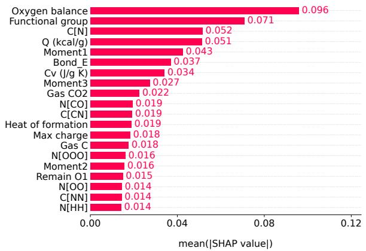

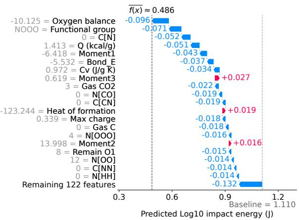  
Figure 1: Shapley values for PETN, averaged over its 490 observations, for the twenty chemical descriptors with the largest mean absolute Shapley values. The bottom row groups the remaining 122 features, including the three experimental features.

## 5.2 The full predictive distribution

A feature of TabPFN that sets it apart from traditional machine-learning methods is that it estimates the entire predictive distribution of its target, rather than simply a point estimate. Since the impact sensitivity dataset by Marrs et al. (2023) contains repeated measurements for several compounds, it is possible for us to compare these predictive distribution estimates against the corresponding empirical ones from the data. We do so for the five most numerous compounds, given in Table 12.

Table 12: The number of observations, unique combinations of experimental features and context observations for the five most numerous compounds in the data of Marrs et al. (2023).
<table><tr><td></td><td>PETN</td><td>HMX</td><td>RDX</td><td>NQ</td><td>TNT</td></tr><tr><td>Observations</td><td>490</td><td>164</td><td>130</td><td>44</td><td>40</td></tr><tr><td>Unique combinations</td><td>8</td><td>7</td><td>9</td><td>3</td><td>6</td></tr><tr><td>Context observations</td><td>1043</td><td>1369</td><td>1403</td><td>1489</td><td>1493</td></tr></table>

For each of the five compounds, we use the data for all other compounds as context. To get a single distribution for a given compound, we average the predictive distributions over the combinations of the three experimental features, weighted by their proportions among the compound’s measurements. The kernel den sity estimates are generated using R’s default kernel bandwidth and with inverse-transform sampling using TabPFN’s quantiles. The results are given in Figure 2. The agreement is strongest for PETN, HMX and RDX, the three compounds with the most measurements in the data. TabPFN predicts both NQ and TNT to be more sensitive than their empirical data suggest.

## 6 Conclusion

We have used TabPFN, a new tabular foundation model, to predict three properties of energetic materials: impact sensitivity, decomposition temperature and crystal density. The three datasets vary in their size, and the first contains many repeated measurements for the same compounds, as well as three experimental features. Our results show that TabPFN (versions 3 and 3.5) consistently outperforms penalised linear regression (the lasso), tree-based models (random forests and XGBoost), feed-forward neural networks and Gaussian processes. This holds both when the models are given a list of chemical descriptors and when combined with Chemprop’s embedding. Overall, TabPFN achieved better results when using chemical descriptors as input rather than Chemprop’s embedding.

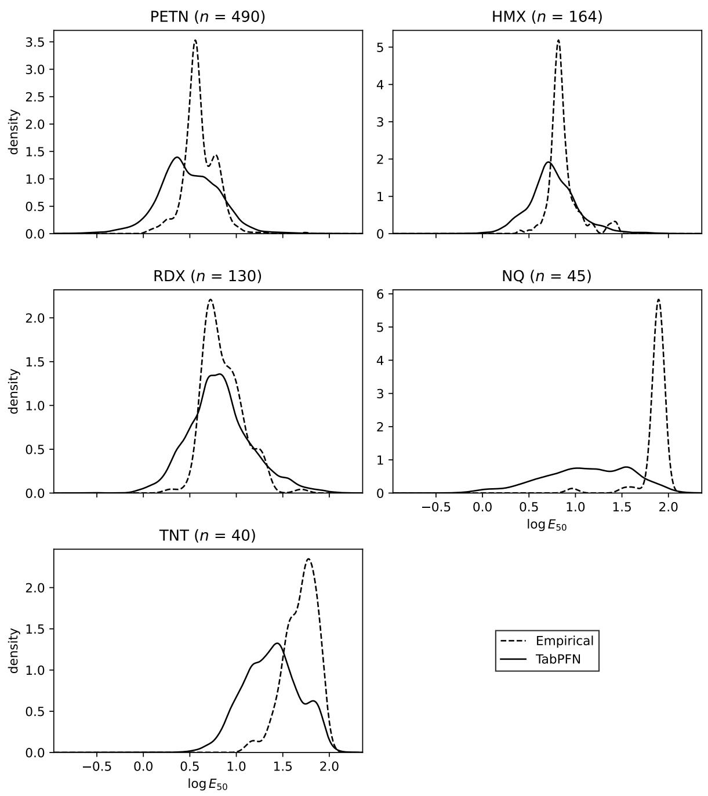  
Figure 2: Kernel density estimates of the full predictive distributions of TabPFN for the five most numerous compounds, and for their empirical distributions from the data.

We also compared TabPFN directly against (to our knowledge) the best published models on the three datasets, namely VSURF for impact sensitivity and q-RASPR for decomposition temperature and crystal density. When given chemical descriptors, TabPFN achieves more accurate results in all cases.

Further training of Chemprop’s encoder and/or TabPFN had little efect on performance (but did increase runtimes), according to our experiment on the impact sensitivity data. As a proof of concept, we compared TabPFN’s distribution predictions with the empirical distributions of five compounds with many repeated measurements in the impact sensitivity dataset. We also computed Shapley values to explain TabPFN’s predictions of impact sensitivity for these compounds.

We did not study the efect of transfer learning, as implemented by Lansford et al. (2022) and Hutchings et al. (2026), but consider combining TabPFN with transfer learning a fruitful path for future research.

## Acknowledgements

The work by Lars H. B. Olsen is funded by the Research Council of Norway’s Centre of Excellence Integreat (project no. 332645).

## Use of generative AI

The authors used the model Claude Opus 5.5 by Anthropic for assistance in literature review, coding, proofreading and checking the manuscript for mistakes and inconsistencies. The authors reviewed and edited all output and take full responsibility for the content of the paper.

## Appendix

## A Details about XGBoost

Table 13: The search space for the XGBoost hyperparameters. In each outer training set, 30 candidate configurations were drawn independently from the distributions indicated. $\textstyle \mathrm { { U } } ( a , b )$ denotes the uniform distribution on $[ a , b ]$ and log $\textstyle \mathrm { { U } } ( a , b )$ the log-uniform distribution. Integers are sampled uniformly, with end points included. The default column gives the default value in the Python library xgboost.
<table><tr><td>Hyperparameter</td><td></td><td>Default Distribution</td></tr><tr><td>Number of trees</td><td>100</td><td> $\{ 1 0 0 , \ldots , 1 0 0 0 \}$ </td></tr><tr><td>Learning rate</td><td>0.3</td><td> $\log \mathrm { U } ( 0 . 0 1 , 0 . 3 )$ </td></tr><tr><td>Maximum tree depth</td><td>6</td><td> $\{ 2 , \ldots , 8 \}$ </td></tr><tr><td>Minimum child weight</td><td>1</td><td> $\{ 1 , \ldots , 1 0 \}$ </td></tr><tr><td>Row subsampling rate</td><td>1</td><td> $\mathrm { U } ( 0 . 6 , 1 )$ </td></tr><tr><td>Column subsampling rate per tree</td><td>1</td><td>U(0.5, 1)</td></tr><tr><td> $L _ { 2 }$  penalty</td><td>1</td><td> $\log { \mathrm { U } ( 1 0 ^ { - 3 } , 1 0 ) }$ </td></tr><tr><td> $L _ { 1 }$  penalty</td><td>0</td><td> $\log { \mathrm { U } ( 1 0 ^ { - 4 } , 1 ) }$ </td></tr></table>

## B Shapley value analysis

This appendix describes how we computed the Shapley values in Section 5.1 and shows the results for four more compounds.

## B.1 Computing the Shapley values

We compute the Shapley values with tabpfn-extensions, whose explainers are built on the shapiq package (Muschalik et al., 2024).

One model per compound. We explain the five compounds with the most observations: PETN, HMX, RDX, NQ and TNT. For each of them, we recontextualise TabPFN v3, that is, we give it the observations of all other compounds as context. The explained compound is therefore never part of the context, and each compound gets its own baseline. We use eight predictors and fit the model with fit\_mode="fit\_with\_cache". The context caching speeds up the Shapley value computations described below.

One explanation per combination of experimental features. Within a compound, all observations have the same values of the chemical features and difer only in the three experimental features. Observations with the same combination of these three features therefore have identical inputs, so their predictions and Shapley values are also identical. We explain each unique combination once and copy its Shapley values to all observations with that combination. This reduces the number of explanations from 868 to 33 (see Table 12), which saves computation without changing the results. The averages in the figures are taken over observations rather than combinations, so frequent combinations weigh more. For PETN, for example,

226 of the 490 observations were tested at Los Alamos National Laboratory with grit paper and the Bruceton procedure.

Approximate marginal Shapley values. Let $\mathcal { M } = \{ 1 , \dots , M \}$ be the set of features and $v ( S )$ the prediction when only the features in a subset $S \subseteq { \mathcal { M } } ,$ called a coalition, are known. The Shapley value of feature j is $\begin{array} { r } { \phi _ { j } = \sum _ { S \subseteq \mathcal { M } \backslash \{ j \} } \frac { | S | ! \left( M - | S | - 1 \right) ! } { M ! } \left( v ( S \cup \{ j \} ) - v ( S ) \right) } \end{array}$ . Each term is the change in the prediction when $j$ is revealed after the features in $S ,$ weighted by the fraction of orders in which exactly these features come before j. Exact Shapley values are expensive to compute, especially with as many features as here, because they require $v ( S )$ for every coalition. After removing all constant columns, we have $M = 1 4 2$ features, which means there are $2 ^ { 1 4 2 } \approx 5 . 6 \times 1 0 ^ { 4 2 }$ coalitions. We therefore approximate the Shapley values with OddSHAP (Fumagalli et al., 2026), the estimator that tabpfn-extensions recommends for TabPFN, with a budget of 25,000 coalitions for each combination of experimental features.

There are several ways to define $v ( S )$ . Conditional Shapley values average the prediction over the unknown features, drawn from their distribution given the known ones. This respects the dependence between the features, but requires a conditional distribution for every coalition, which is costly to estimate (Olsen et $\mathrm { a l . } .$ 2024; Olsen and Christensen, 2026). To speed up the computations further, we use marginal Shapley values, which ignore this dependence.

For marginal Shapley values, we estimate the value of a non-empty coalition S as $\begin{array} { r } { v ( S ) = \frac { 1 } { T } \sum _ { k = 1 } ^ { T } f \big ( x s , z _ { \bar { S } } ^ { ( t ) } \big ) } \end{array}$ where f is the TabPFN prediction of log $E _ { 5 0 }$ . In each prediction, we keep the known feature values xS fixed and fill in the unknown features in S¯ jointly from a background observation $z ^ { ( t ) }$ . We draw $T = 2 5 0$ such observations at random from the context without replacement. For the empty coalition, the shapiq implementation instead averages the predictions over the whole context. The baseline is therefore $\begin{array} { r } { v ( \emptyset ) = \frac { 1 } { N } \sum _ { i = 1 } ^ { N } f \bigl ( x ^ { ( i ) } \bigr ) } \end{array}$ , where $\boldsymbol { x } ^ { ( 1 ) } , \ldots , \boldsymbol { x } ^ { ( N ) }$ are the N context observations. With 25,000 coalitions and 250 background observations, coali tion evaluation requires $6 . 2 5 \times 1 0 ^ { 6 }$ model predictions per combination of experimental features. The context caching described above speeds up these computations.

Software. We use tabpfn 8.2.0, tabpfn-extensions 0.5.0, shapiq 1.6.0 and the TabPFN checkpoint tabpfnv3-regressor-v3 default.ckpt. All random seeds are set to 0.

## B.2 Shapley values for HMX, RDX, NQ and TNT

Figures 3–6 show the same summaries for HMX, RDX, NQ and TNT, computed and plotted as for PETN in Figure 1. The baselines difer between the compounds because each compound’s TabPFN has its own context. For HMX and RDX, the average prediction lies below the baseline, as for PETN. For NQ and TNT, it lies above, so the model predicts these two compounds to be less sensitive than the average observation in their context. Oxygen balance and Moment1 are among the ten most important descriptors for all five compounds. Both push the prediction towards higher sensitivity for PETN, HMX and RDX, and towards lower sensitivity for NQ and TNT.

Predicted Log10 impact energy (J)  
Predicted Log10 impact energy (J)  
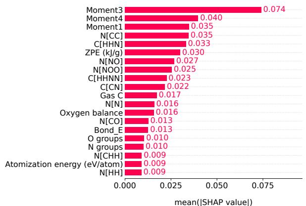

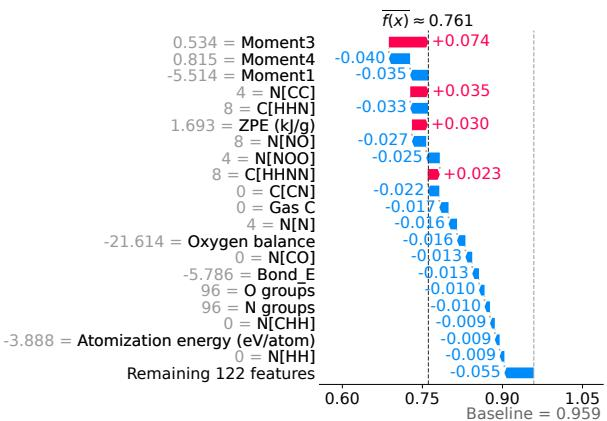  
Figure 3: Shapley values for HMX, averaged over its 164 observations. The panels are as in Figure 1.

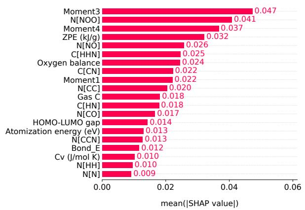

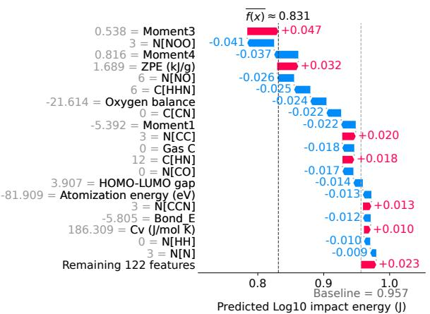  
Figure 4: Shapley values for RDX, averaged over its 130 observations. The panels are as in Figure 1.

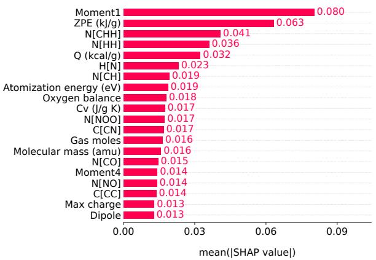

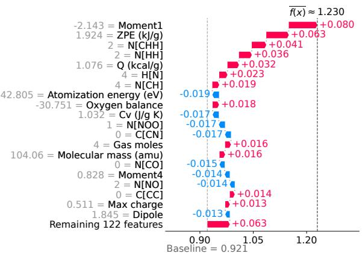  
Figure 5: Shapley values for NQ, averaged over its 44 observations. The panels are as in Figure 1.

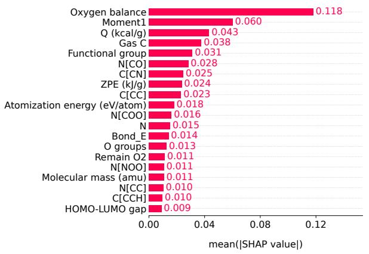

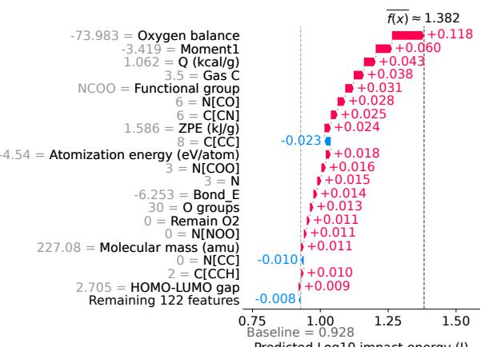  
Figure 6: Shapley values for TNT, averaged over its 40 observations. The panels are as in Figure 1.

## References

M. Altayeb, A. H. Rashid, G. Abdulakimov, S. Q. Ibrahim, E. Bekmurod, A. B. Rustamovna, V. Wasson, and T. Shahzada. New insights into drop height of energetic materials via data driven models. Propellants, Explosives, Pyrotechnics, 2026. doi:10.1002/prep.70233. In Press.

L. Breiman. Random forests. Machine Learning 45:5–32, 2001. doi:10.1023/A:1010933404324.

T. Chen and C. Guestrin. XGBoost: A scalable tree boosting system. In Proceedings of the 22nd ACM SIGKDD International Conference on Knowledge Discovery and Data Mining, pages 785–794, 2016. doi:10.1145/2939672.2939785.

D. Christensen and G. P. Novik. Stop using limiting stimuli as a measure of sensitivities of energetic materials. Propellants, Explosives, Pyrotechnics 51:1386–1400, 2026. doi:10.1002/prep.70210.

J. V. Davis, F. W. Marrs, M. J. Cawkwell, and V. W. Manner. Machine learning models for high explosive crystal density and performance. Chemistry of Materials 36:11109–11118, 2024. doi:10.1021/acs.chemmater.4c01978.

W. J. Dixon and A. M. Mood. A method for obtaining and analyzing sensitivity data. Journal of the American Statistical Association 43:109–126, 1948. doi:10.1080/01621459.1948.10483254

D. C. Elton, Z. Boukouvalas, M. S. Butrico, M. D. Fuge, and P. W. Chung. Applying machine learning techniques to predict the properties of energetic materials. Scientific Reports 8, 2018. doi:10.1038/s41598- 018-27344-x.

M. Fournier, C. Vroland, S. Megy, S. Aguero, J.-A. Chemelle, B. Defoort, G. Jacob, and R. Terreux. In silico genotoxicity prediction by similarity search and machine learning algorithm: Optimization and validation of the method for high energetic materials. Propellants, Explosives, Pyrotechnics 48, 2023. doi:10.1002/prep.202200259.

J. H. Friedman, T. Hastie, and R. Tibshirani. Regularization paths for generalized linear models via coordinate descent. Journal of Statistical Software 33:1–22, 2010. doi:10.18637/jss.v033.i01.

F. Fumagalli, L. Butler, J. S. Kang, K. Ramchandran, and R. T. Witter. An odd estimator for Shapley values. ArXiv preprint, 2026. arXiv:2602.01399.

J. Gardner, G. Pleiss, K. Q. Weinberger, D. Bindel, and A. G. Wilson. GPyTorch: Blackbox matrix-matrix Gaussian process inference with GPU acceleration. In Advances in Neural Information Processing Systems, volume 31, 2018.

R. Genuer, J.-M. Poggi, and C. Tuleau-Malot. Variable selection using random forests. Pattern Recognition Letters 31:2225–2236, 2010. doi:10.1016/j.patrec.2010.03.014.

R. Genuer, J.-M. Poggi, and C. Tuleau-Malot. VSURF: An R package for variable selection using random forests. The R Journal 7:19–33, 2015. doi:10.32614/RJ-2015-018.

D. E. Graf, N. K. Morgan, J. W. Burns, A. C. Doner, B. Li, S.-C. Li, J. Manu, A. Menon, H.-W. Pang, H. Wu, A. S. Zalte, J. W. Zheng, C. W. Coley, W. H. Green, and K. P. Greenman. Chemprop v2: An eficient, modular machine learning package for chemical property prediction. Journal of Chemical Information and Modeling 66:28–33, 2026. doi:10.1021/acs.jcim.5c02332.

S. Graˇzulis, D. Chateigner, R. T. Downs, A. F. T. Yokochi, M. Quir´os, L. Lutterotti, E. Manakova, J. Butkus, P. Moeck, and A. Le Bail. Crystallography Open Database – an open-access collection of crystal structures. Journal of Applied Crystallography 42:726–729, 2009. doi:10.1107/S0021889809016690.

L. Grinsztajn, E. Oyallon, and G. Varoquaux. Why do tree-based models still outperform deep learning on typical tabular data? In Advances in Neural Information Processing Systems, volume 35, 2022.

L. Grinsztajn et al. TabPFN-3: Technical report. ArXiv preprint, 2026. arXiv:2605.13986.

E. Heid, K. P. Greenman, Y. Chung, S.-C. Li, D. E. Graf, F. H. Vermeire, H. Wu, W. H. Green, and C. J. McGill. Chemprop: A machine learning package for chemical property prediction. Journal of Chemical Information and Modeling 64:9–17, 2024. doi:10.1021/acs.jcim.3c01250.

N. Hollmann, S. M¨uller, L. Purucker, A. Krishnakumar, M. K¨orfer, S. B. Hoo, T. Schirrmeister, and F. Hutter. Accurate predictions on small data with a tabular foundation model. Nature 637:319–326, 2025. doi:10.1038/s41586-024-08328-6.

G. Hutchings, J. V. Davis, V. W. Manner, M. J. Cawkwell, and F. W. Marrs. Predicting drop-weight impact sensitivity from molecular graphs using physics-informed artificial intelligence. Propellants, Explosives, Pyrotechnics 51, 2026. doi:10.1002/prep.70098.

B. J¨ager et al. TabPFN-3.5: Technical report. ArXiv preprint, 2026. arXiv:2609.17895.

J. Langer and M. Heil. Prediction of material properties of energetic materials using machine learning methods. In J. Akhavan, editor, Next Generation Energetics: 2nd International Explosives Conference, pages 85–98. Royal Society of Chemistry, 2025. doi:10.1039/9781837677559-00085.

J. L. Lansford, B. C. Barnes, B. M. Rice, and K. F. Jensen. Building chemical property models for energetic materials from small datasets using a transfer learning approach. Journal of Chemical Information and Modeling 62:5397–5410, 2022. doi:10.1021/acs.jcim.2c00841.

A. Liaw and M. Wiener. Classification and regression by randomForest. R News 2:18–22, 2002.

I. Loshchilov and F. Hutter. Decoupled weight decay regularization. Poster at the Seventh International Conference on Learning Representations, 2019.

F. W. Marrs, J. V. Davis, A. C. Burch, G. W. Brown, N. Lease, P. L. Huestis, M. J. Cawkwell, and V. W. Manner. Chemical descriptors for a large-scale study on drop-weight impact sensitivity of high explosives. Journal of Chemical Information and Modeling 63:753–769, 2023. doi:10.1021/acs.jcim.2c01154.

M. Muschalik, H. Baniecki, F. Fumagalli, P. Kolpaczki, B. Hammer, and E. H¨ullermeier. shapiq: Shapley interactions for machine learning. In Advances in Neural Information Processing Systems, volume 37, 2024

H. Nefati, J.-M. Cense, and J.-J. Legendre. Prediction of the impact sensitivity by neural networks. Journal of Chemical Information and Computer Sciences 36:804–810, 1996. doi:10.1021/ci950223m.

B. T. Neyer. A D-optimality-based sensitivity test. Technometrics 36:61–70, 1994. doi:10.1080/00401706.1994.10485401.

P. Nguyen, D. Loveland, J. T. Kim, P. Karande, A. M. Hiszpanski, and T. Y.-J. Han. Predicting energetics materials’ crystalline density from chemical structure by machine learning. Journal of Chemical Information and Modeling 61:2147–2158, 2021. doi:10.1021/acs.jcim.0c01318.

L. H. B. Olsen and D. Christensen. Computing conditional Shapley values using tabular foundation models. ArXiv preprint, 2026. arXiv:2602.09489.

L. H. B. Olsen, I. K. Glad, M. Jullum, and K. Aas. A comparative study of methods for estimating model-agnostic Shapley value explanations. Data Mining and Knowledge Discovery 38:1782–1829, 2024. doi:10.1007/s10618-024-01016-z.

S. K. Pandey and K. Roy. Predicting the performance and stability parameters of energetic materials (EMs) using a machine learning-based q-RASPR approach. Energy Advances 3:1293–1306, 2024. doi:10.1039/d4ya00215f.

F. Pedregosa, G. Varoquaux, A. Gramfort, V. Michel, B. Thirion, O. Grisel, M. Blondel, P. Prettenhofer, R. Weiss, V. Dubourg, J. Vanderplas, A. Passos, D. Cournapeau, M. Brucher, M. Perrot, and E. Duchesnay.´ Scikit-learn: Machine learning in Python. Journal of Machine Learning Research 12:2825–2830, 2011.

C. E. Rasmussen and C. K. I. Williams. Gaussian Processes for Machine Learning. MIT Press, 2006.

RDKit: Open-source cheminformatics software. https://www.rdkit.org, 2026.

L. S. Shapley. A value for n-person games. In H. W. Kuhn and A. W. Tucker, editors, Contributions to the Theory of Games II. Princeton University Press, 1953.

R. Tibshirani. Regression shrinkage and selection via the lasso. Journal of the Royal Statistical Society: Series B (Methodological) 58:267–288, 1996. doi:10.1111/j.2517-6161.1996.tb02080.x.

M. Titsias. Variational learning of inducing variables in sparse Gaussian processes. In Proceedings of the 12th International Conference on Artificial Intelligence and Statistics, volume 5 of Proceedings of Machine Learning Research (PMLR), pages 567–574, 2009.

United Nations Economic Commission for Europe. ST/SG/AC.10/11/Rev.8 Manual of Tests and Criteria. 8th rev. ed., 2023.

United Nations Economic Commission for Europe. ST/SG/AC.10/1/Rev.24 Model Regulations on the Trans port of Dangerous Goods. 24th rev. ed., 2025.

A. Vaswani, N. Shazeer, N. Parmar, J. Uszkoreit, L. Jones, A. N. Gomez, L. Kaiser, and I. Polosukhin. Attention is all you need. In Advances in Neural Information Processing Systems, volume 30, 2017.

D. Weininger. SMILES, a chemical language and information system. 1. introduction to methodol ogy and encoding rules. Journal of Chemical Information and Computer Sciences 28:31–36, 1988. doi:10.1021/ci00057a005.

C. Wespiser and D. Mathieu. Application of machine learning to the design of energetic materials: Preliminary experience and comparison with alternative techniques. Propellants, Explosives, Pyrotechnics 48, 2023. doi:10.1002/prep.202200264.

J.-n. Wu, S.-w. Song, X.-l. Tian, Y. Wang, and X.-j. Qi. Machine learning-based prediction and interpreta tion of decomposition temperatures of energetic materials. Energetic Materials Frontiers 4:254–261, 2023. doi:10.1016/j.enmf.2023.09.001.

Y. Xu, L. Jiang, J. Li, Z. Fang, and J. Qiu. Deep learning-based QSPR for predicting impact sensitivity of energetic nitro compounds. Molecular Physics, 2026. doi:10.1080/00268976.2026.2679580. In Press.

C. Yang, J. Chen, R. Wang, M. Zhang, C. Zhang, and J. Liu. Density prediction models for energetic compounds merely using molecular topology. Journal of Chemical Information and Modeling 61:2582–2593, 2021. doi:10.1021/acs.jcim.0c01393.

K. Yang, K. Swanson, W. Jin, C. Coley, P. Eiden, H. Gao, A. Guzman-Perez, T. Hopper, B. Kelley, M. Mathea, A. Palmer, V. Settels, T. Jaakkola, K. Jensen, and R. Barzilay. Analyzing learned molecular representations for property prediction. Journal of Chemical Information and Modeling 59:3370–3388, 2019. doi:10.1021/acs.jcim.9b00237.

X. Zang, X. Zhou, H. Bian, W. Jin, X. Pan, J. Jiang, M. Y. Koroleva, and R. Shen. Prediction and construction of energetic materials based on machine learning methods. Molecules 28, 2023. doi:10.3390/molecules28010322.

H. Zou and T. Hastie. Regularization and variable selection via the elastic net. Journal of the Royal Statistical Society Series B: Statistical Methodology 67:301–320, 2005. doi:10.1111/j.1467-9868.2005.00503.x.