# AdjointFlow: Accelerating Scientific Inverse Problems with Physics-Based Transport

Ethan Hanold1, Nicholas M. Bofi2, Qin Li1, Leonardo Zepeda-Núñez3

1University ofWisconsin–Madison, Madison, WI, USA 2Carnegie Mellon University, Pittsburgh, PA, USA 3Google Research, Mountain View, CA, USA

## Abstract

Inverse problems are ubiquitous across scientific applications ranging from seismic imaging to astrophysics to nondestructive testing, yet classical solvers often struggle with nonconvexity and repeated evaluations of expensive physical models. Difusion models can amortize this computation ofline, but largely data-driven conditional models underutilize known physics and sufer from ill-conditioned transport maps when the target distribution is concentrated. Plug-and-play (PnP) methods explicitly leverage the physical model to guide a learned prior, improving data consistency but reintroducing costly iterative computations. We instead propose AdjointFlow, a framework built on stochastic interpolants that injects the known physics into the generative transport itself. We design a data-dependent, adjoint-based initialization to reduce transport distance to the target, modify the transport velocity to remain regular as the endpoint distributions concentrate, and parameterize the network to build the initialization directly into the learned velocity. Together, these enable accurate reconstruction at substantially lower cost than generative models starting from Gaussian noise. Experiments on inverse scattering, seismic imaging, and black hole imaging show that AdjointFlow consistently produces more accurate reconstructions than conditional difusion models while being up to five orders of magnitude faster at inference than PnP methods. Optional inference-time refinement that queries the physical model can further improve data consistency, matching or exceeding the accuracy of PnP methods without retraining.

Keywords: Inverse problems, Flow matching, Stochastic interpolants, Difusion models, Scientific machine learning

## 1. Introduction

Inverse problems are ubiquitous across science and engineering, arising in diverse domains ranging from molecular X-ray difraction [1] and seismic imaging [2] to medical tomography [3] and astrophysics [4]. In each case, the objective is to recover unknown structural or material properties of a medium from indirect measurements, typically acquired at the boundary. Unlike standard image-processing tasks, these scientific inverse problems are governed by physical forward models that can be highly nonlinear, often leading to a nonconvex optimization landscape containing numerous nonphysical, or “spurious,” local minima [5]. Consequently, computing or learning the inverse map from measurements to the underlying medium can be especially dificult.

Wave-based inverse problems are perhaps the most representative of these challenges [6]. Historically1, hand-crafted asymptotic approximations [7] have been used to obtain computationally eficient, qualitative reconstructions [8, 9]. However, the advent of modern computers coupled with advances in numerical simulation has made PDE-constrained optimization [10, 11, 12] the prevalent approach for numerical inversion. These optimization methods are based on well-established computational techniques and can yield high-quality reconstructions [13]. Nevertheless, their nonconvex optimization landscapes are often plagued by spurious local minima, making the reconstruction sensitive to initialization and requiring carefully designed algorithmic strategies [14, 15, 16]. Moreover, every iteration necessitates several calls to the forward map (and its adjoint), which in turn entails solving the underlying physical model – typically a system of partial diferential equations (PDEs). Repeated PDE solves render the overall computation prohibitive as the desired reconstruction resolution increases.

Over the past decade, machine learning (ML) has emerged as a promising paradigm for inverse problems, ofering the ability to amortize the cost of inversion. Within this paradigm, a neural network is trained ofline on a collection of examples and subsequently deployed to perform rapid inference, typically bypassing the iterative optimization and repeated PDE solves. ML-based approaches broadly fall into two categories. Deterministic methods directly learn a point estimate of the reconstruction, typically by training highly-tailored neural networks to approximate the inverse map [17, 18, 19]. Generative methods, by contrast, seek to learn the underlying distribution rather than a single point estimate. Modern generative models based on difusion [20, 21] or flow matching [22, 23] generate samples by learning a transport map from a simple base distribution to a target distribution. In the context of inverse problems, this target distribution is the conditional posterior distribution of the unknown parameters given the measurements, providing a natural framework for approximating and sampling from the Bayesian posterior [24]. Such generative approaches can be classified based on how they incorporate the relationship between measurements and unknown parameters: Difusion-based plug-and-play methods first learn an unconditional prior and then incorporate measurement data during inference [25, 26, 27] using highly tailored guidance terms. Conditional generative models instead learn the measurement-reconstruction relationship during training, allowing them to estimate the posterior directly [28, 29].

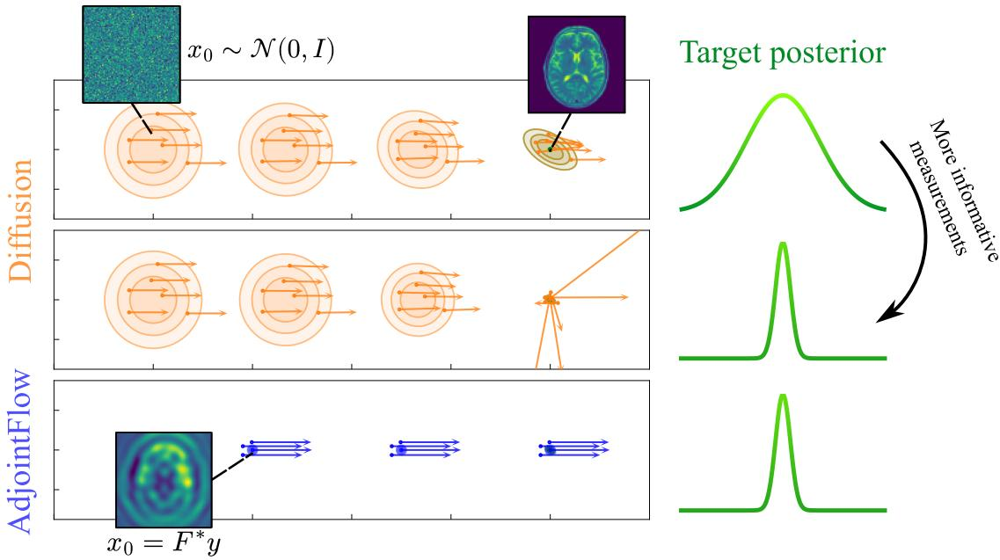  
Figure 1: Overview. Traditional difusion-based approaches start from uninformative Gaussian noise and can sufer from ill-conditioned transport fields when the target posterior becomes concentrated, such as when more informative measurements are acquired. Conversely, AdjointFlow starts from a data-dependent initialization – for example, one constructed from the adjoint �∗� as shown above – reducing transport distance relative to Gaussian noise and producing favorable learning conditions for the solver. AdjointFlow further leverages a noise-free velocity which remains regular near concentrated endpoints.

Generative models have recently demonstrated strong performance on inverse problems [25, 30, 26, 31, 32, 27, 29, 33, 34, 28, 35], providing highly accurate reconstructions. However, most of these methods adopt a fixed Gaussian reference distribution; here we argue that Gaussian-to-posterior transport is poorly suited to scientific inverse problems. We instead adapt the reference distribution and transport velocity to the structure of these problems and obtain an iterative, deterministic method that retains the noise-augmented training of generative models while being able to match or surpass their accuracy at a substantially lower inference cost.

Two features of scientific inverse problems motivate this departure from a fixed Gaussian reference. First, an independent Gaussian reference discards information already available through the physical forward model. As such, generation must begin from uninformative noise even when cheap physics-based approximations are available leaving the full relationship between measurements and unknown parameters to be learned from data or injected via guidance. Second, scientific inverse problems can exhibit strong posterior concentration as the quantity or quality of measurements increases, as described by the Bernstein–von Mises theorem [36]. Transporting order-one Gaussian noise to an increasingly concentrated conditional target requires increasingly contractive dynamics and can lead to velocity fields with poor endpoint regularity. Such rapidly varying fields can be dificult to approximate accurately and integrate numerically, creating challenges for both learning and inference and ultimately degrading the overall performance of the generative model [37, 38]. Together, these observations motivate a physics-aware reconstruction method with transport dynamics which are easier to learn and which permit accurate reconstruction using fewer integration steps.

Our proposed method, AdjointFlow, addresses these two limitations through two complementary design choices. First, we exploit the flexibility ofthe stochastic interpolant (SI) framework [23, 39] to replace the independent Gaussian reference with a data-dependent, physics-aware initialization. Specifically, we use an adjoint-based approximation to map measurements into the unknown parameter space, converting paired measurement-reconstruction data into paired transport endpoints. We find that a reference distribution centered at a physical approximation – and, in the concentrated posterior regime, one that is similarly concentrated – reduces transport distance to the desired reconstruction; see Figure 1 for an illustration. Second, we introduce a modified SI velocity field tailored to concentrated endpoint distributions, which remains well-conditioned as these endpoints become singular. We show that together, these design choices admit an especially natural data-dependent target prediction parameterization of the learned velocity, which analytically incorporates the known physical approximation and reduces the task of learning a velocity field to the task of predicting the target reconstruction itself. In summary, AdjointFlow replaces a generic Gaussian-to-data transport problem with a physics-informed refinement problem whose velocity is better behaved near concentrated targets and whose learning objective is directly aligned with the desired reconstruction.

Beyond these core components, the flexibility of the SI framework also allows AdjointFlow to interface with inference-time refinement strategies without retraining the underlying model. Such refinement permits additional computation to be introduced at deployment – for example, via calls to the forward model – when greater reconstruction accuracy or physical consistency is desired. Finally, we evaluate AdjointFlow across a diverse collection of scientific inverse problems, demonstrating that these modeling choices translate into meaningful improvements in both accuracy and eficiency.

## Our main contributions can be summarized as follows:

1. We incorporate governing physics into the transport initialization through a singular, adjoint-based reference distribution, and analyze conditions under which this choice reduces transport distance to the target posterior.

2. We characterize the regularity issues that arise in the SI velocity field with highly concentrated endpoint distributions and develop a modified noise-free velocity with improved regularity in this regime.

3. We combine these design choices into an iterative, deterministic reconstruction method which admits a natural data-dependent target prediction parameterization. This parameterization analytically incorporates the physical initialization and reduces velocity learning to predicting the target reconstruction from time-dependent, noise-augmented states.

4. We demonstrate that AdjointFlow can be combined with optional plug-and-play algorithms that interface with the physical forward model at inference time, enabling training-free improvements to reconstruction accuracy and physical consistency.

5. We evaluate our framework on scientific inverse problems from two benchmarks [29, 40] covering inverse scattering, seismic imaging, and black hole imaging. We observe up to ∼70% lower reconstruction error compared to state-of-the-art inversion algorithms – even when they use larger or more complex architectures – and speedups of one to five orders of magnitude.

The remainder of the paper is organized as follows. In Section 2, we review background details on scientific inverse problems and stochastic interpolants. In Section 3, we introduce the methodological framework of AdjointFlow, developing a generative algorithm for scientific inverse problems in the concentrated posterior regime. We present numerical results in Section 4 and ablate our primary design choices in Section 5. In Section 6 we provide a comprehensive discussion of related work. We conclude with final remarks in Section 7.

## 2. Background and Preliminaries

In this section, we briefly review scientific inverse problems, which provide the motivating problem setting, and stochastic interpolants, which provide our methodological framework. We emphasize the features leveraged by our method and the limitations it is designed to address.

## 2.1. Inverse Problems

The goal in inverse problems is to recover an unknown signal from indirect, possibly noisy measurements. The measurement procedure is represented by a forward problem $y = { \mathcal { F } } ( m )$ , where the forward function $\mathcal { F } : \mathcal { M } \to \mathcal { Y }$ maps parameters2 $m \in { \mathcal { M } }$ to observational data $y \in \mathcal { Y }$ , and the inverse problem subsequently asks to recover � from �. In scientific settings, F typically involves a physical model characterized by a PDE with measurements obtained from the resulting physical state (such as at the domain boundary).

While we primarily focus on inverse scattering, a canonical wave-based scientific inverse problem illustrated in the three leftmost settings in Figure 2, our framework is general and applicable to arbitrary scientific inverse problems, particularly those which admit an eficient linearized solution.

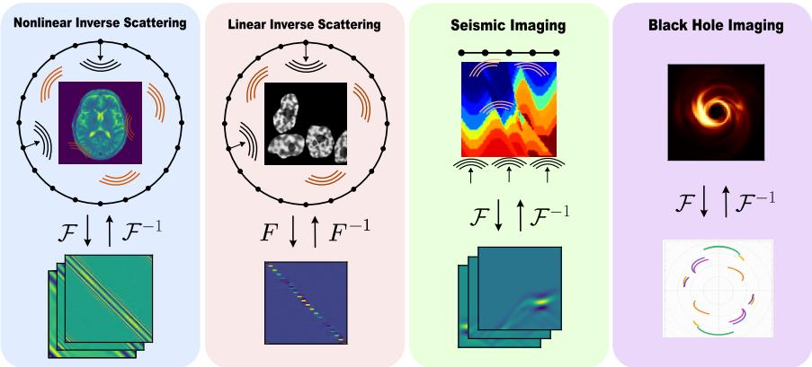  
Figure 2: Diagram of the diferent settings and modalities of inverse problems we consider. Top: a diagram of the data acquisition setting, including a representative example of the parameters � represented by the wavespeed (in the case of scattering problems) or brightness (in the case of black holes). Bottom: an example of the measurement data used for the reconstruction. Note that the full aperture scattering is measured in the frequency domain, while the geophysical scattering is measured in the time domain.

A classical approach to numerically solve the inverse problem is to formulate it as a PDE-constrained optimization problem. In this setting, one searches for the parameters � whose predicted measurements F(�) best match the true observed data �. Namely, one seeks the minimizer to the following least-squares problem:

$$
m ^ { \star } = \mathop { \mathrm { a r g m i n } } _ { m \in \mathcal { M } } \frac { 1 } { 2 } \| \mathcal { F } ( m ) - y \| _ { 2 } ^ { 2 } + \frac { \epsilon } { 2 } \| m \| ^ { 2 } .\tag{1}
$$

For a linear forward operator $F ,$ an explicit solution is given by the Tikhonov-regularized [41] reconstruction

$$
m ^ { \star } = ( F ^ { * } F + \epsilon I ) ^ { - 1 } F ^ { * } y ,\tag{2}
$$

sometimes referred to as the filtered back-projection formula (FBP), where $\epsilon > 0$ is a parameter introduced to mitigate the numerical rank deficiency of $F ^ { * } F$

$F ^ { * }$ is the adjoint of the forward operator, and is often called the back-projection operator. Intuitively, $F ^ { * }$ takes the data measured at the boundary and propagates it back into the unknown domain M, providing a rough estimate of where the perturbation is located. The operator $( F ^ { * } F + \epsilon I ) ^ { - 1 }$ then acts as a filtering operator, which compensates and sharpens the estimate produced by the back-projection. Solving the entire linear system is often prohibitive in practice; however, using only the back-projection operator can already yield a strong low-pass approximation – see, for example, Figure 4 – at a fraction of the computational cost.

In essence, an adjoint can act as an approximate inverse providing an inexpensive initial reconstruction. However, as we show in what follows, in some cases even an approximation of the adjoint can still convey useful information to the reconstruction.

If the problem is nonlinear, a natural extension is to linearize the forward operator around a simple background medium � $\in { \mathcal { M } } :$

$$
\mathcal { F } ( \overline { { { m } } } + \delta m ) \approx \mathcal { F } ( \overline { { { m } } } ) + F \delta m ,\tag{3}
$$

where now $\begin{array} { r } { F = \frac { \partial \mathcal { F } } { \partial m } ( \overline { { m } } ) } \end{array}$ is the Jacobian matrix of the forward operator3. This approximation simplifies the inversion back into a linearized least-squares minimization with data misfit term $\begin{array} { r } { \frac { 1 } { 2 } \| y - ( \mathcal { F } ( \overline { { m } } ) + F \delta m ) \| ^ { 2 } } \end{array}$ , which can be solved with the FBP formula. Note that the linearized problem is posed in the perturbation �� rather than in � itself, so the back-projection is applied to the residual $\widetilde { y } = y - \mathcal { F } ( \overline { { m } } )$ and returns an estimate of ��.

When high contrast or strong nonlinearity undermines linearized, FBP-like approximations [43], one can instead address the fully nonlinear problem through iterative gradient-based optimization. Adjoints remain central in this setting: the adjoint-state method [44] is a key algorithm for evaluating the data misfit gradient with one forward and one adjoint PDE solve, regardless of the dimension of �.

However, dificulties still remain. For one, the map $\mathcal { F }$ typically involves a compact operator which attenuates high-frequency details in � and renders the problem ill-posed [45] in the sense that small changes in � can lead to large changes in �. If measurement noise is present, or if the physical model contains epistemic uncertainties, the challenge of obtaining a high-quality reconstruction is even more formidable. Thus, while PDE-constrained optimization provides a general recipe for solving scientific inverse problems, it can still struggle to mitigate instability and characterize uncertainty.

## 2.2. Bayesian Perspective

One solution to these challenges is to approach the inverse problem from a Bayesian perspective which explicitly characterizes the uncertainty. Following Bayes’ theorem, we assume the unknown parameters follow a conditional posterior distribution

$$
p ( m \mid y ) \propto p ( y \mid m ) p ( m ) ,\tag{4}
$$

where $p ( y \mid m )$ is the likelihood function and $p ( m )$ is a prior distribution on �. A reconstruction � can then be obtained, for example, by computing the maximum a posteriori (MAP) estimator

$$
m ^ { \mathrm { M A P } } = \operatorname * { a r g m a x } _ { m \in \mathcal { M } } p ( m \mid y ) .\tag{5}
$$

A regime of particular relevance for scientific inverse problems is that of the small-noise or increasing-information limit. In such a regime, identifiable inverse problems – those in which unknown parameters are uniquely determined by noiseless observations – can exhibit posterior concentration around the ground truth $m ^ { \dagger }$ , provided the inversion is also stable and the prior satisfies suitable support conditions [46, 47]. Many scientific inverse problems, such as wave-based inverse problems, admit uniqueness under suficiently informative measurements [9], and can exhibit posterior concentration with enough data. Conversely, in common image-based inverse problems such as inpainting or super-resolution, the forward operator typically has a nontrivial null space and the posterior remains spread out even as the noise vanishes.

For instance, in a finite-dimensional setting under suitable regularity conditions, the Bernstein–von Mises theorem characterizes this concentration by an asymptotically Gaussian posterior with vanishing covariance centered around an estimator $\widetilde { m } ( y )  m ^ { \dagger }$

$$
p ( m \mid y ) \approx { \cal N } \biggl ( \widetilde { m } ( y ) , \sigma _ { 1 } ^ { 2 } \bar { Z } ( m ^ { \dagger } ) ^ { - 1 } \biggr )  \delta _ { m ^ { \dagger } } \quad \mathrm { a s } \quad \sigma _ { 1 } \to 0 ,\tag{6}
$$

where denotes weak convergence, ${ \cal T } ( m ^ { \dagger } )$ is the Fisher information matrix and $\sigma _ { 1 } ^ { 2 }$ is an efective posterior variance scale with $\begin{array} { r } { \sigma _ { 1 } ^ { 2 } \sim \frac { 1 } { n } \ : \mathrm { o r } \ : \sigma _ { 1 } ^ { 2 } \sim \sigma _ { y } ^ { 2 } } \end{array}$ for an increasing number of measurements � or decreasing measurement noise $\sigma _ { y } .$ , respectively. This observation motivates us to examine solvers that work efectively in the regime of concentrated posterior distributions.

Although direct evaluation of the posterior is typically intractable, many algorithms aim to generate samples from it [24]. A common class of methods is based on Markov chains constructed so that their invariant measure is the posterior distribution, as in Langevin Monte Carlo. Unfortunately, sampling from the posterior can be computationally prohibitive, as each likelihood evaluation requires applying the forward map $\mathcal { F }$ . Moreover, theoretical guarantees of eficient sampling for these algorithms often rely on assumptions that may not hold in practice. Recently, generative models have been used to shift much of this computational cost to an ofline training stage, enabling more eficient online reconstruction.

## 2.3. Stochastic Interpolants

The generative problem is to produce new samples from a distribution $\rho _ { X }$ given only a dataset of samples $\{ ( x ^ { i } ) \} _ { i = 1 } ^ { n }$ drawn from $\rho _ { X }$ . The stochastic interpolant (SI) framework $[ 4 8 , 2 3 ]$ solves this problem by defining an interpolation process $I _ { t }$ which connects two endpoint distributions $\rho _ { 0 }$ and $\rho _ { 1 }$ and learning a map which transports samples from one endpoint to the other. Then, by choosing an easy-to-sample “base distribution” for $\rho _ { 0 }$ and the target distribution $\rho _ { X }$ for $\rho _ { 1 }$ , one can transform samples from $\rho _ { 0 }$ into samples from $\rho _ { X }$ by simply solving an ordinary diferential equation (ODE) or stochastic diferential equation (SDE) that realizes $I _ { t }$

Specifically, we define an interpolant

$$
I _ { t } = \alpha _ { t } x _ { 0 } + \beta _ { t } x _ { 1 } + \gamma _ { t } z , \qquad t \in [ 0 , 1 ] ,\tag{7}
$$

where $( x _ { 0 } , x _ { 1 } ) \sim \rho ( x _ { 0 } , x _ { 1 } )$ for a distribution $\rho ( x _ { 0 } , x _ { 1 } )$ which has marginals $\rho _ { 0 }$ and $\rho _ { 1 }$ , and $z \sim \mathcal { N } ( 0 , \sigma ^ { 2 } I )$ is independent of $( x _ { 0 } , x _ { 1 } )$ . The coeficients must satisfy $\alpha _ { 0 } = \beta _ { 1 } = 1$ and $\alpha _ { 1 } = \beta _ { 0 } = \gamma _ { 0 } = \gamma _ { 1 } = 0 .$ be diferentiable for $t \in ( 0 , 1 )$ , and be continuous for $t \in [ 0 , 1 ]$ , but otherwise leave room for flexibility in how one designs the transport map.

In the SI paper [23] the authors use $\alpha _ { t } = 1 - t , \beta _ { t } = t$ and $\gamma _ { t } = \sqrt { 2 t ( 1 - t ) }$ , though diferent choices can produce other common generative models. For example, a variance-preserving difusion [21, 49] can be represented as $\alpha _ { t } = \sqrt { 1 - t ^ { 2 } }$ and $\beta _ { t } = t ,$ and flow matching [22] as $\alpha _ { t } = 1 - t$ and $\beta _ { t } = t$ . Additionally, standard flow and difusion models often choose $\gamma _ { t } = 0$ given that the base distribution $\rho _ { 0 }$ is already chosen to be a Gaussian independent of $\rho _ { 1 }$

We then let $\rho _ { t } = \operatorname { L a w } ( I _ { t } )$ for $t \in ( 0 , 1 )$ . Under suitable integrability and regularity assumptions, these laws satisfy the continuity equation

$$
\begin{array} { r } { \partial _ { t } \rho _ { t } + \nabla \cdot ( b _ { t } \rho _ { t } ) = 0 , \quad \mathrm { w i t h } \quad b _ { t } ( x ) = \mathbb E [ \dot { I } _ { t } \mid I _ { t } = x ] , } \end{array}\tag{8}
$$

where the expectation in $b$ is taken over both $( x _ { 0 } , x _ { 1 } ) \sim \rho$ and $z \sim \mathcal { N } ( 0 , \sigma ^ { 2 } I )$ . Equivalently, for $\epsilon _ { t } \geq 0$ and $\sigma ^ { 2 } \gamma _ { t } > 0$ the density satisfies

$$
\partial _ { t } \rho _ { t } + \nabla \cdot ( ( b _ { t } - \epsilon _ { t } ( \sigma ^ { 2 } \gamma _ { t } ) ^ { - 1 } \mathscr { D } _ { t } ) \rho _ { t } ) = \epsilon _ { t } \Delta \rho _ { t } , \quad \mathrm { w i t h } \quad \mathscr { D } _ { t } ( x ) = \mathbb { E } \big [ z \mid I _ { t } = x \big ] .\tag{9}
$$

Thus, any sample drawn from $\rho _ { 0 }$ and transported according to either (8) or (9) generates a sample from $\rho _ { 1 }$ at $t = 1$ To realize this in practice, one must learn4 a velocity field $\widehat { b } _ { t } ( x ) \approx b _ { t } ( x )$ by solving a squared-error regression problem with the flow matching objective

$$
\hat { b } : = \underset { b } { \mathrm { a r g m i n } } \ \mathbb { E } _ { t } \mathbb { E } _ { x _ { 0 } , x _ { 1 } , z } \left[ \left\| b _ { t } ( I _ { t } ) - \dot { I } _ { t } \right\| _ { 2 } ^ { 2 } \right] ,\tag{10}
$$

where the inner expectation is over training data $\left( { x } _ { 0 } , { x } _ { 1 } \right)$ and the independent noise $z ,$ and $\hat { b }$ is parametrized by a neural network. If SDE sampling is desired, a similar objective can be used to learn $\hat { \mathcal { D } } _ { t } ( x ) \approx \mathcal { D } _ { t } ( x )$

Once $\hat { b }$ and $\hat { \mathcal { D } } _ { t }$ are learned, we may generate samples from the target distribution by initializing $x _ { t = 0 } \sim \rho _ { 0 }$ and numerically integrating the probability flow ODE

$$
\dot { x } _ { t } = \hat { b } _ { t } ( x _ { t } ) ,\tag{11}
$$

or SDE

$$
\begin{array} { r } { d x _ { t } = \left[ \hat { b } _ { t } ( x _ { t } ) - \epsilon _ { t } ( \gamma _ { t } \sigma ^ { 2 } ) ^ { - 1 } \hat { \mathcal { D } } _ { t } ( x _ { t } ) \right] d t + \sqrt { 2 \epsilon _ { t } } d W _ { t } , } \end{array}\tag{12}
$$

from $t = 0$ to $t = 1$ , where $W _ { t }$ is Brownian noise.

Remark 2.1. Extending the SI framework to conditional sampling is straightforward. Given a dataset of paired samples $\{ ( x ^ { i } , y ^ { i } ) \} _ { i = 1 } ^ { n }$ drawn from a joint distribution $\rho _ { X Y } ( x , y )$ , we seek to learn a generative model that, given new data �, produces samples from the conditional distribution $\rho _ { X | Y } ( x | y )$ . The SI formulation can be directly extended to this conditional setting by making all functions parameterized by an external variable $y ;$ for example, one would extend $b _ { t } ( x )$ to $b _ { t } ( x ; y ) = \mathbb { E } [ \dot { I } _ { t } \mid I _ { t } = x ; y ]$ . The training objective (10) is also modified so that the inner expectation is over paired training data $( x , y )$ in addition to �.

## 3. Methodology

In this section we introduce our proposed framework for AdjointFlow, a generative model designed for scientific inverse problems in the concentrated posterior regime. The key insight of AdjointFlow is to combine an informative physics-based initialization with a velocity formulation suited to concentrated posterior distributions. The adjoint of the forward map provides a physically meaningful initial estimate, while posterior concentration motivates concentrating the initial distribution around this estimate. Since standard SI velocity fields can become ill-conditioned near concentrated endpoints, this construction also motivates a velocity formulation that remains regular in this regime.

We develop these components as follows. In Section 3.1, we explore how to define an informative, physically relevant initial distribution by leveraging the adjoint of the forward map, including how posterior concentration motivates concentrating this initialization as well. In Section 3.2 we devise a velocity field which remains regular even with highly concentrated endpoints. Section 3.3 combines these two ideas into a cohesive generative method by leveraging a data-dependent target prediction parameterization that directly aligns the learning objective with the desired reconstruction. Finally, Section 3.4 demonstrates how AdjointFlow can incorporate inference-time scaling for improved physical consistency without retraining.

## 3.1. Physics-Based Couplings with Stochastic Interpolants

Generative models for scientific inverse problems look to sample from the conditional posterior distribution $\rho _ { 1 } = p ( m \mid y )$ by learning a conditional velocity field $\hat { b } _ { t } ( x ; y )$ parameterized by measurements �, as detailed in Remark 2.1. While the standard convention is to define an independent Gaussian reference distribution $\rho _ { 0 } = N ( 0 , I )$ , the SI framework (7) is not restricted to this choice: the endpoint distributions $\rho _ { 0 }$ and $\rho _ { 1 }$ may be arbitrary, and even coupled [39]. Therefore, taking motivation from work showing that optimal-transport-based couplings can simplify learned flows and improve training and inference eficiency [50, 51], we investigate how the design of $\rho _ { 0 }$ can afect the transport distance between endpoints, and what choices can minimize it.

The paired-data setting inherent to inverse problems provides a natural correspondence from which to construct endpoint distributions: each training sample provides measurements � together with the corresponding unknown parameters $m .$ . However, the domains are mismatched: $y \in \mathcal { Y }$ and $m \in { \mathcal { M } }$ generally occupy diferent spaces and cannot be directly interpolated. A physics-based reconstruction map resolves this mismatch by converting each measurement � into an approximation of � in parameter space $M$

A natural choice – if the problem is linear or admits an eficient linearization – is to use the adjoint $F ^ { * } y ^ { 5 }$ to approximate ${ { \mathcal { F } } ^ { - 1 } }$ and map measurements � into M. Specifically, one may use (3) to define a physics-based initialization

$$
a ( y ) = \overline { { m } } + F ^ { * } \bigl ( y - \mathcal { F } ( \overline { { m } } ) \bigr ) ,\tag{13}
$$

where $\overline { { m } }$ is a pre-specified background medium. In the case of a homogeneous background $\overline { { m } } = 0$ with $\mathcal { F } ( 0 ) = 0$ the initialization reduces to $a ( y ) = F ^ { * } y$ . Henceforth, we use $a ( y )$ to denote an inexpensive physics-based approximation used to initialize the interpolant, even if it may not directly correspond to the adjoint operator (see, for example, Section 4.4).

Though $a ( y )$ is not the exact inversion, it contains physically meaningful information. We may therefore hypothesize that $a ( y )$ can serve as an informative center to the reference distribution, for example, by defining $\rho _ { 0 } = N ( a ( y ) , \sigma _ { 0 } ^ { 2 } I )$ . We are further left with the question of how to concentrate $\rho _ { 0 }$ around $a ( y )$ , and may naturally hypothesize that the optimal concentration of $\rho _ { 0 }$ should match the concentration of $\rho _ { 1 }$

To aid our analysis, we first introduce the Wasserstein-2 distance, a cornerstone of optimal-transport theory which measures the minimum root-mean-square Euclidean displacement required to transport one distribution into the other. The distance is defined as

$$
\mathcal { W } _ { 2 } ( \rho _ { 0 } , \rho _ { 1 } ) = \left( \operatorname* { i n f } _ { \gamma \in \Pi ( \rho _ { 0 } , \rho _ { 1 } ) } \mathbb { E } _ { ( x _ { 0 } , x _ { 1 } ) \sim \gamma } \left. x _ { 0 } - x _ { 1 } \right. _ { 2 } ^ { 2 } \right) ^ { 1 / 2 } ,\tag{14}
$$

where $\Pi ( \rho _ { 0 } , \rho _ { 1 } )$ is the set of all couplings of the distributions $\rho _ { 0 }$ and $\rho _ { 1 }$ .

To decompose the analysis of the transport distance between endpoints into diferences of centers and spreads, we leverage the following property of the $\mathcal { W } _ { 2 }$ distance: for any distributions $\rho _ { 0 }$ and $\rho _ { 1 }$ with finite second moments and means $\mu _ { 0 }$ and $\mu _ { 1 }$ ,

$$
\begin{array} { r } { \mathcal { W } _ { 2 } ^ { 2 } ( \rho _ { 0 } , \rho _ { 1 } ) = \| \mu _ { 0 } - \mu _ { 1 } \| _ { 2 } ^ { 2 } + \mathcal { W } _ { 2 } ^ { 2 } ( \overline { { \rho } } _ { 0 } , \overline { { \rho } } _ { 1 } ) , } \end{array}\tag{15}
$$

where $\overline { { \rho } } _ { 0 }$ and $\overline { { \rho } } _ { 1 }$ are the shifted versions of $\rho _ { 0 }$ and $\rho _ { 1 }$ which have zero mean. This result comes immediately from examining $( 1 4 )$ , since the act of translation induces a bijection between couplings and the cross term in $\mathbb { E } \| x _ { 0 } - x _ { 1 } \| _ { 2 } ^ { 2 }$ vanishes once the distributions have zero mean.

Using this fact, we now demonstrate that centering the reference distribution around a physics-based approximation can reduce the transport distance to the target posterior relative to a mean-zero reference distribution (such as a standard Gaussian initialization). We leave the proofs to Appendix A.

Proposition 3.1. Let $y = F m + \varepsilon .$ for a linearforward operator � with $\varepsilon \sim { \cal N } ( 0 , \sigma _ { \mathrm { v } } ^ { 2 } I )$ and a flat prior on � $\in \mathbb { R } ^ { d } .$ and suppose $r = \| F ^ { * } F - I \| _ { \mathrm { o p } } < 1$ . Furthermore, with $\mu = ( F ^ { * } F ) ^ { - 1 } F ^ { * } y$ the mean ofthe posterior $\rho _ { 1 } = p ( m \mid y )$ take any zero-mean distribution $\rho _ { 0 }$ withfinite second moment, and $\rho _ { 0 } ^ { \mathrm { a d j } }$ its translation by $F ^ { * } y$ . Then

$$
\mathcal { W } _ { 2 } ^ { 2 } ( \rho _ { 0 } , \rho _ { 1 } ) - \mathcal { W } _ { 2 } ^ { 2 } ( \rho _ { 0 } ^ { \mathrm { a d j } } , \rho _ { 1 } ) \geq ( 1 - r ^ { 2 } ) \| \mu \| _ { 2 } ^ { 2 } ,\tag{16}
$$

so $\mathcal { W } _ { 2 } ( \rho _ { 0 } ^ { \mathrm { a d j } } , \rho _ { 1 } ) < \mathcal { W } _ { 2 } ( \rho _ { 0 } , \rho _ { 1 } )$ whenever $F ^ { * } y \neq 0 .$

We can extend this result to nonlinear operators by leveraging the linearization in (3). Namely, we suppose $\mathcal { F }$ is diferentiable at a fixed background � with Jacobian $\begin{array} { r } { F = \frac { \partial \mathcal { F } } { \partial m } ( \overline { { m } } ) } \end{array}$ , and reformulate the problem in the perturbation coordinates

$$
\delta m = m - \overline { { { m } } } , \qquad \widetilde { y } = y - \mathcal { F } ( \overline { { { m } } } ) ,\tag{17}
$$

where $\rho _ { 1 }$ is now the posterior over �� (assumed to have finite second moment and mean $\mu )$

Proposition 3.2 (Nonlinear extension). Suppose F has �-Lipschitz Jacobians and � satisfies $r = \| F ^ { * } F - I \| _ { \mathrm { o p } } < 1$ Suppose further that there exists an unconstrained least-squares solution �★ = argmin $\lVert y - \mathcal { F } ( m ) \rVert _ { 2 } ^ { 2 }$ with residual $e = y - { \mathcal { F } } ( m ^ { \star } )$ ). Defining $\delta ^ { \star } = m ^ { \star } - \overline { { m } }$ and $\tau = \lVert \boldsymbol { \mu } - \boldsymbol { \delta } ^ { \star } \rVert _ { 2 } ,$ if

$$
\begin{array} { r } { \frac { L } { 2 } \| \boldsymbol { F } \| _ { \mathrm { o p } } \| \delta ^ { \star } \| _ { 2 } ^ { 2 } + L \| \boldsymbol { e } \| _ { 2 } \| \delta ^ { \star } \| _ { 2 } + 2 \tau < ( 1 - r ) \| \delta ^ { \star } \| _ { 2 } , } \end{array}\tag{18}
$$

then for any zero-mean $\rho _ { 0 }$ with finite second moment and $\rho _ { 0 } ^ { \mathrm { a d j } }$ its translation by $F ^ { * } \widetilde { y } ,$ , we have $\mathcal { W } _ { 2 } ( \rho _ { 0 } ^ { \mathrm { a d j } } , \rho _ { 1 } ) <$ $\mathcal { W } _ { 2 } ( \rho _ { 0 } , \rho _ { 1 } )$

Each term in the inequality (18) has a clear meaning: 2� accounts for the ofset between the posterior mean and the least-squares solution, $\begin{array} { r l } { \frac { L } { 2 } \lVert \boldsymbol { F } \rVert _ { \mathrm { o p } } \lVert \delta ^ { \star } \rVert _ { 2 } ^ { 2 } } \end{array}$ is the Taylor remainder of the linearization6, $L \| e \| _ { 2 } \| \delta ^ { \star } \| _ { 2 }$ couples the least-squares residual to the nonlinearity, and $( 1 - r ) \lVert \delta ^ { \star } \rVert _ { 2 }$ is the margin bought by the adjoint’s accuracy as an inverse.

In particular, in the identifiable, stable small-noise regime described in Section 2.2, with uniform integrability of ∥�∥ under the posterior distributions, we have $m ^ { \star }  m ^ { \dagger } , e  0$ , and $\tau  0 ;$ the suficient condition then becomes

$$
\| m ^ { \dagger } - \overline { { m } } \| _ { 2 } < \frac { 2 ( 1 - r ) } { L \| F \| _ { \mathrm { o p } } } .\tag{19}
$$

Remark 3.3. The bound $r < 1$ is a scale-dependent condition which depends on the units of $F ^ { * }$ . In practice we input a normalized $a ( y )$ to the neural network, which fixes the choice of units, and only the condition number � of $F ^ { * } F$ remains intrinsic. For ill-conditioned operators where $\kappa \gg 1$ , the guaranteed margin $1 - r = O ( \kappa ^ { - 1 } )$ is small. However, $r < 1$ is a suficient but not necessary condition: the proofs only use bounds on $F ^ { * } F - I$ along relevant directions, which can hold even when $r \geq 1$ if these directions are well-conditioned.

Having addressed where to center $\rho _ { 0 }$ , we now ask how concentrated it should be. We show that to minimize the transport distance in the case of Gaussian endpoints, $\rho _ { 0 }$ should aim to match the spread of $\rho _ { 1 }$

Proposition 3.4. Assume a �-dimensional isotropic Gaussian target $\rho _ { 1 } = N ( \mu _ { 1 } , \sigma _ { 1 } ^ { 2 } I )$ and reference distribution $\rho _ { 0 } = N ( \mu _ { 0 } , \sigma _ { 0 } ^ { 2 } I )$ . Then

$$
\mathcal { W } _ { 2 } ^ { 2 } ( \rho _ { 0 } , \rho _ { 1 } ) = \| \mu _ { 0 } - \mu _ { 1 } \| _ { 2 } ^ { 2 } + d ( \sigma _ { 0 } - \sigma _ { 1 } ) ^ { 2 } ,\tag{20}
$$

which,forfixed $\mu _ { 0 } ,$ is minimized at $\sigma _ { 0 } = \sigma _ { 1 }$ . Consequently, in the singular-endpoint limit $\sigma _ { 1 }  0$ motivated by (6), the optimal base variance also vanishes. In particular, when $\sigma _ { 1 } = 0$ , the minimum is attained by $\rho _ { 0 } = \delta _ { \mu _ { 0 } }$

Proof. This result can be quickly inferred from the Wasserstein-2 formula for Gaussians:

$$
\begin{array} { r } { \mathcal { W } _ { 2 } ^ { 2 } ( N ( a , \Sigma _ { A } ) , N ( b , \Sigma _ { B } ) ) = \| a - b \| _ { 2 } ^ { 2 } + \mathrm { t r } \Big ( \Sigma _ { A } + \Sigma _ { B } - 2 ( \Sigma _ { A } ^ { 1 / 2 } \Sigma _ { B } \Sigma _ { A } ^ { 1 / 2 } ) ^ { 1 / 2 } \Big ) . } \end{array}\tag{21}
$$

With isotropic Gaussian endpoints, this becomes $\| \mu _ { 0 } - \mu _ { 1 } \| _ { 2 } ^ { 2 } + \operatorname { t r } \left( ( \sigma _ { 0 } - \sigma _ { 1 } ) ^ { 2 } I \right) = \| \mu _ { 0 } - \mu _ { 1 } \| _ { 2 } ^ { 2 } + d ( \sigma _ { 0 } - \sigma _ { 1 } ) ^ { 2 }$ when � is the $d \times d$ identity. □

These conclusions suggest that, if we suspect a concentrated posterior distribution, a singular reference distribution $\rho _ { 0 } = \delta _ { a ( \mathrm { y } ) } - \mathrm { e . g }$ . using an adjoint-based approximation � $\iota ( y ) = F ^ { * } y -$ can provide an initialization that is geometrically better aligned to the target than a standard Gaussian distribution.

We verify this numerically by computing Wasserstein-2 distances for all datasets considered in this paper. As reported in Table E.12, the concentrated, physics-based reference $\delta _ { a ( y ) }$ has a smaller transport distance than a standard Gaussian on every dataset considered (see Appendix E.3 for more details). We additionally examine empirically how transport distance relates to reconstruction accuracy in our ablations (see Table 7).

## 3.2. A Noise-Free Velocity Field for Concentrated Endpoints

The second component of AdjointFlow is a modified SI velocity field designed to remain regular even with singular endpoints. Our construction is motivated by the concentrated-posterior regime (6), which also favors concentrating the physics-based initialization, as shown in Proposition 3.4. However, concentration at either endpoint can introduce dificulties for the standard SI velocity field. The following proposition makes this precise: when either endpoint distribution collapses to a point mass, the spatial Lipschitz constant cannot remain uniformly bounded near that endpoint.

Proposition 3.5. Suppose

$$
x _ { 0 } \sim \rho _ { 0 } = N ( \mu _ { 0 } , \sigma _ { 0 } ^ { 2 } I ) , \qquad x _ { 1 } \sim \rho _ { 1 } = N ( \mu _ { 1 } , \sigma _ { 1 } ^ { 2 } \Sigma _ { 1 } ) , \qquad z \sim N ( 0 , \sigma ^ { 2 } I ) ,\tag{22}
$$

are independent Gaussians and the interpolant covariance $C _ { t } = \alpha _ { t } ^ { 2 } \sigma _ { 0 } ^ { 2 } I + \beta _ { t } ^ { 2 } \sigma _ { 1 } ^ { 2 } \Sigma _ { 1 } + \gamma _ { t } ^ { 2 } \sigma ^ { 2 } I$ satisfies $C _ { t } \succ 0 f o r$ $t \in ( 0 , 1 )$ . Then, for any $t \in ( 0 , 1 )$ the SI velocityfield (8) admits an analyticform

$$
b _ { t } ( \boldsymbol { x } ) = \dot { \mu } ( t ) + K _ { b } ( t ) \big ( \boldsymbol { x } - \mu ( t ) \big ) \qquad w i t h \qquad \mu ( t ) : = \alpha _ { t } \mu _ { 0 } + \beta _ { t } \mu _ { 1 } , \qquad K _ { b } ( t ) : = \frac 1 2 \dot { C } _ { t } C _ { t } ^ { - 1 } ,\tag{23}
$$

where $C _ { t } = \operatorname { C o v } ( I _ { t } )$ . In the singular-endpoint limit (6) where $\sigma _ { 1 } = 0 , K _ { b } ( t )$ becomes unbounded as � ↑ 1; thus, $b _ { t }$ fails to remain uniformly Lipschitz in � near the target endpoint. Namely,

$$
\operatorname* { l i m } _ { t \uparrow 1 } \operatorname* { s u p } _ { t \uparrow } \| \nabla _ { x } b _ { t } \| = \operatorname* { l i m } _ { t \uparrow 1 } \operatorname* { s u p } _ { t \uparrow } \| K _ { b } ( t ) \| = \infty .\tag{24}
$$

Similarly, $i f \sigma _ { 0 } = 0 ,$ the spatial Lipschitz constant cannot remain uniformly bounded near the base endpoint, as

$$
\operatorname* { l i m } _ { t \downarrow 0 } \operatorname* { s u p } _ { t \downarrow 0 } \ \| \nabla _ { x } b _ { t } \| = \operatorname* { l i m } _ { t \downarrow 0 } \operatorname* { s u p } \ \| K _ { b } ( t ) \| = \infty .\tag{25}
$$

The unbounded Lipschitz constant identified by Proposition 3.5 creates spatial sensitivity that one would like to numerically avoid. Since $b _ { t } ( \hat { x } _ { t } ) - b _ { t } ( x _ { t } ) = K _ { b } ( t ) ( \hat { x } _ { t } - x _ { t } )$ , small state errors from learned approximation or numerical discretization can produce large velocity errors, potentially complicating learning and requiring smaller integration steps. The behavior along exact interpolant trajectories also depends on the interpolant: for a linear interpolant, velocities remain bounded as $t $ 1 along exact interpolant trajectories, yet they diverge for a variance-preserving difusion interpolant (see Appendix A.3). Another common strategy known as early stopping avoids the endpoint singularity by truncating the integration at a fixed $t < 1$ , yet this generally introduces bias by terminating transport before fully reaching the target distribution.

While the preceding examples concern transporting a nondegenerate source to a singular target, Proposition 3.4 suggests a more natural design in this regime: choosing a concentrated source as well. However, with deterministic endpoints and no bridge noise, training states collapse onto the trajectory $I _ { t } = \mu ( t )$ , leaving the learned field unconstrained away from it. Adding bridge noise $I _ { t } = \mu ( t ) + \gamma _ { t } z$ gives the training distribution full support at interior times, but the standard SI velocity must generate and remove this noise artificially, leading to the endpoint ill-conditioning identified in Proposition 3.5. To retain noise augmentation during training while separating its contribution to the velocity, we use the standard decomposition

$$
b _ { t } ( \boldsymbol { x } ) = \nu _ { t } ( \boldsymbol { x } ) + \dot { \gamma } _ { t } \mathcal { D } _ { t } ( \boldsymbol { x } ) ,\tag{26}
$$

where $\mathcal { D } _ { t }$ is as in (9) and we term

$$
\nu _ { t } ( x ) = \mathbb { E } \big [ \dot { \alpha } _ { t } x _ { 0 } + \dot { \beta } _ { t } x _ { 1 } | I _ { t } = x \big ]\tag{27}
$$

the noise-free velocity since the noise bridge term $\dot { \gamma } _ { t } z$ has been removed from the expectation. The following corollary establishes spatial regularity of the noise-free velocity for singular endpoints and, under suitable interpolant schedules, exact recovery of the target mean even when the target has nonzero variance.

Corollary 3.6. Under the same assumptions as Proposition 3.5, the noise-free velocity field $\nu _ { t }$ admits an analytic form

$$
\nu _ { t } ( x ) = \dot { \mu } ( t ) + K _ { \nu } ( t ) \big ( x - \mu ( t ) \big ) \qquad w i t h \qquad K _ { \nu } ( t ) : = \bigg ( \dot { \alpha } _ { t } \alpha _ { t } \sigma _ { 0 } ^ { 2 } I + \dot { \beta } _ { t } \beta _ { t } \sigma _ { 1 } ^ { 2 } \Sigma _ { 1 } \bigg ) C _ { t } ^ { - 1 } ,\tag{28}
$$

where $\mu ( t )$ and $C _ { t }$ are as in (23). In the singular-endpoint limit (6) with $\sigma _ { 1 } = 0 , i f \sigma _ { 0 } = 0$ and $\sigma > 0$ then $K _ { \nu } \equiv 0$ and $\nu _ { t } ( x ) = { \dot { \mu } } ( t )$ , which has uniform spatial regularity since $\nabla _ { x } \nu _ { t } = 0 .$ . Moreover, $i f \sigma _ { 0 } = 0 , \sigma > 0 ,$ , and $\Sigma _ { 1 } \succ 0 _ { : }$ choosing $\alpha _ { t } = 1 - t , \beta _ { t } = t ,$ and $\gamma _ { t } = \sqrt { t ( 1 - t ) }$ ensures that the noise-free $O D E \dot { x } _ { t } = \nu _ { t } ( x _ { t } )$ initialized at $x _ { 0 } = \mu _ { 0 }$ uniquely recovers the target mean $x _ { 1 } = \mu _ { 1 }$

Corollary 3.6 thus motivates using the noise-free velocity $\nu _ { t }$ with a deterministic source $( \sigma _ { 0 } = 0 )$ and nonzero bridge noise $( \sigma > 0 )$ . The proofs of Proposition 3.5 and Corollary 3.6 are left to Appendix $\mathbf { A } ,$ , and leverage the conditional expectation formula for jointly Gaussian random variables as their primary tool.

Remark 3.7. In practice, the combination of a deterministic reference distribution with the noise-free velocity yields an iterative, but deterministic, reconstruction method. Namely, for fixed measurements this method produces a single point reconstruction rather than a sample from a non-degenerate posterior. Randomness enters only through time-dependent noise augmentation during training. A similar training strategy appears in [52], which adds noise-augmented states to a standard flow-matching loss to improve generalization of flow-based generative models. Here, we derive this construction from the regularity of interpolants with concentrated endpoints.

## 3.3. Data-Dependent Target-Prediction

We now combine the main ideas from Section 3.1 and Section 3.2 into a cohesive framework. To attain a base distribution geometrically aligned with the target, Proposition 3.2 and Proposition 3.4 suggest choosing a singular base distribution located at a physically informative initialization. If the forward model can be linearized eficiently, the adjoint typically provides a strong initial guess and a natural initialization is $\delta _ { F ^ { * } y } .$ . Corollary 3.6 then shows that to generate samples when the endpoint distributions are singular, the noise-free velocity $\nu _ { t }$ could be numerically advantageous because it recovers regularity where the standard SI velocity $b _ { t }$ lacks it.

Hence, we define AdjointFlow as the reconstruction method which solves the ODE

$$
\dot { x } _ { t } = \nu _ { t } ( x _ { t } ; y ) , \qquad x _ { t = 0 } = a ( y ) ,\tag{29}
$$

where $a ( y )$ denotes a physics-based approximation, with the notable example being $a ( y ) = F ^ { * } y$ when an eficient linearization of the forward model is available. As �0 is now a deterministic function of �, the noise-free velocity naturally decomposes as

$$
\nu _ { t } ( x ; y ) = \mathbb { E } \big [ \dot { \alpha } _ { t } x _ { 0 } + \dot { \beta } _ { t } x _ { 1 } | I _ { t } = x ; y \big ] = \dot { \alpha } _ { t } a ( y ) + \dot { \beta } _ { t } \mathbb { E } \big [ x _ { 1 } | I _ { t } = x ; y \big ] .\tag{30}
$$

This expression motivates a data-dependent target-prediction (DD-TP) parameterization of the velocity, where a network is trained to predict the clean target – a “denoiser-style” objective – rather than the tangential velocity directly. Specifically, we learn the target-prediction network

$$
\hat { m } _ { t } ( x ; y ) ~ \approx ~ \mathbb { E } [ x _ { 1 } \mid I _ { t } = x ; y ]\tag{31}
$$

and define the velocity as

$$
\hat { \nu } _ { t } ( x ; y ) = \dot { \alpha } _ { t } a ( y ) + \dot { \beta } _ { t } \hat { m } _ { t } ( x ; y ) .\tag{32}
$$

Although target and velocity prediction are equivalent on a theoretical level, they induce diferent finite-capacity hypothesis classes. Multiple recent works have argued for TP [53, 54] on the basis that it has a more stable training signal than velocity prediction. Intuitively, a TP parameterization allows the network to focus on refining the residual not already explained by the adjoint approximation. Moreover, as $t \to 1$ , target prediction approaches an identity map, whereas velocity prediction must continue to represent the measurement-dependent displacement from $a ( y )$

For AdjointFlow, target prediction is particularly natural because the initialization $x _ { 0 } ( y ) = a ( y )$ is deterministic and exact. In contrast, the standard TP is typically derived for a linear interpolant $I _ { t } = ( 1 - t ) x _ { 0 } + t x _ { 1 }$ with $x _ { 0 } \sim \mathcal { N } ( 0 , I )$ by eliminating the unknown $x _ { 0 }$ to get

$$
\hat { b } _ { t } ( x ; y ) = \frac { \hat { m } _ { t } ( x ; y ) - x } { 1 - t } .\tag{33}
$$

While the data-dependent TP directly hard-codes the physical source into velocity, standard TP must reconstruct the velocity indirectly which introduces an undesirable $( 1 - t ) ^ { - 1 }$ factor.

We also emphasize that while (31) superficially resembles a direct reconstruction network, its role in (32) leads to a diferent learning problem: target prediction is supervised across timedependent, noise-perturbed intermediate states and composed iteratively at inference. TP thus incorporates mechanisms such as supervised iterative computation and training-time stochastic regularization, which have been associated with improved performance over single-step regression in recent work [55, 56], even when inference produces a deterministic prediction.

The training and inference algorithms for AdjointFlow are provided in Algorithm 1 and Algorithm 2. Even with the modifications to the standard SI framework, the implementation $\mathrm { \bf r e - }$ mains straightforward. We use the interpolant

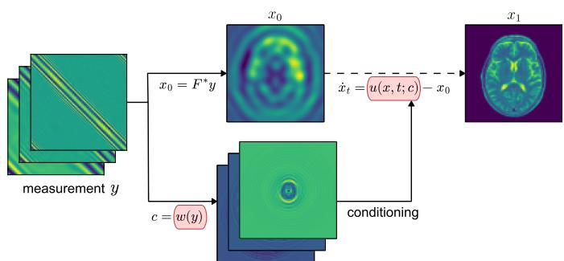  
Figure 3: Model architecture. A data encoding network � extracts domainspecific features $c = w \left( y \right)$ to condition the target-prediction network $u ( x , t ; c )$ which then forms a velocity $\dot { x } _ { t } = u ( x , t ; c ) - x _ { 0 }$ to be integrated, with initial state $x _ { 0 } = a ( y )$ at $t = 0 ,$ to produce an estimate $x _ { 1 } \approx m ^ { \dagger }$ at $t = 1$ . Red boxes denote learned components.

$I _ { t } = ( 1 - t ) x _ { 0 } + t x _ { 1 } + \sqrt { t ( 1 - t ) } z ;$ the empirical performance of other choices of $\gamma _ { t }$ is investigated in Section 5. We parameterize the TP network as $\hat { m } _ { t } ( x ; y ) = u _ { \theta } ( x , t ; w _ { \phi } ( y ) )$ where $u _ { \theta }$ is the primary target-prediction network and $w _ { \phi }$ is a bespoke data-encoding model designed to process the measurements. Figure 3 provides an illustration of this architecture.

Algorithm 1 AdjointFlow Training   
Input: paired dataset $D = \{ ( y ^ { i } , m ^ { i } ) \} _ { i = 1 } ^ { | D | }$ ; physics-based approximate inverse function $^ { a ; }$ untrained target  
prediction network $u _ { \theta } ;$ untrained data encoding network $w _ { \phi } ;$ batch size ${ \mathit { n } } _ { b } ;$ bridge noise level $\sigma .$   
repeat   
for $i = 1 , \ldots , n _ { b }$ do   
Sample pair $( y ^ { i } , m ^ { i } ) \sim D _ { \cdot }$ , time $t _ { i } \sim U ( 0 , 1 )$ , and noise $z _ { i } \sim { \cal N } ( 0 , \sigma ^ { 2 } I )$   
Compute the physics-based initialization $x _ { 0 } ^ { i } = a ( y ^ { i } )$   
Define the target $x _ { 1 } ^ { i } = m ^ { i } .$   
Compute the interpolant $x _ { t _ { i } } ^ { i } = ( 1 - t _ { i } ) x _ { 0 } ^ { i } + t _ { i } x _ { 1 } ^ { i } + \sqrt { t _ { i } ( 1 - t _ { i } ) } z _ { i } .$   
end for   
Compute empirical target-prediction loss   
$\hat { L } ( \theta , \phi ) = \frac { 1 } { n _ { b } } \sum _ { i = 1 } ^ { n _ { b } } \left\| u _ { \theta } ( x _ { t _ { i } } ^ { i } , t _ { i } ; w _ { \phi } ( y ^ { i } ) ) - x _ { 1 } ^ { i } \right\| ^ { 2 } .$   
Take a gradient step on $\hat { L } ( \theta , \phi )$ to update � and $\phi .$   
until converged   
Return: Trained target-prediction model $u _ { \theta }$ and data encoder $w _ { \phi } .$

Algorithm 2 AdjointFlow Inference (Forward Euler)   
Input: measurement data $y ;$ trained models $u _ { \theta }$ and $w _ { \phi } ;$ physics-based approximate inverse function �; integration   
steps $N \in \mathbb { N } .$   
Initialize $x _ { 0 } = a ( y )$   
for $n = 0 , \ldots , N - 1$ do   
Let $\Delta t = N ^ { - 1 }$ and $t _ { n } = n \Delta t .$   
Compute $\widehat { \nu } _ { t _ { n } } ( x _ { t _ { n } } ; y ) = u _ { \theta } ( x _ { t _ { n } } , t _ { n } ; w _ { \phi } ( y ) ) - x _ { 0 } .$   
Update $\boldsymbol { x } _ { t _ { n + 1 } } = \boldsymbol { x } _ { t _ { n } } + \Delta t \ \hat { \nu } _ { t _ { n } } ( x _ { t _ { n } } ; y )$   
end for   
Return: prediction $x _ { 1 }$

## 3.4. Inference-Time Scaling

Inference-time scaling is a common strategy in generative modeling for improving output quality without retraining the generative model. The strategy allocates additional computational resources at inference time, for example by introducing an additional guidance term or by recasting generation as a search or optimization problem. Plug-and-play (PnP) algorithms are a prominent example of inference-time scaling which apply guidance to an unconditional difusion model trained to sample from a prior distribution [40]. Although often computationally expensive due to repeated evaluations of the forward or adjoint map, similar to classical optimization algorithms, these methods can efectively incorporate physics and measurement information into the generative transport and produce high-quality reconstructions.

Fortunately, the AdjointFlow framework is also compatible with inference-time scaling. In particular, physicsbased guidance can further improve reconstruction quality and measurement consistency at the expense of increased computational cost. To this end, we adapt the RED-Dif algorithm [57] to the stochastic interpolant framework. We refer to the resulting algorithm as RED-Flow.

RED-Dif recasts the generation problem as a variational inference problem. Inference is performed by minimizing an objective that balances the data misfit with a denoising-score-matching term that acts as a regularizer. Following this formulation, we replace the score-based regularization with an analogous flow-matching term which yields the following optimization problem:

$$
\operatorname* { m i n } _ { m } \quad \underbrace { \| y - \mathcal { F } ( m ) \| ^ { 2 } } _ { \mathrm { d a t a } \operatorname { m i s f t } } + \underbrace { \mathbb { E } \left[ \frac { \lambda _ { t } } { \dot { \beta } _ { t } } \mathbf { s g } \big [ \dot { x } _ { t } - \hat { \nu } _ { t } ( x _ { t } ; y ) \big ] ^ { \top } m \right] } _ { \mathrm { r e g u l a r i z a t i o n } } ,\tag{34}
$$

where $x _ { t } = \alpha _ { t } x _ { 0 } + \beta _ { t } m , \dot { x } _ { t } = \dot { \alpha } _ { t } x _ { 0 } + \dot { \beta } _ { t } m , \lambda _ { t }$ is a weighting schedule, $\hat { \nu } _ { t }$ is given by (32), and sg is the stop-gradient operator. Since $\dot { x } _ { t } - \hat { \nu } _ { t } = \dot { \beta } _ { t } ( m - \hat { m } _ { t } )$ due to the target-prediction parameterization, the regularization adds a

gradient term $\lambda _ { t } ( m - \hat { m } _ { t } )$ which pulls the iterate toward the learned reconstruction while the misfit term enforces data consistency. We initialize the reconstruction � to the approximation $a ( y )$ , then solve (34) using Adam [58].

By explicitly incorporating the forward model into inference through the data-misfit term, RED-Flow can improve the physical consistency of the reconstruction, albeit at increased computational cost due to repeated evaluations of F. Further details are provided in Appendix C, including the full algorithm in Algorithm 3.

## 4. Experiments

We investigate the performance of AdjointFlow and RED-Flow across four diverse inverse problems from scientific domains, each with their own formulations, modalities, and challenges: Nonlinear Frequency-Domain Inverse Scattering (Section 4.1), Linear Frequency-Domain Inverse Scattering (Section 4.2), Time-Domain Seismic Imaging (Section 4.3), and Black Hole Imaging (Section 4.4).

We compare against a range of state-of-the-art methods including classical optimization, deterministic ML models, conditional difusion models (CDM), and plug-and-play difusion prior (PnP-DP) methods, evaluating performance on a variety of accuracy metrics as well as on inference cost. Our evaluation metrics, detailed in Appendix D, aim to match the evaluation criteria of the benchmarks we test against. We report quantitative baseline results directly from the respective benchmark papers [29] or [40] unless otherwise stated. We recompute all reported Sinkhorn divergences using a common library version, since updating the library substantially changed the numerical values. We generate qualitative baseline reconstructions locally using the corresponding implementations and pretrained checkpoints, and plot absolute errors with respect to the ground truth. Unless otherwise stated, AdjointFlow uses 8 forward-Euler steps (Algorithm 2) and CDM models use 256 forward-Euler-Maruyama steps.

## 4.1. Nonlinear Frequency-Domain Inverse Scattering

In domains such as medical imaging and nondestructive testing, a common task is to infer the properties, shape, or interior characteristics of an unknown object or medium by analyzing the scattering patterns of impinging waves. To this end, the unknown medium is probed with monochromatic (single-frequency) waves, with the resulting impulse responses, in the form of scattered waves, recorded at the boundary of the domain (see Figure 2 left). This is known as the inverse scattering problem.

We consider the wideband inverse scattering problem in a two-dimensional acoustic setting. The physical model of time-harmonic wave propagation is provided by the Helmholtz equation,

$$
\Delta u ( x ) + \omega ^ { 2 } n ( x ) u ( x ) = 0 , \qquad x \in \mathbb { R } ^ { 2 } ,\tag{35}
$$

where � is the total wave field, � is the wavenumber of the probing wave, and $n ( x )$ is the squared refractive index which governs the speed at which a wave travels through the medium. We bound the medium inside a domain $\Omega \subseteq \mathbb { R } ^ { 2 }$ and assume a homogeneous vacuum of $n ( x ) = 1$ as the background. The natural choice for the media of interest then becomes the refractive index perturbation $m ( x ) = n ( x ) - 1$ to have $\operatorname { s u p p } ( m ) \subseteq \Omega$

Forward problem. The medium is illuminated by a monochromatic incident plane wave

$$
u ^ { \mathrm { i n } } ( x ; s ) = e ^ { \mathrm { i } \omega s \cdot x } , \qquad s \in \mathfrak { S } ,\tag{36}
$$

where � denotes the direction of incidence and $u ( \cdot ; s )$ denotes a wave field induced by such an incident wave. The resulting total wave field thus decomposes as $u = u ^ { \mathrm { i n } } + u ^ { \mathrm { s c } }$ , with the scattered wave $u ^ { \mathrm { s c } }$ satisfying:

$$
\begin{array} { r } { \biggr \{ \Delta u ^ { \mathrm { s c } } ( x ) + \omega ^ { 2 } \bigl ( 1 + m ( x ) \bigr ) u ^ { \mathrm { s c } } ( x ) = - \omega ^ { 2 } m ( x ) u ^ { \mathrm { i n } } ( x ) , } \\ { \biggr \} \frac { \partial u ^ { s c } } { \partial | x | } - i \omega u ^ { s c } = O \bigl ( | x | ^ { - 3 / 2 } \bigr ) \mathrm { ~ u n i f o r m l y ~ a s ~ } | x | \to \infty , } \end{array}\tag{37}
$$

where the second equation ensures uniqueness via the Sommerfeld radiation condition. Measurements are collected from receivers placed at angles $r \in \mathbb { S }$ on a circle of radius �. The recorded far-field measurements at frequency � are then denoted as

$$
y _ { \omega } ( r , s ) = u ^ { \mathrm { s c } } ( R r ; s ) \in \mathbb { C } , \qquad ( r , s ) \in \mathbb { S } \times \mathbb { S } .\tag{38}
$$

The forward map, which associates a perturbation � with its corresponding scattered field data, is defined as $\mathcal { F } _ { \omega } ( m ) = y _ { \omega } ( r , s )$

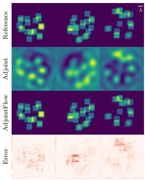  
(a)

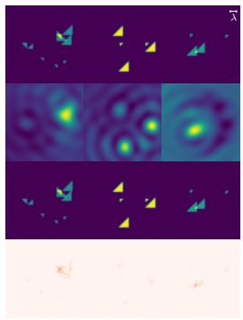  
(b)

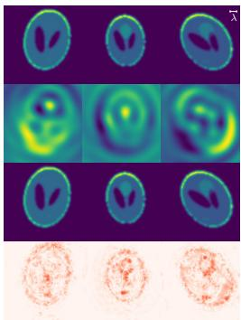  
(c)

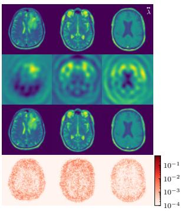  
(d)  
Figure 4: Qualitative results on nonlinear inverse scattering for (a) 10h Overlapping Squares, (b) 3–5–10h Triangles, (c) Shepp–Logan, and (d) Brain Scans. Within each panel, columns show distinct test examples; rows show, from top to bottom, the ground-truth perturbation, the adjoint-based initialization, the AdjointFlow reconstruction, and its absolute reconstruction error. The wavelength marker corresponds to 8 points per wavelength (PPW) in (a)–(c) and 5 PPW in (d).

Challenges. A major challenge of the inverse problem is multiple scattering efects: The solution to the inhomogeneous Helmholtz equation (37) admits the Born expansion

$$
y = A m + B ( m , m ) + C ( m , m , m ) + \cdots ,\tag{39}
$$

revealing a series of higher-order nonlinear terms which entangle interactions and make it dificult to know where a signal originated.

As a result, attempting to infer � from single-frequency data is a challenging, highly unstable and nonconvex problem that can lead to cycle-skipping: a phenomenon where optimization algorithms become trapped in local minima, yielding spurious, non-physical reconstructions. Collecting measurements across a range of frequencies can significantly stabilize the inversion, as each frequency band probes complementary aspects of the medium. In practice, reconstructions are carried out by aggregating the information from multiple frequencies, leading to a wideband formulation where the forward operator $\mathcal { F } _ { \bar { \Omega } } ( m ) = \{ y _ { \omega } \} _ { \omega \in \bar { \Omega } }$ collects data over a set of pre-specified frequencies Ω¯ .

Adjoint. Instead of using the adjoint of the discretized PDE, we use the far-field asymptotic approximation [9] of the Green’s function of (35) to write (up to a frequency-dependent complex prefactor) the linearized forward operator as a Fourier transform:

$$
F m \approx \int _ { \Omega } e ^ { \mathrm { i } \omega ( s - r ) \cdot x } m ( x ) d x ,\tag{40}
$$

which then gives a formulation of the far-field adjoint:

$$
( F _ { \omega } ^ { * } y ) ( x ) \approx \int _ { \mathbb { S } ^ { 1 } \times \mathbb { S } ^ { 1 } } e ^ { \mathrm { i } \omega ( r - s ) \cdot x } y _ { \omega } ( r , s ) d r d s .\tag{41}
$$

This expression allows us to eficiently apply an approximate adjoint map. Despite not being the exact adjoint, it provides informative back-projections of the measurement data as illustrated in Figure 4. Since we are in the wideband setting, each frequency admits an adjoint $F _ { \omega } ^ { * } ;$ ; we initialize AdjointFlow with the real component of the lowest-frequency adjoint because this resolves the large-scale structures of the desired reconstruction and is less prone to high-frequency artifacts.

## 4.1.1. Benchmark Dataset

We use the evaluation suite from the Back-Projection Difusion (BPD) benchmark [29], which contains 4 datasets of varying dificulty, designed to probe distinct challenges in nonlinear inverse scattering:

1. The 3–5–10h Triangles dataset contains small, randomly placed and oriented triangles with sub-wavelength features, testing the ability of the network to recover fine-scale details.

2. The 10h Overlapping Squares dataset [59] consists of multiple strongly overlapping squares, emphasizing nonlinear superposition and multiple scattering efects.

3. The Shepp–Logan Phantom dataset, designed as a simple mimicry of human brains, includes strong discontinuities and resonant cavity efects, producing dominant reflections and masking interior structures.

4. The Brain Scans dataset uses the processed MRI brain perturbations released with BPD [60], derived from fastMRI [61, 62] to evaluate performance on complex, non-synthetic perturbations with rich spatial variability.

Table 1: We compare performance on three synthetic datasets (Shepp–Logan, 3–5–10h Triangles, 10h Overlapping Squares) using RRMSE (%), $\mathbf { M E L R } \ ( \times 1 0 ^ { - 2 } )$ , and Sinkhorn divergence (SD) metrics (see Appendix D for definitions, bold indicates best performance for a given metric). All Sinkhorn divergence values, including those of the baselines, are recomputed using an updated library version and therefore difer from those reported in [29]. We find that AdjointFlow outperforms all models, including conditional difusion, across the board.
<table><tr><td></td><td colspan="3">Shepp-Logan</td><td colspan="3">3–5–10h Triangles</td><td colspan="3">10h Overlapping Squares</td></tr><tr><td>Method</td><td>RRMSE ↓</td><td>MELR↓</td><td>SD↓</td><td>RRMSE ↓</td><td>MELR↓</td><td>SD↓</td><td>RRMSE↓</td><td>MELR↓</td><td>SD↓</td></tr><tr><td>Traditional</td><td></td><td></td><td></td><td></td><td></td><td></td><td></td><td></td><td></td></tr><tr><td>FWI</td><td>52.041</td><td>241.893</td><td>7.658</td><td>28.637</td><td>159.894</td><td>0.809</td><td>38.777</td><td>281.057</td><td>4.773</td></tr><tr><td>Deterministic</td><td></td><td></td><td></td><td></td><td></td><td></td><td></td><td></td><td></td></tr><tr><td>SwitchNet</td><td>4.305</td><td>8.071</td><td>1.122</td><td>15.084</td><td>9.377</td><td>0.570</td><td>20.102</td><td>24.295</td><td>2.643</td></tr><tr><td>WideBNet</td><td>3.843</td><td>13.255</td><td>1.059</td><td>17.263</td><td>10.582</td><td>0.608</td><td>14.327</td><td>44.182</td><td>1.996</td></tr><tr><td>B-EquiNet</td><td>2.022</td><td>2.906</td><td>0.805</td><td>2.944</td><td>2.010</td><td>0.301</td><td>9.484</td><td>21.434</td><td>1.456</td></tr><tr><td>EquiNet</td><td>1.693</td><td>2.827</td><td>0.758</td><td>2.741</td><td>1.734</td><td>0.298</td><td>10.891</td><td>25.906</td><td>1.614</td></tr><tr><td>Conditional Diffusion</td><td></td><td></td><td></td><td></td><td></td><td></td><td></td><td></td><td></td></tr><tr><td>B-EquiNet CDM</td><td>1.406</td><td>1.757</td><td>0.722</td><td>1.657</td><td>1.318</td><td>0.263</td><td>2.046</td><td>2.683</td><td>0.607</td></tr><tr><td>EquiNet CDM</td><td>1.323</td><td>1.564</td><td>0.717</td><td>1.590</td><td>1.385</td><td>0.260</td><td>1.744</td><td>1.979</td><td>0.578</td></tr><tr><td>Ours</td><td></td><td></td><td></td><td></td><td></td><td></td><td></td><td></td><td></td></tr><tr><td>AdjointFlow</td><td>0.379</td><td>0.474</td><td>0.576</td><td>1.108</td><td>0.607</td><td>0.258</td><td>1.143</td><td>1.401</td><td>0.514</td></tr></table>

Numerical details. The datasets use a physical domain of $\Omega = [ - 0 . 5 , 0 . 5 ] ^ { 2 }$ , discretized on an $8 0 \times 8 0$ uniform grid. Measurements are collected at 80 equally spaced receivers on a circle of radius $R = 0 . 5 ,$ using 80 equally spaced incident plane-wave directions, so that the discretized measurement data is represented by a complex matrix $y _ { \omega } \in \mathbb { C } ^ { 8 0 \times 8 0 }$ . Far-field patterns are generated by numerically solving (37) at three dyadically spaced frequencies: $\omega / ( 2 \pi ) \in \{ 2 . 5 , 5 , 1 0 \}$ with an efective wavelength of 8 points per wavelength (PPW) for all but the Brain Scans dataset; and $\omega / ( 2 \pi ) \in \{ 4 , 8 , 1 6 \}$ with an efective wavelength of 5 PPW for Brain Scans. Diferential operators are approximated using tensor-product eighth-order finite diferences to avoid numerical dispersion, and radiation boundary conditions are enforced via a second-order perfectly matched layer (PML) with intensity 80. The resulting sparse linear systems are solved using sparse LU factorization.

Methods. The BPD benchmark evaluates a range of both classical and machine learning algorithms which includes: (a) Full Waveform Inversion (FWI) [42], a classical optimization algorithm; (b) SwitchNet [18], WideBNet [63], EquiNet/B-EquiNet [19], four deterministic ML models based on the FBP formula (2); and (c) EquiNet CDM and B-EquiNet CDM7 [29], two FBP-based conditional difusion models. Furthermore, we instantiate AdjointFlow with the same EquiNet architecture as EquiNet CDM (the best performing model from the BPD benchmark) to isolate the advantage of our modified SI formulation against a more traditional difusion model. For the Brain Scans dataset, we add additional comparisons against two state-of-the-art PnP methods: RED-Dif [57] and DAPS [27]. For these PnP methods, we evaluate the forward model using a JAXbased finite-diference Helmholtz solver8 configured to match the measurement data.

Table 2: We compare AdjointFlow and RED-Flow to PnP-DP and CDM baselines for nonlinear inverse scattering on the Brain Scans dataset, with bold indicating the best performance on each metric. We report RRMSE as a percentage and $\dot { \mathrm { M E L R } } \times 1 0 ^ { - 2 }$ . EquiNet CDM results are obtained from a model we trained using the pipeline from [29]. CDM† indicates that we evaluate the difusion model at the same number of function evaluations as AdjointFlow (namely, 8 sampling steps), thus demonstrating the advantage of AdjointFlow when compute is limited.
<table><tr><td></td><td colspan="3">Brain Scans</td></tr><tr><td>Method</td><td>RRMSE ↓</td><td>MELR↓</td><td>SD↓</td></tr><tr><td colspan="4">PnP Diffusion Prior</td></tr><tr><td>DAPS</td><td>12.572</td><td>18.700</td><td>0.278</td></tr><tr><td>RED-Diff</td><td>2.873</td><td>7.370</td><td>0.107</td></tr><tr><td colspan="4">Conditional Diffusion</td></tr><tr><td>EquiNet CDM</td><td>5.661</td><td>3.494</td><td>0.157</td></tr><tr><td>EquiNet CDM†</td><td>34.990</td><td>99.337</td><td>0.667</td></tr><tr><td colspan="4">Ours</td></tr><tr><td>AdjointFlow</td><td>3.421</td><td>4.482</td><td>0.136</td></tr><tr><td>RED-Flow</td><td>2.467</td><td>3.389</td><td>0.099</td></tr></table>

## 4.1.2. Results

We showcase representative reconstructions in Figure 4 and Figure 5, where we observe that AdjointFlow

successfully recovers sub-wavelength structures and handles multiple-scattering efects eficiently. Quantitative results are given in Tables 1 and 2. In addition to improved accuracy, AdjointFlow also provides accelerated inference, requiring only a single call to the adjoint and a small number of integration steps to solve the ODE in (29). As a result, it becomes much more eficient than conditional difusion, which can require hundreds of sampling steps, as well as PnP-DP algorithms, which can require hundreds of function / gradient evaluations. The result, illustrated in Figure 6a, reveals an inference acceleration of up tofive orders ofmagnitude, while reconstruction accuracy still remains competitive. We find that inference-time scaling methods like RED-Flow can boost the performance of AdjointFlow even further, albeit at a higher computational cost.

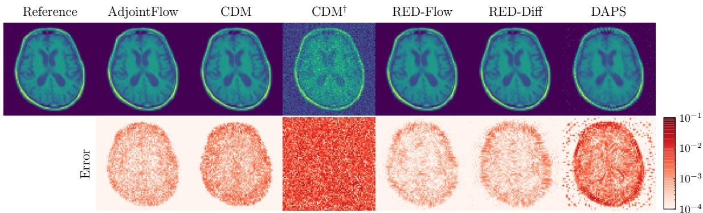  
Figure 5: Qualitative comparison of reconstructions on the Brain Scans dataset for nonlinear inverse scattering. For $\mathrm { C D M ^ { \dagger } } .$ , we evaluate the difusion model at the same number of NFE (number of function evaluations) as AdjointFlow (namely, we fix 8 sampling steps). AdjointFlow clearly performs far better in this iso-compute comparison, demonstrating its superior eficiency.

## 4.2. Linear Frequency-Domain Inverse Scattering

Often encountered in optical microscopy [64] due to the weak scattering (little to no multiple internal reflections) of most cells and thin tissue, this inverse problem linearizes the problem presented in Section 4.1, approximating the impulse response with a linear map $F \approx { \mathcal { F } }$ . Practically, this allows faster and more stable reconstructions for high-throughput and live-cell imaging. Here the forward model stems from a first-order Born approximation (39) resulting in

$$
y \approx F m ,\tag{42}
$$

where $F$ consists of the linear measurement operator composed with the linear approximation

$$
u ^ { \mathrm { s c } } ( x ) \approx \omega ^ { 2 } \int G _ { \omega } ( x , \xi ) m ( \xi ) e ^ { \mathrm { i } \omega s \cdot \xi } d \xi ,\tag{43}
$$

where $G _ { \omega }$ is the Green’s function for the homogeneous two-dimensional Helmholtz equation.

Linear inverse problems. The presence of a linear forward map makes this setup structurally similar to many common inverse problems in image processing and computer vision, such as de-blurring and super-resolution. Therefore, it provides a middle ground to test methods like AdjointFlow, specifically designed for scientific inverse problems, with other generative inversion algorithms which were primarily designed with linear image-based methods in mind. In particular, this includes PnP-DP algorithms which are only applicable in a linear regime, for example because they rely on access to a singular value decomposition or pseudoinverse. Furthermore, linearity significantly afects accuracy-cost tradeofs, as forward and gradient evaluations are no longer prohibitively expensive; they can now be computed via simple matrix multiplications.

## 4.2.1. Benchmark Dataset

We use the dataset of microscopic cell phantoms (based on HL60 nuclei) generated by InverseBench [40, 65] using the online simulator CytoPacq [66].

Numerical details. The physical domain is a square $\Omega = [ - 0 . 0 9 , 0 . 0 9 ] ^ { 2 }$ discretized on a $1 2 8 \times 1 2 8$ uniform grid. There are $n _ { \mathrm { s r c } } = 2 0$ uniformly spaced sources at a radius $R = 1 . 6$ from the origin, and a specified number $n _ { \mathrm { r e c } } \in \{ 6 0 , 1 8 0 , 3 6 0 \}$ of equally spaced receivers to evaluate performance across diferent levels of data sparsity. The simulation uses monochromatic illumination with an efective wavelength of 6 PPW. Measurements are generated using a linear map constructed via the first Born approximation (42). The specific unknown used in the benchmark is the scattering potential $\textstyle { \frac { \omega ^ { 2 } } { 4 \pi } }$ � for permittivity �. In keeping with the original benchmark, Gaussian measurement noise $\xi _ { y } \sim { \cal N } ( 0 , \sigma _ { \mathrm { v } } ^ { 2 } I )$ with strength $\sigma _ { \mathrm { y } } = 1 0 ^ { - 4 }$ is added to the measurement data.

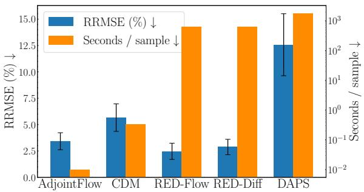  
(a) Nonlinear inverse scattering: Brain Scan.

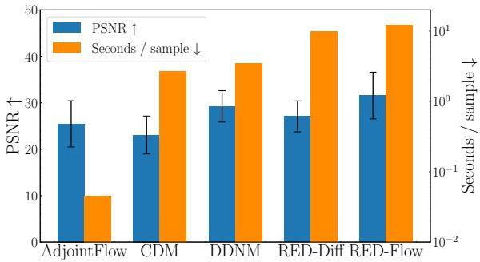  
(b) Linear inverse scattering: 60 receivers.  
Figure 6: Comparison of the eficiency–accuracy tradeof for nonlinear and linear inverse scattering. All timings were measured on the same NVIDIA RTX A6000 GPU. (a) AdjointFlow achieves a strong balance between performance and eficiency, while RED-Dif and RED-Flow ofer small accuracy improvements at substantially greater inference cost; the seconds-per-sample axis uses a logarithmic scale. (b) AdjointFlow achieves competitive accuracy at the lowest cost, though the eficiency gain is smaller than in the nonlinear problem

Methods. InverseBench evaluates a large number of PnP difusion algorithms (see Appendix B.1), all using the same pretrained difusion prior, as well as the traditional optimization algorithm FISTA-TV [67]. The results from InverseBench use a larger U-net based architecture since, as a difusion prior, it has no need to specially process conditional measurement inputs. However, given that AdjointFlow uses a conditioned network, we adopt a smaller EquiNet architecture similar to that used in Section 4.1. We also add a comparison against a CDM with the same EquiNet architecture to separate the benefit of the architecture from the generative model. Furthermore, for this case, we choose the coupling for AdjointFlow to be with the regularized pseudoinverse, namely, $a ( y ) = F _ { \epsilon } ^ { \dagger } y = ( F ^ { * } F + \epsilon I ) ^ { - 1 } F ^ { * } )$ , with � > 0 the regularization coeficient. The pseudoinverse is also concatenated as an additional channel to the conditional input to the CDM.

## 4.2.2. Results

Quantitative results are summarized in Table 3, with a representative example shown in Figure 7. On all three levels of measurement sparsity, RED-Flow outperforms baselines by a significant margin in reconstruction PSNR, and also surpasses most to all baselines on SSIM. Therefore, while the linear setting favors PnP-DP methods – many of which rely on the SVD or pseudoinverse of the forward map – AdjointFlow still delivers competitive performance while only leveraging the linear structure of the problem via the physics-based initialization.

Figure 6b again demonstrates that AdjointFlow strongly leads competing methods in terms of speed, albeit with a smaller performance gap when compared to the nonlinear problem (see Figure 6a) due to the reduced cost of running iterative algorithms in the linear setting. And, with an increased inference-time cost, RED-Flow again produces state-of-the-art reconstruction quality without any retraining of the base model. Furthermore, while methods which explicitly leverage the linear structure of the forward map – such as DDNM, FPS, and MCGdif – retain the lowest measurement errors, RED-Flow remains competitive with many of these methods, while also significantly improving data consistency over the base AdjointFlow model, especially in the low-data regime. Our findings thus support that additional sampling guidance via the forward model is especially helpful in producing physically plausible reconstructions.

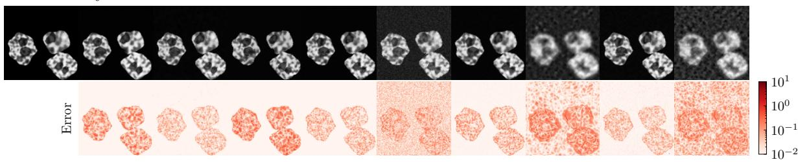  
Figure 7: Qualitative comparisons of reconstructions from AdjointFlow and difusion baselines on linear inverse scattering with 60 receivers.

## 4.3. Time-Domain Seismic Imaging

Widely used in geophysics, time-domain inverse scattering reconstructs complex underground structures using broadband seismic waveforms, often with sources and/or receivers limited to the surface.

Table 3: We present the results for linear inverse scattering with three diferent levels of measurement sparsity and noise level $\sigma _ { \mathrm { y } } = 1 0 ^ { - 4 }$ following [40] (bold result indicates best). “Meas err” quantifies relative agreement between predicted and observed measurements, following InverseBench’s normalization convention. Across all three levels of data sparsity, RED-Flow achieves the best reconstruction PSNR, while also having either the best or close to the best SSIM and competitive data consistency.
<table><tr><td rowspan="2">Number of receivers Method</td><td colspan="3">360</td><td colspan="3">180</td><td colspan="3">60</td></tr><tr><td>PSNR ↑</td><td>SSIM ↑</td><td>Meas err (%) ↓</td><td>PSNR ↑</td><td>SSIM ↑</td><td>Meas err (%) ↓</td><td>PSNR ↑</td><td>SSIM ↑</td><td>Meas err (%) ↓</td></tr><tr><td>Traditional</td><td></td><td></td><td></td><td></td><td></td><td></td><td></td><td></td><td></td></tr><tr><td>FISTA-TV</td><td>32.126 (2.139)</td><td>0.979 (0.009)</td><td>1.23 (0.25)</td><td>26.523 (2.678)</td><td>0.914 (0.040)</td><td>2.65 (0.30)</td><td>20.938 (2.513)</td><td>0.709 (0.103)</td><td>6.05 (0.65)</td></tr><tr><td>PnP Diffusion Prior</td><td></td><td></td><td></td><td></td><td></td><td></td><td></td><td></td><td></td></tr><tr><td>DDRM</td><td>32.598 (1.825)</td><td>0.929 (0.012)</td><td>1.04 (0.26)</td><td>28.080 (1.516)</td><td>0.890 (0.019)</td><td>1.57 (0.39)</td><td>20.436 (1.210)</td><td>0.545 (0.037)</td><td>3.04 (0.92)</td></tr><tr><td>DDNM</td><td>36.381 (1.098)</td><td>0.935 (0.017)</td><td>0.78 (0.22)</td><td>35.024 (0.993)</td><td>0.895 (0.027)</td><td>0.58 (0.16)</td><td>29.235 (3.376)</td><td>0.917 (0.022)</td><td>0.28 (0.07)</td></tr><tr><td>IIGDM</td><td>27.925 (3.211)</td><td>0.889 (0.072)</td><td>2.74 (1.23)</td><td>26.412 (3.430)</td><td>0.816 (0.114)</td><td>3.66 (1.79)</td><td>20.074 (2.608)</td><td>0.540 (0.198)</td><td>6.90 (3.38)</td></tr><tr><td>DPS</td><td>32.061 (2.163)</td><td>0.846 (0.127)</td><td>4.35 (1.19)</td><td>31.798 (2.163)</td><td>0.862 (0.123)</td><td>4.28 (1.20)</td><td>27.372 (3.415)</td><td>0.813 (0.133)</td><td>4.53 (1.31)</td></tr><tr><td>LGD</td><td>27.901 (2.346)</td><td>0.812 (0.037)</td><td>1.17 (0.20)</td><td>27.837 (2.337)</td><td>0.803 (0.034)</td><td>1.06 (0.16)</td><td>20.491 (3.031)</td><td>0.552 (0.077)</td><td>1.45 (0.68)</td></tr><tr><td>DiffPIR</td><td>34.241 (2.310)</td><td>0.988 (0.006)</td><td>1.11 (0.24)</td><td>34.010 (2.269)</td><td>0.987 (0.006)</td><td>1.04 (0.23)</td><td>26.321 (3.272)</td><td>0.918 (0.028)</td><td>1.27 (0.23)</td></tr><tr><td>PnP-DM</td><td>33.914 (2.054)</td><td>0.988 (0.006)</td><td>1.21 (0.25)</td><td>31.817 (2.073)</td><td>0.981 (0.008)</td><td>1.42 (0.26)</td><td>24.715 (2.874)</td><td>0.909 (0.046)</td><td>2.20 (0.34)</td></tr><tr><td>DAPS</td><td>34.641 (1.693)</td><td>0.957 (0.006)</td><td>1.03 (0.25)</td><td>33.160 (1.704)</td><td>0.944 (0.009)</td><td>1.11 (0.25)</td><td>25.875 (3.110)</td><td>0.885 (0.030)</td><td>1.51 (0.25)</td></tr><tr><td>RED-Diff FPS</td><td>36.556 (2.292) 33.242 (1.602)</td><td>0.981 (0.005) 0.870 (0.026)</td><td>0.89 (0.23)</td><td>35.411 (2.166)</td><td>0.984 (0.004)</td><td>0.87 (0.21)</td><td>27.072 (3.330)</td><td>0.935 (0.037)</td><td>1.18 (0.23)</td></tr><tr><td>MCGdiff</td><td>30.937 (1.964)</td><td>0.751 (0.029)</td><td>0.70 (0.01) 0.70 (0.01)</td><td>29.624 (1.651) 28.057 (1.672)</td><td>0.710 (0.040) 0.631 (0.042)</td><td>0.37 (0.01) 0.38 (0.01)</td><td>21.323 (1.445) 21.004 (1.571)</td><td>0.460 (0.030) 0.445 (0.028)</td><td>0.15 (0.02)</td></tr><tr><td></td><td></td><td></td><td></td><td></td><td></td><td></td><td></td><td></td><td>0.21 (0.06)</td></tr><tr><td>Conditional Diffusion</td><td></td><td></td><td></td><td></td><td></td><td></td><td></td><td></td><td></td></tr><tr><td>CDM</td><td>29.921 (3.267)</td><td>0.952 (0.019)</td><td>2.56 (0.45)</td><td>29.609 (3.289)</td><td>0.964 (0.017)</td><td>2.49 (0.27)</td><td>23.064 (4.078)</td><td>0.886 (0.070)</td><td>7.48 (0.91)</td></tr><tr><td>Ours</td><td></td><td></td><td></td><td></td><td></td><td></td><td></td><td></td><td></td></tr><tr><td>AdjointFlow</td><td>32.797 (3.966)</td><td>0.981 (0.013)</td><td>1.86 (0.21)</td><td>32.459 (3.935)</td><td>0.980 (0.013)</td><td>1.87 (0.20)</td><td>25.460 (4.969)</td><td>0.920 (0.054)</td><td>4.70 (0.99)</td></tr><tr><td>RED-Flow</td><td>38.651 (2.871)</td><td>0.984 (0.003)</td><td>0.97 (0.32)</td><td>37.476 (3.081)</td><td>0.984 (0.003)</td><td>0.87 (0.30)</td><td>31.553 (5.028)</td><td>0.936 (0.032)</td><td>0.66 (0.16)</td></tr></table>

Forward problem. The full waveform inversion problem aims to recover the features of sub-surface geophysical structures using the full time-series information of measured waveforms. Here, we aim to recover the compressional wavespeed $m ( x ) = \nu ( x )$ , which determines the speed at which sound waves travel through solids like soil and rock. This quantity is crucial for subsurface mapping as it varies considerably with material density, porosity, lithology, fracturing, and pressure.

Mathematically, we model the propagation of seismic waves through a heterogeneous medium with the acoustic wave equation

$$
\frac { 1 } { \nu ^ { 2 } } \frac { \partial ^ { 2 } u } { \partial t ^ { 2 } } - \Delta u = q ( x , t ) ,\tag{44}
$$

where $q ( x , t )$ is the source wave and $u ( x , t )$ is the pressure wavefield. This equation is then discretized as

$$
A u = q ,\tag{45}
$$

where � represents the discretization of the operator $\begin{array} { r } { \frac { 1 } { \nu ^ { 2 } } \frac { \partial ^ { 2 } } { \partial t ^ { 2 } } - \Delta } \end{array}$ and therefore depends on � in a nonlinear fashion. Here � encodes both the time and spatial dimensions, and acts on the pressure field for all discretized times and positions. For explicit time integrators, � usually has a block-lower triangular structure inherited from time causality. Finally, measurements are obtained from

$$
y = \mathcal { F } ( m ) = P u ,\tag{46}
$$

where � is the sampling operator for receivers which records the wavefield pressure at specified surface locations over a series of timesteps.

Adjoint. Using the adjoint-state method to compute the gradient is a classical recipe [44]. Algorithmically, the adjoint is computed by treating the residual between the observed measurements � and the predicted measurements $\mathcal { F } ( \hat { m } )$ as a new source. It injects the error as a wave and propagates it backwards in time to get the adjoint wavefield �� defined as

$$
A ^ { \top } \delta u = P ^ { \top } \delta y , \quad { \mathrm { w h e r e ~ } } \delta y = y - { \mathcal { F } } ( { \hat { m } } ) .\tag{47}
$$

Here, $A ^ { \top }$ will have a block upper-triangular structure, which requires solving for $\delta \boldsymbol { u }$ backwards in time. Finally, applying Equation (47) allows us to compute the gradient of the data misfit functional $\begin{array} { r } { \mathcal { T } ( \hat { m } ) = \frac { 1 } { \mathit { \Omega } } \| y - \mathcal { F } ( \hat { m } ) \| ^ { 2 } } \end{array}$ [44]. In particular, the gradient is obtained by zero-lag cross-correlation of the forward wavefield � and the adjoint wavefield ��:

$$
\nabla _ { s } \mathcal { T } = \sum _ { t = 0 } ^ { T } u ( x , t ) \frac { \partial ^ { 2 } } { \partial t ^ { 2 } } \delta u ( x , t ) ,\tag{48}
$$

which can subsequently be used in gradient descent optimization methods. Here the cross-correlation is expressed in squared-slowness coordinates $s = m ^ { - 2 }$ ; the wavespeed gradient follows by applying the chain rule: $\nabla _ { m } \mathcal { T } =$ $- 2 m ^ { - 3 } \nabla _ { s } \mathcal { T }$

The adjoint-state method thus enables direct computation of the back-projection $- \nabla _ { m } \mathcal { T } = F ^ { * } ( y - \mathcal { F } ( \overline { { m } } ) )$ by simply running the wavefield backward-in-time on a reference medium � and cross-correlating. For our case, we take the reference medium to be the mean of the training dataset, which approximates a simple depth-varying gradient. Light additional post-processing is needed to smooth out artifacts near the sources and receivers and render amplitudes consistent across depths.

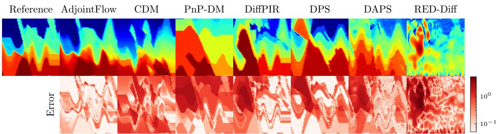  
Figure 8: Comparisons of AdjointFlow against diferent difusion-based methods on the seismic imaging task.

Challenges. As measurements are typically only taken at the free surface, the inverse problem is severely ill-posed and can have non-unique solutions. Classical algorithms that apply the adjoint-state method and cast the inversion as a local optimization problem are often more prone to cycle-skipping than in the frequency-domain inverse scattering problem. As a result, the success of this method heavily depends on starting from a suficiently accurate initial model, which is often generated from simpler ray-based methods such as travel-time tomography [13]. In addition, many state-of-the-art methods rely on frequency sweeps during the optimization loop [68], where one applies low-pass filters at increasing frequency cut-ofs to regularize the landscape of the loss. This procedure is closely related to the recursive-linearization approach [16] through the Parseval-Plancherel identity, though the two still difer in their update rules and continuation schedules. In this case, however, to remain consistent with InverseBench, we use its FWI setup based on Devito [69], which directly minimizes the full time-domain data misfit without frequency continuation or low-pass filtering.

## 4.3.1. Benchmark Dataset

We use the adapted dataset distributed by InverseBench [40, 65], derived from the CurveFault dataset in OpenFWI [70] composed of velocity profiles typically found in seismic imaging.

Numerical details. Velocity maps have been resized to 128 × 128 from the original CurveFault dataset using bilinear interpolation and anti-aliasing. Measurements are generated utilizing the Devito software stack [69]. The source is given as a Ricker wavelet with a central frequency of 5 Hz, and the simulation records 1,001 timesteps with a temporal sampling rate of �� = 0.001 [s]. The acquisition geometry consists of 16 evenly-spaced sources at a depth of 1,270 [m] and 129 evenly-spaced receivers at a depth of 10 [m], mimicking regional earthquake transmission tomography. As a result, the final measurement data is of shape � ∈ R1001×129×16. All boundaries except the top are set to be absorbing to avoid artificial reflections.

Methods. We benchmark AdjointFlow against six PnP-DP algorithms evaluated by InverseBench which, as before, all use the same pretrained difusion prior model based on an ADM U-net architecture. We also report InverseBench’s classical optimization baselines (Adam, L-BFGS) [40]; rows marked † consider a “best-case” scenario where the optimization is initialized with a smooth background model of the target medium, while the unmarked Adam row is initialized at a constant velocity of 3 km/s.

Seismic imaging FWI does not carry the same symmetries as full-aperture frequency-domain inverse scattering; therefore, we instantiate AdjointFlow with a comparable ADM U-net architecture [71] to that used by InverseBench. To process the conditional inputs, we first take a Fourier transform of the raw wavefield and select a subset of coeficients based on their energy content, reducing the measurement dimensionality from $1 6 \times 1 2 9 \times 1 0 0 1$ to $1 6 \times 3 3 \times 2 0$ . From there, we add a Fourier positional embedding [72] to encode the acquisition geometry of the sources and receivers and then process the data with a small MLP to obtain a latent context vector of dimension $1 6 \times 3 3 \times D _ { \mathrm { e m b } }$ (we choose $D _ { \mathrm { e m b } } = 5 1 2 )$ , which is then injected into the U-net via added cross-attention blocks. Finally, for training we set the target to be the velocity perturbations relative to the reference medium �. We again include a comparison against a CDM with the same architecture as AdjointFlow.

## 4.3.2. Results

Results are summarized in Table 4, which demonstrates that AdjointFlow outperforms all non-oracle baselines on all metrics but data consistency. Notably, we observe that for image-reconstruction metrics, generative models which approximate the conditional distribution directly (AdjointFlow, CDM) – thus leveraging the knowledge encoded in paired data – mostly outperform PnP-DP approaches which attempt to approximate this distribution via a Bayesian framework at inference time. On the other hand, PnP-DP approaches often provide better data consistency due to their direct use of the forward model.

However, given the reliance of PnP methods on minimizing a data misfit functional at inference time, we find that they are prone to sufer from cycle-skipping in this setting because the functional is highly nonconvex (see Figure G.16). The significantly higher variance exhibited by almost all PnP-DP methods in Table 4 further evidences the instability.

Minimizing the data misfit functional is also computationally demanding, as calculating its derivatives requires intensive PDE simulations. PnP reconstructions inherit this high cost, and thus often take hours to generate a single result. Furthermore, while InverseBench [40] notes that the performance of PnP methods on seismic imaging can be highly sensitive to hyperparameter choices, AdjointFlow works out-of-the-box and circumvents the need for tedious tuning procedures. Thus, AdjointFlow avoids these inherent limitations of PnP methods and produces significantly more eficient and stable reconstructions of the wavespeed. Figure 8 illustrates a qualitative comparison of the results, where the relative stability of AdjointFlow compared to other methods is quite apparent.

Table 4: We present the results for seismic imaging from InverseBench [40] (bold result indicates best non-oracle method). “Data misfit” quantifies agreement between predicted and observed measurements, following InverseBench’s normalization convention. For AdjointFlow we report performance using 1 sampling step, as we found this to give the best performance based on validation data. † indicates “oracle models” initialized from ground-truth data blurred with a Gaussian filter (� = 20 pixels), which requires access to the unknown ground truth and therefore serves only as an oracle baseline.
<table><tr><td>Method</td><td>RRMSE ↓</td><td>PSNR↑</td><td>SSIM↑</td><td>Data misfit↓</td></tr><tr><td colspan="5">Traditional</td></tr><tr><td>Adam</td><td>33.3 (8.6)</td><td>9.968 (2.083)</td><td>0.305 (0.120)</td><td>115.14 (52.10)</td></tr><tr><td>Adam†</td><td>8.9 (2.1)</td><td>21.273 (2.045)</td><td>0.679 (0.073)</td><td>15.89 (10.16)</td></tr><tr><td>L-BFGS†</td><td>7.0 (2.3)</td><td>23.398 (2.749)</td><td>0.704 (0.077)</td><td>9.18 (6.47)</td></tr><tr><td colspan="5">PnP Diffusion Prior</td></tr><tr><td>DPS</td><td>25.0 (15.4)</td><td>14.111 (6.820)</td><td>0.491 (0.161)</td><td>155.08 (92.17)</td></tr><tr><td>LGD</td><td>24.4 (2.4)</td><td>12.288 (0.889)</td><td>0.341 (0.047)</td><td>258.47 (26.40)</td></tr><tr><td>DiffPIR</td><td>20.4 (12.9)</td><td>16.113 (6.962)</td><td>0.554 (0.191)</td><td>88.53 (56.91)</td></tr><tr><td>DAPS†</td><td>20.1 (10.3)</td><td>14.914 (4.184)</td><td>0.321 (0.067)</td><td>111.13 (71.33)</td></tr><tr><td>PnP-DM</td><td>25.9 (7.5)</td><td>11.983 (2.269)</td><td>0.431 (0.073)</td><td>308.84 (26.34)</td></tr><tr><td>RED-Diff</td><td>31.9 (10.2)</td><td>10.372 (2.650)</td><td>0.280 (0.108)</td><td>94.67 (41.33)</td></tr><tr><td colspan="5">Conditional Diffusion</td></tr><tr><td>CDM</td><td>17.6 (2.1)</td><td>15.074 (1.298)</td><td>0.425 (0.064)</td><td>243.25 (35.69)</td></tr><tr><td>Ours</td><td></td><td></td><td></td><td></td></tr><tr><td>AdjointFlow</td><td>9.7 (1.9)</td><td>20.530 (1.516)</td><td>0.676 (0.062)</td><td>115.63 (30.89)</td></tr></table>

## 4.4. Black Hole Imaging

According to the Rayleigh criterion (or difraction limit) the resolution of a telescope is inversely proportional to the diameter of its aperture. Thus, to detect objects with small angular scales, such as black holes, one would desire a telescope as large as possible. While we cannot feasibly construct an Earth-sized telescope, it is still possible to obtain sparse measurements corresponding to such a telescope using an array of linked telescopes across the globe via a technique known as Very Long Baseline Interferometry (VLBI).

Forwardproblem. We wish to measure the brightness distribution of a black hole $m = m ( \vartheta )$ , where $\vartheta \in \Omega _ { \mathrm { F O V } } \subset \mathbb { R } ^ { 2 }$ denotes angular sky coordinates supported in the field of view ΩFOV. VLBI does not directly construct an image but instead measures complex-valued sparse samples of the image’s 2D Fourier transform (often called visibilities).

Physically, a pair of telescopes acts as an interferometer: radiation arriving from the direction � reaches the two sites with a small geometric path delay that depends on the physical separation vector between the telescopes. This delay induces a relative phase shift between received waveforms that varies sinusoidally across the sky, projecting an interference pattern onto the field of view. Correlating the recorded electric fields therefore yields one complex number per telescope pair and time: an inner product of the sky brightness and a complex sinusoid whose spatial frequency is set by the separation between telescopes.

Let � and � index two telescopes observed at time �, and denote by $w _ { ( i , j ) } ^ { t } = ( u _ { ( i , j ) } ^ { t } , \nu _ { ( i , j ) } ^ { t } ) \in \mathbb { R } ^ { 2 }$ the dimensionless baseline: the separation vector between the telescopes projected onto the 2D angular plane of the sky. Then to obtain a measurement, we use the van Cittert–Zernike theorem [73, 74] which states that the ideal visibility $I _ { ( i , j ) } ^ { t } ( m )$ corresponding to this time-dependent baseline is the spatial Fourier coeficient of � at that baseline:

$$
I _ { ( i , j ) } ^ { t } ( \boldsymbol { m } ) = \int _ { \Omega _ { \mathrm { F O V } } } \boldsymbol { m } ( \vartheta ) e ^ { - \mathrm { i } 2 \pi \vartheta \cdot \boldsymbol { w } _ { ( i , j ) } ^ { t } } d \vartheta .\tag{49}
$$

Thus, each telescope pair and time provides one data point $I _ { ( i , j ) } ^ { t } ( m ) \in \mathbb { C }$ in the $( u , \nu ) \mathtt { - p l a n e }$ . As the Earth rotates, the projected baselines change with $t ,$ yielding additional Fourier samples, though the $( u , \nu )$ coverage remains highly sparse relative to the number of image pixels.

Challenges. In practice, the measured complex visibility is corrupted by telescope-dependent calibration errors and thermal noise [75, 76]. A common measurement model for observed visibilities is

$$
V _ { ( i , j ) } ^ { t } = g _ { i } ^ { t } g _ { j } ^ { t } e ^ { - \mathrm { i } ( \phi _ { i } ^ { t } - \phi _ { j } ^ { t } ) } I _ { ( i , j ) } ^ { t } ( m ) + \eta _ { ( i , j ) } ^ { t } ,\tag{50}
$$

for three sources of error: amplitude gains $g _ { i } ^ { t } , g _ { j } ^ { t }$ , phase errors $\phi _ { i } ^ { t } , \phi _ { j } ^ { t }$ (e.g., due to atmospheric turbulence and clock ofsets), and additive thermal Gaussian noise $\eta _ { ( i , j ) } ^ { t }$ . Because the per-telescope phase factors can dominate the visibility phase, direct use of $V _ { ( i , j ) } ^ { t }$ is often unreliable. Instead, VLBI imaging commonly relies on closure quantities that cancel telescope-dependent errors [77].

For any telescope triple $( i , j , k )$ , the closure phase is defined as

$$
\begin{array} { r } { { y } _ { \mathrm { c p } } ^ { t , ( i , j , k ) } = \mathcal { F } _ { \mathrm { c p } } ^ { t , ( i , j , k ) } ( m ) = \angle \Big ( { V } _ { ( i , j ) } ^ { t } { V } _ { ( j , k ) } ^ { t } { V } _ { ( k , i ) } ^ { t } \Big ) \in \mathbb { R } . } \end{array}\tag{51}
$$

Similarly, for a telescope quadruple $( i , j , k , l )$ , the log closure amplitude is

$$
y _ { \mathrm { l o g c a } } ^ { t , ( i , j , k , l ) } = \mathcal { F } _ { \mathrm { l o g c a } } ^ { t , ( i , j , k , l ) } ( m ) = \log \left( \frac { | V _ { ( i , j ) } ^ { t } | | V _ { ( k , l ) } ^ { t } | } { | V _ { ( i , k ) } ^ { t } | | V _ { ( j , l ) } ^ { t } | } \right) \in \mathbb { R } ,\tag{52}
$$

which removes the unknown gains {�� } under mild assumptions. Finally, to anchor the overall intensity scale, we constrain the totalflux

$$
y _ { \mathrm { f l u x } } = \mathcal { F } _ { \mathrm { f l u x } } ( m ) = \int _ { \Omega _ { \mathrm { F O V } } } m ( \vartheta ) d \vartheta \in \mathbb { R } .\tag{53}
$$

Collecting these observables over available times and telescope combinations yields the nonlinear forward map

$$
\begin{array} { r } { \boldsymbol { y } = \mathcal { F } ( \boldsymbol { m } ) = \left( \left\{ \mathcal { F } _ { \mathrm { c p } } ^ { t , ( i , j , k ) } ( \boldsymbol { m } ) \right\} , \left\{ \mathcal { F } _ { \mathrm { l o g c a } } ^ { t , ( i , j , k , l ) } ( \boldsymbol { m } ) \right\} , \mathcal { F } _ { \mathrm { f l u x } } ( \boldsymbol { m } ) \right) . } \end{array}\tag{54}
$$

Since measurements are nonlinear closure quantities of $V _ { ( i , j ) } ^ { t } ,$ , the inverse problem � ≈ $\mathcal { F } ^ { - 1 } ( y )$ is inherently nonconvex and can admit multiple plausible solutions, especially under sparse $( u , \nu )$ coverage and super-resolution requirements.

Adjoint. Due to the underlying Fourier fringe kernels and sparse $( u , \nu )$ sampling, gradients computed on closure residuals generally appear as global oscillatory patterns rather than image-like features, even when they provide correct descent directions. Therefore, to facilitate successful reconstructions with AdjointFlow, we choose the initializer $x _ { 0 } = a ( y ) \equiv \tilde { \mu } _ { m }$ , where $\widetilde { \mu } _ { m }$ is the standardized per-pixel mean of the training dataset (namely, renormalized to have zero spatial mean and unit spatial variance). While a simple, data-independent initialization, it nonetheless provides an inductive bias toward physically plausible black-hole image manifolds by encoding a strong ring-shaped prior.

To demonstrate a hypothetical setting in which we have access to a more informative data-dependent coupling, we also consider an “oracle” initialization obtained by Gaussian-blurring the ground-truth medium:

$$
\rho ( x _ { 0 } \mid x _ { 1 } ) = \delta _ { ( x _ { 1 } * g _ { \sigma } ) } ,\tag{55}
$$

where $\mathcal { G } _ { \sigma } = N ( 0 , \sigma ^ { 2 } I )$ is an isotropic Gaussian kernel and ∗ denotes convolution. Here $\sigma$ controls the spatial smoothing level, and we choose $\sigma = 3$ (for images of resolution 64 × 64), which removes fine-scale details while preserving the large-scale structure.

## 4.4.1. Benchmark Dataset

Since the General Relativistic Magnetohydrodynamic (GRMHD) simulated black hole images training dataset used by InverseBench is not publicly available, we generate our own dataset of the same size – 50,000 black holes at resolution 64 × 64 – using the pretrained difusion prior made available by InverseBench. However, we evaluate our models using the validation and test sets provided by InverseBench [40, 65] (which were also generated with a pretrained difusion prior).

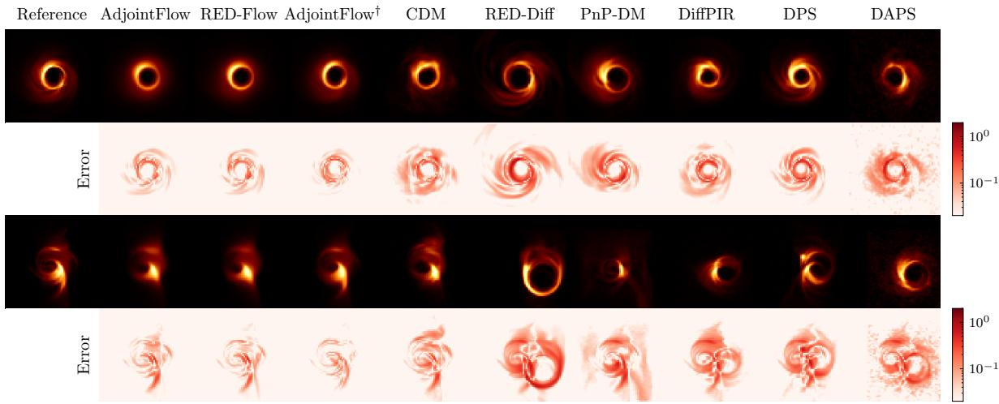  
Figure 9: Comparisons of AdjointFlow against diferent difusion-based methods for black hole imaging with 3% observation ratio. Even with the simple ring-shaped initialization, AdjointFlow properly matches the shape of both simpler ring-like black holes as well as those with a more exotic accretion disk.

Methods. InverseBench evaluates two classical optimization algorithms (SMILI [78], EHT-Imaging [79, 80]) and six PnP-DP methods on this problem. Their difusion priors use a pretrained NCSN++ U-net [49]; however, we find that AdjointFlow achieves superior results even when instantiated with a smaller convolutional architecture, similar to that used in the frequency-domain inverse scattering problems. We also find that the gradient of the closure quantities, though generally appearing as a global oscillatory pattern, still provides useful physical information to the network and empirically helps reduce the $\chi ^ { 2 }$ data misfit statistics. Therefore, we concatenate the gradient $\nabla _ { x _ { 0 } } \chi ^ { 2 } ( x _ { 0 } )$ to the network as an additional input channel. Measurement data is pre-processed with a small MLP and then embedded to modulate the network features via FiLM conditioning [81].

## 4.4.2. Results

Results are presented in Table 5, with illustrative examples shown in Figure 9. We find that over all levels of measurement sparsity, AdjointFlow performs substantially better than previous methods in terms of PSNR reconstruction quality. However, we also find that the base AdjointFlow model using data-independent initialization $x _ { 0 } \equiv \tilde { \mu } _ { m }$ markedly struggles to produce reconstructions consistent with the measurement data, as evidenced by large $\tilde { \chi } ^ { 2 }$ metrics. CDM also outperforms PnP-DP methods on reconstruction quality, though not to the extent of AdjointFlow, yet similarly struggles with data consistency.

To overcome this challenge, we demonstrate that adding inference-time guidance from the forward model via RED-Flow is suficient to improve data consistency. In fact, RED-Flow achieves the best data consistency in all but two instances, for which it is a close second. Furthermore, using the blurred-ground-truth initialization (55) produces high-quality and data-consistent reconstructions without added inference-time costs. However, we recall that this is an oracle diagnostic unavailable from the observation alone and is therefore not a deployable initialization in practice. Therefore, it serves primarily as a demonstration of the possible gains from a more informative initializer, lending support to the empirical benefits of choosing a physically informative initialization �(�).

## 5. Ablations

To verify the design of AdjointFlow, we ablate the choices we made given the motivation of Section 3. We focus on the nonlinear inverse scattering problem – which supplies four distinct datasets covering a range of dificulties and challenges – as a strong canonical baseline on which to test sampling methods, interpolant designs, reference distributions, and network parameterizations. To isolate the choice of initialization for AdjointFlow, we additionally consider the linear inverse scattering problem, as it admits inexpensive physics-based approximations of varying accuracy (namely, both an adjoint and a regularized pseudoinverse).

Sampling methods and learnedflow. As discussed in Section 2.3, the SI framework provides flexibility with several modeling choices: how to add noise, how to generate samples (deterministically with ODEs (11) or stochastically with SDEs (12)), and how to schedule the added noise.

We test how ODE and SDE sampling methods, diferent learned fields, as well as diferent choices for the noise bridge �� afect performance, especially when using the physics-based reference distribution $\rho _ { 0 } = \delta _ { a ( y ) }$

Table 5: We present the results for black hole imaging from InverseBench [40] with visibility noise (gain, phase, and thermal) added via EHT library. AdjointFlow † indicates that we use as the physics-based approximation the ground-truth image blurred with a Gaussian filter $( \sigma = 3 ) \quad$ While the baseline AdjointFlow improves reconstruction accuracy, it struggles to achieve high data consistency. This issue is resolved by either (a) inference-time guidance via RED-Flow, or (b) a more informative coupling with AdjointFlow †, both of which significantly improve $\dot { \chi } ^ { 2 }$ data consistency to be competitive with state-of-the-art. The top panel reports reconstruction quality and the bottom panel data consistency. Bold indicates best performance of non-oracle models.  
Reconstruction quality
<table><tr><td rowspan="2">Observation time ratio Method</td><td colspan="2">3%</td><td colspan="2">10%</td><td colspan="2">100%</td></tr><tr><td>PSNR ↑</td><td>Blur PSNR ↑</td><td>PSNR ↑</td><td>Blur PSNR ↑</td><td>PSNR ↑</td><td>Blur PSNR ↑</td></tr><tr><td colspan="7">Traditional</td></tr><tr><td>SMILI</td><td>18.51 (1.39)</td><td>23.08 (2.12)</td><td>20.85 (2.90)</td><td>25.24 (3.86)</td><td>22.67 (3.13)</td><td>27.79 (4.02)</td></tr><tr><td>EHT-Imaging</td><td>21.72 (3.39)</td><td>25.66 (5.04)</td><td>22.67 (3.46)</td><td>26.66 (3.93)</td><td>24.28 (3.63)</td><td>28.57 (4.52)</td></tr><tr><td colspan="7">PnP Diffusion Prior</td></tr><tr><td>DPS</td><td>24.20 (3.72)</td><td>30.83 (5.58)</td><td>24.36 (3.72)</td><td>30.79 (5.75)</td><td>25.86 (3.90)</td><td>32.94 (6.19)</td></tr><tr><td>LGD</td><td>22.51 (3.76)</td><td>28.50 (5.49)</td><td>22.08 (3.75)</td><td>27.48 (5.09)</td><td>21.22 (3.64)</td><td>26.06 (4.98)</td></tr><tr><td>RED-Diff</td><td>20.74 (2.62)</td><td>26.10 (3.35)</td><td>22.53 (3.02)</td><td>27.67 (4.53)</td><td>23.77 (4.13)</td><td>29.13 (6.22)</td></tr><tr><td>PnP-DM</td><td>24.25 (3.45)</td><td>30.49 (4.93)</td><td>24.57 (3.47)</td><td>30.80 (5.22)</td><td>26.07 (3.70)</td><td>32.88 (6.02)</td></tr><tr><td>DAPS</td><td>23.54 (3.28)</td><td>29.48 (4.88)</td><td>23.99 (3.56)</td><td>30.10 (5.13)</td><td>25.60 (3.64)</td><td>32.78 (5.68)</td></tr><tr><td>DiffPIR</td><td>24.12 (3.25)</td><td>30.45 (4.88)</td><td>23.84 (3.59)</td><td>30.04 (5.03)</td><td>25.01 (4.64)</td><td>31.86 (6.56)</td></tr><tr><td>Conditional Diffusion</td><td></td><td></td><td></td><td></td><td></td><td></td></tr><tr><td colspan="7">CDM 26.86 (3.60)</td></tr><tr><td>Ours</td><td></td><td></td><td></td><td></td><td></td><td></td></tr><tr><td>AdjointFlow</td><td>28.78 (3.44)</td><td>38.28 (5.23)</td><td>28.35 (3.38)</td><td>37.81 (5.42)</td><td>29.12 (3.47)</td><td>38.91 (5.25)</td></tr><tr><td>RED-Flow</td><td>28.54 (3.81)</td><td>37.62 (5.98)</td><td>28.55 (3.72)</td><td>37.68 (6.08)</td><td>29.63 (3.50)</td><td>39.69 (5.51)</td></tr><tr><td>AdjointFlow †</td><td>31.28 (2.37)</td><td>42.96 (2.20)</td><td>31.20 (2.38)</td><td>42.94 (2.24)</td><td>31.26 (2.37)</td><td>42.92 (2.25)</td></tr><tr><td></td><td></td><td></td><td></td><td></td><td></td><td></td></tr><tr><td colspan="7">Data consistency</td></tr><tr><td>Observation time ratio</td><td colspan="2">3%</td><td colspan="2">10%</td><td colspan="2">100%</td></tr><tr><td>Method</td><td> $\tilde { \chi } _ { c p } ^ { 2 } \downarrow$ </td><td> $\tilde { \chi } _ { \mathrm { l o g c a } } ^ { 2 } \downarrow$ </td><td> $\tilde { \chi } _ { c p } ^ { 2 } \downarrow$ </td><td> $\tilde { \chi } _ { \mathrm { l o g c a } } ^ { 2 } \downarrow$ </td><td> $\tilde { \chi } _ { c p } ^ { 2 } \downarrow$ </td><td> $\tilde { \chi } _ { \mathrm { l o g c a } } ^ { 2 } \downarrow$ </td></tr><tr><td colspan="7">Traditional</td></tr><tr><td>SMILI</td><td>1.478 (0.428)</td><td>4.348 (3.827)</td><td>1.209 (0.169)</td><td>21.788 (12.491)</td><td>1.878 (0.952)</td><td>17.612 (10.299)</td></tr><tr><td>EHT-Imaging</td><td>1.507 (0.485)</td><td>1.695 (0.539)</td><td>1.166 (0.156)</td><td>1.240 (0.205)</td><td>1.251 (0.250)</td><td>1.259 (0.316)</td></tr><tr><td colspan="7">PnP Diffusion Prior</td></tr><tr><td>DPS</td><td>8.024 (24.336)</td><td>5.007 (5.750)</td><td>13.052 (43.087)</td><td>6.614 (26.789)</td><td>8.759 (37.784)</td><td>5.456 (24.185)</td></tr><tr><td>LGD</td><td>15.825 (16.838)</td><td>12.862 (12.663)</td><td>10.775 (21.684)</td><td>13.375 (56.397)</td><td>13.239 (17.231)</td><td>13.233 (39.107)</td></tr><tr><td>RED-Diff</td><td>6.713 (6.925)</td><td>9.128 (19.052)</td><td>2.488 (2.925)</td><td>4.916 (13.221)</td><td>1.853 (0.938)</td><td>2.050 (2.361)</td></tr><tr><td>PnP-DM</td><td>2.201 (1.352)</td><td>1.668 (0.551)</td><td>1.433 (0.417)</td><td>1.336 (0.478)</td><td>1.311 (0.195)</td><td>1.199 (0.221)</td></tr><tr><td>DAPS</td><td>3.647 (3.287)</td><td>2.329 (1.354)</td><td>1.545 (0.705)</td><td>2.253 (9.903)</td><td>1.300 (0.324)</td><td>1.229 (0.532)</td></tr><tr><td>DiffPIR</td><td>14.085 (14.105)</td><td>10.545 (8.860)</td><td>5.374 (3.733)</td><td>5.205 (5.556)</td><td>3.271 (1.623)</td><td>2.970 (1.202)</td></tr><tr><td colspan="7">Conditional Diffusion</td></tr><tr><td>CDM</td><td>21.811 (46.440)13.202 (31.235)</td><td></td><td>16.200 (25.382) 13.978 (23.813) 19.241 (23.680) 13.531 (12.885)</td><td></td><td></td><td></td></tr><tr><td colspan="7">Ours</td></tr><tr><td>AdjointFlow</td><td>8.118 (18.273)</td><td>7.868 (20.607)</td><td>15.743 (33.948)18.372 (71.714) 11.734 (16.559) 16.302 (49.840)</td><td></td><td>1.130 (0.123)</td><td>1.196 (0.177)</td></tr><tr><td>RED-Flow</td><td>1.483 (0.545)</td><td>1.539 (0.726)</td><td>1.155 (0.143)</td><td>1.302 (0.254)</td><td></td><td></td></tr><tr><td>AdjointFlow †</td><td>1.515 (0.520)</td><td>1.668 (0.630)</td><td>1.293 (0.253)</td><td>1.302 (0.295)</td><td>1.294 (0.241)</td><td>1.371 (0.363)</td></tr></table>

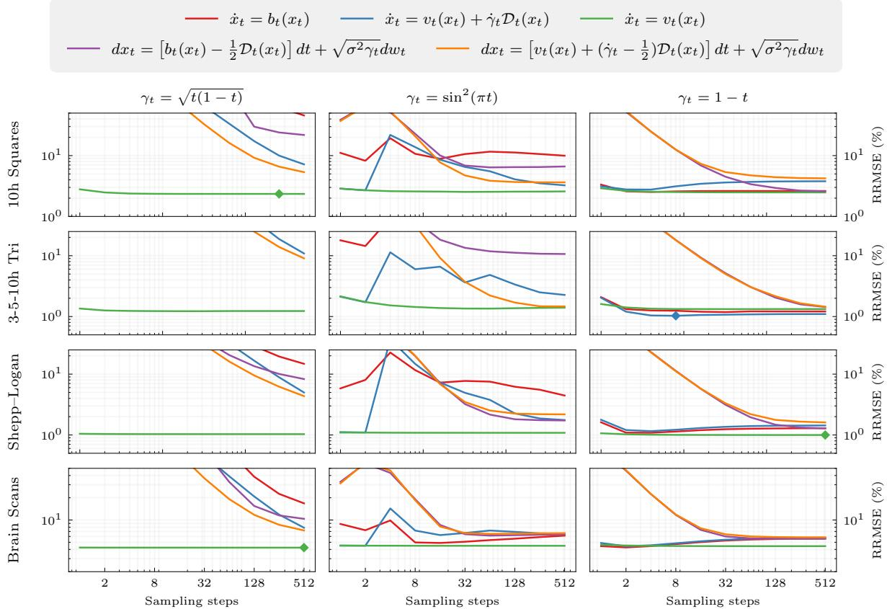  
Figure 10: We compare accuracy (RRMSE) and eficiency (number of sampling steps) of diferent stochastic interpolants on the four nonlinear inverse scattering datasets. The best performance on each dataset is labeled with a diamond. We do not use TP parameterizations for this ablation. For SDE sampling we choose $\epsilon _ { t } = \sigma ^ { 2 } \gamma _ { t } / 2$ in (12) to cancel the explicit $1 / \gamma _ { t }$ factor in the score correction. For $\gamma _ { t } = 1 - t ,$ the noise-free-velocity ODE uses a deterministic initialization, while the other samplers use a Gaussian initialization. We observe that sampling with $\dot { x } _ { t } = \nu _ { t } ( x _ { t } )$ performs consistently well across datasets and only requires a small number of sampling steps for near-optimal performance.

Specifically, as enabled by the velocity decomposition (26), we evaluate both learning the standard SI velocity field $b _ { t }$ directly, or learning $\nu _ { t }$ and $\mathcal { D } _ { t }$ and then combining them to form the standard velocity. We also investigate three choices of the noise-bridge term: $\gamma _ { t } = \sqrt { t ( 1 - t ) } , \gamma _ { t } = \sin ^ { 2 } ( \pi t )$ , and $\gamma _ { t } = 1 - t .$ . For the schedule labeled $\gamma _ { t } ~ = ~ 1 - t$ the interpolant is $x _ { t } = ( 1 - t ) x _ { 0 } + t x _ { 1 }$ with $x _ { 0 } \sim \mathcal { N } ( a ( y ) , \sigma ^ { 2 } I )$ , namely, a Gaussian centered at the physics-based initialization. The standard SI ODE and SDE use this Gaussian initialization, whereas the noise-free-velocity ODE still starts deterministically at $x _ { 0 } = a ( y )$

We evaluate performance across a range of sampling timesteps and noise-bridge scale $\sigma \in ( 0 , 2 ]$ , and present the accuracy-eficiency curve for the best performing choice of � on each dataset in Figure 10. Among the evaluated configurations, the noise-free-velocity ODE achieves highest accuracy on three of the four datasets. Notably, the noise-free velocity’s performance is largely decoupled from the choice of both noise bridge $\gamma _ { t }$ and number of sampling steps, enabling more flexibility in interpolant design and accelerated sampling.

Initial distribution and parameterization. We compare the standard flow-matching interpolant $I _ { t } = ( 1 - t ) x _ { 0 } + t x _ { 1 }$ with reference distribution $\rho _ { 0 } = N ( 0 , I )$ (an “uncoupled SI”) with AdjointFlow’s physics-based initialization $\rho _ { 0 } = \delta _ { a ( y ) }$ (a “coupled SI”). We also evaluate both interpolant designs with and without their respective TP parameterizations – (33) for the uncoupled SI, and (32) for the coupled SI. Following [53], we clip the denominator of (33) when it goes below 0.05 to avoid numerical instability during training.

We train all interpolants with the same architecture and training procedure, and evaluate them on the four nonlinear inverse scattering datasets. For all models, inference is conducted with a fixed 8 sampling steps.

We present results in Table 6, which illustrates a crucial interaction between the construction of reference distribution and network parameterization. Without TP, the coupled SI has lower accuracy than the uncoupled SI on three of four datasets. With TP, this comparison reverses: the coupled model achieves higher accuracy on every dataset, and outperforms the base uncoupled SI on all but 3–5–10h Triangles. The efect of TP likewise depends on the initialization: on all four datasets, it improves accuracy for the coupled SI but worsens it for the uncoupled SI. Crucially, the DD-TP which improves the coupled SI so much is only possible with the singular reference distribution used by AdjointFlow; the standard TP from (33) includes a singular denominator and thus requires additional truncation to remain stable, yet rendering it less efective.

Table 6: Comparison of reference distribution and model parameterization on the four nonlinear inverse scattering datasets, with mean and standard deviation of RRMSE across the test set shown. We fix the number of sampling steps at 8 for all models. Without TP, we find that a coupled interpolant does not meaningfully improve results on these datasets, demonstrating the practical necessity of the DD-TP parameterization. Bold indicates the best result on each dataset.
<table><tr><td rowspan="2">Method</td><td colspan="4">RRMSE (%) ↓</td></tr><tr><td>Shepp-Logan</td><td>3–5–10h Triangles</td><td>10h Overlapping Squares</td><td>Brain Scans</td></tr><tr><td>Uncoupled  $\mathrm { S I } + b _ { t }$ </td><td>0.972 (0.395)</td><td>0.590 (1.599)</td><td>1.808 (2.403)</td><td>4.711 (1.250)</td></tr><tr><td>Uncoupled  $\mathrm { S I } + b _ { t } + \mathrm { T P }$ </td><td>1.097 (0.504)</td><td>1.356 (2.871)</td><td>2.649 (2.537)</td><td>4.887 (1.282)</td></tr><tr><td>Coupled  $\mathrm { S I } + \nu _ { t }$ </td><td>1.031 (0.265)</td><td>1.228 (1.473)</td><td>2.345 (2.159)</td><td>4.233 (1.020)</td></tr><tr><td>Coupled  $\mathrm { S I } + \nu _ { t } + \mathrm { D D - T P }$  (AdjointFlow)</td><td>0.379 (0.158)</td><td>1.108 (2.861)</td><td>1.143 (1.686)</td><td>3.421 (0.809)</td></tr></table>

Together, the physics-based initialization and DD-TP achieve the best accuracy on three of the four datasets. These results suggest that the benefits of the method depend on the combined construction of initialization and network parameterization, rather than either modification in isolation. Namely, the known physics-based coupling allows DD-TP to express the velocity as a residual between the predicted reconstruction and the prescribed initialization. Incorporating this known contribution analytically may therefore help explain why TP is particularly efective in the coupled setting.

We note that the $3 - 5 - I O h$ Triangles dataset is the one case in both ablation studies in which the noise-free velocity does not achieve the best performance. This suggests that the adjoint-based initialization may not be as informative for this dataset as for the others. Qualitatively, one may note that the back-projections from the low-frequency adjoint in Figure 4b fail to fully capture high-frequency details of the smallest triangles. Therefore, a more informative initialization for 3–5–10h Triangles may reduce the observed performance gap; we leave this exploration to future work.

Table 7: We present the results of AdjointFlow for linear inverse scattering with four choices of initialization $a ( y )$ , three diferent levels of measurement sparsity, and noise level $\sigma _ { \mathrm { y } } = 1 0 ^ { - 4 }$ following [40] (bold result indicates best for each receiver count). All models share the architecture and training procedure of Section 4.2 and difer only in �(�); the pseudoinverse corresponds to AdjointFlow in Table 3. Within each block, the first two initializations are data-independent and the last two are data-dependent. W is the empirical transport distance $\mathcal { W } _ { 2 } ( \delta _ { a ( y ) } , \delta _ { m } ) = \| a ( y ) - m \| _ { 2 }$ between singular endpoints (Appendix E.3), averaged over the test set.
<table><tr><td>Initialization</td><td> $\mathbf { \mathcal { W } } _ { 2 } \downarrow$ </td><td>PSNR ↑</td><td>SSIM ↑</td><td>Meas err  $( \% ) \downarrow$ </td></tr><tr><td>60 receivers</td><td></td><td></td><td></td><td></td></tr><tr><td>Constant</td><td>127.0 (16.3)</td><td>13.007 (2.830)</td><td>0.436 (0.208)</td><td>38.05 (8.67)</td></tr><tr><td>Training mean</td><td>157.1 (20.9)</td><td>17.025 (2.675)</td><td>0.631 (0.156)</td><td>14.74 (2.31)</td></tr><tr><td>Adjoint</td><td>110.2 (18.4)</td><td>25.341 (6.155)</td><td>0.910 (0.066)</td><td>5.50 (1.85)</td></tr><tr><td>Pseudoinverse</td><td>53.5 (10.2)</td><td>25.460 (4.969)</td><td>0.920 (0.054)</td><td>4.70 (0.99)</td></tr><tr><td>180 receivers</td><td></td><td></td><td></td><td></td></tr><tr><td>Constant</td><td>127.0 (16.3)</td><td>13.233 (2.667)</td><td>0.518 (0.204)</td><td>42.87 (10.26)</td></tr><tr><td>Training mean</td><td>157.1 (20.9)</td><td>18.687 (2.506)</td><td>0.701 (0.127)</td><td>11.13 (1.72)</td></tr><tr><td>Adjoint</td><td>98.6 (19.7)</td><td>29.913 (4.819)</td><td>0.966 (0.024)</td><td>2.76 (0.50)</td></tr><tr><td>Pseudoinverse</td><td>23.8 (4.9)</td><td>32.459 (3.935)</td><td>0.980 (0.013)</td><td>1.87 (0.20)</td></tr><tr><td>360 receivers</td><td></td><td></td><td></td><td></td></tr><tr><td>Constant</td><td>127.0 (16.3)</td><td>14.314 (2.565)</td><td>0.531 (0.199)</td><td>33.09 (6.46)</td></tr><tr><td>Training mean</td><td>157.1 (20.9)</td><td>19.546 (2.554)</td><td>0.735 (0.115)</td><td>9.64 (1.44)</td></tr><tr><td>Adjoint</td><td>97.6 (19.1)</td><td>30.056 (4.831)</td><td>0.966 (0.024)</td><td>2.74 (0.49)</td></tr><tr><td>Pseudoinverse</td><td>22.6 (4.7)</td><td>32.797 (3.966)</td><td>0.981 (0.013)</td><td>1.86 (0.21)</td></tr></table>

Choice ofinitialization. The 3–5–10h Triangles results suggest that the benefit of AdjointFlow depends on how informative its initialization is. To test this directly, we train AdjointFlow on the linear inverse scattering problem of Section 4.2 with four choices of $a ( y )$ , holding the architecture, training procedure, and sampler fixed. Two initializations are data-dependent: the adjoint $a ( y ) = F ^ { * } y$ and the regularized pseudoinverse $a ( y ) = F _ { \epsilon } ^ { \dagger } y$ used in the main experiments. The other two initializations are data-independent: the constant $a ( y ) = 0 ;$ , and the standardized training mean $a ( y ) = \tilde { \mu } _ { m }$ equivalent to the initialization used for black hole imaging. We report empirical transport distance W (Appendix E.3) computed over the test sets alongside reconstruction metrics in Table 7.

Data-dependent initializations demonstrate a clear advantage, vastly outperforming data-independent ones across all metrics: for example, they improve reconstructions by 8 to 19 dB in PSNR at every receiver count.

Consistent with Proposition 3.1, the adjoint also lies closer to the target than the constant initialization at every receiver count. The pseudoinverse initialization further reduces transport distance between endpoints and achieves the best performance at every receiver count.

Between the two data-independent initializations, however, $a ( y ) = \tilde { \mu } _ { m }$ improves performance over $a ( y ) = 0$ even though it lies farther from the target (a consequence of standardization of the unscaled training mean), demonstrating that transport distance by itself is not entirely predictive of performance. We posit that, despite the increased transport distance, the resulting spatial structure of $\widetilde { \mu } _ { m }$ may nonetheless be easier for the network to refine than a constant image.

Together, these results support choosing a physically informative initialization: incorporating the measurements has the largest efect, and between the data-dependent initializations, a more accurate one further improves reconstruction.

Additional ablations. Additional ablations and tests covering performance in noisy or uncertain environments, sample complexity, empirical transport distances, and training techniques are covered in Appendix E.

## 6. Related Work

## 6.1. Classical Approaches

Optimization-based reconstruction has long been a standard technique for solving many classical scientific inverse problems. In this setting, one seeks to minimize a data misfit together with regularization to stabilize the inversion in ill-posed and noisy regimes [41, 82]. We focus on this optimization viewpoint and refer the reader to [8, 83, 9] for reviews of qualitative and analysis-driven approaches.

In particular, wave-based inverse problems constitute an important and challenging subclass, where the goal is to reconstruct medium or object properties – such as the refractive index, permittivity, or wavespeed – from boundary or difraction measurements of scattered wave fields [9, 13].

With improved numerical solutions of the underlying PDEs, full waveform inversion (FWI) emerged in the 1980s [42] and became a central paradigm in seismic imaging [11, 12]. FWI recasts inversion as a PDE-constrained optimization problem, seeking parameters that minimize the mismatch between measured data and synthetic data generated by solving the governing PDE. Its primary advantage over ray-based methods is its ability to model the full wavefield, thereby capturing finite-frequency, difraction, and scattering efects neglected by geometric-optics approximations. This increased physical fidelity comes at the expense of substantial computational and optimization challenges.

Despite its success, particularly in exploration geophysics, FWI faces several well-known obstacles. First, the per-iteration cost is dominated by repeated forward and adjoint PDE solves, making high-resolution inversion computationally expensive even with modern fast wave solvers such as sweeping and domain-decomposition-style methods [84, 85]. Second, the objective is highly nonconvex, and convergence to spurious local minima (cycleskipping) is common, especially in the absence of low-frequency data [5]. Common mitigation strategies include adding regularization [15, 5], employing multiscale or frequency-continuation strategies [68, 16], and extrapolating or interpolating missing low frequencies [14]. Third, recovery of fine-scale structure is constrained by wavelength, acquisition geometry, and difraction, even under favorable noise levels and sampling [86].

## 6.2. Deterministic ML Approaches

Motivated by the limitations of classical optimization-based methods, a large body of work has explored learningbased solvers that replace or accelerate inversion by learning explicit mappings from measurements to reconstructions using supervised regression. Representative approaches include learned representation transforms [87] and model-based deep learning architectures such as MoDL, which combines a learned CNN prior with alternating data-consistency updates in an unrolled iterative reconstruction framework [88].

In the context of wave-based inverse scattering, deterministic ML approaches typically employ supervised neural networks to regress unknown parameters directly from measured scattered fields [89]. Learned primal-dual methods unroll gradient-like optimization schemes while replacing hand-crafted update rules with learned operators that receive data-misfit information [90, 91]. Other architectures explicitly seek to exploit structure and symmetries in the wave-based inverse operator itself, such as SwitchNet [18], WideBNet [63], EquiNet, and B-EquiNet [19].

## 6.3. Transport-Based Generative Models

Bayesian formulations provide a principled framework for uncertainty quantification by modeling the posterior distribution of the unknown parameters conditioned on the measurements [24, 92]. Posterior inference can be carried out using sampling methods such as Markov chain Monte Carlo or Langevin-type dynamics, or through variational approximations, with the forward operator incorporated through the likelihood. However, repeated likelihood evaluations can become computationally expensive when the forward model requires solving a large-scale PDE.

Generative models provide an alternative by shifting much of this computational burden to an ofline training stage and learning a distribution over reconstructions rather than individual point estimates. In particular, conditional difusion models aim to sample from the unknown posterior directly, and have demonstrated strong performance in applications such as MRI, elastography, and computational imaging [28, 29, 93, 94, 95].

Difusion models are defined by a stochastic process which transforms samples from a simple base distribution – commonly an isotropic Gaussian – into samples from the target conditional distribution [20, 21]. By approximating the score function of a reverse-time denoising process [96], difusion models allow generation of new samples via numerically solving the reverse-time SDE. However, difusion samplers can require hundreds of network evaluations for high-quality reconstructions, which can be restrictive when inference-time eficiency is important [49, 21]. It was subsequently realized that the sampling process could be reframed as solving a reverse-time ODE, providing substantial speedups with little loss of accuracy compared to SDEs [97]. Taking inspiration from optimal transport, flow matching [22, 98, 48] expands upon this approach by directly learning transport velocities along prescribed paths which eficiently transport mass between endpoint distributions.

Stochastic interpolants (SI) [48, 23] ofer a unifying framework for such transport-based generative models. The SI framework additionally permits general, potentially dependent couplings between its endpoint distributions [39], providing flexibility beyond the conventional independent Gaussian source used by standard difusion and flow models.

Ensuing work has aimed to further improve generative eficiency by constructing straighter or otherwise better-conditioned transport trajectories, thereby reducing the numerical cost of sampling even further [98, 99]. Distillation provides another route to few-step inference by compressing a trained difusion or flow sampler into a student requiring fewer network evaluations [100, 101, 102]. Our approach is complementary in that we shorten and structure the transport path using information from the governing inverse problem itself.

Flow matching has also been applied to scientific inverse problems such as seismic FWI [103], including within online inversion [33] and to refine an existing FWI reconstruction [104]. A recent study [105] examines the behavior of conditional flow matching in the physics-constrained, finite-training-data regime characteristic of scientific inversion, and compares Gaussian sources with sources sampled from the parameter prior. More closely related to our setting, DAWN-FM [35] applies flow matching to inverse problems by conditioning the learned velocity field on a physics-based data embedding, such as a back-projection. However, the physics-based approximation enters DAWN-FM as conditioning information while the transport itself retains the standard Gaussian reference distribution.

## 6.4. Alternative Endpoints, Couplings, and Bridges in Generative Models

A related line of work replaces the standard noise-to-image paradigm by learning transport directly between informative endpoint distributions. Within image restoration and translation, I2SB [106] and BBDM [107] formulate generation as a stochastic bridge between degraded and clean image distributions. InDI [108] instead learns a direct iterative corrupted-to-clean inversion map rather than a conditional denoising process initialized from pure noise. Mean-reverting SDE models retain a stochastic difusion formulation but center the forward process around the degraded observation itself [109]. DBIM [110] adapts design principles of denoising difusion implicit models [97] to further accelerate the inference speed of difusion bridge models on image restoration tasks.

Informative-endpoint constructions also extend to inverse problems whose measurements and unknowns occupy diferent mathematical spaces, where inexpensive approximate reconstructions – for example via back-projection or linearized adjoints – can provide useful parameter-space information. Jiang et al. [111] employ difusion Schrödinger bridges to transport between electromagnetic property maps and channel representations, using a learned autoencoder network to rectify the dimensional mismatch. Projection Embedded Difusion Bridge initializes CT reconstruction from a filtered back-projection image and incorporates the projection measurements into the reverse dynamics to improve data consistency [112]. Related work also considers learning from indirect corrupted measurements through self-consistent stochastic interpolants, using a black-box forward simulator to enforce consistency between generated samples and observed data [113]. AdjointFlow extends this perspective to nonlinear scientific inverse problems and analyzes how a physics-based initialization interacts with the choice of reconstruction dynamics, particularly when the conditional posterior is highly concentrated.

Singular endpoint distributions have also been considered in recent works. floq [55] employs flow matching with a Dirac target distribution in the context of Q-learning. They demonstrate the benefits of iterative computation with dense supervision brought by a generative framework, a perspective supported by [56], even when the target is deterministic. Conversely, Chen and Vanden-Eijnden [114] study how stochastic dynamics can generate a nondegenerate target distribution from a deterministic initial state. AdjointFlow uses a singular physics-based reference distribution motivated by inverse problems with highly concentrated posteriors. We thus analyze the limiting setting in which both endpoints become concentrated and characterize the regularity of the standard and noise-free velocity fields used for reconstruction.

## 6.5. Plug-and-Play Priors

Another approach, complementary to sampling from the conditional posterior directly, is to learn an unconditional prior over the unknown parameters and incorporate the measurement information only during inference. Plug-andplay (PnP) methods originally introduced this idea by replacing an explicit regularizer with an external denoising prior [115]. More recently, difusion and score models have been leveraged as powerful learned priors, while information from the likelihood or forward model is incorporated through inference-time guidance [49, 25, 30, 26, 116, 117]. PnP algorithms with learned priors have also been developed for scientific applications such as electromagnetic scattering [118, 119] and seismic FWI [31, 120]. While successful in many imaging applications, these methods typically require repeated forward-model evaluations and, depending on the approach, adjoint, pseudoinverse, or Jacobian-based computations throughout inference. For wave-based problems, this can yield inference costs comparable to classical iterative inversion algorithms. The InverseBench benchmark [40] provides a systematic comparison of these approaches across a range of scientific inverse problems.

## 7. Conclusion

We introduce AdjointFlow, a physics-based framework for scientific inverse problems motivated by two limitations of conventional Gaussian-to-data transport: an uninformative initialization leaves available physics-based approximations unused, and transport to sharply concentrated posteriors can produce ill-conditioned velocity fields. AdjointFlow addresses these limitations by reconsidering two design axes: the source distribution and the velocity used for reconstruction.

First, we exploit paired measurement-reconstruction data and the governing physics to construct an informative initialization. An adjoint or approximate inverse function maps measurements into parameter space, providing a physically meaningful initialization associated with each target reconstruction. We identify conditions under which this initialization reduces transport distance and show that posterior concentration favors concentrating the source as well. Second, we introduce a noise-free velocity formulation whose regularity properties in the concentrated-endpoint regime support stable learning and numerical integration. Together, these choices yield a natural and practically efective data-dependent target-prediction parameterization that incorporates the known initialization analytically and aligns the learning objective with the desired reconstruction.

Across four scientific inverse problems, AdjointFlow matches or even improves reconstruction accuracy on five of seven datasets, while requiring substantially fewer integration steps than difusion-based baselines. By employing additional inference-time scaling, RED-Flow further improves physical consistency and achieves state-of-the-art reconstruction accuracy on every dataset where we apply it. Our results indicate that the design of generative models for scientific inverse problems should account for the available physics in the generative transport itself, replacing generic noise-to-data transport with physics-informed refinement.

Limitations andfuture work. Several limitations of AdjointFlow motivate directions for future work.

First, AdjointFlow benefits most when the initialization is informative. Many PDE-constrained inverse problems admit useful adjoints or approximate adjoints, but in settings where the adjoint is unavailable, inaccurate, computationally expensive, or weakly correlated with the target, the advantage of the method may diminish. Heuristic physical priors, truncated classical inversions, or learned approximate inverse maps can be substituted, but their efectiveness is problem-dependent and may require additional validation or inference-time refinement.

Second, our current implementations assume paired measurement-reconstruction data and, in several experiments, fixed acquisition geometries. Extending the method to variable acquisition geometries such as changing sensor placements or numbers of sensors, as well as to unknown acquisition protocols or strongly distribution-shifted data, is likely possible, but would require additional architecture modifications and broader training distributions beyond the scope of this work.

Third, our best-performing variant of AdjointFlow falls outside the standard assumptions of existing stochasticinterpolant theory in two places by using a singular initial distribution and training against the noise-free velocity. We therefore do not inherit the marginal-correctness guarantees typical of stochastic interpolants when the conditions of the singular-endpoint limit are not met.

Finally, although we include robustness experiments, many benchmarks remain synthetic or semi-synthetic. Deployment in high-stakes scientific or engineering pipelines will require further testing under real measurement noise, model mismatch, calibration error, and out-of-distribution physical regimes.

## Impact Statement

This work aims to improve machine-learning methods for scientific inverse problems. By enabling eficient, high-quality reconstructions, AdjointFlow may lower the computational cost and energy usage of generative inverse solvers, especially in settings where repeated forward and adjoint PDE solves are expensive. More eficient reconstruction tools could make advanced imaging and simulation-based inference more accessible to scientific laboratories, medical researchers, and engineering groups with limited computational resources.

At the same time, inverse-problem solvers can afect consequential decisions when used in domains such as healthcare, geophysics, infrastructure inspection, or remote sensing. Reconstructions produced by AdjointFlow are learned approximations and may be unreliable under certain conditions, an important consideration in settings where false positives/negatives could influence medical diagnosis, safety assessment, resource exploration, or scientific interpretation.

## CRediT Authorship Contribution Statement

Ethan Hanold: Conceptualization, Methodology, Software, Investigation, Formal analysis, Validation, Writing – original draft, Writing – review & editing, Visualization. Nicholas M. Bofi: Conceptualization, Methodology, Supervision, Writing – original draft, Writing – review & editing. Qin Li: Conceptualization, Methodology, Supervision, Formal analysis, Writing – original draft, Writing – review & editing. Leonardo Zepeda-Núñez: Conceptualization, Methodology, Supervision, Writing – original draft, Writing – review & editing.

## Data Availability

Much ofthe data used in this study is made available by the respective benchmarks: Back-Projection Difusion [29] provides the 10hSquares [59] and Brain Scans [60] nonlinear inverse scattering datasets, and InverseBench [40] provides the cell phantom and FWI datasets, as well as validation and test sets for black holes [65]. The 3–5–10h Triangles and Shepp–Logan datasets were provided directly by the authors of Back-Projection Difusion [29]. Code for generating these datasets is publicly available at https://github.com/borongzhang/back\_projection \_diffusion. The pretrained difusion prior model checkpoint and generation script for generating a black hole training dataset are publicly available at https://github.com/devzhk/InverseBench. Code for AdjointFlow will be made available upon reasonable request.

## Declaration of Generative AI and AI-Assisted Technologies in the Manuscript Preparation Process

During the preparation of this work the authors used ChatGPT, Gemini and Claude to write code and improve language and formatting. After using these tools, the authors reviewed and edited the content as needed and take full responsibility for the content of the published article.

## References

[1] W. Friedrich, P. Knipping, M. Laue, Interferenzerscheinungen bei Röntgenstrahlen, Annalen der Physik 346 (10) (1913) 971–988. doi:10.1002/andp.19133461004.

[2] N. Bleistein, J. W. Stockwell, Jr., J. K. Cohen, Mathematics of Multidimensional Seismic Imaging, Migration, and Inversion, 1st Edition, no. 13 in Interdisciplinary Applied Mathematics, Springer New York, 2001. doi:10.1007/978-1-4613-0001-4.

[3] F. Natterer, The Mathematics of Computerized Tomography, Vol. 32 of Classics in Applied Mathematics, SIAM, 2001. doi:10.1137/1.9780898719284.

[4] K. L. Bouman, M. D. Johnson, D. Zoran, V. L. Fish, S. S. Doeleman, W. T. Freeman, Computational imaging for VLBI image reconstruction, in: Proceedings of the IEEE Conference on Computer Vision and Pattern Recognition (CVPR), 2016, pp. 913–922. URL https://openaccess.thecvf.com/content\_cvpr\_2016/html/Bouman\_Computational\_Im aging\_for\_CVPR\_2016\_paper.html

[5] T. van Leeuwen, F. J. Herrmann, Mitigating local minima in full-waveform inversion by expanding the search space, Geophys. J. Int. 195 (1) (2013) 661–667. doi:10.1093/gji/ggt258.

[6] P. Hähner, T. Hohage, New stability estimates for the inverse acoustic inhomogeneous medium problem and applications, SIAM Journal on Mathematical Analysis 33 (3) (2001) 670–685. doi:10.1137/S003614100 1383564.

[7] D. Colton, R. Kress, Integral Equation Methods in Scattering Theory, Society for Industrial and Applied Mathematics, Philadelphia, PA, 2013. doi:10.1137/1.9781611973167.

[8] F. Cakoni, D. Colton, Qualitative methods in inverse scattering theory: An introduction, 1st Edition, Interaction of Mechanics and Mathematics, Springer Berlin, 2006. doi:10.1007/3-540-31230-7.

[9] D. L. Colton, R. Kress, Inverse Acoustic and Electromagnetic Scattering Theory, 2nd Edition, Vol. 93 of Applied Mathematical Sciences, Springer Berlin, 1998. doi:10.1007/978-3-662-03537-5.

[10] A. Tarantola, Inverse Problem Theory and Methods for Model Parameter Estimation, SIAM, 2005. doi: 10.1137/1.9780898717921.

[11] R. G. Pratt, Seismic waveform inversion in the frequency domain; part 1: Theory and verification in a physical scale model, Geophysics 64 (3) (1999) 888–901. doi:10.1190/1.1444597.

[12] J. Virieux, A. Asnaashari, R. Brossier, L. Métivier, A. Ribodetti, W. Zhou, An introduction to full waveform inversion, in: V. Grechka, K. Wapenaar (Eds.), Encyclopedia of Exploration Geophysics, Society of Exploration Geophysicists (SEG), 2014, Ch. 6, pp. R1–1–R1–40. doi:10.1190/1.9781560803027.entr y6.

[13] J. Virieux, S. Operto, An overview of full-waveform inversion in exploration geophysics, Geophysics 74 (6) (2009) WCC1–WCC26. doi:10.1190/1.3238367.

[14] Y. E. Li, L. Demanet, Full-waveform inversion with extrapolated low-frequency data, Geophysics 81 (6) (2016) R339–R348. doi:10.1190/geo2016-0038.1.

[15] W. W. Symes, J. J. Carazzone, Velocity inversion by diferential semblance optimization, Geophysics 56 (5) (1991) 654–663. doi:10.1190/1.1443082.

[16] Y. Chen, Inverse scattering via Heisenberg’s uncertainty principle, Inverse Problems 13 (2) (1997) 253–282. doi:10.1088/0266-5611/13/2/005.

[17] Z. Xu, Y. Li, X. Cheng, Butterfly-Net2: Simplified Butterfly-Net and Fourier transform initialization, in: J. Lu, R. Ward (Eds.), Proceedings of The First Mathematical and Scientific Machine Learning Conference, Vol. 107 of Proceedings of Machine Learning Research, PMLR, 2020, pp. 431–450. URL https://proceedings.mlr.press/v107/xu20b.html

[18] Y. Khoo, L. Ying, SwitchNet: A neural network model for forward and inverse scattering problems, SIAM Journal on Scientific Computing 41 (5) (2019) A3182–A3201. doi:10.1137/18M1222399.

[19] B. Zhang, L. Zepeda-Núñez, Q. Li, Solving the wide-band inverse scattering problem via equivariant neural networks, Journal of Computational and Applied Mathematics 451 (2024) 116050. doi:10.1016/j.cam. 2024.116050.

[20] Y. Song, S. Ermon, Generative modeling by estimating gradients of the data distribution, in: Advances in Neural Information Processing Systems, Vol. 32, Curran Associates, Inc., 2019, pp. 11918–11930. URL https://openreview.net/forum?id=B1lcYrBgLH

[21] J. Ho, A. Jain, P. Abbeel, Denoising difusion probabilistic models, in: H. Larochelle, M. Ranzato, R. Hadsell, M. F. Balcan, H. Lin (Eds.), Advances in Neural Information Processing Systems, Vol. 33, Curran Associates, Inc., 2020, pp. 6840–6851. URL https://proceedings.neurips.cc/paper/2020/hash/4c5bcfec8584af0d967f1ab10179c a4b-Abstract.html

[22] Y. Lipman, R. T. Q. Chen, H. Ben-Hamu, M. Nickel, M. Le, Flow matching for generative modeling, in: International Conference on Learning Representations, 2023. URL https://openreview.net/forum?id=PqvMRDCJT9t

[23] M. Albergo, N. M. Bofi, E. Vanden-Eijnden, Stochastic interpolants: A unifying framework for flows and difusions, Journal of Machine Learning Research 26 (209) (2025) 1–80. URL http://jmlr.org/papers/v26/23-1605.html

[24] A. M. Stuart, Inverse problems: A Bayesian perspective, Acta Numerica 19 (2010) 451–559. doi: 10.1017/S0962492910000061.

[25] A. Jalal, M. Arvinte, G. Daras, E. Price, A. G. Dimakis, J. Tamir, Robust compressed sensing MRI with deep generative priors, in: M. Ranzato, A. Beygelzimer, Y. Dauphin, P. S. Liang, J. W. Vaughan (Eds.), Advances in Neural Information Processing Systems, Vol. 34, Curran Associates, Inc., 2021, pp. 14938–14954. URL https://openreview.net/forum?id=wHoIjrT6MMb

[26] H. Chung, J. Kim, M. T. McCann, M. L. Klasky, J. C. Ye, Difusion posterior sampling for general noisy inverse problems, in: International Conference on Learning Representations, 2023. URL https://openreview.net/forum?id=OnD9zGAGT0k

[27] B. Zhang, W. Chu, J. Berner, C. Meng, A. Anandkumar, Y. Song, Improving difusion inverse problem solving with decoupled noise annealing, in: Proceedings of the IEEE/CVF Conference on Computer Vision and Pattern Recognition (CVPR), 2025, pp. 20895–20905. doi:10.1109/CVPR52734.2025.01946.

[28] A. Dasgupta, A. Marciano da Cunha, A. Fardisi, M. Aminy, B. Binder, B. Shaddy, A. A. Oberai, Unifying and extending difusion models through PDEs for solving inverse problems, Computer Methods in Applied Mechanics and Engineering 448 (2026) 118431. doi:10.1016/j.cma.2025.118431.

[29] B. Zhang, M. Guerra, Q. Li, L. Zepeda-Núñez, Back-Projection Difusion: Solving the wideband inverse scattering problem with difusion models, Computer Methods in Applied Mechanics and Engineering 443 (2025) 118036. doi:10.1016/j.cma.2025.118036.

[30] Y. Song, L. Shen, L. Xing, S. Ermon, Solving inverse problems in medical imaging with score-based generative models, in: International Conference on Learning Representations, 2022. URL https://openreview.net/forum?id=vaRCHVj0uGI

[31] F. Wang, X. Huang, T. A. Alkhalifah, A prior regularized full waveform inversion using generative difusion models, IEEE Transactions on Geoscience and Remote Sensing 61 (2023) 1–11. doi:10.1109/TGRS.202 3.3337014.

[32] B. T. Feng, J. Smith, M. Rubinstein, H. Chang, K. L. Bouman, W. T. Freeman, Score-based difusion models as principled priors for inverse imaging, in: 2023 IEEE/CVF International Conference on Computer Vision (ICCV), 2023, pp. 10486–10497. doi:10.1109/ICCV51070.2023.00965.

[33] X. Huang, P. Perdikaris, Self-flow-matching assisted full waveform inversion (2026). arXiv:2603.13425.

[34] H. Chung, J. Kim, J. C. Ye, Direct difusion bridge using data consistency for inverse problems, in: A. Oh, T. Naumann, A. Globerson, K. Saenko, M. Hardt, S. Levine (Eds.), Advances in Neural Information Processing Systems, Vol. 36, Curran Associates, Inc., 2023, pp. 7158–7169. doi:10.52202/075280-0313.

[35] S. Ahamed, E. Haber, DAWN-FM: Data-aware and noise-informed flow matching for solving inverse problems, Foundations of Data Science 11 (2026) 121–149. doi:10.3934/fods.2026005.

[36] A. W. van der Vaart, Asymptotic Statistics, Vol. 3 of Cambridge Series in Statistical and Probabilistic Mathematics, Cambridge University Press, Cambridge, 1998. doi:10.1017/CBO9780511802256.

[37] Y. Gao, J. Huang, Y. Jiao, S. Zheng, Convergence of continuous normalizing flows for learning probability distributions (2024). arXiv:2404.00551.

[38] L. Kunkel, Distribution estimation via flow matching with Lipschitz guarantees, Journal of Multivariate Analysis 215 (2026) 105657. doi:10.1016/j.jmva.2026.105657.

[39] M. S. Albergo, M. Goldstein, N. M. Bofi, R. Ranganath, E. Vanden-Eijnden, Stochastic interpolants with data-dependent couplings, in: R. Salakhutdinov, Z. Kolter, K. Heller, A. Weller, N. Oliver, J. Scarlett, F. Berkenkamp (Eds.), Proceedings of the 41st International Conference on Machine Learning, Vol. 235 of Proceedings of Machine Learning Research, PMLR, 2024, pp. 921–937. URL https://proceedings.mlr.press/v235/albergo24a.html

[40] H. Zheng, W. Chu, B. Zhang, Z. Wu, A. Wang, B. Feng, C. Zou, Y. Sun, N. Kovachki, Z. Ross, K. Bouman, Y. Yue, InverseBench: Benchmarking plug-and-play difusion priors for inverse problems in physical sciences, in: Y. Yue, A. Garg, N. Peng, F. Sha, R. Yu (Eds.), International Conference on Learning Representations, 2025, pp. 90912–90940. URL https://openreview.net/forum?id=U3PBITXNG6

[41] A. N. Tikhonov, V. Y. Arsenin, Solutions of Ill-posed Problems, Winston, 1977.

[42] A. Tarantola, Inversion of seismic reflection data in the acoustic approximation, Geophysics 49 (1984) 1259–1266. doi:10.1190/1.1441754.

[43] W. W. Symes, The seismic reflection inverse problem, Inverse Problems 25 (12) (2009) 123008. doi: 10.1088/0266-5611/25/12/123008.

[44] R.-E. Plessix, A review of the adjoint-state method for computing the gradient of a functional with geophysical applications, Geophysical Journal International 167 (2006) 495–503. doi:10.1111/j.1365-246X.2006 .02978.x.

[45] J. Hadamard, Sur les problèmes aux dérivées partielles et leur signification physique, Princeton University Bulletin 13 (1902) 49–52.

[46] Y. Lu, On the Bernstein-von Mises theorem for high dimensional nonlinear Bayesian inverse problems (2017). arXiv:1706.00289.

[47] S. Agapiou, S. Larsson, A. M. Stuart, Posterior contraction rates for the Bayesian approach to linear ill-posed inverse problems, Stochastic Processes and their Applications 123 (10) (2013) 3828–3860. doi:10.1016/j.spa.2013.05.001.

[48] M. S. Albergo, E. Vanden-Eijnden, Building normalizing flows with stochastic interpolants, in: International Conference on Learning Representations, 2023. URL https://openreview.net/forum?id=li7qeBbCR1t

[49] Y. Song, J. Sohl-Dickstein, D. P. Kingma, A. Kumar, S. Ermon, B. Poole, Score-based generative modeling through stochastic diferential equations, in: International Conference on Learning Representations, 2021. URL https://openreview.net/forum?id=PxTIG12RRHS

[50] A. Tong, K. Fatras, N. Malkin, G. Huguet, Y. Zhang, J. Rector-Brooks, G. Wolf, Y. Bengio, Improving and generalizing flow-based generative models with minibatch optimal transport, Transactions on Machine Learning Research (2024). URL https://openreview.net/forum?id=CD9Snc73AW

[51] A.-A. Pooladian, H. Ben-Hamu, C. Domingo-Enrich, B. Amos, Y. Lipman, R. T. Q. Chen, Multisample flow matching: Straightening flows with minibatch couplings, in: A. Krause, E. Brunskill, K. Cho, B. Engelhardt, S. Sabato, J. Scarlett (Eds.), Proceedings of the 40th International Conference on Machine Learning, Vol. 202 of Proceedings of Machine Learning Research, PMLR, 2023, pp. 28100–28127. URL https://proceedings.mlr.press/v202/pooladian23a.html

[52] T. Reu, S. Dromigny, M. Bronstein, F. Vargas, Gradient variance reveals failure modes in flow-based generative models, in: D. Belgrave, C. Zhang, H. Lin, R. Pascanu, P. Koniusz, M. Ghassemi, N. Chen (Eds.), Advances in Neural Information Processing Systems, Vol. 38, Curran Associates, Inc., 2025, pp. 142630–142664. doi:10.52202/085713-4282.

[53] T. Li, K. He, Back to basics: Let denoising generative models denoise, in: Proceedings of the IEEE/CVF Conference on Computer Vision and Pattern Recognition (CVPR), 2026, pp. 36115–36125. URL https://openaccess.thecvf.com/content/CVPR2026/html/Li\_Back\_to\_Basics\_Let\_De noising\_Generative\_Models\_Denoise\_CVPR\_2026\_paper.html

[54] X. Han, J. Hu, L. Liu, Self-consistent flow: Unifying velocity and endpoint prediction for rectified flow models, Transactions on Machine Learning Research (2026). URL https://openreview.net/forum?id=z9FMXOJgyl

[55] B. Agrawalla, M. Nauman, K. Agrawal, A. Kumar, floq: Training critics via flow-matching for scaling compute in value-based RL, in: C. Vondrick, B. Hariharan, C. Rafel, L. Pinto, D. Yang, A. Faust (Eds.), International Conference on Learning Representations, 2026, pp. 54569–54595. URL https://openreview.net/forum?id=m14YNdmPAh

[56] C. Pan, G. Anantharaman, N.-C. Huang, C. Jin, D. Pfrommer, C. Yuan, F. Permenter, G. Qu, N. Bofi, G. Shi, M. Simchowitz, Much ado about noising: Dispelling the myths of generative robotic control, in: C. Vondrick, B. Hariharan, C. Rafel, L. Pinto, D. Yang, A. Faust (Eds.), International Conference on Learning Representations, 2026, pp. 90575–90614. URL https://openreview.net/forum?id=LzWKuxTKuW

[57] M. Mardani, J. Song, J. Kautz, A. Vahdat, A variational perspective on solving inverse problems with difusion models, in: B. Kim, Y. Yue, S. Chaudhuri, K. Fragkiadaki, M. Khan, Y. Sun (Eds.), International Conference on Learning Representations, 2024, pp. 28027–28053. URL https://openreview.net/forum?id=1YO4EE3SPB

[58] D. P. Kingma, J. Ba, Adam: A method for stochastic optimization, in: International Conference on Learning Representations, 2015. URL https://arxiv.org/abs/1412.6980

[59] B. Zhang, M. Guerra, Q. Li, L. Zepeda-Núñez, Sample dataset and trained model parameters for Back Projection Difusion, Zenodo, version 2 (2025). doi:10.5281/zenodo.14911327.

[60] B. Zhang, L. Zepeda-Núñez, MRI brain perturbations, Zenodo, version 1 (2025). doi:10.5281/zenodo.1 4760123.

[61] J. Zbontar, F. Knoll, A. Sriram, T. Murrell, Z. Huang, M. J. Muckley, A. Defazio, R. Stern, P. Johnson, M. Bruno, M. Parente, K. J. Geras, J. Katsnelson, H. Chandarana, Z. Zhang, M. Drozdzal, A. Romero, M. Rabbat, P. Vincent, N. Yakubova, J. Pinkerton, D. Wang, E. Owens, C. L. Zitnick, M. P. Recht, D. K. Sodickson, Y. W. Lui, fastMRI: An open dataset and benchmarks for accelerated MRI (2018). arXiv:1811.08839.

[62] F. Knoll, J. Zbontar, A. Sriram, M. J. Muckley, M. Bruno, A. Defazio, M. Parente, K. J. Geras, J. Katsnelson, H. Chandarana, Z. Zhang, M. Drozdzal, A. Romero, M. Rabbat, P. Vincent, J. Pinkerton, D. Wang, N. Yakubova, E. Owens, C. L. Zitnick, M. P. Recht, D. K. Sodickson, Y. W. Lui, fastMRI: A publicly available raw k-space and DICOM dataset of knee images for accelerated MR image reconstruction using machine learning, Radiology: Artificial Intelligence 2 (1) (2020) e190007. doi:10.1148/ryai.2020190007.

[63] M. Li, L. Demanet, L. Zepeda-Núñez, Wide-band butterfly network: Stable and eficient inversion via multi-frequency neural networks, Multiscale Modeling & Simulation 20 (4) (2022) 1191–1227. doi: 10.1137/20M1383276.

[64] A. Matlock, A. Sentenac, P. C. Chaumet, J. Yi, L. Tian, Inverse scattering for reflection intensity phase microscopy, Biomed. Opt. Express 11 (2) (2020) 911–926. doi:10.1364/BOE.380845.

[65] H. Zheng, Data for InverseBench (ICLR 2025 spotlight), CaltechDATA, version 4 (2025). doi:10.22002 /zg89b-mpv16.

[66] D. Wiesner, D. Svoboda, M. Maška, M. Kozubek, CytoPacq: A web-interface for simulating multi-dimensional cell imaging, Bioinformatics 35 (21) (2019) 4531–4533. doi:10.1093/bioinformatics/btz417.

[67] A. Beck, M. Teboulle, Fast gradient-based algorithms for constrained total variation image denoising and deblurring problems, IEEE Transactions on Image Processing 18 (11) (2009) 2419–2434. doi: 10.1109/TIP.2009.2028250.

[68] C. Bunks, F. M. Saleck, S. Zaleski, G. Chavent, Multiscale seismic waveform inversion, Geophysics 60 (5) (1995) 1457–1473. doi:10.1190/1.1443880.

[69] M. Louboutin, M. Lange, F. Luporini, N. Kukreja, P. A. Witte, F. J. Herrmann, P. Velesko, G. J. Gorman, Devito (v3.1.0): an embedded domain-specific language for finite diferences and geophysical exploration, Geoscientific Model Development 12 (3) (2019) 1165–1187. doi:10.5194/gmd-12-1165-2019.

[70] C. Deng, S. Feng, H. Wang, X. Zhang, P. Jin, Y. Feng, Q. Zeng, Y. Chen, Y. Lin, OpenFWI: Large-scale Multi-structural Benchmark Datasets for Full Waveform Inversion, in: S. Koyejo, S. Mohamed, A. Agarwal, D. Belgrave, K. Cho, A. Oh (Eds.), Advances in Neural Information Processing Systems, Vol. 35, Curran Associates, Inc., 2022, pp. 6007–6020. doi:10.52202/068431-0435.

[71] P. Dhariwal, A. Nichol, Difusion models beat GANs on image synthesis, in: M. Ranzato, A. Beygelzimer, Y. Dauphin, P. S. Liang, J. W. Vaughan (Eds.), Advances in Neural Information Processing Systems, Vol. 34, Curran Associates, Inc., 2021, pp. 8780–8794. URL https://openreview.net/forum?id=AAWuCvzaVt

[72] M. Tancik, P. Srinivasan, B. Mildenhall, S. Fridovich-Keil, N. Raghavan, U. Singhal, R. Ramamoorthi, J. Barron, R. Ng, Fourier features let networks learn high frequency functions in low dimensional domains, in: H. Larochelle, M. Ranzato, R. Hadsell, M. F. Balcan, H. Lin (Eds.), Advances in Neural Information Processing Systems, Vol. 33, Curran Associates, Inc., 2020, pp. 7537–7547. URL https://openreview.net/forum?id=Qlr9GeYMKwG6

[73] P. H. van Cittert, Die wahrscheinliche Schwingungsverteilung in einer von einer Lichtquelle direkt oder mittels einer Linse beleuchteten Ebene, Physica 1 (1–6) (1934) 201–210. doi:10.1016/S0031-8914(34 )90026-4.

[74] F. Zernike, The concept of degree of coherence and its application to optical problems, Physica 5 (8) (1938) 785–795. doi:10.1016/S0031-8914(38)80203-2.

[75] Event Horizon Telescope Collaboration, First M87 Event Horizon Telescope results. III. Data Processing and Calibration, The Astrophysical Journal Letters 875 (1) (2019) L3. doi:10.3847/2041-8213/ab0c57.

[76] Y. Sun, Z. Wu, Y. Chen, B. T. Feng, K. L. Bouman, Provable probabilistic imaging using score-based generative priors, IEEE Transactions on Computational Imaging 10 (2024) 1290–1305. doi:10.1109/TCI. 2024.3449114.

[77] L. Blackburn, D. W. Pesce, M. D. Johnson, M. Wielgus, A. A. Chael, P. Christian, S. S. Doeleman, Closure statistics in interferometric data, The Astrophysical Journal 894 (1) (2020) 31. doi:10.3847/1538-4357/ ab8469.

[78] K. Akiyama, K. Kuramochi, S. Ikeda, V. L. Fish, F. Tazaki, M. Honma, S. S. Doeleman, A. E. Broderick, J. Dexter, M. Mościbrodzka, K. L. Bouman, A. A. Chael, M. Zaizen, Imaging the Schwarzschild-radius-scale structure of M87 with the Event Horizon Telescope using sparse modeling, The Astrophysical Journal 838 (1) (2017) 1. doi:10.3847/1538-4357/aa6305.

[79] A. A. Chael, M. D. Johnson, R. Narayan, S. S. Doeleman, J. F. C. Wardle, K. L. Bouman, High-resolution linear polarimetric imaging for the Event Horizon Telescope, The Astrophysical Journal 829 (1) (2016) 11. doi:10.3847/0004-637X/829/1/11.

[80] A. A. Chael, M. D. Johnson, K. L. Bouman, L. L. Blackburn, K. Akiyama, R. Narayan, Interferometric imaging directly with closure phases and closure amplitudes, The Astrophysical Journal 857 (1) (2018) 23. doi:10.3847/1538-4357/aab6a8.

[81] E. Perez, F. Strub, H. de Vries, V. Dumoulin, A. Courville, FiLM: Visual reasoning with a general conditioning layer, in: Proceedings of the AAAI Conference on Artificial Intelligence, Vol. 32, 2018, pp. 3942–3951. doi:10.1609/aaai.v32i1.11671

[82] H. W. Engl, M. Hanke, A. Neubauer, Regularization of Inverse Problems, Vol. 375 of Mathematics and Its Applications, Springer Dordrecht, 1996.

[83] D. Colton, H. Haddar, M. Piana, The linear sampling method in inverse electromagnetic scattering theory, Inverse Problems 19 (6) (2003) S105–S137. doi:10.1088/0266-5611/19/6/057.

[84] B. Engquist, L. Ying, Sweeping preconditioner for the Helmholtz equation: Moving perfectly matched layers, Multiscale Modeling & Simulation 9 (2) (2011) 686–710. doi:10.1137/100804644.

[85] L. Zepeda-Núñez, L. Demanet, The method of polarized traces for the 2D Helmholtz equation, Journal of Computational Physics 308 (2016) 347–388. doi:10.1016/j.jcp.2015.11.040.

[86] A. Fichtner, J. Trampert, Resolution analysis in full waveform inversion, Geophysical Journal International 187 (3) (2011) 1604–1624. doi:10.1111/j.1365-246x.2011.05218.x.

[87] M. T. McCann, K. H. Jin, M. Unser, Convolutional neural networks for inverse problems in imaging: A review, IEEE Signal Processing Magazine 34 (6) (2017) 85–95. doi:10.1109/MSP.2017.2739299.

[88] H. K. Aggarwal, M. P. Mani, M. Jacob, MoDL: Model-based deep learning architecture for inverse problems, IEEE Transactions on Medical Imaging 38 (2) (2019) 394–405. doi:10.1109/TMI.2018.2865356.

[89] X. Chen, Z. Wei, M. Li, P. Rocca, A review of deep learning approaches for inverse scattering problems (invited review), Progress in Electromagnetics Research 167 (2020) 67–81. doi:10.2528/PIER20030705.

[90] J. Adler, O. Öktem, Solving ill-posed inverse problems using iterative deep neural networks, Inverse Problems 33 (12) (2017) 124007. doi:10.1088/1361-6420/aa9581.

[91] J. Adler, O. Öktem, Learned primal-dual reconstruction, IEEE Transactions on Medical Imaging 37 (6) (2018) 1322–1332. doi:10.1109/tmi.2018.2799231.

[92] J. Kaipio, E. Somersalo, Statistical and Computational Inverse Problems, Vol. 160 of Applied Mathematical Sciences, Springer New York, 2005. doi:10.1007/b138659.

[93] Y. Korkmaz, T. Cukur, V. M. Patel, Self-supervised MRI reconstruction with unrolled difusion models, in: H. Greenspan, A. Madabhushi, P. Mousavi, S. Salcudean, J. Duncan, T. Syeda-Mahmood, R. Taylor (Eds.), Medical Image Computing and Computer Assisted Intervention – MICCAI 2023, Vol. 14229, Springer, Cham, 2023, pp. 491–501. doi:10.1007/978-3-031-43999-5\_47.

[94] J. Liu, Q. Lin, Z. Xiong, S. Shan, C. Liu, M. Li, F. Liu, G. B. Pike, H. Sun, Y. Gao, Highly undersampled MRI reconstruction via a single posterior sampling of difusion models, IEEE Transactions on Medical Imaging 45 (5) (2026) 2414–2428. doi:10.1109/tmi.2026.3654585.

[95] A. Dasgupta, H. Ramaswamy, J. Murgoitio-Esandi, K. Y. Foo, R. Li, Q. Zhou, B. F. Kennedy, A. A. Oberai, Conditional score-based difusion models for solving inverse elasticity problems, Computer Methods in Applied Mechanics and Engineering 433 (2025) 117425. doi:10.1016/j.cma.2024.117425.

[96] B. D. O. Anderson, Reverse-time difusion equation models, Stochastic Processes and their Applications 12 (3) (1982) 313–326. doi:10.1016/0304-4149(82)90051-5.

[97] J. Song, C. Meng, S. Ermon, Denoising difusion implicit models, in: International Conference on Learning Representations, 2021. URL https://openreview.net/forum?id=St1giarCHLP

[98] X. Liu, C. Gong, Q. Liu, Flow straight and fast: Learning to generate and transfer data with rectified flow, in: International Conference on Learning Representations, 2023. URL https://openreview.net/forum?id=XVjTT1nw5z

[99] S. Lee, Z. Lin, G. Fanti, Improving the training of rectified flows, in: A. Globerson, L. Mackey, D. Belgrave, A. Fan, U. Paquet, J. Tomczak, C. Zhang (Eds.), Advances in Neural Information Processing Systems, Vol. 37, Curran Associates, Inc., 2024, pp. 63082–63109. doi:10.52202/079017-2014.

[100] T. Salimans, J. Ho, Progressive distillation for fast sampling of difusion models, in: International Conference on Learning Representations, 2022. URL https://openreview.net/forum?id=TIdIXIpzhoI

[101] J. Zhao, B. Song, L. Shen, CoSIGN: Few-Step Guidance of ConSIstency Model to Solve General INverse Problems, in: A. Leonardis, E. Ricci, S. Roth, O. Russakovsky, T. Sattler, G. Varol (Eds.), Computer Vision – ECCV 2024, Vol. 15106 of Lecture Notes in Computer Science, Springer Nature Switzerland, Cham, 2025, pp. 108–126. doi:10.1007/978-3-031-73195-2\_7.

[102] N. Bofi, M. Albergo, E. Vanden-Eijnden, How to build a consistency model: Learning flow maps via self-distillation, in: D. Belgrave, C. Zhang, H. Lin, R. Pascanu, P. Koniusz, M. Ghassemi, N. Chen (Eds.), Advances in Neural Information Processing Systems, Vol. 38, Curran Associates, Inc., 2025, pp. 33346–33382. doi:10.52202/085713-1121.

[103] B. Paulwitz, S. Buske, Probabilistic inversion with flow matching (2026). arXiv:2606.31288.

[104] H. Zhang, T. Alkhalifah, Post-FWI injection of learned priors using a flow matching model (2026). arXiv:2607.23719.

[105] A. Dasgupta, A. Fardisi, M. Aminy, B. Binder, B. Shaddy, S. Moazami, A. A. Oberai, Conditional flow matching for physics-constrained inverse problems with finite training data (2026). arXiv:2603.14135.

[106] G.-H. Liu, A. Vahdat, D.-A. Huang, E. Theodorou, W. Nie, A. Anandkumar, I2SB: Image-to-image Schrödinger bridge, in: A. Krause, E. Brunskill, K. Cho, B. Engelhardt, S. Sabato, J. Scarlett (Eds.), Proceedings of the 40th International Conference on Machine Learning, Vol. 202 of Proceedings of Machine Learning Research, PMLR, 2023, pp. 22042–22062. URL https://proceedings.mlr.press/v202/liu23ai.html

[107] B. Li, K. Xue, B. Liu, Y.-K. Lai, BBDM: Image-to-image translation with Brownian bridge difusion models, in: Proceedings of the IEEE/CVF Conference on Computer Vision and Pattern Recognition (CVPR), 2023, pp. 1952–1961. doi:10.1109/CVPR52729.2023.00194.

[108] M. Delbracio, P. Milanfar, Inversion by direct iteration: An alternative to denoising difusion for image restoration, Transactions on Machine Learning Research (2023). URL https://openreview.net/forum?id=VmyFF5lL3F

[109] Z. Luo, F. K. Gustafsson, Z. Zhao, J. Sjölund, T. B. Schön, Image restoration with mean-reverting stochastic diferential equations, in: A. Krause, E. Brunskill, K. Cho, B. Engelhardt, S. Sabato, J. Scarlett (Eds.), Proceedings of the 40th International Conference on Machine Learning, Vol. 202 of Proceedings of Machine Learning Research, PMLR, 2023, pp. 23045–23066. URL https://proceedings.mlr.press/v202/luo23b.html

[110] K. Zheng, G. He, J. Chen, F. Bao, J. Zhu, Difusion bridge implicit models, in: Y. Yue, A. Garg, N. Peng, F. Sha, R. Yu (Eds.), International Conference on Learning Representations, 2025, pp. 81857–81884. URL https://openreview.net/forum?id=eghAocvqBk

[111] Y. Jiang, F. Gao, S. Jin, Electromagnetic property sensing and channel reconstruction based on difusion Schrödinger bridge in ISAC, IEEE Transactions on Wireless Communications 24 (8) (2025) 6737–6752. doi:10.1109/TWC.2025.3555685.

[112] Y. Wang, P. Jin, S. Yoon, M. Tivnan, S. Zhang, L. Zhang, Q. Li, Z. Chen, D. Wu, Projection embedded difusion bridge for CT reconstruction from incomplete data (2025). arXiv:2510.22605.

[113] C. Modi, J. Han, E. Vanden-Eijnden, J. Bruna, Generative modeling from black-box corruptions via self-consistent stochastic interpolants, in: C. Vondrick, B. Hariharan, C. Rafel, L. Pinto, D. Yang, A. Faust (Eds.), International Conference on Learning Representations, 2026, pp. 104078–104107. URL https://openreview.net/forum?id=RJHHbXhokV

[114] Y. Chen, E. Vanden-Eijnden, Variational optimality of Föllmer processes in generative difusions (2026). arXiv:2602.10989.

[115] S. V. Venkatakrishnan, C. A. Bouman, B. Wohlberg, Plug-and-play priors for model based reconstruction, in: 2013 IEEE Global Conference on Signal and Information Processing, 2013, pp. 945–948. doi: 10.1109/GlobalSIP.2013.6737048.

[116] J. Song, A. Vahdat, M. Mardani, J. Kautz, Pseudoinverse-guided difusion models for inverse problems, in: International Conference on Learning Representations, 2023. URL https://openreview.net/forum?id=9\_gsMA8MRKQ

[117] Y. Wang, J. Yu, J. Zhang, Zero-shot image restoration using denoising difusion null-space model, in: International Conference on Learning Representations, 2023. URL https://openreview.net/forum?id=mRieQgMtNTQ

[118] W. Guo, Y. Gao, Y. Sun, ScoreField: Neural inverse scattering with score-based generative priors (2026). arXiv:2608.02937.

[119] R. Guo, Y. Zhang, Y. Kvich, T. Huang, M. Li, Y. C. Eldar, Plug-and-play latent difusion for electromagnetic inverse scattering with application to brain imaging (2025). arXiv:2509.04860.

[120] M. H. Taufik, T. Alkhalifah, Difusion model-based posterior sampling in full waveform inversion (2025). arXiv:2512.12797.

[121] B. Kawar, M. Elad, S. Ermon, J. Song, Denoising difusion restoration models, in: S. Koyejo, S. Mohamed, A. Agarwal, D. Belgrave, K. Cho, A. Oh (Eds.), Advances in Neural Information Processing Systems, Vol. 35, Curran Associates, Inc., 2022, pp. 23593–23606. doi:10.52202/068431-1714.

[122] L. Rout, N. Raoof, G. Daras, C. Caramanis, A. Dimakis, S. Shakkottai, Solving linear inverse problems provably via posterior sampling with latent difusion models, in: A. Oh, T. Naumann, A. Globerson, K. Saenko, M. Hardt, S. Levine (Eds.), Advances in Neural Information Processing Systems, Vol. 36, Curran Associates, Inc., 2023, pp. 49960–49990. doi:10.52202/075280-2174.

[123] J. Song, Q. Zhang, H. Yin, M. Mardani, M.-Y. Liu, J. Kautz, Y. Chen, A. Vahdat, Loss-guided difusion models for plug-and-play controllable generation, in: A. Krause, E. Brunskill, K. Cho, B. Engelhardt, S. Sabato, J. Scarlett (Eds.), Proceedings of the 40th International Conference on Machine Learning, Vol. 202 of Proceedings of Machine Learning Research, PMLR, 2023, pp. 32483–32498. URL https://proceedings.mlr.press/v202/song23k.html

[124] M. Vono, N. Dobigeon, P. Chainais, Split-and-augmented Gibbs sampler—application to large-scale inference problems, IEEE Transactions on Signal Processing 67 (6) (2019) 1648–1661. doi:10.1109/TSP.2019.2 894825.

[125] Y. Zhu, K. Zhang, J. Liang, J. Cao, B. Wen, R. Timofte, L. Van Gool, Denoising difusion models for plug-and-play image restoration, in: 2023 IEEE/CVF Conference on Computer Vision and Pattern Recognition Workshops (CVPRW), IEEE Computer Society, Los Alamitos, CA, USA, 2023, pp. 1219–1229. doi:10.1109/CVPRW59228.2023.00129.

[126] X. Li, S. M. Kwon, S. Liang, I. Alkhouri, S. Ravishankar, Q. Qu, DCDP: Decoupled data consistency via difusion purification for inverse problems, in: 2026 IEEE International Conference on Computational Photography (ICCP), 2026, pp. 1–15. doi:10.1109/ICCP69532.2026.11668875.

[127] B. Song, S. M. Kwon, Z. Zhang, X. Hu, Q. Qu, L. Shen, Solving inverse problems with latent difusion models via hard data consistency, in: B. Kim, Y. Yue, S. Chaudhuri, K. Fragkiadaki, M. Khan, Y. Sun (Eds.), International Conference on Learning Representations, 2024, pp. 7624–7654. URL https://openreview.net/forum?id=j8hdRqOUhN

[128] X. Xu, Y. Chi, Provably robust score-based difusion posterior sampling for plug-and-play image reconstruction, in: A. Globerson, L. Mackey, D. Belgrave, A. Fan, U. Paquet, J. Tomczak, C. Zhang (Eds.), Advances in Neural Information Processing Systems, Vol. 37, Curran Associates, Inc., 2024, pp. 36148–36184. doi:10.52202/079017-1140.

[129] B. Feng, K. Bouman, Variational Bayesian imaging with an eficient surrogate score-based prior, Transactions on Machine Learning Research (2024). URL https://openreview.net/forum?id=db2pFKVcm1

[130] P. Del Moral, A. Doucet, A. Jasra, Sequential Monte Carlo samplers, Journal of the Royal Statistical Society: Series B (Statistical Methodology) 68 (3) (2006) 411–436. doi:10.1111/j.1467-9868.2006.00553.x.

[131] L. Wu, B. Trippe, C. Naesseth, D. Blei, J. Cunningham, Practical and asymptotically exact conditional sampling in difusion models, in: A. Oh, T. Naumann, A. Globerson, K. Saenko, M. Hardt, S. Levine (Eds.), Advances in Neural Information Processing Systems, Vol. 36, Curran Associates, Inc., 2023, pp. 31372–31403. doi:10.52202/075280-1363.

[132] B. L. Trippe, J. Yim, D. Tischer, D. Baker, T. Broderick, R. Barzilay, T. S. Jaakkola, Difusion probabilistic modeling of protein backbones in 3D for the motif-scafolding problem, in: International Conference on Learning Representations, 2023. URL https://openreview.net/forum?id=6TxBxqNME1Y

[133] G. Cardoso, Y. Janati, S. Le Corf, E. Moulines, Monte Carlo guided denoising difusion models for Bayesian linear inverse problems, in: International Conference on Learning Representations, 2024. URL https://openreview.net/forum?id=nHESwXvxWK

[134] Z. Dou, Y. Song, Difusion posterior sampling for linear inverse problem solving: A filtering perspective, in: B. Kim, Y. Yue, S. Chaudhuri, K. Fragkiadaki, M. Khan, Y. Sun (Eds.), International Conference on Learning Representations, 2024, pp. 12069–12095. URL https://openreview.net/forum?id=tplXNcHZs1

[135] D. C. Liu, J. Nocedal, On the limited memory BFGS method for large scale optimization, Mathematical Programming 45 (1989) 503–528. doi:10.1007/BF01589116.

[136] Y. Romano, M. Elad, P. Milanfar, The little engine that could: Regularization by denoising (RED), SIAM Journal on Imaging Sciences 10 (4) (2017) 1804–1844. doi:10.1137/16M1102884.

[137] Z. Wang, A. C. Bovik, H. R. Sheikh, E. P. Simoncelli, Image quality assessment: From error visibility to structural similarity, IEEE Transactions on Image Processing 13 (4) (2004) 600–612. doi:10.1109/TIP. 2003.819861.

[138] M. Cuturi, Sinkhorn distances: Lightspeed computation of optimal transport, in: Advances in Neural Information Processing Systems, Vol. 26, 2013, pp. 2292–2300. URL https://proceedings.neurips.cc/paper/2013/hash/af21d0c97db2e27e13572cbf59eb3 43d-Abstract.html

[139] G. Peyré, M. Cuturi, Computational optimal transport with applications to data sciences, Foundations and Trends in Machine Learning 11 (5-6) (2019) 355–607. doi:10.1561/2200000073.

[140] M. Cuturi, L. Meng-Papaxanthos, Y. Tian, C. Bunne, G. Davis, O. Teboul, Optimal transport tools (OTT): A JAX toolbox for all things Wasserstein (2022). arXiv:2201.12324.

[141] T. Akiba, S. Sano, T. Yanase, T. Ohta, M. Koyama, Optuna: A next-generation hyperparameter optimization framework, in: Proceedings of the 25th ACM SIGKDD International Conference on Knowledge Discovery & Data Mining, 2019, pp. 2623–2631. doi:10.1145/3292500.3330701.

## Appendix A. Proofs

Appendix A.1. Proof of Proposition 3.1

Proof. Let $r = \| F ^ { * } F - I \| _ { \mathrm { o p } } < 1$ . Then $F ^ { * } F \succ 0$ , and completing the square up to an �-independent factor gives

$$
\begin{array} { r l } & { p \left( m \left. y \right. \right) \propto \rho \left( y \left. m \right. \right) p \left( m \right) } \\ & { \propto \exp \left( - \frac { 1 } { 2 \sigma _ { y } ^ { 2 } } \| y - F m \| _ { 2 } ^ { 2 } \right) } \\ & { = \exp \left( - \frac { 1 } { 2 \sigma _ { y } ^ { 2 } } \left( y ^ { * } y - 2 m ^ { * } F ^ { * } y + m ^ { * } F ^ { * } F m \right) \right) } \\ & { \propto \exp \left( - \frac { 1 } { 2 \sigma _ { y } ^ { 2 } } \left( m - ( F ^ { * } F ) ^ { - 1 } F ^ { * } y \right) ^ { * } ( F ^ { * } F ) \left( m - ( F ^ { * } F ) ^ { - 1 } F ^ { * } y \right) \right) } \\ & { = \exp \left( - \frac { 1 } { 2 \sigma _ { y } ^ { 2 } } ( m - \mu ) ^ { * } F ^ { * } F ( m - \mu ) \right) . } \end{array}\tag{A.1}
$$

We now apply the decomposition (15), using the fact that $\overline { { \rho } } _ { 0 } ^ { \mathrm { a d j } } = \overline { { \rho } } _ { 0 } = \rho _ { 0 }$ since they only difer by a shift:

$$
\begin{array} { r l } & { \mathcal { W } _ { 2 } ^ { 2 } ( \rho _ { 0 } , \rho _ { 1 } ) - \mathcal { W } _ { 2 } ^ { 2 } ( \rho _ { 0 } ^ { \mathrm { a d j } } , \rho _ { 1 } ) = \| \mu \| _ { 2 } ^ { 2 } + \mathcal { W } _ { 2 } ^ { 2 } ( \rho _ { 0 } , \overline { { \rho } } _ { 1 } ) - \Big ( \| F ^ { * } y - \mu \| _ { 2 } ^ { 2 } + \mathcal { W } _ { 2 } ^ { 2 } ( \rho _ { 0 } , \overline { { \rho } } _ { 1 } ) \Big ) } \\ & { \qquad = \| \mu \| _ { 2 } ^ { 2 } - \| F ^ { * } y - \mu \| _ { 2 } ^ { 2 } } \\ & { \qquad = \| \mu \| _ { 2 } ^ { 2 } - \| ( F ^ { * } F - I ) \mu \| _ { 2 } ^ { 2 } } \\ & { \qquad \geq ( 1 - r ^ { 2 } ) \| \mu \| _ { 2 } ^ { 2 } . } \end{array}\tag{A.2}
$$

This is nonnegative, and positive when $F ^ { \ast } y \neq 0$ . If $F ^ { * } y = 0$ , both base distributions coincide.

## Appendix A.2. Proof of Proposition 3.2

Proof. Given the decomposition (15), we aim to show $\| F ^ { * } \widetilde { y } - \mu \| _ { 2 } < \| \mu \| _ { 2 }$ . By the triangle inequality, $\| F ^ { * } \widetilde { y } - \mu \| _ { 2 } \leq$ $\lVert \boldsymbol { F } ^ { * } \widetilde { \boldsymbol { y } } - \delta ^ { \star } \rVert _ { 2 } + \tau$ , and by the reverse triangle inequality, $\| \mu \| _ { 2 } \geq \| \delta ^ { \star } \| _ { 2 } - \tau$ . Comparing them gives a diference

$$
\begin{array} { r } { \| \mu \| _ { 2 } - \| F ^ { * } \widetilde { y } - \mu \| _ { 2 } \ge \| \delta ^ { \star } \| _ { 2 } - \| F ^ { * } \widetilde { y } - \delta ^ { \star } \| _ { 2 } - 2 \tau , } \end{array}\tag{A.3}
$$

so we look to show that the right-hand side is positive. By Taylor’s theorem, with an �-Lipschitz Jacobian,

$$
\mathcal { F } ( m ^ { \star } ) = \mathcal { F } ( \overline { { m } } ) + F \delta ^ { \star } + R\tag{A.4}
$$

with $\begin{array} { r } { \| \boldsymbol { R } \| _ { 2 } \leq \frac { L } { 2 } \| \boldsymbol { \delta ^ { \star } } \| _ { 2 } ^ { 2 } } \end{array}$ . Therefore,

$$
\widetilde { y } = y - \mathcal { F } ( m ^ { \star } ) + \mathcal { F } ( m ^ { \star } ) - \mathcal { F } ( \overline { { m } } ) = e + F \delta ^ { \star } + R\tag{A.5}
$$

and

$$
\begin{array} { r } { F ^ { * } \widetilde { y } - \delta ^ { \star } = ( F ^ { * } F - I ) \delta ^ { \star } + F ^ { * } R + \Big ( F - \frac { \partial \mathcal { F } } { \partial m } ( m ^ { \star } ) \Big ) ^ { * } e , } \end{array}\tag{A.6}
$$

where we use $\begin{array} { r } { \left( \frac { \partial \mathcal { F } } { \partial m } ( m ^ { \star } ) \right) ^ { \ast } e = 0 } \end{array}$ because $m ^ { \star }$ minimizes the least-squares misfit. Then, taking the norm of the above equation gives

$$
\begin{array} { r } { \| F ^ { * } \widetilde { y } - \delta ^ { \star } \| _ { 2 } \leq r \| \delta ^ { \star } \| _ { 2 } + \frac { L } { 2 } \| F \| _ { \mathrm { o p } } \| \delta ^ { \star } \| _ { 2 } ^ { 2 } + L \| \delta ^ { \star } \| _ { 2 } \| e \| _ { 2 } , } \end{array}\tag{A.7}
$$

where $\begin{array} { r } { \| \boldsymbol { F } - \frac { \partial \mathcal { F } } { \partial \boldsymbol { m } } ( \boldsymbol { m } ^ { \star } ) \| _ { \mathrm { o p } } \leq L \| \delta ^ { \star } \| _ { 2 } } \end{array}$ 2 because the Jacobians are �-Lipschitz. Finally, applying assumption (18) and plugging back into (A.3) gives the desired result. □

## Appendix A.3. ProofofProposition 3.5

Proof. Since $\dot { I } _ { t }$ and $I _ { t }$ are jointly Gaussian, the conditional expectation formula for jointly Gaussian random variables gives

$$
b _ { t } ( x ) = \mathbb { E } \left[ \dot { I } _ { t } \right] + \operatorname { C o v } ( \dot { I } _ { t } , I _ { t } ) \operatorname { C o v } ( I _ { t } ) ^ { - 1 } \left( x - \mathbb { E } \left[ I _ { t } \right] \right) .\tag{A.8}
$$

Define

$$
\begin{array} { r } { \mu _ { t } : = \alpha _ { t } \mu _ { 0 } + \beta _ { t } \mu _ { 1 } = \mathbb { E } \left[ I _ { t } \right] , \qquad K _ { b } ( t ) : = \frac { 1 } { 2 } \dot { C } _ { t } C _ { t } ^ { - 1 } , \qquad C _ { t } : = \alpha _ { t } ^ { 2 } \sigma _ { 0 } ^ { 2 } I + \beta _ { t } ^ { 2 } \sigma _ { 1 } ^ { 2 } \Sigma _ { 1 } + \gamma _ { t } ^ { 2 } \sigma ^ { 2 } I . } \end{array}\tag{A.9}
$$

If $x _ { 0 } , x _ { 1 }$ , and � are independent, then $\begin{array} { r } { \mathrm { C o v } ( \dot { I } _ { t } , I _ { t } ) = \frac { 1 } { 2 } \dot { C } _ { t } } \end{array}$ and

$$
b _ { t } ( x ) = \dot { \mu } _ { t } + K _ { b } ( t ) ( x - \mu _ { t } ) .\tag{A.10}
$$

If the target endpoint is singular, i.e. $\sigma _ { 1 } = 0$ , we may write $C _ { t } = c _ { t } I$ with $c _ { t } = \alpha _ { t } ^ { 2 } \sigma _ { 0 } ^ { 2 } + \gamma _ { t } ^ { 2 } \sigma ^ { 2 }$ , and then

$$
\begin{array} { r } { K _ { b } ( t ) = \left( \frac { 1 } { 2 } \frac { d } { d t } \log c _ { t } \right) I . } \end{array}\tag{A.11}
$$

Then, interpolant boundary conditions dictate that $c _ { t } \to 0 \mathrm { a s } t \uparrow 1$ , and thus $K _ { b } ( t )$ must become unbounded as � ↑ 1. Similarly, if $\sigma _ { 0 } = 0$ , we may apply Jacobi’s formula for diferentiating a determinant to get

$$
\begin{array} { r } { \mathrm { t r } K _ { b } ( t ) = \frac { 1 } { 2 } \frac { d } { d t } \log \operatorname* { d e t } C _ { t } . } \end{array}\tag{A.12}
$$

The interpolant boundary conditions imply det $C _ { t } \to 0$ as � ↓ 0, so | log det $C _ { t } |  \infty$ and $K _ { b }$ once again becomes unbounded as we approach the singular endpoint. □

For the linear schedule with $\sigma _ { 0 } > 0 , \sigma _ { 1 } = \sigma = 0 , K _ { b } = - I / ( 1 - t )$ and $b _ { t } ( I _ { t } ) = \mu _ { 1 } - x _ { 0 }$ along exact interpolant trajectories.

For the variance-preserving schedule $\alpha _ { t } = \sqrt { 1 - t ^ { 2 } }$ and $\beta _ { t } \ = t .$ , one instead obtains $K _ { b } = - t I / ( 1 - t ^ { 2 } )$ and $b _ { t } ( I _ { t } ) = \mu _ { 1 } - t x _ { 0 } / \sqrt { 1 - t ^ { 2 } }$ , which diverges in norm for $x _ { 0 } \neq 0$

## Appendix A.4. Proof of Corollary 3.6

Proof. The same Gaussian-conditioning formula, now for $\dot { \alpha } _ { t } x _ { 0 } + \dot { \beta } _ { t } x _ { 1 }$ , gives

$$
\nu _ { t } ( x ) = \dot { \mu } _ { t } + K _ { \nu } ( t ) ( x - \mu _ { t } ) , \qquad K _ { \nu } ( t ) : = \left( \dot { \alpha } _ { t } \alpha _ { t } \sigma _ { 0 } ^ { 2 } I + \dot { \beta } _ { t } \beta _ { t } \sigma _ { 1 } ^ { 2 } \Sigma _ { 1 } \right) C _ { t } ^ { - 1 } .\tag{A.13}
$$

Crucially, $K _ { \nu }$ vanishes if $\sigma _ { 0 } = \sigma _ { 1 } = 0$

More generally, suppose $\sigma _ { 0 } = 0 , \sigma > 0$ , and the target distribution has a positive-definite covariance $\Sigma _ { 1 } \succ 0$ (here we absorb any scaling $\sigma _ { 1 }$ into $\Sigma _ { 1 } )$ . Then, under the schedules $\alpha _ { t } = 1 - t , \beta _ { t } = t .$ , and $\gamma _ { t } = \sqrt { t ( 1 - t ) }$ we have

$$
C _ { t } = t \Big ( t \Sigma _ { 1 } + ( 1 - t ) \sigma ^ { 2 } I \Big ) \implies K _ { \nu } = \Sigma _ { 1 } \Big ( t \Sigma _ { 1 } + ( 1 - t ) \sigma ^ { 2 } I \Big ) ^ { - 1 } .\tag{A.14}
$$

$K _ { \nu }$ has eigenvalues $\lambda / [ t \lambda + ( 1 - t ) \sigma ^ { 2 } ] > 0$ for $\lambda > 0$ since $\Sigma _ { 1 }$ is positive definite, and thus extends continuously to [0, 1]. As a result,

$$
\| \nu _ { t } ( x ) - \nu _ { t } ( y ) \| = \| K _ { \nu } ( t ) ( x - y ) \| \leq \| K _ { \nu } ( t ) \| _ { \mathrm { o p } } \| x - y \| ,\tag{A.15}
$$

so $\nu _ { t }$ is uniformly Lipschitz in �, giving uniqueness for the noise-free ODE. Finally, we set $e _ { t } = x _ { t } - \mu _ { t }$ , with ${ \dot { e } } _ { t } = \nu _ { t } ( x _ { t } ) - { \dot { \mu } } _ { t } = K _ { \nu } ( t ) e _ { t }$ . Then initial condition $e _ { 0 } = 0$ and uniqueness give $e _ { t } = 0$ , hence $x _ { 1 } = \mu _ { 1 }$ □

## Appendix B. Baselines

## Appendix B.1. Plug-and-Play Methods

Since the posterior can be expressed as $p ( x \mid y ) \propto p ( y \mid x ) p ( x )$ , plug-and-play difusion prior (PnP-DP) methods leverage a pretrained difusion model which can sample from $p ( x )$ , and then incorporate data-misfit information from the forward model to approximate the likelihood $p ( y \mid x )$ . PnP-DP methods have recently emerged as a powerful paradigm for image-based inverse problems due to the existence of large-scale difusion prior models for natural images [71], and have recently begun to see use in scientific applications as well [31, 118, 119, 120]. These methods fall into a number of distinct categories, as delineated by InverseBench [40], which we summarize now for completeness:

Likelihood-based guidance. Guidance methods [116, 117, 121, 122, 26, 123] apply Bayes rule to rewrite the posterior score function as

$$
\nabla _ { x _ { t } } \log p ( x _ { t } \mid y ) = \nabla _ { x _ { t } } \log p ( y \mid x _ { t } ) + \nabla _ { x _ { t } } \log p ( x _ { t } ) ,\tag{B.1}
$$

and approximate the likelihood score while using a pretrained difusion model to approximate the prior score.

Variable splitting. Borrowing from variable-splitting techniques in optimization [124], these methods divide inference into two alternating steps [125, 126, 127, 27, 128]. One step uses the forward model to sample the posterior in the neighborhood of the current $x _ { t }$ (for example, using Langevin Monte Carlo) to reduce data misfit, and the second step uses the difusion model to apply a prior-based denoising update.

Variational inference. These methods aim to approximate the posterior distribution $p ( x \mid y )$ with a simpler, easy-to-sample variational distribution $q ( x \mid y )$ via the KL-minimization objective

$$
\operatorname* { m i n } _ { \boldsymbol q } D _ { K L } \big ( \boldsymbol q ( \boldsymbol x \mid \boldsymbol y ) \big | \big | p ( \boldsymbol x \mid \boldsymbol y ) \big ) ,\tag{B.2}
$$

thus transforming the standard sampling procedure into an optimization problem [57, 32, 129].

Sequential Monte Carlo. SMC [130] augments standard Markov Chain Monte Carlo algorithms – which can struggle in inverse problems due to abrupt transitions from prior to posterior – and has recently been adapted to the sampling process of difusion models [131, 132, 133, 134]. Such algorithms ease the transition from prior to posterior by introducing a smooth sequence of intermediate distributions that converge to the target distribution. Intermediate distributions are represented by a population of particles with importance weights that are evolved through iterative reweighting and resampling.

## Appendix B.2. Deterministic Baselines

Two types of deterministic baselines are considered: classical numerical inversion and optimization algorithms and deterministic point-reconstruction ML models.

For nonlinear inverse scattering and seismic imaging, full waveform inversion (FWI) [42] is a physics-based baseline that reconstructs the perturbation by minimizing the nonlinear data misfit while updating the background model. Optimization is conducted with momentum techniques such as Adam or quasi-Newton methods such as L-BFGS [135]. In addition, for seismic imaging we consider the best-case scenario for FWI, where we set the initial condition of the model to be a smoothed version of the ground-truth. This is unrealistic as computing this initial condition is still an area of active research [14], and is usually performed by other modalities, which are lower-resolution but are less prone to local minima.

For nonlinear inverse scattering we also consider four state-of-the-art deterministic neural operators. Building on the filtered back-projection (FBP) [9] framework, these networks aim to approximate both the back-scattering and filtering operators with structured neural networks. All four methods represent the filtering operator using a translationally equivariant CNN. They difer primarily in how the back-scattering operator is parameterized. In particular, SwitchNet [18] and WideBNet [63] employ butterfly-based factorizations to obtain low-complexity representations of the scattering operator, with WideBNet further incorporating FFT-inspired structure. EquiNet [19] reformulates the scattering integral via a change of variables to construct a rotationally equivariant network. Building on this, B-EquiNet [19] compresses the EquiNet architecture via a butterfly factorization. Deterministic models are trained end-to-end by minimizing mean squared error between predicted and ground-truth perturbations.

For linear inverse scattering, we consider FISTA-TV [67], which reconstructs the scattering potential by minimizing a least-squares data misfit with total variation (TV) regularization. The data misfit uses the linear forward operator obtained under the first Born approximation, while the TV penalty promotes piecewise-constant reconstructions with sharp interfaces. Optimization combines gradient steps on the data misfit with proximal updates for the TV regularizer and a momentum-based extrapolation that accelerates convergence.

Algorithm 3 RED-Flow: learned-field data-consistency refinement   
Input: �, initialization $^ { a , }$ target-prediction network $\hat { m } _ { t }$ , forward map ${ \mathcal F } ,$ steps �, time-sampling distribution $p _ { t } .$   
weight $\lambda _ { t } ,$ , and optimizer.   
Set $x _ { 0 } = a ( y )$ and $m ^ { ( 0 ) } = x _ { 0 } ;$ initialize optimizer state.   
for $k = 0 , \ldots , n - 1$ do   
Draw $t \sim p _ { t } ; \mathsf { s e t } x _ { t } ^ { ( k ) } = \alpha _ { t } x _ { 0 } + \beta _ { t } m ^ { ( k ) }$   
Calculate gradient $g _ { k } = \nabla _ { m } \| y - \mathcal { F } ( m ) \| ^ { 2 } | _ { m = m ^ { ( k ) } } + \lambda _ { t } \operatorname { s g } [ m ^ { ( k ) } - \hat { m } _ { t } ( x _ { t } ^ { ( k ) } ; y ) ]$   
Take one optimizer step using ��, producing $\overleftarrow { m } ^ { ( k + 1 ) }$   
end for   
Return: $m ^ { ( n ) }$

For black hole imaging, we consider the classical reconstruction algorithms SMILI [78] and EHT-Imaging [79, 80]. Both implement regularized imaging methods that balance agreement with interferometric measurements against explicitly prescribed image priors. For the closure-based formulation considered here, reconstruction involves fitting closure phases and log closure amplitudes, together with the total flux constraint. These methods optimize the image directly, using regularization to constrain the reconstruction under sparse Fourier coverage.

## Appendix C. Inference-Time Scaling

RED-Dif [57] is a variational approach to inference that bears resemblance to the regularization-by-denoising (RED) optimization method proposed in [136]. We adapt this method to the stochastic interpolant framework and call the resulting method RED-Flow.

Following the framework of RED-Dif, we aim to approximate the intractable posterior distribution $p ( x \mid y )$ with a simpler Gaussian variational distribution $q ( x \mid y ) = N ( x ; m , \sigma ^ { 2 } I )$ that seeks to minimize the KL divergence

$$
\operatorname* { m i n } _ { m , \sigma } K L \left( q ( x \mid y ) \lVert p ( x \mid y ) \right) ,\tag{C.1}
$$

essentially aiming to match the dominant mode of the posterior. Then, by allowing $\sigma \to 0$ , the objective can be reduced to solving for the MAP estimator $m ^ { \mathrm { M A P } } \ [ 5 7 ]$ which satisfies:

$$
\operatorname* { m i n } _ { m } \underbrace { \| y - \mathcal { F } ( m ) \| ^ { 2 } } _ { \mathrm { d a t a } \operatorname* { m i s f t } } + \underbrace { \mathbb { E } \left[ \lambda _ { t } ( \mathbf { s g } [ m - \hat { m } _ { t } ] ) ^ { \top } m \right] } _ { \mathrm { r e g u l a r i z a t i o n } } ,\tag{C.2}
$$

where sg is the stop-gradient operator, $\lambda _ { t }$ is a time-dependent weight scaling to balance the two terms, and $\hat { m } _ { t }$ is the minimum MSE target-prediction estimator produced by a difusion model (with the expectation taken over time � and the noise initialization $x _ { 0 } \sim \mathcal { N } ( 0 , I )$ of the difusion model).

We now consider the coupled stochastic interpolant with a learned noise-free velocity $\hat { \nu } _ { t } ( x ; y ) = \dot { \alpha } _ { t } a ( y ) + \dot { \beta } _ { t } \hat { m } _ { t }$ With the residual of the corresponding flow-matching loss, we have

$$
\mathbb { E } \left[ \lambda _ { t } \big ( ( \dot { \alpha } _ { t } x _ { 0 } + \dot { \beta } _ { t } m ) - \hat { \nu } _ { t } ( x _ { t } ; y ) \big ) \right] = \mathbb { E } \left[ \lambda _ { t } \dot { \beta } _ { t } ( m - \hat { m } _ { t } ) \right] ,\tag{C.3}
$$

where the $x _ { 0 }$ terms cancel due to the data-dependent target-prediction parameterization. We therefore recover an analogue of the original regularization term in (C.2) (up to a factor of $\dot { \beta } _ { t } .$ ), leading us to propose the RED-Flow objective

$$
\operatorname* { m i n } _ { m } \underbrace { \| y - \mathcal { F } ( m ) \| ^ { 2 } } _ { \mathrm { d a t a \ m i s f t } } + \underbrace { \mathbb { E } \left[ \frac { \lambda _ { t } } { \dot { \beta } _ { t } } \mathbf { s g } [ \dot { x } _ { t } - \hat { \nu } _ { t } ( x _ { t } ; y ) ] ^ { \top } m \right] } _ { \mathrm { r e g u l a r i z a t i o n } } ,\tag{C.4}
$$

with $x _ { t } = \alpha _ { t } a ( y ) + \beta _ { t } m$ . We then initialize $m ^ { ( 0 ) } = a ( y )$ with the physics-based initializer and run an of-the-shelf optimizer such as Adam [58] to solve the stochastic optimization problem. The full algorithm is covered in Algorithm 3.

We mention that unlike in RED-Dif, here $x _ { t }$ carries no injected noise. The noise in RED-Dif is a sample from its Gaussian source, whereas our source $a ( y )$ is deterministic (the bridge noise $\gamma _ { t } z$ serves only as training-time augmentation and we do not include it for inference). As a result, the only source of randomness for RED-Flow is the interpolant time �.

In practice, we find it suficient to parameterize the time-dependent weighting as $\lambda _ { t } = \lambda _ { 0 } ^ { a } t ^ { a } + \lambda _ { 0 } ^ { b } ( 1 - t ) ^ { b }$ for hyperparameters $\lambda _ { 0 } ^ { a } , \lambda _ { 0 } ^ { b } , a , b$ . We also found it beneficial to use a U-shaped time-sampling distribution [99] which biases the endpoints of [0, 1]:

$$
p _ { \mathrm { U } } ( t ; \xi ) \propto \exp \bigl ( \xi ( 2 t - 1 ) \bigr ) + \exp \bigl ( - \xi ( 2 t - 1 ) \bigr ) = 2 \cosh \bigl ( \xi ( 2 t - 1 ) \bigr ) , \qquad t \in [ 0 , 1 ] ,\tag{C.5}
$$

where $\xi$ is a hyperparameter that controls how strongly samples concentrate near $t \approx 0$ and $t \approx 1$ . For these, as well as the optimizer’s base learning rate �, we perform a hyperparameter sweep over a validation set with Bayesian optimization to select the final hyperparameters used for this paper’s results.

We implement RED-Flow for both linear and nonlinear inverse scattering, as well as black hole imaging. We find that it consistently leads to improved data consistency – and often reconstruction quality as well – at the cost of additional inference-time compute (for example, as shown in Figure 6a). Most notable is the impact on black hole imaging in Table 5: AdjointFlow struggles to achieve competitive $\chi ^ { 2 }$ metrics but RED-Flow fully resolves this issue, producing some of the best $\chi ^ { 2 }$ values of any method while using the same base model.

Therefore, if higher accuracy is desired and real-time reconstruction is not required, RED-Flow can improve reconstruction quality of a pretrained AdjointFlow model with no additional retraining.

## Appendix D. Metrics

We evaluate reconstruction accuracy using the following metrics, which encompass standard image-based analyses, distributional distances, and problem-specific metrics. For stochastic methods, we generate one reconstruction per measurement �, average metrics across the entire evaluation dataset, and report the means (and for some cases standard deviations). All reported inference costs correspond to this single-realization setting. We find that averaging multiple reconstructions per measurement does not substantially afect accuracy results, yet greatly increases inference cost, so we do not focus on this case.

Relative root mean square error (RRMSE).

$$
\mathrm { R R M S E } ( \hat { m } , m ) = \frac { \| \hat { m } - m \| _ { 2 } } { \| m \| _ { 2 } }\tag{D.1}
$$

is a common metric used to quantify pixel-wise reconstruction fidelity in PDE problems.

Peak signal-to-noise ratio (PSNR).

$$
\mathrm { P S N R } ( \hat { m } , m ) = 1 0 \log _ { 1 0 } \left( \frac { 1 } { \mathrm { M S E } ( \hat { m } , m ) } \right) ,\tag{D.2}
$$

where $\begin{array} { r } { \mathbf { M S E } ( \hat { m } , m ) = \frac { 1 } { n ^ { 2 } } \| \hat { m } - m \| _ { F } ^ { 2 } } \end{array}$ is the Mean-Squared Error for � × � images. PSNR gives the ratio between the maximum possible signal strength of the image and the power of the noise corrupting the reconstruction, and is represented as a logarithmic quantity using the decibel scale. For black-hole imaging, Blur PSNR evaluates reconstruction accuracy after blurring to the telescope’s target resolution [40].

Structural similarity index measure (SSIM).

$$
\mathrm { S S I M } ( { \hat { m } } , m ) = l ( { \hat { m } } , m ) ^ { \alpha } \cdot c ( { \hat { m } } , m ) ^ { \beta } \cdot s ( { \hat { m } } , m ) ^ { \gamma }\tag{D.3}
$$

is a metric used to quantify perceptual similarity between two images by taking into account the comparative measures of luminance (�), contrast (�), and structure (�) [137]

Sinkhorn divergence (SD). Sinkhorn Divergence, an entropically regularized optimal-transport-based distance between distributions [138, 139], is a metric to measure distributional alignment. We compute SD using the JAX-based Optimal Transport Tools [140] version 0.5.1, updated from the version used in [29].

Mean energy log ratio (MELR). To quantify how well reconstructions capture spectral consistency across spatial scales, we use MELR, which compares the energy spectra of generated and ground-truth samples in the Fourier domain.

We define the energy spectrum, which conveys how much energy an image � $\in \mathbb { R } ^ { n \times n }$ has in a given radial frequency, as

$$
E _ { k } ( \boldsymbol { m } ) = \sum _ { | \underline { { \mathbf { k } } } | = k } \left| \sum _ { x , y } \boldsymbol { m } ( x , y ) e ^ { \frac { - 2 \pi i } { n } \underline { { \mathbf { k } } } \cdot ( x , y ) } \right| ^ { 2 } ,\tag{D.4}
$$

where � is the magnitude of the 2D wave-vector $\underline { { \mathrm {  ~ k ~ } } }$ and $x , y = 0 , 1 , \dotsc , n - 1$ represent the underlying spatial grid. Then to assess the overall consistency of the spectrum of the predicted image, we compute the scalar quantity

$$
\mathrm { M E L R } ( \hat { m } , m ) = \frac { 1 } { N _ { k } } \sum _ { k } \left| \log \left( \frac { E _ { k } ( \hat { m } ) } { E _ { k } ( m ) } \right) \right| .\tag{D.5}
$$

$\chi ^ { 2 }$ statistics. For the problem of black hole imaging, a standard data-fidelity objective uses a (normalized) $\chi ^ { 2 }$ misfit9 on the closure quantities and flux:

$$
\begin{array} { r l } & { \mathcal { L } ( y \mid m ) = \chi _ { \mathrm { c p } } ^ { 2 } ( m ) + \chi _ { \mathrm { l o g c a } } ^ { 2 } ( m ) + \chi _ { \mathrm { f l u x } } ^ { 2 } ( m ) } \\ & { \quad \quad \quad = \frac { 1 } { N _ { \mathrm { c p } } } \left\| \frac { \mathcal { F } _ { \mathrm { c p } } ( m ) - y _ { \mathrm { c p } } } { \sigma _ { \mathrm { c p } } } \right\| _ { 2 } ^ { 2 } + \frac { 1 } { N _ { \mathrm { l o g c a } } } \left\| \frac { \mathcal { F } _ { \mathrm { l o g c a } } ( m ) - y _ { \mathrm { l o g c a } } } { \sigma _ { \mathrm { l o g c a } } } \right\| _ { 2 } ^ { 2 } + \left\| \frac { \mathcal { F } _ { \mathrm { f l u x } } ( m ) - y _ { \mathrm { f l u x } } } { \sigma _ { \mathrm { f l u x } } } \right\| _ { 2 } ^ { 2 } , } \end{array}\tag{D.6}
$$

with $\sigma _ { \mathrm { c p } } , \sigma _ { \mathrm { l o g c a } } , \sigma _ { \mathrm { f l u x } }$ representing estimated standard deviations and $N _ { \mathrm { c p } } , N _ { \mathrm { l o g c a } }$ the counts of closure measurements. As a $\chi ^ { 2 }$ value closer to 1 indicates a better fit, we follow [40] and define a unified $\chi ^ { 2 }$ metric

$$
\tilde { \chi } ^ { 2 } = \chi ^ { 2 } \cdot { \bf 1 } \{ \chi ^ { 2 } \geq 1 \} + \frac { 1 } { \chi ^ { 2 } } \cdot { \bf 1 } \{ \chi ^ { 2 } < 1 \}\tag{D.7}
$$

to encompass both underfitting $( \chi ^ { 2 } > 1 )$ and overfitting $( \chi ^ { 2 } < 1 )$ cases.

## Appendix E. Additional Ablations and Experiments

Here, we extend the exploration of model design choices discussed in Section 5 of the main paper.

## Appendix E.1. Robustness

In our experiments, the forward operator is exactly known and perfectly generates the synthetic data we train on. Yet, real-world measurement data often contains uncertainty due to factors such as imperfect sensing devices or even epistemic uncertainty in the system we are modeling. We should therefore not expect any guarantee that real-world data perfectly matches the training distribution on which AdjointFlow was trained. In fact, both benchmarks we compare against [29, 40] explicitly state the importance of robustness to distributional shifts due to noisy or mismatched forward models. Therefore, to assess the robustness of AdjointFlow to real-world measurement uncertainties, we evaluate performance in two scenarios: noisy measurements and inverse crimes.

## Appendix E.1.1. Noisy Measurement Data

Following the evaluation criteria of InverseBench [40], the linear inverse scattering dataset already contains Gaussian noise and the black-hole dataset already contains Gaussian thermal noise in addition to phase and amplitude errors. In both cases, AdjointFlow still performs well compared to other methods (see Tables 3 and 5).

To further investigate the efect of noisy measurements on AdjointFlow, we perform a systematic sweep over varying levels of measurement noise for each of the four nonlinear inverse scattering datasets. Specifically, we artificially corrupt the measurement data with 10%, 20%, and 40% additive Gaussian noise, where corrupting the data with �% noise is defined as

$$
y _ { \mathrm { n o i s y } } = y _ { \mathrm { n o r m a l i z e d } } + { \frac { k } { 1 0 0 } } \epsilon , \qquad \epsilon \sim N ( 0 , I ) .\tag{E.1}
$$

We present the results, alongside a comparison with EquiNet CDM, in Table E.8 with examples displayed in Figure E.11. For the three synthetic datasets, AdjointFlow remains accurate even in the presence of large amounts of measurement noise and successfully reconstructs most large, prominent features; however, reconstructions are heavily corrupted even at 10% noise for brain scans. Interestingly, even though AdjointFlow is deterministic at inference time, it continues to perform on par with the probabilistic CDM when observations are noisy.

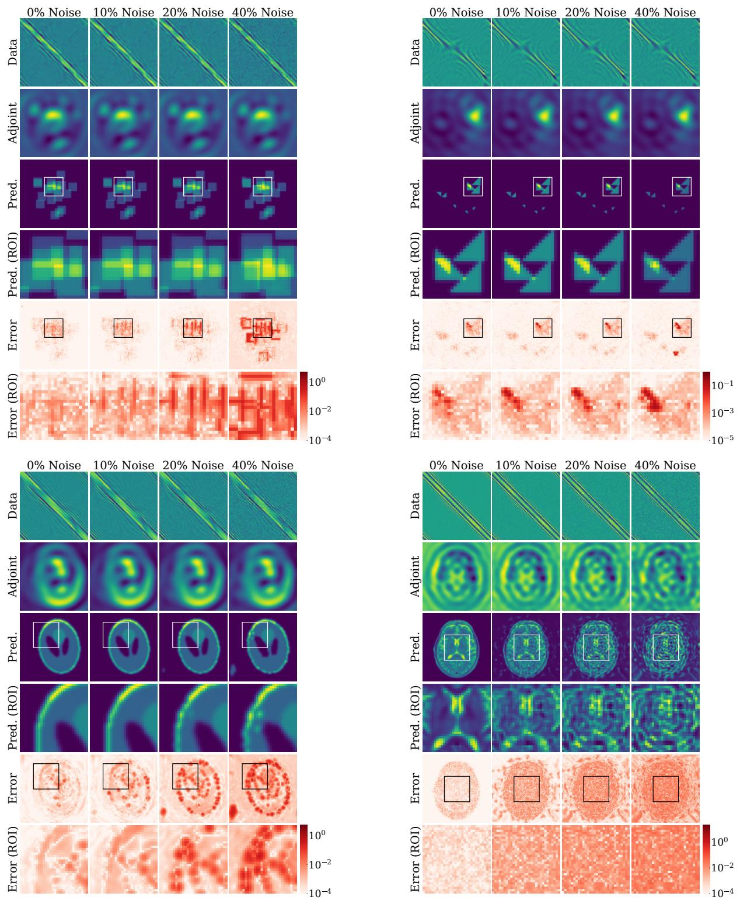  
Figure E.11: Efect of measurement noise on nonlinear inverse scattering. The panels show 10h Overlapping Squares (top left), 3–5–10h Triangles (top right), Shepp–Logan (bottom left), and Brain Scans (bottom right). Within each panel, columns correspond to 0%, 10%, 20%, and 40% added noise, as defined in the text. Rows show the measurement data, adjoint-based initialization, AdjointFlow reconstruction, reconstruction within the boxed region of interest (ROIs), reconstruction error, and error within that region.

Table E.8: Model performance on the four nonlinear inverse scattering datasets with increasing levels of noise added to the data, from 10% to 40%. We fix the number of sampling steps for AdjointFlow at 8, and compare to the results of the EquiNet CDM from [29] with 256 sampling steps. EquiNet CDM results for brain scans are obtained from a model we trained using the pipeline from [29].
<table><tr><td rowspan="2">Noise Level</td><td rowspan="2">Method</td><td colspan="4">RRMSE (%) ↓</td></tr><tr><td>Shepp-Logan</td><td>3–5–10h Triangles</td><td>10h Overlapping Squares</td><td>Brain Scans</td></tr><tr><td rowspan="2">0% Noise</td><td>AdjointFlow</td><td>0.379</td><td>1.108</td><td>1.143</td><td>3.421</td></tr><tr><td>EquiNet CDM</td><td>1.323</td><td>1.590</td><td>1.744</td><td>5.661</td></tr><tr><td rowspan="2">10% Noise</td><td>AdjointFlow</td><td>2.844</td><td>1.141</td><td>2.015</td><td>21.598</td></tr><tr><td>EquiNet CDM</td><td>3.355</td><td>1.564</td><td>2.675</td><td>21.889</td></tr><tr><td rowspan="2">20% Noise</td><td>AdjointFlow</td><td>7.800</td><td>1.677</td><td>5.763</td><td>38.648</td></tr><tr><td>EquiNet CDM</td><td>7.422</td><td>1.618</td><td>8.464</td><td>38.805</td></tr><tr><td rowspan="2">40% Noise</td><td>AdjointFlow</td><td>15.827</td><td>3.524</td><td>17.842</td><td>65.231</td></tr><tr><td>EquiNet CDM</td><td>14.827</td><td>3.522</td><td>24.761</td><td>65.949</td></tr></table>

## Appendix E.1.2. Inverse Crimes

An inverse crime is where the same mathematical model is used to generate the synthetic data for training and to test the inversion algorithm. We now test how well AdjointFlow responds to out-of-distribution data generated by a diferent numerical method. Specifically, we follow [29] and assess performance on measurement data generated using lower-order solvers. We evaluate the efects of mismatched forward models on nonlinear inverse scattering and seismic imaging because the numerical implementations of the forward models we use for these problems have easily configurable finite-diference stencil orders.

For nonlinear inverse scattering, the training data was generated using an 8th-order finite-diference scheme, and we test performance on measurements generated with 4th- and 6th-order solvers for the three synthetic inverse scattering datasets. We visualize the distributional mismatch in Figure E.12, and observe that while the scattering data can difer by up to 10%, the adjoints remain essentially unchanged. Results are given in Table E.9 and demonstrate that AdjointFlow is robust to these distributional shifts, with minimal change in performance except for Shepp–Logan with a 4th order stencil.

Table E.9: AdjointFlow performance on the three synthetic inverse scattering datasets when the test data is generated using diferent finite diference stencil orders (training data was generated with an 8th order stencil). We report RRMSE as a percentage and MELR ×10−2, and fix the number of sampling steps for AdjointFlow at 8.
<table><tr><td></td><td colspan="3">Shepp-Logan</td><td colspan="3">3–5–10h Triangles</td><td colspan="3">10h Overlapping Squares</td></tr><tr><td>Stencil Order</td><td>RRMSE↓</td><td>MELR↓</td><td>SD↓</td><td>RRMSE↓</td><td>MELR↓</td><td>SD↓</td><td>RRMSE↓</td><td>MELR↓</td><td>SD↓</td></tr><tr><td>4th Order Stencil</td><td>0.726</td><td>0.788</td><td>0.624</td><td>1.112</td><td>0.617</td><td>0.258</td><td>1.242</td><td>1.506</td><td>0.525</td></tr><tr><td>6th Order Stencil</td><td>0.382</td><td>0.479</td><td>0.576</td><td>1.122</td><td>0.626</td><td>0.258</td><td>1.150</td><td>1.411</td><td>0.515</td></tr><tr><td>8th Order Stencil</td><td>0.379</td><td>0.474</td><td>0.576</td><td>1.108</td><td>0.607</td><td>0.258</td><td>1.143</td><td>1.401</td><td>0.514</td></tr></table>

For seismic imaging, the training data was generated using a 4th-order spatial finitediference scheme, and we test performance on measurements generated with 2nd- and 4th-order solvers. We visualize the distributional mismatch in Figure E.13, and again note that the distributional shift has very little impact on the adjoint. The results in Table E.10 show that the diferent solver order has negligible impact on performance,

Table E.10: AdjointFlow performance on seismic imaging using test data generated with 2nd and 4th order spatial finite-diference stencils (training data was generated with a 4th order stencil). We report performance using 1 sampling step, as we found this to give the best performance based on validation data.
<table><tr><td>Stencil Order</td><td>RRMSE (%) ↓</td><td>PSNR ↑</td><td>SSIM ↑</td><td>Data misfit ↓</td></tr><tr><td>2nd order</td><td>9.7 (1.9)</td><td>20.515 (1.509)</td><td>0.676 (0.062)</td><td>112.39 (29.17)</td></tr><tr><td>4th order</td><td>9.7 (1.9)</td><td>20.530 (1.516)</td><td>0.676 (0.062)</td><td>115.63 (30.89)</td></tr></table>

further supporting the robustness of AdjointFlow to distributional shifts.

## Appendix E.2. Sample Complexity

We compare the training-data eficiency of AdjointFlow and EquiNet CDM by varying the number of training samples from 1,000 to 21,000, while fixing their respective sampling budgets at 8 and 256 steps. Results are presented in Table E.11, and show that AdjointFlow consistently achieves lower RRMSE across all four datasets and all training-set sizes. The improvement is already evident with only 1,000 samples and persists as additional training data are introduced. Notably, AdjointFlow requires far fewer training samples to achieve comparable accuracy to EquiNet CDM. These results indicate that the performance gains of AdjointFlow are not restricted to the large-data regime and suggest improved training-data eficiency relative to EquiNet CDM.

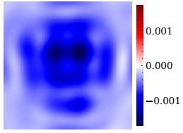

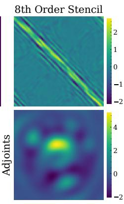

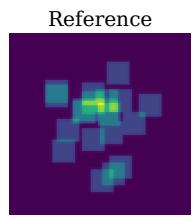

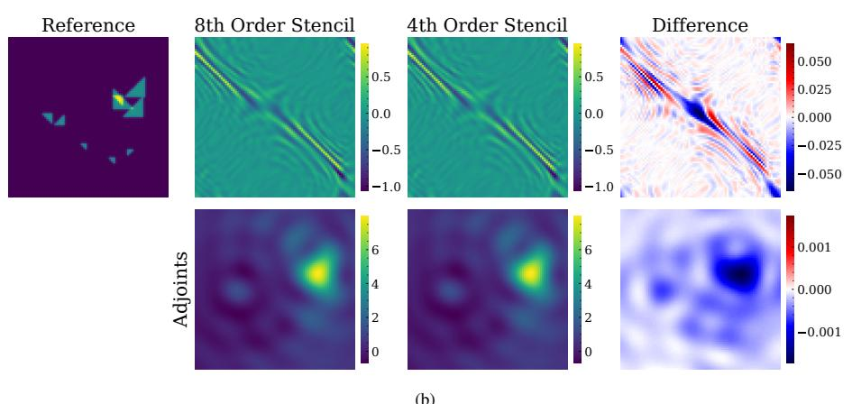  
(a)  
(b)

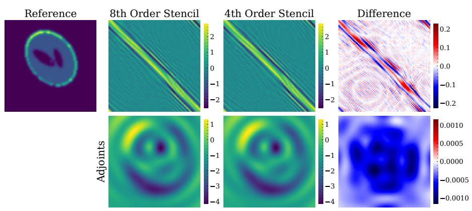  
(c)  
Figure E.12: Efect of finite-diference stencil order on nonlinear inverse scattering for (a) 10h Overlapping Squares, (b) 3–5–10h Triangles, and (c) Shepp–Logan. Each panel shows the ground-truth perturbation at left. The remaining columns compare the 8th-order and 4th-order results and their signed diference: measurement data at the highest probing frequency in the top row, and the corresponding adjoint back-projections in the bottom row.

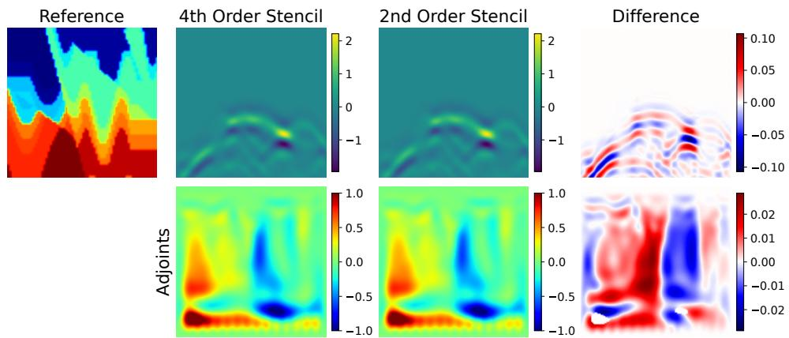  
Figure E.13: Efect of spatial finite-diference stencil order on seismic imaging. The ground-truth wavespeed map is shown at left. The remaining columns compare the 4th-order and 2nd-order results and their signed diference. The top row shows single-shot receiver measurements, and the bottom row shows the corresponding adjoint-based initializations. Each color bar gives the scale of its associated image.

Table E.11: Model performance on four inverse scattering datasets as the number of training samples increases from 1,000 to 21,000. We fix the number of sampling steps for AdjointFlow at 8, and compare to the results of the EquiNet CDM from [29] with a fixed budget of 256 sampling steps. EquiNet CDM results for brain scans are obtained from a model we trained using the pipeline from [29].
<table><tr><td rowspan="2">Training Samples</td><td rowspan="2">Method</td><td>Shepp-Logan</td><td>3–5–10h Triangles</td><td>10h Overlapping Squares</td><td>Brain Scans</td></tr><tr><td>RRMSE↓</td><td>RRMSE↓</td><td>RRMSE↓</td><td>RRMSE↓</td></tr><tr><td rowspan="2">1,000</td><td>AdjointFlow</td><td>1.912</td><td>4.356</td><td>7.933</td><td>5.476</td></tr><tr><td>EquiNet CDM</td><td>2.085</td><td>8.475</td><td>12.454</td><td>9.485</td></tr><tr><td rowspan="2">2,000</td><td>AdjointFlow</td><td>1.242</td><td>3.136</td><td>5.856</td><td>4.829</td></tr><tr><td>EquiNet CDM</td><td>1.644</td><td>5.454</td><td>7.893</td><td>7.995</td></tr><tr><td rowspan="2">4,000</td><td>AdjointFlow</td><td>0.853</td><td>2.582</td><td>4.014</td><td>4.331</td></tr><tr><td>EquiNet CDM</td><td>1.379</td><td>3.525</td><td>4.896</td><td>7.120</td></tr><tr><td rowspan="2">8,000</td><td>AdjointFlow</td><td>0.612</td><td>1.647</td><td>2.424</td><td>4.004</td></tr><tr><td>EquiNet CDM</td><td>1.376</td><td>2.824</td><td>2.756</td><td>6.291</td></tr><tr><td rowspan="2">16,000</td><td>AdjointFlow</td><td>0.426</td><td>1.529</td><td>1.481</td><td>3.568</td></tr><tr><td>EquiNet CDM</td><td>1.281</td><td>1.957</td><td>2.184</td><td>5.833</td></tr><tr><td rowspan="2">21,000</td><td>AdjointFlow</td><td>0.379</td><td>1.108</td><td>1.143</td><td>3.421</td></tr><tr><td>EquiNet CDM</td><td>1.323</td><td>1.590</td><td>1.744</td><td>5.661</td></tr></table>

## Appendix E.3. Empirical Transport Distances

To illustrate the geometry of the initializations in the concentrated-posterior regime, we approximate the conditional target for each measurement–reconstruction pair (�, �) by $\delta _ { m }$ . Writing �(�) for the initialization used by AdjointFlow and � for the dimension of the reconstruction, we apply (21) to explicitly compute

$$
\mathcal { W } _ { 2 } \big ( N ( 0 , I ) , \delta _ { m } \big ) = \sqrt { \| m \| _ { 2 } ^ { 2 } + d } , \qquad \mathcal { W } _ { 2 } \big ( \delta _ { a ( y ) } , \delta _ { m } \big ) = \| a ( y ) - m \| _ { 2 } .\tag{E.2}
$$

We report the mean and standard deviation of these distances across the training examples in each dataset. Table E.12 shows that the concentrated, physics-based AdjointFlow initialization $\delta _ { a ( y ) }$ reduces transport distance compared to a standard Gaussian on every dataset we test. While our transport-distance analysis provides strong geometric motivation for the AdjointFlow initialization, it does not necessarily establish a causal relationship with observed model performance. Additionally (E.2) provides a useful estimate when the training dataset is finite and discrete, but does not capture posterior variability that may exist in real-world settings.

## Appendix E.4. Auxiliary Training Techniques

We observed modest gains for AdjointFlow in some settings from flow-matching training techniques adapted from Lee et al. [99]. These fall outside our main scope but suggest directions for future work.

Table E.12: Comparison of Wasserstein-2 distances estimated numerically between the reference and target distributions when the base distribution is a standard Gaussian $x _ { 0 } \sim \mathcal { N } ( 0 , I )$ vs. when the base distribution $\rho _ { 0 } = \delta _ { a ( y ) }$ is concentrated at the physics-based approximation. We report the averages across each training dataset with standard deviation shown in parentheses.
<table><tr><td>Reference Distribution</td><td>Shepp-Logan</td><td>3-5-10h Tri</td><td>10h Squares</td><td>Brain Scans</td><td> $\mathbf { C e l l s } \left( N _ { \mathrm { r e c } } = 6 0 / 1 8 0 / 3 6 0 \right)$ </td><td>Seismic Imaging</td><td>Black Holes</td></tr><tr><td>Gaussian</td><td>113.1 (3.0)</td><td>111.6 (18.7)</td><td>113.1 (3.8)</td><td>112.8 (8.6)</td><td>180.7 (11.4)</td><td>180.1 (18.3)</td><td>89.7 (11.9)</td></tr><tr><td>Physics-based</td><td>94.1 (16.0)</td><td>77.4 (22.9)</td><td>68.6 (7.2)</td><td>95.7 (24.3)</td><td> $5 3 . 6 \left( 1 0 . 1 \right) / 2 4 . 0 \stackrel { \cdot } { ( } 4 . 8 \stackrel { \cdot } { ) } / 2 2 . 8 \left( 4 . 7 \right)$ </td><td>169.6 (29.0)</td><td>48.9 (11.3)</td></tr></table>

Adapting [99], we replace the squared $\ell _ { 2 }$ loss in (10) with a Pseudo-Huber loss combined with a time-weighted, SSIM-based (D.3) perceptual term:

$$
\mathcal { L } _ { \mathrm { s s i m - h u b } } [ \hat { \nu } ] = \int _ { 0 } ^ { 1 } \mathbb { E } \bigg [ t \cdot \Big ( \sqrt { \| x _ { 1 } - x _ { 0 } - \hat { \nu } _ { t } ( x _ { t } ; y ) \| _ { 2 } ^ { 2 } + c ^ { 2 } } - c \Big ) - \frac { 1 } { 1 - t } \mathrm { S S I M } ( \hat { x } _ { 1 } , x _ { 1 } ) \bigg ] d t ,\tag{E.3}
$$

where $c = 0 . 0 0 0 5 4 d$ for an image $x _ { t } \in \mathbb { R } ^ { d } ;$ , and $\hat { x } _ { 1 } = x _ { t } + ( 1 - t ) \hat { \nu } _ { t } ( x _ { t } ; y )$ . One may also use $\hat { x } _ { 1 }$ to add a data consistency term to the training loss, but we generally found this to be either computationally infeasible and/or inefective in our limited experiments.

Additionally, one may optimize a reweighted objective. The U-shaped time-weighting scheme (C.5) of Lee et al. [99], with their choice $\xi = 4$ , biases the endpoints of [0, 1] where learning may be more dificult.

## Appendix F. Implementation Details

We implemented all models using $\mathrm { J A X ^ { 1 0 } , F L A X ^ { 1 1 } }$ and $\operatorname { s w i r l - d y n a m i c s } ^ { 1 2 }$ , and trained on NVIDIA Quadro RTX 6000, RTX A6000, L40S, and H100 GPUs. We use Adam [58] with linear warm-up from $1 0 ^ { - 5 } ~ \mathrm { t o } ~ 1 0 ^ { - 3 }$ over the first 5% of training, followed by cosine annealing to $1 0 ^ { - 6 }$ . We targeted the benchmark models’ epoch counts, reducing batch sizes when GPU memory required it. We use InverseBench’s publicly available implementations, pretrained difusion prior checkpoints, and hyperparameter choices13 for linear inverse scattering, FWI, and black hole imaging. For our own PnP implementations, we follow InverseBench’s tuning procedure [40] with comparable hyperparameter ranges and tuning iterations, using Optuna [141] for Bayesian optimization. For RED-Flow we use 500 optimization iterations for nonlinear inverse scattering and 1000 for other problems. Tables F.13 and F.14 report parameter counts and dataset details.

Table F.13: Neural network parameter counts by problem. As in Algorithm 1, � denotes the main score/velocity/target-prediction network parameters and � the conditional branch parameters. PnP models have no conditional branch $( | \phi | = 0 )$
<table><tr><td>Model</td><td>Problem</td><td>|φ|</td><td>|θ|</td></tr><tr><td>EquiNet-CNN</td><td>Nonlinear inverse scattering</td><td>156k</td><td>375k</td></tr><tr><td>ADM (PnP)</td><td>Nonlinear inverse scattering</td><td>0</td><td>26.8M</td></tr><tr><td>EquiNet-CNN</td><td>Linear inverse scattering  $( N _ { \mathrm { r e c } } { = } 6 0 / 1 8 0 / 3 6 0 )$ </td><td> $2 0 k / 1 4 5 k / 5 4 9 k$ </td><td>2.73M</td></tr><tr><td>ADM (PnP)</td><td>Linear inverse scattering</td><td>0</td><td>26.8M</td></tr><tr><td>ADM (PnP)</td><td>Seismic Imaging</td><td>0</td><td>26.8M</td></tr><tr><td>ADM (conditional)</td><td>Seismic Imaging</td><td>550k</td><td>27.8M</td></tr><tr><td>CNN</td><td>Black hole imaging (obs. ratio=3%/10%/100%)</td><td>128k/263k/862k</td><td>1.89M</td></tr><tr><td> $\mathsf { N C S N + + } \left( \mathsf { P n P } \right)$ </td><td>Black hole imaging</td><td>0</td><td>20.0M</td></tr></table>

Table F.14: Dataset parameters and forward/gradient evaluation timings (medians of 50 evaluations after warm-up). FWI measurements are Fourier-transformed and sub-sampled to 16 × 33 × 20 (Section 4.3). Linear inverse scattering uses $N _ { \mathrm { r e c } } \in \{ 6 0 , 1 8 0 , $ 360} receivers; black hole observation ratios are 3%, 10%, and 100%. Inverse scattering uses one Quadro RTX 6000 GPU; seismic and black hole imaging use Intel Xeon Gold 6248R CPUs on the same node, with 16 single-threaded workers and one CPU thread, respectively, following [40].
<table><tr><td>Problem</td><td> $N _ { \mathbf { t r a i n } }$ </td><td> $N _ { \mathrm { t e s t } }$ </td><td>Dimension of m</td><td>Dimension of y</td><td>Forward Eval. (sec)</td><td>Gradient Eval. (sec)</td></tr><tr><td>Nonlinear inverse scattering</td><td>21000</td><td>500</td><td> $8 0 \times 8 0$ </td><td> $8 0 \times 8 0 \times 2 \times 3$ </td><td>2.310</td><td>2.455</td></tr><tr><td>Linear inverse scattering</td><td>10000</td><td>100</td><td> $1 2 8 \times 1 2 8$ </td><td> $2 0 \times N _ { \mathrm { r e c } } \times 2$ </td><td>0.004 / 0.005 / 0.006</td><td>0.011 / 0.012 / 0.015</td></tr><tr><td>Seismic Imaging</td><td>50000</td><td>10</td><td> $1 2 8 \times 1 2 8$ </td><td> $1 6 \times 1 2 9 \times 1 0 0 1$ </td><td>4.004</td><td>6.261</td></tr><tr><td>Black hole imaging</td><td>50000</td><td>100</td><td> $6 4 \times 6 4$ </td><td> $1 8 5 / 8 8 5 / 4 0 0 7$ </td><td>0.001 / 0.002 / 0.008</td><td>0.005 / 0.019 / 0.111</td></tr></table>

## Appendix G. Additional Results

We provide additional qualitative comparisons for nonlinear inverse scattering on Brain Scans in Figure G.14, linear inverse scattering in Figure G.15, seismic imaging in Figure G.16, and black holes in Figure G.17. These examples complement the representative reconstructions shown in the main text and illustrate performance across a broader set of test instances.

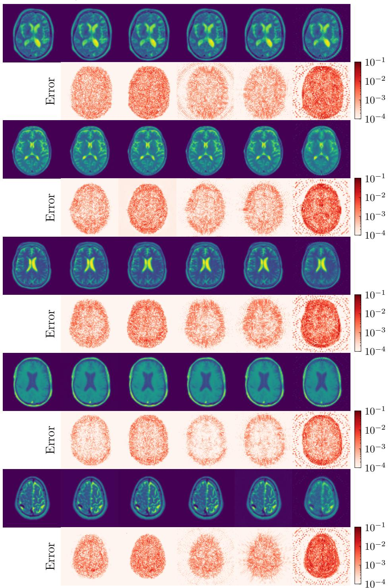  
Figure G.14: Further qualitative comparisons of AdjointFlow with diferent difusion-based methods on nonlinear inverse scattering for the Brain Scans dataset.

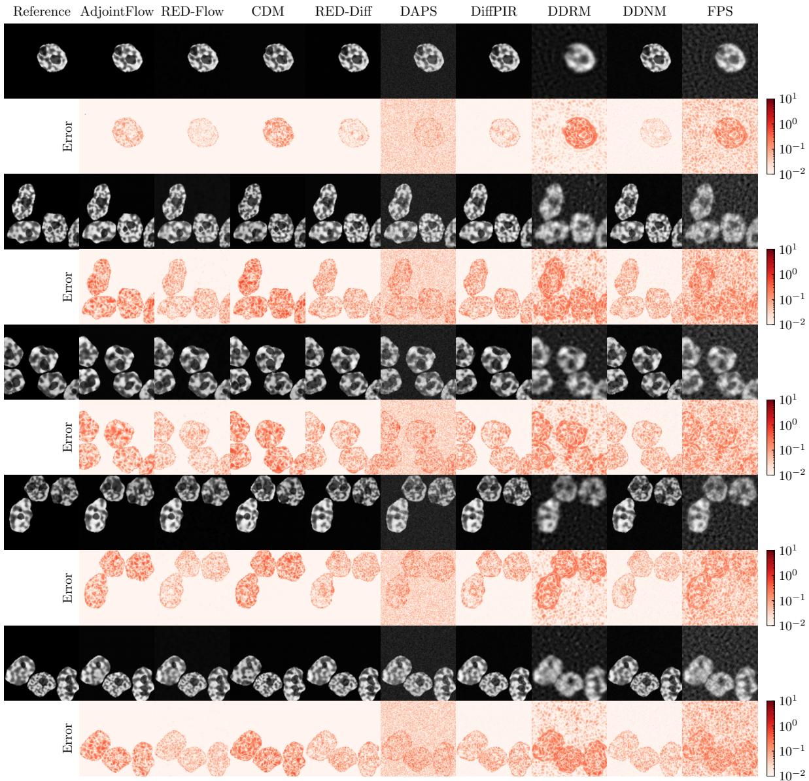  
Figure G.15: Further qualitative comparisons of AdjointFlow against difusion baselines for linear inverse scattering with 60 receivers.

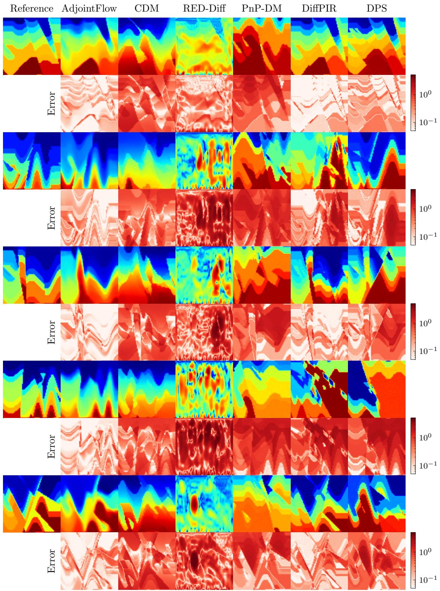  
Figure G.16: Further qualitative comparisons of AdjointFlow against difusion baselines for seismic imaging. Note that while other methods occasionally produce accurate reconstructions, only AdjointFlow consistently avoids cycle-skipping.

Reference AdjointFlow RED-Flow AdjointFlow† CDM RED-Dif PnP-DM DifPIR DPS DAPS

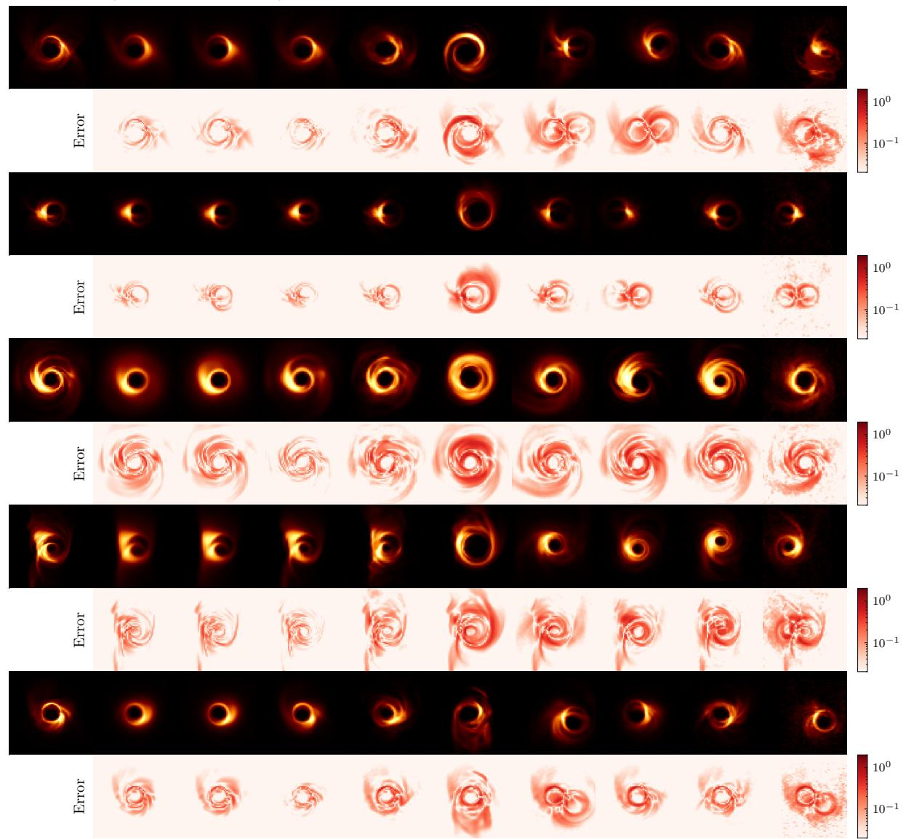  
Figure G.17: Further qualitative comparisons of AdjointFlow against difusion baselines for black hole imaging with 3% observation ratio.