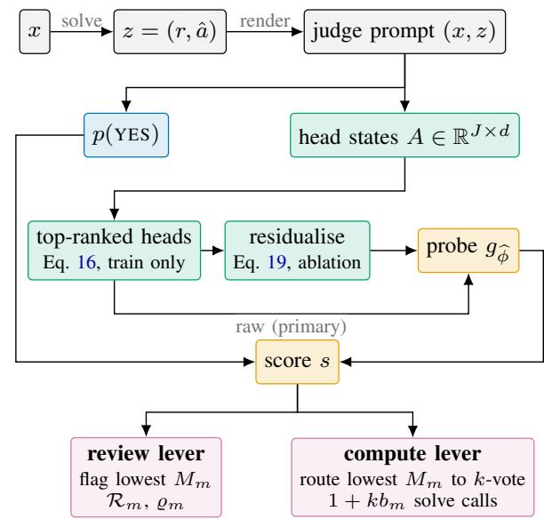
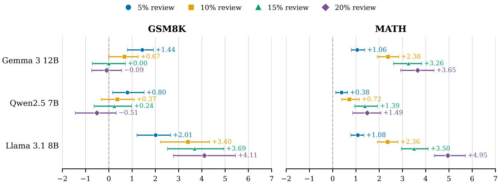
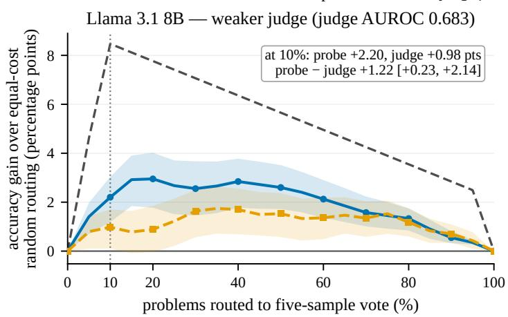
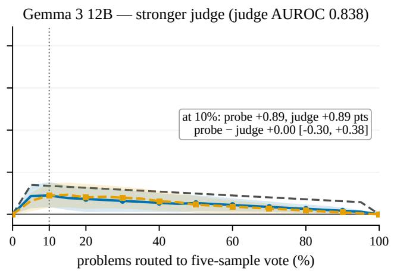
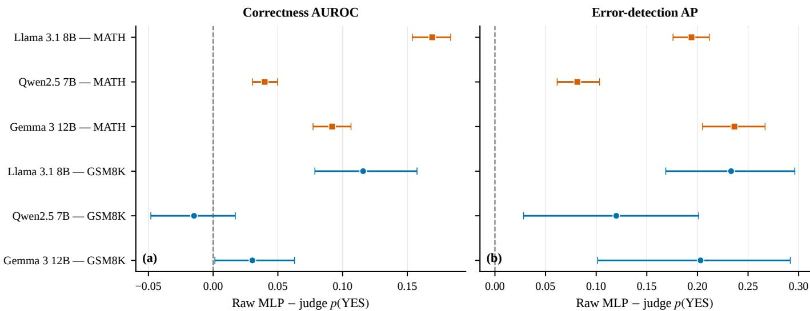
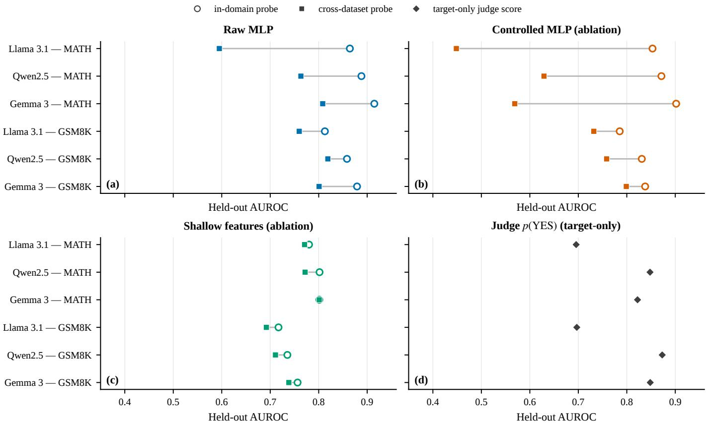
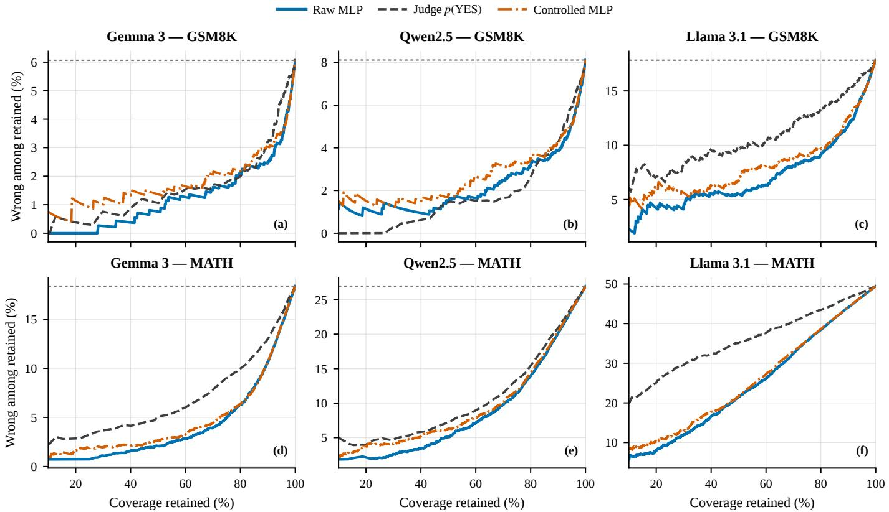
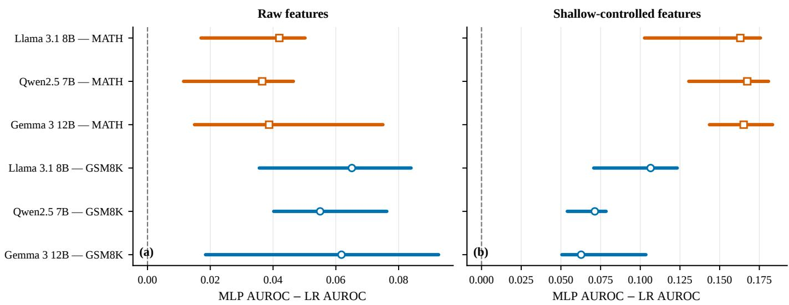
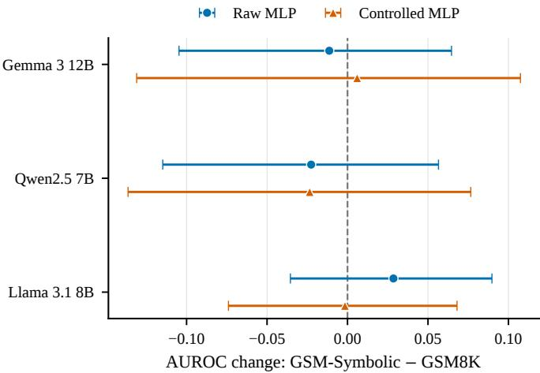

# Auditing the Judge: Internal Signals for LLM Reasoning Assurance

Mayank Gulati and Gerhard Wunder

Freie Universitat Berlin¨

{mayank.gulati, gerhard.wunder}@fu-berlin.de

Abstract—Language-model systems use self-judgment to decide which answers to release, review, or recompute. Because intervention is costly, an assurance score must rank errors well at the available budget, not merely over the full ranking. We compare the judge’s continuous verdict-token score with a supervised correctness probe trained on attention-head activations from the same prompt. Exact identities link fixed-budget error recall to residual risk and show that AUROC averages recall over all budgets. Across three open 7–12B models on GSM8K and MATH, the probe finds 1.3–22.5 additional percentage points of errors at 5% review in all six model–dataset settings (median 7.4 points). At 10% routing, probe-guided allocation improves accuracy over equal-cost random allocation in both GSM8K experiments, but beats judge-guided routing only for the weaker judge. Cross-dataset transfer lowers probe AUROC for every model in both directions relative to target-domain training. Because dataset, weight precision, and generation budget change together, this measures a joint protocol shift rather than a dataset-only effect. Internal signals can improve supervised, indomain budget allocation, but are not domain-general confidence estimators.

Index Terms—trustworthy machine learning, large language models, selective prediction, self-evaluation, error detection, distribution shift

## I. INTRODUCTION

Self-evaluation becomes an assurance mechanism when a model’s judgment determines which answers receive further scrutiny. A deployer may send low-scoring answers to a human or rerun them with additional inference, while releasing the rest [1]–[3]. An incorrect answer assigned a high score can therefore bypass intervention and reach the user. Because human attention and inference compute are limited, the deployment cannot scrutinize every answer. It must spend its budget on the outputs most likely to be wrong. The central question is thus which self-evaluation signal best allocates a fixed intervention budget.

We position the probe as a deployment audit tool, not a correctness guarantee: an auditor fixes a review budget, validates the score on labelled outputs from the intended protocol, and uses its ranking to prioritise human review or recomputation while measuring residual error among released answers. This operational use is consistent with risk-management practices that emphasise measurement, monitoring, documentation, and human oversight, including the NIST AI Risk Management Framework and, where applicable, the EU AI Act [4], [5]. The score can support such controls, but it does not establish regulatory compliance and must be revalidated after a change to the model, data, or inference protocol.

A verbalized judgment may discard information useful for that allocation. The judging pass builds a high-dimensional internal state, then compresses it into a verdict token. Even the continuous YES/NO token mass is only one projection of that state. Prior work shows that internal activations can contain correctness-related information [6]–[8]. However, aggregate discrimination does not establish deployment value. It does not show how many errors a small review budget catches, how much accuracy a compute budget buys, or whether a fitted score remains valid after the deployment protocol changes.

Standard ranking metrics can obscure this distinction. AU-ROC summarizes the entire ordering, while a deployment acts at one operating budget. Proposition 2 makes this mismatch precise: at fixed error prevalence, AUROC is an affine function of error recall averaged uniformly over all review budgets. It therefore weighs an 80% review budget as heavily as a 5% budget. On Qwen2.5/GSM8K, the paired AUROC comparison does not establish a difference between the probe and judge. Yet at 5% review, the probe catches 9.3 additional percentage points of the errors (Table I and Table II). This is the decision that matters when only one answer in twenty can be reviewed.

Our core idea is to compare two read-outs of the same judging computation. The black-box score is the judge’s continuous p(YES) token mass. The white-box score is a supervised probe fitted to attention-head activations at the verdict position. Head selection and probe fitting use only training data. On held-out answers, both scores rank the same population and receive the same review or compute budget. This isolates whether the internal state improves the deployment decision.

Our contributions are:

• Formalize budgeted assurance. We show that human review and additional inference are fixed-budget selection problems. Exact results connect the selected ranking to error recall, residual risk, and routing accuracy.

• Measure deployment value. The probe improves error capture at 5% review in all six in-domain settings. It also beats equal-cost random routing in both compute experiments, but beats the judge only when the judge is weaker.

• Identify the validity boundary. Cross-dataset transfer reduces probe AUROC in every evaluated direction. Because these comparisons also change weight precision and generation budget, they reveal sensitivity to a joint protocol shift and motivate target-protocol validation.

The strongest supported claim is conditional. With supervision and validation on the target model, task, and inference protocol, internal signals can improve how limited review and compute are allocated. They do not provide domain-general confidence or robustness to an active adversary.

## II. RELATED WORK

Model-based evaluation and self-correction: LLMs serve as evaluators in comparative benchmarks [1], as sources of feedback during training [2], [3], and as critics in iterative refinement [9]. These uses depend on the model recognizing defects in generated text. That ability is imperfect: model judges exhibit position, verbosity, and self-preference biases [1], [10], [11], while self-correction without external feedback often fails to improve reasoning [12], [13]. We therefore compare the probe with a continuous black-box self-judgment score: the judge’s normalized YES/NO token probability, rather than a sampled binary verdict. This is a strong baseline from the same judging pass, although it does not exhaust output-only confidence methods.

Selective prediction and abstention: Selective prediction formalizes the option to reject an uncertain output [14], [15]. Later work develops risk–coverage metrics and learned rejectors for deep networks [16]–[18], as well as misclassification detection [19]. For language models, selective generation handles distribution shift [20], and selective answering handles ambiguous questions [21]. We use the same operational view: a score ranks inputs for review under a fixed budget. This budget matters because AUROC averages error-detection performance over all possible review fractions (Proposition 2), whereas a deployment operates at one or a few chosen fractions.

Internal signals of truth and correctness: Linear and shallow probes recover truth-related structure from transformer hidden states [6], [7], [22]. Internal states have also supported confidence estimation across layers [23], long-form factuality detection [24], and multi-sample hallucination detection [25]; attention-head interventions can additionally steer truthful answers [8]. Output-side alternatives instead compare the meanings or agreement of sampled generations [26]–[28]. Our probe differs by reading the hidden state of a separate judging pass and by evaluating fixed review budgets and crossdataset transfer. This design creates an interpretive ambiguity. Objective correctness and self-judgment usually agree, so correctness-labelled training data cannot distinguish a probe that tracks actual correctness from one that tracks the judge’s belief [29]. Our results therefore show that the probe predicts errors, but not which of these two signals it has learned.

Adaptive inference: Self-consistency improves reasoning by sampling several solution paths and selecting their consensus [30]; more generally, test-time compute can trade inference cost for accuracy [31]. Adaptive methods stop sampling when answers agree [32] or learn how much compute to allocate to each input [33]. Our routing experiment asks a narrower question: can a judge-derived score select which inputs receive k-sample self-consistency? The equal-cost random-routing baseline isolates the value of that selection score from the decoder’s average gain (Equation (11)).

Benchmark validity: GSM8K and MATH [34], [35] predate the checkpoints studied here, so benchmark exposure is a validity concern. GSM1k tests for contamination-related overfitting with newly written problems that match GSM8K’s style and difficulty [36]. GSM-Symbolic instead varies names, numbers, and clauses within symbolic templates to test reasoning robustness [37]. Our GSM-Symbolic-style perturbation serves only as a sensitivity analysis; it cannot establish that the original items were absent from pretraining (Section E-D).

## III. BUDGETED ASSURANCE SETTING

The deployment pipeline is solve $ s c o r e  s e l e c t $ intervene → release. The model produces an answer and a self-evaluation score; the deployer uses that score to decide which answers receive a scarce intervention. The score therefore informs an allocation decision but does not itself establish correctness. This section formalizes that decision, the two interventions studied here, and the exact quantities used to evaluate them. The formal results make each reported quantity auditable; their proofs and artifact-level identity checks are separated in Section A.

## A. Answers, labels, and scores

For a query x, the solver emits a solution $\boldsymbol { z } ~ = ~ \left( r , \boldsymbol { \hat { a } } \right)$ with reasoning trace r and final answer aˆ. Let $a ^ { \star } ( x )$ be the reference answer and let ≡ denote the dataset-specific answerequivalence relation (Section V-B). Correctness is

$$
y ( x , z ) = \mathbf { 1 } [ { \hat { a } } \equiv a ^ { \star } ( x ) ] \in \{ 0 , 1 \} ,\tag{1}
$$

so $y = 0$ denotes an error.

All learned components are fitted on ${ \mathcal { D } } _ { \mathrm { t r } }$ . Operational quantities are computed on the held-out set $\mathcal { D } _ { \mathrm { t e } } = \{ ( x _ { i } , z _ { i } , y _ { i } ) \} _ { i = 1 } ^ { N } .$ Let $I \ \sim \ \mathrm { U n i f } ( [ N ] )$ , where $[ N ] ~ = ~ \{ 1 , \dots , N \}$ , denote a uniformly sampled held-out item. We use PN and $\mathbb { E } _ { N }$ for probability and expectation over I and the tie-breaking rule defined below. The observed error prevalence is

$$
\pi _ { 0 } = \mathbb { P } _ { N } ( y _ { I } = 0 ) = \frac { 1 } { N } \sum _ { i = 1 } ^ { N } \mathbf { 1 } [ y _ { i } = 0 ] .
$$

This empirical probability space is used for the finite identities below; the population statement in Proposition 2 is identified explicitly.

The model does not emit an authoritative correctness label. Instead, the control supplies a real-valued score

$$
s : ( x , z ) \mapsto \mathbb { R } ,\tag{2}
$$

where larger values indicate greater confidence in correctness. We compare a black-box score obtained from the judge’s verdict-token distribution with a white-box score learned from its internal activations (Section IV).

## B. Fixed-budget selection

The deployer has capacity to intervene on an integer $M _ { m } \in \{ 0 , \ldots , N \}$ of the N answers. The nominal budget is $m \in [ 0 , 1 ]$ , and $b _ { m } = M _ { m } / N$ is the realized fraction after the experiment-specific rounding rule (Section V-D). A score selects the $M _ { m }$ lowest-scoring answers,

$$
\begin{array} { r l r } & { \mathcal { F } _ { m } ( s ) \subseteq [ N ] , } & { \big | \mathcal { F } _ { m } ( s ) \big | = M _ { m } , } \\ & { s _ { i } \leq s _ { i ^ { \prime } } } & { \forall i \in \mathcal { F } _ { m } ( s ) , \quad i ^ { \prime } \notin \mathcal { F } _ { m } ( s ) . } \end{array}\tag{3}
$$

If several items have the same score at the cutoff, we choose uniformly at random among them to fill the remaining slots. Reported metrics average over this random choice (Section B-A).

Only the ordering induced by s enters Equation (3). Consequently, every strictly increasing transformation of the score produces the same decision. Calibration can matter for other policies, but it is not required for this fixed-capacity ranking problem.

We study two interventions with a fixed cost per selected item:

1) Review. The selected answers are reviewed before release; the capacity $M _ { m }$ is measured in answers.

2) Additional inference. The selected queries receive k new sampled solutions and a majority-vote answer. Because k is fixed, selecting $M _ { m }$ queries consumes $k M _ { m }$ additional solver calls.

The common decision is which subset receives the intervention. Its value, however, differs between review and recomputation.

## C. Review objective: catch errors before release

For review, the relevant outcomes are the fraction of errors selected and the error rate among answers released without review:

$$
\mathcal { R } _ { m } ( s ) = \mathbb { P } _ { N } ( I \in \mathcal { F } _ { m } ( s ) \mid y _ { I } = 0 ) ,\tag{4}
$$

$$
\varrho _ { m } ( s ) = \mathbb { P } _ { N } ( y _ { I } = 0 \mid I \notin { \mathcal { F } } _ { m } ( s ) ) .\tag{5}
$$

The first is error recall at the review budget; the second is residual risk among unreviewed answers. At a fixed budget and prevalence, they are two views of the same error count.

Proposition 1 (Finite-sample residual-risk identity). Suppose the held-out set contains at least one error and $M _ { m } < N$ . For any score s,

$$
\varrho _ { m } ( s ) = \pi _ { 0 } \frac { 1 - \mathcal { R } _ { m } ( s ) } { 1 - b _ { m } } .\tag{6}
$$

Hence, for scores s and $s ^ { \prime }$ evaluated on the same held-out set at the same realized budget,

$$
\varrho _ { m } ( s ^ { \prime } ) - \varrho _ { m } ( s ) = \frac { \pi _ { 0 } } { 1 - b _ { m } } \left[ \mathcal { R } _ { m } ( s ) - \mathcal { R } _ { m } ( s ^ { \prime } ) \right] .\tag{7}
$$

The proof is a counting argument (Section A-A1). The identity has two reporting consequences. First, recall and residual risk are not independent evidence: once π0 and $b _ { m }$ are fixed, either determines the other. Second, the conversion from a recall gain to a residual-risk reduction scales as $\pi _ { 0 } / ( 1 - b _ { m } )$ Residual-risk gains should therefore be compared between scores on the same population, not across populations with different error prevalence. At full review, $b _ { m } ~ = ~ 1$ and no unreviewed answers remain, so residual risk is undefined.

## D. Why aggregate ranking can miss the operating point

AUROC summarizes the full ranking, whereas deployment uses a specific budget. For a population budget m, select the lowest-scoring fraction m. If items tie at the cutoff, select each with equal probability so that the total selected fraction remains m. Let $\bar { \mathcal { R } } _ { m } ^ { P } ( s )$ be the resulting error recall.

Proposition 2 (AUROC averages recall over budgets). Let Y be the correctness label for an answer drawn from a population P containing both correct and incorrect answers, and let $\pi _ { 0 , P } ~ = ~ \mathbb { P } _ { P } ( Y ~ = ~ 0 )$ . Orient s so that larger values indicate greater confidence in correctness. To compute $\operatorname { A U R O C } _ { P } ( s )$ , compare an independently drawn correct and incorrect answer: count one if the correct answer scores higher, zero if it scores lower, and one half if the scores are equal. Then

$$
\int _ { 0 } ^ { 1 } \mathcal { R } _ { m } ^ { P } ( s ) \mathrm { d } m = \frac { \pi _ { 0 , P } } { 2 } + ( 1 - \pi _ { 0 , P } ) \mathrm { A U R O C } _ { P } ( s ) .\tag{8}
$$

The proof is given in Section A-A2. At a fixed error prevalence, the identity relates AUROC to error recall averaged over all budgets from zero to one. It therefore gives equal weight to equal-sized budget ranges, even when deployment uses only a small budget. Two scores can consequently have similar AUROC but different error recall at the deployment budget.

We report AUROC for comparability, but state deployment claims at fixed budgets. The exact finite-sample analogue and the corresponding risk–coverage view are given in Section A-A2 and Section E-B.

E. Compute objective: allocate inference where it changes the answer

Additional inference is valuable only when it changes correctness. Condition on the realized greedy and k-sample majority-vote outputs. For item i, define the signed repair value

$$
\gamma _ { i } = \mathbf { 1 } \Big [ \hat { a } _ { i } ^ { ( k ) } \equiv a ^ { \star } ( x _ { i } ) \Big ] - \mathbf { 1 } \Big [ \hat { a } _ { i } ^ { ( 1 ) } \equiv a ^ { \star } ( x _ { i } ) \Big ] \in \{ - 1 , 0 , + 1 \} .\tag{9}
$$

A value of +1 means that additional inference repairs an error, −1 means it breaks a correct answer, and 0 means correctness is unchanged. Routing a set $A \subseteq [ N ]$ to the expensive decoder gives

$$
\operatorname { A c c } ( A ) = \operatorname { A c c } _ { \operatorname { g r e e d y } } + { \frac { 1 } { N } } \sum _ { i \in { \mathcal { A } } } \gamma _ { i } .\tag{10}
$$

Its implemented cost is $1 + k | \mathcal { A } | / N$ solver calls per query: one initial greedy solve for every query and k new solves for every routed query. The judge pass is outside this solve-call metric.

(a, b)

We first compare score-guided routing with random routing at the same budget. Let $\bar { \gamma } = N ^ { - 1 } \sum _ { i } \gamma _ { i }$ be the average change in correctness when additional inference is applied across all queries. If $M _ { m }$ queries are selected uniformly at random, the expected accuracy is

$$
\operatorname { A c c } _ { \operatorname { r a n d } } ( m ) : = \mathbb { E } _ { A } [ \operatorname { A c c } ( A ) ] = \operatorname { A c c } _ { \operatorname { g r e e d y } } + b _ { m } { \bar { \gamma } } .\tag{11}
$$

$\mathrm { I f } \ \bar { \gamma } > 0$ , random routing already improves on greedy decoding. This gain comes from additional inference, not from the score. The score adds selection value only if it beats random routing at the same cost.

An oracle provides an upper bound. It observes each $\gamma _ { i }$ and then selects the best $M _ { m }$ queries. Let $\pi _ { + } = \mathbb { P } _ { N } ( \gamma _ { I } = + 1 )$ and $\pi _ { - } = \mathbb { P } _ { N } ( \gamma _ { I } = - 1 )$ be the fractions of queries helped and harmed by additional inference. Its accuracy is

$$
\begin{array} { l } { \operatorname { A c c } _ { \operatorname { o r a c } } ( m ) : = \displaystyle \operatorname* { m a x } _ { | { \cal A } | = M _ { m } } \operatorname { A c c } ( { \cal A } ) } \\ { \quad \quad = \operatorname { A c c } _ { \operatorname { g r e e d y } } + \operatorname* { m i n } ( b _ { m } , \pi _ { + } ) } \\ { \quad \quad \quad - \operatorname * { m a x } \{ 0 , b _ { m } - ( 1 - \pi _ { - } ) \} . } \end{array}\tag{12}
$$

This expression assumes that exactly $M _ { m }$ queries are routed, as in our experiments. If $M _ { m }$ is only an upper limit, the oracle never routes harmed queries and the final subtraction term disappears. The oracle routes helped queries first and harmed queries only when needed to fill the budget. Its decisions require outcomes observed after additional decoding, so it cannot be deployed. Both identities are proved in Section A-A5.

A deployed policy must choose before the additional samples are drawn. Let $\mathcal { T } _ { i }$ denote the information available at that point. Assuming that routing one query does not affect another, the best fixed-budget policy ranks queries by their expected repair value, $\mathbb { E } [ \gamma _ { i } \mid { \mathbb { Z } } _ { i } ]$ . A correctness score instead estimates whether the current answer is correct. These targets differ because an incorrect answer may remain incorrect after additional inference.

## F. Assurance criteria and scope

A score is useful only if it improves the budgeted decision. For review, we compare scores on the same held-out population and at the same budget. A better score has higher $\mathcal { R } _ { m } ,$ equivalently lower $\varrho _ { m }$ . For compute, score-guided routing must first outperform equal-cost random routing; comparison with judge-guided routing then tests whether internal access adds value beyond the black-box self-judgment score.

These are empirical, protocol-specific claims rather than guarantees. They apply to the evaluated model, task, generation and judging protocol, label rule, and budget, with the probe fitted on labeled in-domain answers. We assume a non-adaptive query population and fixed per-item intervention costs. We do not consider an adversary who manipulates queries, solutions, scores, or the review process.

  
Fig. 1. The control. (a) The model solves $x ,$ producing $z = ( r , { \hat { a } } ) . ( \mathbf { b } ) \ ( x , z )$ is rendered into a judge prompt; the black-box baseline reads the YES/NO token mass at the verdict position (Equation (13)). (c) The same prompt is replayed and the pre-projection attention-head state is recorded; the heads with the largest train-only Fisher separability (Equation (16)) are concatenated and, in the controlled ablation, residualised against shallow text statistics (Equation (19)). (d) A probe maps the result to a correctness score, whose ranking drives either the review lever or the compute lever of Section III-B.

(d)

Cross-protocol behavior and the cost of in-domain labels are examined in Section VII and Section VIII.

## IV. CONSTRUCTING THE CORRECTNESS SCORE

## A. Black-box baseline: the judge’s token mass

The baseline this paper compares against is not the verbalized verdict string but the distribution it was sampled from. Rendering $( x , z )$ into the judge prompt and writing $q ( \cdot )$ for the model’s next-token distribution at the verdict position, with $V _ { \mathrm { Y E S } }$ and $V _ { \mathrm { N O } }$ the token sets that realise each verdict,

$$
p ( \mathrm { { { \small Y E S } } } ) ( x , z ) ~ = ~ \frac { \sum _ { v \in V _ { \mathrm { { r g s } } } } q ( v ) } { \sum _ { v \in V _ { \mathrm { { r g s } } } } q ( v ) + \sum _ { v \in V _ { \mathrm { { n o } } } } q ( v ) } .\tag{13}
$$

This is the principal black-box comparator studied here: it needs only output access, it is continuous, and it is what an API that returns log-probabilities exposes. The sampled binary verdict $v \in \{ \mathrm { Y E S } , \mathrm { N O } \}$ is a thresholded, one-bit degradation of Equation (13); its AUROC is mathematically valid but contains many ties and discards most of the distribution’s ranking information, so it is not an operational baseline in the main results. Section C audits verdict-token matching and the top-20 log-probability cap exposed by a commercial API.

## B. Reading attention-head activations

To obtain white-box features, we replay the exact judge prompt with the same model checkpoint. At the final prompt position, we record each layer’s attention output immediately before the output projection. This vector contains H separate head outputs, each of width d. Keeping these blocks separate lets us select individual heads; the residual stream would mix their contributions. Stacking all heads from the L layers gives

$$
A \in \mathbb { R } ^ { N \times J \times d } , \qquad J = L \cdot H .\tag{14}
$$

The extractor also verifies that the checkpoint, tokenizer, prompt, and assistant prefill match those used to produce the recorded verdict. It stops on a mismatch, which could otherwise shift the token position and silently associate the wrong activation with an answer (Section F).

## C. Head selection

With J in the thousands, retaining every head gives a $J d -$ dimensional feature far exceeding $N _ { \mathrm { t r } }$ . We therefore rank heads using a Fisher-based statistic computed on the training split. Let $\mu _ { j } ^ { c }$ be the class mean of head j under $y = c$ and

$$
\Sigma _ { j } = \frac { 1 } { N _ { \mathrm { t r } } - 2 } \sum _ { i \in \mathcal { D } _ { \mathrm { t r } } } \left( A _ { i , j } - \mu _ { j } ^ { y _ { i } } \right) \left( A _ { i , j } - \mu _ { j } ^ { y _ { i } } \right) ^ { \top } + \lambda I\tag{15}
$$

its ridge-regularised within-class covariance. The Fisher direction $\bar { w _ { j } } = \bar { \Sigma } _ { j } ^ { - 1 } ( \mu _ { j } ^ { 1 } - \mu _ { j } ^ { 0 } )$ maximises the between- to withinclass scatter ratio on that head, giving the orientation-invariant separability score

$$
\alpha _ { j } = \operatorname* { m a x } \left\{ { \underset { 1 \mathrm { ~ - ~ } \mathrm { A U R O C } \left( y , A _ { : , j } w _ { j } \right) } { \operatorname { A U R O C } \left( y , A _ { : , j } w _ { j } \right) } } \right\} .\tag{16}
$$

Let $n _ { \mathrm { h } }$ be the number of heads retained, and let $\tau$ contain the $n _ { \mathrm { h } }$ heads with the largest values of $\alpha _ { j }$ . For answer i, we concatenate their activations:

$$
\begin{array} { r } { | \mathcal { T } | = n _ { \mathrm { h } } , \qquad F _ { i } = \left[ A _ { i , j } \right] _ { j \in \mathcal { T } } \in \mathbb { R } ^ { n _ { \mathrm { h } } d } . } \end{array}\tag{17}
$$

Each score is computed only on the training split and is used to rank heads. Under a shared-covariance Gaussian model, the population Fisher direction has AUROC $\Phi ( \delta _ { j } / \sqrt { 2 } )$ , so its ranking follows Mahalanobis class separation (Proposition 3). This is a population explanation, not a claim that the model holds exactly for our regularised finite-sample scores. Choosing $n _ { \mathrm { h } }$ reduces the feature dimension; it does not assert that correctness information is sparse across heads. Indeed, the linear probe continues to improve as $n _ { \mathrm { h } }$ increases in Section E-C.

## D. Probe

The probe maps the selected-head representation to a correctness score. The primary probe uses the raw feature $F _ { i }$ from Equation (17); the controlled ablation introduced next uses $R _ { i }$ Let $U _ { i }$ denote the representation supplied to the classifier. Each coordinate of $U _ { i }$ is standardised using statistics from ${ \mathcal { D } } _ { \mathrm { t r } }$ , and

$$
\begin{array} { r } { s ( x _ { i } , z _ { i } ) = g _ { \widehat { \phi } } ( U _ { i } ) \in [ 0 , 1 ] , } \end{array}\tag{18}
$$

where a larger score indicates stronger evidence that the answer is correct. We evaluate two classifiers: $\ell _ { 2 } \cdot$ -regularised logistic regression with balanced class weights and a onehidden-layer MLP. MLP training depends on its random initialisation, so we fit $n _ { \mathrm { s e e d } }$ models and average their outputs. This averaged score, rather than any individual fit, determines every ranking, threshold, curve, and table entry.

Frozen primary configuration.: To avoid selecting a method based on evaluation performance, we use one primary configuration throughout: raw features from $n _ { \mathrm { h } } = 3 2$ selected heads and an MLP ensemble with $n _ { \mathrm { s e e d } } = 5$ . This configuration is unchanged across models, datasets, and budgets. The controlled probe, shallow-feature detector, and logistic regression are reported only as ablations; none is selected per evaluation cell or operating point.

## E. Shortcut control and its sensitivity to domain shift

A probe could score well by reading how a solution looks rather than whether it is correct. We therefore record seven surface features for each solution: its character, word, line, digit, and arithmetic-symbol counts; whether it contains the #### answer marker; and the log-transformed magnitude of its extracted numeric answer. We standardise these features using ${ \mathcal { D } } _ { \mathrm { t r } }$ and place them, together with an intercept, in the matrix $X .$

On $\mathcal { D } _ { \mathrm { t r } } ,$ , we fit a multivariate least-squares map $\widehat { B }$ that predicts the selected-head features F from X. The controlled features are what this map does not predict:

$$
R _ { \mathrm { t r } } = F _ { \mathrm { t r } } - X _ { \mathrm { t r } } \widehat { B } , \qquad R _ { \mathrm { t e } } = F _ { \mathrm { t e } } - X _ { \mathrm { t e } } \widehat { B } .\tag{19}
$$

On the training split, R is linearly uncorrelated with the seven measured features. This is only a limited control: nonlinear or unmeasured surface cues may remain, while useful semantic information correlated with the measured features may also be removed.

The same fitted map is used at test time. If the relation between surface features and head activations changes across domains, this residualisation introduces an additional shift term, formalised next.

Lemma 1 (Source-fitted residualisation under domain shift). Let $B _ { \mathrm { S } }$ and $B _ { \mathrm { T } }$ be the population least-squares maps from the surface features X to the head features F in the source and target domains. If the source map is applied to target data, the resulting residual $R _ { \mathrm { T } } : = F _ { \mathrm { T } } - X _ { \mathrm { T } } B _ { \mathrm { S } }$ satisfies

$$
R _ { \mathrm { T } } = R _ { \mathrm { T } } ^ { \star } + X _ { \mathrm { T } } \Delta B , \qquad \Delta B : = B _ { \mathrm { T } } - B _ { \mathrm { S } } ,\tag{20}
$$

where $R _ { \mathrm { T } } ^ { \star } : = F _ { \mathrm { T } } - X _ { \mathrm { T } } B _ { \mathrm { T } }$ is the residual obtained using the target-domain map.

The identity (proved in Section A-A4) shows what the controlled probe adds under domain shift: the term $X _ { \mathrm { T } } \Delta B _ { \mathrm { \ell } }$ which is absent from the raw features. This is a population explanation, not a performance guarantee. Section VII reports an observed pattern consistent with this mechanism.

## F. Estimation protocol

All learned components — the head set $\underset {  } { \tau } ,$ feature standardisation, residualiser ${ \widehat { B } } ,$ probe parameters $\phi ,$ and any threshold — are fitted using ${ \mathcal { D } } _ { \mathrm { t r } }$ . They are fixed before the corresponding configuration is evaluated on $\mathcal { D } _ { \mathrm { t e } } .$ . In particular, head selection uses only $\mathcal { D } _ { \mathrm { t r } } ;$ selecting $n _ { \mathrm { h } }$ heads from the $\textit { J } = \textit { L } \cdot \textit { H }$ candidates using test performance would bias the reported AUROC upward.

We assess test-item and fitting variation separately. Paired bootstrap intervals resample the held-out test items while keeping the generated answers and fitted ensemble fixed. Separate analyses then measure variation across MLP initialisations and training resamples, including changes in the selected heads (Sections V-D and VIII).

## V. EXPERIMENTAL SETUP

## A. Models and generation

We evaluate three open instruction-tuned models: Gemma 3 12B IT, Qwen2.5 7B Instruct, and Llama 3.1 8B Instruct. Each model serves as both solver and judge, so its black-box score and attention-head probe assess the same generated answer.

The six main model–dataset cells use greedy decoding. The compute-allocation experiment adds two separate GSM8K routing arms, for Llama 3.1 and Gemma 3. Each routed problem receives $k = 5$ new samples generated with temperature 0.7 and top-p = 0.95 (Section VI-C). GSM8K generation uses bf16 weights and a 2048-token reply budget; MATH uses FP8 weights and a 4096-token reply budget. Cross-dataset transfer therefore evaluates a joint change in dataset, weight precision, and generation budget rather than a dataset-only shift.

## B. Datasets and analysis population

We use the official train and test splits of GSM8K [34] and MATH [35]. All learned components are fitted on the training split, and results are reported on the held-out test split. Correctness labels use dataset-specific answer matching: GSM8K compares parsed numeric values, while MATH normalises LAT X and accepts numeric equality when both answers are plain numeric literals. The MATH rule does not recognize every mathematically equivalent form; the exact rules are given in Section D-A.

We exclude generations that are truncated, have no parseable reference answer, or end in a generation error because they do not support the same answer-level correctness evaluation. This excludes 1,682 of 63,876 records. The reported results therefore describe labelable, non-truncated generations. Percell sample sizes appear in Table I, with complete exclusion counts and their effect on error prevalence in Section D. Across the six analysed test cells, error prevalence ranges from 6.1% to 49.4%, which is relevant when comparing prevalencesensitive quantities such as average precision.

## C. Probe configuration

The primary configuration is fixed across models, datasets, and budgets: the $n _ { \mathrm { h } } = 3 2$ heads ranked on the training split, raw selected-head features, and a one-hidden-layer MLP with 128 units. We train the MLP from five random initialisations and average their output scores. All primary results use this fixed ensemble. The controlled probe, shallow-feature detector, and logistic regression are evaluated only as ablations and are never substituted for the primary method based on test performance. Section E-C reports sensitivity to the number of heads, regularisation, and MLP width. Optimisation details are provided in Section F.

## D. Statistical analysis

Differences between detectors use paired 95% bootstrap intervals over held-out test items with 2000 resamples. Resampling is class-stratified for discrimination and review metrics and unstratified for routing. Fitted models and score vectors remain fixed, while the fixed-budget ranking is recomputed within each resample. Marginal recall intervals use the Wilson method. When a budget cuts through tied scores, we report the exact expectation under uniform random tie-breaking (Section B-A).

These intervals measure variation across test items conditional on the generated answers and fitted ensemble. Variation across MLP initialisations and training resamples is reported separately (Section B-B). Intervals are nominal and reported per model–dataset cell; no family-wise correction is applied (Section B-E).

## VI. RESULTS

## A. Discrimination

Table I and Figure 4 report performance over the full ranking. The probe improves error-class average precision in all six model–dataset cells, by 0.081–0.237; every paired interval excludes zero. It improves AUROC in five cells, by 0.030–0.169. The exception is Qwen2.5 7B/GSM8K, where the −0.015 difference [−0.048, +0.017] is not distinguishable from zero.

The comparison depends on judge strength. On GSM8K, the Gemma 3 and Qwen2.5 judges already attain AUROCs of 0.848 and 0.873. The probe exceeds the first by 0.030 but not the second. Probe AUROC is numerically higher on MATH for all three models, but the MATH configuration also changes weight precision and the generation budget. We therefore treat this as a difference between the tested configurations, not an isolated dataset effect.

## B. Fixed review budget

Whole-ranking metrics do not determine performance at a specific review capacity. We therefore give both methods the same budget and flag exactly the $M _ { m }$ lowest-scoring answers. This comparison requires no label-dependent threshold tuning on the test set.

At the primary 5% budget, the probe retrieves more errors in all six cells (Table II). Recall gains range from 0.013 to 0.225, and every paired interval excludes zero. These gains reduce the wrong-answer rate among unreviewed answers by 0.38–2.01 percentage points. The largest reduction is for Llama/GSM8K. Recall gain and residual-risk reduction need not have the same ordering because Equation (7) scales the former by the cell’s error prevalence.

The advantage is less uniform beyond this operating point (Figure 2). At 10% review, all six point estimates favour the probe, but only four paired intervals exclude zero. On MATH, the probe remains ahead at every displayed budget. On GSM8K, its advantage grows for Llama but converges to zero for Gemma 3 and Qwen2.5; at 20%, both of the latter intervals cross zero. This is why we report the deployment operating point separately from AUROC, which averages over the full ranking (Proposition 2).

TABLE I  
HELD-OUT DISCRIMINATION, SIX MODEL–DATASET CELLS. THE PROBE IS THE PRIMARY METHOD FIXED IN ADVANCE (RAW TOP-32-HEAD FIVE-SEED MLP ENSEMBLE); THE BASELINE IS THE JUDGE’S CONTINUOUS p(YES). π0 IS THE OBSERVED ERROR PREVALENCE IN THE ANALYSED POPULATION. DELTAS ARE PROBE MINUS JUDGE WITH PAIRED CLASS-STRATIFIED 95% BOOTSTRAP INTERVALS OVER TEST ITEMS (2000 RESAMPLES); THE SIX CELLS ARE NOT FAMILY-WISE ADJUSTED. AP TREATS ERRORS AS THE POSITIVE CLASS AND IS THEREFORE SENSITIVE TO π . INTERVALS ARE CONDITIONAL ON THE GENERATED ANSWER POPULATION AND FITTED ENSEMBLE (SECTION VIII). WITHIN EACH PROBE–JUDGE PAIR, BOLD MARKS THE HIGHER POINT ESTIMATE; THE PAIRED INTERVAL INDICATES WHETHER THE DIFFERENCE IS STATISTICALLY RESOLVED.
<table><tr><td></td><td></td><td></td><td></td><td colspan="4">AUROC (correctness)</td><td colspan="3">AP (error class)</td></tr><tr><td>Model</td><td>Data</td><td>N</td><td>π0</td><td>probe</td><td>judge</td><td></td><td>∆ [95% CI]</td><td>probe judge</td><td></td><td>∆ [95% CI]</td></tr><tr><td>Gemma 3 12B</td><td>GSM8K</td><td>1319</td><td>0.061</td><td>0.879</td><td>0.848</td><td>+0.030 [+0.001, +0.063]</td><td></td><td>0.498</td><td>0.295</td><td>+0.203 [+0.101, +0.292]</td></tr><tr><td>Qwen2.5 7B</td><td>GSM8K</td><td>1319</td><td>0.081</td><td>0.858</td><td>0.873</td><td></td><td>-0.015 [-0.048, +0.017]</td><td>0.538</td><td>0.419</td><td>+0.120 [+0.028, +0.201]</td></tr><tr><td>Llama 3.1 8B</td><td>GSM8K</td><td>1307</td><td>0.178</td><td>0.813</td><td>0.697</td><td></td><td>+0.116 [+0.079, +0.157]</td><td>0.584</td><td>0.350</td><td>+0.233 [+0.169, +0.296]</td></tr><tr><td>Gemma 3 12B</td><td>MATH</td><td>4883</td><td>0.184</td><td>0.914</td><td>0.822</td><td>+0.092 [+0.077, +0.107]</td><td></td><td>0.776</td><td>0.539</td><td>+0.237 [+0.205, +0.267]</td></tr><tr><td>Qwen2.5 7B</td><td>MATH</td><td>4949</td><td>0.270</td><td>0.888</td><td>0.848</td><td></td><td>+0.040 [+0.030, +0.050]</td><td>0.771</td><td>0.690</td><td>+0.081 [+0.061, +0.103]</td></tr><tr><td>Llama 3.1 8B</td><td>MATH</td><td>4466</td><td>0.494†</td><td>0.865</td><td>0.696</td><td></td><td>+0.169 [+0.154, +0.184]</td><td>0.867</td><td>0.673</td><td>+0.194 [+0.176, +0.212]</td></tr></table>

†Llama 3.1 8B error prevalence rises from 0.178 on GSM8K to 0.494 on MATH. Because dataset, weight precision, and reply budget change together, this is an observed population shift, not an isolated dataset effect.

  
Reduction in residual wrong-answer rate vs. judge (percentage points; positive favours probe)  
Fig. 2. Probe improvement over the judge at matched review budgets. Each point is the reduction in the wrong-answer rate among unreviewed answers, in percentage points; the exact estimate is printed beside its paired 95% class-stratified bootstrap interval (2000 resamples). Positive values favour the probe and intervals crossing zero do not resolve the ordering. The probe is fixed across cells and budgets. Table II reports the primary 5% operating point, and Proposition 1 links its recall and residual-risk views.

## C. Compute allocation

Compute allocation asks whether the score can target extra sampling. We evaluate two k = 5 GSM8K arms at opposite ends of the judge-quality range: Llama 3.1 8B has the weakest judge, whereas Gemma 3 12B has one of the strongest. Their available gains differ substantially. For Llama, five-sample voting raises accuracy from 82.5% to 89.5%, repairing 120 answers and breaking 28 (N = 1308). For Gemma 3, it raises accuracy from 94.2% to 95.1%, repairing 19 answers and breaking 7 (N = 1319). Thus, Gemma 3 offers less headroom before the routing methods are compared.

Both arms beat random allocation.: At m = 0.10, or 1.5 solve calls per problem, the probe improves accuracy over equal-cost random routing by 2.20 points on Llama (95% CI [1.18, 3.04]) and 0.89 points on Gemma 3 [0.34, 1.53]. Although the Gemma 3 gain is smaller in absolute terms, it captures 66% of the oracle gain available at this budget, compared with 26% for Llama. Shallow features alone yield +1.21 [+0.31, +1.98] and +0.59 [+0.11, +1.09] points, respectively, showing that useful routing signal is also present without activations (Section VII).

TABLE II  
PRIMARY MATCHED 5% REVIEW OPERATING POINT. BOTH METHODS FLAG THE SAME NUMBER OF ANSWERS. ERROR RECALL IS THE FRACTION OFWRONG ANSWERS FLAGGED. ∆ RECALL IS PROBE MINUS JUDGE; UNREVIEWED ERROR-RATE REDUCTION IS THE CORRESPONDING DECREASE AMONGANSWERS NOT FLAGGED. THE FINAL-COLUMN BRACKETS ARE PAIRED CLASS-STRATIFIED 95% BOOTSTRAP INTERVALS (2000 RESAMPLES). POSITIVEVALUES FAVOUR THE PROBE. BOLD MARKS THE HIGHER RECALL POINT ESTIMATE; THE PAIRED INTERVAL QUANTIFIES ITS UNCERTAINTY.
<table><tr><td rowspan="2">Model</td><td rowspan="2">Data</td><td colspan="2">Error recall at 5% review</td><td colspan="2">Probe advantage over judge</td></tr><tr><td>probe</td><td>judge</td><td>∆ recall</td><td>unreviewed error-rate reduction (pp) [95% CI]</td></tr><tr><td>Gemma 3 12B</td><td>GSM8K</td><td>0.487</td><td>0.263</td><td>+0.225</td><td>+1.44 [+0.80, +1.92]</td></tr><tr><td>Qwen2.5 7B</td><td>GSM8K</td><td>0.402</td><td>0.308</td><td>+0.093</td><td>+0.80 [+0.16, +1.52]</td></tr><tr><td>Llama 3.1 8B</td><td>GSM8K</td><td>0.227</td><td>0.120</td><td>+0.107</td><td>+2.01 [+1.21, +2.66]</td></tr><tr><td>Gemma 3 12B</td><td>MATH</td><td>0.254</td><td>0.200</td><td>+0.055</td><td>+1.06 [+0.80, +1.38]</td></tr><tr><td>Qwen2.5 7B</td><td>MATH</td><td>0.170</td><td>0.157</td><td>+0.013</td><td>+0.38 [+0.13, +0.64]</td></tr><tr><td>Llama 3.1 8B</td><td>MATH</td><td>0.101</td><td>0.080</td><td>+0.021</td><td>+1.08 [+0.78, +1.34]</td></tr></table>

  
Fig. 3. Routing additional inference on GSM8K (k = 5). Each policy sends the indicated fraction of problems to a five-sample majority vote and retains the greedy answer elsewhere; routing fraction m costs 1 + 5m solver calls per problem. The vertical axis is accuracy gain over selecting the same number of problems uniformly at random (Equation (11)); zero is the equal-cost random baseline. Shaded regions are paired 95% bootstrap intervals for the probe and judge. Boxes report their exact comparison at the primary 10% routing budget. The dashed oracle observes which answers sampling will repair or harm and is not deployable. Both panels share a vertical scale, exposing Gemma 3’s smaller available headroom.

Only the weaker-judge arm beats the judge.: For Llama, the probe exceeds judge-guided routing by 1.22 points at $m = 0 . 1 0$ (paired 95% CI [0.23, 2.14]) and 2.06 points at $m = 0 . 2 0 \ [ 0 . 9 2 , 3 . 1 3 ]$ . For Gemma 3, probe- and judge-guided routing attain the same accuracy at $m = 0 . 1 0$ : their difference is 0.00 points [−0.30, 0.38]. Both outperform random routing, showing that each identifies answers that benefit from additional inference. This comparison establishes useful selection relative to an uninformed baseline, but not that the probe is better than the judge. Across these two experiments, the probe outperforms the judge only for Llama, whose judge score is less discriminative.

The oracle quantifies the remaining headroom.: The oracle knows in advance whether additional sampling will repair, preserve, or break each answer. It therefore routes all repairable errors while avoiding answers that would be harmed. For Llama, all repairs are captured after routing 9.2% of the problems, yielding 91.7% accuracy. This is $2 8 / 1 3 0 8 = 2 . 1 4$ percentage points higher than routing every problem, because five-sample voting breaks 28 initially correct answers. For Gemma 3, the oracle reaches 95.6% accuracy after routing 1.4% of the problems and avoids 7 harmful changes, a $7 / 1 3 1 9 = 0 . 5 3$ -point advantage over routing every problem (Equation (12)). A deployable probe cannot know these outcomes in advance: its correctness score indicates whether the current answer may be wrong, not whether additional samples will fix it (Section III-E).

These results are illustrative rather than a broad evaluation of routing. They cover only GSM8K, k = 5, and one fixed set of five sampled completions per problem. Results may change with the dataset, sampling budget, or generated completions. Moreover, Table I evaluates the k = 1 populations, whereas the routing experiments use separate k = 5 populations; their values are therefore not directly comparable (Section VIII).

## VII. TRUST BOUNDARY UNDER PROTOCOL SHIFT

The evidence in Section VI assumes that fitting and deployment use the same dataset and inference protocol. We now test the boundary of that claim by fitting on one mathematics dataset and scoring the other. This transfer also changes weight precision and reply budget, so it evaluates a joint deployment shift rather than dataset shift alone.

TABLE III  
HELD-OUT TARGET-SPLIT AUROC UNDER THE JOINT DATASET AND INFERENCE-PROTOCOL CHANGE. THE TRANSFERRED PROBE IS FITTED ON THE OTHER DATASET; THE IN-DOMAIN PROBE IS FITTED ON THE TARGET’S TRAINING SPLIT. THE JUDGE IS THE TARGET-DOMAIN p(YES) AND REQUIRES NO PROBE FITTING. BOLD MARKS THE HIGHER VALUE IN THE OPERATIONAL COMPARISON BETWEEN THE TRANSFERRED PRIMARY PROBE AND THE JUDGE. DELTAS ARE PAIRED DIFFERENCES ON THE SAME TARGET ITEMS. ALL TWELVE PRIMARY-PROBE 95% BOOTSTRAP INTERVALS EXCLUDE ZERO; TABLE VII REPORTS THE INTERVALS AND THE FULL ABLATION MATRIX. DATASET, PRECISION, AND REPLY BUDGET CHANGE TOGETHER, SO THEIR EFFECTS CANNOT BE SEPARATED.
<table><tr><td colspan="2"></td><td colspan="3">deployment comparison</td><td colspan="2">primary-probe transfer</td><td colspan="2">transferred ablations</td></tr><tr><td>Model</td><td>Target</td><td>judge</td><td>probe</td><td>∆ vs. judge</td><td>in-domain</td><td>∆ vs. in-dom.</td><td>controlled</td><td>shallow</td></tr><tr><td rowspan="2">Gemma 3 12B</td><td>GSM8K</td><td>0.848</td><td>0.808</td><td>-0.040</td><td>0.879</td><td>-0.071</td><td>0.802</td><td>0.738</td></tr><tr><td>MATH</td><td>0.822</td><td>0.808</td><td>-0.014</td><td>0.914</td><td>-0.106</td><td>0.567</td><td>0.801</td></tr><tr><td rowspan="2">Qwen2.5 7B</td><td>GSM8K</td><td>0.873</td><td>0.819</td><td>-0.054</td><td>0.858</td><td>-0.040</td><td>0.774</td><td>0.711</td></tr><tr><td>MATH</td><td>0.848</td><td>0.763</td><td>-0.085</td><td>0.888</td><td>-0.125</td><td>0.624</td><td>0.772</td></tr><tr><td rowspan="2">Llama 3.1 8B</td><td>GSM8K</td><td>0.697</td><td>0.757</td><td>+0.060</td><td>0.813</td><td>-0.055</td><td>0.723</td><td>0.692</td></tr><tr><td>MATH</td><td>0.696</td><td>0.595</td><td>-0.100</td><td>0.865</td><td>-0.270</td><td>0.448</td><td>0.771</td></tr></table>

## A. The primary probe does not transfer reliably

The primary probe loses AUROC in all six transfer directions. Relative to in-domain fitting, the paired changes range from $- 0 . 0 4 0 \ [ - 0 . 0 8 0 , - 0 . 0 0 1 ] \ \mathrm { t o } \ - 0 . 2 7 0 \ [ - 0 . 2 8 9 , - 0 . 2 5 1 ]$ ; every interval excludes zero (Table III and Table VII). Thus, the in-domain ranking does not persist under any evaluated joint shift.

The relevant deployment baseline is the target-domain judge score p(YES), which requires no probe fitting. It outperforms the transferred primary probe in five of six directions. The sole exception is Llama 3.1 8B transferred from MATH to GSM8K, where the probe leads by 0.060 AUROC [+0.023, +0.099]. This isolated win does not support transferring the probe without target-domain validation.

The attribution must remain narrow. GSM8K uses bf16 weights and a 2048-token reply limit, whereas MATH uses FP8 weights and 4096 tokens (Section V-A). Each transfer direction therefore changes dataset, numeric precision, and generation budget together. The experiment establishes failure under that combined change, but cannot isolate its cause.

## B. Why residualisation may amplify the shift

Residualisation introduces a specific source of sensitivity. By Lemma 1, applying a source-domain residualiser to target data adds $X _ { \mathrm { T } } \Delta B$ whenever the relation between surface features and activations changes across domains. This identity does not determine whether the term helps or hurts, but it identifies a mechanism absent from the raw features.

The GSM8K→MATH results are consistent with amplification. The controlled probe loses more AUROC than the raw probe for Gemma 3 (0.335 versus 0.106), Qwen2.5 (0.249 versus 0.125), and Llama 3.1 (0.405 versus 0.270) on the same target items (Table VII). For Llama, the controlled AUROC falls to 0.448, below chance and therefore indicative of an inverted ranking.

This pattern is not a causal test of the decomposition. The raw and controlled probes are fitted separately, and the intervals quantify their individual transfer losses rather than the difference between those losses. A direct test would hold precision and reply budget fixed, compare the paired loss gap, and evaluate a residualiser refitted on target-domain data. The present evidence therefore supports only that residualisation may exacerbate this shift.

## C. Shallow features are stable but not uniformly better

The seven-feature detector has the smallest transfer-loss point estimate in all six directions, with a maximum loss of 0.030 AUROC. Three intervals include zero: both Gemma 3 directions and Qwen2.5 MATH→GSM8K (Table VII). The clearest case is Gemma 3 GSM8K→MATH: the shallow detector changes by only −0.0001 [−0.005, +0.005], while the raw and controlled probes lose 0.106 and 0.335.

Stability alone does not imply better discrimination. The shallow detector loses to the target-domain judge in four directions, is unresolved in one, and wins only for Llama 3.1 GSM8K→MATH, by 0.075 AUROC $[ + 0 . 0 5 7 , + 0 . 0 9 4 ]$ . In that same direction, the transferred primary probe loses to the judge by $0 . 1 0 0 \ [ - 0 . 1 1 7 , - 0 . 0 8 4 ]$ ]. Shallow features are therefore a useful output-only reference, but the evidence does not justify treating them as a universal fallback.

## D. Deployment implication

In-domain performance does not justify deploying a fitted probe unchanged after the data or inference protocol changes. The probe should be revalidated on labelled data from the intended model–dataset–generation configuration. When such validation is unavailable, the target-domain judge is the conservative fallback supported by these experiments: it needs no probe fitting and outperforms the transferred primary probe in five of six directions. This is a protocol-specific recommendation, not a guarantee for other domains or shifts.

## VIII. LIMITATIONS

Transfer and external validity: GSM8K↔MATH changes the dataset, weight precision, and reply budget together. The transfer results therefore establish degradation only under this joint shift; matched-precision and matchedbudget runs are needed to isolate a dataset effect. The study covers three open 7–12B models and one pair of mathematics datasets, not frontier models, other domains, or temporal drift. Routing is narrower still: two models, GSM8K, k = 5, and one fixed set of sampled completions.

Supervision and baseline fairness: Fitting requires thousands of gold-labelled answers from the same model and task, whereas p(YES) requires no correctness labels. The judge is therefore a practical fallback, but not the strongest possible supervised output-only baseline. A fairer access comparison would train the same classifier and split on p(YES), shallow statistics, solver likelihood, and semantic-uncertainty features.

Uncertainty and fitting stability: The six model–dataset cells form a family and the reported per-cell intervals are nominal and unadjusted. The bootstrap resamples held-out items while keeping the generated answers, selected heads, and fitted ensemble fixed. The five MLP initialisations are averaged into one predictor, and train-resample fits are available only for the controlled ablation. Repeated generation seeds and fullpipeline resampling are therefore needed for unconditional uncertainty. Fitting may also be unstable because the probe uses 4096–8192 features with few minority examples. In addition, oversampling precedes the MLP’s internal validation split, so duplicated minority rows may occur in both fitting and validation data. The held-out test set remains untouched.

Labels, exclusions, and run populations: MATH uses normalised-string equality and does not equate every mathematically equivalent form, such as 1/2 and 0.5; no symbolicequivalence or manual-audit sensitivity is available. Truncated generations are excluded, which lowers observed error prevalence but need not change the probe–judge comparison conservatively. Counting non-termination as failure would provide a complementary system-level analysis. The k = 1 and k = 5 experiments use separate generated populations and their accuracies must not be combined (Section D).

Interpretation of the probe: Because activations are read from a self-judging pass, a correctness-labelled probe may track the model’s own belief rather than objective correctness when the two disagree [29]. We do not evaluate the conflict sets needed to separate these explanations. The paper therefore claims predictive association, not semantic identification of an objective-correctness direction.

Contamination is bounded, not excluded: The GSM-Symbolic comparison uses only 100 templates. Its broad intervals rule out only large perturbation effects; the full-GSM AUROC comparison is a difference of independently resampled populations rather than a paired estimate. The templates derive from GSM8K, so absence from pretraining is not established (Section E-D).

## IX. FUTURE WORK

Two directions follow from our findings. The first is protocol adaptation. Controlled experiments should vary dataset, weight precision, and generation budget separately to identify which changes invalidate the probe. They should then measure whether a small labelled sample from the target setting is sufficient to recalibrate or refit it. Extending this analysis across model families, domains, routing budgets, and generation seeds would establish how reliably the in-domain gains persist.

The second direction is to use internal assurance signals during training, not only at deployment. For reinforcement learning of self-correcting models, a repair-aware predictor could estimate the expected change in correctness after an answer is revised. This signal could prioritize informative training examples and supplement outcome-based rewards: revisions that repair errors would be encouraged, while changes that damage correct answers would be discouraged. A reliable training objective would still require independently verified outcomes and explicit tests for reward hacking, calibration drift, and transfer. The present probe offers a representation from which such an objective could be developed.

## X. CONCLUSION

Assurance value is determined at the deployment operating point, not by aggregate discrimination alone. Across six indomain settings, the hidden-state probe increases error recall over verbalized self-judgment by 1.3–22.5 percentage points at 5% review. In two GSM8K routing experiments, it also improves accuracy over equal-cost random allocation and, when the judge is weaker, over judge-guided routing. These results show that internal signals can add operational value beyond verbalized self-judgment. They also separate two objectives: identifying a likely error and predicting whether additional inference will repair it.

The transfer experiments define how this capability should be used. Probe AUROC falls by 0.040–0.270 under the evaluated joint shifts of dataset, precision, and generation budget, so a score fitted in one configuration should be revalidated before deployment in another. Within this boundary, hiddenstate probes provide a practical, supervised way to direct scarce review and inference compute toward the answers most likely to benefit. More broadly, our results motivate assurance evaluations that pair aggregate ranking metrics with the actual operating budget and explicitly validate each intended deployment protocol. Used this way, the probe is evidence for a budgeted assurance control, not a certification of answer correctness or regulatory compliance.

## APPENDICES AND ARTIFACT

Detailed proofs, supplementary analyses, and reproducibility documentation are included in the appendices of this complete author version. The software, cached results, and aligned predictions are available in the versioned public artifact release.

## ACKNOWLEDGMENT

Mayank Gulati and Gerhard Wunder were supported by the Federal Ministry of Education and Research of Germany (BMBF) in the programme of “Souveran. Digital. Vernetzt.”,¨ joint project “AIgenCY: Chances und Risks of Generative AI in Cybersecurity”, project identification number 16KIS2013, and by BMBF joint project “6G-RIC: 6G Research and Innovation Cluster”, project identification number 16KISK025 16KISK020K, as well as the BMBF joint project “UltraSec: Security Architecture for UWB-based Application Platform”, project identification number 16KIS1682. Gerhard Wunder was also supported by the German Science Foundation (DFG) within priority program SPP 2378: “ResNets: Resilience in Connected Worlds” under grant WU 598/12-1.

AI Disclosure: Large language model tools were used for language editing and drafting assistance. All ideas, experiments, and results are our own; the authors verified the correctness and originality of all content and take full responsibility for the paper.

## REFERENCES

[1] L. Zheng, W.-L. Chiang, Y. Sheng, S. Zhuang, Z. Wu, Y. Zhuang, Z. Lin, Z. Li, D. Li, E. P. Xing, H. Zhang, J. E. Gonzalez, and I. Stoica, “Judging LLM-as-a-judge with MT-Bench and Chatbot Arena,” in Advances in Neural Information Processing Systems (NeurIPS), 2023.

[2] Y. Bai, S. Kadavath, S. Kundu et al., “Constitutional AI: Harmlessness from AI feedback,” arXiv preprint arXiv:2212.08073, 2022.

[3] W. Yuan, R. Y. Pang, K. Cho, X. Li, S. Sukhbaatar, J. Xu, and J. Weston, “Self-rewarding language models,” in Proceedings of the 41st International Conference on Machine Learning, ser. Proceedings of Machine Learning Research, vol. 235, 2024, pp. 57 905–57 923.

[4] E. Tabassi, “Artificial Intelligence Risk Management Framework (AI RMF 1.0),” National Institute of Standards and Technology, Gaithersburg, MD, Tech. Rep. NIST AI 100-1, Jan. 2023. [Online]. Available: https://doi.org/10.6028/NIST.AI.100-1

[5] European Parliament and Council of the European Union, “Regulation (EU) 2024/1689 of the European Parliament and of the Council of 13 June 2024 laying down harmonised rules on artificial intelligence and amending Regulations (EC) No 300/2008, (EU) No 167/2013, (EU) No 168/2013, (EU) 2018/858, (EU) 2018/1139 and (EU) 2019/2144 and Directives 2014/90/EU, (EU) 2016/797 and (EU) 2020/1828 (Artificial Intelligence Act),” Official Journal of the European Union, L 2024/1689, Jul. 2024, published 12 July 2024. [Online]. Available: http://data.europa.eu/eli/reg/2024/1689/oj

[6] A. Azaria and T. Mitchell, “The internal state of an LLM knows when it’s lying,” in Findings of the Association for Computational Linguistics: EMNLP, 2023, pp. 967–976.

[7] S. Marks and M. Tegmark, “The geometry of truth: Emergent linear structure in LLM representations of true/false datasets,” in Conference on Language Modeling (COLM), 2024.

[8] K. Li, O. Patel, F. Viegas, H. Pfister, and M. Wattenberg, “Inference-´ time intervention: Eliciting truthful answers from a language model,” in Advances in Neural Information Processing Systems (NeurIPS), 2023.

[9] A. Madaan, N. Tandon, P. Gupta et al., “Self-refine: Iterative refinement with self-feedback,” in Advances in Neural Information Processing Systems (NeurIPS), 2023.

[10] A. Panickssery, S. R. Bowman, and S. Feng, “LLM evaluators recognize and favor their own generations,” in Advances in Neural Information Processing Systems (NeurIPS), 2024.

[11] P. Wang, L. Li, L. Chen et al., “Large language models are not fair evaluators,” in Proceedings of the 62nd Annual Meeting of the Association for Computational Linguistics, 2024, pp. 9440–9450.

[12] J. Huang, X. Chen, S. Mishra et al., “Large language models cannot self-correct reasoning yet,” in International Conference on Learning Representations (ICLR), 2024.

[13] R. Kamoi, Y. Zhang, N. Zhang, J. Han, and R. Zhang, “When can LLMs actually correct their own mistakes? a critical survey of self-correction of LLMs,” Transactions of the Association for Computational Linguistics, vol. 12, pp. 1417–1440, 2024.

[14] C. K. Chow, “On optimum recognition error and reject tradeoff,” IEEE Transactions on Information Theory, vol. 16, no. 1, pp. 41–46, 1970.

[15] R. El-Yaniv and Y. Wiener, “On the foundations of noise-free selective classification,” Journal of Machine Learning Research, vol. 11, pp. 1605–1641, 2010.

[16] Y. Geifman and R. El-Yaniv, “Selective classification for deep neural networks,” in Advances in Neural Information Processing Systems (NeurIPS), 2017.

[17] Y. Geifman and R. El-Yaniv, “SelectiveNet: A deep neural network with an integrated reject option,” in Proceedings of the 36th International Conference on Machine Learning, ser. Proceedings of Machine Learning Research, vol. 97, 2019, pp. 2151–2159.

[18] H. Zhou, J. Van Landeghem, T. Popordanoska, and M. B. Blaschko, “A novel characterization of the population area under the risk coverage curve (AURC) and rates of finite sample estimators,” in Proceedings of the 42nd International Conference on Machine Learning, ser. Proceedings of Machine Learning Research, vol. 267, 2025, pp. 79 226–79 253.

[19] D. Hendrycks and K. Gimpel, “A baseline for detecting misclassified and out-of-distribution examples in neural networks,” in International Conference on Learning Representations (ICLR), 2017.

[20] J. Ren, J. Luo, Y. Zhao, K. Krishna, M. Saleh, B. Lakshminarayanan, and P. J. Liu, “Out-of-distribution detection and selective generation for conditional language models,” in International Conference on Learning Representations (ICLR), 2023.

[21] J. Cole, M. Zhang, D. Gillick, J. Eisenschlos, B. Dhingra, and J. Eisenstein, “Selectively answering ambiguous questions,” in Proceedings of the 2023 Conference on Empirical Methods in Natural Language Processing, 2023, pp. 530–543.

[22] C. Burns, H. Ye, D. Klein, and J. Steinhardt, “Discovering latent knowledge in language models without supervision,” in International Conference on Learning Representations (ICLR), 2023.

[23] M. Beigi, Y. Shen, R. Yang, Z. Lin, Q. Wang, A. Mohan, J. He, M. Jin, C.-T. Lu, and L. Huang, “InternalInspector i2: Robust confidence estimation in LLMs through internal states,” in Findings of the Association for Computational Linguistics: EMNLP, 2024, pp. 12 847–12 865.

[24] J. Han, N. Band, M. Razzak, J. Kossen, T. G. J. Rudner, and Y. Gal, “Simple factuality probes detect hallucinations in long-form natural language generation,” in Findings of the Association for Computational Linguistics: EMNLP, 2025, pp. 16 209–16 226.

[25] C. Chen, K. Liu, Z. Chen, Y. Gu, Y. Wu, M. Tao, Z. Fu, and J. Ye, “INSIDE: LLMs’ internal states retain the power of hallucination detection,” in International Conference on Learning Representations (ICLR), 2024.

[26] L. Kuhn, Y. Gal, and S. Farquhar, “Semantic uncertainty: Linguistic invariances for uncertainty estimation in natural language generation,” in International Conference on Learning Representations (ICLR), 2023.

[27] S. Farquhar, J. Kossen, L. Kuhn, and Y. Gal, “Detecting hallucinations in large language models using semantic entropy,” Nature, vol. 630, pp. 625–630, 2024.

[28] P. Manakul, A. Liusie, and M. Gales, “SelfCheckGPT: Zero-resource black-box hallucination detection for generative large language models,” in Proceedings ofthe 2023 Conference on Empirical Methods in Natural Language Processing, 2023, pp. 9004–9017.

[29] Y.-L. Lu, “Diagnosing correctness probes under self-judgement confounding,” arXiv preprint arXiv:2607.16799, 2026.

[30] X. Wang, J. Wei, D. Schuurmans et al., “Self-consistency improves chain of thought reasoning in language models,” in International Conference on Learning Representations (ICLR), 2023.

[31] C. Snell, J. Lee, K. Xu, and A. Kumar, “Scaling LLM test-time compute optimally can be more effective than scaling model parameters,” in International Conference on Learning Representations (ICLR), 2025.

[32] P. Aggarwal, A. Madaan, Y. Yang, and Mausam, “Let’s sample step by step: Adaptive-consistency for efficient reasoning and coding with LLMs,” in Proceedings of the 2023 Conference on Empirical Methods in Natural Language Processing, 2023, pp. 12 375–12 396.

[33] M. Damani, I. Shenfeld, A. Peng, A. Bobu, and J. Andreas, “Learning how hard to think: Input-adaptive allocation of LM computation,” in International Conference on Learning Representations (ICLR), 2025.

[34] K. Cobbe, V. Kosaraju, M. Bavarian et al., “Training verifiers to solve math word problems,” arXiv preprint arXiv:2110.14168, 2021.

[35] D. Hendrycks, C. Burns, S. Kadavath et al., “Measuring mathematical problem solving with the MATH dataset,” in NeurIPS Datasets and Benchmarks Track, 2021.

[36] H. Zhang, J. Da, D. Lee et al., “A careful examination of large language model performance on grade school arithmetic,” in Advances in Neural Information Processing Systems (NeurIPS), 2024.

[37] I. Mirzadeh, K. Alizadeh, H. Shahrokhi et al., “GSM-Symbolic: Understanding the limitations of mathematical reasoning in large language models,” in International Conference on Learning Representations (ICLR), 2025.

## APPENDIX A PROOFS AND NUMERICAL VERIFICATION

The appendix first proves five results and then checks the three finite-sample identities against the recorded artifacts. Their scopes are:

<table><tr><td>Result</td><td>Type of claim</td><td>Where used</td><td></td></tr><tr><td>Residual (Proposition 1)</td><td>risk Exact finite-sample identity</td><td>Section III-C Section VI-B</td><td rowspan="3"></td></tr><tr><td>AUROC</td><td>Population identity with exact Section III-D (Proposition 2) finite-sample analogue</td><td>Section VI</td></tr><tr><td>(Proposition 3) result</td><td>Fisher direction Model-dependent population Section IV-C (shared-covariance</td><td></td></tr><tr><td></td><td>Gaussian) Residual shift Exact algebraic decomposition Section IV-E</td><td></td></tr><tr><td>(Lemma 1)</td><td></td><td>Section VII</td></tr><tr><td>ties</td><td>Routing identi- Exact finite-sample identities</td><td>Section III-E Section VI-C</td></tr></table>

Here, “exact” means that the result follows from the cited definitions without a distributional model. Keeping proofs and artifact checks separate prevents numerical agreement from being mistaken for proof.

## A. Proofs

1) Residual-risk identity (Proposition 1): The proof expresses both metrics through the same quantity: the expected number of errors selected for review.

Proof. Work with the finite-sample quantities on a population of N items containing $W = \pi _ { 0 } N$ errors, and let the budget select $M _ { m }$ items, with realized fraction $b _ { m } = M _ { m } / N$ . For a random resolution of any cutoff tie, let C be the number of selected errors and let $\overline { { C } } : = \mathbb { E } _ { \mathrm { t i e } } [ C ]$ . Every tie resolution selects exactly $M _ { m }$ items. Hence, by Equations (4) and (5),

$$
\mathcal { R } _ { m } = \frac { \overline { { C } } } { W } , \qquad \varrho _ { m } = \frac { W - \overline { { C } } } { N - M _ { m } } .
$$

Substituting $\overline { { C } } = W \mathcal { R } _ { m } , W = \pi _ { 0 } N .$ , and $M _ { m } = b _ { m } N$ gives

$$
\varrho _ { m } = \frac { W \big ( 1 - \mathcal { R } _ { m } \big ) } { N - M _ { m } } = \frac { \pi _ { 0 } N \big ( 1 - \mathcal { R } _ { m } \big ) } { N \big ( 1 - b _ { m } \big ) } = \pi _ { 0 } \frac { 1 - \mathcal { R } _ { m } } { 1 - b _ { m } } .
$$

For two scores on the same population and at the same realized budget, $\pi _ { 0 }$ and $b _ { m }$ are common. Subtracting the identity for s from the identity for $s ^ { \prime }$ therefore gives Equation (7), including its sign. □

Thus recall and residual risk are not independent measurements: for fixed $\pi _ { 0 }$ and $b _ { m } .$ either one determines the other exactly. The artifact check is reported in Section A-B1.

2) AUROC identity (Proposition 2): The proof decomposes each increase in flagged population mass into error mass and correct-answer mass, then integrates error recall along that path.

Proof. Let $D = - s$ and treat errors as the positive class, so flagging the lowest-scoring items is equivalent to thresholding $D$ from above. Along the randomized threshold path, write TPR and FPR for the error-class and correct-class selection rates, respectively. Uniform randomization within a tied score group fills in the corresponding line segment of the ROC curve. At every point on this path, the flagged population fraction is, by the law of total probability,

$$
m = \pi _ { 0 , P } \mathrm { T P R } + ( 1 - \pi _ { 0 , P } ) \mathrm { F P R } .\tag{21}
$$

As the path moves from selecting no item to selecting every item, $m ,$ TPR, and FPR each move monotonically from 0 to 1. Thus Equation (21) parameterizes the randomized ROC curve by budget, and, in the Riemann–Stieltjes sense, dm = $\pi _ { 0 , P } \mathrm { d T P R } + \left( 1 - \pi _ { 0 , P } \right) \mathrm { d F P R }$ . Since $\mathcal { R } _ { m } ^ { P } = \mathrm { T P R }$ along this path,

$$
\begin{array} { r l r } {  { \int _ { 0 } ^ { 1 } \mathcal { R } _ { m } ^ { P } \mathrm { d } m = \pi _ { 0 , P } \int _ { 0 } ^ { 1 } \mathrm { T P R } \mathrm { d } \mathrm { T P R } } } \\ & { } & { + ( 1 - \pi _ { 0 , P } ) \int _ { 0 } ^ { 1 } \mathrm { T P R } \mathrm { d } \mathrm { F P R } } \\ & { } & { = \frac { \pi _ { 0 , P } } { 2 } + ( 1 - \pi _ { 0 , P } ) \mathrm { A U R O C } _ { P } . } \end{array}
$$

The first integral is $\textstyle { \frac { 1 } { 2 } }$ because TPR runs from 0 to 1. The second is the ROC area of D when errors are positive. With half credit for ties, this equals the ROC area of s when correctness is positive:

$$
\begin{array} { r l } & { \mathbb { P } ( D _ { 0 } > D _ { 1 } ) + \frac { 1 } { 2 } \mathbb { P } ( D _ { 0 } = D _ { 1 } ) } \\ & { \qquad = \mathbb { P } ( s _ { 1 } > s _ { 0 } ) + \frac { 1 } { 2 } \mathbb { P } ( s _ { 1 } = s _ { 0 } ) , } \end{array}
$$

where $s _ { 0 }$ and $s _ { 1 }$ are the scores of independent error-class and correct-class draws, respectively, and $D _ { c } ~ = ~ - s _ { c }$ . This is $\operatorname { A U R O C } _ { P } ( s )$ and establishes Equation (8). □

The finite-sample correction is also exact. Assume $0 ~ <$ $W < N$ , randomly order items within each tied score group, and let $r _ { e }$ be the resulting rank of error item e in ascending score order. The item contributes to the captured-error count at every budget $j / N$ for which $j \geq r _ { e }$ . Therefore

$$
\frac { 1 } { N } \sum _ { j = 1 } ^ { N } \mathcal { R } _ { j / N } = \frac { 1 } { N W } \sum _ { e : y _ { e } = 0 } \mathbb { E } _ { \mathrm { t i e } } [ N - r _ { e } + 1 ] .
$$

For every error–correct pair, the probability that the correct item follows the error item is precisely its AUROC contribution, including half credit for a tie. These pairs therefore contribute $W ( N - W ) \mathrm { A U R O C }$ in expectation. Every unordered pair of errors contributes one later error, giving $W ( W - 1 ) / 2 .$ and each error also contributes itself, giving W. Dividing the total by NW yields

$$
\frac { 1 } { N } \sum _ { j = 1 } ^ { N } \mathcal { R } _ { j / N } = \frac { \pi _ { 0 } } { 2 } + ( 1 - \pi _ { 0 } ) \mathrm { A U R O C } + \frac { 1 } { 2 N } .\tag{22}
$$

The $1 / ( 2 N )$ term is the finite-grid endpoint correction; it vanishes as $N \to \infty$ and is absent from the population integral in Equation (8).

The corresponding artifact check is reported in Section A-B2.

3) Population Fisher direction (Proposition 3): This proposition explains when the Fisher criterion ranks heads by a population separation parameter. It does not assert that the Gaussian model holds for the observed activations.

Proposition 3 (Population Fisher direction under a shared Gaussian covariance). For $c \in \{ 0 , 1 \}$ , let $A _ { : , j } \quad | \quad y \ =$ $c \sim \mathcal { N } ( \mu _ { j } ^ { c } , C _ { j } )$ , where $C _ { j }$ is a positive-definite population covariance shared by the two classes. Let $d _ { j } = \mu _ { j } ^ { 1 } - \mu _ { j } ^ { 0 }$ and the unregularised population Fisher direction $v _ { j } \doteq C _ { j } ^ { - 1 } d _ { j }$ . If Φ is the standard normal cumulative distribution function and $\delta _ { j } = ( d _ { j } ^ { \top } C _ { j } ^ { - 1 } d _ { j } ) ^ { 1 / 2 }$ , then

$$
\mathrm { A U R O C } \left( y , A _ { : , j } v _ { j } \right) = \Phi \left( { \frac { \delta _ { j } } { \sqrt { 2 } } } \right) .\tag{23}
$$

Proof. Let $U _ { c } = A _ { c } ^ { \top } v _ { j }$ , where $A _ { c } \sim \mathcal { N } ( \mu _ { j } ^ { c } , C _ { j } )$ are independent class-conditional draws. In both classes, the projected variance is $v _ { j } ^ { \top } C _ { j } v _ { j } ~ = ~ \delta _ { j } ^ { 2 }$ , while the mean difference is $v _ { j } ^ { \top } d _ { j } = \delta _ { j } ^ { 2 }$

First consider the degenerate separation $\delta _ { j } \ : = \ : 0$ . Positive definiteness of $C _ { j }$ implies $d _ { j } = 0$ and hence $v _ { j } ~ = ~ 0$ . The projected score is constant, so its AUROC is $1 / 2$ under the half-credit tie convention; this equals $\Phi ( 0 )$

Now suppose $\delta _ { j } ~ > ~ 0$ . Independence gives $U _ { 1 } \ - \ U _ { 0 } \ \sim$ $\mathcal { N } ( \delta _ { j } ^ { 2 } , 2 \delta _ { j } ^ { 2 } )$ ). Because Gaussian draws tie with probability zero, the pairwise definition of AUROC gives

$$
\mathrm { A U R O C } = \mathbb { P } ( U _ { 1 } - U _ { 0 } > 0 ) = \Phi \left( \frac { \delta _ { j } ^ { 2 } } { \sqrt { 2 } \delta _ { j } } \right) = \Phi \left( \frac { \delta _ { j } } { \sqrt { 2 } } \right) .
$$

Together, the two cases prove Equation (23). Since Φ is strictly increasing, population AUROC is strictly increasing in the nonnegative Mahalanobis separation $\delta _ { j }$ □

The simplification in Equation (23) does not apply exactly to the implemented regularised $w _ { j } = ( \widehat { C } _ { j } + \lambda \widehat { I } ) ^ { - 1 } \widehat { d } _ { j }$ with $\lambda = 1 0 ^ { - 2 }$ ; Equation (16) is an empirical train-only selection score.

4) Residual shift (Lemma 1):

Proof. Start from the residual formed on target-domain data using the source-domain map. Adding and subtracting $X _ { \mathrm { T } } B _ { \mathrm { T } }$ gives

$$
R _ { \mathrm { T } } = F _ { \mathrm { T } } - X _ { \mathrm { T } } B _ { \mathrm { S } } = \underbrace { \left( F _ { \mathrm { T } } - X _ { \mathrm { T } } B _ { \mathrm { T } } \right) } _ { R _ { \mathrm { T } } ^ { \star } } + X _ { \mathrm { T } } \left( B _ { \mathrm { T } } - B _ { \mathrm { S } } \right) .
$$

The parenthesized term is exactly the target-map residual $R _ { \mathrm { T } } ^ { \star }$ and the remaining term is $X _ { \mathrm { T } } \Delta B$ . This is Equation (20). No distributional assumption is needed for the algebraic identity once the two maps are defined. □

Two qualifications delimit the result. First, it is a decomposition, not a bound on excess risk: the added term can reinforce or cancel other target-domain shift, so the lemma alone predicts neither the sign nor magnitude of a performance change. Second, $\Delta B$ is a population object; on finite samples the fitted $\widehat { B }$ also carries estimation error. In GSM8K→MATH the primary MLP’s observed raw-minus-controlled target gaps are 0.139–0.241 AUROC, consistent with the mechanism, but the experiment does not provide a paired difference-ofdifferences interval or isolate residualisation causally.

5) Routing comparators: These identities condition on the realized greedy and majority-vote answers. They describe how a routing set aggregates the per-item repair values; they do not assume that a deployable policy can observe those values before routing.

Proof of Equations (10) to (12). Define the correctness indicators

$$
\begin{array} { r } { a _ { i } ^ { ( 1 ) } : = \mathbf { 1 } \Big [ \hat { a } _ { i } ^ { ( 1 ) } \equiv a ^ { \star } ( x _ { i } ) \Big ] , } \\ { a _ { i } ^ { ( k ) } : = \mathbf { 1 } \Big [ \hat { a } _ { i } ^ { ( k ) } \equiv a ^ { \star } ( x _ { i } ) \Big ] , } \end{array}
$$

so $\gamma _ { i } = a _ { i } ^ { ( k ) } - a _ { i } ^ { ( 1 ) }$

Routing identity. Under routing set A, the released answer is the greedy answer outside A and the majority-vote answer inside it. Therefore

$$
\begin{array} { l } { \operatorname { A c c } ( \mathscr { A } ) = \displaystyle \frac { 1 } { N } \left( \sum _ { i \notin \mathscr { A } } a _ { i } ^ { ( 1 ) } + \sum _ { i \in \mathscr { A } } a _ { i } ^ { ( k ) } \right) } \\ { \displaystyle = \frac { 1 } { N } \sum _ { i = 1 } ^ { N } a _ { i } ^ { ( 1 ) } + \frac { 1 } { N } \sum _ { i \in \mathscr { A } } \big ( a _ { i } ^ { ( k ) } - a _ { i } ^ { ( 1 ) } \big ) , } \end{array}
$$

which is Equation (10).

Random comparator. If A is uniform over all subsets of size $M _ { m }$ , then every item has inclusion probability $M _ { m } / N = b _ { m }$ Linearity of expectation gives

$$
\mathbb { E } _ { \boldsymbol { \mathcal { A } } } \biggl [ \sum _ { i \in \mathcal { A } } \gamma _ { i } \biggr ] = \sum _ { i = 1 } ^ { N } \gamma _ { i } \mathbb { P } _ { \boldsymbol { \mathcal { A } } } ( i \in \mathcal { A } ) = M _ { m } \bar { \gamma } .
$$

Substitution into Equation (10) proves Equation (11). Taking $A = [ N ]$ also shows that $\bar { \gamma }$ is the accuracy change produced by routing every item.

Oracle comparator. Because Equation (10) is linear in the selected repair values, a size- $M _ { m }$ maximizer selects them in descending order. The realized population contains $N \pi _ { + }$ values +1, $N ( 1 - \pi _ { + } - \pi _ { - } )$ zeros, and $N \pi _ { - }$ values −1. The largest $M _ { m }$ values therefore sum to

$$
\operatorname* { m i n } ( M _ { m } , N \pi _ { + } ) - \operatorname* { m a x } \{ 0 , M _ { m } - N ( 1 - \pi _ { - } ) \} .
$$

Dividing by N proves Equation (12). The maximum is first attained at $b _ { m } = \pi _ { + }$ , remains constant while zero-valued items are available $( \pi _ { + } \leq b _ { m } \leq 1 - \pi _ { - } )$ , and then declines. At $b _ { m } = 1$ , its gain over greedy is $\pi _ { + } - \pi _ { - } = \bar { \gamma } .$ , as required by route-all accuracy. □

The implemented cost is $1 + k | \mathcal { A } | / N$ solver calls per item: every item receives one initial greedy solve and each routed item receives k new solves. Reusing the greedy answer as one of the k votes would define a different cost and a different experiment.

The corresponding artifact check is reported in Section A-B3.

## B. Numerical Verification

These checks ask whether the stored results implement the proved identities. The algebraic decomposition in Lemma 1 requires no data-dependent check. Table IV gives the conclusions before the detailed values.

TABLE IV  
SUMMARY OF THE ARTIFACT-LEVEL IDENTITY CHECKS.
<table><tr><td>Identity</td><td>Result</td></tr><tr><td>Residual risk</td><td>Agreement to floating-point precision in all 42 cells.</td></tr><tr><td>AUROC</td><td>Difference equals the exact  $1 / ( 2 N )$  end- point term to numerical precision.</td></tr><tr><td>Routing</td><td>Oracle curves agree to floating-point preci- sion in both  $k = 5$  arms.</td></tr></table>

1) Residual-risk identity: Equation (7) reproduces every recorded residual-risk improvement from the measured recall gain, prevalence, and realized budget. Agreement is to floatingpoint precision over all 42 model–dataset–budget cells. Using the nominal budget instead of $b _ { m } = M _ { m } / N$ would create discrepancies up to $1 . 6 \times 1 0 ^ { - 5 }$ . The six cells at nominal $m = 0 . 0 5 ~ \mathrm { a r e } { : }$

<table><tr><td>Run</td><td>π0</td><td>∆R</td><td>predicted</td><td>recorded</td></tr><tr><td>Gemma 3/GSM8K</td><td>0.0607</td><td>+0.2250</td><td>0.0144</td><td>0.0144</td></tr><tr><td>Qwen2.5/GSM8K</td><td>0.0811</td><td>+0.0935</td><td>0.0080</td><td>0.0080</td></tr><tr><td>Llama 3.1/GSM8K</td><td>0.1783</td><td>+0.1073</td><td>0.0201</td><td>0.0201</td></tr><tr><td>Gemma 3/MATH</td><td>0.1837</td><td>+0.0546</td><td>0.0106</td><td>0.0106</td></tr><tr><td>Qwen2.5/MATH</td><td>0.2695</td><td>+0.0135</td><td>0.0038</td><td>0.0038</td></tr><tr><td>Llama 3.1/MATH</td><td></td><td>0.4944 +0.0208</td><td>0.0108</td><td>0.0108</td></tr></table>

2) Finite-sample AUROC identity: The exact discrete sum agrees with Equation (22) on the aligned held-out predictions, with ties averaged analytically. To display the endpoint term, Table V reports $\mathrm { R H S _ { 0 } } : = \pi _ { 0 } / 2 + ( 1 - \pi _ { 0 } ) \mathrm { A U R O C }$ without $1 / ( 2 N )$ ; the predicted difference is therefore $\mathrm { L H S } - \mathrm { R H S } _ { 0 } =$ $1 / ( 2 N )$

TABLE V  
FINITE-SAMPLE CHECK OF PROPOSITION $\begin{array} { r } { 2 . \mathrm { L H S } = N ^ { - 1 } \sum _ { j } \mathcal { R } _ { j / N } ; } \end{array}$ THEDIFFERENCE FROM RHS0 SHOULD BE $1 / ( 2 N ) .$
<table><tr><td>Run</td><td>score</td><td>AUROC</td><td>LHS</td><td>RHS0</td></tr><tr><td>Gemma 3/GSM8K</td><td>probe</td><td>0.8787</td><td>0.8561</td><td>0.8557</td></tr><tr><td>Gemma 3/GSM8K</td><td>judge</td><td>0.8484</td><td>0.8276</td><td>0.8272</td></tr><tr><td>Qwen2.5/GSM8K</td><td>probe</td><td>0.8583</td><td>0.8296</td><td>0.8293</td></tr><tr><td>Qwen2.5/GSM8K</td><td>judge</td><td>0.8731</td><td>0.8432</td><td>0.8428</td></tr><tr><td>Llama 3.1/GSM8K</td><td>probe</td><td>0.8127</td><td>0.7574</td><td>0.7570</td></tr><tr><td>Llama 3.1/GSM8K</td><td>judge</td><td>0.6969</td><td>0.6622</td><td>0.6618</td></tr><tr><td>Gemma 3/MATH</td><td>probe</td><td>0.9141</td><td>0.8381</td><td>0.8380</td></tr><tr><td>Gemma 3/MATH</td><td>judge</td><td>0.8221</td><td>0.7631</td><td>0.7630</td></tr><tr><td>Qwen2.5/MATH</td><td>probe</td><td>0.8878</td><td>0.7833</td><td>0.7832</td></tr><tr><td>Qwen2.5/MATH</td><td>judge</td><td>0.8479</td><td>0.7542</td><td>0.7541</td></tr><tr><td>Llama 3.1/MATH</td><td>probe</td><td>0.8647</td><td>0.6845</td><td>0.6844</td></tr><tr><td>Llama 3.1/MATH</td><td>judge</td><td>0.6955</td><td>0.5990</td><td>0.5989</td></tr></table>

The displayed difference is at most $4 . 0 \times 1 0 ^ { - 4 }$ . Before rounding, it equals $1 / ( 2 N ) ~ \leq ~ 3 . 9 ~ \times ~ 1 0 ^ { - 4 }$ to numerical precision: the GSM8K rows $( N \approx 1 3 0 0 )$ lie near $4 \times 1 0 ^ { - 4 }$ and the MATH rows $( N \approx 4 9 0 0 )$ near $1 \times 1 0 ^ { - 4 }$

3) Routing identities: Both $k = 5$ arms satisfy the oracle identity to floating-point precision. The stored random curve is a Monte Carlo permutation average, so it approximates— rather than exactly equals—the expectation in Equation (11).

On Llama 3.1 8B/GSM8K $( N = 1 3 0 8 )$ , five-sample voting repairs 120 items and breaks 28. This is the separately generated $k ~ = ~ 5$ voting population, not the $ { N _ { \mathrm { ~ \scriptsize ~ = ~ } 1 3 0 7 } }$ $k = 1$ discrimination population (Section VIII). Hence $\bar { \gamma } =$ $( 1 2 0 - 2 8 ) / 1 3 0 8 .$ , and the exact random-routing expectation at any realized fraction $b _ { m }$ is $0 . 8 2 4 9 2 3 5 + b _ { m } ( 9 2 / 1 3 0 8 )$ . At nominal $m = 0 . 1 0$ , the implemented cost is approximately 1.50 solver calls per item; the exact expectation and cost use the realized $b _ { m }$ after rounding. Equation (12) predicts a ceiling of $0 . 8 2 4 9 + 1 2 0 / 1 3 0 8 = 0 . 9 1 6 7$ , first reached at $\pi _ { + } = 1 2 0 / 1 3 0 8 = 0 . 0 9 1 7$ . The curve remains there while zeros are available, then falls at route-all to 0.8953; the ceiling exceeds route-all by $2 8 / 1 3 0 8 = 0 . 0 2 1 4 = \pi _ { - }$

On Gemma 3 12B/GSM8K (N = 1319), voting repairs 19 and breaks 7, on a much higher greedy baseline. The predicted ceiling is $0 . 9 4 1 6 + 1 9 / 1 3 1 9 = 0 . 9 5 6 0$ at $b _ { m } = 1 9 / 1 3 1 9 =$ $0 . 0 1 4 4$ , against a recorded 0.9560 on the plateau; it then falls to route-everything (0.9507) at $b _ { m } = 1$ . The ceiling excess is $0 . 0 0 5 3 = 7 / 1 3 1 9 = \pi _ { - }$ . The oracle identity is exact in both arms across an eightfold difference in repairable mass. This agreement checks the artifact implementation; the reason the formula holds is the finite-sample decomposition above, not a fit to these two curves.

The numerical identity checks are reproduced by $\mathtt { s c r i p t s / v e r i f y \_ i d e n t i t i e s . p y }$

## C. Scope of the Results

The exact identities above explain relationships among the paper’s reported quantities; they are not deployment guarantees. In particular, Lemma 1 does not bound performance under domain shift, and Proposition 3 applies to an unregularised population direction under a shared-covariance Gaussian model, not exactly to the regularised finite-sample selector in Equation (16). Numerical agreement checks the artifact’s implementation of the finite identities but does not replace their proofs.

## APPENDIX B

## ESTIMATION AND UNCERTAINTY PROTOCOL

This appendix specifies how every reported estimate and uncertainty interval is computed.

## A. Tie handling at a budget cutoff

A budget selects an integer $M _ { m }$ of items by score (nearestinteger for the review analysis and floor for routing; Section V-D). When the cutoff falls strictly inside a group of tied scores, the selected set is not determined by the score alone, and resolving the ambiguity by sort order makes a reported number depend on an implementation detail. This can occur for the black-box baseline because finite-precision p(YES) values repeat, although a near-zero or near-one value is not by itself an exact tie (Section C-C).

We report the exact expectation under uniform random tiebreaking. Let the cutoff fall inside a tie group G containing |G| items of which $W _ { G }$ are errors, with j selection slots remaining after all strictly-lower-scoring items are taken. The expected number of errors captured from G is j $W _ { G } / | G |$ , so the tieaveraged recall is

$$
{ \mathcal R } _ { m } = \frac { 1 } { W } \left( W _ { < } + \frac { j W _ { G } } { | G | } \right) ,\tag{24}
$$

with $W _ { < }$ the errors among strictly-lower-scoring items. This is the expectation over the randomisation, computed in closed form rather than by sampling, and it is applied identically to every detector. The same convention defines the tie-averaged risk–coverage curves of Section E-B.

## B. Bootstrap

Differences between detectors are resampled paired: one bootstrap draw selects a multiset of held-out test items, and every detector is re-scored on that same multiset, so the resulting interval reflects the item-level variation the two detectors share rather than treating them as independent samples. Discrimination and selective-risk metrics use class-stratified resampling, which keeps the number of minority-class items fixed across draws and prevents an interval from being dominated by fluctuation in π ; the routing analysis resamples routing items unstratified and recomputes the ordering within each draw. All resampling uses 2000 draws and fixed seeds recorded in the analysis source and output caches.

Two properties matter for reading the intervals. First, all fitted objects — head set, standardisation, residualiser, and probe ensemble — and their score vectors are frozen before resampling. The fixed-budget ranking and cutoff are reapplied to each resampled multiset. The intervals are therefore conditional on the fitted ensemble and do not include fitting variability. Second, fitting variability is reported separately rather than pooled: individual initialisation AUROCs have standard deviations of 0.003–0.014, and the train-resample spread (which additionally varies the sampled training set and the selected heads) is reported alongside it. Combining the two into one ± would answer neither question.

## C. Why the operating point is a budget

An earlier analysis chose each threshold on train to match the judge’s training precision. That does not equalise test precision after prevalence or score drift, so the resulting recalls lie at different test operating points. We instead rank without test labels and require every detector to select the same $M _ { m }$ items; this is both operationally defined and comparable across detectors.

## D. Proportion intervals

Recalls at a fixed budget are proportions of a fixed denominator (the number of errors in the analysed population), and their marginal intervals use the Wilson score interval rather than the Wald interval, which is unreliable at the small error counts of the low-prevalence GSM8K cells (as few as 80 errors for Gemma 3/GSM8K). Differences between detectors always use the paired bootstrap of Section B-B, never a difference of two marginal intervals.

## E. What is not corrected

The six model–dataset cells constitute a family of comparisons and the reported intervals are per-cell and nominal. We do not apply a family-wise correction, and we do not want the reader to infer one has been applied. Similarly, the hyperparameter ranges of Section E-C are minima and maxima over a grid evaluated on the test split; they are descriptive extrema, not confidence intervals, and they do not license selecting a configuration post hoc. The MATH difficulty strata of Section E-E carry no interval at all.

## F. Why no calibration metric is reported

Every quantity in this paper is a functional of the ordering induced by the score (Section III-B), so any strictly increasing reparametrisation leaves all results unchanged. The probe’s outputs are consequently scores, not calibrated probabilities, and reporting expected calibration error or a Brier score would attach probability semantics the construction does not support: the MLP oversamples the minority class and the logistic regression uses balanced class weights, both of which shift the output scale without a separate train-only calibration stage. A deployment that needs a calibrated probability rather than a ranking would have to add that stage and validate it separately.

## APPENDIX CAUDIT OF THE p(YES) BASELINE

The comparison in this paper is only as sound as its baseline, so the construction of Equation (13) is audited rather than assumed. Three things could make the baseline unfairly weak: a bad verdict-token rule, a distribution the deployer could not actually observe, and saturation that a careless cutoff would resolve arbitrarily. We measure all three.

## A. The verdict-token rule

$V _ { \mathrm { Y E S } }$ and $V _ { \mathrm { N O } }$ are built by matching the verdict-position vocabulary against surface forms of the two verdicts. On a subword vocabulary this is error-prone in an uncontrolled direction: on Gemma 3’s vocabulary, 765 distinct tokens match a NO prefix under a naive rule, including " not" and " November". We therefore compare prefix matching against exact matching of the verdict tokens. The two agree to within $1 . 1 \times 1 0 ^ { - 3 }$ AUROC in the worst of the six cells (Llama 3.1/MATH, 0.6956 prefix versus 0.6946 exact) and to within $1 0 ^ { - 5 }$ in the best, so the choice of rule does not carry any conclusion in the paper. The rule is pinned by a regression test and the per-model matched-token counts are recorded in the artifact manifest.

The recomputed p(YES) is additionally cross-checked against the value stored at generation time for every record;

TABLE VI

across all runs reported here the two agree exactly (maximum absolute difference 0). That check is not decorative — it caught a stale verdict-distribution dump that survived every configuration- and version-based cache check, because those fingerprint the registry entry and the metric formula but not the dump’s contents.

## B. What a real API returns

A commercial API exposes only the top-K logprobabilities, typically $K \ = \ 2 0 .$ , not the full next-token distribution, so a baseline computed from the full distribution is stronger than one a black-box deployer could build. We recompute Equation (13) under top-20 and top-40 caps, renormalising over the verdict tokens that survive the cap and assigning the neutral value 0.5 where neither appears.

The baseline is essentially unaffected: the largest AUROC difference between the capped and uncapped forms across the six cells is $9 . 2 \times 1 0 ^ { - 5 }$ (Llama 3.1/GSM8K), and the fallback to 0.5 fires on at most 7 of 4883 records (Gemma 3/MATH) and on zero records in four of the six cells. The verdict tokens are, in practice, the top of the distribution at the verdict position. We report the uncapped form in the main text, which is the marginally stronger baseline and therefore the conservative choice for our claim.

## C. Saturation and exact tie sizes

p(YES) is concentrated near the endpoints. Counting records with p(YES) ≤ 0.02 or p(YES) $\geq$ 0.98: 1270 of 1319 (Gemma 3/GSM8K), 1260 of 1319 (Qwen2.5/GSM8K), 977 of 1307 (Llama 3.1/GSM8K), 4654 of 4883 (Gemma 3/MATH), 4408 of 4949 (Qwen2.5/MATH), and 3039 of 4466 (Llama 3.1/MATH). Thus 68%–96% lie near an endpoint, but this saturation band is not an exact tie group.

The exact score audit gives 144, 137, and 688 unique values on the three GSM8K cells, and 418, 668, and 1686 on MATH (Gemma 3, Qwen2.5, Llama 3.1). The largest exact tie groups have 64, 58, 17, 173, 162, and 74 items respectively. At the 5% cutoff, the corresponding tie groups contain only 2, 2, 1, 1, 1, and 1 items; over all reported review budgets the largest cutoff tie contains 56 items. Exact tie-averaging therefore remains the reproducible convention, but its effect is localized rather than the thousand-item ambiguity previously implied by the saturation counts.

## D. Why the sampled verdict is not the baseline

The binary verdict $v ~ \in ~ \{ \mathrm { Y E S } , \mathrm { N O } \}$ is a thresholded read of Equation (13), and its ROC area is algebraically balanced accuracy, $\scriptstyle { \frac { 1 } { 2 } } ( \mathrm { T P R } \ + \ \mathrm { T N R } )$ . This is a valid AUROC for a two-level ranking, but it discards all within-verdict ordering. Using the operational p(YES) values reported in Table I, the gap between the two forms of the same signal is large: 0.703 versus 0.848 (Gemma 3/GSM8K), 0.582 versus 0.873 (Qwen2.5/GSM8K), 0.545 versus 0.697 (Llama 3.1/GSM8K), and 0.602, 0.614, 0.522 versus 0.822, 0.848, 0.696 on the three MATH runs. Comparing a probe against the verdict rather than against p(YES) would therefore credit the probe with up to 0.29 AUROC that is attributable to reading a distribution instead of a token. We therefore retain the verdict only as this diagnostic and use p(YES) for every operational comparison.

ANALYSED POPULATION AND EXCLUSIONS, PER MODEL–DATASET CELL AND SPLIT. “TRUNC” IS GENERATIONS CUT OFF BY THE TOKEN BUDGET BEFORE WRITING A FINAL ANSWER; “NO GOLD” IS REFERENCE ANSWERS THAT DID NOT PARSE. $\pi _ { \boldsymbol { 0 } }$ IS THE ERROR PREVALENCE OF THE ANALYSED POPULATION AND $\pi _ { 0 } ^ { + }$ WHAT IT WOULD BE IF TRUNCATIONS WERE RETAINED AND SCORED WRONG. EXCLUDING THEM LOWERS OBSERVED PREVALENCE IN EVERY AFFECTED CELL.
<table><tr><td>Run</td><td>split</td><td></td><td>gen. trunc no gold analysed</td><td></td><td></td><td>π0</td><td> $\pi _ { 0 } ^ { + }$ </td></tr><tr><td>Gemma 3 12B / GSM8K train</td><td></td><td>7473</td><td>7</td><td>0</td><td>7466</td><td>0.057</td><td>0.057</td></tr><tr><td></td><td>test</td><td>1319</td><td>0</td><td>0</td><td>1319</td><td>0.061</td><td>0.061</td></tr><tr><td>Qwen2.5 7B  / GSM8K</td><td>train</td><td>7473</td><td>0</td><td>0</td><td>7473</td><td>0.050</td><td>0.050</td></tr><tr><td></td><td>test</td><td>1319</td><td>0</td><td>0</td><td>1319</td><td>0.081</td><td>0.081</td></tr><tr><td>Llama 3.1 8B / GSM8K</td><td>train</td><td>7473</td><td>30</td><td>0</td><td>7443</td><td>0.107</td><td>0.110</td></tr><tr><td></td><td>test</td><td>1319</td><td>12</td><td>0</td><td>1307</td><td>0.178</td><td>0.185</td></tr><tr><td>Gemma 3 12B / MATH</td><td>train</td><td>7500</td><td>197</td><td>2</td><td>7301</td><td>0.177</td><td>0.198</td></tr><tr><td></td><td>test</td><td>5000</td><td>117</td><td>0</td><td>4883</td><td>0.184</td><td>0.203</td></tr><tr><td>Qwen2.5 7B / MATH</td><td>train</td><td>7500</td><td>83</td><td>2</td><td>7415</td><td>0.234</td><td>0.242</td></tr><tr><td></td><td>test</td><td>5000</td><td>51</td><td>0</td><td>4949</td><td>0.270</td><td>0.277</td></tr><tr><td>Llama 3.1 8B / MATH</td><td>train</td><td>7500</td><td>645</td><td>2</td><td>6853</td><td>0.312</td><td>0.371</td></tr><tr><td></td><td>test</td><td>5000</td><td>534</td><td>0</td><td>4466</td><td>0.494</td><td>0.548</td></tr><tr><td>total</td><td></td><td>63876</td><td>1676</td><td>6</td><td>62194</td><td></td><td></td></tr></table>

## APPENDIX D

## ANALYSED POPULATIONS AND EXCLUSIONS

Table VI gives the full exclusion accounting behind Section V-B. Three points about it are worth stating explicitly.

The exclusion changes the target population: A budgettruncated solution stops before writing its final answer, so it parses to no answer and would be scored wrong. Retaining these records would inflate the observed error prevalence — from 0.312 to 0.371 in the Llama 3.1/MATH train split, for instance — and add a potentially easy-to-detect population of texts that stop mid-sentence. Excluding them lowers prevalence in every affected cell (the $\pi _ { 0 }$ versus $\pi _ { 0 } ^ { + }$ columns), but the direction of its effect on the probe–judge difference is not known.

Llama’s MATH exclusions are non-termination, not long solutions: Llama 3.1 8B loses 8.6% of its MATH train split and 10.7% of its test split, by far the largest exclusion in the table, and this shifts its analysed prevalence from 0.312 (train) to 0.494 (test). A budget-calibration run finds that 37% of its truncated problems still exceed 12,288 tokens — three times the budget actually used — so these are generations that do not terminate rather than ordinary long solutions. Excluding them defines performance conditional on termination; a system-level evaluation could instead count non-termination as failure. The train/test prevalence shift nonetheless means Llama’s MATH probe is fitted at a materially different error rate than it is evaluated at, which is a caveat on that cell specifically.

Labels are recomputed, not trusted: Each record carries an advisory labelable field written at generation time, and the authoritative value is recomputed at analysis time. Files written before this was corrected recorded the field as “a gold answer exists”, ignoring truncation, and therefore disagreed with the analysis on exactly the truncated records. The loader audits the two and prints any divergence rather than allowing a hand inspection of the raw records to imply a different population than the figures were built from.

## A. Answer equivalence

The relation ≡ of Equation (1) is per-dataset and is recomputed from each raw record at analysis time.

GSM8K uses exact numeric equivalence after parsing, so 64, 64.0 and 64.00 are one answer.

MATH normalises LATEX and then compares as strings, additionally accepting decimal equality when both sides are plain numeric literals. Thus \dfrac{1}{2}, \frac12 and \frac{1}{2} are one answer, while \frac{1}{2} and 0.5 are not. This strict rule may mislabel equivalent forms and is not accompanied by a symbolic-equivalence sensitivity. The solve prompt requests the final answer inside \boxed{}, and reference answers are read from the last \boxed{} of the reference solution; a reference that boxes nothing is unlabelable and excluded, whereas a model response that boxes nothing counts as wrong, because the reference answer is still known.

## APPENDIX E ROBUSTNESS AND BOUNDS

These analyses support the main claims rather than carrying them. Each is labelled with what it can and cannot establish.

## A. Full transfer matrix

Table VII gives every fit–target direction for all three detectors with paired intervals, of which Table III shows the primary probe, and Figure 5 plots it. Two patterns carry the argument of Section VII. The controlled probe’s loss exceeds the raw probe’s on the same items in every GSM8K→MATH direction, a pattern consistent with Lemma 1. And the shallow detector loses least of the three in all six directions, with three of its six loss intervals including zero.

## B. Full risk–coverage profiles

Figure 6 gives the finite-sample selective-prediction view, $\boldsymbol { S } ( \boldsymbol { c } _ { m } ) = \varrho _ { m }$ , over the full coverage range. It is the same measurement as Figure 2 by Proposition 1 and is included because it is the conventional presentation and because it shows the whole curve rather than the deployable region. Note that reading a summary such as AURC off this figure integrates uniformly over coverage — the same objection Proposition 2 raises against AUROC.

## C. Evidence consistent with a nonlinear read-out advantage

The three arbitrary defaults $- \ n _ { \mathrm { h } } = 3 2$ heads, $C = 0 . 5$ one hidden layer of 128 units — were varied one axis at a time $( n _ { \mathrm { h } } \in [ 8 , 1 2 8 ] , C \in [ 0 . 0 5 , 1 0 ]$ , hidden sizes from (32) to (128, 128)) across all six model–dataset cells, giving 84 cells. The MLP beats logistic regression in all 84. Granting each probe family its most favourable cell anywhere in the grid — which hands LR its best configuration and is therefore the comparison least flattering to our claim — still leaves the MLP ahead by +0.054 to +0.156 AUROC.

Two details bear on the design choices rather than on the headline. Shrinking the hidden layer from 128 to 32 units costs under 0.009 AUROC, so the observed gap is not strongly sensitive to hidden width in this grid. The default $n _ { \mathrm { h } } = 3 2$ understates the linear probe: LR climbs monotonically as more heads are added while the MLP is flat in $n _ { \mathrm { h } }$ , so a larger $n _ { \mathrm { h } }$ would narrow the gap on the linear side rather than widen the nonlinear one. The comparison is consistent with a nonlinear read-out advantage, but MLP and LR also differ in ensembling, minority balancing, optimisation, and regularisation, so it does not isolate nonlinearity causally. The monotone behaviour of LR in $n _ { \mathrm { h } }$ is also why we make no sparsity claim in Section IV-C.

## D. Surface-form perturbation

GSM8K templates re-instantiated with fresh names and numbers give new benchmark instances, but their absence from pretraining cannot be established. Probes are fitted on the real GSM8K train split only and scored on the perturbed set. Primary-probe AUROC moves by −0.023 (Qwen2.5), +0.029 (Llama 3.1) and −0.011 (Gemma 3) against the full GSM8K test split, and solver accuracy moves by −4.6, −0.7 and −1.8 points paired over templates.

Read this as a bound, not an exclusion.: Every one of those intervals covers zero and is roughly ±0.1 AUROC wide, because the perturbed side is 100 templates however many instances they generate. The perturbation rules out a large recognition effect and cannot rule out a small one; a few hundredths of AUROC would pass unseen. Tightening the bound requires more templates, not more instances per template. GSM-Symbolic’s templates also derive from GSM8K, so absence from pretraining is not established even for the perturbed set.

What is resolvable.: The probe-minus-judge margin on the perturbed set is paired row by row and is measured much more sharply than either detector’s absolute shift. For Llama 3.1 it is +0.147 [+0.085, +0.216], excluding zero: the probe’s advantage survives re-instantiation wherever it held on the original GSM8K.

An observation we decline to interpret.: The largest movement anywhere in the perturbation table belongs to Qwen2.5’s judge, whose p(YES) AUROC falls from 0.873 to 0.783 (−0.090). Its interval is $[ - 0 . 2 0 8 , + 0 . 0 1 6 ]$ and covers zero. The paired difference-in-differences against the probe, which cancels most of the resampling noise, is $+ 0 . 0 6 7 [ - 0 . 0 2 0 , + 0 . 1 4 1 ]$ and also covers zero; only against shallow text features does it exclude zero (+0.119 $[ + 0 . 0 3 2 , + 0 . 2 1 0 ] )$ , and that is partly because shallow features gain on the perturbed set while the judge loses. Llama 3.1 (0.697/0.696/0.694 across GSM8K, MATH and perturbed GSM8K) and Gemma 3 (0.848/0.822/0.865) are stable across all three. The supportable statement is that Qwen2.5’s judge behaves differently from every other detector under re-instantiation; benchmark familiarity is a hypothesis this experiment does not have the resolution to test.

TABLE VII  
FULL TRANSFER MATRIX UNDER THE JOINT PROTOCOL CHANGE. COLUMNS AS IN TABLE III; † MARKS A PAIRED 95% INTERVAL EXCLUDING ZERO. THE CONTROLLED PROBE LOSES MORE THAN THE RAW PROBE ON THE SAME ITEMS IN EVERY GSM8K→MATH DIRECTION, A PATTERN CONSISTENT WITH LEMMA 1 BUT NOT A CAUSAL TEST; THE SHALLOW DETECTOR LOSES LEAST OF THE THREE EVERYWHERE.
<table><tr><td>Model</td><td>Target</td><td>judge</td><td>detector</td><td>in</td><td>→</td><td>∆ vs. in-dom. [95% CI]</td><td>∆ vs. judge [95% CI]</td></tr><tr><td rowspan="5">Gemma 3 12B</td><td rowspan="4">GSM8K</td><td rowspan="2">0.848</td><td>raw MLP</td><td>0.879</td><td>0.808</td><td>-0.071 [-0.109, -0.034]†</td><td>-0.040 [-0.077, -0.002]†</td></tr><tr><td>controlled</td><td>0.844</td><td>0.802</td><td>-0.041 [-0.097, +0.017]</td><td>-0.046 [-0.093, -0.002]†</td></tr><tr><td rowspan="2">MATH 0.822</td><td>shallow</td><td>0.756</td><td>0.738</td><td>-0.018 [-0.048, +0.013]</td><td>-0.109 [-0.168, -0.054]†</td></tr><tr><td>raw MLP</td><td>0.914</td><td>0.808</td><td>-0.106 [-0.122, -0.091]†</td><td>-0.014 [-0.027, -0.001]†</td></tr><tr><td rowspan="2"></td><td rowspan="2"></td><td>controlled</td><td>0.902</td><td>0.567</td><td>-0.335 [-0.360, -0.310]†</td><td>-0.255 [-0.280, -0.230]†</td></tr><tr><td>shallow</td><td>0.801</td><td>0.801</td><td>-0.000 [-0.005, +0.005]</td><td>-0.021 [-0.035, -0.007]†</td></tr><tr><td rowspan="6">Qwen2.5 7B</td><td rowspan="3">GSM8K</td><td rowspan="3">0.873</td><td>raw MLP</td><td>0.858</td><td>0.819</td><td>-0.040 [-0.080, -0.001]†</td><td>-0.054 [-0.092, -0.020]†</td></tr><tr><td>controlled</td><td>0.830</td><td>0.774</td><td>-0.057 [-0.109, -0.005]†</td><td>-0.100 [-0.148, -0.052]†</td></tr><tr><td>shallow</td><td>0.735</td><td>0.711</td><td>-0.025 [-0.054, +0.002]</td><td>-0.162 [-0.208, -0.120]†</td></tr><tr><td rowspan="3">MATH</td><td rowspan="3">0.848</td><td>raw MLP</td><td>0.888</td><td>0.763</td><td>-0.125 [-0.139, -0.110]†</td><td>-0.085 [-0.099, -0.070]†</td></tr><tr><td>controlled</td><td>0.873</td><td>0.624</td><td>-0.249 [-0.268, -0.230]†</td><td>-0.224 [-0.244, -0.203]†</td></tr><tr><td>shallow</td><td>0.802</td><td>0.772</td><td>-0.030 [-0.038, -0.022]†</td><td>-0.076 [-0.090, -0.062]†</td></tr><tr><td rowspan="6">Llama 3.1 8B</td><td rowspan="3">GSM8K</td><td rowspan="3">0.697</td><td>raw MLP</td><td>0.813</td><td>0.757</td><td>-0.055 [-0.096, -0.016]†</td><td>+0.060 [+0.023, +0.099]†</td></tr><tr><td>controlled</td><td>0.785 0.717</td><td>0.723</td><td>-0.062 [-0.107, -0.016]† -0.025 [-0.045, -0.005]†</td><td>+0.027 [-0.013, +0.066]</td></tr><tr><td>shallow raw MLP</td><td>0.865</td><td>0.692</td><td></td><td>-0.005 [-0.053, +0.045]</td></tr><tr><td rowspan="3">MATH</td><td rowspan="3">0.696</td><td>controlled</td><td>0.853</td><td>0.595 0.448</td><td>-0.270 [-0.289, -0.251]† -0.405 [-0.426, -0.385]†</td><td>-0.100 [-0.117, -0.084]† -0.247 [-0.266, -0.228]†</td></tr><tr><td>shallow</td><td>0.780</td><td>0.771</td><td>-0.009 [-0.015, -0.003]†</td><td>+0.075 [+0.057, +0.094]†</td></tr><tr><td></td><td></td><td></td><td></td><td></td></tr></table>

  
Fig. 4. Probe minus judge p(YES) on held-out correctness AUROC (left) and error-class average precision (right), with paired 95% class-stratified bootstrap intervals over test items. AP treats errors as the positive class and is therefore sensitive to the observed prevalence. Intervals are conditional on the fitted five-seed ensemble. These are the values tabulated in Table I.

## E. Difficulty strata

Stratifying the MATH test splits by the dataset’s own difficulty level gives 15 strata (3 models × 5 levels, n = 419 to 1298) spanning error prevalences from 3.7% to 74.8%. The probe-minus-judge margin is positive in all 15, ranging from +0.021 (Qwen2.5, Level 4) to +0.188 (Llama 3.1, Level 1), and it remains positive at Level 5 for every model (+0.045, +0.154, +0.091). Primary-probe AUROC itself is near flat across the range, from 0.810 to 0.936, despite the twentyfold change in prevalence.

This is descriptive: there are no level-wise intervals, the strata are not independent of the model’s own competence, and difficulty is the dataset’s annotation rather than a measured quantity. What it supports is a negative claim — the probe’s advantage is not confined to easy problems, and does not vanish where the model fails most — which is the relevant one for the contamination question of Section VIII.

  
Fig. 5. Held-out target-split AUROC when each score is fitted in domain (open circle) or on the other mathematics dataset (filled square). Diamonds mark the target-domain judge p(YES), which needs no probe fitting. Paired intervals for every difference shown here are in Table VII.

## APPENDIX F

## REPRODUCIBILITY AND DISCLOSURE

## A. What is released

The public software and data artifact is available at https: //github.com/MakGulati/auditing-the-judge-artifact. The fixed camera-ready release is linked from the start of this supplement. It contains the generation, judging, activation-extraction, probe-fitting, routing, transfer, and plotting source; pinned dependency manifests and tests; portable aligned held-out prediction arrays; cached statistics and rendered figures; and provenance metadata. It deliberately excludes the manuscript source, raw generation records, activation dumps, and model weights. The omitted experimental outputs are regenerable by the supplied scripts from the named upstream datasets and checkpoints, but are not redistributed because of size and upstream terms. The artifact therefore supports CPU reproduction of the reported numerical analyses and figures, as well as end-to-end regeneration when model access and suitable GPU resources are available.

## B. Provenance binding

Three checks bind an analysis to the generation run it claims to describe, and each was added after a failure it now prevents.

Prompt reproduction. Activation extraction re-templates the judge prompt from scratch, so a different checkpoint, tokenizer, or assistant prefill would read activations at a different token position than the one that emitted the recorded verdict, with no visible symptom downstream. An extractor refuses to run when it cannot reproduce the prompt.

Row-level fingerprints. Every dump row carries a content fingerprint of the record it was extracted from, so a dump cannot be resumed or analysed against a raw file it did not come from even when the indices line up.

Geometry. Each dump records the model id and attention geometry, and the probe refuses a head dimension that disagrees with it. A wrong head dimension previously reshaped silently, fragmenting real attention heads into halves.

Dumps that predate these checks are refused by the loader rather than plotted, and this — not a selection decision — is why two earlier checkpoints are absent from Table I (Section V-A).

## C. Two independent pipelines agree

The results in this paper were computed by a figure package that fixes the primary method in advance. A separate, earlier analysis pipeline computes overlapping quantities by independent code paths, and where the two overlap they agree: the 5%-budget recalls for Gemma 3/GSM8K are 0.4875 / 0.2625 / +0.225 in both; the routing gain over random at m = 0.10 for the controlled MLP is +2.05 points in both, with bootstrap intervals [+1.20, +2.96] and [+1.25, +3.00] differing only by resampling noise; and per-run cached AUROC agrees to $6 \times 1 0 ^ { - 5 }$ (raw) and $2 \times 1 0 ^ { - 3 }$ (controlled). We report this because a cross-implementation check is evidence that the numbers are properties of the data rather than of one script.

Fig. 6. Wrong-answer rate among retained answers as realised coverage $c _ { m } = 1 - b _ { m }$ increases from 10% to 100%; lower is better. The dashed line is the no-filtering prevalence, which every curve meets at c = 1 by construction. Ties use their exact expected risk under uniform random tie-breaking (Section B-A); exact cutoff-tie sizes are audited in Section C-C.  
  
Fig. 7. Range of held-out MLP-minus-LR AUROC as the number of retained heads, regularisation, and hidden width vary; open circles mark the froze default. These are descriptive test-set extrema, not confidence intervals, and they do not license selecting a configuration post hoc or attributing the gap to nonlinearity alone.

## D. Known sources of run-to-run variation

MLP fits vary by about 0.002 AUROC between otherwise identical runs, traceable to BLAS threading; this is below the reported initialisation spread of 0.003–0.014 but above zero, so numbers recomputed by a different script may differ in the third decimal. Greedy decoding is only about 47% byte-reproducible across runs at all, which bounds what any single-run absolute accuracy claim can mean and is why the $k = 1$ and $k = 5$ populations are reported separately (Section VIII). The rebuilt probe scores use a newer scikitlearn than the earlier caches; the per-run metadata records the full analysis stack for both. The reported generation runs used a single NVIDIA RTX 5000 Ada Generation GPU with 32 GiB memory; the pinned vLLM environment was verified with driver 555.

  
Fig. 8. AUROC difference between GSM-Symbolic and the full GSM8K test split. Whiskers independently resample template clusters on the perturbed side and rows on the full-test side; this is not a paired comparison. Intervals generally include zero, so the figure bounds only a large population difference and does not establish perturbation invariance.

## E. Probe optimisation settings

The head covariance uses ridge $\lambda = 1 0 ^ { - 2 }$ . Logistic regression uses $\ell _ { 2 }$ regularisation with $C = 0 . 5$ and balanced class weights. The MLP uses an $\ell _ { 2 }$ penalty of $1 0 ^ { - 4 }$ , learning rate $1 0 ^ { - \bar { 3 } }$ , at most 300 iterations, and a 15% internal early-stopping split; its minority class is oversampled with replacement. The five ensemble initialisations use seeds 0–4.