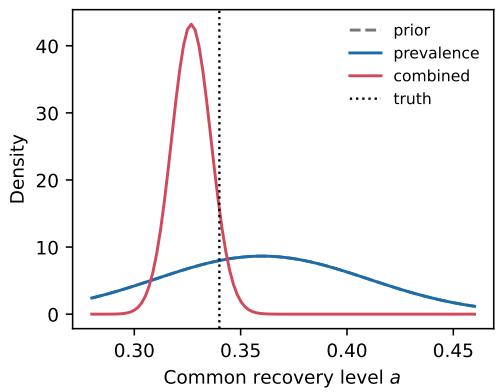
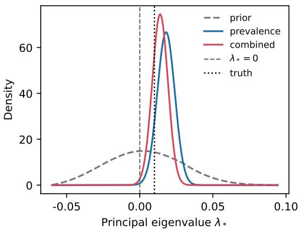
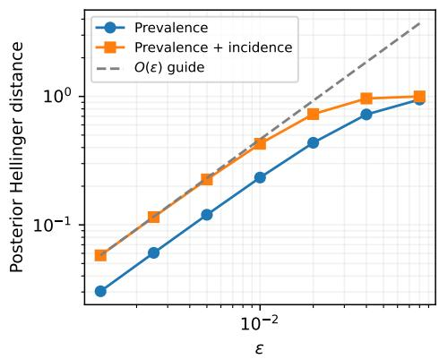
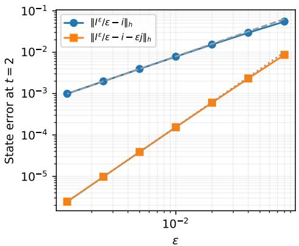

# BAYESIAN INVERSE PROBLEMS AND EPIDEMIC-THRESHOLD UNCERTAINTY FOR A HETEROGENEOUS SIS REACTION–DIFFUSION MODEL

DUC-LAM DUONG∗

Abstract. We study Bayesian inference of persistence from early observations of a heterogeneous susceptible–infected–susceptible (SIS) reaction–difusion model with standard incidence. We show that the leading prevalence dynamics depend on the unknown coeficients only through the diference between the transmission and recovery rates and the infected difusivity. The same pair determines the principal eigenvalue whose sign governs persistence, so early prevalence can inform the threshold even when the individual rates remain uncertain. We prove global weak well-posedness and quantitative parameter stability for the SIS system and use the resulting observation-map estimates to establish Bayesian well-posedness. For an initial infection of size ε, we derive a uniform second-order expansion that describes how the separate rates enter prevalence. Incidence depends explicitly on transmission at leading order. When the noise standard deviation is proportional to ε, we prove $O ( \varepsilon )$ convergence in Hellinger distance of the nonlinear posteriors to their low-prevalence limits for both prevalence alone and joint prevalence and incidence data. We bound the principal eigenvalue using the growth rate of the infected $L ^ { 2 }$ norm between two times. This rate gives a lower bound for the full nonlinear system, and the upper bound separates spatial transients from nonlinear saturation. Uniform spectral estimates and bounds on infection size and measurement error give suficient conditions for persistence and extinction. We also bound the error in posterior persistence probabilities under forward and eigenvalue approximation, accounting for posterior mass near the threshold. Numerical examples illustrate threshold inference and the predicted $O ( \varepsilon )$ convergence of the nonlinear posteriors to their low-prevalence limits in Hellinger distance.

Key words. Bayesian inverse problems, SIS epidemic model, reaction–difusion systems, weak identifiability, epidemic threshold, principal eigenvalue

MSC codes. 62F15, 35K57, 35R30, 92D30, 65N30

1. Introduction. At the beginning of an outbreak, measurements of the infected population can be available before the transmission and recovery rates are known. One question at this stage is whether the infection can persist under the prevailing conditions. An early assessment can inform decisions about surveillance and intervention before the long-term course of the outbreak is clear. In a heterogeneous population, persistence depends on where transmission and recovery occur and how infected individuals move. We study what can be learned about the persistence threshold from noisy observations over a short time interval and how the answer depends on what is measured.

We consider the susceptible–infected–susceptible (SIS) reaction–difusion model of Allen, Bolker, Lou, and Nevai [1], in which the transmission and recovery rates vary in space and the susceptible and infected populations can have diferent difusivities. The basic reproduction number $\mathcal { R } _ { 0 }$ governs the stability of the disease-free equilibrium and the existence of an endemic equilibrium [1, 24]. Huang et al. [17] study related thresholds with Dirichlet boundary conditions. Peng and Yi [25] examine how spatial variation in epidemic risk and population movement shape the endemic equilibrium. The connection between reproduction numbers and principal eigenvalues is developed for more general reaction–difusion epidemic models in [31, 23]. Related SIS models incorporate advection [12] and a varying total population [20]. Hu, Jin, and Wang [16] use the threshold to study how the location and size of a transmission control zone afect persistence.

PDE-constrained optimization has been used to recover transmission and recovery fields [32, 8, 6] and to identify difusivities [7]. Bayesian studies of other epidemic models have used data to estimate heterogeneous parameters and quantify uncertainty in predictions [18, 5]. In the present setting, a short record of noisy observations can be compatible with several combinations of rates and difusivities, which can imply diferent threshold signs. We use a Bayesian formulation to combine the observations with prior information on the coeficients and to propagate the resulting uncertainty to the posterior probability that $\mathcal { R } _ { 0 } > 1$

The link between persistence and the individual rates can be seen in the equation for the infected density, see (2.1) below. Let S and I denote the susceptible and infected densities, respectively, and set $N = S + I$ . Using $\beta S I / N = \beta I - \beta I ^ { 2 } / N$ , we can write the infected equation (2.1b) as

$$
\partial _ { t } I = d _ { I } \Delta I + ( \beta - \gamma ) I - \beta I ^ { 2 } / N .\tag{1.1}
$$

When I is small and S remains positive, the leading dynamics of I depend only on $q = \beta - \gamma$ and $d _ { I }$ . The same pair determines the principal eigenvalue $\lambda _ { * }$ of $d _ { I } \Delta + q$ under Neumann boundary conditions. The sign of $\lambda _ { * }$ determines whether $\mathcal { R } _ { 0 }$ exceeds one, by the equivalence of Allen et al. [1, Lemma $2 . 3 ( \mathrm { d } ) ]$ recalled in Theorem 2.2. Thus early prevalence observations can inform the threshold even when the separate rates remain uncertain. In (1.1), $\beta$ enters separately through the quadratic term. At low prevalence, the incidence $\beta S I / ( S + I )$ is close to $\beta I$ , so incidence observations can provide information about transmission at leading order.

In nonspatial epidemic models, the relation between early growth and the reproduction number depends on the distribution of generation intervals [30]. In a spatial model, movement of infected individuals into a region can raise a local count even when $\mathcal { R } _ { 0 } < 1$ . The growth rate of the spatial $L ^ { 2 }$ norm over a short interval can also difer from $\lambda _ { * }$ because the initial infection excites several spatial modes. The quadratic term in (1.1) can further reduce growth as prevalence increases. We therefore ask how large a change in the infected density over a short interval must be to determine the threshold sign, accounting for these efects and for measurement error.

Our contributions are the following.

(i) We prove global weak well-posedness and quantitative stability for the SIS system when the rate fields and difusivities vary (Theorems 3.1 and 3.3). We use the resulting observation-map estimates to establish Bayesian well-posedness (section 4) and bound the error in the posterior persistence probability under forward and eigenvalue approximation.

(ii) We derive a uniform second-order expansion of the infected density for an initial infection of size ε (Theorem 5.2). With noise scaled by $\varepsilon ,$ we identify the coeficient of $\varepsilon ^ { 2 }$ in the Kullback–Leibler divergence between prevalence data laws for parameters with the same $( q , d _ { I } )$ (Corollary 5.6).

(iii) Under the same noise scaling, we prove $O ( \varepsilon )$ convergence in Hellinger distance to the limiting prevalence and joint prevalence–incidence posteriors, uniformly for bounded rescaled data (Theorem 5.3 and Corollary 5.5).

(iv) We bound the principal eigenvalue using the growth of the infected $L ^ { 2 }$ norm between two times (Theorem 5.8). Positive growth of this norm implies persistence for the nonlinear system. The upper bound accounts for spatial transients and nonlinear saturation and gives a suficient condition for extinction using uniform spectral estimates (Proposition 5.9) and bounds on infection size and measurement error. We also bound the error in the posterior persistence probability under forward and eigenvalue approximation, accounting for posterior mass near the threshold (Theorem 6.4).

The numerical experiments in section 7 illustrate how prevalence can inform persistence and how the nonlinear posteriors approach their low-prevalence limits.

We use a common prior on the original coeficients in the nonlinear and limiting experiments. The function-space formulation of Bayesian inversion [9, 28, 13] lets us control the diference between these posteriors in terms of the forward approximation error [10, 27]. In the limiting prevalence experiment, the likelihood reweights the distribution of $( q , d _ { I } )$ . The conditional-prior principle for partially identified models [26, 14] then describes the posterior uncertainty in the rates by combining the updated law of this pair with the conditional prior on the rates (Proposition 5.7).

The paper is organised as follows. We introduce the model and its threshold in section 2 and establish the forward estimates in section 3. We formulate the Bayesian inverse problem and construct admissible priors in section 4. In section 5 we derive the low-prevalence expansions, posterior limits, and growth bounds. We study posterior uncertainty in the threshold in section 6 and discuss the results with numerical illustrations in section 7. Appendix A gives the spectral estimates and their extension to weighted observations. Appendix B gives a concrete prior construction and conditions for approximation, and Appendix C describes the numerical methods.

2. Model, parameters, and observations. Let $\Omega \subset \mathbb { R } ^ { d } , 1 \leq d \leq 3$ , be bounded and connected with $C ^ { 2 }$ boundary, let $T > 0$ , and write $Q _ { T } = \Omega \times ( 0 , T )$ . The susceptible and infected densities S and I solve the system of Allen et al. [1], given by

(2.1a)

$$
\partial _ { t } S - d _ { S } \Delta S = - \beta ( x ) \mathsf { f } ( S , I ) + \gamma ( x ) I , \qquad \mathrm { ~ i n ~ } Q _ { T } ,\tag{2.1b}
$$

$$
\partial _ { t } I - d _ { I } \Delta I = \beta ( x ) \mathfrak { f } ( S , I ) - \gamma ( x ) I , \qquad \mathrm { ~ i n ~ } Q _ { T } ,\tag{2.1c}
$$

$$
\partial _ { \nu } S = \partial _ { \nu } I = 0 , \qquad \mathrm { o n ~ } \partial \Omega \times ( 0 , T ) ,\tag{2.1d}
$$

$$
S ( 0 ) = S _ { 0 } , \qquad I ( 0 ) = I _ { 0 } ,
$$

where $\partial _ { \nu }$ is the outward normal derivative and, for $s , i \geq 0$ , the standard-incidence function is

$$
\mathsf { f } ( s , i ) = \left\{ { \frac { s i } { s + i } } , \quad s + i > 0 , \right.\tag{2.2}
$$

Under local random mixing, the infection rate per susceptible is $\beta I / ( S { + } I )$ , proportional to the local fraction of infected individuals [15, Section 2.1]. We refer to (2.1a) and (2.1b) as the susceptible and infected equations, respectively.

For fix positive constants $0 < \beta < \overline { { \beta } } , 0 < \gamma < \overline { { \gamma } }$ and $0 < \underline { d } < \overline { d }$ , we denote the ambient parameter space and admissible set as

(2.3)

$$
\mathcal { X } = C ( \overline { { \Omega } } ) \times C ( \overline { { \Omega } } ) \times \mathbb { R } ^ { 2 } ,\tag{2.4}
$$

$$
{ \mathcal { X } } _ { \mathrm { a d } } = \{ \theta = ( \beta , \gamma , d _ { S } , d _ { I } ) \in { \mathcal { X } } : { \underline { { \beta } } } \leq \beta \leq { \overline { { \beta } } } , \ { \underline { { \gamma } } } \leq \gamma \leq { \overline { { \gamma } } } , \ { \underline { { d } } } \leq d _ { S } , d _ { I } \leq { \overline { { d } } } \} .
$$

Here and below, inequalities between functions are pointwise. We equip X with

$$
\| \theta \| _ { \mathcal { X } } = \| \beta \| _ { L ^ { \infty } } + \| \gamma \| _ { L ^ { \infty } } + | d _ { S } | + | d _ { I } | .\tag{2.5}
$$

With this norm, X is a separable Banach space, and the bounds in (2.4) define a closed bounded subset $\mathcal { X } _ { \mathrm { a d } } \subset \mathcal { X }$

For $\theta \in \mathcal { X } _ { \mathrm { a d } }$ and $z = ( S , I )$ , write

$$
\mathcal { F } _ { \theta } ( z ) = \left( - \beta \mathfrak { f } ( S , I ) + \gamma I , \beta \mathfrak { f } ( S , I ) - \gamma I \right) .
$$

We call $\mathcal { F } _ { \theta }$ the reaction map. Its components $\mathcal { F } _ { \theta , S }$ and $\mathcal { F } _ { \boldsymbol { \theta } , I }$ describe the local changes in the densities due to infection and recovery.

We assume throughout that

$$
S _ { 0 } , I _ { 0 } \in L ^ { \infty } ( \Omega ) , \qquad S _ { 0 } \geq s _ { * } > 0 , \qquad I _ { 0 } \geq 0 .\tag{2.6}
$$

The strict lower bound on $S _ { 0 }$ controls the low-prevalence remainder. Existence and uniqueness of nonnegative weak solutions hold for nonnegative $L ^ { \infty }$ initial data.

The following elementary properties of f will be used repeatedly.

Lemma 2.1. For $s , i \geq 0$ , we have

$$
0 \leq { \mathfrak { f } } ( s , i ) \leq \operatorname* { m i n } \{ s , i \} .\tag{2.7}
$$

The function f is globally Lipschitz on $[ 0 , \infty ) ^ { 2 }$ with constant one in the Euclidean norm. On $( 0 , \infty ) ^ { 2 }$ , its partial derivatives are given by

$$
\partial _ { s } \mathfrak { f } ( s , i ) = \frac { i ^ { 2 } } { ( s + i ) ^ { 2 } } , \qquad \partial _ { i } \mathfrak { f } ( s , i ) = \frac { s ^ { 2 } } { ( s + i ) ^ { 2 } } .\tag{2.8}
$$

Moreover, for every $m > 0$ , the first derivative of f is Lipschitz on $\{ ( s , i ) : s , i \geq$ $0 , \ s + i \geq m \}$ , with a constant depending only on m.

Proof. The bound (2.7) follows from $s + i \geq \operatorname* { m a x } \{ s , i \}$ . Away from the origin, $| \nabla \mathfrak { f } ( s , i ) | ^ { 2 } = ( s ^ { 4 } + i ^ { 4 } ) / ( s + i ) ^ { 4 } \leq 1$ . Integrating along line segments gives the Lipschitz estimate, which extends to the origin by continuity. Diferentiating (2.8) shows that the Hessian is bounded on $\{ s , i \ge 0 , \ s + i \ge m \}$ , a convex set. □

Set

$$
\mathcal { Z } _ { T } = \left[ C ( [ 0 , T ] ; L ^ { 2 } ( \Omega ) ) \cap L ^ { 2 } ( 0 , T ; H ^ { 1 } ( \Omega ) ) \right] ^ { 2 }\tag{2.9}
$$

with its natural norm. For $u , v \in H ^ { 1 } ( \Omega )$ , define the weak Neumann Laplacian $\Delta _ { N } u \in H ^ { 1 } ( \Omega ) ^ { * }$ by

$$
\left. \Delta _ { N } u , v \right. = - \int _ { \Omega } \nabla u \cdot \nabla v \mathrm { d } x ,
$$

where $\langle \cdot , \cdot \rangle$ denotes duality between $H ^ { 1 } ( \Omega ) ^ { * }$ and $H ^ { 1 } ( \Omega )$ . This formulation incorporates the zero normal flux by taking all $v \in H ^ { 1 } ( \Omega )$ as test functions. A weak solution of (2.1) is a nonnegative $z = ( S , I ) \in \mathcal { Z } _ { T }$ with $\partial _ { t } z \in L ^ { 2 } ( 0 , T ; H ^ { 1 } ( \Omega ) ^ { * } ) ^ { 2 }$ and the initial values in (2.1d). It satisfies, for $k \in \{ S , I \}$ and almost every $t ,$

$$
\langle \partial _ { t } z _ { k } ( t ) , v \rangle + d _ { k } \int _ { \Omega } \nabla z _ { k } ( t ) \cdot \nabla v \mathrm { d } x = \int _ { \Omega } \mathcal { F } _ { \theta , k } ( z ( t ) ) v \mathrm { d } x , \qquad v \in H ^ { 1 } ( \Omega ) .
$$

Here $z _ { S } = S$ and $z _ { I } = I$

To include prevalence and incidence data in one framework, define

$$
\mathcal { E } _ { T } = C ( [ 0 , T ] ; L ^ { 2 } ( \Omega ) ) ^ { 3 }\tag{2.10}
$$

and let $\mathcal { O } : \mathcal { E } _ { T }  \mathbb { R } ^ { J }$ be bounded and linear. If $\boldsymbol { S } ( \boldsymbol { \theta } ) = ( S _ { \boldsymbol { \theta } } , I _ { \boldsymbol { \theta } } )$ denotes the solution of (2.1), the parameter-to-observation map is

$$
\mathcal { G } ( \boldsymbol { \theta } ) = \mathcal { O } \left( S _ { \boldsymbol { \theta } } , I _ { \boldsymbol { \theta } } , \beta \mathfrak { f } ( S _ { \boldsymbol { \theta } } , I _ { \boldsymbol { \theta } } ) \right) .\tag{2.11}
$$

This includes spatial averages of prevalence and incidence at selected times, as well as space–time averages. The incidence component belongs to $C ( [ 0 , T ] ; L ^ { 2 } )$ by the Lipschitz property of f and continuity of the states in $L ^ { 2 }$ . These bounded observations avoid spatial point evaluation. Throughout, prevalence-type data refer to instantaneous counts or spatial averages of the infected density I, while incidence is the rate of new infections. The normalized fraction $I / ( S + I )$ is a diferent observable.

2.1. The epidemic threshold. The spatial basic reproduction number of (2.1) is the generalized Rayleigh quotient

$$
\mathscr { R } _ { 0 } ( \theta ) = \operatorname* { s u p } _ { 0 \neq \varphi \in H ^ { 1 } ( \Omega ) } \frac { \displaystyle \int _ { \Omega } \beta \varphi ^ { 2 } \mathrm { d } x } { d _ { I } \displaystyle \int _ { \Omega } | \nabla \varphi | ^ { 2 } \mathrm { d } x + \displaystyle \int _ { \Omega } \gamma \varphi ^ { 2 } \mathrm { d } x } .\tag{2.12}
$$

For the Allen–Bolker–Lou–Nevai model, this threshold governs disease-free stability and the existence of endemic equilibria [1]. We call $\{ \mathcal { R } _ { 0 } > 1 \}$ the persistence event. Its dynamical interpretation presumes a nonzero initial infection: if $I _ { 0 } \equiv 0$ , then $I ( t ) \equiv 0$ regardless of the value of $\mathcal { R } _ { 0 }$ . A general operator-theoretic treatment of reproduction numbers for reaction–difusion epidemic systems can be found in [31, 23].

The equation for a small infection in (1.1) is governed to leading order by $d _ { I } \Delta +$ $( \beta - \gamma )$ with Neumann boundary conditions. Its largest eigenvalue gives the exponential growth rate of the principal spatial mode. We denote it by

$$
\lambda _ { * } ( \theta ) = \operatorname* { s u p } _ { 0 \neq \varphi \in H ^ { 1 } ( \Omega ) } \frac { \displaystyle \int _ { \Omega } ( \beta - \gamma ) \varphi ^ { 2 } \mathrm { d } x - d _ { I } \int _ { \Omega } | \nabla \varphi | ^ { 2 } \mathrm { d } x } { \displaystyle \int _ { \Omega } \varphi ^ { 2 } \mathrm { d } x } .\tag{2.13}
$$

Allen et al. [1, Section $2 ]$ write the time dependence of the mode as $e ^ { - \lambda t }$ , so their eigenvalue is $- \lambda _ { * }$ . We recall their threshold equivalence in our sign convention and record the properties of the principal eigenfunctions used below.

Theorem 2.2. For every $\theta \in \mathcal { X } _ { \mathrm { a d } }$ , the suprema in (2.12) and (2.13) are attained. The corresponding eigenfunctions may be chosen strictly positive on ${ \overline { { \Omega } } } ,$ and the principal eigenvalues are simple. In addition,

$$
\mathcal { R } _ { 0 } ( \theta ) > 1 \quad \Longleftrightarrow \quad \lambda _ { * } ( \theta ) > 0 ,\tag{2.14}
$$

with analogous equivalences for equality and for the reverse inequalities.

Proof. For (2.13), choose a maximizing sequence $( v _ { n } )$ with $\| v _ { n } \| _ { L ^ { 2 } } = 1$ , and denote its quotient values by $\ell _ { n }$ . The gradient bound $d _ { I } \| \nabla v _ { n } \| _ { L ^ { 2 } } ^ { 2 } \leq \| \beta - \gamma \| _ { L ^ { \infty } } - \ell _ { n }$ gives boundedness in $H ^ { 1 } ( \Omega )$ . Along a subsequence, $v _ { n }$ converges weakly in $H ^ { 1 }$ and strongly in $L ^ { 2 }$ . Its limit has unit $L ^ { 2 }$ norm. The potential term converges by strong $L ^ { 2 }$ convergence, and the gradient norm is weakly lower semicontinuous. Thus the quotient at the limit is at least $\operatorname* { l i m } _ { n } \ell _ { n } = \lambda _ { * }$

For (2.12), set $\begin{array} { r } { a ( \boldsymbol { u } , \boldsymbol { v } ) = d _ { I } \int _ { \Omega } \boldsymbol { \nabla } \boldsymbol { u } \cdot \boldsymbol { \nabla } \boldsymbol { v } \mathrm { d } x + \int _ { \Omega } } \end{array}$ γuv dx and $\begin{array} { r } { b ( u , v ) = \int _ { \Omega } \beta u v \mathrm { d } x . } \end{array}$ Normalize a maximizing sequence by $\boldsymbol { \imath } ( v _ { n } , v _ { n } ) = 1$ . The positive lower bounds for $d _ { I }$ and $\gamma$ bound its $H ^ { 1 }$ norm. A weak $H ^ { 1 }$ and strong $L ^ { 2 }$ subsequential limit $v$ satisfies $a ( v , v ) \leq 1$ and $b ( v , v ) = \mathcal { R } _ { 0 }$ . The quotient on constant functions is positive, so $v \neq 0$ and $b ( v , v ) / a ( v , v ) \geq \mathcal { R } _ { 0 }$ . Both suprema are therefore attained.

Taking absolute values preserves both quotients, so choose nonnegative maximizers $\phi _ { \lambda }$ and $\phi _ { R }$ . For a quotient of symmetric bilinear forms, diferentiating $A ( \phi + h v , \phi +$ $h v ) / B ( \phi + h v , \phi + h v )$ at $h = 0$ gives $A ( \phi , v ) = \rho B ( \phi , v )$ , where $\rho$ is the value of the quotient at $\phi .$ . Here the two stationarity conditions, for all $v \in H ^ { 1 } ( \Omega )$ , are

$$
\begin{array} { r l r } {  { - d _ { I } \int _ { \Omega } \nabla \phi _ { \lambda } \cdot \nabla v \mathrm { d } x + \int _ { \Omega } ( \beta - \gamma ) \phi _ { \lambda } v \mathrm { d } x = \lambda _ { * } \int _ { \Omega } \phi _ { \lambda } v \mathrm { d } x , } } \\ & { } & { b ( \phi _ { R } , v ) = \mathcal { R } _ { 0 } a ( \phi _ { R } , v ) . } \end{array}
$$

These are weak Neumann eigenvalue equations. Their weak Laplacians belong to $L ^ { 2 } ( \Omega )$ so Neumann regularity on the $C ^ { 2 }$ domain gives $\phi _ { \lambda } , \phi _ { R } \in H ^ { 2 } ( \Omega )$ [22, Section 3.1.1]. The equations read

(2.15)

$$
d _ { I } \Delta \phi _ { \lambda } + ( \beta - \gamma ) \phi _ { \lambda } = \lambda _ { * } \phi _ { \lambda } , \qquad \partial _ { \nu } \phi _ { \lambda } = 0 ,\tag{2.16}
$$

$$
\mathcal { R } _ { 0 } ( - d _ { I } \Delta \phi _ { R } + \gamma \phi _ { R } ) = \beta \phi _ { R } , \qquad \partial _ { \nu } \phi _ { R } = 0 .
$$

The diferential identities hold in Ω in $L ^ { 2 }$ , and the normal derivatives vanish on ∂Ω in the trace sense.

The lowest eigenvalue of $- d _ { I } \Delta \textrm { - } ( \beta - \gamma )$ is $- \lambda _ { * }$ . The lowest eigenvalue of $- d _ { I } \Delta + \gamma - \beta / \mathcal { R } _ { 0 }$ is zero, since its quadratic form $a - b / \mathcal { R } _ { 0 }$ is nonnegative and vanishes at $\phi _ { R }$ . For these scalar Neumann problems with bounded real potentials on a connected domain, the lowest eigenvalue is simple and its eigenfunction is strictly positive on Ω [2, Proposition 2.4 and Theorem 4.5]. The kernel of the second operator is precisely the eigenspace at $\mathcal { R } _ { 0 }$ of the generalized problem.

The numerator in (2.13) is $b ( v , v ) - a ( v , v )$ . Thus $\mathcal { R } _ { 0 } > 1$ and $\lambda _ { * } > 0$ are both equivalent to the existence of v with $b ( v , v ) > a ( v , v )$ . If either supremum is at its threshold value, $b ( v , v ) \leq a ( v , v )$ for every $v ,$ with equality at a nonzero maximizer. This gives the equivalence at equality, and the remaining case gives the equivalence for the strict reverse inequalities. □

## 3. Analysis of the forward problem.

3.1. Global well-posedness and positivity. For a difusivity $\kappa > 0$ , the Neumann realization $A _ { \kappa }$ of $\kappa \Delta$ on $L ^ { 2 } ( \Omega )$ is

$$
A _ { \kappa } v = \kappa \Delta v , \qquad D ( A _ { \kappa } ) = \{ v \in H ^ { 2 } ( \Omega ) : \partial _ { \nu } v = 0 \mathrm { ~ o n ~ } \partial \Omega \} .
$$

It is the restriction of $\kappa \Delta _ { N }$ to functions for which the weak Laplacian is in $L ^ { 2 } ( \Omega )$ The symmetric Neumann form gives $- A _ { \kappa }$ as a nonnegative self-adjoint operator. Its heat semigroup $P _ { \kappa } ( t ) = e ^ { t A _ { \kappa } }$ is an analytic contraction semigroup on $L ^ { 2 } ( \Omega )$ , and $P _ { \kappa } ( t ) v _ { 0 }$ is the homogeneous Neumann heat evolution from $v _ { 0 }$ [22, Chapter 3]. The parabolic comparison principle implies that $P _ { \kappa } ( t )$ preserves order. Since it preserves constants, comparison with $\pm \| v _ { 0 } \| _ { L ^ { \infty } }$ gives $\| P _ { \kappa } ( t ) v _ { 0 } \| _ { L ^ { \infty } } \leq \| v _ { 0 } \| _ { L ^ { \infty } }$ . Interpolation gives contractivity on $L ^ { p } ( \Omega )$ for $2 \leq p \leq \infty$ . For $t > 0$ and $v _ { 0 } \geq 0 , v _ { 0 } \not \equiv 0$ , the continuous representative of $P _ { \kappa } ( t ) v _ { 0 }$ is strictly positive on $\overline { { \Omega } } .$ . We refer to this property as positivity improvement [2, Theorem 3.1 and Section 4.2].

For the inhomogeneous heat equation with forcing $g _ { ; }$ , the variation-of-constants formula is

$$
v ( t ) = P _ { \kappa } ( t ) v ( 0 ) + \int _ { 0 } ^ { t } P _ { \kappa } ( t - r ) g ( r ) \mathrm { d } r .
$$

This identity in $L ^ { 2 } ( \Omega )$ defines the mild solution for $g \in L ^ { 1 } ( 0 , T ; L ^ { 2 } ( \Omega ) )$ . For a bounded multiplication potential $V$ , the same formula holds with the semigroup $e ^ { t ( A _ { \kappa } + V ) }$ [22, Chapters 3 and 4].

For global classical solvability of SIS systems with standard incidence, see $[ 1$ Section 1] and [7, Theorem 2.1]. We work with bounded initial densities and give bounds uniform over the admissible parameters.

Theorem 3.1. Let (2.6) hold and let $\theta \in \mathcal { X } _ { \mathrm { a d } }$ . Then (2.1) has a unique nonnegative global weak solution $( S _ { \theta } , I _ { \theta } ) \in \mathcal { Z } _ { T }$ . It satisfies, almost everywhere in $Q _ { T }$ ,

$$
I _ { \theta } ( x , t ) \leq e ^ { \overline { { \beta } } t } \| I _ { 0 } \| _ { L ^ { \infty } } ,\tag{3.1}
$$

(3.2)

$$
S _ { \theta } ( x , t ) \geq s _ { * } e ^ { - \overline { { \beta } } t } ,\tag{3.3}
$$

$$
S _ { \theta } ( x , t ) \leq \| S _ { 0 } \| _ { L ^ { \infty } } + \overline { { \gamma } } \left\| I _ { 0 } \right\| _ { L ^ { \infty } } \int _ { 0 } ^ { t } e ^ { \overline { { \beta } } r } \mathrm { d } r .
$$

Furthermore,

$$
\int _ { \Omega } ( S _ { \theta } + I _ { \theta } ) ( x , t ) \mathrm { d } x = \int _ { \Omega } ( S _ { 0 } + I _ { 0 } ) ( x ) \mathrm { d } x , \qquad 0 \le t \le T .\tag{3.4}
$$

The constants in the ${ \mathcal { Z } } _ { T }$ and $L ^ { \infty } ( Q _ { T } ) ^ { 2 }$ bounds are uniform over $\theta \in \mathcal { X } _ { \mathrm { a d } }$

If, in addition, $0 < \alpha < 1$ , ∂Ω is of class $C ^ { 2 + \alpha } , \beta , \gamma \in C ^ { \alpha } ( \overline { { \Omega } } ) , S _ { 0 } , I _ { 0 } \in C ^ { 2 + \alpha } ( \overline { { \Omega } } )$ and the Neumann compatibility conditions hold, then the solution is classical and belongs to $C ^ { 2 + \alpha , 1 + \alpha / 2 } ( \bar { \Omega } \times [ 0 , T ] ) ^ { 2 }$

Proof. By Lemma 2.1, $\mathcal { F } _ { \theta }$ is globally Lipschitz on the nonnegative cone of $L ^ { 2 } ( \Omega ) ^ { 2 }$ the set of pairs with both components nonnegative almost everywhere. Write $v ^ { + } = { }$ max $\{ v , 0 \}$ and define a reaction map on all of $L ^ { 2 } ( \Omega ) ^ { 2 }$ by

$$
{ \widetilde { \mathcal { F } } } _ { \theta } ( S , I ) = { \mathcal { F } } _ { \theta } ( S ^ { + } , I ^ { + } ) .
$$

The positive-part map is 1-Lipschitz in $L ^ { 2 }$ , so the extended reaction is globally Lipschitz. Let $P ( t ) = \mathrm { d i a g } ( P _ { d _ { S } } ( t ) , P _ { d _ { I } } ( t ) )$ and $z _ { 0 } = ( S _ { 0 } , I _ { 0 } )$ . Replacing the reaction in the two equations by $\widetilde { \mathcal { F } } _ { \theta }$ , the mild formulation is

$$
z ( t ) = P ( t ) z _ { 0 } + \int _ { 0 } ^ { t } P ( t - r ) \widetilde { \mathcal { F } } _ { \theta } ( z ( r ) ) \mathrm { d } r .
$$

The integral map on $C ( [ 0 , \tau ] ; L ^ { 2 } ( \Omega ) ^ { 2 } )$ has Lipschitz constant at most $\tau$ times that of $\widetilde { \mathcal { F } } _ { \theta }$ . It is a contraction for small $\tau ,$ and the same step length can be used from each new initial value. Iteration gives a mild solution on any finite interval. Its forcing $\widetilde { \mathcal { F } } _ { \theta } ( z ) \in C ( [ 0 , T ] ; L ^ { 2 } ( \Omega ) ^ { 2 } )$ can be treated as given in the linear heat equations. The linear energy estimate gives $z \in \mathcal { Z } _ { T }$ and $\partial _ { t } z \in L ^ { 2 } ( 0 , T ; H ^ { 1 } ( \Omega ) ^ { \ast } ) ^ { 2 }$ . Indeed, one can project the linear equations on the Neumann eigenfunctions, test each projected equation with the projected solution, and pass to the limit in the weak identities of section 2.

The reaction is quasipositive, meaning that each component is nonnegative when its own density is zero and the other is nonnegative. Here $\mathcal { F } _ { \theta , S } ( 0 , I ) = \gamma I$ and $\mathcal { F } _ { \theta , I } ( S , 0 ) = 0$ . To use these signs in the weak equations, set $v ^ { - } = ( - v ) ^ { + }$ and test the kth equation with $- z _ { k } ^ { - } ( t )$ . The chain rule and the gradient term give

$$
\frac { 1 } { 2 } \frac { \mathrm { d } } { \mathrm { d } t } \| z _ { k } ^ { - } ( t ) \| _ { L ^ { 2 } } ^ { 2 } + d _ { k } \| \nabla z _ { k } ^ { - } ( t ) \| _ { L ^ { 2 } } ^ { 2 } = - \int _ { \Omega } \widetilde { \mathcal { F } } _ { \theta , k } ( z ( t ) ) z _ { k } ^ { - } ( t ) \mathrm { d } x \le 0 .
$$

On the support of $z _ { k } ^ { - }$ , the kth input of the extended reaction is zero. The initial negative parts vanish, so both components stay nonnegative and the extended reaction agrees with the original one.

Since $\mathfrak { f } ( S , I ) \le I$ , the infected equation implies

$$
\partial _ { t } I - d _ { I } \Delta I \le \overline { { \beta } } I .
$$

Comparison with the spatially constant supersolution $e ^ { \overline { { \beta } } t } \| I _ { 0 } \| _ { L ^ { \infty } }$ gives (3.1). Likewise, $\mathsf { f } ( S , I ) \leq S$ yields

$$
\partial _ { t } S - d _ { S } \Delta S \ge - \overline { { \beta } } S ,
$$

and comparison with $s _ { * } e ^ { - \overline { { \beta } } t }$ gives (3.2). Finally,

$$
\partial _ { t } S - d _ { S } \Delta S \le \overline { { \gamma } } I ,
$$

so the variation-of-constants formula and order preservation of $P _ { d _ { S } } ( t )$ give an upper bound with forcing $\overline { { \gamma } } I$ . Applying the $L ^ { \infty }$ contraction estimate and (3.1) gives (3.3).

The bounds (3.1)–(3.3) bound the reaction uniformly in $L ^ { 2 } ( Q _ { T } ) ^ { 2 }$ . Using $S$ and I as test functions and integrating the energy identities gives a uniform bound in ${ \mathcal { Z } } _ { T }$ For uniqueness, subtract the weak equations for two nonnegative solutions and test with their diference. The Lipschitz estimate for $\mathcal { F } _ { \theta }$ and Gronwall’s inequality give equality of the solutions because the initial diference is zero.

The conservation law (3.4) follows by adding the two variational equations with the constant test function one, since the reaction terms cancel. Under the additional H¨older and compatibility assumptions, linear parabolic regularity with bounded forcing first gives $C ^ { \alpha , \alpha / 2 }$ regularity. By Lemma 2.1, f(S, I) has the same H¨older regularity as the states. Since the coeficients are H¨older continuous in space, the reaction terms are also in $C ^ { \alpha , \alpha / 2 }$ . The Neumann Schauder estimates yield the stated classical regularity [22, Sections 5.1.2 and 7.1.3]. □

Remark 3.2. The explicit bound (3.2) implies

$$
S _ { \theta } + I _ { \theta } \ge s _ { * } e ^ { - \overline { { { \beta } } } T } = : n _ { T } > 0 \quad \mathrm { o n ~ } Q _ { T } .\tag{3.5}
$$

This lower bound controls the denominator of the quadratic infection term in the low-prevalence analysis of section 5.

3.2. Quantitative stability with respect to the parameters. For fixed unit difusivities, [8] gives an $L ^ { 2 }$ estimate for state diferences under perturbations of the transmission and recovery rates. We allow both difusivities to vary and also control the spatial gradients in $\dot { L ^ { 2 } } ( Q _ { T } )$

Theorem 3.3. Let $\theta _ { j } = ( \beta _ { j } , \gamma _ { j } , d _ { S , j } , d _ { I , j } ) \in \mathcal { X } _ { \mathrm { a d } }$ and let $z _ { j } = ( S _ { j } , I _ { j } ) = \mathcal { S } ( \theta _ { j } )$ $j = 1 , 2$ . There exists $C = C ( T , \Omega , \mathcal { X } _ { \mathrm { a d } } , S _ { 0 } , I _ { 0 } ) > 0$ such that

$$
\left\| z _ { 1 } - z _ { 2 } \right\| _ { \mathcal { Z } _ { T } } \leq C \left\| \theta _ { 1 } - \theta _ { 2 } \right\| _ { \mathcal { X } } .\tag{3.6}
$$

If $d _ { S , 1 } = d _ { S , 2 }$ and $d _ { I , 1 } = d _ { I , 2 }$ , then, for every $2 \leq p < \infty$ , there exists $C _ { p } < \infty$ such that

$$
\begin{array} { r } { \left\| z _ { 1 } - z _ { 2 } \right\| _ { C ( [ 0 , T ] ; L ^ { p } ) ^ { 2 } } \leq C _ { p } \left( \left\| \beta _ { 1 } - \beta _ { 2 } \right\| _ { L ^ { \infty } } + \left\| \gamma _ { 1 } - \gamma _ { 2 } \right\| _ { L ^ { \infty } } \right) . } \end{array}\tag{3.7}
$$

With $C _ { \infty }$ in place of $C _ { p }$ , the right-hand side of (3.7) also bounds $\| z _ { 1 } - z _ { 2 } \| _ { L ^ { \infty } ( Q _ { T } ) ^ { 2 } } .$

Proof. Let $e = z _ { 1 } - z _ { 2 }$ and $g = \mathcal { F } _ { \theta _ { 1 } } ( z _ { 1 } ) - \mathcal { F } _ { \theta _ { 2 } } ( z _ { 2 } )$ . For each component $k \in \{ S , I \}$ }, subtract the weak identities of section 2. For almost every t and every $v \in H ^ { 1 } ( \Omega )$ this gives

$$
\langle \partial _ { t } e _ { k } , v \rangle + d _ { k , 1 } \int _ { \Omega } \nabla e _ { k } \cdot \nabla v \mathrm { d } x = \int _ { \Omega } g _ { k } v \mathrm { d } x - \big ( d _ { k , 1 } - d _ { k , 2 } \big ) \int _ { \Omega } \nabla z _ { 2 , k } \cdot \nabla v \mathrm { d } x .
$$

The last term pairs $( d _ { k , 1 } - d _ { k , 2 } ) \Delta _ { N } z _ { 2 , k }$ with v. By the Cauchy–Schwarz inequality its absolute value is at most

$$
\lvert d _ { k , 1 } - d _ { k , 2 } \rvert \lvert \nabla z _ { 2 , k } \rvert \rvert _ { L ^ { 2 } } \lvert \lvert \nabla v \rvert \rvert _ { L ^ { 2 } } .
$$

Thus $z _ { 2 , k } ( t ) \in H ^ { 1 } ( \Omega )$ sufices for this term to act in the dual. Let $\delta _ { b } = \| \beta _ { 1 } - \beta _ { 2 } \| _ { L ^ { \infty } } +$ $\| \gamma _ { 1 } - \gamma _ { 2 } \| _ { L ^ { \infty } }$ . The Lipschitz estimate for the reaction and the uniform state bounds in Theorem 3.1 give $| g | \leq C ( | e | + \delta _ { b } )$ almost everywhere.

Use $\boldsymbol { v } = \boldsymbol { e } _ { \boldsymbol { k } } ( t )$ in the kth identity, which is allowed for almost every t since $e \in L ^ { 2 } ( 0 , T ; H ^ { 1 } ( \overline { { \Omega } } ) ) ^ { 2 }$ . The time derivative pairing is $\frac { 1 } { 2 } \frac { \mathrm { d } } { \mathrm { d } t } \| e _ { k } ( t ) \| _ { L ^ { 2 } } ^ { 2 }$ by the energy chain rule. Adding the two identities and using Young’s inequality for the difusion diferences yields

$$
\begin{array} { r l } & { \displaystyle \frac { 1 } { 2 } \frac { \mathrm { d } } { \mathrm { d } t } \big ( \| e _ { S } \| _ { L ^ { 2 } } ^ { 2 } + \| e _ { I } \| _ { L ^ { 2 } } ^ { 2 } \big ) + \frac { d } { 2 } \big ( \| \nabla e _ { S } \| _ { L ^ { 2 } } ^ { 2 } + \| \nabla e _ { I } \| _ { L ^ { 2 } } ^ { 2 } \big ) } \\ & { \quad \quad \quad \quad \quad \quad \leq C \big ( \| e _ { S } \| _ { L ^ { 2 } } ^ { 2 } + \| e _ { I } \| _ { L ^ { 2 } } ^ { 2 } \big ) + C \delta _ { b } ^ { 2 } } \\ & { \quad \quad \quad \quad \quad \quad + C \big | d _ { S , 1 } - d _ { S , 2 } \big | ^ { 2 } \left\| \nabla S _ { 2 } \right\| _ { L ^ { 2 } } ^ { 2 } + C \big | d _ { I , 1 } - d _ { I , 2 } \big | ^ { 2 } \left\| \nabla I _ { 2 } \right\| _ { L ^ { 2 } } ^ { 2 } . } \end{array}
$$

Since $e ( 0 ) = 0$ , Gronwall’s inequality and the uniform energy bound for $z _ { 2 }$ bound the supremum of $\| e ( t ) \| _ { L ^ { 2 } } ^ { 2 }$ . Integrating the same inequality bounds the time integral of $\| \nabla e \| _ { L ^ { 2 } } ^ { 2 }$ , giving (3.6).

When the difusivities agree, the weak diference equation has forcing $g$ and zero initial data. The variation-of-constants formula and the $L ^ { p }$ contraction estimates of subsection 3.1 give

$$
\| e ( t ) \| _ { L ^ { p } ( \Omega ) ^ { 2 } } \leq \int _ { 0 } ^ { t } \| g ( r ) \| _ { L ^ { p } ( \Omega ) ^ { 2 } } \mathrm { d } r \leq C _ { p } \int _ { 0 } ^ { t } \big ( \| e ( r ) \| _ { L ^ { p } ( \Omega ) ^ { 2 } } + \delta _ { b } \big ) \mathrm { d } r , \qquad 2 \leq p \leq \infty .
$$

Gronwall’s inequality gives the claimed bounds. For $p < \infty$ , continuity in $L ^ { p }$ follows by interpolating continuity in $L ^ { 2 }$ with the uniform $L ^ { \infty }$ bound. For $p = \infty$ we use the essential supremum over $Q _ { T }$ □

Proposition 3.4. The map $\mathcal { G }$ in (2.11) is bounded and Lipschitz on $\mathcal { X } _ { \mathrm { a d } }$ :

$$
\begin{array} { r } { | \mathcal { G } ( { \boldsymbol { \theta } } ) | \leq M _ { \mathcal { G } } , \qquad | \mathcal { G } ( { \boldsymbol { \theta } } _ { 1 } ) - \mathcal { G } ( { \boldsymbol { \theta } } _ { 2 } ) | \leq L _ { \mathcal { G } } \| { \boldsymbol { \theta } } _ { 1 } - { \boldsymbol { \theta } } _ { 2 } \| _ { \mathcal { X } } . } \end{array}\tag{3.8}
$$

Proof. The estimates follow from Theorems 3.1 and 3.3 and the boundedness of O. For the incidence component, we also use the Lipschitz property of f to bound $\beta \mathfrak { f } ( S , I )$ and its parameter diferences in $C ( [ 0 , T ] ; L ^ { 2 } )$ . □

## 4. The Bayesian inverse problem.

4.1. Posterior definition and well-posedness. Let $B ( \mathcal { X } _ { \mathrm { a d } } )$ denote the Borel σ-algebra inherited from X . The results in this section hold for any prior satisfying the following support condition. Concrete constructions are given in subsection 4.3.

Assumption 4.1. $\mu _ { 0 }$ is an arbitrary Borel probability measure on $\mathcal { X }$ satisfying $\mu _ { 0 } ( { \mathcal X } _ { \mathrm { a d } } ) = 1$

Let the data be generated by

$$
y = \mathcal { G } ( \theta ) + \eta , \qquad \eta \sim N ( 0 , \Gamma ) ,\tag{4.1}
$$

where $\Gamma \in \mathbb { R } ^ { J \times J }$ is symmetric and positive definite. The negative log-likelihood, up to an additive constant, is

$$
\Phi ( \theta ; y ) = \frac { 1 } { 2 } \left| \Gamma ^ { - 1 / 2 } ( y - \mathcal { G } ( \theta ) ) \right| ^ { 2 } .\tag{4.2}
$$

For probability measures $\mu$ and ν dominated by a common measure $\vartheta ,$ we use the convention

$$
d _ { \mathrm { H e l l } } ( \mu , \nu ) ^ { 2 } = \frac { 1 } { 2 } \int \left( \sqrt { \frac { \mathrm { d } \mu } { \mathrm { d } \vartheta } } - \sqrt { \frac { \mathrm { d } \nu } { \mathrm { d } \vartheta } } \right) ^ { 2 } \mathrm { d } \vartheta .\tag{4.3}
$$

We also use the total-variation convention

$$
d _ { \mathrm { T V } } ( \mu , \nu ) = \operatorname* { s u p } _ { A } \left| \mu ( A ) - \nu ( A ) \right| = \frac { 1 } { 2 } \int \left| \frac { \mathrm { d } \mu } { \mathrm { d } \vartheta } - \frac { \mathrm { d } \nu } { \mathrm { d } \vartheta } \right| \mathrm { d } \vartheta ,\tag{4.4}
$$

for any common dominating measure $\vartheta .$

Theorem 4.2. Under Assumption 4.1, Bayes’ formula defines, for every $\boldsymbol { y } \in \mathbb { R } ^ { J }$ a posterior probability measure $\mu ^ { y }$ on $\mathcal { X } _ { \mathrm { a d } }$ uniquely specified by

$$
\frac { \mathrm { d } \mu ^ { y } } { \mathrm { d } \mu _ { 0 } } ( \theta ) = \frac { 1 } { Z ( y ) } e ^ { - \Phi ( \theta ; y ) } , \qquad Z ( y ) = \int _ { \mathcal { X } _ { \mathrm { a d } } } e ^ { - \Phi ( \theta ; y ) } \mathrm { d } \mu _ { 0 } ( \theta ) .\tag{4.5}
$$

Moreover, $0 < Z ( y ) \leq 1$

Proof. Continuity of $\mathcal { G }$ makes the likelihood measurable. It is strictly positive and at most one, so $0 < Z ( y ) \leq 1$ . Dividing by $Z ( y )$ gives a density of total mass one relative to $\mu _ { 0 }$ . For general results on Bayesian well-posedness, see [28, 19]. □

Regular conditional distributions are unique up to sets of data of prior-predictive measure zero. Formula (4.5) specifies a version for every $y .$ The next theorem bounds changes in this posterior when the data or the parameter-to-observation map vary. We use the same estimate for posterior approximation and for the low-prevalence limit.

Theorem 4.3. Let $\mathcal { G } _ { 1 } , \mathcal { G } _ { 2 } : \mathcal { X } _ { \mathrm { a d } }  \mathbb { R } ^ { J }$ be Borel maps satisfying

$$
\operatorname* { s u p } _ { \theta \in \mathcal { X } _ { \mathrm { a d } } } \operatorname* { m a x } \{ | \mathcal { G } _ { 1 } ( \theta ) | , | \mathcal { G } _ { 2 } ( \theta ) | \} \leq M .\tag{4.6}
$$

Let $\mu _ { j } ^ { y _ { j } }$ be the posterior obtained from $\mathcal { G } _ { j }$ , data $y _ { j }$ , covariance $\Gamma ,$ and the same prior $\mu _ { 0 }$ . For every $R < \infty$ there is $C = C ( R , M , \Gamma ) < \infty$ such that, whenever $| y _ { 1 } | , | y _ { 2 } | \le R _ { \mathrm { \ell } }$

$$
d _ { \mathrm { H e l l } } ( \mu _ { 1 } ^ { y _ { 1 } } , \mu _ { 2 } ^ { y _ { 2 } } ) \leq C \left( | y _ { 1 } - y _ { 2 } | + \| \mathcal { G } _ { 1 } - \mathcal { G } _ { 2 } \| _ { L ^ { 2 } ( \mu _ { 0 } ; \mathbb { R } ^ { J } ) } \right) .\tag{4.7}
$$

In particular, for the SIS forward map $\mathcal { G }$

$$
d _ { \mathrm { H e l l } } ( \mu ^ { y _ { 1 } } , \mu ^ { y _ { 2 } } ) \leq C _ { R } | y _ { 1 } - y _ { 2 } | , \qquad | y _ { 1 } | , | y _ { 2 } | \leq R .\tag{4.8}
$$

Thus the Bayesian inverse problem is locally Lipschitz well posed in the Hellinger metric.

Proof. Write $\begin{array} { r } { \Phi _ { j } = \frac 1 2 | \Gamma ^ { - 1 / 2 } ( y _ { j } - \mathcal { G } _ { j } ) | ^ { 2 } } \end{array}$ and $\begin{array} { r } { Z _ { j } = \int e ^ { - \Phi _ { j } } \mathrm { d } \mu _ { 0 } } \end{array}$ . Uniform boundedness gives

$$
\begin{array} { r } { e ^ { - K } \le Z _ { j } \le 1 , \qquad K = \frac 1 2 \| \Gamma ^ { - 1 / 2 } \| ^ { 2 } ( R + M ) ^ { 2 } . } \end{array}\tag{4.9}
$$

The diference-of-squares identity yields

$$
\left| \Phi _ { 1 } - \Phi _ { 2 } \right| \leq C \big ( | y _ { 1 } - y _ { 2 } | + | \mathcal { G } _ { 1 } - \mathcal { G } _ { 2 } | \big ) .\tag{4.10}
$$

For nonnegative a, b, $| e ^ { - a } - e ^ { - b } | \leq | a - b |$ and $| e ^ { - a / 2 } - e ^ { - b / 2 } | \le | a - b | / 2$ . Hence $| Z _ { 1 } - Z _ { 2 } | \leq \| \Phi _ { 1 } - \Phi _ { 2 } \| _ { L ^ { 1 } ( \mu _ { 0 } ) }$ and the $L ^ { 2 } ( \mu _ { 0 } )$ diference of the unnormalized square-root densities is at most $\lVert \Phi _ { 1 } - \Phi _ { 2 } \rVert _ { L ^ { 2 } ( \mu _ { 0 } ) } / 2$ . Following [28, proof of Theorem 4.2], we separate the change in the likelihood from the change in its normalizing constant. The triangle inequality gives

$$
\begin{array} { r l } & { \sqrt { 2 } d _ { \mathrm { H e l l } } ( \mu _ { 1 } ^ { y _ { 1 } } , \mu _ { 2 } ^ { y _ { 2 } } ) \leq Z _ { 1 } ^ { - 1 / 2 } \| e ^ { - \Phi _ { 1 } / 2 } - e ^ { - \Phi _ { 2 } / 2 } \| _ { L ^ { 2 } ( \mu _ { 0 } ) } } \\ & { \qquad + | Z _ { 1 } ^ { - 1 / 2 } - Z _ { 2 } ^ { - 1 / 2 } | \| e ^ { - \Phi _ { 2 } / 2 } \| _ { L ^ { 2 } ( \mu _ { 0 } ) } . } \end{array}
$$

By (4.9), both normalizing constants lie in $[ e ^ { - K } , 1 ]$ , where $z \mapsto z ^ { - 1 / 2 }$ is Lipschitz. The preceding bounds give

$$
d _ { \mathrm { H e l l } } \big ( \mu _ { 1 } ^ { y _ { 1 } } , \mu _ { 2 } ^ { y _ { 2 } } \big ) \leq C \lVert \Phi _ { 1 } - \Phi _ { 2 } \rVert _ { L ^ { 2 } ( \mu _ { 0 } ) } .
$$

Applying (4.10) completes the proof.

4.2. Approximation of posterior measures. Let a denote a collective approximation index. It may include a truncation of the unknown coeficients, a spatial mesh size, and a time step. Let $\mathcal { G } _ { \mathfrak { a } } : \mathcal { X } _ { \mathrm { a d } } \to \mathbb { R } ^ { J }$ be a measurable approximate forward map and define

$$
\frac { \mathrm { d } \mu _ { \mathfrak { a } } ^ { y } } { \mathrm { d } \mu _ { 0 } } ( \theta ) = \frac { 1 } { Z _ { \mathfrak { a } } ( y ) } \exp \left( - \frac { 1 } { 2 } | \Gamma ^ { - 1 / 2 } ( y - \mathcal { G } _ { \mathfrak { a } } ( \theta ) ) | ^ { 2 } \right) .\tag{4.11}
$$

Theorem 4.4. Assume that

$$
\operatorname* { s u p } _ { \mathfrak { a } } \operatorname* { s u p } _ { \theta \in \mathcal { X } _ { \mathrm { a d } } } | \mathcal { G } _ { \mathfrak { a } } ( \theta ) | < \infty\tag{4.12}
$$

and that, for a deterministic sequence $\psi _ { \mathfrak { a } } \to 0$

$$
\begin{array} { r } { \| \mathcal { G } - \mathcal { G } _ { \mathfrak { a } } \| _ { L ^ { 2 } ( \mu _ { 0 } ; \mathbb { R } ^ { J } ) } \le C \psi _ { \mathfrak { a } } . } \end{array}\tag{4.13}
$$

Then, for each $R < \infty$ ，

$$
\operatorname* { s u p } _ { | y | \leq R } d _ { \mathrm { H e l l } } ( \mu ^ { y } , \mu _ { \mathfrak { a } } ^ { y } ) \leq C _ { R } \psi _ { \mathfrak { a } } .\tag{4.14}
$$

$I f Q : \mathcal { X } _ { \mathrm { a d } }  \mathbb { R }$ is bounded and Borel measurable, then

$$
\operatorname* { s u p } _ { | y | \leq R } \left| \int Q \mathrm { d } \mu ^ { y } - \int Q \mathrm { d } \mu _ { \mathfrak { a } } ^ { y } \right| \leq 2 { \sqrt { 2 } } \left\| Q \right\| _ { L ^ { \infty } } C _ { R } \psi _ { \mathfrak { a } } .\tag{4.15}
$$

Proof. For approximation by perturbing the likelihood, see [28, Theorem 4.6 and Corollary 4.9]. In the present setting, (4.14) follows from Theorem 4.3 with $y _ { 1 } = y _ { 2 } = y$ and maps $\mathcal { G }$ and $\mathcal { G } _ { \mathfrak { a } }$ . For the second claim, recall that

$$
d _ { \mathrm { T V } } ( \mu , \nu ) \leq \sqrt { 2 } d _ { \mathrm { H e l l } } ( \mu , \nu )
$$

under convention (4.3), and $\begin{array} { r } { \mid \int Q \mathrm { d } \mu - \int Q \mathrm { d } \nu \mid \leq 2 \left\| Q \right\| _ { \infty } d _ { \mathrm { T V } } ( \mu , \nu ) . } \end{array}$

The abstract forward condition (4.13) follows directly from a state-space error estimate.

If a state solver and coeficient approximation give

$$
\| z - z _ { \mathfrak a } \| _ { C ( [ 0 , T ] ; L ^ { 2 } ) ^ { 2 } } + \| \beta \mathfrak f ( S , I ) - \beta _ { \mathfrak a } \mathfrak f ( S _ { \mathfrak a } , I _ { \mathfrak a } ) \| _ { C ( [ 0 , T ] ; L ^ { 2 } ) } \leq C \psi _ { \mathfrak a }\tag{4.16}
$$

uniformly in the parameters, boundedness of O gives (4.13) and uniform boundedness of $\mathcal { G } _ { \mathfrak { a } }$ . The same conclusion holds with an $L ^ { 2 } ( \mu _ { 0 } )$ state-error bound and a separately bounded approximate map. Specific discretization rates require additional state regularity and integrable error constants. For a suficient condition yielding a combined coeficient, space, and time approximation rate, we refer to Appendix B.2.

4.3. Admissible prior modelling. Let $\nu _ { 0 }$ be a Gaussian Borel probability measure on $\mathcal { U } = C ( \overline { { \Omega } } ) ^ { 2 } \times \mathbb { R } ^ { 2 }$ . In particular, its field components have continuous sample paths. For $a < b$ set

$$
\ell ( t ) = ( 1 + e ^ { - t } ) ^ { - 1 } , \qquad L _ { a , b } ( t ) = a + ( b - a ) \ell ( t ) .\tag{4.17}
$$

Applying these links componentwise defines

$$
\mathcal { T } ( u ) = \big ( L _ { \underline { { \beta } } , \overline { { \beta } } } ( u _ { \beta } ) , L _ { \underline { { \gamma } } , \overline { { \gamma } } } ( u _ { \gamma } ) , L _ { \underline { { d } } , \overline { { d } } } ( u _ { S } ) , L _ { \underline { { d } } , \overline { { d } } } ( u _ { I } ) \big ) .\tag{4.18}
$$

Known difusivities can be fixed. Since $0 < \ell ^ { \prime } \leq 1 / 4$ , T is Lipschitz and $\mu _ { 0 } = \mathcal { T } _ { \sharp } \nu _ { 0 }$ satisfies Assumption 4.1. The latent posterior with density proportional to $\dot { e } ^ { - \Phi ( T ( u ) ; y ) }$ pushes forward to (4.5) by the change-of-measure identity. Continuous Mat´ern fields are one possible choice of latent prior [21].

Early prevalence suggests eliciting $q = \beta - \gamma$ and conditional recovery uncertainty. To respect the coeficient bounds in (2.4), define

$$
\begin{array} { c } { q _ { - } = \underline { { { \beta } } } - \overline { { { \gamma } } } , \quad q _ { + } = \overline { { { \beta } } } - \underline { { { \gamma } } } , } \\ { \gamma _ { - } ( q ) = \operatorname* { m a x } \{ \underline { { { \gamma } } } , \underline { { { \beta } } } - q \} , \quad \gamma _ { + } ( q ) = \operatorname* { m i n } \{ \overline { { { \gamma } } } , \overline { { { \beta } } } - q \} , } \end{array}\tag{4.19}
$$

and, for continuous latent fields $v , w$ , set pointwise

$$
q = L _ { q _ { - } , q _ { + } } ( v ) , \quad \gamma = \gamma _ { - } ( q ) + [ \gamma _ { + } ( q ) - \gamma _ { - } ( q ) ] \ell ( w ) , \quad \beta = \gamma + q .\tag{4.20}
$$

For $q \in ( q _ { - } , q _ { + } ) , \gamma _ { - } ( q ) < \gamma _ { + } ( q )$ , so $\beta$ and $\gamma$ lie strictly within their prescribed bounds. The map $( v , w ) \mapsto ( \beta , \gamma )$ in (4.20) is Lipschitz in the supremum norm because $L _ { q _ { - } , q _ { + } } ,$ $\ell , \gamma _ { - }$ , and $\gamma _ { + }$ are Lipschitz and the width $\gamma _ { + } - \gamma _ { - }$ is bounded. This map can induce dependence between the physical rates even when the latent fields are independent. The bounds set the ranges of admissible values. The means and covariances of the latent fields determine how the prior distributes mass within those ranges. In the analysis we fix these choices before conditioning on $y .$ We refer to Appendix B.1 for a continuous Gaussian series construction and a posterior error bound for its truncation.

5. Low-prevalence asymptotics and weak identifiability. The decomposition in (1.1) separates the linear infected dynamics from the nonlinear saturation term. We use it to expand the observation maps and to bound the efect of saturation on the growth estimates.

5.1. Uniform expansions. Fix a nonnegative $i _ { 0 } \in L ^ { \infty } ( \Omega )$ and, for $0 < \varepsilon \le 1$ replace the infected initial condition by

$$
I _ { 0 } ^ { \varepsilon } = \varepsilon i _ { 0 } .\tag{5.1}
$$

The susceptible initial condition remains fixed and satisfies $S _ { 0 } \geq s _ { * } > 0$ . Write $( S _ { \theta } ^ { \varepsilon } , I _ { \theta } ^ { \varepsilon } )$ for the corresponding nonlinear solution and set

$$
q _ { \theta } = \beta - \gamma .\tag{5.2}
$$

Write ${ \cal L } _ { \theta } = A _ { d _ { I } } + q _ { \theta }$ on $L ^ { 2 } ( \Omega )$ , where $A _ { d _ { I } }$ is defined in subsection 3.1 and $q _ { \theta }$ acts by multiplication. Let $i _ { \theta } ( t ) = e ^ { t { \cal L } _ { \theta } } i _ { 0 }$ , so that

(5.3a)

$$
\partial _ { t } i _ { \theta } - d _ { I } \Delta i _ { \theta } = q _ { \theta } i _ { \theta } \qquad \mathrm { i n ~ } Q _ { T } ,\tag{5.3b}
$$

$$
\partial _ { \nu } i _ { \theta } = 0 \qquad \mathrm { o n } \partial \Omega \times ( 0 , T ) ,\tag{5.3c}
$$

$$
i _ { \theta } ( 0 ) = i _ { 0 }
$$

Theorem 5.1. There exists $C < \infty$ , independent of $\theta \in \mathcal { X } _ { \mathrm { a d } }$ and $0 < \varepsilon \le 1$ , such that

(5.4)

$$
\| I _ { \theta } ^ { \varepsilon } \| _ { L ^ { \infty } ( Q _ { T } ) } \leq C \varepsilon ,\tag{5.5}
$$

$$
\| I _ { \theta } ^ { \varepsilon } - \varepsilon i _ { \theta } \| _ { \mathcal { Z } _ { T } ^ { I } } \leq C \varepsilon ^ { 2 } ,
$$

where

$$
\| v \| _ { \mathcal { Z } _ { T } ^ { I } } = \| v \| _ { C ( [ 0 , T ] ; L ^ { 2 } ) } + \| v \| _ { L ^ { 2 } ( 0 , T ; H ^ { 1 } ) } .
$$

The same $O ( \varepsilon ^ { 2 } )$ bound holds in $L ^ { \infty } ( Q _ { T } )$ . Consequently, if $\theta _ { 1 } , \theta _ { 2 } \in \mathcal { X } _ { \mathrm { a d } }$ satisfy

$$
q _ { \theta _ { 1 } } = q _ { \theta _ { 2 } } , \qquad d _ { I , 1 } = d _ { I , 2 } ,\tag{5.6}
$$

then

$$
\begin{array} { r } { \left. I _ { \theta _ { 1 } } ^ { \varepsilon } - I _ { \theta _ { 2 } } ^ { \varepsilon } \right. _ { \mathcal { Z } _ { T } ^ { I } } \leq C \varepsilon ^ { 2 } . } \end{array}\tag{5.7}
$$

Proof. Let $N _ { \theta } ^ { \varepsilon } = S _ { \theta } ^ { \varepsilon } + I _ { \theta } ^ { \varepsilon }$ . Since $\displaystyle { \mathfrak { f } } ( S , I ) = I - I ^ { 2 } / ( S + I )$ , the infected equation is equivalent to

$$
\partial _ { t } I _ { \theta } ^ { \varepsilon } - d _ { I } \Delta I _ { \theta } ^ { \varepsilon } = q _ { \theta } I _ { \theta } ^ { \varepsilon } - \beta \frac { ( I _ { \theta } ^ { \varepsilon } ) ^ { 2 } } { N _ { \theta } ^ { \varepsilon } } .\tag{5.8}
$$

The comparison argument in Theorem 3.1, now using $I _ { 0 } ^ { \varepsilon } = \varepsilon i _ { 0 }$ , gives

$$
\begin{array} { r } { \| I _ { \theta } ^ { \varepsilon } ( t ) \| _ { L ^ { \infty } } \leq \varepsilon e ^ { \overline { { \beta } } T } \| i _ { 0 } \| _ { L ^ { \infty } } , } \end{array}
$$

from which (5.4) follows. Moreover, $N _ { \theta } ^ { \varepsilon } \geq S _ { \theta } ^ { \varepsilon } \geq n _ { T }$ by (3.5).

Set $R _ { \theta } ^ { \varepsilon } = I _ { \theta } ^ { \varepsilon } - \varepsilon i _ { \theta }$ . Subtracting ε times (5.3) from (5.8) gives

$$
\partial _ { t } R _ { \theta } ^ { \varepsilon } - d _ { I } \Delta R _ { \theta } ^ { \varepsilon } = q _ { \theta } R _ { \theta } ^ { \varepsilon } - \beta \frac { ( I _ { \theta } ^ { \varepsilon } ) ^ { 2 } } { N _ { \theta } ^ { \varepsilon } } , \qquad R _ { \theta } ^ { \varepsilon } ( 0 ) = 0 .\tag{5.9}
$$

By (5.4) and the lower bound for $N _ { \theta } ^ { \varepsilon }$

$$
\begin{array} { r } { \mathopen { } \mathclose \bgroup \left\| \beta ( I _ { \theta } ^ { \varepsilon } ) ^ { 2 } / N _ { \theta } ^ { \varepsilon } \aftergroup \egroup \right\| _ { L ^ { 2 } ( Q _ { T } ) } \leq C \varepsilon ^ { 2 } . } \end{array}\tag{5.10}
$$

Testing (5.9) with $R _ { \theta } ^ { \varepsilon }$ and applying Young’s and Gronwall’s inequalities gives (5.5). Recall $q _ { + } = \overline { { \beta } } - \underline { { \gamma } }$ from (4.19). For $v \in L ^ { \infty } ( \Omega )$ , the function $u \mapsto e ^ { q _ { + } u } \| v \| _ { L ^ { \infty } }$ is a spatially constant supersolution for both $e ^ { u L _ { \theta } } v$ and $- e ^ { u L _ { \theta } } v$ . By the parabolic comparison principle, as in Theorem 3.1,

$$
\| e ^ { u L _ { \theta } } v \| _ { L ^ { \infty } } \leq e ^ { q _ { + } u } \| v \| _ { L ^ { \infty } } , \qquad u \geq 0 .
$$

The variation-of-constants formula from subsection 3.1 applied to (5.9) gives the $L ^ { \infty } ( Q _ { T } )$ remainder bound, since the forcing is $O ( \varepsilon ^ { 2 } )$ in $L ^ { \infty } ( Q _ { T } )$ by (5.4) and (3.5). Under (5.6), the two leading terms $\varepsilon i _ { \theta _ { j } }$ coincide. Estimate (5.7) follows from the triangle inequality and (5.5). □

Theorem 5.2 (Second-order expansion). Let $S _ { \theta } ^ { ( 0 ) } ( t ) = P _ { d _ { S } } ( t ) S _ { 0 }$ be the Neumann heat evolution $o f S _ { 0 }$ , and let $j _ { \theta }$ be the solution with $j _ { \theta } ( 0 ) = 0 \ o f$

$$
\partial _ { t } j _ { \theta } - d _ { I } \Delta j _ { \theta } = q _ { \theta } j _ { \theta } - \frac { \beta i _ { \theta } ^ { 2 } } { S _ { \theta } ^ { ( 0 ) } } , \qquad \partial _ { \nu } j _ { \theta } = 0 .\tag{5.11}
$$

There exists a constant $C < \infty$ , independent of $\theta \in \mathcal { X } _ { \mathrm { a d } }$ and $0 < \varepsilon \le 1$ , such that

$$
\| I _ { \theta } ^ { \varepsilon } - \varepsilon i _ { \theta } - \varepsilon ^ { 2 } j _ { \theta } \| _ { \mathcal { Z } _ { T } ^ { I } } + \| I _ { \theta } ^ { \varepsilon } - \varepsilon i _ { \theta } - \varepsilon ^ { 2 } j _ { \theta } \| _ { L ^ { \infty } ( Q _ { T } ) } \leq C \varepsilon ^ { 3 } .\tag{5.12}
$$

In particular, the first correction to rescaled prevalence depends separately on $\beta _ { i }$ , and may also depend on $d _ { S }$ through $S _ { \theta } ^ { ( 0 ) }$

Proof. The absolute value of the reaction term in the susceptible equation is at most $( \overline { { \beta } } + \overline { { \gamma } } ) I _ { \theta } ^ { \varepsilon }$ . Applying the variation-of-constants formula and $L ^ { \infty }$ contraction estimate from subsection 3.1, together with (5.4), we obtain $\| S _ { \theta } ^ { \varepsilon } - S _ { \theta } ^ { ( 0 ) } \| _ { L ^ { \infty } ( Q _ { T } ) } \leq C \varepsilon$ Let $N _ { \theta } ^ { \varepsilon } = S _ { \theta } ^ { \varepsilon } + I _ { \theta } ^ { \varepsilon }$ . Since $S _ { \theta } ^ { ( 0 ) } \geq s ,$ ∗ and $N _ { \theta } ^ { \varepsilon } \ge n _ { T }$ , it follows that

$$
\| N _ { \theta } ^ { \varepsilon } - S _ { \theta } ^ { ( 0 ) } \| _ { \infty } \leq C \varepsilon , \qquad \left\| \frac { 1 } { N _ { \theta } ^ { \varepsilon } } - \frac { 1 } { S _ { \theta } ^ { ( 0 ) } } \right\| _ { \infty } \leq C \varepsilon .
$$

The $L ^ { \infty }$ remainder in Theorem 5.1 implies $\| ( I _ { \theta } ^ { \varepsilon } ) ^ { 2 } - \varepsilon ^ { 2 } i _ { \theta } ^ { 2 } \| _ { \infty } \leq C \varepsilon ^ { 3 }$ . Hence

$$
\left\| \frac { \beta ( I _ { \theta } ^ { \varepsilon } ) ^ { 2 } } { N _ { \theta } ^ { \varepsilon } } - \varepsilon ^ { 2 } \frac { \beta i _ { \theta } ^ { 2 } } { S _ { \theta } ^ { ( 0 ) } } \right\| _ { L ^ { \infty } ( Q _ { T } ) } \le C \varepsilon ^ { 3 } .\tag{5.13}
$$

Write $w = I _ { \theta } ^ { \varepsilon } - \varepsilon i _ { \theta } - \varepsilon ^ { 2 } j _ { \theta }$ . Subtracting the equations for $\varepsilon i _ { \theta }$ and $\varepsilon ^ { 2 } j _ { \theta }$ from (5.8), we obtain

$$
\partial _ { t } w - d _ { I } \Delta w = q _ { \theta } w + g , \qquad \partial _ { \nu } w = 0 , \qquad w ( 0 ) = 0 , \qquad g = \varepsilon ^ { 2 } \frac { \beta \dot { \imath } _ { \theta } ^ { 2 } } { S _ { \theta } ^ { ( 0 ) } } - \frac { \beta ( I _ { \theta } ^ { \varepsilon } ) ^ { 2 } } { N _ { \theta } ^ { \varepsilon } } .
$$

By (5.13), $\| g \| _ { L ^ { \infty } ( Q _ { T } ) } \leq C \varepsilon ^ { 3 }$ . Using the variation-of-constants formula and the estimate $\| e ^ { u L _ { \theta } } v \| _ { L ^ { \infty } } \leq e ^ { q _ { + } u } \| v \| _ { L ^ { \infty } }$ from the proof of Theorem 5.1, we find that

$$
\| w ( t ) \| _ { L ^ { \infty } } \leq \int _ { 0 } ^ { t } e ^ { q _ { + } ( t - r ) } \| g ( r ) \| _ { L ^ { \infty } } \mathrm { d } r \leq C \varepsilon ^ { 3 } , \qquad 0 \leq t \leq T .
$$

To estimate the $\mathcal { Z } _ { T } ^ { I }$ norm, we use $w ( t ) \in H ^ { 1 } ( \Omega )$ as a test function in the weak equation for almost every t. The time derivative contributes $\frac { 1 } { 2 } \frac { \mathrm { d } } { \mathrm { d } t } \| w ( t ) \| _ { L ^ { 2 } } ^ { 2 }$ in the $H ^ { 1 } ( \Omega ) ^ { * } , H ^ { 1 } ( \Omega )$ pairing. Young’s inequality gives

$$
\frac { 1 } { 2 } \frac { \mathrm { d } } { \mathrm { d } t } \| w ( t ) \| _ { L ^ { 2 } } ^ { 2 } + d _ { I } \| \nabla w ( t ) \| _ { L ^ { 2 } } ^ { 2 } \leq \left( \| q _ { \theta } \| _ { L ^ { \infty } } + \frac { 1 } { 2 } \right) \| w ( t ) \| _ { L ^ { 2 } } ^ { 2 } + \frac { 1 } { 2 } \| g ( t ) \| _ { L ^ { 2 } } ^ { 2 } .
$$

Since $w ( 0 ) = 0$ and $d _ { I } \geq \underline { { d } } .$ Gronwall’s inequality and integration give $\Vert w \Vert _ { \mathcal { Z } _ { T } ^ { I } } \leq$ $C \| g \| _ { L ^ { 2 } ( Q _ { T } ) } \leq C \varepsilon ^ { 3 }$ . The constants depend only on $\Omega , T ,$ , the coeficient bounds in (2.4), the lower bound $s _ { * }$ , and the initial profiles through $\| S _ { 0 } \| _ { L ^ { \infty } }$ and $\| i _ { 0 } \| _ { L ^ { \infty } }$ □

5.2. Posterior limits and weak rate information. We use a bounded linear prevalence observation operator $\mathcal { O } _ { I } : C ( [ 0 , T ] ; L ^ { 2 } ( \Omega ) ) \to \mathbb { R } ^ { J }$ as in section 2. It also acts boundedly on $\mathcal { Z } _ { T } ^ { I }$ because the $\mathcal { Z } _ { T } ^ { I }$ norm controls the $C ( [ 0 , T ] ; L ^ { 2 } )$ norm. The unscaled experiment becomes uninformative as $\varepsilon \to 0$ if the noise level is fixed. To retain a nondegenerate signal-to-noise ratio, consider

$$
Y _ { \varepsilon } = { \mathcal { O } } _ { I } I _ { \theta } ^ { \varepsilon } + \varepsilon \eta , \qquad \eta \sim N ( 0 , \Gamma ) ,\tag{5.14}
$$

or, equivalently,

$$
\overline { { Y } } _ { \varepsilon } = \varepsilon ^ { - 1 } Y _ { \varepsilon } = \mathcal G _ { \varepsilon } ^ { \mathrm { p r e v } } ( \theta ) + \eta , \qquad \mathcal G _ { \varepsilon } ^ { \mathrm { p r e v } } ( \theta ) = \varepsilon ^ { - 1 } \mathcal O _ { I } I _ { \theta } ^ { \varepsilon } .\tag{5.15}
$$

The limiting map is

$$
\mathcal { G } _ { 0 } ^ { \mathrm { p r e v } } ( \theta ) = \mathcal { O } _ { I } i _ { \theta } .\tag{5.16}
$$

Theorem 5.3 (Prevalence observations). Let $\mu _ { \varepsilon } ^ { \overline { { y } } }$ be the posterior associated with (5.15), and let $\mu _ { \mathrm { l i n } } ^ { \overline { { y } } }$ be defined by

$$
\frac { \mathrm { d } \mu _ { \mathrm { l i n } } ^ { \overline { { y } } } } { \mathrm { d } \mu _ { 0 } } ( \theta ) = \frac { 1 } { Z _ { \mathrm { l i n } } ( \overline { { y } } ) } \exp \left( - \frac { 1 } { 2 } | \Gamma ^ { - 1 / 2 } ( \overline { { y } } - \mathcal { G } _ { 0 } ^ { \mathrm { p r e v } } ( \theta ) ) | ^ { 2 } \right) .\tag{5.17}
$$

Then, for every $R < \infty$ , there is $C _ { R } < \infty$ such that

$$
\operatorname* { s u p } _ { | \overline { { y } } | \leq R } d _ { \mathrm { H e l l } } ( \mu _ { \varepsilon } ^ { \overline { { y } } } , \mu _ { \mathrm { l i n } } ^ { \overline { { y } } } ) \leq C _ { R } \varepsilon .\tag{5.18}
$$

The limiting likelihood in (5.17) depends on $\theta = ( \beta , \gamma , d _ { S } , d _ { I } )$ only through $( q _ { \theta } , d _ { I } )$

Proof. By Theorem 5.1, uniformly over $\theta \in \mathcal { X } _ { \mathrm { a d } }$ 2

$$
\begin{array} { r } { | \mathcal { G } _ { \varepsilon } ^ { \mathrm { p r e v } } ( \theta ) - \mathcal { G } _ { 0 } ^ { \mathrm { p r e v } } ( \theta ) | \leq \| \mathcal { O } _ { I } \| \varepsilon ^ { - 1 } \| I _ { \theta } ^ { \varepsilon } - \varepsilon i _ { \theta } \| _ { \mathcal { Z } _ { T } ^ { I } } \leq C \varepsilon . } \end{array}
$$

The linear parabolic energy estimate bounds $i _ { \theta }$ uniformly in $\mathcal { Z } _ { T } ^ { I }$ . Together with (5.5), this also bounds $I _ { \theta } ^ { \varepsilon } / \varepsilon$ uniformly in $\mathcal { Z } _ { T } ^ { I }$ . The boundedness of $\mathcal { O } _ { I }$ then gives uniform bounds on both observation maps. Apply Theorem 4.3 with maps $\mathcal { G } _ { \varepsilon } ^ { \mathrm { p r e v } }$ and $\mathcal { G } _ { 0 } ^ { \mathrm { p r e v } }$ and with $y _ { 1 } = y _ { 2 } = { \overline { { y } } }$ , to obtain (5.18). Equation (5.3) gives the asserted parameter dependence. □

Remark 5.4. The conclusion of Theorem 5.3 is specific to prevalence-type observations. Indeed,

$$
\beta \mathfrak { f } ( S _ { \theta } ^ { \varepsilon } , I _ { \theta } ^ { \varepsilon } ) = \varepsilon \beta i _ { \theta } + O ( \varepsilon ^ { 2 } ) \quad \mathrm { i n ~ } C ( [ 0 , T ] ; L ^ { 2 } ) ,\tag{5.19}
$$

uniformly over $\mathcal { X } _ { \mathrm { a d } }$ . Thus rescaled incidence observations depend on $\beta$ at first order, while the leading prevalence dynamics depend on $q = \beta - \gamma$ . Combining both data types can therefore separate the transmission and recovery fields under conditions where prevalence alone cannot. Identifiability of the coeficient fields also depends on the number and choice of observations.

Corollary 5.5 (Joint observations). Let $\mathcal { O } _ { I }$ be the prevalence observation operator in (5.14), and let $\mathcal { O } _ { C } : C ( [ 0 , T ] ; L ^ { 2 } ( \Omega ) ) \to \mathbb { R } ^ { J _ { C } }$ be a bounded linear incidence observation operator. Define

$$
\mathcal { G } _ { \varepsilon } ^ { \mathrm { j o i n t } } ( \theta ) = \big ( \varepsilon ^ { - 1 } \mathcal { O } _ { I } I _ { \theta } ^ { \varepsilon } , \varepsilon ^ { - 1 } \mathcal { O } _ { C } [ \beta \mathfrak { f } ( S _ { \theta } ^ { \varepsilon } , I _ { \theta } ^ { \varepsilon } ) ] \big ) ,
$$

$$
\mathcal { G } _ { \mathrm { l i n } } ^ { \mathrm { j o i n t } } ( \theta ) = \big ( \mathcal { O } _ { I } i _ { \theta } , \mathcal { O } _ { C } ( \beta i _ { \theta } ) \big ) .
$$

With the same prior, datum ${ \overline { { y } } } ,$ and fixed positive definite joint noise covariance, the corresponding posteriors satisfy

$$
\operatorname* { s u p } _ { | \overline { { y } } | \leq R } d _ { \mathrm { H e l l } } ( \mu _ { \varepsilon } ^ { \overline { { y } } , \mathrm { j o i n t } } , \mu _ { \mathrm { l i n } } ^ { \overline { { y } } , \mathrm { j o i n t } } ) \leq C _ { R } \varepsilon .
$$

Proof. We subtract $\varepsilon \beta i _ { \theta }$ from the incidence identity $\beta \mathfrak { f } = \beta I - \beta I ^ { 2 } / ( S + I )$ Theorem 5.1 and the uniform denominator bound give an $O ( \varepsilon ^ { 2 } )$ error in $C ( [ 0 , T ] ; L ^ { 2 } )$ Thus the joint maps difer uniformly by $O ( \varepsilon )$ and remain uniformly bounded. Applying Theorem 4.3 completes the proof. □

Two parameters belong to the same fibre of the map $\theta \mapsto \left( q _ { \theta } , d _ { I } \right)$ if they satisfy (5.6).

Corollary 5.6. Let $\overline { { P } } _ { \varepsilon , \theta } = N ( \mathcal { G } _ { \varepsilon } ^ { \mathrm { p r e v } } ( \theta ) , \Gamma )$ . If $\theta _ { 1 } , \theta _ { 2 }$ satisfy (5.6), then

$$
D _ { \mathrm { K L } } ( \overline { { \boldsymbol { P } } } _ { \varepsilon , \theta _ { 1 } } | | \overline { { \boldsymbol { P } } } _ { \varepsilon , \theta _ { 2 } } ) = \frac { \varepsilon ^ { 2 } } { 2 } | \Gamma ^ { - 1 / 2 } \mathcal { O } _ { I } ( j _ { \theta _ { 1 } } - j _ { \theta _ { 2 } } ) | ^ { 2 } + O ( \varepsilon ^ { 3 } ) .\tag{5.20}
$$

For fixed parameters with distinct limiting observation means, the divergence instead tends to $\bar { \frac { 1 } { 2 } } | \Gamma ^ { - 1 / 2 } ( \mathcal { G } _ { 0 } ^ { \mathrm { p r e v } } ( \theta _ { 1 } ) - \mathcal { G } _ { 0 } ^ { \mathrm { p r e v } } ( \theta _ { 2 } ) ) | ^ { 2 } > 0$

Proof. For Gaussian laws with equal covariance, the KL divergence is half the squared covariance-weighted diference of their means. We divide (5.12) by ε and apply the bounded observation operator. On a common fibre the leading means cancel, leaving $\varepsilon \mathcal { O } _ { I } ( j _ { \theta _ { 1 } } - j _ { \theta _ { 2 } } ) + O ( \varepsilon ^ { 2 } )$ . Equation (5.20) follows by squaring this expression. The second claim follows from convergence of the observation means. □

We use weak rate information, or weak identifiability here, to describe this loss of sensitivity along the limiting fibres. The leading coeficient in (5.20) is positive for an informative observation of the second-order diference. For example, fix $q , d _ { I } , d _ { S }$ and increase both rates by a nonzero continuous $h \geq 0$ , within the admissible bounds. Then

$$
j _ { \theta _ { 2 } } ( u ) - j _ { \theta _ { 1 } } ( u ) = - \int _ { 0 } ^ { u } e ^ { ( u - r ) L _ { \theta } } \frac { h i _ { \theta } ( r ) ^ { 2 } } { S _ { \theta } ^ { ( 0 ) } ( r ) } \mathrm { d } r \qquad ( u > 0 )
$$

where $L _ { \theta } , i _ { \theta }$ and $S _ { \theta } ^ { ( 0 ) }$ are common to the two parameters. For $v \geq 0$ , comparison with the constant potential q− gives $e ^ { t { \cal L } _ { \theta } } v \geq e ^ { q - t } P _ { d _ { I } } ( t ) v$ . By the positivity improvement in subsection 3.1, $i _ { \theta } ( r ) > 0$ for $r > 0$ when $i _ { 0 } \not \equiv 0$ . Thus the forcing in the integral is nonnegative and nonzero for $0 < r < u$ , and the same comparison makes its propagated value strictly positive. Consequently $j _ { \theta _ { 2 } } ( u ) - j _ { \theta _ { 1 } } ( u ) < 0$ almost everywhere for $u > 0$ A nonzero nonnegative spatial average at positive time detects this diference. General observation operators can annihilate it. At fixed unscaled noise, the corresponding fibre divergence is $O ( \varepsilon ^ { 4 } )$ , while arbitrary fixed alternatives already have divergence $O ( \varepsilon ^ { 2 } )$ . The rescaled experiment therefore distinguishes these two orders of sensitivity.

5.3. Prior dependence along likelihood fibres. The next proposition specializes the conditional-prior principle for Bayesian nonidentified models [26, 14] to the limiting SIS likelihood.

Proposition 5.7. Let $H ( \theta ) = ( \beta - \gamma , d _ { I } ) , \pi _ { 0 } = H _ { \sharp } \mu _ { 0 }$ , and $\pi _ { \mathrm { { l i n } } } ^ { \overline { { y } } } = H _ { \sharp } \mu _ { \mathrm { { l i n } } } ^ { \overline { { y } } }$ . There exists a regular conditional prior $\mu _ { 0 } ( { \mathrm { d } } \theta \mid h )$ , and the limiting prevalence posterior satisfies

$$
\mu _ { \mathrm { l i n } } ^ { \overline { { y } } } ( \mathrm { d } \theta ) = \int \mu _ { 0 } \big ( \mathrm { d } \theta \mid h \big ) \pi _ { \mathrm { l i n } } ^ { \overline { { y } } } ( \mathrm { d } h ) , \qquad \frac { \mathrm { d } \pi _ { \mathrm { l i n } } ^ { \overline { { y } } } } { \mathrm { d } \pi _ { 0 } } ( h ) = \frac { e ^ { - \Phi _ { \mathrm { l i n } } ( h ; \overline { { y } } ) } } { Z _ { \mathrm { l i n } } ( \overline { { y } } ) } ,\tag{5.21}
$$

where $\Phi _ { \mathrm { l i n } }$ is the Gaussian potential for (5.16) and $\begin{array} { r } { Z _ { \mathrm { l i n } } ( \overline { { y } } ) = \int e ^ { - \Phi _ { \mathrm { l i n } } ( h ; \overline { { y } } ) } \pi _ { 0 } ( \mathrm { d } h ) } \end{array}$ Consequently, the conditional posterior given $H = h$ equals the conditional prior for π0-almost every $h$

Proof. The admissible set is a closed subset of a separable Banach space, and H is continuous with values in the separable Banach space $\mathscr { H } = C ( \overline { { \Omega } } ) \times \mathbb { R }$ . A regular conditional prior therefore exists. For Borel sets $A \subset { \mathcal { X } } _ { \mathrm { a d } }$ and $B \subset { \mathcal { H } }$ , it satisfies

$$
\mu _ { 0 } ( A \cap H ^ { - 1 } ( B ) ) = \int _ { B } \mu _ { 0 } ( A \mid h ) \pi _ { 0 } ( \mathrm { d } h ) .
$$

Write $\ell _ { \overline { { { y } } } } ( h ) = e ^ { - \Phi _ { \mathrm { l i n } } ( h ; \overline { { { y } } } ) }$ , so that the likelihood in (5.17) is $\ell _ { \overline { { y } } } ( H ( \theta ) )$ . Applying Bayes formula and the conditional prior identity gives

$$
\mu _ { \ln } ^ { \overline { { y } } } ( A \cap H ^ { - 1 } ( B ) ) = \frac { \displaystyle \int _ { B } \mu _ { 0 } ( A \mid h ) \ell _ { \overline { { y } } } ( h ) \pi _ { 0 } ( \mathrm { d } h ) } { \displaystyle \int _ { \mathcal { H } } \ell _ { \overline { { y } } } ( h ) \pi _ { 0 } ( \mathrm { d } h ) } .
$$

Taking $A = \mathcal { X } _ { \mathrm { a d } }$ gives the marginal density in (5.21). The denominator equals $Z _ { \mathrm { l i n } } ( \overline { { y } } )$ by the definition of $\pi _ { 0 } = H _ { \sharp } \mu _ { 0 }$ and makes this density integrate to one. The displayed identity then shows that $\mu _ { 0 } ( { \mathrm { ~ d } } \theta \mid h )$ is also a version of the conditional posterior. Taking $B = \mathcal { H }$ gives the mixture in (5.21). Since $\ell _ { \overline { { y } } } > 0$ , the marginal posterior and $\pi _ { 0 }$ are equivalent, so the conditional identity holds for $\pi _ { 0 }$ -almost every $h$ □

Thus marginal recovery or transmission uncertainty can change through prior dependence on $H$ , even though the limiting likelihood supplies no additional information within a fibre. For a numerical study, this suggests reporting both $q$ and the separate rates, and comparing priors with the same H-marginal but diferent conditional rate distributions. For the limiting experiment these priors give the same posterior law of H, and hence of the persistence event, while the separate rate laws may difer.

5.4. From prevalence growth to the persistence threshold. The linearised prevalence growth rate depends on the same pair $( q , d _ { I } )$ as the threshold eigenvalue. We relate the finite-time growth rate to this eigenvalue and then account for nonlinear saturation. The operator $L _ { \theta }$ is self-adjoint on $L ^ { 2 } ( \Omega )$ . Denote its eigenvalues, including multiplicities, by

$$
\lambda _ { 1 } ( \theta ) = \lambda _ { * } ( \theta ) > \lambda _ { 2 } ( \theta ) \geq \lambda _ { 3 } ( \theta ) \geq \cdots ,
$$

and choose an orthonormal eigenbasis $\{ \phi _ { k } \} _ { k \ge 1 }$ with $\phi _ { 1 } > 0$ . For the nonnegative, nonzero initial profile $i _ { 0 }$ , set

$$
c _ { k } = \langle i _ { 0 } , \phi _ { k } \rangle _ { L ^ { 2 } } , \qquad \mathfrak { g } _ { \theta } = \lambda _ { 1 } - \lambda _ { 2 } , \qquad \rho _ { \theta } ^ { 2 } = \frac { \sum _ { k \geq 2 } c _ { k } ^ { 2 } } { c _ { 1 } ^ { 2 } } .\tag{5.22}
$$

The strong positivity of $\phi _ { 1 }$ gives $c _ { 1 } > 0$ , while simplicity of the principal eigenvalue gives ${ \mathfrak { g } } _ { \theta } > 0$

For $0 \leq s < t \leq T$ , define the finite-time prevalence growth rates

(5.23)

$$
\Lambda _ { \theta } ( s , t ) = \frac { 1 } { t - s } \log \frac { \| i _ { \theta } ( t ) \| _ { L ^ { 2 } } } { \| i _ { \theta } ( s ) \| _ { L ^ { 2 } } } ,\tag{5.24}
$$

$$
\Lambda _ { \theta } ^ { \varepsilon } ( s , t ) = \frac { 1 } { t - s } \log \frac { \| I _ { \theta } ^ { \varepsilon } ( t ) \| _ { L ^ { 2 } } } { \| I _ { \theta } ^ { \varepsilon } ( s ) \| _ { L ^ { 2 } } } .
$$

The factor $\varepsilon$ cancels in the second ratio.

Theorem 5.8 (Nonlinear growth bounds). For $\theta \in \mathcal { X } _ { \mathrm { a d } } , \ i _ { 0 } \geq 0 , \ i _ { 0 } \not \equiv 0$ , and $0 \leq s < t \leq T$ , the linear growth rate satisfies

$$
\Lambda _ { \theta } ( s , t ) \leq \lambda _ { * } ( \theta ) \leq \Lambda _ { \theta } ( s , t ) + { \mathcal { E } } _ { \theta } ( s , t ) , \qquad { \mathcal { E } } _ { \theta } ( s , t ) = { \frac { \log ( 1 + \rho _ { \theta } ^ { 2 } e ^ { - 2 \Im \theta s } ) } { 2 ( t - s ) } } .\tag{5.25}
$$

Let $U \in L ^ { 1 } ( 0 , t )$ be nonnegative and satisfy $\| I _ { \theta } ^ { \varepsilon } ( r ) \| _ { \infty } \leq U ( r )$ for almost every $r \in ( 0 , t )$ Set

$$
A _ { U } ( u ) = \frac { \overline { { \beta } } } { s _ { * } } \int _ { 0 } ^ { u } e ^ { \overline { { \beta } } r } U ( r ) \mathrm { d } r , \qquad B _ { U } ( s , t ) = \frac { A _ { U } ( t ) } { t - s } .\tag{5.26}
$$

The nonlinear growth satisfies

$$
\Lambda _ { \theta } ^ { \varepsilon } ( s , t ) \leq \lambda _ { * } ( \theta ) \leq \Lambda _ { \theta } ^ { \varepsilon } ( s , t ) + \mathcal { E } _ { \theta } ( s , t ) + B _ { U } ( s , t ) .\tag{5.27}
$$

The lower bound holds at every infection size, independently of $U$ Suppose measured norms $\widehat { N } _ { s } , \widehat { N } _ { t } > 0$ satisfy

$$
\left| \frac { \widehat { N } _ { u } } { \| I _ { \theta } ^ { \varepsilon } ( u ) \| _ { L ^ { 2 } } } - 1 \right| \leq \delta _ { \mathrm { o b s } } < 1 , \qquad u \in \{ s , t \} .\tag{5.28}
$$

Define

$$
\widehat { \Lambda } = \frac { 1 } { t - s } \log \frac { \widehat { N } _ { t } } { \widehat { N } _ { s } } , \qquad d _ { \mathrm { o b s } } = \frac { 1 } { t - s } \log \frac { 1 + \delta _ { \mathrm { o b s } } } { 1 - \delta _ { \mathrm { o b s } } } .
$$

Then the measured growth rate gives the bounds

$$
\widehat { \Lambda } - d _ { \mathrm { o b s } } \leq \lambda _ { * } ( \theta ) \leq \widehat { \Lambda } + \mathcal { E } _ { \theta } + B _ { U } + d _ { \mathrm { o b s } } .\tag{5.29}
$$

In particular, we have

(5.30)

$$
\widehat { \Lambda } > d _ { \mathrm { o b s } } \implies \mathcal { R } _ { 0 } ( \theta ) > 1 ,\tag{5.31}
$$

$$
\widehat { \Lambda } + \mathcal { E } _ { \theta } + B _ { U } + d _ { \mathrm { o b s } } < 0 \implies \mathcal { R } _ { 0 } ( \theta ) < 1 .
$$

Proof. The spectral expansion of $L _ { \theta }$ gives $\begin{array} { r } { i _ { \theta } ( u ) = \sum _ { k \geq 1 } c _ { k } e ^ { \lambda _ { k } u } \phi _ { k } } \end{array}$ . By orthogonality,

$$
\| i _ { \theta } ( u ) \| _ { L ^ { 2 } } ^ { 2 } = c _ { 1 } ^ { 2 } e ^ { 2 \lambda _ { 1 } u } ( 1 + r _ { \theta } ( u ) ) , \qquad r _ { \theta } ( u ) = \sum _ { k \geq 2 } \frac { c _ { k } ^ { 2 } } { c _ { 1 } ^ { 2 } } e ^ { - 2 ( \lambda _ { 1 } - \lambda _ { k } ) u } .\tag{5.32}
$$

Since $0 \leq r _ { \theta } ( t ) \leq r _ { \theta } ( s ) \leq \rho _ { \theta } ^ { 2 } e ^ { - 2 \mathfrak { g } _ { \theta } s }$

$$
\lambda _ { 1 } - \Lambda _ { \theta } ( s , t ) = \frac { \log ( 1 + r _ { \theta } ( s ) ) - \log ( 1 + r _ { \theta } ( t ) ) } { 2 ( t - s ) } \in [ 0 , \mathcal { E } _ { \theta } ( s , t ) ] .
$$

The linear bound (5.25) follows.

For the nonlinear lower bound, write $I = I _ { \theta } ^ { \varepsilon }$ and $\begin{array} { r } { M _ { I } ( u ) = \int _ { \Omega } I ( u ) } \end{array}$ dx. Taking the test function one in the weak infected equation gives $M _ { I } ^ { \prime } ( u ) \ge - \overline { { \gamma } } M _ { I } ( u )$ , since the incidence is nonnegative. Hence $M _ { I } ( u ) \ge e ^ { - \overline { { \gamma } } u } M _ { I } ( 0 ) > 0$ for all $u ,$ , and $\| I ( u ) \| _ { L ^ { 2 } } > 0$ Testing (5.8) with I and using (2.13) gives

$$
\frac { 1 } { 2 } \frac { \mathrm { d } } { \mathrm { d } u } \| I ( u ) \| _ { L ^ { 2 } } ^ { 2 } = - d _ { I } \| \nabla I \| _ { L ^ { 2 } } ^ { 2 } + \int _ { \Omega } q I ^ { 2 } \mathrm { d } x - \int _ { \Omega } \frac { \beta I ^ { 3 } } { S + I } \mathrm { d } x \leq \lambda _ { * } \| I ( u ) \| _ { L ^ { 2 } } ^ { 2 } .\tag{5.33}
$$

The energy chain rule holds for the weak solution. Integrating the inequality gives $\| I ( t ) \| _ { L ^ { 2 } } \leq e ^ { \lambda _ { * } ( t - s ) } \| I ( s ) \| _ { L ^ { 2 } }$ . Taking the logarithmic ratio yields $\Lambda _ { \theta } ^ { \varepsilon } \leq \lambda _ { * }$

For the upper bound, we write the equation as $\partial _ { u } I = L _ { \theta } I - \delta _ { \theta } I$ , where $\delta _ { \theta } =$ $\beta I / ( S + I )$ . The susceptible lower bound implies

$$
0 \leq \delta _ { \theta } ( x , u ) \leq \overline { { \beta } } e ^ { \overline { { \beta } } u } U ( u ) / s _ { * } = A _ { U } ^ { \prime } ( u ) .
$$

Comparison with the linear solution therefore gives

$$
e ^ { - A _ { U } ( u ) } \varepsilon i _ { \theta } ( u ) \leq I _ { \theta } ^ { \varepsilon } ( u ) \leq \varepsilon i _ { \theta } ( u ) , \qquad 0 \leq u \leq t .\tag{5.34}
$$

Indeed, the left member is a subsolution of the equation with coeficient $\delta _ { \theta }$ , and the right member is a supersolution, with identical initial data. Applying this comparison at s, t gives $\Lambda _ { \theta } ( s , t ) \leq \Lambda _ { \theta } ^ { \varepsilon } ( s , t ) + A _ { U } ( t ) / ( t - s )$ . Combining this inequality with (5.25) establishes (5.27). Finally, (5.28) implies $| \widehat { \Lambda } - \Lambda _ { \theta } ^ { \varepsilon } | \leq d _ { \mathrm { o b s } }$ . We therefore obtain (5.29). The suficient conditions for persistence and extinction follow from the threshold equivalence in Theorem 2.2. □

An available uniform envelope is $U ( u ) = \| I _ { 0 } ^ { \varepsilon } \| _ { \infty } e ^ { q _ { + } u } , q _ { + } = \overline { { \beta } } - \underline { { \gamma } }$ , because $\partial _ { t } I -$ $d _ { I } \Delta I \le q _ { + } I$ . It gives the explicit width

$$
B _ { U } ( s , t ) = \frac { \overline { { \beta } } \| I _ { 0 } ^ { \varepsilon } \| _ { \infty } } { s _ { * } ( t - s ) } \int _ { 0 } ^ { t } e ^ { ( \overline { { \beta } } + q _ { + } ) u } \mathrm { d } u .\tag{5.35}
$$

For $I _ { 0 } ^ { \varepsilon } = \varepsilon i _ { 0 }$ this is $O ( \varepsilon )$ at fixed $s , t .$ It can be evaluated from an upper bound on the absolute initial infection, without identifying a separate normalization ε. A verified trajectory envelope can replace this conservative bound. Use of a trajectory envelope requires an independent bound on the spatial maximum of the infection over the observation period.

Proposition 5.9. Let $V = | \Omega | , q _ { - } = \beta - \overline { { \gamma } }$ , and let $\nu _ { 1 } > 0$ be the first positive Neumann eigenvalue $o f - \Delta$ . There is ${ \mathfrak { h } } \geq 1$ , depending only on Ω, the coeficient bounds, and a fixed heat-kernel comparison time, such that uniformly over $\mathcal { X } _ { \mathrm { a d } }$ we have

$$
\begin{array} { r l } & { { \mathfrak { g } } _ { \theta } \geq g _ { 0 } : = \underline { { d } } \nu _ { 1 } / { \mathfrak { h } } ^ { 2 } , } \\ & { \rho _ { \theta } ^ { 2 } \leq \rho _ { \operatorname* { m a x } } ^ { 2 } : = V { \mathfrak { h } } ^ { 2 } \| i _ { 0 } \| _ { L ^ { 2 } } ^ { 2 } / \| i _ { 0 } \| _ { L ^ { 1 } } ^ { 2 } - 1 . } \end{array}\tag{5.36}
$$

Consequently, the transient term satisfies

$$
\mathcal { E } _ { \theta } ( s , t ) \leq \overline { { \mathcal { E } } } ( s , t ) : = \frac { \log ( 1 + \rho _ { \operatorname* { m a x } } ^ { 2 } e ^ { - 2 g _ { 0 } s } ) } { 2 ( t - s ) } .\tag{5.37}
$$

Proof. The heat-semigroup comparison in Appendix A gives max $\phi _ { 1 } /$ min $\phi _ { 1 } \leq \mathfrak { h }$ for the $L ^ { 2 } .$ -normalized principal eigenfunction. Hence $c _ { 1 } \geq \| i _ { 0 } \| _ { L ^ { 1 } } / ( \mathfrak { h } \sqrt { V } )$ , and the bound on $\rho _ { \theta }$ follows from Parseval’s identity. The ground-state transform expresses the spectral gap as the weighted Poincar´e quotient with weight $\phi _ { 1 } ^ { 2 }$ . Comparison with the unweighted Neumann Poincar´e inequality gives ${ \mathfrak { g } } _ { \theta } \geq d _ { I } \nu _ { 1 } / { \mathfrak { h } } ^ { 2 }$ . Appendix A supplies the kernel constants and the full argument. □

Using (5.35) and (5.37) makes the error widths independent of the unknown parameter. Numerical evaluation of these suficient conditions requires verified bounds on h and $\nu _ { 1 }$ . An interval-domain construction is given in Appendix A. For positive weighted counts $\langle I , w \rangle$ , including total infected counts, Proposition A.1 gives a twosided variant. Its signed spectral remainder lacks the exact lower bound enjoyed by $L ^ { 2 }$ norms.

Corollary 5.10. Let $\mu ^ { y , \varepsilon }$ be a nonlinear posterior, and suppose envelopes $U _ { \theta }$ are available for $\mu ^ { y , \varepsilon }$ -almost every parameter. Then the posterior persistence probability satisfies

$$
\begin{array} { r l } & { \mu ^ { y , \varepsilon } ( \Lambda _ { \theta } ^ { \varepsilon } > 0 ) \leq \mu ^ { y , \varepsilon } ( \lambda _ { * } > 0 ) } \\ & { \qquad \leq \mu ^ { y , \varepsilon } ( \Lambda _ { \theta } ^ { \varepsilon } + \mathcal { E } _ { \theta } + B _ { U _ { \theta } } > 0 ) . } \end{array}\tag{5.38}
$$

For the linear posterior set $B _ { U _ { \theta } } = 0$ and replace $\Lambda _ { \theta } ^ { \varepsilon }$ by $\Lambda _ { \theta }$

Proof. Theorem 5.8 gives the corresponding pointwise event inclusions. The claim follows by taking posterior probabilities. □

These brackets interpret threshold uncertainty through growth evidence. When a posterior parameter sample is already available, directly solving its threshold eigenproblem remains the natural way to evaluate persistence. The data-level certificates are useful when independent bounds on their error terms are available.

6. Posterior uncertainty in the epidemic threshold. The following estimates control posterior propagation and approximation of the threshold quantities defined in subsection 2.1.

Theorem 6.1. There is $C < \infty$ , depending only on $\mathcal { X } _ { \mathrm { a d } }$ and $\Omega _ { i }$ , such that

(6.1)

$$
\begin{array} { r } { \left| \lambda _ { * } ( \theta _ { 1 } ) - \lambda _ { * } ( \theta _ { 2 } ) \right| \leq C \left( \left\| ( \beta _ { 1 } - \gamma _ { 1 } ) - ( \beta _ { 2 } - \gamma _ { 2 } ) \right\| _ { L ^ { \infty } } + \left| d _ { I , 1 } - d _ { I , 2 } \right| \right) , } \end{array}\tag{6.2}
$$

$$
\begin{array} { r } { \left| \mathcal { R } _ { 0 } ( \theta _ { 1 } ) - \mathcal { R } _ { 0 } ( \theta _ { 2 } ) \right| \leq C \left( \left\| \beta _ { 1 } - \beta _ { 2 } \right\| _ { L ^ { \infty } } + \left\| \gamma _ { 1 } - \gamma _ { 2 } \right\| _ { L ^ { \infty } } + \left| d _ { I , 1 } - d _ { I , 2 } \right| \right) . } \end{array}
$$

Proof. Write $q _ { j } = \beta _ { j } - \gamma _ { j }$ and let $\phi _ { j }$ be an $L ^ { 2 }$ -normalized maximizer for $\lambda _ { * } ( q _ { j } , d _ { I , j } )$ The variational characterization gives

$$
\lambda _ { * } ( q _ { 1 } , d _ { I , 1 } ) - \lambda _ { * } ( q _ { 2 } , d _ { I , 2 } ) \leq \int _ { \Omega } ( q _ { 1 } - q _ { 2 } ) \phi _ { 1 } ^ { 2 } \mathrm { d } x - ( d _ { I , 1 } - d _ { I , 2 } ) \int _ { \Omega } | \nabla \phi _ { 1 } | ^ { 2 } \mathrm { d } x .
$$

Since $| q _ { j } | \le \overline { { { \beta } } } + \overline { { { \gamma } } } = : M _ { q }$ and $\lambda _ { * } ( q _ { j } , d _ { I , j } ) \ge - M _ { q }$ , the eigenvalue identity implies

$$
\int _ { \Omega } | \nabla \phi _ { j } | ^ { 2 } \mathrm { d } x \leq \frac { 2 M _ { q } } { \underline { { d } } } .
$$

Interchanging the two parameters, we obtain (6.1).

For $\mathcal { R } _ { 0 }$ , define $\begin{array} { r } { A _ { \theta } ( \varphi ) \ = \ \int _ { \Omega } \beta \varphi ^ { 2 } } \end{array}$ dx and $\begin{array} { r } { B _ { \theta } ( \varphi ) = d _ { I } \int _ { \Omega } | \nabla \varphi | ^ { 2 } \mathrm { d } x + \int _ { \Omega } \gamma \varphi ^ { 2 } } \end{array}$ dx. Uniform coercivity of $B _ { \theta }$ and boundedness of $A _ { \theta }$ show that $A _ { \theta } / B _ { \theta }$ changes by at most the right-hand side of (6.2), uniformly over nonzero $\varphi .$ . Taking suprema over $\varphi$ completes the proof. □

Remark 6.2. The threshold sign in (2.14) depends only on $( q , d _ { I } )$ , the same pair that appears in the limiting prevalence likelihood of Theorem 5.3. The numerical value of $\mathcal { R } _ { 0 }$ , in contrast, depends separately on $\beta$ and $\gamma$ through (2.12). Hence early prevalence data may identify the persistence event more reliably than the numerical value of $\mathcal { R } _ { 0 }$ or the individual rate fields.

6.1. Posterior laws and persistence probabilities. For a Borel map $Q :$ $\mathcal { X } _ { \mathrm { a d } } \to \mathbb { R }$ , write $Q _ { \sharp } \mu$ for the pushforward of $\mu$

Theorem 6.3. Let Q be either $\mathcal { R } _ { 0 } \ o r \lambda _ { * }$ . Then $Q$ is bounded and Borel measurable on $\mathcal { X } _ { \mathrm { a d } }$ . For every $R < \infty$ and $| y _ { 1 } | , | y _ { 2 } | \le R$ , the pushforward laws satisfy

$$
d _ { \mathrm { H e l l } } ( Q _ { \sharp } \mu ^ { y _ { 1 } } , Q _ { \sharp } \mu ^ { y _ { 2 } } ) \leq d _ { \mathrm { H e l l } } ( \mu ^ { y _ { 1 } } , \mu ^ { y _ { 2 } } ) \leq C _ { R } | y _ { 1 } - y _ { 2 } | .\tag{6.3}
$$

For every $c \in \mathbb { R }$ , we also have

(6.4)

$$
\begin{array} { r } { \left| { \mathbb E } ^ { \mu ^ { y _ { 1 } } } Q - { \mathbb E } ^ { \mu ^ { y _ { 2 } } } Q \right| \leq 2 \sqrt { 2 } \left\| Q \right\| _ { L ^ { \infty } ( \mathcal { X } _ { \mathrm { a d } } ) } d _ { \mathrm { H e l l } } ( \mu ^ { y _ { 1 } } , \mu ^ { y _ { 2 } } ) , } \end{array}\tag{6.5}
$$

$$
| \mu ^ { y _ { 1 } } ( Q > c ) - \mu ^ { y _ { 2 } } ( Q > c ) | \leq \sqrt { 2 } d _ { \mathrm { H e l l } } ( \mu ^ { y _ { 1 } } , \mu ^ { y _ { 2 } } ) .
$$

In particular, the posterior persistence probability

$$
\begin{array} { r } { \mathbb { P } ( \mathcal { R } _ { 0 } > 1 \mid y ) = \mu ^ { y } ( \mathcal { R } _ { 0 } > 1 ) = \mu ^ { y } ( \lambda _ { * } > 0 ) } \end{array}\tag{6.6}
$$

is locally Lipschitz stable with respect to the data.

Proof. Boundedness and measurability follow from Theorem 6.1 and the bounded admissible set. Let $f$ and $g$ be the two posterior densities with respect to the prior $\mu _ { 0 }$ The corresponding densities of the laws of $Q$ with respect to its prior law, evaluated at $Q ,$ , are $\mathbb { E } _ { \mu _ { 0 } } [ f \mid Q ]$ and $\mathbb { E } _ { \mu _ { 0 } } [ g \mid Q ]$ . By conditional Cauchy–Schwarz,

$$
\int \sqrt { \mathbb { E } _ { \mu _ { 0 } } [ f \mid Q ] \mathbb { E } _ { \mu _ { 0 } } [ g \mid Q ] } \mathrm { d } \mu _ { 0 } \geq \int \mathbb { E } _ { \mu _ { 0 } } [ \sqrt { f g } \mid Q ] \mathrm { d } \mu _ { 0 } = \int \sqrt { f g } \mathrm { d } \mu _ { 0 } .
$$

Subtracting each side from one gives the comparison of the squared Hellinger distances and hence the first inequality in (6.3). The second inequality follows from (4.8).

The diference of the posterior means is bounded by $2 \| Q \| _ { \infty } d _ { \mathrm { T V } }$ , and the diference of the probabilities of a threshold event is bounded by $d _ { \mathrm { T V } }$ . Using $d _ { \mathrm { T V } } \leq \sqrt { 2 } d _ { \mathrm { H e l l } }$ gives (6.4) and (6.5). Finally, the two events in (6.6) coincide by (2.14). □

We next account for simultaneous approximation of the posterior and of the threshold functional. This matters because $\mathcal { R } _ { 0 }$ is itself computed through an elliptic eigenvalue problem.

Theorem 6.4. Let $\mu _ { \mathfrak { a } } ^ { y }$ satisfy (4.14), and let $Q _ { \mathfrak { a } } : \mathcal { X } _ { \mathrm { a d } } \to \mathbb { R }$ be measurable with

$$
\operatorname* { s u p } _ { \theta \in \mathcal { X } _ { \mathrm { a d } } } \left. Q ( \theta ) - Q _ { \mathfrak { a } } ( \theta ) \right. \le \delta _ { \mathfrak { a } } , \qquad \delta _ { \mathfrak { a } } \to 0 ,\tag{6.7}
$$

where $Q = \mathcal { R } _ { 0 }$ or $Q = \lambda _ { * }$ . The posterior mean satisfies

$$
\left| \int Q \mathrm { d } \mu ^ { y } - \int Q _ { \mathfrak { a } } \mathrm { d } \mu _ { \mathfrak { a } } ^ { y } \right| \leq 2 \sqrt { 2 } \left. Q \right. _ { L ^ { \infty } } d _ { \mathrm { H e l l } } ( \mu ^ { y } , \mu _ { \mathfrak { a } } ^ { y } ) + \delta _ { \mathfrak { a } } .\tag{6.8}
$$

For any threshold $c \in \mathbb { R }$ , the probability error satisfies

$$
| \mu ^ { y } ( Q > c ) - \mu _ { \mathfrak { a } } ^ { y } ( Q _ { \mathfrak { a } } > c ) | \leq { \sqrt { 2 } } d _ { \mathrm { H e l l } } ( \mu ^ { y } , \mu _ { \mathfrak { a } } ^ { y } ) + \mu _ { \mathfrak { a } } ^ { y } ( | Q - c | \leq \delta _ { \mathfrak { a } } ) .\tag{6.9}
$$

Consequently, if $d _ { \mathrm { H e l l } } ( \mu ^ { y } , \mu _ { \mathfrak { a } } ^ { y } ) \to 0$ and $\mu ^ { y } ( Q = c ) = 0$ , then

$$
\mu _ { \mathfrak { a } } ^ { y } ( Q _ { \mathfrak { a } } > c ) \longrightarrow \mu ^ { y } ( Q > c ) .\tag{6.10}
$$

Proof. Estimate (6.8) follows by adding and subtracting $\int Q \mathrm { d } \mu _ { \mathfrak { a } } ^ { y }$ and using the total-variation bound from the proof of Theorem 4.4. For the probability, we write

$$
| \mu ^ { y } ( Q > c ) - \mu _ { \mathfrak { a } } ^ { y } ( Q _ { \mathfrak { a } } > c ) | \le | \mu ^ { y } ( Q > c ) - \mu _ { \mathfrak { a } } ^ { y } ( Q > c ) | + \mu _ { \mathfrak { a } } ^ { y } \big ( \{ Q > c \} \bigtriangleup \{ Q _ { \mathfrak { a } } > c \} \big ) .
$$

The first term is bounded by total variation. Under (6.7), the symmetric diference is contained in $\{ | Q - c | \leq \delta _ { \mathfrak { a } } \}$ , so (6.9) follows. If $\mu ^ { y } ( Q = c ) = 0$ , then $\mu ^ { y } ( | Q - c | \leq \delta )  0$ as $\delta \downarrow 0$ . Total-variation convergence of $\mu _ { \mathfrak { a } } ^ { y }$ to $\mu ^ { y }$ transfers the same property to the shrinking-band term, from which (6.10) follows. □

Conforming eigenvalue approximation provides a concrete choice of $Q _ { \mathfrak { a } }$ : quadratic Rayleigh-quotient error gives $0 \leq \mathcal { R } _ { 0 } - \mathcal { R } _ { 0 h } \leq C h ^ { 2 r }$ when the normalized principal eigenfunction has uniform $H ^ { 1 }$ approximation error $O ( h ^ { r } )$ [3]. The precise approximation hypothesis and its scope are stated in Corollary B.1.

Remark 6.5. The construction (4.20) also provides a suficient condition for the no-threshold-atom assumption used in Theorem 6.4. Suppose $v = c + \widetilde { v } ,$ , where $c$ is a scalar random variable with an atomless law, independent of $( \widetilde { v } , d _ { I } )$ . For instance, c can be the constant Gaussian mode in (B.2) with independent $d _ { I }$ . Conditional on $( \widetilde { v } , d _ { I } )$ , increasing $c$ strictly increases q at every point. For $c _ { 2 } > c _ { 1 }$ , compactness of $\overline { { \Omega } }$ gives $\mathrm { m i n } _ { \overline { { \Omega } } } ( q _ { c _ { 2 } } - q _ { c _ { 1 } } ) > 0$ , and (2.13) implies

$$
\lambda _ { * } ( q _ { c _ { 2 } } , d _ { I } ) - \lambda _ { * } ( q _ { c _ { 1 } } , d _ { I } ) \geq \operatorname* { m i n } _ { \overline { { \Omega } } } ( q _ { c _ { 2 } } - q _ { c _ { 1 } } ) > 0 .
$$

There is at most one value of c with $\lambda _ { * } = 0$ . Conditioning and using atomlessness therefore give $\mu _ { 0 } ( \lambda _ { * } = 0 ) = 0$ . Since the Gaussian-data posterior is equivalent to its prior, $\mu ^ { y } ( \lambda _ { * } = 0 ) = 0$ , and the threshold equivalence gives $\mu ^ { y } ( \mathcal { R } _ { 0 } = 1 ) = 0$ as well.

7. Discussion and numerical illustrations. The leading prevalence dynamics and the persistence event depend on the same pair $( q , d _ { I } )$ . As Proposition 5.7 shows, the limiting prevalence likelihood updates the law of $( q , d _ { I } )$ while preserving the conditional prior on the separate rates given this pair. A posterior can therefore assign high probability to one side of the threshold even when transmission and recovery remain uncertain. Incidence can reduce that uncertainty because its leading term depends explicitly on $\beta .$

The growth estimates also relate persistence to changes in prevalence between two observation times. A measured growth rate of the infected $L ^ { 2 }$ norm above the error allowance in (5.29) is suficient for persistence. A decline can also occur with $\lambda _ { * } > 0$ because of spatial transients or nonlinear saturation. The upper bound in (5.29) specifies how large a decline is suficient to infer extinction. Using this bound with sparse measurements requires control of the error in recovering the profile norm. For regional totals, Proposition A.1 gives an estimate based on weighted integrals of the infected density.

To illustrate the posterior behaviour, we take $\Omega = ( 0 , 1 ) , d _ { I } = 0 . 0 2 , d _ { S } = 0 . 0 4$ 2 $S _ { 0 } = 1$ , and $i _ { 0 } = 1 + 0 . 1 5 \cos ( \pi x )$ , and parameterize the rates by

$$
q = q _ { 0 } + q _ { 1 } \cos ( \pi x ) , \qquad \gamma = a , \qquad \beta = a + q .\tag{7.1}
$$

We generate data at $( q _ { 0 } , q _ { 1 } , a ) = ( - 0 . 0 2 2 , 0 . 1 2 0 , 0 . 3 4 0 )$ , for which the inversion grid gives $\lambda _ { * } ^ { \dagger } \approx 0 . 0 1 0 0$ . We observe eleven cell averages at each of $t = 0 . 5$ and $t = 2$ . We use independent Gaussian errors with standard deviations 0.040 for rescaled prevalence and 0.025 for rescaled incidence. We compute the posteriors by quadrature over the three parameters $( q _ { 0 } , q _ { 1 } , a )$ . For details of priors, observations and solvers, see Appendix C.

In the first experiment, we use the same limiting model and spatial grid for data generation and inversion. Since a is independent of $\left( q _ { 0 } , q _ { 1 } \right)$ under the prior, Proposition 5.7 gives the same marginal law of $a$ before and after conditioning on prevalence. The curves coincide in the left panel of Figure 1, with a 95% equal-tailed interval of [0.289, 0.444]. Adding incidence makes the likelihood depend on a and narrows the interval to [0.309, 0.345]. With dependent priors, a prevalence update of $\left( q _ { 0 } , q _ { 1 } \right)$ can also change the marginal of a. The right panel shows that prevalence alone concentrates the posterior on positive values of $\lambda _ { * }$ . The persistence probability rises from 0.546 to 0.999, and is 0.995 with both kinds of data.

  
Fig. 1. Controlled limiting-model experiment. The left panel shows the marginal densities of the recovery level a. The prevalence posterior and prior curves coincide. The right panel shows the corresponding densities of $\lambda _ { * }$ . Vertical lines mark the true values and, on the right, zero.

For the discretized linear model, Corollary 5.10 gives the bracket [0.944, 1.000] for the posterior persistence probability. The lower endpoint is the probability that the infected $L ^ { 2 }$ norm grows. With the prior support bounds $- 0 . 2 4 \leq q \leq 0 . 2 1$ and $\tau _ { 0 } = 6$ , the interval estimate in Appendix A gives the uniform transient allowance $\overline { { \mathcal { E } } } ( 0 . 5 , 2 ) \approx 2 . 7 9$ . The smallest linear growth rate on the grid is about −0.061, so with this allowance the extinction condition is inconclusive even for exact norms.

To assess the nonlinear correction, we next generate data from the full system on 123 cells and evaluate both likelihoods on 41 cells. At each ε we use the same rescaled data, prior, and covariance for the two posteriors. We halve ε from 0.080 to 0.00125. The fitted Hellinger slopes in Figure 2 over the three smallest scales are 0.99 for prevalence and 0.98 for joint data, in agreement with the first-order posterior bounds. At $\varepsilon = 0 . 0 1$ the distances are still 0.23 and 0.43, respectively, and at $\varepsilon = 0 . 0 0 5$ they are 0.12 and 0.23. The fitted slopes for the rescaled state errors are 0.97 before the correction and 1.97 after it. We report refinement checks in Appendix C.2.

  
Fig. 2. The left panel shows Hellinger distances between the nonlinear and limiting posteriors, conditioned on the same nonlinear data at each ε. The dashed line indicates order one. The right panel shows discrete $L ^ { 2 }$ errors of the rescaled state at $t = 2$ on $\mathit { 4 1 }$ cells, before and after the secondorder correction. The dashed and dotted lines indicate orders one and two, respectively.

Concluding remarks. The posterior limits in Theorem 5.3 and Corollary 5.5 describe a shrinking initial infection at a fixed signal-to-noise scale. It would be of interest to study contraction of the posterior for $\lambda _ { * }$ under increasingly informative data, for example from repeated measurements or from noise that decreases relative to the infection size. A first question is when prevalence and incidence observations distinguish parameters on opposite sides of the threshold. A further extension is to treat the initial densities as unknown and to study how uncertainty in the initial infected profile afects inference of persistence.

A related question is what can be inferred from case reports collected over time intervals. In an earlier work on SIR [4], we treated reports as a fraction of the exits from the infected class. For a spatial SIS analogue, let $r ( x )$ denote the fraction of local transitions from I to S that are reported. The cumulative density of reported cases D then satisfies $J = \partial _ { t } D = \kappa I$ , with $\kappa = r \gamma$ . If $\kappa$ is bounded away from zero, we can reformulate (2.1) in terms of N and J by substituting $I = J / \kappa$ and $S = N - J / \kappa$ . The difusion term and Neumann condition for the infected density then involve $J / \kappa ,$ and N and $J$ remain coupled when $d _ { S } \neq d _ { I }$ . Integrating $D ( t ) - D ( s )$ over an observation region gives the modelled count over $( s , t ]$ . Extending the growth bounds to these counts would help relate interval observations to the persistence threshold. This raises the question of how to choose the observation regions and reporting intervals to minimise expected posterior uncertainty about whether $\mathcal { R } _ { 0 } > 1$ . This is a classic problem in Bayesian optimal experimental design, which we plan to study in future work.

Acknowledgment. The author would like to thank Tapio Helin for suggesting the study of PDE models of infectious diseases and sharing [6], which led to the development of this project. This work is partly supported by the Research Council of Finland via FAME Flagship (decision numbers 359183 and 359186) and the Magnus Ehrnrooth Foundation. Part of this research was performed while the author was visiting the Institute for Mathematical and Statistical Innovation (IMSI), which is supported by the National Science Foundation (Grant $\mathrm { N o } .$ DMS-2425650). The author would like to thank the organizers of the IMSI Fall 2025 program Digital Twins: Mathematical and Statistical Foundations and Complex Applications, during which a substantial part of this work was done.

AI disclosure. During the preparation of this manuscript, ChatGPT (OpenAI) was used to assist with literature exploration, proof-reading, presentation and to help implement the numerical experiments. All the AI-assisted outputs were reviewed and independently verified by the author, who takes full responsibility for the content of this paper.

Appendix A. Uniform spectral constants and weighted observations. We first derive the uniform constants in Proposition 5.9. Fix $\tau _ { 0 } ~ > ~ 0$ and let $K _ { d } ( \tau _ { 0 } , x , y )$ be the kernel of the Neumann heat semigroup $P _ { d } ( \tau _ { 0 } )$ in subsection 3.1. The kernel is continuous on the closed domain at positive time [2, Sections 3.1 and 4.2]. For each y, $K _ { d } ( \tau _ { 0 } / 2 , \cdot , y )$ is nonnegative and has integral one by symmetry and preservation of constants. The semigroup property and positivity improvement then give $K _ { d } ( \tau _ { 0 } , x , y ) > 0$ on $\overline { { \Omega } } \times \overline { { \Omega } }$ . The time scaling $K _ { d } ( \tau _ { 0 } , x , y ) = K _ { 1 } ( d \tau _ { 0 } , x , y )$ and continuity at positive times give

$$
\begin{array} { r l r } & { k _ { - } : = \underset { x , y \in \overline { { \Omega } } } { \operatorname* { m i n } } K _ { d } ( \tau _ { 0 } , x , y ) > 0 , \quad } & { k _ { + } : = \underset { x , y \in \overline { { \Omega } } } { \operatorname* { m a x } } K _ { d } ( \tau _ { 0 } , x , y ) < \infty . } \\ & { } & { \qquad \quad d \in [ \underline { { d } } , \overline { { d } } ] } \end{array}
$$

For any nonnegative $f ,$ comparison with the constant potentials $q _ { - } , q _ { + } \ \mathrm { g i v e s }$

$$
e ^ { q _ { - } \tau _ { 0 } } { \cal P } _ { d _ { I } } ( \tau _ { 0 } ) f \leq e ^ { \tau _ { 0 } L _ { \theta } } f \leq e ^ { q _ { + } \tau _ { 0 } } { \cal P } _ { d _ { I } } ( \tau _ { 0 } ) f .
$$

We apply these inequalities to $f = \phi _ { 1 }$ , for which $e ^ { \tau _ { 0 } L _ { \theta } } \phi _ { 1 } = e ^ { \lambda _ { 1 } \tau _ { 0 } } \phi _ { 1 }$ . Taking the upper bound at one point and the lower bound at another gives

$$
\frac { \operatorname* { m a x } \phi _ { 1 } } { \operatorname* { m i n } \phi _ { 1 } } \leq \mathfrak { h } : = e ^ { ( q _ { + } - q _ { - } ) \tau _ { 0 } } \frac { k _ { + } } { k _ { - } } .\tag{A.1}
$$

The constant h depends only on the coeficient bounds, the domain, and the chosen comparison time. Normalization in $L ^ { 2 }$ implies min $\phi _ { 1 } \geq 1 / ( \mathfrak { h } \sqrt { V } )$ and max $\phi _ { 1 } \leq { \mathfrak { h } } / { \sqrt { V } }$ proving the overlap bound in Proposition 5.9.

For completeness, integration by parts in the principal eigenfunction equation gives the ground-state identity

$$
\lambda _ { 1 } \| \phi _ { 1 } \boldsymbol { v } \| _ { L ^ { 2 } } ^ { 2 } - \langle L _ { \theta } ( \phi _ { 1 } \boldsymbol { v } ) , \phi _ { 1 } \boldsymbol { v } \rangle = d _ { I } \int _ { \Omega } \phi _ { 1 } ^ { 2 } | \nabla \boldsymbol { v } | ^ { 2 } \mathrm { d } x .
$$

By density and the variational characterization of $\lambda _ { 2 } .$ , the gap is the infimum of the associated quotient over $\textstyle \int \phi _ { 1 } ^ { 2 } v = 0$ . For such $v ,$ since $\textstyle \int \phi _ { 1 } ^ { 2 } = 1$

$$
\begin{array} { l } { \displaystyle \int \phi _ { 1 } ^ { 2 } v ^ { 2 } = \operatorname* { i n f } _ { c \in \mathbb { R } } \int \phi _ { 1 } ^ { 2 } ( v - c ) ^ { 2 } \leq \frac { \operatorname* { m a x } \phi _ { 1 } ^ { 2 } } { \nu _ { 1 } } \int | \nabla v | ^ { 2 } } \\ { \displaystyle \leq \frac { \mathfrak { h } ^ { 2 } } { \nu _ { 1 } } \int \phi _ { 1 } ^ { 2 } | \nabla v | ^ { 2 } . } \end{array}
$$

It follows that ${ \mathfrak { g } } _ { \theta } \geq d _ { I } \nu _ { 1 } / { \mathfrak { h } } ^ { 2 }$ , which completes the proof of the uniform spectral estimates.

On $\Omega = ( 0 , L )$ , the cosine heat-kernel expansion gives usable constants. Choose $\tau _ { 0 }$ so that $\begin{array} { r } { z = 2 \sum _ { n > 1 } e ^ { - \underline { d } ( n \pi / L ) ^ { 2 } \tau _ { 0 } } < 1 } \end{array}$ . Then $k _ { - } \geq ( 1 - z ) / L , k _ { + } \leq ( 1 + z ) / L$ , and $\nu _ { 1 } = \pi ^ { 2 } / L ^ { 2 }$ . Thus

$$
\mathfrak { h } \le e ^ { ( q _ { + } - q _ { - } ) \tau _ { 0 } } \frac { 1 + z } { 1 - z } .
$$

The positive series has elementary integral tail bounds. These constants can be conservative. Sharper verified heat-kernel or eigenfunction ratio bounds can be substituted in the estimates above.

Proposition A.1. Under the hypotheses of Theorem 5.8, let $0 \neq w \in L ^ { 2 } ( \Omega )$ be nonnegative, let $b _ { 1 } = \langle w , \phi _ { 1 } \rangle > 0$ , and set

$$
D _ { w } ( u ) = \frac { \rho _ { \theta } \| w \| _ { L ^ { 2 } } } { b _ { 1 } } e ^ { - \mathfrak { g } _ { \theta } u } , \qquad \Lambda _ { w , \theta } ( s , t ) = \frac { 1 } { t - s } \log \frac { \langle i _ { \theta } ( t ) , w \rangle } { \langle i _ { \theta } ( s ) , w \rangle } .
$$

If $D _ { w } ( s ) < 1$ , then

$$
| \Lambda _ { w , \theta } ( s , t ) - \lambda _ { * } | \leq \frac { - \log ( 1 - D _ { w } ( s ) ) - \log ( 1 - D _ { w } ( t ) ) } { t - s } = : W _ { w , \theta } ( s , t ) .\tag{A.2}
$$

For the nonlinear statistic ${ \Lambda } _ { w , \theta } ^ { \varepsilon }$ formed from $I _ { \theta } ^ { \varepsilon }$ , an envelope as in Theorem 5.8 gives

$$
| \Lambda _ { w , \theta } ^ { \varepsilon } ( s , t ) - \lambda _ { * } | \leq W _ { w , \theta } ( s , t ) + B _ { U } ( s , t ) .
$$

The constants can be made uniform: use $b _ { 1 } \geq \| w \| _ { L ^ { 1 } } / ( \mathfrak { h } \sqrt { V } )$ and (5.36).

Proof. By the eigenfunction expansion,

$$
\langle i _ { \theta } ( u ) , w \rangle = c _ { 1 } b _ { 1 } e ^ { \lambda _ { 1 } u } ( 1 + r _ { w } ( u ) ) .
$$

By the Cauchy–Schwarz inequality and the spectral gap, $| r _ { w } ( u ) | \le D _ { w } ( u )$ . For $| r | \le D < 1$ , it follows that $| \log ( 1 + r ) | \le - \log ( 1 - D )$ Taking the logarithmic ratio, we obtain (A.2). By (5.34), the weighted nonlinear-to-linear log ratio at time u belongs to $[ - A _ { U } ( u ) , 0 ]$ . Its diference between s and t has absolute value at most $A _ { U } ( t )$ , proving the nonlinear claim. The lower bound for $b _ { 1 }$ follows from (A.1).

For $w = 1$ , these are total infected counts. Unlike the squared-norm expansion (5.32), the weighted spectral remainder can have either sign. $\mathrm { A }$ persistence conclusion based on weighted counts therefore requires the corresponding transient-error allowance. The same logarithmic measurement-error term $d _ { \mathrm { o b s } }$ can be added when weighted counts are observed with the stated relative error bound.

Appendix B. Prior construction and approximation.

B.1. Latent prior and truncation. Let $\nu _ { 0 } = N ( m , \mathcal { C } )$ on U and let $\tau$ be an admissible Lipschitz transformation from subsection 4.3. The latent posterior is given by

$$
\frac { \mathrm { d } \nu ^ { y } } { \mathrm { d } \nu _ { 0 } } ( u ) = Z ( y ) ^ { - 1 } e ^ { - \Psi ( u ; y ) } , \qquad \Psi ( u ; y ) = \Phi ( \mathcal { T } ( u ) ; y ) .\tag{B.1}
$$

Integrating a bounded Borel function $f ( \mathcal T ( u ) )$ against this density gives the same numerator and normalizing constant as integrating $f ( \theta )$ against (4.5), since $\mu _ { 0 } = \mathcal { T } _ { \sharp } \nu _ { 0 }$ Thus $\mathcal { T } _ { \sharp } \nu ^ { y } = \mu ^ { y }$

On $\boldsymbol { \Omega } = ( 0 , L )$ , let $e _ { 0 } = L ^ { - 1 / 2 }$ and $e _ { j } = ( 2 / L ) ^ { 1 / 2 } \cos ( j \pi x / L )$ for $j \geq 1$ . A continuous latent field can be constructed from the series

$$
u ( x ) = m ( x ) + \sum _ { j = 0 } ^ { \infty } a _ { j } \xi _ { j } e _ { j } ( x ) , \qquad a _ { j } = \sigma \big ( \kappa ^ { 2 } + ( j \pi / L ) ^ { 2 } \big ) ^ { - p / 2 } , \qquad \xi _ { j } \overset { \mathrm { i i d } } { \sim } N ( 0 , 1 ) ,\tag{B.2}
$$

where $m \in C ( [ 0 , L ] ) , \sigma , \kappa > 0$ , and $p > 1$ . The pointwise variance is $\textstyle \sum _ { j \geq 0 } a _ { j } ^ { 2 } e _ { j } ( x ) ^ { 2 }$ Since the basis is uniformly bounded and $\textstyle \sum _ { j } a _ { j } < \infty$ , the expected sum of the sup norms of the terms is finite. The series therefore converges absolutely and uniformly almost surely. For the truncation $u _ { N }$ at mode N, Minkowski’s inequality gives

$$
\left( \mathbb { E } \left\| u - u _ { N } \right\| _ { \infty } ^ { 2 } \right) ^ { 1 / 2 } \leq \sum _ { j > N } a _ { j } \left\| e _ { j } \right\| _ { \infty } \leq C N ^ { 1 - p } .\tag{B.3}
$$

Two such fields can be generated independently or coupled by a fixed linear mixing before applying $\tau$

For a measurable approximation $u _ { N }$ of $u \sim \nu _ { 0 }$ , suppose that $\mathbb { E } \left\| u - u _ { N } \right\| _ { \mathcal { U } } ^ { 2 } \le \epsilon _ { N } ^ { 2 }$ Define $\nu _ { N } ^ { y }$ by replacing $\Psi ( u ; y )$ with $\Psi ( u _ { N } ; y )$ in (B.1) and normalizing against the same $\nu _ { 0 }$ . The Lipschitz property of T and the estimate in Proposition 3.4 give an $L ^ { 2 } ( \nu _ { 0 } )$ observation error of order $\epsilon _ { N }$ . The proof of Theorem 4.3 uses only a common prior probability space and bounded measurable observation maps. Applying it on $( \mathcal { U } , \nu _ { 0 } )$ gives

$$
\operatorname* { s u p } _ { | y | \leq R } d _ { \mathrm { H e l l } } ( \nu ^ { y } , \nu _ { N } ^ { y } ) \leq C _ { R } \epsilon _ { N } .\tag{B.4}
$$

This estimate compares densities on the common latent space. For the series truncation in (B.2), the likelihood depends only on the retained coordinates, so the independent tail keeps its prior law under $\nu _ { N } ^ { y }$ . The retained coordinates can be sampled using preconditioned Crank–Nicolson with potential $\Psi ( u _ { N } ; y )$ [11].

B.2. Forward approximation. Let $P _ { N } : \mathcal { X } _ { \mathrm { a d } } \to \mathcal { X } _ { \mathrm { a d } }$ be measurable and satisfy $P _ { N } \theta  \theta$ in X for $\mu _ { 0 } { \mathrm { - a l m o s t } }$ every θ. Define

$$
\epsilon _ { N } = \left( \int _ { \mathcal { X } _ { \mathrm { a d } } } \left. \theta - P _ { N } \theta \right. _ { \mathcal { X } } ^ { 2 } \mathrm { d } \mu _ { 0 } ( \theta ) \right) ^ { 1 / 2 } .\tag{B.5}
$$

Boundedness of $\mathcal { X } _ { \mathrm { a d } }$ gives $\epsilon _ { N }  0$ by dominated convergence. By Proposition 3.4, the error from replacing $\mathcal { G }$ by ${ \mathcal { G } } \circ P _ { N }$ in $L ^ { 2 } ( \mu _ { 0 } ; \mathbb { R } ^ { J } )$ is at most $C \epsilon _ { N }$ . Suppose a solver with mesh size h and time step τ gives a measurable, uniformly bounded approximate observation map. If (4.16) at the projected coeficients holds with error $C _ { N } ( \theta ) ( h ^ { r } + \tau )$ and sup $_ N \| C _ { N } \| _ { L ^ { 2 } ( \mu _ { 0 } ) } < \infty$ , then Theorem 4.4 gives

$$
\operatorname* { s u p } _ { | y | \leq R } d _ { \mathrm { H e l l } } ( \mu ^ { y } , \mu _ { N , h , \tau } ^ { y } ) \leq C _ { R } ( \epsilon _ { N } + h ^ { r } + \tau ) .\tag{B.6}
$$

The solver estimate requires stability and spatial and temporal regularity appropriate to the discretization. For parabolic finite-element estimates, see [29]. The next result supplies an eigenvalue error bound to use together with (B.6) in Theorem 6.4.

B.3. Conforming approximation of the threshold. For a conforming finiteelement space $V _ { h } \subset H ^ { 1 } ( \Omega )$ , define $\mathcal { R } _ { 0 h }$ by restricting the supremum in (2.12) to $V _ { h }$ . Let $\phi _ { R } ( \theta )$ be the positive principal eigenfunction, normalized by $\begin{array} { r l } {  { d _ { I } \| \nabla \phi _ { R } \| _ { L ^ { 2 } } ^ { 2 } + \int _ { \Omega } \gamma \phi _ { R } ^ { 2 } \mathrm { d } x = } \quad } & { { } } \end{array}$ 1.

Corollary B.1. Suppose there are $r > 0$ and $C < \infty$ such that

$$
\operatorname* { i n f } _ { v _ { h } \in V _ { h } } \| \phi _ { R } ( \theta ) - v _ { h } \| _ { H ^ { 1 } } \leq C h ^ { r } \qquad f o r \ a l l \ \theta \in { \mathcal { X } } _ { \mathrm { a d } } .\tag{B.7}
$$

Then the conforming approximation satisfies

$$
0 \leq \mathcal { R } _ { 0 } ( \theta ) - \mathcal { R } _ { 0 h } ( \theta ) \leq C h ^ { 2 r } \qquad \mathit { u n i f o r m l y \ o v e r \ \mathcal { X } } _ { \mathrm { a d } } .\tag{B.8}
$$

If the forward posterior error is $O ( \psi _ { \mathfrak { a } } )$ in Hellinger distance, the error in the posterior mean of $\mathcal { R } _ { 0 }$ is $O ( \psi _ { \mathfrak { a } } + h ^ { 2 r } )$ . The approximate persistence probability converges under the no-threshold-atom condition of Theorem 6.4.

Proof. Write $a _ { \theta }$ and $b _ { \theta }$ for the denominator and numerator forms of (2.12), respectively. Conformity gives $\mathcal { R } _ { 0 h } \ \leq \ \mathcal { R } _ { 0 }$ . For $v _ { h }$ with $\| v _ { h } - \phi _ { R } \| _ { H ^ { 1 } } \leq C h ^ { r }$ , set $e _ { h } = v _ { h } - \phi _ { R }$ . The identity $b _ { \theta } ( \phi _ { R } , v ) = \mathcal { R } _ { 0 } a _ { \theta } ( \phi _ { R } , v )$ cancels the linear terms in the Rayleigh-quotient error [3], giving

$$
\mathcal { R } _ { 0 } - \frac { b _ { \theta } ( v _ { h } , v _ { h } ) } { a _ { \theta } ( v _ { h } , v _ { h } ) } = \frac { \mathcal { R } _ { 0 } a _ { \theta } ( e _ { h } , e _ { h } ) - b _ { \theta } ( e _ { h } , e _ { h } ) } { a _ { \theta } ( v _ { h } , v _ { h } ) } .
$$

The numerator is $O ( h ^ { 2 r } )$ by the uniform bounds on the forms and $\mathcal { R } _ { 0 }$ . Since $a _ { \theta } ( \phi _ { R } , \phi _ { R } ) = 1$ , the denominator is bounded away from zero for suficiently small $h ,$ uniformly in θ. Taking the discrete supremum gives (B.8). The posterior conclusions follow from Theorem 6.4. □

On the fixed $C ^ { 2 }$ domain the normalized eigenfunction has a uniform $H ^ { 2 }$ bound. Indeed, $- d _ { I } \Delta \phi _ { R } = ( \beta / \mathcal { R } _ { 0 } - \gamma ) \phi _ { R }$ with Neumann boundary conditions, and $\beta / \overline { { \gamma } } \leq$ $\mathcal { R } _ { 0 } \le \overline { { \beta } } / \gamma$ . Thus $r = 1$ applies to conforming spaces with first-order $H ^ { 1 }$ approximation of $H ^ { 2 }$ functions, with boundary geometry errors treated separately. The finite-volume schemes used for the figures are described in Appendix C.

Appendix C. Details of numerical experiments. We use the parameterization in (7.1) and independent Gaussian priors truncated to the indicated intervals

$$
\begin{array} { c c } { { q _ { 0 } \sim N ( - 0 . 0 1 5 , 0 . 0 2 5 ^ { 2 } ) , ~ } } & { { q _ { 0 } \in [ - 0 . 0 6 0 , 0 . 0 3 0 ] , } } \\ { { q _ { 1 } \sim N ( 0 . 0 8 0 , 0 . 0 4 5 ^ { 2 } ) , ~ } } & { { q _ { 1 } \in [ 0 , 0 . 1 8 0 ] , } } \\ { { a \sim N ( 0 . 3 6 0 , 0 . 0 5 0 ^ { 2 } ) , ~ } } & { { a \in [ 0 . 2 8 0 , 0 . 4 6 0 ] . } } \end{array}
$$

We use a cell-centred finite-volume discretization on uniform cells of width h. Initial profiles and coeficients are evaluated at the centres. Zero boundary flux gives the tridiagonal Laplacian $D _ { h }$ with of-diagonal entries $h ^ { - 2 }$ and diagonal entries $- 2 h ^ { - 2 }$ in the interior and $- h ^ { - 2 }$ at the two boundary cells. Observations are averages on cells with one-based indices (3, 6, 10, 13, 17, 21, 24, 28, 31, 35, 39) of the 41-cell grid, at $t = 0 . 5$ and $t = 2$ . We use the noise standard deviations given in section 7. The normal draws use $\mathrm { N u m P y ' s }$ default rng, ordered by time then cell, with prevalence followed by incidence.

C.1. Controlled limiting-model experiment. For Figure 1, both data generation and inference use the 41-cell operator ${ \cal L } _ { h } = d _ { I } D _ { h } + \mathrm { d i a g } ( q )$ . We evaluate its matrix exponential by symmetric eigendecomposition. The observation means are the selected components of $i _ { h } ( t )$ and $\beta i _ { h } ( t )$ , corresponding to Corollary 5.5. We generate the noise with seed 24051983. Posterior masses are proportional to the products of the prior densities, the Gaussian likelihood, and tensor trapezoidal weights on a $1 2 1 \times 1 2 1 \times 1 0 1$ grid in $( q _ { 0 } , q _ { 1 } , a )$ . The recovery intervals use the cumulative trapezoidal integral of the marginal density. To obtain the eigenvalue density, we use the shift identity $\lambda _ { * , h } ( q _ { 0 } , q _ { 1 } ) = q _ { 0 } + \lambda _ { * , h } ( 0 , q _ { 1 } )$ . For each plotted eigenvalue, we interpolate the $\left( q _ { 0 } , q _ { 1 } \right)$ marginal density in $q _ { 0 }$ at the corresponding shifted value and integrate in $q _ { 1 }$ The threshold probabilities and the growth bracket in section $7$ use quadrature of their event indicators, with the discrete $\bar { L } ^ { 2 }$ norm and spectral decomposition of $L _ { h }$ for the growth calculation.

C.2. Nonlinear posterior comparison. For Figure 2, data are generated at the true parameter on 123 cells by a backward diferentiation formula (BDF) in $( S , I / \varepsilon )$ with relative and absolute tolerances $2 \times 1 0 ^ { - 1 0 }$ and $2 \times 1 0 ^ { - 1 2 }$ . The means are averages of $I / \varepsilon$ and $\beta \mathfrak { f } ( S , I ) / \varepsilon$ over the three fine cells within each observation cell. For each $\varepsilon ,$ we add the same standard normal vector generated with seed 20261104, scaled by the observation standard deviations.

Both likelihoods use the 41-cell grid. For the nonlinear solve we use Strang splitting with step $\Delta t = 0 . 0 2$ , applying each difusion half-step by the exact discrete Neumann heat semigroup. In the reaction step $N = S + I$ is constant on each cell, and the update is

$$
I _ { \mathrm { n e w } } = \frac { I e ^ { q \Delta t } } { 1 + ( \beta I / N ) \Delta t \mathrm { e x p r e l } ( q \Delta t ) } , \qquad \mathrm { e x p r e l } ( z ) = \frac { e ^ { z } - 1 } { z } , \quad \mathrm { e x p r e l } ( 0 ) = 1 .
$$

We then set $S _ { \mathrm { n e w } } = N - I _ { \mathrm { n e w } }$ . The limiting solve uses the matrix exponential as above. With normalized posterior masses $p _ { k } , q _ { k }$ on a common $4 1 \times 4 1 \times 3 1$ trapezoidal grid,

the plotted distance is

$$
H _ { \mathrm { g r i d } } = \left[ \frac { 1 } { 2 } \sum _ { k } ( \sqrt { p _ { k } } - \sqrt { q _ { k } } ) ^ { 2 } \right] ^ { 1 / 2 } .\tag{C.1}
$$

At $\varepsilon = 0 . 0 0 1 2 5$ , the distances are 0.030401 for prevalence and 0.057887 for joint data. Changing the parameter grid to $3 1 \times 3 1 \times 2 1$ or $6 1 \times 6 1 \times 4 1$ , halving $\Delta t .$ , or doubling the inversion mesh to 82 cells changes either distance by at most $2 . 3 \times 1 0 ^ { - 6 }$ in these checks. On the 82-cell grid the observations average the two cells in each original observation interval.

For the state errors in Figure 2, we use the true parameter and the 41-cell grid for all states. The nonlinear reference uses the BDF tolerances above. The correction in (5.11) has forcing $- \beta i _ { h } ^ { 2 }$ since $S ^ { ( 0 ) } = 1$ . We integrate it with BDF using relative and absolute tolerances $2 \times 1 0 ^ { - 1 1 }$ and $2 \times 1 0 ^ { - 1 3 }$ . The errors at t = 2 are $\| I ^ { \varepsilon } / \varepsilon - i _ { h } \| _ { h }$ and $\| I ^ { \varepsilon } / \varepsilon - i _ { h } - \varepsilon j _ { h } \| _ { h }$ , where $\begin{array} { r } { \| v \| _ { h } ^ { 2 } = h \sum _ { j } | v _ { j } | ^ { 2 } } \end{array}$ . Log–log slope fits use the three smallest infection scales for the Hellinger distances and all seven for the state errors.

## REFERENCES

[1] L. J. S. Allen, B. M. Bolker, Y. Lou, and A. L. Nevai, Asymptotic profiles of the steady states for an SIS epidemic reaction–difusion model, Discrete Contin. Dyn. Syst., 21 (2008), pp. 1–20, https://doi.org/10.3934/dcds.2008.21.1.

[2] W. Arendt, A. F. M. ter Elst, and J. Gluck¨ , Strict positivity for the principal eigenfunction of elliptic operators with various boundary conditions, Adv. Nonlinear Stud., 20 (2020), pp. 633–650, https://doi.org/10.1515/ans-2020-2091.

[3] D. Boffi, Finite element approximation of eigenvalue problems, Acta Numer., 19 (2010), pp. 1–120, https://doi.org/10.1017/S0962492910000012.

[4] E. Campillo-Funollet, H. Wragg, J. Van Yperen, D.-L. Duong, and A. Madzvamuse, Reformulating the susceptible–infectious–removed model in terms of the number of detected cases: well-posedness of the observational model, Philos. Trans. R. Soc. A, 380 (2022), p. 20210306, https://doi.org/10.1098/rsta.2021.0306.

[5] P. Chen, K. Wu, and O. Ghattas, Bayesian inference of heterogeneous epidemic models: Application to COVID-19 spread accounting for long-term care facilities, Comput. Methods Appl. Mech. Engrg., 385 (2021), p. 114020, https://doi.org/10.1016/j.cma.2021.114020.

[6] A. Coronel, L. Friz, I. Hess, and M. Zegarra, On the existence and uniqueness of an inverse problem in epidemiology, Appl. Anal., 100 (2021), pp. 513–526, https://doi.org/10. 1080/00036811.2019.1608964.

[7] A. Coronel, F. Huancas, I. Hess, and A. Tello, The difusion identification in a SIS reaction–difusion system, Math. Biosci. Eng., 21 (2024), pp. 562–581, https://doi.org/10. 3934/mbe.2024024.

[8] A. Coronel, F. Huancas, and M. Sepulveda ´ , A note on the existence and stability of an inverse problem for a SIS model, Comput. Math. Appl., 77 (2019), pp. 3186–3194, https://doi.org/10.1016/j.camwa.2019.01.031.

[9] S. L. Cotter, M. Dashti, J. C. Robinson, and A. M. Stuart, Bayesian inverse problems for functions and applications to fluid mechanics, Inverse Problems, 25 (2009), p. 115008, https://doi.org/10.1088/0266-5611/25/11/115008.

[10] S. L. Cotter, M. Dashti, and A. M. Stuart, Approximation of Bayesian inverse problems for PDEs, SIAM J. Numer. Anal., 48 (2010), pp. 322–345, https://doi.org/10.1137/090770734.

[11] S. L. Cotter, G. O. Roberts, A. M. Stuart, and D. White, MCMC methods for functions: Modifying old algorithms to make them faster, Statist. Sci., 28 (2013), pp. 424–446, https: //doi.org/10.1214/13-STS421.

[12] R. Cui and Y. Lou, A spatial SIS model in advective heterogeneous environments, J. Diferential Equations, 261 (2016), pp. 3305–3343, https://doi.org/10.1016/j.jde.2016.05.025.

[13] M. Dashti and A. M. Stuart, The Bayesian approach to inverse problems, in Handbook of Uncertainty Quantification, R. Ghanem, D. Higdon, and H. Owhadi, eds., Springer International Publishing, Cham, 2017, pp. 311–428, https://doi.org/10.1007/978-3-319-12385-1 7.

[14] P. Gustafson, Bayesian Inference for Partially Identified Models: Exploring the Limits of Limited Data, Chapman and Hall/CRC, 2015, https://doi.org/10.1201/b18308.

[15] H. W. Hethcote, The mathematics of infectious diseases, SIAM review, 42 (2000), pp. 599–653.

[17] W. Huang, M. Han, and K. Liu, Dynamics of an SIS reaction–difusion epidemic model for disease transmission, Math. Biosci. Eng., 7 (2010), pp. 51–66, https://doi.org/10.3934/mbe. 2010.7.51.

[18] P. K. Jha, L. Cao, and J. T. Oden, Bayesian-based predictions of COVID-19 evolution in Texas using multispecies mixture-theoretic continuum models, Comput. Mech., 66 (2020), pp. 1055–1068, https://doi.org/10.1007/s00466-020-01889-z.

[19] J. Latz, On the well-posedness of Bayesian inverse problems, SIAM/ASA J. Uncertain. Quantif., 8 (2020), pp. 451–482, https://doi.org/10.1137/19M1247176.

[20] H. Li, R. Peng, and F.-B. Wang, Varying total population enhances disease persistence: Qualitative analysis on a difusive SIS epidemic model, J. Diferential Equations, 262 (2017), pp. 885–913, https://doi.org/10.1016/j.jde.2016.09.044.

[21] F. Lindgren, H. Rue, and J. Lindstrom¨ , An explicit link between Gaussian fields and Gaussian Markov random fields: The stochastic partial diferential equation approach, J. R. Stat. Soc. Ser. B. Stat. Methodol., 73 (2011), pp. 423–498, https://doi.org/10.1111/j.1467-9868.2011. 00777.x.

[22] A. Lunardi, Analytic Semigroups and Optimal Regularity in Parabolic Problems, vol. 16 of Progress in Nonlinear Diferential Equations and Their Applications, Birkh¨auser, Basel, 1995.

[23] P. Magal, G. F. Webb, and Y. Wu, On the basic reproduction number of reaction–difusion epidemic models, SIAM J. Appl. Math., 79 (2019), pp. 284–304, https://doi.org/10.1137/ 18M1182243.

[24] R. Peng, Asymptotic profiles of the positive steady state for an SIS epidemic reaction–difusion model. Part I, J. Diferential Equations, 247 (2009), pp. 1096–1119, https://doi.org/10. 1016/j.jde.2009.05.002.

[25] R. Peng and F. Yi, Asymptotic profile of the positive steady state for an SIS epidemic reaction– difusion model: Efects of epidemic risk and population movement, Phys. D, 259 (2013), pp. 8–25, https://doi.org/10.1016/j.physd.2013.05.006.

[26] D. J. Poirier, Revising beliefs in nonidentified models, Econometric Theory, 14 (1998), pp. 483– 509, https://doi.org/10.1017/S0266466698144043.

[27] B. Sprungk, On the local Lipschitz stability of Bayesian inverse problems, Inverse Problems, 36 (2020), p. 055015, https://doi.org/10.1088/1361-6420/ab6f43.

[28] A. M. Stuart, Inverse problems: A Bayesian perspective, Acta Numer., 19 (2010), pp. 451–559, https://doi.org/10.1017/S0962492910000061.

[29] V. Thomee´ , Galerkin Finite Element Methods for Parabolic Problems, vol. 25 of Springer Series in Computational Mathematics, Springer, Berlin, second ed., 2006, https://doi.org/10.1007/ 3-540-33122-0.

[30] J. Wallinga and M. Lipsitch, How generation intervals shape the relationship between growth rates and reproductive numbers, Proc. R. Soc. B, 274 (2007), pp. 599–604, https: //doi.org/10.1098/rspb.2006.3754.

[31] W. Wang and X.-Q. Zhao, Basic reproduction numbers for reaction–difusion epidemic models, SIAM J. Appl. Dyn. Syst., 11 (2012), pp. 1652–1673, https://doi.org/10.1137/120872942.

[32] H. Xiang and B. Liu, Solving the inverse problem of an SIS epidemic reaction–difusion model by optimal control methods, Comput. Math. Appl., 70 (2015), pp. 805–819, https: //doi.org/10.1016/j.camwa.2015.05.025.