# Beyond the Log-Linear Frontier: Pre-Asymptotic Analysis of Finite-Budget Neural Scaling Laws

Tianyu Zhao   
LingQiong AI Lab   
Shanghai Smart Logic Technology   
Shanghai, China   
Zhixiang Ren∗   
LingQiong AI Lab   
Shanghai Smart Logic Technology   
Shanghai, China

tyzhao@mail.bnu.edu.cn

jason.zhixiang.ren@outlook.com

## Abstract

Classical neural scaling laws model excess risk as a separable power law in model capacity N and dataset size D. At finite budgets, however, empirical learning curves and computeoptimal allocations depart from this log-linear frontier. This paper analyzes how spectral and domain heterogeneity govern these finite-scale departures. Along the capacity axis, Mellin– Barnes analysis of covariance resolvents yields a three-term expansion where competing spectral and regularization modes produce finite-scale curvature and logarithmic transitions. Because fitting multiple power laws on narrow pilot grids is ill-conditioned, we eliminate the loss floor via first-order Aitken diferencing to obtain a well-conditioned closed-form initializer. Along the data axis, KKT duality reduces K-domain mixing to scalar waterfilling, yielding finite-budget bottleneck bounds, an online sampling curriculum, and a simplex Hessian metric for cross-domain transfer. Along the iso-compute frontier C = 6ND, we prove that the optimal allocation exponent drifts in proportion to capacity and data exponent variances, while Schur-complement reduction separates intrinsic drift from frozenhyperparameter bias. Across 45 operator spectra, Pythia (70M–12B), Chinchilla (245 runs), and RegMix (17 domains), our estimators achieve 5.89% holdout MAPE, cut high-compute allocation regret by up to 76.4%, and reduce cross-scale mixture RMSE by 59.4% with zero selection regret.

Keywords: neural scaling laws, spectral approximation, pre-asymptotic analysis, data mixing, resource allocation

## 1 Introduction

The empirical observation that the validation loss of deep neural networks follows approximate power laws in model parameter count N, training token budget D, and floating-point compute C (Hestness et al., 2017; Kaplan et al., 2020; Rosenfeld et al., 2020) has established the log-linear scaling frontier as a guiding principle in autoregressive and vision foundation model pretraining (Brown et al., 2020; Henighan et al., 2020; Hofmann et al., 2022; Zhai et al., 2022). In its classical form, this paradigm models population excess risk above an irreducible entropy floor $E _ { \infty } \geq 0$ as a separable, scale-invariant power law:

$$
L _ { \mathrm { c l a s s i c a l } } ( N , D ) - E _ { \infty } = A _ { N } N ^ { - \alpha _ { N } } + A _ { D } D ^ { - \alpha _ { D } } \implies \eta ^ { \star } : = \frac { \mathrm { d } \ln N ^ { \star } ( C ) } { \mathrm { d } \ln C } = \frac { \alpha _ { D } } { \alpha _ { N } + \alpha _ { D } } ,\tag{1.1}
$$

where $\alpha _ { N } , \alpha _ { D } > 0$ denote constant capacity and data exponents, and $C ( N , D ) = 6 N D$ approximates the dense-transformer training compute budget (Hofmann et al., 2022; Kaplan et al., 2020). Because the marginal balance exponent $\eta ^ { \star }$ in (1.1) is independent of $C ,$ classical scaling theory predicts that log-excess risk decays linearly and that the compute-optimal trade-of between model size and dataset size follows a straight line in logarithmic coordinates across all scales. Implicitly, however, (1.1) assumes that finite-budget training runs already operate in the infinite-capacity, infinite-data asymptotic limit on a homogeneous data source.

Along the model capacity axis, a rich theoretical literature has analyzed power-law scaling through classical spectral geometry and minimax kernel approximation (Borovitskiy et al., 2020; Caponnetto and De Vito, 2007; Fischer and Steinwart, 2020; Weyl, 1912), piecewise-linear network expressivity (Mont´ufar et al., 2014; Raghu et al., 2017), and Sobolev or Besov approximation by deep networks (Schmidt-Hieber, 2020; Suzuki, 2019; Yarotsky, 2017, 2018). Complementary statistical-mechanics studies have derived asymptotic learning curves via spectral resolvents of kernel and random-feature models (Bordelon et al., 2020; Canatar et al., 2021; Cui et al., 2022; Jacot et al., 2020; Spigler et al., 2020), solvable random-matrix and skill-quantization models (Bahri et al., 2024; Hutter, 2021; Maloney et al., 2022; Michaud et al., 2023), and dynamical mean-field or stochastic-approximation phase analyses (Bordelon et al., 2024; Lin et al., 2024; Paquette et al., 2024; Zhao and Ren, 2026). While these analyses characterize leading asymptotic rates and dynamical training phases, empirical learning curves at finite model sizes systematically bend away from a single power law (Caballero et al., 2023; Muennighof et al., 2023), requiring explicit pre-asymptotic residue expansions and pole-confluence formulas with controlled remainders. Moreover, when practitioners attempt to fit this pre-asymptotic curvature on small-scale pilot sweeps using unconstrained sums of multiple power laws, the estimation problem runs into classical multi-exponential ill-conditioning (Gautschi, 1962; Lanczos, 1956; Varah, 1985) and scaling-law identifiability ambiguity (Meng et al., 2026; Mlodozeniec and Frei, 2026): closely spaced exponential modes become nearly collinear over narrow logarithmic pilot spans, amplifying checkpoint noise into severe out-of-sample extrapolation errors.

A second departure arises along the data axis when pretraining across $K \geq 2$ heterogeneous domains such as web text, code, and mathematical corpora (Hernandez et al., 2021, 2022; Lee et al., 2022; Sorscher et al., 2022). Recent studies have proposed nested step-and-mixture scaling laws (Ye et al., 2025), bivariate and cross-modal mixture scaling laws (Ge et al., 2024; Shukor et al., 2025), small-scale proxy regression over candidate mixtures (Liu et al., 2025; Muennighof et al., 2023; Xie et al., 2023), and theoretical models of skill competition and high-dimensional regression mixtures (Dai and Zheng, 2026; Wu et al., 2026). Under heterogeneous domain exponents $\beta _ { 1 } , \dots , \beta _ { K } > 0$ , however, fast-learning domains saturate early while slow-decaying bottleneck domains govern large-scale risk. Complementing these empirical surrogates requires an analytical KKT characterization of the budget-dependent optimal mixture $w ^ { \star } ( D )$ with explicit crossover scales and finite-budget bottleneck bounds, a sequential sampling law $q ^ { \star } ( D )$ whose cumulative integral recovers

Table 1: Comparison of classical scaling laws, finite-budget regimes, and asymptotic reductions across the three scaling axes (Sections 3 to 5).
<table><tr><td>Axis &amp; Prior Work</td><td colspan="3">Prior Law Finite-Budget GapOur Pre-Asymptotic Law Classical Limit</td></tr><tr><td>Capacity (Bordelon et al., 2024)</td><td> $A _ { 0 } N ^ { - \alpha _ { 0 } }$ </td><td>Subleading residues  $\textstyle \sum _ { j = 0 } ^ { 2 } A _ { j } N ^ { - \alpha _ { j } }$ </td><td>(Thm. 3.1)  $A _ { 1 , 2 } \to 0$ </td></tr><tr><td>Pilot Fit (Varah, 1985)</td><td>3-power fit Grid collinearity</td><td>Rank  $\leq 5 ; p = 3 \ ( \mathrm { P r o p . \ 3 . 3 } )$ </td><td>J → ∞ noiseless</td></tr><tr><td>Mixing (Ye et al., 2025)</td><td>Proxy  $w ^ { \star }$  Saturation &amp; bound</td><td> $w _ { k } ^ { \star } ( D )$  water-filling (Thm. 4.1)</td><td> $D \to \infty : w ^ { \star } \to \theta$ </td></tr><tr><td>Curriculum (Ge et al., 2024)</td><td>Joint (D, w) Online quota rate</td><td> $q _ { k } ^ { \star } = \mathrm { d } [ D w _ { k } ^ { \star } ] / \mathrm { d } D$  (Prop. 4.2)</td><td> $\beta _ { k } \equiv \beta : q ^ { \star } = w ^ { \star }$ </td></tr><tr><td>Compute (Kaplan et al., 2020)</td><td> $\begin{array} { r } { \eta ^ { \star } \equiv \frac { \beta } { \alpha + \beta } } \end{array}$  Scale drift of</td><td> $\eta ^ { \star } ( C )$  Gibbs &amp; mix drift (Thm. 5.1)</td><td> $\mathrm { V a r } ( \alpha , \beta ) = 0$ </td></tr><tr><td>Calibration (Porian et al., 2024) Tuned ξ</td><td>Regret &amp; envelope</td><td>Thm. 5.2, Prop. 5.4</td><td>Tuned ξ*(C)</td></tr></table>

$D w ^ { \star } ( D )$ at every budget D, and an explicit tangent-space simplex curvature metric to transfer proxy mixtures across scale under cross-domain coupling.

These capacity and data efects interact along the iso-compute frontier $C = 6 N D$ , where empirical studies report marked discrepancies in the compute-optimal allocation exponent $\eta ^ { \star } ( C )$ . Reported estimates range from $\eta ^ { \star } = 0 . 7 3$ in Kaplan et al. (2020) to $\eta ^ { \star } = 0 . 5 0$ in Hofmann et al. (2022) and $\eta ^ { \star } \in [ 0 . 5 2 , 0 . 5 8 ]$ on filtered corpora in Bi et al. (2024), alongside inference-aware over-training and replication studies (Besiroglu et al., 2024; Pearce and Song, 2024; Porian et al., 2024; Sardana et al., 2024) as well as schedule- and optimizerdependent scaling analyses (Li et al., 2025; Ramani and Jain, 2026; Tsiolis et al., 2026). While Porian et al. (2024) and Pearce and Song (2024) empirically demonstrated that learning-rate schedule tuning, batch-size scaling, and compute accounting largely explain the Kaplan–Chinchilla discrepancy, and Yang et al. (2021) established parameterizationspecific zero-shot hyperparameter transfer, an analytical framework is needed to separate two distinct mechanisms: genuine scale drift in $\eta ^ { \star } ( C )$ driven by spectral and water-filling exponent variance, and apparent curvature bias induced by frozen hyperparameters $\xi \equiv \xi _ { 0 }$ together with error-propagation bounds linking fitted scaling surrogates to downstream compute-allocation regret.

Building on the asymptotic foundations of neural scaling laws across manifold approximation, feature-frequency coverage, and separable compute allocation (Zhao and Ren, 2026), this paper analyzes finite-budget neural scaling laws within a spectral and convex-analytic framework (Table 1 and Figure 1). Our main contributions are fourfold:

(1) Pre-asymptotic capacity approximation (Section 3). Mellin–Barnes analysis of covariance resolvents yields a three-term capacity expansion with competing spectral and filter residues (Lemmas 2.1 and 2.2, Theorem 3.1, and Corollary 3.1) and logarithmic transitions at pole confluence (Propositions 3.1 and 3.2). On narrow pilot grids where multi-power fitting is ill-conditioned, first-order Aitken diferencing eliminates the loss floor $E _ { \infty }$ to restore linear conditioning and closed-form initialization (Proposition 3.3 and Corollary 3.2).

(2) Multi-domain sample allocation (Section 4). KKT duality on the simplex reduces $K \mathfrak { - }$ domain mixing to scalar water-filling with an invariant share-ratio law and finite-budget bottleneck bounds (Proposition 4.1, Corollary 4.1, and Theorem 4.1). Diferentiating the cumulative quota trajectory yields an online sampling curriculum whose distribution is dual to the inverse simplex Hessian governing cross-domain transfer (Propositions 4.2 and 4.3 and Corollary 4.2).

(3) Compute-constrained resource allocation (Section 5). Along the iso-compute frontier, monotone loss wrappers preserve a constant allocation exponent (Proposition 5.1), whereas multi-mode capacity and data spectra drive $\eta ^ { \star } ( C )$ in proportion to exponen variance (Propositions 5.2 and 5.3, Theorem 5.1, and Corollary 5.1). Eliminating auxiliary hyperparameters via Schur-complement reduction separates intrinsic scale drift from frozen-schedule bias and bounds downstream allocation regret (Theorem 5.2, Corollary 5.2, and Proposition 5.4).

(4) Numerical and empirical evaluation (Section 6). Across 45 operator spectra and three public benchmarks, our estimators achieve 5.89% holdout MAPE on Pythia (70M–12B, 10.22% on Deduped), calibrate pilot exponents $( 0 . 6 7 1 2 \to 0 . 5 5 6 9 \to 0 . 5 2 8 8 )$ to cut high-compute allocation regret by 56.8% (Frontier ) and 76.4% (Surface) on Chinchilla (245 runs), and reduce cross-scale mixture RMSE by up to 59.4% with zero 1M → 1B selection regret across 17 RegMix domains.

The remainder of the paper is organized as follows. Section 2 formulates the Hilbertspace resolvent setup, the local Fisher quadratic reduction of cross-entropy risk (Lemmas 2.1 and 2.2), and Assumptions 2.1 to 2.3 (with notation summarized in Table 4 of Appendix A), while Section 7 discusses implications for pretraining practice and Appendices A to D provide complete proofs.

## 2 Problem Setup and Preliminaries

We begin by formulating the underlying probability space, the Hilbert-space covariance and resolvent operators, the local Fisher quadratic reduction of multi-class cross-entropy, and the structural assumptions that link capacity approximation, domain mixing, and compute allocation.

## 2.1 Data Distribution and Covariance Operators

Let $( \Omega , \mathcal { F } , \mathbb { P } )$ be a complete probability space. Let $( \mathcal { X } , \boldsymbol { B } ( \mathcal { X } ) )$ be a measurable input space and $( \mathcal { V } , B ( \mathcal { V } ) )$ be a measurable target space. Consider a K-domain mixture setting where $I \in \{ 1 , \ldots , K \}$ is a discrete domain-index random variable with baseline evaluation prior $\pi = ( \pi _ { 1 } , \ldots , \pi _ { K } ) \in \Delta _ { K - 1 } ^ { \circ }$ , where

$$
\Delta _ { K - 1 } : = \Bigg \{ w \in \mathbb { R } _ { + } ^ { K } : \sum _ { k = 1 } ^ { K } w _ { k } = 1 \Bigg \} , \qquad \Delta _ { K - 1 } ^ { \circ } : = \Bigg \{ w \in ( 0 , 1 ) ^ { K } : \sum _ { k = 1 } ^ { K } w _ { k } = 1 \Bigg \} .\tag{2.1}
$$

Conditioned on $\{ I = k \}$ , the input-target pair (X, Y) is drawn from the domain-specific conditional probability measure $\mathbb { P } _ { k }$ with marginal input measure $\mu _ { k }$ . Target performance is evaluated under the fixed evaluation prior π (with reference marginal $\mu _ { \pi } )$ , whereas training

samples are drawn under a controllable mixture $w = ( w _ { 1 } , \dots , w _ { K } ) \in \Delta _ { K - 1 } ^ { \circ }$ , inducing the domain-conditional, reference, and training mixture laws

$$
\mathbb { P } _ { k } ( \mathrm { d } x , \mathrm { d } y ) \ : = \ \mathbb { P } ( X \in \mathrm { d } x , Y \in \mathrm { d } y \mid I = k ) , \qquad \mu _ { k } ( \mathrm { d } x ) \ : = \ \mathbb { P } _ { k } ( X \in \mathrm { d } x ) ,
$$

$$
\mu _ { \pi } : = \sum _ { k = 1 } ^ { K } \pi _ { k } \mu _ { k } , \qquad \mathbb { P } _ { w } : = \sum _ { k = 1 } ^ { K } w _ { k } \mathbb { P } _ { k } , \qquad \mu _ { w } : = \sum _ { k = 1 } ^ { K } w _ { k } \mu _ { k } .\tag{2.2}
$$

Let $( \mathcal { H } , \langle \cdot , \cdot \rangle _ { \mathcal { H } } )$ be a separable real Hilbert space equipped with a measurable feature map $\psi : \mathcal { X } \to \mathcal { H }$ satisfying $\mathbb { E } _ { \mu _ { \pi } } \Big [ \| \psi ( X ) \| _ { \mathcal { H } } ^ { 2 } \Big ] < \infty$ . Under the fixed reference measure $\mu _ { \pi }$ the evaluation sampling operator $\mathcal { T } _ { 0 } : \mathcal { H } \overset { \vartriangle } {  } L _ { 2 } ( \mathcal { X } , \mu _ { \pi } )$ , defined by $( \mathcal { T } _ { 0 } g ) ( x ) : = \langle g , \psi ( x ) \rangle _ { \mathcal { H } } ,$ is Hilbert–Schmidt, and its adjoint yields the fixed self-adjoint, positive, trace-class reference covariance operator $\mathcal { T } : = \mathcal { T } _ { 0 } ^ { \ast } \mathcal { T } _ { 0 } : \mathcal { H }  \mathcal { H }$

$$
\begin{array} { r l } & { \displaystyle \mathcal { T } : = \int _ { \mathcal { X } } ( \psi ( \boldsymbol { x } ) \otimes _ { \mathcal { H } } \psi ( \boldsymbol { x } ) ) \mu _ { \pi } ( \mathrm { d } \boldsymbol { x } ) , } \\ & { \langle \boldsymbol { g } , \mathcal { T } h \rangle _ { \mathcal { H } } = \mathbb { E } _ { \mu _ { \pi } } [ \langle \boldsymbol { g } , \psi ( \boldsymbol { X } ) \rangle _ { \mathcal { H } } \langle \psi ( \boldsymbol { X } ) , h \rangle _ { \mathcal { H } } ] \quad \quad \forall \boldsymbol { g } , h \in \mathcal { H } . } \end{array}\tag{2.3}
$$

Assuming without loss of generality that ke $\langle \mathcal { T } \rangle ~ = ~ \{ 0 \}$ , the Hilbert–Schmidt spectral theorem yields a complete orthonormal basis $\{ e _ { m } \} _ { m = 1 } ^ { \infty }$ of H with non-increasing eigenvalues $\lambda _ { 1 } \geq \lambda _ { 2 } \geq \dots > 0$ . Following the standard operator-theoretic framework for kernel and ridge regression (Bartlett et al., 2020; Caponnetto and De Vito, 2007; Fischer and Steinwart, 2020; Zhang, 2005b), for any regularization scale $\mu > 0$ , the spectral decomposition of $\tau ,$ its trace, its regularized resolvent $\textstyle { \mathcal { R } } ( \mu )$ , and the resulting efective spectral dimension $d _ { \mathrm { e f f } } ( \mu )$ are given by

$$
\mathcal { T } = \sum _ { m = 1 } ^ { \infty } \lambda _ { m } ( e _ { m } \otimes _ { \mathcal { H } } e _ { m } ) , ~ \mathrm { t r } ( \mathcal { T } ) = \mathbb { E } _ { \mu _ { \pi } } \Big [ \| \psi ( X ) \| _ { \mathcal { H } } ^ { 2 } \Big ] = \sum _ { m = 1 } ^ { \infty } \lambda _ { m } < \infty ,
$$

$$
{ \mathcal { R } } ( \mu ) : = ( { \mathcal { T } } + \mu { \mathcal { T } } ) ^ { - 1 } , \qquad d _ { \mathrm { e f f } } ( \mu ) : = \mathrm { t r } ( { \mathcal { T } } { \mathcal { R } } ( \mu ) ) = \sum _ { m = 1 } ^ { \infty } { \frac { \lambda _ { m } } { \lambda _ { m } + \mu } } .\tag{2.4}
$$

When the eigenvalues of $\tau$ decay algebraically at rate $q > 1$ , integral comparison with Euler’s Beta–Gamma reflection identity yields explicit two-sided bounds on $d _ { \mathrm { e f f } } ( \mu )$

Lemma 2.1 (Efective Spectral Dimension Bounds). Suppose there exist constants $0 < c _ { - } \le c _ { + } < \infty$ and a spectral decay exponent $q > 1$ such that the eigenvalues $\{ \lambda _ { m } \} _ { m = 1 } ^ { \infty }$ of T obey

$$
c _ { - } m ^ { - q } \leq \lambda _ { m } \leq c _ { + } m ^ { - q } \forall m \in \mathbb { N } _ { \geq 1 } .\tag{2.5}
$$

For any regularization parameter $\mu > 0$ , define the spectral cutof scales $M _ { \mu , \pm }$ and Euler’s reflection constant $\Lambda _ { q }$ by

$$
M _ { \mu , \pm } : = { \bigg ( { \frac { c _ { \pm } } { \mu } } \bigg ) } ^ { 1 / q } , \qquad \Lambda _ { q } : = { \frac { \pi / q } { \sin ( \pi / q ) } } > 1 .\tag{2.6}
$$

Then the efective spectral dimension $d _ { \mathrm { e f f } } ( \mu )$ in (2.4) satisfies the two-sided bound

$$
\Lambda _ { q } M _ { \mu , - } - 1 = \int _ { 0 } ^ { \infty } \frac { \mathrm { d } u } { 1 + ( u / M _ { \mu , - } ) ^ { q } } - 1 \le d _ { \mathrm { e f f } } ( \mu ) \le \int _ { 0 } ^ { \infty } \frac { \mathrm { d } u } { 1 + ( u / M _ { \mu , + } ) ^ { q } } = \Lambda _ { q } M _ { \mu , + } .\tag{2.7}
$$

See Appendix A.1 (p. 39) for the complete proof.

## 2.2 Quadratic Reduction of Cross-Entropy Risk

The spectral calculus in Section 2.1 is formulated for quadratic risk in ${ \mathcal { H } } ,$ whereas autoregressive language modeling and multi-class classification minimize conditional cross-entropy over a finite vocabulary V of size $V = | \mathcal { V } | < \infty$ . To connect the Hilbert space $\mathcal { H }$ to vocabulary logits in $\mathbb { R } ^ { V }$ , let $\Psi ( x ) : \mathcal { H }  \mathbb { R } ^ { V }$ be a uniformly bounded linear feature operator, and let $\theta , \theta ^ { \star } \in \mathcal { H }$ denote a candidate parameter and the Bayes-optimal parameter:

$$
z _ { \theta } ( x ) : = \Psi ( x ) \theta \in \mathbb { R } ^ { V } , \qquad z ^ { \star } ( x ) : = \Psi ( x ) \theta ^ { \star } \in \mathbb { R } ^ { V } , \qquad \operatorname* { s u p } _ { x \in \mathcal { X } } \left\| \Psi ( x ) \right\| _ { \mathrm { o p } } \le \kappa _ { \Psi } < \infty .\tag{2.8}
$$

Over the logit space $\mathbb { R } ^ { V }$ , the multinomial log-partition function $A ( z )$ generates the softmax predictive distribution $p ( z ) \in \Delta _ { V - 1 } ^ { \circ }$ and expresses the pointwise Kullback–Leibler divergence as a Bregman divergence (Amari, 2016; Wainwright and Jordan, 2008):

$$
\begin{array} { r l r } & { } & { A ( z ) : = \mathrm { l n } \displaystyle \sum _ { v = 1 } ^ { V } e ^ { z _ { v } } , \qquad p ( z ) : = \nabla A ( z ) \in \Delta _ { V - 1 } ^ { \circ } , } \\ & { } & { D _ { \mathrm { K L } } ( p ( z ^ { \star } ) \parallel p ( z ) ) = A ( z ) - A ( z ^ { \star } ) - \langle p ( z ^ { \star } ) , z - z ^ { \star } \rangle _ { \mathbb { R } ^ { V } } . } \end{array}\tag{2.9}
$$

Because the linear term in (2.9) cancels the first derivative $\nabla A ( z ^ { \star } ) = p ( z ^ { \star } )$ , the second-order Taylor expansion of $D _ { \mathrm { K L } } ( p ( z ^ { \star } ) \| p ( z ) )$ around $z ^ { \star } ( x )$ is governed by the conditional Fisher information matrix $\mathcal { T } _ { F } ( z ) \succeq 0$ on $\mathbb { R } ^ { V }$ . Pulling ${ \mathcal { T } } _ { F } ( z ^ { \star } ( X ) )$ back along $\Psi ( X )$ under the reference evaluation law $\mu _ { \pi }$ defines the self-adjoint Fisher covariance operator $\mathcal { T } _ { F } : \mathcal { H } \to \mathcal { H }$ and links it to the population excess cross-entropy risk ${ \mathcal { E } } _ { \mathrm { K L } } ( \theta )$ (Martens, 2020; Tsiolis et al., 2026):

$$
\begin{array} { r l } & { \mathcal { T } _ { F } ( z ) : = \nabla ^ { 2 } A ( z ) = \mathrm { d i a g } ( p ( z ) ) - p ( z ) p ( z ) ^ { \top } , } \\ & { \qquad \mathcal { T } _ { F } : = \mathbb { E } _ { \mu _ { \pi } } [ \Psi ( X ) ^ { \ast } \mathcal { T } _ { F } ( z ^ { \star } ( X ) ) \Psi ( X ) ] , } \\ & { \mathcal { E } _ { \mathrm { K L } } ( \theta ) : = \mathbb { E } _ { \mu _ { \pi } } [ D _ { \mathrm { K L } } ( p ( z ^ { \star } ( X ) ) \| p ( z _ { \theta } ( X ) ) ) ] . } \end{array}\tag{2.10}
$$

Uniformly bounding the third derivative $\nabla ^ { 3 } A ( z )$ over $\mathbb { R } ^ { V }$ via self-concordant cumulant control (Bach, 2010) shows that $\mathcal { T } _ { F }$ is trace-class and controls ${ \mathcal { E } } _ { \mathrm { K L } } ( \theta )$ up to a cubic remainder.

Lemma 2.2 (Local Fisher Quadratic Approximation). Under the bounded feature condition in (2.8), the pulled-back Fisher covariance operator $\mathcal { T } _ { F }$ in (2.10) is a positive trace-class operator satisfying

$$
\mathrm { t r } ( \mathcal { T } _ { F } ) \ \leq \ \bigg ( 1 - \frac { 1 } { V } \bigg ) \kappa _ { \Psi } ^ { 2 } \ < \ \infty .\tag{2.11}
$$

Furthermore, for every $\theta \in \mathcal { H }$ with logit residual $\Delta z ( x ) : = z _ { \theta } ( x ) - z ^ { \star } ( x )$ , the population excess cross-entropy risk ${ \mathcal { E } } _ { \mathrm { K L } } ( \theta )$ obeys the cubic remainder bound

$$
\Big | \mathcal { E } _ { \mathrm { K L } } ( { \boldsymbol \theta } ) - \frac { 1 } { 2 } \langle { \boldsymbol \theta } - { \boldsymbol \theta } ^ { \star } , { \mathcal T } _ { F } ( { \boldsymbol \theta } - { \boldsymbol \theta } ^ { \star } ) \rangle _ { \mathcal { H } } \Big | \leq \frac { C _ { 3 } } { 6 } \mathbb { E } _ { { \boldsymbol \mu } _ { \tau } } \Big [ \| \Delta z ( { \boldsymbol X } ) \| _ { 2 } ^ { 3 } \Big ] \leq \frac { C _ { 3 } \kappa _ { \Psi } ^ { 3 } } { 6 } \| { \boldsymbol \theta } - { \boldsymbol \theta } ^ { \star } \| _ { { \mathcal { H } } } ^ { 3 } ,
$$

$$
C _ { 3 } : = \displaystyle \operatorname* { s u p } _ { z \in \mathbb { R } ^ { V } } \left\| \nabla ^ { 3 } A ( z ) \right\| _ { \mathrm { o p } } \leq \frac { 1 } { \sqrt { 2 } } < 1 .\tag{2.12}
$$

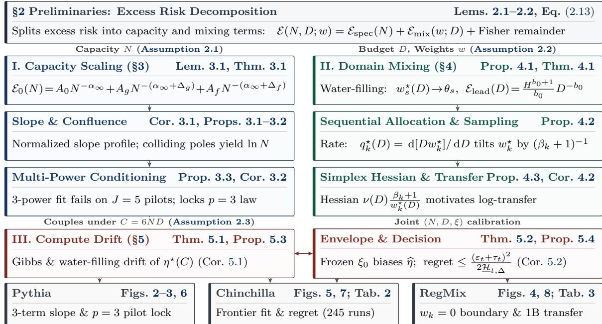  
Figure 1: Conceptual Architecture and Reading Roadmap. The finite-budget risk decomposition (Section 2) branches into I. Capacity Scaling (Section 3) and II. Multi-Domain Mixing (Section 4), couples along $C = 6 N D$ in III. Compute-Optimal Allocation (Section 5), and is evaluated in Section 6.

See Appendix A.2 (p. 41) for the complete proof.

## 2.3 Structural Assumptions and Risk Decomposition

Building on the Hilbert-space resolvent calculus of Section 2.1 and the local Fisher quadratic reduction of Section 2.2, we model the baseline finite-budget excess risk of a network of size N trained on D tokens under domain mixture $w \in \Delta _ { K - 1 } ^ { \circ }$ at the fixed reference covariance operator T and target evaluation prior π via an additive decomposition into a capacitylimited approximation error $\mathcal { E } _ { \mathrm { s p e c } } ( N )$ and a sample-limited estimation error $\mathcal { E } _ { \operatorname* { m i x } } ( w ; D )$ (Caponnetto and De Vito, 2007; Fischer and Steinwart, 2020):

$$
\mathcal { E } ( N , D ; w ) = \mathcal { E } _ { \mathrm { s p e c } } ( N ) + \mathcal { E } _ { \mathrm { m i x } } ( w ; D ) \quad \Longrightarrow \quad \mathcal { E } ^ { \star } ( C ) : = \operatorname* { m i n } _ { \stackrel { \kappa _ { c } N D = C } { w \in \Delta _ { K - 1 } } } \mathcal { E } ( N , D ; w ) .\tag{2.13}
$$

Cross-distribution transfer couplings Γ when $\mu _ { w } \neq \mu _ { \pi }$ are analyzed in Section 4.3, nonlinear monotone wrappers in Section 5.1, joint hyperparameter surfaces in Section 5.3, and non-separable slice perturbations in Proposition 5.4. We now specify the three baseline components of (2.13) through Assumptions 2.1 to 2.3 (Figure 1, with core notation summarized in Table 4 in Appendix A).

To formulate the scalar spectral surrogate model for $\mathcal { E } _ { \mathrm { s p e c } } ( N )$ under the fixed reference operator ${ \mathcal { T } } = { \mathcal { T } } _ { 0 } ^ { * } { \mathcal { T } } _ { 0 }$ , let $\{ \phi _ { m } \} _ { m = 1 } ^ { \infty }$ denote the $L _ { 2 } ( \mathcal { X } , \mu _ { \pi } )$ -orthonormal eigenfunctions spanning the closure ran $\overline { { ( \mathcal { L } _ { 0 } ) } }$ associated with the eigenbasis $\{ e _ { m } \} _ { m = 1 } ^ { \infty }$ of T, and let $g _ { \mu } \in L _ { 2 } ( \mathcal { X } , \mu _ { \pi } )$

denote the Tikhonov-regularized predictor of a target function ofset $g ^ { \star } ~ \in ~ \mathrm { r a n } (  { \mathcal { T } } _ { 0 } ) ~ \subset$ $L _ { 2 } ( \mathcal { X } , \mu _ { \pi } )$ at regularization scale $\mu > 0$ :

$$
\begin{array} { r c l } { \phi _ { m } : = } & { \lambda _ { m } ^ { - 1 / 2 } \bar { \mathcal { Z } } _ { 0 } e _ { m } , \qquad c _ { m } : = \Bigl | \langle g ^ { \star } , \phi _ { m } \rangle _ { L _ { 2 } ( \mu _ { \pi } ) } \Bigr | ^ { 2 } , \qquad \| g ^ { \star } \| _ { L _ { 2 } ( \mu _ { \pi } ) } ^ { 2 } = \displaystyle \sum _ { m = 1 } ^ { \infty } c _ { m } < \infty , } \\ { \displaystyle g _ { \mu } : = \bar { \mathcal { Z } } _ { 0 } ( \mathcal { T } + \mu \mathcal { T } ) ^ { - 1 } \bar { \mathcal { Z } } _ { 0 } ^ { * } g ^ { \star } , \qquad \| g ^ { \star } - g _ { \mu } \| _ { L _ { 2 } ( \mu _ { \pi } ) } ^ { 2 } = \displaystyle \sum _ { m = 1 } ^ { \infty } c _ { m } \biggl ( \frac { \mu } { \lambda _ { m } + \mu } \biggr ) ^ { 2 } . \qquad ( \frac { \lambda _ { m } ^ { 2 } } { 2 } ) ^ { 2 } } \end{array}\tag{2.14}
$$

Identity (2.14) factors each mode’s quadratic residual into a target energy $c _ { m }$ and a bounded attenuation factor $( \mu / ( \lambda _ { m } + \mu ) ) ^ { 2 } \in ( 0 , 1 )$ . To connect this scalar surrogate to the multi-class cross-entropy reduction of Lemma 2.2 for a realizable target $g ^ { \star } = \mathcal { T } _ { 0 } \theta ^ { \star }$ and Tikhonov iterate $\theta _ { \mu } : = ( T + \mu \mathcal { T } ) ^ { - 1 } \mathcal { T } \theta ^ { \star }$ (with $g _ { \mu } = \mathcal { T } _ { 0 } \theta _ { \mu } )$ , we distinguish two operator regimes:

• Single-contrast Fisher identity $( \mathcal { T } = \mathcal { T } _ { F } )$ : When the logit residual $\Delta z ( x )$ lies in a single scalar contrast subspace with $\mathcal { T } = \mathcal { T } _ { F }$ , the local Fisher quadratic form equals one half of (2.14), and under uniformly bounded eigenfunctions $\operatorname* { s u p } _ { m } \mathopen { } \mathclose \bgroup \left\| \phi _ { m } \aftergroup \egroup \right\| _ { \infty } \leq C _ { \phi }$ with $r > 2$ and $\mu = c _ { 0 } M ^ { - q } , L _ { 2 ^ { - } } L _ { \infty }$ interpolation bounds the scalar cubic residual by

$$
\begin{array} { r l r } { \frac { 1 } { 2 } \langle \theta _ { \mu } - \theta ^ { \star } , \mathcal { T } _ { F } ( \theta _ { \mu } - \theta ^ { \star } ) \rangle _ { \mathcal { H } } = \frac { 1 } { 2 } \| g ^ { \star } - g _ { \mu } \| _ { L _ { 2 } ( \mu _ { \pi } ) } ^ { 2 } , } & { } & \\ { \| g ^ { \star } - g _ { \mu } \| _ { L _ { 3 } ( \mu _ { \pi } ) } ^ { 3 } \ \le \ \| g ^ { \star } - g _ { \mu } \| _ { L _ { 2 } ( \mu _ { \pi } ) } ^ { 2 } \| g ^ { \star } - g _ { \mu } \| _ { \infty } } & { } & \\ { = } & { \{ \mathcal { O } ( M ^ { 2 - 3 r / 2 } ) , \quad \quad \quad 2 < r < 2 q + 1 ,  } & { } \\ {  \mathcal { O } \big ( M ^ { - 2 q - \operatorname* { m i n } \{ r / 2 - 1 , q \} } \ln M \big ) , } & { r \ge 2 q + 1 , } & \end{array}\tag{2.15}
$$

scaling exact residue amplitudes by $\textstyle { \frac { 1 } { 2 } }$ whenever any orthogonal logit components and the cubic remainder in (2.12) are of strictly higher order than the retained subleading pole $( \mathrm { e . g . , ~ } \frac { 3 } { 2 } r - 2 > 2 q )$

• Two-sided spectral equivalence $( c _ { F } \mathcal { T } \preceq \mathcal { T } _ { F } \preceq C _ { F } \mathcal { T } )$ : For general $0 < c _ { F } \leq C _ { F } < \infty$ the sandwich (2.12) transfers two-sided quadratic risk rate bounds between $\tau$ and $\mathcal { T } _ { F }$ Within the scalar surrogate (2.14), algebraic mode decay $c _ { m } = c m ^ { - r } ( 1 + b m ^ { - \delta } )$ and $\lambda _ { m } = c _ { 0 } m ^ { - q }$ induce three nested regularity regimes (Fischer and Steinwart, 2020):

• Finite $L _ { 2 } ( \mu _ { \pi } )$ target energy $( r > 1 , q > 0 )$ : The mode series $\textstyle \sum _ { m = 1 } ^ { \infty } c _ { m } < \infty$ and the attenuated residual risk (2.14) converge absolutely for every $\mu > 0$

• Trace-class covariance $( q > 1 )$ : The eigenvalue sum $\mathrm { t r } ( \mathcal T ) < \infty$ is finite, as required by Lemmas 2.1 and 2.2.

• H-realizable source condition $( r > q + 1 )$ : The target belongs to the reproducing subspace $g ^ { \star } =  { \mathcal { T } _ { 0 } } f ^ { \star }$ for $f ^ { \star } \in { \mathcal { H } }$ with finite Hilbert norm $\sum _ { m = 1 } ^ { \infty } c _ { m } / \lambda _ { m } < \infty$ and mode weights $c _ { m } = \lambda _ { m } | \langle f ^ { \star } , e _ { m } \rangle _ { \mathcal { H } } | ^ { 2 }$

Because $( \mu / ( \lambda _ { m } + \mu ) ) ^ { 2 } \in ( 0 , 1 )$ , the spectral risk series (2.14) remains well-defined and absolutely convergent throughout the full range $q > 0$ and $r > 1$ , which our first assumption parameterizes at finite model capacity $N$

Assumption 2.1 (Spectral Source Decay and Resolvent Filter). A network of parameter count $N \in \mathbb { R } _ { > 0 }$ resolves spectral modes up to an efective cutof scale $M : = N ^ { \kappa }$ $( \kappa > 0 )$ . Under eigenvalue decay $\lambda _ { m } = c _ { 0 } m ^ { - q } ~ ( q > 0 )$ and resolution floor $\mu = c _ { 0 } M ^ { - q }$ each mode’s attenuation factor satisfies $( \mu / ( \lambda _ { m } + \mu ) ) ^ { 2 } = \psi _ { q } ( m / M )$ , and the target mode energies $\{ c _ { m } \} _ { m = 1 } ^ { \infty }$ and capacity-limited spectral excess risk $\mathcal { E } _ { \mathrm { s p e c } } ( N )$ obey the two-term Weyl expansion and rational filter law

$$
c _ { m } \ = \ c m ^ { - r } \Bigl ( 1 + b m ^ { - \delta } \Bigr ) ,\tag{2.16}
$$

$$
{ \mathcal E } _ { \mathrm { s p e c } } ( N ) : = \sum _ { m = 1 } ^ { \infty } c _ { m } \psi _ { q } \Bigl ( \frac { m } { M } \Bigr ) , \qquad \psi _ { q } \bigl ( u \bigr ) : = \bigl ( 1 + u ^ { - q } \bigr ) ^ { - 2 } ,\tag{2.17}
$$

where $c > 0$ is the leading spectral amplitude, $r > 1$ is the primary source decay exponent, $b \geq 0$ is the relative subleading amplitude, and $\delta = 1 / d > 0$ is the geometric correction exponent on an efective d-dimensional data manifold.

Assumption 2.1 combines the classical two-term Weyl eigenvalue and manifold-regularity asymptotics of diferential and Mat´ern covariance operators (Borovitskiy et al., 2020; H¨ormander, 1968; Weyl, 1912) with the capacity-scaling exponents of deep piecewise-linear and adaptive neural networks (e.g., Schmidt-Hieber, 2020; Yarotsky, 2017; Zhao and Ren, 2026). Rather than hard Eckart–Young truncation ${ \bf 1 } _ { \{ m > M \} }$ (Eckart and Young, 1936) (whose Mellin transform carries no left-half-plane filter poles), projecting an infinite-dimensional feature map onto an $M _ { \mathrm { r a w } }$ -dimensional random subspace induces a self-consistent Marchenko– Pastur resolution floor $\mu _ { \mathrm { e f f } } ( N )$ on $\mathcal { T } _ { F }$ (Bahri et al., 2024; Bordelon et al., 2020; Jacot et al., 2020; Maloney et al., 2022; Marˇcenko and Pastur, 1967):

$$
M = \frac { M _ { \mathrm { { r a w } } } } { \Lambda _ { q } } , \qquad \mu _ { \mathrm { e f f } } ( N ) = c _ { 0 } M ^ { - q } \quad \Longrightarrow \quad \biggl ( \frac { \mu _ { \mathrm { e f f } } ( N ) } { \lambda _ { m } + \mu _ { \mathrm { e f f } } ( N ) } \biggr ) ^ { 2 } = \psi _ { q } \Bigl ( \frac { m } { M } \Bigr ) ,\tag{2.18}
$$

where $\Lambda _ { q } = ( \pi / q ) / \sin ( \pi / q )$ is Euler’s efective-dimension constant from Lemma 2.1. To complement this capacity-side approximation model, we next specify how finite training tokens are distributed across heterogeneous data domains.

Assumption 2.2 (Separable Multi-Domain Excess Risk). Under a total training budget of $D > 0$ tokens allocated across $K \geq 2$ domains via mixture weights $w \in \Delta _ { K - 1 } ^ { \circ }$ , the cumulative token quota assigned to domain k is $n _ { k } ^ { \star } ( D ) : = D w _ { k } ^ { \star } ( D )$ . After subtracting the irreducible entropy floor $\mathcal { E } _ { \infty }$ , the separable domain-mixture excess risk over $\Delta _ { K - 1 } ^ { \circ }$ (Ge et al., 2024; Liu et al., 2025; Ye et al., 2025) takes the form

$$
{ \mathcal { E } } _ { \mathrm { m i x } } ( w ; D ) : = \sum _ { k = 1 } ^ { K } \pi _ { k } B _ { k } ( w _ { k } D ) ^ { - \beta _ { k } } = \sum _ { k = 1 } ^ { K } c _ { k } ( w _ { k } D ) ^ { - \beta _ { k } } ,\tag{2.19}
$$

where $\pi \in \Delta _ { K - 1 } ^ { \circ }$ is the target evaluation prior, $B _ { k } ~ > ~ 0$ is the domain dificulty scale, $c _ { k } : = \pi _ { k } B _ { k } > 0$ is the efective domain weight, and $\beta _ { k } > 0$ is the domain sample-scaling exponent. When cross-domain representation transfer is active (Hernandez et al., 2021; Wu et al., 2026), the excess risk includes a convex quadratic transfer interaction $\frac { 1 } { 2 } \langle { w } , { \bf { T } } w \rangle _ { \mathbb { R } ^ { K } }$ with symmetric positive semidefinite coupling matrix $\mathbf { r } \in \mathbb { R } ^ { K \times K } \left( \mathbf { T } \succeq 0 \right)$

Finally, to couple model capacity N and token budget D under a fixed training compute budget $C = \kappa _ { c } N D$ (Hofmann et al., 2022; Kaplan et al., 2020), we impose standard smoothness and slice-convexity conditions on the joint excess risk surface.

Assumption 2.3 (Regularity of the Iso-Compute Risk Surface). In logarithmic resource coordinates $u : =$ ln $N \in \mathbb { R }$ and $v : = \ln D \in \mathbb { R }$ , the compute budget $C = \kappa _ { c } N D$ $( \kappa _ { c } > 0 )$ defines the afine iso-compute submanifold

$$
\mathcal { M } _ { t } : = \big \{ ( u , v ) \in \mathbb { R } ^ { 2 } : u + v = t \big \} , \qquad t : = \ln \left( \frac { C } { \kappa _ { c } } \right) \in \mathbb { R } .\tag{2.20}
$$

The excess risk surface $\mathcal { E } : \mathbb { R } ^ { 2 }  \mathbb { R } _ { > 0 }$ is three times continuously diferentiable $( \mathcal { E } \in C ^ { 3 } ( \mathbb { R } ^ { 2 } ) )$ strictly decreasing in each coordinate $( \mathcal { E } _ { u } < 0 , \mathcal { E } _ { v } < 0 )$ , and strictly convex along every iso-compute slice $\mathcal { M } _ { t }$ , meaning that the second directional derivative along $( 1 , - 1 )$ satisfies

$$
\mathcal { H } _ { \mathrm { i s o } } ( u , v ) : = \mathcal { E } _ { u u } ( u , v ) - 2 \mathcal { E } _ { u v } ( u , v ) + \mathcal { E } _ { v v } ( u , v ) > 0 \qquad \forall ( u , v ) \in \mathbb { R } ^ { 2 } ,\tag{2.21}
$$

and admits a unique interior minimizer $( u ^ { \star } ( t ) , v ^ { \star } ( t ) ) \in \mathcal { M } _ { t }$ for each log-compute budget $t \in \mathbb { R }$

## 3 Finite-Capacity Approximation and Identifiability

We begin our analysis of the excess risk decomposition (2.13) with the finite-capacity approximation error $\mathcal { E } _ { \mathrm { s p e c } } ( N )$ in H under Assumption 2.1. In empirical scaling studies, practitioners commonly fit a single power law $E _ { \infty } + A _ { 0 } N ^ { - \alpha _ { \infty } }$ to small-scale pilot runs and extrapolate across several orders of magnitude (Henighan et al., 2020; Hestness et al., 2017; Kaplan et al., 2020; Rosenfeld et al., 2020). On finite model grids, however, the local log-log slope $\begin{array} { r } { \alpha _ { \mathrm { e f f } } ( N ) \mathrel { \mathop : } = - \frac { \dim \mathcal E _ { \mathrm { s p e c } } ( N ) } { \textup d \ln N } } \end{array}$ departs systematically from $\alpha _ { \infty }$ , either undershooting or overshooting the asymptotic rate before converging at large N (Bordelon et al., 2020; Caballero et al., 2023; Spigler et al., 2020; Weyl, 1912).

To characterize these finite-scale departures directly from the operator spectrum, we apply Mellin–Barnes contour integration to the spectral risk series $\begin{array} { r } { \mathcal { E } _ { \mathrm { s p e c } } ( N ) = \sum _ { m = 1 } ^ { \infty } c _ { m } \psi _ { q } ( m / M ) } \end{array}$ Shifting the integration contour into the left complex half-plane $\Re ( s ) < 0$ reveals that pre-asymptotic capacity scaling is governed by a residue competition between two distinct families of singularities:

• Spectral–geometric zeta poles at $s = - ( r - 1 )$ and $s = - ( r + \delta - 1 )$ , generated by the analytic continuation of $\zeta ( r + s )$ and $\zeta ( r + \delta + s )$ encoding the target source decay and Weyl manifold correction; and

• Regularization filter poles at $s = - m q$ for integers $m \geq 2$ , generated by the Mellin kernel $\Psi _ { q } ( s )$ of the rational resolvent filter $\psi _ { q } ( u ) = ( 1 + u ^ { - q } ) ^ { - 2 }$ (whereas the apparent pole at $s = - q$ is removable).

We establish the resulting three-term residue expansion and its pre-asymptotic slope profile in Section 3.1, analyze pole confluence and early-stopped gradient flow in Section 3.2, and characterize multi-power ill-conditioning and diference identification in Section 3.3.

## 3.1 Three-Term Risk Expansion and Pre-Asymptotic Slope

Under the capacity scaling $M = N ^ { \kappa }$ (Assumption 2.1), each simple pole $s = - p$ in the left half-plane $\Re ( s ) < 0$ contributes a power-law mode $M ^ { - p } = N ^ { - \kappa p }$ to the approximation risk $\mathcal { E } _ { \mathrm { s p e c } } ( N )$ . The three rightmost singularities therefore decompose pre-asymptotic capacity scaling into three distinct exponents:

• the asymptotic tail exponent $\alpha _ { \infty } : = \kappa ( r - 1 )$ , governed by the primary source pole $s = - ( r - 1 )$ as $N \to \infty ;$

• the geometric correction gap $\Delta _ { g } : = \kappa \delta$ , which shifts the subleading Weyl manifold pole $s = - ( r + \delta - 1 )$ to the faster decay rate $\alpha _ { \infty } + \Delta _ { g } ;$ and

• the regularization filter gap $\Delta _ { f } : = \kappa ( 2 q - r + 1 )$ , which shifts the first active resolvent pole $s = - 2 q$ to the finite-resolution decay rate $\alpha _ { \infty } + \Delta _ { f }$

Whether the finite-scale correction is dominated by manifold geometry $( \Delta _ { g } < \Delta _ { f } )$ or by the regularization filter $( \Delta _ { f } < \Delta _ { g } )$ is governed by the dimensionless spectral gap ratio ϱ:

$$
\alpha _ { \infty } : = \kappa ( r - 1 ) , \qquad \Delta _ { g } : = \kappa \delta , \qquad \Delta _ { f } : = \kappa ( 2 q - r + 1 ) , \qquad \varrho : = \frac { \Delta _ { f } } { \Delta _ { g } } = \frac { 2 q - r + 1 } { \delta } .\tag{3.1}
$$

To evaluate the contour integral of $\mathcal { E } _ { \mathrm { s p e c } } ( N )$ , we begin by determining the meromorphic continuation of the rational filter kernel $\Psi _ { q } ( s )$ ; notably, its apparent singularity at $s = - q$ cancels against a simple zero of the linear numerator, shifting the first active left-half-plane pole to $s = - 2 q$

Lemma 3.1 (Mellin Kernel of the Rational Resolvent Filter). For $q > 0$ and $\Re ( s ) \in ( - 2 q , 0 )$ , the Mellin transform $\begin{array} { r } { \Psi _ { q } ( s ) : = \int _ { 0 } ^ { \infty } \psi _ { q } ( u ) u ^ { s - 1 } } \end{array}$ du of the rational filter $\psi _ { q } ( u ) = ( 1 + u ^ { - q } ) ^ { - 2 }$ converges absolutely and extends meromorphically to C via

$$
\Psi _ { q } ( s ) = \frac { 1 } { q } \Gamma \biggl ( 2 + \frac { s } { q } \biggr ) \Gamma \biggl ( - \frac { s } { q } \biggr ) = - \frac { s + q } { q ^ { 2 } } \frac { \pi } { \sin ( \pi s / q ) } .\tag{3.2}
$$

The linear factor $( s + q )$ cancels the simple zero of sin $( \pi s / q )$ at $s = - q$ , rendering $s = - q$ a removable singularity with $\Psi _ { q } ( - q ) ~ = ~ \textstyle { \frac { 1 } { a } } ~ > ~ 0$ . Consequently, $\Psi _ { q } ( s ) > 0$ for all real $s \in ( - 2 q , 0 )$ , and the poles $o f \Psi _ { q } ( s )$ in the open left half-plane $\Re ( s ) < 0$ are simple poles located at $s _ { m } = - m q$ for integers $m \geq 2$ , with residues

$$
\operatorname { \underset { s = - m q } { R e s } } \Psi _ { q } ( s ) = ( - 1 ) ^ { m - 2 } ( m - 1 ) \qquad \forall m \in \mathbb { N } _ { \geq 2 } .\tag{3.3}
$$

See Appendix B.2 (p. 46) for the complete proof.

Combining the meromorphic filter kernel $\Psi _ { q } ( s )$ of Lemma 3.1 with the Weyl Dirichlet series $\begin{array} { r } { \sum _ { m = 1 } ^ { \infty } c _ { m } m ^ { - s } = c \{ \zeta ( r + s ) + b \zeta ( r + \delta + s ) \} } \end{array}$ represents $\mathcal { E } _ { \mathrm { s p e c } } ( N )$ as a vertical contour integral of the Mellin integrand $\Phi ( s ; M )$ whose left-half-plane pole abscissae form the set P (Flajolet et al., 1995; Paris and Kaminski, 2001):

$$
\begin{array} { r l r } { \Phi ( s ; M ) } & { : = } & { c M ^ { s } \Psi _ { q } ( s ) \big \{ \zeta ( r + s ) + b \zeta ( r + \delta + s ) \big \} , } \\ { \mathcal { P } } & { : = } & { \{ r - 1 , r + \delta - 1 \} \cup \{ m q : m \in \mathbb { N } _ { \ge 2 } \} . } \end{array}\tag{3.4}
$$

Shifting the integration contour leftward to $\Re ( s ) = - \rho$ for any abscissa $\rho \in ( 0 , \infty ) \setminus \mathcal { P }$ isolates the finite-capacity residue expansion of $\mathcal { E } _ { \mathrm { s p e c } } ( N )$ up to the contour remainder $\begin{array} { r } { R _ { \rho } ( M ) : = \frac { 1 } { 2 \pi i } \int _ { - \rho - i \infty } ^ { - \rho + i \infty } \Phi ( s ; M ) } \end{array}$ ds.

Theorem 3.1 (Finite-Capacity Mellin–Barnes Expansion). Suppose Assumption 2.1 holds with cutof scale $M = N ^ { \kappa }$ and non-overlapping spectral and filter poles, $\{ r - 1 , r + \delta -$

$1 \} \cap \{ m q : m \in \mathbb { N } _ { \geq 2 } \} = \emptyset$ . Then for any shifted abscissa $\rho \in ( 0 , \infty ) \setminus \mathcal { P }$ , the finite-capacity spectral approximation risk $\mathcal { E } _ { \mathrm { s p e c } } ( N )$ admits the residue expansion

$$
\begin{array} { l } { { \displaystyle { \mathcal E } _ { \mathrm { s p e c } } ( N ) ~ = ~ A _ { 0 } M ^ { - ( r - 1 ) } { \mathbf 1 } _ { \{ r - 1 < \rho \} } + A _ { g } M ^ { - ( r + \delta - 1 ) } { \mathbf 1 } _ { \{ r + \delta - 1 < \rho \} } } } \\ { { ~ + ~ \displaystyle \sum _ { m \geq 2 \atop m q < \rho } A _ { f , m } M ^ { - m q } + R _ { \rho } ( M ) , } } \end{array}\tag{3.5}
$$

where the residues and contour remainder (with finite constant $C _ { \rho } > 0$ from Lemma B.1) satisfy

$$
A _ { 0 } : = c \Psi _ { q } ( 1 - r ) , \qquad A _ { g } : = c b \Psi _ { q } ( 1 - r - \delta ) , \qquad | R _ { \rho } ( M ) | \leq C _ { \rho } M ^ { - \rho } ,\tag{3.6}
$$

$$
A _ { f , m } : = c ( - 1 ) ^ { m - 2 } ( m - 1 ) \{ \zeta ( r - m q ) + b \zeta ( r + \delta - m q ) \} \quad ( m \geq 2 ) .\tag{3.7}
$$

In particular, in the non-degenerate three-term regime where the spectral and filter exponents obey the ordering in (3.8), the expansion specializes to

$$
\begin{array} { r l r } {  { 0 < r - 1 < r + \delta - 1 < 2 q < \rho < 3 q , \qquad - 2 < r - 2 q < r + \delta - 2 q < 1 , } } \\ & { } & { \mathcal { E } _ { \mathrm { s p e c } } ( N ) = A _ { 0 } N ^ { - \alpha _ { \infty } } + A _ { g } N ^ { - ( \alpha _ { \infty } + \Delta _ { g } ) } + A _ { f } N ^ { - ( \alpha _ { \infty } + \Delta _ { f } ) } + R _ { \rho } ( N ^ { \kappa } ) , } \\ & { } & { A _ { f } : = A _ { f , 2 } = c \{ \zeta ( r - 2 q ) + b \zeta ( r + \delta - 2 q ) \} < 0 , \quad \quad } \end{array}\tag{3.8}
$$

where $\varrho > 1 , A _ { 0 } > 0 , A _ { g } \geq 0 \ ( w i t h \ A _ { g } > 0$ whenever $b > 0 )$ , and $A _ { f } < 0$ for every $b \geq 0$ because $\zeta ( z ) < 0$ across the open interval $z \in ( - 2 , 1 )$ (strictly above the first trivial zero $\zeta ( - 2 ) = 0 )$

Proof Sketch of Theorem 3.1. For $\sigma ~ \in ~ ( \operatorname* { m a x } \{ - 2 q , 1 - r \} , 0 )$ , Mellin inversion of $\psi _ { q } ( m / M )$ and Fubini–Tonelli summation over m $\geq 1$ express $\mathcal { E } _ { \mathrm { s p e c } } ( N )$ as a vertical contour integral of $\Phi ( s ; M )$ . Shifting the contour leftward from $\Re ( s ) = \sigma \ \mathrm { t o } \ \Re ( s ) = - \rho$ via Cauchy’s residue theorem (Lemma B.1) and evaluating the residue signs via Riemann’s functional equation (Titchmarsh, 1986) yields

$$
\begin{array} { r l r } & { } & { \mathcal { E } _ { \mathrm { s p e c } } ( N ) = \displaystyle \frac { 1 } { 2 \pi i } \int _ { \sigma - i \infty } ^ { \sigma + i \infty } \Phi ( s ; M ) \mathrm { d } s = \sum _ { s _ { \star } \in ( - \rho , \sigma ) } \mathsf { R e s } \Phi ( s ; M ) + R _ { \rho } ( M ) , } \\ & { } & { \quad \Psi _ { q } ( s ) > 0 \mathrm { ~ o n ~ } ( - 2 q , 0 ) \Longrightarrow A _ { 0 } > 0 , A _ { g } \geq 0 , \qquad \zeta ( z ) < 0 \mathrm { ~ o n ~ } ( - 2 , 1 ) \Longrightarrow A _ { f } < 0 , } \end{array}
$$

collecting the simple poles of $\zeta ( r + s )$ and $\zeta ( r + \delta + s )$ at $s \in \{ 1 - r , 1 - r - \delta \}$ and the filter poles of $\Psi _ { q } ( s )$ at $s = - m q \ ( m \geq 2 )$ from Lemma 3.1. See Appendix $\mathrm { { B . 3 } ~ ( p . ~ 4 6 ) }$ for the complete proof. ■

Remark 3.1 (Series Truncation and Low-Mode Perturbations). Two structural properties govern the higher-order behavior and low-index sensitivity of the Mellin–Barnes expansion (3.5):

(i) Finite-order truncation versus factorial growth as $\rho  \infty$ . For any fixed abscissa $\rho > 0 , ( 3 . 5 )$ is a finite sum with contour remainder $| R _ { \rho } ( M ) | \le C _ { \rho } M ^ { - \rho }$ . Sending $\rho  \infty$ over all filter poles $s = - m q \ ( m \geq 2$ with $r - m q < 0 )$ produces two distinct

regimes governed by Euler’s reflection formula and the trivial zeros of $\zeta ( z )$ at $- 2  { \mathbb { N } } _ { \geq 1 }$ (Boyd, 1999; Paris and Kaminski, 2001):

$$
\begin{array} { r l } & { \quad r - m q \in - 2  { \mathbb { N } } _ { \geq 1 } , \ b = 0 \Longrightarrow \zeta ( r - m q ) = 0 \quad ( \forall \mathrm { ~ l a r g e ~ } m \geq 2 ) , } \\ & { \mathrm { d i s t } ( r - m q , - 2  { \mathbb { N } } _ { \geq 1 } ) \geq \delta _ { 0 } \Longrightarrow | \zeta ( r - m q ) | \geq 2 ( 2 \pi ) ^ { r - m q - 1 } \Gamma ( 1 - r + m q ) \sin ( \pi \delta _ { 0 } / 2 ) , } \end{array}\tag{3.9}
$$

for any fixed separation $\delta _ { 0 } > 0$ . Thus, in the resonant case $r - m q \in - 2 \mathbb { N } _ { \geq 1 } \ ( b =$ $0 )$ , the filter series terminates at finite algebraic order; in the non-resonant case, the filter terms grow factorially in qm (Gevrey-1 in qm), whose Stirling envelope $\Gamma ( 1 - r + m q ) ( 2 \pi M ) ^ { - m q }$ attains its minimum near the optimal truncation scale $q m = 2 \pi M$

(ii) Invariance of geometric poles under finite low-mode perturbations. When the true mode energies $c _ { j }$ depart from the power-law profile (2.16) at finitely many low indices $j ~ \in ~ \{ 1 , \dots , m _ { 0 } \}$ , the finite Dirichlet polynomial $\sum _ { j = 1 } ^ { m _ { 0 } } \delta c _ { j } j ^ { - s }$ is entire on $\mathbb { C }$ and introduces no poles at $s \in \{ 1 - r , 1 - r - \delta \}$

$$
\begin{array} { c } { { \delta c _ { j } : = c _ { j } - c j ^ { - r } \Big ( 1 + b j ^ { - \delta } \Big ) \quad ( 1 \leq j \leq m _ { 0 } ) , } } \\ { { \Delta A _ { 0 } = \Delta A _ { g } = 0 , \qquad \Delta A _ { f , m } = ( - 1 ) ^ { m - 2 } ( m - 1 ) { \displaystyle \sum _ { j = 1 } ^ { m _ { 0 } } } \delta c _ { j } j ^ { m q } \quad ( m \geq 2 ) . } } \end{array}\tag{3.10}
$$

Consequently, the spectral–geometric residues $( A _ { 0 } , A _ { g } )$ depend solely on the highmode tail $j \to \infty$ , whereas the filter coeficients $A _ { f , m }$ absorb finite low-mode energy perturbations.

Theorem 3.1 explains why pre-asymptotic scaling curves exhibit non-monotonic local slopes when $\varrho > 1$ : the positive subleading geometric residue $A _ { g } N ^ { - ( \alpha _ { \infty } + \Delta _ { g } ) } \ ( A _ { g } > 0 )$ and the negative leading filter residue $A _ { f } N ^ { - ( \alpha _ { \infty } + \Delta _ { f } ) } \ ( A _ { f } < 0 )$ pull the local slope in opposite directions across scales. To isolate this competition on the three-term truncation $\mathcal { E } _ { 0 } ( N )$ , let $\begin{array} { r } { \alpha _ { 0 } ( N ) : = - \frac { \dim \mathcal { E } _ { 0 } ( N ) } { \textup d \ln N } } \end{array}$ denote its local scaling exponent on the positive-risk domain $\mathcal { E } _ { 0 } ( N ) > 0$ (which includes all $N > | f | ^ { 1 / \Delta _ { f } } )$ and define the relative amplitudes $( g , f )$ and rescaled slope deviation $T _ { 3 } ( N )$ on $( 0 , \infty )$ by

$$
\mathcal { E } _ { 0 } ( N ) : = A _ { 0 } N ^ { - \alpha _ { \infty } } \big ( 1 + g N ^ { - \Delta _ { g } } + f N ^ { - \Delta _ { f } } \big ) , \qquad g : = \frac { A _ { g } } { A _ { 0 } } > 0 , \qquad f : = \frac { A _ { f } } { A _ { 0 } } < 0 ,
$$

$$
T _ { 3 } ( N ) : = \Delta _ { g } g N ^ { - \Delta _ { g } } - \Delta _ { f } | f | N ^ { - \Delta _ { f } } = ( \alpha _ { 0 } ( N ) - \alpha _ { \infty } ) \frac { \mathcal { E } _ { 0 } ( N ) } { A _ { 0 } N ^ { - \alpha _ { \infty } } } \quad ( \mathcal { E } _ { 0 } ( N ) > 0 ) .\tag{3.11}
$$

Normalizing $T _ { 3 } ( N )$ by its unique extremum collapses all amplitude dependencies $( A _ { 0 } , A _ { g } , A _ { f } )$ onto a single-parameter profile $F _ { \varrho } ( x )$ governed solely by $\varrho .$

Corollary 3.1 (Normalized Pre-Asymptotic Slope Profile). In the regime $\varrho > 1$ with $g > 0$ and $f < 0$ , the rescaled slope deviation $T _ { 3 } ( N )$ in (3.11) attains a unique global maximum on $( 0 , \infty )$ at the characteristic peak scale $N _ { \mathrm { p e a k } } ^ { \star }$ with maximum height $H _ { \mathrm { p e a k } } .$

$$
N _ { \mathrm { p e a k } } ^ { \star } : = \left( \frac { \Delta _ { f } ^ { 2 } | f | } { \Delta _ { g } ^ { 2 } g } \right) ^ { \frac { 1 } { \Delta _ { f } - \Delta _ { g } } } ,
$$

$$
H _ { \mathrm { p e a k } } : = T _ { 3 } ( N _ { \mathrm { p e a k } } ^ { \star } ) = \Delta _ { g } g ( N _ { \mathrm { p e a k } } ^ { \star } ) ^ { - \Delta _ { g } } \biggl ( 1 - { \frac { 1 } { \varrho } } \biggr ) > 0 .\tag{3.12}
$$

Under the dimensionless coordinate $x : = ( N / N _ { \mathrm { p e a k } } ^ { \star } ) ^ { \Delta _ { g } }$ on $( 0 , \infty )$ , the normalized slope deviation satisfies

$$
\frac { T _ { 3 } ( N ) } { H _ { \mathrm { p e a k } } } \ : = \ : F _ { \varrho } ( x ) : = \frac { \varrho x ^ { - 1 } - x ^ { - \varrho } } { \varrho - 1 } \qquad \forall x \in ( 0 , \infty ) .\tag{3.13}
$$

See Appendix B.4 (p. 48) for the complete proof.

## 3.2 Pole Confluence and Early-Stopped Gradient Flow

The non-degenerate expansion (3.8) requires the spectral–geometric poles and the regularization filter poles to remain separated. When a spectral pole $s = - p$ approaches a filter pole $s = - m q$ at separation $h = p - m q \to 0$ (such as $\varrho \to 0$ or $\varrho \to 1$ at $m = 2 )$ , we isolate the colliding residue pair via the single-mode integrand $\Phi _ { p } ( s ; M )$ and the holomorphic regular parts $\Psi _ { q , m } ^ { \mathrm { r e g } } ( s )$ and $\zeta _ { \mathrm { r e g } } ( s + p )$ obtained after subtracting the simple poles at $s = - m q$ and $s = - p$ (Lemma B.2):

$$
\begin{array} { r l } & { p \in \{ r - 1 , r + \delta - 1 \} , \qquad c _ { p } \in \{ c , c b \} , \qquad h : = p - m q \quad ( m \geq 2 ) , } \\ & { } \\ { \Phi _ { p } ( s ; M ) : = c _ { p } M ^ { s } \Psi _ { q } ( s ) \zeta ( p + 1 + s ) , \qquad \Psi _ { q , m } ^ { \mathrm { r e g } } ( - m q ) = - \frac { ( - 1 ) ^ { m - 2 } } { q } , \qquad \zeta _ { \mathrm { r e g } } ( 0 ) = 0 . } \end{array}\tag{3.14}
$$

Although the two individual residues diverge with opposite signs as $h  0$ , their sum forms a divided diference in $M ^ { - s }$ that converges smoothly to a logarithmic correction (Flajolet et al., 1995).

Proposition 3.1 (Divided-Diference Representation and Pole Confluence). For any non-zero pole separation $h \neq 0$ , the combined residue pair $\mathcal { C } _ { p , m } ( M ; h ) \ o f \ \Phi _ { p } ( s ; M )$ at $s = - p$ and $s = - m q$ obeys the divided-diference identity

$$
\begin{array} { r l } & { \mathcal { C } _ { p , m } ( M ; h ) : = \underset { s = - p } { \mathrm { R e s } } \Phi _ { p } ( s ; M ) + \underset { s = - m q } { \mathrm { R e s } } \Phi _ { p } ( s ; M ) } \\ & { \quad = c _ { p } ( - 1 ) ^ { m - 2 } ( m - 1 ) \frac { M ^ { - p } - M ^ { - m q } } { - h } + c _ { p } M ^ { - p } \Psi _ { q , m } ^ { \mathrm { r e g } } ( - p ) } \\ & { \quad \quad \quad + c _ { p } ( - 1 ) ^ { m - 2 } ( m - 1 ) M ^ { - m q } ( \gamma _ { E } + \zeta _ { \mathrm { r e g } } ( h ) ) , } \end{array}\tag{3.15}
$$

where $\gamma _ { E }$ is the Euler–Mascheroni constant. In the collision limit $h \ \to \ 0 \ ( p \ \to \ m q )$ $\mathscr { C } _ { p , m } ( M ; h )$ converges smoothly to the logarithmic confluence law

$$
\operatorname * { l i m } _ { p \to m q } { \mathcal C } _ { p , m } ( M ; p - m q ) \ = \ c _ { p } ( - 1 ) ^ { m - 2 } ( m - 1 ) M ^ { - m q } \bigg ( \ln M + \gamma _ { E } - \frac { 1 } { ( m - 1 ) q } \bigg ) .\tag{3.16}
$$

See Appendix B.5 (p. 49) for the complete proof.

A complementary boundary regime arises when explicit Tikhonov regularization is replaced by early-stopped iterative optimization (Ali et al., 2019; Bordelon et al., 2024; Li et al., 2025; Yao et al., 2007). Under continuous-time gradient flow $\psi _ { \mathrm { G F } } ( u ) = \exp ( - 2 u ^ { - q } )$ the associated Mellin kernel is holomorphic throughout the open left half-plane $\Re ( s ) < 0$ eliminating all regularization filter poles so that pre-asymptotic scaling is governed exclusively by the spectral–geometric zeta poles.

Proposition 3.2 (Gradient-Flow Mellin Kernel). Replace the rational filter $\psi _ { q } ( u )$ in Assumption 2.1 with the continuous-time gradient-flow residual filter ψGF $( u ) : = \exp ( - 2 u ^ { - q } )$ for $u = m / M$ and $q > 0$ . Then the associated Mellin transform

$$
\Psi _ { \mathrm { G F } } ( s ) : = \int _ { 0 } ^ { \infty } e ^ { - 2 u ^ { - q } } u ^ { s - 1 } \mathrm { d } u = { \frac { 2 ^ { s / q } } { q } } \Gamma \biggl ( - { \frac { s } { q } } \biggr )\tag{3.17}
$$

is holomorphic throughout the open left half-plane $\Re ( s ) < 0$ . Consequently, shifting the Mellin–Barnes contour into $\Re ( s ) < 0$ encounters no filter poles, and the pre-asymptotic risk expansion contains only the spectral–geometric zeta poles at $s = - ( r - 1 )$ and $s = - ( r + \delta - 1 )$ up to the contour remainder.

See Appendix B.6 (p. 50) for the complete proof.

## 3.3 Multi-Power Ill-Conditioning and Diference Identification

Theorem 3.1 also clarifies an empirical dificulty in scaling-law extrapolation: although the finite-capacity risk contains three power-law terms $A _ { 0 } N ^ { - \alpha _ { \infty } } + A _ { g } N ^ { - ( \alpha _ { \infty } + \Delta _ { g } ) } + A _ { f } N ^ { - ( \alpha _ { \infty } + \Delta _ { f } ) }$ above the irreducible floor $E _ { \infty }$ , fitting a multi-exponential sum directly to a narrow pilot grid is severely ill-conditioned (Gautschi, 1962; Lanczos, 1956; Mlodozeniec and Frei, 2026; Varah, 1985). On an ordered log-capacity pilot grid $\{ u _ { j } \} _ { j = 1 } ^ { J }$ with $u _ { j } : = \ln ( N _ { j } / N _ { 1 } )$ , we compare the unconstrained 7-parameter three-power model $f _ { 7 } ( u ; \theta _ { 7 } )$ and the 5-parameter gap-locked model $f _ { 5 } ( u ; \theta _ { 5 } )$ (with fixed spectral gaps $\Delta _ { g } , \Delta _ { f }$ from (3.1)), along with their $J \times p$ Jacobian matrices $J _ { p } ( \theta _ { p } )$

$$
0 \le u _ { 1 } < u _ { 2 } < \cdot \cdot \cdot < u _ { J } , \qquad J _ { p } ( \theta _ { p } ) : = \left[ \frac { \partial f _ { p } ( u _ { j } ; \theta _ { p } ) } { \partial \theta _ { p } } \right] _ { j = 1 } ^ { J } \in \mathbb { R } ^ { J \times p } ,
$$

$$
\begin{array} { r } { \theta _ { 7 } : = ( E _ { \infty } , A _ { 1 } , A _ { 2 } , A _ { 3 } , \alpha _ { 1 } , \alpha _ { 2 } , \alpha _ { 3 } ) \in \mathbb { R } ^ { 7 } , \qquad \theta _ { 5 } : = ( E _ { \infty } , A _ { 0 } , A _ { g } , A _ { f } , \alpha _ { \infty } ) \in \mathbb { R } ^ { 5 } , } \end{array}
$$

$$
f _ { 7 } ( u ; \theta _ { 7 } ) : = E _ { \infty } + \sum _ { k = 1 } ^ { 3 } A _ { k } e ^ { - \alpha _ { k } u } ,
$$

$$
f _ { 5 } ( u ; \theta _ { 5 } ) : = E _ { \infty } + A _ { 0 } e ^ { - \alpha _ { \infty } u } + A _ { g } e ^ { - ( \alpha _ { \infty } + \Delta _ { g } ) u } + A _ { f } e ^ { - ( \alpha _ { \infty } + \Delta _ { f } ) u } .\tag{3.18}
$$

While ${ \cal J } _ { 7 } ( \theta _ { 7 } )$ sufers algebraic rank collapse along the single-power locus, even the gap-locked Jacobian ${ \cal J } _ { 5 } ( \theta _ { 5 } )$ sufers a quadratic singular-value decay in the dimensionless pilot span $\Delta _ { g } u _ { J }$ due to second-order Taylor cancellation across its three exponential columns.

Proposition 3.3 (Multi-Power Jacobian Rank Collapse and Ill-Conditioning). On any strictly increasing pilot grid $\{ u _ { j } \} _ { j = 1 } ^ { J } i n \left[ 0 , \infty \right)$ with $J \geq 7$ , the unconstrained 7-parameter

Jacobian $J _ { 7 } ( \theta _ { 7 } ) \in \mathbb { R } ^ { J \times 7 }$ is rank-deficient both at exponent confluence and on the single-power submanifold:

$$
\begin{array} { r l r } { \alpha _ { 1 } = \alpha _ { 2 } = \alpha _ { 3 } = \alpha _ { \infty } > 0 } & { \Longrightarrow } & { \mathrm { r a n k } ( J _ { 7 } ( \theta _ { 7 } ) ) \textrm { \leq 3 < 7 } , } \\ { A _ { 2 } = A _ { 3 } = 0 } & { \Longrightarrow } & { \mathrm { r a n k } ( J _ { 7 } ( \theta _ { 7 } ) ) \textrm { \leq 5 < 7 } . } \end{array}\tag{3.19}
$$

Furthermore, for the 5-parameter gap-locked model $f _ { 5 } ( u ; \theta _ { 5 } )$ with $\varrho > 1$ and any pilot span $\Delta _ { g } u _ { J } \in ( 0 , 1 )$ , the smallest singular value and 2-norm condition number of $J _ { 5 } ( \theta _ { 5 } ) \in \mathbb { R } ^ { J \times 5 }$ obey the amplitude-independent bounds

$$
\begin{array} { l } { { \sigma _ { \mathrm { m i n } } ( { \pmb J } _ { 5 } ( \theta _ { 5 } ) ) \ \le \ C _ { 5 } ( \Delta _ { g } u _ { J } ) ^ { 2 } , \qquad \kappa _ { 2 } ( { \pmb J } _ { 5 } ( \theta _ { 5 } ) ) \ \ge \ \displaystyle \frac { \sqrt { J } } { C _ { 5 } } ( \Delta _ { g } u _ { J } ) ^ { - 2 } , } } \\ { { \qquad C _ { 5 } : = \displaystyle \frac { \sqrt { J } \varrho ( \varrho + 1 ) } { 2 \sqrt { ( \varrho - 1 ) ^ { 2 } + \varrho ^ { 2 } + 1 } } \ > \ 0 . } } \end{array}\tag{3.20}
$$

See Appendix B.7 (p. 50) for the complete proof.

To mitigate the $( \Delta _ { g } u _ { J } ) ^ { - 2 }$ conditioning blowup of $J _ { 5 }$ on narrow pilot grids where $\Delta _ { g } u _ { J } < 1$ , one must either widen the pilot log-span $u _ { J } = \ln ( N _ { J } / N _ { 1 } )$ across scales (Meng et al., 2026) or compress the pre-asymptotic expansion into a three-parameter shifted power law with local efective exponent $\alpha _ { \mathrm { e f f } } ~ > ~ 0$ . Even for the three-parameter Jacobian $J _ { 3 }$ below, fitting $\left( E _ { \infty } , A _ { 0 } , \alpha _ { \mathrm { e f f } } \right)$ jointly in raw coordinates retains a second-order $u _ { J } ^ { 2 }$ cancellation between the constant column 1 and the linear Taylor terms of $e ^ { - \alpha _ { \mathrm { e f f } } u }$ . Applying first-order diference operators across a geometric subgrid eliminates the nuisance ofset $E _ { \infty }$ so that the unweighted two-parameter diference Jacobian exhibits linear $u J$ rather than quadratic $u _ { J } ^ { 2 }$ column collinearity, yielding a closed-form algebraic initializer for $( \alpha _ { \mathrm { e f f } } , A _ { 0 } , E _ { \infty } )$ via classical Aitken $\Delta ^ { 2 }$ identification (Aitken, 1927).

Corollary 3.2 (Aitken Diference Identification of Shifted Power Laws). For $\theta _ { 3 } = ( E _ { \infty } , A _ { 0 } , \alpha _ { \mathrm { e f f } } ) \in \mathbb { R } \times \mathbb { R } _ { > 0 } \times \mathbb { R } _ { > 0 }$ , consider the 3-parameter efective reduction and its $J \times 3$ Jacobian matrix on any strictly increasing pilot grid $\{ u _ { j } \} _ { j = 1 } ^ { J } ~ i n ~ [ 0 , \infty )$ with $J \geq 3 .$

$$
f _ { 3 } ( u ; \theta _ { 3 } ) : = E _ { \infty } + A _ { 0 } e ^ { - \alpha _ { \mathrm { e f f } } u } , \qquad J _ { 3 } ( \theta _ { 3 } ) = \left[ { \bf 1 } , e ^ { - \alpha _ { \mathrm { e f f } } u } , - A _ { 0 } u e ^ { - \alpha _ { \mathrm { e f f } } u } \right] \in \mathbb { R } ^ { J \times 3 } .\tag{3.21}
$$

Then $J _ { 3 } ( \theta _ { 3 } )$ has full column rank rank $( J _ { 3 } ( \theta _ { 3 } ) ) = 3$ on any grid with $J \geq 3$ distinct points. Moreover, on any geometric subgrid $u _ { j } = ( j - 1 ) \Delta u$ , the first-order diferences $\Delta y _ { j } : =$ $f _ { 3 } ( u _ { j + 1 } ; \theta _ { 3 } ) - f _ { 3 } ( u _ { j } ; \theta _ { 3 } )$ eliminate $E _ { \infty }$ and uniquely recover $\left( \alpha _ { \mathrm { e f f } } , A _ { 0 } , E _ { \infty } \right)$ via the Aitken identities

$$
\alpha _ { \mathsf { e f f } } = - { \frac { 1 } { \Delta u } } \ln \left( { \frac { \Delta y _ { j + 1 } } { \Delta y _ { j } } } \right) , \quad A _ { 0 } = { \frac { - \Delta y _ { j } } { ( 1 - e ^ { - \alpha _ { \mathsf { e f f } } \Delta u } ) e ^ { - \alpha _ { \mathsf { e f f } } u _ { j } } } } , \quad E _ { \infty } = y _ { j } - A _ { 0 } e ^ { - \alpha _ { \mathsf { e f f } } u _ { j } } .\tag{3.22}
$$

See Appendix B.8 (p. 51) for the complete proof.

Remark 3.2 (Bias–Variance Trade-Of and Octave-Grid Step Size). Consider noisy pilot evaluations ${ \hat { y } } _ { j } = y _ { j } + \varepsilon _ { j }$ with independent Gaussian noise $\varepsilon _ { j } \in \mathcal { N } ( 0 , \sigma _ { \varepsilon } ^ { 2 } )$ and firstdiference operator $\pmb { { \cal D } } \in \mathbb { R } ^ { ( J - 1 ) \times J }$ . Generalized least-squares whitening of $\mathit { \Pi } _ { D \hat { y } }$ preserves the exact Fisher information of variable-projection elimination of $E _ { \infty }$ , whereas for the unweighted three-point ratio (3.22), conditioning on the bounded-noise event $A _ { j }$ in the high-SNR regime $| \Delta y _ { j + 1 } | \geq c _ { \mathrm { s n r } } \sigma _ { \varepsilon }$ yields the conditional variance expansion (with standard normal CDF Φ):

$$
\begin{array} { r l } & { D ^ { \top } ( D D ^ { \top } ) ^ { - 1 } D = I _ { J } - \cfrac { 1 } { J } \mathbf { 1 } ^ { \top } , \quad \Delta \hat { y } _ { j } = \Delta y _ { j } + ( \varepsilon _ { j + 1 } - \varepsilon _ { j } ) , \quad \mathrm { C o v } ( \Delta \hat { y } _ { j } , \Delta \hat { y } _ { j + 1 } ) = - \sigma _ { \varepsilon } ^ { 2 } . } \\ & { \qquad \mathcal { A } _ { j } : = \Big \{ \underset { k \in \{ j , j + 1 \} } { \operatorname* { m a x } } | \Delta \hat { y } _ { k } - \Delta y _ { k } | \leq \frac { 1 } { 2 } | \Delta y _ { j + 1 } | \Big \} , \qquad { \mathbb { P } } ( \mathcal { A } _ { j } ^ { c } ) \leq 4 \Phi \Big ( - \cfrac { | \Delta y _ { j + 1 } | } { 2 \sqrt { 2 } \sigma _ { \varepsilon } } \Big ) , } \\ & { \mathrm { V a r } _ { \mathcal { A } _ { j } } ( \hat { \alpha } _ { \mathrm { e f f } } ) = \frac { 2 \sigma _ { \varepsilon } ^ { 2 } \big ( 1 + e ^ { \alpha _ { \mathrm { e f f } } \Delta u } + e ^ { 2 \alpha _ { \mathrm { e f f } } \Delta u } \big ) } { ( \Delta u ) ^ { 2 } ( \Delta y _ { j } ) ^ { 2 } } ( 1 + R _ { \mathrm { s n r } } ) = \mathcal { O } \Big ( \frac { \sigma _ { \varepsilon } ^ { 2 } } { A _ { 0 } ^ { 2 } \alpha _ { \mathrm { e f f } } ^ { 2 } e ^ { - 2 \alpha _ { \mathrm { e f f } } u } ( \Delta u ) ^ { 4 } } \Big ) , } \end{array}\tag{3.23}
$$

where the linearization remainder satisfies $| R _ { \mathrm { s n r } } | \leq C _ { \mathrm { s n r } } \sigma _ { \varepsilon } / | \Delta y _ { j + 1 } |$ . Because $| \Delta y _ { j } | = \mathcal { O } ( \Delta u )$ at small step sizes, the leading variance factor scales as $( \Delta u ) ^ { - 4 }$ within the high-SNR regime; choosing a suficiently wide geometric spacing (such as octave doubling $\Delta u = \ln 2 )$ keeps the per-step signal drop above the noise floor and supplies a stable closed-form initializer for full-grid nonlinear least squares.

## 4 Multi-Domain Data Mixing and Sequential Allocation

The second component of the unified risk decomposition (2.13) is the multi-domain sample estimation error $\mathcal { E } _ { \operatorname* { m i x } } ( w ; D )$ under Assumption 2.2, which governs how a finite token budget $D > 0$ is allocated across $K \geq 2$ heterogeneous data domains via mixture weights $w =$ $( w _ { 1 } , \dots , w _ { K } ) \in \Delta _ { K - 1 } ^ { \circ } .$

In pretraining practice, domain mixtures are often chosen via fixed heuristics, small-scale proxy regression (Ge et al., 2024; Liu et al., 2025; Xie et al., 2023; Ye et al., 2025), or empirical and skill-competition mixture laws (Dai and Zheng, 2026; Shukor et al., 2025), even though corpus deduplication, sample pruning, and multi-epoch repetition substantially alter domain-level sample eficiency (Hernandez et al., 2021, 2022; Lee et al., 2022; Sorscher et al., 2022). When individual domains obey distinct sample-scaling exponents $\beta _ { 1 } , \dots , \beta _ { K } > 0$ however, any static mixture $w$ becomes suboptimal as $D$ grows: fast-learning domains $( \beta _ { k }$ large) saturate early, whereas slow-learning bottleneck domains $( \beta _ { k }$ small) dominate the residual excess risk at large scale. In Section 4.1, we show that KKT duality reduces optimal simplex mixing to a one-dimensional water-filling equation and derive explicit finitebudget bottleneck bounds; in Section 4.2, we derive the horizon-free instantaneous sampling distribution; and in Section 4.3, we show that the simplex Hessian metric is canonically dual to this sequential law.

## 4.1 Simplex Water-Filling and Finite-Budget Bounds

Under Assumption 2.2, let $c _ { k } : = \pi _ { k } B _ { k } > 0$ denote the efective weight of domain $k \in$ $\{ 1 , \ldots , K \}$ , so that the separable simplex excess risk is $\begin{array} { r } { \mathcal { E } _ { \operatorname* { m i x } } ( w ; D ) = \sum _ { k = 1 } ^ { K } c _ { k } ( w _ { k } D ) ^ { - \beta _ { k } } } \end{array}$ Because each domain risk term is strictly convex on $( 0 , 1 )$ and diverges as $w _ { k } \downarrow 0 ^ { + }$ , interior coercivity and KKT duality (Boyd and Vandenberghe, 2004) reduce the $( K - 1 )$ -dimensional simplex optimization problem to a one-dimensional monotone root-finding equation.

Proposition 4.1 (KKT Water-Filling Characterization). Under Assumption 2.2 with $c _ { k } = \pi _ { k } B _ { k } > 0$ and $\beta _ { k } > 0$ for each domain $k \in \{ 1 , \ldots , K \}$ , the objective $w \mapsto \mathcal { E } _ { \operatorname* { m i x } } ( w ; D )$ is strictly convex on $\Delta _ { K - 1 } ^ { \circ }$ with strictly positive diagonal Hessian entries and diverges at the boundary:

$$
\frac { \partial ^ { 2 } \mathcal { E } _ { \mathrm { m i x } } ( w ; D ) } { \partial w _ { k } ^ { 2 } } \ : = \ : c _ { k } \beta _ { k } ( \beta _ { k } + 1 ) D ^ { - \beta _ { k } } w _ { k } ^ { - ( \beta _ { k } + 2 ) } \ : > \ : 0 , \qquad \operatorname* { l i m } _ { w _ { k } \downarrow 0 ^ { + } } \mathcal { E } _ { \mathrm { m i x } } ( w ; D ) \ : = \ : + \infty .\tag{4.1}
$$

Consequently, for every finite token budget $D > 0$ , the objective $\mathcal { E } _ { \operatorname* { m i x } } ( \cdot ; D )$ admits a unique interior minimizer $\begin{array} { r } { w ^ { \star } ( D ) : = \arg \operatorname* { m i n } _ { w \in \Delta _ { K - 1 } } \mathcal { E } _ { \operatorname* { m i x } } ( w ; D ) \in \Delta _ { K - 1 } ^ { \circ } } \end{array}$ , given in terms of the unique positive root $\nu = \nu ( D ) > 0$ of the strictly decreasing scalar water-filling equation

$$
\sum _ { k = 1 } ^ { K } \Bigl ( \frac { c _ { k } \beta _ { k } D ^ { - \beta _ { k } } } { \nu } \Bigr ) ^ { \frac { 1 } { \beta _ { k } + 1 } } = 1 \ \Longleftrightarrow \ w _ { k } ^ { \star } ( D ) = \Bigl ( \frac { c _ { k } \beta _ { k } D ^ { - \beta _ { k } } } { \nu ( D ) } \Bigr ) ^ { \frac { 1 } { \beta _ { k } + 1 } } \ \forall k \in \{ 1 , \ldots , K \} .\tag{4.2}
$$

See Appendix C.2 (p. 53) for the complete proof.

Eliminating the dual multiplier $\nu ( D )$ between any domain $k \in \{ 1 , \ldots , K \} \ ( \beta _ { k } \neq \beta _ { 1 } )$ and reference domain 1 in Proposition 4.1 motivates defining the crossover budget $D _ { k } ^ { \star }$ , the normalized budget $\tilde { D } _ { k }$ , and the powered share ratio $\Upsilon _ { k } ( D )$

$$
D _ { k } ^ { \star } : = \left( \frac { c _ { k } \beta _ { k } } { c _ { 1 } \beta _ { 1 } } \right) ^ { \frac { 1 } { \beta _ { k } - \beta _ { 1 } } } , \qquad \tilde { D } _ { k } : = \frac { D } { D _ { k } ^ { \star } } , \qquad \Upsilon _ { k } ( D ) : = \left( \frac { w _ { k } ^ { \star } ( D ) ^ { \beta _ { k } + 1 } } { w _ { 1 } ^ { \star } ( D ) ^ { \beta _ { 1 } + 1 } } \right) ^ { \frac { 1 } { \beta _ { k } - \beta _ { 1 } } } .\tag{4.3}
$$

In these dimensionless coordinates, the KKT stationarity conditions collapse onto an exact inverse-budget power law across all token scales.

Corollary 4.1 (Invariant Powered Share-Ratio Law). For every finite token budget $D > 0$ and every domain $k \in \{ 1 , \ldots , K \}$ with $\beta _ { k } \neq \beta _ { 1 }$ , the optimal mixture weights from Proposition 4.1 obey the exact identity

$$
\frac { w _ { k } ^ { \star } ( D ) ^ { \beta _ { k } + 1 } } { w _ { 1 } ^ { \star } ( D ) ^ { \beta _ { 1 } + 1 } } = \frac { c _ { k } \beta _ { k } } { c _ { 1 } \beta _ { 1 } } D ^ { - ( \beta _ { k } - \beta _ { 1 } ) } = \tilde { D } _ { k } ^ { - ( \beta _ { k } - \beta _ { 1 } ) } \Longleftrightarrow \Upsilon _ { k } ( D ) : = \tilde { D } _ { k } ^ { - 1 } .\tag{4.4}
$$

See Appendix C.3 (p. 53) for the complete proof.

To quantify non-asymptotic departures from the large-budget bottleneck limit when one or more domains share the slowest decay exponent, partition the domain index set into the slowest-decaying bottleneck tie set $S$ and its fast-decaying complement $S ^ { c } i$

$$
b _ { 0 } : = \operatorname* { m i n } _ { 1 \leq k \leq K } \beta _ { k } > 0 , \quad S : = \{ s \in \{ 1 , \ldots , K \} : \beta _ { s } = b _ { 0 } \} , \quad S ^ { c } : = \{ 1 , \ldots , K \} \setminus S .\tag{4.5}
$$

On the bottleneck face $S ,$ define the normalization constant H and the asymptotic equilibrium shares $\theta _ { s } ~ ( s \in S )$ , and for the fast complement $S ^ { c }$ define the exponent ratios $r _ { k } \in ( 0 , 1 )$ , the individual and total slack variables $z _ { k } ( D )$ and $Z ( D )$ , and the total fast-domain probability mass $\varepsilon ( D )$ (with $\varepsilon ( D ) = Z ( D ) = 0$ when $S ^ { c } = \varnothing )$

$$
H : = \sum _ { s \in S } ( b _ { 0 } c _ { s } ) ^ { \frac { 1 } { b _ { 0 } + 1 } } , \qquad \theta _ { s } : = \frac { ( b _ { 0 } c _ { s } ) ^ { \frac { s } { b _ { 0 } + 1 } } } { H } \quad ( s \in S ) , \qquad \varepsilon ( D ) : = \sum _ { k \in S ^ { c } } w _ { k } ^ { \star } ( D ) ,\tag{4.6}
$$

$$
r _ { k } : = \frac { b _ { 0 } + 1 } { \beta _ { k } + 1 } \in ( 0 , 1 ) , \quad z _ { k } ( D ) : = ( \beta _ { k } c _ { k } ) ^ { \frac { 1 } { \beta _ { k } } + 1 } H ^ { - r _ { k } } D ^ { - ( 1 - r _ { k } ) } , \quad Z ( D ) : = \sum _ { k \in S ^ { c } } z _ { k } ( D ) .\tag{4.7}
$$

Expressing the KKT multiplier $\nu ( D )$ in terms of the slow-domain mass $1 - \varepsilon ( D )$ reduces the multi-domain equilibrium to a scalar fixed-point equation for $\varepsilon ( D )$

Theorem 4.1 (Finite-Budget Bottleneck Approximation and Tie-Aware Bounds). Under Assumption ${ \it 2 . 2 , }$ for every finite token budget $D > 0$ , the KKT minimizer $w ^ { \star } ( D ) \in$ $\Delta _ { K - 1 } ^ { \circ }$ from Proposition $\it 4 . 1$ satisfies $w _ { s } ^ { \star } ( D ) = \theta _ { s } ( 1 - \varepsilon ( D ) )$ for all $s \in S$ , while the fastdomain probability mass $\begin{array} { r } { \varepsilon ( D ) = \sum _ { k \in S ^ { c } } w _ { k } ^ { \star } ( D ) } \end{array}$ obeys the fixed-point identity and two-sided sandwich bound

$$
\varepsilon ( D ) = \sum _ { k \in S ^ { c } } z _ { k } ( D ) \big ( 1 - \varepsilon ( D ) \big ) ^ { r _ { k } } ,
$$

$$
\frac { Z ( D ) } { 1 + Z ( D ) } \ \leq \ \varepsilon ( D ) \ \leq \ \operatorname* { m i n } \{ Z ( D ) , 1 \} \qquad \forall D > 0 .\tag{4.8}
$$

Furthermore, the closed-form plug-in approximation $\tilde { w } ( D ) \in \mathbb { R } ^ { K }$ (which lies inside $\Delta _ { K - 1 } ^ { \circ }$ whenever $Z ( D ) < 1 )$ and its $L _ { 1 }$ approximation error satisfy

$$
\tilde { w } _ { k } ( D ) : = z _ { k } ( D ) ( k \in S ^ { c } ) \mathrm { , } \qquad \tilde { w } _ { s } ( D ) : = \theta _ { s } \big ( 1 - Z ( D ) \big ) ( s \in S ) \mathrm { , }
$$

$$
\| \tilde { w } ( D ) - w ^ { \star } ( D ) \| _ { 1 } = 2 ( Z ( D ) - \varepsilon ( D ) ) \le \frac { 2 Z ( D ) ^ { 2 } } { 1 + Z ( D ) } \le 2 Z ( D ) ^ { 2 } .\tag{4.9}
$$

Finally, relative to the leading bottleneck risk $\begin{array} { r } { \mathcal { E } _ { \mathrm { l e a d } } ( D ) : = \frac { H ^ { b _ { 0 } + 1 } } { b _ { 0 } } D } \end{array}$ −b0, the optimal value function $\mathcal { E } _ { \mathrm { m i x } } ^ { \star } ( D ) : = \mathcal { E } _ { \mathrm { m i x } } ( w ^ { \star } ( D ) ; D )$ satisfies for all $\varepsilon ( D ) \leq 1 / 2 .$

$$
\begin{array} { l } { \displaystyle \frac { \mathcal { E } _ { \mathrm { m i x } } ^ { \star } ( D ) } { \mathcal { E } _ { \mathrm { l e a d } } ( D ) } ~ = ~ ( 1 - \varepsilon ( D ) ) ^ { - ( \boldsymbol { b } _ { 0 } + 1 ) } \biggl [ 1 + \sum _ { \boldsymbol { k } \in S ^ { c } } \biggl ( \frac { b _ { 0 } } { \beta _ { \boldsymbol { k } } } - 1 \biggr ) w _ { \boldsymbol { k } } ^ { \star } ( D ) \biggr ] } \\ { ~ = ~ 1 + \sum _ { \boldsymbol { k } \in S ^ { c } } \frac { b _ { 0 } ( \beta _ { \boldsymbol { k } } + 1 ) } { \beta _ { \boldsymbol { k } } } w _ { \boldsymbol { k } } ^ { \star } ( D ) + R _ { \mathrm { m i x } } ( D ) , } \end{array}\tag{4.10}
$$

where 0 ≤ Rmix(D) ≤ Cmix(b0)ε(D)2 with Cmix(b0) := (b0 + 1)(b0 + 2)2b0+2.

Proof Sketch of Theorem 4.1. Summing the KKT stationarity relation (4.2) over the slowest-exponent tie set S expresses the dual multiplier $\nu ( D )$ in terms of the slow-domain mass $1 - \varepsilon ( D )$ ; substituting $\nu ( D )$ into (4.2) for each $k \in S ^ { c }$ with $\begin{array} { r } { r _ { k } = \frac { b _ { 0 } + 1 } { \beta _ { k } + 1 } \in ( 0 , 1 ) } \end{array}$ and applying Bernoulli’s inequality yields

$$
\begin{array} { r } { \begin{array} { l } { \nu ( D ) ^ { - 1 } = \ H ^ { - ( b _ { 0 } + 1 ) } D ^ { b _ { 0 } } \big ( 1 - \varepsilon ( D ) \big ) ^ { b _ { 0 } + 1 } \quad \Longrightarrow \quad w _ { k } ^ { \star } ( D ) = z _ { k } ( D ) \big ( 1 - \varepsilon ( D ) \big ) ^ { r _ { k } } \quad \forall k \in S ^ { c } , } \\ { 1 - \varepsilon ( D ) \ \leq \ \big ( 1 - \varepsilon ( D ) \big ) ^ { r _ { k } } \ \leq \ 1 \quad \Longrightarrow \quad Z ( D ) \big ( 1 - \varepsilon ( D ) \big ) \ \leq \ \varepsilon ( D ) \ \leq \ Z ( D ) , } \end{array} } \end{array}
$$

which directly establishes the sandwich inequality (4.8), the $L _ { 1 }$ error bound (4.9), and (via Lemma C.1) the value expansion (4.10). See Appendix C.4 (p. 54) for the complete proof.

Remark 4.1 (Box-Constrained Water-Filling and Pseudocount Shift). Two practical extensions of Proposition 4.1 preserve its one-dimensional monotone root-finding structure:

(i) Box-constrained corpus pools. When unique tokens in high-utility domains are capped by finite corpus pools $D _ { k , \operatorname* { m a x } } > 0$ with $\begin{array} { r } { D < \sum _ { k = 1 } ^ { K } D _ { k , \operatorname* { m a x } } } \end{array}$ (Muennighof et al., 2023), imposing the upper box constraints $w _ { k } \ \leq \ \bar { w } _ { k } ( D )$ yields the clipped water-filling allocation

$$
\bar { w } _ { k } ( D ) : = \frac { D _ { k , \mathrm { m a x } } } { D } , \qquad w _ { k } ^ { \star } ( D ) = \mathrm { m i n } \Biggl \{ \bar { w } _ { k } ( D ) , \left( \frac { c _ { k } \beta _ { k } D ^ { - \beta _ { k } } } { \nu } \right) ^ { \frac { 1 } { \beta _ { k } + 1 } } \Biggl \} ,\tag{4.11}
$$

where the dual multiplier $\nu > 0$ is uniquely determined by the simplex normalization $\begin{array} { r } { \sum _ { k = 1 } ^ { K } w _ { k } ^ { \star } ( D ) = 1 } \end{array}$

(ii) Positive pseudocount shift $( w _ { 0 } > 0 )$ . At any fixed target budget $D > 0$ , when shared vocabulary and syntax supply an efective cross-domain share ofset $w _ { 0 } > 0$ at zero explicit weight, replacing $w _ { k }$ by the afine shifted share $\tilde { w } _ { k }$ yields the sparse boundary water-filling law

$$
\tilde { w } _ { k } : = w _ { k } + w _ { 0 } , \qquad w _ { k } ^ { \star } ( D ) = \mathrm { m a x } \Biggl \{ 0 , \left( \frac { c _ { k } \beta _ { k } D ^ { - \beta _ { k } } } { \nu } \right) ^ { \frac { 1 } { \beta _ { k } + 1 } } - w _ { 0 } \Biggl \} ,\tag{4.12}
$$

explaining why finite $w _ { 0 } > 0$ induces boundary sparsity $( w _ { k } ^ { \star } ( D ) = 0 )$ on low-priority domains (whereas sequential monotonicity across scales in Proposition 4.2 requires either unshifted shares $w _ { 0 } = 0$ or a fixed additive token prior $n _ { k , 0 } > 0 )$ .

## 4.2 Sequential Allocation and Instantaneous Sampling

Proposition 4.1 and Theorem 4.1 characterize the optimal cumulative mixture $w ^ { \star } ( D )$ at any total budget $D > 0$ . When training proceeds sequentially from $t \ : = \ : 0$ to $t \ = \ D$ via online curriculum sampling or mid-training domain annealing (Bi et al., 2024; Ge et al., 2024; Xie et al., 2023), one seeks a sequential sampling policy $q ^ { \star } ( D ) \in \Delta _ { K - 1 } ^ { \circ }$ whose cumulative domain token counts $n _ { k } ^ { \star } ( D ) = D w _ { k } ^ { \star } ( D )$ match the optimal cumulative allocation at every intermediate checkpoint $D > 0$ without fixing the final stopping horizon in advance. Diferentiating $n ^ { \star } ( D )$ with respect to D via implicit diferentiation of (4.2) shows that every component $n _ { k } ^ { \star } ( D )$ is strictly increasing, so the trajectory $\{ w ^ { \star } ( D ) \} _ { D > 0 }$ is realized sequentially by an instantaneous sampling distribution $q ^ { \star } ( D )$ that tilts $w ^ { \star } ( D )$ toward slower-decaying domains by the factor $( \beta _ { k } + 1 ) ^ { - 1 }$

Proposition 4.2 (Sequential Allocation and Instantaneous Sampling). Let $w ^ { \star } ( D ) \in$ $\Delta _ { K - 1 } ^ { \circ }$ be the optimal cumulative mixture from Proposition 4.1, and let $n _ { k } ^ { \star } ( D ) = D w _ { k } ^ { \star } ( D )$ denote the optimal cumulative token allocation to domain k at budget $D > 0$ . Then for every $D > 0$ and every domain $k \in \{ 1 , \ldots , K \}$ , the marginal token allocation rate $q _ { k } ^ { \star } ( D )$ is strictly positive and defines a probability distribution $q ^ { \star } ( D ) \in \Delta _ { K - 1 } ^ { \circ }$ satisfying

$$
\begin{array} { r l } { \boldsymbol { q } _ { k } ^ { \star } ( D ) : = } & { \frac { \mathrm { d } n _ { k } ^ { \star } ( D ) } { \mathrm { d } D } = \frac { \displaystyle \frac { w _ { k } ^ { \star } ( D ) } { \beta _ { k } + 1 } } { \displaystyle \sum _ { j = 1 } ^ { K } \frac { w _ { j } ^ { \star } ( D ) } { \beta _ { j } + 1 } } \qquad \forall k \in \{ 1 , \ldots , K \} , } \end{array}
$$

$$
\int _ { 0 } ^ { D } q _ { k } ^ { \star } ( t ) \mathrm { d } t = D w _ { k } ^ { \star } ( D ) , \qquad { \mathcal { E } } _ { \operatorname* { m i x } } \biggl ( \frac { 1 } { D } \int _ { 0 } ^ { D } q ^ { \star } ( t ) \mathrm { d } t ; D \biggr ) - { \mathcal { E } } _ { \operatorname* { m i x } } ^ { \star } ( D ) = 0 .\tag{4.13}
$$

Equivalently, viewing $w ^ { \star } ( D )$ and $q ^ { \star } ( D )$ as probability measures $\mathbb { P } _ { D } ^ { \star }$ and $\mathbb { Q } _ { D } ^ { \star }$ on $\{ 1 , \ldots , K \}$ the Radon–Nikodym derivative of $\mathbb { Q } _ { D } ^ { \star }$ with respect to $\mathbb { P } _ { D } ^ { \star }$ and the relative tilt between any two domains $\beta _ { j } < \beta _ { k }$ are given by

$$
\frac { \mathrm { d } \mathbb { Q } _ { D } ^ { \star } } { \mathrm { d } \mathbb { P } _ { D } ^ { \star } } ( k ) = \frac { q _ { k } ^ { \star } ( D ) } { w _ { k } ^ { \star } ( D ) } = \frac { ( \beta _ { k } + 1 ) ^ { - 1 } } { \mathbb { E } _ { \mathbb { P } _ { D } ^ { \star } } [ ( \beta _ { I } + 1 ) ^ { - 1 } ] } , \qquad \frac { q _ { j } ^ { \star } ( D ) / w _ { j } ^ { \star } ( D ) } { q _ { k } ^ { \star } ( D ) / w _ { k } ^ { \star } ( D ) } = \frac { \beta _ { k } + 1 } { \beta _ { j } + 1 } > 1 ,\tag{4.14}
$$

so the sequential allocation policy upweights slower-learning bottleneck domains at the margin. See Appendix C.5 (p. 55) for the complete proof. ■

## 4.3 Simplex Hessian Metric and Cross-Scale Transfer

Evaluating the diagonal Hessian matrix $D _ { H } ( D )$ of $\mathcal { E } _ { \operatorname* { m i x } } ( w ; D )$ at the KKT solution $w ^ { \star } ( D )$ induces a weighted Riemannian metric $g _ { w ^ { \star } ( D ) }$ on the simplex tangent space $T _ { w ^ { \star } ( D ) } \Delta _ { K - 1 }$ (Amari, 2016; Martens, 2020):

$$
\begin{array} { r l r } {  { \boldsymbol { D } } _ { H } ( D ) : = } & { \nabla ^ { 2 } \mathcal { E } _ { \mathrm { m i x } } \big ( w ^ { \star } ( D ) ; D \big ) , } & { T _ { w ^ { \star } ( D ) } \Delta _ { K - 1 } : = } & { \Bigg \{ \delta w \in \mathbb { R } ^ { K } : \displaystyle \sum _ { k = 1 } ^ { K } \delta w _ { k } = 0 \Bigg \} , } \\ {  { \boldsymbol { g } } _ { w ^ { \star } ( D ) } \big ( \delta w , \delta \tilde { w } \big ) } & { : = } & { \langle \delta w , D _ { H } ( D ) \delta \tilde { w } \rangle _ { \mathbb { R } ^ { K } } . } \end{array}\tag{4.15}
$$

Substituting the KKT stationarity condition (4.2) into $D _ { H } ( D )$ eliminates the power-law factors $c _ { k } D ^ { - \beta _ { k } }$ and shows that $D _ { H } ( D ) ^ { - 1 }$ is canonically proportional to the instantaneous sampling distribution $q ^ { \star } ( D )$ from Proposition 4.2.

Proposition 4.3 (Simplex Hessian Metric and Sequential Duality). At the KKT minimizer $w ^ { \star } ( D ) \in \Delta _ { K - 1 } ^ { \circ }$ with dual multiplier $\nu ( D ) > 0 .$ , the induced Riemannian metric $g _ { w ^ { \star } ( D ) }$ on $T _ { w ^ { \star } ( D ) } \Delta _ { K - 1 }$ , the diagonal entries and minimum eigenvalue of $D _ { H } ( D )$ , and its inverse $D _ { H } ( D ) ^ { - 1 }$ satisfy

$$
\begin{array} { r l } & { \displaystyle _ { \theta w ^ { \star } ( D ) } ( \delta w , \delta \tilde { w } ) = \nu ( D ) \sum _ { k = 1 } ^ { K } ( \beta _ { k } + 1 ) \frac { \delta w _ { k } \delta \tilde { w } _ { k } } { w _ { k } ^ { \star } ( D ) } , } \\ & { \quad \ \big ( D _ { H } ( D ) \big ) _ { k k } = \nu ( D ) \frac { \beta _ { k } + 1 } { w _ { k } ^ { \star } ( D ) } \geq \lambda _ { \operatorname* { m i n } } \bigl ( D _ { H } ( D ) \big ) \geq \nu ( D ) ( b _ { 0 } + 1 ) > 0 , } \\ & { \quad \quad D _ { H } ( D ) ^ { - 1 } = \frac { \mathbb { E } _ { \mathbb { P } _ { D } ^ { \star } } \bigl [ ( \beta _ { I } + 1 ) ^ { - 1 } \bigr ] } { \nu ( D ) } \mathrm { d i a g } ( q ^ { \star } ( D ) ) , } \end{array}\tag{4.16}
$$

where $q ^ { \star } ( D )$ is the sequential allocation distribution in (4.13). Moreover, for any perturbed mixture $w = w ^ { \star } ( D ) + \delta w \in { \Delta } _ { K - 1 } ^ { \circ }$ with componentwise lower envelope $\underline { { w } } _ { k } : = \operatorname* { m i n } \{ w _ { k } ^ { \star } ( D ) , w _ { k } \}$ the excess risk obeys

$$
\mathcal { E } _ { \mathrm { m i x } } ( w ^ { \star } ( D ) + \delta w ; D ) - \mathcal { E } _ { \mathrm { m i x } } ^ { \star } ( D ) = \frac 1 2 g _ { w ^ { \star } ( D ) } ( \delta w , \delta w ) + R _ { 3 } ( \delta w ) ,
$$

$$
| R _ { 3 } ( \delta w ) | \ \le \ \frac 1 6 \nu ( D ) \sum _ { k = 1 } ^ { K } ( \beta _ { k } + 1 ) ( \beta _ { k } + 2 ) \frac { w _ { k } ^ { \star } ( D ) ^ { \beta _ { k } + 1 } } { \underline { { w } } _ { k } ^ { \beta _ { k } + 3 } } | \delta w _ { k } | ^ { 3 } .\tag{4.17}
$$

Consequently, on the relative trust neighborhood $\frac 1 2 w _ { k } ^ { \star } ( D ) \leq \hat { w } _ { k } \leq 2 w _ { k } ^ { \star } ( D ) \ ( \forall k )$ , any surrogate mixture $\hat { w } = w ^ { \star } ( D ) + \delta w \in { \Delta _ { K - 1 } ^ { \circ } }$ with tangent gradient error at most $\varepsilon _ { \mathrm { m i x } }$ in the inverse metric $D _ { H } ( D ) ^ { - 1 }$ obeys the quadratic mixture regret bound

$$
\| \nabla \mathcal { E } _ { \operatorname* { m i x } } ( \hat { w } ; D ) + \nu ( D ) \mathbf { 1 } \| _ { D _ { H } ( D ) ^ { - 1 } } \leq \varepsilon _ { \operatorname* { m i x } } \quad \Longrightarrow \quad \mathcal { E } _ { \operatorname* { m i x } } ( \hat { w } ; D ) - \mathcal { E } _ { \operatorname* { m i x } } ^ { \star } ( D ) \leq \frac { \overline { { \kappa } } _ { w } } { 2 } \varepsilon _ { \operatorname* { m i x } } ^ { 2 } ,\tag{18}
$$

See Appendix C.6 (p. 56) for the complete proof.

When shared representations induce cross-domain transfer or interference via a quadratic coupling matrix $\mathbf { r } \succeq 0$ as in Assumption 2.2 (Hernandez et al., 2021; Wu et al., 2026), the Hessian–sampling duality (4.16) yields a closed-form first-order expansion for the coupled simplex minimizer $w _ { \mathbf { T } } ^ { \star } ( D )$ at any fixed finite budget $D > 0$ in the weak-coupling regime where $\| \mathbf { r } \| _ { \mathrm { o p } } / \nu ( D )$ is small (whereas if $\mathbf { \Gamma } \mathbf { \Gamma } \mathbf { \Gamma } \mathbf { \Gamma } \mathbf { \Gamma } \mathbf { \Gamma } \mathbf { \Gamma } \mathbf { \Gamma } \mathbf { \Gamma } \mathbf { \Gamma } \mathbf { \Gamma } \mathbf { \Gamma } \mathbf { \Gamma } \mathbf { \Gamma } \mathbf { \Gamma } \mathbf { \Gamma } \mathbf { \Gamma } \mathbf { \Gamma } \mathbf { \Gamma } \mathbf { \Gamma } \mathbf { \Gamma } \mathbf { \Gamma } \mathbf { \Gamma } \mathbf { \Gamma } \mathbf { \Gamma } \mathbf { \Gamma } \mathbf { \Gamma } \mathbf { \Gamma } \mathbf { \Gamma } \mathbf { \Gamma } \mathbf { \Gamma } \mathbf { \Gamma } \mathbf { \Gamma } \mathbf { \Gamma } \mathbf { \Gamma } \mathbf { \Gamma } \mathbf { \Gamma } \mathbf { \Gamma } \mathbf { \Gamma } \mathbf { \Gamma } \mathbf { \Gamma } \mathbf { \Gamma } \mathbf { \Gamma } \mathbf { \Gamma } \mathbf { \Gamma } \mathbf { \Gamma } \mathbf { \Gamma } \mathbf { \Gamma } \mathbf { \Gamma } \mathbf { \Gamma } \mathbf { \Gamma } \mathbf { \Gamma } \mathbf { \Gamma } \mathbf { \Gamma } \mathbf { \Gamma } \mathbf { \Gamma } \mathbf { \Gamma } \mathbf { \Gamma } \mathbf { \Gamma } \mathbf \mathbf { \Gamma } \mathbf { \Gamma } \mathbf \mathbf { \Gamma } \mathbf { \Gamma } \mathbf \Gamma \mathbf { \Gamma } \mathbf \mathbf { \Gamma } \mathbf \Gamma \mathbf { \Gamma } \mathbf \Gamma \mathbf { \Gamma } \mathbf \mathbf \Gamma \Gamma \mathbf { \Gamma } \mathbf \Gamma \mathbf \Gamma \mathbf  \Gamma \Gamma \Gamma \Gamma \Gamma \Gamma \Gamma \mathbf \Gamma \Gamma \mathbf \Gamma \Gamma \Gamma \mathbf \Gamma \Gamma \Gamma \mathbf \Gamma \Gamma \mathbf \Gamma \Gamma \mathbf \Gamma \Gamma \mathbf \Gamma \Gamma \Gamma \mathbf \Gamma \Gamma \mathbf \Gamma \Gamma \Gamma \mathbf \Gamma \Gamma \mathbf \Gamma \mathbf \Gamma \Gamma \Gamma \mathbf \Gamma \Gamma \mathbf \Gamma \Gamma \mathbf \Gamma \Gamma \mathbf \Gamma \Gamma \mathbf \Gamma \Gamma \mathbf \Gamma \Gamma \mathbf \Gamma \mathbf \Gamma \Gamma \Gamma \mathbf \Gamma \mathbf \Gamma \Gamma \Gamma \Gamma \mathbf \Gamma \mathbf \Gamma \Gamma \mathbf \Gamma \Gamma \mathbf \Gamma \Gamma \mathbf \Gamma \mathbf \Gamma \Gamma \Gamma \Gamma \mathbf \Gamma \Gamma \Gamma \mathbf \mathbf \Gamma \Gamma \Gamma \mathbf \Gamma \mathbf \Gamma \Gamma \Gamma \Gamma \mathbf \mathbf \Gamma \Gamma \Gamma \Gamma \mathbf \Gamma \mathbf \Gamma \Gamma \Gamma \mathbf \Gamma \Gamma \Gamma \mathbf \Gamma \mathbf \Gamma \Gamma \Gamma \Gamma \mathbf \mathbf \Gamma $ is held fixed as $D \to \infty , \nu ( D )$ decays as $D ^ { - b _ { 0 } }$ and the quadratic coupling eventually dominates).

Corollary 4.2 (First-Order Perturbation Under Cross-Domain Coupling). For each fixed finite budget $D > 0$ and any symmetric positive semidefinite coupling matrix $\mathbf { r } \succeq 0$ in a neighborhood of $\mathbf { \nabla } \mathbf { T } = \mathbf { 0 }$ , the coupled simplex minimizer $w _ { \mathbf { T } } ^ { \star } ( D )$ obeys the first-order perturbation expansion (with a finite constant $C _ { \mathrm { c o u p } } ( D ) > 0$ independent of Γ)

$$
w _ { \mathbf { Y } } ^ { \star } ( D ) : = \operatorname * { a r g m i n } _ { w \in \Delta _ { K - 1 } } \biggl \{ \mathcal { E } _ { \operatorname* { m i x } } ( w ; D ) + \frac { 1 } { 2 } \langle w , \mathbf { r } w \rangle _ { \mathbb { R } ^ { K } } \biggr \} = w ^ { \star } ( D ) + \Delta w _ { \operatorname* { n a t } } ( D ) + R _ { \mathbf { T } } ( D ) ,
$$

$$
\Delta w _ { \mathrm { n a t } } ( D ) \ : = \ - \bigg ( I _ { K } \ - \frac { D _ { H } ( D ) ^ { - 1 } { \bf 1 1 } ^ { \top } } { { \bf 1 } ^ { \top } D _ { H } ( D ) ^ { - 1 } { \bf 1 } } \bigg ) D _ { H } ( D ) ^ { - 1 } { \bf T } w ^ { \star } ( D ) , \quad \| R _ { \Gamma } ( D ) \| _ { 2 } \le C _ { \mathrm { c o u p } } ( D ) \| { \bf \Gamma } \| _ { \mathrm { o p } } ^ { 2 } ,\tag{4.19}
$$

whose $k { - } t h$ component simplifies via (4.16) to the centered covariance identity under $\mathbb { Q } _ { D } ^ { \star }$ :

$$
\begin{array} { l } { \displaystyle \Delta w _ { \mathrm { n a t } , k } ( D ) = - \frac { 1 } { \nu ( D ) } \frac { w _ { k } ^ { \star } ( D ) } { \beta _ { k } + 1 } \left[ ( \mathbf { { r } } w ^ { \star } ( D ) ) _ { k } - \frac { \displaystyle \sum _ { j = 1 } ^ { K } \frac { w _ { j } ^ { \star } ( D ) } { \beta _ { j } + 1 } ( \mathbf { { r } } w ^ { \star } ( D ) ) _ { j } } { \displaystyle \sum _ { j = 1 } ^ { K } \frac { w _ { j } ^ { \star } ( D ) } { \beta _ { j } + 1 } } \right] } \\ { = - \frac { \mathbb { E } _ { \mathbb { P } _ { D } ^ { \star } } \left[ ( \beta _ { I } + 1 ) ^ { - 1 } \right] } { \nu ( D ) } q _ { k } ^ { \star } ( D ) \Big [ \big ( \mathbf { { r } } w ^ { \star } ( D ) \big ) _ { k } - \mathbb { E } _ { \mathbb { Q } _ { D } ^ { \star } } \big [ \big ( \mathbf { { r } } w ^ { \star } ( D ) \big ) _ { I } \Big ] \Big ] . } \end{array}\tag{4.20}
$$

See Appendix C.7 (p. 57) for the complete proof.

## 5 Compute-Optimal Allocation and Exponent Drift

We now couple the finite-capacity approximation error of Section 3 and the multi-domain sample estimation error of Section 4 across the two-dimensional log-resource plane $( u , v ) =$ $( \ln N , \ln D ) \in \mathbb { R } ^ { 2 }$ , foliated under Assumption 2.3 by the iso-compute submanifolds $\mathcal { M } _ { t } =$ $\{ ( u , v ) \in \mathbb { R } ^ { 2 } : u + v = t \}$ with $t = \ln ( C / \kappa _ { c } )$

A recurring question in neural scaling is the discrepancy between the parameter-heavy compute allocation exponent reported by Kaplan et al. (2020) $( \eta = 0 . 7 3 )$ and the balanced allocation exponent reported by Hofmann et al. (2022) $( \eta = 0 . 5 0 )$ , together with subsequent shifts observed at multi-trillion-token budgets (Besiroglu et al., 2024; Bi et al., 2024; Pearce and Song, 2024; Porian et al., 2024). While small-scale warm-up ofsets and uncalibrated learning-rate schedules distort pilot trajectories, a basic analytical question remains: when is the compute-optimal allocation exponent $\begin{array} { r } { \eta ( t ) : = \frac { \mathrm { d } u ^ { \star } ( t ) } { \mathrm { d } t } } \end{array}$ invariant across budgets t, and how do the multi-term spectral and domain expansions of Sections 3 and $\it 4$ cause $\eta ( t )$ to drift across scales?

We first show that monotone loss transformations preserve a constant allocation exponent whereas discrete-time gradient descent with a frozen step size breaks this invariance (Section 5.1). We then derive the iso-compute curvature diferential equation and exponentvariance identity for multi-power risk expansions (Section 5.2), and conclude with the hyperparameter envelope and quadratic allocation regret bounds (Section 5.3).

## 5.1 Scale Invariance Under Monotone Loss Transformations

It is often assumed that any cross-derivative coupling $\mathcal { E } _ { u v } \neq 0$ between log-capacity u = ln N and log-data v = ln D causes the compute-optimal exponent $\eta ( t )$ to drift with t. In fact, cross-derivative coupling alone does not induce path drift: applying any strictly increasing diferentiable transformation $F : \mathbb { R } _ { > 0 }  \mathbb { R } _ { > 0 } ( F ^ { \prime } ( z ) > 0 )$ to a single power-law sum $z ( u , v ) -$ such as nonlinear downstream evaluation metrics that distort cardinal loss curves (Schaefer et al., 2023; Wei et al., 2022)—defines the non-separable risk

$$
\begin{array} { r c l } { { \varepsilon ( N , D ) : = F \bigl ( z ( u , v ) \bigr ) , \qquad z ( u , v ) : = c _ { 1 } N ^ { - a } + c _ { 2 } D ^ { - b } = c _ { 1 } e ^ { - a u } + c _ { 2 } e ^ { - b v } , } } \\ { { } } & { { } } & { { } } \\ { { \varepsilon _ { u v } ( u , v ) = a b c _ { 1 } c _ { 2 } e ^ { - a u - b v } F ^ { \prime \prime } \bigl ( z ( u , v ) \bigr ) , } } \end{array}\tag{5.1}
$$

where $c _ { 1 } , c _ { 2 } , a , b > 0$ . Although $\mathcal { E } _ { u v } \neq 0$ whenever $F ^ { \prime \prime } ( z ) \neq 0$ , the positive scalar factor $F ^ { \prime } ( z ) > 0$ cancels identically in the marginal rate of substitution along $\mathcal { M } _ { t }$ , preserving a constant allocation exponent across all compute budgets.

Proposition 5.1 (Scale Invariance Under Monotone Loss Transformations). For the transformed risk ${ \mathcal E } ( N , D ) = F ( z ( u , v ) )$ in (5.1) with $F ^ { \prime } ( z ) > 0 .$ , under the monomial compute constraint $C = \kappa _ { c } N ^ { m } D ^ { n } \ ( m , n > 0 )$ , the unique compute-optimal trajectory $\begin{array} { r } { ( N ^ { \star } ( C ) , D ^ { \star } ( C ) ) : = \arg \operatorname* { m i n } _ { \kappa _ { c } N ^ { m } D ^ { n } = C } \mathcal { E } ( N , D ) } \end{array}$ obeys the scale-invariant power laws

$$
N ^ { \star } ( C ) = A _ { N } C ^ { \eta _ { N } } , D ^ { \star } ( C ) = A _ { D } C ^ { \eta _ { D } } , \eta _ { N } = \frac { b } { m b + n a } , \eta _ { D } = \frac { a } { m b + n a } ,\tag{5.2}
$$

for every $C > 0$ , independent of F. In particular, for $m = n = 1 \ ( C = \kappa _ { c } N D )$ , the log-parameter allocation rate $\textstyle \eta ( t ) = { \frac { b } { a + b } }$ is constant $( \eta ^ { \prime } ( t ) \equiv 0 )$ for all $t \in \mathbb { R }$

See Appendix D.2 (p. 59) for the complete proof.

Remark 5.1 (Step-Size Sensitivity Under Loss Rescaling in Discrete Gradient Descent). While Proposition 5.1 establishes invariance under monotone loss wrappers at the static risk-minimizing envelope, discrete-time optimization with a frozen step size breaks this invariance even under a positive linear rescaling of a single quadratic mode (Li et al.,

2025; Paquette et al., 2024; Ramani and Jain, 2026). Running $T \in \mathbb { N } _ { \geq 1 }$ steps of gradient descent with a fixed learning rate $\xi _ { 0 } = \alpha > 0$ from $\tilde { \theta } _ { 0 } = \theta _ { 0 } \ne 0$ (for $\alpha \lambda \overset { - } { \notin } \{ 1 , \frac { 2 } { k + 1 } \} )$ yields

$$
\begin{array} { r c l } { \displaystyle \ell ( \theta ) : = \frac { 1 } { 2 } \lambda \theta ^ { 2 } ( \lambda > 0 ) , \qquad \tilde { \ell } ( \theta ) : = k \ell ( \theta ) ( k > 0 , k \neq 1 ) , } \\ { \displaystyle \theta _ { T } = ( 1 - \alpha \lambda ) ^ { T } \theta _ { 0 } , \qquad \tilde { \theta } _ { T } = ( 1 - \alpha k \lambda ) ^ { T } \theta _ { 0 } , \qquad \frac { \ell ( \tilde { \theta } _ { T } ) } { \ell ( \theta _ { T } ) } = \left( \frac { 1 - \alpha k \lambda } { 1 - \alpha \lambda } \right) ^ { 2 T } \neq 1 . } \end{array}\tag{5.3}
$$

In particular, whenever $\alpha \lambda \in ( 0 , 2 )$ while $\alpha k \lambda > 2$ , the ratio (5.3) diverges exponentially as $T \to \infty$ unless the step size tracks the calibrated schedule $\tilde { \alpha } = \alpha / k$ (foreshadowing the Schur-complement hyperparameter envelope in Theorem 5.2).

## 5.2 Iso-Compute Curvature and Exponent Variance

Because a single power-law pair preserves a constant allocation exponent (Proposition 5.1), scale drift of $\eta ( t )$ requires competing decay modes across capacity or data—precisely the multi-term Mellin expansion along log-capacity u (Theorem 3.1) and the multi-domain expansions along log-data v (Theorem 4.1). Under Assumption 2.3, each iso-compute line $\mathcal { M } _ { t }$ admits a unique interior minimizer $( u ^ { \star } ( t ) , v ^ { \star } ( t ) )$ characterized by marginal-risk stationarity and complementary tangent allocation rates:

$$
\begin{array} { r l } { \big ( u ^ { \star } ( t ) , v ^ { \star } ( t ) \big ) : = \displaystyle \operatorname * { a r g m i n } _ { ( u , v ) \in \mathcal { M } _ { t } } \mathcal { E } ( u , v ) , \quad } & { \mathcal { E } _ { u } \big ( u ^ { \star } ( t ) , v ^ { \star } ( t ) \big ) = \mathcal { E } _ { v } \big ( u ^ { \star } ( t ) , v ^ { \star } ( t ) \big ) , } \\ { \displaystyle \quad } & { } \\ { \displaystyle \eta ( t ) : = \frac { \mathrm { d } u ^ { \star } ( t ) } { \mathrm { d } t } , \quad } & { 1 - \eta ( t ) = \frac { \mathrm { d } v ^ { \star } ( t ) } { \mathrm { d } t } . } \end{array}\tag{5.4}
$$

Diferentiating the stationarity condition in (5.4) along $u ^ { \star } ( t ) + v ^ { \star } ( t ) = t$ yields the iso-compute curvature diferential equation for $\eta ( t )$

Proposition 5.2 (Iso-Compute Curvature Diferential Equation). Under Assumption 2.3, along the compute-optimal trajectory $( u ^ { \star } ( t ) , v ^ { \star } ( t ) ) \in \mathcal { M } _ { t }$ , the allocation exponent $\eta ( t )$ and the tangent directional derivative operator D are given by

$$
\eta ( t ) \ = \ \left. \frac { { \mathcal E } _ { v v } - { \mathcal E } _ { u v } } { { \mathcal E } _ { u u } - 2 { \mathcal E } _ { u v } + { \mathcal E } _ { v v } } \right| _ { ( u ^ { \star } ( t ) , v ^ { \star } ( t ) ) } , \qquad \mathcal D \ : = \ \eta ( t ) \partial _ { u } + \big ( 1 - \eta ( t ) \big ) \partial _ { v } .\tag{5.5}
$$

Whenever $\eta ( t ) \in ( 0 , 1 )$ , its scale derivative obeys the curvature drift ODE

$$
\begin{array} { l } { { \eta ^ { \prime } ( t ) = \eta ( t ) \bigl ( 1 - \eta ( t ) \bigr ) \mathcal K ( t ) , } } \\ { { \mathcal K ( t ) : = \displaystyle \frac { \mathrm { d } } { \mathrm { d } t } \ln \biggl ( \frac { \eta ( t ) } { 1 - \eta ( t ) } \biggr ) = \biggl [ \frac { \mathcal D ( \mathcal E _ { v v } - \mathcal E _ { u v } ) } { \mathcal E _ { v v } - \mathcal E _ { u v } } - \frac { \mathcal D ( \mathcal E _ { u u } - \mathcal E _ { u v } ) } { \mathcal E _ { u u } - \mathcal E _ { u v } } \biggr ] _ { ( u ^ { \star } ( t ) , v ^ { \star } ( t ) ) } . } } \end{array}\tag{5.6}
$$

See Appendix D.3 (p. 59) for the complete proof.

For a separable risk surface $\mathcal { E } ( u , v ) = U ( u ) + V ( v )$ with strictly convex marginals, the logodds drift rate $\kappa ( t )$ in (5.6) reduces to the diference between the third-to-second derivative ratios of U and V (valid for arbitrary residue signs, including $A _ { f } < 0 )$ . When U and V are

positive-weight multi-power potentials, normalizing their marginal derivatives defines Gibbs probability measures $\mathbb { P } _ { t }$ on $\{ 1 , \ldots , I \}$ and $\mathbb { Q } _ { t }$ on $\{ 1 , \ldots , K \}$ along $( u ^ { \star } ( t ) , v ^ { \star } ( t ) )$ :

$$
\begin{array} { l } { \displaystyle U ( u ) = \sum _ { i = 1 } ^ { I } A _ { i } e ^ { - \alpha _ { i } u } , \qquad V ( v ) = \sum _ { j = 1 } ^ { K } B _ { j } e ^ { - \beta _ { j } v } \qquad ( A _ { i } , B _ { j } , \alpha _ { i } , \beta _ { j } > 0 ) , } \\ { \mathbb { P } _ { t } ( i ) : = \frac { A _ { i } \alpha _ { i } e ^ { - \alpha _ { i } u ^ { \star } ( t ) } } { \sum _ { m = 1 } ^ { I } A _ { m } \alpha _ { m } e ^ { - \alpha _ { m } u ^ { \star } ( t ) } } , \qquad \mathbb { Q } _ { t } ( j ) : = \frac { B _ { j } \beta _ { j } e ^ { - \beta _ { j } v ^ { \star } ( t ) } } { \sum _ { \ell = 1 } ^ { K } B _ { \ell } \beta _ { \ell } e ^ { - \beta _ { \ell } v ^ { \star } ( t ) } } . } \end{array}\tag{5.7}
$$

Under $\mathbb { P } _ { t }$ and $\mathbb { Q } _ { t }$ , the log-odds drift rate $\kappa ( t )$ equals the diference between the normalized Gibbs exponent variances of the capacity and data spectra.

Theorem 5.1 (Exponent-Variance Identity for Compute-Optimal Drift). Under Assumption 2.3, for any separable risk surface $\mathcal { E } ( u , v ) = U ( u ) + V ( v )$ with $U ^ { \prime \prime } ( u ) > 0$ and $V ^ { \prime \prime } ( v ) > 0$ , the allocation exponent $\eta ( t )$ and log-odds drift rate $\kappa ( t )$ in Proposition 5.2 satisfy

$$
\begin{array} { r l } & { \eta ( t ) \ = \ \frac { V ^ { \prime \prime } \left( v ^ { \star } ( t ) \right) } { { \cal U } ^ { \prime \prime } \left( u ^ { \star } ( t ) \right) + V ^ { \prime \prime } \left( v ^ { \star } ( t ) \right) } \ \in \ ( 0 , 1 ) , } \\ & { \kappa ( t ) \ = \ \eta ( t ) \biggl ( - \frac { { \cal U } ^ { \prime \prime \prime } \left( u ^ { \star } ( t ) \right) } { { \cal U } ^ { \prime \prime } \left( u ^ { \star } ( t ) \right) } \biggr ) - \left( 1 - \eta ( t ) \right) \biggl ( - \frac { V ^ { \prime \prime \prime } \left( v ^ { \star } ( t ) \right) } { { \cal V } ^ { \prime \prime } \left( v ^ { \star } ( t ) \right) } \biggr ) . } \end{array}\tag{5.8}
$$

Furthermore, for the fixed-weight multi-power potentials and marginal-gradient Gibbs measures $( \mathbb { P } _ { t } , \mathbb { Q } _ { t } )$ in $\left( 5 . 7 \right)$ , the efective local exponents and $\kappa ( t )$ obey the Gibbs moment and variance-to-mean identities

$$
\begin{array} { r l r } & { } & { \alpha _ { \mathrm { e f f } } ( t ) : = \frac { U ^ { \prime \prime } \left( u ^ { \star } ( t ) \right) } { - U ^ { \prime } \left( u ^ { \star } ( t ) \right) } = \mathbb { E } _ { \mathbb { P } _ { t } } [ \alpha ] , \qquad \beta _ { \mathrm { e f f } } ( t ) : = \frac { V ^ { \prime \prime } \left( v ^ { \star } ( t ) \right) } { - V ^ { \prime } \left( v ^ { \star } ( t ) \right) } = \mathbb { E } _ { \mathbb { Q } _ { t } } [ \beta ] , } \\ & { } & { \eta ( t ) = \frac { \mathbb { E } _ { \mathbb { Q } _ { t } } \left[ \beta \right] } { \mathbb { E } _ { \mathbb { P } _ { t } } \left[ \alpha \right] + \mathbb { E } _ { \mathbb { Q } _ { t } } \left[ \beta \right] } , \qquad K ( t ) = \frac { \eta ( t ) \operatorname { V a r } _ { \mathbb { P } _ { t } } \left( \alpha \right) } { \mathbb { E } _ { \mathbb { P } _ { t } } \left[ \alpha \right] } - \frac { \left( 1 - \eta ( t ) \right) \operatorname { V a r } _ { \mathbb { Q } _ { t } } \left( \beta \right) } { \mathbb { E } _ { \mathbb { Q } _ { t } } \left[ \beta \right] } . } \end{array}\tag{5.9}
$$

Proof Sketch of Theorem 5.1. Expressing the second- and third-derivative ratios of $U$ and V as cumulants of the marginal-gradient Gibbs measures $\mathbb { P } _ { t }$ and $\mathbb { Q } _ { t }$ (Lemma D.1) yields the cumulant identities and first-moment balance along $( u ^ { \star } ( t ) , v ^ { \star } ( t ) )$ :

$$
\begin{array} { l } { { \displaystyle - \frac { U ^ { \prime \prime \prime } ( u ^ { \star } ( t ) ) } { U ^ { \prime \prime } ( u ^ { \star } ( t ) ) } \ = \ \mathbb { E } _ { \mathbb { P } _ { t } } [ \alpha ] + \frac { \mathrm { V a r } _ { \mathbb { P } _ { t } } ( \alpha ) } { \mathbb { E } _ { \mathbb { P } _ { t } } [ \alpha ] } , \qquad - \frac { V ^ { \prime \prime \prime } ( v ^ { \star } ( t ) ) } { V ^ { \prime \prime } ( v ^ { \star } ( t ) ) } \ = \ \mathbb { E } _ { \mathbb { Q } _ { t } } [ \beta ] + \frac { \mathrm { V a r } _ { \mathbb { Q } _ { t } } ( \beta ) } { \mathbb { E } _ { \mathbb { Q } _ { t } } [ \beta ] } , } }  \\ { { \displaystyle \eta ( t ) \mathbb { E } _ { \mathbb { P } _ { t } } [ \alpha ] \ - \ ( 1 - \eta ( t ) ) \mathbb { E } _ { \mathbb { Q } _ { t } } [ \beta ] \ = \ 0 . } } \end{array}
$$

Substituting this cumulant decomposition into (5.8) cancels the first-moment terms identically and isolates (5.9). See Appendix D.4 (p. 60) for the complete proof. ■

When the data potential represents the KKT water-filling envelope $V ( v ) : = \mathcal { E } _ { \mathrm { m i x } } ^ { \star } ( e ^ { v } )$ optimized over domain weights at each token budget $D = e ^ { v }$ (Proposition 4.1 and Theorem 4.1), diferentiating the envelope multiplier $- V ^ { \prime } ( v ) = \nu ( e ^ { v } )$ via Proposition 4.2 connects Axis II directly to Axis III.

Proposition 5.3 (Water-Filling Envelope Curvature and Inverse-Harmonic Drift). Let $V ( v ) : = \mathcal { E } _ { \operatorname* { m i x } } ^ { \star } ( e ^ { v } )$ denote the optimal multi-domain water-filling envelope of Proposition $\it 4 . 1$ at log-token budget $v = \ln D ,$ with optimal domain share law $\mathbb { P } _ { e ^ { v } } ^ { \star } ( k ) : = w _ { k } ^ { \star } ( e ^ { v } )$ . Defining the inverse-exponent weight $\rho _ { k }$ and its first moment $m ( v )$ , the efective local data exponent $\beta _ { \mathrm { e f f } } ^ { \star } ( v )$ and third-to-second derivative ratio obey the exact variance-decay identities

$$
\begin{array} { r l r } { \rho _ { k } : = ( \beta _ { k } + 1 ) ^ { - 1 } , \qquad m ( v ) : = \mathbb { E } _ { \mathbb { F } _ { e } ^ { \star } } [ \rho _ { I } ] \in ( 0 , 1 ) , \qquad \beta _ { \mathrm { e f f } } ^ { \star } ( v ) : = \frac { V ^ { \prime \prime } ( v ) } { - V ^ { \prime } ( v ) } = \frac { 1 } { m ( v ) } - 1 , } & \\ { \frac { \mathrm { d } \beta _ { \mathrm { e f f } } ^ { \star } ( v ) } { \mathrm { d } v } = - \frac { \mathrm { V a r g } _ { e } ^ { \star } ( \rho _ { I } ) } { m ( v ) ^ { 3 } } \le 0 , \qquad - \frac { V ^ { \prime \prime \prime } ( v ) } { V ^ { \prime \prime } ( v ) } = \beta _ { \mathrm { e f f } } ^ { \star } ( v ) + \frac { \mathrm { V a r g } _ { e } ^ { \star } ( \rho _ { I } ) } { m ( v ) ^ { 2 } \left( 1 - m ( v ) \right) } . } & { \quad ( 5 . 1 0 / \rho _ { I } ) \in ( 0 , 1 ) , } & \end{array}
$$

Consequently, when $V ( v ) = \mathcal { E } _ { \operatorname* { m i x } } ^ { \star } ( e ^ { v } )$ is coupled with a single-power capacity potential $U ( u ) =$ $A _ { 0 } e ^ { - \alpha _ { 0 } u }$ along $u + v = t$ , the compute-optimal allocation exponent $\begin{array} { r } { \eta ( t ) = \frac { \beta _ { \mathrm { e f f } } ^ { \star } \left( v ^ { \star } ( t ) \right) } { \alpha _ { 0 } + \beta _ { \mathrm { e f f } } ^ { \star } \left( v ^ { \star } ( t ) \right) } } \end{array}$ obeys the log-odds drift equation

$$
\mathcal { K } ( t ) ~ = ~ - \bigl ( 1 - \eta ( t ) \bigr ) \frac { \mathrm { V a r } _ { \mathbb { P } _ { e ^ { \star } ( t ) } ^ { \star } } ( \rho _ { I } ) } { m \bigl ( v ^ { \star } ( t ) \bigr ) ^ { 2 } \bigl ( 1 - m ( v ^ { \star } ( t ) ) \bigr ) } ~ \leq ~ 0 .\tag{5.11}
$$

See Appendix D.5 (p. 61) for the complete proof.

In a two-stratum crossover where a two-mode capacity potential $U ( u ) \ ( 0 < \alpha _ { 1 } < \alpha _ { 2 } )$ couples with a single-mode data potential $V ( v )$ , the faster-decaying mode α2 saturates first as t increases, driving $\eta ( t )$ upward between asymptotic plateaus $\eta _ { 2 } < \eta _ { 1 }$ across its midpoint scale $t _ { \star }$ . Centering log-compute at $\tau = t - t _ { \star }$ , the normalized transition coordinate $s ( t )$ obeys an exact variable-rate log-odds law in the intrinsic coordinate $z _ { \mathrm { i n t } } ( t )$ alongside a constant-rate logistic reference profile $s _ { \mathrm { l o g i s t i c } } ( \tau )$ :

$$
U ( u ) \ = \ A _ { 1 } e ^ { - \alpha _ { 1 } u } + A _ { 2 } e ^ { - \alpha _ { 2 } u } , \qquad V ( v ) \ = \ B e ^ { - \beta v } , \qquad \eta _ { i } : \ = \ \frac { \beta } { \alpha _ { i } + \beta } \quad ( i \in \{ 1 , 2 \} ) ,
$$

$$
\tau : = t - t _ { \star } , \qquad \eta ( t _ { \star } ) = \bar { \eta } : = \frac { \eta _ { 1 } + \eta _ { 2 } } { 2 } , \qquad s ( t ) : = \frac { \eta ( t ) - \eta _ { 2 } } { \eta _ { 1 } - \eta _ { 2 } } \in ( 0 , 1 ) ,
$$

$$
\operatorname* { l i m } _ { t \to - \infty } \eta ( t ) = \eta _ { 2 } , \qquad \operatorname* { l i m } _ { t \to + \infty } \eta ( t ) = \eta _ { 1 } , \qquad z _ { \mathrm { i n t } } ( t ) : = ( \alpha _ { 2 } - \alpha _ { 1 } ) \big ( u ^ { \star } ( t ) - u ^ { \star } ( t _ { \star } ) \big ) ,
$$

$$
\frac { \mathrm { d } } { \mathrm { d } t } \ln \biggl ( \frac { s ( t ) } { 1 - s ( t ) } \biggr ) = ( \alpha _ { 2 } - \alpha _ { 1 } ) \eta ( t ) = \frac { \mathrm { d } z _ { \mathrm { i n t } } ( t ) } { \mathrm { d } t } > 0 , \quad \frac { \mathrm { d } } { \mathrm { d } \tau } \ln \biggl ( \frac { s _ { \mathrm { l o g i s t i c } } ( \tau ) } { 1 - s _ { \mathrm { l o g i s t i c } } ( \tau ) } \biggr ) = \gamma > 0 .\tag{5.12}
$$

Corollary 5.1 (Two-Stratum Logistic Transition Law). Under the two-stratum setup (5.12), the constant-rate reference coordinate $s _ { \mathrm { l o g i s t i c } } ( \tau ) \in ( 0 , 1 )$ with $\begin{array} { r } { s _ { \mathrm { l o g i s t i c } } ( 0 ) = \frac { 1 } { 2 } } \end{array}$ satisfies $\begin{array} { r } { \frac { \mathrm { d } s _ { \mathrm { l o g i s t i c } } } { \mathrm { d } \tau } = \gamma s _ { \mathrm { l o g i s t i c } } ( 1 - s _ { \mathrm { l o g i s t i c } } ) } \end{array}$ , yielding the closed-form logistic profile and peak drift speed

$$
\begin{array} { l } { { \eta _ { \mathrm { l o g i s t i c } } ( \tau ) : = \eta _ { 2 } + \displaystyle \frac { \eta _ { 1 } - \eta _ { 2 } } { 1 + e ^ { - \gamma \tau } } , \qquad s _ { \mathrm { l o g i s t i c } } ( \tau ) = \sigma ( \gamma \tau ) : = \displaystyle \frac { 1 } { 1 + e ^ { - \gamma \tau } } , \qquad } } \\ { { \displaystyle \operatorname* { m a x } _ { \tau \in \mathbb { R } } \bigl | \eta _ { \mathrm { l o g i s t i c } } ^ { \prime } ( \tau ) \bigr | = \left. \frac { \gamma } { 4 } | \eta _ { 1 } - \eta _ { 2 } | . \right. } } \end{array}\tag{5.13}
$$

Furthermore, for the exact two-mode system in (5.12), the normalized state satisfies $s ( t ) =$ $\sigma ( z _ { \mathrm { i n t } } ( t ) )$ identically in the intrinsic coordinate $z _ { \mathrm { i n t } } ( t )$ , and with midpoint rate $\gamma : = ( \alpha _ { 2 } -$ $\alpha _ { 1 } ) \bar { \eta } > 0$ obeys the non-asymptotic uniform approximation bound in t:

$$
| \eta ( t ) - \eta _ { \mathrm { l o g i s t i c } } ( t - t _ { \star } ) | \le \frac { 1 } { 8 } \bigl ( \alpha _ { 2 } - \alpha _ { 1 } \bigr ) | \eta _ { 1 } - \eta _ { 2 } | ^ { 2 } | t - t _ { \star } | \forall t \in \mathbb { R } .\tag{5.14}
$$

See Appendix D.6 (p. 61) for the complete proof.

Remark 5.2 (Sign of Exponent Drift and Three-Regime Taxonomy). Combining (5.8)–(5.11) with Theorems 3.1, 4.1 and 5.2 separates three structural drivers of exponent drift $\eta ^ { \prime } ( t )$ across scales:

(i) Multi-domain data heterogeneity $( \mathrm { V a r } _ { \mathbb { P } _ { t } } ( \alpha ) = 0 )$ . Both under a fixed multi-domain mixture $( \mathrm { V a r } _ { \mathbb { Q } _ { t } } ( \beta ) > 0 )$ and under KKT water-filling $\left( \mathrm { V a r } _ { \mathbb { P } _ { e } ^ { \star } } \left( \rho _ { I } \right) > 0 \right.$ in Proposition 5.3), fast-decaying data modes saturate as $\boldsymbol { v } ^ { \star } ( t )$ grows, driving the efective data exponent and η(t) strictly downward:

$$
\frac { \mathrm { d } \beta _ { \mathrm { e f f } } } { \mathrm { d } v } = - \mathrm { V a r } _ { \mathbb { Q } _ { t } } ( \beta ) < 0 , \quad K ( t ) = - \big ( 1 - \eta ( t ) \big ) \frac { \mathrm { V a r } _ { \mathbb { Q } _ { t } } ( \beta ) } { \mathbb { E } _ { \mathbb { Q } _ { t } } [ \beta ] } < 0 \implies \eta ^ { \prime } ( t ) < 0 ,\tag{5.15}
$$

which shifts compute allocation toward data D before relaxing to $\frac { b _ { 0 } } { \alpha _ { \infty } + b _ { 0 } }$ as $\varepsilon ( D ) \to 0$

(ii) Positive subleading capacity modes $\ N \mathrm { a r } _ { \mathbb { P } _ { t } } ( \alpha ) > 0 , \operatorname { V a r } _ { \mathbb { Q } _ { t } } ( \beta ) = 0 )$ . Conversely, when positive subleading spectral–geometric modes decay faster than the asymptotic tail (Theorem 3.1 and Proposition 3.2), the efective capacity exponent $\alpha _ { \mathrm { e f f } } ( t ) = \mathbb { E } _ { \mathbb { P } _ { t } } [ \alpha ]$ decreases with $u ^ { \star } ( t )$ and drives η(t) upward:

$$
\frac { \mathrm { d } \alpha _ { \mathrm { e f f } } } { \mathrm { d } u } = - \mathrm { V a r } _ { \mathbb { P } _ { t } } ( \alpha ) < 0 , \quad K ( t ) = + \eta ( t ) \frac { \mathrm { V a r } _ { \mathbb { P } _ { t } } ( \alpha ) } { \mathbb { E } _ { \mathbb { P } _ { t } } [ \alpha ] } > 0 \implies \eta ^ { \prime } ( t ) > 0 .\tag{5.16}
$$

(iii) Signed filter poles and uncalibrated hyperparameter curvature. In (5.8), adding a negative rational filter mode $A _ { f } e ^ { - \alpha _ { f } u } \left( A _ { f } = - | A _ { f } | < 0 , \alpha _ { f } : = \alpha _ { \infty } + \Delta _ { f } \right.$ in Theorem 3.1) to a positive-weight spectral potential $U _ { + } ( u )$ shifts the capacity log-curvature ratio according to

$$
- \frac { U ^ { \prime \prime \prime } ( u ) } { U ^ { \prime \prime } ( u ) } - \biggl ( - \frac { U _ { + } ^ { \prime \prime \prime } ( u ) } { U _ { + } ^ { \prime \prime } ( u ) } \biggr ) ~ = ~ - \frac { | A _ { f } | \alpha _ { f } ^ { 2 } e ^ { - \alpha _ { f } u } } { U ^ { \prime \prime } ( u ) } \biggl ( \alpha _ { f } - \biggl ( - \frac { U _ { + } ^ { \prime \prime \prime } ( u ) } { U _ { + } ^ { \prime \prime } ( u ) } \biggr ) \biggr ) ,\tag{5.17}
$$

contributing with sign opposite to $\alpha _ { f } + U _ { + } ^ { \prime \prime \prime } ( u ) / U _ { + } ^ { \prime \prime } ( u )$ . Complementarily, as shown next in Theorem 5.2, omitting learning-rate schedule calibration in pilot sweeps adds a positive semidefinite Schur-complement curvature penalty that biases empirical estimates $\widehat { \eta }$ upward whenever hyperparameter sensitivity along token horizon v dominates that along capacity u, before calibrated fits relax toward $\eta = 0 . 5 0$ (Hofmann et al., 2022; Kaplan et al., 2020; Porian et al., 2024).

## 5.3 Hyperparameter Envelope and Allocation Regret

In pretraining sweeps, the joint excess risk $\bar { \mathcal { E } } ( \boldsymbol { r } , \boldsymbol { \xi } ) \in C ^ { 3 } ( \mathbb { R } ^ { 2 } \times \mathbb { R } ^ { p } )$ depends on both the log-resource vector r and auxiliary optimization hyperparameters $\xi \in \mathbb { R } ^ { p }$ (such as peak learning rate and batch size), which require across-scale calibration to avoid distorting pilot scaling estimates (Li et al., 2025; Pearce and Song, 2024; Porian et al., 2024; Ramani and Jain, 2026; Yang et al., 2021). When $\xi \mapsto \bar { \mathcal { E } } ( r , \xi )$ admits a unique interior minimizer $\xi ^ { \star } ( r )$ with positive definite hyperparameter Hessian, minimizing out $\xi$ defines the calibrated envelope risk surface $\mathcal { E } ( r )$ and its partitioned Hessian blocks at $( r , \xi ^ { \star } ( r ) )$ :

$$
\begin{array} { r l } & { r : = ( u , v ) ^ { \top } \in \mathbb { R } ^ { 2 } , \qquad \xi ^ { \star } ( r ) : = \underset { \xi \in \mathbb { R } ^ { p } } { \arg \operatorname* { m i n } } \bar { \mathcal { E } } ( r , \xi ) , } \\ & { \mathcal { E } ( r ) : = \bar { \mathcal { E } } \big ( r , \xi ^ { \star } ( r ) \big ) , \qquad H _ { \xi \xi } ( r ) : = \nabla _ { \xi \xi } ^ { 2 } \bar { \mathcal { E } } \big ( r , \xi ^ { \star } ( r ) \big ) \ \succ \ 0 , } \\ & { H _ { r r } ( r ) : = \nabla _ { r r } ^ { 2 } \bar { \mathcal { E } } \big ( r , \xi ^ { \star } ( r ) \big ) \in \mathbb { R } ^ { 2 \times 2 } , \qquad H _ { \xi r } ( r ) : = \nabla _ { \xi r } ^ { 2 } \bar { \mathcal { E } } \big ( r , \xi ^ { \star } ( r ) \big ) \in \mathbb { R } ^ { p \times 2 } . } \end{array}\tag{5.18}
$$

By implicit diferentiation and block-matrix elimination (Boyd and Vandenberghe, 2004; Zhang, 2005a), the Hessian of the calibrated envelope $\mathcal { E } ( r )$ is reduced relative to the frozen-hyperparameter curvature $H _ { r r } ( r )$ by a positive semidefinite Schur complement.

Theorem 5.2 (Schur-Complement Hyperparameter Envelope). For any joint risk surface $\bar { \mathcal { E } } \in C ^ { 3 } ( \mathbb { R } ^ { 2 } \times \mathbb { R } ^ { p } )$ with partitioned Hessian blocks (5.18) satisfying ${ \pmb { H } } _ { \xi \xi } ( { \pmb { r } } ) \succ 0$ , the optimal hyperparameter Jacobian $J _ { \xi } ( r )$ and the gradient and Hessian of the envelope risk $\mathcal { E } ( r )$ at $( r , \xi ^ { \star } ( r ) )$ are given by

$$
\begin{array} { r l r } { \displaystyle J _ { \xi } ( \boldsymbol { r } ) : = \frac { \partial \xi ^ { \star } ( \boldsymbol { r } ) } { \partial \boldsymbol { r } ^ { \top } } = - H _ { \xi \xi } ( \boldsymbol { r } ) ^ { - 1 } H _ { \xi \boldsymbol { r } } ( \boldsymbol { r } ) , } & { \nabla _ { \boldsymbol { r } } \mathcal { E } ( \boldsymbol { r } ) = \nabla _ { \boldsymbol { r } } \bar { \mathcal { E } } ( \boldsymbol { r } , \xi ^ { \star } ( \boldsymbol { r } ) ) , } & \\ { \nabla _ { \boldsymbol { r } r } ^ { 2 } \mathcal { E } ( \boldsymbol { r } ) = H _ { r r } ( \boldsymbol { r } ) - \Delta _ { S } ( \boldsymbol { r } ) , \qquad \Delta _ { S } ( \boldsymbol { r } ) : = H _ { r \xi } ( \boldsymbol { r } ) H _ { \xi \xi } ( \boldsymbol { r } ) ^ { - 1 } H _ { \xi r } ( \boldsymbol { r } ) \succeq 0 . } & \end{array}\tag{5.19}
$$

Consequently, if a pilot sweep freezes $\xi \equiv \xi _ { 0 }$ at an anchor optimum $\xi _ { 0 } = \xi ^ { \star } ( r _ { 0 } )$ for $\boldsymbol { r } _ { 0 } \in \mathbb { R } ^ { 2 }$ the hyperparameter drift $\Delta \xi ( r ) : = \xi _ { 0 } - \xi ^ { \star } ( r )$ induces the frozen-hyperparameter excess risk, anchor curvature penalty, and apparent allocation-slope shift:

$$
\bar { \mathcal { E } } ( r , \xi _ { 0 } ) - \mathcal { E } ( r ) \ = \ \frac { 1 } { 2 } \Delta \xi ( r ) ^ { \top } H _ { \xi \xi } ( r ) \Delta \xi ( r ) + R _ { \mathrm { e n v } } ( r , \xi _ { 0 } ) , \quad | R _ { \mathrm { e n v } } ( r , \xi _ { 0 } ) | \ \leq \ \frac { 1 } { 6 } C _ { \xi } \| \Delta \xi ( r ) \| _ { 2 } ^ { 3 } ,
$$

$$
\begin{array} { r } { \nabla _ { r r } ^ { 2 } \big [ \bar { \mathcal { E } } ( r , \xi _ { 0 } ) - \mathcal { E } ( r ) \big ] \Big | _ { r = r _ { 0 } } = J _ { \xi } ( r _ { 0 } ) ^ { \top } H _ { \xi \xi } ( r _ { 0 } ) J _ { \xi } ( r _ { 0 } ) = \Delta _ { S } ( r _ { 0 } ) : = \big ( \frac { \Delta _ { u v } } { \Delta _ { u v } } \Delta _ { v v } \big ) \succeq 0 , } \end{array}
$$

$$
\eta _ { \mathrm { f r o z e n } } ( r _ { 0 } ) - \eta ( r _ { 0 } ) = \frac { \big ( 1 - \eta ( r _ { 0 } ) \big ) \big ( \Delta _ { v v } - \Delta _ { u v } \big ) - \eta ( r _ { 0 } ) \big ( \Delta _ { u u } - \Delta _ { u v } \big ) } { \mathcal { H } _ { \mathrm { i s o } } ( r _ { 0 } ) + \Delta _ { u u } - 2 \Delta _ { u v } + \Delta _ { v v } } .\tag{5.20}
$$

Proof Sketch of Theorem 5.2. Diferentiating $\nabla _ { \xi } \bar { \mathcal { E } } ( \pmb { r } , \xi ^ { \star } ( \pmb { r } ) ) = 0$ in r and completing the square on the joint second-order diferential around $( r , \xi ^ { \star } ( r ) )$ gives

$$
\begin{array} { r l } & { H _ { \xi r } ( r ) + H _ { \xi \xi } ( r ) J _ { \xi } ( r ) = 0 \quad \Longleftrightarrow \quad J _ { \xi } ( r ) = - H _ { \xi \xi } ( r ) ^ { - 1 } H _ { \xi r } ( r ) , } \\ & { } \\ & { \mathrm { d } ^ { 2 } \bar { \mathcal { E } } ( r , \xi ^ { \star } ( r ) ) = \mathrm { ~ d } r ^ { \top } ( H _ { r r } ( r ) - \Delta _ { S } ( r ) ) \mathrm { d } r + \Big \| H _ { \xi \xi } ( r ) ^ { 1 / 2 } ( \mathrm { d } \xi - J _ { \xi } ( r ) \mathrm { d } r ) \Big \| _ { 2 } ^ { 2 } , } \end{array}
$$

whose restriction to the envelope tangent space $\mathrm { d } \xi = J _ { \xi } ( \pmb { r } )$ dr isolates (5.19). See $\mathrm { A p \mathrm { - } }$ pendix $\mathrm { D . 7 \ ( p . \ 6 2 ) }$ for the complete proof. 7

Restricting $ { \mathcal { E } } ( u , v )$ to a fixed iso-compute slice $\mathcal { M } _ { t }$ around $( u ^ { \star } ( t ) , v ^ { \star } ( t ) )$ defines the one-dimensional slice risk $\phi _ { t } ( \delta u )$ in terms of the log-allocation shift δu (Besiroglu et al., 2024;

Hofmann et al., 2022; Sardana et al., 2024), along with its extreme directional curvatures on $[ - \Delta , \Delta ] \ ( \Delta > 0 )$

$$
\begin{array} { r l } & { \delta u : = u - u ^ { \star } ( t ) = - \big ( v - v ^ { \star } ( t ) \big ) , \qquad \phi _ { t } ( \delta u ) : = \mathcal { E } \big ( u ^ { \star } ( t ) + \delta u , v ^ { \star } ( t ) - \delta u \big ) , } \\ { \mathcal { H } _ { t , \Delta } : = \displaystyle \operatorname* { m i n } _ { | s | \leq \Delta } \mathcal { H } _ { \mathrm { i s o } } \big ( u ^ { \star } ( t ) + s , v ^ { \star } ( t ) - s \big ) > 0 , \qquad \overline { { \mathcal { H } } } _ { t , \Delta } : = \displaystyle \operatorname* { m a x } _ { | s | \leq \Delta } \mathcal { H } _ { \mathrm { i s o } } \big ( u ^ { \star } ( t ) + s , v ^ { \star } ( t ) - s \big ) . } \end{array}\tag{5.21}
$$

Corollary 5.2 (Quadratic Allocation Regret). For any log-compute budget $t \in \mathbb { R }$ and any shift interval $[ - \Delta , \Delta ] \ ( \Delta > 0 )$ , the slice excess risk $\phi _ { t } ( \delta u )$ satisfies

$$
\begin{array} { r l l } & { \displaystyle \phi _ { t } ^ { \prime } ( 0 ) = 0 , \phi _ { t } ^ { \prime \prime } ( \delta u ) = \mathcal { H } _ { \mathrm { i s o } } \big ( u ^ { \star } ( t ) + \delta u , v ^ { \star } ( t ) - \delta u \big ) > 0 , } & \\ & { \displaystyle \frac { 1 } { 2 } \mathcal { H } _ { t , \Delta } ( \delta u ) ^ { 2 } \leq \phi _ { t } ( \delta u ) - \phi _ { t } ( 0 ) \leq \frac { 1 } { 2 } \overline { { \mathcal { H } } } _ { t , \Delta } ( \delta u ) ^ { 2 } \qquad \forall \delta u \in [ - \Delta , \Delta ] , } & \end{array}\tag{5.22}
$$

and for the separable power-law risk $\mathcal { E } ( u , v ) = c _ { 1 } e ^ { - a u } + c _ { 2 } e ^ { - b v }$ with optimal value $\mathcal { E } ^ { \star } ( t ) : =$ $\phi _ { t } ( 0 )$ , the relative curvature at the optimum is scale-invariant:

$$
a c _ { 1 } e ^ { - a u ^ { \star } ( t ) } = b c _ { 2 } e ^ { - b v ^ { \star } ( t ) } = \frac { a b } { a + b } \mathcal { E } ^ { \star } ( t ) , \qquad \frac { \phi _ { t } ^ { \prime \prime } ( 0 ) } { \mathcal { E } ^ { \star } ( t ) } = a b > 0 .\tag{5.23}
$$

See Appendix D.8 (p. 63) for the complete proof.

Finally, consider a composite surrogate slice objective $\widehat { \phi } _ { t } : [ - \Delta , \Delta ] $ R formed by combining capacity, mixing, and envelope-plus-coupling surrogates along $\mathcal { M } _ { t }$ , with total slice marginal-derivative error budget $\varepsilon _ { t }$ (or function-value error budget $\scriptstyle \varepsilon _ { 0 , t } )$

$$
\widehat { \phi } _ { t } ( s ) : = \widehat { U } \big ( u ^ { \star } ( t ) + s \big ) + \widehat { V } \big ( v ^ { \star } ( t ) - s \big ) + \widehat { R } _ { \mathrm { e n v } , t } ( s ) , \qquad \varepsilon _ { t } : = \varepsilon _ { \mathrm { s p e c } } ( t ) + \varepsilon _ { \mathrm { m i x } } ( t ) + \varepsilon _ { \mathrm { e n v } } ( t ) .\tag{5.24}
$$

Combining (5.24) with the slice strong-convexity sandwich (5.22) yields deterministic stability bounds on the resulting compute-allocation shift and decision regret.

Proposition 5.4 (Surrogate-to-Decision Allocation Regret Stability). Let $\widehat { \phi } _ { t }$ : $[ - \Delta , \Delta ]  \mathbb { R }$ be a surrogate slice objective on $[ - \Delta , \Delta ] \ ( \Delta > 0 )$

(i) First-order derivative control. For any derivative error budget $\varepsilon _ { t } \geq 0$ and first-order optimization tolerance $\tau _ { t } \geq 0$ , any candidate shift $\delta \hat { u } _ { t } \in [ - \Delta , \Delta ]$ obeys

$$
\begin{array} { r l r } {  { \operatorname* { s u p } _ { t \to \infty } | \widehat { \phi } _ { t } ^ { \prime } ( s ) - \phi _ { t } ^ { \prime } ( s ) | \le \varepsilon _ { t } \quad a n d } } & { | \widehat { \phi } _ { t } ^ { \prime } ( \delta \widehat { u } _ { t } ) | \le \tau _ { t } } \\ & { \implies } & { | \delta \widehat { u } _ { t } | \le \frac { \varepsilon _ { t } + \tau _ { t } } { \mathcal { U } _ { t , \Delta } } , \qquad \phi _ { t } ( \delta \widehat { u } _ { t } ) - \phi _ { t } ( 0 ) \ \le \ \frac { ( \varepsilon _ { t } + \tau _ { t } ) ^ { 2 } } { 2 \mathcal { U } _ { t , \Delta } } \ \le \ \frac { \overline { { \mathcal { H } } } _ { t , \Delta } } { 2 \mathcal { U } _ { t , \Delta } ^ { 2 } } ( \varepsilon _ { t } + \tau _ { t } ) ^ { 2 } . } \end{array}\tag{5.25}
$$

(ii) Zeroth-order function-value control. For any function-value error budget $\varepsilon _ { 0 , t } \geq 0$ and zeroth-order optimization tolerance $\tau _ { 0 , t } \geq 0$ , any candidate shift $\delta \hat { u } _ { t } \in [ - \Delta , \Delta ]$ obeys

$$
\operatorname* { s u p } _ { | s | \leq \Delta } \left| \widehat { \phi } _ { t } ( s ) - \phi _ { t } ( s ) \right| \leq \frac { 1 } { 2 } \varepsilon _ { 0 , t } a n d \widehat { \phi } _ { t } ( \delta \widehat { u } _ { t } ) \leq \operatorname* { m i n } _ { | s | \leq \Delta } \widehat { \phi } _ { t } ( s ) + \tau _ { 0 , t }
$$

$$
\implies \vert \delta \hat { u } _ { t } \vert \ \leq \ \sqrt { \frac { 2 ( \varepsilon _ { 0 , t } + \tau _ { 0 , t } ) } { \mathcal { H } _ { t , \Delta } } } , \qquad \phi _ { t } ( \delta \hat { u } _ { t } ) - \phi _ { t } ( 0 ) \ \leq \ \varepsilon _ { 0 , t } + \tau _ { 0 , t } .\tag{5.26}
$$

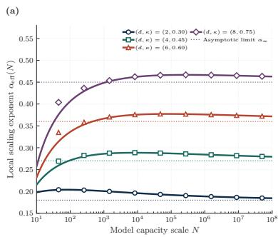

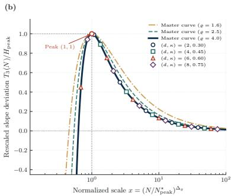

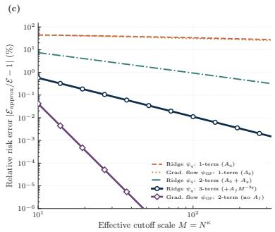  
Figure 2: Pre-asymptotic spectral scaling trajectories and filter holomorphicity (Theorem 3.1, Corollary 3.1, and Proposition 3.2). (a) Local exponent $\alpha _ { \mathrm { e f f } } ( N )$ (curves: 3-term expansion; markers: numerical series) for four $( d , \kappa )$ systems at $\varrho = 4 . 0 \ : .$ converging to $\alpha _ { \infty } = \kappa ( r - 1 )$ (b) Normalized slope deviation $T _ { 3 } ( N ) / H _ { \mathrm { p e a k } }$ versus $x = ( N / N _ { \mathrm { p e a k } } ^ { \star } ) ^ { \Delta _ { g } }$ , collapsing onto the master curve $F _ { \varrho } ( x )$ (3.13). (c) Relative risk error $( \% )$ versus $M = N ^ { \kappa }$ under rational filtering $\psi _ { q }$ (1–3 terms) and gradient flow ψ (1–2 terms).

See Appendix D.9 (p. 64) for the complete proof.

## 6 Numerical Verification and Empirical Evaluation

We evaluate the theoretical predictions of Sections 3 to 5 in two stages. First, in Sections 6.1 to 6.3, we test our analytical expansions against high-precision numerical truth on controlled spectral resolvents, multi-domain simplex mixtures, and iso-compute risk surfaces. Second, in Section 6.4, we examine out-of-sample extrapolation, pilot conditioning, and allocation regret on three public foundation-model benchmarks: $\mathrm { P y }$ thia (Biderman et al., 2023), Chinchilla (Hofmann et al., 2022), and RegMix (Liu et al., 2025).

## 6.1 Finite-Capacity Approximation and Pole Confluence

We first test the finite-capacity Mellin–Barnes expansion (Theorem 3.1) and its boundary reductions (Propositions 3.1 and 3.2) across 45 spectral configurations spanning model capacities $N \in [ 1 0 ^ { 2 } , 1 0 ^ { 8 } ]$ These comprise a 36-cell factorial grid over filter exponent $q \in [ 0 . 8 , 2 . 0 ]$ , source decay $r \in [ 1 . 4 , 2 . 2 ]$ , and manifold dimension $d \in \{ 2 , 4 , 8 \} \ ( \delta = 1 / d )$ together with 9 pole-collision $( \varrho \in \{ 0 , 1 \} )$ and gradient-flow $( \psi _ { \mathrm { G F } } ( u ) \stackrel {  } { = } e ^ { - 2 u ^ { - q } } )$ slices, benchmarked against Euler–Maclaurin series evaluations accurate to $1 0 ^ { - 1 1 }$

As shown in Figure $\mathrm { 2 ( a , b ) }$ , although the local scaling exponents $\alpha _ { \mathrm { e f f } } ( N )$ peak at widely separated capacities across diferent manifold dimensions d and cutof exponents $\kappa ,$ normalizing the local slope deviation by its analytical peak scale $N _ { \mathrm { p e a k } } ^ { \star }$ and peak height $H _ { \mathrm { p e a k } }$ (Corollary 3.1) collapses all four systems onto the single-parameter master curve $F _ { \varrho } ( x )$ to machine precision $( 9 . 6 2 \times 1 0 ^ { - 1 6 }$ maximum deviation). Figure $2 ( \mathrm { c } )$ further illustrates why iterative early stopping and explicit Tikhonov regularization exhibit distinct finite-capacity corrections (Proposition 3.2): because the gradient-flow Mellin kernel is holomorphic in the left half-plane, the two spectral–geometric zeta poles alone approximate the risk within $8 . 0 3 \times 1 0 ^ { - 5 0 } \%$ already at $M = 3 1 . 6 2 \ ( N = 1 0 ^ { 3 } )$ , whereas under rational ridge filtering $\psi _ { q } .$

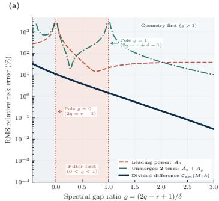

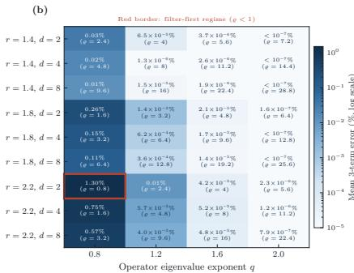

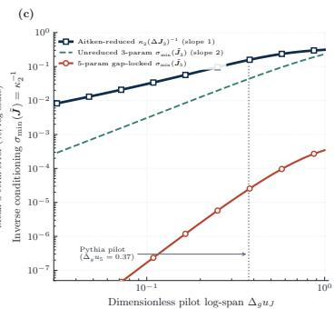  
Figure 3: Pole-collision regularity, 36-cell factorial accuracy, and pilot conditioning (Theorem 3.1 and Propositions 3.1 and 3.3). (a) RMS relative error $( \% )$ across gap ratio $\varrho ,$ comparing the leading term $A _ { 0 } ,$ the unmerged sum $A _ { 0 } + A _ { g } ,$ and the divided-diference form $\mathcal { C } _ { p , m } ( M ; h )$ (3.15) across $\varrho \in \{ 0 , 1 \}$ . (b) Mean 3-term relative error $( \% )$ across the 36-cell $( r , d , q )$ grid (red border: $\varrho < 1 )$ . (c) Smallest singular value $\sigma _ { \mathrm { m i n } } ( \tilde { J } ) = \kappa _ { 2 } ^ { - 1 }$ versus pilot log-span $\Delta _ { g } u _ { J }$ for Aitken-reduced $\Delta { J } _ { 3 }$ (slope 1), unreduced $\tilde { J } _ { 3 } \ ( \mathrm { s l o p e 2 } )$ , and 5-parameter ${ \tilde { J } } _ { 5 }$

omitting the negative filter residue $A _ { f } M ^ { - 2 q }$ leaves a 2.64% error that drops by thirty-fold (to 0.0798%) once the filter pole is included.

When the filter pole approaches either spectral–geometric pole $( \varrho  0 \mathrm { o r } \varrho  1 )$ individual Mellin residues diverge with opposite signs and cause the unmerged power-law sum to blow up $( { \mathrm { F i g u r e ~ } } 3 ( \mathrm { a } ) )$ . Combining the colliding poles into the divided-diference representation $\mathcal { C } _ { p , m } ( M ; h )$ (Proposition 3.1) restores smooth convergence across both logarithmic resonances, reducing median relative error across the 36-cell factorial grid from 26.93% (single power law) to 0.00005% (Figure 3(b); 0.00036% across all 45 tasks). Despite this analytical accuracy, Figure $3 ( \mathrm { c } )$ shows why fitting multi-power sums directly on narrow pilot grids is ill-posed (Proposition 3.3): as the dimensionless pilot log-span $\Delta _ { g } u _ { J }$ shrinks, both the column-normalized five-parameter Jacobian ${ \tilde { J } } _ { 5 }$ and the unreduced three-parameter Jacobian ${ \tilde { J } } _ { 3 }$ sufer at least quadratic singular-value decay, whereas eliminating $E _ { \infty }$ via the first-order Aitken diference Jacobian $\Delta J _ { 3 }$ (Corollary 3.2) restores linear $u _ { J }$ conditioning (slope 1).

## 6.2 Multi-Domain Mixing and Sequential Allocation

We next evaluate the KKT water-filling law (Proposition 4.1) and finite-budget bottleneck bounds (Theorem 4.1) on multi-domain mixtures over $\Delta _ { K - 1 }$ , covering both distinct domain exponents $( \beta = ( 0 . 1 8 , 0 . 4 2 , 0 . 8 5 )$ for $K = 3$ and $\beta = ( 0 . 1 8 , 0 . 3 5 , 0 . 5 5 , 0 . 8 5 )$ for $K = 4 )$ and tied slowest bottleneck exponents $( \beta = ( 0 . 2 2 , 0 . 2 2 , 0 . 6 5 ) )$ .

As the total token budget D grows, the water-filling solution shifts cumulative weight $w _ { k } ^ { \star } ( D )$ away from fast-saturating domains toward the slowest bottleneck domain $( { \mathrm { F i g u r e 4 } } ( \mathrm { a } ) )$ . Because sequential training must anticipate this shift at the margin, the instantaneous allocation policy $\begin{array} { r } { q _ { k } ^ { \star } ( D ) = \frac { \mathrm { { { d } } } [ D w _ { k } ^ { \star } ( D ) ] } { \mathrm { { d } } D } } \end{array}$ systematically leads the cumulative mixture via the Radon–Nikodym tilt factor $( \ddot { \beta } _ { k } + 1 ) ^ { - 1 }$ (Propositions 4.2 and 4.3), saving 35.2% of the total token budget compared to uniform sampling (Figure 4(b), inset). Normalizing the token budget by each domain’s crossover scale $D _ { k } ^ { \star }$ collapses the powered share ratio $\Upsilon _ { k } ( D )$ across all three- and four-domain systems onto the exact inverse law $\tilde { D } _ { k } ^ { - 1 }$ (Corollary 4.1, Figure $4 ( \mathrm { b } ) )$ . In the large-budget regime $( { \mathrm { F i g u r e ~ } } 4 ( \mathrm { c } ) )$ , whether the slowest exponent $b _ { 0 }$ is unique or shared across multiple bottleneck domains, the residual fast-domain probability mass $\varepsilon ( D )$ remains trapped inside the analytical sandwich band $( 4 . 8 )$ and the closed-form plug-in mixture $\tilde { w } ( D )$ converges to $w ^ { \star } ( D )$ at the quadratic rate $2 Z ( D ) ^ { 2 }$

(c)  
(a)  
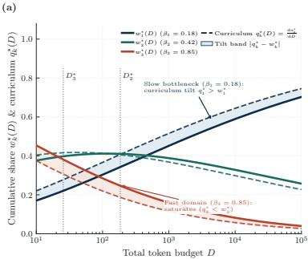

(b)  
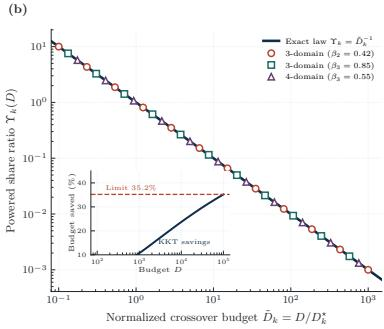

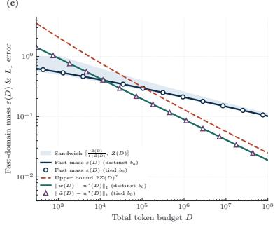  
Figure 4: Simplex data mixing and finite-budget bottleneck bounds (Propositions 4.1 and 4.2, Corollary 4.1, and Theorem 4.1). (a) Cumulative shares $w _ { k } ^ { \star } ( D )$ (solid), sequential rates $q _ { k } ^ { \star } ( D )$ (dashed), and Radon–Nikodym tilt bands (shaded) across $\dot { D } \in [ 1 0 ^ { 1 } , 1 0 ^ { 5 } ]$ for $\beta = ( 0 . 1 8 , 0 . 4 2 , 0 . 8 5 )$ . (b) Powered share ratio $\Upsilon _ { k } ( D )$ versus $\tilde { D } _ { k } = D / D _ { k } ^ { \star }$ , collapsing onto $\tilde { D } _ { k } ^ { - 1 }$ (inset: 35.2% token budget saved over uniform sampling). (c) Fast-domain mass $\varepsilon ( D )$ within its sandwich band (4.8) and plug-in error $\| \tilde { w } ( D ) - w ^ { \star } ( D ) \| _ { 1 } \leq 2 Z ( D ) ^ { 2 }$ (4.9) for distinct and tied bottleneck exponents.

## 6.3 Compute-Optimal Drift and Allocation Regret

We next examine how multi-term capacity and data expansions govern the compute-optimal allocation trajectory along log-resource slices $\mathcal { M } _ { t }$ (Proposition 5.1 and Theorems 5.1 and 5.2).

Figure $\mathrm { 5 ( a ) }$ demonstrates that cross-derivative coupling alone does not cause the computeoptimal exponent $\eta ( t )$ to drift: wrapping a single power-law sum in a nonlinear monotone function preserves a flat allocation exponent $\eta ( \tau ) \equiv 0 . 5 0 0$ across all scales (Proposition 5.1). In contrast, genuine multi-stratum heterogeneity induces S-shaped exponent drift whose direction is fixed by the Gibbs variance-to-mean rate $\kappa ( t )$ (Theorem 5.1 and Remark 5.2), shifting upward when capacity-side spectral variance dominates $( \mathcal { K } ( t ) > 0 )$ and downward when data-side domain variance dominates $( \mathcal { K } ( t ) < 0 )$ . In the intrinsic transition coordinate $z _ { \mathrm { i n t } } ( t )$ , the normalized trajectory $s ( t )$ matches $\sigma ( z _ { \mathrm { i n t } } )$ to machine precision $( 2 . 4 9 \times 1 0 ^ { - 1 6 } )$ while across the constant-rate rescaled log-compute coordinate $z = \gamma \tau \in [ - 5 , 5 ]$ in Figure $5 ( \mathrm { b } )$ all three two-stratum families stay numerically within 1.62 $\times 1 0 ^ { - 2 }$ of $\sigma ( z )$ in state (inside the analytical bound (5.14) of Corollary 5.1) and within $4 . 8 3 \times 1 0 ^ { - 2 }$ of 4σ $\cdot ( z ) ( 1 - \sigma ( z ) )$ in normalized velocity $( 1 . 4 4 \times 1 0 ^ { - 2 }$ and $4 . 3 5 \times 1 0 ^ { - 2 }$ on the plotted markers). Along a fixed compute budget (Figure $5 ( \mathrm { c } ) )$ , the calibrated risk envelope closely follows the scale-invariant quadratic regret law $\textstyle { \frac { 1 } { 2 } } a b ( \delta u ) ^ { 2 }$ (Corollary 5.2), whereas freezing auxiliary hyperparameters $\xi \equiv \xi _ { 0 }$ steepens the slice parabola by the positive semidefinite Schur-complement penalty $\Delta _ { S } ( r ) \succeq 0$ (Theorem 5.2).

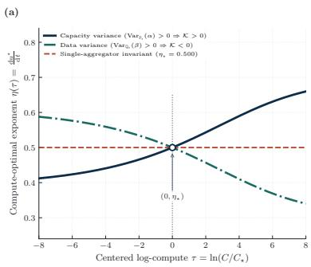

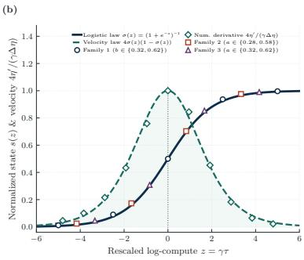

(c)  
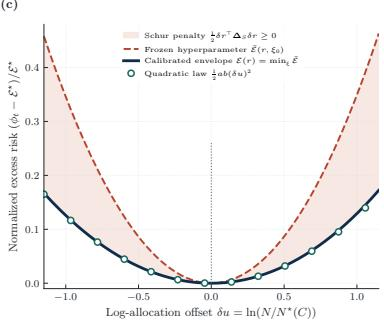  
Figure 5: Iso-compute exponent drift, logistic transition, and Schur-complement regret (Proposition 5.1, Theorems 5.1 and $5 . 2 ,$ and Corollaries 5.1 and 5.2). (a) Optimal allocation exponent η(τ) across centered log-compute $\tau = \ln ( C / C _ { \star } )$ for capacity-dominated drift $( \mathcal { K } ( t ) > 0 )$ , data-dominated drift $( \mathcal { K } ( t ) < 0 )$ , and a monotone wrapper $( \eta _ { \star } = 0 . 5 0 0 )$ . (b) Normalized state $s ( z )$ and velocity $4 \eta ^ { \prime } / ( \gamma \Delta \eta )$ across three two-stratum families versus $z = \gamma \tau$ , tracking $\sigma ( z )$ and $4 \sigma ( z ) ( 1 - \sigma ( z ) )$ . (c) Relative slice regret ${ \left( { \phi _ { t } - \mathcal { E } ^ { \star } } \right) } / { \mathcal { E } ^ { \star } }$ versus $\delta u = \ln ( N / N ^ { \star } ( C ) )$ for the calibrated envelope $\mathcal { E } ( r )$ , quadratic law $\textstyle { \frac { 1 } { 2 } } a b ( \delta u ) ^ { 2 }$ , and frozenschedule slice $\bar { \mathcal { E } } ( r , \xi _ { 0 } )$

(a)  
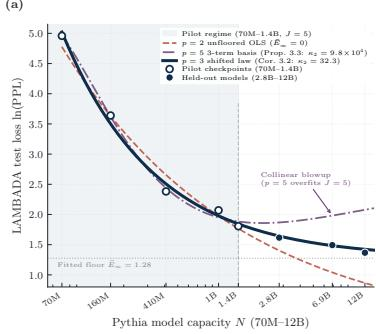

(b)  
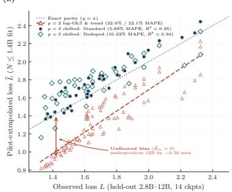

(c)  
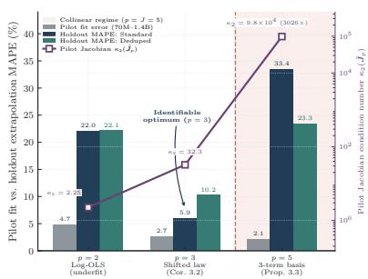  
Figure 6: Out-of-sample extrapolation and pilot conditioning on the Pythia suite (70M–12B; Proposition 3.3 and Corollary 3.2). (a) LAMBADA test loss ln(PPL) on Pythia-Standard fitted on the $J = 5$ pilot sizes (70M–1.4B) and extrapolated to 2.8B–12B for orders $p \in \{ 2 , 3 , 5 \}$ (b) Held-out parity across 42 post-warmup (of 48 total) large-model checkpoint evaluations per corpus, comparing $p = 2 ~ \mathrm { l o g \mathrm { - O L S } }$ (triangles and dashed trend) against $p = 3$ shifted power-law predictions (5.89% and 10.22% MAPE). (c) Pilot and holdout MAPE across $p \in \{ 2 , 3 , 5 \}$ versus column-normalized pilot condition number $\kappa _ { 2 } ( \tilde { J } _ { p } )$

## 6.4 Evaluation on Public Pretraining Benchmarks

We now examine how these pre-asymptotic scaling and identifiability principles inform out-ofsample extrapolation and candidate selection on three public foundation-model benchmarks: $\mathrm { P y }$ thia (Biderman et al., 2023), Chinchilla (Hofmann et al., 2022), and RegMix (Liu et al., 2025).

Out-of-Sample Extrapolation and Conditioning on Pythia. On EleutherAI’s Pythia suite across the Standard and Deduped Pile corpora (8 model sizes from 70M to 12B across 16 logged checkpoints (Biderman et al., 2023; Gao et al., 2020; Lee et al., 2022)), we fit scaling laws strictly on the 5 smallest pilot models (70M–1.4B, spanning 1.30 decades) and extrapolate zero-shot to the 3 largest held-out models (2.8B, 6.9B, 12B; evaluated at the final checkpoint in Panel $^ { \mathrm { ( a , c ) } }$ and across all 14 post-warmup checkpoints with $D \geq 2 7 \mathrm { B }$ tokens in Panel (b)). Because an unfloored power law $( p = 2 )$ ignores the irreducible entropy floor, it systematically underpredicts large-model loss by −0.50 nats at 12B; in contrast, the three-parameter shifted power law $( p = 3$ , fitted via multi-start log-loss nonlinear least squares on the $J = 5$ pilot grid as in Corollary 3.2 and Remark 3.2) tracks the curved trajectory across scale and cuts held-out LAMBADA (Paperno et al., 2016) prediction error from 21.98% to 5.89% MAPE on Standard and from 22.13% to 10.22% on Deduped (Figure 6(a,b)).

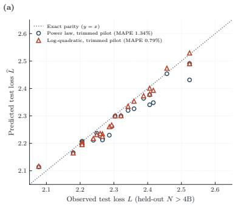

(b)  
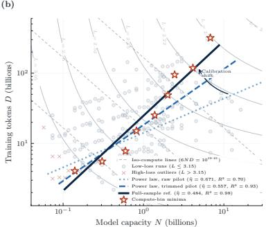

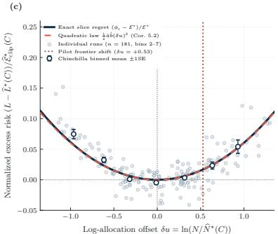  
Figure 7: Iso-loss surface estimation, frontier calibration, and allocation regret on Chinchilla (245 runs; Theorems 5.1 and 5.2 and Corollary 5.2). (a) Held-out parity on large models $( N > 4 \mathrm { { B } } , L  \leq 3 . 1 5 )$ fitted on pilot runs $( N \leq 4 \mathrm { B } )$ , comparing the trimmed power law (1.34% MAPE) and log-quadratic surface (0.79% MAPE). (b) Fitted $( N , D )$ isoloss contours and allocation frontiers for the raw pilot $( \widehat { \eta } = 0 . 6 7 1 2 )$ , trimmed pilot $( \widehat { \eta } = 0 . 5 5 6 9 )$ ), and full-sample reference $( \widehat { \eta } = 0 . 4 8 3 9 )$ . (c) Normalized slice regret versus $\delta u = \ln ( N / \widehat { N } ^ { \star } ( C ) )$ across 181 low-loss runs in bins 2–7, compared against the quadratic law $\textstyle { \frac { 1 } { 2 } } { \hat { a } } { \hat { b } } ( \delta u ) ^ { 2 }$

A natural question is why fitting higher-order spectral expansions directly on the $J = 5$ pilot sizes fails, and how a practitioner can select model order $p = 3$ from pilot diagnostics alone (Proposition 3.3 and Corollary 3.2). As shown in Figure 6(c), whereas in-sample pilot fit error drops monotonically as parameters are added across $p \in \{ 2 , 3 , 5 \} ( 4 . 7 \%  2 . 7 \%  2 . 1 \% )$ , outof-sample holdout error traces a sharp U-curve governed by the unit- $\ell _ { 2 }$ column-normalized pilot Jacobian condition number $\kappa _ { 2 } ( \tilde { J } _ { p } )$ on Standard. $\mathrm { A t } \ p = 3$ , the pilot Jacobian is well-conditioned $( \kappa _ { 2 } ( \tilde { J } _ { 3 } ) = 3 2 . 2 9$ , versus $\kappa _ { 2 } ( \tilde { J } _ { 2 } ) = 2 . 2 5 )$ and achieves the unique extrapolation minimum on both corpora. Expanding around the $p = 3$ pilot exponent $\hat { \alpha } _ { 0 }$ to the fixed-exponent five-column linearized basis $[ 1 , N ^ { - \hat { \alpha } _ { 0 } } , N ^ { - ( \hat { \alpha } _ { 0 } + \Delta _ { g } ) } , N ^ { - ( \hat { \alpha } _ { 0 } + \Delta _ { f } ) } , - ( \ln N ) N ^ { - \hat { \alpha } _ { 0 } } ]$ $( \Delta _ { g } = 0 . 1 2 5 , \Delta _ { f } = 0 . 5 0 )$ over the narrow log-span $\Delta _ { g } u _ { 5 } = 0 . 3 7$ induces a 3,026× conditioning blowup $( \kappa _ { 2 } ( \tilde { J } _ { 5 } ) = 9 . 7 7 \times 1 0 ^ { 4 }$ , unnormalized $1 . 6 7 \times 1 0 ^ { 5 } )$ : its fifth singular value drops to $5 . 9 7 \times 1 0 ^ { - 6 } \sigma _ { 1 }$ (truncated to rank 4 at threshold $\mathrm { r c o n d } = 1 0 ^ { - 4 } )$ , and the remaining nearcollinear directions amplify pilot noise into holdout divergence (33.4% MAPE on Standard, 23.3% on Deduped). For the unconstrained three-power sum $( p = 7 )$ , the parameter count exceeds the pilot grid size and, by Proposition 3.3, remains algebraically rank-deficient $( \mathrm { r a n k } ( J _ { 7 } ) \le 5 < 7 )$ around the single-power locus regardless of grid density.

Table 2: Frontier estimation and out-of-sample extrapolation on the 245-run Chinchilla benchmark (221 pilot runs with $N \leq 4 \mathrm { B } ;$ ; 24 held-out runs with $N > 4 \mathrm { B }$ , 23 satisfying $L \ \leq \ 3 . 1 5 ;$ Theorems 5.1 and 5.2, Corollary 5.2, and Proposition 5.4). Bold denotes the best pilotonly estimator. For ηb, 90% CI reports the 5%–95% digitization-jitter interval across 40 replicates, and $R ^ { 2 }$ measures the 2D log-frontier fit across the 9 bin centers. High-C Regret (nats) is the mean excess loss across the top four compute bins (bins 5–8, 81 runs) under 1D frontier matching at bin-minimum compute $C _ { b }$ (Frontier; trimmed power-law regret remains 0.0393 nats under proximity and near-tie rules) and 2D predicted-loss minimization arg min $\widehat { L } ( N _ { i } , D _ { i } )$ (Surface).
<table><tr><td></td><td></td><td colspan="3">Fitted η</td><td colspan="2">Holdout MAPE</td><td colspan="2">High-C Regret</td></tr><tr><td>Estimator</td><td>Fit Sample</td><td>Est.</td><td>90% CI</td><td></td><td> $R ^ { 2 } L \leq 3 . 1 5$ </td><td>All 24</td><td>Frontier</td><td>Surface</td></tr><tr><td>Power law (raw)</td><td> $N \leq 4 \mathrm { { B } } \ ( 2 2 1 )$ </td><td>0.6712</td><td>[0.6639, 0.6778]</td><td>0.70</td><td>1.92%</td><td>1.96%</td><td>0.0909</td><td>0.0289</td></tr><tr><td>Power law (trimmed)</td><td> $N \leq 4 \mathrm { B } , L \leq 3 . 1 5$  (205)</td><td>0.5569</td><td>[0.5468, 0.5655]</td><td>0.93</td><td>1.34%</td><td>2.34%</td><td>0.0393</td><td>0.0139</td></tr><tr><td>Log-quadratic</td><td> $N \leq 4 \mathbf { B } , L \leq 3 . 1 5$  (205)</td><td>0.5288</td><td>[0.5216, 0.5347]</td><td>0.96</td><td>0.79%</td><td>1.86%</td><td>0.0709</td><td>0.0068</td></tr><tr><td>Full-sample reference All</td><td> $N , L \leq 3 . 1 5 ~ ( 2 2 8 )$ </td><td>0.4839</td><td>[0.4755, 0.4880]</td><td>0.98</td><td></td><td></td><td>0.0349</td><td>0.0000</td></tr></table>

Iso-Compute Frontier Estimation on Chinchilla. On the 245 training runs of Hofmann et al. (2022) digitized by Besiroglu et al. (2024), we fit iso-loss surfaces on the 221 small-scale pilot runs $( N \leq 4 \mathrm { B } )$ and evaluate out-of-sample extrapolation on the 24 held-out large models $( N > \mathrm { 4 B } )$ alongside retrospective candidate-pool regret across 9 equal-width log-compute bins (Figure 7 and Table 2). Because the digitized summary records only $( N , D , L )$ triples without per-run learning-rate schedules, we apply the threshold $L \leq 3 . 1 5$ as an empirical filter for high-loss short-horizon runs.

Fitting a separable power law to all 221 pilot runs yields $\widehat { \eta } = 0 . 6 7 1 2 .$ consistent with the upward slope shift in Theorem 5.2 and Remark 5.2(iii) when high-loss runs are retained. Trimming $L > 3 . 1 5$ on the pilot sample (205 runs) lowers the estimated exponent to $\widehat { \eta } = 0 . 5 5 6 9$ (shifting the high-compute log-capacity frontier by $\delta u = + 0 . 5 3$ in Figure $7 ( \mathrm { c } ) )$ and reduces held-out MAPE on the 23 low-loss large models from 1.92% to 1.34%. To capture local surface curvature on the same 205-run pilot sample, we fit a second-order log-loss surface in $( u , v ) = ( \ln { N } , \ln { D } )$ :

$$
\begin{array} { l } { { { \ l n } { \widehat { L } } ( u , v ) ~ = ~ c _ { 0 } + c _ { 1 } u + c _ { 2 } v + c _ { 3 } u ^ { 2 } + c _ { 4 } v ^ { 2 } + c _ { 5 } u v } } \\ { { { \ l \Longrightarrow ~ } { \widehat { u } } ^ { \star } ( t ) ~ = ~ { \frac { c _ { 2 } - c _ { 1 } } { 2 ( c _ { 3 } + c _ { 4 } - c _ { 5 } ) } } + { \widehat { \eta } } _ { \mathrm { q u a d } } t , ~ { \widehat { \eta } } _ { \mathrm { q u a d } } ~ = ~ { \frac { 2 c _ { 4 } - c _ { 5 } } { 2 ( c _ { 3 } + c _ { 4 } - c _ { 5 } ) } } , } } \end{array}\tag{6.1}
$$

along each iso-compute line $u + v = t = \ln ( C / 6 )$ , where positive slice curvature $2 ( c _ { 3 } + c _ { 4 } - c _ { 5 } ) =$ $0 . 0 4 3 9 > 0$ ensures a unique slice minimum and constant afine slope $\widehat { \eta } _ { \mathrm { q u a d } } = 0 . 5 2 8 8$ , moving closer to the full-sample reference $( \widehat { \eta } = 0 . 4 8 3 9 )$ and cutting held-out MAPE to 0.79% on the 23 low-loss runs and 1.86% across all 24 runs (Figure 7(a)). Across the top four compute bins (bins 5–8), trimming high-loss pilot runs cuts 1D frontier-matching regret by 56.8% under the table-order protocol (from 0.0909 to 0.0393 nats, remaining at 0.0393 nats across alternative tie-breaking rules in Table 2), whereas minimizing predicted loss $\widehat { L } ( N _ { i } , D _ { i } )$ directly over the 2D candidate coordinates (Surface) leverages the full second-order surface to cut mean regret by 52.1% for the trimmed power law (0.0139 nats) and by 76.4% for the log-quadratic surface (0.0068 nats). In Figure 7(c), the 181 low-loss residuals in bins 2–7 closely follow the analytical slice regret curve and quadratic parabola $\textstyle { \frac { 1 } { 2 } } { \hat { a } } { \hat { b } } ( \delta u ) ^ { 2 }$ of Corollary 5.2.

(a)  
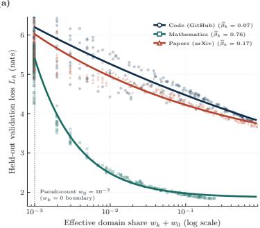

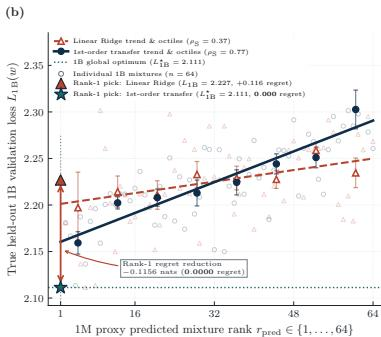

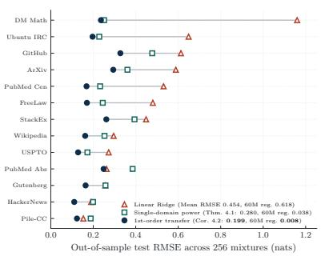  
Figure 8: Multi-domain mixing and zero-shot 1M → 1B transfer on the RegMix benchmark (Theorem 4.1, Remark 4.1, and Corollary 4.2). (a) Held-out loss $L _ { k }$ versus shifted share $w _ { k } + w _ { 0 } \ ( w _ { 0 } = 1 0 ^ { - 3 } )$ across 256 test mixtures for Code, Mathematics, and arXiv, fitted on 512 pilot mixtures at 1M. (b) Held-out 1B loss $\boldsymbol { L } _ { \mathrm { 1 B } } ( \boldsymbol { w } )$ across 64 candidate mixtures versus 1M predicted rank $r _ { \mathrm { p r e d } }$ , contrasting linear Ridge $( \rho _ { \mathrm { { S } } } = 0 . 3 7 )$ and 1st-order logtransfer $( \rho _ { \mathrm { { S } } } = 0 . 7 7 )$ . (c) Out-of-sample test RMSE across all 13 Pile validation domains on 256 held-out 1M mixtures.

Table 3: Domain prediction RMSE (on 256 held-out 1M mixtures across 13 Pile domains) and zero-shot 1M → 60M → 1B transfer on the 17-domain RegMix benchmark (fitted on 512 pilot mixtures at 1M; Theorem 4.1, Remark 4.1, Proposition 4.3, and Corollary 4.2).
<table><tr><td></td><td colspan="3">1M Test RMSE</td><td colspan="2">Spearman ρs (↑)</td><td colspan="3">Selection Regret (nats, ↓)</td></tr><tr><td>Predictor Family (1M Fit)</td><td>Mean</td><td>Agg.</td><td>∆%</td><td>1M 60M</td><td>1B</td><td>1M</td><td>60M</td><td>1B</td></tr><tr><td>17-domain linear Ridge (baseline)</td><td>0.4539</td><td>0.2277</td><td></td><td>0.62 0.56</td><td>0.37</td><td>0.7086</td><td>0.6179</td><td>0.1156</td></tr><tr><td>Single-domain power (Theorem 4.1)</td><td>0.2803</td><td>0.1308</td><td></td><td>-38.3%0.92 0.84</td><td>0.74</td><td>0.0733</td><td>0.0377</td><td>0.0000</td></tr><tr><td>Monotone PCHIP spline (non-param.)</td><td>0.2771</td><td>0.1329</td><td></td><td>-39.0%0.92 0.84</td><td>0.74</td><td></td><td>0.0000 0.0080</td><td>0.0000</td></tr><tr><td>+ 1st-order transfer (Corollary 4.2)</td><td></td><td></td><td></td><td>0.1992 0.0990-56.1% 0.95 0.93</td><td>0.77</td><td></td><td>0.0000 0.0080</td><td>0.0000</td></tr><tr><td>+ Diag. log-quad.  $( \ln w , \ln ^ { 2 } w )$ </td><td></td><td></td><td></td><td>0.1842 0.0908 –59.4% 0.96 0.94</td><td>0.76</td><td></td><td>0.1131 0.0450</td><td>0.0000</td></tr></table>

Zero-Shot Cross-Scale Data Mixing on RegMix. Finally, on the RegMix benchmark (Liu et al., 2025), we fit domain-loss predictors across the 17 training domains on 512 pilot mixtures at 1M scale and evaluate out-of-sample mixture prediction across the 13 tracked Pile validation domains (Gao et al., 2020) on 256 held-out mixtures at 1M, together with zero-shot cross-scale ranking and selection transfer to 256 mixtures at 60M and 64 mixtures at 1B at fixed per-scale token budgets (Figure 8 and Table 3). Replacing linear Ridge with separable single-domain power laws $E _ { k } + A _ { k } ( w _ { k } + w _ { 0 } ) ^ { - \beta _ { k } } .$ —where the pseudocount ofset $w _ { 0 } = 1 0 ^ { - 3 }$ (Remark 4.1 (4.12)) regularizes zero-share boundary evaluations $w _ { k } = 0 \AA$ —cuts 1M domain-mean RMSE by 38.3% (from 0.4539 to 0.2803 nats, matching the non-parametric monotone PCHIP spline at 0.2771 nats), doubles zero-shot 1B Spearman rank correlation from $\rho _ { \mathrm { S } } = 0 . 3 7$ to 0.74, and eliminates the +0.1156 nats 1B selection regret of linear Ridge.

Adding cross-domain coupling via ridge regression on log-shifted mixture coordinates $\ln ( w + w _ { 0 } )$ over the single-domain power-law residuals (motivated by Corollary 4.2) or fitting a diagonal log-quadratic expansion $[ \ln ( w + w _ { 0 } ) , \ln ^ { 2 } ( w + w _ { 0 } ) ]$ further reduces 1M domainmean RMSE by 56.1% and 59.4% (to 0.1992 and 0.1842 nats) and lifts rank correlation to $\rho _ { \mathrm { S } } \geq 0 . 9 3$ at 1M–60M and 0.76–0.77 at 1B (Table 3). While all four nonlinear predictors identify the top candidate in the 64-mixture 1B evaluation pool (Figure 8(b)), the 1st-order residual log-transfer model achieves both the highest 1B rank correlation $( \rho _ { \mathrm { { S } } } = 0 . 7 7 )$ and the lowest 60M selection regret (0.0080 nats, a 78.8% reduction over single-domain power laws, whereas the diagonal log-quadratic fit partially overfits top-1 selection at 1M and 60M) while consistently reducing RMSE across all 13 validation domains (Figure 8(c)).

## 7 Discussion

Classical scaling laws model validation loss as a separable power law with fixed exponents and static domain weights (Zhao and Ren, 2026), an asymptotic reduction recovered when subleading spectral residues and exponent variances vanish (Table 1). The analysis developed in this paper shows that, at finite budgets, efective scaling exponents and frontier curvatures are governed by the internal heterogeneity of the target spectrum and the training corpus (Figure 1). When a model approximates spectral modes that decay at diferent rates (Section 3) or trains on data sources that saturate at diferent speeds (Section 4), the active bottleneck shifts with model size N and token budget $D ,$ producing both preasymptotic learning-curve curvature and scale-dependent drift in the compute-optimal allocation exponent $\eta ^ { \star } ( C )$ (Section 5).

Beyond accounting for the empirical benchmarks in Section 6, these results shed light on several practical questions in large language model pretraining. The first concerns how small-scale pilot runs should be designed when extrapolating validation loss across orders of magnitude (Bi et al., 2024; Hofmann et al., 2022; Kaplan et al., 2020; Meng et al., 2026). Because finite-scale learning curves depart from a pure power law, it is tempting to fit unconstrained multi-exponent sums (Caballero et al., 2023) or to train a denser grid of intermediate checkpoints over a narrow compute range. Proposition 3.3, Corollary 3.2, and Remark 3.2 explain why this strategy is poorly conditioned: on a narrow pilot logspan $u _ { J }$ , multi-power Jacobians are nearly rank-deficient due to Vandermonde collinearity (Mlodozeniec and Frei, 2026; Varah, 1985), and packing additional checkpoints into the same interval shrinks the step size $\Delta u$ without widening the total span or improving worst-case identifiability, while amplifying observation noise under numerical diferencing. Reliable extrapolation is instead supported by widening the scale ratio $N _ { J } / N _ { 1 }$ between the smallest and largest pilot models (Meng et al., 2026) and using first-order Aitken diferencing across a geometric octave grid to eliminate the floor parameter $E _ { \infty }$ , restoring linear $u J$ conditioning and providing a closed-form initializer for full-grid nonlinear least squares.

A second implication concerns the scheduling of heterogeneous pretraining mixtures across web text, code, and mathematical corpora (Ge et al., 2024; Liu et al., 2025; Xie et al., 2023; Ye et al., 2025). In practice, large-scale training runs rarely keep mixture weights static; instead, they anneal the data distribution toward code and reasoning domains during mid-training (Bi et al., 2024). The water-filling and sequential sampling laws in Theorem 4.1 and Proposition 4.2 formalize this practice at the cumulative token-quota level. Whenever high-volume domains carry larger sample exponents $\beta _ { k }$ , their marginal contribution diminishes rapidly once the total token budget D exceeds the crossover scale

$D _ { k } ^ { \star }$ (Corollary 4.1). Maintaining a balanced marginal return across domains therefore favors down-weighting fast-saturating sources by $( \beta _ { k } + 1 ) ^ { - 1 }$ and reallocating token quotas toward slower-decaying bottlenecks as total tokens D grow. At the same time, the simplex Hessian inverse and cross-domain perturbation bounds in Proposition 4.3 and Corollary 4.2 quantify how weak cross-domain coupling shifts the separable water-filling optimum and bound the resulting mixture regret at finite budgets, motivating the log-shifted cross-domain transfer predictors that reduce selection regret across scales (Table 3).

A third implication distinguishes genuine shifts in the compute-optimal frontier from optimization-induced estimation bias (Besiroglu et al., 2024; Li et al., 2025; Pearce and Song, 2024; Porian et al., 2024; Ramani and Jain, 2026). On the one hand, corpus deduplication, quality filtering (Lee et al., 2022; Sorscher et al., 2022), and dynamic domain weighting alter the variance of data decay rates across the training mixture, which shifts the compute-optimal allocation exponent $\eta ^ { \star } ( C )$ across scales along the trajectories of Theorem 5.1, Proposition 5.3, and Corollary 5.1. On the other hand, Theorem 5.2 shows that if auxiliary optimization hyperparameters $\xi$ (such as peak learning rate, batch size, or warmup horizon) are frozen away from their scale-optimal schedule $\xi ^ { \star } ( r )$ , the positive semidefinite Schur-complement penalty $\Delta _ { S } ( r _ { 0 } ) \succeq 0$ steepens the observed slice curvature around the calibration anchor and biases the apparent capacity exponent $\widehat { \eta } _ { N }$ upward whenever the weighted data-side curvature penalty $( 1 - \eta ^ { \star } ) ( \Delta _ { v v } - \Delta _ { u v } )$ exceeds $\eta ^ { \star } ( \Delta _ { u u } - \Delta _ { u v } )$ (Remark 5.2(iii), Table 2). Separating intrinsic frontier drift from hyperparameter distortion therefore requires calibrating learningrate and batch-size schedules across pilot scales prior to estimating the $( N , D )$ frontier.

Finally, the slice curvature and error-propagation bounds in Corollary 5.2 and Proposition 5.4 clarify why over-training smaller models for inference eficiency remains efective in deployment-constrained regimes (Brown et al., 2020; Hernandez et al., 2022; Muennighof et al., 2023; Sardana et al., 2024). Because the iso-compute excess risk surface is flat at the training-optimal allocation and its relative curvature is governed by the product of the capacity and data exponents, training a moderately smaller model $( N < N ^ { \star } ( C ) )$ on proportionally more tokens to reduce inference memory and latency incurs only a mild second-order pretraining loss penalty within the global curvature sandwich (5.22). Moreover, Proposition 5.4 shows that marginal-derivative errors of a fitted scaling surrogate propagate quadratically into downstream compute-allocation regret while uniform function-value errors propagate linearly.

## Acknowledgments and Disclosure of Funding

We gratefully acknowledge computational support from Shanghai Smart Logic Technology and the Tianqiong supercomputing platform. The authors declare no competing financial interests or conflicts of interest related to this work.

Table 4: Summary of core mathematical notation, defining formulas, and theoretical roles across Sections 2 to 5.
<table><tr><td>Sec. Symbol</td><td></td><td>Definition / Formula</td><td>Theoretical Role</td><td>Ref.</td></tr><tr><td>§2</td><td> $\Delta _ { K - 1 } , \Delta _ { K - 1 } ^ { \circ }$ </td><td> $\{ w \in \mathbb { R } _ { + } ^ { K } : \textstyle \sum _ { k = 1 } ^ { K } w _ { k } = 1 \}$ </td><td>Closed and open (K – 1)-simplices</td><td>§2.1</td></tr><tr><td>§2</td><td> $\tau , \mathcal { R } ( \mu ) , d _ { \mathrm { e f f } } ( \mu )$ </td><td> $\mathscr { R } ( \mu ) = ( { \mathcal { T } } + \mu { \mathcal { T } } ) ^ { - 1 } , \operatorname { t r } ( { \mathcal { T } } { \mathcal { R } } ( \mu ) )$ </td><td>Covariance, resolvent, effective dimension</td><td>(2.4)</td></tr><tr><td>§2</td><td> $\Lambda _ { q } , M _ { \mu , \pm }$ </td><td> $\frac { \pi / q } { \sin ( \pi / q ) } , M _ { \mu , \pm } = ( c _ { \pm } / \mu ) ^ { 1 / q }$ </td><td>Euler constant and regularizer cutoffs</td><td>(2.7)</td></tr><tr><td>§2</td><td> $\mathcal { T } _ { F } ( z ) , \mathcal { T } _ { F } , C _ { 3 }$ </td><td> $\mathrm { d i a g } ( p ) - p p ^ { \top } , \mathbb { E } [ \Psi ^ { * } \mathcal { Z } _ { F } \Psi ]$ </td><td>Softmax Fisher matrix and operator</td><td>(2.12)</td></tr><tr><td>§3</td><td> $M = N ^ { \kappa } , c _ { m }$ </td><td> $c _ { m } = c m ^ { - r } ( 1 + b m ^ { - \delta } )$ </td><td>Cutoff scale and Weyl mode energy</td><td>(2.16)</td></tr><tr><td>§3</td><td> $\psi _ { q } ( u ) , \Psi _ { q } ( s )$ </td><td> $( 1 + u ^ { - q } ) ^ { - 2 } , - \frac { s + q } { q ^ { 2 } } \frac { \pi } { \sin ( \pi s / q ) }$ </td><td>Spectral residual filter and Mellin kernel</td><td>(3.2)</td></tr><tr><td>§3</td><td> $\alpha _ { \infty } , \Delta _ { g } , \Delta _ { f } , \varrho$ </td><td> $\begin{array} { r } { \kappa ( r - 1 ) , \kappa \delta , \kappa ( 2 q - r + 1 ) , \frac { \Delta _ { f } } { \Delta _ { g } } } \end{array}$ </td><td>Tail exponent, sub-leading gaps, gap ratio</td><td>(3.1)</td></tr><tr><td>§3</td><td> $A _ { 0 } , A _ { g } , A _ { f , m }$ </td><td> $A _ { 0 } > 0 , A _ { g } > 0 , A _ { f } < 0$ </td><td>Asymptotic, Weyl, and filter Mellin residues</td><td>(3.8)</td></tr><tr><td>§3</td><td> $T _ { 3 } ( N ) , N _ { \mathrm { p e a k } } ^ { \star } , F _ { \varrho }$ </td><td> $\begin{array} { r } { F _ { \varrho } ( x ) = \frac { \varrho x ^ { - 1 } - x ^ { - \varrho } } { \varrho - 1 } } \end{array}$ </td><td>3-term risk, peak scale, master slope curve</td><td>(3.13)</td></tr><tr><td>§3</td><td> $J _ { 7 } , J _ { 5 } , J _ { 3 }$ </td><td> $\sigma _ { \operatorname* { m i n } } ( J _ { 5 } ) \leq C _ { 5 } ( \Delta _ { g } u _ { J } ) ^ { 2 }$ </td><td>Pilot Jacobians for  $p \in \{ 7 , 5 , 3 \}$  models</td><td>(3.22)</td></tr><tr><td>§4</td><td> $c _ { k } , b _ { 0 } , S$ </td><td> $c _ { k } = \pi _ { k } B _ { k } , b _ { 0 } = \mathrm { m i n } _ { k } \beta _ { k }$ </td><td>Domain weight, bottleneck rate, slowest set</td><td>(4.5)</td></tr><tr><td>§4</td><td> $D _ { k } ^ { \star } , \tilde { D } _ { k } , \Upsilon _ { k } ( D )$ </td><td> $\tilde { D } _ { k } = D / D _ { k } ^ { \star } , \Upsilon _ { k } ( D ) = \tilde { D } _ { k } ^ { - 1 }$ </td><td>Crossover budget and water-filling ratio</td><td>(4.4)</td></tr><tr><td>§4</td><td> $H , \theta _ { s } , z _ { k } ( D ) , Z ( D )$ </td><td> $\begin{array} { r } { Z ( D ) = \sum _ { k \in S ^ { c } } z _ { k } ( D ) } \end{array}$ </td><td>Bottleneck sum, tie shares, fast-domain slack (4.7)</td><td></td></tr><tr><td>§4</td><td> $\varepsilon ( D ) , \tilde { w } ( D )$ </td><td> $\begin{array} { r } { \varepsilon ( D ) = \sum _ { k \in S ^ { c } } w _ { k } ^ { \star } ( D ) } \end{array}$ </td><td>Fast-domain mass and plug-in mixture</td><td>(4.9)</td></tr><tr><td>§4</td><td> $n _ { k } ^ { \star } , q ^ { \star } ( D ) , \mathbb { P } _ { D } ^ { \star } , \mathbb { Q } _ { D } ^ { \star }$ </td><td> $\begin{array} { r } { n _ { k } ^ { \star } = D w _ { k } ^ { \star } ( D ) , q _ { k } ^ { \star } = \frac { \mathrm { d } n _ { k } ^ { \star } } { \mathrm { d } D } } \end{array}$ </td><td>Cumulative token quota and curriculum</td><td>(4.14)</td></tr><tr><td>§4</td><td> $g _ { w ^ { \star } } , D _ { H } ( D ) , \Delta w _ { \mathrm { n a t } }$ </td><td> $g _ { w ^ { \star } } ( \delta w , \delta \tilde { w } ) = \delta w ^ { \top } D _ { H } ( D ) \delta \tilde { w }$ </td><td>Simplex Hessian metric and natural step</td><td>(4.20)</td></tr><tr><td>§5</td><td></td><td> $( u , v ) = ( \ln { N } , \ln { D } ) , u + v = t$ </td><td></td><td></td></tr><tr><td>§5</td><td> $( u , v ) , \mathcal { M } _ { t } , \mathcal { H } _ { \mathrm { i s o } }$   $\eta ( t ) , \mathcal { K } ( t ) , \sigma ( \gamma \tau )$ </td><td> $\begin{array} { r } { \eta ( t ) = \frac { \mathrm { d } u ^ { \star } } { \mathrm { d } t } , \eta ^ { \prime } = \eta ( 1 - \eta ) \mathcal { K } ( t ) } \end{array}$ </td><td>Log-resources, iso-compute slice, curvature Compute allocation exponent and drift rate</td><td>(2.21)</td></tr><tr><td>§5</td><td> $\mathbb { P } _ { t } , \mathbb { Q } _ { t } , \alpha _ { \mathrm { e f f } } , \beta _ { \mathrm { e f f } }$ </td><td> $\begin{array} { r } { \mathcal { K } ( t ) = \frac { \eta \mathbf { \tilde { V } } \mathbf { a r } _ { \mathbb { P } _ { t } } ( \alpha ) } { \alpha _ { \mathrm { e f f } } } - \frac { ( 1 - \eta ) \mathbf { V } \mathbf { a r } _ { \mathbb { Q } _ { t } } ( \beta ) } { \beta _ { \mathrm { e f f } } } } \end{array}$ </td><td>Marginal-gradient Gibbs measures</td><td>(5.13)</td></tr><tr><td>§5</td><td> ${ \pmb H } _ { \xi \xi } , { \pmb \Delta } _ { S } ( { \pmb r } ) , \phi _ { t } ( \delta { \boldsymbol u } )$ </td><td> $\pmb { \Delta } _ { S } = \pmb { H } _ { r \xi } \pmb { H } _ { \xi \xi } ^ { - 1 } \pmb { H } _ { \xi r } \succeq 0$ </td><td>Hyperparameter Hessian and Schur penalty</td><td>(5.9) (5.22)</td></tr></table>

## Appendix A. Proofs for Section 2: Problem Setup and Preliminaries

In this appendix, we provide a hyperlinked summary of core notation and defining equations across the manuscript (Table 4), followed by the complete proofs of the two lemmas stated in Section 2: the two-sided bound for the efective spectral dimension (Lemma 2.1) and the local Fisher quadratic approximation of multi-class cross-entropy risk (Lemma 2.2).

## A.1 Proof of Lemma 2.1 (Efective Spectral Dimension Bounds)

Proof of Lemma 2.1 (Statement on p. 5). The proof of the sandwich inequality (2.7) proceeds in three steps: termwise monotonicity comparison, integral comparison on $[ 0 , \infty )$ and exact reduction to Euler’s Beta–Gamma reflection identity.

Step 1: Termwise comparison via spectral monotonicity. For any fixed regularization parameter $\mu > 0$ , consider the scalar resolvent filter $\phi _ { \mu } ( \lambda )$ on $( 0 , \infty )$

$$
\phi _ { \mu } ( \lambda ) : = \frac { \lambda } { \lambda + \mu } = 1 - \frac { \mu } { \lambda + \mu } , \phi _ { \mu } ^ { \prime } ( \lambda ) = \frac { \mu } { ( \lambda + \mu ) ^ { 2 } } > 0 , \frac { c _ { \pm } m ^ { - q } } { \mu } = { \left( \frac { m } { M _ { \mu , \pm } } \right) } ^ { - q } ,\tag{A.1}
$$

where $M _ { \mu , \pm } : = ( c _ { \pm } / \mu ) ^ { 1 / q }$ . Because $\phi _ { \mu }$ is strictly increasing on $( 0 , \infty )$ , applying $\phi _ { \mu }$ to the bilateral eigenvalue hypothesis $c _ { - } m ^ { - q } \leq \lambda _ { m } \leq c _ { + } m ^ { - q } \ ( m \in \mathbb { N } _ { \geq 1 } )$ yields for every $m \in \mathbb { N } _ { \geq 1 }$ :

$$
\begin{array} { r l } & { g _ { - } ( m ) : = \frac { 1 } { 1 + ( m / M _ { \mu , - } ) ^ { q } } = \frac { c _ { - } m ^ { - q } } { c _ { - } m ^ { - q } + \mu } \leq \frac { \lambda _ { m } } { \lambda _ { m } + \mu } } \\ & { \qquad \leq \frac { c _ { + } m ^ { - q } } { c _ { + } m ^ { - q } + \mu } = \frac { 1 } { 1 + ( m / M _ { \mu , + } ) ^ { q } } : = g _ { + } ( m ) . } \end{array}\tag{A.2}
$$

Step 2: Non-asymptotic integral comparison on $[ 0 , \infty )$ . For each $\mathrm { s i g n ~ } \pm ,$ the continuous profile $g _ { \pm } ( u ) = \left( 1 + ( u / M _ { \mu , \pm } ) ^ { q } \right) ^ { - }$ 1 is positive and strictly decreasing on $[ 0 , \infty )$ with boundary value $g _ { \pm } ( 0 ) = 1$ . Consequently, on every unit interval $[ m - 1 , m ] \ ( m \in \mathbb { N } _ { \geq 1 } )$ monotonicity gives the symmetric rectangle bounds

$$
g _ { \pm } ( m ) \leq \int _ { m - 1 } ^ { m } g _ { \pm } ( u ) \mathrm { d } u \leq g _ { \pm } ( m - 1 ) \forall m \in \mathbb { N } _ { \geq 1 } .\tag{A.3}
$$

Summing these unit-interval inequalities over $m \in \mathbb { N } _ { > 1 }$ and using $g _ { - } ( 0 ) = 1$ yields the aligned integral sandwich on $[ 0 , \infty )$ :

$$
\begin{array} { r l r } { \displaystyle \int _ { 0 } ^ { \infty } g _ { - } ( u ) \mathrm { d } u - 1 = \displaystyle \sum _ { m = 1 } ^ { \infty } \int _ { m - 1 } ^ { m } g _ { - } ( u ) \mathrm { d } u - g _ { - } ( 0 ) \le \displaystyle \sum _ { m = 1 } ^ { \infty } g _ { - } ( m - 1 ) - g _ { - } ( 0 ) = \displaystyle \sum _ { m = 1 } ^ { \infty } g _ { - } ( m ) } \\ { \displaystyle } & { \le d _ { \mathrm { e f f } } ( \mu ) = \displaystyle \sum _ { m = 1 } ^ { \infty } \frac { \lambda _ { m } } { \lambda _ { m } + \mu } \le \displaystyle \sum _ { m = 1 } ^ { \infty } g _ { + } ( m ) ( \mathrm { b y ~ ( A . 2 ) } ) } \\ { \displaystyle } & { \le \displaystyle \sum _ { m = 1 } ^ { \infty } \int _ { m - 1 } ^ { m } g _ { + } ( u ) \mathrm { d } u = \displaystyle \int _ { 0 } ^ { \infty } g _ { + } ( u ) \mathrm { d } u . } & { \quad \mathrm { ( A . 4 ) } } \end{array}
$$

Step 3: Reduction to Euler’s Beta–Gamma reflection integral. To evaluate the improper integral of $g _ { \pm } ( u )$ on $( 0 , \infty )$ for $q > 1$ , we apply the power substitution $t = ( u / M _ { \mu , \pm } ) ^ { q }$ followed by the rational transformation $s = t / ( 1 + t )$ mapping $( 0 , \infty )$ onto $( 0 , 1 )$

$$
u = M _ { \mu , \pm } t ^ { \frac 1 q } , \qquad \mathrm { d } u = \frac { M _ { \mu , \pm } } { q } t ^ { \frac 1 q - 1 } \mathrm { d } t , \qquad t = \frac s { 1 - s } , \qquad \mathrm { d } t = ( 1 - s ) ^ { - 2 } \mathrm { d } s .\tag{A.5}
$$

Substituting these diferentials sequentially reduces the integral to Euler’s Beta and Gamma functions:

$$
\begin{array} { r l } { \displaystyle \int _ { 0 } ^ { \infty } \frac { \mathrm { d } u } { 1 + ( u / M _ { \mu , \pm } ) ^ { q } } = \frac { M _ { \mu , \pm } } { q } \int _ { 0 } ^ { \infty } \frac { t ^ { \frac { 1 } { q } - 1 } } { 1 + t } \mathrm { d } t } & { \left( \mathrm { v i a } t = ( u / M _ { \mu , \pm } ) ^ { q } \right) } \\ { = \frac { M _ { \mu , \pm } } { q } \displaystyle \int _ { 0 } ^ { 1 } s ^ { \frac { 1 } { q } - 1 } ( 1 - s ) ^ { \left( 1 - \frac { 1 } { q } \right) - 1 } \mathrm { d } s \quad ( \mathrm { v i a } s = \frac { t } { 1 + t } ) } \\ { = \frac { M _ { \mu , \pm } } { q } \mathrm { B } \bigg ( \frac { 1 } { q } , 1 - \frac { 1 } { q } \bigg ) = \frac { M _ { \mu , \pm } } { q } \Gamma \bigg ( \frac { 1 } { q } \bigg ) \Gamma \bigg ( 1 - \frac { 1 } { q } \bigg ) } \\ { = \frac { M _ { \mu , \pm } } { \mathrm { i n } ( \pi / q ) } = \Lambda _ { q } M _ { \mu , \pm } , } & { ( \mathrm { b y ~ E u l e r ~ s ~ r e f l e c t i o n ~ f o r m u l a ~ } ) \left( \mathrm { A } . 6 \right) } \end{array}
$$

Substituting (A.6) into the integral sandwich chain (A.4) establishes (2.7).

## A.2 Proof of Lemma 2.2 (Local Fisher Quadratic Approximation)

Proof of Lemma 2.2 (Statement on $\mathbf { p . 6 } )$ . We prove (2.12) in three steps: Legendre– Fenchel Bregman duality, exact directional cumulant diferentiation and trace-class verification for the Fisher-pulled-back covariance operator $\mathcal { T } _ { F }$ , and a sharp uniform bound on the third cumulant tensor via Popoviciu’s inequality.

Step 1: Bregman divergence representation and integral Taylor expansion. For any logit vector $z \in \mathbb { R } ^ { V }$ , the softmax probability vector $p ( z ) = \nabla A ( z ) \in \Delta _ { V - 1 } ^ { \circ }$ and the Kullback–Leibler divergence between any target logit $z ^ { \star } \in \mathbb { R } ^ { V }$ and predicted logit $z _ { \theta } \in \mathbb { R } ^ { V }$ satisfy

$$
p _ { v } ( z ) = \frac { \partial A ( z ) } { \partial z _ { v } } = \frac { e ^ { z _ { v } } } { \sum _ { j = 1 } ^ { V } e ^ { z _ { j } } } \qquad \forall v \in \{ 1 , \ldots , V \} ,
$$

$$
\begin{array}{c} D _ { \mathrm { K L } } ( p ( z ^ { \star } ) \| p ( z _ { \theta } ) ) = \sum _ { v = 1 } ^ { V } p _ { v } ( z ^ { \star } ) [ ( z _ { v } ^ { \star } - A ( z ^ { \star } ) ) - ( z _ { \theta , v } - A ( z _ { \theta } ) ) ]  \\ { = A ( z _ { \theta } ) - A ( z ^ { \star } ) - \langle \nabla A ( z ^ { \star } ) , z _ { \theta } - z ^ { \star } \rangle _ { \mathbb { R } ^ { V } } = D _ { A } ( z _ { \theta } , z ^ { \star } ) . } \end{array}\tag{A.7}
$$

Fix $x \in \mathcal { X }$ and parameterize the line segment $z _ { t } ( x )$ between $z ^ { \star } ( x )$ and $z _ { \theta } ( x )$ for $t \in [ 0 , 1 ]$ Because $A \in C ^ { \infty } ( \mathbb { R } ^ { V } )$ , applying Taylor’s theorem with integral remainder to $g ( t ) : = A ( z _ { t } ( x ) )$ at t = 1 around $t = 0$ yields

$$
\begin{array} { r l r } { \displaystyle \Delta z ( x ) : = z _ { \theta } ( x ) - z ^ { \star } ( x ) = \Psi ( x ) ( \theta - \theta ^ { \star } ) \in \mathbb { R } ^ { V } , } & { z _ { t } ( x ) : = z ^ { \star } ( x ) + t \Delta z ( x ) , } \\ { \displaystyle D _ { A } ( z _ { \theta } ( x ) , z ^ { \star } ( x ) ) } & { = g ( 1 ) - g ( 0 ) - g ^ { \prime } ( 0 ) \ = \ \frac { 1 } { 2 } g ^ { \prime \prime } ( 0 ) + \frac { 1 } { 2 } \int _ { 0 } ^ { 1 } ( 1 - t ) ^ { 2 } g ^ { \prime \prime \prime } ( t ) \mathrm { d } t } \\ { \displaystyle } & { = \ \frac { 1 } { 2 } \langle \Delta z ( x ) , \nabla ^ { 2 } A ( z ^ { \star } ( x ) ) \Delta z ( x ) \rangle _ { \mathbb { R } ^ { V } } } & \\ { \displaystyle } & { \quad + \ \frac { 1 } { 2 } \int _ { 0 } ^ { 1 } ( 1 - t ) ^ { 2 } \nabla ^ { 3 } A ( z _ { t } ( x ) ) [ \Delta z ( x ) , \Delta z ( x ) , \Delta z ( x ) ] \mathrm { d } t . } & { \quad { \scriptstyle ( \mathrm { A . 8 } } } \end{array}
$$

Step 2: Explicit directional cumulant derivatives of $A ( z )$ and trace-class verification. Fix any $z \in \mathbb { R } ^ { V }$ and any direction vector $u = ( u _ { 1 } , \ldots , \widehat { u _ { V } } ) ^ { \top } \in \mathbb { R } ^ { V }$ . Let U denote the discrete random variable taking value $u _ { v }$ with probability $p _ { v } ( z )$ , and define its mean $\bar { u } ( z )$ and the directional derivative of $p _ { v } ( z )$ along u:

$$
\begin{array} { r l r } { \displaystyle \bar { u } ( z ) : = \mathbb { E } _ { p ( z ) } [ U ] = \sum _ { v = 1 } ^ { V } p _ { v } ( z ) u _ { v } , } & { } & \\ { \displaystyle \frac { \partial p _ { v } ( z ) } { \partial z _ { j } } = p _ { v } ( z ) ( \delta _ { v j } - p _ { j } ( z ) ) , \qquad \displaystyle D _ { u } p _ { v } ( z ) = p _ { v } ( z ) \big ( u _ { v } - \bar { u } ( z ) \big ) . } & { } & \end{array}\tag{A.9}
$$

Using this derivative identity, we compute the first three directional cumulant derivatives of the log-partition function $A ( z )$ along u (Bach, 2010; Wainwright and Jordan, 2008) in turn:

$$
\begin{array} { l l l } { { \displaystyle { D _ { x } A ( z ) = \langle \nabla A ( z ) , v _ { i \parallel , k ^ { \prime } } ^ { * } , v _ { i \perp } ^ { * } , v _ { i \perp } ^ { * } , v _ { i \perp } ^ { * } , v _ { i \perp } ^ { * } , v _ { i \perp } ^ { * } , v _ { i \perp } ^ { * } , v _ { i \perp } ^ { * } , v _ { i \perp } ^ { * } , v _ { i \perp } ^ { * } , } } } \\ { { \displaystyle { D _ { x } ^ { 2 } A ( z ) = \nabla ^ { 2 } A ( z ) [ u , v ] = \sum _ { \forall = 1 } ^ { \boldsymbol { V } } ( D _ { x } p _ { i , k } ( z ) ] u _ { x } - \sum _ { \substack { \mathrm { t r i } = 1 } } ^ { \boldsymbol { V } } p _ { i , k } ( z ) [ u _ { x } - u ( z ) ] u _ { i } , } } } \\  { \displaystyle { \phantom { \sum _ { \substack { \ell = 1 } } ^ { \boldsymbol { V } } \tilde { p } _ { i , k ^ { \prime } , \ell } \tilde { ( \alpha _ { k } - \bar { \alpha } ( z ) ) ^ { 2 } = \langle v _ { i , k ^ { \prime } , \ell } ( z ) , v _ { i \perp } ^ { * } , v _ { i \perp } ^ { * } , v _ { i \ell } ^ { * } \rangle } } } } \\ { { \displaystyle { D _ { x } ^ { 2 } A ( z ) = \nabla ^ { 2 } A ( z ) [ u , v _ { i \ell , k ^ { \prime } } ] } } } \\  { \displaystyle { \phantom { \sum _ { \ell = 1 } ^ { \boldsymbol { V } } \tilde { ( \alpha _ { k } , p _ { i , k ^ { \prime } } ( z ) ) ( \alpha _ { k \ell } - u ( z ) ) ^ { 2 } } - 2 [ D _ { a } ( z ) ( \lambda ) ] \sum _ { \ell = 1 } ^ { \boldsymbol { V } } p _ { i , k ^ { \prime } } ( z ) [ u _ { x } - u ( z ) ] } } } \\   \displaystyle  \phantom  \sum _ { \ell = 1 } ^ { \boldsymbol { V } } \tilde  ( \alpha _ { k } , u _  i \ell , k ^   \end{array}\tag{A.10}
$$

Next, applying the Cauchy–Schwarz inequality to $\begin{array} { r } { \sum _ { v = 1 } ^ { V } p _ { v } ( z ) = 1 } \end{array}$ bounds the trace of $\mathcal { T } _ { F } ( z )$ and the operator trace of $\mathcal { T } _ { F }$ over any orthonormal basis $\{ e _ { m } \} _ { m = 1 } ^ { \infty }$ of H:

$$
\begin{array} { r l r } { \mathrm { t r } \big ( \mathcal { T } _ { F } ( z ) \big ) \ = \ 1 - \displaystyle \sum _ { v = 1 } ^ { V } p _ { v } ( z ) ^ { 2 } \ \le \ 1 - \displaystyle \frac { 1 } { V } \bigg ( \displaystyle \sum _ { v = 1 } ^ { V } p _ { v } ( z ) \bigg ) ^ { 2 } \ = \ 1 - \displaystyle \frac { 1 } { V } \ < \ 1 , } & \\ { \mathrm { t r } ( \mathcal { T } _ { F } ) \ = \ \mathbb { E } _ { \mu _ { \pi } } \bigg [ \displaystyle \sum _ { m = 1 } ^ { \infty } \langle \Psi ( X ) e _ { m } , \mathcal { T } _ { F } ( z ^ { \star } ( X ) ) \Psi ( X ) e _ { m } \rangle _ { \mathbb { R } ^ { V } } \bigg ] } & \\ { \displaystyle = \ \mathbb { E } _ { \mu _ { \pi } } [ \mathrm { t r } ( \Psi ( X ) \Psi ( X ) ^ { \ast } \mathbb { Z } _ { F } ( z ^ { \star } ( X ) ) ) ] \ \le \ \bigg ( 1 - \displaystyle \frac { 1 } { V } \bigg ) \kappa _ { \Psi } ^ { 2 } \ < \ \infty , } & \end{array}\tag{A.11}
$$

confirming that $\mathcal { T } _ { F }$ is a positive, self-adjoint, trace-class operator on $\mathcal { H } .$

Step 3: Sharp uniform operator-norm bound $\begin{array} { r } { C _ { 3 } \leq \frac { 1 } { \sqrt { 2 } } < 1 } \end{array}$ . Let $u \in \mathbb { R } ^ { V }$ be any unit vector $( \Vert u \Vert _ { 2 } = 1 )$ , and set $u _ { \mathrm { m a x } } : = \mathrm { m a x } _ { 1 \leq v \leq V } u _ { v }$ and $u _ { \mathrm { m i n } } : = \mathrm { m i n } _ { 1 \leq v \leq V } u _ { v }$ . If $u _ { \mathrm { m a x } } = u _ { \mathrm { m i n } }$ then U is constant and $D _ { u } ^ { 3 } A ( z ) = 0$ . Otherwise, let $v _ { + } \neq v _ { - }$ be indices attaining $u _ { \mathrm { m a x } }$ and $u _ { \mathrm { m i n } } ;$ then Cauchy–Schwarz on those two coordinates gives

$$
( u _ { \mathrm { m a x } } - u _ { \mathrm { m i n } } ) ^ { 2 } ~ \leq ~ 2 \Big ( u _ { v _ { + } } ^ { 2 } + u _ { v _ { - } } ^ { 2 } \Big ) ~ \leq ~ 2 \| u \| _ { 2 } ^ { 2 } ~ = ~ 2 ~ \implies ~ u _ { \mathrm { m a x } } - u _ { \mathrm { m i n } } ~ \leq ~ \sqrt { 2 } .\tag{A.12}
$$

Because $U \in [ u _ { \mathrm { m i n } } , u _ { \mathrm { m a x } } ]$ almost surely under $p ( z )$ and $\bar { u } ( z ) \in [ u _ { \operatorname* { m i n } } , u _ { \operatorname* { m a x } } ]$ , combining the pointwise range bound with Popoviciu’s variance inequality on $[ u _ { \mathrm { m i n } } , u _ { \mathrm { m a x } } ]$ (Boucheron et al., 2013) bounds the third central moment uniformly over all $z \in \mathbb { R } ^ { V }$ and $\left. u \right. _ { 2 } = 1$

$$
| U - \bar { u } ( z ) | \ \le \ u _ { \operatorname* { m a x } } - u _ { \operatorname* { m i n } } \ \le \ \sqrt { 2 } , \qquad \mathrm { V a r } _ { p ( z ) } ( U ) \ \le \ \frac 1 4 ( u _ { \operatorname* { m a x } } - u _ { \operatorname* { m i n } } ) ^ { 2 } \ \le \ \frac 1 2 ,
$$

$$
\begin{array} { r } { \left| { \nabla ^ { 3 } A ( z ) [ u , u , u ] } \right| \le \mathbb { E } _ { p ( z ) } \Big [ | U - \bar { u } ( z ) | ^ { 3 } \Big ] \le ( u _ { \mathrm { m a x } } - u _ { \mathrm { m i n } } ) \operatorname { V a r } _ { p ( z ) } ( U ) \le \frac { 1 } { \sqrt { 2 } } < 1 . } \end{array}\tag{A.13}
$$

Since $\nabla ^ { 3 } A ( z )$ is a symmetric trilinear form on $\mathbb { R } ^ { V } , ( \mathrm { A } . 1 3 )$ proves $\begin{array} { r } { C _ { 3 } \leq \frac { 1 } { \sqrt { 2 } } < 1 } \end{array}$ . Taking the expectation of (A.8) under $\mu _ { \pi }$ and bounding the integral remainder yields

$$
\begin{array} { r l } { \Big | \mathcal { E } _ { \mathrm { K L } } ( \theta ) - \frac { 1 } { 2 } \langle \theta - \theta ^ { \star } , T _ { F } ( \theta - \theta ^ { \star } ) \rangle _ { \mathcal { H } } \Big | } & { \le \frac { 1 } { 2 } \displaystyle \int _ { 0 } ^ { 1 } ( 1 - t ) ^ { 2 } \mathrm { d } t \cdot C _ { 3 } \mathbb { E } _ { \mu _ { \tau } } \Big [ \| \Delta z ( X ) \| _ { 2 } ^ { 3 } \Big ] } \\ & { = \frac { C _ { 3 } } { 6 } \mathbb { E } _ { \mu _ { \tau } } \Big [ \| \Delta z ( X ) \| _ { 2 } ^ { 3 } \Big ] \le \frac { C _ { 3 } \kappa _ { \Psi } ^ { 3 } } { 6 } \| \theta - \theta ^ { \star } \| _ { \mathcal { H } } ^ { 3 } . } \end{array}\tag{A.14}
$$

For the scalar Tikhonov surrogate residual $\begin{array} { r } { r _ { \mu } : = g ^ { \star } - g _ { \mu } = \sum _ { m = 1 } ^ { \infty } a _ { m } ( 1 + ( M / m ) ^ { q } ) ^ { - 1 } \phi _ { m } } \end{array}$ in (2.14) with $| a _ { m } | ^ { 2 } = c _ { m } = c m ^ { - r } ( 1 + b m ^ { - \delta } ) ^ { ^ { \prime } } ( r > 2 )$ and $\begin{array} { r } { \operatorname* { s u p } _ { m } \mathopen { } \mathclose \bgroup \left\| \phi _ { m } \aftergroup \egroup \right\| _ { \infty } \leq C _ { \phi } . } \end{array}$ , splitting the mode sums at $m = \lfloor M \rfloor$ bounds the $L _ { 2 } ( \mu _ { \pi } )$ and $L _ { \infty }$ norms across the non-saturated and filter-saturated regimes:

$$
\| r _ { \mu } \| _ { L _ { 2 } ( \mu _ { \pi } ) } ^ { 2 } = \sum _ { m = 1 } ^ { \infty } \frac { c _ { m } } { ( 1 + ( M / m ) ^ { q } ) ^ { 2 } } = \left\{ \begin{array} { l l } { { \mathcal O ( M ^ { 1 - r } ) , } } & { { 1 < r < 2 q + 1 , } } \\ { { \mathcal O ( M ^ { - 2 q } \ln ^ { 1 \{ r = 2 q + 1 \} } M ) , } } & { { r \geq 2 q + 1 , } } \end{array} \right.
$$

$$
\left. r _ { \mu } \right. _ { L _ { \infty } } \leq C _ { \phi } \sum _ { m = 1 } ^ { \infty } \frac { c _ { m } ^ { 1 / 2 } } { 1 + ( M / m ) ^ { q } } = \left\{ \begin{array} { l l } { \mathcal { O } ( M ^ { 1 - r / 2 } ) , } & { 2 < r < 2 q + 2 , } \\ { \mathcal { O } ( M ^ { - q } \ln ^ { 1 } \{ r = 2 q + 2 \} \ : M ) , } & { r \geq 2 q + 2 , } \end{array} \right.\tag{A.15}
$$

so that $\begin{array} { r } { \mathbb { E } _ { \mu _ { \pi } } [ | r _ { \mu } | ^ { 3 } ] \leq \| r _ { \mu } \| _ { L _ { 2 } ( \mu _ { \pi } ) } ^ { 2 } \| r _ { \mu } \| _ { L _ { \infty } } } \end{array}$ is $\mathcal { O } ( M ^ { 2 - 3 r / 2 } ) = o ( M ^ { - 2 q } )$ for $\begin{array} { r } { \frac { 4 } { 3 } ( q + 1 ) < r < 2 q + 1 } \end{array}$ and $\mathcal { O } ( M ^ { - 2 q - \operatorname* { m i n } \{ r / 2 - 1 , q \} } \ln M ) = o ( M ^ { - 2 q } )$ for $r \geq 2 q + 1$ , completing the proof of (2.12).

## Appendix B. Proofs for Section 3: Finite-Capacity Approximation and Identifiability

In this appendix, we establish two supporting complex-analytic lemmas (Lemmas B.1 and B.2) with explicit non-asymptotic remainder constants, followed by the complete proofs of Lemma 3.1, Theorem 3.1, Corollary 3.1, Proposition 3.1, Proposition 3.2, Proposition 3.3, and Corollary 3.2.

## B.1 Supporting Complex-Analytic Lemmas for Mellin–Barnes Contour Shifting

Lemma B.1 (Vertical-Strip Decay of $\Psi _ { q } ( s )$ and Growth of $\zeta ( s ) )$ . Let $q > 0$ , and fix any compact vertical interval $[ - \rho _ { 2 } , - \rho _ { 1 } ] \subset ( - \infty , 0 )$ disjoint from the filter pole set $\{ - m q : m \in \mathbb { N } _ { \geq 2 } \}$ . Then there exist finite constants $C _ { \Psi } > 0 , T _ { 0 } \geq 1$ , and (for each $\alpha _ { 0 } \in \mathbb { R } )$ $C _ { \zeta } ( \alpha _ { 0 } , \rho _ { 1 } , \rho _ { 2 } ) > 0$ such that for all $s = \sigma + i t$ with $\sigma \in [ - \rho _ { 2 } , - \rho _ { 1 } ]$ and $| t | \geq T _ { 0 }$

$$
| \Psi _ { q } ( \sigma + i t ) | \ \leq \ C _ { \Psi } | t | e ^ { - { \frac { \pi } { q } } | t | } ,
$$

$$
\left| \zeta ( \alpha _ { 0 } + \sigma + i t ) \right| \le C _ { \zeta } ( \alpha _ { 0 } , \rho _ { 1 } , \rho _ { 2 } ) \left| t \right| ^ { K ( \alpha _ { 0 } , \rho _ { 2 } ) } , \qquad K ( \alpha _ { 0 } , \rho _ { 2 } ) : = \operatorname * { m a x } \biggl \{ 1 , \frac { 3 } { 2 } - \alpha _ { 0 } + \rho _ { 2 } \biggr \} .\tag{B.1}
$$

Consequently, for any abscissa $\rho \in ( 0 , \infty ) \setminus \mathcal { P }$ with $\Phi ( s ; M )$ defined in (3.4), the contour remainder constant $\begin{array} { r } { C _ { \rho } : = \frac { 1 } { 2 \pi } \int _ { - \infty } ^ { \infty } | \Phi ( - \rho + i t ; 1 ) } \end{array}$ dt < ∞ in (3.7) is finite.

Proof. We establish the two inequalities in (B.1) in turn.

Step 1: Exponential vertical-strip decay of $\Psi _ { q } ( \sigma + i t )$ via hyperbolic sine bounds. From (3.2), expanding sin $( x + i y ) = \sin { x }$ cosh $y + i$ cos x sinh y for $x = \pi \sigma / q$ and $y = \pi t / q$ and using cos $1 ^ { 2 } y - \sinh ^ { 2 } y = 1$ yields the exact modulus identity

$$
\begin{array} { l } { { { \displaystyle { \left| \sin \left( { \frac { \pi ( \sigma + i t ) } { q } } \right) \right| ^ { 2 } } \ = \ { \sin } ^ { 2 } \left( { \frac { \pi \sigma } { q } } \right) \cosh ^ { 2 } \left( { \frac { \pi t } { q } } \right) + \cos ^ { 2 } \left( { \frac { \pi \sigma } { q } } \right) \sinh ^ { 2 } \left( { \frac { \pi t } { q } } \right) } \ ~ } } \\ { { \ = \ { \sin } ^ { 2 } \left( { \frac { \pi \sigma } { q } } \right) + \sinh ^ { 2 } \left( { \frac { \pi t } { q } } \right) \ \geq \ { \sinh } ^ { 2 } \left( { \frac { \pi t } { q } } \right) . \hfill } } \end{array}\tag{B.2}
$$

For all $\begin{array} { r l r } { | t | } & { { } \ge } & { T _ { 0 } : = \operatorname* { m a x } \bigl \{ 1 , \frac { q } { \pi } \ln 2 \bigr \} } \end{array}$ and $\sigma ~ \in ~ \left[ - \rho _ { 2 } , - \rho _ { 1 } \right]$ , we have $e ^ { - \pi | t | / q } \ \leq \ { \frac { 1 } { 2 } }$ and $| ( \sigma + q ) + i t | \leq ( \rho _ { 2 } + q + 1 ) | t |$ , which gives

$$
\begin{array} { r l r l } & { \displaystyle \left| \mathrm { s i n h } \bigg ( \frac { \pi t } { q } \bigg ) \right| ~ = ~ \frac { 1 } { 2 } e ^ { \frac { \pi } { q } | t | } \big ( 1 - e ^ { - \frac { 2 \pi } { q } | t | } \big ) ~ \ge ~ \frac { 3 } { 8 } e ^ { \frac { \pi } { q } | t | } , } & & { } \\ & { \displaystyle | \Psi _ { q } ( \sigma + i t ) | ~ \le ~ \frac { \pi ( \rho _ { 2 } + q + 1 ) | t | } { q ^ { 2 } | \mathrm { s i n h } ( \pi t / q ) | } ~ \le ~ C _ { \Psi } | t | e ^ { - \frac { \pi } { q } | t | } , ~ } & { ~ C _ { \Psi } ~ : = ~ \frac { 8 \pi ( \rho _ { 2 } + q + 1 ) } { 3 q ^ { 2 } } , } & \end{array}\tag{B.3}
$$

establishing the first bound in (B.1).

Step 2: Polynomial vertical-strip growth of $\zeta ( \alpha _ { 0 } + \sigma + i t )$ via Euler–Maclaurin and Riemann’s functional equation. Let $w = u + i t$ with $u = \alpha _ { 0 } + \sigma \in [ \alpha _ { 0 } - \rho _ { 2 } , \alpha _ { 0 } - \rho _ { 1 } ]$ and $| t | \geq 1$ . If $u > 1$ , absolute convergence gives $| \zeta ( u + i t ) | \le \zeta ( u )$ . For $u \in ( 0 , 2 ]$ , the first-order Euler–Maclaurin summation formula gives

$$
\begin{array} { c l l } { \displaystyle \zeta ( w ) = \frac { 1 } { w - 1 } + \frac 1 2 - w \int _ { 1 } ^ { \infty } \frac { x - \lfloor x \rfloor - 1 / 2 } { x ^ { w + 1 } } \mathrm { d } x , } \\ { \displaystyle | \zeta ( u + i t ) | \le \frac { 1 } { | t | } + \frac 1 2 + \frac { | u | + | t | } { 2 u } , } \end{array}\tag{B.4}
$$

which shows that $| \zeta ( u + i t ) |$ grows at most linearly in |t| on any strip with $\begin{array} { r } { u \geq \frac { 1 } { 2 } } \end{array}$ . For $u < \textstyle { \frac { 1 } { 2 } }$ (so that $\textstyle 1 - u > { \frac { 1 } { 2 } } )$ , we apply Riemann’s functional equation (Titchmarsh, 1986):

$$
\zeta ( w ) = 2 ^ { w } \pi ^ { w - 1 } \sin \Bigl ( \frac { \pi w } { 2 } \Bigr ) \Gamma ( 1 - w ) \zeta ( 1 - w ) .\tag{B.5}
$$

Along vertical lines $w = u + i t \ ( | t | \geq 1 )$ with $\textstyle 1 - u > { \frac { 1 } { 2 } } .$ , combining the upper bound on $\sin ( \pi w / 2 )$ with Stirling’s estimate for $\Gamma ( 1 - w )$ cancels their opposite exponential factors $e ^ { \pm \pi | t | / 2 }$ identically:

$$
\begin{array} { r l r } {  {  \mathrm { s i n } \bigg ( \frac { \pi ( u + i t ) } { 2 } \bigg )  \le \mathrm { c o s h } \bigg ( \frac { \pi \vert t \vert } { 2 } \bigg ) \le e ^ { \frac { \pi } { 2 } \vert t \vert } , } } \\ & { } & { \| \Gamma ( 1 - u - i t ) \vert \le C _ { \Gamma } ( u ) \vert t \vert ^ { \frac { 1 } { 2 } - u } e ^ { - \frac { \pi } { 2 } \vert t \vert } , \qquad \quad } \\ & { } & {  \mathrm { s i n } \bigg ( \frac { \pi ( u + i t ) } { 2 } \bigg ) \Gamma ( 1 - u - i t )  \le e ^ { \frac { \pi } { 2 } \vert t \vert } \cdot C _ { \Gamma } ( u ) \vert t \vert ^ { \frac { 1 } { 2 } - u } e ^ { - \frac { \pi } { 2 } \vert t \vert } = C _ { \Gamma } ( u ) \vert t \vert ^ { \frac { 1 } { 2 } - u } . \qquad } \end{array}\tag{B.6}
$$

Multiplying (B.6) by $\left| 2 ^ { w } \pi ^ { w - 1 } \right| = 2 ^ { u } \pi ^ { u - 1 }$ and by the linear bound (B.4) on $| \zeta ( 1 - u - i t ) |$ (since $\textstyle 1 - u > { \frac { 1 } { 2 } }$ and $u \geq \alpha _ { 0 } - \rho _ { 2 } )$ yields the second inequality in (B.1). Because exponential decay dominates any polynomial growth, the integral $C _ { \rho }$ converges absolutely.

Lemma B.2 (Laurent Expansions and Constant Terms at Pole Confluence). For any $q > 0$ and any integer m $\geq 2$ , the Mellin kernel $\Psi _ { q } ( s )$ in (3.2) and the shifted Riemann zeta function $\zeta ( 1 + z )$ admit the local Laurent expansions on punctured disks $\begin{array} { r } { 0 < | z | \le \frac { q } { 4 } } \end{array}$ (where $z = s +$ mq or $z = s + p )$ :

$$
\Psi _ { q } ( - m q + z ) = \frac { ( - 1 ) ^ { m - 2 } ( m - 1 ) } { z } - \frac { ( - 1 ) ^ { m - 2 } } { q } + R \Psi , m ( z ) , \qquad | R _ { \Psi , m } ( z ) | \leq C \Psi , m | z | ,\tag{B.7}
$$

$$
\zeta ( 1 + z ) = \frac { 1 } { z } + \gamma _ { E } + R _ { \zeta } ( z ) , \qquad | R _ { \zeta } ( z ) | \leq C _ { \zeta , 1 } | z | ,\tag{B.8}
$$

with finite constants $C _ { \Psi , m } , C _ { \zeta , 1 } > 0$ . In particular, the regular part $\Psi _ { q , m } ^ { \mathrm { r e g } } ( s ) : = \Psi _ { q } ( s ) -$ $( - 1 ) ^ { m - 2 } ( m { - } 1 )$ is holomorphic in $| s + m q | < q$ and evaluates at $s = - m q$ to $\Psi _ { q , m } ^ { \mathrm { r e g } } ( - m q ) =$ $- \frac { ( - 1 ) ^ { m - 2 } } { q }$

Proof. Set $z : = s + m q$ with $\begin{array} { r } { 0 < | z | \le \frac { q } { 4 } } \end{array}$ , so that $s + q = - ( m - 1 ) q + z$ and $\begin{array} { r } { \frac { \pi | z | } { q } \leq \frac { \pi } { 4 } < 1 } \end{array}$ By the periodicity and power-series expansion of the sine function on $| z | \leq { \frac { q } { 4 } }$ , we have

$$
\sin \left( { \frac { \pi s } { q } } \right) = \sin \left( - m \pi + { \frac { \pi z } { q } } \right) = ( - 1 ) ^ { m - 2 } \sin \left( { \frac { \pi z } { q } } \right) = ( - 1 ) ^ { m - 2 } { \frac { \pi z } { q } } { \big ( } 1 - R _ { \sin } ( z ) { \big ) } ,
$$

$$
| R _ { \mathrm { s i n } } ( z ) | \leq \sum _ { k = 1 } ^ { \infty } \frac { 1 } { ( 2 k + 1 ) ! } \bigg ( \frac { \pi | z | } { q } \bigg ) ^ { 2 k } \leq \frac { 1 } { 5 } \bigg ( \frac { \pi | z | } { q } \bigg ) ^ { 2 } \leq \frac { \pi ^ { 2 } } { 8 0 } < \frac { 1 } { 2 } ,
$$

$$
\bigl ( 1 - R _ { \mathrm { s i n } } ( z ) \bigr ) ^ { - 1 } \ = \ 1 + \tilde { R } _ { \mathrm { s i n } } ( z ) , \qquad \Bigl | \tilde { R } _ { \mathrm { s i n } } ( z ) \Bigr | \le \ 2 | R _ { \mathrm { s i n } } ( z ) | \le \ \frac { 2 \pi ^ { 2 } } { 5 q ^ { 2 } } | z | ^ { 2 } .\tag{B.9}
$$

Substituting this reciprocal expansion into (3.2) gives the exact non-asymptotic Laurent representation and remainder bound on $\begin{array} { r } { 0 < | z | \le \frac { q } { 4 } } \end{array}$

$$
\begin{array} { l } { { \Psi _ { q } ( - m q + z ) = - \displaystyle \frac { - ( m - 1 ) q + z } { q ^ { 2 } } \displaystyle \frac { \pi } { ( - 1 ) ^ { m - 2 } \displaystyle \frac { \pi z } { q } } \big ( 1 + \tilde { R } _ { \mathrm { s i n } } ( z ) \big ) } } \\ { { = ( - 1 ) ^ { m - 2 } \bigg ( \displaystyle \frac { m - 1 } { z } - \displaystyle \frac { 1 } { q } \bigg ) \big ( 1 + \tilde { R } _ { \mathrm { s i n } } ( z ) \big ) } } \\ { { = \displaystyle \frac { ( - 1 ) ^ { m - 2 } ( m - 1 ) } { z } - \displaystyle \frac { ( - 1 ) ^ { m - 2 } } { q } + R _ { \Psi , m } ( z ) , } } \end{array}
$$

$$
| R _ { \Psi , m } ( z ) | = \left| \left( \frac { m - 1 } { z } - \frac { 1 } { q } \right) \tilde { R } _ { \mathrm { s i n } } ( z ) \right| \leq \frac { 2 \pi ^ { 2 } ( m - 3 / 4 ) } { 5 q ^ { 2 } } | z | ,\tag{B.10}
$$

proving (B.7). Finally, (B.8) follows directly from the classical Stieltjes Laurent expansion around $z = 0$ (Titchmarsh, 1986):

$$
\zeta ( 1 + z ) = \frac { 1 } { z } + \gamma _ { E } + \sum _ { n = 1 } ^ { \infty } \frac { ( - 1 ) ^ { n } } { n ! } \gamma _ { n } z ^ { n } ,\tag{B.11}
$$

which is holomorphic after subtracting $\textstyle { \frac { 1 } { z } }$ on $| z | \leq { \frac { q } { 4 } }$

## B.2 Proof of Lemma 3.1 (Mellin Kernel of the Rational Resolvent Filter)

Proof of Lemma 3.1 (Statement on p. 11). For $\Re ( s ) \in ( - 2 q , 0 )$ and $q > 0$ , perform the power change of variables in the Mellin integral of $\psi _ { q } ( u )$

$$
\begin{array} { r l } { t = { \boldsymbol { u } } ^ { - q } , \quad ~ { \boldsymbol { u } } = { \boldsymbol { t } } ^ { - { \frac { 1 } { q } } } , \quad ~ } & { \mathrm { d } { \boldsymbol { u } } = - { \frac { 1 } { q } } { \boldsymbol { t } } ^ { - { \frac { 1 } { q } } - 1 } \mathrm { d } { \boldsymbol { t } } , } \\ { \operatorname { \mathbb { F } } _ { q } ( { \boldsymbol { s } } ) = { \frac { 1 } { q } } \int _ { 0 } ^ { \infty } ( 1 + { \boldsymbol { t } } ) ^ { - 2 } { \boldsymbol { t } } ^ { - { \frac { \kappa } { q } } - 1 } \mathrm { d } { \boldsymbol { t } } = { \frac { 1 } { q } } \mathrm { B } ( 2 + { \frac { { \boldsymbol { s } } } { q } } , - { \frac { \boldsymbol { s } } { q } } ) } & { { \mathrm { ( v i a ~ } } { \boldsymbol { t } } = { \boldsymbol { u } } ^ { - q } { \mathrm { ) } } } \\ { = { \frac { 1 } { q } } { \cfrac { \Gamma ( 2 + { \frac { \kappa } { q } } ) \Gamma ( - { \frac { { \boldsymbol { s } } } { q } } ) } { \Gamma ( 2 ) } } } & { { \mathrm { ( b y ~ F a l e r s ~ B e t a ~ i n t e g r a l , ~ } } \Gamma ( 2 ) = 1 { \mathrm { ) } } } \\ { = { \frac { 1 } { q } } { \cfrac { 1 } { q } } ( 1 + { \frac { { \boldsymbol { s } } } { q } } ) ( { \frac { \boldsymbol { s } } { q } } ) \Gamma ( { \frac { \boldsymbol { s } } { q } } ) \Gamma ( - { \frac { { \boldsymbol { s } } } { q } } ) } & { { \mathrm { ( b y ~ } } \Gamma ( 2 + { \boldsymbol { z } } ) = ( 1 + { \boldsymbol { z } } ) { \boldsymbol { z } } \Gamma ( { \boldsymbol { z } } ) ) } \\ { = - { \frac { { \boldsymbol { s } } + { q } } { \operatorname* { s i n } ( \pi \nu / q ) } } , } &   \mathrm  ( b y  \end{array}\tag{B.12}
$$

which establishes (3.2). Because the Beta integral converges absolutely whenever $\Re ( 2 + s / q ) >$ 0 and $\Re ( - s / q ) > 0 , \Psi _ { q } ( s )$ is analytic on the strip $\Re ( s ) \in ( - 2 q , 0 )$ . In particular, at $s = - q$ the simple zero of $s + q$ cancels the simple zero of sin $( \pi s / q )$ , and L’Hˆopital’s rule gives

$$
\operatorname * { l i m } _ { s \to - q } \Psi _ { q } ( s ) = - \frac { \pi } { q ^ { 2 } } \operatorname * { l i m } _ { s \to - q } \frac { s + q } { \sin ( \pi s / q ) } = - \frac { \pi } { q ^ { 2 } } \frac { 1 } { \frac { \pi } { q } \cos ( - \pi ) } = \frac { 1 } { q } > 0 .\tag{B.13}
$$

For real $s \in ( - q , 0 )$ , both $- ( s + q )$ and sin $( \pi s / q )$ are negative; for $s \in ( - 2 q , - q )$ , both are positive. Combining these with $\Psi _ { q } ( - q ) = 1 / q > 0$ proves $\Psi _ { q } ( s ) > 0$ for all real $s \in ( - 2 q , 0 )$ Finally, in the left half-plane $\Re ( s ) < 0 , \Gamma ( - s / q )$ is holomorphic and non-zero, while $\Gamma ( 2 + s / q )$ has simple poles at $s _ { m } = - m q$ for integers $m \geq 2 .$ . Computing the residue directly from (3.2) gives

$$
\begin{array} { l } { { \displaystyle \operatorname { R e s } _ { s = - m q } \Psi _ { q } ( s ) ~ = ~ \operatorname * { l i m } _ { s \to - m q } ( s + m q ) \biggl [ - \frac { s + q } { q ^ { 2 } } \frac { \pi } { \sin ( \pi s / q ) } \biggr ] ~ = ~ \frac { ( m - 1 ) \pi } { q } \operatorname * { l i m } _ { s \to - m q } \frac { s + m q } { \sin ( \pi s / q ) } } } \\ { { ~ = ~ \frac { ( m - 1 ) \pi } { q } \frac { 1 } { \frac { \pi } { q } \cos ( - m \pi ) } ~ = ~ ( - 1 ) ^ { m - 2 } ( m - 1 ) , ~ } } \end{array} \nonumber\tag{B.14}
$$

which establishes (3.3).

## B.3 Proof of Theorem 3.1 (Finite-Capacity Mellin–Barnes Expansion)

Proof of Theorem 3.1 (Statement on p. 11). We prove Theorem 3.1 in two modular steps: Fubini–Tonelli contour shifting and three-term sign verification.

Step 1: Fubini–Tonelli interchange and rectangular contour shifting. Fix $\sigma \in$ $( \operatorname* { m a x } \{ - 2 q , 1 - r \} , 0 )$ . Since $\Psi _ { q } ( s )$ is analytic on $( - 2 q , 0 )$ by Lemma 3.1 and decays exponentially along vertical lines by Lemma B.1, Mellin inversion expresses each filter weight for $m \geq 1$ as

$$
\psi _ { q } \Big ( \frac { m } { M } \Big ) \ = \ \frac { 1 } { 2 \pi i } \int _ { \sigma - i \infty } ^ { \sigma + i \infty } \Psi _ { q } \big ( s \big ) \Big ( \frac { m } { M } \Big ) ^ { - s } \mathrm { d } s \ = \ \frac { 1 } { 2 \pi i } \int _ { \sigma - i \infty } ^ { \sigma + i \infty } M ^ { s } \Psi _ { q } \big ( s \big ) m ^ { - s } \mathrm { d } s .\tag{B.15}
$$

Multiplying by $c _ { m } = c m ^ { - r } ( 1 { + } b m ^ { - \delta } )$ and checking the Tonelli absolute-integrability condition on $\Re ( s ) = \sigma$ gives, since $r + \sigma > 1$ and $r + \delta + \sigma > 1$ ，

$$
\begin{array} { r l r } {  { \sum _ { m = 1 } ^ { \infty } \int _ { - \infty } ^ { \infty } | c _ { m } M ^ { \sigma + i t } \Psi _ { q } ( \sigma + i t ) m ^ { - ( \sigma + i t ) } | \mathrm { d } t } } \\ & { } & { = \ c M ^ { \sigma } \{ \zeta ( r + \sigma ) + b \zeta ( r + \delta + \sigma ) \} \int _ { - \infty } ^ { \infty } | \Psi _ { q } ( \sigma + i t ) | \mathrm { d } t \ < \ \infty . } \end{array}\tag{B.16}
$$

By the Fubini–Tonelli theorem, we may interchange summation and integration to obtain the exact Mellin–Barnes integral representation

$$
\begin{array} { l } { { { \mathcal E } _ { \mathrm { s p e c } } ( N ) = \displaystyle \frac { 1 } { 2 \pi i } \int _ { \sigma - i \infty } ^ { \sigma + i \infty } c { \cal M } ^ { s } \Psi _ { q } ( s ) \{ \zeta ( r + s ) + b \zeta ( r + \delta + s ) \} \mathrm { d } s } } \\ { { = \displaystyle \frac { 1 } { 2 \pi i } \int _ { \sigma - i \infty } ^ { \sigma + i \infty } \Phi ( s ; { \cal M } ) \mathrm { d } s . } } \end{array}\tag{B.17}
$$

Now fix any shifted abscissa $\rho > 0$ with $\rho \notin \mathcal { P } _ { \cdot }$ , and assume $\{ r - 1 , r + \delta - 1 \} \cap \{ m q : m \geq 2 \} = \emptyset$ For any height $T \geq T _ { 0 }$ , consider the positively oriented closed rectangular contour $\Gamma _ { T }$ with vertices $\sigma - i T , \sigma + i T , - \rho + i T$ , and $- \rho - i T$ . By Lemma B.1, along the top and bottom horizontal segments $[ - \rho \pm i T , \sigma \pm i T ]$ , the integrand obeys the uniform bound

$$
\begin{array} { r } { \displaystyle \left| \int _ { - \rho \pm i T } ^ { \sigma \pm i T } \Phi ( s ; M ) \mathrm { d } s \right| \leq ( \sigma + \rho ) \displaystyle \operatorname* { m a x } _ { u \in [ - \rho , \sigma ] } \biggl \{ c M ^ { u } | \Psi _ { q } ( u \pm i T ) | } \\ { \times \left( | \zeta ( r + u \pm i T ) | + b | \zeta ( r + \delta + u \pm i T ) | \right) \biggr \} } \\ { \leq C _ { \mathrm { h o r i z } } \operatorname* { m a x } \{ M ^ { \sigma } , M ^ { - \rho } \} T ^ { 1 + K ( r , \rho ) } e ^ { - \frac { \pi } { q } T } \xrightarrow [ T \to \infty ] { } 0 . } \end{array}\tag{B.18}
$$

Inside $\Gamma _ { T }$ (for $T$ large enough), $\Phi ( s ; M )$ is meromorphic with simple poles at $s = - ( r - 1 )$ $( { \mathrm { i f ~ } } r - 1 < \rho ) , s = - ( r + \delta - 1 ) \ ( { \mathrm { i f ~ } } r + \delta - 1 < \rho )$ , and $s = - m q$ (for integers $m \geq 2$ with $m q < \rho )$ , whose residues are given by Lemma 3.1:

$$
\begin{array} { r c l } { { } } & { { } } & { { \mathrm { R e s } \Phi ( s ; M ) = c \Psi _ { q } ( 1 - r ) M ^ { - ( r - 1 ) } = A _ { 0 } M ^ { - ( r - 1 ) } , } } \\ { { } } & { { } } & { { s = - ( r - 1 ) } } \\ { { } } & { { } } & { { \mathrm { R e s } \Phi ( s ; M ) = c b \Psi _ { q } ( 1 - r - \delta ) M ^ { - ( r + \delta - 1 ) } = A _ { g } M ^ { - ( r + \delta - 1 ) } , } } \\ { { } } & { { } } & { { s = - ( r + \delta - 1 ) } } \\ { { } } & { { } } & { { \mathrm { R e s } \Phi ( s ; M ) = c ( - 1 ) ^ { m - 2 } ( m - 1 ) \{ \zeta ( r - m q ) + b \zeta ( r + \delta - m q ) \} M ^ { - m q } } } \\ { { } } & { { } } & { { } } \\ { { } } & { { } } & { { = A _ { f , m } M ^ { - m q } . } } \end{array}\tag{B.19}
$$

Applying Cauchy’s residue theorem to $\Gamma _ { T }$ and taking $T \to \infty$ via (B.18) yields (3.5)–(3.7).

Step 2: Three-term specialization and sign verification. In the three-term regime, the exponents and shifted arguments satisfy the ordering conditions

$$
0 < r - 1 < r + \delta - 1 < 2 q < \rho < 3 q , \qquad - 2 < r - 2 q < r + \delta - 2 q < 1 .\tag{B.20}
$$

Consequently, both $- ( r - 1 )$ and $- ( r + \delta - 1 )$ lie strictly inside $( - 2 q , 0 )$ , where Lemma 3.1 proved $\Psi _ { q } ( s ) > 0 ;$ ; hence $A _ { 0 } > 0$ and $A _ { g } > 0 \ ( \mathrm { f o r } \ b > 0 )$ . Moreover, both shifted arguments

$r - 2 q$ and $r + \delta - 2 q$ lie strictly inside the open interval $( - 2 , 1 )$ (staying above the firs trivial zero $\zeta ( - 2 ) = 0 )$ . To verify that $A _ { f } < 0$ , we establish that $\zeta ( z ) < 0$ for all $z \in ( - 2 , 1 )$ by partitioning (−2, 1) into three sub-regimes:

• Case $\boldsymbol { { \mathit { 1 } } } \colon \boldsymbol { { \mathit { z } } } \in ( 0 , 1 )$ . By the alternating Dirichlet-eta relation, grouping consecutive pairs of the alternating series gives

$$
\big ( 1 - 2 ^ { 1 - z } \big ) \zeta ( z ) \ = \ \eta _ { D } ( z ) \ : = \ \sum _ { k = 1 } ^ { \infty } \bigg ( \frac { 1 } { ( 2 k - 1 ) ^ { z } } - \frac { 1 } { ( 2 k ) ^ { z } } \bigg ) \ > \ 0 ,\tag{B.21}
$$

and since $1 - 2 ^ { 1 - z } < 0$ for $z \in ( 0 , 1 )$ , it follows that $\zeta ( z ) < 0 \mathrm { o n } ( 0 , 1 )$

• Case $\it { 2 } \cdot \mathrm { ~ \ } z = 0$ . By analytic continuation of $\begin{array} { r } { ( \mathrm { B } . 4 ) , \zeta ( 0 ) = - \frac { 1 } { 2 } < 0 } \end{array}$

• Case $\beta : \ z \ \in \ ( - 2 , 0 )$ . For $z \in \mathsf { \Gamma } ( - 2 , 0 )$ , we have $1 - z \in ( 1 , 3 )$ and $\textstyle { \frac { \pi z } { 2 } } ~ \in ~ \left( - \pi , 0 \right)$ Evaluating the sign of each factor in Riemann’s functional equation (B.5) gives

$$
\zeta ( z ) = \underbrace { 2 ^ { z } \pi ^ { z - 1 } } _ { > 0 } \underbrace { \sin \left( \frac { \pi z } { 2 } \right) } _ { < 0 } \underbrace { \Gamma ( 1 - z ) } _ { > 0 } \underbrace { \zeta ( 1 - z ) } _ { > 0 } < 0 .\tag{B.22}
$$

Consequently, $\zeta ( r - 2 q ) < 0$ and $\zeta ( r + \delta - 2 q ) < 0$ , which guarantees $A _ { f } < 0$ for all $b \geq 0$ and establishes (3.8).

## B.4 Proof of Corollary 3.1 (Normalized Pre-Asymptotic Slope Profile)

Proof of Corollary 3.1 (Statement on p. 13). We prove Corollary 3.1 in two steps.

Step 1: Isolation of $T _ { 3 } ( N )$ and uniqueness of the peak scale $N _ { \mathrm { p e a k } } ^ { \star } .$ . Taking the logarithm of $\mathcal { E } _ { 0 } ( N ) = A _ { 0 } N ^ { - \alpha _ { \infty } } ( 1 + g N ^ { - \Delta _ { g } } + f N ^ { - \Delta _ { f } } )$ with $g > 0$ and $f = - | f | < 0$ , and diferentiating with respect to ln N gives

$$
\begin{array} { r c l } { { \alpha _ { 0 } ( N ) - \alpha _ { \infty } ~ = ~ - \displaystyle \frac { \mathrm { d } \ln \mathcal { E } _ { 0 } ( N ) } { \mathrm { d } \ln N } - \alpha _ { \infty } ~ = ~ \frac { \Delta _ { g } g N ^ { - \Delta _ { g } } + \Delta _ { f } f N ^ { - \Delta _ { f } } } { 1 + g N ^ { - \Delta _ { g } } + f N ^ { - \Delta _ { f } } } } } \\ { { ~ } } \\ { { ~ = ~ \frac { \Delta _ { g } g N ^ { - \Delta _ { g } } - \Delta _ { f } \vert f \vert N ^ { - \Delta _ { f } } } { \mathcal { E } _ { 0 } ( N ) / ( A _ { 0 } N ^ { - \alpha _ { \infty } } ) } , } } \end{array}\tag{B.23}
$$

which immediately yields (3.11) upon multiplying by the denominator of the second line. Diferentiating $T _ { 3 } ( N )$ with respect to ln N gives

$$
\frac { { \mathrm { d } } T _ { 3 } ( N ) } { { \mathrm { d } } \ln N } = - \Delta _ { g } ^ { 2 } g N ^ { - \Delta _ { g } } + \Delta _ { f } ^ { 2 } | f | N ^ { - \Delta _ { f } } = \Delta _ { g } ^ { 2 } g N ^ { - \Delta _ { g } } \biggl [ \frac { \Delta _ { f } ^ { 2 } | f | } { \Delta _ { g } ^ { 2 } g } N ^ { - ( \Delta _ { f } - \Delta _ { g } ) } - 1 \biggr ] .\tag{B.24}
$$

Since $\varrho = \Delta _ { f } / \Delta _ { g } > 1$ implies $\Delta _ { f } - \Delta _ { g } > 0$ , the bracketed factor in (B.24) is strictly positive for $N < N _ { \mathrm { p e a k } } ^ { \star } ,$ zero at $N = N _ { \mathrm { p e a k } } ^ { \star }$ defined in (3.12), and strictly negative for $N > N _ { \mathrm { p e a k } } ^ { \star } .$ Thus $N _ { \mathrm { p e a k } } ^ { \star }$ is the unique global maximizer of $T _ { 3 } ( N )$ on $( 0 , \infty )$

Step 2: Dimensionless rescaling and verification of $F _ { \varrho } ( x )$ . By the definition of $N _ { \mathrm { p e a k } } ^ { \star }$ in (3.12) and the dimensionless coordinate $x = ( N / N _ { \mathrm { p e a k } } ^ { \star } ) ^ { \bar { \Delta } _ { g } }$ , the two power terms at the peak scale satisfy

$$
\Delta _ { f } | f | ( N _ { \mathrm { p e a k } } ^ { \star } ) ^ { - \Delta _ { f } } \ = \ \frac { 1 } { \varrho } \Delta _ { g } g ( N _ { \mathrm { p e a k } } ^ { \star } ) ^ { - \Delta _ { g } } ,
$$

$$
N ^ { - \Delta _ { g } } = ( N _ { \mathrm { p e a k } } ^ { \star } ) ^ { - \Delta _ { g } } x ^ { - 1 } , \qquad N ^ { - \Delta _ { f } } = ( N _ { \mathrm { p e a k } } ^ { \star } ) ^ { - \Delta _ { f } } x ^ { - \varrho } .\tag{B.25}
$$

Substituting these relations into (3.11) and verifying the derivatives of $F _ { \varrho } ( x )$ at $x = 1$ yields

$$
T _ { 3 } ( N ) \ = \ \Delta _ { g } g ( N _ { \mathrm { p e a k } } ^ { \star } ) ^ { - \Delta _ { g } } \biggl ( x ^ { - 1 } - { \frac { 1 } { \varrho } } x ^ { - \varrho } \biggr ) \ = \ H _ { \mathrm { p e a k } } { \frac { \varrho x ^ { - 1 } - x ^ { - \varrho } } { \varrho - 1 } } \ = \ H _ { \mathrm { p e a k } } F _ { \varrho } ( x ) ,
$$

$$
F _ { \varrho } ( 1 ) = 1 , \qquad F _ { \varrho } ^ { \prime } ( x ) = \frac { \varrho } { \varrho - 1 } x ^ { - 2 } \Big ( x ^ { - ( \varrho - 1 ) } - 1 \Big ) , \qquad F _ { \varrho } ^ { \prime \prime } ( 1 ) = - \varrho < 0 ,\tag{B.26}
$$

completing the proof.

## B.5 Proof of Proposition 3.1 (Divided-Diference Representation and Pole Confluence)

Proof of Proposition 3.1 (Statement on p. 14). Let $p \in \{ r - 1 , r + \delta - 1 \}$ and $h : =$ $p - m q \neq 0$ . Evaluating the simple-pole residues of $\Phi _ { p } ( s ; M ) = c _ { p } M ^ { s } \Psi _ { q } ( s ) \zeta ( p + 1 + s )$ at $s = - p \ ( { \mathrm { w h e r e } } \ s + m q = - h )$ and at $s = - m q$ (where $s + p = h )$ via Lemma B.2 gives

$$
\mathop { \mathrm { R e s } } _ { s = - p } \Phi _ { p } ( s ; M ) \ = \ c _ { p } M ^ { - p } \Psi _ { q } ( - p ) \ = \ c _ { p } M ^ { - p } \biggl [ \frac { ( - 1 ) ^ { m - 2 } ( m - 1 ) } { - h } + \Psi _ { q , m } ^ { \mathrm { r e g } } ( - p ) \biggr ] ,
$$

$$
\operatorname { R e s } _ { s = - m q } \Phi _ { p } ( s ; M ) \ = \ c _ { p } M ^ { - m q } ( - 1 ) ^ { m - 2 } ( m - 1 ) \biggl [ \frac { 1 } { h } + \gamma _ { E } + \zeta _ { \mathrm { r e g } } ( h ) \biggr ] .\tag{B.27}
$$

Summing these two residues pairs the singular $\pm 1 / h$ terms directly into the exact divided diference (3.15). Moreover, for $\begin{array} { r } { 0 < | h | \le \frac { q } { 4 } } \end{array}$ and $M \geq 1$ , expanding M $\ ` ^ { p } = M ^ { - m q } e$ h ln M via Taylor’s theorem and combining with the remainder estimates of Lemma B.2 gives

$$
\begin{array} { r l r } {  {  \frac { M ^ { - ( m q + h ) } - M ^ { - m q } } { - h } - M ^ { - m q } \ln M  \le \ \frac { 1 } { 2 } \vert h \vert ( \ln M ) ^ { 2 } M ^ { - m q } e ^ { \vert h \vert \ln M } , } } \\ & { } & {  \Psi _ { q , m } ^ { \mathrm { r e g } } ( - m q - h ) + \frac { ( - 1 ) ^ { m - 2 } } { q }  \le C _ { \Psi , m } \vert h \vert , \qquad \vert \zeta _ { \mathrm { r e g } } ( h ) \vert \le C _ { \zeta , 1 } \vert h \vert , } \end{array}\tag{B.28}
$$

so taking $h  0$ establishes (3.16). Finally, because the shifted vertical line $\Re ( s ) = - \rho$ maintains a strictly positive distance from the colliding poles, $\Phi _ { p } ( s ; M )$ is real-analytic in p along $\Re ( s ) = - \rho$ and uniformly dominated by Lemma B.1; thus Lebesgue’s dominated convergence theorem justifies interchanging $\mathrm { l i m } _ { h  0 }$ with the remainder integral $R _ { \rho } ( M )$ and the limit (3.16) coincides identically with the direct second-order Cauchy residue at $s = - m q \colon$

$$
\displaystyle \operatorname* { R e s } _ { s = - m q } \Phi _ { m q } ( s ; M ) = \operatorname* { l i m } _ { s \to - m q } \frac { \mathrm { d } } { \mathrm { d } s } \Big [ ( s + m q ) ^ { 2 } \Phi _ { m q } ( s ; M ) \Big ] = \operatorname* { l i m } _ { h \to 0 } \mathcal { C } _ { p , m } ( M ; h ) ,\tag{B.29}
$$

completing the proof of Proposition 3.1.

## B.6 Proof of Proposition 3.2 (Gradient-Flow Mellin Kernel)

Proof of Proposition 3.2 (Statement on p. 15). For $\Re ( s ) < 0$ and $q > 0$ , perform the power change of variables in the Mellin integral of $\psi _ { \mathrm { G F } } ( u ) = e ^ { - 2 u ^ { - q } }$ :

$$
\begin{array} { r l } & { t = 2 u ^ { - q } , \qquad u = \left( \displaystyle \frac { t } { 2 } \right) ^ { - \frac { 1 } { q } } , \qquad \mathrm { d } u = - \frac { 1 } { 2 q } \bigg ( \displaystyle \frac { t } { 2 } \bigg ) ^ { - \frac { 1 } { q } - 1 } \mathrm { d } t , } \\ & { \Psi _ { \mathrm { G F } } ( s ) = \int _ { 0 } ^ { \infty } e ^ { - t } \bigg ( \displaystyle \frac { t } { 2 } \bigg ) ^ { - \frac { s - 1 } { q } } \frac { 1 } { 2 q } \bigg ( \frac { t } { 2 } \bigg ) ^ { - \frac { 1 } { q } - 1 } \mathrm { d } t = \frac { 2 ^ { s / q } } { q } \int _ { 0 } ^ { \infty } e ^ { - t } t ^ { - \frac { s } { q } - 1 } \mathrm { d } t = \frac { 2 ^ { s / q } } { q } \Gamma \bigg ( - \frac { s } { q } \bigg ) . } \end{array}\tag{B.30}
$$

Because Euler’s integral for $\Gamma ( z )$ converges absolutely and defines a holomorphic function throughout the open right half-plane $\Re ( z ) > 0$ , the composition $\Gamma ( - s / q )$ is holomorphic on the open left half-plane $\Re ( s ) < 0$ . Thus $\Psi _ { \mathrm { G F } } ( s )$ has zero poles in $\Re ( s ) < 0$ , and shifting the Mellin–Barnes contour into $\Re ( s ) < 0$ collects only the zeta poles at $s = - ( r - 1 )$ and $s = - ( r + \delta - 1 )$

## B.7 Proof of Proposition 3.3 (Multi-Power Jacobian Rank Collapse and Ill-Conditioning)

Proof of Proposition 3.3 (Statement on p. 15). We prove the rank collapse of ${ \cal J } _ { 7 } ( \theta _ { 7 } )$ and the quadratic singular-value bound for ${ \cal J } _ { 5 } ( \theta _ { 5 } )$ in two steps.

Step 1: Explicit Jacobian matrix and algebraic rank collapse for $f _ { 7 }$ . For any exponent $\alpha > 0$ , define the J-dimensional basis vectors on the pilot grid $( u _ { 1 } , \ldots , u _ { J } )$ together with the explicit $J \times 7$ Jacobian matrix ${ \cal J } _ { 7 } ( \theta _ { 7 } )$ of $f _ { 7 } ( u ; \theta _ { 7 } )$

$$
\begin{array} { r l } & { \qquad \mathbf { 1 } : = ( 1 , \dots , 1 ) ^ { \top } \in \mathbb { R } ^ { J } , \qquad \mathbf { e } ( \alpha ) : = \big ( e ^ { - \alpha u _ { 1 } } , \dots , e ^ { - \alpha u _ { J } } \big ) ^ { \top } \in \mathbb { R } ^ { J } , } \\ & { \qquad d ( \alpha ) : = \big ( u _ { 1 } e ^ { - \alpha u _ { 1 } } , \dots , u _ { J } e ^ { - \alpha u _ { J } } \big ) ^ { \top } \in \mathbb { R } ^ { J } , } \\ & { J _ { 7 } ( \theta _ { 7 } ) = \Big [ \mathbf { 1 } , ~ e ( \alpha _ { 1 } ) , ~ e ( \alpha _ { 2 } ) , ~ e ( \alpha _ { 3 } ) , ~ - A _ { 1 } d ( \alpha _ { 1 } ) , ~ - A _ { 2 } d ( \alpha _ { 2 } ) , ~ - A _ { 3 } d ( \alpha _ { 3 } ) \Big ] \in \mathbb { R } ^ { J \times 7 } . } \end{array}\tag{B.31}
$$

At the confluent point $\alpha _ { 1 } = \alpha _ { 2 } = \alpha _ { 3 } = \alpha _ { \infty }$ , Columns 2, 3, and 4 all equal $e ( \alpha _ { \infty } )$ while Columns 5, 6, and 7 are scalar multiples of $\scriptstyle d ( \alpha _ { \infty } )$ . Thus every column of ${ \cal J } _ { 7 } ( \theta _ { 7 } )$ lies in the subspace span $\{ 1 , e ( \alpha _ { \infty } ) , d ( \alpha _ { \infty } ) \}$ of dimension at most 3, proving rank $( J _ { 7 } ( \theta _ { 7 } ) ) \le 3 < 7$ Similarly, when $A _ { 2 } = A _ { 3 } = 0$ , Columns 6 and 7 of (B.31) are identically zero, leaving at most 5 non-zero columns and proving rank $( J _ { 7 } ( \theta _ { 7 } ) ) \le 5 < 7$

Step 2: Parameter-free singular-value bound for the gap-locked model $f _ { 5 }$ . For the gap-locked 5-parameter model $f _ { 5 } ( u ; \theta _ { 5 } )$ with $\theta _ { 5 } = ( E _ { \infty } , A _ { 0 } , A _ { g } , A _ { f } , \alpha _ { \infty } )$ and $\Delta _ { f } = \varrho \Delta _ { g }$ $( \varrho > 1 )$ , the $J \times 5$ Jacobian matrix and its fifth column $c _ { 5 } ( \theta _ { 5 } )$ take the form

$$
\begin{array} { r } { J _ { 5 } ( { \boldsymbol { \theta } } _ { 5 } ) \ = \ \Big [ \mathbf { 1 } , e ( \alpha _ { \infty } ) , e ( \alpha _ { \infty } + \Delta _ { g } ) , e ( \alpha _ { \infty } + \varrho \Delta _ { g } ) , c _ { 5 } ( { \boldsymbol { \theta } } _ { 5 } ) \Big ] \in \mathbb { R } ^ { J \times 5 } , } \end{array}
$$

$$
c _ { 5 } ( \theta _ { 5 } ) : = - A _ { 0 } d ( \alpha _ { \infty } ) - A _ { g } d ( \alpha _ { \infty } + \Delta _ { g } ) - A _ { f } d ( \alpha _ { \infty } + \varrho \Delta _ { g } ) .\tag{B.32}
$$

Crucially, the first four columns of ${ \cal J } _ { 5 } ( \theta _ { 5 } )$ do not depend on the amplitudes $( A _ { 0 } , A _ { g } , A _ { f } )$ Introduce the non-zero trial vector $w _ { \varrho } \in \mathbb { R } ^ { 5 }$ and the second-order Taylor expansion of $z \mapsto e ^ { - z } \mathrm { ~ o n ~ } [ 0 , \infty )$

$$
\begin{array} { r l } & { w _ { \varrho } : = \ : \big ( 0 , \varrho - 1 , - \varrho , 1 , 0 \big ) ^ { \top } , \qquad \| w _ { \varrho } \| _ { 2 } = \sqrt { ( \varrho - 1 ) ^ { 2 } + \varrho ^ { 2 } + 1 } , } \end{array}
$$

$$
e ^ { - x } \ = \ 1 - x + R _ { 2 } ( x ) , \qquad 0 \ \leq \ R _ { 2 } ( x ) \ \leq \ { \frac { 1 } { 2 } } x ^ { 2 } .\tag{B.33}
$$

Forming the linear combination ${ \cal J } _ { 5 } ( \theta _ { 5 } ) w _ { \varrho }$ cancels both the zeroth-order and first-order Taylor terms at every coordinate $j \in \{ 1 , \ldots , J \}$ :

$$
\begin{array} { r c l } { { ( J _ { 5 } ( \theta _ { 5 } ) w _ { \varrho } ) _ { j } = } } & { { = } } & { { \displaystyle e ^ { - \alpha _ { \infty } u _ { j } } \big [ ( \varrho - 1 ) - \varrho e ^ { - \Delta _ { g } u _ { j } } + e ^ { - \varrho \Delta _ { g } u _ { j } } \big ] } } \\ { { } } & { { } } & { { } } \\ { { } } & { { = } } & { { \displaystyle e ^ { - \alpha _ { \infty } u _ { j } } \big [ { - \varrho R _ { 2 } ( \Delta _ { g } u _ { j } ) + R _ { 2 } ( \varrho \Delta _ { g } u _ { j } ) } \big ] , ~ \mathrm { ( o t h ~ a n d ~ 1 s t ~ o r d e r ~ c a n c e l l a t i o n ) } } } \end{array}
$$

$$
\left| { \bigl ( } J _ { 5 } ( \theta _ { 5 } ) w _ { \varrho } { \bigr ) } _ { j } \right| \leq { \frac { \varrho + \varrho ^ { 2 } } { 2 } } { \bigl ( } \Delta _ { g } u _ { J } { \bigr ) } ^ { 2 } . \quad ( \mathrm { s i n c e ~ } e ^ { - \alpha _ { \infty } u _ { j } } \leq 1 \mathrm { ~ a n d ~ } u _ { j } \leq u _ { J } )\tag{B.34}
$$

By the variational Rayleigh characterization of the smallest and largest singular values of ${ \cal J } _ { 5 } ( \theta _ { 5 } )$ , (B.34) holds for arbitrary $( A _ { 0 } , A _ { g } , A _ { f } )$ and gives

$$
\sigma _ { \operatorname* { m i n } } ( J _ { 5 } ( \theta _ { 5 } ) ) \ \leq \ \frac { \| J _ { 5 } ( \theta _ { 5 } ) w _ { \varrho } \| _ { 2 } } { \| w _ { \varrho } \| _ { 2 } } \ \leq \ C _ { 5 } \left( \Delta _ { g } u _ { J } \right) ^ { 2 } , \qquad C _ { 5 } : = \ \frac { \sqrt { J } \varrho ( \varrho + 1 ) } { 2 \sqrt { ( \varrho - 1 ) ^ { 2 } + \varrho ^ { 2 } + 1 } } ,
$$

$$
\sigma _ { \operatorname* { m a x } } ( J _ { 5 } ( \theta _ { 5 } ) ) \ \geq \ \| J _ { 5 } ( \theta _ { 5 } ) e _ { 1 } \| _ { 2 } \ = \ \sqrt { J } \quad \Longrightarrow \quad \kappa _ { 2 } ( J _ { 5 } ( \theta _ { 5 } ) ) \ = \ \frac { \sigma _ { \operatorname* { m a x } } } { \sigma _ { \operatorname* { m i n } } } \ \geq \ \frac { \sqrt { J } } { C _ { 5 } } ( \Delta _ { g } u _ { J } ) ^ { - 2 } ,\tag{B.35}
$$

which establishes (3.20) and completes the proof of Proposition 3.3.

## B.8 Proof of Corollary 3.2 (Aitken Diference Identification of Shifted Power Laws)

Proof of Corollary 3.2 (Statement on $\mathbf { p . 1 6 } )$ . Suppose a linear combination of the columns of $J _ { 3 } ( \theta _ { 3 } )$ vanishes on $J \geq 3$ distinct points $u _ { 1 } < u _ { 2 } < u _ { 3 }$ . Multiplying the $j \mathrm { - t h }$ component by $e ^ { \alpha _ { \mathrm { e f f } } u _ { j } } > 0$ implies that the smooth function $g ( u )$ defined below vanishes at $u _ { 1 } < u _ { 2 } < u _ { 3 }$ , so applying Rolle’s theorem twice produces zeros $\xi _ { 1 } \in ( u _ { 1 } , u _ { 2 } ) , \xi _ { 2 } \in ( u _ { 2 } , u _ { 3 } )$ of $g ^ { \prime }$ and a zero $\eta \in ( \xi _ { 1 } , \xi _ { 2 } )$ of $g ^ { \prime \prime } { : }$

$$
g ( u ) : = c _ { 1 } e ^ { \alpha _ { \mathrm { e f f } } u } + c _ { 2 } - c _ { 3 } A _ { 0 } u = 0 \quad \mathrm { a t ~ } u \in \{ u _ { 1 } , u _ { 2 } , u _ { 3 } \} ,
$$

$$
g ^ { \prime } ( u ) ~ = ~ c _ { 1 } \alpha _ { \mathrm { e f f } } e ^ { \alpha _ { \mathrm { e f f } } u } - c _ { 3 } A _ { 0 } ~ = ~ 0 ~ \mathrm { a t } ~ \xi _ { 1 } \in ( u _ { 1 } , u _ { 2 } ) , ~ \xi _ { 2 } \in ( u _ { 2 } , u _ { 3 } ) ,
$$

$$
g ^ { \prime \prime } ( \eta ) ~ = ~ c _ { 1 } \alpha _ { \mathrm { e f f } } ^ { 2 } e ^ { \alpha _ { \mathrm { e f f } } \eta } ~ = ~ 0 \quad \mathrm { a t ~ s o m e ~ } \eta \in ( \xi _ { 1 } , \xi _ { 2 } ) \quad \Longrightarrow \quad c _ { 1 } = c _ { 3 } = c _ { 2 } = 0 ,\tag{B.36}
$$

proving rank $( J _ { 3 } ( \theta _ { 3 } ) ) = 3$ . Finally, on a uniform grid $u _ { j } = ( j - 1 ) \Delta u$ , consecutive first-order diferences eliminate $E _ { \infty }$ and satisfy

$$
\begin{array} { r c l } { { \Delta y _ { j } ~ = ~ f _ { 3 } ( u _ { j + 1 } ; \theta _ { 3 } ) - f _ { 3 } ( u _ { j } ; \theta _ { 3 } ) ~ = ~ \Big ( E _ { \infty } + A _ { 0 } e ^ { - \alpha _ { \mathrm { e f f } } ( u _ { j } + \Delta u ) } \Big ) - \left( E _ { \infty } + A _ { 0 } e ^ { - \alpha _ { \mathrm { e f f } } u _ { j } } \right) } } \\ { { ~ } } & { { ~ } } & { { ~ ( \mathrm { L e } - { } ^ { - \alpha _ { \mathrm { e f f } } \Delta u } ) e ^ { - \alpha _ { \mathrm { e f f } } u _ { j } } , ~ \frac { \Delta y _ { j + 1 } } { \Delta y _ { j } } ~ = ~ e ^ { - \alpha _ { \mathrm { e f f } } \Delta u } , } } \end{array}\tag{B.37}
$$

which solves uniquely for $( \alpha _ { \mathrm { { e f f } } } , A _ { 0 } , E _ { \infty } )$ as in (3.22).

## Appendix C. Proofs for Section 4: Multi-Domain Data Mixing and Sequential Allocation

In this appendix, we prove a supporting Taylor remainder lemma on the simplex (Lemma C.1) and then provide the complete proofs of Proposition 4.1, Corollary 4.1, Theorem 4.1, Proposition 4.2, Proposition 4.3, and Corollary 4.2.

## C.1 Supporting Taylor Remainder Lemma for Bottleneck Value Expansion

Lemma C.1 (Taylor Remainder Bound for Bottleneck Value). For any $b _ { 0 } > 0$ and any $\varepsilon \in [ 0 , 1 / 2 ]$ , the factor $( 1 - \varepsilon ) ^ { - ( b _ { 0 } + 1 ) }$ satisfies

$$
( 1 - \varepsilon ) ^ { - ( b _ { 0 } + 1 ) } = 1 + ( b _ { 0 } + 1 ) \varepsilon + R _ { b } ( \varepsilon ) , \qquad 0 \le R _ { b } ( \varepsilon ) \le \frac { 1 } { 2 } ( b _ { 0 } + 1 ) ( b _ { 0 } + 2 ) 2 ^ { b _ { 0 } + 3 } \varepsilon ^ { 2 } .\tag{C.1}
$$

Consequently, in Theorem $4 . 1 ,$ the remainder $R _ { \mathrm { m i x } } ( D )$ in (4.10) satisfies $0 \leq R _ { \mathrm { m i x } } ( D ) \leq$ $C _ { \mathrm { m i x } } ( b _ { 0 } ) \varepsilon ( D ) ^ { 2 }$ for all $ { \varepsilon } ( D ) \in [ 0 , 1 / 2 ]$ with the explicit constant $C _ { \mathrm { m i x } } ( b _ { 0 } ) = ( b _ { 0 } + 1 ) ( b _ { 0 } +$ $2 ) 2 ^ { b _ { 0 } + 2 }$

Proof. Define $\psi ( \varepsilon ) : = ( 1 - \varepsilon ) ^ { - ( b _ { 0 } + 1 ) }$ on $[ 0 , 1 / 2 ]$ , so that $\psi ( 0 ) = 1$ and $\psi ^ { \prime } ( 0 ) = b _ { 0 } \mathrm { + } 1$ . Applying Taylor’s theorem with integral remainder on $t \in [ 0 , \varepsilon ] \subseteq [ 0 , 1 / 2 ]$ (where $( 1 - t ) ^ { - 1 } \leq 2 )$ gives

$$
\psi ^ { \prime \prime } ( t ) = ( b _ { 0 } + 1 ) ( b _ { 0 } + 2 ) ( 1 - t ) ^ { - ( b _ { 0 } + 3 ) } > 0 ,
$$

$$
0 \leq R _ { b } ( \varepsilon ) = \int _ { 0 } ^ { \varepsilon } ( \varepsilon - t ) \psi ^ { \prime \prime } ( t ) \mathrm { d } t \leq \frac { 1 } { 2 } ( b _ { 0 } + 1 ) ( b _ { 0 } + 2 ) 2 ^ { b _ { 0 } + 3 } \varepsilon ^ { 2 } ,\tag{C.2}
$$

establishing (C.1). Next, define the weighted fast-domain sum $\Sigma _ { 1 } ( D )$ and expand the product in (4.10):

$$
\Sigma _ { 1 } ( D ) : = \sum _ { k \in S ^ { c } } \left( 1 - \frac { b _ { 0 } } { \beta _ { k } } \right) w _ { k } ^ { \star } ( D ) \ \in \ \left[ 0 , \varepsilon ( D ) \right] ,
$$

$$
\begin{array} { r l } { ( 1 - \varepsilon ( D ) ) ^ { - ( b _ { 0 } + 1 ) } \big ( 1 - \Sigma _ { 1 } ( D ) \big ) } & { = \big ( 1 + ( b _ { 0 } + 1 ) \varepsilon ( D ) + R _ { b } ( \varepsilon ( D ) ) \big ) \big ( 1 - \Sigma _ { 1 } ( D ) \big ) } \\ & { = \ 1 + ( b _ { 0 } + 1 ) \varepsilon ( D ) - \Sigma _ { 1 } ( D ) + R _ { \mathrm { m i x } } ( D ) } \\ & { = \ 1 + \displaystyle \sum _ { k \in S ^ { c } } \frac { b _ { 0 } ( \beta _ { k } + 1 ) } { \beta _ { k } } w _ { k } ^ { \star } ( D ) + R _ { \mathrm { m i x } } ( D ) , } \end{array}
$$

$$
R _ { \mathrm { m i x } } ( D ) : = R _ { b } \big ( \varepsilon ( D ) \big ) \big ( 1 - \Sigma _ { 1 } ( D ) \big ) - ( b _ { 0 } + 1 ) \varepsilon ( D ) \Sigma _ { 1 } ( D ) .\tag{C.3}
$$

Moreover, regrouping the product via $\begin{array} { r } { 1 - \Sigma _ { 1 } ( D ) = 1 - \varepsilon ( D ) + \sum _ { k \in S ^ { c } } \frac { b _ { 0 } } { \beta _ { k } } w _ { k } ^ { \star } ( D ) } \end{array}$ yields the exact two-sided bound on $R _ { \mathrm { m i x } } ( D )$ :

$$
R _ { \mathrm { m i x } } ( D ) \ = \ \underbrace { \left[ \left( 1 - \varepsilon ( D ) \right) ^ { - b _ { 0 } } - 1 - b _ { 0 } \varepsilon ( D ) \right] } _ { \ge 0 \ \mathrm { b y ~ B e r n o u l l i s ~ i n e q u a l i t y } } + \underbrace { \left[ \left( 1 - \varepsilon ( D ) \right) ^ { - ( b _ { 0 } + 1 ) } - 1 \right] } _ { \ge 0 } \sum _ { k \in S ^ { c } } \frac { b _ { 0 } } { \beta _ { k } } w _ { k } ^ { \star } ( D ) \ \ge \ 0 ,
$$

$$
R _ { \operatorname* { m i x } } ( D ) \ = \ R _ { b } \big ( \varepsilon ( D ) \big ) \big ( 1 - \Sigma _ { 1 } ( D ) \big ) - ( b _ { 0 } + 1 ) \varepsilon ( D ) \Sigma _ { 1 } ( D ) \ \le \ R _ { b } \big ( \varepsilon ( D ) \big ) \ \le \ C _ { \operatorname* { m i x } } ( b _ { 0 } ) \varepsilon ( D ) ^ { 2 } ,\tag{C.4}
$$

completing the proof of Lemma C.1.

## C.2 Proof of Proposition 4.1 (KKT Water-Filling Characterization)

Proof of Proposition 4.1 (Statement on p. 18). Fix any finite token budget $D > 0$ and evaluate the objective at the uniform reference mixture $\bar { w } : = ( 1 / K , \dots , 1 / K ) ^ { \top } \in \Delta _ { K - 1 } ^ { \circ }$ to define the sublevel set $\boldsymbol { S } _ { D }$

$$
\begin{array} { r l r } {  { \bar { E } ( D ) : = \mathcal { E } _ { \operatorname* { m i x } } ( \bar { w } ; D ) = \sum _ { j = 1 } ^ { K } c _ { j } \bigg ( \frac { D } { K } \bigg ) ^ { - \beta _ { j } } < \infty , } } \\ & { } & { \mathcal { S } _ { D } : = \big \{ w \in \Delta _ { K - 1 } ^ { \circ } : \mathcal { E } _ { \operatorname* { m i x } } ( w ; D ) \leq \bar { E } ( D ) \big \} . } \end{array}\tag{C.5}
$$

For any $w \in S _ { D }$ , positivity of each domain risk implies that every coordinate $w _ { k }$ is bounded strictly away from zero:

$$
c _ { k } ( w _ { k } D ) ^ { - \beta _ { k } } \ \leq \ \mathcal { E } _ { \operatorname* { m i x } } ( w ; D ) \ \leq \ \bar { E } ( D ) \quad \Longrightarrow \quad w _ { k } \ \geq \ \underline { { \delta } } _ { k } ( D ) \ : = \ \frac 1 D \biggl ( \frac { c _ { k } } { \bar { E } ( D ) } \biggr ) ^ { \frac { 1 } { \beta _ { k } } } \ > \ 0 .\tag{C.6}
$$

Thus $\boldsymbol { S } _ { D }$ is a non-empty, closed, and bounded subset of $\mathbb { R } ^ { K }$ contained strictly inside $\Delta _ { K - 1 } ^ { \circ }$ . By the Weierstrass extreme value theorem, $\mathcal { E } _ { \operatorname* { m i x } } ( \cdot ; D )$ attains a global minimum $w ^ { \star } ( D ) \in \Delta _ { K - 1 } ^ { \circ }$ , which is unique by strict convexity of the diagonal Hessian on $\Delta _ { K - 1 } ^ { \circ }$ Forming the Lagrangian $\mathcal { L } ( w , \nu )$ on $\Delta _ { K - 1 } ^ { \circ }$ , the interior KKT conditions are

$$
\begin{array} { r c l } { { \mathcal { L } ( w , \nu ) : = \displaystyle \sum _ { k = 1 } ^ { K } c _ { k } D ^ { - \beta _ { k } } w _ { k } ^ { - \beta _ { k } } + \nu \left( \displaystyle \sum _ { k = 1 } ^ { K } w _ { k } - 1 \right) , } } & { { } } & { { } } \\ { { \frac { \partial \mathcal { L } } { \partial w _ { k } } \Big | _ { w ^ { \star } ( D ) } = - c _ { k } \beta _ { k } D ^ { - \beta _ { k } } w _ { k } ^ { \star } ( D ) ^ { - ( \beta _ { k } + 1 ) } + \nu ~ = ~ 0 ~ \Longleftrightarrow ~ \displaystyle w _ { k } ^ { \star } ( D ) ~ = ~ \left( \displaystyle \frac { c _ { k } \beta _ { k } D ^ { - \beta _ { k } } } { \nu } \right) ^ { \frac { 1 } { \beta _ { k } + 1 } } . } } & { { } } & { { } } \end{array}\tag{C.7}
$$

Summing (C.7) over $k = 1 , \ldots , K$ yields the scalar water-filling equation $\Phi _ { D } ( \nu ) = 1$ , where

$$
\Phi _ { D } ( \nu ) : = \sum _ { k = 1 } ^ { K } \biggl ( \frac { c _ { k } \beta _ { k } D ^ { - \beta _ { k } } } { \nu } \biggr ) ^ { \frac { 1 } { \beta _ { k } + 1 } } , \qquad \operatorname * { l i m } _ { \nu \downarrow 0 ^ { + } } \Phi _ { D } ( \nu ) = + \infty , \qquad \operatorname * { l i m } _ { \nu  \infty } \Phi _ { D } ( \nu ) = 0 .\tag{C.8}
$$

Since $\Phi _ { D } ( \nu )$ is continuous and strictly decreasing on $( 0 , \infty )$ , the intermediate value theorem guarantees a unique root $\nu ( D ) > 0$ , establishing (4.2). ■

## C.3 Proof of Corollary 4.1 (Invariant Powered Share-Ratio Law)

Proof of Corollary 4.1 (Statement on p. 18). From the KKT optimality condition (C.7) in the proof of Proposition 4.1, for any domain $k \in \{ 1 , \ldots , K \}$ with $\beta _ { k } \neq \beta _ { 1 }$ and reference domain 1, equating the common Lagrange multiplier $\nu ( D )$ gives

$$
\begin{array} { r l } { { c _ { k } \beta _ { k } D ^ { - \beta _ { k } } w _ { k } ^ { \star } ( D ) ^ { - ( \beta _ { k } + 1 ) } = \nu ( D ) = c _ { 1 } \beta _ { 1 } D ^ { - \beta _ { 1 } } w _ { 1 } ^ { \star } ( D ) ^ { - ( \beta _ { 1 } + 1 ) } } } & { { } } \\ { { \implies } } & { { \frac { w _ { k } ^ { \star } ( D ) ^ { \beta _ { k } + 1 } } { w _ { 1 } ^ { \star } ( D ) ^ { \beta _ { 1 } + 1 } } = \frac { c _ { k } \beta _ { k } } { c _ { 1 } \beta _ { 1 } } D ^ { - ( \beta _ { k } - \beta _ { 1 } ) } = \left( \frac { D } { D _ { k } ^ { \star } } \right) ^ { - ( \beta _ { k } - \beta _ { 1 } ) } = \tilde { D } _ { k } ^ { - ( \beta _ { k } - \beta _ { 1 } ) } . } } \end{array}\tag{C.9}
$$

Raising both sides to the power $\frac { 1 } { \beta _ { k } - \beta _ { 1 } }$ establishes $\Upsilon _ { k } ( D ) = \tilde { D } _ { k } ^ { - 1 }$ in (4.4).

## C.4 Proof of Theorem 4.1 (Finite-Budget Bottleneck Approximation and Tie-Aware Bounds)

Proof of Theorem 4.1 (Statement on p. 19). We prove (4.8)–(4.10) in two modular steps.

Step 1: Tie-aware bottleneck decomposition and sandwich bounds. For every slowest domain $s \in S \left( \beta _ { s } = b _ { 0 } \right)$ , summing (C.7) over $s \in S$ and using $\begin{array} { r } { \sum _ { s \in S } w _ { s } ^ { \star } ( D ) = 1 - \varepsilon ( D ) } \end{array}$ expresses both $\nu ( D )$ and $w _ { s } ^ { \star } ( D )$ in terms of $1 - \varepsilon ( D )$ :

$$
\begin{array} { r l } { w _ { s } ^ { \star } ( D ) \ = \ ( b _ { 0 } c _ { s } ) ^ { \frac { 1 } { b _ { 0 } + 1 } } \big ( D ^ { b _ { 0 } } \nu ( D ) \big ) ^ { - \frac { 1 } { b _ { 0 } + 1 } } \ = \ \theta _ { s } \big ( 1 - \varepsilon ( D ) \big ) \ \qquad ( s \in S ) , } & \\ { 1 - \varepsilon ( D ) \ = \ H D ^ { - \frac { b _ { 0 } } { b _ { 0 } + 1 } } \nu ( D ) ^ { - \frac { 1 } { b _ { 0 } + 1 } } \ \Longleftrightarrow \ \nu ( D ) ^ { - 1 } \ = \ H ^ { - ( b _ { 0 } + 1 ) } D ^ { b _ { 0 } } \big ( 1 - \varepsilon ( D ) \big ) ^ { b _ { 0 } + 1 } . } \end{array}\tag{C.10}
$$

Substituting (C.10) into (C.7) for any fast domain $k \in S ^ { c } \left( \beta _ { k } > b _ { 0 } \right.$ , where $\begin{array} { r } { r _ { k } = \frac { b _ { 0 } + 1 } { \beta _ { k } + 1 } \in ( 0 , 1 ) ) } \end{array}$ yields

$$
\begin{array} { r l } & { w _ { k } ^ { \star } ( D ) \ = \ \Big ( \beta _ { k } c _ { k } D ^ { - \beta _ { k } } \cdot H ^ { - ( b _ { 0 } + 1 ) } D ^ { b _ { 0 } } \big ( 1 - \varepsilon ( D ) \big ) ^ { b _ { 0 } + 1 } \Big ) ^ { \frac { 1 } { \beta _ { k } + 1 } } } \\ & { \qquad = \ ( \beta _ { k } c _ { k } ) ^ { \frac { 1 } { \beta _ { k } + 1 } } H ^ { - r _ { k } } D ^ { - ( 1 - r _ { k } ) } \big ( 1 - \varepsilon ( D ) \big ) ^ { r _ { k } } \ = \ z _ { k } ( D ) \big ( 1 - \varepsilon ( D ) \big ) ^ { r _ { k } } . } \end{array}\tag{C.11}
$$

Summing (C.11) over $k \in S ^ { c }$ and applying Bernoulli’s elementary bounds $1 - \varepsilon ( D ) \leq$ $( 1 - \varepsilon ( D ) ) ^ { r _ { k } } \leq 1$ gives

$$
\begin{array} { r c l } { \varepsilon ( D ) \ = \ \displaystyle \sum _ { k \in S ^ { c } } z _ { k } ( D ) \big ( 1 - \varepsilon ( D ) \big ) ^ { r _ { k } } , } \\ { \ } \\ { Z ( D ) \big ( 1 - \varepsilon ( D ) \big ) \ \leq \ \varepsilon ( D ) \ \leq \ Z ( D ) } & { \Longleftrightarrow } & { \displaystyle \frac { Z ( D ) } { 1 + Z ( D ) } \ \leq \ \varepsilon ( D ) \ \leq \ \operatorname* { m i n } \{ Z ( D ) , 1 \} , } \end{array}\tag{C.12}
$$

establishing (4.8).

Step 2: Plug-in $L _ { 1 }$ error bound and optimal value expansion. For the plug-in estimator $\tilde { w } ( D )$ , checking simplex normalization and coordinatewise sign diferences gives

$$
\sum _ { k = 1 } ^ { K } \tilde { w } _ { k } ( D ) \ = \ \big ( 1 - Z ( D ) \big ) \sum _ { s \in S } \theta _ { s } + \sum _ { k \in S ^ { c } } z _ { k } ( D ) \ = \ 1 ,
$$

$$
\tilde { w } _ { k } ( D ) - w _ { k } ^ { \star } ( D ) = z _ { k } ( D ) - w _ { k } ^ { \star } ( D ) \geq 0 \qquad ( k \in S ^ { c } ) ,
$$

$$
w _ { s } ^ { \star } ( D ) - \tilde { w } _ { s } ( D ) = \theta _ { s } \big ( Z ( D ) - \varepsilon ( D ) \big ) \geq 0 \qquad ( s \in S ) ,
$$

$$
\begin{array} { r l r } { \| \tilde { w } ( D ) - w ^ { \star } ( D ) \| _ { 1 } = \displaystyle \sum _ { k \in S ^ { c } } \big ( z _ { k } ( D ) - w _ { k } ^ { \star } ( D ) \big ) + \displaystyle \sum _ { s \in S } \theta _ { s } \big ( Z ( D ) - \varepsilon ( D ) \big ) } & { } & \\ { = \ : 2 \big ( Z ( D ) - \varepsilon ( D ) \big ) \le \displaystyle \frac { 2 Z ( D ) ^ { 2 } } { 1 + Z ( D ) } , } & { } & \end{array}\tag{C.13}
$$

proving (4.9). Finally, using the KKT identity (C.7) and (C.10) to express each domain’s risk contribution in terms of $\nu ( D )$ and $\begin{array} { r } { \mathcal { E } _ { \mathrm { l e a d } } ( D ) = \frac { H ^ { b _ { 0 } + 1 } } { b _ { 0 } } D ^ { - b _ { 0 } } } \end{array}$ gives

$$
\begin{array} { r l } { c _ { k } D ^ { - \beta _ { k } } w _ { k } ^ { \star } ( D ) ^ { - \beta _ { k } } \ = \ \frac { \nu ( D ) } { \beta _ { k } } w _ { k } ^ { \star } ( D ) , \quad } & { \frac { \nu ( D ) } { b _ { 0 } } \ = \ \mathcal { E } _ { \mathrm { l e a d } } ( D ) \big ( 1 - \varepsilon ( D ) \big ) ^ { - ( b _ { 0 } + 1 ) } , } \\ { \mathcal { E } _ { \mathrm { m i x } } ^ { \star } ( D ) \ = \ \frac { \nu ( D ) } { b _ { 0 } } \biggl [ \displaystyle \sum _ { s \in S } w _ { s } ^ { \star } ( D ) + \displaystyle \sum _ { k \in S ^ { c } } \frac { b _ { 0 } } { \beta _ { k } } w _ { k } ^ { \star } ( D ) \biggr ] } \\ { \ } & { \ = \ \mathcal { E } _ { \mathrm { l e a d } } ( D ) \big ( 1 - \varepsilon ( D ) \big ) ^ { - ( b _ { 0 } + 1 ) } \biggl [ 1 + \displaystyle \sum _ { k \in S ^ { c } } \biggl ( \frac { b _ { 0 } } { \beta _ { k } } - 1 \biggr ) w _ { k } ^ { \star } ( D ) \biggr ] , } \end{array}\tag{C.14}
$$

and applying Lemma C.1 yields the second line of (4.10).

## C.5 Proof of Proposition 4.2 (Sequential Allocation and Instantaneous Sampling)

Proof of Proposition 4.2 (Statement on p. 20). We prove (4.13) and (4.14) in two steps.

Step 1: Logarithmic diferentiation of cumulative domain allocations. Substituting $w _ { k } ^ { \star } ( D ) = n _ { k } ^ { \star } ( D ) / D$ into the KKT condition (4.2) and defining the token-count multiplier $\lambda ( D ) : = \nu ( D ) / D > 0$ expresses $n _ { k } ^ { \star } ( D )$ and the total budget constraint directly in terms of $\lambda ( D )$

$$
\begin{array} { r c l } { \displaystyle { c _ { k } \beta _ { k } \big ( n _ { k } ^ { \star } ( D ) \big ) ^ { - ( \beta _ { k } + 1 ) } = \frac { \nu ( D ) } { D } : = \lambda ( D ) , \qquad \sum _ { k = 1 } ^ { K } \biggl ( \frac { c _ { k } \beta _ { k } } { \lambda ( D ) } \biggr ) ^ { \frac { 1 } { \beta _ { k } + 1 } } = D , } } \\ { \displaystyle { \ln n _ { k } ^ { \star } ( D ) = \frac { 1 } { \beta _ { k } + 1 } \ln ( c _ { k } \beta _ { k } ) - \frac { 1 } { \beta _ { k } + 1 } \ln \lambda ( D ) . } } \end{array}\tag{C.15}
$$

Because the sum in (C.15) is smooth and strictly decreasing in $\lambda > 0$ , the implicit function theorem implies that $\lambda ( D )$ is $C ^ { \infty }$ -smooth and strictly decreasing $( \lambda ^ { \prime } ( D ) < 0 )$ on $( 0 , \infty )$ Diferentiating ln $n _ { k } ^ { \star } ( D )$ in (C.15) with respect to D gives

$$
\frac { 1 } { n _ { k } ^ { \star } ( D ) } \frac { \mathrm { d } n _ { k } ^ { \star } ( D ) } { \mathrm { d } D } \ = \ - \frac { 1 } { \beta _ { k } + 1 } \frac { \lambda ^ { \prime } ( D ) } { \lambda ( D ) } \quad \Longrightarrow \quad q _ { k } ^ { \star } ( D ) : = \ \frac { \mathrm { d } n _ { k } ^ { \star } ( D ) } { \mathrm { d } D } \ = \ - \frac { D \lambda ^ { \prime } ( D ) } { \lambda ( D ) } \frac { w _ { k } ^ { \star } ( D ) } { \beta _ { k } + 1 } \ > \ 0 .\tag{C.16}
$$

Summing (C.16) over $k = 1 , \ldots , K$ and integrating from $t = 0$ to $t = D$ yields

$$
\sum _ { k = 1 } ^ { K } q _ { k } ^ { \star } ( D ) = \frac { \mathrm { d } } { \mathrm { d } D } \sum _ { k = 1 } ^ { K } n _ { k } ^ { \star } ( D ) = 1 \quad \Longrightarrow \quad - \frac { D \lambda ^ { \prime } ( D ) } { \lambda ( D ) } = \Bigg ( \sum _ { j = 1 } ^ { K } \frac { w _ { j } ^ { \star } ( D ) } { \beta _ { j } + 1 } \Bigg ) ^ { - 1 } ,
$$

$$
\begin{array} { r } { 0 \leq n _ { k } ^ { \star } ( t ) \leq t \xrightarrow [ t _ { \downarrow } ] { } 0 \quad \Longrightarrow \quad \int _ { 0 } ^ { D } q _ { k } ^ { \star } ( t ) \mathrm { d } t = n _ { k } ^ { \star } ( D ) - \underset { t _ { \downarrow } \mathrm { 0 } ^ { + } } { \operatorname* { l i m } } n _ { k } ^ { \star } ( t ) = D w _ { k } ^ { \star } ( D ) , } \end{array}\tag{C.17}
$$

establishing (4.13).

Step 2: Radon–Nikodym tilt between $\mathbb { Q } _ { D } ^ { \star }$ and $\mathbb { P } _ { D } ^ { \star }$ . Dividing (4.13) by $w _ { k } ^ { \star } ( D ) > 0$ expresses the Radon–Nikodym derivative directly in terms of the expectation under $\mathbb { P } _ { D } ^ { \star }$ :

$$
\frac { { \mathrm { d } } \mathbb { Q } _ { D } ^ { \star } } { { \mathrm { d } } \mathbb { P } _ { D } ^ { \star } } ( k ) = \frac { q _ { k } ^ { \star } ( D ) } { w _ { k } ^ { \star } ( D ) } = \frac { ( \beta _ { k } + 1 ) ^ { - 1 } } { \sum _ { j = 1 } ^ { K } w _ { j } ^ { \star } ( D ) ( \beta _ { j } + 1 ) ^ { - 1 } } = \frac { ( \beta _ { k } + 1 ) ^ { - 1 } } { \mathbb { E } _ { \mathbb { P } _ { D } ^ { \star } } [ ( \beta _ { I } + 1 ) ^ { - 1 } ] } ,\tag{C.18}
$$

which yields (4.14).

## C.6 Proof of Proposition 4.3 (Simplex Hessian Metric and Sequential Duality)

Proof of Proposition 4.3 (Statement on $\mathbf { p } . \ 2 1 )$ . Since $\mathcal { E } _ { \operatorname* { m i x } } ( w ; D )$ is separable across coordinates $w _ { 1 } , \dots , w _ { K }$ , all of-diagonal second partial derivatives vanish, while the k-th diagonal entry at $w = w ^ { \star } ( D )$ simplifies via the KKT identity (4.2):

$$
\begin{array} { r l } { \frac { \partial ^ { 2 } \mathcal { E } _ { \mathrm { m i x } } ( w ^ { \star } ( D ) ; D ) } { \partial w _ { k } ^ { 2 } } = c _ { k } \beta _ { k } ( \beta _ { k } + 1 ) D ^ { - \beta _ { k } } w _ { k } ^ { \star } ( D ) ^ { - ( \beta _ { k } + 2 ) } } & { } \\ { = } & { ( \beta _ { k } + 1 ) \underbrace { \left[ c _ { k } \beta _ { k } D ^ { - \beta _ { k } } w _ { k } ^ { \star } ( D ) ^ { - ( \beta _ { k } + 1 ) } \right] } _ { = \nu ( D ) \mathrm { ~ b y ~ } ( 4 . 2 ) } \frac { 1 } { w _ { k } ^ { \star } ( D ) } = \nu ( D ) \frac { \beta _ { k } + 1 } { w _ { k } ^ { \star } ( D ) } . } \end{array}\tag{C.19}
$$

Inverting $D _ { H } ( D )$ and comparing its diagonal entries with $q _ { k } ^ { \star } ( D )$ in (4.13) yields the duality relation and minimum eigenvalue lower bound (since $w _ { k } ^ { \star } ( D ) \leq 1$ and $\beta _ { k } \ge b _ { 0 } )$ in (4.16):

$$
\begin{array} { r l } & { \bigl ( D _ { H } ( D ) ^ { - 1 } \bigr ) _ { k k } = \frac { w _ { k } ^ { \star } ( D ) } { \nu ( D ) ( \beta _ { k } + 1 ) } = \frac { \mathbb { E } _ { \mathbb { P } _ { D } ^ { \star } } \bigl [ ( \beta _ { I } + 1 ) ^ { - 1 } \bigr ] } { \nu ( D ) } q _ { k } ^ { \star } ( D ) , } \\ & { \qquad \lambda _ { \operatorname* { m i n } } \bigl ( D _ { H } ( D ) \bigr ) \geq \nu ( D ) ( b _ { 0 } + 1 ) . } \end{array}\tag{C.20}
$$

Finally, for any tangent perturbation δw $\begin{array} { r } { \in T _ { w ^ { \star } ( D ) } \Delta _ { K - 1 } \left( \sum _ { k = 1 } ^ { K } \delta w _ { k } = 0 \right) } \end{array}$ with $w ^ { \star } ( D ) + \delta w \in$ $\Delta _ { K - 1 } ^ { \circ }$ , the first-order directional derivative vanishes by KKT stationarity, and at any intermediate point $w _ { k } \geq \underline { w } _ { k }$ along $w ^ { \star } ( D ) + t \delta w \left( t \in [ 0 , 1 ] \right)$ , substituting the KKT stationarity identity into the third partial derivative gives

$$
\begin{array} { r c l } { \displaystyle \langle \nabla { \mathcal E } _ { \mathrm { m i x } } ( w ^ { \star } ( D ) ; D ) , \delta w \rangle _ { \mathbb R ^ { K } } = - \nu ( D ) \sum _ { k = 1 } ^ { K } \delta w _ { k } = 0 , } \\ { \displaystyle - \frac { \partial ^ { 3 } { \mathcal E } _ { \mathrm { m i x } } ( w ; D ) } { \partial w _ { k } ^ { 3 } } = c _ { k } \beta _ { k } ( \beta _ { k } + 1 ) ( \beta _ { k } + 2 ) D ^ { - \beta _ { k } } w _ { k } ^ { - ( \beta _ { k } + 3 ) } } \\ { = } & { \displaystyle \nu ( D ) ( \beta _ { k } + 1 ) ( \beta _ { k } + 2 ) \frac { w _ { k } ^ { \star } ( D ) ^ { \beta _ { k } + 1 } } { w _ { k } ^ { \beta _ { k } + 3 } } > 0 , } \end{array}\tag{C.21}
$$

so Lagrange’s third-order Taylor remainder directly yields (4.17). On the relative trust neighborhood $\frac 1 2 w _ { k } ^ { \star } ( D ) \leq \hat { w } _ { k } \leq 2 w _ { k } ^ { \star } ( D )$ , bounding each coordinate’s second derivative from below along the segment $[ w ^ { \star } ( D ) , \hat { w } ]$ yields the quadratic regret bound:

$$
\begin{array} { r l } { \displaystyle \frac { \partial ^ { 2 } \mathcal { E } _ { \mathrm { m i x } } ( w ; D ) } { \partial w _ { k } ^ { 2 } } \geq \overline { { \kappa } } _ { w } ^ { - 1 } \big ( D _ { H } ( D ) \big ) _ { k k } , } & { \quad \overline { { \kappa } } _ { w } : = \operatorname* { m a x } _ { 1 \leq k \leq K } 2 ^ { \beta _ { k } + 2 } , } \\ { \displaystyle \mathcal { E } _ { \mathrm { m i x } } ( \hat { w } ; D ) - \mathcal { E } _ { \mathrm { m i x } } ^ { \star } ( D ) \leq \frac { \overline { { \kappa } } _ { w } } { 2 } \| \nabla \mathcal { E } _ { \mathrm { m i x } } ( \hat { w } ; D ) + \nu ( D ) \mathbf { 1 } \| _ { D _ { H } ( D ) ^ { - 1 } } ^ { 2 } \leq \frac { \overline { { \kappa } } _ { w } } { 2 } \varepsilon _ { \mathrm { m i x } } ^ { 2 } , } \end{array}\tag{C.22}
$$

## C.7 Proof of Corollary 4.2 (First-Order Perturbation Under Cross-Domain Coupling)

Proof of Corollary 4.2 (Statement on p. 22). Adding the quadratic coupling perturbation and expanding the coupled objective to second order around $w ^ { \star } ( D )$ along a tangent step $\delta w \in T _ { w ^ { \star } ( D ) } \Delta _ { K - 1 }$ yields the linearly constrained quadratic program and its $( K + 1 ) \times ( K + 1 )$ KKT saddle-point block system:

$$
\begin{array} { r } { \underset { \mathbf { 1 } ^ { \top } \delta w = 0 } { \mathrm { m i n } } \left\{ \frac { 1 } { 2 } \delta w ^ { \top } D _ { H } ( D ) \delta w + ( \mathbf { { T } } w ^ { \star } ( D ) ) ^ { \top } \delta w \right\} \iff \left[ \begin{array} { l l } { D _ { H } ( D ) } & { \mathbf { 1 } } \\ { \mathbf { 1 } ^ { \top } } & { 0 } \end{array} \right] \left[ \delta w \right] = \left[ \begin{array} { l } { - \mathbf { { T } } w ^ { \star } ( D ) } \\ { \phantom { - } 0 } \end{array} \right] . } \end{array}\tag{C.23}
$$

Inverting $D _ { H } ( D ) \succ 0$ on the first block row of (C.23) and enforcing $\mathbf { 1 } ^ { \top } \delta w = 0$ solves uniquely for the dual shift $\delta \nu ,$ the perturbation step $\delta w = \Delta w \mathrm { n a t } ( D )$ , and the $g _ { w ^ { \star } ( D ) }$ -orthogonal projection matrix $\Pi _ { g _ { w } }$ onto $T _ { w ^ { \star } ( D ) } \Delta _ { K - 1 } :$

$$
\delta w = - { \cal D } _ { H } ( D ) ^ { - 1 } \big ( { \bf T } w ^ { \star } ( D ) + \delta \nu { \bf 1 } \big ) , \qquad \delta \nu = - \frac { { \bf 1 } ^ { \top } { \cal D } _ { H } ( D ) ^ { - 1 } { \bf T } w ^ { \star } ( D ) } { { \bf 1 } ^ { \top } { \cal D } _ { H } ( D ) ^ { - 1 } { \bf 1 } } ,
$$

$$
\Delta w _ { \mathrm { n a t } } ( D ) \ = \ - { \bf { I I } } _ { g _ { w ^ { \star } } } { \bf D } _ { H } ( D ) ^ { - 1 } { \bf { T } } w ^ { \star } ( D ) , \qquad { \bf { I I } } _ { g _ { w ^ { \star } } } : = \ I _ { K } - \frac { D _ { H } ( D ) ^ { - 1 } { \bf { 1 1 } } ^ { \top } } { { \bf { 1 } } ^ { \top } D _ { H } ( D ) ^ { - 1 } { \bf { 1 1 } } } .\tag{C.24}
$$

Substituting the Hessian–sampling duality $\begin{array} { r } { D _ { H } ( D ) ^ { - 1 } = \frac { \mathbb { E } _ { \mathbb { P } _ { D } ^ { \star } } [ ( \beta _ { I } + 1 ) ^ { - 1 } ] } { \nu ( D ) } \mathrm { d i a g } ( q ^ { \star } ( D ) ) } \end{array}$ from (4.16) into the projection term gives

$$
\frac { \mathbf { 1 } ^ { \top } D _ { H } ( D ) ^ { - 1 } \mathbf { \Gamma } \mathbf { T } w ^ { \star } ( D ) } { \mathbf { 1 } ^ { \top } D _ { H } ( D ) ^ { - 1 } \mathbf { 1 } } = \sum _ { j = 1 } ^ { K } q _ { j } ^ { \star } ( D ) \big ( \mathbf { r } w ^ { \star } ( D ) \big ) _ { j } = \mathbb { E } _ { \mathbb { Q } _ { D } ^ { \star } } \Big [ \big ( \mathbf { \Gamma } \mathbf { r } w ^ { \star } ( D ) \big ) _ { I } \Big ] ,\tag{C.25}
$$

which establishes both lines of (4.20). Finally, for each fixed finite budget $D > 0$ (so that $w ^ { \star } ( D ) \in \Delta _ { K - 1 } ^ { \circ }$ is bounded strictly away from $\partial \Delta _ { K - 1 }$ by (C.6)), the block KKT Jacobian in (C.23) is non-singular at $\mathbf { \delta T } = \mathbf { 0 }$ ; hence the quantitative implicit function theorem combined with the third-order remainder bound (4.17) guarantees the quadratic remainder bound in (4.19) on a neighborhood of $\mathbf { \delta T } = \mathbf { 0 }$

## Appendix D. Proofs for Section 5: Compute-Optimal Allocation and Exponent Drift

In this appendix, we first prove a supporting lemma connecting multi-power exponential sums to the cumulant generating function of the marginal-gradient Gibbs measure (Lemma D.1), and then provide the complete proofs of Proposition 5.1, Proposition 5.2, Theorem 5.1, Proposition 5.3, Corollary 5.1, Theorem 5.2, Corollary 5.2, and Proposition 5.4.

## D.1 Supporting Cumulant Lemma for Multi-Power Gibbs Measures

Lemma D.1 (Cumulant Identities for Multi-Power Potentials). Let $U ( u ) : =$ $\textstyle \sum _ { i = 1 } ^ { I } A _ { i } e ^ { - \alpha _ { i } u }$ with $A _ { i } ~ > ~ 0$ and $\alpha _ { i } > 0$ for all $i \in \{ 1 , \ldots , I \}$ . For any $u \in \mathbb { R }$ , define the marginal-gradient partition function $Z _ { U } ( u )$ , the log-partition function $\Lambda _ { U } ( u )$ , and the Gibbs probability measure $\mathbb { P } _ { u }$ on $\{ 1 , \ldots , I \}$ by

$$
Z _ { U } ( u ) : = - U ^ { \prime } ( u ) \ = \ \sum _ { i = 1 } ^ { I } A _ { i } \alpha _ { i } e ^ { - \alpha _ { i } u } \ > \ 0 , \quad \Lambda _ { U } ( u ) \ : = \ \ln Z _ { U } ( u ) , \quad \mathbb { P } _ { u } ( i ) \ : = \ \frac { A _ { i } \alpha _ { i } e ^ { - \alpha _ { i } u } } { Z _ { U } ( u ) } .\tag{D.1}
$$

Then:

$$
{ } \quad \cdot \Lambda _ { U } ^ { \prime } ( u ) = { \frac { U ^ { \prime \prime } ( u ) } { - U ^ { \prime } ( u ) } } = \mathbb { E } _ { \mathbb { P } _ { u } } [ \alpha ] ,\tag{D.2}
$$

$$
\Lambda _ { U } ^ { \prime \prime } ( u ) = - \frac { \mathrm { d } } { \mathrm { d } u } \mathbb { E } _ { \mathbb { P } _ { u } } [ \alpha ] = \operatorname { V a r } _ { \mathbb { P } _ { u } } ( \alpha ) ,\tag{D.3}
$$

$$
- \frac { U ^ { \prime \prime \prime } ( u ) } { U ^ { \prime \prime } ( u ) } \ = \ \frac { \mathbb { E } _ { \mathbb { P } _ { u } } [ \alpha ^ { 2 } ] } { \mathbb { E } _ { \mathbb { P } _ { u } } [ \alpha ] } \ = \ \mathbb { E } _ { \mathbb { P } _ { u } } [ \alpha ] + \frac { \mathrm { V a r } _ { \mathbb { P } _ { u } } ( \alpha ) } { \mathbb { E } _ { \mathbb { P } _ { u } } [ \alpha ] } .\tag{D.4}
$$

Proof. Diferentiating $Z _ { U } ( u )$ once and twice with respect to u relates its derivatives to the first two raw moments under $\mathbb { P } _ { u } \mathbf { : }$

$$
\begin{array} { l l l } { { \displaystyle - Z _ { U } ^ { \prime } ( u ) \ = \ U ^ { \prime \prime } ( u ) \ = \ \sum _ { i = 1 } ^ { I } A _ { i } \alpha _ { i } ^ { 2 } e ^ { - \alpha _ { i } u } \ = \ Z _ { U } ( u ) \mathbb { E } _ { \mathbb { P } _ { u } } [ \alpha ] , } } \\ { { \displaystyle Z _ { U } ^ { \prime \prime } ( u ) \ = \ - U ^ { \prime \prime \prime } ( u ) \ = \ \sum _ { i = 1 } ^ { I } A _ { i } \alpha _ { i } ^ { 3 } e ^ { - \alpha _ { i } u } \ = \ Z _ { U } ( u ) \mathbb { E } _ { \mathbb { P } _ { u } } [ \alpha ^ { 2 } ] . } } \end{array}\tag{D.5}
$$

Dividing the first relation by $Z _ { U } ( u ) = - U ^ { \prime } ( u )$ proves (D.2), while diferentiating $- \Lambda _ { U } ^ { \prime } ( u )$ via the quotient rule and dividing $Z _ { U } ^ { \prime \prime } ( u )$ by $U ^ { \prime \prime } ( u )$ yield

$$
\begin{array} { r l } & { \Lambda _ { U } ^ { \prime \prime } ( u ) \ = \ - \frac { \textup { d } } { \textup { d } u } \mathbb { E } _ { \mathbb { P } _ { u } } [ \alpha ] \ = \ \frac { - U ^ { \prime \prime \prime } ( u ) \left( - U ^ { \prime } ( u ) \right) - \big ( U ^ { \prime \prime } ( u ) \big ) ^ { 2 } } { \left( - U ^ { \prime } ( u ) \right) ^ { 2 } } } \\ & { \qquad = \ \mathbb { E } _ { \mathbb { P } _ { u } } [ \alpha ^ { 2 } ] - \left( \mathbb { E } _ { \mathbb { P } _ { u } } [ \alpha ] \right) ^ { 2 } \ = \ \mathrm { V a r } _ { \mathbb { P } _ { u } } ( \alpha ) , } \\ & { \frac { U ^ { \prime \prime \prime } ( u ) } { U ^ { \prime \prime } ( u ) } \ = \ \frac { Z _ { U } ( u ) \mathbb { E } _ { \mathbb { P } _ { u } } [ \alpha ^ { 2 } ] } { Z _ { U } ( u ) \mathbb { E } _ { \mathbb { P } _ { u } } [ \alpha ] } \ = \ \frac { \left( \mathbb { E } _ { \mathbb { P } _ { u } } [ \alpha ] \right) ^ { 2 } + \mathrm { V a r } _ { \mathbb { P } _ { u } } ( \alpha ) } { \mathbb { E } _ { \mathbb { P } _ { u } } [ \alpha ] } \ = \ \mathbb { E } _ { \mathbb { P } _ { u } } [ \alpha ] + \frac { \mathrm { V a r } _ { \mathbb { P } _ { u } } ( \alpha ) } { \mathbb { E } _ { \mathbb { P } _ { u } } [ \alpha ] } , } \end{array}\tag{D.6}
$$

establishing (D.3) and (D.4).

## D.2 Proof of Proposition 5.1 (Scale Invariance Under Monotone Loss Transformations)

Proof of Proposition 5.1 (Statement on p. 23). In log-resource coordinates u = ln N and $v = \ln D$ , parameterize the afine constraint line mu $+ n v = \ln ( C / \kappa _ { c } )$ by $u \in \mathbb { R }$ and restrict the inner bottleneck potential $\Phi ( e ^ { u } , e ^ { v } )$ to this line:

$$
v ( u ) : = \frac { 1 } { n } \ln \left( \frac { C } { \kappa _ { c } } \right) - \frac { m } { n } u , \qquad \tilde { \Phi } ( u ) : = c _ { 1 } e ^ { - a u } + c _ { 2 } e ^ { - b v ( u ) } ,
$$

$$
{ \frac { \mathrm { d } } { \mathrm { d } u } } F \Big ( \tilde { \Phi } ( u ) \Big ) \ = \ F ^ { \prime } \Big ( \tilde { \Phi } ( u ) \Big ) \tilde { \Phi } ^ { \prime } ( u ) \ = \ F ^ { \prime } \Big ( \tilde { \Phi } ( u ) \Big ) \left[ - a c _ { 1 } e ^ { - a u } + { \frac { m b } { n } } c _ { 2 } e ^ { - b v ( u ) } \right] ,
$$

$$
\tilde { \Phi } ^ { \prime \prime } ( u ) \ = \ a ^ { 2 } c _ { 1 } e ^ { - a u } + \left( \frac { m b } { n } \right) ^ { 2 } c _ { 2 } e ^ { - b v ( u ) } \ > \ 0 .\tag{D.7}
$$

Because $F ^ { \prime } ( z ) > 0$ everywhere on $( 0 , \infty )$ while $\tilde { \Phi } ^ { \prime \prime } ( u ) > 0 , F ( \tilde { \Phi } ( u ) )$ is strictly quasiconvex with a unique global minimizer determined by setting the bracketed factor in (D.7) to zero (canceling $F ^ { \prime } ( \tilde { \Phi } ( u ) ) > 0$ identically):

$$
a c _ { 1 } e ^ { - a u ^ { \star } } \ = \ \frac { m b } { n } c _ { 2 } e ^ { - b v ^ { \star } } { } ~ \Longleftrightarrow ~ a u ^ { \star } - b v ^ { \star } \ = \ \ln \left( \frac { n a c _ { 1 } } { m b c _ { 2 } } \right) .\tag{D.8}
$$

Solving this $2 \times 2$ linear system jointly with $m u ^ { \star } + n v ^ { \star } = \ln ( C / \kappa _ { c } )$ gives

$$
u ^ { \star } ( C ) ~ = ~ { \frac { b } { m b + n a } } \ln \biggl ( { \frac { C } { \kappa _ { c } } } \biggr ) + { \frac { n } { m b + n a } } \ln \biggl ( { \frac { n a c _ { 1 } } { m b c _ { 2 } } } \biggr ) ,
$$

$$
v ^ { \star } ( C ) ~ = ~ { \frac { a } { m b + n a } } \ln \biggl ( { \frac { C } { \kappa _ { c } } } \biggr ) - { \frac { m } { m b + n a } } \ln \biggl ( { \frac { n a c _ { 1 } } { m b c _ { 2 } } } \biggr ) ,
$$

$$
A _ { N } = \kappa _ { c } ^ { - \eta _ { N } } \bigg ( { \frac { n a c _ { 1 } } { m b c _ { 2 } } } \bigg ) ^ { \frac { n } { m b + n a } } , \qquad A _ { D } = \kappa _ { c } ^ { - \eta _ { D } } \bigg ( { \frac { m b c _ { 2 } } { n a c _ { 1 } } } \bigg ) ^ { \frac { m } { m b + n a } } ,\tag{D.9}
$$

which exponentiates to (5.2).

## D.3 Proof of Proposition 5.2 (Iso-Compute Curvature Diferential Equation)

Proof of Proposition 5.2 (Statement on p. 24). For each log-compute budget $t \in \mathbb { R }$ the unique minimizer $( u ^ { \star } ( t ) , v ^ { \star } ( t ) ) \in \mathcal { M } _ { t }$ satisfies $v ^ { \star } ( t ) = t - u ^ { \star } ( t )$ and the first-order tangency equation $G ( u ^ { \star } ( t ) , t ) = 0$ , where $G ( u , t )$ and its partial derivative with respect to u are given by

$$
\begin{array} { r l r } {  { G ( u , t ) : = \mathscr { E } _ { u } ( u , t - u ) - \mathscr { E } _ { v } ( u , t - u ) , } } \\ { \quad } & { } & { \frac { \partial G ( u , t ) } { \partial u } = \mathscr { E } _ { u u } ( u , t - u ) - 2 \mathscr { E } _ { u v } ( u , t - u ) + \mathscr { E } _ { v v } ( u , t - u ) = \mathscr { H } _ { \mathrm { i s o } } ( u , t - u ) > 0 , } \end{array}\tag{D.10}
$$

which is strictly non-zero everywhere by (2.21). By the implicit function theorem, $t \mapsto u ^ { \star } ( t )$ is $C ^ { 2 } ( \mathbb { R } )$ . Setting $A ( t ) : = ( { \mathcal { E } } _ { v v } - { \mathcal { E } } _ { u v } ) | _ { ( u ^ { \star } ( t ) , v ^ { \star } ( t ) ) }$ and $B ( t ) : = \mathcal { H } _ { \mathrm { i s o } } ( u ^ { \star } ( t ) , v ^ { \star } ( t ) ) > 0$ so that $B ( t ) - A ( t ) = ( \mathcal { E } _ { u u } - \mathcal { E } _ { u v } ) | _ { ( u ^ { \star } ( t ) , v ^ { \star } ( t ) ) }$ , the derivative $\begin{array} { r } { \eta ( t ) = \frac { \mathrm { d } u ^ { \star } ( t ) } { \mathrm { d } t } } \end{array}$ is given by

$$
\eta ( t ) ~ = ~ - \frac { \partial G / \partial t } { \partial G / \partial u } \bigg | _ { u = u ^ { \star } ( t ) } ~ = ~ \frac { \mathcal { E } _ { v v } - \mathcal { E } _ { u v } } { \mathcal { E } _ { u u } - 2 \mathcal { E } _ { u v } + \mathcal { E } _ { v v } } \bigg | _ { ( u ^ { \star } ( t ) , v ^ { \star } ( t ) ) } ~ = ~ \frac { A ( t ) } { B ( t ) } ,\tag{D.11}
$$

establishing (5.5). Because the tangent vector of $( u ^ { \star } ( t ) , v ^ { \star } ( t ) )$ is $( \eta ( t ) , 1 - \eta ( t ) )$ , the chain rule along the optimal trajectory acts via $\mathcal { D } = \eta ( t ) \partial _ { u } + ( 1 - \eta ( t ) ) \partial _ { v }$ . Diferentiating $\eta ( t ) = A ( t ) / B ( t )$ via the quotient rule gives

$$
\begin{array} { r l } & { \eta ^ { \prime } ( t ) = \frac { B ( t ) \mathcal { D } A ( t ) - A ( t ) \mathcal { D } B ( t ) } { B ( t ) ^ { 2 } } = \eta ( t ) \big ( 1 - \eta ( t ) \big ) K ( t ) , } \\ & { K ( t ) = \frac { \mathrm { d } } { \mathrm { d } t } \mathrm { l n } \Bigg ( \frac { \eta ( t ) } { 1 - \eta ( t ) } \Bigg ) = \frac { \mathrm { d } } { \mathrm { d } t } \mathrm { l n } \Bigg ( \frac { A ( t ) } { B ( t ) - A ( t ) } \Bigg ) = \frac { \mathcal { D } A ( t ) } { A ( t ) } - \frac { \mathcal { D } \big ( B ( t ) - A ( t ) \big ) } { B ( t ) - A ( t ) } , } \end{array}\tag{D.12}
$$

establishing (5.6).

## D.4 Proof of Theorem 5.1 (Exponent-Variance Identity for Compute-Optimal Drift)

Proof of Theorem 5.1 (Statement on p. 25). When $\mathcal { E } ( u , v ) = U ( u ) + V ( v )$ is separable $( \mathcal { E } _ { u v } \equiv 0 )$ , we have $( { \mathcal E } _ { v v } - { \mathcal E } _ { u v } ) | _ { ( u ^ { \star } ( t ) , v ^ { \star } ( t ) ) } = V ^ { \prime \prime } ( v ^ { \star } ( t ) )$ and $( { \mathcal { E } } _ { u u } - { \mathcal { E } } _ { u v } ) | _ { ( u ^ { \star } ( t ) , v ^ { \star } ( t ) ) } = U ^ { \prime \prime } ( u ^ { \star } ( t ) )$ in Proposition 5.2 (5.5)–(5.6). Diferentiating the log-odds ratio with respect to t yields (5.8):

$$
\begin{array} { r l } { \ln \biggl ( \frac { \eta ( t ) } { 1 - \eta ( t ) } \biggr ) \ = \ \ln V ^ { \prime \prime } ( v ^ { \star } ( t ) ) - \ln U ^ { \prime \prime } ( u ^ { \star } ( t ) ) , } & { } \\ { \kappa ( t ) \ = \ \frac { \mathrm { d } } { \mathrm { d } t } \Bigl [ \ln V ^ { \prime \prime } ( v ^ { \star } ( t ) ) - \ln U ^ { \prime \prime } ( u ^ { \star } ( t ) ) \Bigr ] } & { } \\ { \qquad = \ \bigl ( 1 - \eta ( t ) \bigr ) \frac { V ^ { \prime \prime \prime } ( v ^ { \star } ( t ) ) } { V ^ { \prime \prime } ( v ^ { \star } ( t ) ) } - \eta ( t ) \frac { U ^ { \prime \prime \prime } ( u ^ { \star } ( t ) ) } { U ^ { \prime \prime } ( u ^ { \star } ( t ) ) } } & { } \\ { \quad \quad = \ \eta ( t ) \Bigl ( - \frac { U ^ { \prime \prime \prime } ( u ^ { \star } ( t ) ) } { U ^ { \prime } ( u ^ { \star } ( t ) ) } \Bigr ) - \bigl ( 1 - \eta ( t ) \bigr ) \biggl ( - \frac { V ^ { \prime \prime \prime } ( v ^ { \star } ( t ) ) } { V ^ { \prime \prime } ( v ^ { \star } ( t ) ) } \Bigr ) . } \end{array}\tag{D.13}
$$

Now suppose $\begin{array} { r } { U ( u ) = \sum _ { i = 1 } ^ { I } A _ { i } e ^ { - \alpha _ { i } u } } \end{array}$ and $\begin{array} { r } { V ( v ) = \sum _ { i = 1 } ^ { K } B _ { j } e ^ { - \beta _ { j } v } } \end{array}$ . Along the optimal trajectory, first-order stationarity − $- U ^ { \prime } ( u ^ { \star } ( t ) ) = - V ^ { \prime } ( v ^ { \star } ( t ) ) > \mathrm { \bar { 0 } }$ combined with Lemma D.1 (D.2) yields the exact first-moment balance:

$$
U ^ { \prime \prime } ( u ^ { \star } ( t ) ) = \bigl ( - U ^ { \prime } ( u ^ { \star } ( t ) ) \bigr ) \mathbb { E } _ { \mathbb { P } _ { t } } [ \alpha ] , \qquad V ^ { \prime \prime } ( v ^ { \star } ( t ) ) = \bigl ( - V ^ { \prime } ( v ^ { \star } ( t ) ) \bigr ) \mathbb { E } _ { \mathbb { Q } _ { t } } [ \beta ] ,
$$

$$
\frac { 1 - \eta ( t ) } { \eta ( t ) } \ = \ \frac { U ^ { \prime \prime } ( u ^ { \star } ( t ) ) } { V ^ { \prime \prime } ( v ^ { \star } ( t ) ) } \ = \ \frac { \mathbb { E } _ { \mathbb { P } _ { t } } [ \alpha ] } { \mathbb { E } _ { \mathbb { Q } _ { t } } [ \beta ] } \quad \Longleftrightarrow \quad \eta ( t ) \mathbb { E } _ { \mathbb { P } _ { t } } [ \alpha ] - \big ( 1 - \eta ( t ) \big ) \mathbb { E } _ { \mathbb { Q } _ { t } } [ \beta ] \ = \ 0 .\tag{D.14}
$$

Furthermore, by Lemma D.1 (D.4), the third-to-second derivative ratios satisfy

$$
\frac { U ^ { \prime \prime \prime } ( u ^ { \star } ( t ) ) } { U ^ { \prime \prime } ( u ^ { \star } ( t ) ) } = \mathbb { E } _ { \mathbb { P } _ { t } } [ \alpha ] + \frac { \mathrm { V a r } _ { \mathbb { P } _ { t } } ( \alpha ) } { \mathbb { E } _ { \mathbb { P } _ { t } } [ \alpha ] } , \qquad - \frac { V ^ { \prime \prime \prime } ( v ^ { \star } ( t ) ) } { V ^ { \prime \prime } ( v ^ { \star } ( t ) ) } = \mathbb { E } _ { \mathbb { Q } _ { t } } [ \beta ] + \frac { \mathrm { V a r } _ { \mathbb { Q } _ { t } } ( \beta ) } { \mathbb { E } _ { \mathbb { Q } _ { t } } [ \beta ] } .\tag{D.15}
$$

Substituting (D.15) into (D.13) and canceling the first-moment terms via (D.14) gives

$$
\begin{array} { r l } & { K ( t ) \ = \ \eta ( t ) \Big ( \mathbb { E } _ { \mathbb { P } _ { t } } [ \alpha ] + \frac { \operatorname { V a r } _ { \mathbb { P } _ { t } } ( \alpha ) } { \mathbb { E } _ { \mathbb { P } _ { t } } [ \alpha ] } \Big ) - \big ( 1 - \eta ( t ) \big ) \Big ( \mathbb { E } _ { \mathbb { Q } _ { t } } [ \beta ] + \frac { \operatorname { V a r } _ { \mathbb { Q } _ { t } } ( \beta ) } { \mathbb { E } _ { \mathbb { Q } _ { t } } [ \beta ] } \Big ) } \\ & { \quad \quad = \underbrace { \Big ( \eta ( t ) \mathbb { E } _ { \mathbb { P } _ { t } } [ \alpha ] - \big ( 1 - \eta ( t ) \big ) \mathbb { E } _ { \mathbb { Q } _ { t } } [ \beta ] \Big ) } _ { \quad = \ 0 \ \mathrm { b y ~ ( D . 1 4 ) } } + \frac { \eta ( t ) \operatorname { V a r } _ { \mathbb { P } _ { t } } ( \alpha ) } { \mathbb { E } _ { \mathbb { P } _ { t } } [ \alpha ] } - \frac { \big ( 1 - \eta ( t ) \big ) \operatorname { V a r } _ { \mathbb { Q } _ { t } } ( \beta ) } { \mathbb { E } _ { \mathbb { Q } _ { t } } [ \beta ] } , } \end{array}\tag{D.16}
$$

which establishes (5.9) and completes the proof of Theorem 5.1.

## D.5 Proof of Proposition 5.3 (Water-Filling Envelope Curvature and Inverse-Harmonic Drift)

Proof of Proposition 5.3 (Statement on p. 26). When $V ( v ) = \mathcal { E } _ { \mathrm { m i x } } ^ { \star } ( e ^ { v } )$ is the KKT water-filling envelope of Proposition 4.1 at $D = e ^ { v }$ , the envelope theorem and the KKT identity (4.2) give $- V ^ { \prime } ( v ) = \nu ( e ^ { v } )$ . Expressing $\lambda ( D ) = \nu ( D ) / D$ and $m ( v ) \ = \ \mathbb { E } _ { \mathbb { P } _ { D } ^ { \star } } [ \rho _ { I } ]$ $( \rho _ { k } = ( \beta _ { k } + 1 ) ^ { - 1 } )$ via (C.16) and diferentiating logarithmically with respect to $v = \ln D$ yields

$$
\begin{array} { r c l } { { \displaystyle - \frac { D \lambda ^ { \prime } ( D ) } { \lambda ( D ) } = \frac { 1 } { m ( v ) } } } & { { \displaystyle \Longrightarrow \beta _ { \mathrm { e f f } } ^ { * } ( v ) = \frac { V ^ { \prime \prime } ( v ) } { - V ^ { \prime } ( v ) } = - \frac { \mathrm { d } \ln \nu ( e ^ { v } ) } { \mathrm { d } v } = \frac { 1 } { m ( v ) } - 1 , } } \\ { { \displaystyle m ^ { \prime } ( v ) = \sum _ { k = 1 } ^ { K } \rho _ { k } D \frac { \mathrm { d } w _ { k } ^ { \star } ( D ) } { \mathrm { d } D } = \sum _ { k = 1 } ^ { K } \rho _ { k } \bigg ( \frac { \rho _ { k } } { m ( v ) } - 1 \bigg ) w _ { k } ^ { \star } ( D ) = \frac { \mathrm { V a r } _ { \mathtt { P } } ^ { * } ( \rho _ { I } ) } { m ( v ) } \geq 0 , } } \\ { { \displaystyle \frac { \mathrm { d } \beta _ { \mathrm { e f f } } ^ { * } ( v ) } { \mathrm { d } v } = - \frac { m ^ { \prime } ( v ) } { m ( v ) ^ { 2 } } = - \frac { \mathrm { V a r } _ { \mathtt { P } } ^ { * } ( \rho _ { I } ) } { m ( v ) ^ { 3 } } \leq 0 , } } \\ { { \displaystyle - \frac { V ^ { \prime \prime \prime } ( v ) } { V ^ { \prime \prime } ( v ) } = \beta _ { \mathrm { e f f } } ^ { * } ( v ) - \frac { \mathrm { d } \ln \beta _ { \mathrm { e f f } } ^ { * } ( v ) } { \mathrm { d } v } = \beta _ { \mathrm { e f f } } ^ { * } ( v ) + \frac { \mathrm { V a r } _ { \mathtt { P } } ^ { * } ( \rho _ { I } ) } { m ( v ) ^ { 2 } \left( 1 - m ( v ) \right) } , } } \end{array}\tag{.17}
$$

which establishes (5.10). Substituting $- U ^ { \prime \prime \prime } ( u ) / U ^ { \prime \prime } ( u ) = \alpha _ { 0 }$ and (5.10) into (5.8) along $( u ^ { \star } ( t ) , v ^ { \star } ( t ) )$ cancels the first-order terms:

$$
\begin{array} { r l } & { \eta ( t ) \alpha _ { 0 } - \big ( 1 - \eta ( t ) \big ) \beta _ { \mathrm { e f f } } ^ { \star } \big ( v ^ { \star } ( t ) \big ) \ = \ 0 , } \\ & { \mathcal { K } ( t ) \ = \ - \big ( 1 - \eta ( t ) \big ) \frac { \mathrm { V a r } _ { \mathbb { P } _ { e ^ { v ^ { \star } ( t ) } } ^ { \star } } ( \rho _ { I } ) } { m \big ( v ^ { \star } ( t ) \big ) ^ { 2 } \big ( 1 - m \big ( v ^ { \star } ( t ) \big ) \big ) } \ \leq \ 0 , } \end{array}\tag{D.18}
$$

which establishes (5.11).

## D.6 Proof of Corollary 5.1 (Two-Stratum Logistic Transition Law)

Proof of Corollary 5.1 (Statement on p. 26). For a two-stratum transition from the small-scale exponent $\eta _ { 2 }$ to the large-scale exponent $\eta _ { 1 } > \eta _ { 2 }$ with constant reference transition

rate $\gamma > 0$ , the normalized reference coordinate $s _ { \mathrm { l o g i s t i c } } ( \tau ) \in ( 0 , 1 )$ satisfies the autonomous logistic initial-value problem:

$$
s _ { \mathrm { l o g i s t i c } } ( \tau ) \ : = \ \frac { \eta _ { \mathrm { l o g i s t i c } } ( \tau ) - \eta _ { 2 } } { \eta _ { 1 } - \eta _ { 2 } } \in ( 0 , 1 ) , \quad \frac { \mathrm { d } s _ { \mathrm { l o g i s t i c } } } { \mathrm { d } \tau } = \gamma s _ { \mathrm { l o g i s t i c } } ( 1 - s _ { \mathrm { l o g i s t i c } } ) , \quad s _ { \mathrm { l o g i s t i c } } ( 0 ) = \frac { 1 } { 2 } .\tag{D.19}
$$

Separating variables and integrating from $\tilde { \tau } = 0$ to $\tau = t - t _ { \star }$ yields

$$
\begin{array} { r l r } { \displaystyle \int _ { 1 / 2 } ^ { s _ { \mathrm { l o g i s t i c } } ( \tau ) } \left( \frac { 1 } { s } + \frac { 1 } { 1 - s } \right) \mathrm { d } s = } & { \ln \frac { s _ { \mathrm { l o g i s t i c } } ( \tau ) } { 1 - s _ { \mathrm { l o g i s t i c } } ( \tau ) } = \gamma \tau } & { \Longleftrightarrow } & { s _ { \mathrm { l o g i s t i c } } ( \tau ) = \sigma ( \gamma \tau ) , } \\ { \displaystyle \eta _ { \mathrm { l o g i s t i c } } ( \tau ) } & { = } & { \eta _ { 2 } + ( \eta _ { 1 } - \eta _ { 2 } ) \sigma ( \gamma \tau ) , } \\ { \displaystyle \operatorname* { m a x } _ { \tau \in \mathbb { R } } \left| \eta _ { \mathrm { l o g i s t i c } } ^ { \prime } ( \tau ) \right| = } & { \gamma | \eta _ { 1 } - \eta _ { 2 } | \operatorname* { m a x } _ { s \in ( 0 , 1 ) } s ( 1 - s ) = \frac { \gamma } { 4 } | \eta _ { 1 } - \eta _ { 2 } | , } & { \mathrm { ( D . ~ \eta _ \tau ~ ) } } \end{array}\tag{20}
$$

establishing (5.13). Furthermore, for the exact two-mode potential $U ( u ) = A _ { 1 } e ^ { - \alpha _ { 1 } u } +$ $A _ { 2 } e ^ { - \alpha _ { 2 } u } ~ ( 0 < \alpha _ { 1 } < \alpha _ { 2 } )$ coupled with $V ( v ) = B e ^ { - \beta v }$ , let $p ( t ) : = \mathbb { P } _ { t } ( 2 ) \in ( 0 , 1 )$ denote the Gibbs weight of $\alpha _ { 2 }$ , so that $\alpha _ { \mathrm { e f f } } ( t ) = ( 1 - p ( t ) ) \alpha _ { 1 } + p ( t ) \alpha _ { 2 }$ and $\begin{array} { r } { \eta ( t ) = \frac { \beta } { \alpha _ { \mathrm { e f f } } ( t ) + \beta } } \end{array}$ . Expressing $\begin{array} { r } { s ( t ) = \frac { \eta ( t ) - \eta _ { 2 } } { \eta _ { 1 } - \eta _ { 2 } } } \end{array}$ in terms of $p ( t )$ yields the exact M¨obius relation and variable-rate log-odds derivative

$$
\begin{array} { r l } & { \frac { s ( t ) } { 1 - s ( t ) } = \frac { \eta ( t ) - \eta _ { 2 } } { \eta _ { 1 } - \eta ( t ) } = \frac { \alpha _ { 1 } + \beta } { \alpha _ { 2 } + \beta } \frac { 1 - p ( t ) } { p ( t ) } = \frac { A _ { 1 } \alpha _ { 1 } \left( \alpha _ { 1 } + \beta \right) } { A _ { 2 } \alpha _ { 2 } \left( \alpha _ { 2 } + \beta \right) } e ^ { ( \alpha _ { 2 } - \alpha _ { 1 } ) u ^ { \star } ( t ) } , } \\ & { \frac { \mathrm { d } } { \mathrm { d } t } \mathrm { l n } \bigg ( \frac { s ( t ) } { 1 - s ( t ) } \bigg ) = ( \alpha _ { 2 } - \alpha _ { 1 } ) \frac { \mathrm { d } u ^ { \star } ( t ) } { \mathrm { d } t } = ( \alpha _ { 2 } - \alpha _ { 1 } ) \eta ( t ) = \frac { \mathrm { d } z _ { \mathrm { i n t } } ( t ) } { \mathrm { d } t } > 0 . } \end{array}\tag{D.21}
$$

Integrating from $t _ { \star }$ (where $s ( t _ { \star } ) = 1 / 2 , z _ { \mathrm { i n t } } ( t _ { \star } ) = 0$ , and $\begin{array} { r } { \eta ( t _ { \star } ) = \bar { \eta } = \frac { \eta _ { 1 } + \eta _ { 2 } } { 2 } ) } \end{array}$ to t immediately gives $s ( t ) = \sigma (  { \boldsymbol { z } } _ { \mathrm { i n t } } ( t ) )$ , and comparing ln $\begin{array} { r } { \frac { s ( t ) } { 1 - s ( t ) } = \left( \alpha _ { 2 } - \alpha _ { 1 } \right) \int _ { t _ { \star } } ^ { t } \eta ( r ) } \end{array}$ dr against the constantrate linear phase $\gamma ( t - t _ { \star } )$ via $\begin{array} { r } { \operatorname* { s u p } _ { z \in \mathbb { R } } \sigma ^ { \prime } ( z ) = \frac { 1 } { 4 } } \end{array}$ and $\begin{array} { r } { \operatorname* { s u p } _ { r \in \mathbb { R } } | \eta ( r ) - \bar { \eta } | \leq \frac { 1 } { 2 } | \eta _ { 1 } - \eta _ { 2 } | } \end{array}$ gives

$$
\begin{array} { r l r } { | \eta ( t ) - \eta _ { \mathrm { b o g i s t i c } } ( t - t _ { \star } ) | = | \eta _ { 1 } - \eta _ { 2 } | \left| \sigma \Big ( ( \alpha _ { 2 } - \alpha _ { 1 } ) \displaystyle \int _ { t _ { \star } } ^ { t } \eta ( r ) \mathrm { d } r \Big ) - \sigma \big ( ( \alpha _ { 2 } - \alpha _ { 1 } ) \bar { \eta } ( t - t _ { \star } ) \big ) \right| } & \\ { \quad } & { \leq \frac { 1 } { 4 } ( \alpha _ { 2 } - \alpha _ { 1 } ) | \eta _ { 1 } - \eta _ { 2 } | \displaystyle \int _ { \operatorname* { m i n } \{ t , t _ { \star } \} } ^ { \operatorname* { m a x } \{ t , t _ { \star } \} } | \eta ( r ) - \bar { \eta } | \mathrm { d } r } \\ { \quad } & { \leq \frac { 1 } { 8 } ( \alpha _ { 2 } - \alpha _ { 1 } ) | \eta _ { 1 } - \eta _ { 2 } | ^ { 2 } | t - t _ { \star } | , } & { \quad { \scriptstyle ( \mathrm { D } ( \alpha _ { 2 } - \alpha _ { 1 } ) \vert \eta _ { 1 } - \eta _ { 2 } ) } } \end{array}\tag{.22}
$$

which establishes (5.14).

## D.7 Proof of Theorem 5.2 (Schur-Complement Hyperparameter Envelope)

Proof of Theorem 5.2 (Statement on p. 28). For each $\pmb { r } = ( u , v ) ^ { \top } \in \mathbb { R } ^ { 2 }$ , the interior minimizer $\xi ^ { \star } ( r ) \in \mathbb { R } ^ { p }$ satisfies the stationarity identity $\nabla _ { \xi } \bar { \mathcal { E } } ( \pmb { r } , \xi ^ { \star } ( \pmb { r } ) ) = 0$ with invertible

Hessian ${ \pmb { H } } _ { \xi \xi } ( { \pmb { r } } ) \succ 0$ . By the implicit function theorem, $\xi ^ { \star } \in C ^ { 2 } ( \mathbb { R } ^ { 2 } ; \mathbb { R } ^ { p } )$ , and diferentiating the stationarity identity and the envelope value $\mathcal { E } ( \pmb { r } ) = \bar { \mathcal { E } } ( \pmb { r } , \xi ^ { \star } ( \pmb { r } ) )$ with respect to $r \mathrm { ~ y ~ }$ ields

$$
\begin{array} { r l } & { H _ { \xi r } ( r ) + H _ { \xi \xi } ( r ) J _ { \xi } ( r ) \ = \ 0 \quad \Longleftrightarrow \quad J _ { \xi } ( r ) \ : = \ \frac { \partial \xi ^ { \star } ( r ) } { \partial r ^ { \top } } \ = \ - H _ { \xi \xi } ( r ) ^ { - 1 } H _ { \xi r } ( r ) , } \\ & { \qquad \nabla _ { r } \mathcal { E } ( r ) \ = \ \nabla _ { r } \bar { \mathcal { E } } ( r , \xi ^ { \star } ( r ) ) + J _ { \xi } ( r ) ^ { \top } \underbrace { \nabla _ { \xi } \bar { \mathcal { E } } ( r , \xi ^ { \star } ( r ) ) } _ { = \ 0 } = \ \nabla _ { r } \bar { \mathcal { E } } ( r , \xi ^ { \star } ( r ) ) . } \end{array}\tag{D.23}
$$

Moreover, for any joint perturbation $( \mathrm { d } \boldsymbol { r } , \mathrm { d } \xi ) \in \mathbb { R } ^ { 2 } \times \mathbb { R } ^ { p }$ around $( r , \xi ^ { \star } ( r ) )$ , completing the square on the $2 \times 2$ block Hessian quadratic form gives the exact algebraic decomposition

$$
\begin{array} { r l } { \displaystyle \left[ \mathop { \mathrm { d } } { \boldsymbol { r } } ^ { } \right] ^ { \top } \left[ H _ { r r } ( { \boldsymbol { r } } ) ~ H _ { r \xi } ( { \boldsymbol { r } } ) \right] \left[ \mathop { \mathrm { d } } { \boldsymbol { r } } \right] } & { = ~ \mathrm { d } { \boldsymbol { r } } ^ { \top } ( H _ { r r } ( { \boldsymbol { r } } ) - \Delta _ { { \boldsymbol { S } } } ( { \boldsymbol { r } } ) ) \mathrm { d } { \boldsymbol { r } } } \\ & { \qquad + \left\| H _ { \xi \xi } ( { \boldsymbol { r } } ) ^ { 1 / 2 } ( \mathrm { d } \xi - J _ { \xi } ( { \boldsymbol { r } } ) \mathrm { d } { \boldsymbol { r } } ) \right\| _ { 2 } ^ { 2 } , } \\ { \Delta _ { { \boldsymbol { S } } } ( { \boldsymbol { r } } ) } & { : = ~ H _ { r \xi } ( { \boldsymbol { r } } ) H _ { \xi \xi } ( { \boldsymbol { r } } ) ^ { - 1 } H _ { \xi r } ( { \boldsymbol { r } } ) ~ = ~ J _ { \xi } ( { \boldsymbol { r } } ) ^ { \top } H _ { \xi \xi } ( { \boldsymbol { r } } ) J _ { \xi } ( { \boldsymbol { r } } ) ~ \succeq ~ 0 . } \end{array}\tag{D.24}
$$

Along the optimal envelope manifold $\mathrm { d } \xi = J _ { \xi } ( r ) \mathrm { d } r$ , the second norm term in (D.24) vanishes identically, proving $\nabla _ { r r } ^ { 2 } \mathcal { E } ( r ) = H _ { r r } ( r ) - \Delta _ { S } ( r )$ in (5.19). Conversely, for a frozen anchor parameter $\xi _ { 0 } = \xi ^ { \star } ( r _ { 0 } )$ with $\Delta \xi ( r ) : = \xi _ { 0 } - \xi ^ { \star } ( r )$ , expanding $\bar { \mathcal { E } } ( r , \xi _ { 0 } )$ in ξ around $\xi ^ { \star } ( r )$ via Taylor’s theorem with $\nabla _ { \xi } \bar { \mathcal { E } } ( \pmb { r } , \xi ^ { \star } ( \pmb { r } ) ) = \mathbf { 0 }$ and evaluating the Hessian at $r = r _ { 0 }$ (where $\Delta \xi ( r _ { 0 } ) = { \bf 0 }$ and $\partial \Delta \xi / \partial { \boldsymbol r } ^ { \top } = - J _ { \xi } ( { \boldsymbol r } _ { 0 } ) )$ yields

$$
\begin{array} { r l } { \bar { \mathcal { E } } ( r , \xi _ { 0 } ) - \mathcal { E } ( r ) \ = \ \frac { 1 } { 2 } \Delta \xi ( r ) ^ { \top } H _ { \xi \xi } ( r ) \Delta \xi ( r ) + R _ { \mathrm { e n v } } ( r , \xi _ { 0 } ) , } & { } \\ { \nabla _ { r r } ^ { 2 } \big [ \bar { \mathcal { E } } ( r , \xi _ { 0 } ) - \mathcal { E } ( r ) \big ] \Big | _ { r = r _ { 0 } } = \ J _ { \xi } ( r _ { 0 } ) ^ { \top } H _ { \xi \xi } ( r _ { 0 } ) J _ { \xi } ( r _ { 0 } ) \ = \ \Delta _ { S } ( r _ { 0 } ) \ = \ \Big [ \overset { \Delta _ { u u } } { \Delta _ { u v } } \quad \Delta _ { v v } \Big ] \ \succeq \ 0 , } & { } \\ { \eta _ { \mathrm { f r o z e n } } ( r _ { 0 } ) - \eta ( r _ { 0 } ) \ = \ \frac { \mathcal { E } _ { v v } - \mathcal { E } _ { u v } + \Delta _ { v v } - \Delta _ { u v } } { \mathcal { H } _ { \mathrm { i s o } } ( r _ { 0 } ) + \Delta _ { u u } - 2 \Delta _ { u v } + \Delta _ { v v } } - \eta ( r _ { 0 } ) } & { } \\ { \quad \ } & { = \ \frac { \big ( 1 - \eta ( r _ { 0 } ) \big ) \big ( \Delta _ { v v } - \Delta _ { u v } \big ) - \eta ( r _ { 0 } ) \big ( \Delta _ { u u } - \Delta _ { u v } \big ) } { \mathcal { H } _ { \mathrm { i s o } } ( r _ { 0 } ) + \Delta _ { u u } - 2 \Delta _ { u v } + \Delta _ { v v } } , \qquad \quad { \scriptstyle ( \mathrm { D . 2 4 } } } \end{array}
$$

completing the proof of Theorem 5.2.

## D.8 Proof of Corollary 5.2 (Quadratic Allocation Regret)

Proof of Corollary 5.2 (Statement on p. 29). Along the iso-compute slice $s \mapsto ( u ^ { \star } ( t ) +$ $s , v ^ { \star } ( t ) - s ) \in \mathcal { M } _ { t }$ , diferentiating $\phi _ { t } ( s ) = \mathcal { E } ( u ^ { \star } ( t ) + s , v ^ { \star } ( t ) - s )$ once and twice and applying Taylor’s theorem with integral remainder for any $\delta u \in [ - \Delta , \Delta ]$ gives

$$
\begin{array} { r l } { \phi _ { t } ^ { \prime } ( 0 ) = \mathcal { E } _ { u } \big ( u ^ { \star } ( t ) , v ^ { \star } ( t ) \big ) - \mathcal { E } _ { v } \big ( u ^ { \star } ( t ) , v ^ { \star } ( t ) \big ) = 0 , } & { } \\ { \phi _ { t } ^ { \prime \prime } ( s ) = \mathcal { H } _ { \mathrm { i s o } } \big ( u ^ { \star } ( t ) + s , v ^ { \star } ( t ) - s \big ) > 0 , } & { } \\ { \displaystyle \frac { 1 } { 2 } \mathcal { H } _ { t , \Delta } \left( \delta u \right) ^ { 2 } \leq \phi _ { t } ( \delta u ) - \phi _ { t } ( 0 ) = \displaystyle \int _ { 0 } ^ { \delta u } ( \delta u - s ) \phi _ { t } ^ { \prime \prime } ( s ) \mathrm { d } s \leq \frac { 1 } { 2 } \overline { { \mathcal { H } } } _ { t , \Delta } ( \delta u ) ^ { 2 } , } & { } \end{array}\tag{D.26}
$$

establishing (5.22). For the separable power-law envelope $\mathcal { E } ( u , v ) = c _ { 1 } e ^ { - a u } + c _ { 2 } e ^ { - b v }$ , let $M _ { 0 } ( t ) > 0$ denote the common marginal gradient at the optimum $\phi _ { t } ^ { \prime } ( 0 ) = 0$ . Expressing both ${ \mathcal { E } } ^ { \star } ( t )$ and $\phi _ { t } ^ { \prime \prime } ( 0 )$ in terms of $M _ { 0 } ( t )$ gives

$$
\begin{array} { l } { { M _ { 0 } ( t ) : = a c _ { 1 } e ^ { - a u ^ { \star } ( t ) } = b c _ { 2 } e ^ { - b v ^ { \star } ( t ) } > 0 , } } \\ { { \displaystyle \mathcal E ^ { \star } ( t ) = c _ { 1 } e ^ { - a u ^ { \star } ( t ) } + c _ { 2 } e ^ { - b v ^ { \star } ( t ) } = \left( \frac 1 a + \frac 1 b \right) M _ { 0 } ( t ) = \frac { a + b } { a b } M _ { 0 } ( t ) , } } \\ { { \displaystyle \phi _ { t } ^ { \prime \prime } ( 0 ) = a ^ { 2 } c _ { 1 } e ^ { - a u ^ { \star } ( t ) } + b ^ { 2 } c _ { 2 } e ^ { - b v ^ { \star } ( t ) } = ( a + b ) M _ { 0 } ( t ) = a b \mathcal E ^ { \star } ( t ) , } } \end{array}\tag{D.27}
$$

completing the proof of Corollary 5.2.

## D.9 Proof of Proposition 5.4 (Surrogate-to-Decision Allocation Regret Stability)

Proof of Proposition 5.4 (Statement on p. 29). When a composite slice surrogate $\widehat { \phi } _ { t } ( s )$ approximates the exact slice objective $\phi _ { t } ( s )$ on $[ - \Delta , \Delta ]$ , the triangle inequality decomposes the uniform slice derivative error into its three component bounds:

$$
\begin{array} { r l } { \widehat { \phi } _ { t } ( s ) = } & { \widehat { U } \left( u ^ { * } ( t ) + s \right) + \widehat { V } \left( v ^ { * } ( t ) - s \right) + \widehat { R } _ { \mathrm { c w } , t } ( s ) , } \\ { \phi _ { t } ( s ) = } & { U \left( u ^ { * } ( t ) + s \right) + V \left( v ^ { * } ( t ) - s \right) + R _ { \mathrm { c w } , t } ( s ) , } \\ { \displaystyle \operatorname* { s u p } _ { | s | \leq \Delta } \left| \widehat { \phi } _ { t } ^ { \prime } ( s ) - \phi _ { t } ^ { \prime } ( s ) \right| \leq } & { \displaystyle \operatorname* { s u p } _ { | s | \leq \Delta } \left| \widehat { U } ^ { \prime } ( u ^ { * } ( t ) + s ) - U ^ { \prime } ( u ^ { * } ( t ) + s ) \right| } \\ & { \qquad + \displaystyle \operatorname* { s u p } _ { | s | \leq \Delta } \left| \widehat { V } ^ { \prime } ( v ^ { * } ( t ) - s ) - V ^ { \prime } ( v ^ { * } ( t ) - s ) \right| } \\ & { \qquad + \displaystyle \operatorname* { s u p } _ { | s | \leq \Delta } \left| \widehat { R } _ { \mathrm { c w } , t } ^ { \prime } ( s ) - R _ { \mathrm { c w } , t } ^ { \prime } ( s ) \right| } \\ & { \qquad + \displaystyle \operatorname* { s u p } _ { | s | \leq \Delta } \left| \widehat { R } _ { \mathrm { c w } , t } ^ { \prime } ( t ) + \varepsilon _ { \mathrm { c w v } } ( t ) \right. : = \varepsilon _ { t } . } \end{array}\tag{D.28}
$$

Under sup $| s | \le \Delta \left| \widehat { \phi } _ { t } ^ { \prime } ( s ) - \phi _ { t } ^ { \prime } ( s ) \right| \ \le \ \varepsilon _ { t }$ and $\left| ~ \widehat { \phi } _ { t } ^ { \prime } ( \delta \widehat { u } _ { t } ) \right| \ \leq \ \tau _ { t }$ , the triangle inequality gives $| \phi _ { t } ^ { \prime } ( \delta \hat { u } _ { t } ) | \leq \varepsilon _ { t } + \dot { \tau } _ { t }$ . By strong convexity $\begin{array} { r } { \dot { \phi } _ { t } ^ { \prime \prime } ( s ) \geq \mathbb { 1 } _ { t , \Delta } } \end{array}$ on $[ - \Delta , \Delta ]$ and $\phi _ { t } ^ { \prime } ( 0 ) = 0$ , the mean-value theorem and the Taylor expansion of $\phi _ { t } ( 0 )$ around $\delta \hat { { u } } _ { t }$ yield

$$
\begin{array} { r l } { \mathcal { H } _ { t , \Delta } | \delta \hat { u } _ { t } | \ \le \ \big | \phi _ { t } ^ { \prime } ( \delta \hat { u } _ { t } ) - \phi _ { t } ^ { \prime } ( 0 ) \big | \ \le \ \varepsilon _ { t } + \tau _ { t } \quad \Longrightarrow \quad } & { | \delta \hat { u } _ { t } | \ \le \ \frac { \varepsilon _ { t } + \tau _ { t } } { \mathcal { H } _ { t , \Delta } } , } \\ { \phi _ { t } ( \delta \hat { u } _ { t } ) - \phi _ { t } ( 0 ) \ \le \ \phi _ { t } ^ { \prime } ( \delta \hat { u } _ { t } ) \delta \hat { u } _ { t } - \cfrac 1 2 \mathcal { H } _ { t , \Delta } ( \delta \hat { u } _ { t } ) ^ { 2 } \ \le \ ( \varepsilon _ { t } + \tau _ { t } ) | \delta \hat { u } _ { t } | - \cfrac 1 2 \mathcal { H } _ { t , \Delta } | \delta \hat { u } _ { t } | ^ { 2 } } \\ { \ } & { \le \ \frac { ( \varepsilon _ { t } + \tau _ { t } ) ^ { 2 } } { 2 \mathcal { H } _ { t , \Delta } } \ \le \ \cfrac { \mathcal { H } _ { t , \Delta } } { 2 \mathcal { H } _ { t , \Delta } ^ { 2 } } ( \varepsilon _ { t } + \tau _ { t } ) ^ { 2 } , } \end{array}\tag{D.29}
$$

establishing (5.25). Under the zeroth-order condition $\begin{array} { r } { \operatorname* { s u p } _ { | s | \leq \Delta } \Bigl | \widehat { \phi } _ { t } ( s ) - \phi _ { t } ( s ) \Bigr | \leq \frac { 1 } { 2 } \varepsilon _ { 0 , t } } \end{array}$ and $\begin{array} { r } { \widehat { \phi } _ { t } ( \delta \widehat { u } _ { t } ) \leq \operatorname* { m i n } _ { | s | \leq \Delta } \widehat { \phi } _ { t } ( s ) + \tau _ { 0 , t } } \end{array}$ , combining (5.22) with standard two-sided value comparison gives

$$
\begin{array} { r l r } { \frac { 1 } { 2 } \mathcal { H } _ { t , \Delta } ( \delta { \widehat { u } } _ { t } ) ^ { 2 } \ \leq \ \phi _ { t } ( \delta { \widehat { u } } _ { t } ) - \phi _ { t } ( 0 ) } & { } & \\ { \leq \ } & { \big ( \phi _ { t } ( \delta { \widehat { u } } _ { t } ) - \widehat { \phi } _ { t } ( \delta { \widehat { u } } _ { t } ) \big ) + \big ( \widehat { \phi } _ { t } ( \delta { \widehat { u } } _ { t } ) - \widehat { \phi } _ { t } ( 0 ) \big ) + \big ( \widehat { \phi } _ { t } ( 0 ) - \phi _ { t } ( 0 ) \big ) } \\ & { \leq \ \frac { 1 } { 2 } \varepsilon _ { 0 , t } + \tau _ { 0 , t } + \frac { 1 } { 2 } \varepsilon _ { 0 , t } \ = \ \varepsilon _ { 0 , t } + \tau _ { 0 , t } , } & \end{array}\tag{D.30}
$$

which immediately yields (5.26) and completes the proof of Proposition 5.4.

## References

A. C. Aitken. On Bernoulli’s Numerical Solution of Algebraic Equations. Proceedings of the Royal Society of Edinburgh, 46:289–305, 1927. doi:10.1017/s0370164600022070. (Cited on p. 16)

Alnur Ali, J. Zico Kolter, and Ryan J. Tibshirani. A Continuous-Time View of Early Stopping for Least Squares. In Proceedings of the 22nd International Conference on Artificial Intelligence and Statistics (AISTATS), volume 89, pages 2798–2808, 2019. arXiv:1810.10082 [stat.ML]. (Cited on p. 15)

Shun-ichi Amari. Information Geometry and Its Applications. Springer Japan, 2016. doi:10.1007/978-4-431-55978-8. (Cited on pp. 6 and 21)

Francis Bach. Self-concordant analysis for logistic regression. Electronic Journal of Statistics, 4:384–414, 2010. doi:10.1214/09-ejs521. (Cited on pp. 6 and 42)

Yasaman Bahri, Ethan Dyer, Jared Kaplan, Jaehoon Lee, and Utkarsh Sharma. Explaining neural scaling laws. Proceedings of the National Academy of Sciences, 121(27):e2311878121, 2024. doi:10.1073/pnas.2311878121. (Cited on pp. 2 and 9)

Peter L. Bartlett, Philip M. Long, G´abor Lugosi, and Alexander Tsigler. Benign overfitting in linear regression. Proceedings of the National Academy of Sciences, 117(48):30063–30070, 2020. doi:10.1073/pnas.1907378117. (Cited on p. 5)

Tamay Besiroglu, Ege Erdil, Matthew Barnett, and Josh You. Chinchilla Scaling: A replication attempt. arXiv preprint, 2024. arXiv:2404.10102 [cs.AI]. (Cited on pp. 3, 23, 28, 35, and 38)

Xiao Bi, Deli Chen, Guanting Chen, Shanhuang Chen, Damai Dai, Chengqi Deng, Honghui Ding, Kai Dong, Qiushi Du, Zhe Fu, Huazuo Gao, Kaige Gao, Wenjun Gao, Ruiqi Ge, Kang Guan, Daya Guo, Jianzhong Guo, Guangbo Hao, Zhewen Hao, Ying He, Wenjie Hu, Panpan Huang, Erhang Li, Guowei Li, Jiashi Li, Yao Li, Y. K. Li, Wenfeng Liang, Fangyun Lin, A. X. Liu, Bo Liu, Wen Liu, Xiaodong Liu, Xin Liu, Yiyuan Liu, Haoyu Lu, Shanghao Lu, Fuli Luo, Shirong Ma, Xiaotao Nie, Tian Pei, Yishi Piao, Junjie Qiu,

Hui Qu, Tongzheng Ren, Zehui Ren, Chong Ruan, Zhangli Sha, Zhihong Shao, Junxiao Song, Xuecheng Su, Jingxiang Sun, Yaofeng Sun, Minghui Tang, Bingxuan Wang, Peiyi Wang, Shiyu Wang, Yaohui Wang, Yongji Wang, Tong Wu, Y. Wu, Xin Xie, Zhenda Xie, Ziwei Xie, Yiliang Xiong, Hanwei Xu, R. X. Xu, Yanhong Xu, Dejian Yang, Yuxiang You, Shuiping Yu, Xingkai Yu, B. Zhang, Haowei Zhang, Lecong Zhang, Liyue Zhang, Mingchuan Zhang, Minghua Zhang, Wentao Zhang, Yichao Zhang, Chenggang Zhao, Yao Zhao, Shangyan Zhou, Shunfeng Zhou, Qihao Zhu, and Yuheng Zou. DeepSeek LLM: Scaling Open-Source Language Models with Longtermism. arXiv preprint, 2024. arXiv:2401.02954 [cs.CL]. (Cited on pp. 3, 20, 23, and 37)

Stella Biderman, Hailey Schoelkopf, Quentin Anthony, Herbie Bradley, Kyle O’Brien, Eric Hallahan, Mohammad Aflah Khan, Shivanshu Purohit, USVSN Sai Prashanth, Edward Raf, Aviya Skowron, Lintang Sutawika, and Oskar van der Wal. Pythia: A Suite for Analyzing Large Language Models Across Training and Scaling. In Proceedings of the 40th International Conference on Machine Learning (ICML), 2023. arXiv:2304.01373 [cs.CL]. (Cited on pp. 30 and 33)

Blake Bordelon, Abdulkadir Canatar, and Cengiz Pehlevan. Spectrum Dependent Learning Curves in Kernel Regression and Wide Neural Networks. In Proceedings of the 37th International Conference on Machine Learning (ICML), pages 1024–1034, 2020. arXiv:2002.02561 [cs.LG]. (Cited on pp. 2, 9, and 10)

Blake Bordelon, Alexander Atanasov, and Cengiz Pehlevan. A Dynamical Model of Neural Scaling Laws. In Proceedings of the 41st International Conference on Machine Learning (ICML), 2024. arXiv:2402.01092 [stat.ML]. (Cited on pp. 2, 3, and 15)

Viacheslav Borovitskiy, Alexander Terenin, Peter Mostowsky, and Marc Peter Deisenroth. Mat´ern Gaussian processes on Riemannian manifolds. In Advances in Neural Information Processing Systems (NeurIPS), volume 33, pages 17368–17379, 2020. arXiv:2006.10160 [stat.ML]. (Cited on pp. 2 and 9)

St´ephane Boucheron, G´abor Lugosi, and Pascal Massart. Concentration Inequalities: A Nonasymptotic Theory of Independence. Oxford University Press, 2013. doi:10.1093/ acprof:oso/9780199535255.001.0001. (Cited on p. 42)

John P. Boyd. The Devil’s Invention: Asymptotic, Superasymptotic and Hyperasymptotic Series. Acta Applicandae Mathematica, 56(1):1–98, 1999. doi:10.1023/a:1006145903624. (Cited on p. 13)

Stephen Boyd and Lieven Vandenberghe. Convex Optimization. Cambridge University Press, 2004. doi:10.1017/cbo9780511804441. (Cited on pp. 17 and 28)

Tom B. Brown, Benjamin Mann, Nick Ryder, Melanie Subbiah, Jared Kaplan, Prafulla Dhariwal, Arvind Neelakantan, Pranav Shyam, Girish Sastry, Amanda Askell, Sandhini Agarwal, Ariel Herbert-Voss, Gretchen Krueger, Tom Henighan, Rewon Child, Aditya Ramesh, Daniel M. Ziegler, Jefrey Wu, Clemens Winter, Christopher Hesse, Mark Chen, Eric Sigler, Mateusz Litwin, Scott Gray, Benjamin Chess, Jack Clark, Christopher Berner, Sam McCandlish, Alec Radford, Ilya Sutskever, and Dario Amodei. Language Models are

Few-Shot Learners. In Advances in Neural Information Processing Systems (NeurIPS), volume 33, pages 1877–1901, 2020. arXiv:2005.14165 [cs.CL]. (Cited on pp. 1 and 38)

Ethan Caballero, Kshitij Gupta, Irina Rish, and David Krueger. Broken Neural Scaling Laws. In International Conference on Learning Representations (ICLR), 2023. arXiv:2210.14891 [cs.LG]. (Cited on pp. 2, 10, and 37)

Abdulkadir Canatar, Blake Bordelon, and Cengiz Pehlevan. Spectral bias and task-model alignment explain generalization in kernel regression and infinitely wide neural networks. Nature Communications, 12(1):2914, 2021. doi:10.1038/s41467-021-23103-1. (Cited on p. 2)

A. Caponnetto and E. De Vito. Optimal Rates for the Regularized Least-Squares Algorithm. Foundations of Computational Mathematics, 7(3):331–368, 2007. doi:10.1007/ s10208-006-0196-8. (Cited on pp. 2, 5, and 7)

Hugo Cui, Bruno Loureiro, Florent Krzakala, and Lenka Zdeborov´a. Generalization error rates in kernel regression: the crossover from the noiseless to noisy regime. Journal of Statistical Mechanics: Theory and Experiment, 2022(11):114004, 2022. doi:10.1088/ 1742-5468/ac9829. (Cited on p. 2)

Rui Dai and Shuran Zheng. Explaining Data Mixing Scaling Laws. In Proceedings of the 43rd International Conference on Machine Learning (ICML), 2026. arXiv:2606.08167 [cs.LG]. (Cited on pp. 2 and 17)

Carl Eckart and Gale Young. The Approximation of One Matrix by Another of Lower Rank. Psychometrika, 1(3):211–218, 1936. doi:10.1007/bf02288367. (Cited on p. 9)

Simon Fischer and Ingo Steinwart. Sobolev Norm Learning Rates for Regularized Least-Squares Algorithm. Journal of Machine Learning Research, 21(205):1–38, 2020. arXiv:1702.07254 [stat.ML]. (Cited on pp. 2, 5, 7, and 8)

Philippe Flajolet, Xavier Gourdon, and Philippe Dumas. Mellin transforms and asymptotics: Harmonic sums. Theoretical Computer Science, 144(1-2):3–58, 1995. doi:10.1016/ 0304-3975(95)00002-e. (Cited on pp. 11 and 14)

Leo Gao, Stella Biderman, Sid Black, Laurence Golding, Travis Hoppe, Charles Foster, Jason Phang, Horace He, Anish Thite, Noa Nabeshima, Shawn Presser, and Connor Leahy. The Pile: An 800GB Dataset of Diverse Text for Language Modeling. arXiv preprint, 2020. arXiv:2101.00027 [cs.CL]. (Cited on pp. 33 and 36)

Walter Gautschi. On inverses of Vandermonde and confluent Vandermonde matrices. Numerische Mathematik, 4(1):117–123, 1962. doi:10.1007/bf01386302. (Cited on pp. 2 and 15)

Ce Ge, Zhijian Ma, Daoyuan Chen, Yaliang Li, and Bolin Ding. BiMix: A Bivariate Data Mixing Law for Language Model Pretraining. arXiv preprint, 2024. arXiv:2405.14908 [cs.LG]. (Cited on pp. 2, 3, 9, 17, 20, and 37)

Tom Henighan, Jared Kaplan, Mor Katz, Mark Chen, Christopher Hesse, Jacob Jackson, Heewoo Jun, Tom B. Brown, Prafulla Dhariwal, Scott Gray, Chris Hallacy, Benjamin Mann, Alec Radford, Aditya Ramesh, Nick Ryder, Daniel M. Ziegler, John Schulman, Dario Amodei, and Sam McCandlish. Scaling Laws for Autoregressive Generative Modeling. arXiv preprint, 2020. arXiv:2010.14701 [cs.LG]. (Cited on pp. 1 and 10)

Danny Hernandez, Jared Kaplan, Tom Henighan, and Sam McCandlish. Scaling Laws for Transfer. arXiv preprint, 2021. arXiv:2102.01293 [cs.LG]. (Cited on pp. 2, 9, 17, and 22)

Danny Hernandez, Tom Brown, Tom Conerly, Nova DasSarma, Dawn Drain, Sheer El-Showk, Nelson Elhage, Zac Hatfield-Dodds, Tom Henighan, Tristan Hume, Scott Johnston, Ben Mann, Chris Olah, Catherine Olsson, Dario Amodei, Nicholas Joseph, Jared Kaplan, and Sam McCandlish. Scaling Laws and Interpretability of Learning from Repeated Data. arXiv preprint, 2022. arXiv:2205.10487 [cs.LG]. (Cited on pp. 2, 17, and 38)

Joel Hestness, Sharan Narang, Newsha Ardalani, Gregory Diamos, Heewoo Jun, Hassan Kianinejad, Md. Mostofa Ali Patwary, Yang Yang, and Yanqi Zhou. Deep Learning Scaling is Predictable, Empirically. arXiv preprint, 2017. arXiv:1712.00409 [cs.LG]. (Cited on pp. 1 and 10)

Jordan Hofmann, Sebastian Borgeaud, Arthur Mensch, Elena Buchatskaya, Trevor Cai, Eliza Rutherford, Diego de Las Casas, Lisa Anne Hendricks, Johannes Welbl, Aidan Clark, Tom Hennigan, Eric Noland, Katie Millican, George van den Driessche, Bogdan Damoc, Aurelia Guy, Simon Osindero, Karen Simonyan, Erich Elsen, Jack W. Rae, Oriol Vinyals, and Laurent Sifre. Training Compute-Optimal Large Language Models. In Advances in Neural Information Processing Systems (NeurIPS), volume 35, 2022. arXiv:2203.15556 [cs.CL]. (Cited on pp. 1, 2, 3, 9, 23, 27, 29, 30, 33, 35, and 37)

Lars H¨ormander. The spectral function of an elliptic operator. Acta Mathematica, 121: 193–218, 1968. doi:10.1007/bf02391913. (Cited on p. 9)

Marcus Hutter. Learning Curve Theory. arXiv preprint, 2021. arXiv:2102.04074 [cs.LG]. (Cited on p. 2)

Arthur Jacot, Berfin S¸im¸sek, Francesco Spadaro, Cl´ement Hongler, and Franck Gabriel. Implicit Regularization of Random Feature Models. In Proceedings of the 37th International Conference on Machine Learning (ICML), pages 4631–4640, 2020. arXiv:2002.08404 [stat.ML]. (Cited on pp. 2 and 9)

Jared Kaplan, Sam McCandlish, Tom Henighan, Tom B. Brown, Benjamin Chess, Rewon Child, Scott Gray, Alec Radford, Jefrey Wu, and Dario Amodei. Scaling Laws for Neural Language Models. arXiv preprint, 2020. arXiv:2001.08361 [cs.LG]. (Cited on pp. 1, 2, 3, 9, 10, 23, 27, and 37)

Cornelius Lanczos. Applied Analysis. Prentice-Hall, Englewood Clifs, NJ, 1956. ISBN 978-0-486-65656-4. (Cited on pp. 2 and 15)

Katherine Lee, Daphne Ippolito, Andrew Nystrom, Chiyuan Zhang, Douglas Eck, Chris Callison-Burch, and Nicholas Carlini. Deduplicating Training Data Makes Language

Models Better. In Proceedings of the 60th Annual Meeting of the Association for Computational Linguistics (ACL), pages 8424–8445, 2022. arXiv:2107.06499 [cs.CL]. (Cited on pp. 2, 17, 33, and 38)

Binghui Li, Fengling Chen, Zixun Huang, Lean Wang, and Lei Wu. Functional Scaling Laws in Kernel Regression: Loss Dynamics and Learning Rate Schedules. In Advances in Neural Information Processing Systems (NeurIPS), 2025. arXiv:2509.19189 [cs.LG]. (Cited on pp. 3, 15, 23, 28, and 38)

Licong Lin, Jingfeng Wu, Sham M. Kakade, Peter L. Bartlett, and Jason D. Lee. Scaling Laws in Linear Regression: Compute, Parameters, and Data. In Proceedings of the 41st International Conference on Machine Learning (ICML), 2024. arXiv:2406.08466 [cs.LG]. (Cited on p. 2)

Qian Liu, Xiaosen Zheng, Niklas Muennighof, Guangtao Zeng, Longxu Dou, Tianyu Pang, Jing Jiang, and Min Lin. RegMix: Data Mixture as Regression for Language Model Pre-training. In International Conference on Learning Representations (ICLR), 2025. arXiv:2407.01492 [cs.CL]. (Cited on pp. 2, 9, 17, 30, 33, 36, and 37)

Alexander Maloney, Daniel A. Roberts, and James Sully. A Solvable Model of Neural Scaling Laws. arXiv preprint, 2022. arXiv:2210.16859 [cs.LG]. (Cited on pp. 2 and 9)

V. A. Marˇcenko and L. A. Pastur. Distribution of eigenvalues for some sets of random matrices. Mathematics of the USSR-Sbornik, 1(4):457–483, 1967. doi:10.1070/ sm1967v001n04abeh001994. (Cited on p. 9)

James Martens. New insights and perspectives on the natural gradient method. Journal of Machine Learning Research, 21(146):1–76, 2020. arXiv:1412.1193 [cs.LG]. (Cited on pp. 6 and 21)

Lingbei Meng, Rui Huang, Zhirong Shen, Jinxin Liu, Lingxiao Jing, Haorui Chen, Yaosong Du, and Haowei Lin. SLDBench v2: Active Scaling Law Discovery. arXiv preprint, 2026. arXiv:2610.16297 [cs.LG]. (Cited on pp. 2, 16, and 37)

Eric J. Michaud, Ziming Liu, Uzay Girit, and Max Tegmark. The Quantization Model of Neural Scaling. In Advances in Neural Information Processing Systems (NeurIPS), volume 36, 2023. arXiv:2303.13506 [cs.LG]. (Cited on p. 2)

Bruno Mlodozeniec and Spencer Frei. Ambiguous Fits: The Rashomon Efect and Challenges in Scaling Law Estimation. arXiv preprint, 2026. arXiv:2610.34514 [cs.LG]. (Cited on pp. 2, 15, and 37)

Guido Mont´ufar, Razvan Pascanu, Kyunghyun Cho, and Yoshua Bengio. On the Number of Linear Regions of Deep Neural Networks. In Advances in Neural Information Processing Systems (NeurIPS), volume 27, pages 2924–2932, 2014. arXiv:1402.1869 [stat.ML]. (Cited on p. 2)

Niklas Muennighof, Alexander M. Rush, Boaz Barak, Teven Le Scao, Aleksandra Piktus, Nouamane Tazi, Sampo Pyysalo, Thomas Wolf, and Colin Rafel. Scaling Data-Constrained

Language Models. In Advances in Neural Information Processing Systems (NeurIPS), volume 36, 2023. arXiv:2305.16264 [cs.CL]. (Cited on pp. 2, 20, and 38)

Denis Paperno, Germ´an Kruszewski, Angeliki Lazaridou, Ngoc Quan Pham, Rafaella Bernardi, Sandro Pezzelle, Marco Baroni, Gemma Boleda, and Raquel Fernandez. The LAMBADA dataset: Word prediction requiring a broad discourse context. In Proceedings of the 54th Annual Meeting of the Association for Computational Linguistics (Volume 1: Long Papers), pages 1525–1534. Association for Computational Linguistics, 2016. doi:10.18653/v1/p16-1144. (Cited on p. 34)

Elliot Paquette, Courtney Paquette, Lechao Xiao, and Jefrey Pennington. 4+3 Phases of Compute-Optimal Neural Scaling Laws. In Advances in Neural Information Processing Systems (NeurIPS), volume 37, 2024. arXiv:2405.15074 [stat.ML]. (Cited on pp. 2 and 24)

R. B. Paris and D. Kaminski. Asymptotics and Mellin-Barnes Integrals. Cambridge University Press, 2001. doi:10.1017/cbo9780511546662. (Cited on pp. 11 and 13)

Tim Pearce and Jinyeop Song. Reconciling Kaplan and Chinchilla Scaling Laws. Transactions on Machine Learning Research, 2024. arXiv:2406.12907 [cs.LG]. (Cited on pp. 3, 23, 28, and 38)

Tomer Porian, Mitchell Wortsman, Jenia Jitsev, Ludwig Schmidt, and Yair Carmon. Resolving Discrepancies in Compute-Optimal Scaling of Language Models. In Advances in Neural Information Processing Systems (NeurIPS), volume 37, 2024. arXiv:2406.19146 [cs.LG]. (Cited on pp. 3, 23, 27, 28, and 38)

Maithra Raghu, Ben Poole, Jon Kleinberg, Surya Ganguli, and Jascha Sohl-Dickstein. On the Expressive Power of Deep Neural Networks. In Proceedings of the 34th International Conference on Machine Learning (ICML), pages 2847–2854, 2017. arXiv:1606.05336 [stat.ML]. (Cited on p. 2)

Vansh Ramani and Shourya Vir Jain. On the Optimizer Dependence of Neural Scaling Laws. arXiv preprint, 2026. arXiv:2605.29387 [cs.LG]. (Cited on pp. 3, 24, 28, and 38)

Jonathan S. Rosenfeld, Amir Rosenfeld, Yonatan Belinkov, and Nir Shavit. A Constructive Prediction of the Generalization Error Across Scales. In International Conference on Learning Representations (ICLR), 2020. arXiv:1909.12673 [cs.LG]. (Cited on pp. 1 and 10)

Nikhil Sardana, Jacob Portes, Sasha Doubov, and Jonathan Frankle. Beyond Chinchilla-Optimal: Accounting for Inference in Language Model Scaling Laws. In Proceedings of the 41st International Conference on Machine Learning (ICML), 2024. arXiv:2401.00448 [cs.LG]. (Cited on pp. 3, 29, and 38)

Rylan Schaefer, Brando Miranda, and Sanmi Koyejo. Are Emergent Abilities of Large Language Models a Mirage? In Advances in Neural Information Processing Systems (NeurIPS), volume 36, pages 55565–55581, 2023. arXiv:2304.15004 [cs.AI]. (Cited on p. 23)

Johannes Schmidt-Hieber. Nonparametric regression using deep neural networks with ReLU activation function. The Annals of Statistics, 48(4):1875–1897, 2020. doi:10.1214/ 19-aos1875. (Cited on pp. 2 and 9)

Mustafa Shukor, Louis Bethune, Dan Busbridge, David Grangier, Enrico Fini, Alaaeldin El-Nouby, and Pierre Ablin. Scaling Laws for Optimal Data Mixtures. In Advances in Neural Information Processing Systems (NeurIPS), 2025. arXiv:2507.09404 [cs.LG]. (Cited on pp. 2 and 17)

Ben Sorscher, Robert Geirhos, Shashank Shekhar, Surya Ganguli, and Ari S. Morcos. Beyond neural scaling laws: beating power law scaling via data pruning. In Advances in Neural Information Processing Systems (NeurIPS), volume 35, pages 19523–19536, 2022. arXiv:2206.14486 [cs.LG]. (Cited on pp. 2, 17, and 38)

Stefano Spigler, Mario Geiger, and Matthieu Wyart. Asymptotic learning curves of kernel methods: empirical data versus teacher–student paradigm. Journal of Statistical Mechanics: Theory and Experiment, 2020(12):124001, 2020. doi:10.1088/1742-5468/abc61d. (Cited on pp. 2 and 10)

Taiji Suzuki. Adaptivity of deep ReLU network for learning in Besov and mixed smooth Besov spaces: optimal rate and curse of dimensionality. In International Conference on Learning Representations (ICLR), 2019. arXiv:1810.08033 [stat.ML]. (Cited on p. 2)

Edward Charles Titchmarsh. The Theory of the Riemann Zeta-Function. Oxford University Press, Oxford, 2nd edition, 1986. ISBN 978-0-19-853369-6. (Cited on pp. 12, 44, and 45)

Konstantinos Christopher Tsiolis, Denny Wu, Christos Thrampoulidis, and Murat A. Erdogdu. SGD in Multiclass Logistic Regression: Sequential Learning and Scaling Laws. arXiv preprint, 2026. arXiv:2609.07868 [stat.ML]. (Cited on pp. 3 and 6)

J. M. Varah. On Fitting Exponentials by Nonlinear Least Squares. SIAM Journal on Scientific and Statistical Computing, 6(1):30–44, 1985. doi:10.1137/0906003. (Cited on pp. 2, 3, 15, and 37)

Martin J. Wainwright and Michael I. Jordan. Graphical Models, Exponential Families, and Variational Inference. Foundations and Trends in Machine Learning, 1(1-2):1–305, 2008. doi:10.1561/2200000001. (Cited on pp. 6 and 42)

Jason Wei, Yi Tay, Rishi Bommasani, Colin Rafel, Barret Zoph, Sebastian Borgeaud, Dani Yogatama, Maarten Bosma, Denny Zhou, Donald Metzler, Ed H. Chi, Tatsunori Hashimoto, Oriol Vinyals, Percy Liang, Jef Dean, and William Fedus. Emergent Abilities of Large Language Models. Transactions on Machine Learning Research, 2022. arXiv:2206.07682 [cs.CL]. (Cited on p. 23)

Hermann Weyl. Das asymptotische Verteilungsgesetz der Eigenwerte linearer partieller Diferentialgleichungen (mit einer Anwendung auf die Theorie der Hohlraumstrahlung). Mathematische Annalen, 71(4):441–479, 1912. doi:10.1007/bf01456804. (Cited on pp. 2, 9, and 10)

Diyuan Wu, Lehan Chen, Theodor Misiakiewicz, and Marco Mondelli. When do data mixtures improve scaling laws? Insights from high-dimensional regression. arXiv preprint, 2026. arXiv:2609.38011 [cs.LG]. (Cited on pp. 2, 9, and 22)

Sang Michael Xie, Hieu Pham, Xuanyi Dong, Nan Du, Hanxiao Liu, Yifeng Lu, Percy Liang, Quoc V. Le, Tengyu Ma, and Adams Wei Yu. DoReMi: Optimizing Data Mixtures Speeds Up Language Model Pretraining. In Advances in Neural Information Processing Systems (NeurIPS), volume 36, 2023. arXiv:2305.10429 [cs.CL]. (Cited on pp. 2, 17, 20, and 37)

Greg Yang, Edward J. Hu, Igor Babuschkin, Szymon Sidor, Xiaodong Liu, David Farhi, Nick Ryder, Jakub Pachocki, Weizhu Chen, and Jianfeng Gao. Tensor Programs V: Tuning Large Neural Networks via Zero-Shot Hyperparameter Transfer. In Advances in Neural Information Processing Systems (NeurIPS), volume 34, pages 26286–26302, 2021. arXiv:2203.03466 [cs.LG]. (Cited on pp. 3 and 28)

Yuan Yao, Lorenzo Rosasco, and Andrea Caponnetto. On Early Stopping in Gradient Descent Learning. Constructive Approximation, 26(2):289–315, 2007. doi:10.1007/ s00365-006-0663-2. (Cited on p. 15)

Dmitry Yarotsky. Error bounds for approximations with deep ReLU networks. Neural Networks, 94:103–114, 2017. doi:10.1016/j.neunet.2017.07.002. (Cited on pp. 2 and 9)

Dmitry Yarotsky. Optimal approximation of continuous functions by very deep ReLU networks. In Proceedings of the 31st Conference On Learning Theory (COLT), pages 1343–1357, 2018. arXiv:1802.03620 [cs.NE]. (Cited on p. 2)

Jiasheng Ye, Peiju Liu, Tianxiang Sun, Jun Zhan, Yunhua Zhou, and Xipeng Qiu. Data Mixing Laws: Optimizing Data Mixtures by Predicting Language Modeling Performance. In International Conference on Learning Representations (ICLR), 2025. arXiv:2403.16952 [cs.CL]. (Cited on pp. 2, 3, 9, 17, and 37)

Xiaohua Zhai, Alexander Kolesnikov, Neil Houlsby, and Lucas Beyer. Scaling Vision Transformers. In Proceedings of the IEEE/CVF Conference on Computer Vision and Pattern Recognition (CVPR), pages 12104–12113, 2022. arXiv:2106.04560 [cs.CV]. (Cited on p. 1)

Fuzhen Zhang. The Schur Complement and Its Applications. Springer, New York, NY, 2005a. ISBN 978-0-387-24271-2. URL https://doi.org/10.1007/b105056. (Cited on p. 28)

Tong Zhang. Learning Bounds for Kernel Regression Using Efective Data Dimensionality. Journal of Machine Learning Research, 6:177–193, 2005b. URL https://jmlr.org/ papers/v6/zhang05a.html. (Cited on p. 5)

Tianyu Zhao and Zhixiang Ren. Foundations of the Scaling Law. arXiv preprint, 2026. arXiv:2610.27789 [cs.LG]. (Cited on pp. 2, 3, 9, and 37)