# BioXArena-Pro: a research-grade benchmark for autonomous biomedical machine learning agents

Loka Li1, Duzhen Zhang1\*, Xingbo Du1, Leonard Song2, Kun Zhang1,3, Le Song1\*

1Mohamed bin Zayed University of Artificial Intelligence, Abu Dhabi, United Arab Emirates.

2The Westminster Schools, Atlanta, Georgia, United States. 3Carnegie Mellon University, Pittsburgh, Pennsylvania, United States.

\*Corresponding author(s). E-mail(s): duzhen.zhang@mbzuai.ac.ae; le.song@mbzuai.ac.ae;

## Abstract

Coding agents are increasingly proposed as autonomous builders of biomedical models, but existing benchmarks are small, near saturation or open to leaked information. We present BioXArena-Pro, 64 research-level modelling tasks from eight biomedical domains, each rebuilt from a published study; most hold out whole biological units such as species or cohorts. Across 22 agent configurations, the best scores 55.1 of 100, and the scafold matters almost as much as the model. We re-ran a published method for every task: where the published recipe applies unchanged, the best agent and the methods tie; on rebuilt tasks the methods trail by 8.2 points, suggesting that agents gain by adapting to new data. Pretrained models (including biological foundation models) matter where the strongest agent uses them: forbidding them decreases its score on those tasks by 9 points. Every task was audited in several AI-assisted rounds and a final human review.

Keywords: AI agents, biomedical machine learning, benchmark, foundation models, distribution shift, evaluation

Large language model (LLM) agents can now inspect data, write and debug code, train models and iterate on results with little human input 1–3, and in biomedicine they are being proposed as research assistants and even autonomous scientists 4–6. Whether this promise holds depends on measurement: not whether an agent produces a plausiblelooking model, but whether its held-out performance reflects real modelling ability on the data that biomedical researchers actually face.

Current evaluations fall short in two ways. First, most scientific and biomedical agent benchmarks test knowledge, tool use or analysis traces rather than end-to-end model building7–9, and the existing model-building benchmarks are small, drawn from competitions, or limited to clean tabular inputs and random splits 10–12. NatureBench tests whether coding agents can match the published state of the art of Nature-family papers across the sciences13; it inspired our published-method references, which focus on biomedical machine learning. Our earlier benchmark, BioXArena (76 tasks in nine domains)14, broadened the coverage, but it is approaching saturation: on the common scale used here, the two strongest configurations already average 66 of 100, and on 12 of its 76 tasks the best of four configurations comes within 10 points of the maximum. Second, a coding agent does more than fit a model. It reads the task files, searches the data for regularities and tests what the grader rewards, so it will find and use any leaked label, metadata artefact or grader loophole left in a benchmark, and the resulting score will overstate its ability 15–17. Biological data are especially prone to such leaks, through homology or similarity between training and test sequences and structures, entities shared across splits and artefacts of data generation 18–20. A benchmark for these agents must therefore be harder than current ones, and it must be checked for shortcuts before release.

Here we present BioXArena-Pro (Fig. 1). Each of its 64 tasks reproduces a researchgrade modelling problem from a published study or database and keeps the distribution shift, data volume and native formats of the original work; examples are predicting perturbation responses in unseen cell lines and transferring protein-interaction predictors across species. Compared with BioXArena, the median task carries about twice as much training data, and most tasks hold out an entire biological unit, such as a species, cohort, donor or cell line, rather than random rows 21. Every task is scored on a common 0–100 scale on which higher is better, and all capability results come from the final release.

We report three results. First, we evaluated 22 configurations: Codex CLI 22, Claude Code23 and Gemini CLI24, each with two of its vendor’s models, and four model-agnostic scafolds crossed with four models. The best configuration reaches 55.1 of 100 (54.5 on average over three runs), no task is solved to saturation, and the scaffold around a model matters almost as much as the model itself. Second, we re-ran a published method for every task under our protocol. For 33 tasks this is a method published for the task’s dataset; for the other 31 it is the strongest published method for the same problem class (Methods). These references match the strongest agent where our test set stays close to the original study, and they trail it by 8.2 points on the tasks that we rebuilt against contamination. A published recipe is tuned to the data for which it was designed, whereas the agents tailor validation, normalization and ensembling to each new split. Third, agents load pretrained models, including biological foundation models 25,26, in 18% of their solutions. Where the strongest agent uses them, they carry real signal: forbidding them decreases its score on those tasks by 9 points. All three results rest on a benchmark that we audited in several rounds before release, because frontier agents had exploited integrity defects in earlier versions (Methods). We release the benchmark, the evaluation code, the leaderboard, the audit protocol, the reproduced references and all agent traces.

e  
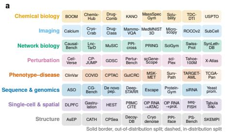

b  
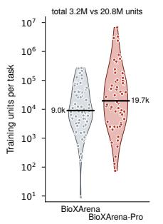

c  
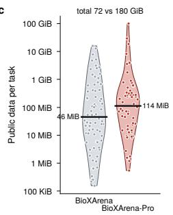

d  
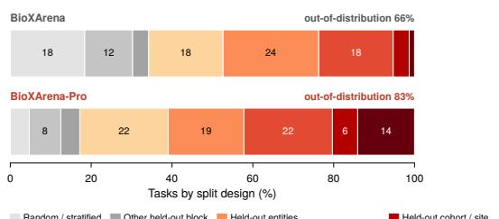

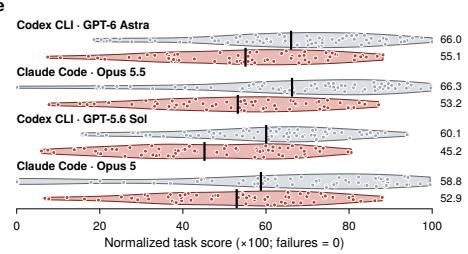  
Fig. 1 BioXArena-Pro is a larger, more heterogeneous and harder successor to BioXArena. a, The 64 tasks, one row per domain; a solid border marks a test set that holds out a biological or clinical unit (out-of-distribution split), a dashed border an in-distribution split. b, Training units per task (log scale) for BioXArena (grey, 76 tasks) and BioXArena-Pro (red, 64 tasks); violins show the distribution, points are tasks, bars are medians and the title gives the total. c, Public data per task, drawn as in b. d, Share of tasks by split design, from random, source-defined or other in-distribution splits (greys) to held-out scafolds, entities, donors, cohorts, cell lines, species and time windows (reds); the label gives the out-of-distribution share. e, Normalized task scores (×100) of the four agent configurations run on both benchmarks, on the common BioXArena-Pro scale (Methods); each point is one task, bars are means and the number on the right is the mean over tasks.

## 1 Results

## 1.1 A research-grade benchmark for biomedical modelling

BioXArena-Pro comprises 64 tasks, eight per domain, across chemical biology, imaging, network biology, perturbation biology, phenotype–disease modelling, sequence and genomics, single-cell and spatial omics, and structural biology (Fig. 1a, Supplementary Table 1). Each task is a self-contained capsule: a public directory with training data, unlabelled test inputs, native-format assets and a description; test labels are kept private. An agent receives the capsule, one GPU and a two-hour budget, and must return predictions for the test set (Methods).

Relative to BioXArena, the tasks are larger, more heterogeneous and harder by construction (Fig. 1b–d). The median task provides 19,663 training units (BioXArena:

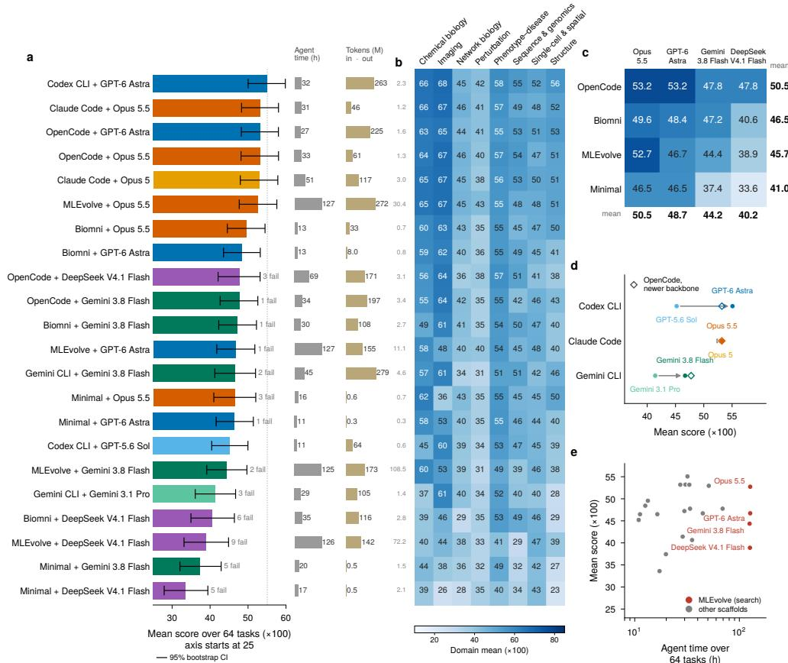  
Fig. 2 Capability of agent configurations on the final release. a, Mean score over the 64 tasks for each of the 22 configurations (bars; the axis starts at 25), with 95% bootstrap CIs over tasks (5,000 resamples); failed tasks score 0 and their count is given next to the interval. Dotted line, the best mean. The two columns to the right give the agent wall-clock time summed over the 64 tasks and the input (bar) and output (small number) tokens in millions; input includes cached prompt tokens. Colour marks the backbone (one colour family per vendor, the newer backbone darker). b, Domain means per configuration, rows ordered as in a $( n = 8$ tasks per domain). $\mathbf { c } ,$ Scafold–backbone design: mean score of four model-agnostic scafolds with four backbones, with row and column means. d, Vendor-CLI design: each coding CLI with the older and the newer of its vendor’s two backbones (arrow), and OpenCode with the newer backbone (open diamond). e, Agent wall-clock time against mean score; red, the search-based MLEvolve scafold.

9,042) and occupies 114 MiB (46 MiB); the public data total 179.6 GiB (71.6 GiB). Only 16% of tasks can be trained from a single train and test table (BioXArena: 50%); the others link data files in native formats. A task draws on 3.25 input sources on average (BioXArena: 2.62 under the same definition), and 34% of tasks draw on four or more (BioXArena: 14%). Over a third of tasks (36%) combine at least two families of input modality (45% if borderline cases are counted; Supplementary Table 3). Most tasks (83%) use a split that holds out an entire group of related samples rather than random rows (BioXArena: 66%); the held-out groups are mostly biological or clinical units, such as species, cohorts, donors, patients, cell lines and protein families, and otherwise chemical scafolds, property ranges or time windows. Metrics follow the scientific output; 75% of them are averaged per group, and every score is mapped to a common 0–100 scale on which higher is better (Methods). For the four agent configurations that we ran on both benchmarks, mean scores on the same scale are 11 points lower on BioXArena-Pro than on BioXArena (51.6 versus 62.8; Fig. 1e). The number of near-saturated tasks, with a best score of at least 90, falls from 12 of 76 (best of the four configurations) to 0 of 64 (best of all 22).

## 1.2 Capability of 22 agent configurations on the final release

On the final release we evaluated 22 agent configurations in two designs (Fig. 2; Methods). The first design pairs each of three vendor coding command-line interfaces (CLIs), namely Codex CLI, Claude Code and Gemini CLI, with two backbones from its own vendor. The second design crosses four model-agnostic scafolds with four backbones. The scafolds are an open-source coding CLI (OpenCode27), a biomedical agent (Biomni4), a search-based agent for machine-learning engineering (MLEvolve 28) and a minimal scafold that sends a single prompt; the backbones are the newer model of each vendor CLI and an open-weight model, DeepSeek V4.1 Flash. Codex CLI with GPT-6 Astra reaches 55.1 (95% confidence interval, CI, 50.0–59.8), followed by Claude Code with Opus 5.5 and by OpenCode with GPT-6 Astra or Opus 5.5 (all 53.2); the minimal scafold with DeepSeek V4.1 Flash is last at 33.6 (Fig. 2a). Domain matters about as much as configuration: domain means range from 36.4 for perturbation biology to 56.4 for imaging (Fig. 2b). Cost varies more than score: agent time ranges from 11 to 127 hours and input tokens from 0.3 to 279 million, with little relation to rank (Fig. 2a,e; Supplementary Table 4).

In the four-by-four design, OpenCode is the best and the minimal scafold the worst scafold for every backbone (Fig. 2c); across the 16 cells, the backbone accounts for 53% of the variance in mean score and the scafold for 37%. A full coding scafold adds more as the backbone weakens, from 6.7 points with GPT-6 Astra and Opus 5.5 to 14.2 with DeepSeek V4.1 Flash. As a result, the open-weight backbone in OpenCode (47.8) is level with both frontier backbones in the minimal scafold (46.5; the diference is within the CIs). On their own backbone, vendor CLIs hold little advantage over the open-source CLI (Fig. 2d): Codex CLI exceeds OpenCode by 1.9 points (95% CI 1.1–2.7), and Claude Code and Gemini CLI difer from it by 0.0 and −1.1. Within a vendor CLI, the newer backbone scores 9.9 points higher for GPT-6 Astra over GPT-5.6 Sol and 5.3 points higher for Gemini 3.8 Flash over 3.1 Pro (a comparison that also crosses model tiers), but only 0.3 points higher for Opus 5.5 over Opus 5.

More search did not help within the two-hour budget. MLEvolve iteratively mutates and re-evaluates candidate solutions. With every backbone it spent about 127 agent-hours, four times as much as Codex CLI with GPT-6 Astra (Fig. 2e), yet it never beat the best coding CLI on the same backbone: it trailed by 8–9 points with GPT-6 Astra and DeepSeek V4.1 Flash and did not difer significantly with Gemini 3.8 Flash (−3.4) or Opus 5.5 (−0.5).

Picking the best agent for each task would add little: the per-task best of all 22 configurations averages 57.0, only 1.9 points above the best single configuration, and the per-task winners are spread over 12 configurations. No configuration comes within

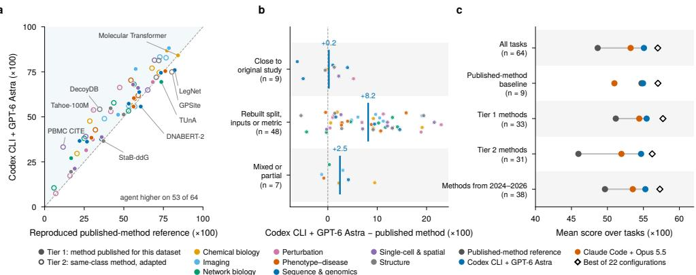  
Fig. 3 Reproduced published-method references match agents only where the test set stays close to the original study. a, Per task, the reproduced published-method reference (the primary method, chosen by validation on training data) against Codex CLI with GPT-6 Astra; colour marks the domain as in Fig. 1, filled points are tier-1 methods (published for this dataset) and open points tier-2 methods (strongest published method for the same problem class, adapted); labels name selected methods that beat the agent and tasks with the largest agent lead. b, Agent minus published-method reference per task, grouped by how close our test set is to the original study: close (same data and metric family), rebuilt (new split, removed inputs or new metric) or mixed (the grade difers between instances or applies to part of the task); bars are means. c, Mean score over tasks for the published-method reference, the two strongest configurations and the per-task best of the 22 configurations, for all tasks, the published-method baseline (tier-1 methods on tasks close to the original study) and the tier-1, tier-2 and 2024–2026 subsets. All scores ×100.

10 points of the maximum on any task, and on three tasks the best of all 22 stays below 20. With two further runs, the two strongest configurations average $5 4 . 5 \pm 0 . 5$ and 53.5 ± 0.3 (mean ± s.d. over three runs). The 64-task mean is therefore stable across runs, and the headline 55.1 is the highest of three, although individual tasks can swing by more than 15 points.

## 1.3 Agents against reproduced published-method references

To interpret absolute scores, we compared the agents with a reproduced publishedmethod reference for every task (Fig. 3). For 33 tasks (tier 1) we re-ran a method published for the task’s dataset. For the other 31 (tier 2) we re-ran the strongest published method for the same problem class, because no dataset-specific method exists, none could be run legitimately or a same-class method validated better. Each method used the authors’ code and training recipe, was trained only on the public training data and used no checkpoint whose training data overlap the test samples; the primary method was chosen by validation on training data and scored with the oficial grader (Methods). These references (median publication year 2024) reach 48.6 on average, below Codex CLI with GPT-6 Astra (55.1) and Claude Code with Opus 5.5 (53.2); the agent is higher on 53 of 64 tasks (Fig. 3a). The gap is concentrated in the tasks that we rebuilt against contamination (Fig. 3b). Nine tasks combine a method published for the dataset with a test set close to the original study, so the published recipe applies unchanged; we treat them as the published-method baseline. On these nine tasks the published methods score 54.7 and the strongest agent 54.9 (higher on five of nine; diference +0.2, 95% bootstrap CI −2.2 to 2.4), and Claude Code with Opus 5.5 scores 51.0. On the 48 tasks rebuilt with new splits, removed inputs or new metrics, the references trail the agent by 8.2 points (CI 6.2 to 10.1). The gap persists for recent and for dataset-specific methods: methods from 2024–2026 score 49.7 against 55.3 (38 tasks), and tier-1 methods 51.2 against 55.4 (Fig. 3c). Published methods still beat Codex CLI on 11 tasks and match or exceed the best of all 22 configurations on four, where specialised architectures or pretraining are decisive (for example LegNet29 on yeast promoter activity and GPSite 30 on protein-interface residues). The largest deficits, of 15 to 23 points, arise where the rebuilt task removes an input on which the method depends.

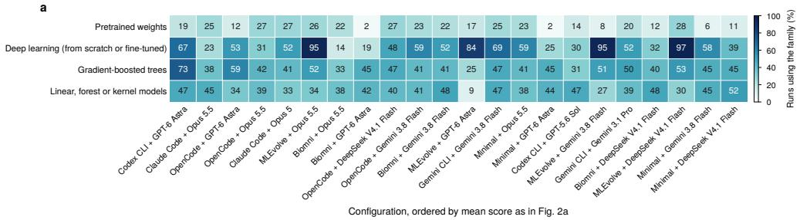

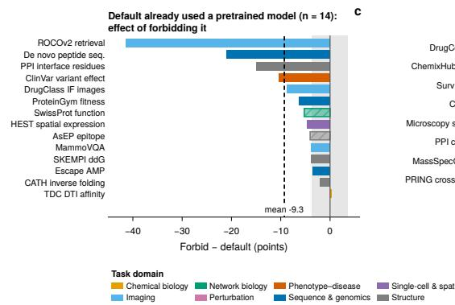

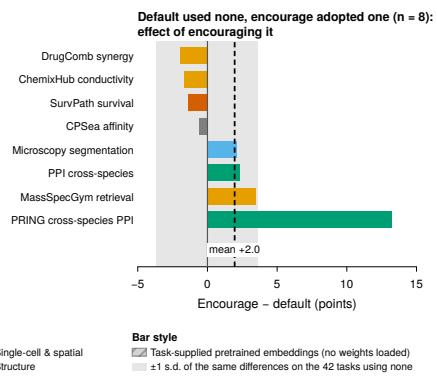  
Fig. 4 Pretrained models: what the configurations use and what they are worth. a, Share of runs whose final code uses each model family, per configuration (22 configurations × 64 tasks, 1,401 runs with code; families are not exclusive). b, Codex CLI with GPT-6 Astra on the 14 tasks whose default solution already relied on a pretrained model: change in score when the prompt forbids all pretrained weights and embeddings; hatched bars, tasks whose default used task-supplied pretrained embeddings rather than loaded weights. c, The eight tasks whose default solution used no pretrained model and whose solution under an encouraging prompt (with a local zoo of 99 models) adopted one: change in score. Dashed lines are means; the grey band is ±1 s.d. of the same diferences on the 42 tasks with no pretrained model in either arm. Bars are coloured by domain as in Fig. 1.

We read this as evidence that BioXArena-Pro rewards adapting a pipeline to each task’s shift rather than reusing one. The agent transcripts contain per-batch normalization, validation splits that mimic the shift between training and test data, ensembles and task-specific post-processing that no published recipe prescribes. This does not imply that agents outperform human experts, who would adapt as well. The comparison also has asymmetries that favour neither side. The authors implemented the references from the published recipes, partly with the help of AI coding agents; half of the references are same-class methods; they used pretrained checkpoints only when these excluded our test samples; and they were not tuned to the rebuilt splits. The agents, in turn, had two hours and no domain recipe (Methods). Nor are domain methods dispensable: where they win, a domain-specific architecture or pretraining matters.

a  
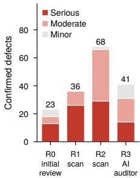  
b

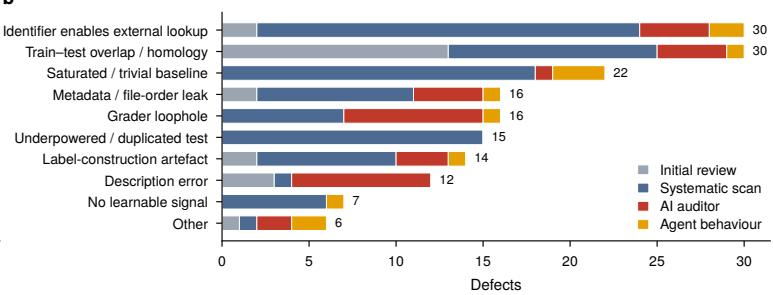

c  
d  
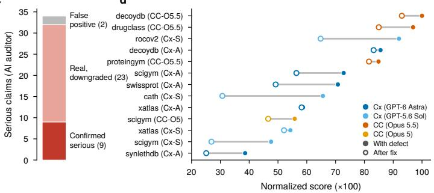

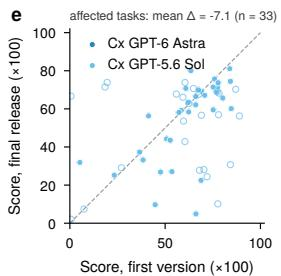  
Fig. 5 Integrity defects in pre-release builds and their exploitation by agents. a, Confirmed defects per audit round, by severity $( n = 1 6 8$ defects in 62 of 64 tasks); the 14 serious defects of round 3 are the auditor’s nine confirmed claims of c, two further tasks that share a confirmed grader defect, one found by direct review of the task the auditor declined and two found while fixing. b, Defects by category, coloured by who found them: the initial review, the systematic scans, the adversarial AI auditor or an anomalous agent score or submission. c, Outcome of human verification for the 34 claims the AI auditor rated serious. d, Agent scores with the defect (filled) and after the fix (open) for the 13 clear or partial exploitation cases with a comparable rerun (the score after a fix is that on the task version of that round, not on the final release); Cx, Codex CLI (A, GPT-6 Astra; S, GPT-5.6 Sol); CC, Claude Code (O5.5, Opus 5.5; O5, Opus 5). e, Score of the same configuration on the first version and on the final release for every task with a valid run on both; filled points are tasks whose defects were fixed without changing the metric or scale $( n = 3 3$ per configuration), open points the rest; the title gives the mean change for Codex CLI with GPT-5.6 Sol $( - 7 . 1 ; - 3 .$ 9 for Codex CLI with GPT-6 Astra on the same 33 tasks). These shifts combine the removal of defects with other hardening of the rebuilt tasks. Scores in d and e are ×100.

## 1.4 Pretrained models help where agents already use them

We classified the final code of the 1,401 runs that left code (Fig. 4a). Deep learning appears in 52% of runs, gradient-boosted trees in 45% and linear, forest or kernel models in 39%, but only 18% of runs load pretrained weights, including biological foundation models. How often a configuration uses pretrained models depends on both the backbone and the scafold: Opus 5.5 loads them in 22–27% of runs in every scafold, whereas GPT-6 Astra does so in 19% of runs in Codex CLI but in 2% in Biomni and in the minimal scafold.

To measure what they are worth, we reran Codex CLI with GPT-6 Astra on all 64 tasks with two modified prompts: one forbidding all pretrained weights and embeddings, and one pointing the agent to a local zoo of 99 pretrained models (Methods). The two arms average 52.7 and 54.6 against 55.1 for the default prompt (54.5 on average over three runs), and the efect is asymmetric. On the 14 tasks whose default solution already relied on a pretrained model, forbidding it cost 9.3 points on average (lower on 13 of 14, median −4.9, Wilcoxon $P = 0 . 0 0 0 2 )$ , and up to 41.5 points for image–caption retrieval without BiomedCLIP 31 (Fig. 4b). On the eight tasks where the default solution used none and the encouraging prompt made the agent adopt one, scores changed by +2.0 on average, four up and four down $( P = 0 . 3 1 )$ ; only crossspecies interaction prediction on the PRING-derived task gained clearly (+13.3 with ESM2 and $\mathrm { P r o t T 5 ^ { 3 2 } }$ ; Fig. 4c). On the 42 tasks with no pretrained model in either arm the diferences had an s.d. of 3.6 points, so single-task changes of a few points are noise. For this agent, pretrained models thus carry real signal on about a fifth of the tasks, and it already finds them there; telling it to use more does not help on average. The grouping is post hoc and each arm is a single run, so the per-task values are indicative.

## 1.5 Frontier agents find and exploit integrity defects

Before release we audited every task in four rounds, one manual and three AI-assisted, each followed by expert verification of the flagged problems, and closed with a final expert review of every task and fix (Fig. 5a; Methods). The rounds confirmed 168 defects in 62 of the 64 tasks (82 serious), most often identifiers or public files that let a networked agent retrieve the answer, train–test overlap through homology or shared entities, and tasks that a trivial baseline saturated (Fig. 5b). Agents exploited such defects without instruction: of 37 runs examined because of an anomalous score or submission, 12 clearly exploited a defect and five in part (Fig. 5d shows the 13 of these 17 with a comparable rerun); of the AI auditor’s 34 serious claims, verification confirmed nine (Fig. 5c). Claude Code with Opus 5.5 reached a perfect 100 on a pose-classification task by learning a bond-length artefact that separated decoy from native poses, and Codex CLI with GPT-6 Astra scored 72.8 on a network-completion task by reading gaps in element numbering (56.4 after the fix). Across the 13 clear or partial cases with a comparable rerun, the fix lowered the same configuration’s score by 13.1 points on average (range 0.5–34.9). These scores after a fix come from the task version of that round, which later rounds changed further. Across all tasks fixed without changing the metric, scores fell by 3.9–7.1 points (Fig. 5e), a shift that also includes other hardening of the rebuilt tasks. Because only runs with anomalous scores were examined, these counts do not estimate how often exploitation occurs; they show that it occurs without instruction and is hard to detect from aggregate scores. This is why all capability results use the final release.

## 2 Discussion

Coding agents can already build credible models for many biomedical problems: on the final release they produce valid submissions in 97% of the 1,408 runs (22 configurations on 64 tasks), and the strongest configurations exceed reproduced published methods on most tasks. But the same competence makes them dangerous to evaluate naively: agents found and used label leakage, metadata artefacts and grader loopholes that had passed expert curation.

We draw four lessons. First, a benchmark for data-reading agents needs opaque identifiers, controlled metadata, group-aware splits, shortcut baselines and graders that cannot be gamed, and it needs an adversarial audit before release; AI auditors are valuable red-teamers, but they over-report severity, so their claims need verification against the real grading path. Second, what the benchmark measures is adaptation rather than reuse: published methods hold their own where our test sets stay close to the original studies and fall behind where we introduced new splits, inputs or metrics, which is also where biomedical models matter most, in new cohorts, species and cell lines. Third, a score belongs to a scafold–backbone pair: a weaker backbone in a strong scafold can match a stronger backbone in a weak one. Fourth, pretrained models matter on about a fifth of the tasks and add little elsewhere; the strongest agent already uses them where they help, so the frontier is better judgement about when and how to use them, not more encouragement.

The results also show where the frontier lies. The per-task best of all 22 configurations is only 1.9 points above the best single configuration, so the remaining 43 points are not recoverable by picking among these agents. Perturbation biology and network biology stay below 41 on average, and three tasks remain under 20 for every configuration. These include problems that remain open in the field, such as predicting the efects of unseen genetic perturbations 33 or responses in unseen cell lines. Without noise ceilings, however, we cannot separate unsolved biology from label noise or from dificulty added by removing identifiers. More search within the same per-task limit does not close this gap either: the search-based scafold spent four times the agenthours of the best coding CLI for no gain. The lead of Codex CLI with GPT-6 Astra persists on three-run means (54.5 against 53.5), whereas the next five configurations are indistinguishable. We expect progress to come from agents that reason about the data-generating process, choose or adapt domain models deliberately and verify their own validation design.

Our study has limitations. Lookup of public source data cannot be fully prevented when agents have network access: opaque identifiers and explicit prohibitions limit it, but inputs such as sequences or structures can themselves be searched, and network trafic was not captured. An audit of the logs of all 1,408 runs found no download of a source dataset and no database query with test inputs, but 40 runs used public checkpoints whose training data may overlap our test samples, and this overlap was not measured (Methods). The 0–100 scale is an index rather than a fraction solved. An uninformed submission scores zero on 36 tasks, 50 on the six AUC-type tasks and 8.5 on average over the 63 tasks where chance is defined (Supplementary Table 6), and no task has a measured noise ceiling; means across tasks and domains should therefore be read comparatively. De-identification removes prior knowledge that a domain method or a foundation model could legitimately use, which may lower both the references and the value of pretrained models. Backbones were served through diferent API routes. Most configurations were run once per task, and the diferences among the top configurations are smaller than their bootstrap intervals. We did not measure human experts directly. The references are, however, expert-designed: each is a method that domain experts devised, tuned and published for that dataset or problem class, and where a published number on the same test set exists our reproductions match it (Methods). What a reference lacks is the adaptation an expert would make on meeting our rebuilt split, so it is best read as a lower bound on expert performance. The nine baseline tasks, where the published recipe needs no adaptation, give the most direct comparison: there the strongest agent and the published methods tie (54.9 against 54.7). The evidence therefore supports agents reaching the level of published methods on these problems, not exceeding what experts could achieve with the same freedom to adapt. The audits used models of the same families as the evaluated agents, and tasks were revised after agent runs had been inspected, so the final tasks may be harder for these families than for others. The prompt ablation covers one agent, and the 64 tasks sample eight domains.

BioXArena-Pro turns these lessons into a benchmark on which a score reflects modelling rather than lookup. As agents improve, new shortcuts will appear, so we release it as a versioned, living benchmark with a public audit log, an evaluation server that keeps test labels private and the tooling needed to audit new tasks.

## 3 Methods

## 3.1 Task selection and construction

We first compiled a candidate list of datasets from recent primary studies in Nature, Science, Cell and their sister journals and from the benchmarks of recent machinelearning venues, keeping those that release a dataset together with a method and an evaluation. Three authors (L.L., D.Z. and X.D.) downloaded, processed and screened the candidates against five criteria. The source had to be a primary study or curated database, preferably from the last few years (median source year 2024) and with a peer-reviewed publication where one exists. Its licence had to permit academic noncommercial benchmark use. The prediction target had to be scientifically meaningful, with a real downstream use. The task had to be dificult: we preferred tasks that combine several input modalities or data sources and whose held-out unit (species, cohort, donor, cell line, scafold or time window) matches the scientific claim of the original study. Finally, the task had to fit one GPU and two hours. Candidates that failed a criterion, duplicated a problem class already covered or saturated under a trivial baseline were dropped or replaced during the integrity rounds described below. The resulting 64 tasks, eight per domain, were reviewed at a high level by the two senior authors (K.Z. and Le Song) for relevance, balance and challenge. BioXArena-Pro is not disjoint from BioXArena. Of the 64 tasks, 45 share no source dataset with it, 8 reuse a BioXArena dataset for a diferent prediction task, and 11 revisit a BioXArena dataset and target with a new split, inputs and metric (six as whole tasks and five as one component of a multi-source task). In five of these 11 tasks, some test samples appear with labels, under other identifiers, in the public training data of BioXArena: about 55% of the test items of the sci-Plex task and of the Tox21 instance, and 7–14% of those for Swiss-Prot function, two ClinVar instances and the ProteinGym stability assays. Each task keeps the native data formats of its source and exposes a fixed primary metric chosen to match the scientific output. Per-task provenance, licence, split rule, modalities and published-method reference are listed in Supplementary Tables 1–3.

## 3.2 Data sources, licences and redistribution

Every task is built from a public primary study or database, listed with its licence in Supplementary Table 2 and, except for the ten tasks noted below, cited in its description. We followed the policy of BioXArena: the packaging, splits, opaque identifiers, descriptions and graders are released under CC BY-NC 4.0 for academic and other non-commercial use; sources must permit academic non-commercial benchmark use; and sources whose terms restrict redistribution of the original records are released only as processed, de-identified task files, with the original resource cited and left to be obtained from its provider. Each task’s data remain subject to the terms of its source. Three sources need a specific note. The MSK-MET task is reproduced value for value from the authors’ Zenodo deposit of the cohort (CC BY 4.0); because the same study is distributed through cBioPortal, whose DataHub requires derived databases to be shared alike, the files of this task and the cBioPortal-derived files of the paediatric leukaemia task are ofered under ODbL 1.0. The leukaemia task uses only open-access data of the TARGET programme, for which NCI requires no data-use certification; the TARGET purpose limitations apply to controlled-access data, and use follows the NIH Genomic Data Sharing Policy. The ionic-liquid conductivity values of one task derive from NIST Standard Reference Database 147 (ILThermo); they are shipped as processed values for non-commercial research with the acknowledgement NIST requests, and permission for redistribution has been requested from the NIST Standard Reference Data Program. Ten task descriptions deliberately withhold the name of their source to limit answer lookup; their sources are disclosed in Supplementary Table 2.

## 3.3 Ethics and data governance

This study analysed only previously published, de-identified data and involved no human participants: we recruited no participants, generated no new human or animal data and had no contact with any data subject. The 27 tasks that include humanderived data (clinical cohorts, tumour profiles, medical images, tissue sections and cell atlases) use only resources that their providers distribute openly in de-identified form, collected under the ethical approvals and consent procedures reported in the original studies (Supplementary Table 2); no controlled-access data were used. We made no attempt to re-identify individuals or to link records across sources. The released task files go further than the sources: sample, patient and donor identifiers are replaced by opaque codes, free-text and date fields are removed, and clinical variables are kept only where the task needs them and in the coarsened form in which the source released them. Users of the benchmark must comply with the terms of each source, and we will remove or replace any task on request of a data provider. Two tasks on oligonucleotide knockdown eficacy triggered a model’s biosafety refusal (see Agent configurations and execution environment); no task involves pathogen enhancement, toxin design or other dual-use content.

## 3.4 Task capsules, submission contract and scoring

Every task is a self-contained capsule with a public and a private part. The public directory holds description.md, train.csv, test.csv, sample submission.csv and the task’s native-format assets (images, volumes, structures, expression matrices, graphs or embeddings). For 43 tasks the prediction is a value per test row; the other 21 use a file manifest, in which each row of the submission names a prediction file in the agent’s output directory so that predictions keep their natural granularity (for example a mask per image or an expression matrix per tissue section). The private directory holds answers.csv, any private label files and the grader. A submission must reproduce the sample submission’s rows, columns and identifier order; the submission is invalid, and the run a failure rather than a valid submission with a low score, if a file is missing or malformed, the schema or identifier set is wrong, a path is unsafe or a required value is not finite. With a public pre-flight check, an agent can catch packaging errors before the deadline. Each grader computes one fixed primary metric; task instances that share a grader are averaged with equal weight unless the task description states other weights; the metric, its aggregation and the measured chance level of every task are given in Supplementary Table 6. Scores are normalized to a common 0–100 scale on which higher is better. Correlation coeficients and Matthews correlation are clipped to [0, 1], so that chance scores zero, as it does for the skill metrics. AUC, C-index, average precision, $F _ { 1 }$ , accuracy and mean reciprocal rank keep their native [0, 1] scale. Two perturbation tasks are expressed relative to the allzero prediction, and the hospitalization forecast uses a ranked probability skill score. All scores are multiplied by 100. A failed run scores 0. For Fig. 1e the 28 correlationscored tasks of BioXArena were rescored from the raw metric with the same clip so that both benchmarks share one scale.

## 3.5 Integrity hardening protocol

Every task was audited in four rounds before release (Fig. 5a). AI agents did the searching in three of them; an author verified every AI finding and approved every fix. Round 0 was a manual review of the first version by the authors who constructed the tasks. Round 1 was a systematic scan with Claude Code and Opus 5.5 for identifier leakage, train–test overlap and metadata–label correlations. Round 2 was a second, broader systematic scan with Claude Code and Fable 5.1, extended to lookup of identifiers in public databases, file-order and file-metadata leakage, homology and scafold overlap, target-derived features and grader loopholes. Round 3 was an adversarial audit by a diferent agent, Codex CLI with GPT-6 Astra, which attacked the real grader of each task. In addition, anomalous agent scores and submissions from the evaluation runs were traced back to their cause. After the last round, the authors manually reexamined all 64 tasks — data files, splits, descriptions and graders — and signed of each one before the final release.

The rounds confirmed 168 defects in 62 of the 64 tasks (82 serious, 69 moderate, 17 minor), counted once per mechanism per task. The largest classes were identifiers or public files that let a networked agent retrieve the answer (30), train–test overlap through homology or shared entities (30), tasks that a trivial baseline saturated (22), metadata or target-derived features correlated with labels (16) and grader loopholes (16). Most defects were fixed by rebuilding the task, the others by changing the grader or rewriting the description; four tasks were retired and replaced, and one instance was withdrawn from another task. The 168 defects include eight in the four retired tasks; the 62 of 64 refers to the 64 tasks of the first version, and a defect found through agent behaviour is assigned to the round in which it was found. The fixes follow fixed rules. Identifiers are replaced by opaque salted codes, and lookup keys (gene symbols, variant strings, compound names and structures, accession numbers) are removed from test items. File order is shufled and file metadata made uniform. Test sets are re-split so that an entire group of related samples is held out, with bounded sequence identity or disjoint scafolds between training and test sets where applicable (Supplementary Table 1). Graders require exact coverage of the test identifiers and reject non-finite values and abstention, and descriptions state which external data and lookups are not allowed. The 37 examined runs were selected because a score or a submission was anomalous; each was classified from its transcript and code, and the comparison in Fig. 5d uses the same configuration rerun on the fixed task.

The round-3 auditor ran once per task in a sandbox with read-only access to the task’s public and private directories and its grader. It was asked to find ways of obtaining the labels or of scoring well without learning the biology, and to measure each against the real grader. Of its 34 serious claims, re-execution by an author through the real grading path confirmed nine, downgraded 23 whose gain was within noise and rejected two (Fig. 5c). Because defects are counted per afected task, round 3 contributes 14 serious defects to Fig. 5a: the nine confirmed claims, two further tasks that share a confirmed grader defect, one defect found by direct review of the task that the auditor’s safety filter declined, and two found by the authors while fixing.

## 3.6 Agent configurations and execution environment

We report 22 configurations in two designs. In the vendor-CLI design, each coding CLI runs with two backbones from its own vendor: Codex CLI 0.163.0 with GPT-6 Astra and GPT-5.6 Sol, Claude Code 2.1.302 with Opus 5.5 and Opus 5, and Gemini CLI with Gemini 3.8 Flash and Gemini 3.1 Pro (preview). In the scafold–backbone design, four model-agnostic scafolds — OpenCode 1.18.5, Biomni, MLEvolve and a minimal scafold — each run with GPT-6 Astra, Opus 5.5, Gemini 3.8 Flash and DeepSeek V4.1 Flash, that is, with the newer backbone of each vendor CLI and one open-weight model. The minimal scafold sends the task once and executes the single code block it returns, with no tools and no feedback, so it measures what a backbone achieves without an agent loop. Three further configurations on the public leaderboard (Codex CLI with GPT-6.1 Sol and the minimal scafold with DeepSeek V4 Pro and with Gemini 3.1 Pro) fit neither design and are not analysed here.

All configurations receive the same task prompt, one NVIDIA A100 GPU (80 GB), 16 cores of an AMD EPYC 7713P processor, 96 GB RAM and a 7,200 s wall-clock limit per task. Each run is one Slurm job inside a filesystem sandbox, in which the task’s public directory is read-only and only the run’s own output directory is writable; labels and answer files are never on the agent’s filesystem. Network access is not blocked, because agents must reach the model API and may install packages and download pretrained weights; leakage of answers is instead prevented by three safeguards. First, the Landlock filesystem sandbox restricts an agent to reading its task’s public directory and the runtime libraries and to writing its own output directory, so private answers, graders, other tasks and earlier runs are outside its view. Second, the data are deidentified as described under Integrity hardening protocol, so that test items cannot be matched to their public source records; some tasks also rotate spatial coordinates or project embeddings at random. Third, the shared task prompt forbids access to private data, labels, answer files, graders and any non-public artefact and states that original data releases are out of bounds, and 62 of the 64 task descriptions also state which external data and lookups are not allowed for that task. A run that exceeds the time limit, returns a missing or invalid submission or is killed for exceeding memory scores 0. Infrastructure failures — gateway errors, empty completions from the serving API, network drops and runs killed by another job — are rerun, and the replaced attempts are archived with the release. Every API response is logged together with the model that served it, and a run is rejected if fewer than 95% of its responses come from the requested model. The main evaluation of the 22 configurations used 1,023 hours of agent wall-clock time, each run with one GPU allocated, and 2.54 billion input and 0.26 billion output tokens; the published-method references, the prompt ablation and the repeat runs are not included in these totals.

GPT and Claude backbones were served through an institutional API proxy, and DeepSeek V4.1 Flash and Biomni with Gemini 3.8 Flash through OpenRouter. The other five Gemini configurations ran with the same harness, prompt, tasks, limits and hardware class through a gateway for the native Gemini protocol; ten of their runs failed on gateway errors or external process kills and were rerun, two of them (OpenCode) through OpenRouter. For MLEvolve with Opus 5.5, the proxy returned empty completions for two tasks (siRNA and antisense-oligonucleotide knockdown eficacy), so these two scores are taken from MLEvolve with Opus 5; without them the configuration’s mean is 51.3 instead of 52.7. On the same two tasks, Claude Code with Opus 5.5 declined on biosafety grounds, and the CLI’s built-in refusal fallback completed them with Opus 5; these are the only runs exempted from the 95% rule.

## 3.7 Audit of network use

Because agents had network access, we audited all 1,408 runs of the final release for network use, from the recorded transcripts, the executed code, the scripts that the agents wrote and the per-run download caches. Pattern matching produced candidate events, and every candidate that involved a data repository, a database, a web search or a code repository was read manually. In total 362 runs (26%) used the network: 84 installed packages and 313 requested pretrained weights (35 did both). No run downloaded the source dataset of its task, accessed any public data repository (including that of BioXArena) or queried a public database with test inputs. The 313 runs include downloads that the final solution did not use, which is why the number exceeds the

18% of final solutions that load pretrained weights. Seven runs searched for the source study by name; six retrieved nothing, and one read the code repository and paper of the source benchmark without retrieving data and scored below the median of the other configurations on that task. Forty runs used a public checkpoint whose training data may overlap the test samples: inverse-folding models on the CATH test chains, generalist Cellpose models 34 on one of two test image sources, pathology encoders pretrained on TCGA images (inputs only, no survival labels) and one peptide-sequencing checkpoint of unverified provenance. The task descriptions permit these model classes, the overlap was not measured, and the runs are reported without exclusion. The audit covers what the logs record; network trafic itself was not captured.

## 3.8 Reproduced published-method references

For each task we reproduced a published method. Tier 1 is a method published for the task’s dataset (33 tasks); tier 2 is the strongest published method for the same problem class, with only the input and output layers adapted (31 tasks). A task is tier 2 when no dataset-specific method exists (11 tasks), when none could be run legitimately, or when a same-class method validated better. Methods were run with the authors’ code, version and training recipe and were trained only on the task’s public training data. Pretrained weights were allowed only when their training data contain none of our test samples; otherwise the model was retrained from our data. Excluded checkpoints include GNINA 35, BepiPred-3.036, the released PLM-interact models 37, STNeuroNet 38, LocalTransform39 and the Tahoe-specific perturbation models. Methods without available training code, or whose released model had been trained on a resource that contains our labels, were not used; the code repository lists them per task. The authors implemented the references, partly with the help of AI coding agents, and every method directory records the paper, code commit, weights and their provenance, hyperparameters, deviations, validation score and runtime. One to six methods were run per task (median two). The primary method was chosen solely by validation on a split of the training data that mimics the shift between training and test data, and test labels were never used to select or tune a method. For the mutation-efect instance of the cross-species interaction task, fine-tuning was shortened from 50 to 23 epochs for compute reasons, with the epoch selected by development-set AUPR as in the original recipe.

All 167 submissions were scored with the oficial grader. After a first scoring pass, we re-examined the nine tasks with the lowest reference scores for implementation errors; this is the only use made of test scores. We found and fixed configuration errors in five of them (a merge step that never ran, a tree depth tuned for a random split, a splice model chosen for the wrong organism, an unsuited classifier and an undertrained model) and confirmed the other four as genuine; the primary method was then reselected by validation. We report the primary method; the best method per task by test score averages 49.0. Comparability with the original study was graded per task as close (same data and metric family; 9 tasks), rebuilt (new split, removed inputs or new metric; 48 tasks) or mixed (the grade difers between instances or applies to part of the task; 7 tasks). All nine close tasks have tier-1 methods. We call them the publishedmethod baseline, because the published recipe applies to them without adaptation (Supplementary Table 7), and we treat the other 55 references as lower bounds on expert performance. Publication years come from the method papers. Reproduction fidelity was checked for three methods with a published number on the same or nearly the same test set: LegNet (the primary method) reaches 82.1 on the yeast promoter task, whose test set is drawn from that of the DREAM 2022 challenge, against about 82 reported; DeepGO-SE40 reaches 51.9 on Swiss-Prot function prediction against 52.9; and Suite2p 41 reaches an F1 of 0.504 on the real calcium-imaging instance against the organisers’ 0.499.

## 3.9 Pretrained-model use and prompt ablation

Model families were detected by regular expressions over the Python files that each run left in its output directory, excluding vendored packages: deep-learning frameworks, gradient-boosted tree libraries, linear, forest and kernel estimators, and the loading of pretrained weights (library loaders, hub downloads and names of common biological and vision models). Seven runs left no code and are excluded. The prompt ablation reran Codex CLI with GPT-6 Astra on all 64 tasks of the final release with the same harness, budget and hardware as the main evaluation. It used two modified prompts: the forbid prompt bans all pretrained weights and pretrained embeddings, including embeddings shipped with a task; the encourage prompt adds a paragraph recommending pretrained models and gives the path of a local zoo of 99 models, while stating that each task’s own rules take precedence. The default arm is the main run. Whether each solution loaded pretrained weights was decided by reading its code and transcript; the automatic detector missed two task-specific pretrained models (InstaNovo42 and ProteinMPNN43 with ESM2), which were corrected by hand. Compliance of the forbid arm was checked for all 64 runs; none loaded, downloaded or referenced pretrained weights, and the task-supplied ESM2 and IgFold embeddings were explicitly discarded.

## 3.10 Statistical analysis

Confidence intervals are 95% percentile intervals from 5,000 bootstrap resamples of the 64 tasks; diferences between two configurations are bootstrapped paired by task. In the scafold–backbone design, the shares of variance attributed to scafold, backbone and interaction come from a two-way decomposition of the 16 configuration means (one value per cell). The per-task best is the mean over tasks of the highest score that any configuration reached on each task. To measure run-to-run variation, we ran Codex CLI with GPT-6 Astra and Claude Code with Opus 5.5 twice more on all 64 tasks, with the same prompt, pinned CLI versions, limits and API route as in the main round. We report the mean and s.d. of the three 64-task means and the median over tasks of the per-task s.d. (1.3 and 1.1 points). In both repeat runs of Claude Code, the refusal fallback completed the same two tasks as in the main round. We tested 15 comparisons between pairs of configurations, which follow from the two designs and were fixed before the repeat runs and the reference reproductions: each vendor CLI against OpenCode on the same backbone, OpenCode against the minimal scafold for each backbone, the newer against the older backbone in each vendor CLI, MLEvolve against the best coding CLI on each backbone, and the two strongest configurations against each other. For each comparison we report the mean paired diference, the number of tasks won and lost and a two-sided Wilcoxon signed-rank test over the 64 tasks, with Holm correction across the 15 comparisons (Supplementary Table 5). All diferences reported as such in Results remain significant after correction $( P _ { \mathrm { H o l m } } <$ 0.05); the five comparisons described as small or not significant do not reach it. In the prompt ablation, the per-task score changes of each task group were tested against zero with a two-sided Wilcoxon signed-rank test. No other hypothesis tests were performed.

## 3.11 Use of large language models

Besides being the systems under evaluation, LLM-based coding agents assisted the authors in four ways, always under author supervision. They carried out the searching in the three AI-assisted audit rounds (Claude Code with Opus 5.5 and Fable 5.1, and Codex CLI with GPT-6 Astra; see Integrity hardening protocol). They partially helped implement the published-method references from the authors’ code and recipes. Claude Code with Opus 5.5 and Fable 5.2 assisted with analysis code, figures and reference checking. The same tools were used to edit the manuscript text. The authors checked every output, verified each reported number against the underlying data and take full responsibility for the content of this article.

Data availability. The public task capsules of BioXArena-Pro v5.1.2 (training data, unlabelled test inputs, native-format assets, task descriptions and sample submissions for all 64 tasks; 179.6 GiB) are available on Hugging Face at https://huggingface.co/ datasets/mbzuai-ai4bio/BioXArena-Pro-Public, as one archive and as one archive per domain, under CC BY-NC 4.0 for academic and other non-commercial use; the source and licence of every task are listed in Supplementary Table 2 (ten descriptions withhold the source name to limit lookup), and each source’s own licence also applies. The held-out test labels and answer files are not public, so that the benchmark cannot be contaminated; scores on the test sets are obtained by submitting predictions to the BioXArena-Pro competition on Codabench44 (https://www.codabench.org competitions/18583/), as for BioXArena; during peer review the editor can give referees access to the test labels or to a scoring endpoint, and afterwards the labels are available from the corresponding authors to maintainers of evaluation infrastructure. Per-task scores of all 22 configurations are in the code repository, and the agent run records (the code written by each agent, its transcript and its submission) are available from the corresponding authors on request. The published-method references and the prompts and runs of the prompt ablation will be deposited with the versioned archive on acceptance. The detailed integrity-audit records, which list the shortcuts removed from each task, are available to referees and to maintainers of evaluation infrastructure on request, because publishing them would help future agents to exploit residual weaknesses.

Code availability. The benchmark harness, the adapters for the seven agent scafolds (Codex CLI, Claude Code, Gemini CLI, OpenCode, Biomni, MLEvolve and the minimal scafold), the shared task prompt, the graders and normalization code, the scoring and leaderboard scripts, and the leaderboard files are available at https://github.com/mbzuai-ai4bio/BioXArena-Pro under the MIT License; a versioned archive will be deposited at Zenodo on acceptance, together with the figure scripts and the directories of the published-method references.

Author contributions. L.L., D.Z. and X.D. collected, downloaded, processed and screened the datasets and built the tasks. L.L. and D.Z. ran the experiments. L.L. wrote the first draft of the manuscript. D.Z., X.D., Leonard Song, K.Z. and Le Song revised the manuscript and contributed to the analyses. K.Z. and Le Song supervised the project as senior advisors and guided its design and direction. All authors read and approved the manuscript.

Competing interests. The authors declare no competing interests.

## References

[1] Yao, S. et al. ReAct: Synergizing reasoning and acting in language models. International Conference on Learning Representations (ICLR) (2023).

[2] Wang, X. et al. Executable code actions elicit better LLM agents. Proceedings of the 41st International Conference on Machine Learning (ICML), PMLR 235, 50208–50232 (2024).

[3] Jimenez, C. E. et al. SWE-bench: Can language models resolve real-world GitHub issues? International Conference on Learning Representations (ICLR) (2024).

[4] Huang, K. et al. Autonomous biomedical research with an artificial intelligence agent. Science 393, eadz4351 (2026). Preprint: Biomni: A general-purpose biomedical AI agent, bioRxiv 10.1101/2025.05.30.656746 (2025).

[5] Jin, R., Zhang, Z., Wang, M. & Cong, L. STELLA: Self-evolving LLM agent for biomedical research. arXiv preprint arXiv:2507.02004 (2025).

[6] Gottweis, J. et al. Accelerating scientific discovery with Co-Scientist. Nature 655, 487–496 (2026). Preprint: Towards an AI co-scientist, arXiv:2502.18864 (2025).

[7] Laurent, J. M. et al. LAB-Bench: Measuring capabilities of language models for biology research. arXiv preprint arXiv:2407.10362 (2024).

[8] Mitchener, L. et al. BixBench: A comprehensive benchmark for LLM-based agents in computational biology. arXiv preprint arXiv:2503.00096 (2025).

[9] Chen, Z. et al. ScienceAgentBench: Toward rigorous assessment of language agents for data-driven scientific discovery. International Conference on Learning Representations (ICLR) (2025).

[10] Huang, Q., Vora, J., Liang, P. & Leskovec, J. MLAgentBench: Evaluating language agents on machine learning experimentation. Proceedings of the 41st International Conference on Machine Learning (ICML), PMLR 235, 20271–20309

(2024).

[11] Chan, J. S. et al. MLE-bench: Evaluating machine learning agents on machine learning engineering. International Conference on Learning Representations (ICLR) (2025).

[12] Miller, H. E., Greenig, M., Tenmann, B. & Wang, B. BioML-bench: Evaluation of AI agents for end-to-end biomedical ML. bioRxiv (2025).

[13] Wang, Y. et al. NatureBench: Can coding agents match the published SOTA of Nature-family papers? arXiv preprint arXiv:2606.24530 (2026).

[14] Li, L. et al. BioXArena: Benchmarking LLM agents on multi-modal biomedical machine learning tasks. Advances in Neural Information Processing Systems (NeurIPS), Evaluations and Datasets Track (2026).

[15] Geirhos, R. et al. Shortcut learning in deep neural networks. Nature Machine Intelligence 2, 665–673 (2020).

[16] Kapoor, S. & Narayanan, A. Leakage and the reproducibility crisis in machinelearning-based science. Patterns 4, 100804 (2023).

[17] Skalse, J., Howe, N. H. R., Krasheninnikov, D. & Krueger, D. Defining and characterizing reward gaming. Advances in Neural Information Processing Systems (NeurIPS) 35, 9460–9471 (2022).

[18] Whalen, S., Schreiber, J., Noble, W. S. & Pollard, K. S. Navigating the pitfalls of applying machine learning in genomics. Nature Reviews Genetics 23, 169–181 (2022).

[19] Bernett, J., Blumenthal, D. B. & List, M. Cracking the black box of deep sequence-based protein–protein interaction prediction. Briefings in Bioinformatics 25, bbae076 (2024).

[20] Buttenschoen, M., Morris, G. M. & Deane, C. M. PoseBusters: AI-based docking methods fail to generate physically valid poses or generalise to novel sequences. Chemical Science 15, 3130–3139 (2024).

[21] Koh, P. W. et al. WILDS: A benchmark of in-the-wild distribution shifts. Proceedings of the 38th International Conference on Machine Learning (ICML), PMLR 139, 5637–5664 (2021).

[22] OpenAI. Codex CLI (2025). URL https://github.com/openai/codex.

[23] Anthropic. Claude Code (2025). URL https://github.com/anthropics/ claude-code.

[24] Google. Gemini CLI (2025). URL https://github.com/google-gemini/gemini-cli.

[25] Lin, Z. et al. Evolutionary-scale prediction of atomic-level protein structure with a language model. Science 379, 1123–1130 (2023).

[26] Cui, H. et al. scGPT: toward building a foundation model for single-cell multiomics using generative AI. Nature Methods 21, 1470–1480 (2024).

[27] OpenCode contributors. OpenCode (2025). URL https://github.com/ anomalyco/opencode.

[28] Du, S. et al. MLEvolve: A self-evolving framework for automated machine learning algorithm discovery. arXiv preprint arXiv:2606.06473 (2026).

[29] Penzar, D. et al. LegNet: a best-in-class deep learning model for short DNA regulatory regions. Bioinformatics 39, btad457 (2023).

[30] Yuan, Q., Tian, C. & Yang, Y. Genome-scale annotation of protein binding sites via language model and geometric deep learning. eLife 13, RP93695 (2024).

[31] Zhang, S. et al. A multimodal biomedical foundation model trained from fifteen million image–text pairs. NEJM AI 2, AIoa2400640 (2025).

[32] Elnaggar, A. et al. ProtTrans: toward understanding the language of life through self-supervised learning. IEEE Transactions on Pattern Analysis and Machine Intelligence 44, 7112–7127 (2022).

[33] Ahlmann-Eltze, C., Huber, W. & Anders, S. Deep-learning-based gene perturbation efect prediction does not yet outperform simple linear baselines. Nature Methods 22, 1657–1661 (2025).

[34] Stringer, C., Wang, T., Michaelos, M. & Pachitariu, M. Cellpose: a generalist algorithm for cellular segmentation. Nature Methods 18, 100–106 (2021).

[35] McNutt, A. T. et al. GNINA 1.0: molecular docking with deep learning. Journal of Cheminformatics 13, 43 (2021).

[36] Cliford, J. N. et al. BepiPred-3.0: improved B-cell epitope prediction using protein language models. Protein Science 31, e4497 (2022).

[37] Liu, D. et al. PLM-interact: extending protein language models to predict protein–protein interactions. Nature Communications 16, 9012 (2025).

[38] Soltanian-Zadeh, S., Sahingur, K., Blau, S., Gong, Y. & Farsiu, S. Fast and robust active neuron segmentation in two-photon calcium imaging using spatiotemporal deep learning. Proceedings of the National Academy of Sciences USA 116, 8554– 8563 (2019).

[39] Chen, S. & Jung, Y. A generalized-template-based graph neural network for accurate organic reactivity prediction. Nature Machine Intelligence 4, 772–780

(2022).

[40] Kulmanov, M. et al. Protein function prediction as approximate semantic entailment. Nature Machine Intelligence 6, 220–228 (2024).

[41] Pachitariu, M. et al. Suite2p: beyond 10,000 neurons with standard two-photon microscopy. bioRxiv (2017). URL https://doi.org/10.1101/061507.

[42] Elof, K. et al. InstaNovo enables difusion-powered de novo peptide sequencing in large-scale proteomics experiments. Nature Machine Intelligence 7, 565–579 (2025).

[43] Dauparas, J. et al. Robust deep learning–based protein sequence design using ProteinMPNN. Science 378, 49–56 (2022).

[44] Xu, Z. et al. Codabench: flexible, easy-to-use, and reproducible meta-benchmark platform. Patterns 3, 100543 (2022).

# Supplementary Information

# BioXArena-Pro: a research-grade benchmark for autonomous biomedical machine learning agents

Loka Li, Duzhen Zhang, Xingbo Du, Leonard Song, Kun Zhang and Le Song

Supplementary Table 1 Task catalogue, data statistics and splits S2   
Supplementary Table 2 Data sources, references and licences S6   
Supplementary Table 3 Input sources and modality families S12   
Supplementary Table 4 The 22 agent configurations S15   
Supplementary Table 5 Paired comparisons between configurations S16   
Supplementary Table 6 Primary metric, normalization and chance level of each task S17   
Supplementary Table 7 | Per-task scores of published-method references and agents S21   
Supplementary References S23

## Contents

Supplementary Table 1 | Complete task catalogue of BioXArena-Pro with data statistics, split construction and reproduced published-method references.

“Type” is the format of the predicted output, not the metric (Supplementary Table 6 gives the metric); abbreviations: Regr., regression; Segm., segmentation; Gener., generation. “Train/Test” gives the packaged prediction units (rows of train.csv/test.csv, or instances counted from the data files for index-style tables; ‘–’ where the training set has no separate instance count). “Split” records the held-out unit as stated in the task description; ◦ marks an in-distribution split. “Public size” is the on-disk size of the task’s public directory. “Published method” is the primary reproduced published method (tier 1, published for this dataset; tier 2, strongest published method for the problem class) and its score on the task (×100). Sources are given as in the task descriptions; full citations and licences are listed in Supplementary Table 2.

<table><tr><td>Task</td><td>Type</td><td>Metric</td><td>Train/Test Split</td><td></td><td>Size</td><td>Source</td><td>Published method (tier, score)</td></tr><tr><td colspan="8">Chemical biology (8 tasks)</td></tr><tr><td>boom-csd</td><td>Regr.</td><td>mean of clip(r)+calibrated RSÉ per source</td><td>15,925/ 2,000</td><td>property- tail OOD (extrapolation)</td><td></td><td>1.52M BOOM (Anto- niuk et àl. 2025) density/HOF</td><td>boom_egnn (1, 77.3)</td></tr><tr><td>chemixhub- conductivity</td><td>Regr.</td><td>x tail residual clip(r)+calibration 4,958 vs reference per source</td><td>39,089</td><td>group-disjoint (component set)</td><td>8.13M</td><td>CheMixHub 2025; ionic-liquid xgboost (1, DB; polymer- electrolyte</td><td>chemeleon. 54.8)</td></tr><tr><td>drugcomb- multiomics- synergy</td><td>Regr.</td><td>projected Pearson per tissue mean</td><td>176,729 93,964</td><td>cold-drug</td><td>243M</td><td>compilation 2023 DrugComb v1.4 2021; NCI- ALMANÁC</td><td>deepsynergy (2, 28.5)</td></tr><tr><td>kano- molecular- property-</td><td>Multi- label</td><td>AUPRC gain / R2 per target per instance</td><td>183,881 22,996</td><td>unspecified (KÁNO splits) </td><td>245M</td><td>2017; CellMiner KANO (Fang 2023); Pub-</td><td>MoleculeNet via kano (1, 68.6)</td></tr><tr><td>prediction massspecgym- msms-retrieval</td><td></td><td>Retrieval MRR</td><td>-/628,956</td><td>group-disjoint</td><td>280M</td><td>Chem subset; ElementKG MassSpecGym</td><td>metfrag (2,</td></tr><tr><td>solubility</td><td>Regr.</td><td>clip(r)+calibrated RMSE</td><td>6,452</td><td>(MCES structural distance) scaffold</td><td>556K</td><td>2024 (v1.5 2026) AqSolDB (Sorkun 2019);</td><td>67.8) chemprop.</td></tr><tr><td>tdc-dti- binding-affinity</td><td>Regr.</td><td>weighted per-source</td><td>3,527 91,525 10,475</td><td>cold-drug + cold- target (double-</td><td></td><td>Delaney 2004 83.4M TDC 2021: KIBA; DAVIS;</td><td>dmpnn (2, 72.4) psichic (2, 20.4)</td></tr><tr><td>uspto-reaction- Gener. product</td><td></td><td>clip(r)+calibration top-1 exact match</td><td>408,102 11,378</td><td>cold similarity purge) group-disjoint (new substrate) o</td><td>204M</td><td>BindingDB USPTO-480k</td><td>molecular. transformer (1,</td></tr><tr><td colspan="8">Imaging (8 tasks)</td></tr><tr><td>calcium- neuron-</td><td>Segm.</td><td>mean of real mask F1 and trace-weighted F1</td><td>9,238 1,948</td><td>group-disjoint (video; real: held-out cortical depth/experiments)</td><td>29.4G</td><td>DeepCaImX sim 2024; Allen Brain Obser- vatory 2020;</td><td>cellpose_sam (2, 72.8)</td></tr><tr><td></td><td></td><td></td><td></td><td>group-disjoint</td><td></td><td>STNeuroNet masks 2019 CryoCRAB (Sci</td><td></td></tr><tr><td>quality drugclass-if</td><td>Regr. Multi-</td><td>Pearson mean macro-F1</td><td>7,486</td><td>(session) group-</td><td>586M 403M</td><td>Data 2025) CM4AI v0.6</td><td>rotavg-tabpfn (2, 37.7) subcell_mae.</td></tr><tr><td>mammovqa-</td><td>class Multi-</td><td>macro-F1 per</td><td>3,536 829 /738</td><td>disjoint (plate series/batch) group-disjoint</td><td></td><td>IF images (Bridge2AI) MammoVQA</td><td>mlp (1, 78.5) dinov2_linear.</td></tr><tr><td>external medmnist3d-</td><td>class Multi-</td><td>question topic mean macro-F1 per</td><td>4,796</td><td>(case / acquisi- tion block) random (strat-</td><td></td><td>2025 (BMĆD; DMID) 48.6M MedMNIST v2</td><td>probe (1, 46.4) resnet18_acs</td></tr><tr><td>decathlon microscopy-</td><td>class</td><td>source mean</td><td>1,601</td><td>ified) + hidden test-time artefact shifto group-disjoint</td><td></td><td>(Sci Data 2023) fve 3D sources DeepBacs</td><td>(1, 57.5)</td></tr><tr><td>instance- segmentation rocov2-</td><td></td><td>mean over instances</td><td></td><td>(acquisition) source test split o</td><td></td><td>2022; Covid-IF 2021; muSAM collection 2025</td><td>(2, 56.9) biomedclip-</td></tr><tr><td>retrieval subcell-</td><td>Multi-</td><td>0.5 macro-F1 +</td><td>406,528 75,093</td><td>temporal (post 2022-06-16; article-disjoint) group-disjoint</td><td></td><td>Data 2024) OpenCell</td><td>zeroshot (2, 53.1) subcell_mae.</td></tr></table>

Network biology (8 tasks)  
continued on next page

Supplementary Table 1 | Complete task catalogue of BioXArena-Pro (continued).
<table><tr><td>Task</td><td>Type</td><td>Metric</td><td>Train/Test Split</td><td></td><td>Size</td><td>Source</td><td>Published method (tier, score)</td></tr><tr><td>causalbench- grn</td><td>Binary</td><td>strength-matched ROC-AUC per downstream gene</td><td>3,290,506 680,681</td><td>held-out perturbation</td><td>267M</td><td>CausalBench (Comms Bio 2025); Replogle Perturb-seq</td><td>linear_ae. crossline (2, 56.4)</td></tr><tr><td>lnctard- relation</td><td>Ranking</td><td>mean per-query AP</td><td>27,177 15,337</td><td>group-disjoint (new regulator- mechanism pairs)</td><td>59.1M</td><td>2022 LncTarD 2020/2.0 2023; Pathway</td><td>ultra4g (2, 24.9)</td></tr><tr><td>music- seccomplex</td><td>Binary</td><td>prevalence normalized AP</td><td>2,357,706 147,153</td><td>group-disjoint (protein)</td><td>124M</td><td>Commons CORUM 3.0; SEC-MS (CM4AI/MuSIC)</td><td>prince_rf (2, 5.9)</td></tr><tr><td>ppi-cross- species</td><td>Binary</td><td>AUPR per instance mean (per-protein centered)</td><td>758,867 154,737</td><td>cross-species + homology-disjoint</td><td>81.6M</td><td>PPI bench- mark (Liu et al. 2025) + pub- lic interaction</td><td>plm_interact (1, 37.0)</td></tr><tr><td>pring-cross- species-ppi</td><td>Binary</td><td>per-protein- centred ROC-AUC</td><td>95,354/ 29,356</td><td>cross-species (protein-ID</td><td>12.8M</td><td>repository PŘING (NeurIPS 2025</td><td>tuna (1, 73.7)</td></tr><tr><td>scigym-sbml</td><td>Regr.</td><td>per species mean exact integer accuracy</td><td>2,426/574</td><td>disjoint) group-disjoint (pathway template)</td><td>77.3M</td><td>D&amp;B) EMBL-EBI BioModels qual- itative pathway</td><td>tabpfnv25 (2, 43.7)</td></tr><tr><td>swissprot- protein- function</td><td>Multi- label</td><td>weighted Fmax over instances</td><td>131,571/ 10,625</td><td>sequence- similarity split + cross-dataset</td><td>3.9G</td><td>models Swiss-Prot GO benchmark; neXtProt</td><td>interlabelgo (2, 53.0)</td></tr><tr><td>synlethdb-sl</td><td>Ranking</td><td>mean per-query AP</td><td>97,441/ 52,617</td><td>(neXtProt) unspecified (offi- cial KR4SL SL. ind edge split)</td><td>21.7M</td><td>SynLethDB 2.0 (KR4SL SL_ind);</td><td>kr4sl (1, 16.8)</td></tr><tr><td colspan="8">Perturbation</td></tr><tr><td>cellverse-cta</td><td>(8 tasks) Multi-</td><td>macro-F1 over 21 labels incl. novel</td><td>6,591 11,208</td><td>cross-cohort (con- trol donors -¿ MS</td><td>26M</td><td>Jakel et al. Nature 2019</td><td>celltypist custom (2,</td></tr><tr><td>cpjump- genetic-</td><td>class Ranking</td><td>per-compound ROC-AÛC mean</td><td>8,450 8,450</td><td>donors) cold-target</td><td>2.74M</td><td>(GSE118257) ČPJUMP1 JUMP-Target-</td><td>47.4) cpjump1_ signed_cosine</td></tr><tr><td>matching gdsc-lineage- holdout-</td><td>Regr.</td><td>Pearson per lin-</td><td>48,438</td><td>held-out lineage</td><td>9.25M</td><td>1 (Nat Methods 2024) GDSC-like screen; Cell</td><td>(1, 68.3) random_forest per_drug (2,</td></tr><tr><td>response perturbench- response</td><td>Regr.</td><td>eage x compound mean projected interac- tion Pearson per</td><td>18,768 3,395 / 969</td><td>group-disjoint</td><td>13.4M</td><td>Model Passports 2019/2026 PerturBench (NeurIPS 2025):</td><td>16.0) perturbench. Îatent_additive</td></tr><tr><td>scgenescope-</td><td></td><td>source mean macro-F1</td><td></td><td>x context combination) group-disjoint</td><td></td><td>OP3; Jiang24; Frangieh21; Srivatsan20 scGeneScope</td><td>(1, 30.5) scgenescope_</td></tr><tr><td>treatment sciplex-</td><td>class Regr.</td><td>zero-offset</td><td>106,640 1,971 /278</td><td>(collection round) group-disjoint</td><td></td><td>2025 24.1M sci-Plex 3 (Sri-</td><td>scvi_mlp_hpo (1, 26.2) linear_transfer_ ahlmann_eltze</td></tr><tr><td>distribution tahoe-single- cell</td><td>Regr.</td><td>weighted Pearson (DEG/SD/median) per-treatment line- specific residual</td><td>48,917/ 7,294</td><td>cell line x drug pair) held-out cell line</td><td>275M</td><td>vatsan Science 2020) Tahoe-100M (bioRxiv 2025)</td><td>(2, 41.8) perturbench latent_additive</td></tr><tr><td>xatlas-orion-</td><td></td><td>Pearson (treat- ment x plate shift), zero-offset projected Pearson</td><td>30,407/</td><td></td><td></td><td>X-Atlas/Orion</td><td>(2, 30.9) linear</td></tr><tr><td colspan="8">Phenotype-disease (8 tasks)</td></tr><tr><td>clinvar-disease- Binary variant-effect</td><td></td><td>prevalence- normalized AUPR per instance mean</td><td>561,749 72,741</td><td>group-disjoint (exon/locus for splicing; pair exclusion for</td><td>282M</td><td>Zhan et al. 2025; ensemble_v2 ClinVar; MFASS (1, 76.2) (Chong 2019)</td><td></td></tr><tr><td>covid- hospitalization- class</td><td>Multi-</td><td>RPS skill vs train- ing climatology</td><td>12,800 100</td><td>temporal</td><td>15.1M</td><td>Du et al. Nat Comput Sci</td><td>pandemicllm- yi6b (1, 29.6)</td></tr><tr><td>forecast cptac-pan- protein-</td><td>Regr.</td><td>patient- and protein-wise Pear-</td><td>514/897</td><td>cross-cohort</td><td>27.2M</td><td>2025 CPTAC pan- cancer (Żhang</td><td>elasticnet- mrna-phospho</td></tr><tr><td>imputation gutcrc-cross-</td><td>Binary</td><td>son per cohort mean sensitivity at 90%</td><td>2,399</td><td>cross-cohort</td><td>9.34M</td><td>Nat Commun 2022) Piccinno et al.</td><td>(2, 32.0) rf-species-</td></tr><tr><td>cohort- detection msk-met-</td><td>Multi-</td><td>specificity per cohort mean macro-F1 over 22</td><td>1,190 3,721</td><td>cross-cohort</td><td>1.56M</td><td>Nat Med 2025 MSK-MET</td><td>piccinno (1, 56.1) gdd-ens (1,</td></tr><tr><td>tumor-origin survpath-</td><td>class Survival</td><td>classes event-weighted</td><td>6,230 1,116/</td><td>(sequencing panel generation) random (stratified by</td><td>195M</td><td>(Nguyen Cell 2022) SurvPath</td><td>56.9) survpath (1,</td></tr><tr><td>multimodal target-aml-</td><td></td><td>per-cohort c-index</td><td>1,117 703 /1,148</td><td>cohort/censoring) o cross-cohort</td><td></td><td>(CVPR 2024); TCGA 5 cohorts TARGET-AML</td><td>56.4)</td></tr><tr><td>cytogenetics tcga-pancan-</td><td>class</td><td>classes</td><td>2,561</td><td>(treatment protocol) random</td><td></td><td>(Bolouri Nat Med 2018); GDC TCGA Pan-</td><td>54.5)</td></tr><tr><td>survival</td><td></td><td>per-cohort c-index</td><td>2,564</td><td>(stratified by cohort/censoring) o</td><td></td><td>CanAtlas (Liu Cell 2018)</td><td></td></tr><tr><td colspan="8">Sequence and genomics (8 tasks)</td></tr><tr><td>aso- knockdown-</td><td>Regr.</td><td>chem-pattern-</td><td>19,663/</td><td>group-disjoint</td><td>8.35M</td><td>ASOptimizer</td><td>oligogym_grid</td></tr><tr><td>efficacy cgbench- variant</td><td>Multi-</td><td>centred Pearson per source mean macro-F1 over 5</td><td>4,954 8,412</td><td>(shared 10-mer component) group-disjoint</td><td>1.75M</td><td>2024; OpenASO 2007 expert-panel</td><td>(1, 26.8) catboost (2,</td></tr><tr><td>de-novo- peptide-</td><td>class</td><td>classes mean of peptide</td><td>1,211</td><td>(gene) cross-species</td><td></td><td>germline clas- sifications; RefSeq nine-species benchmark; Pro-</td><td>36.1)</td></tr><tr><td>sequencing- from-tandem- mass- spectrometry deepstarr-</td><td></td><td>accuracy and AA F1 per instance</td><td>97,010</td><td>organisms)</td><td></td><td>teomeTools; public lysate spectra Nucleotide</td><td></td></tr><tr><td>genomic- sequence</td><td>Other</td><td>per instance mean 48,496</td><td></td><td>out o</td><td></td><td>Transformer benchmark 2024; DeepSTARR 2022</td><td>60.7)</td></tr><tr><td>escape-amp- multilabel</td><td>Multi- label</td><td>mean of AP gain and F1 gain over 5 4,472 labels</td><td>14,537</td><td>group-disjoint (homology/8-mer linked groups)</td><td>1.19M</td><td>ESCAPE (NeurIPS 2025); UniProt negatives</td><td>escape. baseline_seq (1, 22.1)</td></tr><tr><td>proteingym- fitness</td><td>Regr.</td><td>per-assay Spear- man mean over 206 assays</td><td>512,814 156,962</td><td>group-disjoint (held-out contigu- òus region per sibling group) o</td><td>133M</td><td>ProteinGym DMS assays</td><td>kermut (1, 59.8)</td></tr><tr><td>sirna- knockdown- efficacy</td><td>Regr.</td><td>per-source-centred pooled Pearson</td><td>241,919/ 1,531</td><td>group-disjoint (18-mer and target gene)</td><td></td><td>45.7M five harmonised oligonucleotide screens (Apache- 2.0 collection)</td><td>oligogym-grid (1, 53.1)</td></tr><tr><td>yeast- promoter- expression</td><td>Regr.</td><td>weighted max(ro) over 9 subsets</td><td>6,739,258 71,103</td><td>group-disjoint (designed test library; no shared sequences) o</td><td>777M</td><td>Random Pro- moter DREAM 2022 (Nat Biotechnol 2025)</td><td>legnet (1, 82.1)</td></tr><tr><td colspan="8">Single-cell and spatial (8 tasks)</td></tr><tr><td>dlpfc-spatial- domain</td><td>Multi- class</td><td>macro-F1 per section mean</td><td>17,985/ 29,344</td><td>cross-cohort (donor)</td><td>155M</td><td>spatialLIBD DLPFC (May-</td><td>stellar (2, 65.1)</td></tr><tr><td></td><td></td><td></td><td></td><td></td><td></td><td>nard Nat Neurosci 2021)</td><td></td></tr><tr><td>gastrulation- kinetic-state</td><td>Multi- class</td><td>weighted stage accuracy + fate macro-F1</td><td>51,554/ 36,238</td><td>group-disjoint (embryo)</td><td>259M</td><td>Mouse gastru- lation atlas (Pijuan-Sala</td><td>scanvi (2, 69.4)</td></tr><tr><td>Task</td><td>Type</td><td>Metric</td><td colspan="2">Train/Test Split</td><td>Size</td><td>Source</td><td>Published method (tier, score)</td></tr><tr><td>hest-coad- spatial- expression</td><td>Regr.</td><td>spot-wise and gene-wise Pearson mean</td><td>10,572/ 5,079</td><td>cross-cohort (patient)</td><td>1.77G</td><td>HEST colon ade- hest nocarcinoma fold 1</td><td>midnight12k ridge (1, 19.0)</td></tr><tr><td>lung-cite-cell- matching</td><td>Matching</td><td>top-1 matching accuracy</td><td>80,000/ 49,024</td><td>cross-protocol (3' train -¿ 5’ test)</td><td>319M</td><td>Human PBMC CITE-seq (Hao 2021; GEO GSE164378)</td><td>novel_clip- hungarian (2, 11.7)</td></tr><tr><td>openproblems- Regr. rna-atac</td><td></td><td>metacell- and peak-wise Pearson mean</td><td>74/132</td><td>cross-cohort (donor)</td><td>88.8M</td><td>NeurIPS 2022 Open Problems multiome via SCMMIB</td><td>guanlab. dengkw_krr (2, 25.9)</td></tr><tr><td>openproblems- Regr rna-protein</td><td></td><td>cell- and protein- wise Pearson mean 4,600 per group</td><td>2,499/</td><td>cross-cohort (donor)</td><td>72.2M</td><td>NeurIPS 2022 Open Problems ČÍTE-seq via SCMMIB</td><td>ss_opm (1, 36.1)</td></tr><tr><td>seqfish- deconvolution</td><td>Regr.</td><td>per-cell-type R2 mean</td><td>12,000/ 4,000</td><td>cross-cohort (ani- mal) + shallower capture regime</td><td>71.3M</td><td>Li H. et al. 2023 cell2location benchmark (Zen- (1, 59.0) odo 7674290); DropViz</td><td></td></tr><tr><td>tabula-sapiens- Multi- ood-annotation class</td><td></td><td>macro-F1 per donor-organ block then per donor</td><td>101,795 146,208</td><td>cross-cohort (donor)</td><td>909M</td><td>Saunders 2018 Tabula Sapi- ens (Science 2022) immune collection</td><td>celltypist (1, 55.9)</td></tr><tr><td colspan="8">Structure (8 tasks)</td></tr><tr><td>asep-epitope</td><td>Binary</td><td>chance-normalized AP per complex mean</td><td>450,362 16,879</td><td>group-disjoint (antigen sequence identity below 70 percent) group-disjoint</td><td>619M</td><td>antigen complexes</td><td>AsEP antibody- walle (1, 16.7)</td></tr><tr><td>cath-inverse- folding</td><td>Gener.</td><td>median sequence recovery per instance mean</td><td>34,433 / 593</td><td>(sequence homol- ogy vs public CATH splits) + temporal for pdb2022</td><td>796M</td><td>CATH 4.2/4.3 and PDB2022 splits (Bai et al. 2025)</td><td>esm-if1 (1, 50.0)</td></tr><tr><td>cpsea-cyclic- peptide-affinity</td><td>Regr.</td><td>clip(r) plus cali- bration averaged over two targets</td><td>57,562 13,807</td><td>group-disjoint (exact peptide sequence)</td><td>236M</td><td>CPSEA cyclic-peptide complexes (Rosetta and Vina scores)</td><td>gvp-gnn (2, 70.5)</td></tr><tr><td>decoydb-pose- classify</td><td>Ranking</td><td>within-complex Spearman mean</td><td>66,223 10,839</td><td>group-disjoint (complex; recep- tor identity below 30 percent)</td><td>41.8M</td><td>DecoyDB (NeurIPS 2025); CASF-style docking power</td><td>gnina-cnn- retrained (2, 34.8)</td></tr><tr><td>denoise-cryo</td><td>Segm.</td><td>per-cluster mean of backbone F1 and residue F1</td><td>231/58</td><td>group-disjoint chain homology component)</td><td>100G</td><td>CryoEnData (DenoiseCry- oData) 2025; RCSB models</td><td>emodelx. retrained (2, 72.1)</td></tr><tr><td>ppi-interface- residues</td><td>Binary</td><td>mean per-chain AURÓC</td><td>2,993 /400</td><td>group-disjoint (homology component)</td><td>8.96M</td><td>PPI interface benchmark (Xiong Nat Biotechnol 2025)</td><td>gpsite_retrain (2, 80.4)</td></tr><tr><td>psbench- multimer-mqa</td><td>Regr.</td><td>pool and within- pipeline Pearson averaged</td><td>10,937/ 2,895</td><td>cross-cohort (col- 343M lection rounds two years apart)</td><td></td><td>PSBench (Neu- pane 2025) CASP15/í6 complex</td><td>pss-consensus- usalign (1, 41.7)</td></tr><tr><td>skempi-ppi-ddg Regr.</td><td></td><td>mean per-complex 4,606 Spearman</td><td>1,133</td><td>group-disjoint (protein family)</td><td>104M</td><td>SKEMPI 2.0 (2019); RCSB structures</td><td>stabddg-zs- proteinmpnn (1, 37.1)</td></tr></table>

## Supplementary Table 2 | Primary data sources, references and licences of the 64 BioXArena-Pro tasks.

One line per source; tasks built from several sources list them in order. “Licence” is the licence or terms of use stated on the primary release page of each source (data portal, Zenodo, Figshare, Dataverse, Hugging Face dataset card or repository LICENSE file), checked on 2026-11-09; where only a software licence is stated we say so. † marks a licence we could not verify (no licence stated by the source, or the primary page could not be read); ‡ marks a conflict between the task description shipped with the data and the primary release (wrong citation, diferent licence, or a record that belongs to another study), with the primary release given here. “NC” flags non-commercial terms. Full citation strings, the licence evidence and the redistribution notes are in task sources.csv in the code repository.

<table><tr><td>Task</td><td>Source dataset(s)</td><td>Ref.</td><td>Licence</td><td>Access</td></tr><tr><td colspan="5">Chemical biology (8 tasks) boom-csd BOÒM (CSD density / heat of</td></tr><tr><td>chemixhub-</td><td>formation) CheMixHub</td><td>1</td><td>Apache-2.0 (repository; no separate data licence)‡ not stated (code MIT; data https://github.com/</td><td>https://github.com/FLASK- LLNL/BOOM</td></tr><tr><td>conductivity</td><td></td><td>2</td><td>licence not stated)†</td><td>chemcognition-lab/ chemixhub</td></tr><tr><td>2023)</td><td>Polymer-electrolyte conductiv- ity compilation (Bradford et al NIST ILThermo (SRD 147) ionic-</td><td>3</td><td>MIT (data and code)</td><td>https://github.com/ learningmatter-mit/Chem- prop-pred</td></tr><tr><td></td><td>liquid conductivity</td><td>4</td><td>NIST Standard Reference Data (SRD 147); (c) U.S. Secretary of Commerce on behalf of the United States of America, all rights</td><td>https://ilthermo.boulder.nist. gov/</td></tr><tr><td>drugcomb- multiomics- synergy</td><td>DrugComb v1.4</td><td>5</td><td>CC BY 4.0</td><td>https://drugcomb.org/; https://zenodo.org/records/ 11102665</td></tr><tr><td></td><td>NCI-ALMANAC combination screen</td><td>6</td><td>not stated (US federal NCI/DTP data; no explicit licence)†</td><td>https://wiki.nci.nih.gov/ display/NCIDTPdata/NCI- ALMÁNAC</td></tr><tr><td>kano-molecular- MoleculeNet datasets as packaged</td><td>CellMiner / NCI-60 molecular profiles</td><td>7</td><td>not stated† not stated (KANO repos-</td><td>https://discover.nci.nih.gov/ cellminer/ https://github.com/HICAI-</td></tr><tr><td>property- prediction</td><td>by KANO</td><td>8,9</td><td>itory MIT; MoleculeNet assigns no licence, each dataset inherits its original terms)†</td><td>ZJU/KANO</td></tr><tr><td></td><td>PubChem subset (pub- chem_250K, 250,000 drug-like molecules) and ElementKG</td><td>10</td><td>Public domain (PubChem data are US Government works, NCBI/NLM; free to redistribute)</td><td>https://pubchem.ncbi.nlm. nih.gov/</td></tr><tr><td>massspecgym- msms-retrieval</td><td>MassSpecGym (data v1.5)</td><td>11,12</td><td>MIT</td><td>https://huggingface.co/ datasets/roman-bushuiev/ MassSpecGym</td></tr><tr><td>solubility</td><td>AqSolDB</td><td>13</td><td>CC0 1.0</td><td>https://doi.org/10.7910/ DVN/ÓVHAW8</td></tr><tr><td></td><td>ESOL (Delaney 2004)</td><td>14</td><td>not stated (journal supplementary data)†</td><td>https://doi.org/10.1021/ ci034243x; supporting information</td></tr><tr><td>affinity</td><td>tdc-dti-binding- Therapeutics Data Com- mons (DTI: KIBA, DAVIS, BindingDB)</td><td>15-17</td><td>TDC code MIT; per- dataset licences (KIBA and DAVIS: not statèd, journal</td><td>https://tdcommons.ai/</td></tr><tr><td></td><td>BindingDB</td><td>18</td><td>supplementary data)† CC BY 3.0 (BindingDB- curated records; ChEMBL- derived records CC BY-SA</td><td>https://www.bindingdb.org/</td></tr><tr><td>uspto-reaction- product</td><td>USPTO-480k (Jin et al. 2017) from Lowe's USPTO reaction extraction</td><td>19-21</td><td>3.0) CC0 1.0 (Lowe Figshare deposit); Jin split carries no dataset/5104873; https:// separate licence</td><td>https://figshare.com/articles/ github.com/wengong-jin/ nips17-rexgen</td></tr><tr><td colspan="5">Imaging (8 tasks)</td></tr><tr><td>calcium- neuron- segmentation</td><td>DeepCaImX simulated two- photon videos</td><td>22</td><td>CC BY 4.0 (Zenodo 12650420) / MIT (GitHub code); the simulatèd videos themselves are distributed</td><td>https://zenodo.org/records/ 12650420; https://github. com/KangningZhang/ DeepCaImX</td></tr><tr><td></td><td>Allen Brain Observatory Visual Coding two-photon recordings</td><td>23</td><td>Allen Institute Terms of Use: non-commercial use with attribution; no commercial redistribution</td><td>https://brain-map.org/our- research/circuits-behavior/ visual-coding</td></tr><tr><td></td><td>STNeuroNet expert neuron masks</td><td></td><td>Apache-2.0 (LICENSE file); https://github.com/ RÉADME states GNU GPL v2‡</td><td>soltanianzadeh/STNeuroNet</td></tr><tr><td>cryocrab- quality</td><td>CryoCRAB</td><td>25</td><td>CC BY 4.0</td><td>https://doi.org/10.57760/ sciencedb.17922</td></tr><tr><td>drugclass-if</td><td>CM4AI (Cell Maps for AI) immunofluorescence imagés, Bridge2AI</td><td>26</td><td>CC BY-NC-SA 4.0</td><td>https://doi.org/10.18130/V3/ B35XWX</td></tr><tr><td>mammovqa- external</td><td>MammoVQA question set</td><td>27</td><td>not stated (no LICENSE file)†</td><td>https://github.com/ PiggyJerry/MammoVQA</td></tr><tr><td></td><td>BMCD (Breast Micro- Calcifications Dataset)</td><td>28</td><td>CC BY 4.0</td><td>https://zenodo.org/records/ 5036062</td></tr><tr><td></td><td>DMID (Digital Mammography Dataset)</td><td></td><td>CC BY 4.0 (Figshare tag), but the record descrip- tion says "research and education purposes only" †</td><td>https://doi.org/10.6084/m9. figshare.24522883</td></tr><tr><td>medmnist3d- decathlon</td><td>MedMNIST v2 (five 3D sources)</td><td>30</td><td>CC BY 4.0</td><td>https://medmnist.com/; https://zenodo.org/records/ 10519652</td></tr><tr><td>microscopy- instance- segmentation</td><td>DeepBacs</td><td>31</td><td>CC BY 4.0</td><td>https://zenodo.org/ communities/deepbacs</td></tr><tr><td></td><td>Covid-IF</td><td>32</td><td>CC BY 4.0</td><td>https://zenodo.org/records/ 5092850 https://sartorius-research.</td></tr><tr><td></td><td>micro-SAM benchmark collec- tion (LIVECell, Lucchi, VNC, PlantSeg ovules)</td><td>33-37</td><td>LIVECell CC BY-NC 4.0; VNC CC BY 4.0; Lucchi not stated; PlantSeg ovules not stated (OSF node has no licence) ‡</td><td>github.io/LIVECell/; https://www.epfl.ch/labs/ cvlab/data/data-em/; https://doi.org/10.6084/ m9.figshare.856713; https:</td></tr><tr><td>rocov2-retrieval ROCOv2</td><td></td><td></td><td>CC BY-NC 4.0</td><td>//osf.io/uzq3w/ https://zenodo.org/records/ 10821435</td></tr><tr><td>subcell- localization</td><td>OpenCell</td><td>39</td><td>Data registry); descrip- tion.md says ĆC BY</td><td>CC BY-SA 4.0 (AWS Open https://opencell.czbiohub. org/; https://registry. opendata.aws/czb-opencell/</td></tr><tr><td colspan="5">Network biology (8 tasks)</td></tr><tr><td>causalbench- grn</td><td>CausalBench</td><td>40</td><td>Apache-2.0 (code); CausalBench-distributed network data CC BY-SA</td><td>https://github.com/ causalbench/causalbench</td></tr><tr><td></td><td>Replogle et al. 2022 genome- scale Perturb-seq (K562 essential,</td><td></td><td>4.0 CC BY 4.0</td><td>https://plus.figshare.com/ articles/dataset/20029387</td></tr><tr><td>lnctard-relation LncTarD / LncTarD 2.0</td><td>RPE1)</td><td>42,43</td><td>not stated ("All rights reserved" footer; no licence or terms page)†</td><td>https://lnctard2.bio- database.com/</td></tr><tr><td></td><td>Pathway Commons interaction data</td><td>44</td><td>mixed, per source database (several sources academic- only: KEGG, DrugBank, MSigDB, HumanČyc, CTD, HPRD)</td><td>https://www. pathwaycommons.org/</td></tr><tr><td>music- seccomplex</td><td>CORUM 3.0 human complexes</td><td>45,46</td><td>CC BY 4.0 per the CORUM 2022 release paper (Tsitsiridis et al., NÅR 51:D539-D545, 2023);</td><td>https://mips.helmholtz- muenchen.de/corum/</td></tr><tr><td></td><td>CM4AI SEC-MS elution profiles (MuSIC pipeline)</td><td>26</td><td>CausalBench README says CC BY-NC† CC BY-NC-SA 4.0</td><td>https://dataverse.lib.virginia. edu/dataverse/cm4ai</td></tr><tr><td rowspan="3">ppi-cross- species</td><td>PLM-interact benchmark collection (Liu et al. 2025)</td><td>47</td><td>not stated (code MIT; the HF cross-species bench- mark card carries no</td><td>https://github.com/ liudan111/PLM-interact; https://huggingface.co/ datasets/danliu1226</td></tr><tr><td>BioGRID physical interactions</td><td></td><td>licence)† MIT</td><td>https://downloads.thebiogrid. org/BioGRID</td></tr><tr><td>UniProt sequences</td><td>49</td><td>CC BY 4.0</td><td>https://www.uniprot.org/</td></tr><tr><td>pring-cross- species-ppi</td><td>PRING</td><td>50</td><td>MIT (repository, including bundled data)</td><td>https://github.com/ SophieSarceau/PRING</td></tr><tr><td>scigym-sbml</td><td>EMBL-EBI BioModels Path2Models qualitative models</td><td>51,52</td><td>CC0 1.0</td><td>https://www.ebi.ac.uk/ biomodels/path2models</td></tr><tr><td rowspan="2">swissprot- protein- function</td><td>UniProtKB/Swiss-Prot GO benchmark (DeepGO-SE data release)</td><td>49,53,54</td><td>not stated for the pack- aged benchmark (code BSD-3-Clause); underly-</td><td>https://github.com/bio- ontology-research-group/ deepgo2; data at bio2vec.net</td></tr><tr><td>neXtProt</td><td></td><td>ing UniProtKB CC BY 4.0, Gene Ontology CC BY 4.0† CC BY 4.0</td><td>https://www.nextprot.org/;</td></tr><tr><td rowspan="2">synlethdb-sl</td><td>SynLethDB 2.0 (via KR4SL SL_ind release)</td><td>56,57</td><td>SynLethDB: not stated; KR4SL release MIT†</td><td>archived on Zenodo https://www.synlethdb.com/ v2; https://github.com/ JieZheng-ShanghaiTech/</td></tr><tr><td>SynLethKG / Gene Ontology OntoProtein (ProteinKG25)</td><td></td><td>Gene Ontology CC BY 4.0;</td><td>KR4SL https://geneontology.org/; https://github.com/zjunlp/</td></tr><tr><td>Perturbation (8 tasks)</td><td>functional graph</td><td></td><td>ProteinKG25 not stated (code MIT)†</td><td>OntoProtein</td></tr><tr><td rowspan="2"></td><td>Jäkel et al. 2019 snRNA-seq of MS white matter (GEO</td><td>59</td><td>GEO terms of use: no restrictions imposed by</td><td>https://www.ncbi.nlm.nih. gov/geo/query/acc.cgi?acc= GSE118257</td></tr><tr><td>GSE118257) CPJUMP1 / JUMP-Target-1</td><td></td><td>NCBI; no formal licence CC0 1.0 (data)</td><td>https://github.com/ jump-cellpainting/</td></tr><tr><td>matching gdsc-lineage-</td><td>(Cell Painting) GDSC2 drug response (Genomics</td><td></td><td>Sanger GDSC terms:</td><td>2024_Chandrasekaran NatureMethods_CPJUMP1 https://www.cancerrxgene.</td></tr><tr><td rowspan="3">holdout- response</td><td>of Drug Sensitivity in Čancer)</td><td>61,62</td><td>internal research and edu- cational use; no resale or commercial services†</td><td>org/</td></tr><tr><td>CCLE / DepMap expression</td><td>63</td><td>CC BY 4.0 (DepMap- generated releases) Cell Model Passports</td><td>https://depmap.org/portal/ data_page/ https://cellmodelpassports.</td></tr><tr><td>Cell Model Passports (mutations, copy number)</td><td>64</td><td>terms of use (text not retrievable)†</td><td>sanger.ac.uk/downloads</td></tr><tr><td>perturbench- response</td><td>PerturBench processed datasets (OP3/Norman, Jiang 2024, Frangieh 2021, Srivatsan 2020)</td><td>65</td><td>CC BY 4.0 (data); code BSD-3-Clause</td><td>https://huggingface. co/datasets/altoslabs/ perturbench</td></tr><tr><td>scgenescope- treatment</td><td>scGeneScope</td><td>66,67</td><td>CC BY-NC 4.0 (data); code "Academic Research License (Non-Commercial</td><td>https://huggingface. co/datasets/altoslabs/ scGeneScope</td></tr><tr><td>sciplex- distribution</td><td>sci-Plex 3 (GEO GSE139944)</td><td>68</td><td>Use Only)" GEO terms of use: no restrictions imposed by NCBI; no formal licence</td><td>https://www.ncbi.nlm.nih. gov/geo/query/acc.cgi?acc= GSE139944</td></tr><tr><td>tahoe-single- cell</td><td>Tahoe-100M</td><td>69</td><td>CC0 1.0</td><td>https://huggingface.co/ datasets/tahoebio/Tahoe-</td></tr><tr><td>xatlas-orion- perturb</td><td>X-Atlas/Orion genome-wide Perturb-seq</td><td>70</td><td>CC BY-NC-SA 4.0</td><td>100M https://huggingface.co/ datasets/Xaira-Therapeutics/</td></tr><tr><td rowspan="3">Phenotype-disease (8 tasks) clinvar-disease-</td><td></td><td></td><td></td><td>X-Atlas-Orion</td></tr><tr><td>DYNÀ variant sets (Zhan et al. 2025)</td><td>71</td><td>CC BY 4.0 (Zenodo data); code GPL-3.0 NCBI terms: public</td><td>https://zenodo.org/records/ 13397296 https://www.ncbi.nlm.nih.</td></tr><tr><td></td><td>72</td><td>domain, no restrictions on use or distribution not stated (no LICENSE</td><td>gov/clinvar/ https://github.com/</td></tr><tr><td>covid- hospitalization- 2025) forecast</td><td>PandemicLLM data (Du et al.</td><td>74</td><td>MIT (repository; no separate data licence)</td><td>https://github.com/ miemieyanga/PandemicLLM</td></tr><tr><td>cptac-pan- protein- imputation</td><td>CPTAC pan-cancer proteoge- nomic compendium (2,002 tumours)</td><td>75</td><td>not stated (compendium GitHub has no licence; CPTAC open-access data under CPTAC publication guidelines)‡</td><td>https://github.com/ chadcreighton/cancer- proteomics-compendium- n2002; https://pdc.cancer gov/</td></tr><tr><td>gutcrc-cross- cohort- detection</td><td>Piccinno et al. 2025 pooled CRC stool metagenomes</td><td>76</td><td>CC BY 4.0</td><td>https://zenodo.org/records/ 15069068</td></tr><tr><td>msk-met- tumor-origin</td><td>MSK-MET (authors' Zen- odo deposit; also cBioPortal msk_met_2021)</td><td>77</td><td>CC BY 4.0 (Zenodo record); derived task files offered under ODbL 1.0 (cBioPortal DataHub</td><td>https://doi.org/10.5281/ zenodo.5801902</td></tr><tr><td>survpath- multimodal</td><td>SurvPath cohorts: TCGA (UCSC Xena, GDC diagnostic slides)</td><td>78-80</td><td>share-alike) TCGA open-access data: NI/GDC pol- icy (NIH ĠDS Policy; no re-identification); SurvPath code GPLv3,</td><td>https://github.com/ mahmoodlab/SurvPath; https://xenabrowser.net/; https://portal.gdc.cancer.</td></tr><tr><td>target-aml- cytogenetics</td><td>TARGET-AML (cBioPortal aml_target_2018-pub)</td><td>81</td><td>non-commercial ODbL 1.0 (cBioPortal DataHub); open-access TARGET data (NCI: no data-use certification</td><td>https://www.cbioportal.org/ study/summary?id=aml. target_2018_pub</td></tr><tr><td></td><td>NCI Genomic Data Commons TARGET-AML (open-access tier)</td><td>82</td><td>required; NIH GDS Policy) GDC open-access policy (NIH ĠDS Policy; no re- identification)</td><td>https://portal.gdc.cancer. gov/projects/TARGET-AML</td></tr><tr><td>tcga-pancan- multiomics- survival</td><td>TCGA PanCanAtlas via UCSC Xena; clinical endpoints of Liu et</td><td>79,80,83</td><td>NCI GDC open-access tier (NIH GDS Policy; no re-</td><td>https://xenabrowser.net/ datapages/?hub=https:/</td></tr><tr><td>al. 2018 Sequence and genomics (8 tasks)</td><td></td><td></td><td>identification)</td><td>pancanatlas.xenahubs.net</td></tr><tr><td colspan="5">aso-knockdown- ASOptimizer ASO activity data</td></tr><tr><td>efficacy</td><td></td><td>84</td><td>not stated (GitHub license null) †</td><td>https://github.com/ Spidercores/ASOptimizer</td></tr><tr><td></td><td>OpenASO (McQuisten &amp; Peek 2007 supplementary data)</td><td>85</td><td>not stated (BMC open- access article supplemen-</td><td>https://doi.org/10.1186/ 1471-2105-8-184</td></tr><tr><td></td><td>OligoGym benchmark collection</td><td>86</td><td>tary tables)† Apache-2.0 (Roche GitHub LÍCENSE.md, code); CC</td><td>https://github.com/ Roche/OligoGym; https:</td></tr><tr><td></td><td></td><td></td><td>BY 4.0 (Hugging Face card, third-party CollageBio mirror)‡ CC0 1.0</td><td>//huggingface.co/datasets/ CollageBio/oligogym</td></tr><tr><td>cgbench-variant ClinGen expert-panel (VCEP)</td><td>germline variant classifications RefSeq protein sequences</td><td>72,87</td><td>NCBI terms: public</td><td>https://erepo.clinicalgenome. org/evrepo/ https://www.ncbi.nlm.nih.</td></tr><tr><td>deepstarr- genomic-</td><td>Nucleotide Transformer down-</td><td>88 89</td><td>domain, no restrictions not stated (HF card has no</td><td>gov/refseq/ https://huggingface.co/ datasets/InstaDeepAI/</td></tr><tr><td>sequence</td><td>stream benchmark</td><td></td><td>licence field) †</td><td>nucleotide_transformer_ downstream_tasks https://zenodo.org/records/</td></tr><tr><td>de-novo- peptide- sequencing-</td><td>DeepSTARR Nine-species benchmark (as distributed with InstaNovo/</td><td>90 91-94</td><td>CC BY 4.0 MassIVE record CC0 1.0; HF card "other: EMBL-</td><td>5502060 https://huggingface.co/ datasets/InstaDeepAI/</td></tr><tr><td>from-tandem- mass- spectrometry</td><td>Casanovo)</td><td></td><td>EBI terms of use"</td><td>ms_ninespecies_benchmark; MassIVE MSV000081382</td></tr><tr><td></td><td>ProteomeTools synthetic peptide spectra (PRIDE PXD004732)</td><td>95</td><td>EMBL-EBI terms of use (no additional restrictions; àttribution expected)</td><td>https://www.ebi.ac.uk/pride/ archive/projects/PXD004732</td></tr><tr><td></td><td>MassIVE-KB and public A. thaliana / C. elegans lysate</td><td>96</td><td>not stated in description (repository and accessions</td><td>https://massive.ucsd.edu/</td></tr><tr><td>escape-amp-</td><td>spectra ESCAPE antimicrobial-peptide</td><td></td><td>withheld on purpose)† CC BY 4.0 (Harvard</td><td>https://doi.org/10.7910/</td></tr><tr><td></td><td>UniProt-derived negative set</td><td>49</td><td>CC BY 4.0</td><td>https://www.uniprot.org/</td></tr><tr><td>proteingym- fitness</td><td>ProteinGym DMS substitution assays</td><td>98</td><td>MIT (stated for "this project"; no separate data licence) †</td><td>https://proteingym.org/; https://github.com/OATML- Markslab/ProteinGym</td></tr><tr><td>sirna- knockdown- efficacy</td><td>OligoGym benchmark collection (five harmonised screens)</td><td>86</td><td>Apache-2.0 (Roche GitHub, code); CC BY 4.0 (Hug- ging Face card, CollageBio mirror)‡</td><td>https://github.com/ Roche/OligoGym; https: //huggingface.co/datasets/ CollageBio/oligogym</td></tr><tr><td></td><td>Upstream screens: Knott 2014 (shRNA sort-seq), Huesken 2005 İchihara 2007, Shmushkovich 2018; fifth modified-duplex screen withheld</td><td>99-102</td><td>not stated (journal supplementary tables)†</td><td>journal supplementary data (via OligoGym)</td></tr><tr><td>yeast-promoter- expression</td><td>Random Promoter DREAM Challenge 2022</td><td>103</td><td>CC BY 4.0</td><td>https://zenodo.org/records/ 10633252</td></tr><tr><td colspan="5">Single-cell and spatial (8 tasks) dlpfc-spatial-</td></tr><tr><td>domain</td><td>spatialLIBD DLPFC (Maynard et al. 2021)</td><td>104</td><td>not stated for the data (software package Artistic- 2.0)†</td><td>https://bioconductor.org/ packages/spatialLIBD; https://github.com/ LieberInstitute/HumanPilot</td></tr><tr><td>gastrulation- kinetic-state</td><td>Mouse gastrulation atlas (Pijuan-Sala et al. 2019), spliced/unspliced counts via scVelo</td><td>105,106</td><td>not stated for the data (ArrayExpress record has no licence field; scvelo code BSD-3-Clause)</td><td>https://www.ebi.ac.uk/ biostudies/arrayexpress/ studies/E-MTAB-6967; https://github.com/theislab/ scvelo</td></tr><tr><td>hest-coad- spatial- expression</td><td>HEST-1k colon adenocarcinoma cohort (official fold 1)</td><td>107</td><td>CC BY-NC-SA 4.0</td><td>https://huggingface.co/ datasets/MahmoodLab/hest</td></tr><tr><td>lung-cite-cell- matching</td><td>Human PBMC CITE-seq, Hao et al. 2021 (GEO GSE164378)</td><td>108</td><td>GEO terms of use: no restrictions imposed by NCBI; article ČC BY</td><td>https://www.ncbi.nlm.nih. gov/geo/query/acc.cgi?acc= GSE164378</td></tr><tr><td>openproblems- rna-atac</td><td>NeurIPS 2022 Open Problems multimodal competition data (10x Multiome, CD34+ HSPC) via SCMMIB</td><td>109,110</td><td>SCMMIB Figshare redistri- bution CC BY 4.0; original Kaggle competition data licence not stated†</td><td>https://www.kaggle.com/ competitions/open-problems- multimodal; https://doi.org/ 10.6084/m9.figshare.27161451</td></tr><tr><td>openproblems- rna-protein</td><td>NeurIPS 2022 Open Problems multimodal competition data (CITE-seq, CD34+ HSPC) via ŠCMMIB</td><td>109,110</td><td>SCMMIB Figshare redistri- bution CC BY 4.0; original Kaggle competition data</td><td>https://www.kaggle.com/ competitions/open-problems- multimodal; https://doi.org/ 10.6084/m9.figshare.27161451</td></tr><tr><td>seqfish- deconvolution</td><td>Spatial-deconvolution benchmark data (Zenodo 7674290) DropViz hippocampus single-cell</td><td>111</td><td>licence not stated‡ CC BY 4.0 (Zenodo record)‡</td><td>https://zenodo.org/records/ 7674290</td></tr><tr><td></td><td>reference (Saunders et al. 2018)</td><td>112</td><td>not stated (dropviz.org is a Shiny app with no licence or terms text; GEO terms would apply to GSE116470)†</td><td>http://dropviz.org/; GEO GSE116470</td></tr><tr><td>tabula-sapiens- ood-annotation</td><td>Tabula Sapiens (and 2.0 donors) "Tabula Sapiens - Immune" on CZ CELLxĠENE Discover</td><td>113-115</td><td>CC BY 4.0 (CELLxGENE Discover platform policy for processed data); raw FAŚTQs under a data-use</td><td>https://cellxgene.cziscience. com/collections/e5f58829- 1a66-40b5-a624-9046778e74f5</td></tr><tr><td colspan="5"></td></tr><tr><td>Structure (8 tasks) asep-epitope</td><td>AsEP antibody-antigen com-</td><td></td><td>CC BY 4.0 (data); code</td><td>https://doi.org/10.5281/</td></tr><tr><td>cath-inverse-</td><td>plexes CATH 4.2 / 4.3 domains and</td><td>116</td><td>MIT CC BY 4.0</td><td>zenodo.11495514 https://www.cathdb.info/</td></tr><tr><td>folding</td><td>inverse-folding splits PDB2022 benchmark split (Bai et al. 2025, MapDiff); structures</td><td>117-119 120,121</td><td>PDB data CC0 1.0</td><td>https://doi.org/10.1038/ s42256-025-01042-6; https:</td></tr><tr><td>cpsea-cyclic- peptide-affinity</td><td>from RCSB PDB CPSea cyclic peptide-protein complexes (Rosetta and Vina</td><td></td><td>CC BY 4.0</td><td>//www.rcsb.org/ https://doi.org/10.5281/ zenodo.17324994</td></tr><tr><td>decoydb-pose- classify</td><td>energies) DecoyDB</td><td>123,124</td><td>Apache-2.0 (HF dataset</td><td>https://huggingface.co/ datasets/jiangteam/DecoyDB</td></tr><tr><td>denoise-cryo</td><td>DenoiseCryoData / CryoEnData</td><td>125</td><td>card) CC BY 4.0</td><td>https://doi.org/10.7910/ DVN/CI0J2B</td></tr><tr><td></td><td>RCSB PDB deposited models</td><td>121</td><td>CC01.0</td><td>https://www.rcsb.org/</td></tr><tr><td>ppi-interface- residues</td><td>PIONEER interface benchmark (Xiong et al.)</td><td>126</td><td>retrievable)†</td><td>not stated (terms page not https://pioneer.yulab.org/</td></tr><tr><td>psbench- multimer-mqa</td><td>PSBench CASP15/CASP16 complex model pools</td><td>127</td><td>CC0 1.0 (Harvard Dataverse data); code MIT</td><td>https://doi.org/10.7910/ DVN/75SZ1U</td></tr><tr><td>skempi-ppi-ddg SKEMPI 2.0</td><td></td><td>128</td><td>CC BY 4.0</td><td>https://life.bsc.es/pid/ skempi2/</td></tr><tr><td></td><td>RCSB PDB wild-type structures</td><td>121</td><td>CC0 1.0</td><td>https://www.rcsb.org/</td></tr></table>

## Supplementary Table 3 | Per-task input sources and modality families of BioXArena-Pro.

“Sources” counts the distinct input sources an agent receives for a task, under the definition used in the BioXArena paper (each table column group, file or asset that carries independent information counts once; identifiers and the target do not). “Modality families” lists the families those sources belong to (molecule, sequence, structure, image, table, gene expression, protein abundance, other omics, spatial coordinates, text, time series). “Multi-modal” is the judgement under the same rubric: yes, at least two families carrying independent information; borderline, two families of which one is weakly informative; no, one family. Annotated from the public task descriptions and file headers on 2026-10-22 with the BioXArena judgements as calibration; the per-task rationale is in source modality.csv in the code repository.

<table><tr><td>Task</td><td></td><td>Sources Input sources</td><td>Modality families</td><td>Multi- modal</td></tr><tr><td colspan="5">Chemical biology (8 tasks)</td></tr><tr><td>boom-csd</td><td>2</td><td>SMILES molecular structure ; queried property (density or heat of formation) component SMILES list ; component mole fractions 2: molecule; table</td><td>1: molecule</td><td>no</td></tr><tr><td>chemixhub- conductivity</td><td>6</td><td>; temperature and pressure conditions ; component molecular weights ; conditions-only reference pre- diction ; electrolyte class (ionic liquid vs polymer</td><td></td><td>yes</td></tr><tr><td>drugcomb- multiomics-synergy</td><td>11</td><td>electrolyte) drug A SMILES ; drug B SMILES ; drug protein- target annotations ; drug clinical phase ; cell-line and tissue metadata ; replicate count ; additive reference prediction (reference_zip) ; single-agent monotherapy response table ; cell-line transcript expression ; cell-line SWATH proteomics ; cell-line</td><td>5: molecule; gene expres- sion; protein abundance; other omics: miRNA; table</td><td>yes</td></tr><tr><td>kano-molecular- property-prediction</td><td></td><td>miRNA profile SMILES molecular structure ; element- oriented knowledge graph and pre-computed</td><td>1: molecule</td><td>no</td></tr><tr><td>massspecgym-msms- retrieval</td><td>4</td><td>element/functional-group embeddings MS/MS fragment spectrum (m/z and intensities) ; precursor m/z ; acquisition metadata (adduct,</td><td>3: mass spectra; molecule; table</td><td>yes</td></tr><tr><td>solubility</td><td></td><td>instrument type, collision energy) ; candidate SMILES SMILES molecular structure</td><td>1: molecule</td><td>no</td></tr><tr><td>tdc-dti-binding- affinity</td><td>13</td><td>drug SMILES ; target protein amino-acid sequence ; affinity-assay source dataset</td><td>2: molecule; pro- tein/peptide sequence</td><td>yes</td></tr><tr><td>uspto-reaction-</td><td>1</td><td>(kiba/davis/bindingdb) reactant-side SMILES (reactants, reagents and</td><td>1: molecule</td><td>no</td></tr><tr><td>product Imaging (8 tasks)</td><td></td><td>solvents)</td><td></td><td></td></tr><tr><td>calcium-neuron- segmentation</td><td></td><td>two-photon calcium-imaging video (64x64x1000)</td><td>1: video</td><td>no</td></tr><tr><td>cryocrab-quality</td><td></td><td>full-dose cryo-EM micrograph ; even-minus- odd frame difference (noise) image ; session acquisition constants (kV, Cs, dose, pixel size) ; per-micrograph beam-induced-motion summaries ;</td><td>2: image; table</td><td>yes</td></tr><tr><td>drugclass-if</td><td></td><td>median intensity ; opaque session identifier blue-channel immunofluorescence image ; red- channel image ; yellow-channel image ; green- channel (protein-of-interest) image ; plate-series</td><td>1: image</td><td>no</td></tr><tr><td>mammovqa-external</td><td>5</td><td>batch identifier mammogram image ; question text ; answer- option text ; question topic ; source collection</td><td>2: image; text</td><td>yes</td></tr><tr><td>medmnist3d-</td><td>2</td><td>(BMCD/DMID) 28x28x28 3D medical volume ; source dataset and</td><td>1: 3D image/volume</td><td>no</td></tr><tr><td>decathlon microscopy-instance-</td><td>2</td><td>imaging modality label fluorescence microscopy image (covid_if IF image / DeepBacs channel 1) ; second DeepBacs channel</td><td>1: image</td><td>no</td></tr><tr><td>segmentation rocov2-retrieval</td><td>2</td><td>(Nile-Red membrane stain) query radiology/medical figure image ; candidate</td><td>2: image; text</td><td></td></tr><tr><td>subcell-localization</td><td>2</td><td>caption text single-cell crop image (tagged protein + nuclear stain) ; protein-group and field-of-view pooling</td><td>1: image</td><td>yes no</td></tr><tr><td colspan="5">Network biology (8 tasks)</td></tr><tr><td>causalbench-grn</td><td>3</td><td>perturbed-gene / downstream-gene pair and cell line ; control-cell single-cell expression matrix ; per- gene control-cell statistics (mean, std, cv, fano</td><td>1: gene expression</td><td>no</td></tr><tr><td>lnctard-relation</td><td></td><td>regulator-mechanism-candidate query ; entity-type annotations (lncRNA, miRNA, TF, ..) ; auxiliary</td><td>1: graph / network</td><td>no</td></tr><tr><td>music-seccomplex</td><td></td><td>Pathway Commons interaction graph protein A SEC-MS elution profile ; protein B SEC- 1: protein abundance MS elution profile</td><td></td><td>no</td></tr><tr><td>ppi-cross-species</td><td></td><td>protein A amino-acid sequence ; protein B amino- acid sequence ; wild-type / mutant sequence of the</td><td>1: protein/peptide sequence</td><td>no</td></tr><tr><td>pring-cross-species- ppi</td><td>3</td><td>protein 1 amino-acid sequence ; protein 2 amino- acid sequence ; species label of the pair</td><td>1: protein/peptide sequence</td><td>no</td></tr><tr><td>scigym-sbml</td><td>3</td><td>partial SBML qualitative network (species, tran- sitions, inputs/outputs with sign/SBO) ; SBML layout glyphs (bounding-box sizes, text-glyph</td><td>1: graph / network</td><td>no</td></tr><tr><td>swissprot-protein- function</td><td>3</td><td>references) ; partial element counts protein amino-acid sequence ; ESM2 sequence embedding ; InterPro domain list</td><td>1: protein/peptide sequence</td><td>no</td></tr><tr><td>synlethdb-sl</td><td>2</td><td>query-gene / candidate-gene pair with functional- graph degrees ; GO/pathway functional knowledge graph</td><td>1: graph / network</td><td>no</td></tr><tr><td>Perturbation (8 tasks) cellverse-cta 1</td><td></td><td>top-200 expressed-gene list of the nucleus compound Cell Painting profiles in 4 contexts ;</td><td>1: gene expression 2: image (2D) [image-</td><td>no</td></tr><tr><td>cpjump-genetic- matching</td><td>4</td><td>candidate-gene CRISPR-knockout morphology profile ; candidate-gene ORF-overexpression mor- phology profile ; cell-line / exposure-time context metadata</td><td>derived morphology]; table</td><td>borderline</td></tr><tr><td>gdsc-lineage- holdout-response</td><td>5</td><td>cell-line baseline expression profile ; driver- mutation calls and MSI flag ; gene-level copy- number calls ; cancer lineage ; compound identity (opaque)</td><td>3: gene expression; other omics: mutation /' CNV genotype; table</td><td>yes</td></tr><tr><td>perturbench- response</td><td>5</td><td>treatment identity (opaque) ; context covariates (cell type, donor, dose, time, co-treatment, source) ; post-perturbation cell count ; context base- line expression vector ; treatment average-effect</td><td>2: gene expression; table</td><td>yes</td></tr><tr><td>scgenescope- treatment</td><td></td><td>reference vector 200-d scVI RNA embedding of the cell</td><td>1: gene expression</td><td>no</td></tr><tr><td>sciplex-distribution</td><td></td><td>drug identity and target/pathway annotations ; drug SMILES structure ; dose and exposure time ; cel line ; vehicle-control expression statistics (mean/std/median)</td><td>3: molecule; gene expres- sion; table</td><td>yes</td></tr><tr><td>tahoe-single-cell</td><td>6</td><td>compound/treatment identity and dose ; cell-line identity and organ ; cell-line driver mutations ; DMSO pseudobulk expression of the line ; DMSO single-cell raw counts of the line ; training mean response shift of the treatment (all-plate and</td><td>3: gene expression; other omics: mutation genotype; table</td><td>yes</td></tr><tr><td>xatlas-orion-perturb</td><td>3</td><td>same-plate) knocked-down target gene and cell line ; control- cell mean expression per gene ; line-wide mean</td><td>1: gene expression</td><td>no</td></tr><tr><td>Phenotype-disease (8 tasks)</td><td></td><td>knock-down effect vector reference sequence (wild-type protein window or</td><td>1: protein sequence OR</td><td></td></tr><tr><td>clinvar-disease- variant-effect</td><td>3</td><td>reference DNA exon/window) ; variant sequence (missense-mutant protein or variant DNA) ; pro- tein window offset start-pos (rare-variant protein instances only)</td><td>DNA sequence (one per instance)</td><td>no</td></tr><tr><td>covid- hospitalization- forecast</td><td>6</td><td>4-week lag series of hospitalisation (raw + smoothed), cases and Abs_Change ; 4-week lag series of vaccination coverage ; trend-class his- tory (Abs_Trend) ; LLM-written narrative text (gpt_trend, Trend_prompt, dynamic-prompt) ; static state demographic, health-system and</td><td>3: signal / time series; text; table</td><td>yes</td></tr><tr><td>cptac-pan-protein- imputation</td><td>4</td><td>political table ; dominant-variant characteristics (variant, transmission, immunity, severity) patient mRNA expression matrix (4000 genes) ; patient phosphosite abundance matrix (1830 sites) ; observation masks of both input layers ; cohort</td><td>2: gene expression; protein abundance</td><td>yes</td></tr><tr><td>gutcrc-cross-cohort- detection</td><td>4</td><td>cancer-type label species-level taxonomic relative-abundance profile (MetaPhlAn) ; community MetaCyc pathway- àbundance profile (HUMÅnN) ; age, sex and BMI ;</td><td>2: microbiome abundance; table</td><td>yes</td></tr><tr><td>msk-met-tumor- origin</td><td>5</td><td>country and anonymised cohort label somatic mutation matrix (480 genes) ; gene-level copy-number matrix (541 genes) ; gene panel and metastatic biopsy site ; sex, race and age ;</td><td>2: CNV / mutation genotypé; table</td><td>yes</td></tr><tr><td>survpath- multimodal</td><td>3</td><td>tumour/assay metrics (purity, coverage, FGA, MSI score, TMB) 224x224 H&amp;E whole-slide thumbnail image ; bulk RNA-seq expression profile (4999 genes) ; cohort</td><td>2: image (2D); gene expression</td><td>yes</td></tr><tr><td>target-aml- cytogenetics</td><td>10</td><td>demographics (age, sex, race, ethnicity) ; pretreat- ment haematology (WBC, marrow and peripheral blast %) ; CNS disease and chloroma annotations ; RNA-seq z-scores (cBioPortal) ; DNA methy- lation HM27 beta vàlues ; miRNA expression (cBioPortal) ; gene-level copy number ; somatic mutation calls ; RNA-seq log2 TPM (GDC STAR)</td><td>5: gene expression; methy- lation; miRNA; CNV mutation genotype; table</td><td>yes</td></tr><tr><td>tcga-pancan- multiomics-survival</td><td>4</td><td>; miRNA-seq (GDC) bulk RNA-seq embedding (512-d) ; DNA methyla- tion embedding (512-d) ; gene-level copy-number embedding (512-d) ; opaque cohort code</td><td>3: gene expression; methy- lation; CNV / mutation genotype</td><td>yes</td></tr><tr><td colspan="5">Sequence and genomics (8 tasks)</td></tr><tr><td>aso-knockdown- efficacy</td><td>3</td><td>HELM oligo structure (base sequence + per- position sugar/linker chemistry) ; chem_pattern (base-deleted sugar/linker pattern derived from helm) ; source dataset label consequence class (variant_type) ; refer-</td><td>2: DNA/RNA sequence; molecule (oligo chemistry)</td><td>borderline</td></tr><tr><td>cgbench-variant</td><td>6</td><td>ence/alternate amino acid and base ; relative protein position and intron offset ; substitution scores (BLOSUM62, Grantham, hydropa- thy/volume/charge deltas, ref_matches_reference) ; 21-residue protein-window composition sum- maries ; evidence and inheritance metadata</td><td>1: table</td><td>no</td></tr><tr><td>de-novo-peptide- sequencing-from- tandem-mass-</td><td>2</td><td>(n-pubmed_articles, mode_of_inheritance) MS/MS fragment peak list (mz_array, inten- sity_array) ; precursor m/z and charge</td><td>1: mass spectra</td><td>no</td></tr><tr><td>spectrometry deepstarr-genomic- sequence</td><td>1</td><td>raw DNA sequence (249-1000 bp)</td><td>1: DNA/RNA sequence</td><td>no</td></tr><tr><td>escape-amp- multilabel</td><td>1</td><td>peptide amino-acid sequence</td><td>1: protein/peptide sequence</td><td>no</td></tr><tr><td>proteingym-fitness</td><td>3</td><td>single-substitution mutation (wt residue, position, mutant residue) ; wild-type protein sequence ; pre- dicted 3D structure (coordinate-only PDB, random</td><td>2: protein/peptide sequence; '3D structure</td><td>yes</td></tr><tr><td>sirna-knockdown- efficacy</td><td>3</td><td>frame) sense (passenger) strand with chemistry (HELM RNA1) ; antisense (guide) strand with chemistry</td><td>2: DNA/RNA sequence;</td><td>borderline</td></tr><tr><td>yeast-promoter-</td><td>1</td><td>(HELM RNA2) ; source ássay label 110-bp promoter DNA sequence</td><td>molecule (oligo chemistry) 1: DNA/RNA sequence</td><td>no</td></tr><tr><td colspan="5">expression Single-cell and spatial (8 tasks)</td></tr><tr><td>dlpfc-spatial-domain</td><td></td><td>spot RNA count matrix ; H&amp;E histology image of the section ; spot pixel coordinates on the image</td><td>3: gene expression; image (2D); spatial coordinates</td><td>yes</td></tr><tr><td>gastrulation-kinetic- state</td><td></td><td>spliced RNÁ count matrix ; unspliced RNA count matrix ; embryo id and sequencing-batch metadata</td><td>1: gene expression</td><td>no</td></tr><tr><td>hest-coad-spatial- expression</td><td></td><td>224x224 H&amp;E image patch per spot ; spot pixel coordinates (random rigid frame)</td><td>2: image (2D); spatial coordinates</td><td>borderline</td></tr><tr><td>lung-cite-cell- matching</td><td></td><td>query single-cell RNA counts ; query HTO hashtag counts ; candidate ADT surface-protein profiles ; 128-candidate group sets</td><td>2: gene expression; protein abundance</td><td>yes</td></tr><tr><td>openproblems-rna- atac</td><td></td><td>single-cell log-normalized RNA matrix of the donor ; per-cell metacell assignment and culture day</td><td>1: gene expression</td><td>no</td></tr><tr><td>openproblems-rna- protein</td><td></td><td>single-cell log-normalized RNA matrix ; donor and culture-day group metadata</td><td>1: gene expression</td><td>no</td></tr><tr><td>seqfish- deconvolution</td><td></td><td>low-depth spot gene-count vector</td><td>1: gene expression</td><td>no</td></tr><tr><td>tabula-sapiens-ood- annotation</td><td>2</td><td>single-cell raw count matrix ; tissue, assay, sex and donor-group metadata</td><td>1: gene expression</td><td>no</td></tr><tr><td>Structure (8 tasks) asep-epitope</td><td></td><td>antibody CDR sequence with ESM-2 and IgFold embeddings ; antibody intramolecular residue</td><td>2: protein/peptide</td><td>borderline</td></tr><tr><td>cath-inverse-folding</td><td></td><td>graph ; antigen surface sequence with ESM-2 embedding ; antigen surface intramolecular residue graph backbone N/CA/C/O coordinates of the chain cyclic peptide amino-acid sequence ; receptor 3: protein/peptide</td><td>1: 3D structure</td><td>no</td></tr><tr><td>decoydb-pose- classify</td><td>3</td><td>receptor pocket heavy atoms (coordinates, ele- ment/atom/residue types) ; query ligand pose coordinates with atom types ; all other docked</td><td>1: 3D structure</td><td>no</td></tr><tr><td>denoise-cryo</td><td>2</td><td>poses of the complex experimental cryo-EM density map ; FASTA of the sample's protein chain sequences</td><td>2: 3D structure; pro- tein/peptide sequence</td><td>yes</td></tr><tr><td>ppi-interface- residues</td><td>2</td><td>protein 1 amino-acid sequence ; protein 2 amino- acid sequence</td><td>1: protein/peptide sequence</td><td>no</td></tr><tr><td>psbench-multimer- mqa</td><td>4</td><td>candidate complex model (backbone+CB coor- dinates with sequence and chain index) ; other candidate models of the pool/target ; pipeline label and pipeline self_rank ; target stoichiometry and</td><td>1: 3D structure</td><td>no</td></tr><tr><td>skempi-ppi-ddg</td><td>3</td><td>subunit sequences wild-type complex 3D structure (PDB) ; mutation list (chain:wt-resnum-mut, n_mut) ; partner chain assignment and measurement temperature</td><td>2: 3D structure; table</td><td>borderline</td></tr></table>

Supplementary Table 4 | The 22 agent configurations: score, failures, agent time and tokens. Mean, mean normalized score over the 64 tasks (×100), failures scored 0; CI, 95% percentile bootstrap over tasks (5,000 resamples). Time, agent wall-clock time summed over the 64 tasks; In and Out, input and output tokens in millions (input includes cached prompt tokens as reported by each API). †, two task scores taken from MLEvolve with Opus 5 because the API served empty completions (Methods). In Claude Code with Opus 5.5, two tasks were completed by Opus 5 through the CLI’s refusal fallback (Methods). Repeat runs: the 64-task means of the three runs are 55.1, 54.1 and 54.4 for Codex CLI with GPT-6 Astra and 53.2, 53.6 and 53.8 for Claude Code with Opus 5.5; the table lists the first run. Three further leaderboard configurations (Codex CLI with GPT-6.1 Sol, 34.8; the minimal scafold with DeepSeek V4 Pro, 33.7; and the minimal scafold with Gemini 3.1 Pro, 33.5) fit neither design and are not analysed in the paper.

<table><tr><td>Scaffold</td><td>Backbone</td><td>Mean</td><td>95%CI</td><td>OK / fail</td><td>Time (h)</td><td>In (M)</td><td>Out (M)</td></tr><tr><td>Codex CLI</td><td>GPT-6 Astra</td><td>55.1</td><td>50.0-59.8</td><td>64  / 0</td><td>31.9</td><td>262.8</td><td>2.26</td></tr><tr><td>Claude Code</td><td>Claude Opus 5.5</td><td>53.2</td><td>48.3-58.0</td><td>64 / 0</td><td>30.5</td><td>45.8</td><td>1.20</td></tr><tr><td>OpenCode</td><td>GPT-6 Astra</td><td>53.2</td><td>48.2-58.0</td><td>64 / 0</td><td>27.2</td><td>224.7</td><td>1.57</td></tr><tr><td>OpenCode</td><td>Claude Opus 5.5</td><td>53.2</td><td>48.1-58.0</td><td>64 / 0</td><td>33.3</td><td>60.7</td><td>1.31</td></tr><tr><td>Claude Code</td><td>Claude Opus 5</td><td>52.9</td><td>48.0-57.8</td><td>64 / 0</td><td>51.0</td><td>116.5</td><td>3.01</td></tr><tr><td>MLEvolve</td><td>Claude Opus 5.5†</td><td>52.7</td><td>47.7-57.6</td><td>64 /  0</td><td>127.0</td><td>272.4</td><td>30.41</td></tr><tr><td>Biomni</td><td>Claude Opus 5.5</td><td>49.6</td><td>44.5-54.5</td><td>64 / 0</td><td>13.3</td><td>32.8</td><td>0.68</td></tr><tr><td>Biomni</td><td>GPT-6 Astra</td><td>48.4</td><td>43.5-53.2</td><td>64 / 0</td><td>12.6</td><td>8.0</td><td>0.82</td></tr><tr><td>OpenCode</td><td>DeepSeek V4.1 Flash (1017)</td><td>47.8</td><td>42.1-53.2</td><td>61 / 3</td><td>69.2</td><td>171.4</td><td>3.07</td></tr><tr><td>OpenCode</td><td>Gemini 3.8 Flash</td><td>47.8</td><td>42.6-52.6</td><td>63 / 1</td><td>33.8</td><td>197.1</td><td>3.41</td></tr><tr><td>Biomni</td><td>Gemini 3.8 Flash</td><td>47.2</td><td>42.3-52.2</td><td>63 / 1</td><td>29.8</td><td>108.3</td><td>2.72</td></tr><tr><td>MLEvolve</td><td>GPT-6 Astra</td><td>46.7</td><td>41.8-51.8</td><td>63 / 1</td><td>127.0</td><td>155.2</td><td>11.12</td></tr><tr><td>Gemini CLI</td><td>Gemini 3.8 Flash</td><td>46.7</td><td>41.3-52.0</td><td>62 / 2</td><td>44.7</td><td>279.2</td><td>4.64</td></tr><tr><td>Minimal</td><td>Claude Opus 5.5</td><td>46.5</td><td>41.0-52.0</td><td>61 / 3</td><td>16.4</td><td>0.6</td><td>0.74</td></tr><tr><td>Minimal</td><td>GPT-6 Astra</td><td>46.5</td><td>41.6-51.4</td><td>63 / 1</td><td>11.2</td><td>0.3</td><td>0.27</td></tr><tr><td>Codex CLI</td><td>GPT-5.6 Sol</td><td>45.2</td><td>40.4-50.0</td><td>64 / 0</td><td>10.9</td><td>63.6</td><td>0.61</td></tr><tr><td>MLEvolve</td><td>Gemini 3.8 Flash</td><td>44.4</td><td>39.1-49.7</td><td>62 / 2</td><td>125.3</td><td>173.2</td><td>108.47</td></tr><tr><td>Gemini CLI</td><td>Gemini 3.1 Pro (preview)</td><td>41.4</td><td>36.1-46.7</td><td>61 / 3</td><td>28.7</td><td>104.6</td><td>1.38</td></tr><tr><td>Biomni</td><td>DeepSeek V4.1 Flash (1017)</td><td>40.6</td><td>35.0-46.4</td><td>58 / 6</td><td>35.3</td><td>115.8</td><td>2.75</td></tr><tr><td>MLEvolve</td><td>DeepSeek V4.1 Flash (1017)</td><td>38.9</td><td>33.1-44.9</td><td>55 / 9</td><td>126.3</td><td>141.9</td><td>72.19</td></tr><tr><td>Minimal</td><td>Gemini 3.8 Flash</td><td>37.4</td><td>32.1-42.9</td><td>59 /5</td><td>19.9</td><td>0.5</td><td>1.49</td></tr><tr><td>Minimal</td><td>DeepSeek V4.1 Flash (1017)</td><td>33.6</td><td>27.9-39.4</td><td>59 /5</td><td>17.3</td><td>0.5</td><td>2.06</td></tr></table>

Supplementary Table 5 | Paired comparisons between configurations. Mean diference in normalized score (×100) over the 64 tasks, number of tasks on which the first configuration is higher, tied or lower, and the two-sided Wilcoxon signed-rank P value, raw and Holmcorrected over the 15 comparisons. A configuration can be higher on most tasks and still have a lower mean, because failed runs score 0.
<table><tr><td>Comparison</td><td>Mean diff.</td><td>Higher</td><td>Tied</td><td>Lower</td><td>P</td><td> $P _ { \mathrm { H o l m } }$ </td></tr><tr><td>Codex CLI vs OpenCode, GPT-6 Astra</td><td>+1.88</td><td>51</td><td>0</td><td>13</td><td>&lt;0.0001</td><td>&lt;0.0001</td></tr><tr><td>Claude Code vs OpenCode, Opus 5.5</td><td>+0.04</td><td>34</td><td>0</td><td>30</td><td>0.2326</td><td>0.6978</td></tr><tr><td>Gemini CLI vs OpenCode, Gemini 3.8 Flash</td><td>-1.06</td><td>37</td><td>1</td><td>26</td><td>0.4017</td><td>0.8033</td></tr><tr><td>OpenCode vs Minimal, GPT-6 Astra</td><td>+6.70</td><td>52</td><td>0</td><td>12</td><td>&lt;0.0001</td><td>&lt;0.0001</td></tr><tr><td>OpenCode vs Minimal, Opus 5.5</td><td>+6.68</td><td>51</td><td>0</td><td>13</td><td>&lt;0.0001</td><td>&lt;0.0001</td></tr><tr><td>OpenCode vs Minimal, Gemini 3.8 Flash</td><td>+10.32</td><td>53</td><td>1</td><td>10</td><td>&lt;0.0001</td><td>&lt;0.0001</td></tr><tr><td>OpenCode vs Minimal, DeepSeek V4.1 Flash</td><td>+14.16</td><td>54</td><td>1</td><td>9</td><td>&lt;0.0001</td><td>&lt;0.0001</td></tr><tr><td>GPT-6 Astra vs GPT-5.6 Sol, Codex CLI</td><td>+9.87</td><td>59</td><td>0</td><td>5</td><td>&lt;0.0001</td><td>&lt;0.0001</td></tr><tr><td>Opus 5.5 vs Opus 5, Claude Code</td><td>+0.27</td><td>39</td><td>0</td><td>25</td><td>0.1107</td><td>0.4429</td></tr><tr><td>Gemini 3.8 Flash vs Gemini 3.1 Pro, Gemini CLI</td><td>+5.28</td><td>49</td><td>0</td><td>15</td><td>&lt;0.0001</td><td>0.0006</td></tr><tr><td>MLEvolve vs Codex CLI, GPT-6 Astra</td><td>-8.36</td><td>7</td><td>0</td><td>57</td><td>&lt;0.0001</td><td>&lt;0.0001</td></tr><tr><td>MLEvolve vs Claude Code, Opus 5.5</td><td>-0.49</td><td>30</td><td>0</td><td>34</td><td>0.4867</td><td>0.8033</td></tr><tr><td>MLEvolve vs OpenCode, Gemini 3.8 Flash</td><td>-3.40</td><td>26</td><td>0</td><td>38</td><td>0.0375</td><td>0.1877</td></tr><tr><td>MLEvolve vs OpenCode, DeepSeek V4.1 Flash</td><td>-8.86</td><td>19</td><td>0</td><td>45</td><td>0.0020</td><td>0.0143</td></tr><tr><td>Codex CLI + GPT-6 Astra vs Claude Code + Opus 5.5</td><td>+1.85</td><td>44</td><td>0</td><td>20</td><td>0.0035</td><td>0.0208</td></tr></table>

Definitions follow the grading code of the release. Every task score is finally clipped to [0, 1] and reported ×100; an invalid submission (schema, identifier or value errors) scores 0 for the task, and 100 is the formal maximum of every metric (no noise ceiling was measured, so it need not be reachable in practice). “Chance” is the score of an uninformed submission on the 0–100 scale, measured with the released graders (constant or reference prediction for regression and ranking scores; uniformly random labels, random rankings or random scores otherwise; mean of 3–5 seeds). The tasks fall into two families. (i) Chance-zero metrics (36 tasks): correlations reported as clip(r, 0, 1), calibrated regression scores, $R ^ { 2 }$ , average precision or F1 expressed as a gain over label prevalence, skill scores and scores ofset against a public reference prediction, together with exact-match and segmentation scores that have no chance agreement. (ii) Metrics kept on their native scale (28 tasks): ROC-AUC and the concordance index (chance 50), and macro-F1, accuracy, average precision, reciprocal rank, Fmax, sequence recovery and sensitivity at fixed specificity, whose chance level depends on the number of classes or candidates and is listed per task. r, Pearson correlation; ρ, Spearman correlation; AP, average precision; p, positive prevalence in the test set; SD, standard deviation; n.d., not defined. aAn input-independent training term-frequency prior scores 39.6 on this task. bExact counts have no natural chance level; the all-zero template scores 0. cThe training climatology scores 0; a uniform forecast scores 14.8.

<table><tr><td>Task</td><td>Primary metric and aggregation</td><td>Normalization to 0-100</td><td>Chance</td></tr><tr><td colspan="4">Chemical biology (8 tasks) boom-csd Calibrated regression score: 0.5 × clip(Pearson r,0,1) +</td></tr><tr><td></td><td>0.5 × clip(1 - RMSE/SD(y-true),0,1). Aggregation: com- puted in each of 4 cells (source density/hof × low/high extrapolation tail); equal-weight mean of the 4 cells. Calibrated regression score on residuals after subtracting</td><td>Components clipped inside the grader</td><td></td></tr><tr><td>chemixhub- conductivity</td><td>the public conditions-only reference (test.csv reference_ln conductivity) from truth and prediction: 0.5 × clip(Pearson r,0,1) + 0.5 × clip(1 - RMSE/ŠD(y_true - ref),0,1). Aggregation: computed within each of the 2 sources; equal-weight mean.</td><td>Offset against reference pre- diction, components clipped inside the grader</td><td></td></tr><tr><td>drugcomb- multiomics- synergy</td><td>Partial Pearson correlation: truth and prediction projected onto the orthogonal complement of span{cell-line indica- tors, public additive reference_zip}, then Pearson r of the projections. Aggregation: computed within each of 9 tissues (≥ 20 rows); mean over tissues.</td><td>Clip(mean r, 0, 1) in the grader (and again by the evaluator)</td><td></td></tr><tr><td>kano-molecular- property- prediction</td><td>Classification instances: average precision per scored target minus prevalence, divided by (1 - prevalence); regression instances: R2 = 1 - MSE/Var(y) per target. Aggregation: per-target values clipped'to [0,1], mean over scored targets of an instance, then equal-wèight mean over 12 instances.</td><td>Gain over prevalence (clas- sification) / R2 (regression), each clipped to [0,1] per target</td><td></td></tr><tr><td>massspecgym- msms-retrieval</td><td>Mean reciprocal rank of the single correct candidate structure; ties broken uniformly at random (expected recip rocal rank). Aggregation: per query (2,996 queries, 13-256 candidates each); mean over queries.</td><td>None (native scale)</td><td>3.1</td></tr><tr><td>solubility</td><td>Calibrated regression score: 0.5 × clip(Pearson r,0,1) + 0.5 × clip(1 - RMSE/SD(y-true),0,1). Aggregation: pooled over all test molecules (no grouping).</td><td>Components clipped inside the grader</td><td>0</td></tr><tr><td>tdc-dti-binding- affinity</td><td>Calibrated regression score: 0.5 × clip(Pearson r,0,1) + 0.5 × clip(1 - RMSE/SD(y-true),0,1). Aggregation: com- puted within each of 3 sources; fixed-weight mean 0.4 KIBA + 0.4 BindingDB + 0.2 DAVIS.</td><td>Components clipped inside the grader</td><td>0</td></tr><tr><td>uspto-reaction- product</td><td>Top-1 exact-match accuracy: first candidate's cleaned prod- None (native scale) uct fragment set (RDKit canonical, atom maps removed, single-heavy-atom fragments dropped) equals the refer- ence set. Aggregation: fraction over all test reactions (1 instance).</td><td></td><td>0</td></tr><tr><td colspan="4">Imaging (8 tasks) calcium-neuron-</td></tr><tr><td>segmentation</td><td>real: neuron mask F1 = 2 × matched/(n_ref + n-pred), one-to-one greedy matching at IoU &gt; 0.5; simulated: trace- weighted F1 = 2 × sum over matched pairs of max(0, Pearson(pred trace, ref trace))/(n_ref + n-pred). Aggrega- tion: each pooled (micro) over all crops/substacks of the instance; equal-weight mean of the 2 instances.</td><td>Per-instance clip to [0,1]</td><td>0</td></tr><tr><td>cryocrab-quality</td><td>Pearson correlation between predicted and measured CTF-fit resolution. Aggregation: within each test session (EMPIAR entry) with ≥ 6 micrographs (57 of 58); mean over sessions.</td><td>Clip(mean r, 0, 1) by the evaluator</td><td>0</td></tr><tr><td>drugclass-if</td><td>Macro-F1 over the 3 fixed treatment classes. Aggregation: pooled over all test fields of view. Macro-F1 over the union of true and predicted answer</td><td>None (native scale)</td><td>33.4</td></tr><tr><td>mammovqa- external</td><td>classes. Aggregation: within each of 4 question top- ics; equal-weight mean over topics (12 mislabelled rows required but not scored).</td><td>None (native scale)</td><td>21.5</td></tr><tr><td>medmnist3d- decathlon</td><td>Macro-F1 over the union of true and predicted classes. Aggregation: within each of 5 sources (2-11 classes each); equal-weight mean over sources.</td><td>None (native scale)</td><td>35.1</td></tr><tr><td>microscopy- instance-</td><td rowspan="2">Mean segmentation accuracy (mSA): mean over IoU thresholds 0.50..0.95 (step 0.05) of TP/(TP+FP+FN), TP = maximum one-to-one matching at IoU ≥ t. Aggre- gation: per image; mean over images within an instance;</td><td rowspan="2">None (native scale)</td><td rowspan="2">0</td></tr><tr><td>segmentation</td></tr><tr><td>rocov2-retrieval</td><td>equal-weight mean over 2 instances (covid_if, deepbacs). Average precision of the candidate scores (sklearn average. precision score); one correct caption among 256 per query, so it equals the reciprocal rank when there are no ties.</td><td>None (native scale)</td><td>2.4</td></tr><tr><td>subcell- localization</td><td>Aggregation: per query (1,588 queries); mean over queries. 0.5 × macro-F1 at threshold 0.5 + 0.5 × macro aver- age precision. Aggregation: macro over the 14 scored labels (3 of 17 labels with &lt; 5 positive test proteins excluded),</td><td>None (native scale)</td><td>11.6</td></tr><tr><td colspan="4">computed on crops pooled. Network biology (8 tasks)</td></tr><tr><td>causalbench-grn</td><td>ROC-AUĆ over the strength-matched scored rows (pri- vate mask). Aggregation: within each (cell line, downstream gene) group (2,252 scored groups); mean over groups.</td><td>None (native scale)</td><td>50</td></tr><tr><td>lnctard-relation</td><td>Average precision over a query's candidates (sklearn aver- age-precision_score). Aggregation: per scored query (547; cold-start queries excluded by the private scored flag); mean over queries.</td><td>None (native scale)</td><td>19.2</td></tr><tr><td>music-seccomplex</td><td>Prevalence-normalized average precision: (AP - p)/(1 - p), p = fraction of positive pairs (0.0041). Aggregation: pooled over all 147,153 test pairs.</td><td>Gain over prevalence, floored at 0 in the grader</td><td>0</td></tr><tr><td>ppi-cross-species</td><td>Average precision (AUPR) of the interaction scores; for the 6 pair instances the logit scores are first two-way centred per protein on the test pair graph. Aggregation: per instance; equal-weight mean over 7 instances (6 pair instances, mutation_effect).</td><td>Per-instance clip to [0,1]; no prevalence correction</td><td>24.2</td></tr><tr><td>pring-cross- species-ppi</td><td>ROC-AUC after rank-to-logit transform and two-way per-protein centring of the scores on the test pair graph. Aggregation: within each of 4 species; equal-weight mean</td><td>None (native scale)</td><td>50</td></tr><tr><td>scigym-sbml</td><td>Exact integer accuracy: fraction of rows whose predicted count equals the true count. Aqqreqation: per target col- umn; mean over the 3 targets (deleted species, transitions, species glyphs).</td><td>None (native scale)</td><td>n.d.b</td></tr><tr><td>swissprot-protein- function</td><td>Protein-centric Fmax: maximum over thresholds 0.00..1.00 of the harmonic mean of mean precision and mean recall over proteins, on GO terms of the instance vocabulary. Aggregation: per instance; weighted mean, 0.8/3 for</td><td>Per-instance clip to [0,1]; native Fmax scale</td><td>0.5ª</td></tr><tr><td>synlethdb-sl</td><td>each Šwiss-Prot instance (MF, BP, CC) and 0.1 for each neXtProt instance (MF, BP). Average precision over a query gene's candidate partners (sklearn average_precision_score). Aggregation: per query (381 queries, about 138 candidates and 4.3 positives each);</td><td>None (native scale)</td><td>8.2</td></tr><tr><td colspan="4"></td></tr><tr><td>Perturbation (8 tasks) cellverse-cta</td><td>Macro-F1 over the union of true and predicted labels (21 allowed labels incl. Novel_unassigned; all 21 occur in the</td><td>None (native scale)</td><td>4.2</td></tr><tr><td>cpjump-genetic-</td><td>answers). Aggregation: pooled over all test nuclei. ROC-AUC of the annotated target gene among 65 candi- date genes. Aggregation: per test compound (130); mean</td><td>None (native scale)</td><td>50</td></tr><tr><td>matching gdsc-lineage- holdout-response</td><td>over compounds. Pearson correlation between predicted and measured selec- tive response across cell lines. Aqqreqation: within each (held-out lineage, compound) group with ≥ 10 lines; mean</td><td>Clip(mean r, 0, 1) by the evaluator</td><td>0</td></tr><tr><td>perturbench- response</td><td>over compounds within a lineage, then over 5 lineages. Pearson correlation of the context × treatment interac- tion: (y - context baseline - treatment reference) projected onto the orthogonal complement of span{1, baseline, refer- ence} on the source's scoring genes. Agqreqation: per test</td><td>Offset against public ref- erences + projection; clip(mean r, 0, 1) by the</td><td>0</td></tr><tr><td>scgenescope- treatment sciplex- distribution</td><td>mean over sources. Macro-F1 over the 29 treatment classes (union of true and predicted labels). Aggregation: pooled over all test cells. Per condition, after subtracting the training-only context baseline: 0.5 × Pearson(mean shift, top-50 DEGs) + 0.25 × Pearson(log-SD ratio, 1,000 genes) +</td><td>None (native scale) Offset against the all-zero prediction: (s - |s0|)/(1 -</td><td>3.3 0</td></tr><tr><td>tahoe-single-cell</td><td>Pearson correlation between flattened truth and prediction residual matrices (held-out lines × 2,000 genes), resid- ual = response - public treatment-by-plate shift, centred within each plate × cell-line context. Aggregation: per test treatment (631); mean s over treatments.</td><td>Offset against the all-zero prediction: (s - |s0|)/(1 - [s0|); then clip to [0,1] by the evaluator</td><td>0</td></tr><tr><td>xatlas-orion- perturb</td><td>Pearson correlation of (y - line baseline) after projecting out span{1, baseline, line residual axis}, on the line's scor- ing genes minus private cis/target exclusions. Aggregation: per test row; mean over rows within each of 2 cell lines; equal-weight mean over lines.</td><td>Offset against public baseline + projection; clip(mean r, 0, 1) by the evaluator</td><td>0</td></tr><tr><td>Phenotype-disease (8 tasks) clinvar-disease-</td><td>Average precision minus positive prevalence, divided by (1</td><td>Gain over prevalence, clipped to [0,1] per instance</td><td>0</td></tr><tr><td>variant-effect covid- hospitalization-</td><td>- prevalence). Aggregation: per instance; per-instance clip to [0,1]; equal-weight mean over 6 instances. Ranked probability skill score: 1 - (RPS_t1 + RPS_t3)/ (RPS_clim_t1 + RPS_clim_t3), RP$ = sum over 4 cumu-</td><td>Skill score against training climatology, clipped to [0,1</td><td>0c</td></tr><tr><td>forecast</td><td>lative thresholds of squared error of the 5-class ordinal forecast, climatology = fixed training class frequencies. Aggregation: RPS averaged over 50 states within each of 2 forecast origins, then over origins, per horizon (1 and 3 weeks).</td><td></td><td></td></tr><tr><td>cptac-pan- protein- imputation gutcrc-cross-</td><td>0.5 × mean over patients of Pearson r across observed proteins + 0.5 × mean over proteins of Pearson r across patients (observed entries only; private mask). Aggregation: per test cohort (8); equal-weight mean over cohorts. Sensitivity for (mainly early-stage) cancer at 90% speci-</td><td>Clip(mean r, 0, 1) by the evaluator None (native scale); not</td><td>0</td></tr><tr><td>cohort-detection</td><td>ficity: ROC curve interpolated at FPR = 0.10; unscored cancers flagged -1 in the answers. Aggregation: within each of 6 test cohorts (≥ 20 rows, ≥ 5 scored positives and negatives); equal-weight mean.</td><td>rescaled to chance</td><td>10</td></tr><tr><td>msk-met-tumor- origin survpath- multimodal</td><td>Macro-F1 over the union of true and predicted labels (22 cancer types). Aggregation: pooled over all test patients. Harrell concordance index of the risk score (ties in risk count 0.5; tied times not comparable). Aggregation: within</td><td>None (native scale) None (native scale)</td><td>3.4 50</td></tr><tr><td>target-aml- cytogenetics</td><td>each of 5 cancer cohorts; mean weighted by the number of observed deaths. Macro-F1 over 7 fixed cytogenetic classes. Aggregation:</td><td>None (native scale)</td><td></td></tr><tr><td>tcga-pancan- multiomics- survival</td><td>pooled over all test patients. Harrell concordance index of the risk score (ties in risk count 0.5; tied times not comparable). Aggregation: within each of 16 cohorts; mean weighted by the number of</td><td>None (native scale)</td><td>13 50</td></tr><tr><td>Sequence and genomics (8 tasks) aso-knockdown-</td><td>observed deaths. Pearson correlation between predicted and measured inhibition after centring both within each (source, chem-</td><td>Clip(mean r, 0, 1) by the</td><td>0</td></tr><tr><td>efficacy</td><td>istry pattern) group. Aggregation: pooled within each of 2 sources; equal-weight mean over sources. Macro-F1 over the 5 assertion classes (union of true and</td><td>evaluator None (native scale)</td><td></td></tr><tr><td>cgbench-variant deepstarr- genomic-sequence</td><td>predicted labels). Aggregation: pooled over all test variants. Matthews correlation coefficient (13 classification instances; multiclass MCC for two 3-class instances) or Pearson r of developmental enhancer activity (deepstarr instance).</td><td>Clip(x, 0, 1) per instance</td><td>19.1 0</td></tr><tr><td>de-novo-peptide- sequencing-from-</td><td>Aggregation: per instance; per-instance clip to [0,1]; equal-weight mean over 14 instances. 0.5 × peptide accuracy (all residues mass-matched, same length) + 0.5 × amino-acid F1 (Casanovo prefix/suffix</td><td>None (native scale)</td><td></td></tr><tr><td>tandem-mass- spectrometry escape-amp</td><td>mass matching, 0.5 Da cumulative / 0.1 Da residue toler- ance). Aggregation: counts pooled over the spectra of an instance; equal-weight mean over 5 instances. 0.5 × mean AP gain + 0.5 × mean F1 gain; AP gain =</td><td>Gain over prevalence (AP)</td><td></td></tr><tr><td>multilabel</td><td>(AP - p)/(1 - p); F1 gain = (F1 at 0.5 - f0)/(1 - f0) with f0 and over the all-positive F1 = 2p/(1+p) (F1 of predicting all positive), p = label preva- floor, clipped per label lence. Aggregation: per label (5 labels with ≥ 30 positives and negatives); each gain clipped to [0,1]; mean over labels Spearman correlation between predicted and measured</td><td></td><td></td></tr><tr><td>proteingym- fitness sirna-knockdown-</td><td>fitness. Aggregation: within each of 206 DMS assays; equal-weight mean over assays.</td><td>Clip(mean rho, 0, 1) by the evaluator Clip(r, 0, 1) by the evaluator</td><td>0</td></tr><tr><td>efficacy</td><td>Pearson correlation between predicted and measured inhi- bition after centring both within each source (assay) Aggregation: pooled over all 1,531 test duplexes of the 4 sources (single evaluation group).</td><td></td><td>0</td></tr><tr><td>veast-promoter- expression</td><td>Weighted mean of max(r, 0)2 over 9 test subsets (DREAM 2022 weights, total 4.65); r = Pearson on expression for 6 single-sequence subsets and on expression differences for 3 paired subsets (SNV, motif perturbation, motif tiling) Aggregation: per subset; weighted mean (1 instance);</td><td>None (native scale)</td><td>0</td></tr><tr><td colspan="4">former public-leaderboard sequences dropped. Single-cell and spatial (8 tasks)</td></tr><tr><td>dlpfc-spatial- domain</td><td>Macro-F1 over the cortical layers present in the section's reference annotation. Aggregation: within each of 8 test</td><td>None (native scale)</td><td>14</td></tr><tr><td>gastrulation- kinetic-state</td><td>sections; equal-weight mean over sections 8/42 × stage accuracy (per embryo: modal predicted stage None (native scale) of its cells equals the true stage) + 34/42 × macro-F1 of cell fate over the 34 fates present in the answers. Aggre</td><td></td><td>3.8</td></tr><tr><td>hest-coad-spatial-</td><td>gation: stage: fraction of 13 test embryos; fate: per cell, pooled. 0.5 × mean over spots of Pearson r across 50 genes after centring each gene by its section mean + 0.5 × mean</td><td>Clip(mean r, 0, 1) by the</td><td>0</td></tr><tr><td>expression lung-cite-cell-</td><td>over genes of Pearson r across spots. Aggregation: per test section; mean over sections. Top-1 matching accuracy: submitted ADT cell id equals</td><td>None (native scale)</td><td>0.8</td></tr><tr><td>matching openproblems-</td><td>the paired cell."Aggregation: fraction over all test RÑA cells (128 candidates each). 0.5 × mean over metacells of Pearson r across peaks + 0.5 × mean over peaks of Pearson r across metacells (targets</td><td>Clip(mean r, 0, 1) by the</td><td>0</td></tr><tr><td>rna-atac openproblems-</td><td>are centred on the training mean). Aggregation: pèr test donor (2); equal-weight mean. 0.5 × mean over cells of Pearson r across 140 proteins + 0.5 × mean over proteins of Pearson r across cells (targets</td><td>Clip(mean r, 0, 1) by the</td><td></td></tr><tr><td>rna-protein</td><td>are centred on the training mean). Agqregation: per test group (6 donor × day groups); equal-weight mean. Coefficient of determination  $\mathrm { R ^ { 2 } = 1 - M S E / V a r ( y ) }$  of the</td><td>Clip to [0,1] per cell type</td><td></td></tr><tr><td>deconvolution tabula-sapiens-</td><td>predicted cell-type proportion. Aggregation: per cell type across test spots, clipped to [0,1]; mean over 16 cell types. Macro-F1 over the labels present in the block's truth or predictions (19-class vocabulary). Aggregation: within each</td><td>None (native scale)</td><td>2.3</td></tr><tr><td></td><td>donor × organ block; mean over blocks within a donor; equal-weight mean over 20 donors.</td><td></td><td></td></tr><tr><td colspan="4">Structure (8 tasks) asep-epitope Prevalence-normalized average precision:</td></tr><tr><td></td><td> $( \mathrm { A P . c \mathrm { ~ - ~ } p . c } ) / ( 1$  - p-c), p-c = epitope fraction of the complex's residues. Aggregation: per complex, floored at 0; equal-weight mean over 73 complexes.</td><td>Gain over prevalence, floored at 0 per complex</td><td>0</td></tr><tr><td>cath-inverse- folding</td><td>Sequence recovery: fraction of positions where the pre- dicted residue equals the native one. Aggregation: per chain; median over all chains of an instance; equal-weight mean over 2 instances (cath, pdb2022)</td><td>Percent divided by 100, clipped to [0,1]</td><td>5.1</td></tr><tr><td>cpsea-cyclic- peptide-affinity</td><td>Calibrated regression score: 0.5 × clip(Pearson r,0,1) + 0.5 × clip(1 - RMSE/SD(y_true),0,1). Aggregation: per out- put (Rosetta dG, Vina score), pooled over test complexes;</td><td>Components clipped inside the grader</td><td>0</td></tr><tr><td>decoydb-pose- classify</td><td>mean of the 2 outputs. Spearman correlation between predicted and true ligand RMSD of docking poses. Aggregation: within each of 196 test complexes (in-site poses only); mean over complexes.</td><td>Clip(mean rho, 0, 1) by the evaluator</td><td>0</td></tr><tr><td>denoise-cryo</td><td>0.5 × backbone F1 (mean over 5 atom types of one-to-one F1 with one-voxel tolerance) + 0.5 × residue-identity F1 (C-alpha position within one voxel and correct amino acid) Aggregation: per test volume; mean over volumes within a</td><td>None (native scale)</td><td>0</td></tr><tr><td>ppi-interface- residues</td><td>sequence cluster; mean over clusters. ROC-AUC of per-residue interface scores. Aggregation: per None (native scale) chain (799 of 800 chains with ≥ 5 interface and ≥ 5 non- interface residues); unweighted mean over chains.</td><td></td><td>50</td></tr><tr><td>psbench- multimer-mqa</td><td>Mean of two clipped components: A = mean over 193 pools Each component clip(mean of Pearson r(predicted, true TM-score) across the pool's 15 models; B = mean over pipeline groups (true TM span ≥ 0.02) of Pearson r across the pipeline's 5 models. Aggre-</td><td>r, 0, 1) inside the grader</td><td>0</td></tr><tr><td>skempi-ppi-ddg</td><td>gation: A per pool, B per (pool, pipeline) group; score = (clip(A,0,1) + clip(B,0,1))/2. Spearman correlation between predicted and measured ddG. Aggregation: within each test complex with ≥ 5</td><td>Clip(mean rho, 0, 1) by the</td><td>0</td></tr></table>

## Supplementary Table 7 | Per-task scores of the reproduced published-method reference and of the agents.

All scores ×100. Tier 1, method published for the task’s dataset; tier 2, strongest published method of the same problem class. Group, comparability of our test set with the original study: close (same data and metric family), rebuilt (new split, removed inputs or new metric) or mixed (the grade difers between instances or applies to part of the task). The nine tier-1 tasks in the close group (∗) form the published-method baseline. Published, the primary reproduced published method (named in Supplementary Table 1); Codex, Codex CLI with GPT-6 Astra; Claude, Claude Code with Opus 5.5. Best, the highest score among the 22 configurations and the configuration that reached it. The scores of all 22 configurations on every task are in the leaderboard files of the code repository.
<table><tr><td rowspan=1 colspan=13>Task                                 Tier Group Published Codex Claude Best Best configuration</td></tr><tr><td rowspan=1 colspan=1>Chemical biology (8 tasks)boom-csd</td><td></td><td></td><td></td><td></td><td></td><td></td><td></td><td></td><td></td><td></td><td></td><td></td></tr><tr><td rowspan=1 colspan=1>chemixhub-conductivity</td><td rowspan=1 colspan=2>1</td><td rowspan=1 colspan=7>rebuilt        54.8    56.7    56.8</td><td rowspan=1 colspan=1>57.8</td><td></td><td></td></tr><tr><td rowspan=1 colspan=1>drugcomb-multiomics-synergy</td><td rowspan=1 colspan=2>2</td><td rowspan=1 colspan=7>rebuilt       28.5   47.6    45.7</td><td rowspan=1 colspan=1>48.6</td><td></td><td></td></tr><tr><td rowspan=1 colspan=1>kano-molecular-property-</td><td rowspan=1 colspan=2>1</td><td rowspan=1 colspan=7>rebuilt        68.6    69.2    69.7</td><td rowspan=1 colspan=1>69.7</td><td></td><td></td></tr><tr><td rowspan=1 colspan=1>predictionmassspecgym-msms-retrieval</td><td rowspan=1 colspan=2>22</td><td rowspan=1 colspan=7>rebuilt       67.8   77.0    79.9</td><td rowspan=1 colspan=1>80.6</td><td></td><td></td></tr><tr><td rowspan=1 colspan=1>solubility</td><td rowspan=1 colspan=2></td><td rowspan=1 colspan=4>mixed        72.4</td><td rowspan=1 colspan=3>74.6    74.8</td><td rowspan=1 colspan=1>75.1</td><td></td><td></td></tr><tr><td rowspan=1 colspan=1>tdc-dti-binding-affinity</td><td rowspan=1 colspan=2>2</td><td rowspan=1 colspan=4>rebuilt       20.4</td><td rowspan=1 colspan=3>29.6    33.0</td><td rowspan=1 colspan=1>33.0</td><td></td><td></td></tr><tr><td rowspan=1 colspan=1>uspto-reaction-product*</td><td rowspan=1 colspan=2>1</td><td rowspan=1 colspan=4>close         84.2</td><td rowspan=1 colspan=3>84.1    81.2</td><td rowspan=1 colspan=1>84.1</td><td></td><td></td></tr><tr><td rowspan=1 colspan=1>Imaging (8 tasks)calcium-neuron-segmentation</td><td rowspan=1 colspan=2></td><td rowspan=1 colspan=4>rebuilt        72.8</td><td rowspan=1 colspan=3>83.2    82.5</td><td rowspan=1 colspan=1>83.2</td><td></td><td></td></tr><tr><td rowspan=1 colspan=1>cryocrab-quality</td><td rowspan=1 colspan=2></td><td rowspan=1 colspan=3>rebuilt</td><td rowspan=1 colspan=1>37.7</td><td rowspan=1 colspan=1>49.0</td><td rowspan=1 colspan=2>43.1</td><td rowspan=1 colspan=1>49.0</td><td></td><td></td></tr><tr><td rowspan=1 colspan=1>drugclass-if</td><td rowspan=1 colspan=2></td><td rowspan=1 colspan=3>rebuilt</td><td rowspan=1 colspan=1>78.5</td><td rowspan=1 colspan=1>88.2</td><td rowspan=1 colspan=2>83.8</td><td rowspan=1 colspan=1>88.9</td><td></td><td></td></tr><tr><td rowspan=2 colspan=1>mammovqa-externalmedmnist3d-decathlon</td><td rowspan=1 colspan=2></td><td rowspan=1 colspan=3>rebuilt</td><td rowspan=1 colspan=1>46.4</td><td rowspan=1 colspan=1>51.2</td><td rowspan=1 colspan=2>54.4</td><td rowspan=1 colspan=1>55.2</td><td></td><td></td></tr><tr><td rowspan=1 colspan=2>1</td><td rowspan=1 colspan=3>rebuilt</td><td rowspan=1 colspan=1>57.5</td><td rowspan=1 colspan=1>76.6</td><td rowspan=1 colspan=2>73.0</td><td rowspan=1 colspan=1>76.9</td><td></td><td></td></tr><tr><td rowspan=1 colspan=1>microscopy-instance-</td><td rowspan=1 colspan=2>2</td><td rowspan=1 colspan=3>mixed</td><td rowspan=1 colspan=1>56.9</td><td rowspan=1 colspan=3>55.7    59.1</td><td rowspan=1 colspan=1>59.1</td><td></td><td></td></tr><tr><td rowspan=1 colspan=1>segmentationrocov2-retrieval</td><td rowspan=1 colspan=2>22</td><td rowspan=1 colspan=3>mixed</td><td rowspan=1 colspan=1>53.1</td><td rowspan=1 colspan=1>56.1</td><td rowspan=1 colspan=2>54.1</td><td rowspan=1 colspan=1>57.5</td><td></td><td></td></tr><tr><td rowspan=1 colspan=1>subcell-localization</td><td rowspan=1 colspan=2></td><td rowspan=1 colspan=2>rebuilt</td><td rowspan=1 colspan=1></td><td rowspan=1 colspan=1>76.7</td><td rowspan=1 colspan=1>82.8</td><td rowspan=1 colspan=2>87.1</td><td rowspan=1 colspan=1>87.5</td><td></td><td></td></tr><tr><td rowspan=1 colspan=1>Network biology (8 tasks)</td><td></td><td></td><td></td><td></td><td></td><td></td><td></td><td></td><td></td><td></td><td></td><td></td></tr><tr><td rowspan=2 colspan=1>causalbench-grn</td><td rowspan=2 colspan=2></td><td></td><td></td><td></td><td></td><td></td><td></td><td></td><td></td><td></td><td></td></tr><tr><td rowspan=1 colspan=3>rebuilt</td><td rowspan=1 colspan=1>56.4</td><td rowspan=1 colspan=1>68.1</td><td rowspan=1 colspan=2>67.2</td><td rowspan=1 colspan=1>68.1</td><td></td><td></td></tr><tr><td rowspan=1 colspan=1>lnctard-relation</td><td rowspan=1 colspan=2></td><td rowspan=1 colspan=2>rebuilt</td><td rowspan=1 colspan=1></td><td rowspan=1 colspan=1>24.9</td><td rowspan=1 colspan=1>38.0</td><td rowspan=1 colspan=2>36.5</td><td rowspan=1 colspan=1>38.0</td><td></td><td></td></tr><tr><td rowspan=1 colspan=1>music-seccomplex</td><td rowspan=1 colspan=2></td><td rowspan=1 colspan=2>rebuilt</td><td rowspan=1 colspan=1></td><td rowspan=1 colspan=1>5.9</td><td rowspan=1 colspan=1>10.5</td><td rowspan=1 colspan=2>10.0</td><td rowspan=1 colspan=1>12.1</td><td></td><td></td></tr><tr><td rowspan=1 colspan=1>ppi-cross-species</td><td rowspan=1 colspan=2></td><td rowspan=1 colspan=2>rebuilt</td><td rowspan=1 colspan=1></td><td rowspan=1 colspan=1>37.0</td><td rowspan=1 colspan=1>36.8</td><td rowspan=1 colspan=2>41.6</td><td rowspan=1 colspan=1>41.6</td><td></td><td></td></tr><tr><td rowspan=1 colspan=1>pring-cross-species-ppi</td><td rowspan=1 colspan=2></td><td rowspan=1 colspan=2>rebuilt</td><td rowspan=1 colspan=1></td><td rowspan=1 colspan=1>73.7</td><td rowspan=1 colspan=1>69.4</td><td rowspan=1 colspan=2>79.8</td><td rowspan=1 colspan=1>82.6</td><td></td><td></td></tr><tr><td rowspan=1 colspan=1>scigym-sbml</td><td rowspan=1 colspan=2></td><td rowspan=1 colspan=2>rebuilt</td><td rowspan=1 colspan=1></td><td rowspan=1 colspan=1>43.7</td><td rowspan=1 colspan=1>57.8</td><td rowspan=1 colspan=2>55.1</td><td rowspan=1 colspan=1>57.8</td><td></td><td></td></tr><tr><td rowspan=1 colspan=1>swissprot-protein-function</td><td rowspan=1 colspan=2></td><td rowspan=1 colspan=2>mixed</td><td rowspan=1 colspan=1></td><td rowspan=1 colspan=1>53.0</td><td rowspan=1 colspan=1>53.3</td><td rowspan=1 colspan=2>51.6</td><td rowspan=1 colspan=1>53.5</td><td></td><td></td></tr><tr><td rowspan=1 colspan=1>synlethdb-sl</td><td rowspan=1 colspan=2></td><td rowspan=1 colspan=2>rebuilt</td><td rowspan=1 colspan=1></td><td rowspan=1 colspan=1>16.8</td><td rowspan=1 colspan=1>27.0</td><td rowspan=1 colspan=2>27.7</td><td rowspan=1 colspan=1>28.6</td><td rowspan=1 colspan=1>MLEvolve + Opus 5.5</td><td></td></tr><tr><td rowspan=1 colspan=1></td><td></td><td></td><td></td><td></td><td></td><td></td><td></td><td></td><td></td><td></td><td></td><td></td></tr><tr><td rowspan=2 colspan=1>scgenescope-treatment*</td><td></td><td></td><td></td><td></td><td></td><td></td><td></td><td></td><td></td><td></td><td></td><td></td></tr><tr><td rowspan=1 colspan=2></td><td rowspan=1 colspan=2>close</td><td rowspan=1 colspan=1></td><td rowspan=1 colspan=1>26.2</td><td rowspan=1 colspan=1>31.4</td><td rowspan=1 colspan=2>31.1</td><td rowspan=1 colspan=1>33.2</td><td rowspan=1 colspan=1>MLEvolve + Opus 5.5</td><td></td></tr><tr><td rowspan=1 colspan=1>cpjump-genetic-matching</td><td rowspan=1 colspan=2></td><td rowspan=1 colspan=1>rebuilt</td><td rowspan=1 colspan=1></td><td rowspan=1 colspan=1></td><td rowspan=1 colspan=1>68.3</td><td rowspan=1 colspan=1>69.3</td><td rowspan=1 colspan=2>72.3</td><td rowspan=1 colspan=1>72.3</td><td rowspan=1 colspan=1>Claude Cod</td><td></td></tr><tr><td rowspan=1 colspan=1>gdsc-lineage-holdout-response</td><td rowspan=1 colspan=2></td><td rowspan=1 colspan=1>rebuilt</td><td rowspan=1 colspan=1></td><td rowspan=1 colspan=1></td><td rowspan=1 colspan=1>16.0</td><td rowspan=1 colspan=1>17.3</td><td rowspan=1 colspan=2>16.9</td><td rowspan=1 colspan=1>18.1</td><td rowspan=1 colspan=1>Biomni + </td><td></td></tr><tr><td rowspan=2 colspan=1>cellverse-ctaperturbench-response</td><td rowspan=1 colspan=2></td><td rowspan=1 colspan=2>rebuilt</td><td rowspan=1 colspan=1></td><td rowspan=1 colspan=1>47.4</td><td rowspan=1 colspan=1>66.3</td><td rowspan=1 colspan=2>66.0</td><td rowspan=1 colspan=1>66.5</td><td rowspan=1 colspan=2>MLEvolve + Opus 5.5</td></tr><tr><td rowspan=1 colspan=2></td><td rowspan=1 colspan=3>rebuilt</td><td rowspan=1 colspan=1>30.5</td><td rowspan=1 colspan=1>37.4</td><td rowspan=1 colspan=2>37.4</td><td rowspan=1 colspan=1>39.0</td><td rowspan=1 colspan=1>OpenCode +</td><td rowspan=1 colspan=1>Opus 5.5</td></tr><tr><td rowspan=1 colspan=1>sciplex-distribution</td><td rowspan=1 colspan=2></td><td rowspan=1 colspan=1>rebuilt</td><td rowspan=1 colspan=2></td><td rowspan=1 colspan=1>41.8</td><td rowspan=1 colspan=1>53.0</td><td rowspan=1 colspan=2>44.9</td><td rowspan=1 colspan=1>55.2</td><td rowspan=1 colspan=1>MLEvolve +</td><td rowspan=1 colspan=1>Opus 5.5</td></tr><tr><td rowspan=1 colspan=1>tahoe-single-cell</td><td rowspan=1 colspan=2></td><td rowspan=1 colspan=1>rebuilt</td><td rowspan=1 colspan=1></td><td rowspan=1 colspan=1></td><td rowspan=1 colspan=1>30.9</td><td rowspan=1 colspan=1>53.8</td><td rowspan=1 colspan=2>53.6</td><td rowspan=1 colspan=1>54.3</td><td rowspan=1 colspan=1>Claude Cod</td><td rowspan=1 colspan=1>e + Opus 5</td></tr><tr><td rowspan=1 colspan=3>xatlas-orion-perturb</td><td rowspan=1 colspan=1>rebuilt</td><td rowspan=1 colspan=1></td><td rowspan=1 colspan=1></td><td rowspan=1 colspan=1>7.0</td><td rowspan=1 colspan=1>7.5</td><td rowspan=1 colspan=2>7.8</td><td rowspan=1 colspan=1>8.2</td><td rowspan=1 colspan=1>MLEvolve +</td><td rowspan=1 colspan=1>Opus 5.5</td></tr><tr><td rowspan=2 colspan=3>Phenotype-disease (8 tasks)clinvar-disease-variant-effect        1covid-hospitalization-forecast       1</td><td rowspan=1 colspan=1>mixed</td><td rowspan=1 colspan=2></td><td rowspan=1 colspan=1>76.2</td><td rowspan=1 colspan=3>75.4    77.8</td><td rowspan=1 colspan=1>77.8</td><td></td><td></td></tr><tr><td rowspan=1 colspan=1>rebuilt</td><td rowspan=1 colspan=1></td><td rowspan=1 colspan=1></td><td rowspan=1 colspan=1>29.6</td><td rowspan=1 colspan=3>38.4    33.2</td><td rowspan=1 colspan=1>39.6</td><td></td><td></td></tr><tr><td rowspan=1 colspan=3>cptac-pan-protein-imputation       2</td><td rowspan=1 colspan=1>rebuilt</td><td rowspan=1 colspan=1></td><td rowspan=1 colspan=1></td><td rowspan=1 colspan=1>32.0</td><td rowspan=1 colspan=2>42.8</td><td rowspan=1 colspan=1>40.2</td><td rowspan=1 colspan=1>42.8</td><td></td><td></td></tr><tr><td rowspan=1 colspan=3>gutcrc-cross-cohort-detection       1</td><td rowspan=1 colspan=1>rebuilt</td><td rowspan=1 colspan=1></td><td rowspan=1 colspan=1></td><td rowspan=1 colspan=1>56.1</td><td rowspan=1 colspan=2>55.7</td><td rowspan=1 colspan=1>54.8</td><td rowspan=1 colspan=1>59.3</td><td rowspan=1 colspan=1>MLEvolve </td><td></td></tr><tr><td rowspan=2 colspan=3>msk-met-tumor-origin                1survpath-multimodal                12</td><td rowspan=1 colspan=1>rebuilt</td><td rowspan=1 colspan=1></td><td rowspan=1 colspan=1></td><td rowspan=1 colspan=4>56.9   59.8    59.9</td><td rowspan=1 colspan=1>60.4</td><td></td><td></td></tr><tr><td rowspan=1 colspan=1>rebuilt</td><td rowspan=1 colspan=1></td><td rowspan=1 colspan=1></td><td rowspan=1 colspan=1>56.4</td><td rowspan=1 colspan=3>60.4    59.3</td><td rowspan=1 colspan=1>60.4</td><td></td><td></td></tr><tr><td rowspan=1 colspan=3>target-aml-cytogenetics</td><td rowspan=1 colspan=1>rebuilt</td><td rowspan=1 colspan=1></td><td rowspan=1 colspan=1></td><td rowspan=1 colspan=1>54.5</td><td rowspan=1 colspan=3>70.3    66.7</td><td rowspan=1 colspan=1>72.3</td><td rowspan=1 colspan=1>Gemini CL</td><td></td></tr><tr><td rowspan=1 colspan=3>tcga-pancan-multiomics-survival    2</td><td rowspan=1 colspan=2>rebuilt</td><td rowspan=1 colspan=1></td><td rowspan=1 colspan=1>59.1</td><td rowspan=1 colspan=2>61.9</td><td rowspan=1 colspan=1>60.6</td><td rowspan=1 colspan=1>61.9</td><td></td><td></td></tr><tr><td rowspan=3 colspan=2>Sequence and genomics (8 tasks)yeast-promoter-expression*</td><td rowspan=1 colspan=1>)</td><td rowspan=1 colspan=2></td><td rowspan=1 colspan=1></td><td rowspan=1 colspan=1></td><td></td><td></td><td></td><td></td><td></td><td></td></tr><tr><td rowspan=2 colspan=1></td><td rowspan=2 colspan=2>close</td><td rowspan=2 colspan=1></td><td rowspan=2 colspan=1>82.1</td><td></td><td></td><td></td><td></td><td></td><td></td></tr><tr><td rowspan=1 colspan=2>76.0</td><td rowspan=1 colspan=1>48.0</td><td rowspan=1 colspan=1>80.4</td><td></td><td></td></tr><tr><td rowspan=1 colspan=2>deepstarr-genomic-sequence*</td><td rowspan=1 colspan=1></td><td rowspan=1 colspan=3>close</td><td rowspan=1 colspan=1>60.7</td><td rowspan=1 colspan=2>55.7</td><td rowspan=1 colspan=1>54.8</td><td rowspan=1 colspan=1>59.7</td><td></td><td></td></tr><tr><td rowspan=1 colspan=3>de-novo-peptide-sequencing-         1</td><td rowspan=1 colspan=3>close</td><td rowspan=1 colspan=1>73.4</td><td rowspan=1 colspan=2>74.5</td><td rowspan=1 colspan=1>67.4</td><td rowspan=1 colspan=1>74.5</td><td></td><td></td></tr><tr><td rowspan=5 colspan=3>from-tandem-mass-spectrometry*proteingym-fitness*                   1escape-amp-multilabel               1sirna-knockdown-efficacy            1aso-knockdown-efficacy              1</td><td rowspan=1 colspan=3></td><td rowspan=1 colspan=1></td><td rowspan=1 colspan=2></td><td rowspan=1 colspan=1></td><td rowspan=2 colspan=1>63.7</td><td></td><td></td></tr><tr><td rowspan=1 colspan=3>close</td><td rowspan=1 colspan=4>59.8   63.7    62.4</td><td></td><td></td></tr><tr><td rowspan=1 colspan=3>rebuilt</td><td rowspan=1 colspan=1>22.1</td><td rowspan=1 colspan=3>36.6    38.1</td><td rowspan=1 colspan=1>38.4</td><td></td><td></td></tr><tr><td rowspan=1 colspan=3>mixed</td><td rowspan=1 colspan=1>53.1</td><td rowspan=1 colspan=3>57.3    56.5</td><td rowspan=1 colspan=1>59.2</td><td></td><td></td></tr><tr><td rowspan=1 colspan=1></td><td rowspan=1 colspan=1>rebuilt</td><td rowspan=1 colspan=2></td><td rowspan=1 colspan=1>26.8</td><td rowspan=1 colspan=3>36.2    33.4</td><td rowspan=1 colspan=1>36.4</td><td></td><td></td></tr><tr><td rowspan=1 colspan=2>cgbench-variant</td><td rowspan=1 colspan=1>2</td><td rowspan=1 colspan=1>rebuilt</td><td rowspan=1 colspan=2></td><td rowspan=1 colspan=1>36.1</td><td rowspan=1 colspan=3>37.8    33.9</td><td rowspan=1 colspan=1>39.6</td><td></td><td></td></tr><tr><td rowspan=5 colspan=10>Single-cell and spatial (8 tasks)dlpfc-spatial-domain                 ２２1２２gastrulation-kinetic-state  rebuilt       69.4   81.5hest-coad-spatial-expression*close    22.1lung-cite-cell-matchingrebuilt11.733.2openproblems-rna-atacrebuilt25.939.036.7</td><td rowspan=1 colspan=1></td><td rowspan=1 colspan=1>rebuilt</td><td rowspan=1 colspan=1>65.1 64.9 62.1</td></tr><tr><td rowspan=1 colspan=1>2</td><td rowspan=1 colspan=1>rebuilt</td><td rowspan=1 colspan=2></td><td rowspan=1 colspan=4>69.481.574.0</td><td rowspan=1 colspan=1>87.1</td><td></td><td></td></tr><tr><td rowspan=1 colspan=1></td><td rowspan=1 colspan=1>close</td><td rowspan=1 colspan=2></td><td rowspan=1 colspan=4>19.021.222.1</td><td rowspan=1 colspan=1>25.2</td><td></td><td></td></tr><tr><td rowspan=1 colspan=7></td><td rowspan=1 colspan=1>33.2</td><td></td><td></td></tr><tr><td rowspan=1 colspan=1>41.6</td><td></td><td></td></tr></table>

continued on next page

Supplementary Table 7 | Per-task scores of the reproduced published-method reference and of the agents (continued).
<table><tr><td>Task</td><td>Tier</td><td>Group</td><td>Published</td><td>Codex</td><td>Claude</td><td>Best</td><td>Best configuration</td></tr><tr><td>openproblems-rna-protein</td><td>1</td><td>rebuilt</td><td>36.1</td><td>38.7</td><td>38.4</td><td>38.7</td><td>Codex CLI + GPT-6 Astra</td></tr><tr><td>seqfish-deconvolution</td><td>1 1</td><td>rebuilt</td><td>59.0</td><td>66.1</td><td>65.7</td><td>66.1</td><td>OpenCode + Opus 5.5</td></tr><tr><td>tabula-sapiens-ood-annotation</td><td></td><td>rebuilt</td><td>55.9</td><td>67.9</td><td>67.1</td><td>73.7</td><td>MLEvolve + DeepSeek V4.1 Flash</td></tr><tr><td colspan="8">Structure (8 tasks)</td></tr><tr><td>cath-inverse-folding*</td><td>1</td><td>close</td><td>50.0</td><td>51.3</td><td>50.6</td><td>51.3</td><td>Codex CLI + GPT-6 Astra</td></tr><tr><td>psbench-multimer-mqa</td><td>1</td><td>rebuilt</td><td>41.7</td><td>54.7</td><td>53.9</td><td>59.4</td><td>Biomni + Opus 5.5</td></tr><tr><td>decoydb-pose-classify</td><td>2</td><td>rebuilt</td><td>34.8</td><td>54.2</td><td>47.1</td><td>54.2</td><td>Codex CLI + GPT-6 Astra</td></tr><tr><td>skempi-ppi-ddg*</td><td>1</td><td>close</td><td>37.1</td><td>36.6</td><td>41.1</td><td>41.1</td><td>Claude Code + Opus 5.5</td></tr><tr><td>asep-epitope</td><td>1</td><td>rebuilt</td><td>16.7</td><td>19.5</td><td>18.6</td><td>21.4</td><td>OpenCode + GPT-6 Astra</td></tr><tr><td>ppi-interface-residues</td><td></td><td>rebuilt</td><td>80.4</td><td>74.9</td><td>74.9</td><td>75.2</td><td>OpenCode + Opus 5.5</td></tr><tr><td>cpsea-cyclic-peptide-affinity</td><td>222</td><td>rebuilt</td><td>70.5</td><td>71.9</td><td>72.7</td><td>72.7</td><td>Claude Code + Opus 5.5</td></tr><tr><td>denoise-cryo</td><td></td><td>rebuilt</td><td>72.1</td><td>81.3</td><td>57.4</td><td>81.3</td><td>Codex CLI + GPT-6 Astra</td></tr><tr><td>Mean (64 tasks)</td><td></td><td></td><td>48.6</td><td>55.1</td><td>53.2</td><td>57.0</td><td></td></tr><tr><td>Mean, published-method baseline (9 tasks)</td><td></td><td></td><td>54.7</td><td>54.9</td><td>51.0</td><td>57.0</td><td></td></tr></table>

## Supplementary References

[1] Antoniuk, E. R. et al. BOOM: Benchmarking out-of-distribution molecular property predictions of machine learning models. Advances in Neural Information Processing Systems 38 (NeurIPS 2025), Datasets and Benchmarks Track 141311–141362 (2025). arXiv:2505.01912.

[2] Rajaonson, E. M., Rajabi Kochi, M., Mejia Mendoza, L. M., Moosavi, S. M. & Sanchez-Lengeling, B. CheMixHub: Datasets and benchmarks for chemical mixture property prediction. Advances in Neural Information Processing Systems 38 (NeurIPS 2025), Datasets and Benchmarks Track 37124–37153 (2025). arXiv:2506.12231.

[3] Bradford, G. et al. Chemistry-informed machine learning for polymer electrolyte discovery. ACS Central Science 9, 206–216 (2023).

[4] Dong, Q. et al. ILThermo: A free-access web database for thermodynamic properties of ionic liquids. Journal of Chemical & Engineering Data 52, 1151–1159 (2007).

[5] Zheng, S. et al. DrugComb update: a more comprehensive drug sensitivity data repository and analysis portal. Nucleic Acids Research 49, W174–W184 (2021).

[6] Holbeck, S. L. et al. The National Cancer Institute ALMANAC: A comprehensive screening resource for the detection of anticancer drug pairs with enhanced therapeutic activity. Cancer Research 77, 3564–3576 (2017).

[7] Reinhold, W. C. et al. CellMiner: A web-based suite of genomic and pharmacologic tools to explore transcript and drug patterns in the NCI-60 cell line set. Cancer Research 72, 3499–3511 (2012).

[8] Fang, Y. et al. Knowledge graph-enhanced molecular contrastive learning with functional prompt. Nature Machine Intelligence 5, 542–553 (2023).

[9] Wu, Z. et al. MoleculeNet: a benchmark for molecular machine learning. Chemical Science 9, 513–530 (2018).

[10] Kim, S. et al. PubChem 2025 update. Nucleic Acids Research 53, D1516–D1525 (2025).

[11] Bushuiev, R. et al. MassSpecGym: A benchmark for the discovery and identification of molecules. Advances in Neural Information Processing Systems 37 (NeurIPS 2024), Datasets and Benchmarks Track 110010–110027 (2024). arXiv:2410.23326.

[12] Liu, H. et al. MassSpecGym in the wild: Uncovering and correcting evaluation pitfalls in AI-driven molecule discovery. arXiv preprint arXiv:2606.19624 (2026).

[13] Sorkun, M. C., Khetan, A. & Er, S. AqSolDB, a curated reference set of aqueous solubility and 2D descriptors for a diverse set of compounds. Scientific Data 6, 143 (2019).

[14] Delaney, J. S. ESOL: Estimating aqueous solubility directly from molecular structure. Journal of Chemical Information and Computer Sciences 44, 1000–1005 (2004).

[15] Huang, K. et al. Therapeutics Data Commons: Machine learning datasets and tasks for drug discovery and development. Proceedings of the Neural Information Processing Systems Track on Datasets and Benchmarks 1 (NeurIPS Datasets and Benchmarks 2021) (2021). arXiv:2102.09548.

[16] Tang, J. et al. Making sense of large-scale kinase inhibitor bioactivity data sets: A comparative and integrative analysis. Journal of Chemical Information and Modeling 54, 735–743 (2014).

[17] Davis, M. I. et al. Comprehensive analysis of kinase inhibitor selectivity. Nature Biotechnology 29, 1046–1051 (2011).

[18] Gilson, M. K. et al. BindingDB in 2015: A public database for medicinal chemistry, computational chemistry and systems pharmacology. Nucleic Acids Research 44, D1045–D1053 (2016).

[19] Jin, W., Coley, C. W., Barzilay, R. & Jaakkola, T. Predicting organic reaction outcomes with Weisfeiler-Lehman network. Advances in Neural Information Processing Systems 30 (NIPS 2017) (2017). arXiv:1709.04555.

[20] Lowe, D. Chemical reactions from US patents (1976–Sep2016). Figshare (2017). URL https://doi.org/10. 6084/m9.figshare.5104873.v1.

[21] Chen, S. & Jung, Y. A generalized-template-based graph neural network for accurate organic reactivity prediction. Nature Machine Intelligence 4, 772–780 (2022).

[22] Zhang, K., Tang, S., Zhu, V., Barchini, M. & Yang, W. An end-to-end recurrent compressed sensing method to denoise, detect and demix calcium imaging data. Nature Machine Intelligence 6, 1106–1118 (2024).

[23] de Vries, S. E. J. et al. A large-scale standardized physiological survey reveals functional organization of the mouse visual cortex. Nature Neuroscience 23, 138–151 (2020).

[24] Soltanian-Zadeh, S., Sahingur, K., Blau, S., Gong, Y. & Farsiu, S. Fast and robust active neuron segmentation in two-photon calcium imaging using spatiotemporal deep learning. Proceedings of the National Academy of Sciences 116, 8554–8563 (2019).

[25] Chen, Q. et al. A large-scale curated and filterable dataset for cryo-EM foundation model pre-training. Scientific Data 12, 960 (2025).

[26] Clark, T. et al. Cell Maps for Artificial Intelligence: AI-ready maps of human cell architecture from diseaserelevant cell lines. bioRxiv (2024). URL https://doi.org/10.1101/2024.05.21.589311.

[27] Zhu, J., Huang, F., Luo, Q. & Chen, H. A benchmark for breast cancer screening and diagnosis in mammogram visual question answering. Nature Communications 16, 11683 (2025).

[28] Loizidou, K., Skouroumouni, G., Pitris, C. & Nikolaou, C. Digital subtraction of temporally sequential mammograms for improved detection and classification of microcalcifications. European Radiology Experimental 5, 40 (2021).

[29] Oza, P. et al. Digital mammography dataset for breast cancer diagnosis research (DMID) with breast mass segmentation analysis. Biomedical Engineering Letters 14, 317–330 (2024).

[30] Yang, J. et al. MedMNIST v2 – a large-scale lightweight benchmark for 2D and 3D biomedical image classification. Scientific Data 10, 41 (2023).

[31] Spahn, C. et al. DeepBacs for multi-task bacterial image analysis using open-source deep learning approaches. Communications Biology 5, 688 (2022).

[32] Pape, C. et al. Microscopy-based assay for semi-quantitative detection of SARS-CoV-2 specific antibodies in human sera. BioEssays 43, 2000257 (2021).

[33] Archit, A. et al. Segment Anything for Microscopy. Nature Methods 22, 579–591 (2025).

[34] Edlund, C. et al. LIVECell – a large-scale dataset for label-free live cell segmentation. Nature Methods 18, 1038–1045 (2021).

[35] Lucchi, A., Smith, K., Achanta, R., Knott, G. & Fua, P. Supervoxel-based segmentation of mitochondria in EM image stacks with learned shape features. IEEE Transactions on Medical Imaging 31, 474–486 (2012).

[36] Gerhard, S., Funke, J., Martel, J., Cardona, A. & Fetter, R. Segmented anisotropic ssTEM dataset of neural tissue. Figshare (2013). URL https://doi.org/10.6084/m9.figshare.856713.v1.

[37] Wolny, A. et al. Accurate and versatile 3D segmentation of plant tissues at cellular resolution. eLife 9, e57613 (2020).

[38] R¨uckert, J. et al. ROCOv2: Radiology Objects in COntext version 2, an updated multimodal image dataset. Scientific Data 11, 688 (2024).

[39] Cho, N. H. et al. OpenCell: Endogenous tagging for the cartography of human cellular organization. Science 375, eabi6983 (2022).

[40] Chevalley, M., Roohani, Y. H., Mehrjou, A., Leskovec, J. & Schwab, P. A large-scale benchmark for network inference from single-cell perturbation data. Communications Biology 8, 412 (2025).

[41] Replogle, J. M. et al. Mapping information-rich genotype–phenotype landscapes with genome-scale Perturbseq. Cell 185, 2559–2575 (2022).

[42] Zhao, H. et al. LncTarD: a manually-curated database of experimentally-supported functional lncRNA– target regulations in human diseases. Nucleic Acids Research 48, D118–D126 (2020).

[43] Zhao, H. et al. LncTarD 2.0: an updated comprehensive database for experimentally-supported functional lncRNA–target regulations in human diseases. Nucleic Acids Research 51, D199–D207 (2023).

[44] Rodchenkov, I. et al. Pathway Commons 2019 update: integration, analysis and exploration of pathway data. Nucleic Acids Research 48, D489–D497 (2020).

[45] Giurgiu, M. et al. CORUM: the comprehensive resource of mammalian protein complexes – 2019. Nucleic Acids Research 47, D559–D563 (2019).

[46] Tsitsiridis, G. et al. CORUM: the comprehensive resource of mammalian protein complexes – 2022. Nucleic Acids Research 51, D539–D545 (2023).

[47] Liu, D. et al. PLM-interact: extending protein language models to predict protein–protein interactions. Nature Communications 16, 9012 (2025).

[48] Oughtred, R. et al. The BioGRID database: A comprehensive biomedical resource of curated protein, genetic, and chemical interactions. Protein Science 30, 187–200 (2021).

[49] The UniProt Consortium. UniProt: the Universal Protein Knowledgebase in 2023. Nucleic Acids Research 51, D523–D531 (2023).

[50] Zheng, X. et al. PRING: Rethinking protein–protein interaction prediction from pairs to graphs. Advances in Neural Information Processing Systems 38 (NeurIPS 2025), Datasets and Benchmarks Track 103882–103926 (2025). arXiv:2507.05101.

[51] Malik-Sherif, R. S. et al. BioModels – 15 years of sharing computational models in life science. Nucleic Acids Research 48, D407–D415 (2020).

[52] B¨uchel, F. et al. Path2Models: large-scale generation of computational models from biochemical pathway maps. BMC Systems Biology 7, 116 (2013).

[53] Kulmanov, M. et al. Protein function prediction as approximate semantic entailment. Nature Machine Intelligence 6, 220–228 (2024).

[54] Ashburner, M. et al. Gene Ontology: tool for the unification of biology. Nature Genetics 25, 25–29 (2000).

[55] Zahn-Zabal, M. et al. The neXtProt knowledgebase in 2020: data, tools and usability improvements. Nucleic Acids Research 48, D328–D334 (2020).

[56] Wang, J. et al. SynLethDB 2.0: a web-based knowledge graph database on synthetic lethality for novel anticancer drug discovery. Database 2022, baac030 (2022).

[57] Zhang, K., Wu, M., Liu, Y., Feng, Y. & Zheng, J. KR4SL: knowledge graph reasoning for explainable prediction of synthetic lethality. Bioinformatics 39, i158–i167 (2023).

[58] Zhang, N. et al. OntoProtein: Protein pretraining with Gene Ontology embedding. International Conference on Learning Representations (ICLR) (2022). arXiv:2201.11147.

[59] J¨akel, S. et al. Altered human oligodendrocyte heterogeneity in multiple sclerosis. Nature 566, 543–547 (2019).

[60] Chandrasekaran, S. N. et al. Three million images and morphological profiles of cells treated with matched chemical and genetic perturbations. Nature Methods 21, 1114–1121 (2024).

[61] Iorio, F. et al. A landscape of pharmacogenomic interactions in cancer. Cell 166, 740–754 (2016).

[62] Yang, W. et al. Genomics of Drug Sensitivity in Cancer (GDSC): a resource for therapeutic biomarker discovery in cancer cells. Nucleic Acids Research 41, D955–D961 (2013).

[63] Ghandi, M. et al. Next-generation characterization of the Cancer Cell Line Encyclopedia. Nature 569, 503–508 (2019).

[64] van der Meer, D. et al. Cell Model Passports – a hub for clinical, genetic and functional datasets of preclinical cancer models. Nucleic Acids Research 47, D923–D929 (2019).

[65] Wu, Y. et al. PerturBench: Benchmarking machine learning models for cellular perturbation analysis. Advances in Neural Information Processing Systems 38 (NeurIPS 2025), Datasets and Benchmarks Track 106937–106977 (2025). arXiv:2408.10609.

[66] Dapello, J. et al. scGeneScope: A treatment-matched single cell imaging and transcriptomics dataset and benchmark for treatment response modeling. Advances in Neural Information Processing Systems 38 (NeurIPS 2025), Datasets and Benchmarks Track 156235–156281 (2025).

[67] Lopez, R., Regier, J., Cole, M. B., Jordan, M. I. & Yosef, N. Deep generative modeling for single-cell transcriptomics. Nature Methods 15, 1053–1058 (2018).

[68] Srivatsan, S. R. et al. Massively multiplex chemical transcriptomics at single-cell resolution. Science 367, 45–51 (2020).

[69] Zhang, J. et al. Tahoe-100M: Mapping drug-induced molecular phenotypes at single-cell resolution. Cell 189, 5945–5961 (2026).

[70] Huang, A. C. et al. X-Atlas/Orion: Genome-wide Perturb-seq datasets via a scalable fix-cryopreserve plat form for training dose-dependent biological foundation models. bioRxiv (2025). URL https://doi.org/10. 1101/2025.06.11.659105.

[71] Zhan, H., Moore, J. H. & Zhang, Z. A disease-specific language model for variant pathogenicity in cardiac and regulatory genomics. Nature Machine Intelligence 7, 661–671 (2025).

[72] Landrum, M. J. et al. ClinVar: improvements to accessing data. Nucleic Acids Research 48, D835–D844 (2020).

[73] Chong, R. et al. A multiplexed assay for exon recognition reveals that an unappreciated fraction of rare genetic variants cause large-efect splicing disruptions. Molecular Cell 73, 183–194 (2019).

[74] Du, H. et al. Advancing real-time infectious disease forecasting using large language models. Nature Computational Science 5, 467–480 (2025).

[75] Zhang, Y., Chen, F., Chandrashekar, D. S., Varambally, S. & Creighton, C. J. Proteogenomic character ization of 2002 human cancers reveals pan-cancer molecular subtypes and associated pathways. Nature Communications 13, 2669 (2022).

[76] Piccinno, G. et al. Pooled analysis of 3,741 stool metagenomes from 18 cohorts for cross-stage and strain-level reproducible microbial biomarkers of colorectal cancer. Nature Medicine 31, 2416–2429 (2025).

[77] Nguyen, B. et al. Genomic characterization of metastatic patterns from prospective clinical sequencing of 25,000 patients. Cell 185, 563–575 (2022).

[78] Jaume, G. et al. Modeling dense multimodal interactions between biological pathways and histology for survival prediction. Proceedings of the IEEE/CVF Conference on Computer Vision and Pattern Recognition (CVPR) 11579–11590 (2024). arXiv:2304.06819.

[79] The Cancer Genome Atlas Research Network et al. The Cancer Genome Atlas Pan-Cancer analysis project. Nature Genetics 45, 1113–1120 (2013).

[80] Goldman, M. J. et al. Visualizing and interpreting cancer genomics data via the Xena platform. Nature Biotechnology 38, 675–678 (2020).

[81] Bolouri, H. et al. The molecular landscape of pediatric acute myeloid leukemia reveals recurrent structural alterations and age-specific mutational interactions. Nature Medicine 24, 103–112 (2018).

[82] Heath, A. P. et al. The NCI Genomic Data Commons. Nature Genetics 53, 257–262 (2021).

[83] Liu, J. et al. An integrated TCGA pan-cancer clinical data resource to drive high-quality survival outcome analytics. Cell 173, 400–416 (2018).

[84] Hwang, G. et al. ASOptimizer: Optimizing antisense oligonucleotides through deep learning for IDO1 gene regulation. Molecular Therapy – Nucleic Acids 35, 102186 (2024).

[85] McQuisten, K. A. & Peek, A. S. Identification of sequence motifs significantly associated with antisense activity. BMC Bioinformatics 8, 184 (2007).

[86] Rotrattanadumrong, R. & De Donno, C. OligoGym: Curated datasets and benchmarks for oligonucleotide drug discovery. Advances in Neural Information Processing Systems 38 (NeurIPS 2025), Datasets and Benchmarks Track 56838–56869 (2025). URL https://github.com/Roche/OligoGym.

[87] Rehm, H. L. et al. ClinGen – the Clinical Genome Resource. New England Journal of Medicine 372, 2235–2242 (2015).

[88] O’Leary, N. A. et al. Reference sequence (RefSeq) database at NCBI: current status, taxonomic expansion, and functional annotation. Nucleic Acids Research 44, D733–D745 (2016).

[89] Dalla-Torre, H. et al. Nucleotide Transformer: building and evaluating robust foundation models for human genomics. Nature Methods 22, 287–297 (2025).

[90] de Almeida, B. P., Reiter, F., Pagani, M. & Stark, A. DeepSTARR predicts enhancer activity from DNA sequence and enables the de novo design of synthetic enhancers. Nature Genetics 54, 613–624 (2022).

[91] Tran, N. H., Zhang, X., Xin, L., Shan, B. & Li, M. De novo peptide sequencing by deep learning. Proceedings of the National Academy of Sciences 114, 8247–8252 (2017).

[92] Elof, K. et al. InstaNovo enables difusion-powered de novo peptide sequencing in large-scale proteomics experiments. Nature Machine Intelligence 7, 565–579 (2025).

[93] Yilmaz, M., Fondrie, W., Bittremieux, W., Oh, S. & Noble, W. S. De novo mass spectrometry peptide sequencing with a transformer model. Proceedings of the 39th International Conference on Machine Learning (ICML), PMLR 162 25514–25522 (2022).

[94] Yilmaz, M. et al. Sequence-to-sequence translation from mass spectra to peptides with a transformer model. Nature Communications 15, 6427 (2024).

[95] Zolg, D. P. et al. Building ProteomeTools based on a complete synthetic human proteome. Nature Methods 14, 259–262 (2017).

[96] Wang, M. et al. Assembling the community-scale discoverable human proteome. Cell Systems 7, 412–421 (2018).

[97] Ojeda, S. et al. A standardized benchmark for multilabel antimicrobial peptide classification. Advances in Neural Information Processing Systems 38 (NeurIPS 2025), Datasets and Benchmarks Track 143320–143341 (2025). arXiv:2511.04814.

[98] Notin, P. et al. ProteinGym: Large-scale benchmarks for protein fitness prediction and design. Advances in Neural Information Processing Systems 36 (NeurIPS 2023), Datasets and Benchmarks Track 64331–64379 (2023).

[99] Knott, S. R. V. et al. A computational algorithm to predict shRNA potency. Molecular Cell 56, 796–807 (2014).

[100] Huesken, D. et al. Design of a genome-wide siRNA library using an artificial neural network. Nature Biotechnology 23, 995–1001 (2005).

[101] Ichihara, M. et al. Thermodynamic instability of siRNA duplex is a prerequisite for dependable prediction of siRNA activities. Nucleic Acids Research 35, e123 (2007).

[102] Shmushkovich, T. et al. Functional features defining the eficacy of cholesterol-conjugated, self-deliverable, chemically modified siRNAs. Nucleic Acids Research 46, 10905–10916 (2018).

[103] Rafi, A. M. et al. A community efort to optimize sequence-based deep learning models of gene regulation. Nature Biotechnology 43, 1373–1383 (2025).

[104] Maynard, K. R. et al. Transcriptome-scale spatial gene expression in the human dorsolateral prefrontal cortex. Nature Neuroscience 24, 425–436 (2021).

[105] Pijuan-Sala, B. et al. A single-cell molecular map of mouse gastrulation and early organogenesis. Nature 566, 490–495 (2019).

[106] Bergen, V., Lange, M., Peidli, S., Wolf, F. A. & Theis, F. J. Generalizing RNA velocity to transient cell states through dynamical modeling. Nature Biotechnology 38, 1408–1414 (2020).

[107] Jaume, G. et al. HEST-1k: A dataset for spatial transcriptomics and histology image analysis. Advances in Neural Information Processing Systems 37 (NeurIPS 2024), Datasets and Benchmarks Track 53798–53833 (2024). arXiv:2406.16192.

[108] Hao, Y. et al. Integrated analysis of multimodal single-cell data. Cell 184, 3573–3587 (2021).

[109] Burkhardt, D. et al. Multimodal single-cell integration across time, individuals, and batches (NeurIPS 2022 competition; Kaggle: Open Problems – Multimodal Single-Cell Integration). NeurIPS 2022 Competition Track and Kaggle (2022). URL https://www.kaggle.com/competitions/open-problems-multimodal. Competition page: https://neurips.cc/virtual/2022/competition/50092.

[110] Fu, S. et al. Benchmarking single-cell multi-modal data integrations. Nature Methods 22, 2437–2448 (2025). Preprint: bioRxiv 10.1101/2025.04.01.646578.

[111] Li, H. et al. A comprehensive benchmarking with practical guidelines for cellular deconvolution of spatial transcriptomics. Nature Communications 14, 1548 (2023).

[112] Saunders, A. et al. Molecular diversity and specializations among the cells of the adult mouse brain. Cell 174, 1015–1030 (2018).

[113] The Tabula Sapiens Consortium. The Tabula Sapiens: A multiple-organ, single-cell transcriptomic atlas of humans. Science 376, eabl4896 (2022).

[114] The Tabula Sapiens Consortium. Tabula Sapiens 2.0: A comprehensive transcriptomic atlas of human cell types. Cell 189, 7212–7227 (2026).

[115] CZI Cell Science Program et al. CZ CELLxGENE Discover: a single-cell data platform for scalable exploration, analysis and modeling of aggregated data. Nucleic Acids Research 53, D886–D900 (2025).

[116] Liu, C., Denzler, L., Chen, Y., Martin, A. & Paige, B. AsEP: Benchmarking deep learning methods for antibody-specific epitope prediction. Advances in Neural Information Processing Systems 37 (NeurIPS 2024), Datasets and Benchmarks Track 11700–11734 (2024). arXiv:2407.18184.

[117] Orengo, C. A. et al. CATH – a hierarchic classification of protein domain structures. Structure 5, 1093–1109 (1997).

[118] Sillitoe, I. et al. CATH: increased structural coverage of functional space. Nucleic Acids Research 49, D266–D273 (2021).

[119] Ingraham, J., Garg, V. K., Barzilay, R. & Jaakkola, T. Generative models for graph-based protein design. Advances in Neural Information Processing Systems 32 (NeurIPS 2019) (2019).

[120] Bai, P. et al. Mask-prior-guided denoising difusion improves inverse protein folding. Nature Machine Intelligence 7, 876–888 (2025).

[121] Berman, H. M. et al. The Protein Data Bank. Nucleic Acids Research 28, 235–242 (2000).

[122] Yang, Z. et al. CPSea: Large-scale cyclic peptide–protein complex dataset for machine learning in cyclic peptide design. Advances in Neural Information Processing Systems 38 (NeurIPS 2025), Datasets and Benchmarks Track 49692–49716 (2025). Data: Zenodo, doi:10.5281/zenodo.17324994.

[123] Zhang, Y. et al. DecoyDB: A dataset for graph contrastive learning in protein–ligand binding afinity prediction. Advances in Neural Information Processing Systems 38 (NeurIPS 2025), Datasets and Benchmarks Track 64908–64931 (2025). arXiv:2507.06366.

[124] Su, M. et al. Comparative assessment of scoring functions: The CASF-2016 update. Journal of Chemical Information and Modeling 59, 895–913 (2019).

[125] Giri, N., Chen, X., Wang, L. & Cheng, J. A labeled dataset for AI-based cryo-EM map enhancement. Computational and Structural Biotechnology Journal 27, 2843–2850 (2025).

[126] Xiong, D. et al. A structurally informed human protein–protein interactome reveals proteome-wide perturbations caused by disease mutations. Nature Biotechnology 43, 1510–1524 (2025).

[127] Neupane, P., Liu, J. & Cheng, J. PSBench: a large-scale benchmark for estimating the accuracy of protein complex structural models. Advances in Neural Information Processing Systems 38 (NeurIPS 2025), Datasets and Benchmarks Track 58875–58922 (2025). arXiv:2505.22674.

[128] Jankauskait˙e, J., Jim´enez-Garc´ıa, B., Dapk¯unas, J., Fern´andez-Recio, J. & Moal, I. H. SKEMPI 2.0: an updated benchmark of changes in protein–protein binding energy, kinetics and thermodynamics upon mutation. Bioinformatics 35, 462–469 (2019).