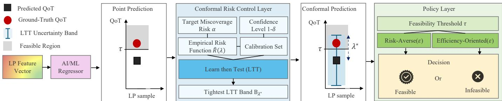
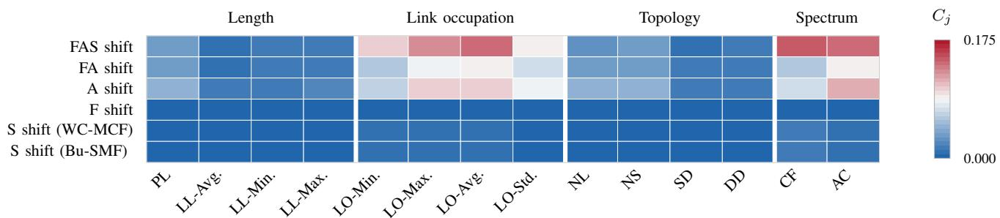
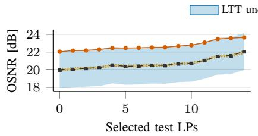
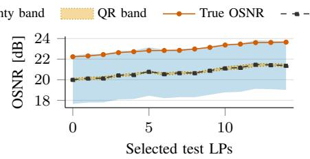
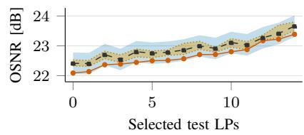
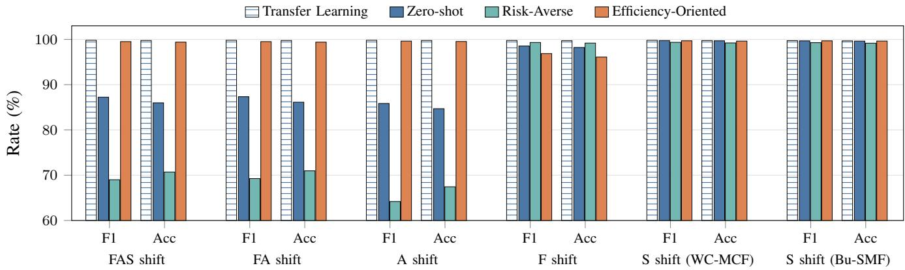
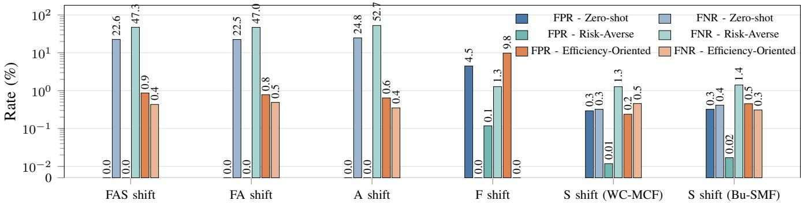

# Conformal Risk Control for QoT-Aware Lightpath Feasibility Under Technology-Driven Domain Shift

Kiarash Rezaei∗ , Omran Ayoub† , Paolo Monti∗ , Carlos Natalino∗

Abstract—Artificial intelligence & machine learning (AI/ML)- based regression models are increasingly used to support operational decision-making in optical networks, but they typically expose only point predictions, which carry no statistically controlled information about their own reliability. This paper proposes a post-hoc conformal risk control (CRC) framework that keeps a pretrained AI/ML regressor fixed, provides a finite-sample guarantee on uncertainty band miscoverage, and maps the band to operational decisions through policy rules. The guarantee applies to interval miscoverage, while the resulting decision-error rates are evaluated empirically. We instantiate the framework for quality of transmission (QoT)-aware lightpath (LP) feasibility assessment, in which a regressor predicts optical signal-to-noise ratio (OSNR) under domain shifts caused by upgrades in fiber type, amplifier technology, and switching architecture. Feature shift contribution scores identify the LP features whose relation to QoT changes the most across a technology transition, and the resulting bands are translated into feasibility decisions by two policies, allowing operators to tune the trade-off between conservatively rejecting or aggressively accepting LP realizations. Experiments on open space-division multiplexing (SDM) QoT datasets over the CONUS topology show that, for a target coverage of 90%, the uncertainty bands meet the target in all 170 trials spanning 17 domain shifts and ten calibration–test partitions, whereas a source-only quantile regression (QR) baseline meets it in none. Under severe domain shifts, the efficiency-oriented (EO) policy empirically improves zero-shot (ZS) feasibility-decision accuracy from about 85% to above 99%, approaching a transfer learning (TL) policy while avoiding retraining. These results show that the framework provides finite-sample control of uncertainty band miscoverage for regression-based optical network decision support, with potential applications beyond QoT-aware LP feasibility assessment.

Index Terms—Trustworthy AI, uncertainty quantification, optical networks, post-hoc calibration, decision support.

## I. INTRODUCTION

Optical transport networks are evolving toward increasingly agile and heterogeneous infrastructures, driven by coherent transceivers, flexible-grid elastic optical networking, and emerging space-division multiplexing (SDM) technologies [1], [2]. These advances expand the control-plane design space by introducing degrees of freedom in routing, modulation-format selection, and spectrum/spatial/waveband allocation, but they also intensify the need for fast and reliable physical-layer feasibility assessment [3]. In particular, quality of transmission (QoT) estimation for unestablished lightpaths (LPs) is a key enabler of impairment-aware provisioning, reconfiguration, and monitoring in dynamic optical networks [4], [5], and artificial intelligence & machine learning (AI/ML) regressors can approximate analytical QoT models with high accuracy when detailed physical-layer modeling is too expensive or impractical.

Operational deployment, however, demands more than the strong average accuracy typically observed during model development [6]. A trustworthy model must also remain reliable when deployment conditions depart from the training data, and expose how much confidence each individual prediction deserves. Network evolution stresses both requirements at once. Differences between training and operational conditions arise from unintentional processes, such as component aging, and from intentional interventions, such as technology upgrades [7]. The latter are usually the more demanding case, because an upgrade in fiber, amplifier, or switching technology modifies not only the distribution of the LP descriptors, but also their underlying relationship with QoT. Such a source–target domain shift silently erodes the accuracy of a regressor trained on the pre-upgrade infrastructure, and a point prediction gives no signal that it has occurred.

Existing work has studied accuracy loss under domain shift and the reliability of individual predictions separately, and neither line of work assesses their impact on operational decisions. Domain shift mitigation methods recover targetdomain accuracy, through retraining or adapting the model [8], [9], [10], [11], but require the ability to update the predictor and sufficient target-domain data to update it. Uncertainty-aware methods, in turn, are frequently model-specific or heuristic [12], [13], [14], [15], [16], and report a confidence value rather than committing to an operational choice. Complementing them, conformal prediction (CP) equips black-box AI/ML models with distribution-free uncertainty estimates under mild assumptions [17], applied post-hoc using held-out labeled target domain dataset and without retraining, while its connection to conformal risk control (CRC) [18] extends conformal methods from coverage guarantees to broader, user-defined risk-control objectives. However, to the best of our knowledge, no prior work in the literature translates a risk-controlled uncertainty band into optical network decisions, precisely when a trained AI/ML model is reused after fiber, amplifier, or switching upgrades.

This paper closes that gap by proposing a post-hoc CRC decision-support framework that leaves the deployed regressor untouched, organized in three layers: (i) a fixed AI/ML regressor, (ii) a CRC layer that converts each point prediction into a risk-controlled uncertainty band from a small targetdomain calibration set, and (iii) a policy layer that maps the prediction and band into an operational decision. We instantiate the framework for QoT-aware LP feasibility assessment under technology-driven domain shift, building on our preliminary conference work [19], which paired split-conformal bands with feasibility policies and validated the idea on a single source– target transition, and advancing it along four directions.

First, we strengthen the statistical foundations of the conformal band. Whereas [19] sets its width to an empirical quantile of the calibration residuals, which controls coverage on average over calibration sets, in this work we select it through an learn then test (LTT)-based CRC procedure [20] from an upper confidence bound on the miscoverage risk that holds uniformly over a grid of candidate widths. This yields the guarantee that, even with the specific and possibly small calibration set available, the selected band keeps the probability that the true QoT value falls outside the band below α, with confidence of at least 1 − δ. The statement remains valid even though the width is selected using that same calibration set. Second, we broaden the evaluation to 17 source–target scenarios grouped into six shift families, covering fiber, amplifier, and switching upgrades in isolation and in combination. While the transition studied in [19] changes fiber and amplifier jointly, our isolated evaluation results identify the amplifier as the dominant contributor. Third, we characterize each shift using feature shift contribution scores that identify the LP features whose relation to QoT changes the most, and we delimit what such featurelevel scores can and cannot reveal about the impact on the deployed model. Fourth, we map the risk-controlled band to feasibility decisions through two policies, risk-averse (RA), which prioritizes avoiding unsafe acceptance, and efficiencyoriented (EO), which prioritizes avoiding overly conservative rejection. Their decision-error rates are assessed empirically.

We evaluate the framework on open SDM QoT datasets [21] over the CONUS topology, comparing it with a zero-shot (ZS) source model, target-trained transfer learning (TL), and a source-only quantile regression (QR) uncertainty baseline. Across ten calibration–test partitions of each of the 17 scenarios, the LTT bands meet the empirical coverage target in all 170 trials. The EO policy improves accuracy under the most challenging shifts from about 85% for the ZS policy to above 99%, approaching the TL policy without retraining. The RA policy provides a conservative operating mode with nearzero false positive rate (FPR). These results indicate that the proposed approach can turn source-trained QoT regressors into practical decision-support tools under technology-driven deployment shifts, and suggest that the same post-hoc riskcontrol principle may also apply to other regression-driven optical network tasks.

## II. RELATED WORK

AI/ML-based QoT estimation has been widely studied in optical networks. Early studies formulated the problem as feasibility classification [22], [23], while later work considered regression-based QoT estimation [24]. Surveys and tutorials have consolidated this research direction by systematizing model families, feature engineering practices, and deployment considerations for AI/ML-assisted QoT estimation [25], [26], [27]. As a result, AI/ML-based QoT estimation has become a credible building block for optical network automation.

Uncertainty-aware QoT methods differ in the predictive uncertainty they represent, the assumptions they require, and the point at which they enter the pipeline. Probabilistic regression [13] and QR [15] estimate input-dependent predictive distributions or conditional quantiles under the training distribution. They provide input-dependent intervals but require uncertainty-specific training objectives, and source-domain intervals need not remain calibrated after a technology shift. Bayesian recurrent predictors [14] and auxiliary self-confidence outputs [12] expose model or confidence uncertainty but rely on model-specific inference or architecture changes. Digitaltwin sensitivity and explicit uncertainty have also been used for QoT optimization and failure prediction [28], [29], [16], while margin-aware design and robust planning incorporate uncertainty at the network-design level [30], [31]. These approaches suit retrainable predictors or planning workflows but do not provide a model-agnostic finite-sample risk guarantee for a fixed deployed regressor.

Domain shift mitigation instead targets predictive accuracy through sample-distribution matching [8], evolutionary transfer learning (TL) [9], adversarial adaptation [10], [32], or lifelong learning [11], [7]. These methods are appropriate when model access and target-domain training are available, but their adapted point estimates alone do not quantify reliability.

Complementing both families, CP attaches distribution-free uncertainty to any fixed predictor using held-out calibration data [17]. Conformalized quantile regression [33], weighted conformal methods under covariate shift [34], and adaptive conformal methods under distribution shift [35] address heteroscedasticity or changing deployment conditions, while CRC extends conformal calibration to user-defined risks [18]. This post-hoc family is suitable when retraining is unavailable but representative labeled calibration data can be collected. The remaining gap is to connect its finite-sample band guarantee to optical network decision support while stating separately which decision errors are guaranteed and which are empirical.

## III. PROPOSED CRC DECISION-SUPPORT FRAMEWORK

Figure 1 illustrates the proposed CRC decision-support framework for QoT-aware LP feasibility assessment under source–target deployment mismatch. The framework has three layers: i) a base AI/ML regressor that maps an input LP feature vector to a point prediction of a QoT metric, such as optical signal-to-noise ratio (OSNR) or bit error rate (BER), allowing the framework to remain agnostic to the specific regression target; ii) a CRC layer that uses held-out target-domain data, referred to as calibration data, and LTT to construct a riskcontrolled uncertainty band; iii) a policy layer that maps this band into a feasibility decision according to the desired operational preference, balancing avoidance of infeasible LP acceptance against admission of potentially feasible ones.

  
Fig. 1: Overview of the proposed CRC decision-support framework. An AI/ML regressor predicts the QoT of an LP from its feature vector. The CRC layer uses calibration set and LTT to construct the uncertainty band $B _ { \lambda ^ { \star } }$ , which is then mapped to a feasibility decision by the RA and EO policies with respect to the threshold τ.

By separating prediction, band construction, and decisionmaking, the design lets an existing source-trained QoT regressor be reused under deployment mismatch, using limited targetdomain data to quantify the uncertainty of its predictions and translating the resulting band into feasibility decisions according to the desired operating mode. The next three subsections describe the framework layers, while the final subsection characterizes the source–target mismatch considered in this work.

## A. AI/ML Regressor: QoT Estimation

The first layer is an AI/ML-based QoT regressor that maps an LP feature vector x to a point prediction ${ \hat { y } } = { \hat { f } } ( x )$ . We assume the QoT metric is monotonic in transmission quality, with larger values better for OSNR and smaller values better for BER. The framework treats $\hat { f }$ as a fixed black-box regressor, requiring no change to its architecture, loss, or training procedure, and is therefore applicable to any regression model used for QoT estimation.

## B. CRC Layer: LTT Uncertainty Band Construction

The CRC layer converts the point prediction of the pretrained QoT regressor into a risk-controlled uncertainty band. The goal is to select a half-band width (λ⋆) that remains as narrow as possible while keeping the probability that the true QoT value associated with a future LP feature vector falls outside the band below a prescribed level $\alpha ,$ referred to as the target miscoverage risk.

Let $\mathcal { D } _ { \mathrm { c a l } } = \{ ( x _ { i } , y _ { i } ) \} _ { i = 1 } ^ { n _ { \mathrm { c a l } } }$ be a calibration set that is disjoint from the training data, where $x _ { i }$ is an LP feature vector and $y _ { i }$ is the corresponding true QoT value. For a candidate half-band width $\lambda \geq 0$ , the uncertainty band around the predicted QoT value is

$$
B _ { \lambda } ( x _ { i } ) = \Big [ \hat { f } ( x _ { i } ) - \lambda , ~ \hat { f } ( x _ { i } ) + \lambda \Big ] .
$$

For a calibration LP with feature vector $x _ { i }$ and true QoT value $y _ { i } .$ , the band fails to cover the true value when $| y _ { i } - { \hat { f } } ( x _ { i } ) | > \lambda$ Therefore, for each candidate half-band width λ, we compute

$$
\widehat { R } ( \lambda ) = \frac { 1 } { n _ { \mathrm { c a l } } } \sum _ { i = 1 } ^ { n _ { \mathrm { c a l } } } \mathbf { 1 } \{ | y _ { i } - \hat { f } ( x _ { i } ) | > \lambda \} ,
$$

where $\widehat { R } ( \lambda )$ is the empirical risk function, i.e., the fraction of calibration LPs whose true QoT values fall outside the candidate uncertainty band. Selecting λ from the condition $\widehat { R } ( \lambda ) \leq \alpha$ would choose a band based only on its observed performance on the available calibration LPs.

This condition, however, raises two issues. First, when only limited target-domain data are available after an upgrade, a band that appears sufficient on the calibration LPs may be too narrow for future test LPs, leading to overconfident decisions. Second, since $\lambda ^ { \star }$ is selected from a candidate grid tested on the same calibration set, the risk-control statement must remain valid after this data-driven selection. The LTT step addresses both by replacing the empirical risk with a concentration upper confidence bound $\widehat { R } ^ { + } ( \lambda )$ on the true miscoverage risk $R ( \lambda )$ which holds simultaneously for all candidate half-band widths at confidence level 1 − δ [20]: being uniform over the grid, it absorbs the multiplicity of the selection, and being a highprobability bound rather than an empirical average, it remains meaningful when $n _ { \mathrm { c a l } }$ is small. Thus, a candidate half-band width λ is accepted only if

$$
\widehat { R } ^ { + } ( \lambda ) \leq \alpha .
$$

Among all accepted candidate half-band widths, the CRC layer selects the smallest one

$$
\lambda ^ { \star } = \operatorname* { m i n } \left\{ \lambda : \widehat { R } ^ { + } ( \lambda ) \leq \alpha \right\} .\tag{1}
$$

If no candidate half-band width satisfies this condition, no LTT uncertainty band is returned. Otherwise, for a new test LP feature vector x, the final LTT uncertainty band is

$$
B _ { \lambda ^ { \star } } ( x ) = \left[ \hat { f } ( x ) - \lambda ^ { \star } , \hat { f } ( x ) + \lambda ^ { \star } \right] ,\tag{2}
$$

where $\lambda ^ { \star }$ is the selected QoT uncertainty margin around the source-trained regressor prediction. We assume that calibration and future test LPs are independent samples from the same target-domain distribution, which makes them exchangeable. Under this assumption, with confidence level $1 \ : - \ : \delta ,$ the probability that a future $\mathrm { L P } ^ { \prime } \mathbf { s }$ true QoT falls outside the selected uncertainty band is no greater than $\alpha .$ The LTT procedure therefore selects the smallest candidate half-band width $\lambda ^ { \star }$ that satisfies the risk-control criterion, avoiding unnecessary conservatism while providing explicit miscoverage-risk control for the uncertainty band used by downstream decision tasks.

TABLE I: Evaluated source–target shift families on the CONUS topology from the SDM QoT dataset [21]. Target-domain sample counts are reported below the table.
<table><tr><td>Shift Family</td><td>Fiber</td><td>Amplifier</td><td>Switching</td><td colspan="4">Source→Target Scenarios</td></tr><tr><td>fiber-amplifier-switch (FAS) shift</td><td>√</td><td>√</td><td>√</td><td> $3  \{ 7 , 8 \}$ </td><td></td><td></td><td></td></tr><tr><td>fiber-amplifier (FA) shift</td><td>√</td><td>√</td><td></td><td></td><td> $1 \to 7 ; 2 \to 8 ; 3 \to 9$ </td><td></td><td></td></tr><tr><td>A shift</td><td>一</td><td>√</td><td></td><td></td><td> $4 \to 7 ; 5 \to 8 ; 6 \to 9$ </td><td></td><td></td></tr><tr><td>F shift</td><td>√</td><td>一</td><td></td><td></td><td> $1 \to 4 ; 2 \to 5 ; 3 \to 6$ </td><td></td><td></td></tr><tr><td>S shift (WC-MCF)</td><td>一</td><td></td><td>√</td><td></td><td> $6  \{ 4 , 5 \} ; 9  \{ 7 , 8 \}$ </td><td></td><td></td></tr><tr><td>S shift (Bu-SMF)</td><td></td><td></td><td>√</td><td></td><td> $3  \{ 1 , 2 \}$ </td><td></td><td></td></tr></table>

Approximate target-domain calibration/test sample counts $( \times 1 0 ^ { 3 } )$ are: $D _ { 1 } = 1 7 2 / 5 1 6 .$ D = 173/518, D = 166/497, D = 166/499, $D _ { 6 } = 1 6 6 / 4 9 7 .$ $\bar { D _ { 7 } } = 1 7 6 / 5 2 7 , D _ { 8 } = 1 8 0 / 5 3 9 .$ and $D _ { 9 } = { \mathrm { \bar { 1 } 8 1 } } / { \mathrm { 5 4 2 } } .$ Here, $D _ { i }$ denotes target dataset i and each pair is reported as calibration/test.

## C. Policy layer: Feasibility Decision

The policy layer defines how the LTT band is used to accept or reject an LP, supporting different operating modes by applying the feasibility test to either its lower or upper bound. Let $L ( x ) = \hat { f } ( x ) - \lambda ^ { \star } , \qquad U ( x ) = \hat { f } ( x ) + \lambda ^ { \star }$ denote the lower and upper bounds of the band for an LP feature vector x, and let τ denote the modulation-format-specific QoT threshold.

We consider two policies. The RA policy declares an LP feasible only if

$$
L ( x ) \geq \tau + \epsilon _ { \mathrm { R A } } .\tag{3}
$$

This policy is conservative, as the prediction must remain above the threshold even at the lower end of the band, and is suitable when avoiding the acceptance of an infeasible LP is the main objective.

The EO policy declares an LP feasible only if

$$
U ( x ) \geq \tau + \epsilon _ { \mathrm { E O } } .\tag{4}
$$

This policy is less conservative, accepting an LP when the upper end of the band indicates possible feasibility, and is suitable when the operator prioritizes higher-spectral-efficiency modulation formats. The parameters $\epsilon _ { \mathrm { R A } }$ and $\boldsymbol { \epsilon } _ { \mathrm { E O } }$ adjust the decision boundary around τ.

The CRC guarantee controls the target miscoverage risk at level α. Under RA, band coverage and the non-negative ϵRA ensure that an LP declared feasible is truly feasible. Declaring an infeasible LP as feasible requires its actual QoT to fall below the band, and the probability of this outcome is no greater than α. Under EO, declaring an LP infeasible despite its actual QoT reaching the threshold, including the $\epsilon _ { \mathrm { E O } }$ , requires its actual QoT to exceed the band and is likewise bounded by α. These bounds concern different outcomes. Hence, the policies do not provide the same operational guarantee as the uncertainty bands. Their overall performance is evaluated empirically in Section V-C.

## D. Source–Target Shift Characterization

Technology changes may alter the relationship between the LP feature vector and the true QoT value. Let $\mathbb { P } _ { S }$ and $\mathbb { P } _ { T }$ denote the source- and target-domain joint distributions of $( X , Y )$ , where $X \in \mathbb { R } ^ { d }$ is the LP feature vector and $Y \in \mathbb { R }$ the corresponding QoT value. The mismatch can appear in two ways: the feature values themselves may change (e.g., different path lengths, link occupations, carrier frequencies, or active-channel patterns), and their relation to QoT may change after a fiber, amplifier, or switching change. The shift score below reflects both effects.

To measure how much an individual feature changes between domains, we use the 1D Wasserstein distance $( W _ { 1 } )$ [36], [10], a standard metric for comparing empirical distributions, applied one feature at a time. Letting $\mathbf { \bar { \chi } } _ { X ^ { ( j ) } } ^ { * }$ denote the $j \mathrm { t h }$ feature, we define a feature-shift indicator as

$$
D _ { j } ^ { X } = W _ { 1 } \Big ( \mathbb { P } _ { S } ( X ^ { ( j ) } ) , \mathbb { P } _ { T } ( X ^ { ( j ) } ) \Big ) .
$$

Similarly, to capture changes in the relation between the jth feature and the QoT value across domains, we define a conditional-shift indicator $D _ { i } ^ { Y | X }$ , which measures how the QoT distribution differs between source and target domains for comparable values of the jth feature. We divide the range of $X ^ { ( j ) }$ into K bins $\{ B _ { k } ^ { j } \} _ { k = 1 } ^ { K }$ and define

$$
D _ { j } ^ { Y | X } = \frac { 1 } { K } \sum _ { k = 1 } ^ { K } W _ { 1 } \left( \mathbb { P } _ { S } ( Y | X ^ { ( j ) } \in \mathcal { B } _ { k } ^ { j } ) , \mathbb { P } _ { T } ( Y | X ^ { ( j ) } \in \mathcal { B } _ { k } ^ { j } ) \right) ,
$$

where $B _ { k } ^ { j }$ is the kth bin of the jth feature. Thus, $D _ { j } ^ { Y | X }$ is large when LPs with comparable values of the jth feature exhibit different QoT behavior across domains. The jth feature shift contribution score is then

$$
C _ { j } = D _ { j } ^ { X } D _ { j } ^ { Y | X } .\tag{5}
$$

A large $C _ { j }$ indicates that the jth feature changes across domains and that its relation to QoT also changes. We use $C _ { j }$ to explain which LP features contribute most to the mismatch. It is not used for model adaptation and is not a formal distance between the full distributions. Being a product, it also does not detect a transition that alters the feature–QoT relation while leaving the feature distributions intact, so it must be analyzed alongside the selected band width.

## IV. EXPERIMENTAL SETUP

We use datasets 1–9 from the open SDM QoT dataset [21] on the CONUS topology, which provide nine technology-specific configurations combining bundled single-mode fiber (Bu-SMF) and weakly coupled multicore fiber (WC-MCF) fiber, erbiumdoped fiber amplifier (EDFA)- and SDM-amplified systems, and joint switching (J-Sw), fractional-joint switching (FrJ-Sw), and independent switching (Ind-Sw) switching. Taking OSNR as the target QoT metric, we define the 17 source–target scenarios of Table I, grouped into six domain shift families that cover both single-dimension and compounded technology changes.

  
Fig. 2: Average feature shift heatmap of $C _ { j }$ across source–target shift families. Features are grouped by the characteristic they represent: length, link occupation, topology, and spectrum. Feature abbreviations: PL = path length, LL = link length, $\mathrm { L O = }$ link occupation, NL = number of links, NS = number of spans, SD = source node degree, DD = destination node degree, CF = carrier frequency, and AC = active channels.

Table I summarizes the evaluated source–target scenarios, where F, A, and S denote fiber, amplifier, and switching technology changes, respectively. The scenarios include simultaneous three-dimensional changes (FAS shift), joint fiber– amplifier changes (FA shift), and single-dimension changes (F, A, and S shift), reflecting practical network upgrades under a fixed network footprint. For each scenario, the source–target mismatch is characterized using the feature shift contribution score $C _ { j }$ defined in (5), which is used to interpret the severity and origin of the domain shift.

For each scenario, source-domain data train an XGBoost (XGB) QoT regressor. The 20% target adaptation subset is fixed, while the remaining target data are independently/randomly repartitioned ten times into disjoint 20% calibration and 60% test subsets. For each partition, CRC uses $\alpha = 0 . 1 0 $ $1 - \delta \ = \ 0 . 9 5$ , and 60 uniformly spaced candidate halfband widths λ between 0 and $1 . 3 Q _ { 0 . 9 5 }$ , where $Q _ { 0 . 9 5 }$ is the 95th percentile of the absolute calibration residuals. The selected band is then evaluated on the corresponding test split, yielding 170 trials. Overlapping test samples assess partition sensitivity rather than independent-dataset variation; Table I gives rounded sample counts, while exact scenario-specific counts and experiment seeds are provided in Supplementary Table ?? and Supplementary Section ??.

We compare source-only ZS, target-adapted TL trained on the adaptation subset, and the proposed RA and EO policies. As a separate uncertainty-quantification baseline, we adapt the QR approach of [15] to our source-domain setting. Each endpoint, ${ \widehat { q } } _ { 0 . 0 5 } ( x )$ or ${ \widehat { q } } _ { 0 . 9 5 } ( x )$ , is the mean of five independently trained XGB quantile models to reduce seed-induced variance. The interval uses neither target training nor calibration and is evaluated on the same test samples as CRC; coverage and width are compared under technology shifts.

Calibration-size sensitivity fixes each test split and recalibrates on nested subsets of 500, 1,000, 2,500, 5,000, 10,000, 25,000, 50,000, and 100,000 samples, plus the full calibration set, across 1,530 scenario–partition runs. For policy evaluation, τ is set to 12, 14, 17, 21, and 24 dB for QPSK, 8-QAM, 16-QAM, 32-QAM, and 64-QAM, respectively. Modulationspecific OSNR thresholding follows common elastic opticalnetwork planning practice [37]. We use $\epsilon _ { \mathrm { { R A } } } ~ { = } ~ 0 $ dB and $\epsilon _ { \mathrm { E O } } = 0 . 1 \ \mathrm { d B } \colon \mathrm { R A }$ relies on the lower bound for conservatism, whereas EO requires 0.1 dB headroom above τ . These fixed settings are applied to all scenarios.

Since LP feasibility assessment is a binary classification task, performance is measured using accuracy, F1-score, false positive rate (FPR), and false negative rate (FNR), with FPR corresponding to infeasible LPs incorrectly labeled as feasible and FNR corresponding to feasible LPs incorrectly rejected as infeasible. These two error types capture distinct operational consequences, since FPR may lead to failed LP establishment or service disruption, whereas FNR may reduce provisioning opportunities or resource efficiency.

## V. RESULTS AND DISCUSSION

We first characterize dataset shift using feature shift contribution score $C _ { j }$ defined in Section III-D, then compare the target-domain coverage and width of the LTT uncertainty and source-only QR bands. For LP feasibility assessment, we evaluate the proposed RA and EO policies against ZS and TL point-prediction baseline policies on the same held-out test samples.

## A. Source–Target Shift Characterization

Fig. 2 reports the average feature shift contribution score $C _ { j }$ for each source–target domain shift family, where each family consists of multiple shift scenarios. The largest average contribution scores are observed for FAS and A shift, indicating that amplifier-related changes play a major role in the source– target mismatch, especially when combined with fiber and switching changes. Across feature groups, the strongest shift is concentrated in link occupation and spectrum-related features. In particular, average link occupation (LO-Avg), carrier frequency (CF), and active channels (AC) show the most visible contributions in the strongest domain shift families. This suggests that changes in technology have a considerable impact on the distribution and relationships among features related to link occupation and spectrum allocation.

The FA shift family also incur feature shifts from link occupation features, although its overall shift intensity is lower than that of FAS and A shift. This is consistent with the fact that amplifier changes affect the resulting OSNR behavior and can alter the relation between network load (co-propagating channels) and QoT. By comparison, F shift falls in the lowest bin for every feature, and the S shift (WC-MCF) and S shift (Bu-SMF) families are only marginally above it, suggesting that changing the fiber or the switching architecture alone perturbs the LP feature distributions, and their relation to QoT, far less than amplifier-related or mixed-technology changes do. The differences observed across the shift families allow us to study the framework under a broad range of source–target mismatches, from switching-only changes to combined fiber, amplifier, and switching transitions. The F shift family, however, shows a negligible $C _ { j }$ , yet the transition is not harmless, as it yields a wider band than either S shift family (Sec. V-B). A fiber-only change leaves the feature distributions essentially intact while altering their relation to QoT, and the product in (5) vanishes in exactly that case, so $C _ { j }$ must be read and analyzed in combination with λ⋆.

TABLE II: Test coverage and full interval width for LTT uncertainty band and source-only QR, by shift family. Each scenario is first averaged over ten target-data partitions; values are mean ± standard deviation across scenarios.
<table><tr><td></td><td colspan="2">LTT uncertainty band</td><td colspan="2">Source-only QR band</td></tr><tr><td>Shift Family</td><td>Test cov. (%)</td><td>Full width [dB]</td><td>Test cov. (%)</td><td>Full width [dB]</td></tr><tr><td>FAS shift</td><td> $9 1 . 6 5 \pm 0 . 1 1$ </td><td> $4 . 2 0 0 \pm 0 . 0 2 7$ </td><td> $0 . 0 0 \pm 0 . 0 0$ </td><td> $0 . 2 1 9 \pm 0 . 0 0 0$ </td></tr><tr><td>FA shift</td><td> $9 1 . 4 9 \pm 0 . 3 7$ </td><td> $4 . 1 6 1 \pm 0 . 0 1 7$ </td><td> $0 . 0 0 \pm 0 . 0 0$ </td><td> $0 . 2 2 1 \pm 0 . 0 0 3$ </td></tr><tr><td>A shift</td><td> $9 4 . 4 3 \pm 3 . 7 2$ </td><td> $4 . 6 6 3 \pm 0 . 0 4 1$ </td><td> $0 . 0 0 \pm 0 . 0 0$ </td><td> $0 . 2 1 6 \pm 0 . 0 0 4$ </td></tr><tr><td>F shift</td><td> $9 1 . 1 4 \pm 0 . 2 8$ </td><td> $0 . 6 9 9 \pm 0 . 0 2 6$ </td><td> $3 . 2 8 \pm 0 . 4 5$ </td><td> $0 . 2 1 5 \pm 0 . 0 0 3$ </td></tr><tr><td>S shift (WC-MCF)</td><td> $9 1 . 0 3 \pm 0 . 0 9$ </td><td> $0 . 1 7 8 \pm 0 . 0 5 3$ </td><td> $8 2 . 7 0 \pm 3 . 6 6$ </td><td> $0 . 1 8 2 \pm 0 . 0 2 5$ </td></tr><tr><td>S shift (Bu-SMF)</td><td> $9 1 . 0 5 \pm 0 . 1 2$ </td><td> $0 . 2 3 5 \pm 0 . 0 2 1$ </td><td> $8 2 . 1 6 \pm 4 . 7 1$ </td><td> $0 . 2 1 5 \pm 0 . 0 0 0$ </td></tr></table>

QR: nominal 90% source-domain interval with no target-domain calibration.

  
(a) FAS shift

  
(b) A shift

  
(c) F shift  
Fig. 3: LTT uncertainty and source-only QR bands for the same 15 target-domain test LPs and selected shifts.

## B. LTT Uncertainty Bands Coverage

Table II compares the target-domain test coverage and full width of the LTT with a source-only QR uncertainty bands for each shift family. Source-only QR assesses whether intervals learned in the source domain retain their nominal coverage after a technology shift. Unlike LTT, it does not receive any target-domain calibration samples. Across the 170 scenario– partition trials, LTT achieves at least 90% coverage in every trial (minimum: 90.48%; mean: 91.81%). On held-out source domain validation data, the nominal 90% QR band achieves 89.64% mean coverage (89.44–89.85% across seven source domains). On target-domain test data, however, it does not reach 90% coverage in any of the trials and has a mean coverage of 29.70%. Its mean full width is 0.209 dB, compared with

2.244 dB for LTT, but these narrow bands do not capture the shift-induced prediction errors. We exclude QR from the decision-policy comparison because its target-domain test coverage remains below the 90% target (1 − α, with α = 0.10) in all 170 trials. Scenario-level results for all 17 transitions are reported in Supplementary Table ??.

This difference between LTT and QR uncertainty bands is also visible in Fig. 3. For LTT bands, Amplifier-related and mixed shifts require full widths of 4.2–4.7 dB, whereas switching-only shifts require about 0.2 dB. Wider bands reflect larger target-domain residuals, although their effect on feasibility decisions also depends on the residual direction and the OSNR margin to the threshold. In particular, a wide LTT band can cause the RA policy to reject otherwise feasible LPs, reducing resource utilization. Narrower bands would require smaller residuals or less finite-sample slack, for example by improving or adapting the predictor using data disjoint from calibration and then recalibrating it, or by collecting more representative calibration data. Simply reducing the band width at fixed α, δ, and residuals would invalidate the coverage guarantee. The narrow QR bands remain close to the sourcedomain estimates but often miss the target-domain OSNR, particularly for amplifier-related shifts. In contrast, CRC widens the band according to the shifted residuals. Thus, interval width should be interpreted jointly with coverage, rather than as evidence of reliable uncertainty on its own.

We examined the sensitivity to calibration set size by varying it from 500 samples to the full sets of 165,511–180,629 samples. With 500 samples, LTT selected a band in only 107/170 trials; therefore, we do not report aggregate performance. From 1,000 samples onward, a band was selected in all trials and attained at least 90% test coverage. Increasing the calibration size reduced overcoverage and band width in every shift family, while amplifier-related and mixed shifts remained the widest. Thus, 1,000 samples was the smallest evaluated calibration set size satisfying both conditions, but this value cannot be generalized to other scenarios not investigated in this paper. Details are provided in Supplementary Table ??.

  
(a) Feasibility-decision performance.

  
(b) False positive rate (FPR) and false negative rate (FNR) across shift families.  
Fig. 4: Feasibility-decision performance by source–target shift family. Values are means over ten target-domain calibration-test partitions per scenario and then across scenarios in each family. (a) F1 score and accuracy for TL, ZS, and the CRC-based RA and EO policies. (b) FPR and FNR for ZS, RA, and EO.

## C. Feasibility-Decision Performance

Figs. 4a and 4b show decision performance and error type for the ZS, TL, and proposed CRC-based policies. Under FAS, FA, and A shifts, EO raises the degraded ZS accuracy from about 85% to above 99%, appraching TL levels. Switching-only shifts leave all methods near 99%. F shift reverses the ranking: RA is the strongest non-retraining method and EO falls below ZS. Across the 170 scenario–partition trials, the mean RA and EO accuracies are 85.26% and 98.92%, respectively. Using only 1,000 instead of all calibration samples drops them by less than 1%. Within each shift family, the change is at most 1.25 percentage points (Supplementary Table ??).

The results show that residual direction depends on the technology shift: amplifier-related shifts cause underestimation and high FNR, which EO reduces, whereas F shift causes overestimation and high FPR, which RA reduces. The direction of the shift cannot be assumed before target calibration data are observed. The symmetric LTT uncertainty band is therefore shift-agnostic and attains the target coverage in all trials. Once the direction is observed, however, equal widths may place unnecessary width on the less relevant side of the band. An asymmetric band could use different lower and upper widths to address this, but we leave its calibration and evaluation outside the scope of this study.

TL is an upper reference: it uses the same target-data budget but requires model access and retraining, whereas CRC recalibrates a fixed predictor; the two can also be combined [19]. The guarantee requires calibration–test exchangeability. Noise or aging represented during calibration can widen the band, whereas continued drift, abrupt instability, or evolving noise conditions are not covered.

## VI. CONCLUSION

Technology upgrades can make a source-trained QoT regressor unreliable without revealing the loss in its point predictions. The proposed post-hoc CRC framework addresses this without retraining: target calibration data construct LTT uncertainty bands with finite-sample control of target miscoverage, feature shift scores characterize mismatch, and RA and EO use the bands for feasibility decisions. The guarantee applies to coverage; policy performance is evaluated empirically.

Across 17 shifts and ten target-data partitions, CRC met the 90% test-coverage target in all 170 trials, whereas sourceonly QR met it in none. With 1,000 samples, LTT selected a band in every trial with decision performance close to the full-calibration result; with 500 samples, it selected a band in 107/170 trials. Wider amplifier-related bands expose uncertainty from reusing the source regressor, while RA and EO outcomes show the trade-off between safety and resource utilization.

The guarantee requires calibration–test exchangeability. Aging, evolving noise, sensor shift, or link instability not represented during calibration require monitoring and recalibration. Future work should consider these effects, in addition to rolling calibration, and asymmetric bands. The same approach may support threshold-based regression tasks in optical networks.

## REFERENCES

[1] R. Casellas, R. Martinez, R. Vilalta, and R. M. noz, “Overview of SDN control of multiband over SDM optical networks with physical layer impairments (invited tutorial),” J. Opt. Commun. Netw., vol. 17, no. 2, pp. A165–A177, Feb 2025.

[2] C. Natalino and P. Monti, “Optical network automation, programmability, and AI: the path to 6G readiness,” in 2025 IEEE International Conference on Machine Learning for Communication and Networking (ICMLCN), 2025.

[3] V. Lohani, R. Munoz, R. Casellas, I. Tomkos, and D. M. Marom, “Dynamic routing and resource assignment for multi-granular optical node architectures with optical grooming,” Journal of Optical Communications and Networking, vol. 18, no. 5, pp. 394–408, 2026.

[4] M. Klinkowski, P. Lechowicz, and K. Walkowiak, “Survey of resource allocation schemes and algorithms in spectrally-spatially flexible optical networking,” Optical Switching and Networking, vol. 27, pp. 58–78, 2018.

[5] M. Yang, Q. Wu, and Y. Zhang, “Joint assignment of spatial granularity, routing, modulation, and spectrum in SDM-EONs: Minimizing the network capex considering spectrum, wss, and laser resources,” Journal of Lightwave Technology, vol. 36, no. 18, pp. 4153–4166, 2018.

[6] C. Natalino, O. Ayoub, and P. Monti, “Engineering trust in AI-driven optical networks: Challenges in moving from monitoring to autonomy [invited tutorial],” in 2026 International Conference on Optical Network Design and Modeling (ONDM), May 2026, pp. 1–6.

[7] P. Lechowicz, C. Natalino, and P. Monti, “QoT estimation with margin driven transfer learning in time-varying optical networks,” in Optical Fiber Communications Conference and Exhibition (OFC), Mar. 2025, p. M1J.5.

[8] Z. Gu, T. Qin, Y. Zhou, J. Zhang, and Y. Ji, “Sample-distributionmatching-based transfer learning for QoT estimation in optical networks,” J. Opt. Commun. Netw., vol. 15, no. 9, pp. 649–663, 2023.

[9] Y. Zhou, Z. Gu, J. Zhang, and Y. Ji, “Evolutionary neuron-level transfer learning for QoT estimation in optical networks,” J. Opt. Commun. Netw., vol. 16, no. 4, pp. 432–448, Apr 2024.

[10] Z. Cai, Q. Wang, Y. Deng, P. Zhang, Z. Gai, Y. Li, and F. N. Khan, “Domain adversarial adaptation framework for few-shot QoT estimation in optical networks,” J. Opt. Commun. Netw., vol. 16, no. 11, pp. 1133–1144, 2024.

[11] Q. Wang, Z. Cai, and F. N. Khan, “Lifelong QoT prediction: an adaptation to real-world optical networks,” J. Opt. Commun. Netw., vol. 16, no. 11, pp. 1159–1169, 2024.

[12] T. Tanimura, T. Hoshida, T. Kato, and S. Watanabe, “OSNR estimation providing self-confidence level as auxiliary output from neural networks,” J. Lightw. Technol., vol. 37, no. 7, pp. 1717–1723, 2019.

[13] N. Di Cicco, M. Ibrahimi, C. Rottondi, and M. Tornatore, “Calibrated probabilistic QoT regression for unestablished lightpaths in optical networks,” in 2022 International Balkan Conference on Communications and Networking (BalkanCom), 2022, pp. 21–25.

[14] N. Di Cicco, J. Talpini, M. Ibrahimi, M. Savi, and M. Tornatore, “Uncertainty-aware QoT forecasting in optical networks with bayesian recurrent neural networks,” in IEEE International Conference on Com munications (ICC), 2023, pp. 441–446.

[15] S. Yousefi, H. Chouman, P. Djukic, F. Golaghazadeh, C. Tremblay, and C. Desrosiers, “Forecasting lightpath quality of transmission and implementing uncertainty in the forecast models,” J. Lightw. Technol., vol. 41, no. 15, pp. 4871–4881, 2023.

[16] Q. Guo, C. Zhang, X. Xiao, M. Zhang, T. Yang, X. Jiang, and D. Wang, “Conditional denoising diffusion probabilistic model for trustworthy failure prediction in optical networks,” in Optical Fiber Communication Conference (OFC), 2026, paper M3A.6.

[17] A. N. Angelopoulos and S. Bates, “A gentle introduction to conformal prediction and distribution-free uncertainty quantification,” 2022. [Online]. Available: https://arxiv.org/abs/2107.07511

[18] A. N. Angelopoulos, S. Bates, A. Fisch, L. Lei, and T. Schuster, “Conformal risk control,” 2022.

[19] K. Rezaei, O. Ayoub, P. Monti, and C. Natalino, “Policy-driven conformal prediction for trustworthy QoT estimation,” in Optical Fiber Communication Conference (OFC), 2026, p. M4A.3.

[20] A. N. Angelopoulos, S. Bates, E. J. Candes, M. I. Jordan, and L. Lei,\` “Learn then test: Calibrating predictive algorithms to achieve risk control,” 2022. [Online]. Available: https://arxiv.org/abs/2110.01052

[21] H. Akbari, B. Shariati, J. L. M. Morrone, P. Safari, J. K. Fischer, and R. Freund, “Datasets for QoT estimation in SDM networks,” J. Opt. Commun. Netw., vol. 17, no. 6, pp. 514–525, Jun 2025.

[22] T. Panayiotou, S. P. Chatzis, and G. Ellinas, “Performance analysis of a data-driven quality-of-transmission decision approach on a dynamic multicast-capable metro optical network,” J. Opt. Commun. Netw., vol. 9, no. 1, pp. 98–108, Jan 2017.

[23] C. Rottondi, L. Barletta, A. Giusti, and M. Tornatore, “Machine-learning method for quality of transmission prediction of unestablished lightpaths,” J. Opt. Commun. Netw., vol. 10, no. 2, pp. A286–A297, Feb 2018.

[24] M. Ibrahimi, H. Abdollahi, C. Rottondi, A. Giusti, A. Ferrari, V. Curri, and M. Tornatore, “Machine learning regression for QoT estimation of unestablished lightpaths,” J. Opt. Commun. Netw., vol. 13, no. 4, pp. B92–B101, Apr 2021.

[25] Y. Pointurier, “Machine learning techniques for quality of transmission estimation in optical networks,” J. Opt. Commun. Netw., vol. 13, no. 4, pp. B60–B71, Apr 2021.

[26] R. Ayassi, A. Triki, N. Crespi, R. Minerva, and M. Laye, “Survey on the use of machine learning for quality of transmission estimation in optical transport networks,” J. Lightw. Technol., vol. 40, no. 17, pp. 5803–5815, 2022.

[27] S. Allogba, S. Aladin, and C. Tremblay, “Machine-learning-based lightpath QoT estimation and forecasting,” J. Lightw. Technol., vol. 40, no. 10, pp. 3115–3127, 2022.

[28] Y. Zhang, Q. Qiu, X. Liu, L. Yi, W. Hu, and Q. Zhuge, “SAMA-IR: Sensitivity-analysis guided memory-aware input refinement methodology for large-scale optical networks with field-trial validation,” J. Lightw. Technol., vol. 43, no. 18, pp. 8603–8611, 2025.

[29] X. Yang, C. Sun, R. Ayassi, L. Aknin, G. Charlet, M. Tornatore, and Y. Pointurier, “Input refinement with incremental learning for accurate digital twin-enabled self-driven QoT optimization in optical networks,” J. Opt. Commun. Netw., vol. 18, no. 1, pp. A75–A87, 2026.

[30] O. Karandin, A. Ferrari, F. Musumeci, Y. Pointurier, and M. Tornatore, “Probabilistic low-margin optical-network design with multiple physicallayer parameter uncertainties,” J. Opt. Commun. Netw., vol. 15, no. 7, pp. C129–C137, Jul 2023.

[31] A. V. Paz, R. R. Reyes, and P. Sahu, “Planning multilayer networks under deep uncertainties: an approach based on flexibility in engineering design,” J. Opt. Commun. Netw., vol. 18, no. 4, pp. 338–353, 2026.

[32] A. A. Housseini, C. Natalino, P. Monti, and O. Ayoub, “Cross-domain generalization in optical networks via joint contrastive and classification learning,” in 2026 International Conference on Optical Network Design and Modeling (ONDM), May 2026, pp. 1–6.

[33] Y. Romano, E. Patterson, and E. J. Candes, “Conformalized \` quantile regression,” in Advances in Neural Information Processing Systems, vol. 32, 2019. [Online]. Available: https://papers.nips.cc/paper/ 8613-conformalized-quantile-regression.pdf

[34] R. J. Tibshirani, R. F. Barber, E. J. Candes, and A. Ramdas, “Conformal\` prediction under covariate shift,” in Advances in Neural Information Processing Systems, vol. 32, 2019.

[35] I. Gibbs and E. J. Candes, “Adaptive conformal inference under distribu-\` tion shift,” in Advances in Neural Information Processing Systems, vol. 34, 2021. [Online]. Available: https://proceedings.neurips.cc/paper files/ paper/2021/hash/0d441de75945e5acbc865406fc9a2559-Abstract.html

[36] C. Villani, Optimal Transport: Old and New, 2009.

[37] A. Mitra, D. Ives, A. Lord, S. Savory, S. Kar, and P. Wright, “Network equipment and their procurement strategy for high capacity elastic optical networks,” J. Opt. Commun. Netw., vol. 8, no. 7, pp. A201–A211, Jul 2016.

# Supplementary Material

for “Conformal Risk Control for QoT-Aware Lightpath Feasibility Under Technology-Driven Domain Shift”

Kiarash Rezaei, Omran Ayoub, Paolo Monti, and Carlos Natalino

This supplement provides the scenario-level results underlying the repeated-partition, source-only quantile regression (QR), and calibration-size analyses reported in the main manuscript. It contains no additional claims beyond those in the manuscript. It documents the experimental protocol and corresponding numerical results in greater detail.

## I. REPEATED-PARTITION PROTOCOL

This section details the repeated-partition and learn then test (LTT) uncertainy band-selection procedures described in Sec. IV of the main manuscript. These procedures underlie the coverage and the corresponding interval-width results in Table II and the feasibility-decision results in Fig. 4.

The source-domain training and validation sets and the target-domain adaptation set were kept fixed. For each source–target scenario, the union of the original target calibration and test sets was reshuffled with ten seeds: 101, 211, 307, 401, 503, 601, 701, 809, 907, and 1009. We retained the original calibration and test sizes, and the two subsets were disjoint within each partition. Because different partitions draw from the same target-domain pool, their overlap is possible. Consequently, the reported standard deviations quantify sensitivity to the calibration–test partition and are not standard errors over independen datasets. Within each partition, we evaluated conformal risk control (CRC) and QR on exactly the same test samples.

The CRC experiments used $\alpha = 0 . 1 0$ and $\delta = 0 . 0 5$ . For each calibration set, 60 candidate values of λ were constructed from its absolute source-model residuals, and LTT selected the smallest candidate satisfying the stated risk criterion. If no candidate satisfied the criterion, no band was selected and that trial was recorded as such rather than assigned a width or coverage value.

For the source-only QR baseline, two XGBoost (XGB) quantile regressors estimated $\widehat { q } _ { 0 . 0 5 } ( x )$ and $\widehat { q } _ { 0 . 9 5 } ( x )$ . Each endpoint was averaged over five models trained with seeds 42, 53, 64, 75, and 86. The models used only source-domain data and received neither target-domain training nor target-domain calibration.

Table S1 reports the target-domain sample counts used in the full-calibration experiments. These counts are preserved for every partition of a given scenario.

TABLE S1  
TARGET-DOMAIN CALIBRATION AND TEST SAMPLE COUNTS FOR THE 17 SOURCE–TARGET SCENARIOS.
<table><tr><td>Shift family</td><td>Source→Target</td><td>Calibration</td><td>Test</td></tr><tr><td rowspan="2">fiber-amplifier-switch (FAS) shift</td><td>3 → 7</td><td>175,568</td><td>526,704</td></tr><tr><td>3 → 8</td><td>179,579</td><td>538,738</td></tr><tr><td rowspan="3">fiber-amplifier (FA) shift</td><td>1 → 7</td><td>175,568</td><td>526,704</td></tr><tr><td>2 → 8</td><td>179,579</td><td>538,738</td></tr><tr><td>3 → 9</td><td>180,629</td><td>541,887</td></tr><tr><td rowspan="3">A shift</td><td>4 → 7</td><td>175,568</td><td>526,704</td></tr><tr><td>5→8</td><td>179,579</td><td>538,738</td></tr><tr><td>6 → 9</td><td>180,629</td><td>541,887</td></tr><tr><td rowspan="3">F shift</td><td>1 → 4</td><td>165,558</td><td>496,674</td></tr><tr><td>2 → 5</td><td>166,279</td><td>498,837</td></tr><tr><td>3→ 6</td><td>165,511</td><td>496,534</td></tr><tr><td rowspan="4">S shift (weakly coupled multicore fiber (WC-MCF))</td><td>6 → 4</td><td>165,558</td><td>496,674</td></tr><tr><td>6 → 5</td><td>166,279</td><td>498,837</td></tr><tr><td>9 → 7</td><td>175,568</td><td>526,704</td></tr><tr><td>9 → 8</td><td>179,579</td><td>538,738</td></tr><tr><td rowspan="2">S shift (bundled single-mode fiber (Bu-SMF))</td><td>3 → 1</td><td>172,055</td><td>516,166</td></tr><tr><td>3 → 2</td><td>172,821</td><td>518,463</td></tr></table>

## II. SCENARIO-LEVEL CRC AND QR RESULTS

The manuscript compares the LTT uncertainty bands and source-only QR by shift family in its Results and Discussion section (Sec. V, specifically Sec. V-B and Table II). Table S2 gives the corresponding coverage and full interval width for each source–target scenario, as mean ± standard deviation over ten target-data partitions. The LTT uncertainty bands reach at least 90% mean test coverage in every scenario, whereas source-only QR falls below 90% in every scenario, most markedly under amplifier-related shifts.

TABLE S2  
SCENARIO-LEVEL TEST COVERAGE AND FULL INTERVAL WIDTH FOR CRC AND SOURCE-ONLY QR. VALUES ARE THE MEAN ± STANDARD DEVIATION OVER TEN TARGET-DATA PARTITIONS.
<table><tr><td colspan="2"></td><td colspan="2">LTT uncertainty band</td><td colspan="2">Source-only QR</td></tr><tr><td>Shift Family</td><td>Source→Target</td><td>Coverage (%)</td><td>Width (dB)</td><td>Coverage (%)</td><td>Width (dB)</td></tr><tr><td rowspan="2">FAS shift</td><td> $3  7$ </td><td> $9 1 . 7 3 \pm 0 . 0 7$ </td><td> $4 . 2 2 0 \pm 0 . 0 0 1$ </td><td> $0 . 0 0 \pm 0 . 0 0$ </td><td> $0 . 2 1 9 \pm 0 . 0 0 0$ </td></tr><tr><td> $3  8$ </td><td> $9 1 . 5 7 \pm 0 . 1 0$ </td><td> $4 . 1 8 1 \pm 0 . 0 0 1$ </td><td> $0 . 0 0 \pm 0 . 0 0$ </td><td> $0 . 2 1 9 \pm 0 . 0 0 0$ </td></tr><tr><td rowspan="3">FA shift</td><td> $1  7$ </td><td> $9 1 . 9 2 \pm 0 . 0 6$ </td><td> $4 . 1 8 0 \pm 0 . 0 0 0$ </td><td> $0 . 0 0 \pm 0 . 0 0$ </td><td> $0 . 2 1 9 \pm 0 . 0 0 0$ </td></tr><tr><td> $2  8$ </td><td> $9 1 . 3 6 \pm 0 . 0 7$ </td><td> $4 . 1 5 3 \pm 0 . 0 0 0$ </td><td> $0 . 0 0 \pm 0 . 0 0$ </td><td> $0 . 2 2 4 \pm 0 . 0 0 0$ </td></tr><tr><td>3→ 9</td><td> $9 1 . 2 1 \pm 0 . 1 3$ </td><td> $4 . 1 5 0 \pm 0 . 0 0 1$ </td><td> $0 . 0 0 \pm 0 . 0 0$ </td><td> $0 . 2 1 9 \pm 0 . 0 0 0$ </td></tr><tr><td rowspan="3">A shift</td><td>4→ 7</td><td> $9 1 . 1 2 \pm 0 . 0 6$ </td><td> $4 . 6 3 0 \pm 0 . 0 0 0$ </td><td> $0 . 0 0 \pm 0 . 0 0$ </td><td> $0 . 2 1 9 \pm 0 . 0 0 0$ </td></tr><tr><td>5 → 8</td><td> $9 3 . 7 2 \pm 4 . 0 2$ </td><td> $4 . 6 4 9 \pm 0 . 0 5 3$ </td><td> $0 . 0 0 \pm 0 . 0 0$ </td><td> $0 . 2 1 7 \pm 0 . 0 0 0$ </td></tr><tr><td>6 → 9</td><td> $9 8 . 4 6 \pm 0 . 0 2$ </td><td> $4 . 7 0 9 \pm 0 . 0 0 1$ </td><td> $0 . 0 0 \pm 0 . 0 0$ </td><td> $0 . 2 1 2 \pm 0 . 0 0 0$ </td></tr><tr><td rowspan="3">F shift</td><td>1 → 4</td><td> $9 1 . 3 3 \pm 0 . 1 9$ </td><td> $0 . 6 7 2 \pm 0 . 0 0 2$ </td><td> $2 . 8 0 \pm 0 . 0 1$ </td><td> $0 . 2 1 2 \pm 0 . 0 0 0$ </td></tr><tr><td>2 → 5</td><td> $9 1 . 2 8 \pm 0 . 0 6$ </td><td> $0 . 7 0 2 \pm 0 . 0 0 1$ </td><td> $3 . 6 9 \pm 0 . 0 1$ </td><td> $0 . 2 1 7 \pm 0 . 0 0 0$ </td></tr><tr><td>3 → 6</td><td> $9 0 . 8 1 \pm 0 . 0 6$ </td><td> $0 . 7 2 3 \pm 0 . 0 0 1$ </td><td> $3 . 3 4 \pm 0 . 0 1$ </td><td> $0 . 2 1 7 \pm 0 . 0 0 0$ </td></tr><tr><td rowspan="4">S shift (WC-MCF)</td><td>6 → 4</td><td> $9 1 . 0 0 \pm 0 . 0 6$ </td><td> $0 . 2 3 7 \pm 0 . 0 0 0$ </td><td> $7 9 . 3 4 \pm 0 . 0 3$ </td><td> $0 . 2 0 5 \pm 0 . 0 0 0$ </td></tr><tr><td>6 → 5</td><td> $9 1 . 0 6 \pm 0 . 0 9$ </td><td> $0 . 2 0 8 \pm 0 . 0 0 0$ </td><td> $8 5 . 6 5 \pm 0 . 0 1$ </td><td> $0 . 2 0 3 \pm 0 . 0 0 0$ </td></tr><tr><td> $9 \to 7$ </td><td> $9 0 . 9 3 \pm 0 . 0 8$ </td><td> $0 . 1 4 4 \pm 0 . 0 0 0$ </td><td> $7 9 . 7 4 \pm 0 . 0 3$ </td><td> $0 . 1 6 1 \pm 0 . 0 0 0$ </td></tr><tr><td> $9  8$ </td><td> $9 1 . 1 5 \pm 0 . 2 3$ </td><td> $0 . 1 2 4 \pm 0 . 0 0 1$ </td><td> $8 6 . 0 7 \pm 0 . 0 2$ </td><td> $0 . 1 6 0 \pm 0 . 0 0 0$ </td></tr><tr><td rowspan="2">S shift (Bu-SMF)</td><td> $3 \to 1$ </td><td> $9 0 . 9 7 \pm 0 . 0 6$ </td><td> $0 . 2 5 0 \pm 0 . 0 0 0$ </td><td> $7 8 . 8 2 \pm 0 . 0 2$ </td><td> $0 . 2 1 5 \pm 0 . 0 0 0$ </td></tr><tr><td> $3  2$ </td><td> $9 1 . 1 3 \pm 0 . 0 7$ </td><td> $0 . 2 2 0 \pm 0 . 0 0 0$ </td><td> $8 5 . 4 9 \pm 0 . 0 2$ </td><td> $0 . 2 1 4 \pm 0 . 0 0 0$ </td></tr></table>

## III. CALIBRATION-SIZE SENSITIVITY

In this section, we examine how calibration set size affects LTT band selection, test coverage, and band width. These results are summarized in the manuscript’s Results and Discussion section (Sec. V, specifically Sec. V-B).

For each scenario and partition, calibration was repeated using nested subsets of 500, 1,000, 2,500, 5,000, 10,000, 25,000, 50,000, and 100,000 samples, followed by the full calibration set. A separate candidate grid was constructed from each subset; the full-set grid was not reused for the smaller budgets. Table S3 reports the test coverage and full band width by shift family.

At 500 samples, LTT selected a band in 107 of the 170 scenario–partition trials: 20/20 FAS, 30/30 FA, 30/30 A, 19/30 F, 5/40 S (WC-MCF), and 3/20 S (Bu-SMF) trials. The 500-sample entries therefore average only the trials in which a band wa selected. From 1,000 samples onward, a band was selected in all 170 trials and all selected bands reached at least 90% test coverage. Thus, 1,000 samples is the smallest evaluated budget with this outcome in every trial; it is an empirical result for these data and is not a universal minimum.

TABLE S3  
CALIBRATION-SIZE SENSITIVITY BY SHIFT FAMILY. EACH ENTRY GIVES MEAN TEST COVERAGE (%)/MEAN FULL LTT UNCERTAINTY BAND WIDTH (DB) OVER THE TRIALS IN WHICH A BAND WAS SELECTED.
<table><tr><td rowspan="2">Shift family</td><td colspan="9">Calibration samples</td></tr><tr><td>500</td><td>1k</td><td>2.5k</td><td>5k</td><td>10k</td><td>25k</td><td>50k</td><td>100k</td><td>Full</td></tr><tr><td>FAS shift</td><td>99.58/4.386</td><td>97.83/4.290</td><td>97.94/4.292</td><td>97.99/4.294</td><td>97.98/4.293</td><td>91.69/4.200</td><td>91.63/4.200</td><td>91.65/4.200</td><td>91.65/4.200</td></tr><tr><td>FA shift</td><td>99.66/4.345</td><td>98.06/4.254</td><td>98.06/4.254</td><td>98.09/4.254</td><td>97.87/4.251</td><td>94.93/4.207</td><td>91.49/4.161</td><td>91.50/4.161</td><td>91.49/4.161</td></tr><tr><td>A shift</td><td>99.83/4.822</td><td>98.42/4.719</td><td>98.42/4.718</td><td>98.43/4.719</td><td>98.40/4.718</td><td>98.39/4.718</td><td>96.24/4.687</td><td>95.74/4.680</td><td>94.43/4.663</td></tr><tr><td>F shift</td><td>99.29/1.086</td><td>96.82/0.941</td><td>94.45/0.830</td><td>93.21/0.775</td><td>92.52/0.743</td><td>91.89/0.721</td><td>91.40/0.707</td><td>91.17/0.700</td><td>91.14/0.699</td></tr><tr><td>S shift (WC-MCF)</td><td>98.41/0.243</td><td>96.76/0.229</td><td>94.48/0.203</td><td>93.38/0.194</td><td>92.52/0.188</td><td>91.80/0.183</td><td>91.22/0.180</td><td>91.06/0.179</td><td>91.03/0.178</td></tr><tr><td>S shift (Bu-SMF)</td><td>99.00/0.374</td><td>96.93/0.304</td><td>94.75/0.270</td><td>93.56/0.257</td><td>92.63/0.248</td><td>91.85/0.241</td><td>91.51/0.238</td><td>91.06/0.235</td><td>91.05/0.235</td></tr></table>

At 500 samples, the band-selection counts are 20/20 (FAS), 30/30 (FA), 30/30 (A), 19/30 (F), 5/40 [S (WC-MCF)], and 3/20 [S (Bu-SMF)]. All 170 trials are included at every budget from 1,000 samples onward.

With 500 samples, the selected bands are generally wider and their coverage is well above the 90% target. As the calibration budget increases, coverage approaches the target and the mean width decreases. The rate of this change depends on the shift family: amplifier-related and mixed shifts remain substantially wider than switching-only shifts at every budget.

## IV. EFFECT OF CALIBRATION SIZE ON THE DECISION POLICIES

In this section, we assess how calibration-set size affects the performance of the risk-averse (RA) and efficiency-oriented (EO) feasibility policies. These results are summarized in the manuscript’s Results and Discussion section (Sec. V, specifically Sec. V-C).

Table S4 reports the test-set results separately for each shift family. The policy parameters are unchanged from the main manuscript: ϵRA = 0 and ϵEO = 0.1 dB. Accuracy and conditional decision-error rates are reported only when LTT selected a band in all 170 scenario–partition trials at that calibration budget. Therefore, the 500-sample row contains only the bandselection count for each family; the corresponding policy metrics are omitted because a band was selected in only 107/170 trials overall. From 1,000 samples onward, a band was selected in all 170 trials and all policy metrics are reported. The false positive rate (FPR) and false negative rate (FNR) are empirical quantities and are not controlled by the CRC coverage guarantee.

TABLE S4: Decision-policy sensitivity to calibration size, separated by shift family. Results are test-set means over the scenario–partition trials within each family. Accuracy, FPR, and FNR are in percent. A dash indicates that policy metrics are not reported because a band was not selected in all 170 trials at that budget.
<table><tr><td>Shift family</td><td>Cal. samples</td><td>Bands selected</td><td>RA accuracy</td><td>RA FPR</td><td>EO accuracy</td><td>EO FNR</td></tr><tr><td rowspan="9">FAS shift</td><td>500</td><td>20/20</td><td></td><td></td><td></td><td></td></tr><tr><td>1k</td><td>20/20</td><td>70.43</td><td>0.000</td><td>99.35</td><td>0.171</td></tr><tr><td>2.5k</td><td>20/20</td><td>70.42</td><td>0.000</td><td>99.34</td><td>0.166</td></tr><tr><td>5k</td><td>20/20</td><td>70.41</td><td>0.000</td><td>99.34</td><td>0.163</td></tr><tr><td>10k</td><td>20/20</td><td>70.41</td><td>0.000</td><td>99.34</td><td>0.164</td></tr><tr><td>25k</td><td>20/20</td><td>70.71</td><td>0.000</td><td>99.40</td><td>0.431</td></tr><tr><td>50k</td><td>20/20</td><td>70.71</td><td>0.000</td><td>99.40</td><td>0.433</td></tr><tr><td>100k</td><td>20/20</td><td>70.71</td><td>0.000</td><td>99.40</td><td>0.432</td></tr><tr><td>Full</td><td>20/20</td><td>70.71</td><td>0.000</td><td>99.40</td><td>0.432</td></tr><tr><td rowspan="9">FA shift</td><td>500</td><td>30/30</td><td></td><td></td><td></td><td></td></tr><tr><td>1k</td><td>30/30</td><td>70.68</td><td>0.000</td><td>99.38</td><td>0.179</td></tr><tr><td>2.5k</td><td>30/30</td><td>70.68</td><td>0.000</td><td>99.39</td><td>0.180</td></tr><tr><td>5k</td><td>30/30</td><td>70.67</td><td>0.000</td><td>99.38</td><td>0.179</td></tr><tr><td>10k</td><td>30/30</td><td>70.69</td><td>0.000</td><td>99.39</td><td>0.188</td></tr><tr><td>25k</td><td>30/30</td><td>70.83</td><td>0.000</td><td>99.41</td><td>0.315</td></tr><tr><td>50k</td><td>30/30</td><td>70.97</td><td>0.000</td><td>99.40</td><td>0.490</td></tr><tr><td>100k</td><td>30/30</td><td>70.97</td><td>0.000</td><td>99.40</td><td>0.490</td></tr><tr><td>Full</td><td>30/30</td><td>70.97</td><td>0.000</td><td>99.40</td><td>0.490</td></tr><tr><td rowspan="10">A shift</td><td>500</td><td>30/30</td><td></td><td></td><td></td><td></td></tr><tr><td>1k</td><td>30/30</td><td>67.21</td><td>0.000</td><td>99.52</td><td>0.172</td></tr><tr><td>2.5k</td><td>30/30</td><td>67.21</td><td>0.000</td><td>99.52</td><td>0.174</td></tr><tr><td>5k</td><td>30/30</td><td>67.21</td><td>0.000</td><td>99.52</td><td>0.173</td></tr><tr><td>10k</td><td>30/30</td><td>67.21</td><td>0.000</td><td>99.52</td><td>0.175</td></tr><tr><td>25k</td><td>30/30</td><td>67.21</td><td>0.000</td><td>99.52</td><td>0.175</td></tr><tr><td>50k</td><td>30/30</td><td>67.35</td><td>0.000</td><td>99.54</td><td>0.263</td></tr><tr><td>100k</td><td>30/30</td><td>67.38</td><td>0.000</td><td>99.54</td><td>0.286</td></tr><tr><td>Full</td><td>30/30</td><td>67.45</td><td>0.000</td><td>99.54</td><td>0.351</td></tr><tr><td>500</td><td>19/30</td><td></td><td></td><td></td><td></td></tr><tr><td rowspan="10">F shift</td><td>1k</td><td>30/30</td><td>98.24</td><td>0.017</td><td>94.85</td><td>0.000</td></tr><tr><td>2.5k</td><td>30/30</td><td>98.69</td><td>0.053</td><td>95.44</td><td>0.000</td></tr><tr><td>5k</td><td>30/30</td><td>98.90</td><td>0.075</td><td>95.72</td><td>0.000</td></tr><tr><td>10k</td><td>30/30</td><td>99.02</td><td>0.093</td><td>95.88</td><td>0.000</td></tr><tr><td>25k</td><td>30/30</td><td>99.11</td><td>0.105</td><td>95.99</td><td>0.000</td></tr><tr><td>50k</td><td>30/30</td><td>99.16</td><td>0.113</td><td></td><td>0.000</td></tr><tr><td>100k</td><td>30/30</td><td>99.18</td><td>0.117</td><td>96.06 96.10</td><td>0.000</td></tr><tr><td>Full</td><td>30/30</td><td>99.18</td><td>0.118</td><td>96.10</td><td>0.000</td></tr><tr><td></td><td></td><td></td><td></td><td></td><td></td></tr><tr><td>500</td><td>5/40</td><td></td><td></td><td></td><td></td></tr><tr><td rowspan="8">S shift (WC-MCF)</td><td>1k</td><td>40/40</td><td>99.02</td><td>0.004</td><td>99.65</td><td>0.281</td></tr><tr><td>2.5k</td><td>40/40</td><td>99.12</td><td>0.007</td><td>99.65</td><td>0.362</td></tr><tr><td>5k</td><td>40/40</td><td>99.16</td><td>0.008</td><td>99.64</td><td>0.396</td></tr><tr><td>10k</td><td>40/40</td><td>99.18</td><td>0.009</td><td>99.63</td><td>0.420</td></tr><tr><td>25k</td><td>40/40</td><td>99.20</td><td>0.011</td><td>99.63</td><td>0.438</td></tr><tr><td>50k</td><td>40/40</td><td>99.21</td><td>0.012</td><td>99.63</td><td>0.452</td></tr><tr><td>100k</td><td>40/40</td><td>99.22</td><td>0.012</td><td>99.63</td><td>0.456</td></tr><tr><td>Full</td><td>40/40</td><td>99.22</td><td>0.012</td><td>99.63</td><td>0.457</td></tr><tr><td rowspan="9">S shift (Bu-SMF)</td><td>500</td><td>3/20</td><td></td><td></td><td></td><td></td></tr><tr><td>1k</td><td>20/20</td><td>98.95</td><td>0.006</td><td>99.57</td><td>0.156</td></tr><tr><td>2.5k</td><td>20/20</td><td>99.05</td><td>0.010</td><td>99.61</td><td>0.222</td></tr><tr><td>5k</td><td>20/20</td><td>99.09</td><td>0.012</td><td>99.62</td><td>0.253</td></tr><tr><td>10k</td><td>20/20</td><td>99.12</td><td>0.014</td><td>99.63</td><td>0.275</td></tr><tr><td>25k</td><td>20/20</td><td>99.14</td><td>0.015</td><td>99.63</td><td>0.292</td></tr><tr><td>50k</td><td>20/20</td><td>99.15</td><td>0.016</td><td>99.63</td><td>0.300</td></tr><tr><td>100k</td><td>20/20</td><td>99.16</td><td>0.017</td><td>99.63</td><td>0.309</td></tr><tr><td>Full</td><td>20/20</td><td>99.16</td><td>0.017</td><td>99.63</td><td>0.309</td></tr></table>