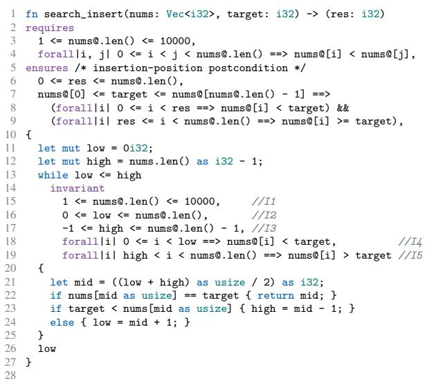
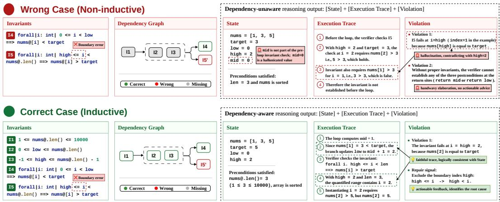
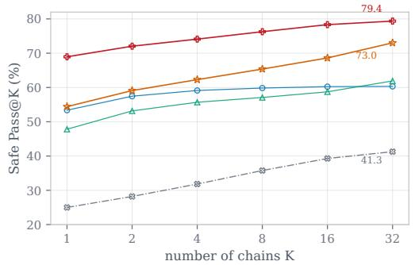
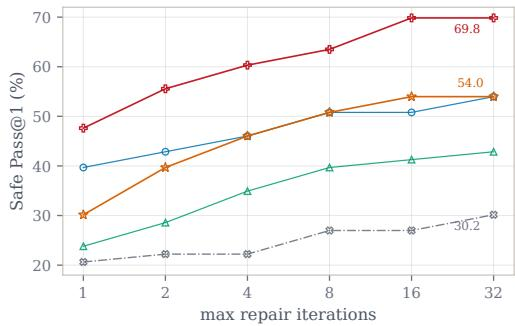
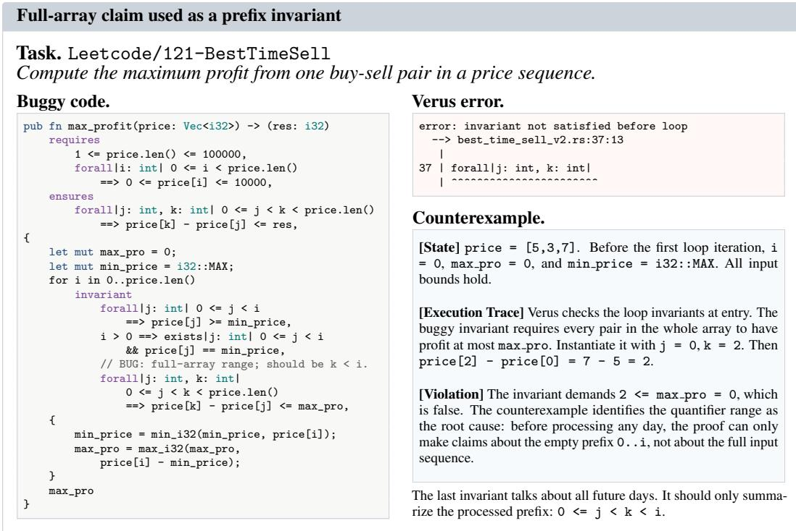
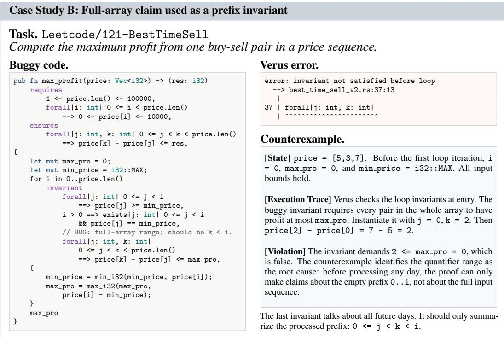

# Curriculum Proof Repair with Learned Counterexamples

Yuechun Sun Jun Yang Kexin Pei Department of Computer Science University of Chicago Chicago, IL 60637, USA   
{ycsun,juny,kpei}@uchicago.edu

## Abstract

Language models (LMs) have substantially lowered the barrier to applying formal verification for building reliable and secure software. Existing approaches commonly follow the verifier-in-the-loop paradigm, but the verifier often provides only coarse, binary pass/fail feedback, which offers little actionable signal on how the proof should be repaired. Recent work shows that counterexamples provide more actionable feedback by grounding proof failures in concrete program states, but generating useful ones at inference time requires costly iterative refinement. We present TOPOVERUS, an LM-based framework for Verus proof repair that internalizes counterexample-guided diagnosis as a model capability, producing useful counterexamples in a single pass. Our key insight is to train counterexample generation not as a standalone validation task, but as a datadriven diagnostic objective: a counterexample is useful when conditioning on it helps the model produce a safe, verifier-passing proof. Given a failed Verus proof and verifier error, TOPOVERUS generates a structured source-level counterexample, repair rationale, and repaired proof in one trajectory, optimized with reinforcement learning from Verus feedback and a proof-code safety gate. To guide the order of invariant repairs and target counterexamples to specific invariants, TOPOVERUS introduces a curriculum with a topological graph reward based on invariant dependencies derived from inductiveness tests and encourages counterexample generation following the same topological order as these dependencies. Across seven Verus benchmarks with 471 problems, TOPOVERUS achieves 61.6%/72.2% weighted-average Safe-Pass@1/Safe-Pass@3, outperforming the strongest baseline, Claude Sonnet 4.5, by 5.7/6.3 points. We also show that TOPOVERUS’s learned counterexamples can directly augment the reasoning of existing LM-based proof repair approaches, improving their success rate by 64.3% compared to chain-of-thought diagnostics. We release the training and evaluation code at https://github.com/Etha-Sun/Topoverus and the TOPOVERUS-32B weights at https://huggingface.co/YuechunSun/TopoVerus-32B.

## 1 Introduction

Formal verification provides machine-checked guarantees that software satisfies rich correctness specifications, enabling the construction of safety-critical, large-scale software systems (Lattuada et al., 2023; Leroy et al., 2016; Klein et al., 2009; Sun et al., 2024b; Zhou et al., 2024; Chen et al., 2023). However, these guarantees remain costly to obtain. Developers must write specifications, discover inductive invariants, and repair failed proof obligations. Recent work using language models (LMs) for verification automates parts of this proof-construction loop (Sun et al., 2026; Zhong et al., 2025; Chen et al., 2025; Yang et al., 2025, 2026a; Zhong & Si, 2025; Aggarwal et al., 2025;

Mugnier et al., 2025; First et al., 2023; Yang et al., 2026b; Li et al., 2026b; Ye et al., 2026), lowering the expertise barrier for applying formal verification to real-world software.

As LM-generated proof candidates are not sound by construction, existing LM-based approaches typically keep a verifier in the loop: the model proposes proof annotations, the verifier reports failures, and the model revises the proof based on the error messages (Yang et al., 2025; Sun et al., 2026; Zhong et al., 2025; Aggarwal et al., 2025). This loop resembles interactive verification, where developers debug failures by constructing concrete failing states and tracing where an invariant or postcondition breaks (Clarke et al., 2000, 2003). However, verifier messages often expose only a failed proof obligation with limited diagnostic context, e.g., postcondition not satisfied, rather than the source-level state, execution path, or missing facts responsible for the failure. The LM must thus infer the root cause from ambiguous feedback, making repair brittle and token-inefficient.

Existing LM-based proof repair approaches compensate for coarse verifier feedback in different ways. Some encode verifier-specific repair rules or syntax guidance in the prompt (Yang et al., 2025; Sun et al., 2026), supply in-context proof examples (Yang et al., 2025; Mugnier et al., 2025), or retrieve relevant proof fragments (Zhong et al., 2025). Others bypass explicit diagnosis and use verification outcomes, i.e., pass/fail signals, to guide search, data synthesis, self-improvement, or fine-tuning (Aggarwal et al., 2025; Chen et al., 2025). While effective, these approaches leave a diagnostic gap: engineered prompt knowledge is costly to curate and does not generalize as verifier behavior and proof idioms evolve (Yang et al., 2026a,b), whereas verifier-outcome objectives provide only sparse, indirect signals for repair.

A more actionable feedback signal is a source-level counterexample: a concrete program state, optionally with a short execution trace, that falsifies a proof obligation. Unlike verifier-specific repair rules, counterexamples describe the concrete failing program state, making them largely independent of diagnostic formats and directly useful for localizing repairs. They are central to classic counterexample-guided verification (Clarke et al., 2000, 2003; Bradley, 2011, 2012), where failed states drive refinement or blocking of bad regions. Recent LM-based works also show that generated counterexamples can improve proof repair (Yang et al., 2026b; Li et al., 2026a; Huang et al., 2026). Unfortunately, a useful counterexample requires nontrivial, execution-level code reasoning: it must be feasible, expose the relevant corner case, and identify the missing proof fact, rather than merely state a plausible failure (Copet et al., 2025). This also explains why existing approaches often incur high inference costs, as they require iterative refinement to generate high-quality counterexamples (Yang et al., 2026b). Moreover, proof failures often conflate multiple missing or incorrect invariants, so which counterexample is most useful to address first is not well defined.

Our approach. We present TOPOVERUS, an LM-based verification framework for Verus proof repair that internalizes counterexample-guided diagnosis as a model capability. Our idea is to formulate counterexample generation as a diagnostic learning problem where the counterexample is useful not merely when it is plausible (Yang et al., 2026b), but when conditioning on it helps the model produce a safe, verifier-passing proof. Given a failed Verus proof attempt and the corresponding verifier error, TOPOVERUS generates a structured source-level counterexample, a concise repair rationale, and a candidate repaired proof in this order within a single trajectory. We optimize the full trajectory using reinforcement learning with verifiable rewards (RLVR) from Verus, together with a proof-code safety gate that rejects repairs modifying the executable program or user-supplied specifications. As a result, counterexamples are not trained as standalone artifacts with hand-written validators (Yang et al., 2026b) or predefined verifier-specific repair taxonomies (Yang et al., 2025). Instead, they receive indirect credit through downstream repair success, biasing the model toward diagnostics that are actionable for safe proof repair.

This formulation, however, creates a key technical challenge. The training signal for counterexample utility is sparse, delayed, and order-sensitive. A failed proof often contains multiple missing or incorrect invariants, so final verifier success alone does not reveal whether a generated counterexample was wrong, merely unhelpful, or aimed at a downstream proof obligation whose preconditions were not yet established (Section 2.1). To expose this latent structure during learning, TOPOVERUS approximates dependencies among invariants with a graph derived from inductiveness tests, and rewards repaired proofs whose invariants respect a topological order over the resulting graph. The resulting topological graph reward turns sparse outcome feedback into a dependency-aware curriculum, i.e., it establishes state-constraining facts first, then generates counterexamples and repairs for dependent obligations in the corresponding order, where the counterexample’s diagnostics become informative.

Results. Our evaluation shows that TOPOVERUS improves Verus proof repair and provides actionable diagnostics for downstream repair tools. Across seven Verus benchmarks comprising 471 problems, TOPOVERUS achieves 61.6% and 72.2% in Safe-Pass@1 and Safe-Pass@3, outperforming the strongest baseline, i.e., Claude Sonnet 4.5, by 5.7 and 6.3 points, respectively. The gains are largest on structurally difficult settings such as VeriCogen and ObfsBench, where proof templates and syntactic hints are less reliable. Ablations show that counterexample-augmented reasoning in TOPOVERUS improves weighted Safe-Pass@1 by 11.2 points over the repair with natural-language diagnostics, while the topological graph reward further improves over binary verifier-only RL by 7.9 points. Importantly, TOPOVERUS’s generated counterexamples also transfer to other LMs used as proof repairers, improving their repair success by up to 64.3% (relative) over chain-of-thought diagnostics. We release the training and evaluation code at https://github.com/Etha-Sun/Topoverus and the TOPOVERUS-32B weights at https://huggingface.co/YuechunSun/TopoVerus-32B.

## 2 Overview

We focus on Verus, a Rust-native verifier for verifying Rust programs. A Verus proof consists of executable Rust code together with specifications (e.g., preconditions and postconditions), and proof annotations (e.g., invariants, assertions). The verifier discharges the proof into Verification Conditions (VCs) and checks them with off-the-shelf SMT solvers (de Moura & Bjørner, 2008; Barbosa et al., 2022). Among the proof annotations, inferring invariants has been a key challenge of automating formal verification (Flanagan & Leino, 2001; Garg et al., 2014; Kamath et al., 2023). Loop invariants are properties that hold at the beginning of every loop iteration.

  
Figure 1: Proof annotation for binary-search insertion.

## 2.1 Motivating Example

Figure 1 shows the Verus code and proof that motivate our approach. The function implements binarysearch insertion: it returns the position of target in a sorted array, or the index where target should be inserted. The requires (preconditions) assume the input to be a sorted array, and the ensures (postconditions) specify that target is inserted correctly. The loop invariants are the properties that are derived from the preconditions and execution code. They hold before entering the loop (base case) and remain true in each loop iteration (inductiveness). Note that invariants often depend on other invariants or are mutually dependent. We use this example to illustrate such dependencies and how fixing invariants following such dependencies benefits counterexample reasoning, diagnosis and repair of buggy proofs.

Semantic dependencies among invariants. The five invariant clauses in Figure 1 play different semantic roles in verifying the program. I1 bounds the length range of nums. I2 and I3 use that length fact to keep low and high within index ranges. I4 and I5 are the semantic partition invariants: all indices strictly left of low contain values below target, while all indices strictly right of high contain values above target. The semantic partition invariants become useful only when the boundary invariants (I2 and I3) hold.

Our dependency analysis makes this semantic structure operational by testing which previously established invariants are needed for another invariant to become inductive. In this example, the analysis identifies I1 as a prerequisite for proving the bounds invariants I2 and I3, and identifies the established bounds facts as prerequisites for proving the partition invariants I4 and I5. The resulting graph is therefore not just a syntactic relation among clauses: it reflects that high-level partition information is supported by lower-level index-range information. This motivates us to use the dependency graph to approximate the semantic relationships among invariants.

  
Figure 2: Comparison of dependency-unaware (top) and dependency-aware (bottom) diagnostics.

Under-constrained diagnostic. Consider a repair attempt that includes I4 and an incorrect version of I5, but omits I1–I3. The incorrect I5 includes the boundary index high:

$$
\mathbf { f o r a l l } \mid \mathbf { i } \mid \mathbf { \Delta } \mathrm { h i g h ~ \ll = ~ i ~ } < \mathbf { \Delta } \mathrm { n u m s } \emptyset . \mathbf { l e n } ( \mathbf { \Delta } ) \mathbf { \Psi } \mathrel { \mathop = } \mathbf { = } \mathbf { > } \mathbf { \Delta } \mathrm { n u m s } \emptyset [ \mathbf { i } ] \mathbf { \Delta } > \mathbf { \Delta t a r g e t } .
$$

Because I1–I3 are absent, verification may fail on preliminary preservation or postcondition obligations before isolating the semantic boundary error. The annotated diagnostic in Figure 2 illustrates the failure mode: the output has a plausible State–Trace–Violation format, but the three parts are not mutually consistent. With high=2 and len=3, the range high $< = \mathrm { ~ i ~ } < \mathrm { ~ ] ~ }$ en contains only i=2; a trace that instantiates i=1 is outside the quantified domain, even though nums[1] is not greater than target. Its secondary violation is even less actionable: it broadly says that return-site postconditions cannot be proved, but does not identify a concrete failing return state or a local repair. The diagnostic therefore points at I5 without providing a valid counterexample for the claimed quantified failure.

Constrained diagnostic. Now suppose I1–I4 have already been established and the only remaining bug is the boundary in I5. The same diagnostic format becomes informative because the state and trace are anchored by the prerequisite invariants. The bottom half of Figure 2 shows the intended contrast: after one iteration with nums=[1,3,5], target=5, low=2, and high=2, the bounds invariants justify that the quantified range is the intended in-bounds suffix and I4 rules out unrelated left-partition failures. Now the incorrect I5 includes i=high=2, requiring nums[2] > 5, but nums[2]=5. The counterexample directly pinpoints the repair solution: change high <= i to high < i.

Implication for training. The example shows why a good counterexample is critical to proof progress. If a model is rewarded only for final verifier success, it may spend attempts on diagnostics whose states and traces are not anchored by prerequisite invariants. The Topological Graph Reward in Section 3.3 turns the dependency graph above into process feedback: it encourages repairs to make prerequisite facts available, so that counterexamples for subsequent, semantic invariants are checked in a better-constrained proof state.

## 3 Methodology

## 3.1 Problem Formulation

We formally define the problem of curriculum-based proof repair as a dependency-aware generation process. Given a program $\mathcal { P }$ with a specification $\Phi = ( P _ { p r e } , Q _ { p o s t } )$ , i.e., pre-conditions and postconditions, the task is to synthesize a proof Π consisting of proof annotations (invariants, assertions, etc.) that verifies the program.

Counterexample-guided repair. Let $\Pi _ { t }$ denote the proof annotations at repair step t. If the proof contains a verification error $e _ { t }$ corresponding to a failing condition, we decompose this failing constraint into an antecedent $A _ { t } ( \sigma )$ (pre-state) and a consequent $C _ { t } ( \sigma )$ (proof obligation). A valid counterexample is a concrete program state σ that witnesses this failure, satisfying:

$$
\sigma \Vdash A _ { t } ( \sigma ) \ \land \neg C _ { t } ( \sigma ) ,\tag{1}
$$

Rather than relying on an external SMT-based tool to statically resolve this state, our approach instructs the model to generate a structured diagnostic tuple $( \sigma , \tau , \psi )$ as an intermediate reasoning step, i.e., counterexample, execution trace, and violation in Figure 2. τ represents the specific execution trace by executing from σ, and ψ is a natural-language description detailing why the obligation was falsified.

Invariant dependency. Let $V = \{ v _ { 1 } , . . . , v _ { n } \}$ denote the canonical invariant set extracted from a verified reference proof for program $\mathcal { P } _ { \cdot }$

We model their prerequisite structure via a dependency graph $G = ( V , E )$ , where $( v _ { j } , v _ { i } ) \in E$ represents that prerequisite $v _ { j }$ must be established prior to inductively verifying $v _ { i }$ . At step t, the objective is to synthesize $\Pi _ { t + 1 }$ to resolve errors $e _ { t }$ . Rather than blindly blocking state $\sigma _ { \mathrm { { : } } }$ , the model learns the curriculum where it tends to follow the topological ordering of $G ,$ , via reinforcement learning, as detailed in Section 3.3.

## 3.2 Reward Architecture

We optimize a response-level policy $\pi _ { \theta } ( y \mid x )$ with GRPO, where x is the current repair context and y is the complete structured response. The learning signal is a shaped reward:

$$
R ( x , y ) = S _ { \mathrm { s a f e } } ( x , y ) \Bigl [ G _ { \mathrm { f o r m a t } } ( y ) \bigl ( R _ { \mathrm { p a s s } } ( x , y ) + \lambda _ { \mathrm { d e p } } R _ { \mathrm { d e p } } ( x , y ) \bigr ) + \lambda _ { \mathrm { f o r m a t } } R _ { \mathrm { f o r m a t } } ( x , y ) \Bigr ] ,\tag{2}
$$

where $S _ { \mathrm { s a f e } }$ is a safety gate, $R _ { \mathrm { p a s s } }$ is the primary task reward from verifier feedback, $R _ { \mathrm { d e p } }$ is a dependency-aware shaping reward over proof structure, $R _ { \mathrm { f o r m a t } }$ is an auxiliary format reward, and $G _ { \mathrm { f o r m a t } } ( y )$ acts as a feasibility gate that downweights malformed outputs. The scalars $\lambda _ { \mathrm { d e p } }$ and λformat are fixed reward weights; when the dependency reward is disabled, we set $\lambda _ { \mathrm { d e p } } = 0$

The verifier reward is binary: $R _ { \mathrm { p a s s } } = { \bf 1 }$ when Verus accepts the repaired program. The format reward $R _ { \mathrm { f o r m a t } } \in [ 0 , 0 . 4 ]$ is an auxiliary term that rewards the presence of required structural components (XML reasoning tags and the three counterexample fields: state, execution trace, violation). The format gate $G _ { \mathrm { f o r m a t } }$ scales the primary reward according to structural completeness, i.e., full score when both reasoning blocks are present, a reduced score when only one is present, and a smaller score when neither is present, preventing the mode collapse into standard Chain-of-Thought repair that bypasses the counterexample reasoning step.

The safety gate $S _ { \mathrm { s a f e } } \in \{ 0 , 1 \}$ uses Lynette, an AST-level checker developed by Yang et al. (2025), to check if the model only modified the proof annotations (invariants, assertions, etc.); unsafe modifications (e.g., execution code) receive zero reward.

## 3.3 Topological Graph Reward

A core component of TOPOVERUS is the Topological Graph Reward $( R _ { \mathrm { d e p } } \in [ 0 , 1 ] )$ , which captures structural dependencies among proof obligations and encourages the model to establish prerequisite invariants before dependent ones.

Definition 1 (Inductive Subset). Let $V = \{ v _ { 1 } , \ldots , v _ { n } \}$ be the canonical set ofloop invariantsfor a program. A subset $S \subseteq V$ is inductive if the conjunction $\textstyle \bigwedge _ { v \in S }$ v is (i) established by the loop precondition, (ii) preserved by every loop body iteration. We write ${ \bar { \mathcal { T } } } ( V )$ for the family of all inductive subsets of V .

Definition 2 (Invariant Dependency Graph). For each invariant $v _ { i } \in V$ , define its dependency set as:

$$
\deg ( v _ { i } ) \ = \ \Big ( \bigcap _ { S \in \mathcal { Z } ( V ) , v _ { i } \in S } S \Big ) \setminus \{ v _ { i } \} .\tag{3}
$$

That $i s , \mathrm { d e p s } ( v _ { i } )$ consists of the invariants present in every inductive subset containing $v _ { i } ,$ , i.e., the invariants that $v _ { i }$ structurally depends on. The invariant dependency graph is $G = ( V , { \bar { E } } )$ with:

$$
E \ = \ \big \{ ( v _ { j } , v _ { i } ) | v _ { j } \in \mathrm { d e p s } ( v _ { i } ) \big \} .\tag{4}
$$

An edge $( v _ { j } , v _ { i } ) \in E$ encodes that $v _ { j }$ must be established before $v _ { i }$ can be inductively verified.

Definition 3 (SCC Condensation). When $G = ( V , E )$ contains cycles (mutually inductive invariants), we compute its strongly connected components $\operatorname { S C C } ( G ) = \{ S _ { 1 } , \dots , S _ { p } \}$ via Tarjan’s algorithm and form the condensation:

$$
{ \hat { G } } = \left( { \hat { V } } , { \hat { E } } \right) , \quad { \hat { V } } = \operatorname { S C C } ( G ) , \quad { \hat { E } } = \left\{ \left( S _ { a } , S _ { b } \right) ~ | ~ \exists v _ { i } \in S _ { a } , ~ v _ { j } \in S _ { b } : ( v _ { i } , v _ { j } ) \in E , ~ a \neq b \right\} _ { \frac { 1 } { 2 } } .\tag{5}
$$

The condensation $\hat { G }$ is a DAG that admits a topological ordering ≺ over $\hat { V } ,$ , capturing dependency order represented by the universal-prerequisite graph.

Invariant matching. Given the model’s generated code, we extract candidate invariants and match them against the canonical set V via: (1) exact substring matching, and (2) fuzzy token-set matching with Jaccard similarity $J ( \cdot , \cdot ) \geq 0 . 6 .$ . Let $V ^ { \prime } \subseteq V$ denote the set of matched canonical invariants.

Reward computation. Let $E ^ { \prime } = \{ ( v _ { j } , v _ { i } ) \in E \mid v _ { j } , v _ { i } \in V ^ { \prime } \}$ be the dependency edges between matched invariants, let $\hat { E } ^ { \prime } = \{ ( v _ { j } , v _ { i } ) \in E ^ { \prime } \mid \hat { S } ( v _ { j } ) \neq \hat { S } ( v _ { i } ) \}$ be the inter-SCC edges, and let pos(v) denote the source position of invariant v in the model’s output. The topological graph reward is:

$$
R _ { \mathrm { d e p } } = \underbrace { \frac { \left| V ^ { \prime } \right| } { \left| V \right| } } _ { \alpha \mathrm { ( c o v e r a g e ) } } \times \underbrace { \frac { \left| \left\{ \left( v _ { j } , v _ { i } \right) \in \hat { E } ^ { \prime } \mid \mathrm { p o s } ( v _ { j } ) < \mathrm { p o s } ( v _ { i } ) \right\} \right| } { \left| \hat { E } ^ { \prime } \right| } } _ { \beta \mathrm { ( e d g e s a t i s f a c t i o n ) } } ,\tag{6}
$$

where $\hat { S } ( v )$ denotes the SCC of v in the condensation ${ \hat { G } } ,$ , and $\mathrm { p o s } ( v _ { j } ) < \mathrm { p o s } ( v _ { i } )$ means the model generated $v _ { j }$ before $v _ { i }$ . Intra-SCC edges (mutually inductive invariants) are excluded, since no meaningful ordering exists within an SCC. When $\hat { E } ^ { \prime } = \varnothing$ , we set $\beta = 1$ . The coverage term α rewards producing more canonical invariants; the edge satisfaction term β rewards generating prerequisite invariants before dependent ones, inducing a micro-curriculum within each repair attempt. Remark. The dependency graph $G$ and inductive subsets ${ \mathcal { T } } ( V )$ are pre-computed offline for each training instance. In training, the reward computation reduces to invariant matching and DAG edge checking, i.e., an $O ( | V | + | \mathbf { \bar { \mathit { E } } } | )$ operation that adds negligible overhead to the GRPO training loop.

## 4 Evaluation

## 4.1 Experimental Setup

Benchmarks. We evaluate on 471 test problems from seven Verus benchmark suites: VerusBench (26 general verification problems from AutoVerus (Yang et al., 2025)), DafnyBench (17 translated Dafny problems (Loughridge et al., 2024)), HumanEval (15 algorithmic problems (Chen et al., 2021)), LeetCode (5 algorithmic problems (Dai, 2025)), VeriCogen (89 proof-stripped HumanEval variants from AlphaVerus (Bursuc et al., 2025)), ObfsBench (266 problems with obfuscated variable names (Yang et al., 2026b)), and VeruSAGE (53 systems-level tasks from Anvil, Mimalloc, and NrOS (Yang et al., 2026a)).

Models. All TOPOVERUS variants start from QwQ-32B (Team, 2025). CoT-Init is supervised fine-tuning with chain-of-thought repair only. CTX-Init uses the counterexample output format but no RL. CTX-Binary applies GRPO with a binary verifier reward. CTX-Dep, the full TOPOVERUS model, applies GRPO with the Topological Graph Reward. We compare against four prompted cloud LM baselines: Sonnet-4.5 (Anthropic, 2025), GPT-4o (Hurst et al., 2024), Qwen3-Coder (Cao et al., 2026), and DeepSeek-V4 (using the DeepSeek-V4-Flash model).

Protocol and metrics. The standard repair setting uses iterative verifier feedback for up to 10 steps. At each repair step, the model receives the failed proof and Verus feedback. Counterexamples are generated by the model, not provided as input. The reference proof, its invariant set $V .$ , and the dependency graph $G$ are not provided during evaluation. We report Safe-Pass@1 and Safe-Pass@3; Safe-Pass@3 counts a problem as solved if any of three independent repair chains succeeds. $\mathbf { A }$ solution is safe if Lynette confirms that executable code and user specifications were not changed. For test-time scaling, we use 32 chains × 10 iterations for Pass@K curves and 1 chain × 32 iterations for iteration-scaling curves.

Training data. The SFT dataset contains 461 proof repair trajectories from 249 source programs. To construct each trajectory, we provide the teacher model, Sonnet 4.6, with the failed proof, the corresponding verifier error, and the verified reference program. The teacher uses the reference proof to generate intermediate reasoning that explains how to repair the failed proof. This reasoning consists of a <think> block, a <counterexample> block with [State], [Execution Trace], and [Violation] fields, and a <reasoning> block containing an explicit repair plan. We extract the generated reasoning and append the verified reference program unchanged to form the target response for SFT. RL uses the same 249 source programs, which do not overlap with the test problems.

Table 1: Overall verification repair safe pass rates. Each cell reports Safe-Pass@k (%) across seven benchmarks. Cloud LLMs use iterative repair with verifier feedback; our models use 3 chains × 10 iterations. A solution is safe if Lynette confirms only ghost (proof) code changed.
<table><tr><td>Approach</td><td colspan="6">VerusBench DafnyBench HumanEval</td><td colspan="2">Leetcode</td><td colspan="2">VeriCogen</td><td colspan="2"></td><td colspan="2">ObfsBench VeruSAGE k =</td><td colspan="2">k = 1</td></tr><tr><td></td><td></td><td>k = 1 k = 3</td><td>k =</td><td>k = 1</td><td>3 k =</td><td>1 k =</td><td>3 k =</td><td>1 k 二</td><td>3 k 三</td><td>1 k 二</td><td>3 k</td><td>二 1</td><td>3</td><td></td><td>k = 3</td></tr><tr><td>Cloud LLMs Sonnet-4.5</td><td>73.1</td><td>84.6</td><td>70.6</td><td>76.5</td><td>13.3</td><td>13.3</td><td>40.0</td><td>40.0</td><td>26.7</td><td>30.0</td><td></td><td>62.0</td><td>75.2</td><td>75.5</td><td>84.9</td></tr><tr><td>GPT-40</td><td>42.3</td><td>42.3</td><td>76.5</td><td>76.5</td><td>6.7</td><td>13.3</td><td>0.0</td><td>0.0</td><td></td><td>40.4</td><td>41.4</td><td>21.8</td><td>22.9</td><td>17.0</td><td>24.5</td></tr><tr><td>Qwen3-Coder</td><td>34.6</td><td>34.6</td><td>52.9</td><td>52.9</td><td>6.7</td><td>6.7</td><td>0.0</td><td>0.0</td><td></td><td>20.0</td><td>25.6</td><td>14.3</td><td>18.8</td><td>45.3</td><td>64.2</td></tr><tr><td>DeepSeek-V4</td><td>23.1</td><td>38.5</td><td>47.1</td><td>82.4</td><td>13.3</td><td>20.0</td><td>0.0</td><td></td><td>0.0</td><td>28.9</td><td>36.7</td><td>12.8</td><td>29.3</td><td>58.5</td><td>66.0</td></tr><tr><td>External proof-repair systems</td><td></td><td></td><td></td><td></td><td></td><td></td><td></td><td></td><td></td><td></td><td></td><td></td><td></td><td></td><td></td></tr><tr><td>AutoVerus</td><td>38.5</td><td>50.0</td><td>58.8</td><td>70.6</td><td>6.7</td><td>6.7</td><td></td><td>20.0</td><td>20.0</td><td>22.5</td><td>28.1</td><td>13.2</td><td>23.7</td><td>7.5</td><td></td></tr><tr><td></td><td></td><td></td><td></td><td></td><td></td><td></td><td></td><td></td><td></td><td></td><td></td><td></td><td></td><td></td><td>9.4</td></tr><tr><td>Ours (QwQ-32B)</td><td></td><td>50.0</td><td>82.4</td><td>100</td><td>20.0</td><td></td><td>26.7</td><td>0.0</td><td>0.0</td><td>38.2</td><td>48.3</td><td></td><td>60.9</td><td>15.1</td><td></td></tr><tr><td>CoT-Init CTX-Init</td><td>46.2 88.5</td><td>92.3</td><td>88.2</td><td>100</td><td>26.7</td><td></td><td>26.7</td><td>20.0</td><td>40.0</td><td>48.3</td><td>61.8</td><td>42.9 55.3</td><td>73.3</td><td>9.4</td><td>24.5 22.6</td></tr><tr><td>CTX-Binary</td><td>88.5</td><td>96.2</td><td>94.1</td><td>100</td><td>26.7</td><td>26.7</td><td></td><td>20.0</td><td>40.0</td><td>44.9</td><td>60.7</td><td>58.6</td><td>75.9</td><td>24.5</td><td>30.2</td></tr><tr><td></td><td></td><td>88.5</td><td>100</td><td>100</td><td>20.0</td><td>33.3</td><td></td><td>20.0</td><td>20.0</td><td>49.4</td><td>65.2</td><td>69.9</td><td>80.1</td><td>30.2</td><td></td></tr><tr><td>CTX-Dep</td><td>88.5</td><td></td><td></td><td></td><td></td><td></td><td></td><td></td><td></td><td></td><td></td><td></td><td></td><td></td><td>43.4</td></tr></table>

Training details. SFT uses DeepSpeed ZeRO-3 on 4 NVIDIA L40S GPUs with learning rate $2 \times 1 0 ^ { - 5 } .$ , batch size 32, maximum sequence length 8,192, and 2 epochs. RL uses GRPO with FSDP2, 4-way Ulysses sequence parallelism, vLLM rollouts at temperature 0.7 and top-p = 0.9, 8 rollouts per prompt, learning rate $2 \times 1 0 ^ { - 6 }$ , no KL penalty, PPO clip ratio 0.28, and 2 epochs over 249 training programs.

## 4.2 Main Results

Table 1 shows that TOPOVERUS achieves the strongest average Safe-Pass@1 / Safe-Pass@3, 61.6% / 72.2%. This is 5.7 / 6.3 points above Sonnet-4.5, the strongest cloud baseline by average, and 7.9 / 4.3 points above CTX-Binary, the strongest non-dependency 32B variant. The clearest suite-level gain over cloud baselines is on ObfsBench, where TOPOVERUS reaches 69.9% Safe-Pass@1 and 80.1% Safe-Pass@3, improving over Sonnet-4.5 by 7.9 and 4.9 points. On VeruSAGE, closed cloud models remain stronger, but TOPOVERUS still improves over the other QwQ-32B variants, suggesting that dependency-aware RL helps the open model without eliminating all model-capacity gaps.

## 4.3 Ablation Study

Table 1 also isolates the effect of counterexample formatting and dependency-aware RL. Moving from CoT-Init to CTX-Init raises weighted safe Pass@1 from 39.3% to 50.5%, a gain of 11.2 points. This supports the core premise that asking the model to expose a concrete failing state before repair is more useful than unstructured reasoning. The improvement is especially large on VerusBench (46.2% to 88.5%) and ObfsBench (42.9% to 55.3%), indicating that the format helps even before RL.

Binary RL improves CTX-Init from 50.5% to 53.7%, but its gains are uneven. It improves VeruSAGE from 9.4% to 24.5%, yet degrades VeriCogen from 48.3% to 44.9%. This pattern is consistent with the sparsity problem discussed in Section 3.3: verifier success is useful, but binary reward does not distinguish whether a repair trajectory is building the proof structure in a robust order.

The full dependency reward produces the largest gain, improving weighted safe Pass@1 to 61.6% and Pass@3 to 72.2%. It is the best variant on DafnyBench, VeriCogen, ObfsBench, VeruSAGE, and the weighted average. The largest absolute gain over CTX-Binary is on ObfsBench (+11.3

  
(a) Sample scaling

  
(b) Iteration scaling  
Figure 3: Safe test-time scaling. The sample-scaling panel reports Safe Pass@K as the number of chains increases, while the iteration-scaling panel reports Safe Pass@1 as the repair budget increases.

Pass@1 points), where obfuscated identifiers reduce the usefulness of memorized templates and make structural proof ordering more important.

## 4.4 Experiment 3: Counterexample Utility

Table 2 shows how much generated counterexamples help repair models other than the generator itself. We freeze 118 hard failed states from unverified repair attempts. For each state, we keep the buggy program and verifier error fixed, replace only the counterexample source, and ask three independent repairers (DeepSeek V4, Sonnet-4.5, and Qwen3-Coder) to pro-

Table 2: Counterexample usability on 118 hard failed states. Cells report frozen-repair success; colored deltas are relative changes over CoT-Init.
<table><tr><td>CEX source</td><td>DeepSeek</td><td>Sonnet</td><td>Qwen</td></tr><tr><td>CoT-Init</td><td>11.9%</td><td>31.4%</td><td>13.6%</td></tr><tr><td>CTX-Init</td><td>15.3% (+28.6%)</td><td>32.2% (+2.7%)</td><td>12.7% (-6.2%)</td></tr><tr><td>CTX-Binary</td><td>19.5% (+64.3%)</td><td>33.1% (+5.4%)</td><td>15.3% (+12.5%)</td></tr><tr><td>CTX-Dep</td><td>19.5% (+64.3%)</td><td>39.0% (+24.3%)</td><td>15.3% (+12.5%)</td></tr></table>

duce a repair. CTX-Dep counterexamples yield the best Sonnet repair rate, 39.0%, a 24.3% relative improvement over CoT-Init diagnostics. DeepSeek-V4 and Qwen3-Coder also improve over CoT-Init when given CTX-Dep diagnostics. The result supports a conservative claim: the learned diagnostics need not be independently formal certificates, but they carry actionable information that transfers to separate repair policies.

## 4.5 Test-Time Scaling

Figure 3 reports test-time scaling on the 63-problem validation set drawn from VerusBench, Dafny-Bench, HumanEval, and LeetCode. CTX-Dep scales best with additional test-time compute, reaching 79.4% Safe Pass@32 in sample scaling and 69.8% Safe Pass@1 with 32 repair iterations. The gains over CTX-Init, CoT-Init, and Sonnet-4.5 show that dependency-aware diagnostics improve scaling with both independent samples and iterative repair budgets.

## 4.6 Case Study

We examine a maximum-profit task from Leetcode/121-BestTimeSell to illustrate how a generated counterexample localizes an invariant error. The function scans a price sequence, maintaining the minimum price and maximum profit over the processed prefix, but the buggy invariant requires max pro to bound profits over the entire array. Verus reports that the invariant is not satisfied before the loop.

Figure 4 makes the scope error explicit: with pri $\mathtt { c e } = [ 5 , 3 , 7 ] , \mathtt { i } = 0$ , and max pro=0, the pair j=0, k=2 reduces the invariant to the false inequality $7 - 5 < = \ 0$ . The counterexample therefore pinpoints a local correction: restrict the quantified range to the processed prefix, $0 ~ < = \mathrm { ~ j ~ } < \tt { k } < \mathrm { ~ i ~ }$

  
Figure 4: Maximum-profit case study: buggy proof, Verus feedback, and generated counterexample.

## 5 Related Work

LM-Based formal verification. Recent efforts have significantly lowered the barrier to formal verification using LMs, across both mathematical theorem proving (Polu & Sutskever, 2020; Yang et al., 2023; Lample et al., 2022) and program verification (First et al., 2023; Sun et al., 2024a; He et al., 2026; Zhong et al., 2025). In Verus proof generation, prior works primarily focused on encoding heuristics and repair strategies via either engineering prompts Yang et al. (2025); Sun et al. (2026), or constructing large-scale synthetic training sets Chen et al. (2025). However, a common limitation across these systems is their reliance on the traditional iterative-refinement paradigm, heavily depending on coarse, abstract feedback from the underlying SMT solvers. Such feedback often fails to isolate the root cause of verification failures, frequently causing LM-based repair to degenerate into inefficient trial-and-error generation. Our work advances this paradigm by moving beyond verifier feedback; we train the model to internalize diagnostic reasoning, integrating actionable, concrete counterexamples directly into the repair policy.

Counterexample-guided feedback for proof repair. Traditional formal methods have long relied on counterexamples, i.e., concrete execution traces that witness proof failures, as the key actionable feedback to iteratively refine invariants and generate proofs (Clarke et al., 2000; Bradley, 2012). Recent works have begun to explore LM-driven counterexample generation to sidestep the challenge of reconstructing counterexamples from low-level SMT solver models (Yang et al., 2026b; Li et al., 2026a). Nonetheless, these existing methods often demand strict formal validation of the generated counterexamples, which is often intractable, especially for complex proofs where there are multiple counterexamples to different missing/wrong invariants. Following the philosophy of reasoning over counterexamples, TOPOVERUS aims to generate high-quality counterexamples, but in a principled way, i.e., internalizing the capability of generating high-quality counterexamples following the topological dependency graph. Rather than searching for arbitrary counterexamples for a proof, TOPOVERUS trains the model to produce counterexamples whose diagnostic content is useful for successful downstream repair.

Reinforcement learning and curriculum learning. Reinforcement learning with verifiable rewards has shown strong results in theorem proving (AlphaProof & AlphaGeometry, 2024; Xin et al., 2024;

Wang et al., 2025) and code generation (Le et al., 2022; Liu et al., 2023), but optimizing complex verification tasks remains challenging due to reward sparsity and long proof trajectories. Curriculum learning (Bengio et al., 2009; Portelas et al., 2021; Wang et al., 2021) mitigates such sparsity by structuring learning from easy to hard; traditionally this operates across episodes as a macrocurriculum over training data. More recently, work on long-horizon reasoning has begun exploring intra-episode micro-curricula that structure the generation process within a single rollout (Dou et al., 2024; Zhang et al., 2026; Shen et al., 2025). These approaches define curricula through external heuristics (e.g., sequence length, task decomposition), whereas our Topological Graph Reward extracts an intrinsic micro-curriculum directly from the natural dependency DAG among Verus proof obligations, rewarding the model for establishing prerequisite invariants before more complex ones within each repair trajectory.

## 6 Discussion and Conclusion

Limitations. First, the dependency-aware micro-curriculum is fundamentally targeting loop invariants. While invariants are often a key bottleneck of formal verification, this focus restricts the framework’s immediate generalization to other critical verification structures, e.g., assertions. Second, the validity of the generated counterexamples is not formally guaranteed. Because exact reachability checking is fundamentally challenging and often infeasible (Yang et al., 2026b), the model treats the counterexample $( \sigma , \tau , \psi )$ strictly as an intermediate reasoning step optimized for downstream repair success rather than absolute mathematical validity. Consequently, the model may occasionally hallucinate imprecise execution traces that provide ambiguous guidance.

Conclusion. We presented TOPOVERUS, a 32B-parameter framework that transforms automated formal verification from a chaotic, unordered trial-and-error process into a dependency-aware generation pipeline. By training a response-level policy via GRPO, our model learns to synthesize structured, intermediate counterexamples in a principled way and incrementally repair the proofs. The Topologi cal Graph Reward extracts a natural micro-curriculum directly from the DAG of proof obligations, explicitly incentivizing the model to establish foundational constraints before writing dependent invariants. Our extensive evaluations demonstrate that synergistically coupling counterexample-guided feedback with topological curriculum learning significantly mitigates the sparsity of verifier rewards and outperforms the baselines.

## Ethics Statement

This work develops AI methods for automated formal verification, which aims to improve the reliability and correctness of software systems. We do not foresee direct negative societal impacts. All benchmarks used are publicly available or synthesized from open-source codebases. Our models are trained on code verification tasks and are not designed for generating harmful content.

## Acknowledgments and Disclosure of Funding

We thank Shan Lu for insightful discussions and the anonymous reviewers for their helpful feedback. Results presented in this paper were obtained using the Chameleon testbed (Keahey et al., 2020) supported by the National Science Foundation.

## References

Pranjal Aggarwal, Bryan Parno, and Sean Welleck. Alphaverus: Bootstrapping formally verified code generation through self-improving translation and treefinement. In Forty-second International Conference on Machine Learning, 2025. URL https://openreview.net/forum?id=tU8QKX4dMI.

Team AlphaProof and Team AlphaGeometry. Ai achieves silver-medal standard solving international 178 mathematical olympiad problems. DeepMind blog, 179:45, 2024.

Anthropic. Claude sonnet 4.5 system card, 2025. URL https://www.anthropic.com/ claude-sonnet-4-5-system-card. Accessed: 2026-05-07.

Haniel Barbosa, Clark Barrett, Martin Brain, Gereon Kremer, Hanna Lachnitt, Makai Mann, Abdalrhman Mohamed, Mudathir Mohamed, Aina Niemetz, Andres Notzli, Alex Ozdemir, Mathias¨ Preiner, Andrew Reynolds, Ying Sheng, Cesare Tinelli, and Yoni Zohar. cvc5: A versatile and industrial-strength smt solver. In Dana Fisman and Grigore Rosu (eds.), Tools and Algorithms for the Construction and Analysis ofSystems, pp. 415–442, Cham, 2022. Springer International Publishing. ISBN 978-3-030-99524-9.

Yoshua Bengio, Jer´ ome Louradour, Ronan Collobert, and Jason Weston. Curriculum learning. Inˆ Proceedings of the 26th Annual International Conference on Machine Learning (ICML 2009), pp. 41–48. ACM, 2009. doi: 10.1145/1553374.1553380.

Aaron R Bradley. Sat-based model checking without unrolling. In International Workshop on Verification, Model Checking, and Abstract Interpretation, pp. 70–87. Springer, 2011.

Aaron R Bradley. Understanding ic3. In International Conference on Theory and Applications of Satisfiability Testing, pp. 1–14. Springer, 2012.

Sergiu Bursuc, Theodore Ehrenborg, Shaowei Lin, Lacramioara Astefanoaei, Ionel Emilian Chiosa, Jure Kukovec, Alok Singh, Oliver Butterley, Adem Bizid, Quinn Dougherty, et al. A benchmark for vericoding: formally verified program synthesis. arXiv preprint arXiv:2509.22908, 2025.

Ruisheng Cao, Mouxiang Chen, Jiawei Chen, Zeyu Cui, Yunlong Feng, Binyuan Hui, Yuheng Jing, Kaixin Li, Mingze Li, Junyang Lin, et al. Qwen3-coder-next technical report. arXiv preprint arXiv:2603.00729, 2026.

Mark Chen, Jerry Tworek, Heewoo Jun, Qiming Yuan, Henrique Ponde de Oliveira Pinto, Jared Kaplan, Harri Edwards, Yuri Burda, Nicholas Joseph, Greg Brockman, Alex Ray, Raul Puri, Gretchen Krueger, Michael Petrov, Heidy Khlaaf, Girish Sastry, Pamela Mishkin, Brooke Chan, Scott Gray, Nick Ryder, Mikhail Pavlov, Alethea Power, Lukasz Kaiser, Mohammad Bavarian, Clemens Winter, Philippe Tillet, Felipe Petroski Such, Dave Cummings, Matthias Plappert, Fotios Chantzis, Elizabeth Barnes, Ariel Herbert-Voss, William Hebgen Guss, Alex Nichol, Alex Paino, Nikolas Tezak, Jie Tang, Igor Babuschkin, Suchir Balaji, Shantanu Jain, William Saunders, Christopher Hesse, Andrew N. Carr, Jan Leike, Josh Achiam, Vedant Misra, Evan Morikawa, Alec Radford, Matthew Knight, Miles Brundage, Mira Murati, Katie Mayer, Peter Welinder, Bob McGrew, Dario Amodei, Sam McCandlish, Ilya Sutskever, and Wojciech Zaremba. Evaluating large language models trained on code, 2021. URL https://arxiv.org/abs/2107.03374.

Tianyu Chen, Shuai Lu, Shan Lu, Yeyun Gong, Chenyuan Yang, Xuheng Li, Md Rakib Hossain Misu, Hao Yu, Nan Duan, Peng CHENG, Fan Yang, Shuvendu K Lahiri, Tao Xie, and Lidong Zhou. Automated proof generation for rust code via self-evolution. In The Thirteenth International Conference on Learning Representations, 2025. URL https://openreview.net/forum?id= 2NqssmiXLu.

Xiangdong Chen, Zhaofeng Li, Lukas Mesicek, Vikram Narayanan, and Anton Burtsev. Atmosphere: Towards practical verified kernels in rust. In Proceedings ofthe 1st Workshop on Kernel Isolation, Safety and Verification, KISV ’23, pp. 9–17, New York, NY, USA, 2023. Association for Computing Machinery. ISBN 9798400704116. doi: 10.1145/3625275.3625401. URL https://doi.org/ 10.1145/3625275.3625401.

Edmund Clarke, Orna Grumberg, Somesh Jha, Yuan Lu, and Helmut Veith. Counterexample-guided abstraction refinement. In International Conference on Computer Aided Verification, pp. 154–169. Springer, 2000.

Edmund Clarke, Orna Grumberg, Somesh Jha, Yuan Lu, and Helmut Veith. Counterexample-guided abstraction refinement for symbolic model checking. Journal ofthe ACM (JACM), 50(5):752–794, 2003.

Jade Copet, Quentin Carbonneaux, Gal Cohen, Jonas Gehring, Jacob Kahn, Jannik Kossen, Felix Kreuk, Emily McMilin, Michel Meyer, Yuxiang Wei, et al. Cwm: An open-weights llm for research on code generation with world models. arXiv preprint arXiv:2510.02387, 2025.

Weituo Dai. verus-study-cases-leetcode. https://github.com/WeituoDAI/ verus-study-cases-leetcode, 2025. Accessed: 2025-10-02.

Leonardo de Moura and Nikolaj Bjørner. Z3: An efficient smt solver. In C. R. Ramakrishnan and Jakob Rehof (eds.), Tools and Algorithms for the Construction and Analysis of Systems, pp. 337–340, Berlin, Heidelberg, 2008. Springer Berlin Heidelberg.

Shihan Dou, Yan Liu, Haoxiang Jia, Enyu Zhou, Limao Xiong, Junjie Shan, Caishuang Huang, Xiao Wang, Xiaoran Fan, Zhiheng Xi, et al. Stepcoder: improving code generation with reinforcement learning from compiler feedback. In Proceedings of the 62nd Annual Meeting of the Association for Computational Linguistics (Volume 1: Long Papers), pp. 4571–4585, 2024.

Thomas Eiter and Georg Gottlob. Identifying the minimal transversals of a hypergraph and related problems. SIAM Journal on Computing, 24(6):1278–1304, 1995. doi: 10.1137/ S0097539793250299.

Emily First, Markus N Rabe, Talia Ringer, and Yuriy Brun. Baldur: Whole-proof generation and repair with large language models. In Proceedings of the 31st ACM Joint European Software Engineering Conference and Symposium on the Foundations of Software Engineering, pp. 1229–1241, 2023.

Cormac Flanagan and K. Rustan M. Leino. Houdini, an annotation assistant for esc/java. In Proceedings of the International Symposium of Formal Methods Europe on Formal Methods for Increasing Software Productivity, FME ’01, pp. 500–517, Berlin, Heidelberg, 2001. Springer-Verlag. ISBN 3540417915.

Michael L. Fredman and Leonid Khachiyan. On the complexity of dualization of monotone disjunctive normal forms. Journal of Algorithms, 21(3):618–628, 1996. doi: 10.1006/jagm.1996.0059.

Pranav Garg, Christof Loding, Parthasarathy Madhusudan, and Daniel Neider. Ice: A robust¨ framework for learning invariants. In International Conference on Computer Aided Verification, pp. 69–87. Springer, 2014.

Elaheh Ghassabani, Andrew Gacek, and Michael W. Whalen. Efficient generation of inductive validity cores for safety properties. In Proceedings of the 2016 ACM SIGSOFT International Symposium on Foundations of Software Engineering (FSE), pp. 314–325. ACM, 2016. doi: 10.1145/2950290.2950349.

Baoding He, Zenan Li, Wei Sun, Yuan Yao, Taolue Chen, Xiaoxing Ma, and Zhendong Su. Stepwise: Neuro-symbolic proof search for automated systems verification, 2026. URL https://arxiv. org/abs/2603.19715.

Zhechong Huang, Zhao Zhang, Zeyu Sun, Huifeng Sun, and Yingfei Xiong. Reinforcement learning with negative tests as completeness signal for formal specification synthesis. arXiv preprint arXiv:2604.05820, 2026.

Aaron Hurst, Adam Lerer, Adam P Goucher, Adam Perelman, Aditya Ramesh, Aidan Clark, AJ Ostrow, Akila Welihinda, Alan Hayes, Alec Radford, et al. Gpt-4o system card. arXiv preprint arXiv:2410.21276, 2024.

Adharsh Kamath, Aditya Senthilnathan, Saikat Chakraborty, Pantazis Deligiannis, Shuvendu K Lahiri, Akash Lal, Aseem Rastogi, Subhajit Roy, and Rahul Sharma. Finding inductive loop invariants using large language models. corr abs/2311.07948 (2023). arXiv preprint arXiv:2311.07948, 2023.

Kate Keahey, Jason Anderson, Zhuo Zhen, Pierre Riteau, Paul Ruth, Dan Stanzione, Mert Cevik, Jacob Colleran, Haryadi S. Gunawi, Cody Hammock, Joe Mambretti, Alexander Barnes, Franc¸ois Halbach, Alex Rocha, and Joe Stubbs. Lessons learned from the Chameleon testbed. In Proceedings of the 2020 USENIX Annual Technical Conference (USENIX ATC ’20). USENIX Association, July 2020.

Gerwin Klein, Kevin Elphinstone, Gernot Heiser, June Andronick, David Cock, Philip Derrin, Dhammika Elkaduwe, Kai Engelhardt, Rafal Kolanski, Michael Norrish, et al. sel4: Formal verification of an os kernel. In Proceedings of the ACM SIGOPS 22nd symposium on Operating systems principles, pp. 207–220, 2009.

Guillaume Lample, Timothee Lacroix, Marie-Anne Lachaux, Aurelien Rodriguez, Amaury Hayat, Thibaut Lavril, Gabriel Ebner, and Xavier Martinet. Hypertree proof search for neural theorem proving. Advances in neural information processing systems, 35:26337–26349, 2022.

Andrea Lattuada, Travis Hance, Chanhee Cho, Matthias Brun, Isitha Subasinghe, Yi Zhou, Jon Howell, Bryan Parno, and Chris Hawblitzel. Verus: Verifying Rust programs using linear ghost types. Proceedings ofthe ACM on Programming Languages, 7(OOPSLA1):286–315, 2023. doi: 10.1145/3586037.

Hung Le, Yue Wang, Akhilesh Deepak Gotmare, Silvio Savarese, and Steven Chu Hong Hoi. Coderl: Mastering code generation through pretrained models and deep reinforcement learning. Advances in Neural Information Processing Systems, 35:21314–21328, 2022.

Xavier Leroy, Sandrine Blazy, Daniel Kastner, Bernhard Schommer, Markus Pister, and Christian¨ Ferdinand. Compcert-a formally verified optimizing compiler. In ERTS 2016: Embedded Real Time Software and Systems, 8th European Congress, 2016.

Zenan Li, Zhaoyu Li, Kaiyu Yang, Xiaoxing Ma, and Zhendong Su. Learning to disprove: Formal counterexample generation with large language models. arXiv preprint arXiv:2603.19514, 2026a.

Zenan Li, Ziran Yang, Peiyang Song, Zhaoyu Li, and Kaiyu Yang. P3: Joint program-and-proof planning for verified code generation. arXiv preprint arXiv:2608.09277, 2026b.

Jiate Liu, Yiqin Zhu, Kaiwen Xiao, Qiang Fu, Xiao Han, Wei Yang, and Deheng Ye. Rltf: Reinforcement learning from unit test feedback. arXiv preprint arXiv:2307.04349, 2023.

Chloe Loughridge, Qinyi Sun, Seth Ahrenbach, Federico Cassano, Chuyue Sun, Ying Sheng, Anish Mudide, Md Rakib Hossain Misu, Nada Amin, and Max Tegmark. DafnyBench: A benchmark for formal software verification, 2024. URL https://arxiv.org/abs/2406.08467.

Eric Mugnier, Emmanuel Anaya Gonzalez, Nadia Polikarpova, Ranjit Jhala, and Zhou Yuanyuan. Laurel: Unblocking automated verification with large language models. Proceedings ofthe ACM on Programming Languages, 9(OOPSLA1):1519–1545, 2025.

Stanislas Polu and Ilya Sutskever. Generative language modeling for automated theorem proving. arXiv preprint arXiv:2009.03393, 2020.

Remy Portelas, C´ edric Colas, Lilian Weng, Katja Hofmann, and Pierre-Yves Oudeyer. Automatic´ curriculum learning for deep rl: a short survey. In Proceedings ofthe Twenty-Ninth International Joint Conference on Artificial Intelligence, IJCAI’20, 2021. ISBN 9780999241165.

Junhong Shen, Hao Bai, Lunjun Zhang, Yifei Zhou, Amrith Setlur, Shengbang Tong, Diego Caples, Nan Jiang, Tong Zhang, Ameet Talwalkar, et al. Thinking vs. doing: Agents that reason by scaling test-time interaction. arXiv preprint arXiv:2506.07976, 2025.

Chuyue Sun, Ying Sheng, Oded Padon, and Clark Barrett. Clover: Clo sed-loop ver ifiable code generation. In International Symposium on AI Verification, pp. 134–155. Springer, 2024a.

Chuyue Sun, Yican Sun, Daneshvar Amrollahi, Ethan Zhang, Shuvendu Lahiri, Shan Lu, David Dill, and Clark Barrett. Veristruct: Ai-assisted automated verification of data-structure modules in verus, 2026. URL https://arxiv.org/abs/2510.25015.

Xudong Sun, Wenjie Ma, Jiawei Tyler Gu, Zicheng Ma, Tej Chajed, Jon Howell, Andrea Lattuada, Oded Padon, Lalith Suresh, Adriana Szekeres, and Tianyin Xu. Anvil: verifying liveness of cluster management controllers. In Proceedings of the 18th USENIX Conference on Operating Systems Design and Implementation, OSDI’24, USA, 2024b. USENIX Association. ISBN 978-1-939133- 40-3.

Qwen Team. Qwq-32b: Embracing the power of reinforcement learning, 2025.

Haiming Wang, Mert Unsal, Xiaohan Lin, Mantas Baksys, Junqi Liu, Marco Dos Santos, Flood Sung, Marina Vinyes, Zhenzhe Ying, Zekai Zhu, et al. Kimina-prover preview: Towards large formal reasoning models with reinforcement learning. arXiv preprint arXiv:2504.11354, 2025.

Xin Wang, Yudong Chen, and Wenwu Zhu. A survey on curriculum learning. IEEE transactions on pattern analysis and machine intelligence, 44(9):4555–4576, 2021.

Huajian Xin, Daya Guo, Zhihong Shao, Zhizhou Ren, Qihao Zhu, Bo Liu, Chong Ruan, Wenda Li, and Xiaodan Liang. Deepseek-prover: Advancing theorem proving in llms through large-scale synthetic data. arXiv preprint arXiv:2405.14333, 2024.

Chenyuan Yang, Xuheng Li, Md Rakib Hossain Misu, Jianan Yao, Weidong Cui, Yeyun Gong, Chris Hawblitzel, Shuvendu Lahiri, Jacob R Lorch, Shuai Lu, et al. Autoverus: Automated proof generation for rust code. Proceedings ofthe ACM on Programming Languages, 9(OOPSLA2): 3454–3482, 2025.

Chenyuan Yang, Natalie Neamtu, Chris Hawblitzel, Jacob R. Lorch, and Shan Lu. Verusage: A study of agent-based verification for rust systems, 2026a. URL https://arxiv.org/abs/2512. 18436.

Jun Yang, Yuechun Sun, Yi Wu, Rodrigo Caridad, Yongwei Yuan, Jianan Yao, Shan Lu, and Kexin Pei. Exverus: Verus proof repair via counterexample reasoning, 2026b. URL https: //arxiv.org/abs/2603.25810.

Kaiyu Yang, Aidan Swope, Alex Gu, Rahul Chalamala, Peiyang Song, Shixing Yu, Saad Godil, Ryan J Prenger, and Animashree Anandkumar. Leandojo: Theorem proving with retrieval-augmented language models. Advances in Neural Information Processing Systems, 36:21573–21612, 2023.

Zhe Ye, Hantao Lou, Yuechun Sun, Peiyang Song, Zhengxu Yan, Timothe Kasriel, Qingyang Zhang, Kaiyu Yang, Soonho Kong, Jingxuan He, et al. Vero: Can ai agents build formally verified software repositories? arXiv preprint arXiv:2608.13522, 2026.

Yiqi Zhang, Huiqiang Jiang, Xufang Luo, Zhihe Yang, Chengruidong Zhang, Yifei Shen, Dongsheng Li, Yuqing Yang, Lili Qiu, and Yang You. Sortedrl: Accelerating rl training for llms through online length-aware scheduling. arXiv preprint arXiv:2603.23414, 2026.

Si Cheng Zhong and Xujie Si. Towards repository-level program verification with large language models. In Proceedings ofthe 1st ACM SIGPLAN International Workshop on Language Models and Programming Languages, pp. 27–39, 2025.

Sicheng Zhong, Jiading Zhu, Yifang Tian, and Xujie Si. Rag-verus: Repository-level program verification with llms using retrieval augmented generation. arXiv preprint arXiv:2502.05344, 2025.

Ziqiao Zhou, Anjali, Weiteng Chen, Sishuai Gong, Chris Hawblitzel, and Weidong Cui. Verismo: a verified security module for confidential vms. In Proceedings ofthe 18th USENIX Conference on Operating Systems Design and Implementation, OSDI’24, USA, 2024. USENIX Association. ISBN 978-1-939133-40-3.

## A Inductive Subset Enumeration Algorithm

## A.1 Problem Formulation and Computational Complexity

Let $\mathcal { V } = \{ v _ { 1 } , \ldots , v _ { n } \}$ be the set of loop invariant clauses in a verified Verus program. A subset $S \subseteq \mathcal { V }$ is inductive if the conjunction of its clauses holds at loop entry and is preserved by each loop iteration. If S is inductive, no strict superset of S can be a minimal inductive subset. The dependency graph $G _ { \nu }$ is derived from the minimal inductive subsets ${ \mathcal { T } } _ { \operatorname* { m i n } }$ (Definitions 1, 2, and 3 in the main text).

Hardness of complete enumeration. Enumerating all minimal inductive subsets is closely related to—and, if inductiveness were monotone under taking supersets, equivalent to—the Hypergraph Transversal Enumeration problem (Trans-Enum) (Eiter & Gottlob, 1995). Formally, given a hypergraph $H = ( [ n ] , \mathcal { E } )$ , a minimal transversal is a minimal set $T \subseteq [ n ]$ that intersects every hyperedge; enumerating all minimal transversals is precisely our problem when each hyperedge encodes a “necessary support” constraint for inductiveness.

This problem occupies a rare position in the complexity landscape (Eiter & Gottlob, 1995). Despite 30+ years of effort, it is not known to be solvable in polynomial time for general hypergraphs. At the same time, it is unlikely to be coNP-hard: because it admits a quasi-polynomial-time algorithm, coNPhardness would place all of coNP in quasi-polynomial time. The best known algorithm runs in quasi polynomial time $N ^ { O ( \log N / }$ log log N) (Fredman & Khachiyan, 1996), where N is the combined size of the input and output. In this sense it resembles Graph Isomorphism: no polynomial-time algorithm is known, yet it is not believed to be NP-hard. The connection to formal verification is not coincidental: the same structure arises as Minimal Inductive Validity Core (MIVC) enumeration (Ghassabani et al., 2016), where one seeks all minimal subsets of a transition system sufficient to prove a safety property.

The intractability of exact enumeration motivates a practical approximation: collect a sufficient sample of inductive subsets within a fixed verifier call budget B, yielding an approximate ${ \mathcal { T } } _ { \operatorname* { m i n } }$ that is exact for the vast majority of programs and near-exact for the rest.

## A.2 Level-wise BFS Enumeration Algorithm

Given that exact enumeration is intractable in general, we design an algorithm that (i) is correct when the budget suffices to exhaust the search space, and (ii) degrades gracefully to a well-structured approximation when the budget is exceeded. The algorithm exploits the fact that the minimal inductive subsets form an antichain, via a level-wise breadth-first search: subsets are enumerated in increasing cardinality order $k = 1 , 2 , \ldots , n .$ , and any superset of an already-found inductive set is pruned without a verifier call.

Remark (Correctness under mutual inductiveness). Some invariant groups are mutually inductive: no individual clause {vi} verifies on its own, but the group ${ \cal { S } } = \{ v _ { i } , v _ { j } , . . . \}$ does (these form SCCs in $G _ { \nu } )$ . A seed-based approach that initializes from singletons would produce an empty queue for such groups and miss them entirely. The level-wise algorithm below handles this correctly because it tests subsets of every size $k = 1 , 2 , \ldots , n$ (subject to the budget), so a mutually inductive group is found at level |S| even when none of its singletons is inductive.

Algorithm 1 Level-wise BFS Enumeration of Minimal Inductive Subsets   
Require: Invariant set $\mathcal { V } = \{ v _ { 1 } , \ldots , v _ { n } \}$ , verifier oracle VERIFY(S) → {true, false}, budget B   
Ensure: Family $\mathcal { T } _ { \mathrm { m i n } }$ of minimal inductive subsets   
1: $\mathcal { T } _ { \operatorname* { m i n } }  \emptyset ;$ Visited $ \emptyset ;$ calls $\gets 0$   
2: for k = 1, 2, . . . , n do ▷ level = subset size   
3: for each $S \in \left( \mathbb { V } \right)$ in lexicographic order do   
4: if S ∈ Visited then continue   
5: end if   
6: Visited ← Visited ∪ {S}   
7: $\mathbf { i f } \exists T \in \mathcal { T } _ { \operatorname* { m i n } } : T \subseteq \dot { S }$ then continue ▷ antichain pruning   
8: end if   
9: if calls $\geq B$ then goto DONE   
10: end if   
11: calls ← calls + 1   
12: if VERIFY(S) then   
13: $Z _ { \mathrm { m i n } } \gets \bar { \mathcal { T } } _ { \mathrm { m i n } } \cup \{ S \}$   
14: end if   
15: end for   
16: if calls $\geq B$ then break   
17: end if   
18: end for   
19: DONE: return ${ \mathcal { T } } _ { \operatorname* { m i n } }$

## A.3 Complexity Analysis

Verifier call budget. Each subset S is tested at most once (tracked in Visited). The antichain pruning step (line 7 of Algorithm 1) skips any superset of an already-found inductive set: once a minimal inductive subset T is found, none of its $2 ^ { n - | T | } - 1$ strict supersets can be minimal, so they are pruned without further verifier calls. In the best case (every singleton is self-inductive), the algorithm makes only n calls at level $k = 1$ and prunes all remaining $2 ^ { n } - n - 1$ subsets. In the worst case (no pruning applies), it tests all $2 ^ { n } - 1$ nonempty subsets, the same as naive enumeration;

in practice, pruning removes most supersets at higher levels (Table 3). For programs with $n > 8 ( 2 \%$ of our dataset), we apply a budget cap of $B = 2 5 6$ calls.

Empirical preprocessing statistics. We ran the level-wise BFS enumeration offline on all 531 verified programs across five benchmark datasets (Table 3). The median program has $n = 3$ invariants; 98% have $n \leq 8$ . During actual training, we only use dependency graphs from 249 training samples.

Table 3: Preprocessing statistics per dataset. “Calls” = actual verifier invocations (total). “Naive” = calls without the budget cap $( 2 ^ { \bar { n } } - 1$ per file, summed). “Reduction” = Naive / Calls. “Est. time” assumes 0.42 s per Verus call (measured mean on our hardware; range 0.25–0.71 s).
<table><tr><td>Dataset</td><td>Files</td><td>n (mean)</td><td>Calls (total)</td><td>Naive (total)</td><td>Reduction</td><td>Est. time</td></tr><tr><td>Dafnybench</td><td>55</td><td>1.9</td><td>205</td><td>205</td><td>1.0×</td><td>1.4 min</td></tr><tr><td>HumanEval-Alphaverus</td><td>47</td><td>3.4</td><td>1,135</td><td>2,669</td><td>2.4×</td><td>7.9min</td></tr><tr><td>LeetCode</td><td>23</td><td>6.6</td><td>2,817</td><td>72,955</td><td>25.9×</td><td>19.7 min</td></tr><tr><td>Obfuscated-VerusBench</td><td>266</td><td>3.0</td><td>3,498</td><td>3,498</td><td>1.0×</td><td>24.5 min</td></tr><tr><td>cleaned-VerusBench</td><td>140</td><td>2.7</td><td>1,561</td><td>1,816</td><td>1.2×</td><td>10.9min</td></tr><tr><td>Total</td><td>531</td><td>3.0</td><td>9,216</td><td>81,143</td><td>8.8×</td><td>≈64 min</td></tr></table>

This concretizes the approximation motivated in §A.1: for the 98% of programs with $n \leq 8$ the full search space $( { \bar { 2 } } ^ { n } - 1 \leq 2 5 5$ subsets) is exhausted within budget $B = 2 5 6$ , so ${ \mathcal { T } } _ { \operatorname* { m i n } }$ is exact—equivalent to the intractable complete enumeration, achieved cheaply because our benchmark programs are small. For the remaining $2 \% ( n > 8 )$ , all from LeetCode, $n \leq 1 6 )$ , the budget cap triggers the approximation: the returned ${ \mathcal { T } } _ { \operatorname* { m i n } }$ contains the minimal inductive subsets found within B calls, which are guaranteed to be $l o c a l l y$ minimal (no proper subset was found inductive) but may not be globally minimal. The level-wise traversal order ensures that small subsets are tested first, so the approximation is biased toward finding small inductive sets—the most informative ones for dependency graph construction. These 9 files constitute a negligible fraction of the training data, and the overall reduction in verifier calls is 8.8× (9,216 actual vs. 81,143 naive), with LeetCode benefiting most (25.9×).

Dependency graph construction and amortization. Given ${ \mathcal { T } } _ { \operatorname* { m i n } } ,$ the dependency edges E are computed in $\breve { O ( | \mathscr { L } _ { \mathrm { m i n } } | \cdot n ^ { 2 } ) }$ time (Definition 2), and SCC condensation via Tarjan’s algorithm runs in $O ( n + | E | )$ )—both polynomial in n. The entire offline preprocessing—9,216 verifier calls across 531 programs—completes in approximately 64 minutes on a single machine (measured mean Verus call time: 0.42 s; range 0.25–0.71 s across benchmarks), and is performed once before training begins. At training time, the reward function performs only a dictionary lookup $( O ( 1 ) )$ plus topological order evaluation $( O ( n + | E | ) )$ ), adding negligible overhead to the RL rollout.

## B Qualitative Counterexample Case Studies

We include three representative examples where the generated counterexample context directly identifies the proof obligation that should be repaired. In each example, the display keeps the source-level artifact fixed: the left panel contains the task and buggy proof fragment, while the right panel contains the raw verifier message and the generated [State], [Execution Trace], and [Violation] fields. The accompanying text below analyzes why the raw error message is insufficient and how the counterexample makes the repair target explicit.

Assertion placement. The first case illustrates a failure mode where the relevant counterexample is an intermediate program state rather than a loop-entry or loop-exit state. The task is to move elements from shrink into grow while preserving the sum of their lengths. The loop invariant is semantically correct at the loop boundary, but the assertion is placed after shrink.pop() and before grow.push(i), where the length sum is temporarily one smaller. The verifier message reports only an assertion failure at the source line, so it does not distinguish a wrong invariant from an assertion placed at the wrong program point. The generated counterexample makes this distinction explicit by tracing the execution to the precise state where the assertion is evaluated.

Case Study A: Assertion Checked at the Wrong Program Point   
Task. Dafnybench/program 422 count less than   
Move elements from shrink to grow while preserving the total length.   
Buggy code. Verus error.   
fn count\_less\_than(numbers: Vec<u32>, threshold: u32) error: assertion failed   
-> (count: u32) --> program\_422\_count\_less\_than.rs:19:16   
ensures count == numbers.len() as u32,   
{ 19 | assert(grow.len() + shrink.len() == numbers.len());   
let mut shrink = numbers.clone();   
let mut grow: Vec<u32> = Vec::new();   
Counterexample.   
while shrink.len() > 0   
invariant   
grow.len() + shrink.len() == numbers.len(), [State] numbers = [1,2,3], threshold = 5. At loop en  
decreases shrink.len(), try: grow = [], shrink = [1,2,3]; hence grow.len()   
{ + shrink.len() = 0 + 3 = 3.   
let i = shrink.pop().unwrap();   
// BUG: checked before grow.push(i). [Execution Trace] Execute the first loop iteration. The state  
assert(grow.len() + shrink.len() ment shrink.pop() removes one element, so shrink =   
== numbers.len()); [1,2] while grow is still empty. The assertion is checked im  
grow.push(i); mediately at this intermediate point, before grow.push(i).   
}   
assert(numbers.len() == grow.len()); [Violation] At the assertion site, grow.len() +   
grow.len() as u32 shrink.len() = 0 + 2 = 2, but numbers.len() = 3   
} The invariant is re-established only after the subsequent push;   
it cannot justify an assertion placed between the two updates.   
The assertion is checked after pop and before the compensating   
push; the loop invariant only holds at loop boundaries.

Prefix-scoped semantic invariant. The second case demonstrates how counterexample analysis identifies the scope of a semantic loop invariant. The function computes the maximum profit over a price sequence, but during the loop max pro only summarizes the prefix processed so far. The buggy proof copies the final full-array property into the loop invariant, requiring max pro to bound profits involving future prices even before the first iteration. The verifier reports that the invariant is not satisfied before the loop, but the message does not reveal which quantifier range is too strong. The generated counterexample instantiates the full-array claim with prices = [5,3,7], j = 0, and k = 2, yielding the false obligation 7 - 5 <= 0. This turns a coarse invariant failure into a localized repair target: replace the full-array range with the processed-prefix range k < i.

Arithmetic-safety context. The third case shows that a counterexample can diagnose proof-context loss rather than a concrete runtime overflow. The function preconditions already state that each square and cube of an input element is within the i32 range, but the loop invariant only records the output length and the values already pushed. Consequently, the verifier reports a possible overflow at the multiplication site, without indicating that the missing ingredient is the arithmetic-bound precondition inside the loop context. The generated counterexample keeps the execution state concrete and benign, then explains why the verifier still rejects it: at the current index i, the loop context does not contain the bound needed to prove nums[i] \* nums[i] \* nums[i] safe.

Table 4: Micro- and macro-averaged Safe-Pass (%) over the 471 evaluation problems in seven benchmark suites. Micro averaging gives each problem equal weight; macro averaging gives each suite equal weight.
<table><tr><td></td><td colspan="2">Micro average</td><td colspan="2">Macro average</td></tr><tr><td>Method</td><td>Safe-Pass@1</td><td>Safe-Pass@3</td><td>Safe-Pass@1</td><td>Safe-Pass@3</td></tr><tr><td>Sonnet-4.5</td><td>55.9</td><td>65.9</td><td>51.6</td><td>57.8</td></tr><tr><td>CTX-Binary</td><td>53.7</td><td>67.9</td><td>51.0</td><td>61.4</td></tr><tr><td>CTX-Dep</td><td>61.6</td><td>72.2</td><td>54.0</td><td>61.5</td></tr></table>

Case Study C: Missing Arithmetic-Safety Fact in the Loop Context   
Task. cleaned-verusbench/task id 447   
Return a vector containing the cube ofeach input element.   
Buggy code. Verus error.   
fn cube\_element(nums: &Vec<i32>) -> (cubed: Vec<i32>) error: possible arithmetic underflow/overflow   
requires --> task\_id\_447.rs:40:26   
forall|k: int| 0 <= k < nums.len()   
==> i32::MIN <= nums[k] \* nums[k] 40 | cubed\_array.push(nums[i] \* nums[i] \* nums[i]);   
<= i32::MAX, |   
forall|k: int| 0 <= k < nums.len()   
==> i32::MIN <= nums[k] \* nums[k] \* nums[k] Counterexample.   
<= i32::MAX,   
ensures   
forall|i: int| 0 <= i < nums.len() [State] nums = [10,20,30]. At the first iteration, i = 0,   
==> cubed[i] == nums[i] \* nums[i] \* nums[i], cubed array.len() = 0, and all function preconditions are   
{ satisfied.   
let mut cubed\_array: Vec<i32> = Vec::new();   
let mut i = 0; [Execution Trace] The loop guard gives i < nums.len().   
while i < nums.len() The program then evaluates nums[i] \* nums[i] \*   
invariant nums[i]. Although the function precondition bounds every   
i <= nums.len(), square and cube, the loop invariant only states the index   
cubed\_array.len() == i, bound, result length, and previously computed elements.   
forall|k: int| 0 <= k < i   
==> cubed\_array[k] == nums[k] \* nums[k] \* [Violation] Verus cannot prove that the current multiplication   
nums[k], is within the i32 range from the loop context alone. The repair   
decreases nums.len() - i, is to carry the arithmetic-bound facts as loop invariants, so the   
{ verifier can instantiate them at the current index i.   
// BUG: loop invariants omit cube bounds.   
cubed\_array.push(nums[i] \* nums[i] \* nums[i]);   
i += 1;   
}   
cubed\_array   
}   
The function precondition has the needed arithmetic bounds, but   
the loop invariant does not carry them into the loop body.

## C Additional Results

## C.1 Micro- and Macro-Averaged Safe-Pass

The reported “weighted average” is a micro-average over all 471 evaluation problems, so each problem contributes equally. It does not use manually selected dataset weights. The macro-average first computes the performance on each benchmark suite and then averages the seven suite-level results, giving each suite equal weight regardless of its size. Both averages use the Safe-Pass@1 and Safe-Pass@3 definitions in Section 4.1.

As shown in Table 4, CTX-Dep remains the best of the three methods under macro averaging. It outperforms Sonnet-4.5 by 2.4/3.7 percentage points and CTX-Binary by 3.0/0.1 points in Safe-Pass@1/@3.

Table 5: Safe-Pass@1 (%) under iteration scaling on the 63-task subset. Differences are CTX-Dep minus CTX-Binary in percentage points, computed from the displayed percentages.
<table><tr><td>Iterations</td><td>CTX-Binary</td><td>CTX-Dep</td><td>Difference</td></tr><tr><td>1</td><td>47.6</td><td>47.6</td><td>0.0</td></tr><tr><td>2</td><td>49.2</td><td>55.6</td><td>+6.4</td></tr><tr><td>4</td><td>57.1</td><td>60.3</td><td>+3.2</td></tr><tr><td>8</td><td>61.9</td><td>63.5</td><td>+1.6</td></tr><tr><td>16</td><td>68.3</td><td>69.8</td><td>+1.5</td></tr><tr><td>32</td><td>68.3</td><td>69.8</td><td>+1.5</td></tr></table>

Table 6: Diversity of proof-only signatures among paired safe verified repairs from the 471-task evaluation. Each cell reports CTX-Binary / CTX-Dep; each metric is averaged over the paired eligible tasks in its benchmark group.
<table><tr><td>Benchmark</td><td>Ghost unique</td><td>Ghost rate</td><td>Ghost distance</td></tr><tr><td>Four in-distribution benchmarks</td><td>2.524 / 2.357</td><td>84.9% / 79.4%</td><td>0.058 / 0.040</td></tr><tr><td>VeriCogen</td><td>2.522 / 2.217</td><td>94.2% / 88.4%</td><td>0.388 / 0.316</td></tr><tr><td>ObfsBench</td><td>2.618 / 2.640</td><td>96.9% / 93.9%</td><td>0.072 / 0.067</td></tr><tr><td>VeruSAGE</td><td>1.667 / 1.667</td><td>72.2% / 66.7%</td><td>0.220 / 0.202</td></tr></table>

## C.2 CTX-Binary under iteration scaling.

We compare CTX-Binary with CTX-Dep under the same iteration-scaling setup, including the 63-task subset, prompts, and inference budgets (Section 4.5). Each task uses one repair chain with up to 32 iterations. In Table 5, CTX-Dep remains ahead at every iteration budget beyond the first, reaching 69.8% Safe-Pass@1 at 32 iterations compared with 68.3% for CTX-Binary. The largest gap appears at two iterations (55.6% vs. 49.2%), suggesting that CTX-Dep improves more rapidly during the early repair iterations.

## C.3 Proof Diversity

We compare the diversity of the proofs generated by CTX-Binary and CTX-Dep at evaluation time. This analysis examines whether training with the dependency reward causes CTX-Dep to generate only a narrow set of proof forms. To focus on proof annotations, we define each repaired program’s proof-only signature as the whitespace-normalized concatenation of all ghost-code spans extracted by Lynette, excluding executable and other non-proof text. Each task is evaluated with three independent repair chains. The paired comparison includes 249 tasks from the 471-task evaluation for which both models produce at least two safe verified repairs.

We report three metrics: Ghost unique is the mean number of distinct proof-only signatures per task; Ghost rate divides this count by the number of available safe verified repairs; and Ghost distance is the mean pairwise token-Jaccard distance between signatures. Higher values indicate greater proof diversity. Ghost rate and Ghost distance are computed per task and then averaged over the paired eligible tasks; Ghost distance includes pairs with identical signatures.

The four in-distribution benchmarks comprise VerusBench, DafnyBench, HumanEval, and LeetCode. CTX-Dep continues to generate multiple distinct proof-only signatures across all benchmark groups. Its Ghost unique, Ghost rate, and Ghost distance are lower than those of CTX-Binary on most groups, while its Ghost-unique score is slightly higher on ObfsBench and equal on VeruSAGE. Taken together with the overall results, these findings indicate a favorable diversity–performance tradeoff: CTX-Dep is slightly less diverse by these measures, but it continues to generate multiple proof forms across all benchmark groups while improving micro-averaged Safe-Pass@1/@3 over CTX-Binary by 7.9/4.3 percentage points (Table 4).

## C.4 Invariant Coverage and Dependency Ordering

We further examine whether the dependency reward changes the order of matched invariants in the generated proofs. The analysis uses final outputs from the 63-task iteration-scaling evaluation. This post-hoc analysis retains 24 paired tasks for which both model outputs pass Verus, the task has a nonempty reference dependency graph, and each output matches both endpoint invariants of at least one inter-SCC dependency edge. The diagnostic matcher preserves exact substring matches and then applies one-to-one token-set Jaccard matching to the remaining invariants at a threshold of 0.6. These are post-hoc diagnostic scores, not dependency rewards recorded during training.

Table 7: Invariant coverage and dependency ordering on 24 paired tasks accepted by Verus, using the post-hoc diagnostic matcher. Differences are CTX-Dep minus CTX-Binary, computed before rounding; $ { \mathbf { \ddot { p } } }  { \mathbf { p } } ^  , \}$ denotes percentage points.
<table><tr><td>Metric</td><td>CTX-Binary</td><td>CTX-Dep</td><td>Difference</td></tr><tr><td>Mean invariant coverage, α</td><td>98.6%</td><td>98.5%</td><td>-0.1 pp</td></tr><tr><td>Mean edge satisfaction,  $\beta$ </td><td>43.8%</td><td>95.8%</td><td> $+ 5 2 . 1 \mathrm { \bar { p p } }$ </td></tr><tr><td>Tasks with full edge satisfaction,  $\beta = 1$ </td><td>10/24 (41.7%)</td><td>23/24 (95.8%)</td><td>+54.2 pp</td></tr><tr><td>Mean topology score,  $\alpha \beta$ </td><td>0.424</td><td>0.943</td><td>+0.519</td></tr></table>

The metrics use the coverage and edge-satisfaction definitions in Section 3.3 (Equation (6)), evaluated with this diagnostic matcher. Mean invariant coverage is the mean value of $\alpha \stackrel { \cdot } { = } | V ^ { \prime } | / | V |$ , where $V ^ { \prime }$ is the set of canonical invariants matched in the generated proof. Mean edge satisfaction is the mean value of

$$
\beta = \frac { \big | \{ ( v _ { j } , v _ { i } ) \in \hat { E } ^ { \prime } \mid \mathrm { p o s } ( v _ { j } ) < \mathrm { p o s } ( v _ { i } ) \} \big | } { \lvert \hat { E } ^ { \prime } \rvert } ,
$$

namely the fraction of considered inter-SCC dependency edges for which the prerequisite invariant appears before the invariant that depends on it. Here $\hat { E } ^ { \prime }$ includes only edges whose endpoints are both matched, and intra-SCC edges are excluded. Mean invariant coverage and mean edge satisfaction average the per-output values over the same 24 tasks, with one output per model per task. Full edge satisfaction counts tasks with $\beta = 1$ , with 24 as the denominator; the mean topology score averages $\alpha \beta$ over these tasks.

CTX-Binary and CTX-Dep have nearly identical mean invariant coverage, 98.6% and 98.5%, respectively. The main difference is therefore not the number of canonical invariants matched in the generated proofs. Instead, CTX-Dep increases mean edge satisfaction from 43.8% to 95.8%, and increases the fraction of tasks with $\beta = 1$ from 41.7% to 95.8%. This means that, among the matched invariants and considered dependency edges, CTX-Dep is substantially more likely to generate the prerequisite invariant before the invariant that depends on it.

## D Prompt Templates

We document the prompt templates used during RL training and iterative test-time evaluation. Both templates elicit the same structured output format: a chain-of-thought reasoning block ⟨think⟩, a semi-formal counterexample block ⟨counterexample⟩ with three mandatory subsections ([State], [Execution Trace], [Violation]), a repair rationale block ⟨reasoning⟩, and a single rust code block containing the repaired program.

## D.1 RL Training Prompt

During GRPO training, each rollout is conditioned on a fixed system message that establishes the model’s role and a per-problem user message that supplies the buggy program and the Verus verifier output.

## System Message

You are an expert in Verus, a formal verification framework for Rust. You fix buggy Verus programs by analyzing verification errors, constructing concrete counterexamples, and writing repaired code that passes the verifier.

Common Verus fix patterns:

- Missing decreases clause: add ‘decreases <expr>‘ to while/for loops   
Postcondition not satisfied: add loop invariants that mirror the   
postcondition   
Precondition not satisfied: add invariants proving bounds   
(e.g., index < len)   
Arithmetic overflow: add bounds invariants or use checked arithmetic   
- Recommendation not met: add ‘assert‘ to guide the prover

User Message   
Fix the following buggy Verus Rust program so it passes the verifier.   
Respond with these sections in order:   
1. <counterexample> with [State], [Execution Trace], [Violation]   
2. <reasoning> with a concise repair plan   
3. A single ‘‘‘rust ... ‘‘‘ block with the complete fixed program   
Benchmark: {benchmark}   
Problem: {problem}   
[Buggy Code]   
‘‘‘rust   
{buggy\_code}   
ccc   
[Verifier Error]   
{verifier\_error}

## D.2 Iterative Repair Prompt (Refinement Turn)

During test-time scaling, the model is queried for up to T iterations. For iteration t ≥ 2, a refinement turn is appended after the original prompt, supplying the previous repair attempt and the verifier’s updated error log. This enables the model to construct a fresh counterexample and revise its repair strategy based on the remaining verification failures.

Refinement Turn (appended after the original prompt, iteration t ≥ 2)   
{original\_prompt}   
# Previous Attempt   
The code generated in the previous turn was:   
‘‘‘rust   
{previous\_code}   
cCC   
# Verifier Output   
The Verus verifier reported the following errors:   
{verifier\_output}   
# Task   
Analyze the remaining verification errors. Respond with:   
1. <counterexample> with [State], [Execution Trace], [Violation]   
2. <reasoning> with a concise repair plan   
3. A single ‘‘‘rust ... ‘‘‘ block with the complete fixed program.

## NeurIPS Paper Checklist

The checklist is designed to encourage best practices for responsible machine learning research, addressing issues of reproducibility, transparency, research ethics, and societal impact. Do not remove the checklist: The papers not including the checklist will be desk rejected. The checklist should follow the references and follow the (optional) supplemental material. The checklist does NOT count towards the page limit.

Please read the checklist guidelines carefully for information on how to answer these questions. For each question in the checklist:

• You should answer [Yes], [No], or [N/A].

• [N/A] means either that the question is Not Applicable for that particular paper or the relevant information is Not Available.

• Please provide a short (1–2 sentence) justification right after your answer (even for [N/A]).

The checklist answers are an integral part of your paper submission. They are visible to the reviewers, area chairs, senior area chairs, and ethics reviewers. You will also be asked to include it (after eventual revisions) with the final version of your paper, and its final version will be published with the paper.

The reviewers of your paper will be asked to use the checklist as one of the factors in their evaluation. While [Yes] is generally preferable to [No], it is perfectly acceptable to answer [No] provided a proper justification is given (e.g., error bars are not reported because it would be too computationally expensive” or “we were unable to find the license for the dataset we used”). In general, answering [No] or [N/A] is not grounds for rejection. While the questions are phrased in a binary way, we acknowledge that the true answer is often more nuanced, so please just use your best judgment and write a justification to elaborate. All supporting evidence can appear either in the main paper or the supplemental material, provided in appendix. If you answer [Yes] to a question, in the justification please point to the section(s) where related material for the question can be found.

## 1. Claims

Question: Do the main claims made in the abstract and introduction accurately reflect the paper’s contributions and scope?

Answer: [Yes]

Justification: The abstract and introduction accurately reflect the paper’s contributions and scope.

Guidelines:

• The answer [N/A] means that the abstract and introduction do not include the claims made in the paper.

• The abstract and/or introduction should clearly state the claims made, including the contributions made in the paper and important assumptions and limitations. A [No] or [N/A] answer to this question will not be perceived well by the reviewers.

• The claims made should match theoretical and experimental results, and reflect how much the results can be expected to generalize to other settings.

• It is fine to include aspirational goals as motivation as long as it is clear that these goals are not attained by the paper.

## 2. Limitations

Question: Does the paper discuss the limitations of the work performed by the authors?

Answer: [Yes]

Justification: The limitation discussion can be found in the Discussion and Conclusion section.

Guidelines:

• The answer [N/A] means that the paper has no limitation while the answer [No] means that the paper has limitations, but those are not discussed in the paper.

• The authors are encouraged to create a separate “Limitations” section in their paper.

• The paper should point out any strong assumptions and how robust the results are to violations of these assumptions (e.g., independence assumptions, noiseless settings, model well-specification, asymptotic approximations only holding locally). The authors should reflect on how these assumptions might be violated in practice and what the implications would be.

• The authors should reflect on the scope of the claims made, e.g., if the approach was only tested on a few datasets or with a few runs. In general, empirical results often depend on implicit assumptions, which should be articulated.

• The authors should reflect on the factors that influence the performance of the approach. For example, a facial recognition algorithm may perform poorly when image resolution is low or images are taken in low lighting. Or a speech-to-text system might not be used reliably to provide closed captions for online lectures because it fails to handle technical jargon.

• The authors should discuss the computational efficiency of the proposed algorithms and how they scale with dataset size.

• If applicable, the authors should discuss possible limitations of their approach to address problems of privacy and fairness.

• While the authors might fear that complete honesty about limitations might be used by reviewers as grounds for rejection, a worse outcome might be that reviewers discover limitations that aren’t acknowledged in the paper. The authors should use their best judgment and recognize that individual actions in favor of transparency play an important role in developing norms that preserve the integrity of the community. Reviewers will be specifically instructed to not penalize honesty concerning limitations.

## 3. Theory assumptions and proofs

Question: For each theoretical result, does the paper provide the full set of assumptions and a complete (and correct) proof?

Answer: [N/A]

Justification: The theoretical formulations are defined in Section 3.

Guidelines:

• The answer [N/A] means that the paper does not include theoretical results.

• All the theorems, formulas, and proofs in the paper should be numbered and crossreferenced.

• All assumptions should be clearly stated or referenced in the statement of any theorems.

• The proofs can either appear in the main paper or the supplemental material, but if they appear in the supplemental material, the authors are encouraged to provide a short proof sketch to provide intuition.

• Inversely, any informal proof provided in the core of the paper should be complemented by formal proofs provided in appendix or supplemental material.

• Theorems and Lemmas that the proof relies upon should be properly referenced.

## 4. Experimental result reproducibility

Question: Does the paper fully disclose all the information needed to reproduce the main experimental results of the paper to the extent that it affects the main claims and/or conclusions of the paper (regardless of whether the code and data are provided or not)?

Answer: [Yes]

Justification: Section 4.1 describes the training and evaluation protocols and links to the public code and model checkpoint. The repository provides configurations and instructions for running the evaluation.

Guidelines:

• The answer [N/A] means that the paper does not include experiments.

• If the paper includes experiments, a [No] answer to this question will not be perceived well by the reviewers: Making the paper reproducible is important, regardless of whether the code and data are provided or not.

• If the contribution is a dataset and/or model, the authors should describe the steps taken to make their results reproducible or verifiable.

• Depending on the contribution, reproducibility can be accomplished in various ways. For example, if the contribution is a novel architecture, describing the architecture fully might suffice, or if the contribution is a specific model and empirical evaluation, it may be necessary to either make it possible for others to replicate the model with the same dataset, or provide access to the model. In general. releasing code and data is often one good way to accomplish this, but reproducibility can also be provided via detailed instructions for how to replicate the results, access to a hosted model (e.g., in the case of a large language model), releasing of a model checkpoint, or other means that are appropriate to the research performed.

• While NeurIPS does not require releasing code, the conference does require all submissions to provide some reasonable avenue for reproducibility, which may depend on the nature of the contribution. For example

(a) If the contribution is primarily a new algorithm, the paper should make it clear how to reproduce that algorithm.

(b) If the contribution is primarily a new model architecture, the paper should describe the architecture clearly and fully.

(c) If the contribution is a new model (e.g., a large language model), then there should either be a way to access this model for reproducing the results or a way to reproduce the model (e.g., with an open-source dataset or instructions for how to construct the dataset).

(d) We recognize that reproducibility may be tricky in some cases, in which case authors are welcome to describe the particular way they provide for reproducibility. In the case of closed-source models, it may be that access to the model is limited in some way (e.g., to registered users), but it should be possible for other researchers to have some path to reproducing or verifying the results.

## 5. Open access to data and code

Question: Does the paper provide open access to the data and code, with sufficient instructions to faithfully reproduce the main experimental results, as described in supplemental material?

Answer: [Yes]

Justification: The training and evaluation code, benchmark and instructions are available in the GitHub repository linked in Introduction.

Guidelines:

• The answer [N/A] means that paper does not include experiments requiring code.

• Please see the NeurIPS code and data submission guidelines (https://neurips.cc/ public/guides/CodeSubmissionPolicy) for more details.

• While we encourage the release of code and data, we understand that this might not be possible, so [No] is an acceptable answer. Papers cannot be rejected simply for not including code, unless this is central to the contribution (e.g., for a new open-source benchmark).

• The instructions should contain the exact command and environment needed to run to reproduce the results. See the NeurIPS code and data submission guidelines (https: //neurips.cc/public/guides/CodeSubmissionPolicy) for more details.

• The authors should provide instructions on data access and preparation, including how to access the raw data, preprocessed data, intermediate data, and generated data, etc.

• The authors should provide scripts to reproduce all experimental results for the new proposed method and baselines. If only a subset of experiments are reproducible, they should state which ones are omitted from the script and why.

• At submission time, to preserve anonymity, the authors should release anonymized versions (if applicable).

• Providing as much information as possible in supplemental material (appended to the paper) is recommended, but including URLs to data and code is permitted.

## 6. Experimental setting/details

Question: Does the paper specify all the training and test details (e.g., data splits, hyperparameters, how they were chosen, type of optimizer) necessary to understand the results?

Answer: [Yes]

Justification: Section 4.1 describes the benchmarks and data splits, training hyperparameters, and evaluation protocol. Appendix D provides the prompt templates.

Guidelines:

• The answer [N/A] means that the paper does not include experiments.

• The experimental setting should be presented in the core of the paper to a level of detail that is necessary to appreciate the results and make sense of them.

• The full details can be provided either with the code, in appendix, or as supplemental material.

## 7. Experiment statistical significance

Question: Does the paper report error bars suitably and correctly defined or other appropriate information about the statistical significance of the experiments?

Answer: [No]

Justification: The experiment details are in Section 4. We do not report error bars or multiple training seeds because each RL run is computationally expensive; Safe-Pass@3 over three independent repair chains partially reflects sampling variability.

Guidelines:

• The answer [N/A] means that the paper does not include experiments.

• The authors should answer [Yes] if the results are accompanied by error bars, confidence intervals, or statistical significance tests, at least for the experiments that support the main claims of the paper.

• The factors of variability that the error bars are capturing should be clearly stated (for example, train/test split, initialization, random drawing of some parameter, or overall run with given experimental conditions).

• The method for calculating the error bars should be explained (closed form formula, call to a library function, bootstrap, etc.)

• The assumptions made should be given (e.g., Normally distributed errors).

• It should be clear whether the error bar is the standard deviation or the standard error of the mean.

• It is OK to report 1-sigma error bars, but one should state it. The authors should preferably report a 2-sigma error bar than state that they have a 96% CI, if the hypothesis of Normality of errors is not verified.

• For asymmetric distributions, the authors should be careful not to show in tables or figures symmetric error bars that would yield results that are out of range (e.g., negative error rates).

• If error bars are reported in tables or plots, the authors should explain in the text how they were calculated and reference the corresponding figures or tables in the text.

## 8. Experiments compute resources

Question: For each experiment, does the paper provide sufficient information on the computer resources (type of compute workers, memory, time of execution) needed to reproduce the experiments?

Answer: [Yes]

Justification: The experiment details are in Section 4.

Guidelines:

• The answer [N/A] means that the paper does not include experiments.

• The paper should indicate the type of compute workers CPU or GPU, internal cluster, or cloud provider, including relevant memory and storage.

• The paper should provide the amount of compute required for each of the individual experimental runs as well as estimate the total compute.

• The paper should disclose whether the full research project required more compute than the experiments reported in the paper (e.g., preliminary or failed experiments that didn’t make it into the paper).

## 9. Code of ethics

Question: Does the research conducted in the paper conform, in every respect, with the NeurIPS Code of Ethics https://neurips.cc/public/EthicsGuidelines?

Answer: [Yes]

Justification: The research conforms with the Code of Ethics.

Guidelines:

• The answer [N/A] means that the authors have not reviewed the NeurIPS Code of Ethics.

• If the authors answer [No], they should explain the special circumstances that require a deviation from the Code of Ethics.

• The authors should make sure to preserve anonymity (e.g., if there is a special consideration due to laws or regulations in their jurisdiction).

## 10. Broader impacts

Question: Does the paper discuss both potential positive societal impacts and negative societal impacts of the work performed?

Answer: [Yes]

Justification: The broader impacts are discussed in the supplemental materials.

Guidelines:

• The answer [N/A] means that there is no societal impact of the work performed.

• If the authors answer [N/A] or [No], they should explain why their work has no societal impact or why the paper does not address societal impact.

• Examples of negative societal impacts include potential malicious or unintended uses (e.g., disinformation, generating fake profiles, surveillance), fairness considerations (e.g., deployment of technologies that could make decisions that unfairly impact specific groups), privacy considerations, and security considerations.

• The conference expects that many papers will be foundational research and not tied to particular applications, let alone deployments. However, if there is a direct path to any negative applications, the authors should point it out. For example, it is legitimate to point out that an improvement in the quality of generative models could be used to generate Deepfakes for disinformation. On the other hand, it is not needed to point out that a generic algorithm for optimizing neural networks could enable people to train models that generate Deepfakes faster.

• The authors should consider possible harms that could arise when the technology is being used as intended and functioning correctly, harms that could arise when the technology is being used as intended but gives incorrect results, and harms following from (intentional or unintentional) misuse of the technology.

• If there are negative societal impacts, the authors could also discuss possible mitigation strategies (e.g., gated release of models, providing defenses in addition to attacks, mechanisms for monitoring misuse, mechanisms to monitor how a system learns from feedback over time, improving the efficiency and accessibility of ML).

## 11. Safeguards

Question: Does the paper describe safeguards that have been put in place for responsible release of data or models that have a high risk for misuse (e.g., pre-trained language models, image generators, or scraped datasets)?

Answer: [Yes]

Justification: The experiment details are in Section 4. Verus verifier execution is safe and has no risk.

Guidelines:

• The answer [N/A] means that the paper poses no such risks.

• Released models that have a high risk for misuse or dual-use should be released with necessary safeguards to allow for controlled use of the model, for example by requiring that users adhere to usage guidelines or restrictions to access the model or implementing safety filters.

• Datasets that have been scraped from the Internet could pose safety risks. The authors should describe how they avoided releasing unsafe images.

• We recognize that providing effective safeguards is challenging, and many papers do not require this, but we encourage authors to take this into account and make a best faith effort.

## 12. Licenses for existing assets

Question: Are the creators or original owners of assets (e.g., code, data, models), used in the paper, properly credited and are the license and terms of use explicitly mentioned and properly respected?

Answer: [Yes]

Justification: The experiment details are in Section 4. All used datasets are public.

Guidelines:

• The answer [N/A] means that the paper does not use existing assets.

• The authors should cite the original paper that produced the code package or dataset.

• The authors should state which version of the asset is used and, if possible, include a URL.

• The name of the license (e.g., CC-BY 4.0) should be included for each asset.

• For scraped data from a particular source (e.g., website), the copyright and terms of service of that source should be provided.

• If assets are released, the license, copyright information, and terms of use in the package should be provided. For popular datasets, paperswithcode.com/datasets has curated licenses for some datasets. Their licensing guide can help determine the license of a dataset.

• For existing datasets that are re-packaged, both the original license and the license of the derived asset (if it has changed) should be provided.

• If this information is not available online, the authors are encouraged to reach out to the asset’s creators.

## 13. New assets

Question: Are new assets introduced in the paper well documented and is the documentation provided alongside the assets?

Answer: [Yes]

Justification: The trained model and data are in supplemental materials.

Guidelines:

• The answer [N/A] means that the paper does not release new assets.

• Researchers should communicate the details of the dataset/code/model as part of their submissions via structured templates. This includes details about training, license, limitations, etc.

• The paper should discuss whether and how consent was obtained from people whose asset is used.

• At submission time, remember to anonymize your assets (if applicable). You can either create an anonymized URL or include an anonymized zip file.

## 14. Crowdsourcing and research with human subjects

Question: For crowdsourcing experiments and research with human subjects, does the paper include the full text of instructions given to participants and screenshots, if applicable, as well as details about compensation (if any)?

Answer: [N/A]

Justification: We did not do crowdsource experiments.

Guidelines:

• The answer [N/A] means that the paper does not involve crowdsourcing nor research with human subjects.

• Including this information in the supplemental material is fine, but if the main contribution of the paper involves human subjects, then as much detail as possible should be included in the main paper.

• According to the NeurIPS Code of Ethics, workers involved in data collection, curation, or other labor should be paid at least the minimum wage in the country of the data collector.

## 15. Institutional review board (IRB) approvals or equivalent for research with human subjects

Question: Does the paper describe potential risks incurred by study participants, whether such risks were disclosed to the subjects, and whether Institutional Review Board (IRB) approvals (or an equivalent approval/review based on the requirements of your country or institution) were obtained?

Answer: [N/A]

Justification: We did not do crowdsource experiments.

Guidelines:

• The answer [N/A] means that the paper does not involve crowdsourcing nor research with human subjects.

• Depending on the country in which research is conducted, IRB approval (or equivalent) may be required for any human subjects research. If you obtained IRB approval, you should clearly state this in the paper.

• We recognize that the procedures for this may vary significantly between institutions and locations, and we expect authors to adhere to the NeurIPS Code of Ethics and the guidelines for their institution.

• For initial submissions, do not include any information that would break anonymity (if applicable), such as the institution conducting the review.

## 16. Declaration of LM usage

Question: Does the paper describe the usage of LMs if it is an important, original, or non-standard component of the core methods in this research? Note that if the LM is used only for writing, editing, or formatting purposes and does not impact the core methodology, scientific rigor, or originality of the research, declaration is not required.

Answer: [Yes]

Justification: We use a teacher LM to construct training trajectories and train TopoVerus to generate counterexamples and propose proof repairs. Sections 3 and 4.1 describe the method and training setup, and Appendix D provides the prompt templates.

## Guidelines:

• The answer [N/A] means that the core method development in this research does not involve LMs as any important, original, or non-standard components.

• Please refer to our LM policy in the NeurIPS handbook for what should or should not be described.