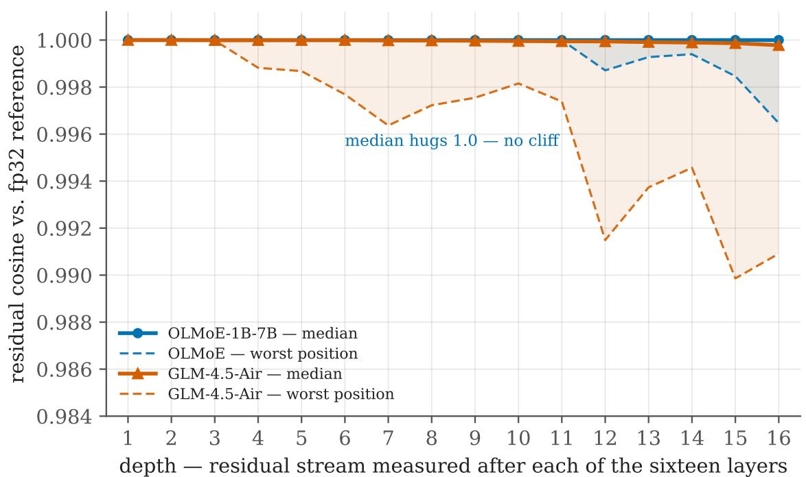
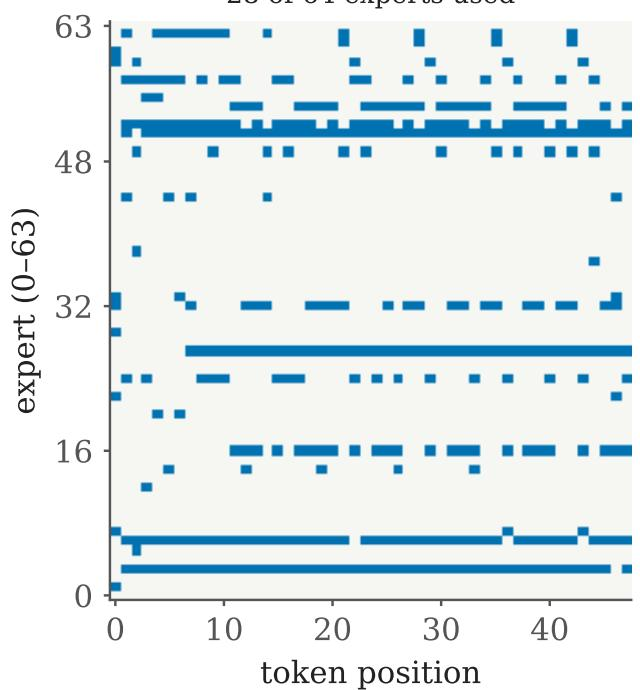
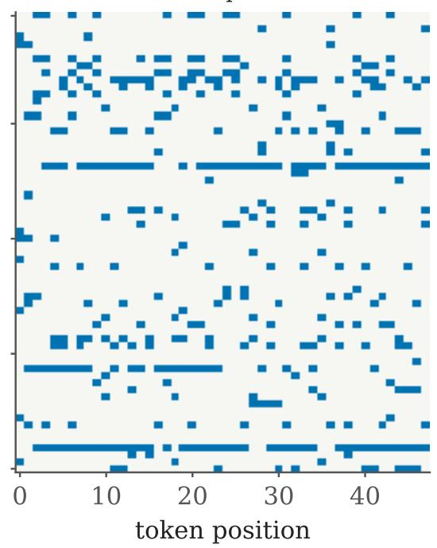
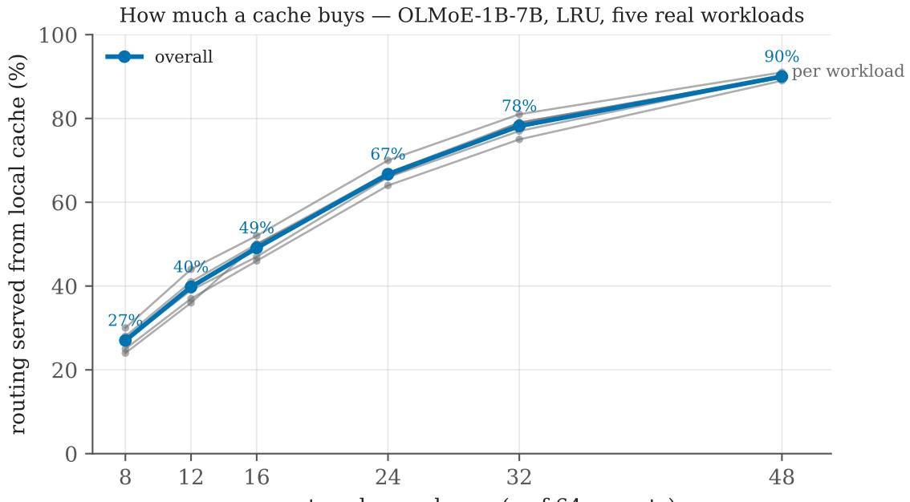
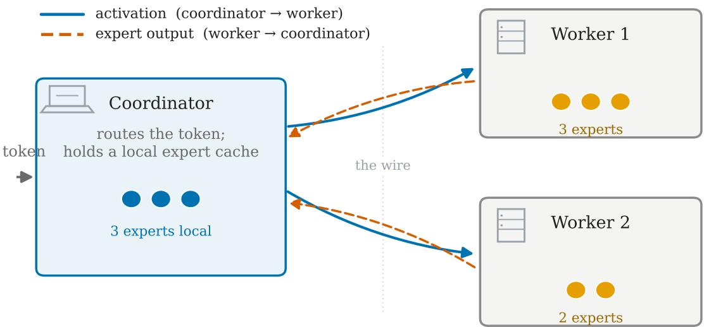
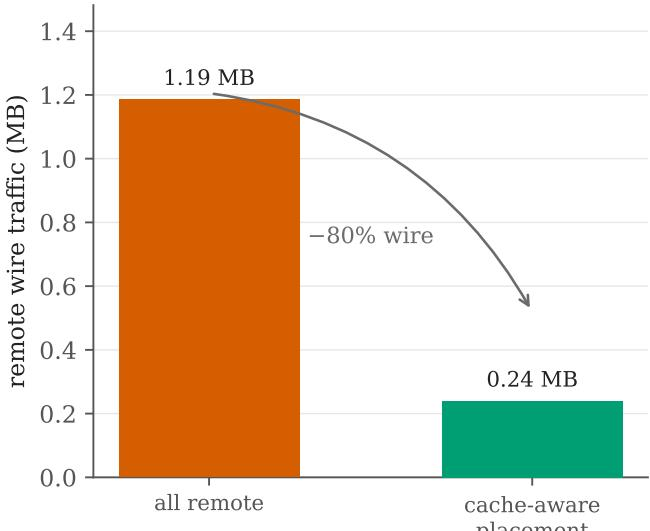
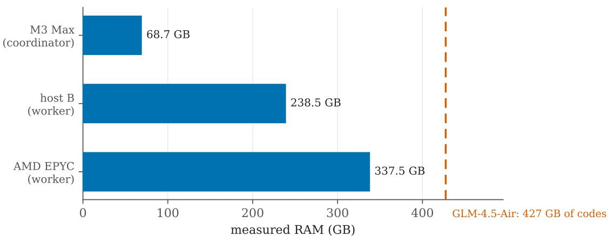

# Deterministic, Reproducible Inference in Exact Integer Arithmetic, and Verifiable Distributed Inference as Its Consequence

Sayed Amir Karim

Pelloran Inc.

tritify@pelloran.com

Preprint — November 5, 2026

DOI: 10.5281/zenodo.23986737

## Abstract

Typical optimized floating-point inference is not reproducible across environments: the same model on diferent hardware, compilers, or thread counts can produce diferent bits, because IEEE-754 addition is not associative and platform math libraries round transcendental functions diferently (reproducible floating point is achievable, e.g. a reduction-pinned BLAS, but at a cost and not by default). We present tritify, an open-source runtime that executes the forward pass of real models — decoder-only language models, Mixture-of-Experts decoders, and the Segment Anything 2.1 image/video stack — with the entire run-time path (forward\_int) in exact integer arithmetic; floating point is confined to ofline weight/eps quantization and the float reference used for verification. We make three precise, separate claims and verify each. (1) Cross-hardware reproducibility: the integer path produces bit-identical output run-to-run, across CPU instruction-set architectures, and across CPU/GPU, carried by a reproducing SHA-256 of the output. (2) Decision fidelity to the float reference: the integer path reproduces the float reference’s decision on the models and inputs tested, with the numeric exceptions measured rather than assumed away; we extend this to depth, measuring per-layer fidelity through sixteen layers of OLMoE-1B-7B and of a 106-billion-parameter frontier MoE, and find no fidelity clif. (3) Location independence: because the output is a deterministic function of (weights, inputs) and is bit-identical wherever each operation runs, a model’s computation can be split — across CPU instruction sets, across CPU and GPU, and across many networked machines — with zero efect on the output bits, and the gather equals the single machine exactly. We demonstrate Claim 3 at scale: a frontier Mixture-of-Experts model, GLM-4.5-Air (106,852,251,264 parameters, 427 GB of integer codes), generated its answer across three machines none of which can hold its full integer codes in RAM — bit-identically to a single-host reference that streams the experts, carried by the same SHA-256 at every layer (a separate run split a whole model across six machines of two instruction sets and three locations with the identical hash). The consequence is verifiable distributed inference: a fast, untrusted server (or a fleet of commodity devices) runs the model while an open scalar oracle — local, or any third party — re-derives the exact bytes and checks them against the public reference; turning honest-run agreement into a guarantee against a dishonest server is future work (Section 8.3). We are deliberately careful about scope: we do not claim a per-device speed improvement (distribution adds latency; the win is capacity, not speed), bit-for-bit equality of the raw floating-valued intermediates, or confidentiality — verifiability is not privacy. The contribution is exactness, determinism, portability, and, above all, verifiability: every operation ships both an integer path and a floating-point reference, and a gate refuses anything the two disagree on beyond tolerance. This is a preprint: it reports the measurements, and

the reproducibility artifact — the public repository, commit, full-length digests, and exact run commands that let a third party re-derive the exact bytes — is provided at release.

## 1 Introduction

Machine-learning inference is hard to reproduce bit-for-bit, because typical optimized floatingpoint execution is not deterministic across environments. IEEE-754 addition is not associative, so a change in reduction order — a diferent BLAS, a diferent thread count, a fused multiply-add, a diferent GPU — changes the result in the low bits. Transcendental functions (exp, tanh, 1/√ ) are not required to be correctly rounded, so two platforms’ math libraries disagree. Reproducible floating point is achievable (for example reproducible BLAS such as ReproBLAS [8], which pins the reduction), but at a cost and not by default in standard inference stacks. The everyday consequence is a “trust me” culture: a reported logit, mask, or hash cannot be independently regenerated, and — as we develop below — a computation ofloaded to another machine is, in standard serving, trusted rather than checked, with no routine way for the client to confirm it was performed correctly.

tritify removes the source of that nondeterminism from the inference path. The weights are quantized to fixed-point integers once; activations are quantized dynamically, per tensor, with no calibration pass; and the entire element-wise data path — matrix-multiply accumulation, requantization, residual addition, the application of normalization and attention scales — is carried in exact integer arithmetic. No floating point remains in the run-time path at all: even the scalar bookkeeping — choosing a common scale when two tensors are added, and computing the per-row mean and inverse-RMS for normalization — is integer, the inverse-RMS an integer isqrt (no sqrt, no frexp, no platform transcendental) and the GELU and softmax-exp nonlinearities integer lookup tables. Floating point is confined to the ofline build and to the forward\_ref verification twins.

Our contribution is not a new quantization algorithm — the arithmetic building blocks are standard. It is a fully specified, self-verifying inference path whose output is reproducible bit-for-bit across hardware, an empirical demonstration on real models including a frontier MoE, an engineering architecture (a frozen generic engine plus per-family plugins) that makes the property reusable, and — the step this paper adds — the consequence of bit-identity for distributed inference. Because the output does not depend on where each operation runs, a model can be split across many machines and the gather is bit-for-bit the single-machine result; and a server’s work can be checked, not merely trusted, by re-deriving its exact bytes against the open reference. The market for serving AI is otherwise binary — all-local (private but constrained by one device’s memory) or all-cloud (powerful but you must blindly trust the provider). Bit-identity opens a third position: cloud (or fleet) capacity with a reproducible, independently checkable result. Standard optimized float inference does not occupy it by default: it is not bit-identical across heterogeneous backends (CPU-float ̸= GPU-float ̸= other-CPU-float), so a split float result depends on the split and is not reproducible without special efort — a reduction-pinned BLAS [8] fixes summation order, but does not by itself make a whole heterogeneous model’s inference bit-identical.

The conversion is moreover post-hoc and calibration-free — no fine-tuning, no quantizationaware training, no calibration data — and the run-time path is deterministic integer that needs no CUDA or GPU (the optional GPU backend is a single portable shader; its bit-identity to the CPU path is demonstrated on Apple M3 Metal for the ternary GEMM, not yet whole models). We are deliberately careful about what is and is not claimed, because the entire value of the artifact is that its claims can be checked.

## 2 What we claim — and what we do not

We state three claims that are often conflated and must not be.

Claim 1 (cross-hardware reproducibility). For a fixed input, tritify’s integer path produces the same output bits run-to-run, across CPU instruction-set architectures, and across CPU and GPU backends. The output carries a reproducing SHA-256; anyone who re-runs it obtains the same digest. This is a statement about our own path.

Claim 2 (decision fidelity to the float reference). For the models and inputs we tested, tritify’s integer path reproduced the float reference’s decision on those specific cases — greedy decoding matched the reference token-for-token on the prompts we ran, and the selected SAM 2.1 segmentation mask matched the internal float twin (IoU = 1.000) — but this is not a universal guarantee, and we measure the exceptions rather than assume them away. On a 512-token synthetic probe of Qwen2.5-0.5B the integer argmax matched the reference at 509/512 positions, the three disagreements being near-ties. We extend this claim to depth (Section 6): we measure per-layer agreement through sixteen layers of OLMoE-1B-7B and of GLM-4.5-Air (a 106-billion-parameter frontier MoE), and find no fidelity clif — the median per-layer residual cosine stays above 0.999 on both, with the single worst probe position dipping to 0.97 at one layer and recovering. The mechanism of the exceptions is the logit error ε: a top-1/top-2 reference gap exceeding 2ε is suficient to preserve the argmax, so near-ties can flip, after which autoregressive decoding can diverge.

Claim 3 (location independence). For a fixed input and schedule, tritify’s output is a deterministic function of (weights, inputs) and is bit-identical regardless of where each operation is computed: scalar or vectorized, one thread or many, CPU or GPU, one machine or a network of machines. Therefore a model’s computation can be split — contiguous layer ranges per machine, or a layer’s experts sharded across machines — and the gather reproduces the single-machine output exactly, carried by the same SHA-256. This is the property standard float inference lacks by default — it is not bit-identical across heterogeneous backends without special efort. Its consequences — distribution of a model whose integer codes exceed any one device’s RAM, and verifiable ofload to an untrusted server — are the subject of Section 8.

What we do not claim. We do not claim that tritify’s raw floating-valued intermediates equal the reference’s bit-for-bit; they agree only within a declared integer-requantization tolerance (Section 4). We do not claim a speed improvement — on general-purpose CPUs and GPUs the integer path is not a throughput win, and distributing a model adds network latency versus a single host that could hold it; the distributed win is running a model whose full integer codes exceed every single device’s RAM, plus verifiability and locality — not speed, and not an exclusive “runs at all”: our own single-host reference runs the same model by streaming experts from disk, so the cluster’s advantage over single-host streaming (resident working set, latency, disk I/O) is a separate, measurable quantity we do not quantify here. We do not claim confidentiality: a server that runs the layers sees the activations, and bit-identity gives verifiability, not privacy (Section 8). And exactness here is to the reference, not a better model.

A note on “no float.” The absence of floating point is neither necessary nor suficient, by itself, for cross-platform bit-identity; one also needs fixed integer widths, defined overflow and rounding, a fixed shift and accumulation order, and a deterministic execution schedule. tritify pins all of these, and the run-time path is integer throughout. The guarantee therefore rests on fully specified arithmetic, and we treat the reproduced cross-architecture and cross-machine comparisons of Sections 5–8 as the actual evidence — not the mere absence of a float type.

## 3 Method

tritify is a small generic engine with one plugin crate per model family; the engine is frozen and adding a family never touches the core. The same engine runs dense decoder language models (Llama/Qwen/Mistral-style), Mixture-of-Experts decoders (OLMoE/GLM-MoE/Qwen-MoE — one config-driven path builds dense and MoE alike, so a new MoE model is configuration, not code), and image/video segmentation (SAM 2.1) — one generic exact-integer engine across three task families.

## 3.1 Representation

A tensor is stored as integer codes $c _ { i } \in \mathbb { Z }$ together with a single fixed-point scale $s = m \cdot 2 ^ { - k }$ (an integer mantissa m and a shift $k )$ ; the real value it denotes is $c _ { i } \cdot s$ . Weights are quantized once at build time to a balanced-ternary grid of b trits (b = 12, i.e. $L _ { W } = ( 3 ^ { 1 2 } - 1 ) / 2 = 2 6 5 , 7 2 0$ levels per sign, ≈ 19 bits), $c _ { i } = \mathrm { r o u n d } ( w _ { i } / \Delta )$ with $\Delta = \operatorname* { m a x } _ { i } | w _ { i } | / L _ { W }$ . Activations entering a matmul are quantized dynamically at run time, per tensor, by their own maximum; between operations activations are carried at the interchange level $L _ { A } = 2 ^ { 2 8 }$ . Dynamic quantization is scale-invariant and needs no calibration data.

Arithmetic specification (the pinned semantics behind Claims 1 and 3). The reference accumulator is i128 (the auto-vectorized hot path accumulates in i64 within a proven range bound, Section 3.4); a scale $m \cdot 2 ^ { - k }$ has a 64-bit mantissa m (built as round $( \cdot 2 ^ { 3 1 } ) ,$ ) and a 32-bit shift $k ;$ requantization evaluates round $\scriptstyle ( c \cdot m / 2 ^ { k } )$ as an i128 multiply followed by a round-half-away-from-zero arithmetic shift. Lookup tables use a uniform index with explicit tail handling; their approximation error shrinks monotonically with table resolution and is reported in Section 4. These widths, the rounding rule, and the fixed evaluation order are what make the integer output a deterministic function of the input across platforms — and, in Section $^ { 8 , }$ across machines.

## 3.2 The exact-integer data path

• Matmul. Accumulation is exact integer. The auto-vectorized linear kernel accumulates its $i 3 2 \times i 3 2 \to i 6 4$ products in an i64 accumulator, which equals the exact integer sum whenever it cannot overflow (codes are bounded by $L _ { W } \approx 2 ^ { 1 8 }$ , so a length-K sum stays below $2 ^ { 6 3 }$ for any realistic $K )$ ; a generic matmul path uses an i128 accumulator for cases outside that bound.

• Requantization. Scaling an integer by a fixed-point scale is round $| ( c \cdot m \cdot 2 ^ { - k } )$ with integer multiply and arithmetic shift; the rounding is fixed.

• Residual addition. Two tensors are brought to a common scale by integer scale composition, added element-wise in integer, and dynamically requantized.

• Normalization (RMSNorm / LayerNorm). The sum of squares (and mean) is an exact integer reduction; the per-row inverse-RMS is a scalar computed with an integer inverse square root and folded into an integer scale.

• Nonlinearities. GELU and the softmax exp are integer lookup tables built once ofline; table resolution sets a declared, monotonically shrinking approximation error.

• Attention. Scores are an exact integer dot product scaled by the fixed $1 / \sqrt { d _ { \mathrm { h e a d } } }$ ; the softmax uses the exp table with a max-shift for stability; the rotary-position factors are precomputed into integer scales.

• Mixture-of-Experts. A router scores the experts in integer; the top-k selection is an integer comparison (ties broken by index); each selected expert is an exact-integer MLP; the weighted combination is integer at a common scale. A shared expert and the first (dense) layers are the same integer path. The normalization ε is resolved by one rule: a config that states ε uses that value; a config that omits it takes its architecture’s published transformers default (OLMoE-1B-7B and GLM-MoE each carry that default, with its source line); an architecture with no recorded default and no stated ε fails closed, naming the missing key. So a missing ε is either resolved from the architecture’s published default or refused — never silently guessed. Where a recorded family’s default difers from a checkpoint’s own stated ε, the diference is explicit and measured, not silent (the OLMoE case, Section 6).

## 3.3 The engine and its plugins

Every operation implements a two-method contract: forward\_int (the integer run-time path) and forward\_ref (a floating-point reference on dequantized inputs). A model family is a plugin that detects whether a checkpoint is of its family, plans the operator graph, and builds it from weights; a registry selects the first plugin that recognises a checkpoint. We implement decoder-only transformers (dense and MoE) and Segment Anything 2.1.

## 3.4 Fast execution paths that preserve the output bits

The integer data path admits fast implementations that do not change a single output bit, because integer addition (including two’s-complement wrap-around) is associative and commutative: a reordered, multi-lane, or multi-threaded reduction equals the scalar left-to-right one exactly — unlike IEEE-754, where reordering changes the low bits. tritify uses this on two axes inside a machine, and Section 8 uses the same property across machines.

• SIMD. The hot integer dot products and matmuls are written as an $i 3 2 \times i 3 2 \to i 6 4$ widening multiply–accumulate; built with -C target-cpu=native the compiler autovectorizes them to NEON (smlal) on ARM and AVX-512 on x86-64. The vectorization changes the reduction order, not the accumulated value.

• Multithreading. A matmul’s output rows, a convolution’s output channels, and attention’s heads are disjoint: each output block is a function only of its index and the shared, read-only inputs. They are computed in parallel (a dependency-free std::thread::scope, keeping the engine standard-library only), writing to disjoint locations, so the result is order-independent and bit-identical. The worker count is a runtime knob; it changes only speed, never a bit.

Two facts keep these paths exact, and they must not be conflated. First, reduction order is irrelevant: integer addition under a fixed two’s-complement wrap is associative and commutative, confirmed by a 200,000-case fuzz that deliberately includes i64-overflow magnitudes. Second, the sum does not actually overflow for the dimensions used, so each i64 accumulation also equals the i128 reference. The cross-architecture and cross-machine runs then confirm that the fast and distributed paths reproduce the scalar reference’s exact digest (Sections 5.1–8).

Table 1: Error of representative operations against the float reference: M marks an empirically measured maximum, D a derived representational bound.
<table><tr><td>Operation</td><td>Ref / metric</td><td>Probe / domain</td><td>Gate tol</td><td>M/D</td></tr><tr><td>Fixed-point requant, full-width mantissa</td><td></td><td>f64 twin, max abs integer scale ratios</td><td>exact</td><td>M (0)</td></tr><tr><td>Fixed-point requant, 8-bit mantissa</td><td></td><td>f64 twin, max abs integer scale ratios</td><td>≤ 1 ulp</td><td>M</td></tr><tr><td>GELU lookup, 20-bit index</td><td>f64 GELU, max abs</td><td>table domain</td><td>≤ 10−4</td><td>M (4.8×10−5)</td></tr><tr><td>Inverse-RMS (integer isqrt)</td><td>f64 1/√, max rel 2× 105 pts</td><td></td><td>&lt; 2×10−9</td><td>M (5.8×10−10)</td></tr><tr><td>SAM 2.1 mask logits vs. max abs float twin</td><td></td><td>base-plus image</td><td>diag.</td><td>M (4.9×10−2)</td></tr><tr><td>Qwen2.5-0.5B logits vs. max abs float</td><td></td><td>512-token probe</td><td>diag.</td><td>M (2.1×10−1)</td></tr></table>

## 4 Verification methodology

The two-method contract is the verification mechanism. For any module or whole model, the verify gate runs forward\_int and forward\_ref on a fixed probe input and reports (i) the maximum absolute and relative diference between the integer path (dequantized) and the float reference, (ii) whether the integer output is deterministic (identical on a repeat run), and (iii) a SHA-256 of the integer output. Nothing is admitted that the gate has not checked; an operation that cannot state its own float reference cannot ship. This turns “is it faithful?” from an assertion into a test.

The gate makes Claim 2 precise: fidelity is reported to the reference, as a tolerance. Where the operation is exact (integer index permutations, residual addition at a common scale) the agreement is bit-exact; where it is a quantized approximation (requantized matmuls, table nonlinearities) it is bounded. We do not impose a pass/fail gate on whole models: we report measured agreement (argmax-match rate, mask IoU, maximum logit/feature error) as diagnostics, and the measured exceptions are reported results, not gate failures.

## 5 Experiments: the single-machine engine

We report the engine’s reproducibility and fidelity on a single machine; Sections 6–8 add depth and distribution. Each row names the exact model, input, hardware, comparison quantity, and a reproducing digest (Appendix A).

The decoder-LM row is the strongest single-machine reproducibility evidence: two diferent instruction set architectures (ARM and x86-64) produce the same logits digest, which is only possible because the arithmetic is fully specified. On the SAM image the decision is exact — both the integer path and the float twin select the same candidate, and the selected 256 × 256 mask is pixel-identical (0 of 65 536 pixels difer) — while the raw logits difer by at most 4.9 × 10−2.

## 5.1 The fast paths are bit-identical to the reference, and measurably faster

The fast paths of Section 3.4 reproduce the scalar reference’s exact digest while running substantially faster than tritify’s own scalar, single-threaded baseline. This is not a claim against optimized floating-point inference; it is a demonstration that the open, verifiable reference and a fast engine are the same computation.

The point is the last column: the same reproducing hash appears in every cell — scalar and vectorized, one thread and sixteen — so a deployment may choose the ISA and the thread count purely for performance, with the scalar reference as an oracle that re-derives the exact bytes. Section 8 extends exactly this “choose freely, the answer never moves” property from the cores of one machine to a network of machines.

Table 2: Cross-hardware reproducibility (Claim 1) and decision fidelity (Claim 2).
<table><tr><td>Subject</td><td>Setup</td><td>Claim 1 (reproducibil- ity)</td><td>Claim 2 (vs. float)</td></tr><tr><td>Ternary GEMM demo</td><td> $\begin{array} { r c l } { Y } & { = } & { X W ^ { \top } } \end{array}$  2  $\scriptstyle M = 6 4 , N = 7 6 8 , K = 7 6 8 ;$  Apple M3 Max (Metal) vs. CPU</td><td>bit-identical CPU = GPU; SHA-256 repro- duced</td><td>exact integer GEMM (no float reference needed)</td></tr><tr><td>Decoder LM</td><td>Qwen2.5-0.5B, seq 512; Apple M3 Max (ARM/- NEON) vs. AMD EPYC 9454P (x86-64/AVX-512), byte-identical weights</td><td>logits SHA-256 byte- identical ARM = x86-64</td><td>greedy tokens match on tested prompts; 509/512 argmax on the 512-token probe</td></tr><tr><td>SAM 2.1 image</td><td>hiera-base-plus, 613- tensor checkpoint; self- check, no PyTorch</td><td>deterministic; reproduc- ing mask SHA-256</td><td>selected mask bit- identical (0/65536 px); IoU vs. float twin = 1.0000</td></tr></table>

Table 3: Speed of the bit-identical fast paths, relative to tritify’s own scalar / single-threaded baseline. Every cell reproduces the reference digest — the speedups move no output bit.
<table><tr><td>Measurement</td><td>Speedup</td><td>Bit-identity</td></tr><tr><td>SIMD vs. vectorizers-off, hot kernel (896×896, 4096 rows)</td><td>4.76× (M3/NEON); 4.68× (EPYC/AVX-512)</td><td>same digest; cross-ISA checksum equal</td></tr><tr><td>SIMD × threads: Qwen2.5-0.5B forward_int, seq 512</td><td> $1 1 . 8 \times ( 1 3 3 . 7 \mathrm { s }  1 1 . 4 \mathrm { s } )$ </td><td>all cells: same logits hash</td></tr><tr><td>SIMD × threads: SAM 2.1 base-plus, end-to-end wall</td><td> $7 . 0 \times \ ( 2 3 7 . 7 { \mathrm { s } } \to 3 4 . 0 { \mathrm { s } } )$ </td><td>all cells: same mask-logits hash</td></tr></table>

## 5.2 Footprint

Transforming Qwen2.5-0.5B (494 M parameters) emits a self-contained KPI card: the original is 942 MiB (BF16); the transformed model is ≈ 1.15 GiB (b=12, ≈ 20 bits/weight packed) = 1.25× the fp16 size, with a peak conversion working set of 5.80 GiB and a convert-plus-self-verify time of 13.6 s. This is deliberately not a compression result: tritify trades size, memory, and per-device speed for exactness, determinism, and verifiability, and is ∼fp16-class on footprint.

## 6 Fidelity at depth

Section 5’s fidelity evidence is end-to-end (final logits / mask) or on short slices. Because the decision-match of Claim 2 is an empirical property, we characterise how the integer path tracks the float reference as layers accumulate, on a fixed 32-token probe, measuring after every layer the residual stream’s per-position cosine, each MoE layer’s top-k routing agreement, and, at the end, the final-normed hidden state and logits. We run two models: OLMoE-1B-7B (all sixteen layers — the calibration, a build the anchors call known-correct at full depth) and the first sixteen layers of GLM-4.5-Air (a 106-billion-parameter frontier MoE; this is the deepest slice a single node holds in fp32 for the reference). The float reference is transformers at a pinned

Table 4: Per-layer fidelity of the integer path against the fp32 reference, measured after every layer; no fidelity clif. Both sides run at each model’s own transformers-configured ε — OLMoE-1B-7B at 1e−5 (the engine’s family default was aligned to this shipped value; see text) and GLM-4.5-Air at its stated 1e−5 — so each column is decision fidelity to that shipped checkpoint, unmodified.
<table><tr><td>Measure (over 16 layers)</td><td>OLMoE-1B-7B</td><td>GLM-4.5-Air (first 16)</td></tr><tr><td>Residual cosine, median</td><td>0.9999991</td><td>0.9996717</td></tr><tr><td>Residual cosine, min (final layer)</td><td>0.99617</td><td>0.9873843</td></tr><tr><td>Residual cosine, worst position (any layer)</td><td>0.99617</td><td>0.9735 (recovers to 0.9988)</td></tr><tr><td>Final logits cosine, median</td><td>0.9999998</td><td>0.9995361</td></tr><tr><td>Router top-k exact agreement</td><td>508/512</td><td>448/480</td></tr><tr><td>Largest layer-to-layer median cosine drop</td><td> $3 . 2 \times 1 0 ^ { - 7 }$ </td><td> $< 1 0 ^ { - 3 }$ </td></tr><tr><td>No-cliff gate (per-layer drop  $< 1 0 ^ { - 3 } ;$  routing ≥ 24/32)</td><td>holds</td><td>holds</td></tr></table>

  
Figure 1: Fidelity does not clif with depth. Per-layer residual cosine to the fp32 reference, both sides at the checkpoint’s own ε (zoomed axis). Solid: the per-position median, near 1.0 throughout. Dashed/shaded: the single worst probe position, dipping to ≈ 0.996 (OLMoE) and ≈ 0.99 (GLM) at the deepest layers and no further — a bounded spread, not a collapse.

revision, in fp32 on CPU.

The integer arithmetic stays float-faithful through depth on both models — a calibration (OLMoE) and a frontier MoE (GLM-4.5-Air) — with no layer at which fidelity collapses (Figure 1). We report, not hide, the facts that complicate the picture. Of the 480 GLM routing decisions (15 MoE layers × 32 probe positions), 32 had a top-k set that difered from the reference — near-ties, not a systematic divergence; one probe position in particular flipped an expert at several layers, dipping its residual cosine to 0.9735 at one layer and recovering to 0.9988 by layer 16. GLM’s end-of-slice 1 − median cosine is about $3 \times 1 0 ^ { - 4 }$ — below a 0.9999 figure we had expected but above every gate. Both columns are decision fidelity to the shipped checkpoint. tritify builds the OLMoE family at transformers’ configured $\varepsilon = 1 \mathrm { e } { - 5 }$ , so the integer and float sides share that checkpoint’s own ε and agree on 508/512 routing decisions. We report how we got here, rather than hide it: an earlier build defaulted the family to 1e−6 when the checkpoint’s config omits the key, and against the shipped ε that build agreed on only 0.455 of routing decisions — an ε-configuration diference, not integer-arithmetic error. We aligned the engine’s family default to each architecture’s transformers default (by the single rule of Section 3.2: a missing ε is taken from a recorded family’s transformers default, and an unrecorded family with no stated value fails closed — never silently guessed), re-anchored the OLMoE hashes accordingly, and the figures above are measured on that corrected build. The GLM slice never needed this — its config states ε explicitly. Honest scope: this is sixteen of GLM-4.5-Air’s forty-six layers the depth a single node holds in fp32; the curve past layer sixteen is an extrapolation, and the full-depth property we establish in Section 8 is bit-identity, which is exact, not fidelity to float, which is measured.

## 7 Deterministic routing introspection

Because the forward is exact integer, a Mixture-of-Experts routing decision — which top-k experts each token selects at each layer — is a deterministic, byte-reproducible function of (weights, input). A read-only trace hook records it without changing a bit of the forward: the verify gate stays green and the output hash is unchanged, so the same model and input yield the same routing trace on every machine. At a fixed numeric configuration and execution schedule, this trace is identical across every backend we tested — the same conditions under which Claim 1 holds. A float engine gives no such guarantee by default: near a routing tie its expert selection can difer run-to-run or across hosts (the same non-associativity that makes float output non-reproducible across environments), so a float routing trace is not portable without the reduction-pinning efort that makes float output reproducible. The same generic path serves any MoE family with no model-specific code; we exercise it on OLMoE-1B-7B (64 experts) and Qwen3-30B-A3B (128 experts).

What the trace shows (records released with the artifact) is that the routing a model produces tracks the input’s vocabulary: a single repeated token selects a handful of experts with near-perfect temporal locality, while maximally diverse text spreads across almost all of them (Figure 2), and a bounded real-world workload (one user or domain) sits in between — with a working set small enough that an edge cache of experts pays of (Figure 3). On the workloads we examined this working set grew with the input’s vocabulary rather than with the model’s expert count; if that pattern holds more broadly it would make larger MoEs more cache- and placement-friendly for bounded workloads, not less. We ofer this as an observation on the cases we ran, not a law — context, token order, and architecture also shape the hidden states that drive routing, and we have not isolated them. Section 8 shows one concrete use, with its cache size and in-sample scope stated there. The claim this paper makes is narrow and exact: the introspection is deterministic — the same routing, reproducibly, on any machine at a fixed configuration — which is what makes it trustworthy as a measurement rather than an impression.

## 8 Verifiable distributed inference

Claim 3 says the output does not depend on where each operation runs. This section is its demonstration and its consequence. The enabler is structural and we state it plainly: because every machine computes the same exact integers, which machine runs which layers — or which experts, or which rows of a matmul — has zero efect on the output bits, verified by a single SHA-256 (Figure 4). Standard float inference does not do this by default: CPU-float, GPU-float, and a second CPU’s float difer bit-for-bit, so a split float result depends on the split and is not reproducible without special efort (a reduction-pinned BLAS fixes summation order but not a whole heterogeneous model).

Which experts fire — OLMoE-1B-7B bounded workload (narrow vocabulary) 28 of 64 experts used  

  
Figure 2: Which experts fire, read directly of the exact-integer forward (OLMoE-1B-7B, one MoE layer; each column a token, each row one of the 64 experts, a cell marked when that expert is in the token’s top-8). A bounded, narrow-vocabulary workload reuses a small set of experts — the horizontal bands, 28 of 64 here — while a diverse passage spreads across most of them (52 of 64). Because the routing decision is deterministic, this trace is exactly reproducible. Generated from a committed route trace.

  
expert cache per layer (c of 64 experts)  
Figure 3: How much a local expert cache buys, as a relationship rather than a single number: the fraction of routing an LRU cache serves locally against the cache size, for five real OLMoE-1B-7B workloads and their mean. This is out-of-sample — the cache is not fitted to the probe it serves. A modest cache (c = 24 of 64 experts per layer) already serves about two thirds; the curve is workload-dependent, bounded by each workload’s own vocabulary. Records released with the artifact.

Illustration: one token → its top-8 experts, split across a local cache and two workers

  
expert weights stay resident on each worker; only activations and expert outputs cross the wire  
Figure 4: The distributed seam (schematic). The coordinator routes each token locally and sends its activation to the worker holding each selected expert, which returns the expert’s output vector; expert weights stay resident and never cross the wire (so per-token trafic is kilobytes). The split shown (3 local, 3+2 remote) is an example — the real placement is the oracle’s. Recombination is placement-independent, so the output carries one SHA-256, identical on every node (Claim 3).

## 8.1 A whole model across six machines, bit-identically

We split OLMoE-1B-7B (all sixteen layers; 64 expert networks per MoE layer) across six live machines of two instruction sets and three locations: a MacBook Pro (arm64) as the coordinator that routes each token locally, and five workers holding the experts between them — a 96-core cloud server (x86-64), two fanless x86 mini-PCs, and two Raspberry Pis (aarch64) — reached over QUIC. Each machine holds only its shard of experts; for each token the coordinator routes locally, then sends the token’s hidden-state activation to the worker holding each selected expert, which evaluates those experts and returns their output vectors; the coordinator combines them. The expert weights stay resident on their worker and never cross the wire — only activations (out) and the experts’ output vectors (in) do, which is why the per-token trafic is kilobytes, not the gigabytes an expert’s weights would be. The recombination is placement-independent, so the distributed gather reproduces the single-machine output exactly: the whole model carries the single-machine hash 3dadb4f1... both ways. (This fleet run was recorded on the build that preceded the OLMoE ε alignment of Section 6, so its hash is that model’s 1e−6 build; bit-identity is a property of the shared integer path and is independent of the ε value.) The 8-token probe cost 498 expert round-trips, 4.10 MB out / 8.43 MB in, 35.8 s of wall time, with every expert fetched remotely. On a separate two-layer loopback of the same probe we measured what a cache buys: a cache-aware placement — a resident set of 24 of the 64 experts per layer, chosen in-sample as that probe’s own most-used experts — served 85% of its routing (109/128 routed experts) locally and cut remote wire trafic by about 80%, at identical output (Figure 5). That measures the mechanism’s locality on this one workload, not an out-of-sample generalization, which we do not claim here. “Diferent silicon, diferent locations, same bits.”

## 8.2 A frontier model no single node can hold

We then ran the capacity case: GLM-4.5-Air, 106,852,251,264 parameters, 427,409,005,056 bytes of integer codes — more than the memory of any machine in the run (Figure 6). The fleet was three machines: an Apple M3 Max coordinator (68.7 GB) holding everything but the routed experts (28,782,352,896 bytes of codes, and it declares holds\_full\_model: false), and two workers holding the 128 routed experts of each MoE layer between them — an AMD EPYC (experts 0–74, 233,570,304,000 bytes) and a second host (experts 75–127, 165,056,348,160 bytes). The workers build their experts’ codes on demand from the bf16 checkpoint under a memory budget; a cached, evicted, or rebuilt expert produces the same codes, because quantization is a pure function of a tensor’s bytes.

  
output bit-identical (same SHA-256)  
Figure 5: What cache-aware placement saves, at no cost to correctness: remote wire trafic for the loopback probe above, all-remote versus the cache-aware placement, with the output bit-identical (the same SHA-256) in both. In-sample cache as stated in the text. Records released with the artifact.

Table 5: The flagship run (GLM-4.5-Air, 46 layers, 427 GB of codes) across a fleet none of which can hold its full codes in RAM, against a single-host streamed reference. Every memory figure is measured on its node; “resident” is measured RAM, distinct from the assigned expert ranges.
<table><tr><td>Property</td><td>Value</td><td>Meaning</td></tr><tr><td>Model codes</td><td>427,409,005,056 B</td><td>exceeds every node&#x27;s memory in this run</td></tr><tr><td>Coordinator held</td><td>28,782,352,896 B</td><td>router-only; holds_full_model: false</td></tr><tr><td>Workers resident (sum)</td><td>398,626,652,160 B</td><td>codes resident after warm-up (measured) = the assigned routed experts&#x27; codes; on-</td></tr><tr><td>Node memory (each)</td><td>M3 68.7 · host B 238.5 · EPYC 337.5 GB</td><td>demand build, whole share fit here each &lt; 427.4 GB: no node holds the full codes in RAM</td></tr><tr><td>Bit-identity</td><td>564f495c... both ways</td><td>distributed = single-host streamed refer- ence, all 46 layers</td></tr><tr><td>Cost</td><td>2,504 round-trips, 633.6 s total</td><td>~90 round-trips per decode position (45 MoE × 2); 2,504 over 21 prompt positions + 7 tokens; total wall, not a decode rate</td></tr></table>

Asked “What is the capital of France? Answer in one sentence.” in GLM-4.5’s chat template, the fleet answered "The capital of France is Paris." — and it is a single host’s answer to the bit. A single-host reference on one machine, streaming each expert from the checkpoint as it is needed, produced the identical result: the same seven tokens, the same generated-logits hash 564f495c..., and the same hidden-state hash at every one of the forty-six layers.

This is the demonstration of Claim 3 at frontier scale: a model whose full integer codes (427 GB) exceed every machine’s RAM in the run generates a correct, single-host-identical answer across a fleet, provably, by one hash. The win is running such a model with each node’s resident working set bounded — not an exclusive “runs at all”: the single-host reference runs the same model by streaming experts from disk, so the cluster’s practical advantage over single-host streaming (resident set, latency, disk I/O) is a separate, measurable quantity we do not quantify here. Distribution adds round-trips — about 90 per decode position (45 MoE layers × 2 workers), 2,504 in total over the prompt’s 21 positions plus the 7 generated tokens, in 633.6 s of total wall time (setup, prefill and decode not separated here, so no decode-token rate is implied) — and we do not present it as faster than a single host that could hold the model.

  
Figure 6: No single node holds the model. Measured RAM of each machine versus GLM-4.5-Air’s 427 GB of codes (dashed). Every node is left of the line, yet the two workers together (576 GB) exceed the 399 GB of routed codes they hold — so the fleet runs a model no single node can hold in RAM at once (the single-host reference runs the same model by streaming). Labels anonymized as in the text.

## 8.3 What bit-identity unlocks: verifiable ofload

The same property makes an untrusted server checkable — a direction we frame carefully, because what we have demonstrated is the agreement of honest distributed execution with a reference, not a verification protocol against a dishonest one. The server (or fleet) is the fast engine; the open scalar reference — local, or any third party — is the referee. Full local recomputation gives an exact comparison; recomputing a random sample of operations or tokens gives only a detection probability, set by the sampling rule. Turning that into a security guarantee needs a specified selection, a binding of the intermediate states, and an explicit attacker model — none of which we provide here. A fully specified, analysed verification protocol would be its own contribution; Slalom [13] is relevant prior work on verifiable neural-network inference. With that caveat stated, three capabilities the property enables (each purely because the engine is deterministic):

• Verify / audit (a direction). Recompute N random ops or tokens locally and check the hash. This detects a dishonest server with a probability set by N and the (still-to-bespecified) sampling rule; it is a statistical or after-the-fact check, not a proof, and depends on the attacker model and state-binding noted above.

• Same-state handof. For the same model under the same numeric configuration and batching/execution schedule, a KV-cache computed on one node is bit-identical to the one another node would produce, so a session can move between hosts (e.g. local to remote for longer context) with a provably identical continuation — once the incremental KV-cache decode path exists, which today is future work (Section 9). The equality is within one model and one schedule: a cache is not transferable to a diferent or larger model, nor across a diferent batching/execution schedule (the dynamic-quantization schedule dependence of Section 9).

• Deterministic cache key. Output is a pure function of (weights, inputs, and the fixed batching/execution schedule) with an exact key, so a prefix/KV cache populated on one backend is numerically identical on another at the same schedule. Float systems already cache prefixes keyed by tokens (e.g. vLLM [14]); what bit-identity adds is cross-backend value equality, so a cache is reusable across mismatched hardware — not that float caching is impossible.

This is a third option between all-local (private but memory-bound) and all-cloud (powerful but trust-me): cloud or fleet capacity with a reproducible, independently checkable result.

Honest limits (stated plainly, not sold as hype). Verifiability is not confidentiality. A server that runs the layers sees the activations; splitting early layers local and later layers remote improves privacy but does not guarantee it, and row-splitting a layer across nodes hides nothing (each node needs the full layer input). A genuine confidentiality claim needs its own mechanism (a deep cut whose inversion is measured to be hard, added noise, or MPC/HE) — it does not follow from bit-identity. Verification costs recomputation: full re-execution erases the ofload benefit, so the value is the sampling/audit model, a statistical or ofline guarantee, not free total verification. Bandwidth is the real cost: activations (or experts) cross the wire every token, so a slow link or a weak device can make the distributed run slower than not distributing at all — prefer wired, capacity-bound settings. Determinism simplifies correctness; it does not supply the protocol. Because a slice is bit-identical wherever it runs, re-executing it after a fault reproduces the exact bits — but consistent cluster state, fencing a slow or partitioned node, and resuming a session still require a correct distributed protocol; determinism makes that protocol’s results reproducible, not the protocol unnecessary.

## 9 Limitations

• No speed claim against float. The integer path is not faster than optimized float inference on general CPUs/GPUs; the value is determinism, portability, and verifiability. The intra-machine speedups (Section 5.1) are relative to tritify’s own scalar baseline, and distribution (Section 8) adds latency — its win is capacity and verifiability.

• Tolerance, not bug. Claim 2 is agreement within a declared tolerance; the raw logits are not bit-equal to the reference. On the trials we ran the decisions matched, with the measured exceptions reported.

• Bit-identity vs. fidelity, at depth. Across the fleet (Section 8) the distributed run is bit-identical to the single-host reference at full depth (all 46 layers) — an exact property. Fidelity to a float model is a separate, measured property, and we measure it to sixteen layers (Section 6); we do not compare the full 46-layer answer to a float model, because no node in the run holds GLM-4.5-Air in fp32.

• Scope of determinism (batch / schedule). Claim 1 is reproducibility for a fixed input and a fixed batching / execution schedule. Because activation quantization is dynamic per tensor, a diferent batch composition or prefill/decode split can change a tensor’s maximum and hence its quantization; we measured this on Qwen2.5-0.5B (full prefill vs. incremental decode) and the integer path is not schedule-invariant, though every argmax decision was preserved on that probe and the float reference is exactly invariant — locating the efect in the dynamic per-tensor quantization. A per-token / static scaling choice attains invariance (as Barry’s detllm does); adopting it, together with the KV-cache incremental-decode path, is future work.

• Confidentiality is not claimed. See Section 8.3: bit-identity gives verifiability, not privacy.

• Scale validated, not asymptotic. We validate dense 0.5B–1.5B LMs, OLMoE-1B-7B, SAM 2.1 base-plus, and GLM-4.5-Air across a fleet; an exhaustive platform matrix — including a compiler/toolchain-version matrix run as its own reproducibility experiment — and larger single-node fp32 fidelity references are future work. The GPU backend’s bit-identity to the CPU path is shown for the ternary GEMM on Apple M3 Metal, not yet for whole models.

• Artifact completeness. This is a preprint draft: the public repository URL, several checkpoint and input hashes, build configurations, exact run commands, and full run logs are to be fixed at release. An output hash enables an identity comparison but does not by itself certify a correct model implementation.

## 10 Related work

Fully integer transformer inference — including the nonlinear operations — has direct precedent: I-BERT [1], I-ViT [2], and I-LLM [3] quantize attention, softmax, GELU, and normalization to integer or dyadic approximations. Post-training quantization and low-bit / ternary weights (the BitNet line [5]), incoherence rotations (QuIP# [6], SpinQuant [7]), and integer kernels (gemmlowp / TFLite integer-arithmetic-only inference [4]) are the arithmetic lineage; the determinism concern connects to reproducible computing (reproducible BLAS [8]) and the non-associativity of IEEE 754. The closest public project, int-llm [9], is a pure-integer C stack reporting byte-reproducible output across platforms; tritify matches that pure-integer run-time core and adds breadth (a decoder-LM family and SAM 2.1), a uniform run-time forward\_int/forward\_ref contract, an Apache-2.0 oracle, and a single portable GPU shader. Barry’s detllm [10] runs the entire forward pass of Qwen3-0.6B in exact integer arithmetic and obtains one int8 logits hash identical across a broader hardware matrix than ours (two NVIDIA GPU architectures and AMD/Intel/Apple CPUs), and crucially attains the batch- and schedule-order invariance we currently measure and lack; it is, however, a single small decoder with no vision, and the repository carries no license at the time of writing. A distinct line of float-reproducibility checkers (one also named “detllm” [11]) verifies ordinary floating-point inference rather than replacing it.

Distributed inference across commodity or volunteer hardware — pipeline and tensor parallelism, and systems such as Petals [12] that serve large models over a network — is well established for throughput and capacity. What is new here is not distribution but its provability: because the engine is bit-identical regardless of where an operation runs, a distributed gather equals the single machine exactly and is checkable by one hash, and an ofloaded computation can be verified rather than trusted. Float distributed-inference systems deliver capacity and speed; what they do not provide by default is a reproducible, independently checkable result (reproducible float is achievable at a cost, e.g. a reduction-pinned BLAS [8], but is not the norm in these stacks). That default, built-in verifiability — not the distribution itself — is our contribution.

## 11 A separate commercial product

tritify — the engine, the oracle, and the per-operation verification — is open source. Pelloran Inc. separately ofers the system built on it: an orchestrator for distributed and heterogeneous deployment (placement, load-balancing, comms, fault tolerance, and the audit protocol) and verifiable-inference / compliance services, together with the independent Generation 5 Embedding retrieval product. This mention is for disclosure; the engine and the reproducibility, fidelity, and bit-identity results in this paper stand on their own and depend on none of it.

## 12 Reproduction

On release, from the public repository — with no account and no network — the determinism result and the per-operation gate reproduce directly:

git clone https://github.com/pelloran-inc/tritify   
cd tritify   
cargo test --workspace # every op: integer path checked against its float reference   
cargo run --release # zero-float ternary GEMM; GPU == CPU; prints a reproducing SHA-256

Running the last command again, or on another machine, yields the identical digest. The modellevel and distributed experiments additionally require the corresponding public checkpoints and the fleet configuration; each run records its nodes’ measured memory, the per-layer and generated hashes, and the exact command, so that on release a third party can reproduce the bytes and re-check the single-host identity.

## Availability

tritify is licensed under Apache-2.0. The repository — the artifact of this paper — contains the engine, the model-family plugins, the self-verification gate, the determinism demonstration, the fidelity-at-depth harness, and the distributed coordinator/worker with the exact commands that regenerate the results above. This is a preprint draft: several checkpoint and input hashes, the build configurations, and the full run logs that complete the reproducibility artifact are fixed at release and are not all present in this draft.

## References

[1] S. Kim, A. Gholami, Z. Yao, M. W. Mahoney, and K. Keutzer. I-BERT: Integer-only BERT quantization. In Proc. ICML, PMLR vol. 139, pp. 5506–5518, 2021. arXiv:2101.01321.

[2] Z. Li and Q. Gu. I-ViT: Integer-only quantization for eficient vision transformer inference. In Proc. ICCV, pp. 17065–17075, 2023. arXiv:2207.01405.

[3] X. Hu et al. I-LLM: Eficient integer-only inference for fully-quantized low-bit large language models. arXiv:2405.17849, 2024.

[4] B. Jacob et al. Quantization and training of neural networks for eficient integer-arithmeticonly inference. In Proc. CVPR, pp. 2704–2713, 2018. arXiv:1712.05877.

[5] S. Ma et al. The era of 1-bit LLMs: All large language models are in 1.58 bits. arXiv:2402.17764, 2024.

[6] A. Tseng, J. Chee, Q. Sun, V. Kuleshov, and C. De Sa. QuIP#: Even better LLM quantization with Hadamard incoherence and lattice codebooks. In Proc. ICML, PMLR vol. 235, 2024. arXiv:2402.04396.

[7] Z. Liu et al. SpinQuant: LLM quantization with learned rotations. In Proc. ICLR, 2025. arXiv:2405.16406.

[8] J. Demmel and H. D. Nguyen. Fast reproducible floating-point summation. In Proc. 21st IEEE Symposium on Computer Arithmetic (ARITH), 2013.

[9] N. Micic. int-llm: Integer-only LLM inference in pure C. GitHub repository, 2026.

[10] N. Barry. DetLLM: Fully deterministic LLM inference. GitHub repository, 2026 (read 2026-10-29).

[11] T. Cerruti. detllm: Deterministic-mode checks for LLM inference. GitHub repository.

[12] A. Borzunov et al. Petals: Collaborative inference and fine-tuning of large models. In Proc. ACL (demo), 2023. arXiv:2209.01188.

[13] F. Tramèr and D. Boneh. Slalom: Fast, verifiable and private execution of neural networks in trusted hardware. In Proc. ICLR, 2019. arXiv:1806.03287.

[14] W. Kwon, Z. Li, S. Zhuang, et al. Eficient memory management for large language model serving with PagedAttention. In Proc. SOSP, 2023. arXiv:2309.06180.

## A Reproducing digests

Each result carries a reproducing integer-output SHA-256 (truncated here; full-length digests are fixed at release).

<table><tr><td>Artifact (host, backends)</td><td>Reproducing SHA-256</td></tr><tr><td>Single-machine determinism demonstration (Ap- ple M3 Max)</td><td>de67ba75...</td></tr><tr><td>SAM 2.1 image self-check (no PyTorch)</td><td>7177a5f5...</td></tr><tr><td>Qwen2.5-0.5B decoder-LM, end-to-end — Apple M3 Max (ARM/NEON) and AMD EPYC 9454P (x86-64/AVX-512), on byte-identical weights, scalar and vectorized, one and all</td><td>6c139feb...</td></tr><tr><td>cores OLMoE-1B-7B — six-machine distributed run = single machine</td><td>3dadb4f1...</td></tr><tr><td>loopback anchor for the above</td><td>6ae7e544...</td></tr><tr><td>OLMoE-1B-7B — corrected-ε build, bit-identical across ARM and x86</td><td>74005166.../505cb108...</td></tr><tr><td>GLM-4.5-Air flagship — distributed = single-host reference, 564f495c... every one of the 46 layers</td><td></td></tr></table>

The six-machine OLMoE run predates the OLMoE ε alignment of Section 6, so its two anchors (3dadb4f1... and 6ae7e544...) are that model’s 1e−6 build; the bit-identity demonstrated does not depend on the ε value. The full-length digests are fixed at release.