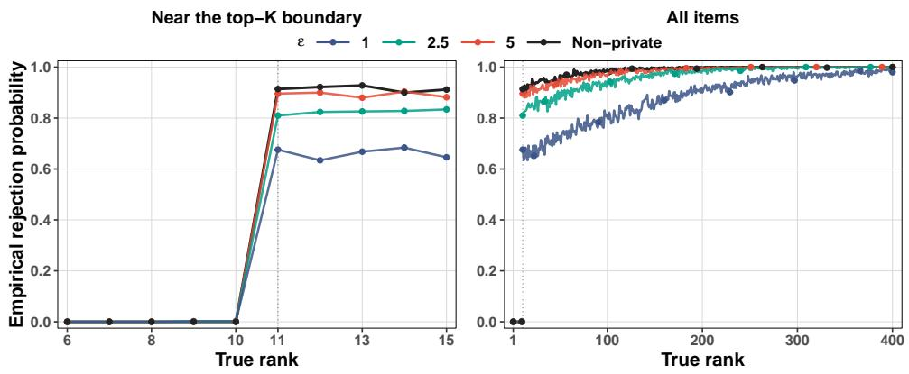

# Diferentially Private Statistical Inference for Rankings from Pairwise Comparisons

Xintao Xia∗ Jia Gu∗ †

## Abstract

Reliable inference for rankings of large language models based on human pairwise comparisons must preserve the privacy of individual preference records. To meet this need, we develop methods for score and rank inference under the Bradley–Terry model with edge diferential privacy. For an objective-perturbed estimator, a new leave-oneout analysis establishes finite-sample bounds on Euclidean and entrywise estimation errors. For suficiently dense comparison graphs, the error bounds extend to smaller privacy budgets, including regimes in which its privacy term dominates its statistical term. A uniform asymptotic expansion yields asymptotically valid confidence intervals for individual scores and pairwise score diferences. To improve finite-sample performance, we account for both regularization bias and privacy-induced randomness by combining a plug-in ridge-bias correction with Gaussian–Laplace calibration. We further establish a bootstrap procedure for simultaneous rank inference, providing asymptotically valid confidence sets for individual ranks and tests of top-K membership. When the comparison probability is public and known, all proposed inferential procedures require no additional privacy budget. We evaluate finite-sample performance through simulations and apply the proposed methods to rank large language models for creative writing.

Keywords: Bradley–Terry model; Diferential privacy; Parametric bootstrap; Rank confidence intervals; Top-K inference

## 1 Introduction

Ranking from pairwise comparison data is a fundamental statistical problem (Bradley and Terry, 1952). For example, pairwise comparisons have been used to assess consumer preferences for beverages (Duineveld et al., 2000) and to evaluate travel packages (Hatzinger and Mazanec, 2007). With rapid advances in artificial intelligence (AI), ranking has become increasingly important for evaluating large language models (LLMs). As academic institutions and companies release a growing number of models, reliable rankings help identify top models, providing a basis for assessing research progress and guiding model selection for users. These rankings also have commercial implications, as companies with top-ranked AI models may attract greater investor interest (Aradau and Blanke, 2026). Conventional benchmarks provide standardized assessments of capabilities such as knowledge and prob lem solving (Hendrycks et al., 2021). However, benchmark scores may not fully capture how users experience model responses, especially in terms of perceived empathy and emotional support (Zheng et al., 2023). Human feedback therefore provides a basis for rankings that reflect user experience, as illustrated by Chatbot Arena, which ranks LLMs by aggregating human preferences between anonymous pairs of model responses (Chiang et al., 2024). A central statistical challenge is therefore to estimate LLM rankings from human pairwise comparisons and quantify the uncertainty in these rankings.

However, releasing rankings derived from human comparisons may reveal individual preferences, even when the underlying comparison records are not released. Data protection laws, including the General Data Protection Regulation in the European Union and the California Consumer Privacy Act in the United States, further emphasize the need to protect personal information during data analysis. These concerns motivate ranking procedures with privacy guarantees while ensuring statistically valid inference. Diferential privacy (DP) provides a mathematical framework for data analysis under privacy constraints (Dwork et al., 2006). From a hypothesis-testing perspective, DP limits the power of any test for distinguishing neighboring datasets based on the released output (Wasserman and Zhou, 2010). Achieving DP generally requires introducing randomness into the analysis (Dwork and Roth, 2014). The challenge in ranking inference under privacy constraints is to account for both sampling variability and privacy-induced randomness.

## 1.1 Related works

The Bradley–Terry (BT) model provides a standard framework for analyzing pairwise comparison data by associating each item with a latent parameter (Bradley and Terry, 1952). These parameters determine pairwise comparison probabilities and induce a ranking. A substantial literature establishes estimation error rates and top-K recovery guarantees for likelihood and spectral methods (Negahban et al., 2017; Chen et al., 2019, 2022). Complementing these results, Han et al. (2020, 2023) establish consistency guarantees for maximum likelihood estimation under sparse networks. Recent developments extend the theory to general comparison graphs (Han et al., 2026) and incorporate covariates within the Plackett–Luce framework (Dong et al., 2026). Beyond estimation, statistical inference seeks to quantify uncertainty in the estimated rank (Han et al., 2024). Gao et al. (2023) derive asymptotic distributions for score estimators and construct confidence intervals for individual ranks, while Liu et al. (2023) develop inference for ranking properties, including pairwise ordering and top-K membership. Fan et al. (2025) consider top-choice multiway comparison and construct simultaneous confidence intervals for score diferences and individual ranks. These methods address ranking uncertainty without privacy constraints.

Estimation and inference under DP have gained attention in statistics. For example, output and objective perturbation provide general approaches to private empirical risk minimization (Chaudhuri et al., 2011). Asymptotic guarantees for private estimators and hypothesis tests have been established through bounded-influence methods and noisy optimization (Avella-Medina, 2021; Avella-Medina et al., 2023). More recently, this line of research has expanded to false discovery rate control and variable selection in highdimensional regression (Cai et al., 2026b; Gu and Cai, 2026), as well as M-estimation by diferentially private stochastic gradient descent (Xia et al., 2025). However, extending classical M-estimation methods to rank inference in our setting requires additional analysis to account for the identifying constraint on the latent scores, the growing dimension of the score vector, and dependence among score estimates.

More directly related to our setting, Xu et al. (2025) develop an adaptive debiasing procedure for locally privatized pairwise comparisons and establish estimation and ranking recovery guarantees. On the inferential side, Ouyang et al. (2025) establish consistency and asymptotic normality for BT parameter estimators based on degree sequences perturbed by Laplace noise. Cai et al. (2026a) study ranking under edge and individual diferential privacy and propose a perturbed likelihood with guarantees for estimation error and top-K recovery. Our work difers from that of Cai et al. (2026a) in three respects. First, although both approaches use objective perturbation, our ridge penalty depends only on the privacy budget, whereas theirs also depends on the number of items and the comparison probabil ity. Second, whereas their entrywise analysis tracks leave-one-out gradient descent iterates, ours directly compares the full estimator with estimators obtained by removing the comparisons involving each item. Combined with our tuning rule, this approach establishes entrywise error bounds for smaller privacy budgets when the comparison graph is sufi ciently dense. Third, and most importantly, we go beyond point estimation by establishing a uniform asymptotic expansion that enables confidence intervals for individual scores and simultaneous confidence sets for ranks. To the best of our knowledge, this provides the first unified framework for inference on scores and ranks under the BT model subject to edge diferential privacy.

## 1.2 Main contributions

We develop a unified framework for inference on individual scores, individual ranks, and top-K membership under edge diferential privacy. Our contributions are threefold.

First, we develop a new leave-one-out analysis for objective-perturbed ranking estimation and establish finite-sample bounds for both the $\ell _ { 2 }$ and entrywise estimation errors. For suficiently dense comparison graphs, our entrywise guarantee extends to smaller privacy budgets, including regimes in which privacy-induced error dominates statistical error.

Second, we establish a uniform asymptotic expansion for the private estimator and derive asymptotically valid inference for individual scores and pairwise score diferences. To improve finite-sample performance, we introduce a bias-aware procedure that combines a plug-in ridge-bias correction with Gaussian–Laplace calibration, jointly addressing regularization bias and privacy-induced randomness without additional privacy cost.

Third, we extend private score inference to simultaneous uncertainty quantification for individual ranks and top-K membership. Our bootstrap procedure yields asymptotically valid rank confidence sets and top-K membership tests over a potentially growing collection of items. When the comparison probability is public and known, these inferential procedures require no additional privacy budget beyond the initial private release.

Organization. The paper is organized as follows. Section 2 introduces the BT model and edge diferential privacy. Section 3 presents the private estimator and procedures for score and rank inference. Section 4 establishes privacy and estimation guarantees, a uniform asymptotic expansion, and the asymptotic validity of the inference procedures. Sections 5 and 6 present simulation studies and a real data analysis, respectively. Section 7 concludes with a discussion. The supplementary material (SM) provides background on diferential privacy, proofs and technical lemmas, and additional numerical results.

Notation. We use 1 and I for the all-ones vector and identity matrix, with dimensions indicated by subscripts when needed. We use $\mathbf { 1 } \{ \cdot \}$ for the indicator function. For a vector u, $\lVert \mathbf { u } \rVert _ { 2 }$ and $\| \mathbf { u } \| _ { \infty }$ denote its Euclidean and maximum absolute entry norms, respectively. All limits are taken as $n \to \infty$ . For positive sequences $a _ { n }$ and $b _ { n } , a _ { n } \gg b _ { n }$ means $b _ { n } / a _ { n } \to 0$ and $X _ { n } = o _ { p } ( a _ { n } )$ means $X _ { n } / a _ { n }  0$ in probability.

## 2 Preliminaries

## 2.1 Ranking from pairwise comparisons

We consider a ranking problem with n items indexed by $[ n ] = \{ 1 , \dots , n \}$ . Pairwise comparisons are observed at random. Specifically, each unordered pair $\{ i , j \} , 1 \leq i < j \leq n$ is included independently with probability $p \in ( 0 , 1 ]$ . The observed comparisons therefore form an Erd˝os–R´enyi graph $G = ( [ n ] , \mathcal { E } )$ , where E denotes the set of observed pairs. Let $A _ { i j }$ denote the sampling indicator, where $A _ { i j } = 1 \mathrm { ~ i f ~ } \{ i , j \} \in \mathcal { E }$ and $A _ { i j } = 0$ otherwise. Set $A _ { j i } = A _ { i j }$ and $A _ { i i } = 0$ , and write $\mathbf { A } = \left( A _ { i j } \right)$ . The sampling probability p is public and known. For each observed pair $\{ i , j \} \in { \mathcal { E } }$ , we record a binary comparison outcome ${ Y _ { i j } } \in \{ 0 , 1 \}$ , where $Y _ { i j } = 1$ indicates that item i is preferred to item $j ,$ , and $Y _ { i j } = 0$ otherwise. We set $Y _ { j i } = 1 - Y _ { i j }$ , so that $Y _ { i j } + Y _ { j i } = 1$ . Conditional on the comparison graph, the observed outcomes are independent, with $Y _ { i j } \sim$ Bernoulli(πij) for $\{ i , j \} \in { \mathcal { E } }$ , where $\pi _ { i j } \in [ 0 , 1 ]$ is the probability that item i defeats item $j .$ . Terms multiplied by $A _ { i j } = 0$ are defined to be zero. Thus, all data-dependent sums can be restricted to observed edges.

We model pairwise preferences using the BT model (Bradley and Terry, 1952), which assigns each item $i \in [ n ]$ a latent score $\theta _ { i } ^ { * } \in \mathbb { R }$ . The probability that i is preferred to j is

$$
\pi _ { i j } = F ( \theta _ { i } ^ { * } - \theta _ { j } ^ { * } ) , \qquad F ( t ) = \frac { 1 } { 1 + \exp ( - t ) } ,
$$

where $F ( \cdot )$ is the standard logistic distribution function. The latent score vector $\pmb { \theta } ^ { * } =$ $( \theta _ { 1 } ^ { * } , \ldots , \theta _ { n } ^ { * } ) ^ { \top }$ determines the population ranking and provides the basis for ranking inference. Since the model depends only on pairwise score diferences, we center the scores for identifiability and impose the following boundedness condition.

Assumption 1. The true score vector $\pmb { \theta } ^ { * } = ( \theta _ { 1 } ^ { * } , \dots , \theta _ { n } ^ { * } ) ^ { \top }$ satisfies $\textstyle \sum _ { i = 1 } ^ { n } \theta _ { i } ^ { * } = 0$ . Moreover, there exists a constant $\kappa > 0$ , independent of n, such that $\| \pmb { \theta } ^ { * } \| _ { \infty } \leq \kappa$

Bounded scores keep the pairwise comparison probabilities away from zero and one and ensure nonvanishing likelihood curvature, as commonly assumed in ranking estimation and inference (Chen et al., 2022; Gao et al., 2023; Fan et al., 2025).

## 2.2 Edge diferential privacy

We study statistical inference for the latent ranking parameter and the induced ranking under (ε, δ)-edge diferential privacy, which we define formally in this section.

Definition 1 ((ε, δ)-diferential privacy). A randomized algorithm $\mathcal { M } : \mathcal { D }  \mathcal { R }$ satisfies (ε, δ)-diferential privacy $i f ,$ for every measurable set $B \subseteq \mathcal { R }$ and every pair of adjacent datasets D, $D ^ { \prime } \in \mathcal { D }$ difering in at most one record,

$$
\operatorname* { P r } \{ \mathcal { M } ( D ) \in B \} \leq e ^ { \varepsilon } \operatorname* { P r } \{ \mathcal { M } ( D ^ { \prime } ) \in B \} + \delta ,
$$

where the probability is taken over the randomness of M.

The specified adjacency relation determines the privacy guarantee. While classical differential privacy for tabular data typically protects a single record, our pairwise-comparison setting treats an unordered pair, together with its comparison information, as the protected unit. This leads to the notion of edge adjacency. Let $\mathcal { P } _ { n } = \{ ( i , j ) : 1 \leq i < j \leq n \}$ denote the set of unordered item pairs. For each pair $1 \leq i < j \leq n$ , define

$$
Z _ { i j } = Y _ { i j } { \mathrm { ~ i f ~ } } A _ { i j } = 1 , \qquad Z _ { i j } = \emptyset { \mathrm { ~ i f ~ } } A _ { i j } = 0 ,
$$

where $\emptyset$ denotes the absence of a comparison. We write the pairwise comparison dataset as $D = ( Z _ { i j } ) _ { 1 \leq i < j \leq n }$ . We next define the adjacency relation for pairwise-comparison data.

Definition 2 (Edge adjacency). Two comparison datasets $D = ( Z _ { i j } ) _ { 1 \leq i < j \leq n }$ and $D ^ { \prime } =$ $( Z _ { i j } ^ { \prime } ) _ { 1 \leq i < j \leq n }$ are edge-adjacent if exactly one coordinate difers. Specifically, a unique pair $( i ^ { * } , j ^ { * } )$ with $1 \leq i ^ { * } < j ^ { * } \leq n$ satisfies $Z _ { i ^ { * } j ^ { * } } \neq Z _ { i ^ { * } j ^ { * } } ^ { \prime }$ , while $Z _ { i j } = Z _ { i j } ^ { \prime }$ for all other pairs.

Thus, edge-adjacent datasets difer by the addition, removal, or modification of a comparison for a single unordered pair of items. Diferential privacy under this relation protects both whether a comparison is observed and its outcome. This privacy notion is called edge diferential privacy (Karwa et al., 2011; Sala et al., 2011).

## 3 Private estimation and uncertainty quantification

In this section, we construct a private estimator of the latent scores and decompose the efects of regularization and privacy perturbation. We then develop confidence intervals for individual scores, followed by simultaneous inference for ranks and top-K membership.

## 3.1 Private estimation

We first introduce a diferentially private estimator of the latent score vector $\pmb { \theta } ^ { * }$ . The estimator is based on objective perturbation (Chaudhuri et al., 2011; Iyengar et al., 2019) and follows the construction of Cai et al. (2026a). For $\pmb { \theta } \in \mathbb { R } ^ { n }$ , define $F _ { i j } ( { \pmb \theta } ) = F ( \theta _ { i } - \theta _ { j } )$ for $1 \leq i < j \leq n$ . The negative log-likelihood based on the observed comparisons is

$$
\mathcal { L } _ { n } ( \pmb { \theta } ) = \sum _ { 1 \leq i < j \leq n } A _ { i j } \big [ - Y _ { i j } \log F _ { i j } ( \pmb { \theta } ) - ( 1 - Y _ { i j } ) \log \{ 1 - F _ { i j } ( \pmb { \theta } ) \} \big ] .
$$

Equivalently, since $Y _ { j i } = 1 - Y _ { i j }$ , this can be written as

$$
\mathcal { L } _ { n } ( \pmb { \theta } ) = \sum _ { 1 \leq i < j \leq n } A _ { i j } \big [ - Y _ { i j } \log F _ { i j } ( \pmb { \theta } ) - Y _ { j i } \log \{ 1 - F _ { i j } ( \pmb { \theta } ) \} \big ] .
$$

To privatize the estimator, we add a random linear perturbation to the regularized objective. Let $\mathbf { w } = ( w _ { 1 } , \ldots , w _ { n } ) ^ { \top }$ , where $w _ { 1 } , \ldots , w _ { n } \stackrel { \mathrm { i n d } } { \sim }$ Laplace(0, λ), independently of the comparison data, with scale parameter $\lambda > 0$ . For a regularization parameter $\gamma > 0$ , define

$$
\widetilde { \pmb { \theta } } = \underset { \pmb { \theta } \in \mathbb { R } ^ { n } } { \arg \operatorname* { m i n } } \left\{ \mathcal { L } _ { n } ( \pmb { \theta } ) + \frac { \gamma } { 2 } \Vert \pmb { \theta } \Vert _ { 2 } ^ { 2 } + \mathbf { w } ^ { \top } \pmb { \theta } \right\} .\tag{3.1}
$$

The ridge penalty ensures strong convexity of the objective, while the random linear term masks the change in the score equation caused by modifying a single comparison. These two additional terms together guarantee the privacy protection for the estimated scores.

In non-private settings, existing likelihood-based inference procedures for ranking models (Gao et al., 2023; Fan et al., 2025) are typically based on the unregularized maximum likelihood estimator (MLE) under the centering constraint,

$$
\widehat { \pmb { \theta } } _ { \mathrm { M L E } } = \operatorname * { a r g m i n } _ { \mathbf { 1 } _ { n } ^ { \top } \pmb { \theta } = 0 } \mathcal { L } _ { n } ( \pmb { \theta } ) .
$$

The constraint respects the identification condition of the scores, since the likelihood depends only on their pairwise diferences. The diferentially private estimator $\widetilde { \pmb { \theta } }$ is instead

obtained by minimizing a regularized likelihood with an additional random linear perturbation. To understand its asymptotic behavior, we compare the estimators under the same centering normalization and discuss the efects of these two modifications separately.

Efects of regularization. The $\ell _ { 2 }$ penalty ensures strong convexity of the penalized loss function, but it also introduces shrinkage relative to the MLE. To isolate this efect, let

$$
\widehat { \pmb { \theta } } _ { \gamma } : = \underset { \mathbf { 1 } _ { n } ^ { \top } \pmb { \theta } = 0 } { \arg \operatorname* { m i n } } \bigg \{ \mathcal { L } _ { n } ( \pmb { \theta } ) + \frac { \gamma } { 2 } \| \pmb { \theta } \| _ { 2 } ^ { 2 } \bigg \} , \qquad \gamma > 0 .
$$

This estimator coincides with the unconstrained ridge estimator studied for ranking estimation (Chen et al., 2019). To see this, shift invariance implies that $\mathbf { 1 } _ { n } ^ { \top } \nabla { \mathcal { L } } _ { n } ( \pmb { \theta } ) = 0$ for every θ. Summing the first-order conditions for the unconstrained ridge estimator then yields $\mathbf { 1 } _ { n } ^ { \top } \widehat { \pmb { \theta } } _ { \gamma } = 0$ . Thus, the ridge penalty automatically enforces the centering constraint required for identifiability, making an explicit constraint unnecessary. The same shift invariance implies that the Lagrange multiplier for the constrained MLE is zero, so $\nabla \mathcal { L } _ { n } ( \widehat { \pmb { \theta } } _ { \mathrm { M L E } } ) = \mathbf { 0 }$ By the mean-value theorem, a first-order expansion of $\nabla { \mathcal L } _ { n } ( \widehat { \pmb { \theta } } _ { \gamma } )$ around $\widehat { \pmb { \theta } } _ { \mathrm { M L E } }$ then gives $\nabla \mathcal { L } _ { n } ( \widehat { \pmb { \theta } } _ { \gamma } ) = \mathbf { H } _ { n } ^ { \dagger } ( \widehat { \pmb { \theta } } _ { \gamma } - \widehat { \pmb { \theta } } _ { \mathrm { M L E } } )$ , where $\mathbf { H } _ { n } ^ { \dagger }$ is the integrated Hessian matrix of the form

$$
\mathbf { H } _ { n } ^ { \dagger } : = \int _ { 0 } ^ { 1 } \nabla ^ { 2 } { \mathcal { L } } _ { n } \{ { \widehat { \pmb { \theta } } } _ { \mathrm { M L E } } + t ( { \widehat { \pmb { \theta } } } _ { \gamma } - { \widehat { \pmb { \theta } } } _ { \mathrm { M L E } } ) \} d t .
$$

Combining this identity with the first-order condition for the penalized estimator yields

$$
\widehat { \pmb { \theta } } _ { \gamma } = ( \mathbf { H } _ { n } ^ { \dagger } + \gamma \mathbf { I } ) ^ { - 1 } \mathbf { H } _ { n } ^ { \dagger } \widehat { \pmb { \theta } } _ { \mathrm { M L E } } .\tag{3.2}
$$

To illustrate the efect on individual scores, let $h _ { i } = ( \mathbf { H } _ { n } ^ { \dagger } ) _ { i i }$ denote the integrated likelihood curvature for item i. Replacing $\mathbf { H } _ { n } ^ { \dagger }$ by its diagonal in (3.2) gives the heuristic approximation

$$
\widehat { \theta } _ { \gamma , i } \approx \frac { h _ { i } } { h _ { i } + \gamma } \widehat { \theta } _ { \mathrm { M L E } , i } ,
$$

which suggests stronger shrinkage for items with less comparison information. The omitted of-diagonal terms couple changes in all fitted scores, so their combined efect must be

controlled to assess the inferential consequences of regularization. For the private estimator, the regularization term in (3.5) accounts for this coupling through the full Hessian.

Efects of perturbation. The linear perturbation can shift the mean of the estimated scores from zero, so the private estimator need not satisfy the centering constraint. To compare it with the penalized MLE, define the constrained perturbed penalized estimator

$$
\widehat { \pmb { \theta } } = \underset { \mathbf { 1 } _ { n } ^ { \top } \pmb { \theta } = 0 } { \operatorname { a r g m i n } } \left\{ \mathcal { L } _ { n } ( \pmb { \theta } ) + \frac { \gamma } { 2 } \Vert \pmb { \theta } \Vert _ { 2 } ^ { 2 } + \mathbf { w } ^ { \top } \pmb { \theta } \right\} .\tag{3.3}
$$

We decompose the privacy perturbation into its average and centered components, $\bar { w } =$ $\scriptstyle \sum _ { i = 1 } ^ { n } w _ { i } / n$ and $\mathbf { w } ^ { \perp } = \mathbf { w } - \bar { w } \mathbf { 1 } _ { n }$ . On the centered parameter space, $\mathbf { w } ^ { \top } \pmb \theta \ = \ ( \mathbf { w } ^ { \bot } ) ^ { \top } \pmb \theta$ The constrained first-order condition has the form $\nabla { \mathcal { L } } _ { n } ( { \widehat { \pmb { \theta } } } ) + \gamma { \widehat { \pmb { \theta } } } + \mathbf { w } = a \mathbf { 1 } _ { n }$ , where a is the Lagrangian multiplier. Taking coordinate sums gives $a = w$ , and hence $\begin{array} { r l } { \nabla \mathcal { L } _ { n } ( \widehat { \pmb { \theta } } ) + \gamma \widehat { \pmb { \theta } } + \mathbf { w } ^ { \perp } = } & { { } } \end{array}$ 0. By strong convexity, $\widehat { \pmb { \theta } }$ is therefore also the unconstrained minimizer of

$$
\mathcal { L } _ { n } ( \pmb { \theta } ) + \frac { \gamma } { 2 } \| \pmb { \theta } \| _ { 2 } ^ { 2 } + ( \mathbf { w } ^ { \perp } ) ^ { \top } \pmb { \theta } .
$$

The following lemma relates this centered estimator to the original private release.

Lemma 1 (Decomposition of the privacy perturbation). Let $\widetilde { \pmb { \theta } }$ and $\widehat { \pmb { \theta } }$ be defined in (3.1) and (3.3), respectively. Then, we have

$$
\widetilde { \pmb { \theta } } = \widehat { \pmb { \theta } } - \frac { \bar { w } } { \gamma } \mathbf { 1 } _ { n } .
$$

Consequently, $\widetilde { \theta } _ { i } - \widetilde { \theta } _ { j } = \widehat { \theta } _ { i } - \widehat { \theta } _ { j }$ for all $1 \leq i \neq j \leq n$

Lemma 1 shows that the average component of the privacy noise is absorbed entirely as a uniform translation of the estimator. The centered estimator $\widehat { \pmb { \theta } }$ can be obtained directly from the private release $\widetilde { \pmb { \theta } }$ as ${ \widehat { \pmb { \theta } } } = { \widetilde { \pmb { \theta } } } - \operatorname { a v e } ( { \widetilde { \pmb { \theta } } } ) { \mathbf { 1 } } _ { n }$ , where ave denotes the average of the coordinates. Centering is a post-processing operation and preserves the privacy guarantee.

It removes the common translation, while regularization and the centered perturbation remain. Inference for normalized individual scores is based on ${ \widehat { \pmb \theta } } ,$ whereas inference for pairwise score diferences $\theta _ { i } ^ { * } - \theta _ { j } ^ { * }$ can use $\widetilde { \theta } _ { i } - \widetilde { \theta } _ { j }$ or, equivalently, ${ \widehat { \theta } } _ { i } - { \widehat { \theta } } _ { j }$ . These observations motivate the confidence intervals for individual scores and pairwise diferences.

## 3.2 Private inference for scores and pairwise diferences

After removing the common shift, the private estimator still difers from the non-private MLE $\widehat { \pmb { \theta } } _ { \mathrm { M L E } }$ because of regularization and the centered privacy perturbation. To construct private confidence intervals, we separate these efects from statistical randomness. Let

$$
S _ { i } = \sum _ { j \neq i } A _ { i j } \{ Y _ { i j } - F ( \theta _ { i } ^ { * } - \theta _ { j } ^ { * } ) \} \mathrm { ~ a n d ~ } g _ { i } = \sum _ { j \neq i } A _ { i j } F ^ { \prime } ( \theta _ { i } ^ { * } - \theta _ { j } ^ { * } ) ,\tag{3.4}
$$

where $S _ { i }$ is the sampling score and $d _ { i }$ is the penalized curvature for item i on the observed graph. Further define the penalized loss Hessian and the associated regularization term by

$$
\mathbf { H } _ { \gamma } ( \pmb \theta ) = \nabla ^ { 2 } \mathcal { L } _ { n } ( \pmb \theta ) + \gamma \mathbf { I } _ { n } ~ \mathrm { a n d } ~ \beta _ { \gamma } = \gamma \mathbf { H } _ { \gamma } ( \pmb \theta ^ { \ast } ) ^ { - 1 } \pmb \theta ^ { \ast } .
$$

By the proof of Theorem 2, the analysis underlying its expansion gives, for each fixed i,

$$
\widehat { \theta } _ { i } - \theta _ { i } ^ { * } = \frac { S _ { i } } { g _ { i } } - \beta _ { \gamma , i } - \frac { w _ { i } ^ { \perp } } { g _ { i } } + o _ { p } \{ ( n p ) ^ { - 1 / 2 } \} .\tag{3.5}
$$

The first term captures sampling variability and, under the stated conditions, is asymptotically equivalent to the leading fluctuation of the non-private MLE. The second and third terms represent regularization bias and centered privacy perturbation, respectively. Under the stated conditions, regularization bias and centered privacy perturbation are asymptotically negligible but can afect finite-sample coverage.

Wald confidence intervals. Under regularity conditions, the regularization bias and centered privacy perturbation are asymptotically negligible relative to statistical sampling variation. The centered private estimator $\widehat { \pmb { \theta } }$ therefore has the same first-order normal approximation as the constrained non-private MLE coordinate-wise. Such first-order equivalence motivates Wald inference for private M-estimators. Specifically, we estimate the standard deviation of the leading statistical term $S _ { i } / g _ { i }$ using the plug-in estimator $\widetilde { \rho } _ { i } : = \widetilde { g } _ { i } ^ { - 1 / 2 }$ where $\begin{array} { r } { \widetilde { g } _ { i } = p \sum _ { j \neq i } F ^ { \prime } ( \widetilde { \theta } _ { i } - \widetilde { \theta } _ { j } ) } \end{array}$ . For a prespecified pair $( i , j )$ , the respective leading statistical terms are asymptotically independent, giving the pairwise standard error estimator $\widetilde { \rho } _ { i j } : = ( \widetilde { \rho } _ { i } ^ { 2 } + \widetilde { \rho } _ { j } ^ { 2 } ) ^ { 1 / 2 }$ . For $\alpha \in ( 0 , 1 )$ , let $z _ { 1 - \alpha / 2 }$ denote the $( 1 - \alpha / 2 )$ standard normal quantile. The two-sided Wald intervals for a prespecified score $\theta _ { i } ^ { * }$ and pairwise diference $\theta _ { i } ^ { * } - \theta _ { j } ^ { * }$ are

$$
\mathrm { C I } _ { i } ( 1 - \alpha ) = \left[ \widehat { \theta } _ { i } - z _ { 1 - \alpha / 2 } \widetilde { \rho } _ { i } , \widehat { \theta } _ { i } + z _ { 1 - \alpha / 2 } \widetilde { \rho } _ { i } \right] \quad \mathrm { ~ a n d }\tag{3.6}
$$

$$
\mathrm { C I } _ { i j } ( 1 - \alpha ) = \big [ ( \widetilde { \theta } _ { i } - \widetilde { \theta } _ { j } ) - z _ { 1 - \alpha / 2 } \widetilde { \rho } _ { i j } , ( \widetilde { \theta } _ { i } - \widetilde { \theta } _ { j } ) + z _ { 1 - \alpha / 2 } \widetilde { \rho } _ { i j } \big ] ,\tag{3.7}
$$

respectively. These intervals take the standard Wald form, with their centers and standard errors obtained by post-processing the private estimator.

In finite samples, particularly when comparison information is limited, or the privacy budget $\varepsilon$ is small, regularization bias and privacy perturbation may be non-negligible relative to statistical sampling variation. Ignoring these efects may lead to undercoverage of the Wald confidence intervals. We therefore develop a bias-corrected procedure that accounts for both efects in the subsequent calibrations.

Bias correction. The leading regularization bias is $- \beta _ { \gamma , i } ,$ , so we correct the center by adding a plug-in estimate of $\beta _ { \gamma , i }$ . To estimate $\beta _ { \gamma }$ , we replace each graph indicator $A _ { i j }$ in $\mathbf { H } _ { \gamma } ( \pmb { \theta } )$ by its public sampling probability $p$ and evaluate the resulting matrix at the centered private estimator ${ \widehat { \pmb \theta } } .$ Denote this matrix by $\widetilde { \mathbf { H } } _ { \gamma }$ , whose entries are

$$
( \widetilde { \mathbf { H } } _ { \gamma } ) _ { i i } = \widetilde { g } _ { i } + \gamma , \qquad ( \widetilde { \mathbf { H } } _ { \gamma } ) _ { i j } = - p F ^ { \prime } ( \widehat { \theta } _ { i } - \widehat { \theta } _ { j } ) , \quad i \neq j .
$$

The diagonal entries use the previously defined $\widetilde { g } _ { i }$ because centering preserves score diferences: $\widehat { \theta _ { i } } - \widehat { \theta _ { j } } = \widetilde { \theta } _ { i } - \widetilde { \theta } _ { j }$ . We then estimate $\beta _ { \gamma }$ by $\widetilde { \beta } _ { \gamma } = \gamma \widetilde { \bf H } _ { \gamma } ^ { - 1 } \widehat { \pmb { \theta } }$ , and the bias-corrected

estimator is constructed as

$$
\begin{array} { r } { \widetilde { \theta } _ { i } ^ { \mathrm { ( b c ) } } = \widehat { \theta } _ { i } + \widetilde { \beta } _ { \gamma , i } , \qquad i \in [ n ] . } \end{array}\tag{3.8}
$$

Gaussian–Laplace calibration. Correcting the regularization bias leaves the random privacy perturbation in the expansion (3.5). To account for privacy-induced randomness in finite samples, we use Gaussian––Laplace calibration motivated by the expansion. Although the centered noise coordinates $\{ w _ { i } ^ { \perp } \} _ { i = 1 } ^ { n }$ are dependent and are not exactly Laplace, the contribution of the noise average $\bar { w }$ is asymptotically negligible on the standard-error scale for a fixed score or pair. This permits calibration using independent Laplace draws. Specifically, with the private estimator held fixed, let $Z \sim N ( 0 , 1 )$ and $W , W _ { 1 } , W _ { 2 } \stackrel { \mathrm { i . i . d . } } { \sim }$ 1 $\bar { \mathrm { \underline { { ~ \alpha ~ } } } } \mathrm { p l a c e } ( 0 , \lambda )$ be fresh, mutually independent draws, independent of the fit. For each prespecified score or pair, define its Gaussian–Laplace calibration variable on the sampling-standard-error scale:

$$
T _ { i } ^ { \mathrm { m i x } } = Z + \widetilde { \rho } _ { i } W , \qquad T _ { i j } ^ { \mathrm { m i x } } = Z + \frac { \widetilde { \rho } _ { i } ^ { 2 } W _ { 1 } + \widetilde { \rho } _ { j } ^ { 2 } W _ { 2 } } { \widetilde { \rho } _ { i j } } .
$$

The symmetry of the Laplace distribution justifies the plus signs. Let $q _ { i } ^ { \operatorname* { m i x } } ( u )$ and $q _ { i j } ^ { \operatorname* { m i x } } ( u )$ denote the conditional u-quantiles. Since both distributions are symmetric about zero, the bias-corrected two-sided confidence intervals for $\theta _ { i } ^ { * }$ and $\theta _ { i } ^ { * } - \theta _ { j } ^ { * }$ are constructed as

$$
\mathrm { C I } _ { i } ^ { ( \mathrm { b c } ) } ( 1 - \alpha ) = \left[ \widetilde { \theta } _ { i } ^ { ( \mathrm { b c } ) } - q _ { i } ^ { \mathrm { m i x } } ( 1 - \alpha / 2 ) \widetilde { \rho } _ { i } , \widetilde { \theta } _ { i } ^ { ( \mathrm { b c } ) } + q _ { i } ^ { \mathrm { m i x } } ( 1 - \alpha / 2 ) \widetilde { \rho } _ { i } \right] \quad \mathrm { ~ a n d ~ }\tag{3.9}
$$

$$
\begin{array} { r } { \mathrm { C I } _ { i j } ^ { \mathrm { ( b c ) } } ( 1 - \alpha ) = \left[ ( \widetilde { \theta } _ { i } ^ { \mathrm { ( b c ) } } - \widetilde { \theta } _ { j } ^ { \mathrm { ( b c ) } } ) - q _ { i j } ^ { \mathrm { m i x } } ( 1 - \alpha / 2 ) \widetilde { \rho } _ { i j } , ( \widetilde { \theta } _ { i } ^ { \mathrm { ( b c ) } } - \widetilde { \theta } _ { j } ^ { \mathrm { ( b c ) } } ) + q _ { i j } ^ { \mathrm { m i x } } ( 1 - \alpha / 2 ) \widetilde { \rho } _ { i j } \right] \times } \end{array}\tag{3.10}
$$

respectively. Theorem 3 establishes asymptotic coverage $1 - \alpha$ for both procedures.

Remark 1 (No additional privacy cost). A notable feature of the proposed inference procedure is that neither the variance estimation nor the bias correction requires an additional privacy budget. This contrasts with private inference for general M-estimation, where estimating covariance matrices often requires separate privatization steps (Avella-Medina et $a l .$

2023; Xia et al., 2025). In our setting, all quantities entering the confidence intervals are functions of the private estimator $\widetilde { \pmb { \theta } }$ and public parameters. Bias correction, plug-in variance estimation, and interval construction are post-processing operations and therefore preserve the original (ε, 0)-edge DP guarantee.

## 3.3 Private inference for ranks

Section 3.2 develops confidence intervals for prespecified scores and pairwise score diferences. Inference for an item’s rank instead requires simultaneous control of its comparisons with the other items. We therefore use bootstrap calibration to obtain simultaneous bounds on the relevant score diferences, which in turn yield two-sided confidence intervals for the rank of a prespecified item $i \in [ n ]$ and one-sided lower bounds for top-K inference. Let

$$
r ( i ) = 1 + \sum _ { k \neq i } { \bf 1 } \{ \theta _ { k } ^ { * } > \theta _ { i } ^ { * } \}
$$

denote the population rank of item i. Smaller rank values correspond to higher scores, and this definition allows items with equal scores to share a rank. Let $\varnothing \neq { \mathcal { I } } \subseteq [ n ]$ be a prespecified set of items whose ranks are of interest, whose size may grow with n: Choosing ${ \mathcal { T } } = \{ i \}$ targets an individual rank, while ${ \mathcal { T } } = [ n ]$ gives simultaneous inference for all ranks. Bootstrap construction. Consider the ordered comparison family and contrasts by

$$
\mathcal { P } _ { \mathbb { Z } } : = \{ ( k , i ) : i \in \mathbb { Z } , \ k \neq i \} , \quad \Delta _ { k i } ^ { * } : = \theta _ { k } ^ { * } - \theta _ { i } ^ { * } , \quad \mathrm { ~ a n d ~ } \quad \widetilde { \Delta } _ { k i } : = \widetilde { \theta } _ { k } - \widetilde { \theta } _ { i } ,
$$

respectively, where $( k , i ) \in \mathcal { P } _ { \mathbb { Z } }$ . We use the pairwise standard error estimator from Section 3.2, denoted here by $\widetilde { \sigma } _ { k i } = \widetilde { \rho } _ { k i } = \left( \widetilde { \rho } _ { k } ^ { 2 } + \widetilde { \rho } _ { i } ^ { 2 } \right) ^ { 1 / 2 }$ . To calibrate simultaneous bounds, we approximate the joint distribution of the contrast errors using the leading terms in the asymptotic expansion of the private estimator. Let $\begin{array} { r } { g _ { i } : = \sum _ { j \neq i } A _ { i j } F ^ { \prime } ( \theta _ { i } ^ { * } - \theta _ { j } ^ { * } ) } \end{array}$ , which is the ith diagonal entry of the Hessian $\nabla ^ { 2 } {  { \mathcal { L } } } _ { n } ( \theta ^ { * } )$ . With $S _ { i }$ defined as in (3.4), the uniform expansion in Theorem 2 identifies $S _ { i } / g _ { i }$ as the leading estimation error after removal of the common shift. Since this shift cancels in pairwise diferences, the expansion motivates the approximation

$$
\widetilde { \Delta } _ { k i } - \Delta _ { k i } ^ { * } \approx \frac { S _ { k } } { g _ { k } } - \frac { S _ { i } } { g _ { i } } , \qquad ( k , i ) \in \mathcal { P } _ { \mathbb { Z } } .
$$

The simultaneous inference result of Fan et al. (2025) uses a Gaussian multiplier bootstrap and requires a growing number of observations per sampled comparison set. In our pairwise setting, we construct a parametric bootstrap of these leading terms that allows one outcome per sampled pair. Specifically, let B denote the number of bootstrap replications. Conditional on the private estimator ${ \widetilde { \pmb \theta } } ,$ the replications are independent. For each $b = 1 , \dots , B$ and $1 \leq i < j \leq n$ , generate $A _ { i j } ^ { ( b ) }$ ∼ Bernoulli(p) independently, where $p$ is public and known. Set $A _ { j i } ^ { ( b ) } = A _ { i j } ^ { ( b ) }$ and $A _ { i i } ^ { ( b ) } = 0$ . Conditional on the simulated graph, generate independent outcomes by

$$
Y _ { i j } ^ { ( b ) } \sim \mathrm { B e r n o u l l i } \{ F ( \widetilde { \theta } _ { i } - \widetilde { \theta } _ { j } ) \} , \qquad Y _ { j i } ^ { ( b ) } = 1 - Y _ { i j } ^ { ( b ) } .
$$

For each simulated sample $\left( \mathbf { A } ^ { ( b ) } , \mathbf { Y } ^ { ( b ) } \right)$ , compute the likelihood scores and the diagonal entries of the negative log-likelihood Hessian at the private estimator:

$$
S _ { i } ^ { ( b ) } = \sum _ { j \neq i } A _ { i j } ^ { ( b ) } \{ Y _ { i j } ^ { ( b ) } - F ( \widetilde { \theta } _ { i } - \widetilde { \theta } _ { j } ) \} , \quad g _ { i } ^ { ( b ) } = \sum _ { j \neq i } A _ { i j } ^ { ( b ) } F ^ { \prime } ( \widetilde { \theta } _ { i } - \widetilde { \theta } _ { j } ) .
$$

Set $S _ { i } ^ { ( b ) } / g _ { i } ^ { ( b ) } = 0$ when $g _ { i } ^ { ( b ) } \ = \ 0$ . Under the stated conditions, the probability that a replication has at least one isolated vertex is at most $n ( 1 - p ) ^ { n - 1 }$ , so this convention has a negligible distributional efect. The ratio $S _ { i } ^ { ( b ) } / g _ { i } ^ { ( b ) }$ simulates the leading estimation error for item i under the model evaluated at ${ \widetilde { \pmb \theta } } .$ Within each replication, all contrasts are computed from the same simulated graph and outcomes, reproducing their dependence under the fitted model. The original plug-in standard errors are held fixed across replications.

With $p$ public and known, the bootstrap uses only the private estimator and independent simulation randomness, so the resulting critical values and inferential outputs incur no additional privacy cost. If $p$ is unknown, it can be estimated using a separate diferentially private procedure; see, for example, Ullman and Sealfon (2019). Incorporating such an estimate requires accounting for its privacy cost and estimation error. The same bootstrap replications are used for the two-sided and one-sided calibrations below.

(i) Two-sided rank confidence intervals. For two-sided inference, define the maximum absolute standardized contrast error by

$$
T _ { \mathcal { T } } = \operatorname* { m a x } _ { ( k , i ) \in \mathcal { P } _ { \mathcal { T } } } \left| \frac { \widetilde { \Delta } _ { k i } - \Delta _ { k i } ^ { * } } { \widetilde { \sigma } _ { k i } } \right| .
$$

Using the simulated replications above, compute the bootstrap statistic

$$
T _ { \mathcal { T } } ^ { ( b ) } = \operatorname* { m a x } _ { ( k , i ) \in \mathcal { P } _ { \mathcal { T } } } \bigg | \frac { S _ { k } ^ { ( b ) } / g _ { k } ^ { ( b ) } - S _ { i } ^ { ( b ) } / g _ { i } ^ { ( b ) } } { \widetilde { \sigma } _ { k i } } \bigg | .
$$

The simulated critical value is the empirical (1 − α)-quantile,

$$
\widehat { q } _ { 1 - \alpha } = \operatorname* { i n f } \bigg \{ t : \frac { 1 } { B } \sum _ { b = 1 } ^ { B } \mathbf { 1 } \{ T _ { \mathcal { Z } } ^ { ( b ) } \leq t \} \geq 1 - \alpha \bigg \} .
$$

Using the bootstrap critical value, construct the pairwise confidence intervals for each pair $( k , i ) \in \mathcal { P } _ { \mathbb { Z } }$ with endpoints

$$
\widetilde { C } _ { L } ( \boldsymbol { k } , i ) = \widetilde { \Delta } _ { \boldsymbol { k } i } - \widehat { q } _ { 1 - \alpha } \widetilde { \sigma } _ { \boldsymbol { k } i } , \quad \widetilde { C } _ { U } ( \boldsymbol { k } , i ) = \widetilde { \Delta } _ { \boldsymbol { k } i } + \widehat { q } _ { 1 - \alpha } \widetilde { \sigma } _ { \boldsymbol { k } i } .
$$

If these intervals simultaneously cover their respective score diferences, a positive lower endpoint certifies that item k ranks above item $i ,$ while a negative upper endpoint certifies that it ranks below. We therefore count the items certified above and below each item of interest: $\begin{array} { r } { \widetilde { n } _ { 1 } ( i ) = \sum _ { k \neq i } \mathbf { 1 } \{ \widetilde { C } _ { L } ( k , i ) > 0 \} } \end{array}$ and $\begin{array} { r } { \widetilde { n } _ { 2 } ( i ) = \sum _ { k \neq i } \mathbf { 1 } \{ \widetilde { C } _ { U } ( k , i ) < 0 \} } \end{array}$ . On the simultaneous coverage event, these counts imply $\widetilde { n } _ { 1 } ( i ) + 1 \le r ( i ) \le n - \widetilde { n } _ { 2 } ( i )$ for every $i \in \mathcal { Z }$ . The resulting rank confidence sets are

$$
\begin{array} { r } { \widetilde { \mathcal { R } } ( i ) = \{ \widetilde { n } _ { 1 } ( i ) + 1 , \dots , n - \widetilde { n } _ { 2 } ( i ) \} , \qquad i \in \mathcal { I } . } \end{array}\tag{3.11}
$$

(ii) One-sided rank bounds and top-K inference. To certify that item i lies outside the top-K group, it sufices to obtain a lower confidence bound on $r ( i )$ that exceeds K. We therefore focus on one-sided inference and construct such a rank bound from simultaneous lower bounds on $\Delta _ { k i } ^ { * }$ . The corresponding one-sided target statistic is

$$
T _ { \mathcal { T } , + } = \operatorname* { m a x } _ { ( k , i ) \in \mathcal { P } _ { \mathcal { T } } } \frac { \widetilde { \Delta } _ { k i } - \Delta _ { k i } ^ { * } } { \widetilde { \sigma } _ { k i } } .
$$

Using the same simulated replications as above, its bootstrap analog is

$$
T _ { \mathcal { T } , + } ^ { ( b ) } = \operatorname* { m a x } _ { ( k , i ) \in \mathcal { P } _ { \mathcal { T } } } \frac { S _ { k } ^ { ( b ) } / g _ { k } ^ { ( b ) } - S _ { i } ^ { ( b ) } / g _ { i } ^ { ( b ) } } { \widetilde { \sigma } _ { k i } } .
$$

The sign agrees with the leading error in $\widetilde { \Delta } _ { k i } - \Delta _ { k i } ^ { * }$ . Let

$$
\widehat { q } _ { 1 - \alpha } ^ { \mathrm { l o } } = \operatorname* { i n f } \left\{ t : \frac { 1 } { B } \sum _ { b = 1 } ^ { B } \mathbf { 1 } \{ T _ { \mathcal { T } , + } ^ { ( b ) } \leq t \} \geq 1 - \alpha \right\}
$$

be the corresponding one-sided empirical quantile. The simultaneous lower confidence bounds for the score diferences are $\widetilde { C } _ { L } ^ { \mathrm { l o } } ( k , i ) = \widetilde { \Delta } _ { k i } - \widetilde { q } _ { 1 - \alpha } ^ { \mathrm { l o } } \widetilde { \sigma } _ { k i }$ for $( k , i ) \in \mathcal { P } _ { \mathbb { Z } }$ . On the simultaneous coverage event, $\widetilde { C } _ { L } ^ { \mathrm { l o } } ( k , i ) > 0$ certifies that item k ranks above item i. Thus, define $\begin{array} { r } { \widetilde { n } _ { + } ^ { \mathrm { l o } } ( i ) : = \sum _ { k \neq i } \mathbf { 1 } \{ \widetilde { C } _ { L } ^ { \mathrm { l o } } ( k , i ) > 0 \} } \end{array}$ . Since at least $\widetilde { n } _ { + } ^ { \mathrm { l o } } ( i )$ items rank above item $i$ on this event, the lower rank bound and its associated confidence set are

$$
\widetilde { R } ^ { \mathrm { l o } } ( i ) = 1 + \widetilde { n } _ { + } ^ { \mathrm { l o } } ( i ) , \qquad \widetilde { \mathcal { R } } ^ { \mathrm { l o } } ( i ) = \{ \widetilde { R } ^ { \mathrm { l o } } ( i ) , \dots , n \} .\tag{3.12}
$$

For $K \in \{ 1 , \ldots , n \}$ , consider the hypothesis testing problem

$$
H _ { 0 } : r ( i ) \leq K \qquad \mathrm { v e r s u s } \qquad H _ { 1 } : r ( i ) > K .\tag{3.13}
$$

We reject $H _ { 0 }$ whenever $\widetilde { R } ^ { \mathrm { l o } } ( i ) > K$ . By Theorem 4, the two-sided pairwise intervals and the one-sided lower bounds each have asymptotic simultaneous coverage $1 - \alpha$ over $\mathcal { P } _ { \mathcal { I } }$ Consequently, the induced rank confidence sets satisfy

lim inf min $\left\{ \begin{array} { l l } { \mathbb { P } \{ r ( i ) \in \widetilde { \mathcal { R } } ( i ) \mathrm { ~ f o r ~ a l l ~ } i \in \mathcal { Z } \} , \quad \mathbb { P } \{ r ( i ) \in \widetilde { \mathcal { R } } ^ { \log } ( i ) \mathrm { ~ f o r ~ a l l ~ } i \in \mathcal { Z } \} } \end{array} \right\} \geq 1 - \alpha$ n→∞

## 4 Theoretical results

This section establishes theoretical guarantees for the procedures introduced in Section 3. We first establish privacy guarantees and estimation-error bounds, then derive the asymptotic expansion underlying inference for individual scores and pairwise diferences, and finally establish simultaneous rank coverage and its implication for top-K inference.

The following proposition provides a privacy guarantee for the proposed estimators and the associated inferential procedures under the edge adjacency relation in Definition 2. The inferential outputs use only the private release, public parameters, and independent simulation randomness. They therefore inherit its privacy guarantee by post-processing, without an additional privacy allocation.

Proposition 1 (Privacy guarantee for the estimator and inferential procedures). $I f \lambda > 8 / \varepsilon$ and $\gamma > 1 / \varepsilon$ , then the estimator $\widetilde { \pmb { \theta } }$ defined in (3.1) satisfies (ε, 0)-edge diferential privacy. Moreover, the score confidence intervals in (3.6) and (3.9), the pairwise confidence intervals in (3.7) and (3.10), and the rank confidence sets in (3.11) and (3.12) are also (ε, 0)-edge diferentially private, as are the associated top-K testing decisions.

We use the fixed tuning for the statistical guarantees and inference validity,

$$
\lambda = c _ { \lambda } / \varepsilon , \qquad \gamma = c _ { \gamma } / \varepsilon , \qquad c _ { \lambda } > 8 , \quad c _ { \gamma } > 1 ,\tag{4.1}
$$

where the constants are fixed. The constants in the probability and error bounds may depend on $\kappa , c _ { \lambda } , c _ { \gamma }$ , but not on $n , p , \varepsilon$ . Privacy alone permits larger tuning parameters; the fixed tuning in (4.1) supplies the upper bounds needed for statistical accuracy. We take limits along $n  \infty$ with $p = p _ { n }$ and $\varepsilon = \varepsilon _ { n }$ as specified in each result. Statistical probability statements account for the randomness of the comparison graph, outcomes, and privacy perturbation, together with bootstrap simulation randomness where applicable.

Theorem 1 (Finite-sample $\ell _ { 2 }$ and entrywise error bounds). Under Assumption 1 and (4.1), assume $p \ge c _ { 0 } \log ( n ) / n$ and $\varepsilon \ge c _ { 0 } \log ( n ) ^ { 1 . 5 } / ( n p )$ for a suficiently large constant $c _ { 0 } > 0$ . Then there exists a constant $C > 0$ such that the following inequalities hold with probability at least $1 - O ( n ^ { - 7 } )$

$$
\| \widehat \theta - \theta ^ { * } \| _ { 2 } ^ { 2 } \leq C \left( \frac { 1 } { p } + \frac { \log ( n ) ^ { 2 } } { n p ^ { 2 } \varepsilon ^ { 2 } } \right) \qquad a n d \quad \| \widetilde \theta - \theta ^ { * } \| _ { \infty } ^ { 2 } \leq C \left( \frac { \log ( n ) } { n p } + \frac { \log ( n ) ^ { 2 } } { n ^ { 2 } p ^ { 2 } \varepsilon ^ { 2 } } \right) .
$$

Theorem 1 gives the same sampling and privacy rates for entrywise estimation as Theorem 2.1 of Cai et al. (2026a), under diferent tuning choices and conditions on the comparison graph and privacy budget. At a fixed privacy budget $0 < \varepsilon < 1$ , their suficient lower bound on $p$ is smaller than ours by a factor of $\sqrt { \log n }$ . When $n p \gg ( \log n ) ^ { 2 }$ , our theorem permits smaller privacy budgets, including values of $\varepsilon$ for which the privacy term dominates the statistical term in the entrywise bound. This regime still includes sparse graphs, for example $p = ( \log n ) ^ { 3 } / n$ . Theorem 1 also controls the squared Euclidean error of the centered scores. Its statistical term is of order $1 / p ,$ compared with log $n / p$ obtained by converting the entrywise guarantee of Cai et al. (2026a), while the privacy term has the same order in both bounds.

Cai et al. (2026a) derive their entrywise bound by tracking leave-one-out gradient iterates, following Chen et al. (2019). We instead use such iterates only to establish preliminary boundedness and then adapt the approach of Chen et al. (2022) to the perturbed likelihood. For each item, we compare the full fit with the reduced fit obtained by removing that item and its comparisons. Because the reduced fit is independent of the omitted comparisons, we can isolate the individual sampling fluctuation in its score equation. This decomposition yields the entrywise bound. Under the stronger conditions of Theorem 2, we use a further leave-two-out argument to derive the uniform asymptotic expansion.

Theorem 2 (Asymptotic expansion for private estimator). Let $\widetilde { \pmb { \theta } }$ be the estimator defined

in (3.1), let $\begin{array} { r } { \bar { w } = n ^ { - 1 } \sum _ { i = 1 } ^ { n } w _ { i } } \end{array}$ be the average privacy noise, and write

$$
S _ { i } = \sum _ { j \neq i } A _ { i j } \{ Y _ { i j } - F ( \theta _ { i } ^ { * } - \theta _ { j } ^ { * } ) \} , \qquad g _ { i } = \sum _ { j \neq i } A _ { i j } F ^ { \prime } ( \theta _ { i } ^ { * } - \theta _ { j } ^ { * } ) .
$$

Under Assumption 1 and (4.1), assume $n p \gg ( \log n ) ^ { 3 / 2 }$ and $n p \varepsilon ^ { 2 } \gg ( \log n ) ^ { 3 }$ . Then, with probability tending to one, uniformly over $i \in [ n ]$

$$
\widetilde { \theta } _ { i } - \theta _ { i } ^ { * } = ( 1 + r _ { 1 , i } ) \frac { S _ { i } } { g _ { i } } + r _ { 2 , i } - \frac { \bar { w } } { \gamma } ,
$$

where the remainder vectors satisfy $\| \mathbf { r } _ { 1 } \| _ { \infty } = o _ { p } ( 1 )$ and $\| \mathbf { r } _ { 2 } \| _ { \infty } = o _ { p } \{ ( n p ) ^ { - 1 / 2 } \}$

Centering removes the common shift $- \bar { w } / \gamma$ , which also cancels in pairwise diferences. For the centered estimator, the leading term $S _ { i } / g _ { i }$ and the graph condition $n p \gg ( \log n ) ^ { 3 / 2 }$ agree with those of Gao et al. (2023). To control the expansion remainder uniformly, we adapt their leave-two-out argument to the perturbed likelihood. Within each leave-one-out fit, removing a second item makes the remaining fitted scores independent of that item’s incident comparisons. In contrast, the reduced score equations preserve the ridge penalty and centered privacy perturbation. Under $n p \varepsilon ^ { 2 } \gg ( \log n ) ^ { 3 }$ , the resulting ridge bias and centered perturbation are asymptotically negligible. The fixed-coordinate representation (3.5) motivates our bias correction and calibration, and the following proposition gives the finite-dimensional normal approximation.

Proposition 2 (Finite-dimensional Central Limit Theorem). Suppose the conditions of Theorem 2 hold. Then, for any prespecified subset $\mathcal { T } \subseteq [ n ]$ of fixed cardinality,

$$
\rho _ { i } ( \theta ^ { * } ) ^ { - 1 } \{ \widetilde { \theta } _ { i } - \operatorname { a v e } ( \widetilde { \theta } ) - \theta _ { i } ^ { * } \} \xrightarrow { d } N ( 0 , 1 ) a n d \rho _ { i j } ( \theta ^ { * } ) ^ { - 1 } \{ ( \widetilde { \theta } _ { i } - \widetilde { \theta } _ { j } ) - ( \theta _ { i } ^ { * } - \theta _ { j } ^ { * } ) \} \xrightarrow { d } N ( 0 , 1 ) ,
$$

uniformly over $i , j \in \mathcal { T }$ with $i \neq j$ in the pairwise statement, where

$$
\rho _ { i } ( \pmb \theta ) = \bigg \{ \sum _ { k \neq i } p F ^ { \prime } ( \theta _ { i } - \theta _ { k } ) \bigg \} ^ { - 1 / 2 } a n d \rho _ { i j } ( \pmb \theta ) = \sqrt { \rho _ { i } ( \pmb \theta ) ^ { 2 } + \rho _ { j } ( \pmb \theta ) ^ { 2 } } .
$$

Proposition 2 uses oracle standard errors. The next theorem establishes coverage for the feasible Wald and bias-corrected Gaussian–Laplace intervals constructed in Section 3.2.

Theorem 3 (Plug-in Wald and bias-corrected mixture inference). Suppose that the conditions of Theorem 2 hold. For any fixed $\alpha \in ( 0 , 1 )$ and prespecified ${ \mathcal { T } } \subseteq [ n ]$ with fixed cardinality, the following statements hold.

(i) Wald intervals. The confidence intervals defined in (3.6) and (3.7) satisfy

$$
\operatorname* { m a x } _ { i \in \mathcal { T } } \left| \mathbb { P } \{ \theta _ { i } ^ { * } \in \mathrm { C I } _ { i } ( 1 - \alpha ) \} - ( 1 - \alpha ) \right| \longrightarrow 0 ,
$$

$$
\operatorname* { m a x } _ { \stackrel { i , j \in \mathcal { T } } { i \neq j } } \left| \mathbb { P } \{ \theta _ { i } ^ { * } - \theta _ { j } ^ { * } \in \mathrm { C I } _ { i j } ( 1 - \alpha ) \} - ( 1 - \alpha ) \right| \longrightarrow 0 .
$$

(ii) Bias-corrected mixture intervals. The confidence intervals defined in (3.9)–(3.10) satisfy

$$
\operatorname* { m a x } _ { i \in \mathcal { T } } \left| \mathbb { P } \{ \theta _ { i } ^ { * } \in \mathrm { C I } _ { i } ^ { \mathrm { ( b c ) } } ( 1 - \alpha ) \} - ( 1 - \alpha ) \right| \to 0 ,
$$

$$
\operatorname* { m a x } _ { i , j \in \mathcal { T } } \left| \mathbb { P } \{ \theta _ { i } ^ { \ast } - \theta _ { j } ^ { \ast } \in \mathrm { C I } _ { i j } ^ { \mathrm { ( b c ) } } ( 1 - \alpha ) \} - ( 1 - \alpha ) \right| \to 0 .
$$

Theorem 3 establishes that both the classical plug-in Wald procedure and the biascorrected Gaussian–Laplace construction attain asymptotic marginal coverage $1 - \alpha$ for prespecified scores and pairwise diferences. Our coverage guarantees assume negligible asymptotic privacy and regularization efects, and we assess finite-sample performance in Section 5. Beyond inference for individual pairwise comparisons, inference for even a single item’s rank depends on how its score compares with the scores of all $n - 1$ opponents. Thus, our bootstrap procedure controls the relevant family of score diferences simultaneously.

Theorem 4 (Simultaneous rank inference). Under Assumption 1 and (4.1), assume that np $\gg ( \log n ) ^ { 5 }$ and $n p \varepsilon ^ { 2 } \gg ( \log n ) ^ { 3 }$ , and that the number of bootstrap replications satisfies $B  \infty$ . Fix $\alpha \in ( 0 , 1 )$ and a nonempty prespecified set $\mathcal { I } \subseteq [ n ]$ , whose cardinality may grow with n. Then the following statements hold.

(i) Two-sided inference. The simultaneous intervals with endpoints $\widetilde { C } _ { L } ( k , i ) , \widetilde { C } _ { U } ( k , i )$ satisfy

$$
\mathbb { P } \{ \Delta _ { k i } ^ { * } \in [ \widetilde { C } _ { L } ( k , i ) , \widetilde { C } _ { U } ( k , i ) ] \ f o r \ a l l \ ( k , i ) \in \mathcal { P } _ { \overline { { \mathcal { I } } } } \}  1 - \alpha .
$$

Consequently, the rank confidence sets $\widetilde { \mathcal { R } } ( i )$ satisfy

$$
\operatorname* { l i m } _ { n \to \infty } \operatorname* { i n f } \mathbb { P } \left\{ r ( i ) \in { \widetilde { \mathcal { R } } } ( i ) ~ f o r ~ a l l ~ i \in { \mathcal { I } } \right\} \geq 1 - \alpha .
$$

(ii) One-sided inference. The simultaneous lower bounds $\widetilde { C } _ { L } ^ { \mathrm { l o } } ( k , i )$ satisfy

$$
\mathbb { P } \{ \Delta _ { k i } ^ { * } \ge \widetilde { C } _ { L } ^ { \mathrm { l o } } ( k , i ) ~ f o r ~ a l l ~ ( k , i ) \in \mathcal { P } _ { \mathcal { T } } \}  1 - \alpha .
$$

Consequently, the one-sided rank confidence sets $\widetilde { \mathcal { R } } ^ { \mathrm { l o } } ( i )$ satisfy

$$
\underset { n  \infty } { \operatorname* { l i m } \operatorname* { i n f } } \mathbb { P } \{ r ( i ) \in \widetilde { \mathcal { R } } ^ { \mathrm { l o } } ( i ) \ f o r \ a l l \ i \in \mathcal { I } \} \geq 1 - \alpha .
$$

The contrast bounds have asymptotic simultaneous coverage $1 - \alpha$ , while the induced rank coverage can be conservative because simultaneous contrast coverage is suficient for rank coverage. We achieve this via a Gaussian approximation combined with a bootstrap for the maximum of pairwise score contrasts. Theorem 4 uses the same privacy condition $n p \varepsilon ^ { 2 } \gg ( \log n ) ^ { 3 }$ as Theorem 2 and strengthens the graph condition to $n p \gg ( \log n ) ^ { 5 }$ 2 which together ensure that both the Gaussian approximation error and privacy-induced perturbation are negligible relative to the anti-concentration scale of the max statistic (Chernozhukov et al., 2022). The empirical bootstrap approximation requires $B  \infty$ without additional privacy composition cost across the bootstrapped samples.

## 5 Simulation results

In this section, we evaluate the finite-sample performance of the confidence intervals for scores and pairwise score diferences, rank confidence sets, and top-K tests developed in

Section 3. We generated comparison graphs from $G ( n , p )$ and, conditional on each graph, generated one independent Bernoulli comparison on each observed edge under the BT model. We set $K = 1 0$ and constructed the true scores as

$$
a _ { i } = \left\{ \begin{array} { l l } { \displaystyle \frac 1 2 + s \frac { K - i } { K - 1 } , } & { 1 \le i \le K , } \\ { \displaystyle - \frac 1 2 - s \frac { i - K - 1 } { n - K - 1 } , } & { K < i \le n , } \end{array} \right. \quad \quad \theta _ { i } ^ { * } = a _ { i } - \frac 1 n \sum _ { j = 1 } ^ { n } a _ { j } .\tag{5.1}
$$

This construction gives $r ( i ) = i ,$ a boundary gap $\theta _ { K } ^ { * } - \theta _ { K + 1 } ^ { * } = 1$ , and a score span of $s$ within each group. Moreover, $\| \pmb { \theta } ^ { * } \| _ { \infty } \le 1 + 3 s / 2$ , so the choices of s specified below satisfy Assumption 1 with $\kappa = 4$ . The true score vector was held fixed across replications within each configuration. Throughout, we set $\alpha = 0 . 0 5$ and varied $\varepsilon \in \{ \infty , 5 , 2 . 5 , 1 \}$ . For finite $\varepsilon ,$ we took $c _ { \gamma } = 4$ and $c _ { \lambda } = 8 . 1$ in (4.1). The non-private benchmark, denoted by $\varepsilon = \infty$ used $\widehat { \pmb { \theta } } _ { \mathrm { M L E } }$ with $\gamma = \lambda = 0$ . We evaluated each configuration over $R = 5 0 0$ independent Monte Carlo replications. Appendix D provides additional results on estimation bias and distribution diagnostics of both uncorrected and bias-corrected estimators, and examines the sensitivity of rank inference and top-K placement to the edge sampling probability $p .$ Individual and pairwise inference. We first examined confidence intervals for the boundary score $\theta _ { K } ^ { * }$ and the boundary contrast $\theta _ { K } ^ { * } - \theta _ { K + 1 } ^ { * }$ , with $n \in \{ 5 0 0 , 7 0 0 , 1 0 0 0 \}$ , $p = 0 . 4$ and $s = 0 . 5$ . We compared the Wald intervals in (3.6)–(3.7) with the bias-corrected (BC) intervals in (3.9)–(3.10). For the BC intervals, we approximated the Gaussian–Laplace quantiles using $M = 5 0 { , } 0 0 0$ Gaussian and Laplace reference draws, generated once independently of the experimental data and reused across replications. We computed the plug-in quantities used to transform these draws separately for each fit. Table 1 reports empirical coverage, with mean interval length in parentheses. Coverage was calculated as the proportion of replications in which the interval contained its target, and length was averaged over the R replications. The procedures coincide in the non-private benchmark.

Table 1: Empirical coverage probabilities and mean lengths of the nominal 95% Wald and biascorrected (BC) intervals for the individual score $\theta _ { K } ^ { * }$ and score contrast $\theta _ { K } ^ { * } - \theta _ { K + 1 } ^ { * }$ , with $K = 1 0$ $p \ = \ 0 . 4$ and $s \ = \ 0 . 5$ . Each entry reports empirical coverage, with mean interval length in parentheses. Results are based on $R = 5 0 0$ replications.
<table><tr><td rowspan="3">n</td><td rowspan="3">ε</td><td colspan="2">Individual score  $\theta _ { K } ^ { * }$ </td><td colspan="2">Score contrast  $\theta _ { K } ^ { * } - \theta _ { K + 1 } ^ { * }$ </td></tr><tr><td>Wald</td><td>BC</td><td>Wald</td><td>BC</td></tr><tr><td>0.968 (0.669)</td><td>0.968 (0.669)</td><td>0.960 (0.876)</td><td>0.960 (0.876)</td></tr><tr><td rowspan="5">500 700</td><td>∞ 5</td><td>0.930 (0.665)</td><td>0.948 (0.716)</td><td>0.940 (0.873)</td><td>0.952 (0.929)</td></tr><tr><td>2.5</td><td>0.914 (0.662)</td><td>0.958 (0.850)</td><td>0.926 (0.871)</td><td>0.978 (1.092)</td></tr><tr><td>1</td><td>0.720 (0.663)</td><td>0.960 (1.551)</td><td>0.708 (0.877)</td><td>0.946 (1.937)</td></tr><tr><td>∞</td><td>0.944 (0.565)</td><td>0.944 (0.565)</td><td>0.946 (0.739)</td><td>0.946 (0.739)</td></tr><tr><td>5</td><td>0.938 (0.560)</td><td>0.952 (0.589)</td><td>0.944 (0.736)</td><td>0.956 (0.768)</td></tr><tr><td rowspan="5">1000</td><td>2.5</td><td>0.892 (0.560)</td><td>0.942 (0.675)</td><td>0.916 (0.736)</td><td>0.954 (0.873)</td></tr><tr><td>1</td><td>0.740 (0.560)</td><td>0.946 (1.128)</td><td>0.758 (0.738)</td><td>0.952 (1.415)</td></tr><tr><td>∞</td><td>0.948 (0.472)</td><td>0.948 (0.472)</td><td>0.944 (0.617)</td><td>0.944 (0.617)</td></tr><tr><td>5</td><td>0.938 (0.471)</td><td>0.944 (0.487)</td><td>0.954 (0.616)</td><td>0.960 (0.634)</td></tr><tr><td>2.5</td><td>0.916 (0.470)</td><td>0.944 (0.540)</td><td>0.912 (0.616)</td><td>0.940 (0.695)</td></tr><tr><td></td><td>1</td><td>0.736 (0.469)</td><td>0.926 (0.822)</td><td>0.764 (0.616)</td><td>0.938 (1.036)</td></tr></table>

At each value of $n ,$ the Wald interval lengths changed little as ε decreased, while coverage deteriorated substantially, falling to $0 . 7 0 8 \mathrm { - } 0 . 7 6 4$ at $\varepsilon = 1$ . This pattern was consistent with the Wald calibration accounting only for the leading sampling variation, although regularization bias and privacy perturbation could remain significant in finite samples. The BC procedure combined regularization-bias correction with convolution calibration and produced wider intervals with coverage substantially closer to the nominal level. At fixed $p ,$ increasing n provided more comparisons per item and shortened the intervals for both procedures. For the BC procedure, the proportional increase in mean length over the non-private benchmark also declined at each fixed privacy level, indicating a smaller relative cost of privacy. We assessed this cost against the non-private benchmark because the shorter private Wald intervals sufered from undercoverage.

Rank inference. We next examined the bootstrap rank confidence sets $\widetilde { \mathcal { R } } ( i )$ in (3.11), with $n \in \{ 6 0 0 , 1 0 0 0 , 1 4 0 0 \}$ , $p = 0 . 6$ , and $s = 2$ . For each item $i \in \{ 2 , 5 , 8 \}$ , we set ${ \mathcal { T } } = \{ i \}$ and calibrated the comparisons with all other items using $B \ = \ 7 0 0 0$ bootstrap draws conditional on the fitted estimator. Coverage therefore refers to each rank, rather than simultaneous coverage of the three displayed ranks. Table 2 reports empirical coverage and mean rank endpoints for each item. The bracketed endpoint averages describe both the locations and sizes of the rank confidence sets.

Table 2: Empirical coverage probabilities and mean lower and upper endpoints of the nominal 95% rank confidence sets $\widetilde { \mathcal { R } } ( i )$ for $i \in \{ 2 , 5 , 8 \}$ , with $K = 1 0 , p = 0 . 6$ and $s = 2$ . Each target was calibrated separately using ${ \mathcal { T } } = \{ i \}$ . For each item, the two columns report empirical coverage and the mean lower and upper endpoints, respectively; the endpoint pair is shown in brackets. Results are based on $R = 5 0 0$ replications and $B = 7 0 0 0$ bootstrap draws per replication.
<table><tr><td rowspan="3">n</td><td rowspan="3">ε</td><td colspan="2">i = 2</td><td colspan="2">i = 5</td><td colspan="2"> $i = 8$ </td></tr><tr><td>Coverage</td><td>Mean endpoints</td><td>Coverage</td><td>Mean endpoints</td><td>Coverage</td><td>Mean endpoints</td></tr><tr><td rowspan="4">600</td><td>8</td><td>1.000</td><td>[1.00, 6.36]</td><td>1.000</td><td>[1.11, 8.56]</td><td>1.000</td><td>[3.24, 9.96]</td></tr><tr><td>5</td><td>1.000</td><td>[1.00, 6.74]</td><td>0.998</td><td>[1.07, 8.75]</td><td>1.000</td><td>[2.88, 9.95]</td></tr><tr><td>2.5</td><td>0.996</td><td>[1.00, 7.04]</td><td>0.994</td><td>[1.13, 8.86]</td><td>1.000</td><td>[2.49, 9.95]</td></tr><tr><td>1</td><td>0.962</td><td>[1.14, 7.53]</td><td>0.946</td><td>[1.44, 9.14]</td><td>0.970</td><td>[2.56, 12.74]</td></tr><tr><td rowspan="4">1000</td><td>8</td><td>0.998</td><td>[1.00, 5.46]</td><td>1.000</td><td>[1.40, 7.88]</td><td>1.000</td><td>[4.59, 9.84]</td></tr><tr><td>5</td><td>1.000</td><td>[1.00, 5.80]</td><td>1.000</td><td>[1.29, 7.97]</td><td>1.000</td><td>[4.38, 9.87]</td></tr><tr><td>2.5</td><td>0.998</td><td>[1.02, 6.06]</td><td>0.998</td><td>[1.30, 7.99]</td><td>1.000</td><td>[4.12, 9.85]</td></tr><tr><td>1</td><td>0.962</td><td>[1.11, 6.37]</td><td>0.982</td><td>[1.51, 8.28]</td><td>0.986</td><td>[3.67, 9.85]</td></tr><tr><td rowspan="4">1400</td><td>8</td><td>1.000</td><td>[1.00, 4.95]</td><td>1.000</td><td>[1.66, 7.33]</td><td>1.000</td><td>[5.30, 9.73]</td></tr><tr><td>5</td><td>0.998</td><td>[1.00, 5.09]</td><td>1.000</td><td>[1.62, 7.49]</td><td>1.000</td><td>[5.16, 9.72]</td></tr><tr><td>2.5</td><td>1.000</td><td>[1.01, 5.38]</td><td>1.000</td><td>[1.53, 7.57]</td><td>1.000</td><td>[4.98, 9.75]</td></tr><tr><td>1</td><td>0.966</td><td>[1.10, 5.70]</td><td>0.994</td><td>[1.66, 7.82]</td><td>0.994</td><td>[4.44, 9.64]</td></tr></table>

Rank coverage was close to or above the nominal level throughout Table 2, approaching one even in the non-private benchmark. This pattern is consistent with the distinction between score-diference coverage and rank coverage in Theorem 4, as also documented in non-private rank inference (Fan et al., 2025). In particular, converting simultaneous confidence intervals for score diferences into rank confidence sets can introduce additional conservativeness. The rank confidence sets narrowed as n increased. Stronger privacy generally enlarged the sets, although at $n ~ = ~ 1 4 0 0$ the mean cardinality under $\varepsilon ~ = ~ 1$ exceeded the non-private benchmark by less than one rank for each of the three displayed items. Even without privacy, the sets still spanned several rank positions on average, indicating that uncertainty about the items’ exact ranks remained.

Top-K inference. Finally, we evaluated the proposed tests for the individual top-K problem in (3.13), with $n = 4 0 0$ $p = 0 . 6$ , and $s ~ = ~ 0 . 5$ . We used the one-sided rank bound $\widetilde { R } ^ { \mathrm { l o } } ( i )$ in (3.12) and rejected when $\widetilde { R } ^ { \mathrm { l o } } ( i ) > K$ . Each item was calibrated separately using $\mathcal { I } = \{ i \}$ and $B = 7 0 0 0$ bootstrap draws. Figure 1 shows the empirical rejection probabilities near the top-K boundary and over the full range of ranks, calculated as the proportion of rejections across the R replications. Rejection probability measures type I error for the items with $r ( i ) \leq K$ and power for those with $r ( i ) > K$

  
Figure 1: Empirical rejection probabilities of the individual top-K placement tests over $R = 5 0 0$ replications, with $n = 4 0 0$ $p = 0 . 6 ,$ $K = 1 0$ $s ~ = ~ 0 . 5$ , and $B \ = \ 7 0 0 0$ bootstrap draws per replication. The left panel shows ranks 6–15 and the right panel shows all items. Colored curves give results for finite $\varepsilon ;$ the black curve gives the non-private benchmark. Vertical dotted lines mark the first rank outside the top-K group. Each item was calibrated separately.

Empirical rejection probabilities for the ten null items were below the nominal level at every privacy budget, consistent with the asymptotic type I error control implied by Theorem 4. Under moderate privacy, power was close to the non-private benchmark over much of the rank range. More pronounced losses occurred under stronger privacy, particularly for items near the top-K boundary, whereas power approached one farther from the boundary even at the strongest privacy level considered. In this configuration, the principal cost of stronger privacy was therefore a reduced ability to identify and exclude items near the boundary, while erroneous exclusions of true top-K items remained rare.

## 6 Real data analysis

Creative-writing platforms face the practical problem of screening a growing pool of lan guage models before committing resources to detailed editorial evaluation. For short-form drama, such as that distributed through platforms including Hongguo and ReelShort, language models could assist by drafting scenes for subsequent editorial development. We consider a creative-writing task that asks for a dramatic scene of 500–700 words based on Hamlet under the premise that Claudius neither killed King Hamlet nor arranged his death. The familiar characters and specified premise provide a common narrative foundation for comparing models’ ability to develop coherent dramatic conflict, characterization, and dialogue. Pairwise comparisons of the generated scenes provide evidence for selecting models suited to this task. An initial screening stage may exclude individual models whose performance falls outside a target top-K group, while limiting the risk of discarding a genuinely top-K candidate. When screening reports are shared with model providers or publishing partners, the underlying editorial or reader assessments may need to remain confidential to protect individual comparison records. This motivates top-K inference that accounts for both sampling uncertainty and privacy perturbation under edge diferential privacy.

Using the October 15, 2026 snapshot of the Arena text leaderboard (Chiang et al., 2024), we analyzed n = 99 models with accessible application programming interfaces (APIs) from the 402 listed models. The original pool contained 100 models, but one lost every comparison and was excluded; the privacy guarantee applies to each fit on the n = 99 models. We constructed a complete set of pairwise comparisons among these models. For each pair $( i , j )$ , both models generated fresh responses independently of those used for other pairs. The responses were then evaluated by GPT-6.1 Sol using the task prompt and task-specific criteria, with model identities replaced by anonymous labels. We recorded $Y _ { i j } = 1$ if model i was preferred over model $j ,$ , and $Y _ { i j } = 0$ otherwise. Here we used an automated judge for simplicity, and the proposed procedure also accommodates human pairwise judgments and does not require the prompt or evaluation criteria to be public.

We then illustrate the proposed inference procedures using the generated comparison data under a working BT model. With the observed judgments fixed, we sampled $R = 5 0 0$ graphs from $G ( n , p )$ at each $p \in \{ 0 . 6 , 0 . 8 \}$ and fitted the model on each graph at $\varepsilon \in$ $\{ \infty , 5 , 2 . 5 , 1 \}$ , using the tuning constants in Section 5. Each finite ε specifies the privacy budget for one fit, with fresh perturbations across repetitions. For $K = 1 0$ and $\alpha = 0 . 0 5$ ， we constructed the one-sided lower rank bound $\widetilde { R } ^ { \mathrm { l o } } ( i )$ in (3.12) and excluded model i when $\widetilde { R } ^ { \mathrm { l o } } ( i ) > K$ . Each model was calibrated separately using ${ \mathcal { T } } = \{ i \}$ and $B = 7 0 0 0$ bootstrap draws. These repetitions assess the sensitivity of individual rank inference to comparison subsampling and privacy perturbation, conditional on the observed judgments. Table 3 presents four illustrative models spanning diferent positions in the non-private ordering estimated from all observed comparisons. The non-private summaries include only repetitions yielding finite MLEs, whereas the private summaries use all 500 repetitions.

At each fixed p, GPT-5.5 and Claude Sonnet 4.6 were occasionally excluded under stronger privacy, although their median lower rank bounds remained at 1. For Kimi-K2, at $p = 0 . 8$ , the exclusion frequency increased from 2.2% at $\varepsilon = 5$ to $1 5 . 4 \%$ at $\varepsilon = 1$ , while the median bound remained at 4. Thus, the increase in exclusions reflected changes in the upper tail rather than a shift in the typical bound beyond the top-10 threshold. For DeepSeek exclusion can vary across tasks, highlighting the importance of choosing evaluation tasks and criteria suited to the intended application.

Table 3: One-sided lower rank bounds $\widetilde { R } ^ { \mathrm { l o } } ( i )$ and top-10 exclusion rates for four selected models at $\alpha = 0 . 0 5$ . For each model and setting, we report the median and interquartile range $[ Q _ { 2 5 } , Q _ { 7 5 } ]$ of $\widetilde { R } ^ { \mathrm { l o } } ( i )$ across repetitions. Exclusion (%) is the percentage of repetitions in which $\widetilde R ^ { \mathrm { l o } } ( i ) > 1 0$ Results for each finite ε use all 500 fits, whereas the non-private benchmark $( \varepsilon = \infty )$ includes only the 233 and 382 fits yielding finite MLEs at $p = 0 . 6$ and 0.8, respectively.
<table><tr><td rowspan="2">Model</td><td rowspan="2">ε</td><td colspan="2"> $p = 0 . 6$ </td><td colspan="2"> $p = 0 . 8$ </td></tr><tr><td>Median  $[ Q _ { 2 5 } , Q _ { 7 5 } ]$ </td><td>Exclusion (%) Median</td><td> $[ Q _ { 2 5 } , Q _ { 7 5 } ]$ </td><td>Exclusion (%)</td></tr><tr><td>GPT-5.5</td><td>∞</td><td>1 [1, 1]</td><td>0.0</td><td>1 [1, 1]</td><td>0.0</td></tr><tr><td></td><td>5</td><td>1 [1, 1]</td><td>0.0</td><td>1 [1, 1]</td><td>0.0</td></tr><tr><td></td><td>2.5</td><td>1 [1, 1]</td><td>0.0</td><td>1 [1, 1]</td><td>0.0</td></tr><tr><td></td><td>1</td><td>1 [1, 1]</td><td>4.6</td><td>1 [1, 1]</td><td>3.6</td></tr><tr><td>Claude Sonnet 4.6</td><td>8</td><td>1 [1, 1]</td><td>0.0</td><td>1 [1, 2]</td><td>0.0</td></tr><tr><td></td><td>5</td><td>1 [1, 1]</td><td>0.0</td><td>1 [1, 1]</td><td>0.0</td></tr><tr><td></td><td>2.5</td><td>1 [1, 1]</td><td>0.8</td><td>1 [1, 1]</td><td>0.4</td></tr><tr><td></td><td>1</td><td>1 [1, 3]</td><td>4.6</td><td>1 [1, 3]</td><td>3.8</td></tr><tr><td>Kimi-K2</td><td>∞</td><td>6 [5, 7]</td><td>2.1</td><td>7[7, 8]</td><td>2.4</td></tr><tr><td></td><td>5</td><td>2[1, 4]</td><td>0.8</td><td>4 [3, 6]</td><td>2.2</td></tr><tr><td></td><td>2.5</td><td>2 [1, 3]</td><td>3.4</td><td>3[2, 5]</td><td>3.8</td></tr><tr><td></td><td>1</td><td>3[1, 6]</td><td>14.0</td><td>4[2, 7]</td><td>15.4</td></tr><tr><td>DeepSeek-V3.1</td><td>∞</td><td>21 [19, 23]</td><td>100.0</td><td>23 [22, 24]</td><td>100.0</td></tr><tr><td></td><td>5</td><td>14 [11, 17]</td><td>80.6</td><td>19 [16, 20]</td><td>98.4</td></tr><tr><td></td><td>2.5</td><td>11 [8, 16]</td><td>54.8</td><td>16 [13, 20]</td><td>86.8</td></tr><tr><td></td><td>1</td><td>9 [4, 17]</td><td>44.0</td><td>13 [7, 19]</td><td>60.4</td></tr></table>

V3.1, whose bounds mostly exceeded 10 at $\varepsilon = 5$ , stronger privacy reduced the median and widened the interquartile range across the threshold, leading to more non-exclusions. These patterns are consistent with the combined efects of stronger regularization and larger privacy perturbations in the private score estimators. Increasing $p$ partly ofset this loss of exclusion evidence for DeepSeek-V3.1: at $\varepsilon = 1$ , its exclusion frequency rose from 44.0% to 60.4% as $p$ increased from 0.6 to 0.8. This suggests that additional comparisons strengthen the information about score diferences relative to the regularization and privacy perturbations at a fixed privacy budget. Appendix E.2 presents a complementary analysis of a story-beginning task from MT-Bench (Zheng et al., 2023) that examines the same four illustrative models. The comparison illustrates how the evidence for individual top-K

## 7 Discussion

Motivated by the use of pairwise comparisons to evaluate LLMs, this paper develops a framework for ranking inference that protects individual preference records. Under the BT model, we establish estimation guarantees and asymptotically valid procedures for score and rank inference. Simulation studies demonstrate the benefits of the proposed bias correction and calibration for finite-sample coverage. The real-data application illustrates how the proposed procedures can support selecting LLMs for creative writing.

Several directions are worth further investigation. First, future work could extend current inference to stronger privacy regimes in which regularization bias can dominate statistical sampling variation. Establishing coverage guarantees for the proposed bias-aware confidence intervals in these regimes would require sharper distributional approximations and tighter control of bias-correction error. Second, heterogeneous comparison designs and covariate-dependent comparison models would accommodate more flexible evaluation settings. Incorporating prompt characteristics could capture variation in relative model performance across tasks, while online extensions would require accounting for adaptive comparison selection and privacy expenditure across successive releases. Third, extending privacy protection from individual comparison records to all judgments contributed by a participant would require user-level diferential privacy. This extension would involve controlling the influence of multiple contributions, including repeated evaluations of the same pair, and accounting for dependence among judgments in the inferential analysis. We leave these to future work.

## References

Aradau, C. and Blanke, T. (2026). Making GenAI valuable: Benchmarks, singularities, and the enrichment economy. Big Data & Society.

Avella-Medina, M. (2021). Privacy-preserving parametric inference: A case for robust statistics. Journal of the American Statistical Association, 116(534):969–983.

Avella-Medina, M., Bradshaw, C., and Loh, P.-L. (2023). Diferentially private inference via noisy optimization. The Annals of Statistics, 51(5):2067–2092.

Bradley, R. A. and Terry, M. E. (1952). Rank analysis of incomplete block designs: I. the method of paired comparisons. Biometrika, 39(3-4):324–345.

Cai, T. T., Chakraborty, A., and Wang, Y. (2026a). Optimal diferentially private ranking from pairwise comparisons. Journal of the American Statistical Association, pages 1–15. Published online.

Cai, Z., Li, S., Xia, X., and Zhang, L. (2026b). Diferentially private estimation and inference in high-dimensional regression with FDR control. Journal of Machine Learning Research, 27(81):1–54.

Chaudhuri, K., Monteleoni, C., and Sarwate, A. D. (2011). Diferentially private empirical risk minimization. Journal of Machine Learning Research, 12(29):1069–1109.

Chen, P., Gao, C., and Zhang, A. Y. (2022). Partial recovery for top-K ranking: Optimality of MLE and suboptimality of the spectral method. The Annals of Statistics, 50(3):1618– 1652.

Chen, Y., Fan, J., Ma, C., and Wang, K. (2019). Spectral method and regularized MLE are both optimal for top-K ranking. The Annals of Statistics, 47(4):2204–2235.

Chernozhukov, V., Chetverikov, D., Kato, K., and Koike, Y. (2022). Improved central limit theorem and bootstrap approximations in high dimensions. The Annals of Statistics, 50(5):2562–2586.

Chiang, W.-L., Zheng, L., Sheng, Y., Angelopoulos, A. N., Li, T., Li, D., Zhu, B., Zhang, H., Jordan, M., Gonzalez, J. E., and Stoica, I. (2024). Chatbot Arena: An open platform for evaluating LLMs by human preference. In Proceedings of the 41st International Conference on Machine Learning, volume 235 of Proceedings of Machine Learning Research, pages 8359–8388. PMLR.

Dong, P., Han, R., Jiang, B., and Xu, Y. (2026). Statistical ranking with dynamic covariates. Journal of the Royal Statistical Society Series B: Statistical Methodology, 88(1):221– 238.

Duineveld, C. A. A., Arents, P., and King, B. M. (2000). Log-linear modelling of paired comparison data from consumer tests. Food Quality and Preference, 11(1–2):63–70.

Dwork, C., McSherry, F., Nissim, K., and Smith, A. (2006). Calibrating noise to sensitivity in private data analysis. In Theory of cryptography conference, pages 265–284. Springer.

Dwork, C. and Roth, A. (2014). The algorithmic foundations of diferential privacy. Foundations and Trends in Theoretical Computer Science, 9(3–4):211–407.

Fan, J., Lou, Z., Wang, W., and Yu, M. (2025). Ranking inferences based on the top choice of multiway comparisons. Journal of the American Statistical Association, 120(549):237– 250.

Gao, C., Shen, Y., and Zhang, A. Y. (2023). Uncertainty quantification in the bradley– terry–luce model. Information and Inference: A Journal of the IMA, 12(2):1073–1140.

Gu, J. and Cai, T. T. (2026). Learning sparse support under diferential privacy: Adaptive algorithms and minimax limits. arXiv preprint arXiv:2610.05867.

Han, R., Luo, Y., and Xu, Y. (2026). Bradley–Terry model under general comparison graphs. arXiv preprint arXiv:2610.06237.

Han, R., Tang, W., and Xu, Y. (2024). Statistical inference for pairwise comparison models. arXiv preprint arXiv:2401.08463.

Han, R., Xu, Y., and Chen, K. (2023). A general pairwise comparison model for extremely sparse networks. Journal of the American Statistical Association, 118(544):2422–2432.

Han, R., Ye, R., Tan, C., and Chen, K. (2020). Asymptotic theory of sparse Bradley–Terry model. The Annals of Applied Probability, 30(5):2491–2515.

Hatzinger, R. and Mazanec, J. A. (2007). Measuring the part worth of the mode of transport in a trip package: An extended Bradley–Terry model for paired-comparison conjoint data. Journal of Business Research, 60(12):1290–1302.

Hendrycks, D., Burns, C., Basart, S., Zou, A., Mazeika, M., Song, D., and Steinhardt, J. (2021). Measuring massive multitask language understanding. In International Conference on Learning Representations.

Iyengar, R., Near, J. P., Song, D., Thakkar, O., Thakurta, A., and Wang, L. (2019). Towards practical diferentially private convex optimization. In 2019 IEEE symposium on security and privacy (SP), pages 299–316. IEEE.

Karwa, V., Raskhodnikova, S., Smith, A., and Yaroslavtsev, G. (2011). Private analysis of graph structure. Proceedings of the VLDB Endowment, 4(11):1146–1157.

Liu, Y., Fang, E. X., and Lu, J. (2023). Lagrangian inference for ranking problems. Operations Research, 71(1):202–223.

Negahban, S., Oh, S., and Shah, D. (2017). Rank Centrality: Ranking from pairwise comparisons. Operations Research, 65(1):266–287.

Ouyang, Y., Jing, L., Qiuping, W., and Zhimeng, X. (2025). Asymptotics in the Bradley– Terry model for networks with a diferentially private degree sequence. Communications in Statistics—Theory and Methods, 54(2):437–456.

Sala, A., Zhao, X., Wilson, C., Zheng, H., and Zhao, B. Y. (2011). Sharing graphs using diferentially private graph models. In Proceedings of the 2011 ACM SIGCOMM conference on Internet measurement conference, pages 81–98.

Ullman, J. and Sealfon, A. (2019). Eficiently estimating erdos-renyi graphs with node diferential privacy. Advances in Neural Information Processing Systems, 32.

Wasserman, L. and Zhou, S. (2010). A statistical framework for diferential privacy. Journal of the American Statistical Association, 105(489):375–389.

Xia, X., Zhang, L., and Cai, Z. (2025). Statistical inference for diferentially private stochastic gradient descent. arXiv preprint arXiv:2507.20560.

Xu, S., Sun, W. W., and Cheng, G. (2025). Rate-optimal rank aggregation with private pairwise rankings. Journal of the American Statistical Association, 120(550):737–750.

Zheng, L., Chiang, W.-L., Sheng, Y., Zhuang, S., Wu, Z., Zhuang, Y., Lin, Z., Li, Z., Li, D., Xing, E. P., Zhang, H., Gonzalez, J. E., and Stoica, I. (2023). Judging LLM-as-a-Judge with MT-Bench and Chatbot Arena. In Advances in Neural Information Processing Systems, volume 36.