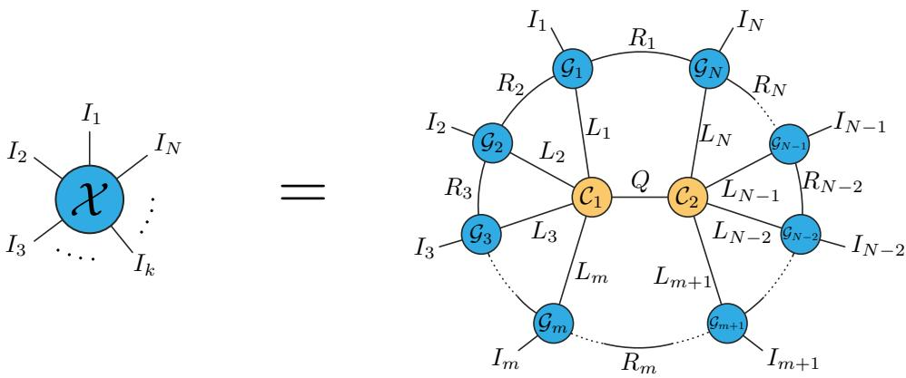
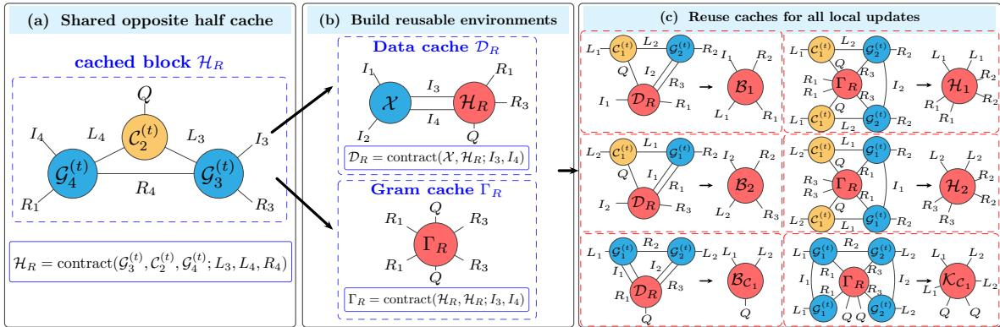
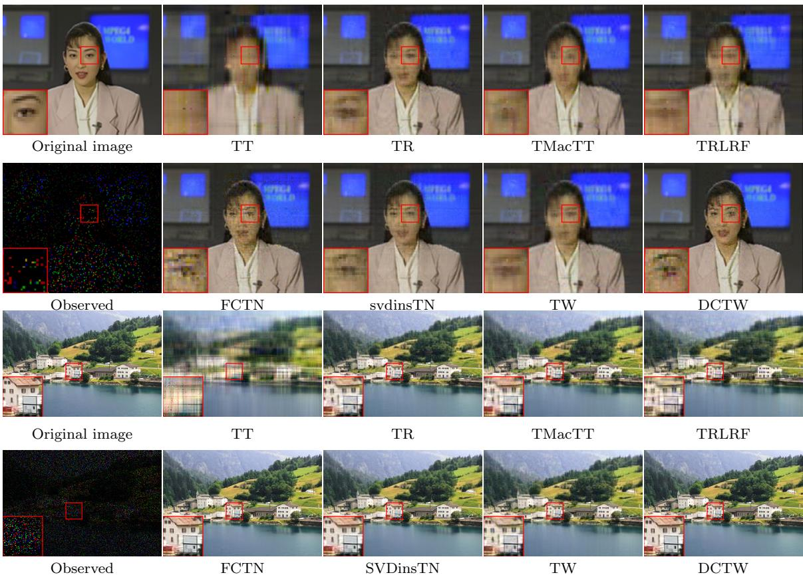
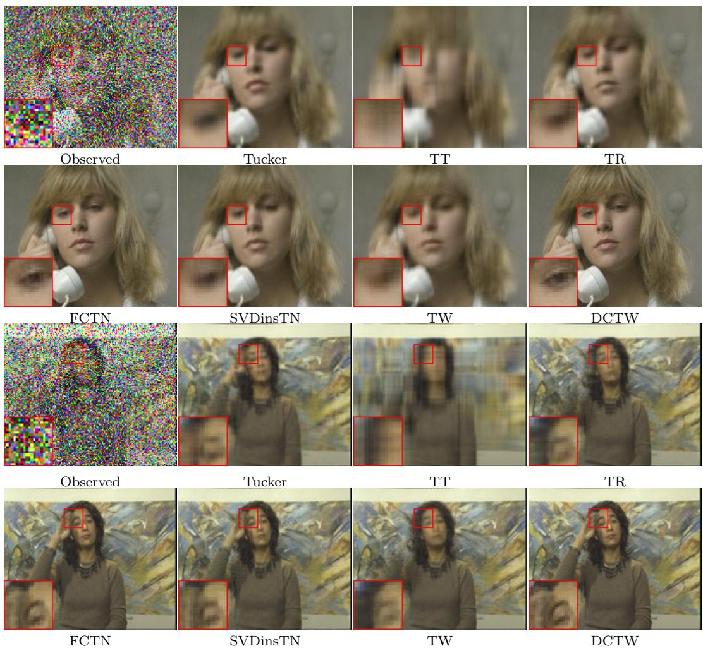

# Dual-Core Tensor Wheel Decomposition with Structure-Cached Acceleration for Tensor Recovery

Wenchao Xie∗, Qingsong Wang†,

## Abstract

Tensor wheel decomposition captures complex correlations in high-dimensional data through interactions between outer-ring factors and a high-order central core. However, updating these components requires the explicit construction and manipulation of large-scale matrices, which limits computational eficiency and incurs particularly high computational and memory costs for the central-core update. To address these limitations, we propose dual-core tensor wheel decomposition (DCTW), which factorizes the central core into two lower-order cores linked by a shared latent bond. Each core is coupled to a diferent group of outer-ring factors. We further propose a structure-cached acceleration strategy that avoids explicit large-scale matrix multiplications and caches intermediate tensors generated during tensor network contractions for reuse across block updates. This reuse reduces redundant computation and avoids the explicit construction of large matrices. Complexity analysis and experiments show that the strategy based on structural caching accelerates optimization compared with explicit and implicit up date schemes while limiting the increase in peak memory as the ranks grow. Experiments on color video completion and robust denoising show that DCTW matches or outperforms representative tensor network methods in reconstruction quality, computational eficiency, and scalability.

Keywords: Dual-core tensor wheel decomposition, Tensor recovery, Dual central cores, Proximal alternating minimization, Gram matrix, Structure-cached.

## 1 Introduction

As natural higher-order generalizations of matrices, tensors provide a unified representation of multidimensional data, including color videos, remote sensing images, multispectral images, light field images, and trafic data, while preserving complex dependencies across diferent modes. Tensor decomposition represents or approximates such data through structured interactions among low-dimensional factors, thereby capturing global correlations and reducing the storage and computational costs of high-dimensional data analysis. Over the past several decades, numerous tensor decomposition models have been developed. Classical examples include CANDECOMP/PARAFAC (CP) decomposition [7, 8], Tucker decomposition [21], and tensor singular value decomposition (t-SVD) [9, 17]. More broadly, tensor decomposition methods have been widely applied to signal processing [4, 36], machine learning [13, 20], medical imaging [12, 18, 28], remote sensing image restoration [5, 14], and light field image compression [16, 19].

More recently, tensor network (TN) decompositions have emerged as a flexible framework for modeling complex interactions in higher-order data. These methods factorize a high-order tensor into interconnected low-order cores, with the network topology determining how correlations among diferent modes are modeled. Owing to their ability to characterize multimodal correlations through diferent topologies, several TN models have been widely applied to tensor recovery in computer vision, particularly tensor completion (TC) [11, 31] and tensor robust principal component analysis (TRPCA) [3, 6, 23]. Among these models, the tensor train (TT) decomposition [15] adopts a chain topology, in which successive cores are connected through latent bonds. Specifically, it represents an Nth-order tensor $\mathcal { X } \in \mathbb { R } ^ { I _ { 1 } \times \cdots \times I _ { N } }$ using two boundary matrices $\mathbf { G } _ { 1 } \in \mathbb { R } ^ { I _ { 1 } \times R _ { 1 } }$ and $\mathbf { G } _ { N } \in \mathbb { R } ^ { R _ { N - 1 } \times I _ { N } }$ , together with third-order cores $\mathcal { G } _ { k } ^ { \mathsf { ^ { - } } } \in \mathbb { R } ^ { R _ { k - 1 } \times I _ { k } \times \mathsf { ^ { \ } } } R _ { k }$ for $k = 2 , \ldots , N - 1$ . Its element-wise representation is

$$
\boldsymbol { \mathcal { X } } ( i _ { 1 } , \ldots , i _ { N } ) = \sum _ { r _ { 1 } = 1 } ^ { R _ { 1 } } \cdots \sum _ { r _ { N - 1 } = 1 } ^ { R _ { N - 1 } } \mathbf { G } _ { 1 } ( i _ { 1 } , r _ { 1 } ) \prod _ { k = 2 } ^ { N - 1 } \mathcal { G } _ { k } ( r _ { k - 1 } , i _ { k } , r _ { k } ) \mathbf { G } _ { N } ( r _ { N - 1 } , i _ { N } ) ,
$$

where ${ \bf r } _ { \mathrm { T T } } = ( R _ { 1 } , \dots , R _ { N - 1 } )$ is the TT-rank. However, the open-chain topology of TT implicitly fixes its boundary ranks to one $( R _ { 0 } = R _ { N } = 1 )$ and leaves the first and last factors without a direct connection. Tensor ring (TR) decomposition [22, 32] relaxes these boundary constraints by connecting the two ends of the chain, forming a cyclic network of N third-order cores. Specifically, let $\mathcal { G } _ { k } \in \bar { \mathbb { R } ^ { h _ { k - 1 } \times I _ { k } \times R _ { k } } }$ for $k = 1 , \ldots , N$ , with $R _ { 0 } = R _ { N }$ . Its element-wise representation is

$$
\mathcal { X } ( i _ { 1 } , . . . , i _ { N } ) = \sum _ { r _ { 1 } = 1 } ^ { R _ { 1 } } \cdot \cdot \cdot \sum _ { r _ { N } = 1 } ^ { R _ { N } } \mathcal { G } _ { 1 } ( r _ { N } , i _ { 1 } , r _ { 1 } ) \prod _ { k = 2 } ^ { N } \mathcal { G } _ { k } ( r _ { k - 1 } , i _ { k } , r _ { k } ) ,
$$

and the corresponding TR-rank is ${ \bf r } _ { \mathrm { T R } } = ( R _ { 1 } , \dots , R _ { N } )$ . Nevertheless, TT and TR connect only adjacent factors, making their representations sensitive to mode ordering and lacking direct interactions between nonadjacent modes. For $N \geq 4 .$ , their use of factors of order at most three may also limit the preservation of complex structures in the original high-order tensor subspace. To address these limitations, Zheng et al. proposed the fully-connected tensor network (FCTN) decomposition [34], which connects every pair of factors through an independent latent bond. Specifically, its kth factor is $\mathcal { G } _ { k } \in \mathbb { R } ^ { R _ { 1 , k } \times \cdots \times R _ { k - 1 , k } ^ { \sim } \times I _ { k } \times R _ { k , k + 1 } \times \cdots \times R _ { k , N } }$ for $k = 1 , \ldots , N$ . The corresponding element-wise representation is

$$
\mathcal { X } ( i _ { 1 } , \dots , i _ { N } ) = \sum _ { \{ r _ { p , q } \} _ { 1 \leq p < q \leq N } } \prod _ { k = 1 } ^ { N } \mathcal { G } _ { k } \left( r _ { 1 , k } , \dots , r _ { k - 1 , k } , i _ { k } , r _ { k , k + 1 } , \dots , r _ { k , N } \right) ,
$$

where each $r _ { p , q }$ is summed from 1 to $R _ { p , q } .$ and index sequences are omitted when empty. The corresponding FCTN-rank is r $= ( \mathring { R } _ { p , q } ) _ { 1 \leq p < q \leq N } \in \bar { \mathbb { N } } ^ { N ( N - 1 ) / 2 }$ . Although FCTN captures nonlocal correlations and is less sensitive to mode permutations, its $N ( N - 1 ) / 2$ rank hyperparameters make rank selection costly for higher-order tensors. To capture both local and nonlocal interactions while preserving global structure with fewer rank parameters, Wu et al. proposed tensor wheel (TW) decomposition [25]. TW consists of N fourth-order outer-ring factors connected radially to an Nth-order central core. The ring models local cyclic dependencies, while the core captures nonlocal interactions across modes. Specifically, $\mathcal { G } _ { k } \in \dot { \mathbb { R } } ^ { R _ { k } \times I _ { k } \times L _ { k } \times R _ { k + 1 } }$ for $k = 1 , \ldots , N$ and $\mathcal { C } \in \mathbb { R } ^ { L _ { 1 } \times \cdots \times L _ { N } }$ , with $R _ { N + 1 } = R _ { 1 }$ . Its element-wise representation is

$$
\mathcal { X } ( i _ { 1 } , \ldots , i _ { N } ) = \sum _ { r _ { 1 } = 1 } ^ { R _ { 1 } } \cdots \sum _ { r _ { N } = 1 } ^ { R _ { N } } \sum _ { l _ { 1 } = 1 } ^ { L _ { 1 } } \cdots \sum _ { l _ { N } = 1 } ^ { L _ { N } } \mathcal { C } ( l _ { 1 } , \ldots , l _ { N } ) \prod _ { k = 1 } ^ { N } \mathcal { G } _ { k } ( r _ { k } , i _ { k } , l _ { k } , r _ { k + 1 } ) ,
$$

where $r _ { N + 1 } = r _ { 1 }$ , and $R _ { k }$ and $L _ { k }$ are the ring and radial ranks of the kth factor, respectively. The TW-rank is ${ \bf r } _ { \mathrm { T W } } = ( R _ { 1 } , \dots , R _ { N } , L _ { 1 } , \dots , L _ { N } ) \in \mathbb { N } ^ { 2 N }$ . Because the number of ring and radial rank parameters grows linearly with the tensor order, TW reduces the cost of rank selection relative to FCTN while retaining both local and nonlocal interactions, providing a practical balance between representation capacity and storage complexity. This advantage, however, does not eliminate the cost of updating the single Nth-order central core $\mathcal { C } \in \mathbb { R } ^ { L _ { 1 } \times \cdots \times L _ { N } }$ . Explicitly updating this core typically requires constructing an intermediate tensor of order up to 2N, whose size depends on both the mode dimensions and the radial ranks. The central-core update therefore becomes a major computational and storage bottleneck, restricting the feasible choices of radial ranks. Ranks that are too small may limit the representation capacity and yield an inadequate decomposition, whereas larger ranks increase computation and memory use.

To address this problem, we propose a dual-core tensor wheel (DCTW) decomposition, as illustrated in Figure 1. DCTW replaces the original central core with two cores of lower order connected through a shared latent bond. Each core is coupled to a separate group of factors in the outer ring. The shared bond controls the information exchanged between the two subwheels and can be interpreted as imposing a low-rank factorization on a grouped matricization of the original central core. This design retains the ability of TW to model local and global correlations, introduces a finer hierarchy of ranks, and provides a structure suitable for matrix-free optimization. The main contributions of this paper are summarized as follows.

• Dual-core tensor wheel topology. We introduce a dual-core tensor wheel decomposition that replaces the high-order central core of TW with two lower-order cores connected by a shared latent bond and coupled to separate groups of outer-ring factors. DCTW retains the local–global correlation modeling capability of TW, reduces the computation and storage associated with the central core, and provides a flexible hierarchical rank structure for eficient representation.

• Structure-cached acceleration strategy. We propose a structure-cached acceleration strategy for tensor network decomposition. The strategy avoids explicit large-scale matrix multiplications and reuses intermediate tensors from tensor network contractions across block updates, reducing computational and memory costs while maintaining mathematical equivalence to the explicit-update method. Analyses of floating-point operation counts and memory requirements substantiate its eficiency advantages.

• Comprehensive numerical experiments. Extensive experiments on tensor completion using classical and recent color videos and on robust principal component analysis using classical videos show that DCTW achieves high MPSNR and competitive MSSIM. The structurecached acceleration strategy further enables DCTW to outperform the other evaluated tensor network decomposition methods in runtime.

The remainder of this paper is organized as follows. Section 2 introduces the notation, definitions, and relevant properties. Section 3 presents the proposed model and solution algorithm. Section 4 describes the implicit-update and structure-cached acceleration strategies and analyzes their computational and storage complexities. Section 5 evaluates the iterative speedup and memory use of structure caching and reports experimental results on tensor completion and tensor robust principal component analysis. Section 6 concludes the paper.

## 2 Notations and Preliminaries

## 2.1 Notations

In this paper, we primarily follow the notation conventions of [10], using bold lowercase letters $\left( \mathrm { e . g . } \right.$ ${ \bf x } )$ , bold uppercase letters $( \mathrm { e . g . , \mathbf { X } ) }$ , and calligraphic letters $( \mathrm { e . g . , } \ X )$ to denote vectors, matrices, and tensors, respectively. Given a matrix $\mathbf { X } \in \mathbb { R } ^ { I \times I }$ , we define its trace as $\textstyle \operatorname { t r } ( \mathbf { X } ) \ = \ \sum _ { i = 1 } ^ { I } x _ { i i } .$ where $x _ { i i }$ denotes the ith diagonal element of X. For an Nth-order tensor $\mathcal { X } \in \mathbb { R } ^ { \dot { I } _ { 1 } \times \dots \times I _ { N } } .$ , we use $\mathcal { X } ( i _ { 1 } , i _ { 2 } , \ldots , i _ { N } )$ to denote its $( i _ { 1 } , i _ { 2 } , \dots , i _ { N } )$ th element and define its Frobenius norm and $\ell _ { 1 } \cdot$ -norm as $\begin{array} { r } { \| \pmb { \mathcal { X } } \| _ { F } : = \left( \sum _ { i _ { 1 } , . . . , i _ { N } } | \pmb { \mathcal { X } } ( i _ { 1 } , . . . , i _ { N } ) | ^ { 2 } \right) ^ { 1 / 2 } } \end{array}$ and $\begin{array} { r } { \| \mathcal { X } \| _ { 1 } : = \sum _ { i _ { 1 } , . . . , i _ { N } } | \mathcal { X } ( i _ { 1 } , . . . , i _ { N } ) | } \end{array}$ , respectively. The mode-k unfolding of and the corresponding folding operation are denoted by $\mathbf { X } _ { ( k ) } = \mathrm { U n f o l d } _ { k } ( \mathcal { X } )$ and $\mathcal { X } = \mathrm { F o l d } _ { k } ( { \mathbf X } _ { ( k ) } )$ , respectively.

## 2.2 Preliminaries

Definition 1 (Generalized Tensor Transposition [34]). Let $\mathcal { X } \in \mathbb { R } ^ { I _ { 1 } \times I _ { 2 } \times \dots \times I _ { N } }$ be an Nth-order tensor, and let $\mathbf { n } = \left( n _ { 1 } , n _ { 2 } , \ldots , n _ { N } \right)$ be an arbitrary permutation of $( 1 , 2 , \ldots , N )$ . The tensor obtained by permuting the modes of according to n is called the generalized tensor transposition, or the n-mode transposition, of . It is denoted by $\vec { \mathcal { X } } ^ { \bf n } \in \mathbb { R } ^ { I _ { n _ { 1 } } \times I _ { n _ { 2 } } \times \dots \times I _ { n _ { N } } }$ . Its entries satisfy $\vec { \mathcal { X } } ^ { \bf n } \left( i _ { n _ { 1 } } , i _ { n _ { 2 } } , \ldots , i _ { n _ { N } } \right) = \mathcal { X } ( i _ { 1 } , i _ { 2 } , \ldots , i _ { N } )$ for all $i _ { k } \in \{ 1 , 2 , \ldots , I _ { k } \}$ and $k = 1 , 2 , \ldots , N$

Definition 2 (Generalized Tensor Unfolding [34]). Given an Nth-order tensor $\mathcal { X } \in \mathbb { R } ^ { I _ { 1 } \times I _ { 2 } \times \dots \times I _ { N } }$ ， let ${ \bf n } = ( n _ { 1 } , n _ { 2 } , \ldots , n _ { N } )$ be an arbitrary permutation of $( 1 , 2 , \ldots , N )$ . The generalized tensor unfolding of is defined as the matrix

$$
\begin{array} { r } { \mathbf { X } _ { [ n _ { 1 : d } | n _ { d + 1 : N } ] } \in \mathbb { R } ^ { \left( \prod _ { i = 1 } ^ { d } I _ { n _ { i } } \right) \times \left( \prod _ { i = d + 1 } ^ { N } I _ { n _ { i } } \right) } , } \end{array}
$$

whose elements satisfy

$$
{ \bf X } _ { [ n _ { 1 : d } | n _ { d + 1 : N } ] } ( j _ { 1 } , j _ { 2 } ) = { \mathcal X } ( i _ { 1 } , i _ { 2 } , \ldots , i _ { N } ) ,
$$

where

$$
j _ { 1 } = i _ { n _ { 1 } } + \sum _ { s = 2 } ^ { d } \left[ ( i _ { n _ { s } } - 1 ) \prod _ { m = 1 } ^ { s - 1 } I _ { n _ { m } } \right] \quad a n d \quad j _ { 2 } = i _ { n _ { d + 1 } } + \sum _ { s = d + 2 } ^ { N } \left[ ( i _ { n _ { s } } - 1 ) \prod _ { m = d + 1 } ^ { s - 1 } I _ { n _ { m } } \right] .
$$

The generalized unfolding operation and its inverse are denoted, respectively, by ${ \bf X } _ { [ n _ { 1 : d } | n _ { d + 1 : N } ] } =$ GUnfold $\left( \mathcal { X } , n _ { 1 : d } \ | \ n _ { d + 1 : N } \right)$ and $\begin{array} { r } { \mathcal { X } = \mathrm { G F o l d } \left( \mathbf { X } _ { [ n _ { 1 : d } | n _ { d + 1 : N } ] } , n _ { 1 : d } \ | \ n _ { d + 1 : N } \right) } \end{array}$

Two useful special cases follow directly from Definition 2 by setting $d = 1$ and choosing appropriate mode permutations. For $\mathbf { n } = \left( k , 1 { : } k - 1 , k + 1 { : } N \right)$ , the generalized unfolding reduces to the classical mode-k unfolding, denoted by

$$
\mathbf { X } _ { ( k ) } : = \mathbf { X } _ { [ k | 1 : k - 1 , k + 1 : N ] } .
$$

For the cyclic permutation $\mathbf { n } = ( k { : } N , 1 { : } k - 1 )$ , it reduces to the cyclic mode-k unfolding used in TR decomposition, denoted by

$$
\begin{array} { r } { \mathbf { X } _ { \langle k \rangle } : = \mathbf { X } _ { [ k | k + 1 : N , 1 : k - 1 ] } . } \end{array}
$$

The inverse operators of these two unfolding operations are denoted by $\mathrm { F o l d } _ { k } ( \cdot )$ and $\mathrm { F o l d } _ { \langle k \rangle } ( \cdot )$ respectively.

Definition 3 (Tensor Contraction [34]). Let $\mathcal { X } \in \mathbb { R } ^ { I _ { 1 } \times I _ { 2 } \times \dots \times I _ { N } } , \mathcal { Y } \in \mathbb { R } ^ { J _ { 1 } \times J _ { 2 } \times \dots \times J _ { M } }$ and suppose that ${ { I } _ { { { n } _ { i } } } } \ = \ { { J } _ { { { m } _ { i } } } } \ f o r \ i = 1 , 2 , \ldots , { { d } } . \ H e r e , \ \mathbf { n } \ = \ ( { { n } _ { 1 } } , { { n } _ { 2 } } , \ldots , { { n } _ { N } } )$ and $\mathbf { m } = ( m _ { 1 } , m _ { 2 } , \ldots , m _ { M } )$ are permutations $o f \left( 1 , 2 , \ldots , N \right)$ and $( 1 , 2 , \ldots , M )$ , respectively, satisfying $n _ { d + 1 } < n _ { d + 2 } < \cdot \cdot \cdot < n _ { N }$ and $m _ { d + 1 } < m _ { d + 2 } < \cdot \cdot \cdot < m _ { M }$ . The contraction between modes $n _ { 1 : d } = ( n _ { 1 } , . . . , n _ { d } )$ of  and modes $m _ { 1 : d } = ( m _ { 1 } , \dots , m _ { d } )$ of is denoted by

$$
{ \mathcal { Z } } = { \mathcal { X } } \times _ { n _ { 1 : d } } ^ { m _ { 1 : d } } { \mathcal { Y } } .
$$

The resulting tensor is of order $N + M - 2 d$ and satisfies $\mathcal { Z } \in \mathbb { R } ^ { I _ { n _ { d + 1 } } \times \dots \times I _ { n _ { N } } \times J _ { m _ { d + 1 } } \times \dots \times J _ { m _ { M } } }$ Equivalently, using the generalized tensor unfolding notation, the contraction can be expressed as

$$
{ \bf Z } _ { [ 1 : N - d ; N - d + 1 : N + M - 2 d ] } = { \bf X } _ { [ n _ { d + 1 : N } ; n _ { 1 : d } ] } { \bf Y } _ { [ m _ { 1 : d } ; m _ { d + 1 : M } ] } .
$$

Definition 4 (Dual-Core Tensor Wheel). Let $\mathcal { X } \in \mathbb { R } ^ { I _ { 1 } \times \cdots \times I _ { N } }$ be an Nth-order tensor with $N \geq 3$ and let $m = \lceil N / 2 \rceil$ . The modes are partitioned into two ordered, consecutive groups

$$
\mathbf { s } _ { 1 } = ( 1 , \ldots , m ) , \qquad \mathbf { s } _ { 2 } = ( m + 1 , \ldots , N ) ,
$$

where $| \mathbf { s } _ { 1 } | = \lceil N / 2 \rceil$ and $ { \left| { \mathbf { s } } _ { 2 } \right| } =  { \left\lfloor { N } / 2 \right\rfloor }$ . As illustrated in Figure 1, the DCTW decomposition represents  using N fourth-order outer-ring factors

$$
\mathcal { G } _ { k } \in \mathbb { R } ^ { R _ { k } \times I _ { k } \times L _ { k } \times R _ { k + 1 } } , \qquad k = 1 , \dots , N ,
$$

where $R _ { N + 1 } = R _ { 1 }$ , and two central cores

$$
\mathcal { C } _ { 1 } \in \mathbb { R } ^ { L _ { 1 } \times \cdots \times L _ { m } \times Q } , \qquad \mathcal { C } _ { 2 } \in \mathbb { R } ^ { Q \times L _ { m + 1 } \times \cdots \times L _ { N } } .
$$

Here, $R _ { k }$ is the kth ring rank, $L _ { k }$ is the kth radial rank, and Q is the shared rank connecting the two central cores. The element-wise representation of the DCTW decomposition is

$$
\begin{array} { r l } & { \mathcal { X } ( i _ { 1 } , \dots , i _ { N } ) = \displaystyle \sum _ { r _ { 1 } = 1 } ^ { R _ { 1 } } \cdots \sum _ { r _ { N } = 1 } ^ { R _ { N } } \sum _ { q = 1 } ^ { Q } \left[ \sum _ { l _ { 1 } = 1 } ^ { L _ { 1 } } \cdots \sum _ { l _ { m } = 1 } ^ { L _ { m } } \mathcal { C } _ { 1 } ( l _ { 1 } , \dots , l _ { m } , q ) \prod _ { k = 1 } ^ { m } \mathcal { G } _ { k } ( r _ { k } , i _ { k } , l _ { k } , r _ { k + 1 } ) \right] } \\ & { \qquad \times \left[ \displaystyle \sum _ { l _ { m + 1 } = 1 } ^ { L _ { m + 1 } } \cdots \sum _ { l _ { N } = 1 } ^ { L _ { N } } \mathcal { C } _ { 2 } ( q , l _ { m + 1 } , \dots , l _ { N } ) \prod _ { k = m + 1 } ^ { N } \mathcal { G } _ { k } ( r _ { k } , i _ { k } , l _ { k } , r _ { k + 1 } ) \right] , \qquad r _ { N + 1 } = r _ { 1 } . } \end{array}
$$

The DCTW rank is defined as

$$
\mathbf { r } _ { \mathrm { D C T W } } = ( \mathbf { R } , \mathbf { L } , Q ) , \qquad \mathbf { R } = ( R _ { 1 } , \ldots , R _ { N } ) , \qquad \mathbf { L } = ( L _ { 1 } , \ldots , L _ { N } ) ,
$$

and therefore contains $2 N + 1$ rank parameters. The tensor contraction form of DCTW is

$$
\begin{array} { r l } & { \mathcal { X } = \Bigg ( \mathcal { G } _ { 1 } \times _ { 4 } ^ { 1 } \mathcal { G } _ { 2 } \times _ { 6 } ^ { 1 } \cdot \cdot \cdot \times _ { 2 m } ^ { 1 } \mathcal { G } _ { m } \times _ { ( 3 , 5 , \dots , 2 m + 1 ) } ^ { ( 1 , 2 , \dots , m ) } \mathcal { C } _ { 1 } \Bigg ) } \\ & { \qquad \times _ { ( 1 , m + 2 , m + 3 ) } ^ { ( N - m + 3 , 2 , 1 ) } \Bigg ( \mathcal { C } _ { 2 } \times _ { ( 2 , 3 , \dots , N - m + 1 ) } ^ { ( 3 , 5 , \dots , 2 ( N - m ) + 1 ) } \Bigg ( \mathcal { G } _ { m + 1 } \times _ { 4 } ^ { 1 } \mathcal { G } _ { m + 2 } \times _ { 6 } ^ { 1 } \cdot \cdot \cdot \times _ { 2 ( N - m ) } ^ { 1 } \mathcal { G } _ { N } \Bigg ) \Bigg ) . } \end{array}
$$

We denote the DCTW decomposition by

$$
\mathrm { D C T W } \left( \{ \mathcal G _ { k } \} _ { k = 1 } ^ { m } ; \mathcal C _ { 1 } \stackrel { Q } { \longleftrightarrow } \mathcal C _ { 2 } ; \{ \mathcal G _ { k } \} _ { k = m + 1 } ^ { N } \right) ,
$$

where $\mathcal { C } _ { 1 }$ and $\mathcal { C } _ { 2 }$ are connected by a shared latent bond of dimension Q. More compactly, it is written as

$$
\mathrm { D C T W } \left( \{ \mathcal G _ { \pi _ { k } } \} _ { k = 1 } ^ { N } ; \mathcal C _ { 1 } , \mathcal C _ { 2 } \right) .
$$

Remark 1. The shared mode of dimension $Q$ may occupy any position in either central core. For example,

$$
\begin{array} { r l } & { \mathcal { C } _ { 1 } \in \mathbb R ^ { L _ { 1 } \times \cdots \times L _ { a } \times Q \times L _ { a + 1 } \times \cdots \times L _ { m } } , \quad 1 \leq a < m , } \\ & { \mathcal { C } _ { 2 } \in \mathbb R ^ { L _ { m + 1 } \times \cdots \times L _ { b } \times Q \times L _ { b + 1 } \times \cdots \times L _ { N } } , \quad m + 1 \leq b < N . } \end{array}
$$

These forms difer from Definition 4 only by permutations of the central-core modes and yield the same DCTW representation. For convenience, we place Q last in $\mathcal { C } _ { 1 }$ and first in $\mathcal { C } _ { 2 }$ , denoted by $\mathcal { C } _ { 1 } \longleftrightarrow \mathcal { C } _ { 2 }$ , to keep the element-wise and tensor contraction forms compact.

  
Figure 1: The Dual-Core Tensor Wheel.

Definition 5 (Dimension-Set Tensor Contraction). Let $\mathcal { G } _ { k } \ \in \ \mathbb { R } ^ { R _ { k } \times I _ { k } \times L _ { k } \times R _ { k + 1 } } , \ k \ = \ 1 , \dots , N .$ be the fourth-order outer-ring factors, where $R _ { N + 1 } ~ = ~ R _ { 1 }$ . Let $\mathcal { C } _ { 1 } ~ \in ~ \mathbb { R } ^ { L _ { 1 } \times \cdots \times L _ { m } \times Q }$ and $\mathcal { C } _ { 2 } \in$ $\mathbb { R } ^ { Q \times L _ { m + 1 } \times \cdots \times L _ { N } }$ be the two central cores. Define

$$
\Omega = \{ ( \alpha _ { i } , \widehat { \alpha } _ { i } ) \ | \ i = 1 , \ldots , d \}
$$

as a set of compatible mode pairs. The left half-ring tensor is obtained by the dimension-set contraction

$$
\mathcal { M } _ { \mathrm { L } } = \mathrm { c o n t r a c t } \left( \mathcal { G } _ { 1 } , \dots , \mathcal { G } _ { m } , \mathcal { C } _ { 1 } ; \Omega _ { \mathrm { L } } \right) ,
$$

where $\mathcal { M } _ { \mathrm { L } } \in \mathbb { R } ^ { R _ { 1 } \times I _ { 1 } \dots \times I _ { m } \times R _ { m + 1 } \times Q }$ and

$$
\Omega _ { \mathrm { L } } = \left\{ \left( R _ { k + 1 } ^ { ( \mathcal { G } _ { k } ) } , R _ { k + 1 } ^ { ( \mathcal { G } _ { k + 1 } ) } \right) \mid k = 1 , \ldots , m - 1 \right\} \cup \left\{ \left( L _ { k } ^ { ( \mathcal { G } _ { k } ) } , L _ { k } ^ { ( \mathcal { C } _ { 1 } ) } \right) \mid k = 1 , \ldots , m \right\} .
$$

Equivalently,

$$
\mathcal { M } _ { \mathrm { L } } = \left( \left( \left( \mathcal { G } _ { 1 } \times _ { 4 } ^ { 1 } \mathcal { G } _ { 2 } \right) \times _ { 6 } ^ { 1 } \mathcal { G } _ { 3 } \right) \cdot \cdot \cdot \times _ { 2 m } ^ { 1 } \mathcal { G } _ { m } \right) \times _ { ( 3 , 5 , . . . , 2 m + 1 ) } ^ { ( 1 , 2 , . . . , m ) } \mathcal { C } _ { 1 } .
$$

Suppose that an intermediate factor $\mathcal { G } _ { j } , 2 \leq j \leq m - 1$ , is excluded from the left half ring. The remaining tensors form the environment tensor

$$
\mathcal { M } _ { \mathrm { L } _ { \neq j } } = \mathrm { c o n t r a c t } \left( \mathcal { G } _ { 1 } , \ldots , \mathcal { G } _ { j - 1 } , \mathcal { G } _ { j + 1 } , \ldots , \mathcal { G } _ { m } , \mathcal { C } _ { 1 } ; \Omega _ { \mathrm { L } _ { \neq j } } \right) ,
$$

where $\mathcal { M } _ { \mathrm { L } _ { \neq j } } \in \mathbb { R } ^ { R _ { 1 } \times I _ { 1 } \times \dots \times I _ { j - 1 } \times R _ { j } \times L _ { j } \times Q \times R _ { j + 1 } \times I _ { j + 1 } \times \dots \times I _ { m } \times R _ { m + 1 } }$ and

$$
\begin{array} { r } { \Omega _ { \mathrm { L } _ { \neq j } } = \left\{ \left( R _ { k + 1 } ^ { ( \mathcal { G } _ { k } ) } , R _ { k + 1 } ^ { ( \mathcal { G } _ { k + 1 } ) } \right) \middle | \begin{array} { c } { k = 1 , \ldots , m - 1 , } \\ { k \notin \{ j - 1 , j \} } \end{array} \right\} \cup \left\{ \left( L _ { k } ^ { ( \mathcal { G } _ { k } ) } , L _ { k } ^ { ( \mathcal { C } _ { 1 } ) } \right) \middle | \begin{array} { c } { k = 1 , \ldots , m , } \\ { k \neq j } \end{array} \right\} . } \end{array}
$$

An equivalent sequential contraction is

$$
\begin{array} { r l } { \mathcal { M } _ { \mathrm { L } _ { \neq j } } = } & { \Big [ \Big ( \big ( ( \mathcal { G } _ { 1 } \times _ { 4 } ^ { 1 } \mathcal { G } _ { 2 } ) \times _ { 6 } ^ { 1 } \mathcal { G } _ { 3 } \dots \big ) \times _ { 2 j - 2 } ^ { 1 } \mathcal { G } _ { j - 1 } \Big ) \times _ { ( 3 , 5 , \dots , 2 j - 1 ) } ^ { ( 1 , 2 , \dots , j - 1 ) } \mathcal { C } _ { 1 } \Big ] } \\ & { \qquad \times _ { ( j + 3 , j + 4 , \dots , m + 2 ) } ^ { ( 3 , 5 , \dots , 2 ( m - j ) + 1 ) } \Big ( \big ( ( \mathcal { G } _ { j + 1 } \times _ { 4 } ^ { 1 } \mathcal { G } _ { j + 2 } ) \times _ { 6 } ^ { 1 } \mathcal { G } _ { j + 3 } \dots \big . \Big . \Big . \times _ { 2 ( m - j ) } ^ { 1 } \mathcal { G } _ { m } \Big ) . } \end{array}
$$

For $j = 2$ or $j = m - 1$ , the corresponding single-factor chain is interpreted as $\mathcal { G } _ { 1 }$ or $\mathcal { G } _ { m }$ , respectively. Only the left half-ring contraction is presented here. The right half-ring contraction follows analogously by replacing $\mathcal { C } _ { 1 } , \ \{ \mathcal { G } _ { k } \} _ { k = 1 } ^ { m }$ , and $\Omega _ { \mathrm { L } }$ with $\mathcal { C } _ { 2 } , \{ \mathcal { G } _ { k } \} _ { k = m + 1 } ^ { N } ,$ and $\Omega _ { \mathrm { R } }$ , respectively.

Remark 2. Dimension-set tensor contraction is an explicit notation for generalized tensor contraction that identifies the contracted mode pairs without introducing a new tensor operation. Computationally, the tensors are permuted and unfolded into compatible matrices, multiplied, and then folded back into a tensor.

Both generalized tensor contraction and dimension-set tensor contraction are used throughout the following sections. When only a few modes are contracted, we list them directly and omit explicit mode pairings for simplicity.

Theorem 1 (DCTW Subwheel Equations). Assume that $\mathcal { X } \in \mathbb { R } ^ { I _ { 1 } \times \cdots \times I _ { N } }$ admits the generalized DCTW decomposition

$$
\mathcal { X } = \mathrm { D C T W } \left( \{ \mathcal { G } _ { \pi _ { k } } \} _ { k = 1 } ^ { N } ; \mathcal { C } _ { 1 } , \mathcal { C } _ { 2 } \right) .
$$

Let $\mathbf { s } _ { 1 } = ( 1 , \ldots , m )$ and $\mathbf { s } _ { 2 } = ( m + 1 , \ldots , N )$ . For the kth outer-ring factor $\mathcal { G } _ { k }$ associated with $\mathbf { s } _ { 1 }$ where $1 \leq k \leq m$ , the subwheel equation is

$$
{ \bf X } _ { \langle k \rangle } = \mathrm { G U n f o l d } \left( { \mathcal G } _ { k } , 2 \mid 1 , 3 , 4 \right) \mathrm { G U n f o l d } \left( { \mathcal M } _ { \ne k } , k { : } k + 2 \mid k + 3 { : } N + 2 , 1 { : } k - 1 \right) .
$$

Here, $\mathcal { M } _ { \neq k } \in \mathbb { R } ^ { I _ { 1 } \times \cdots \times I _ { k - 1 } \times R _ { k } \times L _ { k } \times R _ { k + 1 } \times I _ { k + 1 } \times \cdots \times I _ { N } } \ i s \ t h e \ ( N + 2 ) t h e \ ( N + 1 )$ -order subwheel tensor obtained by contracting all DCTW factors except $\mathcal { G } _ { k }$ . Its tensor-contraction form is

$$
\begin{array} { r l } & { \mathcal M _ { \neq k } = \Bigg [ \Bigg ( \mathcal G _ { 1 } \times _ { 4 } ^ { 1 } \mathcal G _ { 2 } \times _ { 6 } ^ { 1 } \cdots \times _ { 2 ( k - 1 ) } ^ { 1 } \mathcal G _ { k - 1 } \Bigg ) \times _ { ( 3 , 5 , \dots , 2 k - 1 ) } ^ { ( 1 , 2 , \dots , k - 1 ) } \mathcal C _ { 1 } } \\ & { \qquad \quad \times _ { ( k + 3 , k + 4 , \dots , m + 2 ) } ^ { ( 3 , 5 , \dots , 2 ( m - k ) + 1 ) } \Bigg ( \mathcal G _ { k + 1 } \times _ { 4 } ^ { 1 } \mathcal G _ { k + 2 } \times _ { 6 } ^ { 1 } \cdots \times _ { 2 ( m - k ) } ^ { 1 } \mathcal G _ { m } \Bigg ) \Bigg ] } \\ & { \qquad \times _ { ( 1 , m + 5 , k + 3 ) } ^ { ( N - m + 3 , 2 , 1 ) } \Bigg [ \mathcal C _ { 2 } \times _ { ( 2 , 3 , \dots , N - m + 1 ) } ^ { ( 3 , 5 , \dots , 2 ( N - m ) + 1 ) } \Bigg ( \mathcal G _ { m + 1 } \times _ { 4 } ^ { 1 } \mathcal G _ { m + 2 } \times _ { 6 } ^ { 1 } \cdots \times _ { 2 ( N - m ) } ^ { 1 } \mathcal G _ { N } \Bigg ) \Bigg ] . } \end{array}
$$

A contraction chain containing a single factor reduces to that factor. Empty chains and their associated mode lists are omitted. The same construction applies to an outer-ring factor associated with $\mathbf { s } _ { 2 }$ , where $m + 1 \leq k \leq N$

For the first central core $\mathcal { C } _ { 1 }$ , the subwheel equation is

$$
\mathbf { x } = \mathbf { c } _ { 1 } \mathbf { N } _ { \neq } c _ { 1 } .
$$

The matrices and vectors are defined as

$$
\begin{array} { r l } & { { \mathbf { N } } _ { \neq } \sigma _ { 1 } = \mathrm { G U n f o l d } \left( \mathcal { N } _ { \neq \mathscr { C } _ { 1 } } , 2 , 4 , \ldots , 2 m , 2 m + 1 \big | 1 , 3 , \ldots , 2 m - 1 , 2 m + 2 \colon N + m + 1 \right) , } \\ & { \qquad \quad \mathbf { x } = \mathrm { G U n f o l d } \left( \mathcal { X } , \mathscr { O } \mid 1 \colon N \right) , \mathbf { c } _ { 1 } = \mathrm { G U n f o l d } \left( \mathscr { C } _ { 1 } , \mathscr { O } \mid 1 \colon m + 1 \right) . } \end{array}
$$

The environment tensor $\mathcal { N } _ { \neq \mathcal { C } _ { 1 } } \in \mathbb { R } ^ { I _ { 1 } \times L _ { 1 } \times \cdots \times I _ { m } \times L _ { m } \times Q \times I _ { m + 1 } \times \cdots \times I _ { N } }$ is an $( N + m + 1 )$ th-order tensor with contraction form

$$
\begin{array} { r l } & { \mathcal { N } _ { \neq } \mathscr { c } _ { 1 } = \left( \mathcal { G } _ { 1 } \times _ { 4 } ^ { 1 } \mathcal { G } _ { 2 } \times _ { 6 } ^ { 1 } \cdot \cdot \cdot \times _ { 2 m } ^ { 1 } \mathcal { G } _ { m } \right) } \\ & { \qquad \times _ { ( 1 , 2 m + 2 ) } ^ { ( N - m + 3 , 2 ) } \left[ \mathcal { C } _ { 2 } \times _ { ( 2 , 3 , . . . , N - m + 1 ) } ^ { ( 3 , 5 , . . . , 2 ( N - m ) + 1 ) } \left( \mathcal { G } _ { m + 1 } \times _ { 4 } ^ { 1 } \mathcal { G } _ { m + 2 } \times _ { 6 } ^ { 1 } \cdot \cdot \cdot \times _ { 2 ( N - m ) } ^ { 1 } \mathcal { G } _ { N } \right) \right] . } \end{array}
$$

An analogous equation holds for the second central core $\mathcal { C } _ { 2 }$

The subwheel equations in Theorem 1 provide a unified basis for deriving alternating updates for all DCTW factors. With the other factors fixed, each outer-ring factor or central core enters its subproblem linearly, reducing the original nonlinear problem to a sequence of tractable linear subproblems.

## 3 Model and Algorithm

In this section, we apply the DCTW decomposition in Definition 4 to tensor completion and robust tensor principal component analysis and formulate the corresponding optimization models. Both models represent the underlying low-rank tensor using DCTW and are solved within the PAM framework, addressing missing data and sparse noise, respectively. Their convergence analysis follows the Kurdyka– Lojasiewicz (KL) framework [2, 27, 33]. For brevity, we omit the proofs and focus on the computational complexity of the tensor completion algorithm.

## 3.1 Tensor completion

Assume $\mathcal { V } , \mathcal { X } \in \mathbb { R } ^ { I _ { 1 } \times I _ { 2 } \times \dots \times I _ { N } }$ denote the partially observed tensor and its underlying target tensor, respectively. Using the proposed dual-core tensor wheel decomposition, we formulate the tensor completion problem as

$$
\begin{array} { r l } { \underset { \boldsymbol { \mathcal { X } } , \{ \boldsymbol { \mathcal { G } } _ { k } \} _ { k = 1 } ^ { N } , \boldsymbol { \mathcal { C } } _ { 1 } , \boldsymbol { \mathcal { C } } _ { 2 } } { \operatorname* { m i n } } } & { \frac { 1 } { 2 } \left. \boldsymbol { \mathcal { X } } - \mathrm { D C T W } \left( \{ \boldsymbol { \mathcal { G } } _ { k } \} _ { k = 1 } ^ { N } ; \boldsymbol { \mathcal { C } } _ { 1 } , \boldsymbol { \mathcal { C } } _ { 2 } \right) \right. _ { F } ^ { 2 } , } \\ { \mathrm { s . t . } } & { \mathcal { P } _ { \Omega } \left( \boldsymbol { \mathcal { X } } - \boldsymbol { \mathcal { Y } } \right) = 0 . } \end{array}\tag{1}
$$

where $\mathcal { G } _ { k } \in \mathbb { R } ^ { R _ { k } \times I _ { k } \times L _ { k } \times R _ { k + 1 } }$ denotes the kth outer-ring factor, with $R _ { N + 1 } = R _ { 1 }$ . Here, $R _ { k }$ is the ring rank and $L _ { k }$ is the radial rank. Let $m = \lceil N / 2 \rceil$ . The two central cores are $\mathcal { C } _ { 1 } \in \mathbb { R } ^ { L _ { 1 } \times \cdots \times L _ { m } \times Q }$ and $\mathcal { C } _ { 2 } \in \mathbb { R } ^ { Q \times L _ { m + 1 } \times \cdots \times L _ { N } }$ , where Q denotes their shared-bond rank. The corresponding mode groups are $\mathbf { s } _ { 1 } = ( 1 , \ldots , m )$ and $\mathbf { s } _ { 2 } = ( m + 1 , \ldots , N )$ . The observed index set is denoted by $\Omega ,$ and $\mathcal { P } _ { \Omega } ( \cdot )$ is the associated sampling operator. Problem (1) can be equivalently reformulated as the following unconstrained optimization problem

$$
\operatorname* { m i n } _ { \boldsymbol { x } , \{ \mathcal { G } _ { k } \} _ { k = 1 } ^ { N } , \mathcal { C } _ { 1 } , \mathcal { C } _ { 2 } } \quad \frac { 1 } { 2 } \left\| \mathcal { X } - \mathrm { D C T W } \left( \{ \mathcal { G } _ { k } \} _ { k = 1 } ^ { N } ; \mathcal { C } _ { 1 } , \mathcal { C } _ { 2 } \right) \right\| _ { F } ^ { 2 } + \iota _ { \mathbb { D } } ( \boldsymbol { \mathcal { X } } ) ,\tag{2}
$$

where

$$
\iota _ { \mathbb { D } } ( \mathcal { X } ) : = \left\{ \begin{array} { l l } { 0 , } & { \mathrm { i f ~ } \mathcal { X } \in \mathbb { D } , } \\ { + \infty , } & { \mathrm { o t h e r w i s e } , } \end{array} \right. \mathrm { w h e r e ~ } \mathbb { D } : = \left\{ \mathcal { X } \in \mathbb { R } ^ { I _ { 1 } \times I _ { 2 } \times \dots \times I _ { N } } : \mathcal { P } _ { \Omega } \left( \mathcal { X } - \mathcal { Y } \right) = 0 \right\} .
$$

The objective in (2) is convex with respect to each variable block when the other blocks are fixed. We therefore apply proximal alternating minimization to sequentially update the outer-ring factors, central cores, and completed tensor. At iteration $t + 1$ , the updates are given by

$$
\{ \begin{array} { l l } { \mathcal { G } _ { k } ^ { ( t + 1 ) } \in \mathop { \arg \operatorname* { m i n } } } & { \frac { 1 } { 2 } \| \mathcal { X } ^ { ( t ) } - \mathrm { D C T W } ( \mathcal { G } _ { 1 : k - 1 } ^ { ( t + 1 ) } , \mathcal { G } _ { k } , \mathcal { G } _ { k + 1 : N } ^ { ( t ) } , \mathcal { C } _ { 2 } ^ { ( t ) } ) \| _ { F } ^ { 2 } + \frac { \rho } { 2 } \| \mathcal { G } _ { k } - \mathcal { G } _ { k } ^ { ( t ) } \| _ { F } ^ { 2 } , } \\ { \mathcal { C } _ { 1 } ^ { ( t + 1 ) } \in \mathop { \arg \operatorname* { m i n } } } & { \frac { 1 } { 2 } \| \mathcal { X } ^ { ( t ) } - \mathrm { D C T W } ( \{ \mathcal { G } _ { k } ^ { ( t + 1 ) } \} _ { k = 1 } ^ { N } , \mathcal { C } _ { 1 } , \mathcal { C } _ { 2 } ^ { ( t ) } ) \| _ { F } ^ { 2 } + \frac { \rho } { 2 } \| \mathcal { C } _ { 1 } - \mathcal { C } _ { 1 } ^ { ( t ) } \| _ { F } ^ { 2 } , } \\ { \mathcal { C } _ { 2 } ^ { ( t + 1 ) } \in \mathop { \arg \operatorname* { m i n } } } & { \frac { 1 } { \mathcal { C } _ { 2 } } \| \mathcal { X } ^ { ( t ) } - \mathrm { D C T W } ( \{ \mathcal { G } _ { k } ^ { ( t + 1 ) } \} _ { k = 1 } ^ { N } , \mathcal { C } _ { 1 } ^ { ( t + 1 ) } , \mathcal { C } _ { 2 } ) \| _ { F } ^ { 2 } + \frac { \rho } { 2 } \| \mathcal { C } _ { 2 } - \mathcal { C } _ { 2 } ^ { ( t ) } \| _ { F } ^ { 2 } , } \\ { \mathcal { X } ^ { ( t + 1 ) } \in \mathop { \arg \operatorname* { m i n } } } &  \frac { 1 } { 2 } \| \mathcal  \end{array}\tag{3}
$$

where $k = 1 , \ldots , N , \rho > 0$ is the proximal parameter, and t is the iteration index.

(1) Updating the outer-ring factors $\mathcal { G } _ { k }$ for $k = 1 , 2 , \ldots , N \colon$ When updating $\mathcal { G } _ { k }$ , we fix $\{ \mathcal { G } _ { i } ^ { ( t + 1 ) } \} _ { i < k }$ at their updated values and $\{ \mathcal { G } _ { i } ^ { ( t ) } \} _ { i > k } , \mathcal { C } _ { 1 } ^ { ( t ) }$ , and $\mathcal { C } _ { 2 } ^ { ( t ) }$ at their current values. Contracting

all fixed factors except $\mathcal { G } _ { k }$ yields the environment matrix $\mathbf { M } _ { \neq k } ^ { ( t ) }$ , as established in Theorem 1. The -subproblem in $( 3 )$ can therefore be written as

$$
\mathbf { G } _ { k ( 2 ) } ^ { ( t + 1 ) } \in \arg \operatorname* { m i n } _ { \mathbf { G } _ { k ( 2 ) } } \quad \frac { 1 } { 2 } \left\| \mathbf { X } _ { \langle k \rangle } ^ { ( t ) } - \mathbf { G } _ { k ( 2 ) } \mathbf { M } _ { \neq k } ^ { ( t ) } \right\| _ { F } ^ { 2 } + \frac { \rho } { 2 } \left\| \mathbf { G } _ { k ( 2 ) } - \mathbf { G } _ { k ( 2 ) } ^ { ( t ) } \right\| _ { F } ^ { 2 } .
$$

Consequently, the closed-form solution is

$$
\mathcal { G } _ { k } ^ { ( t + 1 ) } = \mathrm { F o l d } _ { 2 } \left( \left( \mathbf { X } _ { \langle k \rangle } ^ { ( t ) } \left( \mathbf { M } _ { \neq k } ^ { ( t ) } \right) ^ { \mathrm { T } } + \rho \mathbf { G } _ { k ( 2 ) } ^ { ( t ) } \right) \left( \mathbf { M } _ { \neq k } ^ { ( t ) } \left( \mathbf { M } _ { \neq k } ^ { ( t ) } \right) ^ { \mathrm { T } } + \rho \mathbf { I } \right) ^ { - 1 } \right) .\tag{4}
$$

(2) Updating the central cores $\mathcal { C } _ { 1 }$ and $\mathcal { C } _ { 2 } \mathrm { { : } }$ : After updating all outer-ring factors, we update the two central cores sequentially. We first update $\mathcal { C } _ { 1 }$ while fixing $\mathcal { C } _ { 2 } = \mathcal { C } _ { 2 } ^ { ( t ) }$ . The updated core ${ \mathcal { C } } _ { 1 } ^ { ( t + 1 ) }$ is then used to update $\mathcal { C } _ { 2 }$ . The $\mathcal { C } _ { 1 }$ -subproblem in (3) is

$$
\mathbf { c } _ { 1 } ^ { ( t + 1 ) } \in \arg \operatorname* { m i n } _ { \mathbf { c } _ { 1 } } \frac { 1 } { 2 } \left\| \mathbf { x } ^ { ( t ) } - \mathbf { c } _ { 1 } \mathbf { N } _ { \neq { \mathscr { C } _ { 1 } } } ^ { ( t ) } \right\| _ { F } ^ { 2 } + \frac { \rho } { 2 } \left\| \mathbf { c } _ { 1 } - \mathbf { c } _ { 1 } ^ { ( t ) } \right\| _ { F } ^ { 2 } .
$$

Its closed-form solution is

$$
\mathcal { C } _ { 1 } ^ { ( t + 1 ) } = \mathrm { G F o l d } \left( \left( \mathbf { x } ^ { ( t ) } \left( \mathbf { N } _ { \neq \mathcal { C } _ { 1 } } ^ { ( t ) } \right) ^ { \top } + \rho \mathbf { c } _ { 1 } ^ { ( t ) } \right) \left( \mathbf { N } _ { \neq \mathcal { C } _ { 1 } } ^ { ( t ) } \left( \mathbf { N } _ { \neq \mathcal { C } _ { 1 } } ^ { ( t ) } \right) ^ { \top } + \rho \mathbf { I } \right) ^ { - 1 } , \mathcal { O } \mid 1 : m + 1 \right) .\tag{5}
$$

The $\mathcal { C } _ { 2 } .$ -subproblem has the same structure, yielding

$$
\mathcal { C } _ { 2 } ^ { ( t ) } = \mathrm { G F o l d } \left( \left[ \mathbf { x } ^ { ( t ) } \left( \mathbf { N } _ { \neq } ^ { ( t ) } \right) ^ { \top } + \rho \mathbf { c } _ { 2 } ^ { ( t ) } \right] \left[ \mathbf { N } _ { \neq } ^ { ( t ) } \left( \mathbf { N } _ { \neq } ^ { ( t ) } \right) ^ { \top } + \rho \mathbf { I } \right] ^ { - 1 } , \mathcal { D } \mid 1 : N - m + 1 \right) .\tag{6}
$$

(3) Updating the completed tensor $\boldsymbol { \mathscr { X } } :$ The  -subproblem in (3) can likewise be solved in closed form

$$
\mathcal { X } ^ { ( t + 1 ) } = \mathcal { P } _ { \Omega ^ { c } } \left( \frac { \mathrm { D C T W } \left( \{ \mathcal { G } _ { k } ^ { ( t + 1 ) } \} _ { k = 1 } ^ { N } , \mathcal { C } _ { 1 } ^ { ( t + 1 ) } , \mathcal { C } _ { 2 } ^ { ( t + 1 ) } \right) + \rho \mathcal { X } ^ { ( t ) } } { 1 + \rho } \right) + \mathcal { P } _ { \Omega } ( \mathcal { Y } ) ,\tag{7}
$$

where $\Omega ^ { c }$ denotes the complement of the observed index set Ω. We summarize the resulting PAMbased optimization procedure for DCTW in Algorithm 1.

Computational complexity. We analyze the computational complexity of Algorithm 1 using unaccelerated explicit updates. The main computational costs arise from updating the outer-ring factors $\{ \mathcal { G } _ { k } \} _ { k = 1 } ^ { N } ,$ the central cores $\mathcal { C } _ { 1 }$ and $\mathcal { C } _ { 2 }$ , and the completed tensor . Define $\begin{array} { r } { P _ { I } = \prod _ { k = 1 } ^ { N } I _ { k } , } \end{array}$ $\begin{array} { r } { P _ { L } = \prod _ { k = 1 } ^ { N } L _ { k } , d _ { k } = R _ { k } R _ { k + 1 } L _ { k } , A = \prod _ { k = 1 } ^ { m } L _ { k } , B = \prod _ { k = m + 1 } ^ { N } L _ { k } } \end{array}$ , and $m = \lceil N / 2 \rceil$ , where $R _ { N + 1 } =$ $R _ { 1 }$ . We also define $a _ { k , j } = 1 + \mathrm { m o d } ( k + j - 1 , N )$ . The cost of constructing the complete outer-ring environment is

$$
S = \sum _ { i = 2 } ^ { N - 1 } R _ { 1 } R _ { i } R _ { i + 1 } \prod _ { j = 1 } ^ { i } I _ { j } L _ { j } + R _ { 1 } R _ { N } P _ { I } P _ { L } .
$$

The total cost of updating all N outer-ring factors is

$$
\begin{array} { c } { \displaystyle { \mathcal { C } _ { \mathcal { G } } = \mathcal { O } \Bigg ( \sum _ { k = 1 } ^ { N } \bigg ( Q P _ { L } + \frac { P _ { I } P _ { L } } { I _ { k } } R _ { k } R _ { k + 1 } \bigg ) + \sum _ { k = 1 } ^ { N } \sum _ { j = 2 } ^ { N - 1 } \bigg ( R _ { k + 1 } R _ { a _ { k , j } } R _ { a _ { k , j } + 1 } \prod _ { h = 1 } ^ { j } I _ { a _ { k , h } } L _ { a _ { k , h } } \bigg ) } } \\ { \displaystyle { + \sum _ { k = 1 } ^ { N } P _ { I } d _ { k } + \sum _ { k = 1 } ^ { N } \frac { P _ { I } } { I _ { k } } d _ { k } ^ { 2 } + \sum _ { k = 1 } ^ { N } \big ( d _ { k } ^ { 3 } + I _ { k } d _ { k } ^ { 2 } \big ) \Bigg ) . } } \end{array}\tag{8}
$$

Algorithm 1 PAM-based solver for DCTW tensor completion   
Input: The observed tensor $\mathcal { V } \in \mathbb { R } ^ { I _ { 1 } \times \cdots \times I _ { N } }$ , the observed index set Ω, the DCTW rank $\mathbf { r } _ { \mathrm { D C T W } } =$   
$( \mathbf { R } , \mathbf { L } , Q )$ , the proximal parameter $\rho = 0 . 1$ , the maximum number of iterations $t _ { \mathrm { m a x } } = 5 0 0$ , and the   
tolerance $\varepsilon = 1 0 ^ { - 5 }$   
Initialization: Set $t = 0$ and $\mathcal { X } ^ { ( 0 ) } = \mathcal { Y }$ . Randomly initialize $\mathcal { G } _ { k } ^ { ( 0 ) } \in \mathbb { R } ^ { R _ { k } \times I _ { k } \times L _ { k } \times R _ { k + 1 } } , k = 1 , \dots , N ,$   
with $R _ { N + 1 } = R _ { 1 }$ and $\mathcal { C } _ { 1 } ^ { ( 0 ) } \in \mathbb { R } ^ { L _ { 1 } \times \cdots \times L _ { m } \times Q }$ and $\mathcal { C } _ { 2 } ^ { ( 0 ) } \in \mathbb { R } ^ { Q \times L _ { m + 1 } \times \cdots \times L _ { N } }$ , where $m = \lceil N / 2 \rceil$   
1: while not converged and $t < t _ { \mathrm { m a x } }$ do   
2: Update $\mathcal { G } _ { k } ^ { ( t + 1 ) }$ , for $k = 1 , \ldots , N .$ , using (4).   
3: Update $\mathcal { C } _ { 1 } ^ { ( t + 1 ) }$ using (5).   
4: Update $\mathcal { C } _ { 2 } ^ { \bar { ( t + 1 ) } }$ using (6).  Accelerated updates for steps 2–4 (section 4.2)   
5: Update $\tilde { \chi ( t { + } 1 ) }$ using (7).   
6: Check whether the stopping criterion: $\left\| \mathcal { X } ^ { ( t + 1 ) } - \mathcal { X } ^ { ( t ) } \right\| _ { F } / \left\| \mathcal { X } ^ { ( t ) } \right\| _ { F } < \varepsilon .$   
7: t t + 1.   
8: end while   
Output: The recovered tensor $\mathcal { X } \in \mathbb { R } ^ { I _ { 1 } \times \cdots \times I _ { N } }$

The costs of updating the two central cores and are

$$
\begin{array} { r l } & { \mathcal { C } _ { \mathcal { C } _ { 1 } } = \mathcal { O } \left( S + Q P _ { I } P _ { L } + P _ { I } Q A + P _ { I } Q ^ { 2 } A ^ { 2 } + Q ^ { 3 } A ^ { 3 } \right) , } \\ & { \mathcal { C } _ { \mathcal { C } _ { 2 } } = \mathcal { O } \left( S + Q P _ { I } P _ { L } + P _ { I } Q B + P _ { I } Q ^ { 2 } B ^ { 2 } + Q ^ { 3 } B ^ { 3 } \right) , } \\ & { \mathcal { C } _ { \mathcal { X } } = \mathcal { O } \left( Q P _ { L } + S + P _ { I } P _ { L } + P _ { I } \right) . } \end{array}
$$

Consequently, the total computational complexity is

$$
\mathcal { C } = \mathcal { C } _ { \mathcal { G } } + \mathcal { C } _ { \mathcal { C } _ { 1 } } + \mathcal { C } _ { \mathcal { C } _ { 2 } } + \mathcal { C } _ { \mathcal { X } } .
$$

The proposed acceleration strategy reduces the costs represented by the first three terms of ${ \mathcal { C } } _ { { \mathcal { G } } } , { \mathcal { C } } _ { { \mathcal { C } } _ { 1 } }$ and $\mathcal { C } _ { \mathcal { C } _ { 2 } }$ by caching and reusing intermediate contractions during the construction and contraction of the environment tensors.

## 3.2 Tensor robust principal component analysis

Tensor robust principal component analysis (TRPCA) decomposes a high-order tensor into lowrank and sparse components. This decomposition is used for sparse-noise removal and anomaly detection in high-dimensional data. Let the observed tensor $\mathcal { V } \in \mathrm { \mathbb { R } } ^ { I _ { 1 } \times \dots \times I _ { N } }$ satisfy

$$
\mathcal { V } = \mathcal { X } + \mathcal { E } ,
$$

where $\mathcal { X } \in \mathbb { R } ^ { I _ { 1 } \times \cdots \times I _ { N } }$ is the underlying low-rank component and $\mathcal { E } \in \mathbb { R } ^ { I _ { 1 } \times \dots \times I _ { N } }$ is the sparse component. The DCTW based TRPCA model is formulated as

$$
\begin{array} { r l } { \underset { \boldsymbol { \mathcal { X } } , \boldsymbol { \mathcal { E } } , \{ \mathcal { G } _ { k } \} _ { k = 1 } ^ { N } , \mathcal { C } _ { 1 } , \mathcal { C } _ { 2 } } { \operatorname* { m i n } } } & { \frac { 1 } { 2 } \left\| \boldsymbol { \mathcal { X } } - \mathrm { D C T W } \left( \{ \mathcal { G } _ { k } \} _ { k = 1 } ^ { N } ; \mathcal { C } _ { 1 } , \mathcal { C } _ { 2 } \right) \right\| _ { F } ^ { 2 } + \alpha \| \boldsymbol { \mathcal { E } } \| _ { 1 } } \\ { \mathrm { s . t . } } & { \boldsymbol { \mathcal { V } } = \boldsymbol { \mathcal { X } } + \boldsymbol { \mathcal { E } } , } \end{array}\tag{9}
$$

where $\alpha > 0$ controls the trade-of between the low-rank approximation and the sparsity of $\mathcal { E } .$ Adding the quadratic penalty term $\frac { \eta } { 2 } \| \mathcal { V } - ( \mathcal { X } + \mathcal { E } ) \| _ { F } ^ { 2 }$ yields the following penalized formulation of model (9):

$$
\operatorname* { m i n } _ { \substack { \chi , \boldsymbol { \varepsilon } , \{ \mathcal { G } _ { k } \} _ { k = 1 } ^ { N } , \boldsymbol { \mathcal { C } _ { 1 } } , \mathcal { C } _ { 2 } } } \quad \frac { 1 } { 2 } \left\| \mathcal { X } - \mathrm { D C T W } \left( \{ \mathcal { G } _ { k } \} _ { k = 1 } ^ { N } ; \mathcal { C } _ { 1 } , \mathcal { C } _ { 2 } \right) \right\| _ { F } ^ { 2 } + \frac { \eta } { 2 } \left\| \mathcal { V } - \mathcal { X } - \boldsymbol { \mathcal { E } } \right\| _ { F } ^ { 2 } + \alpha \| \boldsymbol { \mathcal { E } } \| _ { 1 } ,\tag{10}
$$

where $\eta > 0$ is the penalty parameter.

We solve (10) using PAM. The outer-ring factors $\{ \mathcal { G } _ { k } \} _ { k = 1 } ^ { N }$ and the central cores $\mathcal { C } _ { 1 }$ and $\mathcal { C } _ { 2 }$ are updated using the same scheme described in Section $3 . 1$ . After these updates, the sparse component $\mathcal { E }$ and the low-rank component $\mathcal { X }$ are updated sequentially by solving their corresponding subproblems.

The -subproblem is

$$
\mathcal { E } ^ { ( t + 1 ) } \in \arg \operatorname* { m i n } _ { \mathcal { E } } \frac { \eta } { 2 } \left\| \mathcal { V } - \mathcal { X } ^ { ( t ) } - \mathcal { E } \right\| _ { F } ^ { 2 } + \alpha \| \mathcal { E } \| _ { 1 } + \frac { \rho } { 2 } \left\| \mathcal { E } - \mathcal { E } ^ { ( t ) } \right\| _ { F } ^ { 2 } ,
$$

where $\rho > 0$ is the proximal parameter. Its closed-form solution is

$$
\mathcal { E } ^ { ( t + 1 ) } = S _ { \frac { \alpha } { \eta + \rho } } \left( \frac { \eta \left( \mathcal { V } - \mathcal { X } ^ { ( t ) } \right) + \rho \mathcal { E } ^ { ( t ) } } { \eta + \rho } \right) ,\tag{11}
$$

where $S _ { \tau } ( z ) = \mathrm { s i g n } ( z ) \operatorname* { m a x } \{ | z | - \tau , 0 \}$ is the elementwise soft-thresholding operator.

Let (t+1) = DCTW $\left( \{ \mathcal { G } _ { k } ^ { ( t + 1 ) } \} _ { k = 1 } ^ { N } ; \mathcal { C } _ { 1 } ^ { ( t + 1 ) } , \mathcal { C } _ { 2 } ^ { ( t + 1 ) } \right)$ denote the current DCTW reconstruction. The -subproblem is

$$
\mathcal { X } ^ { ( t + 1 ) } \in \arg \operatorname* { m i n } _ { \mathcal { X } } \quad \frac { 1 } { 2 } \left\| \mathcal { X } - \mathcal { Z } ^ { ( t + 1 ) } \right\| _ { F } ^ { 2 } + \frac { \eta } { 2 } \left\| \mathcal { V } - \mathcal { X } - \mathcal { E } ^ { ( t + 1 ) } \right\| _ { F } ^ { 2 } + \frac { \rho } { 2 } \left\| \mathcal { X } - \mathcal { X } ^ { ( t ) } \right\| _ { F } ^ { 2 } .\tag{12}
$$

The closed-form solution to (12) is

$$
\mathcal { X } ^ { ( t + 1 ) } = \frac { \mathcal { Z } ^ { ( t + 1 ) } + \eta \left( \mathcal { V } - \mathcal { E } ^ { ( t + 1 ) } \right) + \rho \mathcal { X } ^ { ( t ) } } { 1 + \eta + \rho } .\tag{13}
$$

The PAM procedure for DCTW based TRPCA is summarized in Algorithm 2.

Algorithm 2 PAM-based solver for DCTW denoising   
Input: The noisy tensor $\mathcal { V } \in \mathbb { R } ^ { I _ { 1 } \times \cdots \times I _ { N } }$ , the DCTW rank ${ \bf r } _ { \mathrm { D C T W } } = ( { \bf R } , { \bf L } , Q )$ , the noise regular  
ization parameter $\alpha \in [ 0 . 0 1 , 0 . 0 0 1 ] ,$ the penalty parameter $\eta ,$ the proximal parameter $\rho = 0 . 1$ , the   
maximum number of iterations $t _ { \mathrm { m a x } } = 5 0 0 .$ , and the tolerance $\varepsilon = 1 0 ^ { - 5 }$   
Initialization: Set $t = 0 , \chi ^ { ( 0 ) } = \ y ,$ and ${ \mathcal { E } } ^ { ( 0 ) } = \mathbf { 0 }$ . Randomly initialize $\mathcal { G } _ { k } ^ { ( 0 ) } \in \mathbb { R } ^ { R _ { k } \times I _ { k } \times L _ { k } \times R _ { k + 1 } }$   
$k = 1 , \ldots , N$ , with $R _ { N + 1 } = R _ { 1 }$ , and $\mathcal { C } _ { 1 } ^ { ( 0 ) } \in \mathbb { R } ^ { L _ { 1 } \times \cdots \times L _ { m } \times Q }$ and $\mathcal { C } _ { 2 } ^ { ( 0 ) } \in \mathbb { R } ^ { \breve { Q } \times L _ { m + 1 } \times \cdots \times L _ { N } }$ , where   
$m = \lceil N / 2 \rceil$   
1: while not converged and $t < t _ { \mathrm { m a x } }$ do   
2: Update $\mathcal { G } _ { k } ^ { ( t + 1 ) }$ , for $k = 1 , \ldots , N .$ , using (4).   
3: Update $\mathcal { C } _ { 1 } ^ { ( t + 1 ) }$ using (5).   
4: Update $\mathcal { C } _ { 2 } ^ { ( t + 1 ) }$ using $( 6 ) .  \mathrm { A }$ ccelerated updates for steps 2–4 (section 4.2)   
5: Update $\mathcal { E } ^ { ( t + 1 ) }$ using (11).   
6: Update $\chi ( t { + } 1 )$ using (13).   
7: Check whether the stopping criterion is satisfied: $\left\| \mathcal { X } ^ { ( t + 1 ) } - \mathcal { X } ^ { ( t ) } \right\| _ { F } / \left\| \mathcal { X } ^ { ( t ) } \right\| _ { F } < \varepsilon .$   
8: $t \gets t + 1$   
9: end while   
Output: The denoised tensor $\mathcal { X } \in \mathbb { R } ^ { I _ { 1 } \times \cdots \times I _ { N } }$

## 4 Implicit Updating and Structural Acceleration

The PAM algorithms developed in the preceding section require repeated matrix products involving large environment matrices. For high-dimensional tensors, explicitly constructing these matrices leads to substantial computational and memory costs. This section introduces two acceleration strategies. First, we evaluate the matrix products through generalized tensor contractions, thereby avoiding the explicit formation of environment matrices. Second, we develop a structure-cached strategy that reuses intermediate contractions across block updates. These strategies reduce redundant computation and memory use while producing results equivalent to those of the explicit updates, and can be extended to other tensor network algorithms that require the explicit construction of large matrices and tensor contractions.

## 4.1 Implicit updating

Implicit updating has been studied in [30]. We briefly review this strategy to establish the basis for the structure-cached strategy introduced in Section 4.2, which extends implicit updating by reusing intermediate contractions.

For clarity, we first consider a fourth-order tensor and then extend the analysis to an Nth-order tensor. For a fourth-order tensor, the kth outer-ring factor, where $k \in \{ 1 , 2 , 3 , 4 \}$ , has the following closed-form update

$$
\mathcal { G } _ { k } ^ { ( t + 1 ) } = \mathrm { F o l d } _ { 2 } \left( \left( \mathbf { X } _ { \langle k \rangle } ^ { ( t ) } \left( \mathbf { M } _ { \neq k } ^ { ( t ) } \right) ^ { \mathrm { T } } + \rho \mathbf { G } _ { k ( 2 ) } ^ { ( t ) } \right) \left( \mathbf { M } _ { \neq k } ^ { ( t ) } \left( \mathbf { M } _ { \neq k } ^ { ( t ) } \right) ^ { \mathrm { T } } + \rho \mathbf { I } \right) ^ { - 1 } \right) ,\tag{14}
$$

The dominant computational costs in (14) arise from the matrix products $\mathbf { X } _ { \left. k \right. } ^ { \left( t \right) } \left( \mathbf { M } _ { \neq k } ^ { \left( t \right) } \right) ^ { \mathrm { T } }$ and $\mathbf { M } _ { \neq k } ^ { ( t ) } \left( \mathbf { M } _ { \neq k } ^ { ( t ) } \right) ^ { \mathrm { T } }$ . Their direct evaluation requires constructing the subwheel tensor $\mathcal { M } _ { \neq k } ^ { ( t ) }$ through generalized tensor contractions, unfolding it into a matrix, and performing the resulting matrix multiplications. Because $\mathcal { M } _ { \neq k } ^ { ( t ) }$ is typically large, its explicit construction and unfolding make these operations computationally expensive.

To avoid explicitly constructing the subwheel tensor $\mathcal { M } _ { \neq k } ^ { ( t ) }$ , we compute the data term through tensor contractions. After an appropriate mode permutation, $\chi ^ { ( t ) }$ is sequentially contracted with the outer-ring factors $\mathcal { G } _ { j } ^ { ( t ) }$ , where $j \in \left\{ 1 , \ldots , N \right\} \setminus \left\{ k \right\}$ , and the central cores $\mathcal { C } _ { 1 } ^ { \check { ( t ) } }$ and $\mathcal { C } _ { 2 } ^ { ( t ) }$ . Generalized unfolding of the resulting tensor directly yields $\mathbf { X } _ { \left. k \right. } ^ { \left( t \right) } \left( \mathbf { M } _ { \neq k } ^ { \left( t \right) } \right) ^ { \mathrm { T } }$ . This implicit formulation avoids constructing and unfolding the subwheel tensor and eliminates the associated large-scale matrix multiplication.

For the fourth-order case, we use the update of $\mathcal { G } _ { 1 } ^ { ( t ) }$ as an example. The corresponding contraction is

$$
\mathbf { X } _ { ( 1 ) } ^ { ( t ) } \left( \mathbf { M } _ { \neq 1 } ^ { ( t ) } \right) ^ { \mathrm { \scriptscriptstyle T } } = \mathrm { U n f o l d } _ { 1 } \left[ \left( \left( \left( \mathcal { X } ^ { ( t ) } \times _ { 2 } ^ { 2 } \mathcal { G } _ { 2 } ^ { ( t ) } \right) \times _ { 2 , 6 } ^ { 1 , 2 } \mathcal { G } _ { 3 } ^ { ( t ) } \right) \times _ { 2 , 6 } ^ { 1 , 2 } \mathcal { G } _ { 4 } ^ { ( t ) } \right) \times _ { 3 , 4 , 5 } ^ { 2 , 3 , 4 } \left( \mathcal { C } _ { 1 } ^ { ( t ) } \times _ { 2 } ^ { 2 } \mathcal { C } _ { 2 } ^ { ( t ) } \right) \right] .\tag{15}
$$

Similarly, the Gram term $\mathbf { M } _ { \neq 1 } ^ { ( t ) } \left( \mathbf { M } _ { \neq 1 } ^ { ( t ) } \right) ^ { \mathrm { T } }$ can be evaluated directly in tensor-contraction form:

$$
\begin{array} { r l } & { \mathbf { M } _ { \neq 1 } ^ { ( t ) } \left( \mathbf { M } _ { \neq 1 } ^ { ( t ) } \right) ^ { \mathrm { T } } = \mathrm { G U n f o l d } \left( \left[ \left( \mathcal { C } _ { 1 } ^ { ( t ) } \times _ { 3 } ^ { 2 } \left( \mathcal { G } _ { 2 } ^ { ( t ) } \times _ { 2 } ^ { 2 } \mathcal { G } _ { 2 } ^ { ( t ) } \right) \right) \times _ { 6 } ^ { 3 } \mathcal { C } _ { 1 } ^ { ( t ) } \right] \right. } \\ & { \left. \times _ { 2 , 4 , 6 , 8 } ^ { 1 , 2 , 3 , 4 } \left[ \left( \left( \mathcal { C } _ { 2 } ^ { ( t ) } \times _ { 1 } ^ { 2 } \left( \mathcal { G } _ { 3 } ^ { ( t ) } \times _ { 2 } ^ { 2 } \mathcal { G } _ { 3 } ^ { ( t ) } \right) \right) \times _ { 6 } ^ { 1 } \mathcal { C } _ { 2 } ^ { ( t ) } \right) \times _ { 2 , 4 , 6 , 8 } ^ { 2 , 1 , 4 , 5 } \left( \mathcal { G } _ { 4 } ^ { ( t ) } \times _ { 2 } ^ { 2 } \mathcal { G } _ { 4 } ^ { ( t ) } \right) \right] , 5 , 1 , 2 \mid 6 , 4 , 3 \right) . } \end{array}\tag{16}
$$

The contraction identities derived for the fourth-order case extend directly to an Nth-order tensor. Taking the update of $\mathcal { G } _ { 1 }$ as an example, we sequentially contract $\chi ^ { ( t ) }$ with the remaining outer-ring factors $\{ \mathcal { G } _ { j } ^ { ( t ) } \} _ { j = 2 } ^ { N }$ and the central cores $\mathcal { C } _ { 1 } ^ { ( t ) }$ and $\mathcal { C } _ { 2 } ^ { ( t ) }$ . This yields the following implicit representation

$$
\mathcal { Y } _ { 2 } ^ { ( t ) } = \mathcal { X } ^ { ( t ) } \times { } _ { 2 } ^ { 2 } \mathcal { G } _ { 2 } ^ { ( t ) } , \quad \mathcal { Y } _ { j } ^ { ( t ) } = \mathcal { Y } _ { j - 1 } ^ { ( t ) } \times { } _ { 2 , N + 2 } ^ { 1 , 2 } \mathcal { G } _ { j } ^ { ( t ) } , \qquad j = 3 , \dotsc , N .
$$

The two central cores are contracted along their shared bond of dimension $Q ,$ yielding $\mathcal { H } ^ { ( t ) } =$ $\mathcal { C } _ { 1 } ^ { ( t ) } \times _ { m + 1 } ^ { 1 } \mathcal { C } _ { 2 } ^ { ( t ) }$ . We then contract $\mathcal { V } _ { N } ^ { ( t ) }$ with $\mathcal { H } ^ { ( t ) }$ along the radial modes $L _ { 2 } , \dots , L _ { N }$ . Generalized unfolding of the resulting tensor gives the data term

$$
\mathcal { A } _ { 1 } ^ { ( t ) } = \mathcal { Y } _ { N } ^ { ( t ) } \times _ { 3 , 4 , . . . , N + 1 } ^ { 2 , 3 , . . . , N } \mathcal { H } ^ { ( t ) } , \quad \mathbf { X } _ { ( 1 ) } ^ { ( t ) } \left( \mathbf { M } _ { \neq 1 } ^ { ( t ) } \right) ^ { \mathrm { T } } = \mathrm { G U n f o l d } \left( \mathcal { A } _ { 1 } ^ { ( t ) } , 1 \mid 2 , 3 , 4 \right) .
$$

The same construction applies to any outer-ring factor $\mathcal { G } _ { k } , k = 1 , \ldots , N$ , after a cyclic permutation of the tensor modes.

For the Gram term associated with the update of $\mathcal { G } _ { 1 }$ , we introduce an identical copy $\widehat { \mathcal { G } } _ { j } ^ { ( t ) } = \mathcal { G } _ { j } ^ { ( t ) }$ The hats distinguish the modes of the two copies. Contracting each pair along its physical mode gives

$$
\mathcal { T } _ { j } ^ { ( t ) } = \mathcal { G } _ { j } ^ { ( t ) } \times _ { 2 } ^ { 2 } \widehat { \mathcal { G } } _ { j } ^ { ( t ) } , \qquad j = 2 , \dotsc , N ,
$$

with mode ordering

$$
\mathcal { T } _ { j } ^ { ( t ) } : \left( R _ { j } , L _ { j } , R _ { j + 1 } , \widehat { R } _ { j } , \widehat { L } _ { j } , \widehat { R } _ { j + 1 } \right) .
$$

We similarly introduce copies $\widehat { \mathcal { C } } _ { 1 } ^ { ( t ) } = \mathcal { C } _ { 1 } ^ { ( t ) }$ and $\widehat { \mathcal { C } } _ { 2 } ^ { ( t ) } = \mathcal { C } _ { 2 } ^ { ( t ) }$ of the central cores. According to Definition $5 ,$ the contraction dimension sets for the left and right Gram branches are

$$
\Omega _ { \mathrm { L } } ^ { ( 1 ) } = \bigcup _ { j = 2 } ^ { m } \left\{ \left( L _ { j } ^ { ( \mathcal { T } _ { j } ) } , L _ { j } ^ { ( \mathcal { C } _ { 1 } ) } \right) , \left( \widehat { L } _ { j } ^ { ( \mathcal { T } _ { j } ) } , \widehat { L } _ { j } ^ { ( \widehat { \mathcal { C } } _ { 1 } ) } \right) \right\} \cup \bigcup _ { j = 2 } ^ { m - 1 } \left\{ \left( R _ { j + 1 } ^ { ( \mathcal { T } _ { j } ) } , R _ { j + 1 } ^ { ( \mathcal { T } _ { j + 1 } ) } \right) , \left( \widehat { R } _ { j + 1 } ^ { ( \mathcal { T } _ { j } ) } , \widehat { R } _ { j + 1 } ^ { ( \mathcal { T } _ { j + 1 } ) } \right) \right\} ,
$$

$$
\Omega _ { \mathrm { R } } ^ { ( 1 ) } = \bigcup _ { j = m + 1 } ^ { N } \left\{ \left( L _ { j } ^ { ( T _ { j } ) } , L _ { j } ^ { ( C _ { 2 } ) } \right) , \left( \widehat { L } _ { j } ^ { ( T _ { j } ) } , \widehat { L } _ { j } ^ { ( \widehat { C } _ { 2 } ) } \right) \right\} \cup \bigcup _ { j = m + 1 } ^ { N - 1 } \left\{ \left( R _ { j + 1 } ^ { ( T _ { j } ) } , R _ { j + 1 } ^ { ( T _ { j + 1 } ) } \right) , \left( \widehat { R } _ { j + 1 } ^ { ( T _ { j } ) } , \widehat { R } _ { j + 1 } ^ { ( T _ { j + 1 } ) } \right) \right\} .
$$

The left and right Gram branches are then computed as

$$
\mathcal { L } _ { 1 } = \mathrm { c o n t r a c t } \left( \boldsymbol { \mathcal { C } } _ { 1 } ^ { ( t ) } , \boldsymbol { \widehat { \mathcal { C } } } _ { 1 } ^ { ( t ) } , \mathcal { T } _ { 2 } ^ { ( t ) } , \ldots , \mathcal { T } _ { m } ^ { ( t ) } ; \Omega _ { \mathrm { L } } ^ { ( 1 ) } \right) , \quad \mathcal { R } _ { 1 } = \mathrm { c o n t r a c t } \left( \boldsymbol { \mathcal { C } } _ { 2 } ^ { ( t ) } , \boldsymbol { \widehat { \mathcal { C } } } _ { 2 } ^ { ( t ) } , \mathcal { T } _ { m + 1 } ^ { ( t ) } , \ldots , \mathcal { T } _ { N } ^ { ( t ) } ; \Omega _ { \mathrm { R } } ^ { ( 1 ) } \right) ,
$$

with retained mode orderings

$$
\mathcal { L } _ { 1 } : \left( L _ { 1 } , Q , R _ { 2 } , R _ { m + 1 } , \widehat { R } _ { 2 } , \widehat { R } _ { m + 1 } , \widehat { L } _ { 1 } , \widehat { Q } \right) , \quad \mathcal { R } _ { 1 } : \left( Q , R _ { m + 1 } , \widehat { R } _ { m + 1 } , \widehat { Q } , R _ { 1 } , \widehat { R } _ { 1 } \right) .
$$

The two branches are connected along the shared central and boundary ring modes using

$$
\Omega _ { \mathrm { L R } } = \left\{ \left( Q ^ { ( \mathcal { L } _ { 1 } ) } , Q ^ { ( \mathcal { R } _ { 1 } ) } \right) , \left( R _ { m + 1 } ^ { ( \mathcal { L } _ { 1 } ) } , R _ { m + 1 } ^ { ( \mathcal { R } _ { 1 } ) } \right) , \left( \widehat { R } _ { m + 1 } ^ { ( \mathcal { L } _ { 1 } ) } , \widehat { R } _ { m + 1 } ^ { ( \mathcal { R } _ { 1 } ) } \right) , \left( \widehat { Q } ^ { ( \mathcal { L } _ { 1 } ) } , \widehat { Q } ^ { ( \mathcal { R } _ { 1 } ) } \right) \right\} .
$$

The complete Gram tensor obtained after removing $\mathcal { G } _ { 1 }$ is

$$
{ \bf \Gamma } _ { \neq 1 } ^ { ( t ) } = \cot \mathrm { t r a c t } \left( \mathcal { L } _ { 1 } , \mathcal { R } _ { 1 } ; \Omega _ { \mathrm { L R } } \right) ,
$$

with mode ordering ${ \bf \Gamma } _ { \neq 1 } ^ { ( t ) } : \left( L _ { 1 } , R _ { 2 } , \widehat { R } _ { 2 } , \widehat { L } _ { 1 } , R _ { 1 } , \widehat { R } _ { 1 } \right)$ . Using $( R _ { 1 } , L _ { 1 } , R _ { 2 } )$ as the row modes and $( \widehat { R } _ { 1 } , \widehat { L } _ { 1 } , \widehat { R } _ { 2 } )$ as the column modes gives

$$
\mathbf { M } _ { \neq 1 } ^ { ( t ) } \left( \mathbf { M } _ { \neq 1 } ^ { ( t ) } \right) ^ { \mathrm { T } } = \mathrm { G U n f o l d } \left( \mathbf { \Gamma } _ { \neq 1 } ^ { ( t ) } , 5 , 1 , 2 \mid 6 , 4 , 3 \right) .
$$

The same Gram-matrix construction applies to the other outer-ring factors after adjusting the contraction dimension sets.

## 4.2 Structural acceleration

In this section, we extend the implicit update scheme by exploiting the structure of the dual-core tensor wheel decomposition. The resulting structure-cached strategy reuses intermediate contractions across block updates, reducing computation and memory use while preserving the original closed-form solutions and numerical results.

To illustrate the structure-cached acceleration strategy, we consider a fourth-order tensor. Because this case involves only a few contracted modes, we list the mode labels directly rather than specifying explicit mode pairs. We first contract and cache the complementary right-half subnetwork:

$$
\begin{array} { r } { \mathcal { H } _ { \mathrm { R } } = \operatorname { c o n t r a c t } \left( \mathcal { G } _ { 3 } ^ { ( t ) } , \mathcal { C } _ { 2 } ^ { ( t ) } , \mathcal { G } _ { 4 } ^ { ( t ) } ; L _ { 3 } , L _ { 4 } , R _ { 4 } \right) , } \end{array}\tag{17}
$$

where $\mathcal { H } _ { \mathrm { R } } \in \mathbb { R } ^ { R _ { 3 } \times I _ { 3 } \times I _ { 4 } \times R _ { 1 } \times Q }$ . We then contract $\mathcal { H } _ { \mathrm { R } }$ with a copy of itself to construct the Gram cache and with the data tensor $\chi ^ { ( t ) }$ to construct the data cache:

$$
{ \bf { T } } _ { \mathrm { { R } } } = \mathrm { { c o n t r a c t } } \left( { \mathcal { H } } _ { \mathrm { { R } } } , { \mathcal { H } } _ { \mathrm { { R } } } ; I _ { 3 } , I _ { 4 } \right) , \quad { \mathcal { D } } _ { \mathrm { { R } } } = { \mathrm { c o n t r a c t } } \left( { \mathcal { X } } ^ { ( t ) } , { \mathcal { H } } _ { \mathrm { { R } } } ; I _ { 3 } , I _ { 4 } \right) ,\tag{18}
$$

where $\mathbf { { T } } _ { \mathrm { { R } } } ~ \in ~ \mathbb { R } ^ { R _ { 3 } \times R _ { 1 } \times Q \times R _ { 3 } \times R _ { 1 } \times Q }$ and $\mathcal { D } _ { \mathsf { R } } \in \mathbb { R } ^ { I _ { 1 } \times I _ { 2 } \times R _ { 3 } \times R _ { 1 } \times Q }$ . The data cache is then used to construct $\begin{array} { r l } { \boldsymbol { B } _ { 1 } , \ \boldsymbol { B } _ { 2 } . } \end{array}$ , and ${ B } _ { { C } _ { 1 } }$ for updating $\bar { \mathcal { G } } _ { 1 } ^ { ( t ) } , \mathcal { G } _ { 2 } ^ { ( t ) }$ , and $\mathcal { C } _ { 1 } ^ { ( t ) }$ . Likewise, the Gram cache is used to construct the corresponding Gram term tensors $\mathcal { H } _ { 1 } , ~ \mathcal { H } _ { 2 }$ , and $\kappa _ { c _ { 1 } }$ . The complete procedure is illustrated in Figure 2.

Caching only the intermediate tensors $\mathcal { D } _ { \mathrm { R } }$ and ${ \bf { { T } } } _ { \mathrm { { R } } }$ allows their contractions to be reused across multiple block updates, reducing redundant computation and improving update eficiency. Owing to the symmetry of the dual-core tensor wheel, the same structure-cached strategy applies to the factors in the other half. More generally, this strategy can be extended to tensor-network decompositions whose block updates share intermediate contractions. The caching strategy extends directly to an

  
Figure 2: Structure-cached acceleration.

Nth-order tensor. Divide the outer-ring factors into the left and right groups

$$
\left\{ \mathcal { G } _ { 1 } ^ { ( t ) } , \ldots , \mathcal { G } _ { m } ^ { ( t ) } \right\} \quad \mathrm { ~ a n d ~ } \quad \left\{ \mathcal { G } _ { m + 1 } ^ { ( t ) } , \ldots , \mathcal { G } _ { N } ^ { ( t ) } \right\} .
$$

The left group is coupled to $\mathcal { C } _ { 1 } ^ { ( t ) }$ , and the right group is coupled to $\mathcal { C } _ { 2 } ^ { ( t ) }$ . According to Definition 5, the contraction dimension set for the complementary right-half subnetwork is

$$
\Omega _ { \mathcal { H } _ { \mathrm { R } } } = \left\{ \left( L _ { j } ^ { ( \mathcal { G } _ { j } ^ { ( t ) } ) } , L _ { j } ^ { ( \mathcal { C } _ { 2 } ^ { ( t ) } ) } \right) \mid j = m + 1 , \ldots , N \right\} \cup \left\{ \left( R _ { j + 1 } ^ { ( \mathcal { G } _ { j } ^ { ( t ) } ) } , R _ { j + 1 } ^ { ( \mathcal { G } _ { j + 1 } ^ { ( t ) } ) } \right) \mid j = m + 1 , \ldots , N - 1 \right\} .
$$

We contract and cache this subnetwork as

$$
\mathcal { H } _ { \mathrm { R } } = \mathrm { c o n t r a c t } \left( \mathcal { C } _ { 2 } ^ { ( t ) } , \mathcal { G } _ { m + 1 } ^ { ( t ) } , \ldots , \mathcal { G } _ { N } ^ { ( t ) } ; \Omega _ { \mathcal { H } _ { \mathrm { R } } } \right) ,
$$

where $\mathcal { H } _ { \mathrm { R } } \in \mathbb { R } ^ { R _ { m + 1 } \times I _ { m + 1 } \times \cdots \times I _ { N } \times R _ { 1 } \times Q }$ . The modes $I _ { m + 1 } , \ldots , I _ { N }$ are retained for constructing the data and Gram caches. Let $\widehat { \mathcal { H } } _ { \mathrm { R } } = \mathcal { H } _ { \mathrm { R } }$ denote an identical copy and define

$$
\Omega _ { \Gamma _ { \mathrm { R } } } = \left\{ \left( I _ { j } ^ { ( \mathcal { H } _ { \mathrm { R } } ) } , I _ { j } ^ { ( \widehat { \mathcal { H } } _ { \mathrm { R } } ) } \right) \vert j = m + 1 , \ldots , N \right\} .
$$

The Gram cache is

$$
\mathbf { \Gamma } _ { \mathbf { R } } = \operatorname { c o n t r a c t } \left( \mathcal { H } _ { \mathrm { R } } , \widehat { \mathcal { H } } _ { \mathrm { R } } ; \Omega _ { \mathbf { r } _ { \mathrm { R } } } \right) ,
$$

where $\mathbf { T } _ { \mathrm { R } } \in \mathbb { R } ^ { R _ { m + 1 } \times R _ { 1 } \times Q \times R _ { m + 1 } \times R _ { 1 } \times Q }$ . For the data cache, define

$$
\Omega _ { \mathcal { D } _ { \mathrm { R } } } = \left\{ \left( I _ { j } ^ { ( \mathcal { X } ^ { ( t ) } ) } , I _ { j } ^ { ( \mathcal { H } _ { \mathrm { R } } ) } \right) \vert j = m + 1 , \ldots , N \right\} .
$$

Contracting the right-half cache with the data tensor gives

$$
\mathcal { D } _ { \mathrm { R } } = \mathrm { c o n t r a c t } \left( \mathcal { X } ^ { ( t ) } , \mathcal { H } _ { \mathrm { R } } ; \Omega _ { \mathcal { D } _ { \mathrm { R } } } \right) ,
$$

where $\mathcal { D } _ { \mathsf { R } } \in \mathbb { R } ^ { I _ { 1 } \times \cdots \times I _ { m } \times R _ { m + 1 } \times R _ { 1 } \times Q }$ . The data cache $\mathcal { D } _ { \mathrm { R } }$ is reused to construct the data terms for updating $\mathcal { G } _ { 1 } ^ { ( t ) } , \ldots , \mathcal { G } _ { m } ^ { ( t ) }$ and $\mathcal { C } _ { 1 } ^ { ( t ) }$ . The Gram cache ${ \bf { { T } } } _ { \mathrm { { R } } }$ provides the corresponding Gram terms. By symmetry, the left-half caches can be constructed in the same manner for updating $\mathcal { G } _ { m + 1 } ^ { ( t ) } , \ldots , \mathcal { G } _ { N } ^ { ( t ) }$ and $\mathcal { C } _ { 2 } ^ { ( t ) }$

## 4.3 Computational and Memory Analysis

This section compares explicit, implicit, and structure-cached updates in terms of computational complexity and memory consumption. The explicit, implicit, and structure-cached schemes difer in how they construct the data terms $\mathbf { X } _ { \langle k \rangle } ^ { ( t ) } ( \mathbf { M } _ { \neq k } ^ { ( t ) } ) ^ { \mathrm { { T } } }$ and $\mathbf { x } ^ { ( t ) } ( \mathbf { N } _ { \neq \mathcal { C } _ { 1 } } ^ { ( t ) } ) ^ { \mathrm { T } }$ , as well as the corresponding Gram terms $\mathbf { M } _ { \neq k } ^ { ( t ) } ( \mathbf { M } _ { \neq k } ^ { ( t ) } ) ^ { \mathrm { T } }$ and $\mathbf { N } _ { \neq \mathcal { C } _ { 1 } } ^ { ( t ) } ( \mathbf { N } _ { \neq \mathcal { C } _ { 1 } } ^ { ( t ) } ) ^ { \mathrm { T } }$ . All remaining operations are identical, so the comparison focuses on constructing these terms.

We first analyze the fourth-order case and then extend the results to an Nth-order tensor. We assume $I _ { 1 } = \cdot \cdot \cdot = I _ { N } = I , L _ { 1 } = \cdot \cdot \cdot = L _ { N } = L$ , and a uniform ring rank R. The reported complexity corresponds to one complete iteration and excludes the update of $x ,$ which is identical for all three schemes. Computational complexity is measured in floating-point operations (FLOPs). For $\mathbf { A } \in \mathbb { R } ^ { M \times N }$ and $\mathbf { B } \in \mathbb { R } ^ { \tilde { N } \times K }$ , computing AB requires MNK scalar multiplications and $M K ( N - 1 )$ scalar additions, giving an exact cost of $M K ( 2 N - 1 )$ FLOPs. After omitting the lower-order term, this cost is approximated by 2MNK. Hereafter, we omit the FLOP unit and use 2MNK to quantify the cost of matrix multiplication.

The explicit scheme first constructs the corresponding subwheel tensor through tensor contractions and then unfolds it to perform the matrix operations. Consider the update of $\mathcal { G } _ { 1 } ^ { ( t ) }$ . The subwheel tensor $\mathcal { M } _ { \neq 1 } ^ { ( t ) }$ contains $\mathcal { G } _ { 2 } ^ { ( t ) } , \mathcal { G } _ { 3 } ^ { ( t ) } , \mathcal { G } _ { 4 } ^ { ( t ) } , \mathcal { C } _ { 1 } ^ { ( t ) }$ , and ${ \mathcal C } _ { 2 } ^ { ( t ) }$ . Its construction requires four contractions

$$
\mathcal { H } _ { \mathrm { L } } = \mathrm { c o n t r a c t } \left( \boldsymbol { C } _ { 1 } ^ { ( t ) } , \boldsymbol { \mathcal { G } } _ { 2 } ^ { ( t ) } ; L _ { 2 } \right) , f _ { 1 } = 2 Q L ^ { 2 } I R ^ { 2 } , \qquad \mathcal { H } _ { \mathrm { R } , 3 } = \mathrm { c o n t r a c t } \left( \boldsymbol { C } _ { 2 } ^ { ( t ) } , \boldsymbol { \mathcal { G } } _ { 3 } ^ { ( t ) } ; L _ { 3 } \right) , f _ { 2 } = 2 Q L ^ { 2 } I R ^ { 2 } ,
$$

$$
\mathcal { H } _ { \mathrm { R } } = \mathrm { c o n t r a c t } \left( \mathcal { H } _ { \mathrm { R } , 3 } , \mathcal { G } _ { 4 } ^ { ( t ) } ; L _ { 4 } , R _ { 4 } \right) , f _ { 3 } = 2 Q L I ^ { 2 } R ^ { 3 } , \mathcal { M } _ { \ne 1 } ^ { ( t ) } = \mathrm { c o n t r a c t } \left( \mathcal { H } _ { \mathrm { L } } , \mathcal { H } _ { \mathrm { R } } ; Q , R _ { 3 } \right) , f _ { 4 } = 2 Q L I ^ { 3 } R ^ { 3 } .
$$

Thus, the cost of constructing the subwheel tensor is

$$
F _ { \mathcal { M } _ { \neq 1 } } = 4 Q L ^ { 2 } I R ^ { 2 } + 2 Q L I ^ { 2 } R ^ { 3 } + 2 Q L I ^ { 3 } R ^ { 3 } .
$$

After unfolding $\mathcal { M } _ { \neq 1 } ^ { ( t ) }$ into $\mathbf { M } _ { \neq 1 } ^ { ( t ) } \in \mathbb { R } ^ { L R ^ { 2 } \times I ^ { 3 } }$ , the data term requires $2 L R ^ { 2 } I ^ { 4 }$ operations, while the Gram term requires $2 L ^ { 2 } R ^ { 4 } I ^ { 3 }$ operations. The total cost of explicitly updating one outer-ring factor is therefore

$$
\begin{array} { r l } & { F _ { \mathcal { G } _ { 1 } } = F _ { \mathcal { M } _ { \ne 1 } } + 2 L R ^ { 2 } I ^ { 4 } + 2 L ^ { 2 } R ^ { 4 } I ^ { 3 } } \\ & { \qquad = 4 Q L ^ { 2 } I R ^ { 2 } + 2 Q L I ^ { 2 } R ^ { 3 } + 2 Q L I ^ { 3 } R ^ { 3 } + 2 L R ^ { 2 } I ^ { 4 } + 2 L ^ { 2 } R ^ { 4 } I ^ { 3 } . } \end{array}
$$

Under the same assumptions, the cost of explicitly updating $\mathcal { C } _ { 1 } ^ { ( t ) }$ is

$$
F _ { C _ { 1 } } = 2 Q L ^ { 2 } I R ^ { 2 } + 2 Q L I ^ { 2 } R ^ { 3 } + 2 Q L I ^ { 3 } R ^ { 3 } + 2 Q L ^ { 2 } I ^ { 4 } R ^ { 2 } + 2 Q L ^ { 2 } I ^ { 4 } + 2 Q ^ { 2 } L ^ { 4 } I ^ { 4 } .
$$

A complete iteration updates four outer-ring factors and two central cores. Its total cost is

$$
\begin{array} { r } { F _ { \mathrm { e x p l i c i t } } = 4 F _ { \mathcal { G } _ { 1 } } + 2 F _ { \mathcal { C } _ { 1 } } = 2 0 Q L ^ { 2 } I R ^ { 2 } + 1 2 Q L I ^ { 2 } R ^ { 3 } + 1 2 Q L I ^ { 3 } R ^ { 3 } + 8 L R ^ { 2 } I ^ { 4 } } \\ { + 8 L ^ { 2 } R ^ { 4 } I ^ { 3 } + 4 Q L ^ { 2 } I ^ { 4 } R ^ { 2 } + 4 Q L ^ { 2 } I ^ { 4 } + 4 Q ^ { 2 } L ^ { 4 } I ^ { 4 } . \qquad } \end{array}
$$

Because I is typically much larger than $Q , L ,$ and R, the terms of order $I ^ { 4 }$ dominate. Hence,

$$
{ \cal F } _ { \mathrm { e x p l i c i t } } \approx I ^ { 4 } \left( 8 L R ^ { 2 } + 4 Q L ^ { 2 } R ^ { 2 } + 4 Q L ^ { 2 } + 4 Q ^ { 2 } L ^ { 4 } \right) .
$$

The cost of implicit updating depends on the contraction order because diferent orders produce intermediate tensors of diferent sizes. We use the contraction order in (15). Under this order, the cost of computing the data term for updating $\mathcal { G } _ { 1 } ^ { ( t ) }$ is

$$
F _ { \mathrm { d a t a } } = 2 I ^ { 4 } R ^ { 2 } L + 2 I ^ { 3 } R ^ { 3 } L ^ { 2 } + 2 I ^ { 2 } R ^ { 3 } L ^ { 3 } + 2 I R ^ { 2 } L ^ { 4 } + 2 Q L ^ { 4 } .
$$

For the Gram term, we use the contraction order in (16). Constructing the three local Gram tensors costs $6 I R ^ { 4 } L ^ { 2 }$ , while forming and connecting the two central-core branches costs $4 Q L ^ { 3 } R ^ { 4 } +$ $4 Q ^ { 2 } L ^ { 3 } R ^ { 4 } + 4 Q ^ { 2 } L ^ { 2 } R ^ { 6 }$ . The total cost of computing the Gram term is therefore

$$
F _ { \mathrm { G r a m } } = 6 I R ^ { 4 } L ^ { 2 } + 4 Q L ^ { 3 } R ^ { 4 } + 4 Q ^ { 2 } L ^ { 3 } R ^ { 4 } + 4 Q ^ { 2 } L ^ { 2 } R ^ { 6 } .
$$

The total cost of implicitly updating one outer-ring factor is

$$
\begin{array} { r l } & { F _ { \mathrm { i m p l i c i t } } = F _ { \mathrm { d a t a } } + F _ { \mathrm { G r a m } } = 2 I ^ { 4 } R ^ { 2 } L + 2 I ^ { 3 } R ^ { 3 } L ^ { 2 } + 2 I ^ { 2 } R ^ { 3 } L ^ { 3 } + 2 I R ^ { 2 } L ^ { 4 } + 2 Q L ^ { 4 } } \\ & { \qquad + 6 I R ^ { 4 } L ^ { 2 } + 4 Q L ^ { 3 } R ^ { 4 } + 4 Q ^ { 2 } L ^ { 3 } R ^ { 4 } + 4 Q ^ { 2 } L ^ { 2 } R ^ { 6 } . } \end{array}
$$

Similarly, the cost of implicitly updating one central core is

$$
\begin{array} { r } { F _ { \mathrm { i m p l i c i t } , \mathcal { C } _ { 1 } } = 2 I ^ { 4 } R ^ { 2 } L + 2 I ^ { 3 } R ^ { 3 } L ^ { 2 } + 2 I ^ { 2 } R ^ { 3 } L ^ { 3 } + 2 I R ^ { 2 } L ^ { 4 } + 2 Q L ^ { 4 } } \\ { + 8 I R ^ { 4 } L ^ { 2 } + 2 Q L ^ { 3 } R ^ { 4 } + 2 Q ^ { 2 } L ^ { 3 } R ^ { 4 } + 4 Q ^ { 2 } L ^ { 2 } R ^ { 6 } + 2 Q ^ { 2 } L ^ { 4 } R ^ { 4 } . } \end{array}
$$

A complete iteration updates four outer-ring factors and two central cores. Its total cost is

$$
\begin{array} { r l } & { F _ { \mathrm { i m p l i c i t } } = 1 2 I ^ { 4 } R ^ { 2 } L + 1 2 I ^ { 3 } R ^ { 3 } L ^ { 2 } + 1 2 I ^ { 2 } R ^ { 3 } L ^ { 3 } + 1 2 I R ^ { 2 } L ^ { 4 } + 1 2 Q L ^ { 4 } } \\ & { \qquad + 4 0 I R ^ { 4 } L ^ { 2 } + 2 0 Q L ^ { 3 } R ^ { 4 } + 2 0 Q ^ { 2 } L ^ { 3 } R ^ { 4 } + 2 4 Q ^ { 2 } L ^ { 2 } R ^ { 6 } + 4 Q ^ { 2 } L ^ { 4 } R ^ { 4 } . } \end{array}
$$

Retaining the two leading terms gives

$$
\begin{array} { r } { F _ { \mathrm { { i m p l i c i t } } } \approx 1 2 I ^ { 4 } R ^ { 2 } L + 1 2 I ^ { 3 } R ^ { 3 } L ^ { 2 } . } \end{array}
$$

For structure-cached updates, we first construct the right-half cache $\mathcal { H } _ { \mathrm { R } }$ defined in (17). We then use this tensor to form the data cache $\mathcal { D } _ { \mathrm { R } }$ and the Gram cache ${ \bf { { T } } } _ { \mathrm { { R } } }$ according to (18). Constructing these three caches requires

$$
{ \cal F } _ { \mathrm { c a c h e , R } } = 2 Q L ^ { 2 } I R ^ { 2 } + 2 Q L I ^ { 2 } R ^ { 3 } + 2 Q R ^ { 2 } I ^ { 4 } + 2 Q ^ { 2 } R ^ { 4 } I ^ { 2 } .
$$

Table 1: Computational complexity comparison for an Nth-order tensor.
<table><tr><td>Updating scheme</td><td>Computational complexity</td></tr><tr><td>Explicit</td><td> $2 I ^ { N } \left[ N L R ^ { 2 } + Q ( L ^ { m } + L ^ { s } ) ( R ^ { 2 } + 1 ) + Q ^ { 2 } ( L ^ { 2 m } + L ^ { 2 s } ) \right] + \mathcal { O } ( I ^ { N - 1 } )$ </td></tr><tr><td>Implicit</td><td></td></tr><tr><td>Structure cached</td><td> $\begin{array} { c } { { 2 ( N + 2 ) I ^ { N } L R ^ { 2 } + 2 ( N + 2 ) I ^ { N - 1 } L ^ { 2 } R ^ { 3 } + { \mathcal O } ( I ^ { \dot { N } - 2 } ) } } \\ { { 4 Q R ^ { 2 } I ^ { N } + { \mathcal O } \Bigl ( I ^ { \operatorname* { m a x } ( m , s ) } \Bigr ) } } \end{array}$ </td></tr></table>

Using $\mathcal { D } _ { \mathrm { R } }$ , the data terms required to update $\mathcal { G } _ { 1 } ^ { ( t ) } , \mathcal { G } _ { 2 } ^ { ( t ) }$ , and $\mathcal { C } _ { 1 } ^ { ( t ) }$ can be constructed at a total cost of

$$
F _ { \mathrm { d a t a , R } } = 6 Q L I ^ { 2 } R ^ { 3 } + 6 Q I L ^ { 2 } R ^ { 2 } .
$$

Similarly, constructing the corresponding Gram terms from ${ \bf { { T } } } _ { \mathrm { { R } } }$ requires

$$
{ \cal F } _ { \mathrm { G r a m , R } } = 8 I R ^ { 4 } L ^ { 2 } + 4 Q L ^ { 3 } R ^ { 4 } + 4 Q ^ { 2 } L ^ { 3 } R ^ { 4 } + 6 Q ^ { 2 } L ^ { 2 } R ^ { 6 } + 2 Q ^ { 2 } L ^ { 4 } R ^ { 4 } .
$$

The total cost of updating one half of the network is therefore

$$
\begin{array} { r l } & { F _ { \mathrm { c a c h e , h a l f } } = 2 Q R ^ { 2 } I ^ { 4 } + 8 Q L I ^ { 2 } R ^ { 3 } + 8 Q L ^ { 2 } I R ^ { 2 } + 2 Q ^ { 2 } R ^ { 4 } I ^ { 2 } } \\ & { \qquad + 8 I R ^ { 4 } L ^ { 2 } + 4 Q L ^ { 3 } R ^ { 4 } + 4 Q ^ { 2 } L ^ { 3 } R ^ { 4 } + 6 Q ^ { 2 } L ^ { 2 } R ^ { 6 } + 2 Q ^ { 2 } L ^ { 4 } R ^ { 4 } . } \end{array}
$$

Because the two halves have symmetric costs, one complete structure-cached iteration requires

$$
\begin{array} { r } { F _ { \mathrm { c a c h e } } = 2 F _ { \mathrm { c a c h e , h a l f } } = 4 I ^ { 4 } R ^ { 2 } Q + 1 6 Q L I ^ { 2 } R ^ { 3 } + 1 6 Q L ^ { 2 } I R ^ { 2 } + 4 Q ^ { 2 } R ^ { 4 } I ^ { 2 } } \\ { + 1 6 I R ^ { 4 } L ^ { 2 } + 8 Q L ^ { 3 } R ^ { 4 } + 8 Q ^ { 2 } L ^ { 3 } R ^ { 4 } + 1 2 Q ^ { 2 } L ^ { 2 } R ^ { 6 } + 4 Q ^ { 2 } L ^ { 4 } R ^ { 4 } . } \end{array}
$$

Retaining the dominant terms gives

$$
F _ { \mathrm { c a c h e } } \approx 4 I ^ { 4 } R ^ { 2 } Q + 1 6 Q L I ^ { 2 } R ^ { 3 } + 4 Q ^ { 2 } R ^ { 4 } I ^ { 2 } .
$$

The preceding fourth-order analysis extends directly to an Nth-order tensor. Let $N = m + s ,$ where $m = \lceil N / 2 \rceil$ and $s = \lfloor N / 2 \rfloor$ . The central cores $\mathcal { C } _ { 1 }$ and $\mathcal { C } _ { 2 }$ are coupled to m and s outer-ring factors. Under the uniform settings $I _ { 1 } = \cdot \cdot \cdot = I _ { N } = I , L _ { 1 } = \cdot \cdot \cdot = L _ { N } = L .$ , and $R _ { 1 } = \cdot \cdot \cdot = R _ { N } =$ $R ,$ the computational complexities of the three update schemes are summarized in Table 1.

Memory complexity. We compare the asymptotic peak auxiliary memory required by the three update schemes. For each scheme, peak auxiliary memory is measured by the maximum number of tensor elements stored simultaneously during execution and is reported using $\mathcal { O } ( \cdot )$ notation. To isolate the diferences among the three implementations, we exclude the input tensor, model parameters, and final data and Gram terms common to all schemes. We first analyze the fourth-order case and then extend the analysis to an Nth-order tensor.

For explicit updates, the subring used to update an outer-ring factor contains $L R ^ { 2 } I ^ { 3 }$ elements, while the environment tensor used to update a central core contains $Q L ^ { 2 } I ^ { 4 }$ elements. The peak auxiliary memory is therefore

$$
S _ { \mathrm { e x p l i c i t } } = \mathcal { O } \left( \operatorname* { m a x } \left\{ L R ^ { 2 } I ^ { 3 } , Q L ^ { 2 } I ^ { 4 } \right\} \right) .
$$

Implicit updates avoid constructing the complete environment tensor. Under the adopted contraction order, the largest intermediate tensor contains $L R ^ { 2 } I ^ { 3 }$ elements. Hence,

$$
S _ { \mathrm { i m p l i c i t } } = \mathcal { O } \left( L R ^ { 2 } I ^ { 3 } \right) .
$$

For structure-cached updates, the data cache for each half contains $Q R ^ { 2 } I ^ { 2 }$ elements, and the corresponding Gram cache contains $Q ^ { 2 } R ^ { 4 }$ elements. If the caches for both halves are retained simultaneously, their total storage is

$$
2 Q R ^ { 2 } I ^ { 2 } + 2 Q ^ { 2 } R ^ { 4 } .
$$

The temporary half-network tensors generated during cache construction are also of order $Q R ^ { 2 } I ^ { 2 }$ and therefore do not increase the asymptotic peak memory. Thus,

$$
S _ { \mathrm { c a c h e } } = \mathcal { O } \left( Q R ^ { 2 } I ^ { 2 } + Q ^ { 2 } R ^ { 4 } \right) .
$$

When the tensor-network ranks remain fixed as I increases, the dominant memory requirements of explicit, implicit, and structure-cached updates scale as $I ^ { 4 } , I ^ { 3 } ;$ and $I ^ { 2 } ,$ . The same analysis extends to the Nth-order case. Let $m = \lceil N / 2 \rceil$ and $s = \lfloor N / 2 \rfloor$ , so that $\textstyle m + s = N$ . The resulting asymptotic peak auxiliary memory complexities are summarized in Table 2.

Table 2: Peak auxiliary memory complexity comparison for Nth order tensor.
<table><tr><td>Updating scheme</td><td>Explicit</td><td>Implicit</td><td>Structure cached</td></tr><tr><td>Memory complexity</td><td> $\overline { { \mathcal { O } ( \operatorname* { m a x } \left\{ L R ^ { 2 } I ^ { N - 1 } , Q L ^ { m } I ^ { N } , Q L ^ { s } I ^ { N } \right\} ) } }$ </td><td> $\overline { { \mathcal { O } ( L R ^ { 2 } I ^ { N - 1 } ) } }$ </td><td> $\overline { { \mathcal { O } \big ( Q R ^ { 2 } ( I ^ { m } + I ^ { s } ) + Q ^ { 2 } R ^ { 4 } \big ) } }$ </td></tr></table>

## 5 Numerical Experiments

In this section, we evaluate the proposed method on real-world datasets for tensor completion and tensor robust principal component analysis. We also examine iterative eficiency and memory consumption to assess the efects of the dual-core tensor wheel structure and the structure-cached strategy. All experiments were conducted in MATLAB on a Windows 11 desktop equipped with an AMD Ryzen 7 9800X3D processor running at 4.7 GHz and 32 GB of RAM.

## 5.1 Computational eficiency

We evaluate the structure-cached update by comparing its runtime and additional memory consumption with those of the explicit and implicit updates. Each method–rank configuration is run in a separate MATLAB process to avoid memory reuse and cached allocations. All methods use the same observed tensor, sampling pattern, rank configuration, random seed, and number of iterations.

Acceleration evaluation. After a lightweight low-rank warm-up, we time one iteration in each process and repeat the experiment independently ten times. The ten measurements are summed to obtain the reported runtime for ten iterations. The timing covers only the iterative updates and excludes data loading, initialization, process startup, result saving, and cooldowns. Let $T _ { \mathrm { e x p } } ,$ $T _ { \mathrm { i m p } } ,$ and $T _ { \mathrm { c a c h e } }$ denote the runtimes of the explicit, implicit, and structure-cached updates. The corresponding speedup factors are defined as

$$
S _ { \mathrm { e x p } } = { \frac { T _ { \mathrm { e x p } } } { T _ { \mathrm { c a c h e } } } } , \qquad S _ { \mathrm { i m p } } = { \frac { T _ { \mathrm { i m p } } } { T _ { \mathrm { c a c h e } } } } .
$$

A value greater than one indicates that the structure-cached update is faster. Table 3 reports the measured runtimes and speedup factors for diferent rank configurations across the datasets.

Results analysis. As shown in Table 3, the runtime of the explicit update increases more rapidly with the ranks and tensor size than those of the implicit and structure-cached updates. Except for the smallest rank configuration on akiyo, the structure-cached update is faster than the explicit update in all tested settings. At $R = L = 7 ,$ its speedup factors over the explicit update are 72.902, 74.691, and 127.784 across the three datasets. The corresponding speedups over the implicit update are 5.077, 8.995, and 2.756. These results indicate that structure caching reduces runtime relative to both update schemes, with larger gains at higher ranks and tensor sizes.

Memory evaluation. For the memory evaluation in double precision, each method rank configuration is again run in a separate MATLAB process. After loading the input data and immediately before the iterative update, we record the private memory usage as the baseline.

Table 3: Runtime and speedup comparison under diferent rank configurations
<table><tr><td colspan="12">akiyo (144 × 176 × 3 × 50)</td></tr><tr><td>Rank</td><td> ${ \bf R } = [ 1 , 1 , 1 , 1 ]$   $\mathbf { L } = [ 1 , 1 , 1 , 1 ]$ </td><td></td><td> $\mathbf { R } = [ 2 , 2 , 2 , 2 ]$   $\mathbf { L } = [ 2 , 2 , 2 , 2 ]$ </td><td></td><td> $\mathbf { R } = [ 3 , 3 , 3 , 3 ]$   $\mathbf { L } = [ 3 , 3 , 3 , 3 ]$ </td><td></td><td> $\mathbf { R } = [ 4 , 4 , 4 , 4 ]$   $\mathbf { L } = [ 4 , 4 , 4 , 4 ]$ </td><td></td><td> $\mathbf { R } = [ 5 , 5 , 5 , 5 ]$   $\mathbf { L } = [ 5 , 5 , 5 , 5 ]$ </td><td> $\mathbf { R } = [ 6 , 6 , 6 , 6 ]$   $\mathbf { L } = [ 6 , 6 , 6 , 6 ]$ </td><td></td><td> $\mathbf { R } = [ 7 , 7 , 7 , 7 ]$   $\mathbf { L } = [ 7 , 7 , 7 , 7 ]$ </td></tr><tr><td> $T _ { \mathrm { e x p } }$ </td><td> $Q = 1$ </td><td></td><td> $Q = 1$ </td><td></td><td> $Q = 1$ </td><td> $Q = 1$ </td><td></td><td> $Q = 1$ </td><td></td><td> $Q = 1$ </td><td></td><td> $Q = 1$ </td></tr><tr><td> $T _ { \mathrm { i m p } }$ </td><td>0.492 0.804</td><td></td><td>1.598 1.289</td><td></td><td>5.768 1.513</td><td></td><td>21.681 1.829</td><td>40.988 2.481</td><td></td><td>63.128 3.654</td><td></td><td>81.351 5.666</td></tr><tr><td> $T _ { \mathrm { c a c h e } }$ </td><td>0.550</td><td></td><td>0.779</td><td></td><td>0.815</td><td></td><td>0.868</td><td>0.964</td><td></td><td>1.002</td><td></td><td>1.116</td></tr><tr><td> $S _ { \mathrm { e x p } }$ </td><td>0.895</td><td></td><td>2.051</td><td></td><td>7.080</td><td></td><td>24.993</td><td></td><td>42.532</td><td>63.021</td><td></td><td>72.902</td></tr><tr><td> $S _ { \mathrm { i m p } }$ </td><td>1.461</td><td></td><td>1.654</td><td></td><td>1.857</td><td></td><td>2.109</td><td>2.575</td><td></td><td>3.648</td><td></td><td>5.077</td></tr><tr><td></td><td></td><td></td><td></td><td></td><td></td><td></td><td> $c a r s ~ ( 2 5 6 \times 2 5 6 \times 1 5 \times 1 0 )$ </td><td></td><td></td><td></td><td></td><td></td></tr><tr><td>Rank  $Q = 1$ </td><td> ${ \bf R } = [ 1 , 1 , 1 , 1 ]$   ${ \bf L } = [ 1 , 1 , 1 , 1 ]$ </td><td></td><td> $\mathbf { R } = [ 2 , 2 , 2 , 2 ]$   $\mathbf { L } = [ 2 , 2 , 2 , 2 ]$ </td><td></td><td> $\mathbf { R } = [ 3 , 3 , 3 , 3 ]$   $\mathbf { L } = [ 3 , 3 , 3 , 3 ]$ </td><td></td><td> $\mathbf { R } = [ 4 , 4 , 4 , 4 ]$   $\mathbf { L } = [ 4 , 4 , 4 , 4 ]$ </td><td></td><td> $\mathbf { R } = [ 5 , 5 , 5 , 5 ]$   $\mathbf { L } = [ 5 , 5 , 5 , 5 ] ]$ </td><td> $\mathbf { R } = [ 6 , 6 , 6 , 6 ]$   $\mathbf { L } = [ 6 , 6 , 6 , 6 ]$ </td><td></td><td> $\mathbf { R } = [ 7 , 7 , 7 , 7 ]$   $\mathbf { L } = [ 7 , 7 , 7 , 7 ]$ </td></tr><tr><td> $T _ { \mathrm { e x p } }$ </td><td>0.943</td><td></td><td> $Q = 1$  3.080</td><td></td><td> $Q = 1$  9.827</td><td></td><td> $Q = 1$  27.290</td><td> $Q = 1$  63.119</td><td></td><td> $Q = 1$  95.454</td><td></td><td>Q = 1</td></tr><tr><td> $T _ { \mathrm { i m p } }$ </td><td>1.390</td><td></td><td>2.031</td><td></td><td>2.763</td><td></td><td>4.071</td><td>6.503</td><td></td><td>10.158</td><td></td><td>137.170 16.519</td></tr><tr><td> $T _ { \mathrm { c a c h e } }$ </td><td>0.887</td><td></td><td>1.147</td><td></td><td>1.337</td><td></td><td>1.366</td><td>1.501</td><td></td><td>1.620</td><td></td><td>1.837</td></tr><tr><td> $S _ { \mathrm { e x p } }$ </td><td>1.063</td><td></td><td>2.686</td><td></td><td>7.349</td><td></td><td>19.985</td><td>42.046</td><td></td><td>58.940</td><td></td><td>74.691</td></tr><tr><td> $S _ { \mathrm { i m p } }$ </td><td>1.567</td><td></td><td>1.772</td><td></td><td>2.066</td><td></td><td>2.981</td><td>4.332</td><td></td><td>6.272</td><td></td><td>8.995</td></tr><tr><td colspan="11"> $u k u l e l e ~ ( 5 0 0 \times 5 0 0 \times 3 \times 2 4 )$ </td></tr><tr><td>Rank</td><td> ${ \bf R } = [ 1 , 1 , 1 , 1 ]$   ${ \bf L } = [ 1 , 1 , 1 , 1 ]$ </td><td></td><td> $\mathbf { R } = [ 2 , 2 , 2 , 2 ]$   $\mathbf { L } = [ 2 , 2 , 2 , 2 ]$ </td><td></td><td> $\mathbf { R } = [ 3 , 3 , 3 , 3 ]$   $\mathbf { L } = [ 3 , 3 , 3 , 3 ]$ </td><td></td><td> $\mathbf { R } = [ 4 , 4 , 4 , 4 ]$   ${ \bf L } = [ 4 , 4 , 4 , 4 ]$ </td><td> $\mathbf { R } = [ 5 , 5 , 5 , 5 ]$   $\mathbf { L } = [ 5 , 5 , 5 , 5 ]$ </td><td></td><td> $\mathbf { R } = [ 6 , 6 , 6 , 6 ]$   $\mathbf { L } = [ 6 , 6 , 6 , 6 ]$ </td><td> $\mathbf { L } = [ 7 , 7 , 7 , 7 ]$ </td><td> $\mathbf { R } = [ 7 , 7 , 7 , 7 ]$ </td></tr><tr><td> $T _ { \mathrm { e x p } }$ </td><td> $Q = 1$  1.656</td><td></td><td> $Q = 1$  6.158</td><td></td><td> $Q = 1$  37.185</td><td></td><td> $Q = 1$  125.520</td><td> $Q = 1$  248.210</td><td></td><td> $Q = 1$  303.720</td><td></td><td> $Q = 1$ </td></tr><tr><td> $T _ { \mathrm { i m p } }$ </td><td>1.997</td><td></td><td>2.626</td><td></td><td>3.510</td><td></td><td>4.282</td><td></td><td>6.075</td><td>9.232</td><td></td><td>547.860 11.815</td></tr><tr><td> $T _ { \mathrm { c a c h e } }$ </td><td>1.406</td><td></td><td>1.763</td><td></td><td>2.109</td><td></td><td>2.428</td><td>2.950</td><td></td><td>3.423</td><td></td><td>4.287</td></tr><tr><td> $S _ { \mathrm { e x p } }$ </td><td>1.178</td><td></td><td>3.494</td><td></td><td>17.632</td><td></td><td>51.705</td><td></td><td>84.128</td><td>88.740</td><td></td><td>127.784</td></tr><tr><td> $S _ { \mathrm { i m p } }$ </td><td>1.420</td><td></td><td>1.490</td><td></td><td>1.664</td><td></td><td>1.764</td><td></td><td>2.059</td><td>2.697</td><td></td><td>2.756</td></tr></table>

During the update, private memory usage is sampled periodically, and its maximum is recorded as the peak value. Each experiment is repeated independently five times, and the mean result is reported. For each method $q \in \{ \exp$ , imp, cache , the additional peak memory consumption is defined as

$$
M _ { \mathrm { a d d } } ^ { ( q ) } = \frac { M _ { \mathrm { p e a k } } ^ { ( q ) } - M _ { \mathrm { b a s e } } ^ { ( q ) } } { 1 0 2 4 ^ { 2 } } ~ \mathrm { M i B } .
$$

Here, $q = \exp , q = \operatorname* { i m p } ,$ and q = cache identify the explicit, implicit, and structure-cached updates. This quantity measures the maximum increase in private memory during the iterative update relative to the post-loading baseline, thereby excluding the memory already occupied by the MATLAB process and input data.

Results analysis. As shown in Table 4, the additional peak memory of the explicit update increases sharply with both the ranks and tensor size, whereas that of the structure-cached update remains comparatively stable. For the cars 1 and ukulele tensors, the structure-cached update has the lowest additional peak memory for $R = L \geq 3 .$ . For the akiyo tensor, it becomes the most memory-eficient method when $R = L \geq 5 . { \mathrm { ~ A t ~ } } R = L = 7$ , it reduces the additional peak memory relative to the explicit update by 95.1%, 97.2%, and 98.1% for akiyo, cars, and ukulele, respectively. The corresponding reductions relative to the implicit update are 43.9%, 94.8%, and 86.0%. These results show that the memory benefit of structure caching becomes more pronounced at higher ranks and for larger tensors. Although the peak private memory of the explicit update exceeds the 32 GiB physical RAM for the largest ukulele configuration, the measurement remains valid because the excess memory is supported by the operating system’s virtual memory.

Table 4: Additional peak memory consumption under diferent rank configurations
<table><tr><td></td><td colspan="3">akiyo (144 × 176 × 3 × 50)</td><td colspan="3">data memory 29.0 MiB</td><td colspan="3">baseline memory 1185.5 MiB</td><td></td></tr><tr><td>Rank</td><td> ${ \bf R } = [ 1 , 1 , 1 , 1 ]$   $\mathbf { L } = [ 1 , 1 , 1 , 1 ]$   $Q = 1$ </td><td> $\mathbf { R } = [ 2 , 2 , 2 , 2 ]$   $\mathbf { L } = [ 2 , 2 , 2 , 2 ]$   $Q = 1$ </td><td></td><td> $\mathbf { R } = [ 3 , 3 , 3 , 3 ]$   $\mathbf { L } = [ 3 , 3 , 3 , 3 ]$   $Q = 1$ </td><td colspan="2"> $\mathbf { R } = [ 4 , 4 , 4 , 4 ]$   $\mathbf { L } = [ 4 , 4 , 4 , 4 ]$   $Q = 1$ </td><td colspan="2"> $\mathbf { R } = [ 5 , 5 , 5 , 5 ]$   $\mathbf { L } = [ 5 , 5 , 5 , 5 ]$   $Q = 1$ </td><td> $\mathbf { R } = [ 6 , 6 , 6 , 6 ]$   $\mathbf { L } = [ 6 , 6 , 6 , 6 ]$   $Q = 1$ </td><td> $\mathbf { R } = [ 7 , 7 , 7 , 7 ]$   $\mathbf { L } = [ 7 , 7 , 7 , 7 ]$   $Q = 1$ </td></tr><tr><td> $\boldsymbol { M } _ { \mathrm { - } \mathrm { + } \mathrm { - } } ^ { ( e x p ) }$  add</td><td>190.6</td><td>331.8</td><td></td><td>705.1</td><td colspan="2">1413.2</td><td colspan="2">2608.0</td><td>4379.2</td><td>5922.4</td></tr><tr><td> $M _ { \mathrm { a d d } } ^ { ( i m p ) }$ </td><td>222.4</td><td>182.4</td><td></td><td>190.7</td><td colspan="2">187.6</td><td colspan="2">311.2</td><td>376.8</td><td>519.2</td></tr><tr><td> $M _ { \mathrm { a d d } } ^ { ( c a c h e ) }$ </td><td>262.9</td><td>250.7</td><td></td><td>238.7</td><td colspan="2">255.8</td><td colspan="2">276.2</td><td>230.3</td><td>291.1</td></tr><tr><td></td><td>cars</td><td> $( 2 5 6 \times 2 5 6 \times 1 5 \times 1 0 )$ </td><td></td><td>data memory 75.0 MiB</td><td colspan="2"></td><td colspan="2">baseline memory 1314.2 MiB</td><td></td><td></td></tr><tr><td>Rank</td><td> ${ \bf R } = [ 1 , 1 , 1 , 1 ]$   ${ \bf L } = [ 1 , 1 , 1 , 1 ]$ </td><td> $\mathbf { R } = [ 2 , 2 , 2 , 2 ]$   $\mathbf { L } = [ 2 , 2 , 2 , 2 ]$ </td><td></td><td> $\mathbf { R } = [ 3 , 3 , 3 , 3 ]$  L = [3, 3, 3, 3]</td><td colspan="2"> $\mathbf { R } = [ 4 , 4 , 4 , 4 ]$   ${ \bf L } = [ 4 , 4 , 4 , 4 ]$ </td><td> $\mathbf { R } = [ 5 , 5 , 5 , 5 ]$   $\mathbf { L } = [ 5 , 5 , 5 , 5 ]$ </td><td> $\mathbf { R } = [ 6 , 6 , 6 , 6 ]$   $\mathbf { L } = [ 6 , 6 , 6 , 6 ]$ </td><td></td><td> $\mathbf { R } = [ 7 , 7 , 7 , 7 ]$   $\mathbf { L } = [ 7 , 7 , 7 , 7 ]$ </td></tr><tr><td> $M _ { \mathrm { o } e d d } ^ { ( e x p ) }$ </td><td> $Q = 1$ </td><td> $Q = 1$ </td><td></td><td>Q = 1</td><td colspan="2"> $Q = 1$ </td><td> $Q = 1$ </td><td> $Q = 1$ </td><td></td><td> $Q = 1$ </td></tr><tr><td> $M _ { \mathrm { o } d d } ^ { \overline { { ( i m p ) } } }$ </td><td>204.9 269.0</td><td>725.9 236.8</td><td></td><td>1643.5 536.1</td><td colspan="2">2978.4</td><td>4788.1</td><td>7119.2 3397.5</td><td></td><td>10045.4 5317.5</td></tr><tr><td> $M _ { \mathrm { a d d } } ^ { ( c a c h e ) }$ </td><td>225.5</td><td>250.7</td><td></td><td>212.7</td><td colspan="2">1096.9 255.9</td><td>2021.6 258.3</td><td>279.6</td><td></td><td>277.1</td></tr><tr><td></td><td>ukulele (500</td><td></td><td> $\times 5 0 0 \times 3 \times 2 4 )$ </td><td>data memory 137.3 MiB</td><td colspan="2"></td><td></td><td>baseline memory 1380.0 MiB</td><td></td><td></td></tr><tr><td>Rank</td><td> ${ \bf R } = [ 1 , 1 , 1 , 1 ]$   $\mathbf { L } = [ 1 , 1 , 1 , 1 ]$ </td><td></td><td> $\mathbf { R } = [ 2 , 2 , 2 , 2 ]$   $\mathbf { L } = [ 2 , 2 , 2 , 2 ]$ </td><td> $\mathbf { R } = [ 3 , 3 , 3 , 3 ]$ </td><td colspan="2"> $\mathbf { R } = [ 4 , 4 , 4 , 4 ]$ </td><td> $\mathbf { R } = [ 5 , 5 , 5 , 5 ]$ </td><td></td><td> $\mathbf { R } = [ 6 , 6 , 6 , 6 ]$ </td><td> $\mathbf { R } = [ 7 , 7 , 7 , 7 ]$   $\mathbf { L } = [ 7 , 7 , 7 , 7 ]$ </td></tr><tr><td> $\smash { M _ { 0 , d , 1 } ^ { ( e x p ) } }$ </td><td> $Q = 1$ </td><td> $Q = 1$ </td><td></td><td> $\mathbf { L } = [ 2 , 2 , 2 , 2 ]$   $Q = 1$ </td><td colspan="2">L = [4, 4, 4, 4]  $Q = 1$ </td><td> $\mathbf { L } = [ 5 , 5 , 5 , 5 ]$   $Q = 1$ </td><td> $\mathbf { L } = [ 6 , 6 , 6 , 6 ]$  Q = 1</td><td></td><td>Q = 1</td></tr><tr><td> $\stackrel { I V I } { \ldots } \stackrel { \mathrm { a d d } } { \scriptscriptstyle { i m } } \scriptscriptstyle { v }$   $M _ { \mathrm { a d d } } ^ { ( i m p ) }$ </td><td>337.3</td><td>1186.3</td><td></td><td>2700.2</td><td colspan="2">5961.5</td><td>11574.5</td><td>19956.6</td><td></td><td>31661.3</td></tr><tr><td> $M _ { \mathrm { a d d } } ^ { \mathrm { ( c a c h e ) } }$ </td><td>452.4</td><td>418.1</td><td></td><td>501.8</td><td colspan="2">958.9</td><td>1673.2</td><td></td><td>2743.2</td><td>4250.0</td></tr><tr><td></td><td>368.6</td><td>434.9</td><td></td><td>384.0</td><td colspan="2">437.3</td><td>523.5</td><td></td><td>549.5</td><td>595.6</td></tr></table>

## 5.2 Tensor completion

In the tensor completion experiments, reconstruction quality is evaluated using the peak signal-tonoise ratio (PSNR) and structural similarity index (SSIM) [24]. For an Nth-order tensor $\left( N \geq 3 \right)$ MPSNR and MSSIM denote the mean PSNR and SSIM over the last $N - 2$ modes. The baselines include five representative completion methods based on tensor networks, namely TT [15], TR [32], FCTN [34], TW [26], and SVDinsTN [35], together with two classical methods, TMacTT [1] and TRLRF [29]. In all fourth-order experiments, we set the ring ranks $( R _ { 1 } , \ldots , R _ { 4 } )$ of the dual-core tensor wheel to a common value $R \in \{ 7 , \ldots , 1 2 \}$ , the radial ranks $( L _ { 1 } , \ldots , L _ { 4 } )$ to a common value $L \in \{ 1 , \dots , 1 0 \}$ , and the shared rank to $Q \in \{ 1 , \ldots , 5 \}$ , with $Q = 1$ used unless otherwise specified. Progressive rank exploration initializes all rank parameters to 1 and gradually increases them to their prescribed values.

We evaluate five color videos, comprising three standard small-scale videos2 of size $1 4 4 \times 1 7 6 \times$ 3 50 (height width channels frames) and two recent large-scale videos3. The two large-scale videos have sizes $5 0 0 \times 5 0 0 \times 3 \times 2 4$ and $4 0 0 \times 6 0 0 \times 3 \times 2 4$ . All five videos are evaluated at sampling rates of 5%, 10%, and 20%.

Results analysis. Tables 5–7 show that DCTW achieves the highest MPSNR across all 15 combinations of videos and sampling rates, outperforming the best competing method by 0.6101– 2.1626 dB. It also obtains the highest MSSIM in 14 settings. The only exception is mother at a sampling rate of 20%, where DCTW obtains 0.9637 compared with 0.9679 for FCTN, a diference of 0.0042. DCTW has the shortest or second-shortest runtime in every setting and is consistently faster than TT, TR, TRLRF, FCTN, SVDinsTN, and TW. TMacTT is faster in most settings, whereas DCTW has a lower runtime on train at a sampling rate of 5%. These results indicate that DCTW improves reconstruction quality while maintaining lower computational costs than most tensor-network baselines. Figure 3 provides a visual comparison of the reconstructed frames. DCTW preserves clearer facial details with fewer visible distortions on Akiyo and better retains scene structures on train. The enlarged regions further show its ability to recover local details from limited observations in both small- and large-scale videos. Together, the quantitative and visual results support the efectiveness of DCTW across diferent sampling rates and video scales.

Table 5: Tensor completion results on five color videos at SR = 5%.
<table><tr><td>Video</td><td>Metric</td><td>Observed</td><td>TT</td><td>TR</td><td>TMacTT</td><td>TRLRF</td><td>FCTN</td><td>SVDinsTN</td><td>TW</td><td>DCTW</td></tr><tr><td rowspan="3">akiyo</td><td>MPSNR</td><td>7.3326</td><td>24.5413 29.8665</td><td></td><td>28.2789</td><td>27.3730</td><td>29.4842</td><td>32.0624</td><td>29.1171</td><td>33.8535</td></tr><tr><td>MSSIM</td><td>0.0158</td><td>0.6982</td><td>0.8588</td><td>0.8281</td><td>0.7940</td><td>0.8431</td><td>0.9133</td><td>0.8426</td><td>0.9352</td></tr><tr><td>TIME(s)</td><td></td><td>440.2</td><td>467.4</td><td>3.7</td><td>277.7</td><td>146.0</td><td>207.3</td><td>390.0</td><td>27.1</td></tr><tr><td rowspan="3">mother</td><td>MPSNR</td><td>6.5880</td><td>26.7344 31.6908</td><td></td><td>29.1520</td><td>28.7912</td><td>31.2937</td><td>23.3049</td><td>32.2883</td><td>33.8652</td></tr><tr><td>MSSIM</td><td>0.0091</td><td>0.6998</td><td>0.8448</td><td>0.7865</td><td>0.7670</td><td>0.8168</td><td>0.6485</td><td>0.8576</td><td>0.8742</td></tr><tr><td>TIME(s)</td><td></td><td>443.0</td><td>469.0</td><td>12.7</td><td>275.1</td><td>156.2</td><td>162.9</td><td>827.7</td><td>28.7</td></tr><tr><td rowspan="3">grandma</td><td>MPSNR</td><td>11.3287</td><td>24.9915 31.5774</td><td></td><td>31.5762</td><td>27.1725</td><td>32.6419</td><td>23.6210</td><td></td><td>31.8007 34.7659</td></tr><tr><td>MSSIM</td><td>0.0329</td><td>0.6409</td><td>0.8538</td><td>0.8517</td><td>0.7185</td><td>0.8788</td><td>0.6673</td><td>0.8667</td><td>0.9128</td></tr><tr><td>TIME(s)</td><td></td><td>425.5</td><td>452.1</td><td>13.6</td><td>265.8</td><td>143.3</td><td>529.3</td><td>457.4</td><td>26.3</td></tr><tr><td rowspan="3">trian</td><td>MPSNR</td><td>5.6285</td><td>20.1939 26.4434</td><td></td><td>16.9551</td><td>23.9835</td><td>30.1251</td><td>17.1222</td><td></td><td>26.0670 31.7167</td></tr><tr><td>MSSIM</td><td>0.0099</td><td>0.5503</td><td>0.7731</td><td>0.3790</td><td>0.6940</td><td>0.8729</td><td>0.4538</td><td>0.7704</td><td>0.8966</td></tr><tr><td>TIME (s)</td><td></td><td>2400.2</td><td>2700.4</td><td>256.8</td><td>1370.8</td><td>1276.8</td><td>1006.7</td><td>1977.7</td><td>141.9</td></tr><tr><td rowspan="3">ukulele</td><td>MPSNR</td><td>4.5278</td><td>23.5895 29.8089</td><td></td><td>25.8665</td><td>27.2832</td><td>32.2073</td><td>20.5767</td><td></td><td>29.6188 33.0818</td></tr><tr><td>MSSIM</td><td>0.0079</td><td>0.6741</td><td>0.8118</td><td>0.7229</td><td>0.7588</td><td>0.8623</td><td>0.4317</td><td>0.8095</td><td>0.8768</td></tr><tr><td>TIME (s)</td><td></td><td>2681.4</td><td>2880.5</td><td>130.6</td><td>1464.3</td><td>1440.1</td><td>892.7</td><td>2516.6</td><td>158.8</td></tr></table>

Table 6: Tensor completion results on five color videos at SR = 10%.
<table><tr><td>Video</td><td>Metric</td><td>Observed</td><td>TT</td><td>TR</td><td>TMacTT</td><td>TRLRF</td><td>FCTN</td><td>SVDinsTN</td><td>TW</td><td>DCTW</td></tr><tr><td rowspan="3">akiyo</td><td>MPSNR</td><td>7.5677</td><td>24.9912 31.7316</td><td></td><td>29.0084</td><td>28.5667</td><td>35.9699</td><td>37.2751</td><td>32.7746</td><td>37.8852</td></tr><tr><td>MSSIM</td><td>0.0249</td><td>0.7231</td><td>0.9054</td><td>0.8591</td><td>0.8360</td><td>0.9569</td><td>0.9726</td><td>0.9253</td><td>0.9728</td></tr><tr><td>TIME (s)</td><td></td><td>416.4</td><td>441.2</td><td>1.4</td><td>265.3</td><td>157.6</td><td>207.7</td><td>1205.8</td><td>29.8</td></tr><tr><td rowspan="3">mother</td><td>MPSNR</td><td>6.8230</td><td>27.1845 32.7483</td><td></td><td>29.8739</td><td>29.2408</td><td>36.7067</td><td>32.1112</td><td></td><td>33.7096 37.3448</td></tr><tr><td>MSSIM</td><td>0.0140</td><td>0.7244</td><td>0.8733</td><td>0.8147</td><td>0.7853</td><td>0.9266</td><td>0.8676</td><td>0.8906</td><td>0.9348</td></tr><tr><td>TIME (s)</td><td></td><td>439.3</td><td>464.0</td><td>12.9</td><td>273.0</td><td>188.7</td><td>63.7</td><td>1141.3</td><td>31.6</td></tr><tr><td rowspan="3">grandma</td><td>MPSNR</td><td>11.5640</td><td>25.4552 32.6945</td><td></td><td>32.5761</td><td>29.3795</td><td>37.5345</td><td>37.7567</td><td></td><td>33.4916 38.5752</td></tr><tr><td>MSSIM</td><td>0.0518</td><td>0.6647</td><td>0.8816</td><td>0.8789</td><td>0.7928</td><td>0.9486</td><td>0.9540</td><td>0.9008</td><td>0.9582</td></tr><tr><td>TIME (s)</td><td></td><td>423.9</td><td>447.2</td><td>14.0</td><td>266.5</td><td>166.5</td><td>522.5</td><td>665.4</td><td>29.4</td></tr><tr><td rowspan="3">trian</td><td>MPSNR</td><td>5.8630</td><td>20.6012 27.1140</td><td></td><td>25.4019</td><td>24.5338</td><td>33.7549</td><td>30.5344</td><td></td><td>27.2420 35.1673</td></tr><tr><td>MSSIM</td><td>0.0163</td><td>0.5791</td><td>0.7999</td><td>0.7365</td><td>0.7207</td><td>0.9318</td><td>0.8807</td><td>0.8074</td><td>0.9432</td></tr><tr><td>TIME (s)</td><td></td><td>2468.2</td><td>2487.2</td><td>66.0</td><td>1306.0</td><td>1452.2</td><td>538.4</td><td>2950.8</td><td>152.6</td></tr><tr><td rowspan="3">ukulele</td><td>MPSNR</td><td>4.7624</td><td></td><td>23.9194 30.5082</td><td>26.3561</td><td>27.8593</td><td>35.4219</td><td>32.5932</td><td></td><td>30.4142 36.2214</td></tr><tr><td>MSSIM</td><td>0.0118</td><td>0.6887</td><td>0.8337</td><td>0.7334</td><td>0.7790</td><td>0.9296</td><td>0.8979</td><td>0.8349</td><td>0.9376</td></tr><tr><td>TIME (s)</td><td></td><td>2312.4</td><td>2746.8</td><td>14.0</td><td>1415.0</td><td>1517.5</td><td>531.8</td><td>3374.9</td><td>171.3</td></tr></table>

## 5.3 Denoising

To assess the ability of the proposed DCTW-based TRPCA model to recover low-rank video content from sparse corruption, we conduct denoising experiments on four color videos: News, Foreman, Suzie, and Silent. Each video is represented as a fourth-order tensor of size 144 176 3 50. Saltand-pepper noise with densities of 0.3, 0.4, and 0.5 is added randomly to each video. We compare DCTW with six representative tensor decomposition methods: Tucker, TT, TR, SVDinsTN [35], FCTN [33] and TW [26]. For Tucker, TT, TR, FCTN, and TW, we construct PAM-based denoising variants by replacing the DCTW representation with the corresponding tensor decomposition while retaining the same sparse-noise model, penalty formulation, and optimization framework. This construction allows the efect of the tensor decomposition topology to be compared under a common denoising formulation. We use the same rank settings and progressive adjustment strategy as those described in Section 5.2.

Table 7: Tensor completion results on five color videos at SR = 20%.
<table><tr><td>Video</td><td>Metric</td><td>Observed</td><td>TT</td><td>TR</td><td>TMacTT</td><td>TRLRF</td><td>FCTN</td><td>SVDinsTN</td><td>TW</td><td>DCTW</td></tr><tr><td rowspan="3">akiyo</td><td>MPSNR</td><td>8.0792</td><td>25.6019 32.6546</td><td></td><td>31.1900</td><td>29.3156</td><td>40.6872</td><td>31.7684</td><td>34.3240</td><td>42.3853</td></tr><tr><td>MSSIM</td><td>0.0406</td><td>0.7487</td><td>0.9221</td><td>0.9033</td><td>0.8563</td><td>0.9824</td><td>0.9059</td><td>0.9466</td><td>0.9990</td></tr><tr><td>TIME (s)</td><td></td><td>231.7</td><td>461.9</td><td>14.7</td><td>271.9</td><td>196.7</td><td>95.2</td><td>1353.1</td><td>34.2</td></tr><tr><td rowspan="2">mother</td><td>MPSNR</td><td>7.3344</td><td>27.8074 33.6076</td><td></td><td>31.0423</td><td>30.5508</td><td>39.9699</td><td>32.4472</td><td></td><td>35.0959 41.0290</td></tr><tr><td>MSSIM</td><td>0.0229</td><td>0.7542</td><td>0.8935</td><td>0.8532</td><td>0.8306</td><td>0.9679</td><td>0.8770</td><td>0.9167</td><td>0.9637</td></tr><tr><td rowspan="3">grandma</td><td>TIME (s)</td><td></td><td>180.0</td><td>463.9</td><td>13.9</td><td>273.5</td><td>209.1</td><td>58.9</td><td>1498.5</td><td>43.0</td></tr><tr><td>MPSNR</td><td>12.0762</td><td>26.1203 33.5937</td><td></td><td>33.8186</td><td>30.5338</td><td>40.5845</td><td>35.8047</td><td></td><td>34.7136 41.2920</td></tr><tr><td>MSSIM</td><td>0.0853</td><td>0.6980</td><td>0.9010</td><td>0.9087</td><td>0.8310</td><td>0.9714</td><td>0.9393</td><td>0.9217</td><td>0.9753</td></tr><tr><td rowspan="3">train</td><td>TIME (s)</td><td></td><td>425.9</td><td>449.7</td><td>14.8</td><td>268.6</td><td>184.5</td><td>97.5</td><td>818.5</td><td>33.4</td></tr><tr><td>MPSNR</td><td>6.3743</td><td>21.1840 27.9420</td><td></td><td>24.8723</td><td>25.2221</td><td>39.2173</td><td>30.0380</td><td></td><td>27.9660 41.3799</td></tr><tr><td>MSSIM</td><td>0.0288</td><td>0.6104</td><td>0.8282</td><td>0.7306</td><td>0.7482</td><td>0.9730</td><td>0.8824</td><td>0.8294</td><td>0.9828</td></tr><tr><td rowspan="3">ukulele</td><td>TIME (s)</td><td></td><td>1569.5</td><td>1744.5</td><td>142.1</td><td>1328.9</td><td>2922.5</td><td>403.6</td><td>3056.8</td><td>204.1</td></tr><tr><td>MPSNR</td><td>5.2740</td><td>24.4775 31.1905</td><td></td><td>27.4319</td><td>28.5465</td><td>39.8207</td><td>33.1079</td><td></td><td>31.1589 40.6878</td></tr><tr><td>MSSIM</td><td>0.0182</td><td>0.6981</td><td>0.8535</td><td>0.7644</td><td>0.7979</td><td>0.9707</td><td>0.9057</td><td>0.8532</td><td>0.9729</td></tr><tr><td></td><td>TIME (s)</td><td></td><td>1607.4</td><td>1850.1</td><td>152.7</td><td>1416.1</td><td>3369.9</td><td>618.1</td><td>3485.3</td><td>233.3</td></tr></table>

  
Figure 3: Visualizations of the reconstructed Akiyo and train videos. The 25th frame of Akiyo at a sampling rate (SR) of 5% and the 12th frame of train at an SR of 10% are displayed.

Results analysis. As shown in Tables 8–10, DCTW achieves the highest MPSNR and MSSIM for all four videos at noise densities of 0.3 and 0.4. Its MPSNR improvements over the best competing method range from 0.5098 to 2.9804 dB. At a noise density of 0.5, DCTW obtains the highest MPSNR on Foreman, Suzie, and Silent, and the second-highest MPSNR on News. It also achieves the highest MSSIM on Suzie and Silent, whereas FCTN performs best on News and Foreman. DCTW records the shortest or second-shortest runtime in every setting. It is consistently faster than TT, TR, FCTN, SVDinsTN, and TW, and is second only to Tucker in most cases. On Silent at a noise density of 0.5, DCTW is the fastest method. Figure 4 further shows that DCTW leaves less residual salt-and-pepper noise and better preserves facial contours, eye details, and hair textures. Across the tested noise levels, DCTW maintains consistently high denoising accuracy while requiring less runtime than most competing methods.

Table 8: Denoising performance under salt-and-pepper noise with a density of 0.3.
<table><tr><td>Video</td><td>Metric</td><td>Observed</td><td>Tucker</td><td>TT</td><td>TR</td><td>FCTN</td><td>SVDinsTN</td><td>TW</td><td>DCTW</td></tr><tr><td>News</td><td>MPSNR MSSIM TIME (s)</td><td>9.9987 0.1113</td><td>26.3918 0.8390 70.5</td><td>21.2012 0.6986 732.5</td><td>25.9363 0.8400 747.4</td><td>33.8353 0.9571 440.0</td><td>35.2924 0.9596 981.8</td><td>24.1166 0.7973 535.0</td><td>36.3619 0.9746 88.3</td></tr><tr><td>Foreman</td><td>MPSNR MSSIM TIME (s) MPSNR</td><td>10.3059 0.0828 10.8494</td><td>26.3427 0.8098 67.1 31.2638</td><td>20.0471 0.5923 816.1</td><td>24.3724 0.7489 808.2</td><td>31.3722 0.9138 515.8</td><td>25.6262 0.7951 297.6</td><td>22.4717 0.6717 698.5</td><td>34.3526 0.9461 97.8</td></tr><tr><td>Suzie</td><td>MSSIM TIME (s) MPSNR</td><td>0.0471</td><td>0.8704 61.4 29.5619</td><td>25.4575 0.7545 773.0</td><td>29.6184 0.8428 859.6 29.3055</td><td>36.7172 0.9447 439.1</td><td>32.1810 0.8925 365.2</td><td>30.1390 0.8589 1387.8</td><td>39.3466 0.9638 99.8 40.0921</td></tr><tr><td>Silent</td><td>MSSIM TIME (s)</td><td>10.6190 0.0696</td><td>0.8535 44.4</td><td>24.6204 0.6718 429.3</td><td>0.8771 453.5</td><td>37.8923 0.9716 345.2</td><td>32.9490 0.9276 251.4</td><td>29.7035 0.9051 946.2</td><td>0.9811 73.7</td></tr></table>

<table><tr><td colspan="10">Table 9: Denoising performance under salt-and-pepper noise with a density of 0.4.</td></tr><tr><td>Video</td><td>Metric</td><td>Observed Tucker</td><td></td><td>TT</td><td>TR</td><td></td><td>FCTN SVDinsTN</td><td>TW</td><td>DCTW</td></tr><tr><td rowspan="3">News</td><td>MPSNR</td><td>8.7501</td><td>26.2492</td><td>21.1556 25.2943 33.1376</td><td></td><td></td><td>34.5556</td><td>24.1312</td><td>35.0654</td></tr><tr><td>MSSIM</td><td>0.0800</td><td>0.8312</td><td>0.6891</td><td>0.8278</td><td>0.9465</td><td>0.9468</td><td>0.7892</td><td>0.9582</td></tr><tr><td>TIME (s)</td><td></td><td>54.1</td><td>764.6</td><td>858.9</td><td>384.4</td><td>1107.7</td><td>613.9</td><td>96.6</td></tr><tr><td rowspan="3">Foreman</td><td>MPSNR</td><td>9.0511</td><td>26.2067</td><td>20.0072</td><td>24.2966</td><td>30.6589</td><td>26.8030</td><td>22.9409</td><td>33.5291</td></tr><tr><td>MSSIM</td><td>0.0568</td><td>0.7996</td><td>0.5807</td><td>0.7366</td><td>0.8937</td><td>0.8173</td><td>0.7018</td><td>0.9258</td></tr><tr><td>TIME (s)</td><td></td><td>62.9</td><td>786.9</td><td>855.2</td><td>427.8</td><td>383.1</td><td>782.9</td><td>94.1</td></tr><tr><td rowspan="3">Suize</td><td>MPSNR</td><td>9.5977</td><td>30.9633</td><td>25.3659</td><td>29.3691</td><td>35.5297</td><td>32.4059</td><td>29.2998</td><td>37.1691</td></tr><tr><td>MSSIM</td><td>0.0319</td><td>0.8609</td><td>0.7440</td><td>0.8313</td><td></td><td>0.8901</td><td></td><td></td></tr><tr><td>TIME (s)</td><td></td><td>68.6</td><td>814.3</td><td>803.2</td><td>0.9268 510.1</td><td>479.9</td><td>0.8387 1078.9</td><td>0.9381 99.2</td></tr><tr><td rowspan="3">Silent</td><td>MPSNR</td><td>9.3687</td><td>29.3590</td><td>24.5323</td><td>29.1939</td><td>36.7612</td><td>32.3170</td><td>29.1804</td><td>37.8125</td></tr><tr><td>MSSIM</td><td>0.0469</td><td>0.8444</td><td>0.6620</td><td>0.8703</td><td>0.9620</td><td>0.9118</td><td>0.8914</td><td></td></tr><tr><td>TIME (s)</td><td></td><td>80.5</td><td>687.3</td><td>767.9</td><td>391.3</td><td>464.1</td><td>996.6</td><td>0.9660 136.3</td></tr></table>

<table><tr><td colspan="10">Table 10: Denoising performance under salt-and-pepper noise with a density of 0.5.</td></tr><tr><td>Video</td><td>Metric</td><td>Observed</td><td>Tucker</td><td>TT</td><td>TR</td><td>FCTN</td><td>SVDinsTN</td><td>TW</td><td>DCTW</td></tr><tr><td>News</td><td>MPSNR MSSIM TIME (s)</td><td>7.7844 0.0585</td><td>26.0502 0.8212 70.5</td><td>20.9874 25.4719 31.9886 0.6768 814.1</td><td>0.8250 771.1</td><td>0.9277 477.9</td><td>32.5575 0.9151 845.4</td><td>23.9321 0.7811 579.4</td><td>32.4312 0.9122 97.8</td></tr><tr><td>Foreman</td><td>MPSNR MSSIM TIME (s)</td><td>8.0830 0.0402</td><td>26.0636 0.7883 70.2</td><td>19.9730 0.5686 723.2</td><td>24.0151 0.7191 764.5</td><td>29.4228 0.8571 406.4</td><td>26.1093 0.7890 368.3</td><td>23.6114 0.7204 956.0</td><td>30.8232 0.8565 120.9</td></tr><tr><td>Suize</td><td>MPSNR MSSIM TIME (s)</td><td>8.6283 0.0226</td><td>30.7261 0.8496 43.2</td><td>24.6700 0.7325 440.4</td><td>29.1648 0.8195 465.2</td><td>33.9292 0.8975 389.8</td><td>32.1404 0.8784 286.9</td><td>29.3530 0.8301</td><td>34.5807 0.9093 47.9</td></tr><tr><td>Silent</td><td>MPSNR MSSIM TIME (s)</td><td>8.4000 0.0327</td><td>29.1701 0.8348 70.9</td><td>24.4457 0.6518 732.7</td><td>28.7478 0.8610 690.4</td><td>35.1889 0.9449 505.7</td><td>30.9389 0.8780 564.1</td><td>713.3 29.1928 0.8884 1097.8</td><td>35.5812 0.9546 45.6</td></tr></table>

  
Figure 4: Visual comparison of the 25th frames reconstructed from the Suzie and Silent videos under salt-and-pepper noise with a density of 0.4.

## 6 Conclusion

In this paper, we introduced the dual-core tensor wheel (DCTW) decomposition, which replaces the high-order central core of TW with two lower-order cores connected by a shared latent bond. This structure retains the outer-ring interactions while providing a more flexible representation of local and nonlocal correlations. Based on DCTW, we developed PAM-based algorithms for tensor completion and robust tensor denoising. The proposed structure-cached update further reuses intermediate contractions to reduce redundant computation. Compared with explicit and implicit updates, it reduces runtime and limits the growth of additional peak memory as the ranks increase.

Experiments on color videos show that DCTW achieves the highest MPSNR in all completion tests and the highest MSSIM in most cases. In the denoising experiments, DCTW obtains the highest MPSNR and MSSIM at noise densities of 0.3 and 0.4 and remains competitive at 0.5. These results support the efectiveness of DCTW in combining reconstruction accuracy with computational eficiency and scalability. Future work will focus on automatic rank and structure selection, more memory-eficient tensor contractions, and improved robustness under extremely high noise levels.

## Acknowledgment

Funding: This research is supported by the National Natural Science Foundation of China (NSFC) grants 92473208, 12401415, the Key Program of National Natural Science of China 12331011, the Natural Science Foundation of Hunan Province (No. 2025JJ60009), Project of Scientific Research Fund of Hunan Provincial Science and Technology Department (No. 25B0148).

Data Availability: Enquiries about data/code availability should be directed to the authors. Competing interests: The authors have no competing interests to declare that are relevant to the content of this paper.

## References

[1] Johann A. Bengua, Ho N. Phien, Hoangduong Tuan, and Minh N. Do. Eficient tensor completion for color image and video recovery: Low-rank tensor train. IEEE Transactions on Image Processing, 26(5):2466–2479, 2017.

[2] J´erˆome Bolte, Shoham Sabach, and Marc Teboulle. Proximal alternating linearized minimization for nonconvex and nonsmooth problems. Mathematical Programming, 146(1–2):459–494, aug 2014.

[3] Lin Chen, Li Ge, Xue Jiang, Hongbin Li, and Martin Haardt. Slim is better: Transformbased tensor robust principal component analysis. IEEE Transactions on Signal Processing, 73:2320–2335, 2025.

[4] Andrzej Cichocki, Danilo Mandic, Anh Huy Phan, C´esar Federico Caiafa, Guoxu Zhou, Qibin Zhao, and Lieven De Lathauwer. Tensor decompositions for signal processing applications: From two-way to multiway component analysis. IEEE Signal Processing Magazine, 32(2):145– 163, 2015.

[5] Yuan Fang, Yipeng Liu, Chong-Yung Chi, Zhen Long, and Ce Zhu. CS2DIPs: Unsupervised HSI super-resolution using coupled spatial and spectral DIPs. IEEE Transactions on Image Processing, 33:3090–3101, 2024.

[6] Xiaoyu Geng, Qiang Guo, Shuaixiong Hui, Ming Yang, and Caiming Zhang. Tensor robust PCA with nonconvex and nonlocal regularization. Computer Vision and Image Understanding, 243:104007, 2024.

[7] Richard Allan Harshman. Foundations of the PARAFAC procedure: Models and conditions for an “explanatory” multi-modal factor analysis. UCLA Working Papers in Phonetics, 16:1–84, 1970.

[8] Frank Lauren Hitchcock. The expression of a tensor or a polyadic as a sum of products. Journal of Mathematics and Physics, 6(1–4):164–189, 1927.

[9] Misha Elena Kilmer, Karen Braman, Ning Hao, and Randy Hoover. Third-order tensors as operators on matrices: A theoretical and computational framework with applications in imaging. SIAM Journal on Matrix Analysis and Applications, 34(1):148–172, 2013.

[10] Tamara G. Kolda and Brett W. Bader. Tensor decompositions and applications. SIAM Review, 51(3):455–500, 2009.

[11] Yaodong Li, Jun Tan, Peilin Yang, Guoxu Zhou, and Qibin Zhao. Low-rank, high-order tensor completion via t-product-induced tucker (tTucker) decomposition. Neural Computation, 37(6):1171–1192, 2025.

[12] Chunyan Liu, Sui Li, Dianlin Hu, Jianjun Wang, Wenjin Qin, Chen Liu, and Peng Zhang. Nonlocal tensor decomposition with joint low rankness and smoothness for spectral CT image reconstruction. IEEE Transactions on Computational Imaging, 10:613–627, 2024.

[13] Carlos Llosa-Vite and Ranjan Maitra. Reduced-rank tensor-on-tensor regression and tensorvariate analysis of variance. IEEE Transactions on Pattern Analysis and Machine Intelligence, 45(2):2282–2296, February 2023.

[14] Truong Thanh Nhat Mai, Edmund Y. Lam, and Chul Lee. Attention-guided low-rank tensor completion. IEEE Transactions on Pattern Analysis and Machine Intelligence, 46(12):9818– 9833, 2024.

[15] Ivan V. Oseledets. Tensor-train decomposition. SIAM Journal on Scientific Computing, 33(5):2295–2317, 2011.

[16] Joshitha Ravishankar and Mansi Sharma. A hierarchical approach for lossy light field compression with multiple bit rates based on tucker decomposition via random sketching. IEEE Access, 10:56677–56690, 2022.

[17] O˘guz Semerci, Ning Hao, Misha Elena Kilmer, and Eric Miller. Tensor-based formulation and nuclear norm regularization for multienergy computed tomography. IEEE Transactions on Image Processing, 23(4):1678–1693, 2014.

[18] Qiangqiang Shen, Xuanqi Zhang, Peilin Chen, Zhiwei Zhong, Howard Leung, and Shiqi Wang. Unfolding high-order correlations for interpretable multi-contrast MRI super-resolution. IEEE Transactions on Image Processing, 35:3466–3478, 2026.

[19] Jinglei Shi, Yihong Xu, and Christine Guillemot. Learning kernel-modulated neural representation for eficient light field compression. IEEE Transactions on Image Processing, 33:4060–4074, 2024.

[20] Nicholas D. Sidiropoulos, Lieven De Lathauwer, Xiao Fu, Kejun Huang, Evangelos E. Papalexakis, and Christos Faloutsos. Tensor decomposition for signal processing and machine learning. IEEE Transactions on Signal Processing, 65(13):3551–3582, 2017.

[21] Ledyard Romulus Tucker. Some mathematical notes on three-mode factor analysis. Psychometrika, 31(3):279–311, 1966.

[22] Wenqi Wang, Vaneet Aggarwal, and Shuchin Aeron. Eficient low rank tensor ring completion. In Proceedings of the IEEE International Conference on Computer Vision, pages 5697–5705, 2017.

[23] Yulong Wang, Kit Ian Kou, Hong Chen, Yuan Yan Tang, and Luoqing Li. Double autoweighted tensor robust principal component analysis. IEEE Transactions on Image Processing, 32:5114–5125, 2023.

[24] Zhou Wang, Alan Conrad Bovik, Hamid Rahim Sheikh, and Eero Peter Simoncelli. Image quality assessment: From error visibility to structural similarity. IEEE Transactions on Image Processing, 13(4):600–612, apr 2004.

[25] Zhongcheng Wu, Liangjian Deng, Tingzhu Huang, Hongxia Dou, Gemine Vivone, and Yu Liu. Tensor wheel decomposition: Theory and application to tensor completion. IEEE Transactions on Image Processing, 35:4237–4252, 2026.

[26] Zhongcheng Wu, Liangjian Deng, Tingzhu Huang, Hongxia Dou, Gemine Vivone, and Yu Liu. Tensor wheel decomposition: Theory and application to tensor completion. IEEE Transactions on Image Processing, 35:4237–4252, 2026.

[27] Wenchao Xie, Qingsong Wang, Chengcheng Yan, and Zheng Peng. Accelerated fctn with perturbed periodic second-order discrete diference regularization for tensor completion. Communications in Nonlinear Science and Numerical Simulation, 163(2):110568, 2026.

[28] Tatsuya Yokota, Kazuya Kawai, Muneyuki Sakata, Yuichi Kimura, and Hidekata Hontani. Dynamic PET image reconstruction using nonnegative matrix factorization incorporated with deep image prior. In Proceedings of the IEEE/CVF International Conference on Computer Vision, pages 3126–3135, October 2019.

[29] Longhao Yuan, Chao Li, Danilo Mandic, Jianting Cao, and Qibin Zhao. Tensor ring decomposition with rank minimization on latent space: An eficient approach for tensor completion. Proceedings of the AAAI Conference on Artificial Intelligence, 33(1):9151–9158, 2019.

[30] Rafa l Zdunek. FastTWD: A MATLAB package for matrix-free CPU/GPU tensor wheel decomposition. SoftwareX, 35:102863, sep 2026.

[31] Haijin Zeng, Jize Xue, Hiep Luong, and Wilfried Philips. Multimodal core tensor factorization and its applications to low-rank tensor completion. IEEE Transactions on Multimedia, 25:7010– 7024, 2023.

[32] Qibin Zhao, Guoxu Zhou, Shengli Xie, Liqing Zhang, and Andrzej Cichocki. Tensor ring decomposition, 2016. arXiv:1606.05535.

[33] Yubang Zheng, Tingzhu Huang, Xile Zhao, and Qibin Zhao. Tensor completion via fullyconnected tensor network decomposition with regularized factors. Journal of Scientific Computing, 92(1):8, 2022.

[34] Yubang Zheng, Tingzhu Huang, Xile Zhao, Qibin Zhao, and Taixiang Jiang. Fully-connected tensor network decomposition and its application to higher-order tensor completion. Proceedings of the AAAI Conference on Artificial Intelligence, 35(12):11071–11078, 2021.

[35] Yubang Zheng, Xile Zhao, Hengchao Li, Junhua Zeng, Chao Li, Qibin Zhao, Tingzhu Huang, and Qing Zhu. A structure-revealing tensor network paradigm and its applications. IEEE Transactions on Pattern Analysis and Machine Intelligence, pages 1–18, 2026.

[36] Guoxu Zhou, Andrzej Cichocki, Qibin Zhao, and Shengli Xie. Nonnegative matrix and tensor factorizations: An algorithmic perspective. IEEE Signal Processing Magazine, 31(3):54–65, 2014.