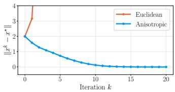
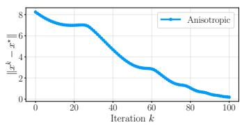
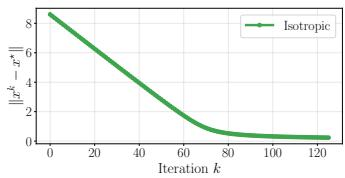
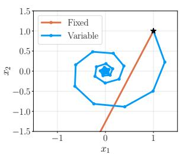
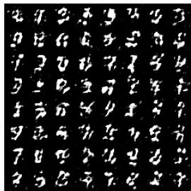
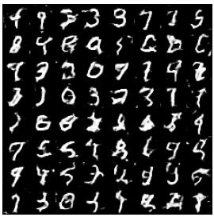
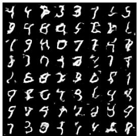
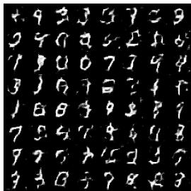

# Dual-Space Preconditioning for Variational Inequalities and Root-Finding Problems

Jan Quan∗, Konstantinos Oikonomidis∗, Alexander Bodard∗, Panagiotis Patrinos KU Leuven (STADIUS)

## Abstract

This paper develops a dual-space preconditioning framework for variational inequalities and root-finding problems beyond classical cocoercivity and Lipschitz continuity assumptions. To this end, we introduce both a novel cocoercivity-type condition and a relaxed Lipschitz continuity condition, and derive convergence of deterministic and stochastic methods under these generalized conditions. For isotropic preconditioners, the resulting algorithms can be interpreted as variablestepsize variants of classical methods, extending recent analyses based on $( L _ { 0 } , L _ { 1 } )$ type growth conditions while allowing simpler proofs and larger stepsize ranges. We also show that the framework naturally handles variational inequalities through weak Minty-type arguments. Finally, we study the associated continuous-time dynamics and derive a variational and optimal control interpretation of the preconditioned flow. Overall, the results show that dual-space preconditioning provides a flexible mechanism for designing and analyzing operator methods beyond the standard Euclidean Lipschitz setting.

## 1 Introduction

In this paper, we study variational inequality (VI) problems of the following form:

$$
\operatorname { f i n d } x ^ { \star } \in C \ { \mathrm { s u c h ~ t h a t } } \left. F x ^ { \star } , x - x ^ { \star } \right. \geq 0 \qquad \forall x \in C ,\tag{VIP}
$$

where $C$ is a nonempty, closed, convex subset of a Euclidean space $E$ with inner product $\langle \cdot , \cdot \rangle$ and induced norm $\| \cdot \|$ , and $F : E  E$ is a continuous operator. Throughout the paper, we assume that a solution $x ^ { \star }$ exists. Equivalently, (VIP) can be written as the inclusion problem $0 \in ( F + N _ { C } ) ( x ^ { \star } )$ where $N _ { C }$ denotes the normal cone of C.

Variational inequalities have received widespread attention [10, 18, 50] because they encompass problems such as (un)constrained minimization, multiplayer games, and min-max optimization. They arise in numerous machine learning applications, including reinforcement learning, generative adversarial network training, distributionally robust optimization, and optimal transport [20, 43]. For instance, for the min-max problem min $\iota _ { u \in U } \operatorname* { m a x } _ { v \in V } f ( u , v )$ , where $U$ and $V$ are nonempty, closed, convex sets, one can select the operator

$$
F ( u , v ) = \left( \nabla _ { u } f ( u , v ) ^ { \top } , - \nabla _ { v } f ( u , v ) ^ { \top } \right) ^ { \top } .\tag{1}
$$

When $C = U \times V$ and $f$ is convex-concave, a solution to (VIP) then corresponds to a saddle point. In recent years, problems of the form (VIP) have been studied under various monotonicity assumptions on $F ,$ ranging from strong monotonicity to Minty variational inequalities [37, 21, 16, 13, 49]. However, with the exception of some recent works on α-symmetric $( L _ { 0 } , L _ { 1 } )$ -Lipschitz continuity [59, 58, 14], most existing analyses rely on standard Lipschitz continuity of $F$ . This contrasts with a growing trend in optimization toward generalized smoothness notions, which provide a more accurate description of practical problems [64, 1] and lead to sharper algorithmic guarantees [25].

A related line of work concerns dual-space, or nonlinear, preconditioning methods [39, 34]. These methods are naturally analyzed under generalized smoothness assumptions [31] and have proved useful in optimization, encompassing, for instance, gradient-clipping-like methods [46]. However, to date this perspective has largely remained restricted to optimization problems, leaving its potential for variational inequalities and root-finding problems underexplored. This motivates our central question:

Can preconditioning techniques be extended to variational inequalities and root-finding problems, and can the resulting algorithms be analyzed under generalized Lipschitz continuity conditions?

We highlight two key challenges in this regard. First, classical cocoercivity and Lipschitz continuity assumptions must be generalized in a way that is compatible with the nonlinear preconditioner. However, existing results rely heavily on $F$ being the gradient of a function that plays an explicit role in the corresponding notion of anisotropic smoothness [31]. Second, there is an inherent trade-off between the generality of the preconditioning framework and the strength of the resulting convergence guarantees. It is therefore important to identify meaningful classes of preconditioners that admit a unified analysis, cover a broad range of algorithms, and recover known results as special cases.

Contributions Our contributions can be summarized as follows.

• We introduce a novel cocoercivity-type condition (Definition 2.2) that generalizes classical cocoercivity through a preconditioner $\nabla \phi ^ { * }$ . We relate this condition to dual relative smoothness [39] and use it to establish convergence results for preconditioned forward methods, and obtain last-iterate convergence rates for a broad class of isotropic preconditioners.

• We propose a generalized Lipschitz continuity condition (Assumption 3.2) that encompasses and extends recent notions such as α-symmetric $( L _ { 0 } , L _ { 1 } )$ -Lipschitz continuity [59, Assumption 2.1]. We use this condition to analyze preconditioned extragradient methods and, by focusing on isotropic preconditioners, derive variable-stepsize variants of several existing algorithms, including Extragradient+ (EG+) [16] and Optimistic Gradient Descent Ascent (OGDA) [30]. We further extend the analysis to stochastic settings with large batch sizes. Overall, our unified preconditioning framework offers a clear route to generalizing existing methods while substantially simplifying their convergence analyses.

• Finally, we study the associated continuous-time dynamics, develop a variational perspective on nonlinear preconditioning through the Fitzpatrick function [5, p. 761], and establish a fundamental connection with optimal control problems.

Notation We denote $\overline { { \mathbb { R } } } = \mathbb { R } \cup \{ \pm \infty \}$ and $\mathbb { N } = \{ 0 , 1 , 2 , \ldots \}$ . For a proper convex function $f : E \to { \overline { { \mathbb { R } } } }$ , its subdifferential at $x \in E$ is $\partial f ( x ) = \{ v \in E \mid f ( { \bar { x } } ) \geq f ( x ) + \langle v , { \bar { x } } - x \rangle , \forall { \bar { x } } \in E \}$ The indicatorfunction of a set $C \subseteq E$ is defined as $\delta _ { C } ( x ) = 0$ if $x \in C$ and + otherwise. For a nonempty, closed, convex set $C ,$ , its normal cone is $N _ { C } = \partial \delta _ { C }$ , that is, $N _ { C } ( \bar { x } ) = \{ y \in E \mid \langle y , x -$ $\bar { x } \rangle \leq \bar { 0 , } \bar { \forall } x \in C \}$ for $\bar { x } \in C$ and $N _ { C } ( \bar { x } ) = \emptyset$ otherwise. Further, we denote by $P _ { C }$ the Euclidean projection onto $C .$ We say that a proper, lsc, convex function $f : E \to { \overline { { \mathbb { R } } } }$ is essentially smooth if int(dom $f ) \neq \emptyset$ and $f$ is differentiable on int(dom $f )$ such that $\| \nabla f ( x ^ { \nu } ) \| \to \infty$ , whenever int(dom $f ) \ni x ^ { \nu }  x \in$ bdry dom f, and essentially strictly convex, if $f$ is strictly convex on every convex subset of dom $\partial f : = \{ x \in E \mid \partial f ( x ) \neq \emptyset \}$ , and Legendre, if $f$ is both essentially smooth and essentially strictly convex. In particular, a smooth convex function on E is essentially smooth. For a convex function ${ \dot { f } } \in { \mathcal { C } } ^ { 1 } ( E )$ , we denote $D _ { f } ( x , \bar { x } ) = f ( x ) - f ( \bar { x } ) - \langle \nabla f ( \bar { x } ) , x - \bar { x } \rangle$ for $x , { \bar { x } } \in E$ . For a set-valued mapping ${ \dot { T } } : { \dot { E } } \supseteq E .$ , we define its graph as gph $T : = \{ ( x , y ) \in E \times E \mid y \in T ( x ) \}$ and its zeros zer ${ \dot { T } } = \left\{ x \in E \mid 0 \in T x \right\}$ . We denote by id the identity operator on the relevant space and write $\| \cdot \| _ { \mathrm { o p } }$ for the operator norm.

## 1.1 Related work

Variational inequalities In recent years, the VI literature has mostly been centered around lifting the monotonicity assumption, mainly due to applications in (non)convex-(non)concave minimax problems [35]. Particular attention has been given to a class of nonmonotone problems that satisfy the so-called Minty variational inequality [40, 52, 8, 30]. Its generalization, the weak Minty variational inequality, was proposed in [16] along with a convergent extragradient scheme, while [49] introduced an adaptive extension with increased stepsize ranges. Moreover, a large body of work has been devoted to stochastic extensions of classical methods [26, 4, 24, 48, 22].

Generalized smoothness Our work is closely related to notions of generalized smoothness that have received widespread attention recently in the functional setting. The most well-known condition, called $( L _ { 0 } , L _ { 1 } )$ -smoothness [64], which for a twice differentiable objective $f$ takes the form $\| \nabla ^ { 2 } f ( x ) \| _ { \mathrm { o p } } \leq L _ { 0 } + L _ { 1 } \| \nabla f ( x ) \|$ [64, 27], allows the norm of the Hessian to grow unbounded. Various existing methods have been analyzed under this new smoothness condition [62, 19, 29], and new methods have also been proposed [25, 60].

Dual-space preconditioning In thefunctional setting, the nonlinear preconditioning framework that we build upon was introduced in [39] for gradient-type methods and in [34] for proximal methods. In [31], the anisotropic proximal gradient algorithm for nonconvex composite minimization problems was introduced and studied under a new condition called anisotropic smoothness [33]. Subsequent work showed that this condition encompasses $( L _ { 0 } , L _ { 1 } )$ -smoothness and connected the framework to algorithms for neural network training $[ 4 6 , 4 7 , 3 , 4 5 ]$ . The dual-space preconditioning method was also linked to the Lion algorithm [12] and to the solution of a certain constrained minimization problem in [11], under Lipschitz smoothness of the objective. In the operator setting, [32] studied the convergence of a nonlinearly preconditioned backward scheme for monotone operators, obtaining convergence guarantees under general assumptions. For a well-behaved family of preconditioners, a nonlinear proximal point scheme was already analyzed in [38].

## 2 Convergence under $\nabla \phi ^ { * }$ -cocoercivity

Throughout this section, we focus on preconditioners that are gradients of convex functions. Although we work in finite-dimensional spaces, to remain aligned with the classical convention that $F$ takes values in the dual space, denoting $\phi : E \to { \overline { { \mathbb { R } } } }$ for the so-called referencefunction, we use the gradient of its convex conjugate, $\nabla \phi ^ { * }$ , as the preconditioner.

Assumption 2.1. $\phi ^ { * } : E $ R is even and Legendre and satisfies $\phi ^ { * } \geq 0$ and $\phi ^ { * } ( 0 ) = 0$

Consider the root-finding problem, i.e., (VIP) with $C = E$

find $x ^ { \star } \in E$ such that $F x ^ { \star } = 0 .$

(RFP)

In the standard Euclidean setup, the simplest assumption that leads to convergence offorward schemes for (RFP) is cocoercivity [2, Definition 4.10] of $F .$ . This condition covers a large class of monotone operators, including gradients of convex and Lipschitz smooth functions. We propose the following generalization that is based on the notion of $\nabla \bar { \phi } ^ { * }$ -firm nonexpansiveness from [63, Definition 4.1].

Definition 2.2 $( \nabla \phi ^ { * }$ -cocoercivity). Let $\beta > 0$ . We say that $F$ is $\beta \mathrm { - } \nabla \phi ^ { * }$ -cocoercive if the following inequality holdsfor all $x , { \bar { x } } \in E { : }$

$$
\begin{array} { r l } & { \beta \langle F x - F \bar { x } , \nabla \phi ^ { * } ( F x ) - \nabla \phi ^ { * } ( F \bar { x } ) \rangle \leq \langle F x - F \bar { x } , x - \bar { x } \rangle . } \end{array}\tag{2}
$$

For $\begin{array} { r } { \phi ^ { * } = \frac { 1 } { 2 } \| \cdot \| ^ { 2 } } \end{array}$ , this definition reduces to classical cocoercivity. More generally, $\nabla \phi ^ { * }$ -cocoercivity extends the dual relative smoothness condition of [39, Assumption 3.1.3] to operators, as the following proposition shows.

Proposition 2.3 $( \nabla \phi ^ { * }$ -cocoercivity from dual relative smoothness). Suppose that $\phi ^ { * }$ satisfies $A s -$ sumption 2.1. Let $f \in { \mathcal { C } } ^ { 1 } ( E )$ be convex and such that thefollowing inequality holdsfor all $x , { \bar { x } } \in E .$

$$
D _ { \phi ^ { * } } ( \nabla f ( x ) , \nabla f ( \bar { x } ) ) \leq L D _ { f } ( \bar { x } , x ) , \qquad L > 0 .\tag{3}
$$

Then, $\nabla f$ is ${ L } ^ { - 1 } \substack { - } \nabla \phi ^ { * }$ -cocoercive.

The natural way to tackle (RFP) under Definition 2.2 is then through the following generalization of the dual-space preconditioning method from [39]:

$$
\boldsymbol { x } ^ { k + 1 } = \boldsymbol { x } ^ { k } - \gamma \nabla \phi ^ { * } ( F \boldsymbol { x } ^ { k } ) .\tag{4}
$$

The analysis of $( 4 )$ when $\phi$ has full domain can in fact be obtained by rewriting the scheme as the nonlinear proximal point iteration studied in $[ 3 2 ] \colon x ^ { k + 1 } = ( \operatorname { i d } + \gamma \overleftarrow { \nabla } \phi ^ { * } \circ T ) ^ { \smile 1 } ( x ^ { k } )$ for some maximally monotone operator $T$ . To make the paper self-contained, we provide a direct proof based on the forward step in $\mathbf { A }$ ppendix B.2.

  
Figure 1: (left) Comparison of the Euclidean forward step and (4) with $\begin{array} { r } { \gamma = \frac { 1 } { 2 } } \end{array}$ , and $\phi ^ { * }$ and $F$ as in Example 2.5. (middle) Convergence of (4) with $\textstyle \gamma = { \frac { 1 } { 5 } }$ , and $\phi ^ { * }$ and $F$ as in Example 2.6. The sequence is not necessarily Fejér monotone for non-isotropic preconditioners. (right) Convergence of (4) with $\begin{array} { r } { \gamma = \frac { 1 } { 6 } } \end{array}$ , and $\phi ^ { * }$ and $\check { F }$ as in Example 2.8.

Theorem 2.4. Suppose that $\phi ^ { * }$ satisfies Assumption 2.1. Let $F$ be $\nabla \phi ^ { * }$ -cocoercive with constant $\beta . L e t ,$ moreover, $\operatorname { \bar { \{ } } x  ^ { k } \} _ { k \in \mathbb { N } }$ be the sequence of iterates generated by (4) with $\gamma \in \left( 0 , \beta \right]$ . Then, $\phi ^ { * } ( F x ^ { k + 1 } ) \leq \phi ^ { * } ( { \dot { F } } x ^ { \dot { k } } ) f c$ r all $k \in \mathbb N$ and $\{ D _ { \phi ^ { * } } ( F x ^ { k } , F x ^ { k + 1 } ) \} _ { k = 0 } ^ { \infty }$ is summable. In particular, lim $_ { k \to \infty } D _ { \phi ^ { * } } ( F x ^ { k } , F x ^ { k + 1 } ) = 0$ . Moreover, $\{ F x ^ { k } \} _ { k \in \mathbb { N } }$ is bounded and every limitpoint of $\{ x ^ { k } \} _ { k \in \mathbb { N } }$ is a zero ofF.

Example 2.5. Consider the dual reference function $\phi ^ { * } ( y _ { 1 } , y _ { 2 } ) = h ^ { * } ( y _ { 1 } ) + h ^ { * } ( y _ { 2 } )$ with $h ^ { \ast } ( y ) =$ $| y | - \log ( | y | + 1 )$ and the operator $F ( x _ { 1 } , x _ { 2 } ) \ = \ \left( \begin{array} { l } { { x _ { 1 } + x _ { 1 } ^ { 3 } } } \\ { { x _ { 1 } + x _ { 2 } } } \end{array} \right)$ . This $F$ is not standard Euclidean cocoercive, in fact not even Lipschitz, while it is $\nabla \phi ^ { * }$ -cocoercive with constant $\begin{array} { r } { \beta = \frac { 1 } { 2 } } \end{array}$ . Moreover, for any stepsize $\gamma > 0$ , there exists some initial point so that the Euclidean forward step diverges. In contrast, the initial sublevel set of $\phi ^ { * } \circ F$ is bounded, so convergence of (4) is guaranteed for $0 < \gamma \leq \beta$ by the preceding result. The left subfigure of Figure 1 shows divergence of the Euclidean forward step, while (4) converges. □

Example 2.6. Consider the dual reference function $\phi ^ { * } ( y _ { 1 } , y _ { 2 } ) = h ^ { * } ( y _ { 1 } ) + h ^ { * } ( y _ { 2 } )$ with $h ^ { \ast } ( y ) =$ $| y | - \log ( | y | + 1 )$ and the operator $\begin{array} { r } { F ( x _ { 1 } , x _ { 2 } ) = \left( \begin{array} { l } { x _ { 1 } - 2 x _ { 2 } } \\ { 2 x _ { 1 } + x _ { 2 } } \end{array} \right) } \end{array}$ . It can be shown that $F$ is $\nabla \phi ^ { * }$ -cocoercive with constant $\begin{array} { r } { \beta = \frac { 1 } { 5 } } \end{array}$ . In contrast to Example 2.5, the iteration is not Fejér monotone, as shown in the middle subfigure of Figure 1. □

When $\nabla \phi ^ { * } ( y ) = \kappa ( \| y \| ) y$ for some $\kappa : [ 0 , + \infty )  ( 0 , + \infty )$ , we say that $\nabla \phi ^ { * }$ is isotropic. Isotropy yields stronger convergence guarantees and permits larger stepsizes, as shown by the following theorem, which also provides last-iterate convergence rates.

Theorem 2.7 (Convergence for isotropic preconditioners). Let F be $\beta \mathrm { - } \nabla \phi ^ { * }$ -cocoercive. Let, moreover, $\{ x ^ { k } \} _ { k \in \mathbb { N } }$ be generated by (4) with an isotropic preconditioner $\nabla \phi ^ { * }$ , where $\phi ^ { * } = h ^ { * } \circ \| \cdot \|$ and $h ^ { * }$ satisfies Assumption 2.1. Then, the following hold for every $x ^ { \star } \in$ zer $F$ and $K \in \mathbb { N } .$

(i) For $\gamma \in ( 0 , 2 \beta ) , \{ x ^ { k } \} _ { k \in \mathbb { N } }$ is bounded and Fejér monotone with respect to zer $F ,$ , that is, $\| x ^ { k + 1 } - x ^ { \star } \| \leq \| x ^ { k } - x ^ { \star } \|$ for all $x ^ { \star } \in$ zer F and $k \in \mathbb N$

(ii) $F o r \gamma \in ( 0 , \beta ] , \{ \| F x ^ { k } \| \} _ { k \in \mathbb { N } }$ is a nonincreasing sequence and we have thefollowing rate:

$$
\| \nabla \phi ^ { * } ( F x ^ { K } ) \| ^ { 2 } \leq \frac { \| x ^ { 0 } - x ^ { \star } \| ^ { 2 } } { ( K + 1 ) \gamma ( 2 \beta - \gamma ) } .
$$

$H ,$ moreover, κ is a nonincreasing function on $[ 0 , + \infty )$ , we obtain the last-iterate rate

$$
\| F x ^ { K } \| \leq \frac { \| x ^ { 0 } - x ^ { \star } \| } { \kappa ( \| F x ^ { 0 } \| ) \sqrt { \gamma ( 2 \beta - \gamma ) ( K + 1 ) } } .
$$

Example 2.8. Consider the dual reference function $\phi ^ { * } ( y ) = \| y \| - \log ( \| y \| + 1 )$ and the operator $F ( x ) \stackrel { \cdot } { = } \| x \| ^ { 2 } ( x + J x )$ with J a linear operator that satisfies $J ^ { * } J = \operatorname { i d }$ and $J ^ { * } = - J ,$ , where $J ^ { * }$ denotes the adjoint of $\begin{array} { r } { J , \mathrm { e } . \mathrm { g } . , J = \left( \begin{array} { l l } { 0 \ { - } 1 } \\ { 1 } & { 0 } \end{array} \right) } \end{array}$ in 2 dimensions. It can be shown that F is $\nabla \phi ^ { * }$ -cocoercive with constant $\begin{array} { r } { \beta = \frac { 1 } { 6 } } \end{array}$ but is not cocoercive in the standard Euclidean sense. The right subfigure of Figure 1 shows convergence of (4). Note that the iterates are Fejér monotone, as described in Theorem 2.7. □

Another example in a similar spirit to Example 2.8 for port-Hamiltonian equilibrium operators is provided in Appendix B.7.

## 2.1 Extension to the composite setting

We now consider the more general inclusion problem

$$
0 \in F x + G x ,
$$

where $G : E  E$ is maximally monotone, subsuming (VIP) by choosing $G = N _ { C }$ . Moreover, we assume that the reference function $\phi$ has full domain. The following forward-backward algorithm extends the method of [31] to the operator setting:

$$
y ^ { k } = x ^ { k } - \gamma \nabla \phi ^ { * } ( F x ^ { k } ) , \qquad x ^ { k + 1 } = ( \mathrm { i d } + \gamma \nabla \phi ^ { * } \circ G ) ^ { - 1 } ( y ^ { k } ) .\tag{5}
$$

In light of [32, Proposition 3.5], the operator $( \mathrm { i d } + \gamma \nabla \phi ^ { * } \circ G ) ^ { - 1 }$ is single-valued. Our aim is to write (5) as a single forward step, so that we can directly use Theorem 2.4. Define the forwardbackward map $\bar { T _ { \gamma } } ( x ) : = ( \mathrm { i d } + \bar { \gamma } \nabla \phi ^ { * } \circ G ) ^ { - 1 } ( x - \gamma \nabla \phi ^ { * } ( F x ) )$ and the transformed fixed-point residual $\begin{array} { r } { R _ { \gamma } ( x ) : = \nabla \phi ( \frac { x - T _ { \gamma } ( x ) } { \gamma } ) } \end{array}$ . Note that zer $R _ { \gamma } = \operatorname { z e r } ( F + G )$ and that (5) can be written as $x ^ { k + 1 } = x ^ { k } - \gamma \nabla \phi ^ { * } ( R _ { \gamma } ( x ^ { k } ) )$ . We are thus led to the following corollary.

Corollary 2.9. Suppose that $\phi ^ { * }$ satisfies Assumption 2.1, dom $\phi = E ,$ , and $G : E  E$ is maximally monotone. $L e t \gamma > 0$ and suppose that $R _ { \gamma } \ i s \ \gamma \cdot \nabla \phi ^ { * } .$ -cocoercive. Let, moreover, $\{ x ^ { k } \} _ { k \in \mathbb { N } }$ be the sequence of iterates generated by (5). Then, $\phi ^ { * } ( R _ { \gamma } ( x ^ { k + 1 } ) ) \leq \phi ^ { * } ( R _ { \gamma } ( x ^ { k } ) )$ for all $k \in \mathbb N ,$ and $\{ D _ { \phi ^ { * } } ( R _ { \gamma } ( x ^ { k } ) , R _ { \gamma } ( x ^ { k + 1 } ) ) \} _ { k = 0 } ^ { \infty }$ is summable. In particular, lim ${ \ L } _ { \cdot k \to \infty } D _ { \phi ^ { * } } ( R _ { \gamma } ( x ^ { k } ) , R _ { \gamma } ( x ^ { k + 1 } ) ) = 0 .$ Moreover, $\{ R _ { \gamma } ( x ^ { k } ) \} _ { k \in \mathbb { N } }$ is bounded and every limit point of $\{ x ^ { k } \} _ { k \in \mathbb { N } }$ is a zero of $F + G$

When $G \equiv 0$ , we have $R _ { \gamma } = F$ , and we recover (4) and Theorem 2.4. When $F \equiv 0$ , we recover the method of [32], which we discuss further in Appendix B.8. In the truly composite case, our analysis requires $\nabla \phi ^ { * }$ -cocoercivity of $R _ { \gamma }$ , and we currently do not have separate conditions on $F$ and G that imply this property. Moreover, several natural Lyapunov candidates need not decrease along the iterates when $\bar { F }$ is $\nabla \phi ^ { * }$ -cocoercive and G is monotone. In particular, we numerically tested $D _ { \phi ^ { * } } ( v ^ { k + 1 } , - F x ^ { k } ) , D _ { \phi ^ { * } } ( - F x ^ { k } , v ^ { k + 1 } ) , \frac { 1 } { 2 } \| x ^ { k } - x ^ { \star } \| ^ { 2 } , D _ { \phi ^ { * } } ( F x ^ { k } , \dot { F } x ^ { \star } ) + D _ { \phi ^ { * } } ( v ^ { k + 1 } , v ^ { \star } )$ , and $\phi ^ { * } \bigl ( \nabla \phi \bigl ( \nabla \phi ^ { * } ( F x ^ { k } ) + \nabla \phi ^ { * } ( v ^ { k + 1 } ) \bigr ) \bigr )$ , where $v ^ { k + 1 } \in G x ^ { k + 1 }$ and $v ^ { \star } = - F x ^ { \star }$ with $x ^ { \star } \in \mathop { \mathrm { z e r } } ( F + G )$ We found a simple example in which each quantity increases during at least one of the first ten iterations, although the iterates numerically approach a solution. This illustrates the difficulty of obtaining a general Lyapunov analysis for (5). The code used to generate the example is included in the supplementary material.

## 3 Extragradient methods under preconditioned Lipschitz continuity

In this section, we focus on isotropic preconditioners and as such denote them by instead of $\nabla \phi ^ { * }$ Assumption 3.1. The preconditioner $\mathcal { K } : E  E$ is monotone and continuous, satisfies $\mathcal { K } ( 0 ) = 0$ and is isotropic: $\mathcal { K } ( y ) \overset { \cdot } { = } \kappa ( \| y \| ) y f o r$ all $y \in E$ and some κ $: [ 0 , + \infty )  ( 0 , + \infty )$

Such a preconditioner can be identified with the gradient of the dual reference function $\phi ^ { * } ( y ) =$ $\int _ { 0 } ^ { \| y \| } t \kappa ( t ) d t$ , for which $\nabla \phi ^ { * } = \kappa$ . Note that we have relaxed the strict monotonicity, which is implied by Assumption 2.1, to merely monotonicity.

## 3.1 The preconditioned Lipschitz continuity assumption

Extragradient methods are usually analyzed under Lipschitz continuity of F. Instead, we impose Lipschitz continuity on the preconditioned operator $\scriptstyle { \mathcal { K } } \circ F$

Assumption 3.2 ( -Lipschitz continuity). Let $L > 0$ . We say that $F : E  E$ is -Lipschitz continuous with constant L if the following inequality holds for all $x , { \bar { x } } \in E .$

$$
\| K ( F x ) - K ( F { \bar { x } } ) \| \leq L \| x - { \bar { x } } \| .\tag{6}
$$

This condition is a direct generalization of [47, Assumption 2.5] to the operator setting. If is Lipschitz continuous, every Lipschitz-continuous operator F satisfies Assumption 3.2 trivially. In fact, Assumption 3.2 is significantly weaker than classical Lipschitz continuity for judicious choices of $\kappa .$ . To see this, suppose that $F \in { \mathcal { C } } ^ { 1 } ( E )$ satisfies the $( L _ { 0 } , L _ { 1 } )$ -Lipschitz continuity bound [64] $\forall x \in E : \| \nabla F ( x ) \| _ { \mathrm { o p } } \leq L _ { 0 } + L _ { 1 } \| F x \|$ with $L _ { 0 } > 0 , L _ { 1 } > 0$ . Then, it can be shown by arguments similar to those in [47, Proposition 2.6] that for $\begin{array} { r } { \phi ^ { * } ( y ) = \frac { \| y \| } { L _ { 1 } } - \frac { L _ { 0 } } { L _ { 1 } ^ { 2 } } \ln ( 1 + \frac { L _ { 1 } } { L _ { 0 } } \| y \| ) } \end{array}$ $\forall x \in E : \| \nabla ( K \circ F ) ( x ) \| _ { \mathrm { o p } } \leq 1$ , with ${ \mathcal { K } } = \nabla \phi ^ { * }$ , which is a sufficient condition for (6) with $L = 1$ . More generally, the class of α-symmetric $( L _ { 0 } , L _ { 1 } ) \ – 1$ Lipschitz continuous operators satisfies Assumption 3.2 for a suitable preconditioner , as we show in Proposition 3.4.

Definition 3.3 (α-symmetric $( L _ { 0 } , L _ { 1 } )$ -Lipschitz continuity [59]). We say that $F : E  E$ is α- symmetric $( L _ { 0 } , L _ { 1 } ) { \dot { - } } L i p s c h i t z { \dot { f } } o t$ some $\bar { L _ { 0 } ^ { \mathrm { ~ ~ } } } > 0 , L _ { 1 } \geq 0$ and $\alpha \in ( 0 , 1 ]$ if the following inequality holdsfor all $x , { \bar { x } } \in E .$

$$
\| F x - F \bar { x } \| \leq ( L _ { 0 } + L _ { 1 } \operatorname* { m a x } _ { \theta \in [ 0 , 1 ] } \| F ( \theta x + ( 1 - \theta ) \bar { x } ) \| ^ { \alpha } ) \| x - \bar { x } \| .\tag{7}
$$

Proposition 3.4. $I f F : E \to E$ satisfies Definition $3 . 3 f o r$ some $L _ { 0 } > 0 , L _ { 1 } \ge 0$ and $\alpha \in ( 0 , 1 ] ,$ then F is -Lipschitz continuous with constant $L = 1$ and $\begin{array} { r } { { \cal K } : y \mapsto \frac { y } { L _ { 0 } + L _ { 1 } \| y \| ^ { \alpha } } . } \end{array}$

It is natural to ask whether the converse also holds. The following example shows that this is in fact not the case, indicating that Assumption 3.2 is more general.

Example 3.5. Consider $F : \mathbb { R } ^ { 2 }  \mathbb { R } ^ { 2 }$ defined by $F x = e ^ { \| x \| ^ { 2 } / 2 } \Big ( \begin{array} { c } { - x _ { 2 } } \\ { x _ { 1 } } \end{array} \Big )$ . Then, $F$ is -Lipschitz continuous with constant 1 and $\begin{array} { r } { K : y \mapsto \frac { y } { 1 + \| y \| } } \end{array}$ , while it is not α-symmetric $( L _ { 0 } , L _ { 1 } ) \cdot$ -Lipschitz for any $L _ { 0 } , L _ { 1 }$ , α satisfying the requirements of Definition 3.3. Similar examples in the functional setup are given in $[ 3 , \ S \mathbf { A } . \bar { 3 } ]$ □

A partial converse does hold, however, when $0 < \alpha < 1$ in Proposition 3.4.

Remark 3.6. If $0 \textless \alpha \textless 1$ and $F$ is -Lipschitz continuous with constant $L > 0$ and $\kappa$ as in Proposition 3.4, then F is α-symmetric $( L L _ { 0 } ^ { - } / ( 1 - \alpha ) , L L _ { 1 } / ( 1 - \alpha ) ) – \mathrm { L i p s c h i t z }$ continuous.

## 3.2 Convergence under preconditioned Lipschitz continuity

This subsection describes in detail how existing convergence results for extragradient and related methods under classical Lipschitz continuity can be generalized to hold under -Lipschitz continuity. To that end, we first recall the weak Minty variational inequality.

Assumption 3.7. The operator $\mathcal { K } \circ F + N _ { C }$ satisfies the weak Minty variational inequality (MVI), i.e., there exists a nonempty set $S ^ { \star } \subseteq \mathrm { z e r } ( \mathcal { K } \circ F + N _ { C } )$ and some $\rho \in \mathbb R$ such thatfor all $x ^ { \star } \in S ^ { \star }$

$$
\begin{array} { r l r } { \langle y , x - x ^ { \star } \rangle \geq \rho \| y \| ^ { 2 } } & { } & { \forall ( x , y ) \in \mathrm { g p h } ( K \circ F + N _ { C } ) . } \end{array}\tag{8}
$$

The zeros of the operator $\mathcal { K } \circ F + N _ { C }$ appearing in Assumption 3.7 are exactly those of $F + N _ { C }$ Lemma 3.8. If satisfies Assumption $3 . I ,$ then $\mathrm { z e r } ( \mathcal { K } \circ F + N _ { C } ) = \mathrm { z e r } ( F + N _ { C } )$

The following key result establishes that monotonicity of F implies that the operator $\mathcal { K } \circ F + N _ { C }$ satisfies the weak MVI with $\rho = 0$

Proposition 3.9. If satisfies Assumption 3.1 and $F : E  E$ is monotone, then Assumption 3.7 holds with $S ^ { \star } = \ker ( F + \dot { N } _ { C } )$ and $\rho = 0$

Remark 3.10. Suppose that $C = E$ and that there exists a nonempty set $S ^ { \star } \subseteq$ zer $F$ and $\rho \in \mathbb { R }$ such that, for every $x ^ { \star } \in S ^ { \star }$

$$
\langle F x , x - x ^ { \star } \rangle \geq \rho \langle { \mathit { K } } ( F x ) , F x \rangle , \qquad \forall x \in E .\tag{9}
$$

It is easily verified that (9) is equivalent to $\boldsymbol { \mathcal { K } } \circ \boldsymbol { \mathcal { F } }$ satisfying the weak MVI with constant $\rho .$ . If $\rho < 0 ,$ then this condition may be stricter or less strict than the usual weak MVI, depending on κ. Notably, (9) is an extension of (2) centered at the point $\bar { x } = x ^ { \star }$ and for negative constants $\beta ,$ generalizing again the classical setup and the relation between the weak MVI and cohypomonotonicity [17].

The combination of Assumptions 3.2 and 3.7 turns out extremely powerful, as they allow for the immediate transfer of convergence results under standard Lipschitz continuity of $F$ to the preconditioned Lipschitz continuity setting by formally replacing F with $\kappa _ { \circ F }$ . We now demonstrate this transfer of convergence results for two extragradient-type methods.

First, consider a preconditioned version of the CEG+ algorithm from [49], for simplicity written with fixed stepsizes. Given the forward operator $H : = \mathrm { i d } - \overset { \cdot } { \gamma } \mathcal { K } \circ F$ , it performs iterations

$$
z ^ { k } = P _ { C } ( x ^ { k } - \gamma K ( F x ^ { k } ) ) , \qquad x ^ { k + 1 } = x ^ { k } + \beta ( H z ^ { k } - H x ^ { k } ) .\tag{P-CEG+}
$$

By selecting $\kappa = \mathrm { i d }$ we recover the original CEG+ algorithm [49], and by further restricting to the unconstrained setting where $C = E$ this reduces to the EG+ method of [16] since $H z ^ { k } - { \overline { { H } } } x ^ { k } =$ $- \gamma K ( F z ^ { k } ) = - \gamma F \breve { z } ^ { k }$

Under Assumptions 3.2 and $3 . 7 , K \circ F$ is Lipschitz continuous and $\mathcal { K } \circ F + N _ { C }$ satisfies a weak MVI. Moreover, we have $\mathrm { z e r } ( \mathcal { K } \circ F + N _ { C } ) \dot { = } \mathrm { z e r } ( F + N _ { C } )$ by Lemma 3.8. Since the normal cone $N _ { C }$ is a maximally monotone operator, all hypotheses of [49, Corollary 3.2] hold, directly yielding the following.

Theorem 3.11. Suppose that Assumptions 3.1, 3.2 and 3.7 hold with $\rho > - \frac { 1 } { 2 L }$ . Let $x ^ { \star } \in S ^ { \star }$ $\gamma \in \ ( [ - 2 \rho ] _ { + } , \frac { 1 } { L } ]$ with $[ - 2 \rho ] _ { + } = \operatorname* { m a x } \{ - 2 \rho , 0 \}$ , and $\beta \in ( 0 , 1 + \frac { 2 \rho } { \gamma } )$ . Consider the sequences $\{ x ^ { k } \} _ { k \in \mathbb { N } } , \ \{ z ^ { k } \} _ { k \in \mathbb { N } }$ generated by (P-CEG+). Then, for every $K \in \mathbb { N } ,$

$$
\operatorname* { m i n } _ { k = 0 , 1 , \dots , K } \| H z ^ { k } - H x ^ { k } \| ^ { 2 } \leq \frac { \| x ^ { 0 } - x ^ { \star } \| ^ { 2 } } { \sigma ( K + 1 ) } ,
$$

where $\begin{array} { r } { \sigma = \beta ( 1 + \frac { 2 \rho } { \gamma } - \beta ) } \end{array}$ . Furthermore, $\{ z ^ { k } \} _ { k \in \mathbb { N } }$ is bounded and its limit points belong to $\mathrm { z e r } ( F + N _ { C } )$

In a similar manner, we can analyze methods that require a single evaluation of $F$ per iteration, including the following preconditioned variant of the Optimistic Gradient Descent Ascent method:

$$
x ^ { k + 1 } = P _ { C } ( x ^ { k } - \gamma ( 2 \mathcal { K } ( F x ^ { k } ) - \mathcal { K } ( F x ^ { k - 1 } ) ) ) , \qquad k \geq 1 , \qquad x ^ { 0 } = x ^ { 1 } \in C .\tag{P-OGDA}
$$

If the operator $F$ is monotone, then $\langle \mathcal { K } ( F x ) , x - x ^ { \star } \rangle \geq 0$ for all $x \in C$ and $x ^ { \star } \in \mathrm { z e r } ( F + N _ { C } )$ due to Proposition 3.9 and choosing the zero normal vector in (8). Thus, all hypotheses of [30, Theorem 2.5] are satisfied, yielding the following result.

Theorem 3.12. Let $F : E  E$ be monotone and suppose that Assumptions 3.1 and 3.2 hold. Let $x ^ { \star } \in \mathop { \mathrm { z e r } } ( F + N _ { C } )$ . Consider the sequence $\{ x ^ { k } \} _ { k \in \mathbb { N } }$ generated by (P-OGDA) with $\begin{array} { r } { \gamma = \frac { 1 } { 3 L } } \end{array}$ and $x ^ { 0 } = x ^ { 1 } \in C$ . Fix $K \geq 1$ . Let $R \in$ arg min $_ { 1 \leq k \leq K } \big ( \| x ^ { k + 1 } - x ^ { k } \| ^ { 2 } + \| x ^ { k } - x ^ { k - 1 } \| ^ { 2 } \big )$ . Then,

$$
\operatorname* { m i n } _ { y \in N _ { C } ( x ^ { R + 1 } ) } \| y + K ( F x ^ { R + 1 } ) \| \leq 2 0 \sqrt { \frac { 3 } { 2 } } \frac { L \| x ^ { 0 } - x ^ { \star } \| } { \sqrt { K } } .
$$

## 3.3 Convergence under α-symmetric $( L _ { 0 } , L _ { 1 } )$ -Lipschitz continuity

We now compare our framework with other adaptive stepsize rules for extragradient methods for solving (RFP), though we can also accommodate constraints in light of Theorem 3.11. We focus on a modification of the Extragradient+ algorithm [16] with adaptive stepsizes:

$$
z ^ { k } = x ^ { k } - \gamma _ { k } F x ^ { k } , \qquad x ^ { k + 1 } = x ^ { k } - \omega _ { k } F z ^ { k } .\tag{EG+}
$$

For example, selecting $C = E$ and using $\begin{array} { r } { K ( y ) = \kappa ( \| y \| ) y . } \end{array}$ , the iterates of (P-CEG+) correspond to those of (EG+) with $\gamma _ { k } = \gamma \kappa ( \| F x ^ { k } \| )$ and $\omega _ { k } = \omega \kappa ( \| F z ^ { k } \| )$ where $\omega = \beta \gamma$ . Other adaptive stepsizes have been analyzed in [59, 14] under α-symmetric $( L _ { 0 } , L _ { 1 } ) .$ -Lipschitz continuity.

Based on Proposition 3.4, it is natural to select $\begin{array} { r } { K ( y ) = \frac { y } { L _ { 0 } + L _ { 1 } \| y \| ^ { \alpha } } } \end{array}$ under α-symmetric $( L _ { 0 } , L _ { 1 } ) .$ Lipschitz continuity. In that case, our framework yields (EG+) iterations with variable stepsizes

$$
\gamma _ { k } = \frac { \gamma } { L _ { 0 } + L _ { 1 } \| F ( x ^ { k } ) \| ^ { \alpha } } , \qquad \omega _ { k } = \frac { \omega } { L _ { 0 } + L _ { 1 } \| F ( z ^ { k } ) \| ^ { \alpha } } , \qquad \gamma , \omega > 0 .\tag{10}
$$

Figure 2 visualizes these adaptive stepsizes for the problem from Example 3.5 with $\gamma = \omega = 0 . 9 5$ The following convergence result is an immediate consequence of Theorem 3.11.

Corollary 3.13. Let $F : E  E$ be α-symmetric $( L _ { 0 } , L _ { 1 } )$ -Lipschitz continuous with constants $L _ { 0 } > 0 , \stackrel { \cdot } { L } _ { 1 } \geq 0$ and $\alpha \in ( 0 , 1 ]$ , and suppose that Assumption 3.7 holds with $C = E , \mathcal { K } ( y ) =$ $y / ( L _ { 0 } + L _ { 1 } \| y \| ^ { \alpha } )$ , and $\rho = 0 ( e . g .$ ., if F is monotone). Then, the iterates of (EG+) with variable stepsizes given by (10) and $\gamma \in ( 0 , 1 ) , \omega \in ( 0 , \gamma )$ converge in the sense that lim $_ { k \to \infty } \| F x ^ { k } \| = 0 .$ Moreover,for every $x ^ { \star } \in S ^ { \star }$ , defining $\beta : = \omega / \gamma$ and $\begin{array} { r } { \bar { L } : = L _ { 1 } \operatorname* { s u p } _ { k \in \mathbb { N } } \| F x ^ { k } \| ^ { \alpha } < \infty , } \end{array}$ we have that

$$
\operatorname* { m i n } _ { 0 \leq k \leq K } \| F x ^ { k } \| ^ { 2 } \leq \frac { ( L _ { 0 } + \bar { L } ) ^ { 2 } \| x ^ { 0 } - x ^ { \star } \| ^ { 2 } } { \beta \gamma ^ { 2 } ( 1 - \beta ) ( 1 - \gamma ) ^ { 2 } ( K + 1 ) } .\tag{11}
$$

Table 1: Summary of stepsize choices for (EG+) under α-symmetric $( L _ { 0 } , L _ { 1 } ) \ –$ Lipschitz continuity.
<table><tr><td>Assumption Reference</td><td></td><td> $( L _ { 0 } , L _ { 1 } )$ </td><td>α</td><td> $\gamma _ { k }$ </td><td>ωk</td></tr><tr><td rowspan="5">Strongly Monotone (1)</td><td>[42]</td><td> $\boldsymbol { L } \mathrm { - } \mathrm { L i p s c h i t z } ^ { ( 4 ) }$ </td><td>一</td><td> $\frac { 0 . 2 5 } { I . }$ </td><td>γk</td></tr><tr><td>[59]</td><td> $( L _ { 0 } , L _ { 1 } )$ </td><td>1</td><td> $\begin{array} { r } { \operatorname* { m i n } \biggl \{ \frac { 1 } { 4 \mu } , \frac { 1 } { 2 \sqrt { 2 } e L _ { 0 } } , \frac { 1 } { 2 \sqrt { 2 } e L _ { 1 } \| F ( x ^ { k } ) \| } \biggr \} } \end{array}$ </td><td>γk</td></tr><tr><td>[14]</td><td> $( L _ { 0 } , L _ { 1 } )$ </td><td>1</td><td> $\begin{array} { r l } { \overline { { L _ { 0 } + L _ { 1 } \| F x ^ { k } \| } } } & { { } } \\ { 0 . 6 1 } & { { } \qquad ( 2 ) } \end{array}$ </td><td>γk</td></tr><tr><td>[14]</td><td> $( L _ { 0 } , L _ { 1 } )$ </td><td>(0,1)</td><td> $\begin{array} { r } { \overline { { 2 K _ { 0 } + \left( 2 K _ { 1 } + 2 ^ { 1 - \alpha } K _ { 2 } ^ { 1 - \alpha } \right) \| F x ^ { k } \| ^ { \alpha } } } } \\ { \gamma \qquad ( 3 ) \qquad } \end{array}$ </td><td>γk</td></tr><tr><td>Ours</td><td> $( L _ { 0 } , L _ { 1 } )$ </td><td>(0,1]</td><td> $\frac { \prime } { L _ { 0 } + L _ { 1 } \| F x ^ { k } \| ^ { \alpha } }$ </td><td> $\frac { \omega } { L _ { 0 } + L _ { 1 } \| F z ^ { k } \| ^ { \alpha } } \overset { ( 3 ) } { ^ { ( 3 ) } }$ </td></tr><tr><td rowspan="4">Monotone(1)</td><td>[23]</td><td> $\scriptstyle L - \mathrm { L i p s c h i t z } ^ { ( 4 ) }$ </td><td>一</td><td> $\frac { 1 } { \sqrt { 2 } L }$ </td><td>γk</td></tr><tr><td>[14]</td><td> $( L _ { 0 } , L _ { 1 } )$ </td><td>1</td><td> $\overline { { L _ { 0 } + L _ { 1 } \| F x ^ { k } \| } }$ </td><td>γk</td></tr><tr><td>[14]</td><td> $( L _ { 0 } , L _ { 1 } )$ </td><td>(0,1)</td><td> $\begin{array} { r } { 2 \sqrt { 2 } K _ { 0 } + \left( 2 \sqrt { 2 } K _ { 1 } + 2 ^ { 3 ( 1 - \alpha ) / 2 } K _ { 2 } ^ { 1 - \alpha } \right) \| F x ^ { k } \| ^ { \alpha } } \\ { \sim \sim \sim \frac { 1 } { ( 2 ) } \| F x ^ { k } \| ^ { \alpha } } \end{array}$ </td><td>γk</td></tr><tr><td>Ours</td><td> $( L _ { 0 } , L _ { 1 } )$ </td><td>(0,1]</td><td>(3)  $\frac { \prime } { L _ { 0 } + L _ { 1 } \| F x ^ { k } \| ^ { \alpha } }$ </td><td> $\frac { \omega } { L _ { 0 } + L _ { 1 } \| F z ^ { k } \| ^ { \alpha } } \overset { ( 3 ) } { ^ { ( 3 ) } }$ </td></tr></table>

(1) Convergence measures: strongly monotone: $\| x ^ { K } - x ^ { \star } \| ^ { 2 } ;$ monotone: min $\scriptstyle 1 \leq k \leq K \| F x ^ { k } \| ^ { 2 } . \ { \overset { ( 2 ) } { ( 2 ) } }$ For $K _ { 0 } , K _ { 1 } , K _ { 2 } ,$ see  
[14, Proposition 3.1]. If $L _ { 1 } = 0 ,$ then $K _ { 1 } = K _ { 2 } = 0 . { } ^ { ( 3 ) } 0 < \omega < \gamma < 1 . { } ^ { ( 4 ) }$ Corresponds to $L _ { 0 } = L$ and $L _ { 1 } = 0 .$  
Note that if F is Lipschitz continuous with constant $L _ { 0 } ,$ , i.e., $L _ { 1 } = 0 _ { \mathrm { { : } } }$ , then $\bar { L } = 0 .$

Remark 3.14. In fact, we can show convergence in Corollary 3.13 for $\begin{array} { r } { 0 < \omega < \frac { 2 \gamma } { 1 + \gamma } } \end{array}$ by sharpening the proof of [49, Corollary 3.2]. Specifically, since $\boldsymbol { \kappa } _ { \circ F }$ is 1-Lipschitz, the map $H { \stackrel { . } { = } } \operatorname { i d } - \gamma ( \mathcal { K } \circ F )$ is $\frac { \mathbf { \bar { 1 } } } { 1 + \gamma }$ -cocoercive. Using this constant in place of the 1 -cocoercivity bound in [49, Eq. (B.6)] yields the enlarged stepsize range. □

Our stepsize scheme differs from those analyzed under α-symmetric $( L _ { 0 } , L _ { 1 } ) \ –$ Lipschitz continuity in [59, 14] in three respects. First, both [59, 14] propose stepsizes $\gamma _ { k } = \omega _ { k }$ that depend solely on $\| F x ^ { k } \|$ . In contrast, our nonlinear preconditioning framework yields stepsizes where $\gamma _ { k }$ depends on $\| F x ^ { k } \|$ and $\omega _ { k }$ depends on $\| \dot { F } z ^ { k } \|$ . Second, Corollary 3.13 unifies the cases $\alpha = 1$ and $\alpha < 1$ , whereas [14] requires qualitatively different stepsizes for the two cases. Finally, Corollary 3.13 enables the enlarged stepsize range $0 < \gamma < 1$ compared to [14], where the analysis considers $\gamma \leq 0 . 4 5$ for $\alpha = 1$ and significantly smaller $\gamma ~ > ~ 0$ if $\alpha \ < \ 1 .$ For example, under $L _ { \mathrm { 0 } ^ { - } } \mathrm { L }$ ipschitz continuity and with $\alpha \ < \ 1$ , [14] corresponds to $\begin{array} { r } { \gamma \ \leq \ \frac { L _ { 0 } } { 2 \sqrt { 2 } K _ { 0 } } \ = \ \frac { 1 } { 2 \sqrt { 2 } \left( 2 ^ { \alpha ^ { 2 } / ( 1 - \alpha ) } + 1 \right) } \ \leq \ \frac { 1 } { 4 \sqrt { 2 } } } \end{array}$ 0.177. A summary of supported stepsizes for (EG+) under α-symmetric $( L _ { 0 } , L _ { 1 } )$ Lipschitz continuity is given in Table 1.

  
Figure 2: (EG+) with fixed and variable stepsizes (10) for the problem of Example 3.5.

The result from Corollary 3.13 can be further improved from a sublinear to a linear rate by assuming µ-strong monotonicity of F, rather than merely monotonicity. In that case, the main inequality replacing (8) is $\langle \mathcal { K } ( F \bar { x } ) , x - x ^ { \star } \rangle \geq \mu \kappa ( \| F x \| ) \| \bar { \mathcal { x } } - x ^ { \star } \| ^ { 2 }$ and we obtain the following result.

Theorem 3.15. Suppose that $F : E  E$ is µ-strongly monotone with $\mu > 0 , C = E ,$ and that Assumptions 3.1 and 3.2 hold. Let $\gamma \in ( 0 , 1 / L ) , \ : \omega \in ( 0 , \gamma ) , \ : \beta = \omega / \gamma$ and $x ^ { \star } \in$ zer F. Then, the iterates of (P-CEG+) converge in the sense that $\begin{array} { r } { \operatorname* { l i m } _ { k \to \infty } \| F x ^ { k } \| = 0 } \end{array}$ . If, moreover, κ is nonincreasing, then

$$
\begin{array} { r } { \Vert x ^ { k + 1 } - x ^ { \star } \Vert ^ { 2 } \leq \left( 1 - \theta \right) ^ { k + 1 } \Vert x ^ { 0 } - x ^ { \star } \Vert ^ { 2 } , \quad w h e r e \quad \theta : = \frac { 2 \omega \mu \kappa ( M ) ( 1 - \gamma ^ { 2 } L ^ { 2 } ) } { ( 1 - \gamma ^ { 2 } L ^ { 2 } ) + 2 \gamma \mu \kappa ( M ) } \in ( 0 , 1 ) , } \end{array}
$$

with $\begin{array} { r } { M : = \operatorname* { s u p } _ { k \in \mathbb { N } } \| F z ^ { k } \| < \infty . } \end{array}$

This can again be specialized for α-symmetric $( L _ { 0 } , L _ { 1 } )$ -Lipschitz continuous operators F.

Corollary 3.16. Suppose that $F : E  E$ is µ-strongly monotone with $\mu > 0 , C = E$ and F is α-symmetric $( L _ { 0 } , L _ { 1 } )$ )-Lipschitz continuous with constants $L _ { 0 } > 0 , L _ { 1 } \ge 0$ and $\alpha \in ( 0 , 1 ]$ . Then, the iterates of (EG+) with variable stepsizes given by (10) and $\gamma \in ( 0 , 1 ) , \omega \in ( 0 , \gamma )$ converge in the sense that li $\mathrm { n } _ { k \to \infty } \| F x ^ { k } \| = 0 .$ . Moreover,for any $x ^ { \star } \in$ zer F, defining ${ \bar { L } } : = L _ { 1 } \operatorname { s u p } _ { k \in \mathbb { N } } \| F z ^ { k } \| ^ { \alpha } <$ , we have

$$
\begin{array} { r } { \| x ^ { k + 1 } - x ^ { \star } \| ^ { 2 } \leq \left( 1 - \theta \right) ^ { k + 1 } \| x ^ { 0 } - x ^ { \star } \| ^ { 2 } , \quad w i t h \quad \theta : = \frac { 2 \omega \mu ( 1 - \gamma ^ { 2 } ) } { ( L _ { 0 } + \bar { L } ) ( 1 - \gamma ^ { 2 } ) + 2 \gamma \mu } \in ( 0 , 1 ) . } \end{array}
$$

## 3.4 The stochastic setting

In this section we consider a stochastic extension of the preconditioned Extragradient method for solving (RFP). To that aim we assume access to a stochastic oracle $F _ { \xi }$ such that, for every $x \in E$

$$
\begin{array} { r } { \mathbb { E } [ F _ { \xi } x ] = F x , \qquad \mathbb { E } [ \| F _ { \xi } x - F x \| ^ { 2 } ] \le \sigma ^ { 2 } . } \end{array}\tag{12}
$$

At every iteration $k \in \mathbb N$ , we draw two mutually independent minibatches of i.i.d. samples $\xi ^ { k } = $ $( \xi _ { 1 } ^ { k } , \dots , \xi _ { N _ { x } } ^ { k } )$ and $\zeta ^ { k } = ( \zeta _ { 1 } ^ { k } , \ldots , \zeta _ { N _ { z } } ^ { k } )$ , independently of all previously drawn samples, and define $\begin{array} { r } { \widetilde { F } x ^ { k } : = \frac { 1 } { N _ { x } } \sum _ { i = 1 } ^ { N _ { x } } F _ { \xi _ { i } ^ { k } } x ^ { k } } \end{array}$ and $\begin{array} { r } { \widetilde { F } z ^ { k } : = \frac { 1 } { N _ { z } } \sum _ { i = 1 } ^ { N _ { z } } F _ { \zeta _ { i } ^ { k } } z ^ { k } } \end{array}$

We consider the two-timescale version of (stochastic) preconditioned Extragradient:

$$
z ^ { k } = x ^ { k } - \gamma K ( \widetilde { F } x ^ { k } ) , \qquad x ^ { k + 1 } = x ^ { k } - \omega K ( \widetilde { F } z ^ { k } ) .\tag{13}
$$

Define the filtration corresponding to our sampling scheme by $\mathcal { F } _ { - 1 } : = \sigma ( \varnothing ) , \mathcal { G } _ { k } : = \mathcal { F } _ { k - 1 } \vee \sigma ( \xi ^ { k } )$ and $\mathcal { F } _ { k } : = \mathcal { G } _ { k } \vee \sigma ( \zeta ^ { k } )$ . By construction, $x ^ { k }$ is $\mathcal { F } _ { k - 1 }$ -measurable and $z ^ { k }$ is k-measurable.

Although the minibatch estimators $\widetilde { F } x ^ { k }$ and $\widetilde { F } z ^ { k }$ are conditionally unbiased, the nonlinear preconditioning generally introduces bias, i.e., $\mathbb { E } [ \mathcal { K } ( \widetilde { F } x ^ { k } ) \ | \ \mathcal { F } _ { k - 1 } ]$ need not equal $\kappa ( F x ^ { k } )$ . Thus, standard stochastic Extragradient analyses based on an unbiased oracle for $\kappa \circ F$ cannot be applied directly. Instead, we utilize the Lipschitz continuity of $\kappa$ to obtain a stochastic descent-like inequality.

Theorem 3.17. Suppose that  satisfies Assumption 3.1 and is Lipschitz continuous with constant $L _ { K }$ . Further, suppose that F satisfies Assumption 3.2 with $L > 0$ and Assumption 3.7 with $\rho = 0$ and $C = E$ and let (12) hold true. Fix $x ^ { \star } \in S ^ { \star }$ , and let $\{ x ^ { k } \} _ { k = 0 } ^ { K }$ be generated by (13) with $\begin{array} { r } { 0 < \gamma \leq \frac { 1 } { 2 \sqrt { 1 + L ^ { 2 } } } , \omega = \frac { \gamma } { \sqrt { K } } , N _ { x } = \lceil \sqrt { K } \rceil } \end{array}$ and $N _ { z } = K$ . Then,

$$
\frac { 1 } { K } \sum _ { k = 0 } ^ { K - 1 } \mathbb { E } [ \| K ( F x ^ { k } ) \| ^ { 2 } ] \leq \frac { 4 \exp ( 2 \gamma ^ { 2 } ) } { \gamma ^ { 2 } \sqrt { K } } \left[ \| x ^ { 0 } - x ^ { \star } \| ^ { 2 } + \frac { L _ { K } ^ { 2 } } { 2 \gamma ^ { 2 } } \left( \frac { 9 } { 2 } \gamma ^ { 2 } \sigma ^ { 2 } + \sigma ^ { 2 } + 4 \frac { \gamma ^ { 2 } \sigma ^ { 2 } } { K ^ { 1 / 2 } } \right) \right] .
$$

The large batch sizes in Theorem 3.17 control the bias introduced by nonlinear preconditioning. Similar large-batch requirements also appear in the VI literature, even for methods that do not use nonlinear preconditioning, see for example [30, 28]. To the best of our knowledge, Theorem 3.17 is the first stochastic extragradient result under the broader -Lipschitz and Minty condition. The closest work, [58], treats the narrower α-symmetric class and assumes p-quasi-sharpness, $\langle F x , x - x ^ { \star } \rangle \geq$ $\mu \mathrm { d i s t } ^ { p } ( x , X ^ { \star } )$ for $\mu > 0$ , a strong error-bound condition.

Experiments In Appendix E, we provide two synthetic experiments and two experiments for training GANs that show that preconditioning can improve performance considerably in practice. In general, preconditioning will not always improve performance when compared to nonpreconditioned algorithms (cf. no free lunch). Nevertheless, in many cases, a normalization-like preconditioner reduces sensitivity to initialization, since the normalization prevents excessively large updates far from the solution, allowing the method to remain stable from initial points for which a fixed-step Euclidean method would require severe tuning or may diverge.

## 4 Continuous-time analysis and optimal control perspective

In this section we study a continuous-time formulation of (4) as follows: find an absolutely continuous curve $x \in X : = \operatorname { A C } ( [ 0 , T ] , E )$ such that

$$
{ \dot { x } } ( t ) = - \nabla \phi ^ { * } ( F x ( t ) ) \qquad { \mathrm { a . e . ~ o n ~ } } ( 0 , T )\tag{14}
$$

and $x ( 0 ) = x _ { 0 }$ . Under Lipschitz continuity of $\nabla \phi ^ { * } \circ F$ (cf. Assumption 3.2), existence of a solution follows from standard arguments [55, Corollary 2.6]. The optimization properties of this flow follow in a similar manner to our analysis in the discrete-time setting. We are mainly interested in obtaining deeper insights on the proposed method by establishing a variational perspective on the continuous-time algorithm, i.e., establishing the algorithm as a solution to an optimization problem.

Our starting point is the Brezis–Ekeland principle [9], which characterizes the standard flow ${ \dot { x } } ( t ) \in$ $- \partial f ( x ( t ) )$ of a convex function f through a minimization problem. This principle was extended to maximally monotone operators, i.e., to inclusions of the form ${ \dot { x } } ( t ) \in - F x ( t )$ , in [61] using the Fitzpatrick function of $F \colon$

$$
f _ { F } ( x , y ) : = \operatorname* { s u p } _ { ( \bar { x } , \bar { y } ) \in \mathrm { g p h } F } \{ \langle \bar { y } , x - \bar { x } \rangle + \langle y , \bar { x } \rangle \} .
$$

This approach covers standard flows for monotone VIs, but it does not apply directly to (14) because $\nabla \phi ^ { * } \circ \bar { F }$ need not be monotone. The works on the so-called doubly nonlinear equations [54] cover similar equations, but due to the fact that $F$ does not correspond to a function, the techniques used in that literature do not carry over to our setting immediately. Instead, we exploit the hypomonotonicity of $\nabla \phi ^ { * } \circ F$ , which follows from its Lipschitz continuity, to obtain the following result.

Theorem 4.1 (Variational formulation). Let $\phi ^ { * }$ satisfy Assumption $2 . l ,$ andfix $x _ { 0 } \in E$ and $T > 0$ Suppose F satisfies Assumption 3.2 with $\kappa = \nabla \phi ^ { * }$ and constant $L > 0$ . Define $B : = \nabla \phi ^ { * } \circ F + L { \mathrm { i } }$ id, $X _ { x _ { 0 } } : = \{ x \in A C ( [ 0 , T ] , E ) \mid x ( 0 ) = x _ { 0 } \}$ and thefunctional

$$
J : X _ { x _ { 0 } } \to [ 0 , + \infty ] : x \mapsto \int _ { 0 } ^ { T } [ f _ { B } ( x , L x - \dot { x } ) - L \| x \| ^ { 2 } ] d t + \textstyle { \frac { 1 } { 2 } } \| x ( T ) \| ^ { 2 } - \textstyle { \frac { 1 } { 2 } } \| x _ { 0 } \| ^ { 2 } .\tag{15}
$$

Then B is maximally monotone, $J ( x ) \ge 0 f o r x \in X _ { x _ { 0 } }$ and a curve $\bar { x } \in X _ { x _ { 0 } }$ solves (14) if and only $i f J ( \bar { x } ) = 0$

The problem described in Theorem 4.1 is reminiscent of a finite-time optimal control problem. Adapting the viewpoint of $[ 5 6 , 4 4 ] ,$ , we can interpret the continuous-time algorithm under isotropy as an infinite-horizon stabilizing optimal control [53, §8.5]. To that aim, consider the simple dynamics

$$
{ \dot { x } } ( t ) = u ( t )\tag{16}
$$

and assume that $F$ is strictly monotone, denoting by $x ^ { \star }$ its unique zero. For $x _ { 0 } \in E$ , let $U _ { x _ { 0 } }$ be the class of stabilizing controls at $x _ { 0 } , \mathrm { i . e . }$ , all locally essentially bounded maps $u : [ 0 , \infty ) \to E$ such that $x ( t )$ is defined for all $t \geq 0$ and $x ( t ) \to x ^ { \star }$ . Consider the cost $\begin{array} { r } { J _ { \infty } ( x _ { 0 } , u ) : = \int _ { 0 } ^ { \infty } q ( x ( s ) , u ( s ) ) d s . } \end{array}$ with $q ( x , u ) : = f _ { B } ( x , L x - u ) - L \| x \| ^ { 2 } + \langle u , x ^ { \star } \rangle$ , where $B = \mathcal { K } \circ F + L \mathrm { i d }$ , and the candidate Lyapunov function $V ( x ) : = { \textstyle { \frac { 1 } { 2 } } } \| x - x ^ { \star } \| ^ { 2 }$ . We then have the following:

Theorem 4.2 (Optimal control interpretation). Let satisfy Assumption 3.1 and let F be strictly monotone and satisfy Assumption $3 . 2$ with constant L. Fix $x _ { 0 } \in E$ . Then, thefollowing hold:

(i) For any stabilizing control u $\in U _ { x _ { 0 } }$ and all $t \geq 0$ , we have $\begin{array} { r } { \int _ { 0 } ^ { t } q ( x ( s ) , u ( s ) ) d s \geq V ( x _ { 0 } ) - } \end{array}$ $V ( x ( t ) )$ and in particular $J _ { \infty } ( x _ { 0 } , u ) \ge V ( x _ { 0 } )$

(ii) The control $u ( t ) = - \mathcal { K } ( F x ( t ) )$ is optimal and stabilizing and we have

$$
\begin{array} { r } { J _ { \infty } ( x _ { 0 } , u ) = V ( x _ { 0 } ) = \frac { 1 } { 2 } \| x _ { 0 } - x ^ { \star } \| ^ { 2 } . } \end{array}
$$

Moreover, $V ( x )$ is a global control-Lyapunov function for the closed-loop system.

Theorem 4.2 shows that, among all controls that stabilize (16), the control induced by our algorithm minimizes the cost $J _ { \infty }$ . Continuous-time algorithms for inclusion problems have received considerable attention $[ 3 6 , 6 , 7 ]$ . However, to the best of our knowledge, this is the first result linking these methods directly to variational and optimal control problems.

## 5 Conclusion

In this paper, we developed a dual-space preconditioning framework for variational inequalities and root-finding problems beyond classical cocoercivity and Lipschitz continuity. We introduced a nonlinear cocoercivity condition based on a preconditioner $\hat { \nabla } \phi ^ { * }$ and established convergence of preconditioned forward methods for a broad class of reference functions. We also proposed a generalized Lipschitz condition encompassing $( L _ { 0 } , L _ { 1 } )$ -type assumptions, enabling a unified analysis of preconditioned extragradient and optimistic methods. For isotropic preconditioners, these schemes reduce to simple variable-stepsize variants of established algorithms. We further extended the framework to stochastic settings and demonstrated its practical effectiveness numerically. Finally, we studied the associated continuous-time dynamics, deriving a variational characterization and an optimal control interpretation of the preconditioned flow. Overall, dual-space preconditioning provides a flexible and principled approach to designing operator methods beyond the classical setting. Future directions include more general composite and anisotropic schemes, stochastic methods that avoid large minibatches, and choices of $\phi$ tailored to specific problem classes.

## Acknowledgments

This work was supported by the Research Foundation Flanders (FWO) PhD grant 11A8T26N; Research Council KUL grant C14/24/103. The resources and services used in this work were provided by the VSC (Flemish Supercomputer Center), funded by the Research Foundation - Flanders (FWO) and the Flemish Government.

## References

[1] K. Ahn, X. Cheng, M. Song, C. Yun, A. Jadbabaie, and S. Sra. “Linear attention is (maybe) all you need (to understand Transformer optimization)”. In: International Conference on Learning Representations. 2024, pp. 16193–16205.

[2] H. H. Bauschke and P. L. Combettes. Convex analysis and monotone operator theory in Hilbert spaces. Springer, 2017.

[3] A. Bodard and P. Patrinos. “Escaping saddle points without Lipschitz smoothness: the power of nonlinear preconditioning”. In: Advances in Neural Information Processing Systems. 2025, pp. 124173–124208.

[4] A. Bohm, M. Sedlmayer, E. R. Csetnek, and R. I. Bot. “Two Steps at a Time—Taking GAN Training in Stride with Tseng’s Method”. In: SIAM Journal on Mathematics ofData Science 4.2 (2022), pp. 750–771.

[5] J. M. Borwein and J. Dutta. “Maximal monotone inclusions and Fitzpatrick functions”. In: Journal of Optimization Theory and Applications 171.3 (2016), pp. 757–784.

[6] R. I. Bo¸t and E. Chenchene. “Extragradient Method with Flexible Anchoring: Strong Convergence and Fast Residual Decay”. In: SIAM Journal on Optimization 36.3 (2026), pp. 1420– 1445.

[7] R. I. Bo¸t, E. R. Csetnek, and D.-K. Nguyen. “Fast Optimistic Gradient Descent Ascent (OGDA) method in continuous and discrete time”. In: Foundations of Computational Mathematics 25.1 (2025), pp. 163–222.

[8] R. I. Bo¸t, P. Mertikopoulos, M. Staudigl, and P. T. Vuong. “Minibatch forward-backwardforward methods for solving stochastic variational inequalities”. In: Stochastic Systems 11.2 (2021), pp. 112–139.

[9] H. Brézis and I. Ekeland. “Un principe variationnel associé a certaines equations paraboliques. Le cas independant du temps”. In: CR Acad. Sci. Paris Sér. A 282 (1976), pp. 971–974.

[10] R. S. Burachik and A. N. Iusem. “Enlargements of monotone operators”. In: Set-Valued Mappings and Enlargements of Monotone Operators. Springer, 2008, pp. 161–220.

[11] L. Chen, B. Liu, K. Liang, and Q. Liu. “Lion Secretly Solves a Constrained Optimization: As Lyapunov Predicts”. In: International Conference on Learning Representations. 2024, pp. 35404–35439.

[12] X. Chen et al. “Symbolic Discovery of Optimization Algorithms”. In: Advances in Neural Information Processing Systems. 2023, pp. 49205–49233.

[13] S. Choudhury, E. Gorbunov, and N. Loizou. “Single-call stochastic extragradient methods for structured non-monotone variational inequalities: Improved analysis under weaker conditions”. In: Advances in Neural Information Processing Systems. 2023, pp. 64918–64956.

[14] S. Choudhury and N. Loizou. “Extragradient Method for (L0, L1)-Lipschitz Root-finding Problems”. In: Advances in Neural Information Processing Systems. 2025, pp. 70738–70781.

[15] L. Deng. “The MNIST database of handwritten digit images for machine learning research [best of the web]”. In: IEEE Signal Processing Magazine 29.6 (2012), pp. 141–142.

[16] J. Diakonikolas, C. Daskalakis, and M. I. Jordan. “Efficient methods for structured nonconvexnonconcave min-max optimization”. In: International Conference on Artificial Intelligence and Statistics. 2021, pp. 2746–2754.

[17] B. Evens, P. Pas, P. Latafat, and P. Patrinos. “Convergence of the preconditioned proximal point method and Douglas–Rachford splitting in the absence of monotonicity.” In: Mathematical Programming 214 (2025), pp. 247–301.

[18] F. Facchinei and J.-S. Pang. Finite-dimensional variational inequalities and complementarity problems. Springer, 2003.

[19] M. Faw, L. Rout, C. Caramanis, and S. Shakkottai. “Beyond uniform smoothness: A stopped analysis of adaptive SGD”. In: Conference on Learning Theory. 2023, pp. 89–160.

[20] I. Goodfellow, J. Pouget-Abadie, M. Mirza, B. Xu, D. Warde-Farley, S. Ozair, A. Courville, and Y. Bengio. “Generative adversarial networks”. In: Communications of the ACM 63.11 (2020), pp. 139–144.

[21] E. Gorbunov, H. Berard, G. Gidel, and N. Loizou. “Stochastic extragradient: General analysis and improved rates”. In: International Conference on Artificial Intelligence and Statistics. 2022, pp. 7865–7901.

[22] E. Gorbunov, M. Danilova, D. Dobre, P. Dvurechenskii, A. Gasnikov, and G. Gidel. “Clipped stochastic methods for variational inequalities with heavy-tailed noise”. In: Advances in Neural Information Processing Systems (2022), pp. 31319–31332.

[23] E. Gorbunov, N. Loizou, and G. Gidel. “Extragradient method: $O ( 1 / k )$ last-iterate convergence for monotone variational inequalities and connections with cocoercivity”. In: International Conference on Artificial Intelligence and Statistics. 2022, pp. 366–402.

[24] E. Gorbunov, A. Sadiev, M. Danilova, S. Horváth, G. Gidel, P. Dvurechensky, A. Gasnikov, and P. Richtárik. “High-Probability Convergence for Composite and Distributed Stochastic Minimization and Variational Inequalities with Heavy-Tailed Noise”. In: International Conference on Machine Learning. 2024, pp. 15951–16070.

[25] E. Gorbunov, N. Tupitsa, S. Choudhury, A. Aliev, P. Richtarik, S. Horváth, and M. Takác.ˇ “Methods for Convex $( L _ { 0 } , L _ { 1 } )$ -Smooth Optimization: Clipping, Acceleration, and Adaptivity”. In: International Conference on Learning Representations. 2025, pp. 97261–97305.

[26] Y.-G. Hsieh, F. Iutzeler, J. Malick, and P. Mertikopoulos. “Explore aggressively, update conservatively: Stochastic extragradient methods with variable stepsize scaling”. In: Advances in Neural Information Processing Systems (2020), pp. 16223–16234.

[27] F. Hübler, J. Yang, X. Li, and N. He. “Parameter-agnostic optimization under relaxed smoothness”. In: International Conference on Artificial Intelligence and Statistics. 2024, pp. 4861– 4869.

[28] F. Kalogiannis, E.-V. Vlatakis-Gkaragkounis, I. Gemp, and G. Piliouras. “Solving Zero-Sum Convex Markov Games”. In: International Conference on Machine Learning. 2025, pp. 28735– 28794.

[29] A. Koloskova, H. Hendrikx, and S. U. Stich. “Revisiting Gradient Clipping: Stochastic bias and tight convergence guarantees”. In: International Conference on Machine Learning. 2023, pp. 17343–17363.

[30] G. Kotsalis, G. Lan, and T. Li. “Simple and optimal methods for stochastic variational inequalities, I: operator extrapolation”. In: SIAM Journal on Optimization 32.3 (2022), pp. 2041– 2073.

[31] E. Laude and P. Patrinos. “Anisotropic proximal gradient”. In: Mathematical Programming 214 (2025), pp. 801–845.

[32] E. Laude and P. Patrinos. “Anisotropic proximal point algorithm”. In: arXiv preprint arXiv:2312.09834 (2023).

[33] E. Laude, A. Themelis, and P. Patrinos. “Dualities for non-Euclidean smoothness and strong convexity under the light of generalized conjugacy”. In: SIAM Journal on Optimization 33.4 (2023), pp. 2721–2749.

[34] E. Laude, T. Wu, and D. Cremers. “Optimization of inf-convolution regularized nonconvex composite problems”. In: International Conference on Artificial Intelligence and Statistics. 2019, pp. 547–556.

[35] T. Lin, C. Jin, and M. Jordan. “On gradient descent ascent for nonconvex-concave minimax problems”. In: International conference on Machine Learning. 2020, pp. 6083–6093.

[36] T. Lin and M. Jordan. “A continuous-time perspective on global acceleration for monotone equation problems”. In: arXiv preprint arXiv:2206.04770 (2022).

[37] N. Loizou, H. Berard, G. Gidel, I. Mitliagkas, and S. Lacoste-Julien. “Stochastic gradient descent-ascent and consensus optimization for smooth games: Convergence analysis under expected co-coercivity”. In: Advances in Neural Information Processing Systems (2021), pp. 19095–19108.

[38] J. Luque. “A nonlinear proximal point algorithm”. In: IEEE Conference on Decision and Control. Vol. 26. IEEE. 1987, pp. 816–817.

[39] C. J. Maddison, D. Paulin, Y. W. Teh, and A. Doucet. “Dual space preconditioning for gradient descent”. In: SIAM Journal on Optimization 31.1 (2021), pp. 991–1016.

[40] P. Mertikopoulos, B. Lecouat, H. Zenati, C.-S. Foo, V. Chandrasekhar, and G. Piliouras. “Optimistic mirror descent in saddle-point problems: Going the extra (gradient) mile”. In: arXiv preprint arXiv:1807.02629 (2018).

[41] K. Mishchenko, D. Kovalev, E. Shulgin, P. Richtarik, and Y. Malitsky. “Revisiting Stochastic Extragradient”. In: International Conference on Artificial Intelligence and Statistics. 2020, pp. 4573–4582.

[42] A. Mokhtari, A. Ozdaglar, and S. Pattathil. “A unified analysis of extra-gradient and optimistic gradient methods for saddle point problems: Proximal point approach”. In: International Conference on Artificial Intelligence and Statistics. 2020, pp. 1497–1507.

[43] H. Namkoong and J. C. Duchi. “Stochastic gradient methods for distributionally robust optimization with f-divergences”. In: Advances in neural information processing systems (2016).

[44] K. Oikonomidis, A. Bodard, J. Quan, and P. Patrinos. “Nonlinearly preconditioned gradient flows”. In: European Control Conference. 2026, pp. 1538–1543.

[45] K. Oikonomidis, J. Quan, K. Antonakopoulos, A. Silveti-Falls, V. Cevher, and P. Patrinos. “Constrained Stochastic Spectral Preconditioning Converges for Nonconvex Objectives”. In: arXiv preprint arXiv:2605.11850 (2026).

[46] K. Oikonomidis, J. Quan, E. Laude, and P. Patrinos. “Nonlinearly Preconditioned Gradient Methods under Generalized Smoothness”. In: International Conference on Machine Learning. 2025, pp. 47132–47154.

[47] K. Oikonomidis, J. Quan, and P. Patrinos. “Nonlinearly Preconditioned Gradient Methods: Momentum and Stochastic Analysis”. In: Advances in Neural Information Processing Systems. 2025, pp. 38957–38988.

[48] T. Pethick, O. Fercoq, P. Latafat, P. Patrinos, and V. Cevher. “Solving stochastic weak minty variational inequalities without increasing batch size”. In: arXiv preprint arXiv:2302.09029 (2023).

[49] T. Pethick, P. Latafat, P. Patrinos, O. Fercoq, and V. Cevher. “Escaping limit cycles: Global convergence for constrained nonconvex-nonconcave minimax problems”. In: arXiv preprint arXiv:2302.09831 (2023).

[50] R. R. Phelps. Convex functions, monotone operators and differentiability. Springer, 1993.

[51] R. T. Rockafellar and R. J. Wets. Variational analysis. Springer, 1998.

[52] C. Song, Z. Zhou, Y. Zhou, Y. Jiang, and Y. Ma. “Optimistic dual extrapolation for coherent nonmonotone variational inequalities”. In: Advances in Neural Information Processing Systems (2020), pp. 14303–14314.

[53] E. D. Sontag. Mathematical control theory: deterministicfinite dimensional systems. Vol. 6. Springer Science & Business Media, 2013.

[54] U. Stefanelli. “The Brezis–Ekeland principle for doubly nonlinear equations”. In: SIAM Journal on Control and Optimization 47.3 (2008), pp. 1615–1642.

[55] G. Teschl. Ordinary differential equations and dynamical systems. Vol. 140. American Mathematical Soc., 2012.

[56] B. Tzen, A. Raj, M. Raginsky, and F. Bach. “Variational principles for mirror descent and mirror Langevin dynamics”. In: IEEE Control Systems Letters 7 (2023), pp. 1542–1547.

[57] A. Van Der Schaft and D. Jeltsema. “Port-Hamiltonian systems theory: An introductory overview”. In: Foundations and Trends® in Systems and Control 1.2-3 (2014), pp. 173–378.

[58] D. Vankov, A. Nedich, and L. Sankar. “Generalized Smooth Stochastic Variational Inequalities: Almost Sure Convergence and Convergence Rates”. In: Transactions on Machine Learning Research (2025). ISSN: 2835-8856.

[59] D. Vankov, A. Nedich, and L. Sankar. “Generalized Smooth Variational Inequalities: Methods with Adaptive Stepsizes”. In: International Conference on Machine Learning. 2024, pp. 49137– 49170.

[60] D. Vankov, A. Rodomanov, A. Nedich, L. Sankar, and S. Stich. “Optimizing $( L _ { 0 } , L _ { 1 } )$ -Smooth Functions by Gradient Methods”. In: International Conference on Learning Representations. 2025, pp. 15953–15979.

[61] A. Visintin. “Extension of the Brezis-Ekeland-Nayroles principle to monotone operators”. In: Advances in Mathematical Sciences and Applications 18.2 (2008), pp. 633–650.

[62] B. Wang, H. Zhang, Z. Ma, and W. Chen. “Convergence of Adagrad for non-convex objectives: Simple proofs and relaxed assumptions”. In: Conference on Learning Theory. 2023, pp. 161– 190.

[63] X. Wang and H. H. Bauschke. “The Bregman proximal average”. In: SIAM Journal on Optimization 32.2 (2022), pp. 1379–1401.

[64] J. Zhang, T. He, S. Sra, and A. Jadbabaie. “Why gradient clipping accelerates training: A theoretical justification for adaptivity”. In: arXiv preprint arXiv:1905.11881 (2019).

## A Preliminaries and helper results

Let $A : E  E$ . We say that A is µ-monotone for some $\mu \in \mathbb { R }$ if

$$
\langle y - { \bar { y } } , x - { \bar { x } } \rangle \geq \mu \| x - { \bar { x } } \| ^ { 2 } \qquad \forall ( x , y ) , ( { \bar { x } } , { \bar { y } } ) \in \mathrm { g p h } A .
$$

We also make distinctions based on the sign of the constant $\mu .$ . If $\mu < 0$ we say that A is $| \mu | \cdot$ hypomonotone, while if $\mu > 0$ we say that it is µ-strongly monotone. I $\mathrm { ~ f ~ } \mu = 0$ , we say that A is monotone. We say that A is ρ-comonotone for some $\rho \in \mathbb { R }$ if

$$
\langle y - { \bar { y } } , x - { \bar { x } } \rangle \geq \rho \| y - { \bar { y } } \| ^ { 2 } \qquad \forall ( x , y ) , ( { \bar { x } } , { \bar { y } } ) \in \mathrm { g p h } A .
$$

$\mathrm { I f } \ \rho < 0$ we say that A is ρ -cohypomonotone, while if $\rho > 0$ we say that it is ρ-cocoercive. Clearly, cocoercive operators are single-valued.

The operator A is said to be maximally (co)monotone if its graph is not strictly contained in the graph of another (co)monotone operator. A monotone and continuous single-valued operator is maximally monotone in light of [2, Corollary 20.28].

## A.1 Useful inequalities

We will also make use of the following standard inequalities. For $a , b \in E$ and $e > 0 ,$ , we have

$$
\begin{array} { r } { 2 \langle a , b \rangle \leq e \| a \| ^ { 2 } + \frac { 1 } { e } \| b \| ^ { 2 } } \end{array}\tag{17}
$$

$$
\begin{array} { r } { \| a + b \| ^ { 2 } \leq ( 1 + e ) \| a \| ^ { 2 } + ( 1 + \frac { 1 } { e } ) \| b \| ^ { 2 } } \end{array}\tag{18}
$$

$$
\begin{array} { r } { - \| a + b \| ^ { 2 } \leq - \frac { 1 } { 1 + e } \| a \| ^ { 2 } + \frac { 1 } { e } \| b \| ^ { 2 } } \end{array}\tag{19}
$$

## B Proofs of Section 2

## B.1 Proof of Proposition 2.3

Proof. Let $z , { \bar { z } } \in E$ and consider (3) with $x = z , { \bar { x } } = { \bar { z } } ;$

$$
\phi ^ { * } ( \nabla f ( z ) ) - \phi ^ { * } ( \nabla f ( { \bar { z } } ) ) - \langle \nabla f ( z ) - \nabla f ( { \bar { z } } ) , \nabla \phi ^ { * } ( \nabla f ( { \bar { z } } ) ) \rangle \leq L [ f ( { \bar { z } } ) - f ( z ) - \langle \nabla f ( z ) , { \bar { z } } - { \bar { z } } \rangle ]
$$

and (3) with $x = \bar { z } , \bar { x } = z \colon$

$$
\phi ^ { * } ( \nabla f ( \bar { z } ) ) - \phi ^ { * } ( \nabla f ( z ) ) - \langle \nabla f ( \bar { z } ) - \nabla f ( z ) , \nabla \phi ^ { * } ( \nabla f ( z ) ) \rangle \leq L [ f ( z ) - f ( \bar { z } ) - \langle \nabla f ( \bar { z } ) , z - \bar { z } \rangle ] .
$$

Adding the two inequalities gives

$$
\langle \nabla f ( z ) - \nabla f ( { \bar { z } } ) , \nabla \phi ^ { * } ( \nabla f ( z ) ) - \nabla \phi ^ { * } ( \nabla f ( { \bar { z } } ) ) \rangle \leq L [ \langle \nabla f ( { \bar { z } } ) - \nabla f ( z ) , { \bar { z } } - z \rangle ] ,
$$

which is the claimed result.

## B.2 Proof of Theorem 2.4

Proof. By definition of $D _ { \phi ^ { * } }$

$$
\phi ^ { * } ( F x ^ { k + 1 } ) = \phi ^ { * } ( F x ^ { k } ) + \langle \nabla \phi ^ { * } ( F x ^ { k } ) , F x ^ { k + 1 } - F x ^ { k } \rangle + D _ { \phi ^ { * } } ( F x ^ { k + 1 } , F x ^ { k } ) .
$$

Substituting (4) and using the identity $D _ { \phi ^ { * } } ( u , v ) + D _ { \phi ^ { * } } ( v , u ) = \langle \nabla \phi ^ { * } ( u ) - \nabla \phi ^ { * } ( v ) , u - v \rangle$ gives

$$
\begin{array} { r l } & { \phi ^ { * } ( F x ^ { k + 1 } ) + D _ { \phi ^ { * } } ( F x ^ { k } , F x ^ { k + 1 } ) = \phi ^ { * } ( F x ^ { k } ) + \frac { 1 } { \gamma } \langle x ^ { k } - x ^ { k + 1 } , F x ^ { k + 1 } - F x ^ { k } \rangle } \\ & { \qquad + \langle \nabla \phi ^ { * } ( F x ^ { k + 1 } ) - \nabla \phi ^ { * } ( F x ^ { k } ) , F x ^ { k + 1 } - F x ^ { k } \rangle . } \end{array}
$$

By $\nabla \phi ^ { * }$ -cocoercivity of $F ,$ we obtain

$$
\begin{array} { r } { \phi ^ { * } ( F x ^ { k + 1 } ) + D _ { \phi ^ { * } } ( F x ^ { k } , F x ^ { k + 1 } ) \leq \phi ^ { * } ( F x ^ { k } ) + ( \frac { 1 } { \beta } - \frac { 1 } { \gamma } ) \langle F x ^ { k + 1 } - F x ^ { k } , x ^ { k + 1 } - x ^ { k } \rangle . } \end{array}
$$

Since $\gamma \le \beta$ and F is monotone, the sequence $\{ \phi ^ { * } ( F x ^ { k } ) \} _ { k \in \mathbb { N } }$ is nonincreasing. The summability of $D _ { \phi ^ { * } } ( F x ^ { k } , F x ^ { k + 1 } )$ follows by summing up the inequality, while the fact that $\{ F x ^ { k } \} _ { k \in \mathbb { N } }$ is bounded is a consequence of $\phi ^ { * } ( F x ^ { k } ) \leq \phi ^ { * } ( F x ^ { 0 } )$ which implies that $F x ^ { k }$ stays in the $\phi ^ { * } ( F x ^ { 0 } )$ )-sublevel set of $\phi ^ { * }$ . This in turn is bounded since the set arg min $\phi ^ { * }$ is bounded in light of [2, Proposition 11.13]. It remains to show that every limit point of $\{ \breve { x ^ { k } } \} _ { k \in \mathbb { N } }$ belongs to zer $F .$ . We proceed with arguments similar to those in the proof of [32, Theorem 4.19].

Since $\{ F x ^ { k } \} _ { k \in \mathbb { N } }$ is bounded and $D _ { \phi ^ { * } } ( F x ^ { k } , F x ^ { k + 1 } ) \to 0 \quad$ , strict convexity and continuity of $\phi ^ { * }$ imply that $\| F x ^ { k + 1 } - F x ^ { k } \| \to 0$ . Now extract a convergent subsequence $x ^ { k _ { j } }  \bar { x }$ and note that $F x ^ { k _ { j } } \to F { \bar { x } }$ by continuity. Moreover, we have $F x ^ { k _ { j } + m }  F \bar { x }$ for every m $\in \mathbb { N }$ . Therefore, by the update (4)

$$
x ^ { k _ { j } + m } = x ^ { k _ { j } } - \gamma \sum _ { l = 0 } ^ { m - 1 } \nabla \phi ^ { * } ( F x ^ { k _ { j } + l } )  \bar { x } - m \gamma \nabla \phi ^ { * } ( F \bar { x } ) ,
$$

which implies $F ( \bar { x } - m \gamma \nabla \phi ^ { * } ( F \bar { x } ) ) = F \bar { x }$ for all $m \in \mathbb { N }$ . Now take any $x ^ { \star } \in$ zer $F$ . Since $\nabla \phi ^ { * }$ -cocoercivity implies monotonicity of $F .$ , we have for every $m \in \mathbb { N }$

$$
0 \leq \langle F \bar { x } , \bar { x } - m \gamma \nabla \phi ^ { * } ( F \bar { x } ) - x ^ { \star } \rangle = \langle F \bar { x } , \bar { x } - x ^ { \star } \rangle - m \gamma \langle F \bar { x } , \nabla \phi ^ { * } ( F \bar { x } ) \rangle .
$$

Since $\phi ^ { * }$ is even, $\nabla \phi ^ { * } ( 0 ) = 0$ , and $\nabla \phi ^ { * }$ is strictly monotone, we have $\langle F \bar { x } , \nabla \phi ^ { * } ( F \bar { x } ) \rangle > 0$ whenever $F \bar { x } \neq 0$ . Letting $m  \infty$ shows that Fx¯ is necessarily zero, from which we conclude that every limit point of $\{ x ^ { k } \} _ { k \in \mathbb { N } } ^ { - }$ belongs to zer $F _ { \cdot }$ □

## B.3 Proof of Example 2.5

Proof. It is clear that $F ( x _ { 1 } , x _ { 2 } ) = { \binom { x _ { 1 } + x _ { 1 } ^ { 3 } } { x _ { 1 } + x _ { 2 } } }$ is not Lipschitz, and thus also not Euclidean cocoercive. Indeed, take $x = ( t , 0 )$ and $\bar { x } = ( 0 , 0 )$ which gives $\begin{array} { r } { \frac { \| F x - F \bar { x } \| } { \| x - \bar { x } \| } = \sqrt { ( 1 + t ^ { 2 } ) ^ { 2 } + 1 }  \infty \mathrm { a s } t  \infty } \end{array}$

Next, we show that $F$ is $\scriptstyle { \frac { 1 } { 2 } } - \nabla \phi ^ { * }$ -cocoercive. Note that $\begin{array} { r } { h ^ { * \prime } ( t ) = \frac { t } { 1 + | t | } } \end{array}$ , and both $t \mapsto h ^ { * \prime } ( t )$ and $t \mapsto h ^ { * \prime } ( t + t ^ { 3 } )$ are increasing and 1-Lipschitz. Le $x , \bar { x } \in \mathbb R ^ { 2 }$ . It follows that

$$
\langle F x - F \bar { x } , \nabla \phi ^ { * } ( F x ) - \nabla \phi ^ { * } ( F \bar { x } ) \rangle \leq ( x _ { 1 } + x _ { 1 } ^ { 3 } - \bar { x } _ { 1 } - \bar { x } _ { 1 } ^ { 3 } ) ( x _ { 1 } - \bar { x } _ { 1 } ) + ( x _ { 1 } + x _ { 2 } - \bar { x } _ { 1 } - \bar { x } _ { 2 } ) ^ { 2 } .
$$

Moreover, since $t \mapsto t ^ { 3 }$ is increasing, we have $( x _ { 1 } + x _ { 1 } ^ { 3 } - \bar { x } _ { 1 } - \bar { x } _ { 1 } ^ { 3 } ) ( x _ { 1 } - \bar { x } _ { 1 } ) \geq ( x _ { 1 } - \bar { x } _ { 1 } ) ^ { 2 }$ . Denoting $\begin{array} { r } { \Delta = \langle F x - F \bar { x } , x - \bar { x } \rangle - \frac { 1 } { 2 } \langle F x - F \bar { x } , \nabla \phi ^ { * } ( F x ) - \mathbf { \dot { \nabla } } \phi ^ { * } ( F \bar { x } ) \rangle } \end{array}$ , we therefore obtain

$$
\Delta \geq { \frac { 1 } { 2 } } ( x _ { 1 } - { \bar { x } } _ { 1 } ) ^ { 2 } + ( x _ { 1 } + x _ { 2 } - { \bar { x } } _ { 1 } - { \bar { x } } _ { 2 } ) ( x _ { 2 } - { \bar { x } } _ { 2 } ) - { \frac { 1 } { 2 } } ( x _ { 1 } + x _ { 2 } - { \bar { x } } _ { 1 } - { \bar { x } } _ { 2 } ) ^ { 2 } = { \frac { 1 } { 2 } } ( x _ { 2 } - { \bar { x } } _ { 2 } ) ^ { 2 } .
$$

The nonnegativity of the square shows that $F$ is $\scriptstyle { \frac { 1 } { 2 } } - \nabla \phi ^ { * } - \csc { \mathrm { o c o e r c i v e } }$

Finally, for any stepsize $\gamma > 0$ , we can choose an initial point from which the Euclidean forward iteration $\boldsymbol { x } ^ { k + 1 } = \boldsymbol { x } ^ { k } - \gamma \boldsymbol { F } \boldsymbol { x } ^ { k }$ diverges. Indeed, its first coordinate satisfies $x _ { 1 } ^ { k + 1 } = x _ { 1 } ^ { k } ( 1 { - } \gamma { - } \gamma ( x _ { 1 } ^ { k } ) ^ { 2 } )$ $\mathrm { I f } \ | x _ { 1 } ^ { 0 } | \ge 2 / \sqrt { \gamma }$ , then $| x _ { 1 } ^ { k + 1 } | \geq ( 3 + \gamma ) | x _ { 1 } ^ { k } |$ for every $k \in \mathbb N$ , so $| x _ { 1 } ^ { k } |  \infty$ □

## B.4 Proof of Example 2.6

Proof. We show that $F x = A x$ with $A = \left( { \begin{array} { l l } { 1 } & { - 2 } \\ { 2 } & { 1 } \end{array} } \right)$ is a $\beta \mathrm { - } \nabla \phi ^ { * }$ -cocoercive operator with $\begin{array} { r } { \beta = \frac { 1 } { 5 } } \end{array}$ and $\phi ^ { * } ( y _ { 1 } , y _ { 2 } ) = h ^ { * } ( y _ { 1 } ) + h ^ { * } ( y _ { 2 } )$ with $h ^ { * } ( y ) = | y | - \log ( | y | + 1 )$ . Let $x , \bar { x } \in \mathbb R ^ { 2 }$ . The 1-Lipschitz continuity of $\nabla \phi ^ { * }$ and the Cauchy–Schwarz inequality give

$$
\begin{array} { r } { \frac { 1 } { 5 } \langle F x - F \bar { x } , \nabla \phi ^ { * } ( F x ) - \nabla \phi ^ { * } ( F \bar { x } ) \rangle \leq \frac { 1 } { 5 } \| F x - F \bar { x } \| ^ { 2 } \leq \| x - \bar { x } \| ^ { 2 } } \end{array}
$$

where we used that the spectral norm of A equals $\sqrt { 5 }$ . Finally, writing $A = I + 2 J$ with $\begin{array} { r } { J = \left( \begin{array} { c c } { 0 } & { - 1 } \\ { 1 } & { 0 } \end{array} \right) } \end{array}$ skew-symmetric yields that $\| x - { \bar { x } } \| ^ { 2 } = \langle F x - F { \bar { x } } , x - { \bar { x } } \rangle$ , from which the desired result follows.

## B.5 Proof of Theorem 2.7

Proof. Take $x ^ { \star }$ such that $F x ^ { \star } = 0$ . We have:

$$
\begin{array} { r l } & { \| x ^ { k + 1 } - x ^ { \star } \| ^ { 2 } = \| x ^ { k } - x ^ { \star } \| ^ { 2 } - 2 \gamma \langle \nabla \phi ^ { \ast } ( F x ^ { k } ) , x ^ { k } - x ^ { \star } \rangle + \| x ^ { k + 1 } - x ^ { k } \| ^ { 2 } } \\ & { \qquad = \| x ^ { k } - x ^ { \star } \| ^ { 2 } - 2 \gamma \kappa ( \| F x ^ { k } \| ) \langle F x ^ { k } , x ^ { k } - x ^ { \star } \rangle + \| x ^ { k + 1 } - x ^ { k } \| ^ { 2 } } \\ & { \qquad \leq \| x ^ { k } - x ^ { \star } \| ^ { 2 } - 2 \gamma \beta \kappa ( \| F x ^ { k } \| ) \langle \nabla \phi ^ { \ast } ( F x ^ { k } ) , F x ^ { k } \rangle + \| x ^ { k + 1 } - x ^ { k } \| ^ { 2 } } \\ & { \qquad = \| x ^ { k } - x ^ { \star } \| ^ { 2 } + ( 1 - \frac { 2 \beta } { \gamma } ) \| x ^ { k + 1 } - x ^ { k } \| ^ { 2 } } \end{array}
$$

where the first equality follows by the Pythagorean theorem, the second by the fact that $\nabla \phi ^ { * } ( y ) =$ $\kappa ( \| y \| ) y$ , the inequality by substituting $x = x ^ { \star }$ and ${ \bar { x } } = x ^ { k }$ in (2) and the final equality by (4) and $\nabla \phi ^ { * } ( y ) = \kappa ( | | y | | ) y$ . Since $\gamma < 2 \beta$ , the claimed result follows.

Since $( h ^ { * } ) ^ { \prime } ( \| y \| ) = \| y \| \kappa ( \| y \| ) > 0$ for every $y \ne 0 , h ^ { * }$ is strictly increasing on $[ 0 , \infty )$ . Therefore, $h ^ { \ast } ( \| F x ^ { k + 1 } \| ) \leq h ^ { \ast } ( \| F x ^ { k } \| )$ implies $\| \dot { F } x ^ { \dot { k } + 1 } \| \leq \| F x ^ { k } \|$ . Summing the descent inequality established above gives

$$
\sum _ { k = 0 } ^ { K } \gamma ( 2 \beta - \gamma ) \| \nabla \phi ^ { * } ( F x ^ { k } ) \| ^ { 2 } \leq \| x ^ { 0 } - x ^ { \star } \| ^ { 2 } .
$$

Since $\{ \| F x ^ { k } \| \} _ { k \in \mathbb { N } }$ is nonincreasing and $h ^ { * \prime }$ is increasing on $[ 0 , + \infty )$ , we have

$$
( K + 1 ) \gamma ( 2 \beta - \gamma ) ( \kappa ( \| F x ^ { K } \| ) \| F x ^ { K } \| ) ^ { 2 } \leq \| x ^ { 0 } - x ^ { \star } \| ^ { 2 }
$$

and the first inequality follows. If, moreover, κ is nonincreasing, then $\kappa ( \| F x ^ { k } \| ) \geq \kappa ( \| F x ^ { 0 } \| )$ and the claimed rate follows. □

## B.6 Proof of Example 2.8

Proof. First, we establish some key identities regarding the operator $F x = \| x \| ^ { 2 } ( x + J x )$ . By the skew structure of $J ,$ we immediately have $\langle \breve { F } x , x \rangle = \| x \| ^ { 4 }$ for all $x \in E .$ Further, since x and Jx are orthogonal, we have by the Pythagorean theorem that $\| F x \| ^ { 2 } = \| x \| ^ { 4 } \| x + J x \| ^ { 2 } =$ $\| x \| ^ { 4 } ( \| x \| ^ { 2 } + \| J x \| ^ { 2 } ) = 2 \| x \| ^ { 6 }$ , where we used that $J ^ { * } J = \mathrm { i d }$ in the last equality. It follows that F cannot be Euclidean cocoercive. Indeed, taking $\bar { x } = 0$ , Euclidean cocoercivity would imply $2 \beta \| x \| ^ { 2 } \leq 1$ for every $x \in E$ , which is a contradiction.

We now show that F is $\scriptstyle { \frac { 1 } { 6 } } - \nabla \phi ^ { * }$ -cocoercive. Since $J ^ { 2 } = - \operatorname { i d } , F$ is bijective with $F ^ { - 1 } ( y ) =$ $2 ^ { - 2 / 3 } \lVert y \rVert ^ { - 2 / 3 } ( \mathrm { i d } - J ) y$ for $y \ne 0$ and $F ^ { - 1 } ( 0 ) = 0 . \ \mathbf { B y } \left( 2 \right)$ , it suffices to prove that $F ^ { - 1 } - \textstyle { \frac { 1 } { 6 } } \nabla \phi ^ { * }$ is monotone. We verify this by checking that the quadratic forms of $\begin{array} { r l } { \small } & { { } \nabla ( F ^ { - 1 } - \frac { 1 } { 6 } \nabla \phi ^ { * } ) } \end{array}$ are nonnegative, see [51, Proposition 12.3]. Fix $y \ne 0 ,$ , set $u = y / \| y \|$ and let $v \in E$ be arbitrary. A direct calculation shows that

$$
\begin{array} { r l r } {  { \langle v , \nabla F ^ { - 1 } ( y ) v \rangle = 2 ^ { - 2 / 3 } ( \| y \| ^ { - 2 / 3 } \| v \| ^ { 2 } - \frac 2 3 \| y \| ^ { - 8 / 3 } \langle y , v \rangle \langle v , ( \mathrm { i d } - J ) y \rangle ) } } \\ & { } & { = 2 ^ { - 2 / 3 } \| y \| ^ { - 2 / 3 } \underbrace { ( \| v \| ^ { 2 } - \frac 2 3 \langle u , v \rangle ^ { 2 } + \frac 2 3 \langle u , v \rangle \langle J u , v \rangle ) } _ { = : A } . } \end{array}
$$

Since u and $J u$ are orthonormal, we may write $\upsilon = \langle u , v \rangle u + \langle J u , v \rangle J u + \upsilon _ { \perp }$ where $v \perp \perp$ u and $v \perp \perp J u$ . Therefore, $\| v \| ^ { 2 } = \langle u , v \rangle ^ { 2 } + \dot { \langle } J u , v \rangle ^ { 2 } + \dot { \| v _ { \perp } \| ^ { 2 } }$ . Moreover, we have $\begin{array} { r } { \frac { 2 } { 3 } \langle u , v \rangle \langle J u , v \rangle \ge } \end{array}$ $\begin{array} { r } { - \frac { 1 } { 6 } \langle u , v \rangle ^ { 2 } - \frac { 2 } { 3 } \langle J u , v \rangle ^ { 2 } } \end{array}$ by (17). It follows that

$$
A \geq \| v \| ^ { 2 } - \frac { 5 } { 6 } \langle u , v \rangle ^ { 2 } - \frac { 2 } { 3 } \langle J u , v \rangle ^ { 2 } \geq \frac { 1 } { 6 } ( \| v _ { \perp } \| ^ { 2 } + \langle u , v \rangle ^ { 2 } + \langle J u , v \rangle ^ { 2 } ) = \frac { 1 } { 6 } \| v \| ^ { 2 } .
$$

Next, we have $\begin{array} { r } { \langle v , \nabla ^ { 2 } \phi ^ { * } ( y ) v \rangle = \frac { \| v \| ^ { 2 } } { 1 + \| y \| } - \frac { \langle y , v \rangle ^ { 2 } } { \| y \| ( 1 + \| y \| ) ^ { 2 } } } \end{array}$ , so that we obtain

$$
\left. v , \nabla \left( F ^ { - 1 } - \frac { 1 } { 6 } \nabla \phi ^ { * } \right) ( y ) v \right. \geq \frac { 1 } { 6 } \left( 2 ^ { - 2 / 3 } \| y \| ^ { - 2 / 3 } - \frac { 1 } { 1 + \| y \| } \right) \| v \| ^ { 2 } .
$$

Since $\frac { 1 + \| y \| } { \| y \| ^ { 2 / 3 } } \ge \frac { 3 } { 2 ^ { 2 / 3 } } > 2 ^ { 2 / 3 }$ , we have $2 ^ { - 2 / 3 } \lVert y \rVert ^ { - 2 / 3 } \geq \frac { 1 } { 1 + \lVert y \rVert }$ , and we conclude that the above quadratic form is nonnegative for all $y \ne 0 ,$ , hence $F ^ { - 1 } - \textstyle { \frac { 1 } { 6 } } \nabla \phi ^ { * }$ is monotone along every line segment not containing the origin. That the same holds for all line segments follows from continuity. We conclude that $F \mathrm { i s } { \overline { { \frac { 1 } { 6 } } } } \mathrm { - } \nabla \phi ^ { \ast }$ -cocoercive. 口

## B.7 ϕ∗-cocoercivity of port-Hamiltonian equilibrium operators

Consider the port-Hamiltonian [57] equilibrium operators $F x = ( \mathrm { i d } + \tau J ) \nabla H ( x )$ with $J ^ { * } J = \mathrm { i d }$ $J ^ { * } = - J$ and the Hamiltonian $\begin{array} { r } { \overline { { H ( x ) } } ^ { * } = \frac { 1 } { p + 1 } \lVert x - x ^ { \star } \rVert ^ { p + 1 } } \end{array}$ with $p > 1$ . These operators are used

extensively in mechanical, electrical, hydraulic, and other multiphysics systems. Let $\nabla \phi ^ { * } ( y ) =$ $( 1 + \tau ^ { 2 } ) ^ { ( p - 1 ) / ( 2 p ) } \| y \| ^ { 1 / p - 1 } y$ for $y \ne 0$ and $\nabla \phi ^ { * } ( 0 ) = 0$ . Suppose that $\begin{array} { r } { | \tau | < \frac { 2 \sqrt { p } } { p - 1 } } \end{array}$ . Then, $F$ is $\beta \mathrm { - } \nabla \phi ^ { * }$ -cocoercive with $\begin{array} { r } { \beta = \frac { 1 - \frac { | \tau | ( p - 1 ) } { 2 \sqrt { p } } } { 1 + \tau ^ { 2 } } > 0 } \end{array}$

Indeed, let $x \neq x ^ { \star }$ and $v \in E$ . Since $\nabla ^ { 2 } H ( x ) = \| x - x ^ { \star } \| ^ { p - 1 } \operatorname { i d } + ( p - 1 ) \| x - x ^ { \star } \| ^ { p - 3 } ( x - x ^ { \star } ) ( x - x ^ { \star } )$ $x ^ { \star } ) ^ { * }$ , we have

$$
\begin{array} { r l } & { | \langle v , J \nabla ^ { 2 } H ( x ) v \rangle | = ( p - 1 ) \| x - x ^ { \star } \| ^ { p - 3 } | \langle x - x ^ { \star } , v \rangle \langle J ( x - x ^ { \star } ) , v \rangle | } \\ & { \qquad \leq \displaystyle \frac { p - 1 } { 2 \sqrt { p } } \| x - x ^ { \star } \| ^ { p - 3 } \left( ( p - 1 ) \langle x - x ^ { \star } , v \rangle ^ { 2 } + \| x - x ^ { \star } \| ^ { 2 } \| v \| ^ { 2 } \right) } \\ & { \qquad = \displaystyle \frac { p - 1 } { 2 \sqrt { p } } \langle v , \nabla ^ { 2 } H ( x ) v \rangle , } \end{array}
$$

where the first equality follows from $J ^ { * } = - J .$ , and the inequality follows from (17) with $e = { \sqrt { p } }$ and the fact that $x - x ^ { \star }$ and $J ( x - x ^ { \star } )$ are orthogonal and have equal norm. The same bound holds at $x = x ^ { \star }$ , since $\nabla ^ { 2 } H ( x ^ { \star } ) = { \dot { 0 } }$ . By the fundamental theorem of calculus, for $x , { \bar { x } } \in E$ , we have

$$
\begin{array} { r l } & { | \langle J ( \nabla H ( x ) - \nabla H ( \bar { x } ) ) , x - \bar { x } \rangle | \leq \displaystyle \frac { p - 1 } { 2 \sqrt { p } } \int _ { 0 } ^ { 1 } \langle \nabla ^ { 2 } H ( \bar { x } + t ( x - \bar { x } ) ) ( x - \bar { x } ) , x - \bar { x } \rangle d t } \\ & { \qquad = \displaystyle \frac { p - 1 } { 2 \sqrt { p } } \langle \nabla H ( x ) - \nabla H ( \bar { x } ) , x - \bar { x } \rangle , } \end{array}
$$

which implies $\begin{array} { r l } { \langle F x - F \bar { x } , x - \bar { x } \rangle \geq ( 1 - \frac { | \tau | ( p - 1 ) } { 2 \sqrt { p } } ) \langle { \nabla H ( x ) } - { \nabla H ( \bar { x } ) } , x - \bar { x } \rangle } & { { } } \end{array}$ . Moreover, $\nabla \phi ^ { * } ( F x ) -$ $\nabla \phi ^ { * } ( F \bar { x } ) = ( \mathrm { i d } + \tau J ) ( x - \bar { x } )$ , hence $\langle F x - F \bar { x } , \nabla \phi ^ { * } ( F x ) - \nabla \phi ^ { * } ( F \bar { x } ) \rangle = ( 1 + \tau ^ { 2 } ) \langle \nabla H ( x ) -$ $\nabla H ( { \bar { x } } ) , { \dot { x } } - { \bar { x } } \rangle$ , where we used that $( \operatorname { i d } + \tau J ) ^ { * } ( \operatorname { i d } + \tau J ) = ( 1 + \tau ^ { 2 } )$ id. It follows that

$$
\langle F x - F \bar { x } , x - \bar { x } \rangle \geq \frac { 1 - \frac { | \tau | ( p - 1 ) } { 2 \sqrt { p } } } { 1 + \tau ^ { 2 } } \langle F x - F \bar { x } , \nabla \phi ^ { * } ( F x ) - \nabla \phi ^ { * } ( F \bar { x } ) \rangle ,
$$

hence F is $\beta \mathrm { - } \nabla \phi ^ { * }$ -cocoercive.

Although this is a sharp theoretical example of $\nabla \phi ^ { * }$ -cocoercivity where our proposed methods have good convergence guarantees, finding the equilibrium is trivial. A more practical case would be to consider the operator $F x = ( \mathrm { i d } + \bar { \tau } J ) \nabla \bar { H } ( x ) + b$ for some load b and the constrained system $0 \in F x + N _ { C } ( x )$ where C represents some physical constraint.

## B.8 Discussion of Subsection 2.1

In the case $F \equiv 0$ , the iteration (5) reduces to $x ^ { k + 1 } = ( \mathrm { i d } + \gamma \nabla \phi ^ { * } \circ G ) ^ { - 1 } ( x ^ { k } )$ , which is the iteration studied in [32]. If G is maximally monotone, then the residual $\begin{array} { r } { R _ { \gamma } ( x ) = \nabla \phi \left( \frac { x - ( \mathrm { i d } + \gamma \nabla \phi ^ { * } \circ G ) ^ { - 1 } ( x ) } { \gamma } \right) } \end{array}$ $\gamma - \nabla \phi ^ { * }$ -cocoercive. Indeed, take $x , \bar { x } \in E$ and define $x ^ { + } = x - \gamma \nabla \phi ^ { * } ( R _ { \gamma } ( x ) )$ and $\bar { x } ^ { + } ~ \overset { } { = }$ $\bar { x } - \gamma \nabla \phi ^ { * } ( R _ { \gamma } ( \bar { x } ) )$ ). Then,

$$
\begin{array} { r l } & { \langle R _ { \gamma } ( x ) - R _ { \gamma } ( \bar { x } ) , x - \bar { x } \rangle = \langle R _ { \gamma } ( x ) - R _ { \gamma } ( \bar { x } ) , x ^ { + } - \bar { x } ^ { + } \rangle } \\ & { \qquad + \gamma \langle R _ { \gamma } ( x ) - R _ { \gamma } ( \bar { x } ) , \nabla \phi ^ { * } ( R _ { \gamma } ( x ) ) - \nabla \phi ^ { * } ( R _ { \gamma } ( \bar { x } ) ) \rangle } \\ & { \qquad \geq \gamma \langle R _ { \gamma } ( x ) - R _ { \gamma } ( \bar { x } ) , \nabla \phi ^ { * } ( R _ { \gamma } ( x ) ) - \nabla \phi ^ { * } ( R _ { \gamma } ( \bar { x } ) ) \rangle } \end{array}
$$

where we used $R _ { \gamma } ( x ) \in G x ^ { + } , R _ { \gamma } ( \bar { x } ) \in G \bar { x } ^ { + }$ , and the monotonicity of G in the inequality.

## C Proofs of Section 3

## C.1 Proof of Proposition 3.4

We first show a preliminary result that will be used in the proof.

Lemma C.1. Let $y , \bar { y } \in E , L _ { 0 } > 0 , L _ { 1 } \geq 0 ,$ , and $\alpha \in ( 0 , 1 ]$ . Then,

$$
\left\| \frac { y } { L _ { 0 } + L _ { 1 } \| y \| ^ { \alpha } } - \frac { \bar { y } } { L _ { 0 } + L _ { 1 } \| \bar { y } \| ^ { \alpha } } \right\| \leq \frac { \| y - \bar { y } \| } { \sqrt { ( L _ { 0 } + L _ { 1 } \| y \| ^ { \alpha } ) ( L _ { 0 } + L _ { 1 } \| \bar { y } \| ^ { \alpha } ) } } .
$$

Proof. Let $y , { \bar { y } } \in E$ . Without loss of generality, assume $\| y \| \geq \| { \bar { y } } \|$ . Denote $Y = L _ { 0 } + L _ { 1 } \| y \| ^ { \alpha }$ and $\bar { Y } = \bar { L } _ { 0 } + \bar { L } _ { 1 } \bar { | | y | | ^ { \alpha } }$ . By simple algebra, we have

$$
\begin{array} { l } { \| \bar { Y } y - Y \bar { y } \| ^ { 2 } = \bar { Y } ^ { 2 } \| y \| ^ { 2 } + Y ^ { 2 } \| \bar { y } \| ^ { 2 } - 2 Y \bar { Y } \langle y , \bar { y } \rangle } \\ { \quad \quad \quad = \bar { Y } ^ { 2 } \| y \| ^ { 2 } + Y ^ { 2 } \| \bar { y } \| ^ { 2 } + Y \bar { Y } ( \| y - \bar { y } \| ^ { 2 } - \| y \| ^ { 2 } - \| \bar { y } \| ^ { 2 } ) } \\ { \quad \quad \quad = Y \bar { Y } \| y - \bar { y } \| ^ { 2 } - ( Y - \bar { Y } ) ( \bar { Y } \| y \| ^ { 2 } - Y \| \bar { y } \| ^ { 2 } ) . } \end{array}
$$

Observe that

$$
\begin{array} { r l } & { \bar { Y } \| y \| ^ { 2 } - Y \| \bar { y } \| ^ { 2 } = ( L _ { 0 } + L _ { 1 } \| \bar { y } \| ^ { \alpha } ) \| y \| ^ { 2 } - ( L _ { 0 } + L _ { 1 } \| y \| ^ { \alpha } ) \| \bar { y } \| ^ { 2 } } \\ & { \qquad = L _ { 0 } ( \| y \| ^ { 2 } - \| \bar { y } \| ^ { 2 } ) + L _ { 1 } \| y \| ^ { 2 } \| \bar { y } \| ^ { \alpha } - L _ { 1 } \| y \| ^ { \alpha } \| \bar { y } \| ^ { 2 } } \\ & { \qquad = L _ { 0 } ( \| y \| ^ { 2 } - \| \bar { y } \| ^ { 2 } ) + L _ { 1 } \| y \| ^ { \alpha } \| \bar { y } \| ^ { \alpha } ( \| y \| ^ { 2 - \alpha } - \| \bar { y } \| ^ { 2 - \alpha } ) } \end{array}
$$

is nonnegative since $\| y \| \geq \| { \bar { y } } \|$ and $\alpha \in ( 0 , 1 ]$ . Therefore, $( Y - { \bar { Y } } ) ( { \bar { Y } } \| y \| ^ { 2 } - Y \| { \bar { y } } \| ^ { 2 } ) \geq 0$ and hence $\| \breve { Y } y - Y \bar { y } \| ^ { 2 } \leq \dot { Y } \bar { Y } \| y - \bar { y } \| ^ { 2 }$ . Taking square roots and dividing through by $\bar { Y Y }$ (which is nonzero by our hypotheses), we conclude $\begin{array} { r } { \left\| \frac { y } { Y } - \frac { \bar { y } } { Y } \right\| \leq \frac { \| y - \bar { y } \| } { \sqrt { Y \bar { Y } } } } \end{array}$ which is the claimed result. □

We now prove Proposition 3.4.

Proof. Let $x , \bar { x } \in E$ . If $x = { \bar { x } }$ , then (6) is clear. Assume that $x \neq \bar { x }$ and parameterize the line segment between these points as $\gamma ( t ) = ( 1 - t ) x +$ tx¯ for $t \in [ 0 , 1 ]$ ]. By continuity of $F .$ , we have that $D = [ 0 , \operatorname* { m a x } _ { t \in [ 0 , 1 ] } \bar { \| } F \gamma ( t ) \| ]$ is compact. Define

$$
R ( \beta , \omega ) = \frac { L _ { 0 } + L _ { 1 } ( \beta + \omega ) ^ { \alpha } } { \sqrt { ( L _ { 0 } + L _ { 1 } \operatorname* { m a x } ( 0 , \beta - \omega ) ^ { \alpha } ) ( L _ { 0 } + L _ { 1 } \beta ^ { \alpha } ) } }
$$

which converges uniformly to 1 for all $\beta \in D$ as ω  0 by compactness of $D .$ . In particular, let $\varepsilon > 0$ be arbitrary and choose $\omega > 0$ such that $R ( \beta , \omega ) \leq 1 + \varepsilon$ for all $\beta \in D$

For this fixed ω, we invoke uniform continuity of $F \circ \gamma$ to obtain an integer $n > 0$ such that on each subinterval $[ i / n , ( i + 1 ) / n ]$ with $i = 0 , \ldots , n - 1$ , the variation of $\| \ b { F } \circ \gamma \|$ is bounded by $\omega .$ . Let $x _ { i } = \gamma ( i / n )$ denote the endpoints of these intervals so that we obtain

$$
\operatorname* { m a x } _ { t \in [ i / n , ( i + 1 ) / n ] } \| F \gamma ( t ) \| \leq \| F x _ { i } \| + \omega \quad \mathrm { a n d } \quad \| F x _ { i + 1 } \| \geq \operatorname* { m a x } ( 0 , \| F x _ { i } \| - \omega ) .
$$

Applying (7) on some segment $[ x _ { i } , x _ { i + 1 } ]$ then yields

$$
\begin{array} { r } { \| F x _ { i + 1 } - F x _ { i } \| \leq ( L _ { 0 } + L _ { 1 } ( \| F x _ { i } \| + \omega ) ^ { \alpha } ) \| x _ { i + 1 } - x _ { i } \| . } \end{array}
$$

By Lemma C.1, we then obtain

$$
\begin{array} { r l } & { \| \mathcal { K } ( F x _ { i + 1 } ) - \mathcal { K } ( F x _ { i } ) \| \leq \frac { \| F x _ { i + 1 } - F x _ { i } \| } { \sqrt { ( L _ { 0 } + L _ { 1 } \| F x _ { i + 1 } \| \alpha ) ( L _ { 0 } + L _ { 1 } \| F x _ { i } \| ^ { \alpha } ) } } } \\ & { \qquad \leq \frac { ( L _ { 0 } + L _ { 1 } ( \| F x _ { i } \| + \omega ) ^ { \alpha } ) \| x _ { i + 1 } - x _ { i } \| } { \sqrt { ( L _ { 0 } + L _ { 1 } \operatorname* { m a x } ( 0 , \| F x _ { i } \| - \omega ) ^ { \alpha } ) ( L _ { 0 } + L _ { 1 } \| F x _ { i } \| ^ { \alpha } ) } } } \\ & { \qquad = R ( \| F x _ { i } \| , \omega ) \frac { 1 } { n } \| x - \bar { x } \| . } \end{array}
$$

Since $\| F x _ { i } \| \in D$ , we have $R ( \| F x _ { i } \| , \omega ) \leq 1 + \varepsilon$ . Summing this bound over all n subintervals and using the triangle inequality, we conclude

$$
\| K ( F x ) - K ( F \bar { x } ) \| \leq \sum _ { i = 0 } ^ { n - 1 } \| K ( F x _ { i + 1 } ) - K ( F x _ { i } ) \| \leq \sum _ { i = 0 } ^ { n - 1 } ( 1 + \varepsilon ) \frac { 1 } { n } \| x - \bar { x } \| = ( 1 + \varepsilon ) \| x - \bar { x } \| .
$$

As $\varepsilon > 0$ is arbitrary, the desired result follows.

## C.2 Proof of Example 3.5

Proof. We first prove the -Lipschitz continuity claim. Let $J = \big ( \textstyle { \frac { 0 } { 1 } } - 1 \big ) , x , \bar { x } \in \mathbb { R } ^ { 2 }$ and denote $\begin{array} { r } { G : x \mapsto \frac { e ^ { \| x \| ^ { 2 } / 2 } } { 1 + \| x \| e ^ { \| x \| ^ { 2 } / 2 } } x } \end{array}$ . Then,

$$
\| K ( F x ) - K ( F { \bar { x } } ) \| = \| J ( G x - G { \bar { x } } ) \| = \| G x - G { \bar { x } } \|
$$

where we used that $\| J z \| = \| z \|$ for all $z \in \mathbb { R } ^ { 2 }$ . It therefore suffices to show that G is 1-Lipschitz. For $x \neq 0$ , and denoting $r = \| x \|$ , a calculation shows that

$$
\nabla G ( x ) = \frac { e ^ { r ^ { 2 } / 2 } } { 1 + r e ^ { r ^ { 2 } / 2 } } I + \frac { e ^ { r ^ { 2 } / 2 } ( r - e ^ { r ^ { 2 } / 2 } ) } { r ( 1 + r e ^ { r ^ { 2 } / 2 } ) ^ { 2 } } x x ^ { \top } = \frac { e ^ { r ^ { 2 } / 2 } } { 1 + r e ^ { r ^ { 2 } / 2 } } P _ { x } ^ { \perp } + \frac { e ^ { r ^ { 2 } / 2 } ( 1 + r ^ { 2 } ) } { ( 1 + r e ^ { r ^ { 2 } / 2 } ) ^ { 2 } } P _ { x }
$$

where $P _ { x }$ denotes the projector $\frac { x x ^ { \top } } { \| x \| ^ { 2 } }$ and $P _ { x } ^ { \perp } = I - P _ { x }$ . It follows that the operator norm equals

$$
\| \nabla G ( x ) \| _ { \mathrm { o p } } = \operatorname* { m a x } \left\{ \frac { e ^ { r ^ { 2 } / 2 } } { 1 + r e ^ { r ^ { 2 } / 2 } } , \frac { e ^ { r ^ { 2 } / 2 } ( 1 + r ^ { 2 } ) } { \big ( 1 + r e ^ { r ^ { 2 } / 2 } \big ) ^ { 2 } } \right\} .
$$

Both quantities are bounded above by 1 for $r > 0$ , hence $\| \nabla G ( x ) \| _ { \mathrm { o p } } \leq 1$ for $x \neq 0$ . For $x = 0$ we have $\nabla G ( 0 ) = I$ , so the same bound holds. We conclude that G is 1-Lipschitz, hence $F$ is -Lipschitz continuous with constant 1.

It remains to show that F is not α-symmetric $( L _ { 0 } , L _ { 1 } ) -$ Lipschitz. Suppose otherwise. Then, for any $u \in \mathbb { R } ^ { 2 }$ with $\lVert u \rVert = 1$ , we have $\| \dot { \nabla } F ( x ) u \| \leq L _ { 0 } + L _ { 1 } \dot { \| } F x \| ^ { \alpha }$ . Taking $x = t e _ { 1 }$ with $t > 0$ and $u = e _ { 1 }$ , we have

$$
\| \nabla F ( t e _ { 1 } ) e _ { 1 } \| = \| e ^ { t ^ { 2 } / 2 } ( J e _ { 1 } + \langle t e _ { 1 } , e _ { 1 } \rangle J ( t e _ { 1 } ) ) \| = e ^ { t ^ { 2 } / 2 } ( 1 + t ^ { 2 } ) , \qquad \| F ( t e _ { 1 } ) \| = t e ^ { t ^ { 2 } / 2 }
$$

which implies that

$$
e ^ { t ^ { 2 } / 2 } ( 1 + t ^ { 2 } ) \leq L _ { 0 } + L _ { 1 } t ^ { \alpha } e ^ { \alpha t ^ { 2 } / 2 } \Longleftrightarrow 1 \leq { \frac { L _ { 0 } e ^ { - t ^ { 2 } / 2 } } { 1 + t ^ { 2 } } } + { \frac { L _ { 1 } t ^ { \alpha } e ^ { - ( 1 - \alpha ) t ^ { 2 } / 2 } } { 1 + t ^ { 2 } } } .
$$

The right-hand side of the latter inequality goes to 0 as $t \to \infty$ for every $\alpha \in ( 0 , 1 ]$ , which is a contradiction.

## C.3 Proof of Remark 3.6

Proof. Let $y , \bar { y } \in E , L _ { 0 } > 0 , L _ { 1 } \geq 0$ and $\alpha \in ( 0 , 1 )$ . We show that

$$
( 1 - \alpha ) \| y - \bar { y } \| \leq ( L _ { 0 } + L _ { 1 } \operatorname* { m a x } ( \| y \| , \| \bar { y } \| ) ^ { \alpha } ) \left\| \frac { y } { L _ { 0 } + L _ { 1 } \| y \| ^ { \alpha } } - \frac { \bar { y } } { L _ { 0 } + L _ { 1 } \| \bar { y } \| ^ { \alpha } } \right\|
$$

from which the desired result immediately follows. If either $y = 0 \mathrm { o r } \bar { y } = 0$ , then this inequality is clear.

Without loss of generality, assume that $\| y \| \geq \| { \bar { y } } \| > 0$ . Let $Y = L _ { 0 } + L _ { 1 } \| y \| ^ { \alpha }$ and $\bar { Y } = L _ { 0 } + L _ { 1 } \| \bar { y } \| ^ { \alpha }$ Since $\begin{array} { r } { y - \bar { y } = Y ( \frac { y } { Y } - \frac { \bar { y } } { Y } ) + \frac { Y - \bar { Y } } { Y } i } \end{array}$ y¯, we have from the triangle inequality that

$$
\| y - { \bar { y } } \| \leq Y \left\| { \frac { y } { Y } } - { \frac { { \bar { y } } } { { \bar { Y } } } } \right\| + { \frac { L _ { 1 } ( \| y \| ^ { \alpha } - \| { \bar { y } } \| ^ { \alpha } ) } { { \bar { Y } } } } \| { \bar { y } } \| \leq Y \left\| { \frac { y } { Y } } - { \frac { { \bar { y } } } { { \bar { Y } } } } \right\| + ( \| y \| ^ { \alpha } - \| { \bar { y } } \| ^ { \alpha } ) \| { \bar { y } } \| ^ { 1 - \alpha }
$$

where we used that $\begin{array} { r } { \frac { L _ { 1 } \| \bar { y } \| ^ { \alpha } } { L _ { 0 } + L _ { 1 } \| \bar { y } \| ^ { \alpha } } \leq 1 } \end{array}$ in the second inequality. Next, by concavity of the function $f ( x ) = x ^ { \alpha }$ for $x \geq 0 ,$ , we have $\| y \| ^ { \alpha } \leq \| { \bar { y } } \| ^ { \alpha } + \alpha \| { \bar { y } } \| ^ { \alpha - 1 } ( \| y \| - \| { \bar { y } } \| ) \iff ( \| y \| ^ { \alpha } - \| { \bar { y } } \| ^ { \alpha } ) \| { \bar { y } } \| ^ { 1 - \alpha } \leq$ $\dot { \alpha } ( \| \dot { y } \| - \| \bar { y } \| )$ . Then, using the reverse triangle inequality, we obtain the desired result

$$
\| y - { \bar { y } } \| \leq Y \left\| { \frac { y } { Y } } - { \frac { { \bar { y } } } { \bar { Y } } } \right\| + \alpha \| y - { \bar { y } } \| \iff ( 1 - \alpha ) \| y - { \bar { y } } \| \leq Y \left\| { \frac { y } { Y } } - { \frac { { \bar { y } } } { \bar { Y } } } \right\| .
$$

## C.4 Proof of Lemma 3.8

Proof. For any $x \in C$ , we have

$$
0 \in K ( F x ) + N _ { C } ( x ) \iff - \kappa ( \| F x \| ) F x \in N _ { C } ( x ) \iff - F x \in N _ { C } ( x ) \iff 0 \in F x + N _ { C } ( x )
$$

where the second equivalence follows because $N _ { C } ( x )$ is a cone, see [51, Proposition 6.5], and $\kappa ( \| F x \| ) > 0$ . We conclude that zer $( \mathcal { K } \circ F + N _ { C } ) \stackrel { } { = } \mathrm { z e r } ( F + N _ { C } )$ □

## C.5 Proof of Proposition 3.9

Proof. Let $x ^ { \star } \in \mathop { \mathrm { z e r } } ( F + N _ { C } )$ and $( x , v ) \in \mathrm { g p h } ( \mathcal { K } \circ F + N _ { C } )$ . Then, $v = \kappa ( \| F x \| ) F x + u$ for some $u \in N _ { C } ( x )$ and $- F x ^ { \star } \in N _ { C } ( x ^ { \star } )$ . By the definition of the normal cone, we have $\langle F x ^ { \star } , x - x ^ { \star } \rangle \geq 0$ and $\left. u , x - x ^ { \star } \right. \geq 0 .$ Moreover, monotonicity of F gives $\langle F x - F x ^ { \star } , x - x ^ { \star } \rangle \geq 0 .$ , hence $\langle F x , x - x ^ { \star } \rangle \geq \langle F x ^ { \star } , x - x ^ { \star } \rangle \geq 0$ . Therefore, utilizing $\bar { \kappa } ( \| F x \| ) > 0$ , we have

$$
\langle v , x - x ^ { \star } \rangle = \kappa ( \| F x \| ) \langle F x , x - x ^ { \star } \rangle + \langle u , x - x ^ { \star } \rangle \geq 0
$$

so the weak MVI holds with $\rho = 0$ and $S ^ { \star } = \operatorname { z e r } ( F + N _ { C } ) = \operatorname { z e r } ( \mathcal { K } \circ F + N _ { C } )$ , where the latter equality is due to Lemma 3.8. □

## C.6 Proof of Corollary 3.13

Proof. For $C = E { \mathrm { : } }$ , the updates (P-CEG+) reduce to

$$
z ^ { k } = x ^ { k } - \gamma K ( F x ^ { k } ) , \qquad x ^ { k + 1 } = x ^ { k } - \omega K ( F z ^ { k } ) ,
$$

where $\omega = \beta \gamma$ . Take $\begin{array} { r } { { \cal K } : y \mapsto \frac { y } { L _ { 0 } + L _ { 1 } \| y \| ^ { \alpha } } , } \end{array}$ so that $\kappa _ { \circ F }$ is 1-Lipschitz by Proposition 3.4. Moreover, $\rho = 0$ by the hypothesis, hence Theorem 3.11 applies for $0 < \gamma < 1$ and $0 < \beta < 1$ , or equivalently, $0 < \omega < \gamma < 1$

From $z ^ { k } - x ^ { k } = - \gamma { \mathcal { K } } ( F x ^ { k } )$ we find

$$
\begin{array} { r } { \| H z ^ { k } - H x ^ { k } \| ^ { 2 } \geq ( 1 - \gamma L ) ^ { 2 } \| z ^ { k } - x ^ { k } \| ^ { 2 } = ( 1 - \gamma L ) ^ { 2 } \gamma ^ { 2 } \| K ( F x ^ { k } ) \| ^ { 2 } , } \end{array}
$$

where the inequality follows from [49, Lemma A.3 (ii)]. Applying this lower bound to the result from Theorem 3.11 with $L = 1$ yields

$$
\operatorname* { m i n } _ { 0 \leq k \leq K } \| K ( F x ^ { k } ) \| ^ { 2 } \leq \frac { \| x ^ { 0 } - x ^ { \star } \| ^ { 2 } } { \beta ( 1 - \beta ) \gamma ^ { 2 } ( 1 - \gamma ) ^ { 2 } ( K + 1 ) }
$$

and that $\{ z ^ { k } \} _ { k \in \mathbb { N } }$ is bounded. Invoking [49, Lemma A.3 (ii)] again, we obtain $\| z ^ { k } - x ^ { \star } \| =$ $\| H x ^ { k } - \dot { H } x ^ { \star } \| \geq ( 1 - \gamma ) \| x ^ { k } - x ^ { \star } \|$ , which implies that $\{ x ^ { k } \} _ { k \in \mathbb { N } }$ is bounded. Continuity of F then ensures that $\begin{array} { r } { \bar { L } = L _ { 1 } \operatorname* { s u p } _ { k \in \mathbb { N } } \| F x ^ { k } \| ^ { \alpha } < \infty } \end{array}$ . Moreover, by Theorem 3.11, every limit point of $\{ z ^ { k } \} _ { k \in \mathbb { N } }$ belongs to zer F. It follows that $\kappa ( F z ^ { k } )  0$ . Furthermore, since $\kappa \circ F$ is 1-Lipschitz, we have $\| K ( F \bar { z ^ { k } } ) \| \geq \| K ( F x ^ { k } ) \| - \| K ( F z ^ { k } ) - \dot { K } ( F x ^ { k } ) \| \geq ( 1 - \gamma ) \| K ( F x ^ { k } ) \|$ where we used the update rule and $\gamma < 1$ . The desired result now follows from

$$
\| \mathcal { K } ( F x ^ { k } ) \| = \frac { \| F x ^ { k } \| } { L _ { 0 } + L _ { 1 } \| F x ^ { k } \| ^ { \alpha } } \ge \frac { \| F x ^ { k } \| } { L _ { 0 } + \bar { L } } .
$$

## C.7 Proof of Theorem 3.15

We first provide a preliminary lemma in a similar spirit to Proposition 3.9.

Lemma C.2. Let  satisfy Assumption 3.1. Let F be µ-strongly monotone with $\mu > 0$ . Then, $\operatorname { z e r } ( { K } \circ F ) = \operatorname { z e r } F .$ . Moreover,for all $x ^ { \star } \in \mathop { \mathrm { z e r } } ( \mathcal { K } \circ F )$ we have

$$
\langle z , x - x ^ { \star } \rangle \geq \mu \kappa ( \| F x \| ) \| x - x ^ { \star } \| ^ { 2 } , \qquad \forall ( x , z ) \in \mathrm { g n h } ( K \circ F ) .\tag{20}
$$

Proof. That $\operatorname { z e r } ( \mathcal { K } \circ F ) = \operatorname { z e r } F$ follows from $\begin{array} { r } { \mathcal { K } ( y ) = 0 \iff y = 0 } \end{array}$ . As for the second part, let $x ^ { \star } \in \mathrm { z e r } ( \kappa \circ F ) = \mathrm { z e r } \bar { F }$ . Then, for any $( x , z ) \in { \mathrm { g p h } } ( K \circ F )$ we have

$$
\begin{array} { r } { \langle z , x - x ^ { \star } \rangle = \kappa ( \| F x \| ) \langle F x , x - x ^ { \star } \rangle = \kappa ( \| F x \| ) \langle F x - F x ^ { \star } , x - x ^ { \star } \rangle \geq \mu \kappa ( \| F x \| ) \| x - x ^ { \star } \| ^ { 2 } , } \end{array}
$$

where the inequality follows from µ-strong monotonicity of F.

We now move on to the proof of Theorem 3.15.

Proof. In this setting, the updates of (P-CEG+) reduce to

$$
z ^ { k } = x ^ { k } - \gamma K ( F x ^ { k } ) , \qquad x ^ { k + 1 } = x ^ { k } - \omega K ( F z ^ { k } ) .\tag{21}
$$

For ease of notation, we denote $T : = \mathcal { K } \circ F$ in the remainder of this proof. By the update rule and Lemma C.2, we have

$$
\begin{array} { r l } & { \| x ^ { k + 1 } - x ^ { \star } \| ^ { 2 } = \| x ^ { k } - x ^ { \star } \| ^ { 2 } - 2 \omega \langle T z ^ { k } , x ^ { k } - x ^ { \star } \rangle + \omega ^ { 2 } \| T z ^ { k } \| ^ { 2 } } \\ & { \qquad = \| x ^ { k } - x ^ { \star } \| ^ { 2 } - 2 \omega \langle T z ^ { k } , z ^ { k } - x ^ { \star } \rangle - 2 \gamma \omega \langle T z ^ { k } , T x ^ { k } \rangle + \omega ^ { 2 } \| T z ^ { k } \| ^ { 2 } } \\ & { \qquad \leq \| x ^ { k } - x ^ { \star } \| ^ { 2 } - 2 \omega \mu \kappa ( \| F z ^ { k } \| ) \| z ^ { k } - x ^ { \star } \| ^ { 2 } - 2 \gamma \omega \langle T z ^ { k } , T x ^ { k } \rangle + \omega ^ { 2 } \| T z ^ { k } \| ^ { 2 } . } \end{array}
$$

Now, using the identity $- 2 \langle a , b \rangle = \| a - b \| ^ { 2 } - \| a \| ^ { 2 } - \| b \| ^ { 2 }$ with $a = T z ^ { k }$ and $b = T x ^ { k }$ yields

$$
\begin{array} { r l } & { \| x ^ { k + 1 } - x ^ { \star } \| ^ { 2 } \leq \| x ^ { k } - x ^ { \star } \| ^ { 2 } - 2 \omega \mu \kappa ( \| F z ^ { k } \| ) \| z ^ { k } - x ^ { \star } \| ^ { 2 } + \gamma \omega \| T z ^ { k } - T x ^ { k } \| ^ { 2 } } \\ & { \qquad - \gamma \omega \| T z ^ { k } \| ^ { 2 } - \gamma \omega \| T x ^ { k } \| ^ { 2 } + \omega ^ { 2 } \| T z ^ { k } \| ^ { 2 } } \\ & { \qquad \leq \| x ^ { k } - x ^ { \star } \| ^ { 2 } - 2 \omega \mu \kappa ( \| F z ^ { k } \| ) \| z ^ { k } - x ^ { \star } \| ^ { 2 } + \gamma \omega \| T z ^ { k } - T x ^ { k } \| ^ { 2 } - \gamma \omega \| T x ^ { k } \| ^ { 2 } } \end{array}
$$

where we dropped the nonpositive term $( \omega ^ { 2 } - \gamma \omega ) \lVert T z ^ { k } \rVert ^ { 2 }$ in the last inequality.

Then, by preconditioned Lipschitz continuity, Assumption 3.2, and the update rule, we obtain

$$
\begin{array} { r l } & { \| x ^ { k + 1 } - x ^ { \star } \| ^ { 2 } \leq \| x ^ { k } - x ^ { \star } \| ^ { 2 } - 2 \omega \mu \kappa ( \| F z ^ { k } \| ) \| z ^ { k } - x ^ { \star } \| ^ { 2 } + \gamma \omega L ^ { 2 } \| z ^ { k } - x ^ { k } \| ^ { 2 } - \gamma \omega \| T x ^ { k } \| ^ { 2 } } \\ & { \qquad \leq \| x ^ { k } - x ^ { \star } \| ^ { 2 } - 2 \omega \mu \kappa ( \| F z ^ { k } \| ) \| z ^ { k } - x ^ { \star } \| ^ { 2 } - \left( \frac { \omega } { \gamma } - \gamma \omega L ^ { 2 } \right) \| \gamma T x ^ { k } \| ^ { 2 } } \\ & { \qquad = \| x ^ { k } - x ^ { \star } \| ^ { 2 } - A _ { k } \| z ^ { k } - x ^ { \star } \| ^ { 2 } - B \| \gamma T x ^ { k } \| ^ { 2 } , } \end{array}
$$

where we define $A _ { k } : = 2 \omega \mu \kappa ( \| F z ^ { k } \| )$ and $\begin{array} { r } { B : = \frac { \omega } { \gamma } - \gamma \omega L ^ { 2 } } \end{array}$ . Since $\kappa ( \| F z ^ { k } \| ) > 0$ , we have $A _ { k } > 0$ Note also that by our parameter choices we have $0 < B < 1$ . Therefore $\| x ^ { k + 1 } - x ^ { \star } \| ^ { 2 } \leq \| x ^ { k } - x ^ { \star } \| ^ { 2 }$ and $\{ x ^ { k } \} _ { k \in \mathbb { N } }$ is bounded. Summing this inequality shows that $T x ^ { k }  0$ , which implies that $\| F x ^ { \acute { k } } \|  0 .$

Suppose now that κ is nonincreasing. Since $\{ x ^ { k } \} _ { k \in \mathbb { N } }$ is bounded and $T x ^ { k }  0$ , we have that $z ^ { k } = $ $x ^ { k } - \gamma T x ^ { k }$ is bounded. Therefore, $M = \operatorname* { s u p } _ { k \in \mathbb { N } } \| F z ^ { k } \| < \infty$ . It follows that $\kappa ( \| F z ^ { k } \| ) \geq \kappa ( M )$ and hence $A _ { k } \geq A : = 2 \omega \mu \kappa ( M ) > 0 ,$ , and the descent inequality becomes

$$
\| x ^ { k + 1 } - x ^ { \star } \| ^ { 2 } \leq \| x ^ { k } - x ^ { \star } \| ^ { 2 } - A \| z ^ { k } - x ^ { \star } \| ^ { 2 } - B \| \gamma T x ^ { k } \| ^ { 2 } .
$$

We now aim to upper bound the last two terms to establish contraction. To this end, observe that Young’s inequality (18) with $a = z ^ { k } - x ^ { \star } , b = \gamma T x ^ { k }$ , and $e = A / B$ gives

$$
\| z ^ { k } - x ^ { \star } + \gamma T x ^ { k } \| ^ { 2 } \leq \frac { A + B } { B } \| z ^ { k } - x ^ { \star } \| ^ { 2 } + \frac { A + B } { A } \| \gamma T x ^ { k } \| ^ { 2 } .
$$

Noting that the left-hand side is exactly $\| \boldsymbol { x } ^ { k } - \boldsymbol { x } ^ { \star } \| ^ { 2 }$ by the update rule, and multiplying both sides by $- \frac { A \Breve { B } } { A + B }$ yields

$$
- A \| z ^ { k } - x ^ { \star } \| ^ { 2 } - B \| \gamma T x ^ { k } \| ^ { 2 } \leq - \frac { A B } { A + B } \| x ^ { k } - x ^ { \star } \| ^ { 2 } .
$$

Defining $\textstyle \theta : = { \frac { A B } { A + B } } $ , which satisfies $\theta \in ( 0 , 1 )$ , we conclude

$$
\| x ^ { k + 1 } - x ^ { \star } \| ^ { 2 } \leq ( 1 - \theta ) \| x ^ { k } - x ^ { \star } \| ^ { 2 } ,
$$

from which the desired result follows.

## C.8 Proof of Corollary 3.16

Proof. This result follows from Theorem 3.15 by selecting the preconditioner $\begin{array} { r } { K ( y ) = \frac { y } { L _ { 0 } + L _ { 1 } \| y \| ^ { \alpha } } } \end{array}$ By Proposition 3.4, we have $L = 1$ , and $\begin{array} { r } { \kappa ( r ) = \frac { 1 } { L _ { 0 } + L _ { 1 } r ^ { \alpha } } } \end{array}$ is nonincreasing. Hence, Theorem 3.15 yields $\| F x ^ { k } \| \to 0$ and the claimed linear convergence rate.

Indeed, letting $\begin{array} { r } { M : = \operatorname* { s u p } _ { k \in \mathbb { N } } \| F z ^ { k } \| < \infty . } \end{array}$ , we have $\bar { L } = L _ { 1 } M ^ { \alpha }$ and therefore $\begin{array} { r } { \kappa ( M ) = \frac { 1 } { L _ { 0 } + \bar { L } } } \end{array}$ Substituting $L = 1$ and this expression for $\kappa ( M )$ into the rate constant of Theorem 3.15 gives

$$
\theta = \frac { 2 \omega \mu ( 1 - \gamma ^ { 2 } ) } { ( L _ { 0 } + \bar { L } ) ( 1 - \gamma ^ { 2 } ) + 2 \gamma \mu } ,
$$

which proves the result.

## C.9 Proof of Theorem 3.17

We will require the following standard result:

Lemma C.3. Let $\{ V _ { k } \} , \{ u _ { k } \}$ be nonnegative sequences that satisfy the recursive inequality

$$
V _ { k + 1 } \leq ( 1 + \alpha ) V _ { k } + C - u _ { k }\tag{22}
$$

for some $C \geq 0$ and $\textstyle \alpha > 0 . \ I f \alpha = { \frac { \bar { \alpha } } { K } }$ for some $\bar { \alpha } > 0 ,$ , then we have thefollowingfor $K \geq 1 .$

$$
\begin{array} { r } { \displaystyle \sum _ { k = 0 } ^ { K - 1 } u _ { k } \le \exp ( \bar { \alpha } ) ( V _ { 0 } + \frac { C K } { \bar { \alpha } } ) . } \end{array}
$$

Proof. Consider the rescaled quantity $W _ { k } = ( 1 + \alpha ) ^ { - k } V _ { k }$ . From (22) we have:

$$
W _ { k + 1 } \leq ( 1 + \alpha ) ^ { - ( k + 1 ) } [ ( 1 + \alpha ) V _ { k } + C - u _ { k } ] = W _ { k } + ( 1 + \alpha ) ^ { - ( k + 1 ) } C - ( 1 + \alpha ) ^ { - ( k + 1 ) } u _ { k } .
$$

Summing from $k = 0 \mathrm { t o } k = K - 1$ gives

$$
\sum _ { k = 0 } ^ { K - 1 } ( 1 + \alpha ) ^ { - ( k + 1 ) } u _ { k } \le W _ { 0 } - W _ { K } + \sum _ { k = 0 } ^ { K - 1 } ( 1 + \alpha ) ^ { - ( k + 1 ) } C \le V _ { 0 } + \frac { 1 } { \alpha } C .
$$

Since $1 + \alpha > 1$ we have $( 1 + \alpha ) ^ { - ( k + 1 ) } \geq ( 1 + \alpha ) ^ { - K }$ for all $k = 0 , 1 , \ldots , K - 1$ , which leads us to

$$
\sum _ { k = 0 } ^ { K - 1 } u _ { k } \leq ( 1 + \alpha ) ^ { K } ( V _ { 0 } + \frac { C } { \alpha } ) .
$$

Finally, using $\textstyle \alpha = { \frac { \bar { \alpha } } { K } }$ and $\begin{array} { r } { \left( 1 + \frac { \bar { \alpha } } { K } \right) ^ { K } \leq \exp ( \bar { \alpha } ) } \end{array}$ gives the desired result.

We now prove Theorem 3.17. Recall that  is an $L _ { \mathcal { K } ^ { - 1 } }$ ipschitz operator and the algorithm is given by

$$
z ^ { k } = x ^ { k } - \gamma \mathcal { K } ( \widetilde { F } x ^ { k } )\tag{23}
$$

$$
x ^ { k + 1 } = x ^ { k } - \omega K ( \widetilde { F } z ^ { k } )\tag{24}
$$

Proof. Fix $x ^ { \star } \in S ^ { \star }$ and use the Pythagorean theorem on $\| \boldsymbol { x } ^ { k + 1 } - \boldsymbol { x } ^ { \star } \| ^ { 2 }$

$$
\begin{array} { r l } & { \| x ^ { k + 1 } - x ^ { \star } \| ^ { 2 } = \| x ^ { k } - x ^ { \star } \| ^ { 2 } - 2 \omega \langle K ( \widetilde { F } z ^ { k } ) , x ^ { k } - x ^ { \star } \rangle + \| x ^ { k + 1 } - x ^ { k } \| ^ { 2 } } \\ & { \qquad = \| x ^ { k } - x ^ { \star } \| ^ { 2 } \underbrace { - 2 \omega \langle K ( \widetilde { F } z ^ { k } ) , z ^ { k } - x ^ { \star } \rangle } _ { A } \underbrace { - 2 \omega \gamma \langle K ( \widetilde { F } z ^ { k } ) , K ( \widetilde { F } x ^ { k } ) \rangle } _ { B } + \omega ^ { 2 } \| K ( \widetilde { F } z ^ { k } ) \| ^ { 2 } } \end{array}
$$

Due to the bias introduced by nonlinear preconditioning, even after taking expectations in the equality above, we cannot immediately obtain “good” terms and so we will have to bound the terms A and B using different techniques. For A, we have the following:

$$
\begin{array} { r l } & { A = \underset { \leq 0 } { - 2 \omega \langle \boldsymbol { K } ( F z ^ { k } ) , \boldsymbol { z } ^ { k } - \boldsymbol { x } ^ { \star } \rangle } - 2 \omega \langle \boldsymbol { K } ( \widetilde { F } z ^ { k } ) - \boldsymbol { K } ( F z ^ { k } ) , \boldsymbol { z } ^ { k } - \boldsymbol { x } ^ { \star } \rangle } \\ & { \quad \leq 0 } \\ & { \quad \leq \omega ^ { 2 } \| \boldsymbol { z } ^ { k } - \boldsymbol { x } ^ { \star } \| ^ { 2 } + \| \boldsymbol { K } ( \widetilde { F } z ^ { k } ) - \boldsymbol { K } ( F z ^ { k } ) \| ^ { 2 } } \\ & { \quad \leq 2 \omega ^ { 2 } \| \boldsymbol { x } ^ { k } - \boldsymbol { x } ^ { \star } \| ^ { 2 } + 2 \omega ^ { 2 } \gamma ^ { 2 } \| \boldsymbol { K } ( \widetilde { F } x ^ { k } ) \| ^ { 2 } + \| \boldsymbol { K } ( \widetilde { F } z ^ { k } ) - \boldsymbol { K } ( F z ^ { k } ) \| ^ { 2 } , } \end{array}
$$

where the nonnegativity of the inner product follows by Assumption 3.7 with $\rho = 0$ and the first inequality follows by Young’s inequality (17) with $e = 1$ . The second inequality follows by the $z ^ { k }$ -update (23) along with (18) with $e = 1$

Moving on to $B$ we get

$$
B = \underbrace { \omega \gamma \Vert \mathcal { K } ( \widetilde { F } z ^ { k } ) - \mathcal { K } ( \widetilde { F } x ^ { k } ) \Vert ^ { 2 } } _ { C } - \omega \gamma \Vert \mathcal { K } ( \widetilde { F } z ^ { k } ) \Vert ^ { 2 } \underbrace { - \omega \gamma \Vert \mathcal { K } ( \widetilde { F } x ^ { k } ) \Vert ^ { 2 } } _ { D } .
$$

The r.h.s. has one “bad term”, $C ,$ that we will move on to bound using -Lipschitz continuity of $F$ and two “good” terms from which we will obtain a negative term of the form $- \eta \| \mathcal { K } ( F x ^ { \tilde { k } } ) \| ^ { 2 }$ for some positive $\eta ,$ replacing the stochastic estimator with the quantity of interest. Adding and subtracting ${ \ K } ( F z ^ { k } ) - \dot { \ K } ( F x ^ { k } )$ and applying (18) twice with $e = 1$ gives

$$
\begin{array} { r l } & { C \leq 2 \omega \gamma \| K ( F z ^ { k } ) - K ( F x ^ { k } ) \| ^ { 2 } + 4 \omega \gamma \| K ( \widetilde { F } z ^ { k } ) - K ( F z ^ { k } ) \| ^ { 2 } + 4 \omega \gamma \| K ( F x ^ { k } ) - K ( \widetilde { F } x ^ { k } ) \| ^ { 2 } } \\ & { \quad \leq 2 \omega \gamma ^ { 3 } L ^ { 2 } \| K ( \widetilde { F } x ^ { k } ) \| ^ { 2 } + 4 \omega \gamma \| K ( \widetilde { F } z ^ { k } ) - K ( F z ^ { k } ) \| ^ { 2 } + 4 \omega \gamma \| K ( F x ^ { k } ) - K ( \widetilde { F } x ^ { k } ) \| ^ { 2 } , } \end{array}
$$

where the second inequality follows by Assumption 3.2 between points $x ^ { k }$ and $z ^ { k }$ and substituting the z-update (23). For $\begin{array} { r } { D = - \frac { \omega \gamma } { 2 } \| \mathcal { K } ( \widetilde { F } x ^ { k } ) \| ^ { 2 } - \frac { \omega \gamma } { 2 } \| \mathcal { K } ( \widetilde { F } x ^ { k } ) \| ^ { 2 } } \end{array}$ , applying (19) to the first term, with $e = 1$ and $a = \mathcal { K } ( F x ^ { k } ) , b = \mathcal { K } ( \widetilde { F } x ^ { k } ) - \mathcal { K } ( F x ^ { k } )$ we get:

$$
\begin{array} { r } { D \le - \frac { \omega \gamma } { 4 } \| \mathcal { K } ( F x ^ { k } ) \| ^ { 2 } + \frac { \omega \gamma } { 2 } \| \mathcal { K } ( \widetilde { F } x ^ { k } ) - \mathcal { K } ( F x ^ { k } ) \| ^ { 2 } - \frac { \omega \gamma } { 2 } \| \mathcal { K } ( \widetilde { F } x ^ { k } ) \| ^ { 2 } . } \end{array}
$$

Putting everything together and denoting $\begin{array} { r } { \boldsymbol { e } _ { k } : = \| \mathcal { K } ( \widetilde { F } \boldsymbol { x } ^ { k } ) - \mathcal { K } ( F \boldsymbol { x } ^ { k } ) \| ^ { 2 } , \lambda _ { k } : = \| \mathcal { K } ( \widetilde { F } \boldsymbol { z } ^ { k } ) - \mathcal { K } ( F \boldsymbol { z } ^ { k } ) \| ^ { 2 } . } \end{array}$ we obtain

$$
\begin{array} { r l } & { \| x ^ { k + 1 } - x ^ { \star } \| ^ { 2 } \leq ( 1 + 2 \omega ^ { 2 } ) \| x ^ { k } - x ^ { \star } \| ^ { 2 } + ( 2 \omega ^ { 2 } \gamma ^ { 2 } + 2 \omega \gamma ^ { 3 } L ^ { 2 } - \frac { \omega \gamma } { 2 } ) \| K ( \widetilde { F } x ^ { k } ) \| ^ { 2 } } \\ & { \qquad + \omega ( \omega - \gamma ) \| K ( \widetilde { F } z ^ { k } ) \| ^ { 2 } + \lambda _ { k } + 4 \omega \gamma \lambda _ { k } + \frac { 9 } { 2 } \omega \gamma e _ { k } - \frac { \omega \gamma } { 4 } \| K ( F x ^ { k } ) \| ^ { 2 } . } \end{array}
$$

By $\begin{array} { r } { \omega = \frac { \gamma } { \sqrt { K } } } \end{array}$ and $K \geq 1$ , we have $\omega \leq \gamma$ , hence $\omega ( \omega - \gamma ) \leq 0$ . Moreover, $2 \omega \gamma + 2 \gamma ^ { 2 } L ^ { 2 } - \textstyle { \frac { 1 } { 2 } } \leq 2 \gamma ^ { 2 } ( 1 +$ $L ^ { 2 } ) - \frac { 1 } { 2 } \leq 0$ due to $\begin{array} { r } { \gamma \le \frac { 1 } { 2 \sqrt { 1 + L ^ { 2 } } } } \end{array}$ . It follows that $2 \omega ^ { 2 } \gamma ^ { 2 } + 2 \omega \gamma ^ { 3 } L ^ { 2 } - \frac { \omega \gamma } { 2 } = \omega \gamma ( 2 \omega \gamma + 2 \gamma ^ { 2 } L ^ { 2 } - \frac { 1 } { 2 } ) \leq 0$ The above bound thus simplifies to

$$
\begin{array} { r } { \| x ^ { k + 1 } - x ^ { \star } \| ^ { 2 } \leq ( 1 + 2 \omega ^ { 2 } ) \| x ^ { k } - x ^ { \star } \| ^ { 2 } + \lambda _ { k } + 4 \omega \gamma \lambda _ { k } + \frac { 9 } { 2 } \omega \gamma e _ { k } - \frac { \omega \gamma } { 4 } \| \mathcal { K } ( F x ^ { k } ) \| ^ { 2 } . } \end{array}
$$

We now have to bound $e _ { k } , \lambda _ { k }$ , which we will do using the Lipschitz continuity of $\kappa$ . Due to the chosen batch sizes, and (12), we have

$$
\begin{array} { r } { \mathbb { E } [ e _ { k } \mid \mathcal { F } _ { k - 1 } ] \leq \frac { L _ { K } ^ { 2 } \sigma ^ { 2 } } { N _ { x } } \leq \frac { L _ { K } ^ { 2 } \sigma ^ { 2 } } { \sqrt { K } } , \qquad \mathbb { E } [ \lambda _ { k } \mid \mathcal { G } _ { k } ] \leq \frac { L _ { K } ^ { 2 } \sigma ^ { 2 } } { N _ { z } } = \frac { L _ { K } ^ { 2 } \sigma ^ { 2 } } { K } . } \end{array}
$$

Taking expectations in the descent inequality and applying the tower property we are led to the following:

$$
\begin{array} { r } { \mathbb { E } [ \| x ^ { k + 1 } - x ^ { \star } \| ^ { 2 } ] \leq ( 1 + \frac { 2 \gamma ^ { 2 } } { K } ) \mathbb { E } [ \| x ^ { k } - x ^ { \star } \| ^ { 2 } ] + L _ { K } ^ { 2 } \frac { \sigma ^ { 2 } } { K } + \frac { 9 } { 2 } L _ { K } ^ { 2 } \frac { \gamma ^ { 2 } \sigma ^ { 2 } } { K } + 4 L _ { K } ^ { 2 } \frac { \gamma ^ { 2 } \sigma ^ { 2 } } { K ^ { 3 / 2 } } - \frac { \gamma ^ { 2 } } { 4 \sqrt { K } } \mathbb { E } [ \| K ( F x ^ { k } ) \| ^ { 2 } ] . } \end{array}
$$

Using Lemma C.3 with $\begin{array} { r } { V _ { k } = \mathbb { E } [ \| x ^ { k } - x ^ { \star } \| ^ { 2 } ] , \alpha = \frac { 2 \gamma ^ { 2 } } { K } , u _ { k } = \frac { \gamma ^ { 2 } } { 4 \sqrt { K } } \mathbb { E } [ \| K ( F x ^ { k } ) \| ^ { 2 } ] } \end{array}$ and $C =$ $\begin{array} { r } { L _ { K } ^ { 2 } \frac { \sigma ^ { 2 } } { K } + \frac { 9 } { 2 } L _ { K } ^ { 2 } \frac { \gamma ^ { 2 } \sigma ^ { 2 } } { K } + 4 L _ { K } ^ { 2 } \frac { \gamma ^ { 2 } \sigma ^ { 2 } } { K ^ { 3 / 2 } } } \end{array}$ we get

$$
\frac { \gamma ^ { 2 } } { 4 \sqrt { K } } \sum _ { k = 0 } ^ { K - 1 } \mathbb { E } [ \| K ( F x ^ { k } ) \| ^ { 2 } ] \leq \exp ( 2 \gamma ^ { 2 } ) \left[ \| x ^ { 0 } - x ^ { \star } \| ^ { 2 } + \frac { L _ { K } ^ { 2 } } { 2 \gamma ^ { 2 } } \left( \frac { 9 } { 2 } \gamma ^ { 2 } \sigma ^ { 2 } + \sigma ^ { 2 } + 4 \frac { \gamma ^ { 2 } \sigma ^ { 2 } } { K ^ { 1 / 2 } } \right) \right]
$$

and multiplying both sides by $\frac { 4 } { \gamma ^ { 2 } \sqrt { K } }$ yields the claimed result.

## D Proofs of Section 4

We first recall a standard result regarding the Fitzpatrick function of a maximally monotone operator, see for example [5, p. 761].

Proposition D.1. Let B be maximally monotone. Then,

$$
f _ { B } ( x , y ) \geq \langle y , x \rangle \qquad \forall x , y \in E .\tag{25}
$$

Moreover, $f _ { B } ( x , y ) = \langle y , x \rangle$ if and only $i f y \in B x$

## D.1 Proof of Theorem 4.1

Proof. Since F is ϕ∗-Lipschitz continuous with constant L, the preconditioned operator $\nabla \phi ^ { * } \circ F$ is hypomonotone with constant L and thus $B = \nabla \phi ^ { * } \circ F + L$ id is maximally monotone by [2, Corollary 20.28]. First, we show that for any $x \in X _ { x _ { 0 } } , J ( x ) \geq 0$ . From (25) we have that

$$
\begin{array} { r } { f _ { B } ( x , L x - \dot { x } ) - L \| x \| ^ { 2 } \geq L \| x \| ^ { 2 } - \langle x , \dot { x } \rangle - L \| x \| ^ { 2 } = - \langle x , \dot { x } \rangle = - \frac { d } { d t } ( \frac { 1 } { 2 } \| x \| ^ { 2 } ) . } \end{array}
$$

Integrating from 0 to T and using that x is absolutely continuous we obtain

$$
\begin{array} { r } { \displaystyle \int _ { 0 } ^ { T } [ f _ { B } ( x , L x - \dot { x } ) - L \| x \| ^ { 2 } ] d t \geq \frac { 1 } { 2 } \| x _ { 0 } \| ^ { 2 } - \frac { 1 } { 2 } \| x ( T ) \| ^ { 2 } } \end{array}
$$

or, equivalently, $J ( x ) \geq 0$

The equality case of Proposition D.1 shows that for x¯ solving (14), we have $J ( \bar { x } ) = 0$

Conversely, suppose $\bar { x } \in X _ { x _ { 0 } }$ is such that $J ( { \bar { x } } ) = 0 .$ . Then,

$$
\int _ { 0 } ^ { T } [ f _ { B } ( \bar { x } , L \bar { x } - \dot { \bar { x } } ) - ( L \| \bar { x } \| ^ { 2 } - \langle \bar { x } , \dot { \bar { x } } \rangle ) ] d t = 0
$$

which, along with the fact that the integrand is nonnegative, implies that it vanishes a.e. on $( 0 , T )$ Hence, $f _ { B } ( \bar { \bar { x } } , L \bar { x } - \dot { \bar { x } } ) = L \| \bar { x } \| ^ { 2 } - \langle \bar { x } , \dot { \bar { x } } \rangle ^ { } = \langle L \bar { x } - \dot { \bar { x } } , \bar { x } \rangle$ and from the equality case in Proposition D.1, $L { \bar { x } } - { \dot { \bar { x } } } = B { \bar { x } }$ or, equivalently, $\dot { \bar { x } } ( t ) = - \nabla \phi ^ { * } ( F \bar { x } ( t ) )$ almost everywhere on $( 0 , T )$ □

## D.2 Proof of Theorem 4.2

Proof. To begin with, consider any stabilizing control u and note that

$$
\begin{array} { r } { \frac { d } { d t } V ( x ( t ) ) = \langle x ( t ) - x ^ { \star } , u ( t ) \rangle . } \end{array}
$$

Moreover, by (25), we have for all $t \in [ 0 , + \infty )$ that

$$
q ( x ( t ) , u ( t ) ) = f _ { B } ( x ( t ) , L x ( t ) - u ( t ) ) - L \| x ( t ) \| ^ { 2 } + \langle u ( t ) , x ^ { \star } \rangle \geq \langle x ( t ) , - u ( t ) \rangle + \langle x ^ { \star } , u ( t ) \rangle ,
$$

implying that $\begin{array} { r } { \frac { d } { d t } V ( x ( t ) ) + q ( x ( t ) , u ( t ) ) \geq 0 } \end{array}$ for almost every $t \geq 0$ . We then have

$$
V ( x ( t ) ) - V ( x _ { 0 } ) = \int _ { 0 } ^ { t } \frac { d } { d s } V ( x ( s ) ) d s \geq - \int _ { 0 } ^ { t } q ( x ( s ) , u ( s ) ) d s .
$$

Now, since u is stabilizing, $x ( t ) \to x ^ { \star }$ and hence $V ( x ( t ) ) \to 0$ . Passing to the limit in the inequality above we get $\begin{array} { r } { J _ { \infty } ( x _ { 0 } , u ) = \int _ { 0 } ^ { \infty } q ( x ( s ) , u ( s ) ) d s \ge V ( x _ { 0 } ) } \end{array}$

Regarding the second statement, we first prove that u is a stabilizing control. We have the following:

$$
\begin{array} { r } { \frac { d } { d t } V ( x ( t ) ) = - \langle x ( t ) - x ^ { \star } , K ( F x ( t ) ) \rangle = - \kappa ( \| F x ( t ) \| ) \langle x ( t ) - x ^ { \star } , F x ( t ) \rangle < 0 , } \end{array}
$$

where the strict inequality holds whenever $x ( t ) \neq x ^ { \star }$ and follows from strict monotonicity of $F _ { ; }$ positivity of $\kappa ,$ and $\bar { F } x ^ { \star } = 0$ . Moreover, $V$ is coercive, lim $\| x \| {  } \infty V ( x ) = + \infty$ , and smooth and strongly convex, and $V ( x ) = 0$ if and only $\mathrm { i f } \ x = x ^ { \star }$ . Therefore, V is a global control-Lyapunov function [53, Definition 5.7.1] and $x ^ { \star }$ is a globally asymptotically stable equilibrium, which in turn implies that u is stabilizing. For this control, the equality characterization in Proposition D.1 gives $\begin{array} { r } { q ( x ( t ) , u ( t ) ) = - \frac { d } { d t } V ( x ( t ) ) } \end{array}$ . Integrating therefore yields $J _ { \infty } ( x _ { 0 } , u ) = V ( x _ { 0 } )$ □

## E Experiments

Throughout this appendix, we consider the isotropic preconditioners

$$
\begin{array} { r } { K ( y ) = y \mathrm { ( n o ~ p r e c o n d i t i o n i n g ) } , \qquad K ( y ) = \operatorname* { m i n } \{ 1 , \frac { \tau } { \| y \| } \} y \mathrm { ( C l i p ) } , } \end{array}
$$

$$
K ( y ) = y / ( 1 + \| y \| / \tau ) ( \mathrm { S o f t c l i p } ) , \quad K ( y ) = \mathrm { a r s i n h } ( \| y \| ) y / \| y \| \ ( \mathrm { H y p e r } ) .
$$

At 0, we define $\mathcal { K } ( 0 ) = 0$ for each of the preconditioners. The code for reproducing the experiments is publicly available2. The synthetic experiments and the WGAN experiment were run on CPU, while the MNIST GAN experiment was run on a single H100 GPU.

## E.1 Synthetic experiments

We first evaluate the effect of nonlinear preconditioning on the PolarGame and Forsaken examples from [49, Example 3 & Example 6]. In both cases, we apply (P-CEG+) with $\beta = \textstyle { \frac { 1 } { 2 } }$ and compare no preconditioning (CEG+), with the Softclip (Softclip-CEG+) and Hyper (Hyper-CEG+) preconditioners.

Problem descriptions For PolarGame, we take $C = [ - 1 . 1 , 1 . 1 ] ^ { 2 }$ and $F ( x _ { 1 } , x _ { 2 } ) = ( q ( x ) x _ { 1 } -$ $x _ { 2 } , q ( x ) x _ { 2 } + x _ { 1 } )$ , where $q ( x ) = ( \| x \| ^ { 2 } - 1 ) ( 1 6 \| x \| ^ { 2 } - 9 ) / 1 6$

For Forsaken, we take $C = [ - 1 . 5 , 1 . 5 ] ^ { 2 }$ and $F ( x _ { 1 } , x _ { 2 } ) = ( x _ { 2 } - 0 . 4 5 + g ( x _ { 1 } ) , - x _ { 1 } + g ( x _ { 2 } ) )$ , where $\textstyle g ( t ) = { \frac { 1 } { 2 } } t - 2 t ^ { 3 } + t ^ { 5 }$

Tuning procedure For each problem, we sample 200 initial points uniformly from C. We then search over $\gamma ~ \in ~ \{ 0 . 0 5 , \bar { 0 . 1 0 } , \ldots , 2 . 0 0 \}$ and, for Softclip-CEG+, additionally over $\tau \in { }$ $\{ 1 , 2 , 5 , 1 0 , 2 0 \}$ . Each run of (P-CEG+) is allowed at most 2500 iterations, and we stop when $\| x - P _ { C } ( x - \bar { F } x ) \| \leq 1 0 ^ { - 6 }$ . We select the hyperparameters that maximize the success rate, breaking ties by minimizing first the median and then the 90th percentile of the number of calls to F used in the updates.

The selected parameters are subsequently evaluated on 2000 independently sampled initial points, with a maximum of 5000 iterations. The results are reported in Table 2. Both nonlinear preconditioners reduce the median number of calls to F used in the updates.

Table 2: Results on the PolarGame and Forsaken problems. Median calls are computed over successful runs only.
<table><tr><td>Problem</td><td>Method</td><td>γ</td><td>T</td><td>Success</td><td>Median F calls</td></tr><tr><td rowspan="3">PolarGame</td><td>CEG+</td><td>0.95</td><td></td><td>99.30%</td><td>34</td></tr><tr><td>Softclip-CEG+</td><td>1.20</td><td>10</td><td>99.45%</td><td>22</td></tr><tr><td>Hyper-CEG+</td><td>1.20</td><td>一</td><td>100.00%</td><td>22</td></tr><tr><td rowspan="3">Forsaken</td><td>CEG+</td><td>1.10</td><td></td><td>99.25%</td><td>70</td></tr><tr><td>Softclip-CEG+</td><td>1.40</td><td>5</td><td>99.75%</td><td>54</td></tr><tr><td>Hyper-CEG+</td><td>1.35</td><td></td><td>99.80%</td><td>54</td></tr></table>

## E.2 Eight-Gaussian WGAN-GP experiment

We next evaluate the effect of nonlinear preconditioning for training a Wasserstein GAN with gradient penalty (WGAN-GP) in the stochastic setting. Specifically, we aim to learn a mixture of Gaussians using (13), and compare no preconditioning (SEG) with the Clip (Clip-SEG), Softclip (Softclip-SEG), and Hyper (Hyper-SEG) preconditioners.

Problem description Consider a mixture of eight two-dimensional Gaussians

$$
p _ { \mathrm { d a t a } } = \frac { 1 } { 8 } \sum _ { j = 0 } ^ { 7 } \mathcal { N } ( c _ { j } , \sigma ^ { 2 } I _ { 2 } ) , \qquad c _ { j } = \left( r \cos ( \pi j / 4 ) , r \sin ( \pi j / 4 ) \right)
$$

with $\sigma = 0 . 0 8$ and $r = 2$ . We train a regularized Wasserstein GAN on this mixture, which is a commonly used benchmark for mode collapse [41]. For the generator $G _ { \phi }$ and critic $D _ { \psi }$ , we utilize MLPs with two hidden layers of width 32 and tanh activations. Consider the two losses

$$
\begin{array} { l } { L _ { G } ( \phi , \psi ) = - \mathbb { E } _ { z \sim p _ { z } } [ D _ { \psi } ( G _ { \phi } ( z ) ) ] + \displaystyle \frac { \lambda } { 2 } \| \phi \| ^ { 2 } , } \\ { L _ { D } ( \phi , \psi ) = \mathbb { E } _ { z \sim p _ { z } } [ D _ { \psi } ( G _ { \phi } ( z ) ) ] - \mathbb { E } _ { x \sim p _ { \mathrm { d a t a } } } [ D _ { \psi } ( x ) ] + \lambda _ { \mathrm { g p } } \mathbb { E } _ { x , z , \varepsilon } \left[ ( \| \nabla _ { \hat { x } } D _ { \psi } ( \hat { x } ) \| - 1 ) ^ { 2 } \right] + \frac { \lambda } { 2 } \| \psi \| ^ { 2 } } \end{array}
$$

where we take the latent distribution $p _ { z } = \mathcal { N } ( 0 , I _ { 2 } )$ and the regularization parameter $\lambda _ { \mathrm { g p } } = 1 0 ^ { - 4 }$ and $\lambda = 0 . 0 2$ . In the third term of $L _ { D }$ , we have that $x \sim p _ { \mathrm { d a t a } } , z \sim p _ { z }$ , and $\varepsilon \sim \mathrm { U n i \bar { f } [ 0 , 1 ] }$ are

sampled independently, and $\widehat { x } = \varepsilon x + ( 1 - \varepsilon ) G _ { \phi } ( z )$ . The corresponding operator is

$$
F ( \phi , \psi ) = \binom { \nabla _ { \phi } L _ { G } ( \phi , \psi ) } { \nabla _ { \psi } L _ { D } ( \phi , \psi ) } \Biggr ) .
$$

Tuning procedure We run each method for $T = 1 0 2 4$ iterations with $\omega = \beta \gamma$ , where $\beta =$ 0.9. At each iteration, we utilize $N _ { x } = { \sqrt { T } } = 3 2$ and $N _ { z } = T = 1 0 2 4 .$ The stepsize $\gamma$ is initially $\gamma _ { 0 }$ and is multiplied halfway through by a decay factor $\rho .$ . We perform a coarse search over $\gamma _ { 0 } \in \{ 0 . 0 1 2 5 , 0 . 0 2 5 , 0 . 0 5 , 0 . 1 , 0 . 2 \}$ and $\rho \in \{ 0 . 2 , 0 . 5 , 1 \}$ . For Clip-SEG and Softclip-SEG, we additionally search over $\tau \in \{ 0 . 5 , 1 , 2 \}$ . Each coarse configuration is evaluated over ten random seeds using 2000 generated samples, and parameter choices are ranked by their mean sliced Wasserstein distance (SWD). We retain the five best configurations and refine $\gamma$ and $\tau ,$ multiplying them by $\{ 2 ^ { - 1 / 2 } , 1 , 2 ^ { 1 / 2 } \}$ . The refined parameters are then evaluated over ten seeds, and the choice with the smallest mean sliced Wasserstein distance is selected.

Evaluation The empirical sliced Wasserstein-1 distance is computed as follows: we sample 64 random unit directions, then project both the generated and target samples onto each direction, and average the one-dimensional Wasserstein-1 distances over these projections.

To assess mode coverage, we additionally consider the distance of each generated point to its nearest Gaussian center. A generated point is classified as being near a mode if the distance is less than 0.35, and we report the fraction of generated points satisfying this condition. We also report the number of covered modes, where a mode is considered covered if more than 1% of all generated samples lie near this mode.

After tuning, we evaluate each algorithm on 20 additional seeds, using 3000 generated samples per run. The selected parameters and results are shown in Table 3. Overall, the preconditioned variants improve distributional fit and reduce mode collapse, with the Hyper-SEG giving the strongest results across the three reported metrics.

Table 3: Eight-Gaussian WGAN results: selected parameters and mean standard deviation for the SWD, covered modes, and near-mode fraction. SEG diverged for one seed, and the statistics are calculated over the 19 remaining seeds instead.
<table><tr><td>Method</td><td>γ</td><td>Parameter τ</td><td>Decay  $\rho$ </td><td>SWD↓</td><td>Modes ↑</td><td>Near-mode fraction  $\uparrow$ </td></tr><tr><td>SEG†</td><td> $\phantom { - } 0 . 0 5 \sqrt { 2 }$ </td><td>一</td><td>0.2</td><td> $0 . 2 9 1 \pm 0 . 1 8 7$ </td><td> $6 . 0 5 \pm 2 . 0 7$ </td><td> $0 . 1 9 3 \pm 0 . 0 9 9$ </td></tr><tr><td>Clip-SEG</td><td> $0 . 1 \sqrt { 2 }$ </td><td>2</td><td>0.5</td><td> $0 . 2 5 8 \pm 0 . 2 1 1$ </td><td> $6 . 6 5 \pm 2 . 3 7$ </td><td> $0 . 4 1 6 \pm 0 . 2 2 7$ </td></tr><tr><td>Softclip-SEG</td><td> $0 . 1 \sqrt { 2 }$ </td><td> $2 \sqrt { 2 }$ </td><td>0.5</td><td> $0 . 2 0 5 \pm 0 . 0 7 3$ </td><td> $7 . 2 5 \pm 1 . 5 2$ </td><td> $0 . 3 3 2 \pm 0 . 0 9 8$ </td></tr><tr><td>Hyper-SEG</td><td> $0 . 1 \sqrt { 2 }$ </td><td></td><td>0.2</td><td> $\mathbf { 0 . 1 8 6 \pm 0 . 0 6 7 }$ </td><td> ${ \bf 7 . 5 5 \pm 0 . 8 3 }$ </td><td> ${ \bf 0 . 4 2 0 \pm 0 . 1 4 7 }$ </td></tr></table>

## E.3 MNIST GAN experiment

Finally, we consider GAN training on the MNIST dataset [15]. As in the preceding experiment, we compare stochastic extragradient without preconditioning (SEG) with the Clip (Clip-SEG), Softclip (Softclip-SEG), and Hyper (Hyper-SEG) preconditioners.

Problem description The generator $G _ { \phi }$ is a convolutional network with 64 base channels, group normalization and ReLU activations, followed by a tanh output layer. The discriminator $D _ { \psi }$ consists of three convolutional layers with LeakyReLU activations followed by a linear output layer. We consider the loss functions

$$
\begin{array} { r l } & { L _ { G } ( \phi , \psi ) = \mathbb { E } _ { z \sim p _ { z } } \left[ \log \left( 1 + \exp \left( - D _ { \psi } ( G _ { \phi } ( z ) ) \right) \right) \right] , } \\ & { L _ { D } ( \phi , \psi ) = \mathbb { E } _ { x \sim p _ { \mathrm { d a t a } } } \left[ \log \left( 1 + \exp \left( - D _ { \psi } ( x ) \right) \right) \right] + \mathbb { E } _ { z \sim p _ { z } } \left[ \log \left( 1 + \exp \left( D _ { \psi } ( G _ { \phi } ( z ) ) \right) \right) \right] } \\ & { \qquad + \frac { \lambda _ { \mathrm { o u t } } } { 2 } \left( \mathbb { E } _ { x \sim p _ { \mathrm { d a t a } } } [ D _ { \psi } ( x ) ^ { 2 } ] + \mathbb { E } _ { z \sim p _ { z } } [ D _ { \psi } ( G _ { \phi } ( z ) ) ^ { 2 } ] \right) + \frac { \lambda _ { \mathrm { w d } } } { 2 } \| \psi \| ^ { 2 } , } \end{array}
$$

where we take $p _ { z } = \mathcal { N } ( 0 , I _ { 1 2 8 } ) , \lambda _ { \mathrm { o u t } } = 1 0 ^ { - 3 }$ and $\lambda _ { \mathrm { w d } } = 1 0 ^ { - 5 }$ . The corresponding operator is

$$
F ( \phi , \psi ) = \left( \nabla _ { \phi } L _ { G } ( \phi , \psi ) \right) .
$$

Tuning procedure As in the preceding experiment, we run each method for $T = 1 0 2 4$ iterations with $\omega = \beta \gamma$ , where $\beta = 0 . 9$ . We also utilize minibatches of sizes $N _ { x } = \sqrt { T } = 3 2$ and $N _ { z } =$ $T = 1 0 2 4$ . The stepsize γ is initially $\gamma _ { 0 }$ and multiplied halfway through by a decay factor ρ. We perform a coarse search over $\gamma _ { 0 } \in \lbrace 0 . 0 0 6 2 5 , 0 . 0 1 2 5 , 0 . 0 2 5 , 0 . 0 5 , 0 . 1 , 0 . 2 \rbrace$ and $\rho \in \{ 0 . 2 , 0 . 5 , 1 \}$ For Clip-SEG and Softclip-SEG, we additionally search over $\tau \in \{ 0 . 5 , 1 , 2 \}$ . Each parameter setting is evaluated over five random seeds using 2000 generated samples and the three settings with lowest MNIST Fréchet distance (mFID) are chosen. We then perform a refinement, multiplying them by $\{ 2 ^ { - 1 / 2 } , 1 , 2 ^ { 1 / 2 } \}$ . These are then evaluated over ten random seeds, again using 2000 generated samples, and the parameters leading to the lowest mFID are chosen.

Evaluation The mFID is computed as follows: we train a separate convolutional classifier for MNIST digits, and extract a 128-dimensional hidden representation for the real dataset, after which the mFID is computed as the Fréchet distance between fitted Gaussian distributions to the classifier features of the real and generated images. Additionally, we compute the number of covered digit classes using predictions from the same classifier. A class is considered covered if at least 1% of all generated images are assigned to it.

After tuning, we evaluate each algorithm on five additional seeds, using 5000 generated samples per run. The selected parameters and results are shown in Table 4, and some representative generated images are shown in Figure 3. The results indicate that the preconditioned variants consistently outperform the nonpreconditioned SEG baseline, both in the mFID and the quality of the generated images.

Table 4: MNIST GAN results: selected parameters and mean sample standard deviation of mFID and class coverage over five runs.
<table><tr><td>Method</td><td>γ</td><td>Parameter τ</td><td>Decay ρ</td><td>mFID↓</td><td>Class coverage ↑</td></tr><tr><td>SEG</td><td>0.0125</td><td>一</td><td>0.2</td><td> $4 8 5 . 8 9 \pm 3 7 . 0 8$ </td><td> $9 . 8 0 \pm 0 . 4 5$ </td></tr><tr><td>Clip-SEG</td><td> $0 . 1 \sqrt { 2 }$ </td><td>2</td><td>1</td><td> $1 6 1 . 4 1 \pm 3 0 . 3 1$ </td><td> $\mathbf { 1 0 . 0 0 \pm 0 . 0 0 }$ </td></tr><tr><td>Softclip-SEG</td><td> $0 . 2 \sqrt { 2 }$ </td><td> $\sqrt { 2 }$ </td><td>1</td><td> ${ \bf 1 5 8 . 6 3 \pm 4 9 . 7 9 }$ </td><td> $\mathbf { 1 0 . 0 0 \pm 0 . 0 0 }$ </td></tr><tr><td>Hyper-SEG</td><td> $\phantom { - } 0 . 0 5 \sqrt { 2 }$ </td><td>一</td><td>1</td><td> $3 0 6 . 6 6 \pm 2 5 . 7 7$ </td><td> $\mathbf { 1 0 . 0 0 \pm 0 . 0 0 }$ </td></tr></table>

  
(a) SEG

  
(b) Clip-SEG

  
Figure 3: Generated MNIST samples.  
(c) Softclip-SEG

  
(d) Hyper-SEG