# Exploiting Feature-invariant Scaling Laws for Eficient A/B Experimentation in Recommendation Systems

Zhiliang Chen Meta, National University of Singapore chenzhiliang@u.nus.edu

Jiahao Su   
Meta   
jiahaosu@meta.com

Sammy Nammari Meta nammari@meta.com

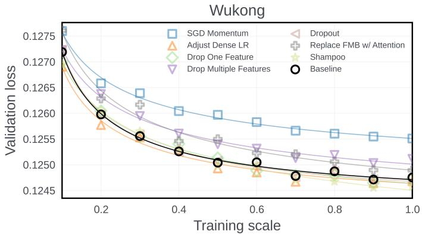

Xiaoqiang Luo Meta xql@meta.com

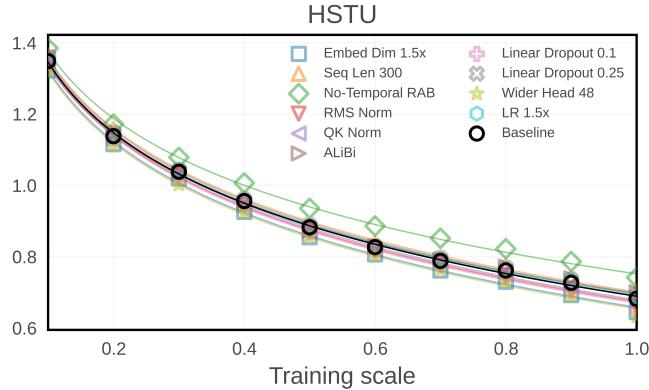  
Figure 1: Feature-invariant scaling laws for Wukong [32] and HSTU [31] over a wide variety of model, data, and optimizer features added. Regardless whether a feature improves or regresses the model, the model validation loss changes predictably with training scale.

## Abstract

Researchers and engineers improve recommendation systems by performing A/B experiments with new model architectures, optimization methods, and data features. However, running full-scale experiments (e.g., full-model training with online data) for every feature change is prohibitively computationally intensive, while the result from a single small-scale experiment is often misleading. To address this challenge, we show that modern recommendation models exhibit feature-invariant scaling: the change of a model’s performance follows a predictable scaling-law even when diferent feature changes are applied to the baseline model. We introduce an eficient method that exploits scaling-laws and uses statistical inference to predict (with confidence intervals) the full-scale efect of an A/B experiment in recommendation systems. This enables practi tioners to eficiently filter out neutral or regressive feature changes with only small-scale experimentation. We validate our method on three distinct recommendation model families—Wukong, HSTU, and LLM-based recommendation models—across more than 40 architectural, optimization, and data changes. Our method accurately distinguishes beneficial feature changes from neutral and regressive ones while using only a fraction of the compute required for full-scale evaluation. It also identifies several changes that improve HSTU’s state-of-the-art performance on MovieLens-20M. Our results demonstrate that scaling laws can be practically exploited to make compute-eficient decisions for improving recommendation systems.

## CCS Concepts

• Information systems → Recommender systems;

## Keywords

Recommender Systems, Scaling laws, Model and Data Scaling

## 1 Introduction

Researchers and engineers often develop new feature changes (e.g., architecture changes, new optimization techniques, new data features) to improve the prediction accuracy of a recommendation model, which serves as a major driver for many large-scale online platforms. An important part of this process is to perform A/B experimentation to ensure that a new feature actually improves the model performance. This often requires a large amount of compute resources and time. For example, to know whether an architecture change improves a recommendation model, we need to retrain the full model on the full training data and compare it against the baseline model performance.

A popular approach is to run small-scale experiments (i.e., a small-sized model trained on a subset of the data) to assess the efectiveness of a new feature change before committing to a fullscale run [1, 3, 33]. While these experiments ofer some useful early signals, a single small-scale experiment is often an unreliable predictor of full-scale performance. An illustrative example is shown in Fig. 2, where new item information given to an LLM-based recommendation model degrades performance at a small scale but improves performance at full scale (see Sec. 3 for in-depth analysis). Hence, relying on small-scale results alone can lead us to reject a beneficial feature change (or vice versa).

In this paper, we propose an eficient method that exploits scaling laws to improve the reliability of A/B experimentation in recommendation systems. Our approach exploits an important insight that we introduce in this paper: the change in performance of mod ern recommendation models with increasing data and model scale is governed by predictable scaling laws. More importantly, the functional form of these scaling laws remains consistent across a wide range of feature changes. As such, we can fit a scaling curve to a handful of small-scale experiments to predict the outcome of a full-scale A/B experiment. Specifically, our contributions are:

(1) We show that modern recommendation models enjoy featureinvariant scaling laws, where their performance varies predictably with increasing data and model scales. In addition, the functional form of these scaling curves remains consistent across diferent new features (e.g., architecture changes, new optimization techniques, new data features).

(2) We introduce an eficient method that leverages a series of small-scale experiments and feature-invariant scaling laws to improve the reliability of small-scale experimentation. Our method uses statistical inference to infer the efective ness of a new feature at the full-scale. This allows us to predict the efect of new feature changes without performing intensive full-scale experimentation. We also show that, in general, the cumulative resource use of these small-scale experiments is smaller than that of a full-scale experiment.

(3) We show that feature-invariant scaling laws hold true for diferent classes ofrecommendation models, including Wukong [32], HSTU [31], and GR2 (an LLM-based recommendation model) [17]. Then, we show that our method makes reliable predictions for a large range of new feature changes on these models (in determining if they improve or degrade performance). In this process, we also found several new features that improve the state-of-the-art performance of recommendation models on existing open-source datasets.

## 2 Related Work

Extensive research has been devoted to developing new feature changes for recommendation models (and ML models in general). Examples include architectural changes [20, 31, 32], interaction modeling techniques [26], optimization methods [8, 24, 27], and more. To determine if a new feature change is “good”, a common practice in an industry setting is to add it to the baseline model and retrain the model from scratch with the entire set of (ofline or online) training data. This is also colloquially known as full-scale A/B experimentation [7, 21].

The major drawback of full-scale A/B experimentation is that it is computationally costly, especially when full-scale retraining is required. In addition, it must be repeated for every candidate feature change (which can be in the hundreds in an industrial setting). One naive approach is to make use of small-scale experiments, which aim to build faithful surrogate small-scale models [5, 14] that allow for fast iterations and reject inefective feature changes if they do not show performance improvement at small scale [1, 3, 33]. However, a single small-scale experiment often produces misleading signals (see Sec. 3). As such, one could draw a wrong conclusion about the efectiveness of a new feature change, forgoing potential performance improvement (and revenue) in recommendation systems. Our work aims to circumvent such pitfalls associated with conventional small-scale experimentation.

Scaling laws [12, 15, 32] describe how the performance of recommendation models or LLMs changes with increasing model and training data scale. Most existing literature merely describes the existence of these scaling laws. As far as we know, our paper is the first to show that a recommendation model with a new feature change applied still follows a scaling law with the same functional form but diferent coeficients. In this paper, we refer to this phenomenon as feature-invariant scaling. This property makes scaling laws useful for large-scale A/B experimentation. Because the functional form is known in advance, we can perform a few small-scale experiments and extrapolate the full-scale efect of every candidate feature change, allowing us to filter out inefective changes cheaply.

## 3 A Motivating Case Study

We begin with a case study on an LLM-based recommendation model (Fig. 2). We call the original model the baseline model, and the model with a new feature added the experimental model. In this case study, the new feature change is movie genre information added to the training prompt. We want to know if this feature improves the model after full-scale training. If the performance gain is neutral, we do not want to add the feature, because it increases inference latency. In this particular example, we vary the training scale by changing the amount of training data from MovieLens-20M [9].

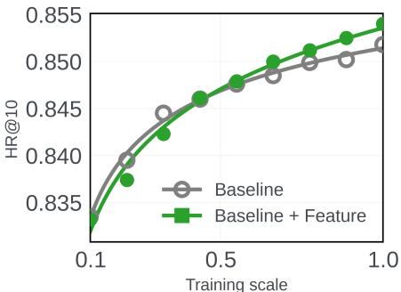  
Figure 2: The improvement of a new feature change on the experimental model (green) over the baseline model (grey) only appears at large training scales.

Misleading signals from small-scale experiments. We first ask ourselves: How informative is a single small-scale experiment? Fig. 2 shows that the HR@10 of the experimental model is lower than that of the baseline model at a small training scale. However, this small-scale result is misleading because genre information actually produces a significant performance improvement at the full training scale. Therefore, relying on the result of a single smallscale experiment here would have led us to mistakenly reject a new feature change that is, in fact, useful for a recommendation model. At first glance, we might be tempted to move the small-scale experiment to the 0.5 scale to produce a more conclusive result than at 0.1 scale. However, we cannot do this in an ex-ante (before-thefact) manner because our experiments (Fig. 5) show that diferent categories of features produce diferent signals across small scales.

Scaling law. Although a single small-scale experiment gives a misleading signal, Fig. 2 shows that the change in model performance across training scales is nonetheless predictable. In this example, a power law ���� $= a N ^ { b } D ^ { c }$ [15, 16] (where � is model size and � is training data size) fits both the baseline and the experimental model with $R ^ { 2 } > 0 . 9 9$ , each with its own fitted coeficients �, $b ,$ and �. This suggests that we can instead run a series of smallscale experiments and extrapolate them to predict the efect of a new feature at full scale. In our paper, we formalize this idea as a statistical inference problem [2]. This approach is easy to interpret and naturally handles training noise that arises in between training runs.

## 4 Feature-invariant scaling

Before we can use scaling laws to predict the performance of an experimental model, we need to make sure that the scaling behavior holds across diferent feature changes. In this section, we show that recommendation models enjoy feature-invariant scaling. We ran a small experiment: we applied three diferent feature changes (adding dropout layer, changing optimizer to SGD, and adding attention layer) to the Wukong recommendation model [32] and observed the scaling law of the three experimental models (See Fig. 3). Our results show that the performance of a recommendation model with diferent features added is governed by the same scaling law function family with diferent fitted coeficients. The scaling law fit generally enjoys high $R ^ { 2 }$ (see Table 1) regardless of whether a feature is detrimental (e.g., using SGD) or beneficial (e.g., adding dropout) to the model. Specifically, this suggests that when we apply diferent features to the baseline model, the change in model performance with training scale should still follow a scaling law in the same functional family. We demonstrate that feature-invariant scaling holds true across a large variety of diferent features and recommendation model families later in Sec. 8.2.

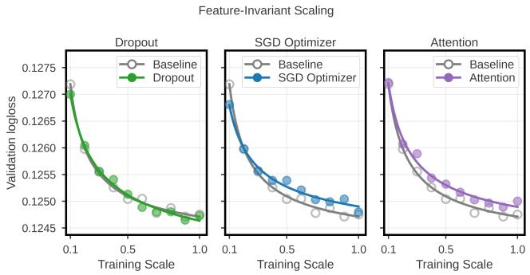  
Figure 3: Feature-invariant scaling: Wukong recommendation model [32] with diferent features added still follows scaling laws (with diferent fitted coeficients).

Table 1: Scaling law fit with power-law: ���� $= A N ^ { B } D ^ { C }$ for the Wukong baseline model with diferent feature changes applied.
<table><tr><td>Method</td><td> $R ^ { 2 }$ </td></tr><tr><td>Baseline</td><td>0.9949</td></tr><tr><td>Dropout</td><td>0.9953</td></tr><tr><td>SGD Optimizer</td><td>0.9923</td></tr><tr><td>Attention</td><td>0.9876</td></tr></table>

## 5 Method

We assume the performance of the baseline full-scale recommendation model is known but retraining the model at full scale for every new feature change is compute intensive. This is a practical assumption in an industrial setting, since performing A/B experimentation with a new feature change requires us to retrain the model with a large amount of data.

## 5.1 Problem formulation

We define $s \in [ 0 , S ]$ as the training scale, where � is the full-scale. In recommendation models, the full-scale represents the largest recommendation model (trained on the largest amount of data) that is used during serving time. Specifically, � represents the number of training FLOPs: $s = N D$ [15], where � is the number of training parameters in the recommendation model and � is the training data size (i.e., number of data points). In general, the exact training FLOPs used could be proportional to $s = N D$ by a constant1. However, this constant does not influence the rest of our formulation because it will be absorbed as learnable coeficients (see next section). When scaling the number of model parameters �, we keep the model’s aspect ratio roughly similar by uniformly scaling the model across sparse feature embedding dimensions, intermediate layer dimensions, and number of model layers. In general, doing so improves training stability and is widely adopted in existing scaling law literature [4, 32].

Similar to Sec. 3, we define the baseline model as a recommendation model without any added features and the experimental model as the baseline model with a new feature added. More formally, let $L _ { \mathrm { f e a t u r e } } ( S )$ denote the unknown validation loss of the experimental model at full-scale � and $\boldsymbol { L } _ { \mathrm { b a s e l i n e } }$ denote the known validation loss of the baseline model at full-scale (assumed to be a fixed constant that we want to improve on). For any new feature, we train the experimental model at a collection of smaller training scales

$$
S = \{ s _ { 1 } , \ldots , s _ { n } \} , \qquad 0 < s _ { 1 } < \cdot \cdot \cdot < s _ { n } < S ,\tag{1}
$$

and observe the experimental model validation losses $\{ y _ { 1 } , \ldots , y _ { n } \}$ at these small-scales. From here on, we denote these small-scale observations as $\mathcal { D } = \{ ( s _ { i } , y _ { i } ) \} _ { i = 1 } ^ { n }$ . Each training scale �� corresponds to a particular model scale $N _ { i }$ and data scale $D _ { i }$

Although we formulate our problem using validation loss, for which smaller values are preferred, the same problem setting can be extended to metrics such as AUC or HR@10, as shown in our experiments later.

## 5.2 Scaling law with noisy observations

Assumption. We first make an assumption to describe how the feature validation loss changes with respect to scale. Consistent with observations from previous sections (Fig. 3) and prior work [12, 15], we assume the validation loss of a recommendation model at training scale � follows a power-law in both model size � and training data size �:

$$
L _ { \mathrm { f e a t u r e } } ( s ) = \theta _ { 1 } N ^ { \theta _ { 2 } } D ^ { \theta _ { 3 } } ,\tag{2}
$$

where $\theta _ { 1 } , \theta _ { 2 } , \theta _ { 3 }$ are learnable power-law coeficients. Taking the logarithm of both sides yields a linear model:

$$
\log L _ { \mathrm { f e a t u r e } } ( s ) = \log \theta _ { 1 } + \theta _ { 2 } \log N + \theta _ { 3 } \log D .\tag{3}
$$

We assume every small-scale observation $y _ { i } ,$ , obtained at model size $N _ { i }$ and data size $D _ { i } ,$ is corrupted by a small amount of Gaussian noise $\epsilon _ { i } ,$ which arises from model training:

$$
y _ { i } = \log L _ { \mathrm { f e a t u r e } } ( s _ { i } ) + \epsilon _ { i } , \qquad \epsilon _ { i } \stackrel { \mathrm { i . i . d . } } { \sim } N ( 0 , \sigma ^ { 2 } ) .\tag{4}
$$

In general, we observe that the training noise is relatively stationary as we vary the model size. This is because if the models are scaled appropriately with correct normalization and regularization during training, the training variance remains relatively constant. Therefore, our observation of the scaling law can be expressed as a linear regression model:

$$
\mathbf { y } = \mathbf { X } \theta + \epsilon ,\tag{5}
$$

where

$$
\theta = \left[ { \begin{array} { c } { \log \theta _ { 1 } } \\ { \theta _ { 2 } } \\ { \theta _ { 3 } } \end{array} } \right] , \qquad \mathbf { X } = \left[ { \begin{array} { c c c c } { 1 } & { \log N _ { 1 } } & { \log D _ { 1 } } \\ { \vdots } & { \vdots } & { \vdots } \\ { 1 } & { \log N _ { n } } & { \log D _ { n } } \end{array} } \right] , \qquad \mathbf { y } = \left[ { \begin{array} { c } { y _ { 1 } } \\ { \vdots } \\ { y _ { n } } \end{array} } \right]\tag{6}
$$

The parameters $\theta$ and � can be estimated from the small-scale observations in closed form [6]:

$$
{ \widehat { \pmb { \theta } } } = \left[ \begin{array} { c } { \widehat { \log \theta } _ { 1 } } \\ { \widehat { \theta _ { 2 } } } \\ { \widehat { \theta _ { 3 } } } \end{array} \right] = ( \mathbf { X } ^ { \top } \mathbf { X } ) ^ { - 1 } \mathbf { X } ^ { \top } \mathbf { y } , \qquad { \widehat { \pmb { \sigma } } } = \sqrt { \frac { ( \mathbf { y } - \mathbf { X } \widehat { \pmb { \theta } } ) ^ { \top } ( \mathbf { y } - \mathbf { X } \widehat { \pmb { \theta } } ) } { n - 3 } } .\tag{7}
$$

Note that we use the term $n - 3$ because we have 3 unknown parameters in Eq. 2. If we had only scaled model or data size alone, then the denominator becomes $n - 2 .$

## 5.3 Statistical inference

Under our model, let log $\hat { L } _ { \mathrm { f e a t u r e } } ( S _ { * } )$ be our prediction of the experimental model’s log validation loss at full scale, i.e., at model size $N _ { * }$ and data size $D _ { * }$ , conditioned on small-scale observations. The posterior distribution of log $\hat { L } _ { \mathrm { f e a t u r e } } ( S _ { * } )$ , conditioned on the small-scale observations D, follows a Student-� distribution [6]:

$$
\log \hat { L } _ { \mathrm { f e a t u r e } } ( S _ { * } ) \mid \mathcal { D } \sim t _ { n - 3 } \left( \mathbf { x } _ { * } ^ { \top } \widehat { \theta } , \widehat { \sigma } \sqrt { \mathbf { x } _ { * } ^ { \top } ( \mathbf { X } ^ { \top } \mathbf { X } ) ^ { - 1 } \mathbf { x } _ { * } } \right) , \qquad \mathbf { x } _ { * } = \left[ \log N _ { * } \right] .\tag{8}
$$

Note that without any prior knowledge of parameters, the formulation above is consistent for both the Bayesian [6] and Frequentist [18] framework and in both cases the prediction interval of the full scale experimental performance is the same (our overall method does not change significantly in either the Bayesian or Frequentist framework). Since the baseline model loss at full scale �baseline is a constant that we want to outperform, the probability

$$
\mathrm { P r } \Big ( \log \hat { L } _ { \mathrm { f e a t u r e } } ( S _ { * } ) < \log L _ { \mathrm { b a s e l i n e } } \mid \mathcal { D } \Big )\tag{9}
$$

represents the probability (conditioned on the small-scale observations) that the experimental model will achieve a lower validation loss than the baseline model at full scale.

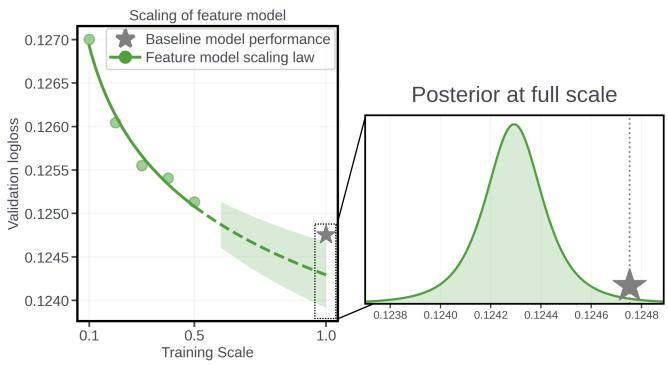  
Figure 4: The fitted scaling law (left) produces the probability distribution of the experimental model performance at full scale $S _ { * } = \left( N _ { * } , D _ { * } \right)$ (right), allowing us to predict the probability of improvement of a new feature over the baseline model.

An example of the distribution of the performance of an experimental model at full scale is shown in Fig. 4, indicated by the histogram on the right. Theoretically, our plot is three dimensional because we have two scaling factors (model and data size). However, we map them into a single training scale to visualize the scaling curve in one dimension. In this example, the baseline model performance at full scale is the gray star and there is a high probability of the experimental model outperforming the baseline model at full scale.

## 6 Resource savings from small-scale experiments

A natural question is whether a sequence of small-scale experiments is actually less resource-intensive than a single full-scale training run. If we co-scale both training and model scale, a halfscale run uses approximately one quarter of the cost of a fullscale run. Consequently, a sweep of small-scale experiments at $s \in \{ 0 . 1 , 0 . 2 , 0 . 3 , 0 . 4 , 0 . 5 \}$ incurs about 55% of the resource needed to run a single full-scale training run.

In addition, co-scaling data and model size ofers another practical and important benefit. In many industrial settings, experimentation is often GPU-bound. That is, the compute available for experimentation may simply be insuficient to hold the full-scale model in memory. In such settings, a full-scale run to validate a new feature change on the full-sized baseline model is simply impossible. In this case, down-scaling model size in small-scale experiments is the only way for us to perform A/B experiments.

## 7 Practical Considerations

Next, we discuss three practical considerations that practitioners and researchers should have when exploiting scaling laws with our method.

Choice of scaling axis. In our formulation, we set $s = N D .$ . The main advantage of jointly reducing the model size � and the amount of training data � is the substantially greater resource savings from smaller experimental models. The theoretical formulation of our method does not change if we choose to only adjust one scaling axis. For instance, if we fix the model scale � and only vary training data scale �, the fixed model scale � can be factored out in Eq. 2 as a constant. In our paper, we also vary the model size by scaling the number of layers, width, and size of embedding tables fairly uniformly (see Sec. 8.1 for more details). We believe that our formulation and method will still work in specialized settings such as scaling of sparse activation in Mixture-of-Experts [22].

Decision rule. Our method (Sec. 5) estimates the posterior prob ability that an experimental model outperforms the baseline model at full-scale. However, in industrial applications, a marginal improvement2 might not justify the deployment of a new feature, especially if it introduces additional computation, storage, and engineering complexity. It is therefore more practically useful to determine whether the feature provides an improvement larger than a meaningful threshold (e.g., 1% better than the baseline) at full-scale. For instance, we can replace the original comparison in Eq. 9 with

$$
\mathrm { P r } \Big ( \hat { L } _ { \mathrm { f e a t u r e } } ( S ) < ( 1 - \delta ) L _ { \mathrm { b a s e l i n e } } \mid \mathcal { D } \Big )\tag{10}
$$

to predict if a new feature reduces the validation loss of the baseline model by more than � percentage points at full-scale. A Bayesian decision rule could be that if this probability exceeds 90%, then we consider the feature efective for the baseline model (and we can proceed with higher-fidelity validation). In industrial settings, a 0.1% reduction in loss typically leads to more than 0.5% increase in topline metrics across billions of users [31].

Alternative functional forms. Although power laws provide an empirically efective scaling law function in many settings, some work has identified scaling relationships that are better described by other functional forms [19]. Our paper’s general approach does not necessarily require scaling laws to follow power-laws. The key diference is that for nonlinear scaling laws, the posterior distribu tion of the parameters and the full-scale performance may no longer be available in closed form. In such cases, it can be approximated using standard Bayesian inference techniques, such as MCMC [23]. We provide the specific mathematical formulation for the nonlinear scaling law in App. A.

## 8 Experiments

In this section, we perform extensive experiments on three families ofrecommendation models—Wukong [32], HSTU [31], and an LLMbased recommendation model [17, 34]. Our results are divided into three sections.

(1) We demonstrate that all three families of recommendation models exhibit feature-invariant scaling laws.

(2) We demonstrate the efectiveness of our method in predicting whether a new feature will improve model performance from a series of small-scale experiments. In particular, we show that we can predict accurately and with high confidence the efectiveness of a new feature at a fraction of a full training run.

(3) We present several interesting ablations and case studies, including the prevalence of the “crossover” efect.

## 8.1 Experimental Setup

Wukong. Our recommendation task is to make click-through-rate prediction for the Criteo dataset. At full-scale, the training data contains ∼ 4.2B data points (23 days of data) and the model is evaluated on the last day of data, containing ∼ 178M data points. We use a Wukong model with the following configuration: the number of Linear Compress Block (LCB) embeddings $n _ { L } ~ = ~ 1 6 ,$ number of Factorization-Machine Block (FMB) embeddings $n _ { F } =$ 16, number of compressed embeddings $k = 2 0$ , an MLP size of 2 × 1024, number of Wukong layers $l = 5 .$ . We vary the training scale � ∈ [0.1, 1.0] by uniformly sampling the training data and adjusting the model embedding dimension �, scaled from 8 at �=0.1 to 64 at �=1.0. Changing � uniformly adjusts the sparse embedding table width, the dense-feature projection dimension, and the FMB and LCB output projection dimensions.

HSTU. Our task is to predict the next movie rated by a user based on their past movie interactions from the MovieLens-20M dataset. We treat the last movie rated by each user in the dataset as the validation dataset. We use the HSTU-large model as described in [31]. We coscale three architectural dimensions — the item-embedding (hidden) dimension �, the number of transformer blocks �, and the number of attention heads $H . \mathrm { A t } s = 1 . 0 ,$ the model reaches the HSTU-large configuration (�=256, �=16, �=8). At � = 0.1, the model shrinks to (�=26, �=2, �=1).

LLM-based recommendation system. We fine-tune Llama-3.1- Instruct [25] from its pre-trained checkpoint to predict the next movie a user will rate based on their historical interaction with other movies. In this setting, we choose to fix the model size and only vary the training data tokens. We give more details and examples on the training data format in Fig. 8.

Training setup. Similar to the original paper, we trained Wukong for 1 epoch on 8 A100 GPUs with a per-GPU batch-size of 8196, using a row-wise Adagrad optimizer for the sparse feature table with learning rate $4 . 0 \times 1 0 ^ { - 2 }$ and an AdamW optimizer with learning rate $3 . 5 \times 1 0 ^ { - 3 }$ . We trained HSTU for 100 epochs with the AdamW optimizer at learning rate $1 \times 1 0 ^ { - 3 }$ . We perform full-parameter fine-tuning of the LLM with 8 A100 GPUs for 1 epoch with a per-GPU batch-size of 2, using AdamW with $\beta = ( 0 . 9 , 0 . 9 9 9 )$ and a learning rate o $5 \times 1 0 ^ { - 6 }$ . Ifsome feature changes increase FLOPs, the experimental model full-scale has the same FLOPs as the baseline. Evaluation metrics. Throughout our experiments, we fit the scaling-law curve to the validation loss of the recommendation models. However, we noticed that the scaling behavior for recommendation models still holds true for other evaluation metrics such as HR@10 (See Sec. 9.2). This strongly suggests that our method’s efectiveness holds true even for other evaluation metrics found throughout recommendation system literature.

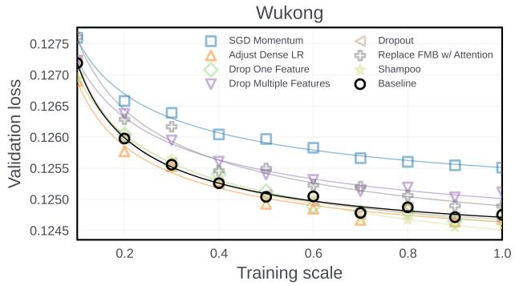

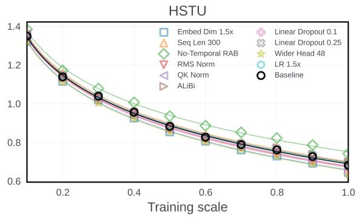  
Figure 5: Feature-invariant scaling laws for Wukong [32] and HSTU [31] over a wide variety of model, data, and optimizer features added. Regardless whether a feature improves or regresses the model, the model validation loss changes predictably with training scale.

## 8.2 Feature-invariant Scaling Laws for Recommendation Models

We consider a broad variety of features spanning optimizer, model, and data changes applied to recommendation models. We have more than 40 features in total. However, due to space constraints, we only present a subset of features in our main paper. The complete description and results for all features can be found in App. B and App. C.

We first demonstrate that recommendation models enjoy featureinvariant scaling across model families and diferent categories of features. We co-scale the training data and model size for the baseline model with a variety of features added to it and observe how the model validation loss changes with training scale. Fig. 5 shows that even though a new feature could improve or regress the overall performance of a recommendation model, the model performance can still be captured by a power law with varying coeficients. In fact, we observe that every scaling curve can be fitted with a power-law to an extremely high $R ^ { 2 }$ value (See Table 2). This suggests that recommendation models do indeed enjoy featureinvariant scaling.

## 8.3 Exploiting scaling to predict efectiveness of a new feature

In this section, we present the main results associated with our method which exploits feature-invariant scaling laws (Sec. 5) to predict if a feature is useful for a baseline recommendation model. Using our method, we were able to evaluate more than 40 new data and model changes and uncover a few that improve upon HSTU’s state-of-the-art performance on the MovieLens-20M dataset. We construct the following setup: for each new feature, we train and observe the model validation loss at scaling intervals � ∈ {0.1,0.2,0.3,0.4, 0.5}. Then, we fit these short-horizon performance observations to a scaling law (whose functional form follows a power-law). We then use the scaling law to predict the experimental model’s performance at the full � = 1.0 scale with an uncertainty interval from Eq. 8.

Visualizing uncertainty of full-scale predictions. We show our method’s prediction of full-scale model performance from the efect of adding dropout [11] to the MLP layers in Wukong and HSTU. Due to space constraints, the prediction plots for other features can be found in Fig. 13 in the appendix. Fig. 7 visually shows that, conditioned on small-scale observations, the uncertainty of our prediction (represented by the confidence intervals) of the performance of the full-scale experimental model decreases with more small-scale experiments. This uncertainty is computed in closed-form according to Eq. 8.

Table 2: Scaling law (power-law) fit of diferent new feature changes applied to diferent model families.
<table><tr><td>Wukong</td><td> $R ^ { 2 }$ </td></tr><tr><td>Baseline</td><td>0.9949</td></tr><tr><td>SGD Momentum</td><td>0.9923</td></tr><tr><td>Adjust Dense LR</td><td>0.9803</td></tr><tr><td>Drop One Feature</td><td>0.9927</td></tr><tr><td>Drop Multiple Features</td><td>0.9920</td></tr><tr><td>Dropout</td><td>0.9957</td></tr><tr><td>Attention</td><td>0.9807</td></tr><tr><td>Shampoo</td><td>0.9934</td></tr><tr><td colspan="2"></td></tr><tr><td>LLM (Llama-3.1-8B)</td><td> $R ^ { 2 }$ </td></tr><tr><td>Baseline</td><td>0.9977</td></tr><tr><td>Genre Information</td><td>0.9970</td></tr><tr><td>No Rating</td><td>0.9981</td></tr><tr><td>Dropout</td><td>0.9939</td></tr><tr><td>Extra Layer</td><td>0.9743</td></tr></table>

<table><tr><td>HSTU</td><td> $R ^ { 2 }$ </td></tr><tr><td>Baseline</td><td>0.9989</td></tr><tr><td>Embed Dim 1.5x</td><td>0.9988</td></tr><tr><td>Seq Len 300</td><td>0.9989</td></tr><tr><td>No-Temporal RAB</td><td>0.9981</td></tr><tr><td>RMS Norm</td><td>0.9988</td></tr><tr><td>QK Norm</td><td>0.9984</td></tr><tr><td>ALiBi</td><td>0.9972</td></tr><tr><td>Linear Dropout 0.1</td><td>0.9984</td></tr><tr><td>Linear Dropout 0.25</td><td>0.9988</td></tr><tr><td>Wider Head 48</td><td>0.9982</td></tr><tr><td></td><td></td></tr><tr><td>LR 1.5x</td><td>0.9987</td></tr></table>

Prediction results. Next, we present results showing that our method makes the correct judgment of the efectiveness of new features. We consider a feature beneficial if it reduces the validation loss of the baseline model by more than 1% at full scale, i.e., $L _ { \mathrm { f e a t u r e } } ( S ) < 0 . 9 9 L _ { \mathrm { b a s e l i n e } }$ . Our Bayesian decision rule is to consider a new feature beneficial if the probability that the experimental model outperforms the baseline model at full-scale by 1% is more than 90%, i.e., $\operatorname* { P r } ( L _ { \mathrm { f e a t u r e } } ( S ) < 0 . 9 9 L _ { \mathrm { b a s e l i n e } } \mid \mathcal { D } ) > 0 . 9$

Each line plot on the left of Fig. 6 corresponds to the probability of a new feature improving the baseline HSTU (the full list of features can be found in App. B). In general, for features that actually improve the model, their posterior probability of improvement increases to 100% with more small-scale experiments. On the other hand, this probability approaches zero for features that regress the model. This strongly suggests that our method and the Bayesian decision rule are efective in determining, at a small-scale, whether a new feature is efective, without actually performing full-scale experimentation, hence saving computational resources.

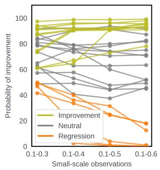

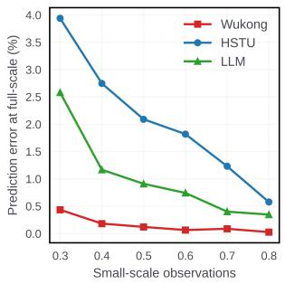  
Figure 6: Left: The posterior probability of a new feature improving the baseline model (using our method) as we increase the number of small-scale observations. Right: The out-of-sample prediction error of our method of the full-scale performance as we increase the number of small-scale observations.

Table 3: Examples of beneficial feature changes applied to HSTU-Large [31] improve over the SOTA performance for MovieLens-20M.
<table><tr><td>Feature</td><td>HR@10</td><td>HR@50</td><td>HR@200</td></tr><tr><td>Baseline [31]</td><td>0.3567</td><td>0.6139</td><td>0.8073</td></tr><tr><td>Time Gap Bias</td><td>0.3603 (+1.01%)</td><td>0.6186 (+0.77%)</td><td>0.8112 (+0.48%)</td></tr><tr><td>Dropout 0.1</td><td>0.3590 (+0.64%)</td><td>0.6183 (+0.72%)</td><td>0.8107 (+0.42%)</td></tr><tr><td>Pop Debias</td><td>0.3585 (+0.50%)</td><td>0.6182 (+0.70%)</td><td>0.8102 (+0.36%)</td></tr><tr><td>Wider Head 48</td><td>0.3584 (+0.48%)</td><td>0.6176 (+0.60%)</td><td>0.8097 (+0.30%)</td></tr><tr><td>RMS-Norm</td><td>0.3584 (+0.48%)</td><td>0.6175 (+0.59%)</td><td>0.8094 (+0.26%)</td></tr><tr><td>Attn Residue</td><td>0.3581 (+0.39%)</td><td>0.6164 (+0.41%)</td><td>0.8086 (+0.16%)</td></tr></table>

Last but not least, the right of Fig. 6 shows that our method produces a small prediction error for the out-of-sample full-scale experimental model performance based on small-scale experiments. In addition, this prediction error decreases with more small-scale observations.

## 9 LLM-based Recommendation Models

The popularity of LLM-based recommendation models [17, 28, 29] has risen in recent years. In this section, we demonstrate that scaling laws can also be exploited in LLM-based recommendation models to predict the efectiveness of a new feature.

We consider a text-based recommendation setup where an LLM (or agent) receives information related to historical interaction events of a user with past items. The LLM is then prompted to recommend a single item from a large pool of candidate items. We probe the probability logit output of the LLM to compute the top � recommended items, which allows us to compute popular evaluation metrics such as HR@K.

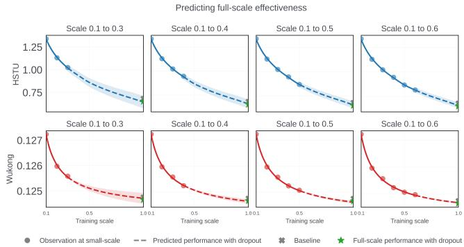  
Figure 7: Increasing the number of small-scale experiments decreases the uncertainty of improvement.

We perform full-parameter finetuning on pretrained LLMs. Before finetuning, we preprocess the MovieLens-20M dataset so that in each data point, the LLM is given a historical context of the movies that the user has previously watched and rated. A list of 100 candidate movies with the correct next-watched movie inserted randomly is given to the LLM and the LLM is prompted to produce the next movie watched. Fig. 8 shows an example of one such preprocessed data point. The numerical score of each recommended movie corresponds to the probability logits produced by the finetuned LLM. Similar to the HSTU case, we treat the last movie watched by all users as a held-out validation set. Because our candidate set in the prompt is a list of 100 movies, we expect the HR@10 for this setup to be higher than that of HSTU (which considers all movies as candidates).

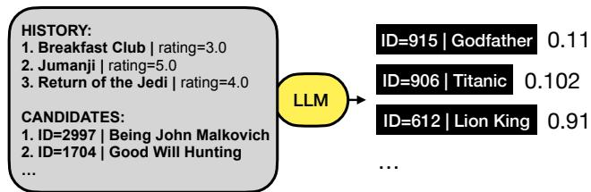  
Figure 8: LLM-based recommendation model used in our experiment, shown with the MovieLens-20M dataset.

## 9.1 Experimental setup

We performed our experiments across two open-source LLM families— Qwen3-Instruct [30] and Llama-3.1-Instruct [25]. Because we finetune the model from pretrained checkpoints, we only adjust the training data scale in our experiments. However, we expect our results to hold true even if we co-scale both data and model sizes for LLMs. We finetune the LLMs with 8 A100 GPUs, with an AdamW optimizer and a peak learning rate of $5 \times { { 1 0 } ^ { - 6 } }$ with a cosine decay schedule and a 3% linear warmup, and global gradient-norm clipping at 1.0. We use a batch size of 8 sequences, a maximum sequence length of 4096 tokens, and train for a single epoch.

## 9.2 Feature-invariant Scaling Laws for LLM-based Recommendation Models

We apply four diferent features during the fine-tuning of Llama-3.1-8B-Instruct. The first two are addition of genre and rating information to each movie in the prompt, while dropout and extra layer are model-specific feature changes to the LLM itself. Detailed descriptions of these features are provided in App. B. As shown in Fig. 9, LLM-based recommendation models also exhibit feature-invariant scaling, just like traditional recommendation models shown earlier. This suggests that our method is equally efective in predicting the efectiveness of new features for LLM-based recommendation systems (as shown in Fig. 6). The �2 values reported in each panel are also consistently close to 1, indicating a strong fit to the scaling-law predictions regardless of which feature is applied to the baseline model. Interestingly, these scaling relationships hold not only for validation loss (top row), but also for downstream performance metrics such as HR@10 (bottom row). These results suggest that scaling laws can even be used to predict other performance metrics (e.g., NDCG [13], Normalized Entropy [10]).

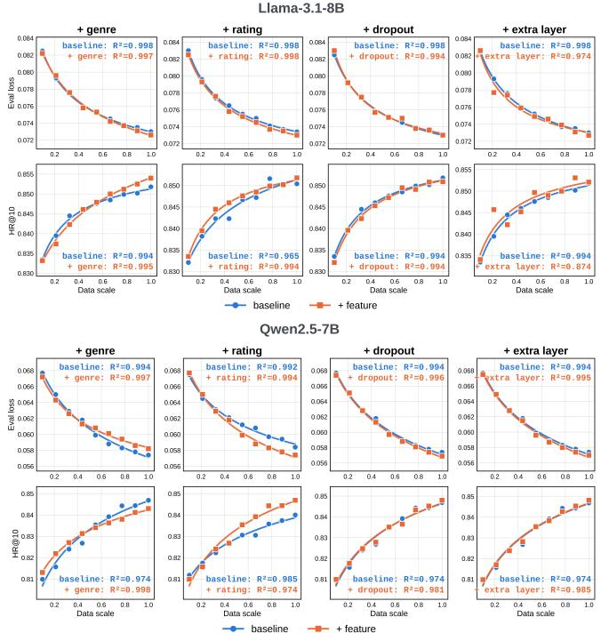  
Figure 9: Feature-invariant scaling laws for Llama-3.1-8B-Instruct (top) and Qwen2.5-7B (bottom).

## 9.3 Ablation for diferent LLMs

We also found that LLMs across diferent model families (Qwen and Llama) and sizes (from 0.5B to 8B) consistently (apart from an edge case, which we discuss in Sec. 10.2) enjoy feature-invariant scaling. For instance, Fig. 9 shows that both Qwen-2.5-7B-Instruct and Llama-3.1-8B-Instruct enjoy feature-invariant scaling laws. In addi tion, the same scaling behavior holds true for LLMs with varying sizes (Fig. 12).

## 10 Interesting case studies

In this section, we present some interesting case studies we found in our experiments. The first case study highlights the prevalence of “crossover” efects during the training of recommendation models. The second case study presents some edge examples that we encountered in which scaling laws fail.

## 10.1 “Crossover points” in scaling curves for LLM-based recommendation models

When applying new features to baseline recommendation models, we often observe “crossover points” in scaling curves. This is shown in the top row of Fig. 10, where the baseline model outperforms (or underperforms) the experimental model at a small-scale but the trend reverses at a larger scale. However, as seen from the bottom row, our method is still efective in predicting the full-scale performance correctly.

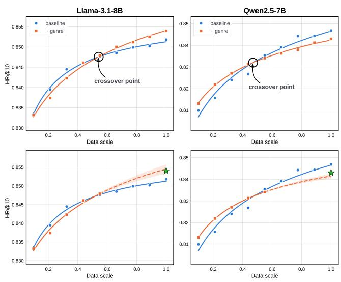  
Figure 10: Crossover points are points on the training scales where the signal from a new feature change flips.

In addition, the top row ofFig. 10 shows that a new feature that is efective for one LLM might not be efective for another LLM family. While adding genre information improves recommendation models powered by Llama, it regresses performance for Qwen. Nonetheless, in both cases, the scaling law still holds true and hence our method can still efectively predict the efectiveness of these features.

## 10.2 Limitation - when do scaling laws fail?

We occasionally observe that the scaling law in some settings does not follow a power-law fit. One extreme example is shown in Fig. 11 below, where the scaling law of Qwen-0.5B does not follow a powerlaw fit after we included movie genre information into the training data (orange curve). In addition, this also regresses the LLM performance significantly as compared to the baseline. We hypothesize that this happens because adding movie genre information increases the context size by around 30%. As a result, a small LLM does not have suficient capacity to capture the added information within context, causing the scaling behavior to break down. In general, we concede that such unusual settings would hinder the application of our method (since we are performing predictions by assuming a power-law function for the scaling curves). However, we do not expect them to appear often.

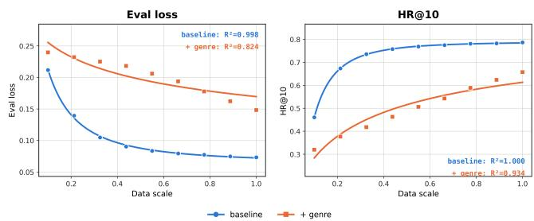  
Figure 11: When genre information is included in the training of Qwen-0.5B, the scaling law (orange curve) no longer follows a power-law fit.

## 11 Conclusion

In this paper, we presented a method that exploits the featureinvariant scaling behavior of recommendation models to more eficiently determine the efectiveness of new feature changes. We show that diferent recommendation model families enjoy featureinvariant scaling laws. Then, we show that our method accurately predicts (with confidence intervals) the efectiveness of new feature changes on recommendation models, revealing numerous feature changes that improve HSTU’s SOTA performance on MovieLens-20M. Our method can be used as an eficient way for practitioners to evaluate large volumes of new recommendation algorithms and features at industry-scale.

## References

[1] Susan Athey, Raj Chetty, Guido W Imbens, and Hyunseung Kang. 2026. The Surrogate Index: Combining Short-Term Proxies to Estimate Long-Term Treat ment Efects More Rapidly and Precisely. The Review of Economic Studies 93, 4 (2026), 2284–2312. arXiv:https://academic.oup.com/restud/article pdf/93/4/2284/64442235/rdaf087.pdf doi:10.1093/restud/rdaf087

[2] Christopher M. Bishop. 2006. Pattern Recognition and Machine Learning. Springer.

[3] Jennifer Brennan, Yahu Cong, Yiwei Yu, Lina Lin, Yajun Peng, Changping Meng, Ningren Han, Jean Pouget-Abadie, and David Holtz. 2024. Reducing Symbiosis Bias Through Better A/B Tests of Recommendation Algorithms. arXiv:2309.07107 [stat.ME] https://arxiv.org/abs/2309.07107

[4] Zhiliang Chen, Sebastian Ament, David Eriksson, Maximilian Balandat, Bryan Kian Hsiang Low, Eytan Bakshy, and Jihao Andreas Lin. 2026. Eficiently Es timating Optimal Hyperparameter Scaling Laws through Power-Law Entropy Search. arXiv:2609.01431 [cs.LG] https://arxiv.org/abs/2609.01431

[5] Zhiliang Chen, Alfred Wei Lun Leong, Shao Yong Ong, Apivich Hemachandra, Gregory Kang Ruey Lau, Chuan-Sheng Foo, Zhengyuan Liu, Nancy F. Chen, and Bryan Kian Hsiang Low. 2026. The Chicken and Egg Dilemma: Co-optimizing Data and Model Configurations for LLMs. arXiv:2602.08351 [cs.LG] https: //arxiv.org/abs/2602.08351

[6] Andrew Gelman, John B Carlin, Hal S Stern, and Donald B Rubin. 1995. Bayesian data analysis. chapman and hall/cRc.

[7] Alexandre Gilotte, Clément Calauzènes, Thomas Nedelec, Alexandre Abraham, and Simon Dollé. 2018. Ofline A/B Testing for Recommender Systems. In Proceedings ofthe Eleventh ACM International Conference on Web Search and Data Mining (WSDM 2018). ACM, 198–206. doi:10.1145/3159652.3159687

[8] Vineet Gupta, Tomer Koren, and Yoram Singer. 2018. Shampoo: Preconditioned Stochastic Tensor Optimization. arXiv:1802.09568 [cs.LG] https://arxiv.org/abs/ 1802.09568

[9] F. Maxwell Harper and Joseph A. Konstan. 2015. The MovieLens Datasets: History and Context. ACM Trans. Interact. Intell. Syst. 5, 4, Article 19 (Dec. 2015),

19 pages. doi:10.1145/2827872

[10] Xinran He, Junfeng Pan, OuJin, Tianbing Xu, Bo Liu, Tao Xu, Yanxin Shi, Antoine Atallah, RalfHerbrich, Stuart Bowers, et al. 2014. Practical lessons from predicting clicks on ads at facebook. In Proceedings of the eighth international workshop on data mining for online advertising. 1–9.

[11] Geofrey E. Hinton, Nitish Srivastava, Alex Krizhevsky, Ilya Sutskever, and Ruslan R. Salakhutdinov. 2012. Improving neural networks by preventing coadaptation of feature detectors. arXiv:1207.0580 [cs.NE] https://arxiv.org/abs/ 1207.0580

[12] Jordan Hofmann, Sebastian Borgeaud, Arthur Mensch, Elena Buchatskaya, Trevor Cai, Eliza Rutherford, Diego de Las Casas, Lisa Anne Hendricks, Jo hannes Welbl, Aidan Clark, Tom Hennigan, Eric Noland, Katie Millican, George van den Driessche, Bogdan Damoc, Aurelia Guy, Simon Osindero, Karen Simonyan, Erich Elsen, Jack W. Rae, Oriol Vinyals, and Laurent Sifre. 2022. Training Compute-Optimal Large Language Models. arXiv:2203.15556 [cs.CL] https://arxiv.org/abs/2203.15556

[13] Kalervo Järvelin and Jaana Kekäläinen. 2017. IR evaluation methods for retrieving highly relevant documents. In Acm sigir forum, Vol. 51. ACM New York, NY, USA, 243–250.

[14] Arlind Kadra, Maciej Janowski, Martin Wistuba, and JosifGrabocka. 2023. Scaling Laws for Hyperparameter Optimization. arXiv:2302.00441 [cs.LG] https://arxiv. org/abs/2302.00441

[15] Jared Kaplan, Sam McCandlish, Tom Henighan, Tom B. Brown, Benjamin Chess, Rewon Child, Scott Gray, Alec Radford, Jefrey Wu, and Dario Amodei. 2020. Scaling Laws for Neural Language Models. arXiv:2001.08361 [cs.LG] https: //arxiv.org/abs/2001.08361

[16] Houyi Li, Wenzhen Zheng, Qiufeng Wang, Hanshan Zhang, Zili Wang, Shijie Xuyang, Yuantao Fan, Zhenyu Ding, Haoying Wang, Ning Ding, Shuigeng Zhou, Xiangyu Zhang, and Daxin Jiang. 2025. Predictable Scale: Part I, Step Law – Optimal Hyperparameter Scaling Law in Large Language Model Pretraining. arXiv:2503.04715 [cs.LG] https://arxiv.org/abs/2503.04715

[17] Mingfu Liang, Yufei Li, Jay Xu, Kavosh Asadi, Xi Liu, Shuo Gu, Kaushik Rangadurai, Frank Shyu, Shuaiwen Wang, Song Yang, Zhijing Li, Jiang Liu, Mengying Sun, Fei Tian, Xiaohan Wei, Chonglin Sun, Jacob Tao, Shike Mei, Wenlin Chen, Santanu Kolay, Sandeep Pandey, Hamed Firooz, and Luke Simon. 2026. GR2: Generative Reasoning Re-ranker. arXiv:2602.07774 [cs.IR] https://arxiv.org/abs/2602.07774

[18] Douglas C Montgomery, Elizabeth A Peck, and G Geofrey Vining. 2022. Introduction to Linear Regression Analysis, 6e Solutions Manual. John Wiley & Sons.

[19] Niklas Muennighof, Alexander M. Rush, Boaz Barak, Teven Le Scao, Aleksandra Piktus, Nouamane Tazi, Sampo Pyysalo, Thomas Wolf, and Colin Rafel. 2025. Scaling Data-Constrained Language Models. arXiv:2305.16264 [cs.CL] https: //arxiv.org/abs/2305.16264

[20] Maxim Naumov, Dheevatsa Mudigere, Hao-Jun Michael Shi, Jianyu Huang, Narayanan Sundaraman, Jongsoo Park, Xiaodong Wang, Udit Gupta, Carole-Jean Wu, Alisson G. Azzolini, Dmytro Dzhulgakov, Andrey Mallevich, Ilia Cherniavskii, Yinghai Lu, Raghuraman Krishnamoorthi, Ansha Yu, Volodymyr Kon dratenko, Stephanie Pereira, Xianjie Chen, Wenlin Chen, Vijay Rao, Bill Jia, Liang Xiong, and Misha Smelyanskiy. 2019. Deep Learning Recommendation Model for Personalization and Recommendation Systems. arXiv:1906.00091 [cs.IR] https://arxiv.org/abs/1906.00091

[21] Federico Quin, Danny Weyns, Matthias Galster, and Camila Costa Silva. 2023. A/B Testing: A Systematic Literature Review. arXiv:2308.04929 [cs.SE] https: //arxiv.org/abs/2308.04929

[22] Noam Shazeer, Azalia Mirhoseini, Krzysztof Maziarz, Andy Davis, Quoc Le, Geofrey Hinton, and Jef Dean. 2017. Outrageously Large Neural Networks: The Sparsely-Gated Mixture-of-Experts Layer. arXiv:1701.06538 [cs.LG] https: //arxiv.org/abs/1701.06538

[23] Joshua S. Speagle. 2020. A Conceptual Introduction to Markov Chain Monte Carlo Methods. arXiv:1909.12313 [stat.OT] https://arxiv.org/abs/1909.12313

[24] Hongyan Tang, Junning Liu, Ming Zhao, and Xudong Gong. 2020. Progressive Layered Extraction (PLE): A Novel Multi-Task Learning (MTL) Model for Personalized Recommendations. In Proceedings of the 14th ACM Conference on Recommender Systems (Virtual Event, Brazil) (RecSys ’20). Association for Computing Machinery, New York, NY, USA, 269–278. doi:10.1145/3383313.3412236

[25] Hugo Touvron, Thibaut Lavril, Gautier Izacard, Xavier Martinet, Marie-Anne Lachaux, Timothée Lacroix, Baptiste Rozière, Naman Goyal, Eric Hambro, Faisal Azhar, Aurelien Rodriguez, Armand Joulin, Edouard Grave, and Guillaume Lample. 2023. LLaMA: Open and Eficient Foundation Language Models. arXiv:2302.13971 [cs.CL] https://arxiv.org/abs/2302.13971

[26] Ruoxi Wang, Rakesh Shivanna, Derek Cheng, Sagar Jain, Dong Lin, Lichan Hong, and Ed Chi. 2021. DCN V2: Improved Deep Cross Network and Practical Lessons for Web-scale Learning to Rank Systems. In Proceedings ofthe Web Conference 2021. ACM.

[27] Xu Xie, Fei Sun, Zhaoyang Liu, Shiwen Wu, Jinyang Gao, Bolin Ding, and Bin Cui. 2021. Contrastive Learning for Sequential Recommendation. arXiv:2010.14395 [cs.IR] https://arxiv.org/abs/2010.14395

[28] Zhouhang Xie, Bo Peng, Zhankui He, Ziqi Chen, Alice Han, Isabella Ye, Benjamin Coleman, Noveen Sachdeva, Fernando Pereira, Julian McAuley, Wang-Cheng Kang, Derek Zhiyuan Cheng, Beidou Wang, and Randolph Brown. 2026. Agentic Tagger: Structured Item Representation for Recommendation with LLM Agents. arXiv:2602.05945 [cs.IR] https://arxiv.org/abs/2602.05945

[29] Ben Xue, Dan Liu, Lixiang Wang, Mingjie Sun, Peng Wang, Pengfei Zhang, Shaoyun Shi, Tianyu Xu, Yunhao Sha, Zhiqiang Liu, Bo Kong, Bo Wang, Hang Yang, Jieting Xue, Junhao Wang, Shengyu Wang, Shuping Hui, Wencai Ye, Xiao Lin, Yongzhi Li, Yuhang Chen, Zhihui Yin, Quan Chen, Shiyang Wen, Wenjin Wu, Han Li, Guorui Zhou, Changcheng Li, Peng Jiang, and Kun Gai. 2026. Generative Recommendation for Large-Scale Advertising. arXiv:2602.22732 [cs.IR] https: //arxiv.org/abs/2602.22732

[30] An Yang, Anfeng Li, Baosong Yang, Beichen Zhang, Binyuan Hui, Bo Zheng, Bowen Yu, Chang Gao, Chengen Huang, Chenxu Lv, Chujie Zheng, Dayiheng Liu, Fan Zhou, Fei Huang, Feng Hu, Hao Ge, Haoran Wei, Huan Lin, Jialong Tang, Jian Yang, Jianhong Tu, Jianwei Zhang, Jianxin Yang, Jiaxi Yang, Jing Zhou, Jingren Zhou, Junyang Lin, Kai Dang, Keqin Bao, Kexin Yang, Le Yu, Lianghao Deng, Mei Li, Mingfeng Xue, Mingze Li, Pei Zhang, Peng Wang, Qin Zhu, Rui Men, Ruize Gao, Shixuan Liu, Shuang Luo, Tianhao Li, Tianyi Tang, Wenbiao Yin, Xingzhang Ren, Xinyu Wang, Xinyu Zhang, Xuancheng Ren, Yang Fan, Yang Su, Yichang Zhang, Yinger Zhang, Yu Wan, Yuqiong Liu, Zekun Wang, Zeyu Cui, Zhenru Zhang, Zhipeng Zhou, and Zihan Qiu. 2025. Qwen3 Technical Report. arXiv:2505.09388 [cs.CL] https://arxiv.org/abs/2505.09388

[31] Jiaqi Zhai, Lucy Liao, Xing Liu, Yueming Wang, Rui Li, Xuan Cao, Leon Gao, Zhaojie Gong, Fangda Gu, Michael He, Yinghai Lu, and Yu Shi. 2024. Actions Speak Louder than Words: Trillion-Parameter Sequential Transducers for Generative Recommendations. arXiv:2402.17152 [cs.LG] https://arxiv.org/abs/2402.17152

[32] Buyun Zhang, Liang Luo, Yuxin Chen, Jade Nie, Xi Liu, Daifeng Guo, Yanli Zhao, Shen Li, Yuchen Hao, Yantao Yao, Guna Lakshminarayanan, Ellie Dingqiao Wen, Jongsoo Park, Maxim Naumov, and Wenlin Chen. 2024. Wukong: Towards a Scaling Law for Large-Scale Recommendation. arXiv:2403.02545 [cs.LG] https: //arxiv.org/abs/2403.02545

[33] Vickie Zhang, Michael Zhao, , Maria Dimakopoulou, Anh Le, and Nathan Kallus. 2024. Evaluating the Surrogate Index as a Decision-Making Tool Using 200 A/B Tests at Netflix. arXiv:2311.11922 [stat.AP] https://arxiv.org/abs/2311.11922

[34] Zihuai Zhao, Wenqi Fan, Jiatong Li, Yunqing Liu, Xiaowei Mei, Yiqi Wang, Zhen Wen, Fei Wang, Xiangyu Zhao, Jiliang Tang, and Qing Li. 2024. Recommender Systems in the Era of Large Language Models (LLMs). IEEE Transactions on Knowledge and Data Engineering 36, 11 (Nov. 2024), 6889–6907. doi:10.1109/tkde. 2024.3392335

## A Extension to nonlinear scaling laws

Power laws describe many scaling relationships well, but other functional forms are sometimes a better fit [19]. Our approach does not depend on the power-law assumption. It extends to any parametric scaling law $L _ { \mathrm { f e a t u r e } } ( s ) = f ( s ; \pmb \theta )$ . As an example, consider the shifted power law

$$
f ( s ; \pmb { \theta } ) = \theta _ { 3 } + \theta _ { 1 } s ^ { - \theta _ { 2 } } ,\tag{11}
$$

where $\theta _ { 3 }$ is an irreducible loss floor. Because of this ofset, taking logarithms no longer gives a linear model, and the posteriors lose their closed forms. We approximate them by sampling instead.

Model. As in Eq. (4), we model the observed log loss as

$$
y _ { i } = \log f ( s _ { i } ; \theta ) + \epsilon _ { i } , \qquad \epsilon _ { i } \stackrel { \mathrm { i . i . d . } } { \sim } N ( 0 , \sigma ^ { 2 } ) .\tag{12}
$$

Since $\theta _ { 1 } , \theta _ { 2 } , \theta _ { 3 }$ , and � are all positive, we run inference on their logarithms and place weakly informative Gaussian priors on them. This is equivalent to log-normal priors on the original parameters. We choose the priors to cover plausible ranges of the loss floor, the scaling exponent, and the training noise. The resulting posterior is

$$
p ( \theta , \sigma \mid \mathcal { D } ) \propto p ( \mathcal { D } \mid \theta , \sigma ) p ( \theta , \sigma ) ,\tag{13}
$$

where the likelihood is the Gaussian implied by Eq. (12).

Posterior sampling. We draw � samples $\{ ( { \pmb \theta } ^ { ( m ) } , \sigma ^ { ( m ) } ) \} _ { m = } ^ { M }$ from Eq. (13) using the No-U-Turn Sampler, an adaptive Hamiltonian Monte Carlo method that copes well with the strong correlations among the shifted-power-law parameters. We run several chains and check convergence using ${ \widehat { R } } ,$ efective sample size, and the number of divergent transitions.

Full-scale prediction and decision. We evaluate the scaling law at the full scale � for each draw:

$$
z _ { S } ^ { ( m ) } = \log f \Bigl ( S ; \theta ^ { ( m ) } \Bigr ) , \qquad m = 1 , \dots , M .\tag{14}
$$

These are samples from $p ( \log L _ { \mathrm { f e a t u r e } } ( S ) \mid \mathcal { D } )$ , so any posterior summary can be computed from them directly. To predict a single noisy full-scale run rather than the expected loss, add ${ \cal N } ( 0 , ( \sigma ^ { ( m ) } ) ^ { 2 } )$ noise to each draw. The posterior probability of beating the baseline is estimated as

$$
\widehat { p } _ { \mathrm { i m p r o v e } } = \frac { 1 } { M } \sum _ { m = 1 } ^ { M } \mathbf { 1 } \bigg [ z _ { S } ^ { ( m ) } < \log L _ { \mathrm { b a s e l i n e } } \bigg ] \ .\tag{15}
$$

To require a minimum practical improvement �, replace the threshold with log $( 1 - \delta ) L _ { \mathrm { b a s e l i n e } } )$

## B Experiment Details: All Features

This section summarizes the feature and configuration changes evaluated for HSTU (Table 4), Wukong, and the LLM-based recommendation model (Table 5).

## C Full Results for All Features

Fig. 13 shows the full-scale predictions for every feature, and Table 6 reports the posterior probability of improvement as more smallscale observations are added.

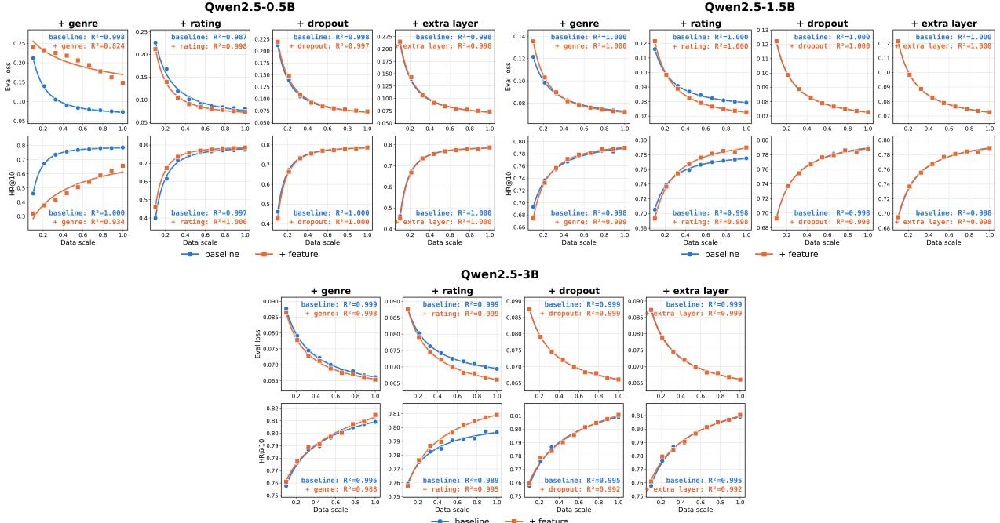  
Figure 12: Feature-invariant scaling laws for LLMs of diferent sizes in the Qwen family.

Table 4: Summary of HSTU feature and configuration changes evaluated against the baseline model.
<table><tr><td>Proposal</td><td>Description</td></tr><tr><td>rating_additive calendar_time item_age genome_content embed_dim_15x extra_block wider_head_42 wider_head_48 softmax</td><td>Adds a learned embedding of the observed rating to each historical item. Adds learned hour-of-day, day-of-week, and calendar-year embeddings. Adds an embedding of the movie&#x27;s age at the time of the interaction. Projects the MovieLens Tag Genome vector into the item representation. Increases the embedding and residual-stream width from 256 to 384. Adds one HSTU block, increasing the full-scale depth from 16 to 17. Increases the per-head Q/K/V dimensions from 32 to 42. Increases the per-head Q/K/V dimensions from 32 to 48.</td></tr></table>

Table 5: Wukong (left) and LLM-based recommendation model, Llama-3.1-8B (right) feature and configuration changes evaluated against the baseline model.  
Wukong
<table><tr><td colspan="2">Wukong</td></tr><tr><td>Proposal</td><td>Description</td></tr><tr><td>sgd_momentum dense_1r_1e-3</td><td>Replaces the optimizer with SGD with momentum. Sets the dense-parameter learning rate to  $1 0 ^ { - 3 } .$ </td></tr><tr><td>shampoo drop_one_feature</td><td>Replaces the optimizer with the Shampoo second- order optimizer. Removes a single sparse input feature.</td></tr><tr><td>drop_multiple_features</td><td>Removes several sparse input features.</td></tr><tr><td>dropout_0p1</td><td>Adds dropout with probability 0.1.</td></tr><tr><td>attn_replaces  $_ - \mathrm { \Delta } f _ { \mathrm { { m b } } }$ </td><td>Replaces the Factorization-Machine Block with an attention module.</td></tr></table>

LLM (Llama-3.1-8B)
<table><tr><td>Proposal</td><td>Description</td></tr><tr><td>genre</td><td>Injects movie genre information into the item represen- tation.</td></tr><tr><td>norating</td><td>Removes the observed user rating signal from the input.</td></tr><tr><td>dropout</td><td>Adds dropout regularization to the model. Adds one additional transformer decoder layer, increas-</td></tr><tr><td>extralayer</td><td>ing depth.</td></tr></table>

Table 6: Probability that a feature’s full-scale validation loss is lower than the baseline model by a percentage margin (HSTU at the 1% margin; Wukong and LLM at 0.05% since their efects are sub-1%). Rows ordered by true full-scale eval-loss change, best to worst.  
HSTU
<table><tr><td colspan="5">HSTU</td></tr><tr><td>Feature</td><td>0.1-0.4</td><td>0.1-0.5</td><td>0.1-0.6</td><td>Full</td></tr><tr><td>Wider Head 48</td><td>98.7%</td><td>98.7%</td><td>99.1%</td><td>-7.3%</td></tr><tr><td>Embed Dim 15X</td><td>91.2%</td><td>91.2%</td><td>93.2%</td><td>-5.4%</td></tr><tr><td>Pop Debias</td><td>90.2%</td><td>90.5%</td><td>90.9%</td><td>-4.8%</td></tr><tr><td>Linear Dropout 01</td><td>90.7%</td><td>91.3%</td><td>93.4%</td><td>-4.5%</td></tr><tr><td>Wider Head 42</td><td>96.1%</td><td>96.0%</td><td>97.9%</td><td>-4.5%</td></tr><tr><td>Rmsnorm</td><td>90.6%</td><td>91.6%</td><td>96.0%</td><td>-3.4%</td></tr><tr><td>Calendar Time</td><td>92.1%</td><td>92.2%</td><td>94.9%</td><td>-2.1%</td></tr><tr><td>Attn Res</td><td>64.6%</td><td>90.8%</td><td>93.3%</td><td>-1.5%</td></tr><tr><td>Extra Block</td><td>67.1%</td><td>72.9%</td><td>78.1%</td><td>-1.3%</td></tr><tr><td>Item Age</td><td>90.7%</td><td>91.6%</td><td>92.7%</td><td>-1.2%</td></tr><tr><td>Qk Norm</td><td>95.3%</td><td>96.0%</td><td>95.4%</td><td>-1.1%</td></tr><tr><td>Time Gap Bias</td><td>78.8%</td><td>79.9%</td><td>81.5%</td><td>-0.8%</td></tr><tr><td>Rope</td><td>75.4%</td><td>73.9%</td><td>75.0%</td><td>-0.6%</td></tr><tr><td>Rating Additive</td><td>90.2%</td><td>93.5%</td><td>91.7%</td><td>-0.4%</td></tr><tr><td>Sliding Window</td><td>79.0%</td><td>73.9%</td><td>70.5%</td><td>-0.3%</td></tr><tr><td>Genre Decay</td><td>76.0%</td><td>78.2%</td><td>82.6%</td><td>-0.2%</td></tr><tr><td>Head Temp</td><td>73.3%</td><td>70.5%</td><td>71.3%</td><td>-0.2%</td></tr><tr><td>Head Time Decay</td><td>62.8%</td><td>62.8%</td><td>63.3%</td><td>-0.2%</td></tr><tr><td>Swiglu</td><td>40.6%</td><td>37.4%</td><td>45.7%</td><td>+0.2%</td></tr><tr><td>Genome Content</td><td>57.6%</td><td>47.6%</td><td>49.2%</td><td>+0.6%</td></tr><tr><td>Lr 0P1X</td><td>76.0%</td><td>59.9%</td><td>51.8%</td><td>+0.6%</td></tr><tr><td>No Positional Rab</td><td>53.0%</td><td>44.5%</td><td>44.8%</td><td>+0.6%</td></tr><tr><td>Lr1.5X</td><td>49.2%</td><td>44.0%</td><td>51.9%</td><td>+0.8%</td></tr><tr><td>Softmax</td><td>92.2%</td><td>91.2%</td><td>87.1%</td><td>+1.0%</td></tr><tr><td>Linear Dropout 025</td><td>33.5%</td><td>24.4%</td><td>18.0%</td><td>+1.6%</td></tr><tr><td>Emb Dropout</td><td>39.9%</td><td>24.8%</td><td>17.7%</td><td>+2.2%</td></tr><tr><td>Seqlen300</td><td>36.1%</td><td>31.4%</td><td>12.5%</td><td>+3.0%</td></tr><tr><td>Original Rab</td><td>2.4%</td><td>0.5%</td><td>0.1%</td><td>+8.6%</td></tr><tr><td>No Temporal Rab</td><td>4.6%</td><td>1.1%</td><td>0.3%</td><td>+8.7%</td></tr><tr><td>Weight Decay 01</td><td>17.7%</td><td>3.9%</td><td>1.0%</td><td>+16.6%</td></tr></table>

Wukong
<table><tr><td>Feature</td><td>0.1-0.4</td><td>0.1-0.5</td><td>0.1-0.6</td><td>Full</td></tr><tr><td>Shampoo</td><td>100.0%</td><td>100.0%</td><td>100.0%</td><td>-0.12%</td></tr><tr><td>Dropout</td><td>91.4%</td><td>99.9%</td><td>98.9%</td><td>-0.10%</td></tr><tr><td>Adjust Dense LR</td><td>0.1%</td><td>99.3%</td><td>100.0%</td><td>-0.10%</td></tr><tr><td>Drop One Feature</td><td>2.9%</td><td>83.8%</td><td>100.0%</td><td>-0.08%</td></tr><tr><td>Attention</td><td>92.2%</td><td>0.0%</td><td>0.0%</td><td>+0.1%</td></tr><tr><td>Drop Multiple Features</td><td>86.6%</td><td>90.7%</td><td>0.0%</td><td>+0.3%</td></tr><tr><td>SGD Momentum</td><td>0.0%</td><td>0.0%</td><td>0.0%</td><td>+0.6%</td></tr></table>

LLM (Llama-3.1-8B)
<table><tr><td>Feature</td><td>0.1-0.4</td><td>0.1-0.5</td><td>0.1-0.6</td><td>Full</td></tr><tr><td>+ Genre</td><td>12.7%</td><td>60.2%</td><td>91.1%</td><td>-0.5%</td></tr><tr><td>+ Rating</td><td>43.0%</td><td>100.0%</td><td>100.0%</td><td>-0.5%</td></tr><tr><td>Extra Layer</td><td>71.5%</td><td>90.0%</td><td>90.9%</td><td>-0.4%</td></tr><tr><td>Dropout</td><td>0.4%</td><td>0.0%</td><td>9.8%</td><td>+0.0%</td></tr></table>

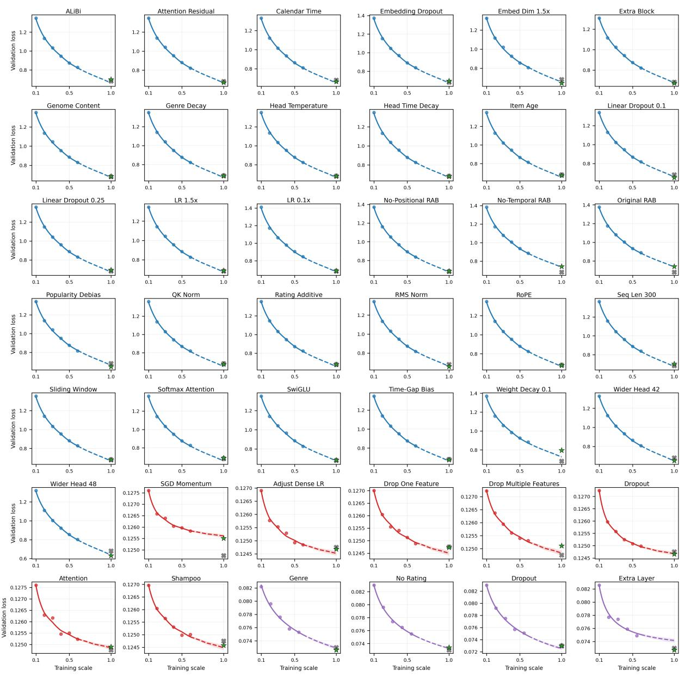  
Figure 13: Prediction of full-scale experimental model performance for all features and models. Blue: HSTU. Red: Wukong. Purple: Llama-3.1-8B-Instruct.