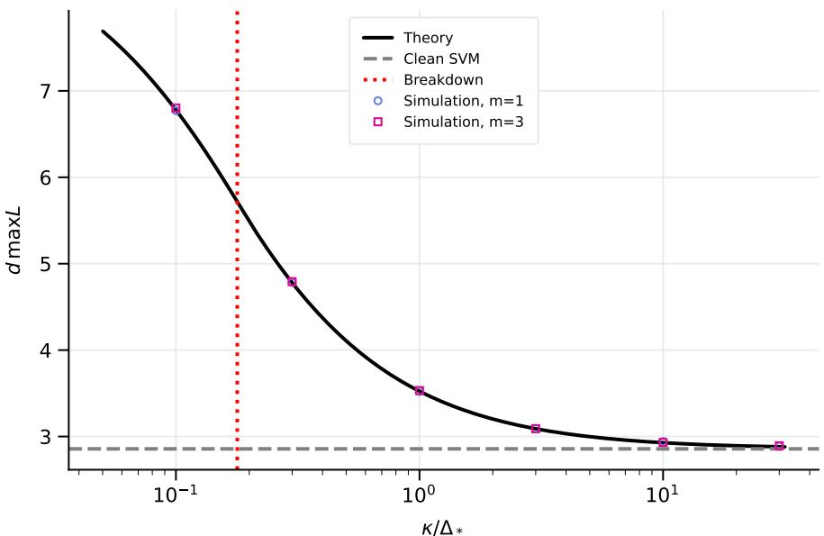
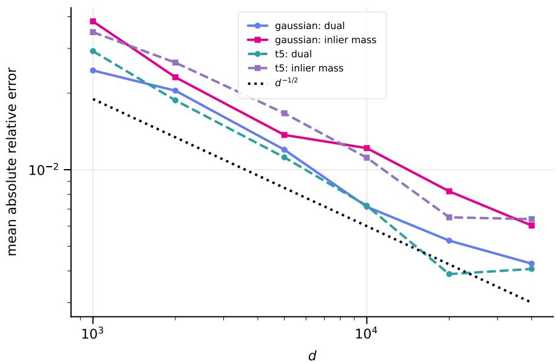
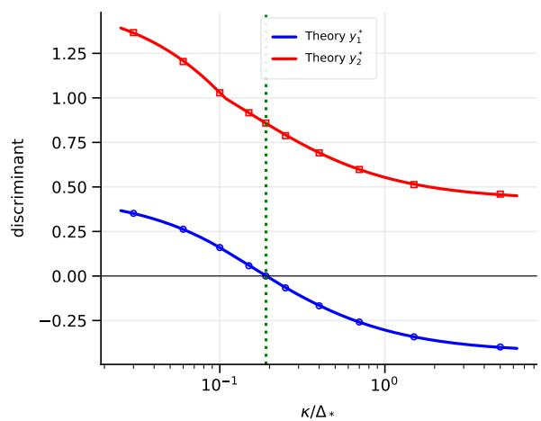
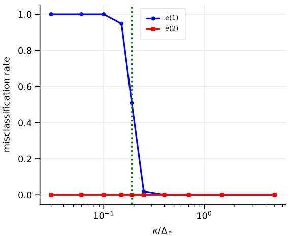
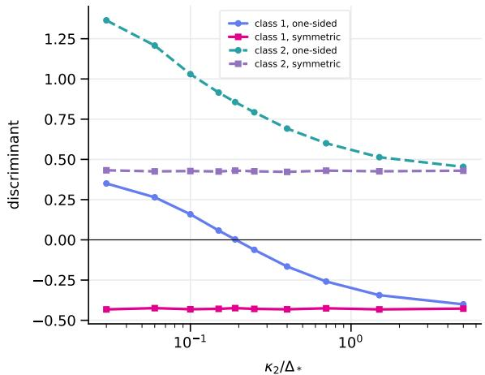
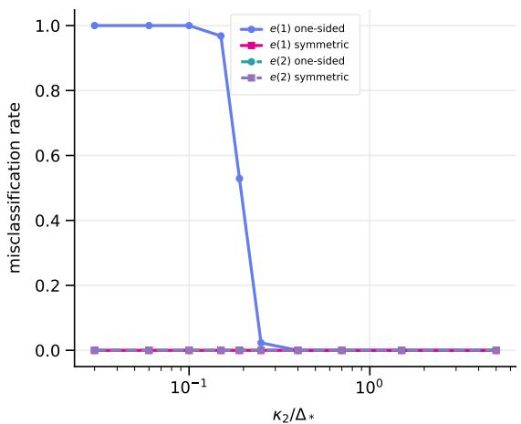
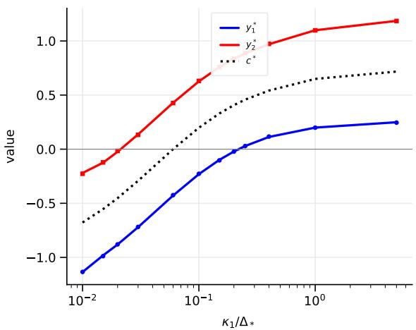
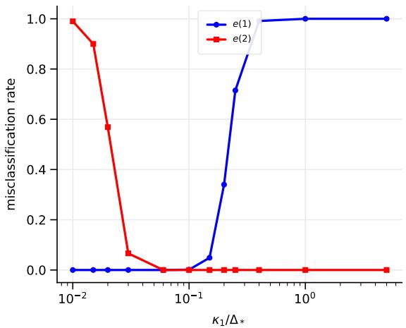
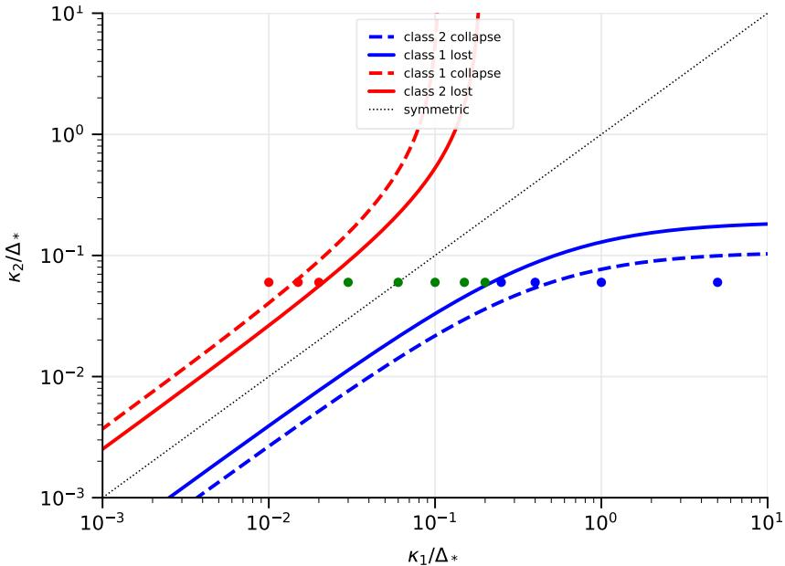

# OUTLIERS AND THE HARD-MARGIN LINEAR SVM IN HIGH-DIMENSION, LOW-SAMPLE-SIZE SETTINGS

YUGO NAKAYAMA

Independent researcher

Abstract. We study how outliers afect the hard-margin linear support vector machine when the dimension grows while the sample sizes remain fixed. For one-sided contamination, the centered Gram matrix converges to a constant inlier block plus an outlier-diagonal component, and the limiting dual problem has a closed-form solution. All outliers act through one efective distance. This representation yields explicit thresholds for loss of inlier support, margin shrinkage, intercept displacement, and asymptotic misclassification. We then treat contamination in both classes. The limiting intercept is the multiplier of the class-balance constraint, and the two classes pull it in opposite directions. Consequently, at most one class can collapse or be asymptotically misclassified, whereas symmetric contamination leaves the limiting discriminant function unchanged even though the margin shrinks. Seven numerical experiments verify the dual allocation, phase transitions, and discriminant limits.

Keywords: Breakdown; discriminant function; geometric representation; HDLSS; outlier;   
support vector machine.

## 1. Introduction

Genetic microarrays, medical imaging, and robotics routinely produce high-dimension, lowsample-size (HDLSS) data, in which the dimension far exceeds the sample size. Hall et al. (2005) showed that such data acquire a rigid geometry as the dimension diverges, and Ahn et al. (2007) proved that this representation holds under mild conditions; see also Jung and Marron (2009) and the survey of Aoshima et al. (2018). Two lines of work build on this geometry for classification. One develops linear discriminant rules for many variables (Bickel and Levina, 2004; Fan and Fan, 2008) and distance-based or geometric classifiers (Hall et al., 2008; Chan and Hall, 2009; Aoshima and Yata, 2011, 2014, 2015, 2019). The other studies margin-based methods, including distance-weighted discrimination (Marron et al., 2007; Qiao et al., 2010) and the maximal data-piling direction (Ahn and Marron, 2010).

Within the second line, Nakayama et al. (2017) derived the asymptotic behavior of the hard-margin linear support vector machine (SVM) (Cortes and Vapnik, 1995; Vapnik, 2000). They showed that the SVM is consistent under suitable conditions but can be heavily biased when the classes difer in covariance trace or sample size, and proposed a bias-corrected SVM. Nakayama et al. (2020) extended that analysis to the Gaussian kernel.

These results assume that every training point comes from one of the two populations. Real training data can contain mislabeled samples or measurements taken under abnormal conditions (Fr´enay and Verleysen, 2014). Robust statistics has a long history (Huber, 1964; Hampel et al., 1986; Rousseeuw and Leroy, 1987), and SVM robustness has been studied through influence functions (Christmann and Steinwart, 2004; Steinwart and Christmann, 2008), robust losses (Wu and Liu, 2007), robust optimization (Xu et al., 2009), and poisoning attacks (Biggio et al., 2012). Those analyses either fix the dimension or use conditions that do not reflect HDLSS geometry.

Suppose one class contains a point whose mean $\pmb { \mu } _ { 0 }$ lies far from its nominal mean $\pmb { \mu } _ { 2 }$ . Can the SVM learn the contrast $\pmb { \mu } _ { 2 } - \pmb { \mu } _ { 0 }$ instead of the population contrast $\pmb { \mu } _ { 1 } - \pmb { \mu } _ { 2 } ?$ Because the hard-margin SVM depends only on support vectors, a single outlier may change the classifier completely. A second question is what happens when both classes are contaminated.

Our contributions are as follows.

• We derive the limit of the centered Gram matrix in the presence of outliers (Lemma 3.2).

• For one-sided contamination, we solve the limiting dual problem in closed form and show that the outliers enter only through one efective distance (Lemma 4.2 and Theorem 5.1).

• We identify a sharp threshold below which the contaminated class loses all inlier support and obtain the corresponding critical number of outliers (Corollary 5.3).

• We prove convergence of the actual dual value, dual allocation, intercept, and discriminant function, and derive limiting misclassification rates (Theorems 5.5–6.3 and Corollary 6.4).

• For two-sided contamination, we solve the KKT system, identify its multiplier with the limiting intercept, and show that at most one class can fail. Symmetric contamination cancels the intercept shift (Theorem 7.2 and Corollaries 7.3–7.6).

• Seven simulation studies check the finite-dimensional agreement with these limits (Section 8).

All algebraic steps use only linear algebra, probability, and convex optimization (Boyd and Vandenberghe, 2004).

## 2. Setup

2.1. Populations and outliers. Let $\Pi _ { 1 }$ and Π be independent d-variate populations. Population $\Pi _ { i }$ has mean $\pmb { \mu } _ { i }$ and covariance matrix $\Sigma _ { i }$ . From $\Pi _ { i }$ we observe independent vectors $\pmb { x } _ { i 1 } , \ldots , \pmb { x } _ { i n _ { i } }$ . Until Section $^ { 7 , }$ the training data labeled as class 2 additionally contain m independent outliers $\pmb { y } _ { 1 } , \ldots , \pmb { y } _ { m }$ , where $\mathbf {  { y } } _ { k }$ has mean $\pmb { \mu } _ { 0 k }$ and covariance $\pmb { \Sigma } _ { 0 k }$ . We hold $n _ { 1 } , n _ { 2 }$ , m fixed and let $d \to \infty$

Let $I _ { 1 } , I _ { 2 } ,$ , and O index the class-1 inliers, class-2 inliers, and outliers. The full training set is $\pmb { x } _ { 1 } , \ldots , \pmb { x } _ { N }$ , where $N = n _ { 1 } + n _ { 2 } + m$ , with labels $t _ { j } = - 1$ for $j \in I _ { 1 }$ and $t _ { j } = + 1$ for $j \in I _ { 2 } \cup O$ Define

$$
\mu = \mu _ { 1 } - \mu _ { 2 } , \quad \Delta = \parallel \mu \parallel ^ { 2 } , \quad \mu _ { * } = \frac { \mu _ { 1 } + \mu _ { 2 } } { 2 } , \quad \tau _ { i } = \frac { \mathrm { t r } ( \Sigma _ { i } ) } { n _ { i } } , \quad \Delta _ { * } = \Delta + \tau _ { 1 } + \tau _ { 2 } .\tag{2.1}
$$

For outlier k, let

$$
\pmb { \nu } _ { k } = \pmb { \mu } _ { 0 k } - \pmb { \mu } _ { * } , \qquad \pmb { D } _ { k } = \| \pmb { \nu } _ { k } \| ^ { 2 } + \mathrm { t r } \big ( \pmb { \Sigma } _ { 0 k } \big ) , \qquad \kappa = \left( \sum _ { k = 1 } ^ { m } \frac { 1 } { D _ { k } } \right) ^ { - 1 } .\tag{2.2}
$$

We call $D _ { k }$ the efective squared distance of outlier k and κ the efective outlier distance. If $D _ { 1 } = \cdot \cdot \cdot = D _ { m } = D$ , then $\kappa = D / m ;$ thus m equidistant outliers act like one outlier that is m times closer.

2.2. Hard-margin linear SVM. The hard-margin linear SVM minimizes $\| \pmb { w } \| ^ { 2 } / 2$ subject to $t _ { j } ( \pmb { w } ^ { \top } \pmb { x } _ { j } + b ) \geq 1$ . Its dual is

$$
\operatorname* { m a x } _ { \alpha } L ( \alpha ) = \sum _ { j = 1 } ^ { N } \alpha _ { j } - \frac { 1 } { 2 } \sum _ { j , k = 1 } ^ { N } \alpha _ { j } \alpha _ { k } t _ { j } t _ { k } x _ { j } ^ { \mathsf { T } } x _ { k } , \quad \alpha _ { j } \ge 0 , \quad \sum _ { j = 1 } ^ { N } \alpha _ { j } t _ { j } = 0 .\tag{2.3}
$$

Writing $\mathbf { \pmb { t } } = ( t _ { 1 } , \dots , t _ { N } ) ^ { \mathsf { T } }$ , let

$$
\mathcal { C } = \{ \alpha \in \mathbb { R } ^ { N } : \alpha \geq 0 , ~ t ^ { \top } \alpha = 0 \} .
$$

If $\widehat { \mathbf { \alpha } } \widehat { \mathbf { \alpha } } \widehat { \mathbf { \alpha } } \mathbf { \alpha }$ maximizes (2.3), then $\begin{array} { r } { \pmb { \widehat { w } } = \sum _ { j } \widehat { \alpha } _ { j } t _ { j } \pmb { x } _ { j } } \end{array}$ and $\widehat { \boldsymbol { y } } ( \mathbf { x } ) = \widehat { \mathbf { w } } ^ { \mathsf { T } } \mathbf { x } + \widehat { \boldsymbol { b } } .$ . The KKT conditions give $t _ { j } \widehat { y } ( { \pmb x } _ { j } ) = 1$ whenever $\widehat { \alpha } _ { j } > 0$

2.3. Assumptions. Let $\varepsilon _ { j } = { \pmb x } _ { j } - \mu _ { i }$ for $j \in I _ { i }$ and $\pmb { \eta } _ { k } = \pmb { y } _ { k } - \pmb { \mu } _ { 0 k }$ . As d $\stackrel { \prime } { , }  \infty$ , assume: (A1): For $i , l \in \{ 1 , 2 \}$

$$
\frac { \mathrm { t r } ( \Sigma _ { i } \Sigma _ { l } ) } { \Delta _ { * } ^ { 2 } } \to 0 , \qquad \frac { \mu ^ { \top } \Sigma _ { i } \mu } { \Delta _ { * } ^ { 2 } } \to 0 , \qquad \frac { \mathrm { V a r } ( \| \varepsilon \| ^ { 2 } ) } { \Delta _ { * } ^ { 2 } } \to 0 \quad ( \varepsilon \sim ( 0 , \Sigma _ { i } ) ) .
$$

(A2): For $k \neq l$ and $i = 1 , 2$ ,

$$
\frac { | \mu ^ { \mathsf { T } } \nu _ { k } | + | \nu _ { k } ^ { \mathsf { T } } \nu _ { l } | } { \Delta _ { * } } \to 0 ,
$$

$$
\begin{array} { r l } & { \frac { \mu ^ { \top } \Sigma _ { 0 k } \mu + \nu _ { k } ^ { \top } \Sigma _ { i } \nu _ { k } + \mathrm { t r } ( \Sigma _ { i } \Sigma _ { 0 k } ) + \nu _ { k } ^ { \top } \Sigma _ { 0 l } \nu _ { k } + \mathrm { t r } ( \Sigma _ { 0 k } \Sigma _ { 0 l } ) } { \Delta _ { * } ^ { 2 } }  0 , } \\ & { \quad \quad \quad \quad \quad \frac { \nu _ { k } ^ { \top } \Sigma _ { 0 k } \nu _ { k } + \mathrm { V a r } ( \| \eta _ { k } \| ^ { 2 } ) } { D _ { k } ^ { 2 } }  0 . } \end{array}
$$

(A3): lim $\mathrm { s u p } _ { d \to \infty } \tau _ { 2 } / ( \Delta + \tau _ { 1 } ) < \infty$

Condition (A1) is standard in HDLSS analysis. For example, it holds for identity covariance and bounded fourth moments. Condition (A2) requires the outlier deviations to be asymptotically orthogonal to the population contrast and to each other, which is typical for unrelated directions in high dimensions. Section 7 introduces (A4).

2.4. Notation guide. Table 1 collects the symbols used repeatedly below.

Table 1. Principal notation.  
Symbol Meaning   
$n _ { i } , \ I _ { i }$ Inlier sample size and index set for class $i .$   
$O , ~ O _ { i } , ~ m _ { i }$ Outlier index set; in Section $7 , O _ { i }$ and $m _ { i } = | O _ { i } |$ refer to class $i .$   
$\Delta , \Delta _ { * }$ Squared mean separation and its noise-adjusted version.   
$\tau _ { i }$ Per-sample covariance trace, $\operatorname { t r } ( \Sigma _ { i } ) / n _ { i } .$   
$D _ { k } , \ \kappa , \ \kappa _ { i }$ Efective squared distance of one outlier; harmonic aggregate for one or for class i.   
$p$ Shorthand $p = \Delta / 4 .$   
$a , b , s$ Total dual mass on class-1 inliers, class-2 inliers, and class-2 outliers.   
$s _ { i }$ Total dual mass on outliers labeled as class $i .$   
$E$ $\Delta ( \tau _ { 1 } + \tau _ { 2 } ) / 4 + \tau _ { 1 } \tau _ { 2 } .$   
$H$ $\kappa _ { 1 } \kappa _ { 2 } \Delta _ { * } + ( \kappa _ { 1 } + \kappa _ { 2 } ) E$ in the two-sided problem.   
$\rho _ { i }$ Parallel efective cost $\{ ( p + \tau _ { i } ) ^ { - 1 } + \kappa _ { i } ^ { - 1 } \} ^ { - 1 }$   
$\beta _ { i } ( x )$ Two-sided collapse boundary $p x / ( x + p + \tau _ { 3 - i } )$   
$( a ^ { \circ } , b ^ { \circ } )$ Unconstrained stationary point of the reduced one-sided objective.   
$( a ^ { \star } , b ^ { \star } )$ Constrained maximizer over $\mathcal { D } = \{ ( a , b ) : a \geq b \geq 0 \}$   
$\tilde { G } , \ R$ Deterministic Gram limit and remainder $G - \widetilde G .$

## 3. Translation invariance and geometric representation

Lemma 3.1 (Translation invariance). For any $\boldsymbol { c } \in \mathbb { R } ^ { d }$ and α satisfying $\pmb { t } ^ { \top } \pmb { \alpha } = 0$ 2

$$
\sum _ { j , k } \alpha _ { j } \alpha _ { k } t _ { j } t _ { k } x _ { j } ^ { \top } x _ { k } = \sum _ { j , k } \alpha _ { j } \alpha _ { k } t _ { j } t _ { k } ( { \pmb x } _ { j } - { \pmb c } ) ^ { \top } ( { \pmb x } _ { k } - { \pmb c } ) .
$$

Proof. Bilinearity gives

$$
\sum _ { j , k } \alpha _ { j } \alpha _ { k } t _ { j } t _ { k } \pmb { x } _ { j } ^ { \top } \pmb { x } _ { k } = \left\| \sum _ { j } \alpha _ { j } t _ { j } \pmb { x } _ { j } \right\| ^ { 2 } .
$$

Moreover,

$$
\sum _ { j } \alpha _ { j } t _ { j } x _ { j } = \sum _ { j } \alpha _ { j } t _ { j } ( x _ { j } - c ) + \left( \sum _ { j } \alpha _ { j } t _ { j } \right) c = \sum _ { j } \alpha _ { j } t _ { j } ( x _ { j } - c ) .
$$

Take ${ \boldsymbol { c } } = { \pmb { \mu } } _ { \ast }$ and define the signed centered Gram matrix $G = \left( G _ { j k } \right)$ by

$$
G _ { j k } = t _ { j } t _ { k } ( { \pmb x } _ { j } - { \pmb \mu } _ { * } ) ^ { \top } ( { \pmb x } _ { k } - { \pmb \mu } _ { * } ) .
$$

Then

(3.1)

$$
L ( \alpha ) = \mathbf { 1 } ^ { \mathsf { T } } { \boldsymbol { \alpha } } - { \frac { 1 } { 2 } } { \boldsymbol { \alpha } } ^ { \mathsf { T } } G { \boldsymbol { \alpha } } , \qquad { \boldsymbol { \alpha } } \in { \mathcal { C } } .
$$

Its deterministic leading term is

$$
\widetilde { G } _ { j k } = \left\{ \begin{array} { l l } { \Delta / 4 + \delta _ { j k } \operatorname { t r } ( \Sigma _ { i } ) , } & { j , k \in I _ { 1 } \cup I _ { 2 } , \ j \in I _ { i } , } \\ { D _ { k } \delta _ { j k } , } & { j , k \in O , } \\ { 0 , } & { \mathrm { o t h e r w i s e } , } \end{array} \right.\tag{3.2}
$$

where $\delta _ { j k }$ is the Kronecker delta.

Lemma 3.2 (Geometric representation with outliers). Assume $( A 1 ) { - } ( A { \mathcal { Q } } )$ , and let $\pmb { R } = \pmb { G } - \widetilde { \pmb { G } }$ Then

$$
\epsilon _ { 1 } : = \operatorname* { m a x } _ { ( j , k ) \notin O \times O } \frac { | R _ { j k } | } { \Delta _ { * } } = o _ { P } ( 1 ) , \qquad \epsilon _ { 2 } : = \operatorname* { m a x } _ { k \in O } \frac { | R _ { k k } | } { D _ { k } } = o _ { P } ( 1 ) .
$$

Proof. Put $\pmb { u } = - \pmb { \mu } / 2$ . For every inlier, $t _ { j } ( { \pmb x } _ { j } - { \pmb \mu } _ { * } ) = { \pmb u } + t _ { j } { \pmb \varepsilon } _ { j }$ , whereas for $k \in O , t _ { k } ( \pmb { y } _ { k } - \pmb { \mu } _ { * } ) =$ $\nu _ { k } + \eta _ { k }$ . Also $\lvert | \boldsymbol { u } \rvert | ^ { 2 } = \Delta / 4$

For distinct inliers $j \in I _ { i }$ and $k \in { \mathit { I } } _ { l }$

$$
\begin{array} { r } { R _ { j k } = t _ { j } { \pmb u } ^ { \mathsf { T } } { \pmb \varepsilon } _ { j } + t _ { k } { \pmb u } ^ { \mathsf { T } } { \pmb \varepsilon } _ { k } + t _ { j } t _ { k } { \pmb \varepsilon } _ { j } ^ { \mathsf { T } } { \pmb \varepsilon } _ { k } . } \end{array}
$$

The three terms have mean zero. Their second moments are controlled by $\pmb { \mu } ^ { \mathsf { T } } \pmb { \Sigma } _ { i } \pmb { \mu } / 4 , \pmb { \mu } ^ { \mathsf { T } } \pmb { \Sigma } _ { l } \pmb { \mu } / 4$ ， and $\operatorname { t r } ( \pmb { \Sigma } _ { i } \pmb { \Sigma } _ { l } )$ ; Chebyshev’s inequality and (A1) therefore give $R _ { j k } / \Delta _ { * } = o _ { P } ( 1 )$ . For an inlier diagonal,

$$
R _ { j j } = 2 t _ { j } { \pmb u } ^ { \mathsf T } { \pmb \varepsilon } _ { j } + \{ \| { \pmb \varepsilon } _ { j } \| ^ { 2 } - \operatorname { t r } ( { \pmb \Sigma } _ { i } ) \} ,
$$

and (A1) gives the same conclusion.

For $j \in I _ { i }$ and $k \in O$

$$
R _ { j k } = G _ { j k } = - \frac { \mu ^ { \mathsf { T } } \nu _ { k } } { 2 } - \frac { \mu ^ { \mathsf { T } } \eta _ { k } } { 2 } + t _ { j } \varepsilon _ { j } ^ { \mathsf { T } } \nu _ { k } + t _ { j } \varepsilon _ { j } ^ { \mathsf { T } } \eta _ { k } .
$$

Assumption (A2) makes the deterministic term negligible relative to $\Delta _ { * }$ and bounds the second moments of the other terms. For $k \neq l$ in O, $R _ { k l } = \pmb { \nu } _ { k } ^ { \top } \pmb { \nu } _ { l } + \pmb { \nu } _ { k } ^ { \top } \pmb { \eta } _ { l } + \pmb { \nu } _ { l } ^ { \top } \pmb { \eta } _ { k } + \pmb { \eta } _ { k } ^ { \top } \pmb { \eta } _ { l }$ , which is again $o _ { P } ( \Delta _ { * } )$ by (A2). Finally,

$$
R _ { k k } = 2 \nu _ { k } ^ { \mathsf { T } } \pmb { \eta } _ { k } + \{ \| \pmb { \eta } _ { k } \| ^ { 2 } - \mathrm { t r } ( \pmb { \Sigma } _ { 0 k } ) \} = o _ { P } ( D _ { k } ) .
$$

Because N is fixed, a union bound over the finitely many entries proves both maxima. □

## 4. The limiting dual problem

Equation (3.1) and Lemma 3.2 motivate

$$
\widetilde { L } ( \alpha ) = \mathbf { 1 } ^ { \top } \alpha - \frac { 1 } { 2 } \alpha ^ { \top } \widetilde { G } \alpha , \qquad \alpha \in \mathcal { C } .\tag{4.1}
$$

For $\alpha \in { \mathcal { C } }$ , define

$$
a = \sum _ { j \in I _ { 1 } } \alpha _ { j } , \qquad b = \sum _ { j \in I _ { 2 } } \alpha _ { j } , \qquad s = \sum _ { k \in O } \alpha _ { k } .
$$

The equality constraint is $- a + b + s = 0 , \mathrm { s o } \ s = a - b$ . Thus $( a , b )$ ranges over $\mathcal { D } = \{ ( a , b ) : a \geq$ $b \geq 0 \}$ and $\mathbf { 1 } ^ { \mathsf { T } } \alpha = 2 a$

## 4.1. A weighted Cauchy–Schwarz inequality.

Lemma 4.1. Let $w _ { 1 } , \ldots , w _ { r } > 0$ . For real $z _ { 1 } , \ldots , z _ { r }$ with $\textstyle \sum _ { j } z _ { j } = S$

$$
\sum _ { j = 1 } ^ { r } w _ { j } z _ { j } ^ { 2 } \geq \frac { S ^ { 2 } } { \sum _ { j } w _ { j } ^ { - 1 } } ,
$$

with equality if and only if $z _ { j } = S w _ { j } ^ { - 1 } / \sum _ { l } w _ { l } ^ { - 1 }$

Proof. Apply Cauchy–Schwarz to $\sqrt { w _ { j } } z _ { j }$ and $1 / \textstyle { \sqrt { w _ { j } } } \colon S ^ { 2 } \leq ( \textstyle { \sum _ { j } } w _ { j } z _ { j } ^ { 2 } ) ( \textstyle { \sum _ { j } } w _ { j } ^ { - 1 } )$ . The equality condition gives the stated allocation. □

4.2. Reduction to two variables. Put $p = \Delta / 4$ and define

$$
Q ( a , b ) = p ( a + b ) ^ { 2 } + \tau _ { 1 } a ^ { 2 } + \tau _ { 2 } b ^ { 2 } + \kappa ( a - b ) ^ { 2 } , \qquad F ( a , b ) = 2 a - \frac { 1 } { 2 } Q ( a , b ) .\tag{4.2}
$$

Lemma 4.2 (Reduction). For every ${ \textbf { \em { \alpha } } } \in { \mathcal { C } }$ with classwise sums $( a , b ) , \alpha ^ { \top } \widetilde { G } \alpha \geq Q ( a , b )$ Moreover,

$$
\operatorname* { m a x } _ { \pmb { \alpha } \in \mathcal { C } } \widetilde { L } ( \pmb { \alpha } ) = \operatorname* { m a x } _ { ( a , b ) \in \mathcal { D } } F ( a , b ) ,
$$

and, for each $( a , b ) \in \mathcal { D }$ , equality is attained by

$$
\alpha _ { j } = \frac { a } { n _ { 1 } } \ ( j \in I _ { 1 } ) , \qquad \alpha _ { j } = \frac { b } { n _ { 2 } } \ ( j \in I _ { 2 } ) , \qquad \alpha _ { k } = ( a - b ) \frac { \kappa } { D _ { k } } \ ( k \in O ) .\tag{4.3}
$$

Proof. The block structure in (3.2) gives

$$
\alpha ^ { \top } \widetilde { G } \alpha = \frac { \Delta } { 4 } \bigg ( \sum _ { j \in I _ { 1 } \cup I _ { 2 } } \alpha _ { j } \bigg ) ^ { 2 } + \mathrm { t r } ( \Sigma _ { 1 } ) \sum _ { j \in I _ { 1 } } \alpha _ { j } ^ { 2 } + \mathrm { t r } ( \Sigma _ { 2 } ) \sum _ { j \in I _ { 2 } } \alpha _ { j } ^ { 2 } + \sum _ { k \in O } D _ { k } \alpha _ { k } ^ { 2 } .
$$

Lemma 4.1 minimizes the three diagonal sums, for fixed $( a , b , s )$ , at the allocation (4.3); the lower bounds are $\tau _ { 1 } a ^ { 2 } , \tau _ { 2 } b ^ { 2 }$ , and $\kappa s ^ { 2 } .$ . Since $s = a - b$ , the result follows. □

Writing $\boldsymbol { z } = ( a , b ) ^ { \intercal }$

$$
Q ( a , b ) = z ^ { \mathsf { T } } M z , \qquad M = \left( { p + { \tau _ { 1 } } + \kappa \underbrace { \quad p - \kappa } _ { p - \kappa } } \right) .
$$

Its determinant is

$$
\operatorname * { d e t } M = \kappa \Delta _ { * } + E , \qquad E = \frac { \Delta } { 4 } ( \tau _ { 1 } + \tau _ { 2 } ) + \tau _ { 1 } \tau _ { 2 } .\tag{4.4}
$$

Hence M is positive definite and $F ( z ) = \mathbf { \mathfrak { g } } ^ { \intercal } z - z ^ { \intercal } M z / 2$ , with $\pmb { g } = ( 2 , 0 ) ^ { \mathsf { T } }$ , is strictly concave.

## 4.3. The clean case.

Proposition 4.3 (Nakayama et al., 2017). Without outliers, or with $s = 0$ , the maximum equals $2 / \Delta .$ and is attained at $a = b = 2 / \Delta _ { * }$ , with $\alpha _ { j } = 2 / ( \Delta _ { * } n _ { i } )$ for $j \in I _ { i }$

Proof. With $b = a , Q ( a , a ) = \Delta _ { * } a ^ { 2 }$ and $F ( a , a ) = 2 a - \Delta _ { * } a ^ { 2 } / 2 ;$ completing the square proves the claim. □

## 5. One-sided contamination: the dual problem

The symbols $a ^ { \circ }$ and $b ^ { \circ }$ used below denote the coordinates of the unconstrained stationary point

$$
{ \binom { a ^ { \circ } } { b ^ { \circ } } } : = M ^ { - 1 } \pmb { g } ,\tag{5.1}
$$

whereas $( a ^ { \star } , b ^ { \star } )$ denotes the constrained maximizer of F over $\mathcal { D } .$ This distinction matters when $b ^ { \circ } < 0$

Theorem 5.1 (Exact solution of the limiting dual). Let E be defined in $( 4 . 4 )$

(i) $I f \kappa \ge \Delta / 4$ , the unique maximizer is the interior point $( a ^ { \star } , b ^ { \star } ) = ( a ^ { \circ } , b ^ { \circ } )$ , where

$$
a ^ { \star } = \frac { 2 ( \Delta / 4 + \tau _ { 2 } + \kappa ) } { \kappa \Delta _ { * } + E } , \qquad b ^ { \star } = \frac { 2 ( \kappa - \Delta / 4 ) } { \kappa \Delta _ { * } + E } , \qquad s ^ { \star } = a ^ { \star } - b ^ { \star } = \frac { 2 ( \Delta / 2 + \tau _ { 2 } ) } { \kappa \Delta _ { * } + E } .\tag{5.2}
$$

The maximum is

$$
F _ { \mathrm { m a x } } = a ^ { \star } = \frac { 2 } { \Delta _ { * } } + \frac { 2 ( \Delta / 2 + \tau _ { 2 } ) ^ { 2 } } { \Delta _ { * } ( \kappa \Delta _ { * } + E ) } .\tag{5.3}
$$

(ii) $I f \kappa < \Delta / 4$ , the unique maximizer lies on the boundary:

$$
b ^ { \star } = 0 , \qquad a ^ { \star } = s ^ { \star } = \frac { 8 } { \Delta + 4 \tau _ { 1 } + 4 \kappa } , \qquad F _ { \mathrm { m a x } } = \frac { 8 } { \Delta + 4 \tau _ { 1 } + 4 \kappa } .\tag{5.4}
$$

Proof. The unconstrained stationarity equation is $M z = \pmb { g }$ . Direct inversion $\mathrm { g i }$ ves

$$
M ^ { - 1 } = \frac { 1 } { \kappa \Delta _ { * } + E } \left( \begin{array} { c c } { p + \tau _ { 2 } + \kappa } & { \kappa - p } \\ { \kappa - p } & { p + \tau _ { 1 } + \kappa } \end{array} \right) ,
$$

which yields (5.2). The constraint $a \ge b$ is always strict, whereas $b ^ { \circ } \geq 0$ exactly when $\kappa \ge p = \Delta / 4$ . Strict concavity then proves part (i), and $F ( z ^ { \circ } ) = \pmb { g } ^ { \mathsf { T } } z ^ { \circ } / 2 = a ^ { \circ }$ . Expanding $a ^ { \circ } - 2 / \Delta _ { * }$ gives (5.3).

If $\kappa < p .$ , the unconstrained point is infeasible. On $b = 0 , F ( a , 0 ) = 2 a - ( p + \tau _ { 1 } + \kappa ) a ^ { 2 } / 2$ whose maximizer is (5.4). At that point $\nabla F = ( 0 , - ( p - \kappa ) \boldsymbol { a } ^ { \star } ) ^ { \mathsf { T } }$ , so $\nabla F ^ { \mathsf { T } } ( z - z ^ { \star } ) \le 0$ for every $z \in \mathcal { D }$ . Concavity proves global optimality and strict concavity proves uniqueness. □

At the optimum, both regimes satisfy

$$
p ( a ^ { \star } + b ^ { \star } ) + \tau _ { 1 } a ^ { \star } + \kappa s ^ { \star } = 2 .\tag{5.5}
$$

Corollary 5.2 (When are outliers harmless?). Let $R = F _ { \mathrm { m a x } } / ( 2 / \Delta _ { * } )$ . Then $R > 1$ . In the interior regime,

$$
R = 1 + \frac { ( \Delta / 2 + \tau _ { 2 } ) ^ { 2 } } { \kappa \Delta _ { * } + E } .
$$

Consequently, $R \to 1$ if and only $i f \left( \kappa \Delta _ { * } + E \right) / ( \Delta / 2 + \tau _ { 2 } ) ^ { 2 } \to \infty ;$ in particular, $\kappa / \Delta _ { * }  \infty$ is suficient. For m outliers at a common distance D, this suficient condition is $D / ( m \Delta _ { * } )  \infty$

At the hard-margin optimum, $\| \widehat { \pmb { w } } \| ^ { 2 } = 2 \operatorname* { m a x } L ;$ therefore the outliers shrink the margin by the factor $R ^ { - 1 / 2 }$

Corollary 5.3 (Allocation, breakdown, and critical number). If $\kappa \ge \Delta / 4$ , the outliers carry fraction

$$
\frac { s ^ { \star } } { a ^ { \star } } = \frac { \Delta / 2 + \tau _ { 2 } } { \Delta / 4 + \tau _ { 2 } + \kappa }
$$

of the class-2 mass, and outlier k receives $\alpha _ { k } = \textstyle s ^ { \star } \kappa / D _ { k } . ~ { \cal I f } \kappa < \Delta / 4$ , then $b ^ { \star } = 0 .$ : every class-2 inlier has zero limiting weight. If $D _ { 1 } = \cdot \cdot \cdot = D _ { m } = D$ , this collapse occurs exactly when m $> 4 D / \Delta$

Remark 5.4. The threshold $\kappa = \Delta / 4$ compares the efective outlier distance from the midpoint with the squared distance of the class-2 mean from that midpoint. Below the threshold, only outliers remain as class-2 support vectors. Because $D _ { k }$ includes $\operatorname { t r } ( \Sigma _ { 0 k } )$ , a noisy outlier can remain efectively distant even when its mean is at the midpoint.

Theorem 5.5 (Transfer of the optimal value). Under $\ ( A 1 ) - ( A 3 )$

$$
\operatorname* { m a x } _ { \pmb { \alpha } \in \mathcal { C } } L ( \pmb { \alpha } ) = F _ { \mathrm { m a x } } \{ 1 + o _ { P } ( 1 ) \} .
$$

Proof. Lemma 3.2, nonnegativity of $\alpha ,$ and Lemma 4.2 imply $| \alpha ^ { \top } R \alpha | \leq \epsilon \alpha ^ { \top } \widetilde { G } \alpha$ uniformly on ${ \mathcal { C } } ,$ with $\epsilon = o _ { P } ( 1 ) ; ( \mathrm { A } 3 )$ supplies the uniform constant needed to compare the outlier-diagonal and inlier terms. On $\{ \epsilon < 1 \}$

$$
\mathbf { 1 } ^ { \mathsf { T } } \alpha - \frac { 1 + \epsilon } { 2 } \alpha ^ { \mathsf { T } } \widetilde { G } \alpha \leq L ( \alpha ) \leq \mathbf { 1 } ^ { \mathsf { T } } \alpha - \frac { 1 - \epsilon } { 2 } \alpha ^ { \mathsf { T } } \widetilde { G } \alpha .
$$

Because C is a cone, rescaling α shows that the maxima of the two bounding objectives are $F _ { \mathrm { m a x } } / ( 1 + \epsilon )$ and $F _ { \operatorname* { m a x } } / ( 1 - \epsilon )$ . The result follows by squeezing. □

## 6. One-sided contamination: solution and discriminant

Let $\widetilde { \alpha }$ be the unique maximizer of $\widetilde { L }$ on ${ \mathcal { C } } ,$ obtained from (4.3) at $( a ^ { \star } , b ^ { \star } )$ , and let $\widehat { \mathbf { \alpha } } \widehat { \mathbf { \alpha } } \widehat { \mathbf { \alpha } } \mathbf { \alpha }$ maximize $L .$ Define the seminorm $\| \pmb { \theta } \| _ { \widetilde { G } } = ( \pmb { \theta } ^ { \top } \widetilde { G } \pmb { \theta } ) ^ { 1 / 2 }$

Lemma 6.1. For $c ^ { \prime } > 0$ , let $f ( \alpha ) = 1 ^ { \top } \alpha - ( c ^ { \prime } / 2 ) \alpha ^ { \top } \widetilde { G } \alpha$ and let $\pmb { \alpha } ^ { \circ }$ maximize f on $\mathcal { C } .$ Then

$$
f ( \pmb { \alpha } ) \leq f ( \pmb { \alpha } ^ { \circ } ) - \frac { c ^ { \prime } } { 2 } \| \pmb { \alpha } - \pmb { \alpha } ^ { \circ } \| _ { \widetilde { G } } ^ { 2 } .
$$

If A is positive semidefinite and $\alpha ^ { \circ }$ maximizes $\mathbf { 1 } ^ { \top } \alpha - \alpha ^ { \top } A \alpha / 2$ on the cone $\mathcal { C } _ { i }$ then $\mathbf { 1 } ^ { \mathsf { T } } \alpha ^ { \circ } =$ $( \alpha ^ { \circ } ) ^ { \mathsf { T } } A \alpha ^ { \circ }$ and the maximum equals $\mathbf { 1 } ^ { \mathsf { T } } \pmb { \alpha } ^ { \circ } / 2$

Proof. The first statement is the exact quadratic expansion around $\pmb { \alpha } ^ { \circ }$ plus first-order optimality. For the second, maximize the objective along $t \alpha ^ { \circ } , t \geq 0 ,$ , and diferentiate at $t = 1$ □

Theorem 6.2 (Convergence of the dual solution). Assume $\ ( A 1 ) - ( A 3 )$ and put $\pmb { \delta } = \widehat { \pmb { \alpha } } - \widetilde { \pmb { \alpha } }$ . Then

$$
\frac { \| \pmb { \delta } \| _ { \widetilde { G } } ^ { 2 } } { F _ { \operatorname* { m a x } } } = o _ { P } ( 1 ) .
$$

$I f \widehat { a } , \widehat { b } , \widehat { s }$ are the classwise sums $o f \widehat { \alpha }$ , then

$$
\Delta | \widehat { a } - a ^ { \star } + \widehat { b } - b ^ { \star } | = o _ { P } ( 1 ) , \quad \tau _ { 1 } | \widehat { a } - a ^ { \star } | = o _ { P } ( 1 ) , \quad \tau _ { 2 } | \widehat { b } - b ^ { \star } | = o _ { P } ( 1 ) ,
$$

and, when $\kappa / \Delta .$ ∗ is bounded, $\kappa | \widehat s - s ^ { \star } | = o _ { P } ( 1 )$

Proof. The sandwich used in Theorem 5.5, together with Lemma 6.1, gives an upper bound of order $\epsilon F _ { \mathrm { m a x } }$ for $\| \widehat { \pmb { \alpha } } - \widetilde { \pmb { \alpha } } \| _ { \widetilde { G } } ^ { 2 }$ ; here $\epsilon = o _ { P } ( 1 )$ . Applying Lemma 4.2 to the diference vector bounds each squared classwise discrepancy by this seminorm. The displayed rates follow from $\Delta _ { * } F _ { \mathrm { m a x } } = O ( 1 )$ and the identity ${ \widehat { s } } - s ^ { \star } = ( { \widehat { a } } - a ^ { \star } ) - ( { \widehat { b } } - b ^ { \star } )$ □

6.1. The discriminant function. For a new observation $\scriptstyle { \mathbf {  { x } } } _ { 0 }$ from $\Pi _ { i }$ , independent of the training data, translation invariance gives

$$
\widehat { \boldsymbol { y } } ( \mathbf { x } _ { 0 } ) = \sum _ { j = 1 } ^ { N } \widehat { \alpha } _ { j } t _ { j } ( \mathbf { x } _ { j } - \boldsymbol { \mu } _ { * } ) ^ { \mathsf { T } } ( \mathbf { x } _ { 0 } - \boldsymbol { \mu } _ { * } ) + \widehat { c } , \qquad \widehat { c } = \widehat { b } + \widehat { w } ^ { \mathsf { T } } \boldsymbol { \mu } _ { * } .\tag{6.1}
$$

For a training point, the KKT condition is

$$
( G { \widehat { \alpha } } ) _ { j } + t _ { j } { \widehat { c } } = 1 \qquad { \mathrm { w h e n e v e r ~ } } { \widehat { \alpha } } _ { j } > 0 .\tag{6.2}
$$

Define

$$
c ^ { * } = 1 - \kappa s ^ { \star } , \qquad y _ { i } ^ { * } = ( - 1 ) ^ { i } \frac { \Delta } { 4 } ( a ^ { \star } + b ^ { \star } ) + c ^ { * } , \quad i = 1 , 2 .\tag{6.3}
$$

Theorem 6.3 (Limit of the discriminant function). Under $( A 1 ) - ( A \mathcal { S } ) , \widehat { c } = c ^ { * } + o _ { P } ( 1 )$ and, for ${ \pmb x } _ { 0 } \in \Pi _ { i } , \widehat { y } ( { \pmb x } _ { 0 } ) = y _ { i } ^ { * } + o _ { \cal P } ( 1 )$ . Explicitly, $i f \kappa \geq \Delta / 4$

$$
y _ { i } ^ { * } = \frac { ( - 1 ) ^ { i } \Delta ( \tau _ { 2 } + 2 \kappa ) / 2 + \kappa ( \tau _ { 1 } - \tau _ { 2 } ) + E } { \kappa \Delta _ { * } + E } ,\tag{6.4}
$$

and $i f \kappa < \Delta / 4$

$$
y _ { i } ^ { * } = \frac { ( - 1 ) ^ { i } \Delta / 2 + \Delta / 4 + \tau _ { 1 } - \kappa } { \Delta / 4 + \tau _ { 1 } + \kappa } .\tag{6.5}
$$

Proof. Summing (6.2) over class-1 support vectors and dividing by their positive total gives $\begin{array} { r } { \widehat { c } = \widehat { a } ^ { - 1 } \sum _ { \substack { i \in I _ { 1 } } } \widehat { \alpha } _ { j } ( G \widehat { \pmb { \alpha } } ) _ { j } \ : - 1 } \end{array}$ . Lemma 3.2, Theorem 6.2, and the optimal allocation imply $\widehat { c } = p ( a ^ { \star } + \dot { b } ^ { \star } ) \stackrel { \star } { + } \tau _ { 1 } a ^ { \star } - 1 + o _ { P } ( 1 )$ . Identity (5.5) turns this expression into $1 - \kappa s ^ { \star } + o _ { P } ( 1 )$

For the data term in (6.1), the same moment bounds as in Lemma 3.2 give $\begin{array} { r } { \sum _ { j } \widehat { \alpha } _ { j } t _ { j } ( { \pmb x } _ { j } - } \end{array}$ $\pmb { \mu } _ { * } ) ^ { \mathsf { T } } ( \pmb { x } _ { 0 } - \pmb { \mu } _ { * } ) = ( - 1 ) ^ { i } p ( a ^ { \star } + b ^ { \star } ) + o _ { P } ( 1 )$ . Substitution proves the first claim. Equations (6.4) and (6.5) follow by inserting Theorem 5.1 into (6.3). □

Corollary 6.4 (Misclassification rates). Let $e ( i )$ be the probability that the SVM misclassifies an independent observation from $\Pi _ { i } , \ I f$ lim sup $y _ { 1 } ^ { * } < 0$ , then $e ( 1 ) \to 0$ , whereas if lim inf $y _ { 1 } ^ { * } > 0$ then $e ( 1 ) \to 1$ . Likewise, $e ( 2 ) \to 0$ if lim inf $y _ { 2 } ^ { * } > 0$ and $e ( 2 ) \to 1$ if lim sup $y _ { 2 } ^ { * } < 0$

$I f \tau _ { 1 } = \tau _ { 2 } = \tau$ , define

$$
\kappa _ { c } = \left\{ \begin{array} { l l } { \tau ^ { 2 } / \Delta , } & { \tau \geq \Delta / 2 , } \\ { \operatorname* { m a x } ( \tau - \Delta / 4 , 0 ) , } & { \tau < \Delta / 2 . } \end{array} \right.\tag{6.6}
$$

Then $y _ { 2 } ^ { * } > 0$ for every $\kappa ,$ while $y _ { 1 } ^ { * } > 0$ exactly when $\kappa < \kappa _ { c }$ . Thus, if lim sup $\kappa / \kappa _ { c } < 1$ , the SVM misclassifies the clean class $\Pi _ { 1 }$ with probability tending to one.

Remark 6.5. Although the outliers are labeled as class 2, they can destroy class 1 through the intercept. KKT places each active outlier on the positive margin. Because the weight vector is asymptotically orthogonal to the outlier direction, a small efective distance is accommodated mainly by raising the intercept and shifting the whole hyperplane toward $\Pi _ { 1 }$

## 7. Two-sided contamination

We now allow both classes to contain outliers. Let $O _ { 1 }$ and $O _ { 2 }$ index outliers labeled as class 1 and class 2, with $m _ { i } = | O _ { i } |$ fixed. For every outlier, retain $\pmb { \nu } _ { k } = \pmb { \mu } _ { 0 k } - \pmb { \mu } _ { \ast }$ and $D _ { k } = \| \pmb { \nu } _ { k } \| ^ { 2 } + \operatorname { t r } ( \pmb { \Sigma } _ { 0 k } )$ , and define

$$
\kappa _ { i } = \left( \sum _ { k \in O _ { i } } D _ { k } ^ { - 1 } \right) ^ { - 1 } , \qquad \kappa _ { i } = \infty \mathrm { i f } O _ { i } = \varnothing .\tag{7.1}
$$

Assume (A2) for all outliers and add:

$$
( \mathbf { A } 4 ) \colon { \mathrm { ~ F o r ~ e a c h ~ } } i { \mathrm { ~ w i t h ~ } } O _ { i } \neq \emptyset , 0 < \operatorname* { l i m i n f } \kappa _ { i } / \Delta _ { * } \leq \operatorname* { l i m s u p } \kappa _ { i } / \Delta _ { * } < \infty .
$$

The sign flip for a class-1 outlier changes only negligible of-diagonal terms, so Lemma 3.2 remains valid.

7.1. Reduction and KKT system. Let $a , b , s _ { 1 } , s _ { 2 }$ be the total dual masses on $I _ { 1 } , I _ { 2 } , O _ { 1 } , O _ { 2 }$ The balance constraint is $- a - s _ { 1 } + b + s _ { 2 } = 0 . \mathrm { \mathop { P u t } } A = a + s _ { 1 } = b + s _ { 2 } , \mathrm { \mathop { s o } } 1 ^ { \mathsf { T } } \alpha = 2 A$

Lemma 7.1 (Reduction to four variables). Let

$$
Q _ { 2 } ( a , b , s _ { 1 } , s _ { 2 } ) = p ( a + b ) ^ { 2 } + \tau _ { 1 } a ^ { 2 } + \tau _ { 2 } b ^ { 2 } + \kappa _ { 1 } s _ { 1 } ^ { 2 } + \kappa _ { 2 } s _ { 2 } ^ { 2 } .
$$

Every feasible α satisfies $\alpha ^ { \top } \widetilde { G } \alpha \geq Q _ { 2 }$ , with equality when mass is spread evenly within $I _ { i }$ and as $\alpha _ { k } = s _ { i } \kappa _ { i } / D _ { k }$ within $O _ { i }$ . Consequently, the limiting maximum is the maximum of $F _ { 2 } = a + b + s _ { 1 } + s _ { 2 } - Q _ { 2 } / 2$ over

$$
\mathcal { D } _ { 2 } = \{ a , b , s _ { 1 } , s _ { 2 } \geq 0 : a + s _ { 1 } = b + s _ { 2 } \} .
$$

The proof repeats Lemma 4.2 group by group.

Attach multiplier c to $a + s _ { 1 } - b - s _ { 2 } = 0$ and put $P = p ( a + b )$ . The KKT system is

$$
\begin{array} { r l r l r l } { P + \tau _ { 1 } a = 1 + c } & { } & & { ( a > 0 ) , } & { \qquad } & { P + \tau _ { 1 } a \geq 1 + c } & { } & & { ( a = 0 ) , } \\ { P + \tau _ { 2 } b = 1 - c } & { } & & { ( b > 0 ) , } & { \qquad } & { P + \tau _ { 2 } b \geq 1 - c } & { } & & { ( b = 0 ) , } \\ { \kappa _ { 1 } s _ { 1 } = 1 + c , } & { } & & { } & { \kappa _ { 2 } s _ { 2 } = 1 - c . } & & { } \end{array}\tag{7.2}
$$

At the unique maximizer, $- 1 < c < 1$ , both $s _ { i }$ are positive, and $a , b$ cannot both vanish. Write

$$
H = \kappa _ { 1 } \kappa _ { 2 } \Delta _ { * } + ( \kappa _ { 1 } + \kappa _ { 2 } ) E , \quad \rho _ { i } = \left( \frac { 1 } { p + \tau _ { i } } + \frac { 1 } { \kappa _ { i } } \right) ^ { - 1 } , \quad \beta _ { i } ( x ) = \frac { p x } { x + p + \tau _ { 3 - i } } .\tag{7.3}
$$

Theorem 7.2 (Exact solution under two-sided contamination). Let $( a ^ { \star } , b ^ { \star } , s _ { 1 } ^ { * } , s _ { 2 } ^ { * } )$ maximize $F _ { 2 }$ let $c ^ { * }$ be the multiplier, and let $P ^ { * } = p ( a ^ { \star } + b ^ { \star } )$

(N): $I f \kappa _ { 1 } \geq \beta _ { 1 } ( \kappa _ { 2 } )$ and $\kappa _ { 2 } \geq \beta _ { 2 } ( \kappa _ { 1 } )$ , then

$$
c ^ { * } = { \frac { \kappa _ { 1 } \kappa _ { 2 } ( \tau _ { 1 } - \tau _ { 2 } ) + ( \kappa _ { 1 } - \kappa _ { 2 } ) E } { H } } , \quad \quad \quad P ^ { * } = { \frac { ( \Delta / 2 ) ( 2 \kappa _ { 1 } \kappa _ { 2 } + \kappa _ { 1 } \tau _ { 2 } + \kappa _ { 2 } \tau _ { 1 } ) } { H } } ,
$$

$$
a ^ { \star } = \frac { 1 + c ^ { * } - P ^ { * } } { \tau _ { 1 } } ,\tag{7.4}
$$

$$
s _ { 1 } ^ { * } = \frac { 1 + c ^ { * } } { \kappa _ { 1 } } ,
$$

$$
s _ { 2 } ^ { * } = \frac { 1 - c ^ { * } } { \kappa _ { 2 } } .
$$

with

$$
\operatorname* { m a x } F _ { 2 } = \frac { 2 \{ ( \kappa _ { 1 } + p + \tau _ { 1 } ) ( \kappa _ { 2 } + p + \tau _ { 2 } ) - p ^ { 2 } \} } { H } .
$$

(B2): If $\kappa _ { 2 } < \beta _ { 2 } ( \kappa _ { 1 } )$ , then $b ^ { \star } = 0$ and

$$
c ^ { * } = { \frac { \rho _ { 1 } - \kappa _ { 2 } } { \rho _ { 1 } + \kappa _ { 2 } } } , \quad a ^ { \star } = { \frac { 1 + c ^ { * } } { p + \tau _ { 1 } } } , \quad s _ { 1 } ^ { * } = { \frac { 1 + c ^ { * } } { \kappa _ { 1 } } } , \quad s _ { 2 } ^ { * } = { \frac { 1 - c ^ { * } } { \kappa _ { 2 } } } , \quad \operatorname* { m a x } F _ { 2 } = { \frac { 2 } { \rho _ { 1 } + \kappa _ { 2 } } } .
$$

(B1): $I f \kappa _ { 1 } < \beta _ { 1 } ( \kappa _ { 2 } )$ , exchange the class labels in $( B \mathcal { Q } ) \colon a ^ { \star } = 0 , c ^ { * } = - ( \rho _ { 2 } - \kappa _ { 1 } ) / ( \rho _ { 2 } + \kappa _ { 1 } )$ $b ^ { \star } = ( 1 - c ^ { * } ) / ( p + \tau _ { 2 } )$ , and max $F _ { 2 } = 2 / ( \rho _ { 2 } + \kappa _ { 1 } )$

The B1 and B2 conditions are mutually exclusive.

Proof. In regime N, (7.2) gives $a = ( 1 + c - P ) / \tau _ { 1 } , b = ( 1 - c - P ) / \tau _ { 2 } , s _ { 1 } = ( 1 + c ) / \kappa _ { 1 }$ , and $s _ { 2 } = ( 1 - c ) / \kappa _ { 2 }$ . Substitution into $P = p ( a + b )$ and the balance equation yields the displayed linear solution for $( c , P )$ and hence (7.4). Lemma 6.1 gives the maximum from half the total mass. The nonnegativity conditions reduce to the two stated inequalities.

In B2, set $b = 0$ . Then $P = p a , ( p + \tau _ { 1 } ) a = 1 + c ,$ and balance gives $( 1 + c ) / \rho _ { 1 } = ( 1 - c ) / \kappa _ { 2 }$ This yields the formulas; the inactive KKT inequality is precisely $\kappa _ { 2 } < \beta _ { 2 } ( \kappa _ { 1 } )$ . B1 is symmetric. Finally, $\beta _ { i } ( x ) < x$ , so both strict breakdown inequalities cannot hold simultaneously. □

Corollary 7.3 (Breakdown under two-sided contamination). Class 2 collapses if and only if $\kappa _ { 2 } < \beta _ { 2 } ( \kappa _ { 1 } ) = ( \Delta / 4 ) \kappa _ { 1 } / ( \kappa _ { 1 } + \Delta / 4 + \tau _ { 1 } )$ , and symmetrically for class 1. Hence at most one class collapses. The boundary $\beta _ { 2 } ( \kappa _ { 1 } )$ increases in $\kappa _ { 1 }$ , so class-1 outliers make class 2 harder to collapse. Under symmetric contamination, neither class collapses.

## 7.2. Transfer and classification.

Theorem 7.4. Assume $( A 1 ) { - } ( A 4 )$ . Then the actual optimum is max $F _ { 2 } \{ 1 + o _ { P } ( 1 ) \}$ , its four classwise sums converge at the corresponding weighted rates, $\widehat { c } = c ^ { * } + o _ { P } ( 1 )$ , and $f o r \pmb { x } _ { 0 } \in \Pi _ { i }$ ，

$$
\widehat { y } ( { \pmb x } _ { 0 } ) = y _ { i } ^ { * } + o _ { P } ( 1 ) , \qquad y _ { i } ^ { * } = ( - 1 ) ^ { i } P ^ { * } + c ^ { * } .\tag{7.5}
$$

Proof. The sandwich and strong-concavity arguments of Theorems 5.5 and 6.2 apply after replacing Lemma 4.2 by Lemma 7.1. Assumption (A4) keeps the relevant costs comparable with $\Delta _ { * }$ . Summing the actual KKT equations over either outlier group gives $1 + t _ { i } \widehat { c } = \kappa _ { i } \widehat { s } _ { i } + o _ { P } \big ( 1 \big )$ and the limit is (7.2). The data term is unchanged because outlier–test cross terms remain negligible. □

Corollary 7.5 (Misclassification under two-sided contamination). Assume $\tau _ { 1 } = \tau _ { 2 } = \tau$ . For $x > 0$ , define

$$
\kappa _ { c } ( x ) = \left\{ \begin{array} { l l } { \displaystyle \frac { \tau ^ { 2 } x } { \tau ^ { 2 } + \Delta x + \Delta \tau } , } & { \tau \geq \Delta / 2 , } \\ { \displaystyle \operatorname* { m a x } \left\{ \frac { ( \tau - \Delta / 4 ) x } { x + \Delta / 4 + \tau } , 0 \right\} , } & { \tau < \Delta / 2 . } \end{array} \right.\tag{7.6}
$$

Then $y _ { 1 } ^ { * } > 0$ exactly when $\kappa _ { 2 } < \kappa _ { c } ( \kappa _ { 1 } )$ and $y _ { 2 } ^ { * } < 0$ exactly when $\kappa _ { 1 } < \kappa _ { c } ( \kappa _ { 2 } )$ . Thus at most one class is asymptotically misclassified. Moreover, $\kappa _ { c } ( x )$ increases in x and approaches the one-sided threshold (6.6) as $x \to \infty$

Corollary 7.6 (Symmetric contamination). $I f \tau _ { 1 } = \tau _ { 2 } = \tau$ and $\kappa _ { 1 } = \kappa _ { 2 } = \kappa$ , then

$$
c ^ { * } = 0 , \qquad a ^ { \star } = b ^ { \star } = \frac { 2 } { \Delta _ { * } } , \qquad s _ { 1 } ^ { * } = s _ { 2 } ^ { * } = \frac { 1 } { \kappa } , \qquad \operatorname* { m a x } F _ { 2 } = \frac { 2 } { \Delta _ { * } } + \frac { 1 } { \kappa } , \qquad y _ { i } ^ { * } = ( - 1 ) ^ { i } \frac { \Delta _ { * } } { \Delta _ { * } } .
$$

Thus the limiting discriminant equals that of the clean SVM, although the dual optimum increases and the margin shrinks.

Remark 7.7. Each active outlier group imposes a margin equation, $\kappa _ { 1 } s _ { 1 } = 1 + c$ and $\kappa _ { 2 } s _ { 2 } = 1 - c .$ The two equations pull the intercept in opposite directions. Equal pulls cancel; unequal pulls shift failure toward the class with the more distant outliers.

## 8. Numerical experiments

All experiments use $n _ { 1 } = n _ { 2 } = 1 0$ and $\pmb { \Sigma } _ { 1 } = \pmb { \Sigma } _ { 2 } = \pmb { I } _ { d } ,$ so $\tau _ { 1 } = \tau _ { 2 } = d / 1 0$ . The first $d / 2$ entries of µ are equal and the remaining entries are zero, with $\| \pmb { \mu } \| ^ { 2 } = \Delta$ . Each outlier has covariance $\sigma _ { 0 } ^ { 2 } { \pmb I } _ { d }$ and an ofset supported on a separate block of the last $d / 2$ coordinates, so (A2) holds. The ofset norm is chosen to attain the target efective distance.

The computation solves the hard-margin dual directly. Numerically, it optimizes $\gamma = d \alpha$ against the normalized signed Gram matrix; this is equivalent to using a soft-margin upper bound so large that it is never active. The complete implementation, fixed seed, raw CSV files, software versions, and figure-generation code are included in experiments/run experiments.py and results/.

Why the replication counts are adequate here. The experiments are validation checks of deterministic asymptotic formulas, not Monte Carlo estimates of an unknown scientific efect. Each experiment compares an entire parameter grid against a prespecified curve or phase boundary, and the predicted changes are large (including exactly zero limiting inlier mass and near-unit changes in error probability). Ten replications are used for Experiments 1 and 4, twenty for the convergence-rate study, eight for Experiments 5 and 6, and six for Experiments 3 and 7. These counts are intentionally modest because one replication contains up to forty thousand coordinates and the aim is to check structural agreement rather than to report high-precision simulation estimates. Reproducibility is provided by a fixed seed, and Experiment 2 additionally reports Monte Carlo standard errors in its CSV output. The conclusions are based on agreement across grid points and across seven distinct checks, not on significance testing at a single point.

8.1. Experiment 1: dual value and weight allocation. Set $d = 2 0 , 0 0 0 , \Delta = 1 0 , 0 0 0$ , and hence $\Delta _ { * } = 1 4 { , } 0 0 0$ . Add $m \in \{ 1 , 3 \}$ outliers with $\sigma _ { 0 } = 0 . 2$ and choose their common distance so that $\kappa = r \Delta$ ∗ for $r \in \{ 0 . 1 , 0 . 3 , 1 , 3 , 1 0 , 3 0 \}$ . Breakdown occurs at $\kappa / \Delta _ { * } \approx 0 . 1 7 9$ . Table 2 and Figure 1 compare ten-replication means with Theorem 5.1. The two values of m produce essentially the same results, as predicted by the reduction to κ.

8.2. Experiment 2: convergence in dimension. Vary d from 1,000 to 40,000, set $\Delta = d / 2$ $m = 1$ , and $\kappa = \Delta _ { * }$ . Over twenty replications, record the mean absolute relative errors of the dual value and class-2 inlier mass. Alongside Gaussian noise, use a standardized $t _ { 5 }$ distribution. Figure 2 shows decay under both distributions at the order suggested by the Chebyshev bounds in Lemma 3.2.

8.3. Experiment 3: critical number of outliers. Set $d = 2 0 , 0 0 0 , \Delta = 1 0 , 0 0 0$ , and give every outlier common efective distance $D = 2 \Delta$ . Then $\kappa = D / m$ , and Corollary 5.3 predicts collapse for $m > 8$ . Table 3, based on six replications, shows the class-2 inlier mass approaching zero at the predicted boundary.

8.4. Experiment 4: discriminant function and misclassification. Set $d = 2 0 , 0 0 0 , \Delta =$ 3,000, and $\tau = 2 { , } 0 0 0 .$ , so $\Delta _ { * } = 7 { , } 0 0 0$ and $\kappa _ { c } / \Delta _ { * } \approx 0 . 1 9$ . Add one outlier with $\sigma _ { 0 } = 0 . 0 5$ , vary $\kappa / \Delta _ { * }$ from 0.03 to 5, and evaluate 100 test scores per class in each of ten replications. Table 4 and Figure 3 show the predicted loss of class 1 near $\kappa _ { c } ,$ while class 2 remains correctly classified.

Table 2. Experiment 1: simulated and theoretical dual quantities, multiplied by d.
<table><tr><td>m</td><td> $\kappa / \Delta _ { * }$ </td><td>(sim.)  $d L$ </td><td> $d F$  (th.)</td><td>(sim.)  $d b$ </td><td> $d b ^ { * }$   $\mathrm { ( t h . ) }$ </td><td>(sim.)  $d s$ </td><td>(th.)  $d s ^ { * }$ </td></tr><tr><td>1</td><td>0.100</td><td>6.771</td><td>6.780</td><td>0.000</td><td>0.000</td><td>6.771</td><td>6.780</td></tr><tr><td>1</td><td>0.300</td><td>4.784</td><td>4.780</td><td>0.947</td><td>0.934</td><td>3.836</td><td>3.846</td></tr><tr><td>1</td><td>1.000</td><td>3.522</td><td>3.524</td><td>2.193</td><td>2.190</td><td>1.329</td><td>1.333</td></tr><tr><td>1</td><td>3.000</td><td>3.093</td><td>3.090</td><td>2.628</td><td>2.625</td><td>0.465</td><td>0.465</td></tr><tr><td>1</td><td>10.000</td><td>2.942</td><td>2.928</td><td>2.800</td><td>2.786</td><td>0.142</td><td>0.142</td></tr><tr><td>1</td><td>30.000</td><td>2.885</td><td>2.881</td><td>2.839</td><td>2.833</td><td>0.047</td><td>0.048</td></tr><tr><td>3</td><td>0.100</td><td>6.802</td><td>6.780</td><td>0.000</td><td>0.000</td><td>6.802</td><td>6.780</td></tr><tr><td>3</td><td>0.300</td><td>4.793</td><td>4.780</td><td>0.927</td><td>0.934</td><td>3.866</td><td>3.846</td></tr><tr><td>3</td><td>1.000</td><td>3.532</td><td>3.524</td><td>2.200</td><td>2.190</td><td>1.332</td><td>1.333</td></tr><tr><td>3</td><td>3.000</td><td>3.090</td><td>3.090</td><td>2.624</td><td>2.625</td><td>0.466</td><td>0.465</td></tr><tr><td>3</td><td>10.000</td><td>2.930</td><td>2.928</td><td>2.789</td><td>2.786</td><td>0.141</td><td>0.142</td></tr><tr><td>3</td><td>30.000</td><td>2.893</td><td>2.881</td><td>2.845</td><td>2.833</td><td>0.048</td><td>0.048</td></tr></table>

  
Figure 1. Experiment 1: dual optimum against the efective-distance ratio. The vertical dotted line is the breakdown threshold.

Table 3. Experiment 3: dependence on the number of outliers at fixed individual efective distance.
<table><tr><td>m</td><td>κ</td><td> $d L \ ( { \mathrm { s i m . } } )$ </td><td> $d F \ ( \mathrm { t h . } )$ </td><td> $d b \ \mathrm { ( s i m . ) }$ </td><td> $d b ^ { * } \ \mathrm { ( t h . ) }$ </td><td> $d s \ ( \mathrm { s i m . } )$ </td><td> $d s ^ { * }$  (th.)</td></tr><tr><td>1</td><td>20000.000</td><td>3.322</td><td>3.333</td><td>2.372</td><td>2.381</td><td>0.950</td><td>0.952</td></tr><tr><td>2</td><td>10000.000</td><td>3.778</td><td>3.766</td><td>1.956</td><td>1.948</td><td>1.822</td><td>1.818</td></tr><tr><td>4</td><td>5000.000</td><td>4.534</td><td>4.524</td><td>1.189</td><td>1.190</td><td>3.346</td><td>3.333</td></tr><tr><td>6</td><td>3333.333</td><td>5.168</td><td>5.165</td><td>0.542</td><td>0.549</td><td>4.626</td><td>4.615</td></tr><tr><td>8</td><td>2500.000</td><td>5.723</td><td>5.714</td><td>0.042</td><td>0.000</td><td>5.681</td><td>5.714</td></tr><tr><td>10</td><td>2000.000</td><td>6.160</td><td>6.154</td><td>0.000</td><td>0.000</td><td>6.160</td><td>6.154</td></tr><tr><td>12</td><td>1666.667</td><td>6.496</td><td>6.486</td><td>0.000</td><td>0.000</td><td>6.496</td><td>6.486</td></tr><tr><td>16</td><td>1250.000</td><td>6.923</td><td>6.957</td><td>0.000</td><td>0.000</td><td>6.923</td><td>6.957</td></tr></table>

  
Figure 2. Experiment 2: mean absolute relative errors against d on log–log axes.

Table 4. Experiment 4: test-score means and misclassification rates.
<table><tr><td rowspan=1 colspan=1> $\kappa / \Delta _ { * }$      $\bar { y } _ { 1 }$   $\left( \mathrm { s i m . } \right)$      $y _ { 1 } ^ { * }$   $\mathrm { ( t h . ) }$      ${ \bar { y } } _ { 2 } \ \mathrm { ( s i m . ) }$      $y _ { 2 } ^ { * }$   $\mathrm { ( t h . ) }$        $e ( 1 )$        $e ( 2 )$ </td></tr><tr><td rowspan=1 colspan=1>0.030         0.352       0.351         1.367       1.365  1.000  0.000</td></tr><tr><td rowspan=1 colspan=1>0.060         0.263       0.262         1.204       1.208  1.000  0.000</td></tr><tr><td rowspan=1 colspan=1>0.100         0.160       0.159         1.029       1.029  1.000  0.000</td></tr><tr><td rowspan=1 colspan=1>0.150         0.058       0.059         0.917       0.916  0.948  0.000</td></tr><tr><td rowspan=1 colspan=1>0.190         0.000       0.001         0.858       0.858  0.510  0.0000.250        -0.067     -0.065         0.788       0.792  0.019  0.000</td></tr><tr><td rowspan=1 colspan=1>0.400        -0.167     -0.165         0.691       0.692  0.000  0.0000.700        -0.258     -0.259         0.598       0.598  0.000  0.0001.500        -0.342     -0.342         0.513       0.516  0.000  0.0005.000        -0.399      -0.401         0.460       0.456  0.000  0.000</td></tr></table>

  
Figure 3. Experiment 4. Left: limiting and simulated discriminant values. Right: misclassification rates. The vertical dotted line is the theoretical transition.

8.5. Experiment 5: one-sided versus symmetric contamination. Repeat Experiment 4 with eight replications, comparing the one-sided design with a second, mirror outlier in class 1 having the same efective distance. Under symmetric contamination, the discriminant remains at the clean limit even when the outliers carry most of the dual mass; Figure 4 illustrates the cancellation in Corollary 7.6.

Table 5. Experiment 5: one-sided and symmetric two-sided contamination.
<table><tr><td> $\kappa / \Delta _ { * }$ </td><td> $\bar { y } _ { 1 }$  one</td><td> $y _ { 1 } ^ { * }$  one</td><td> $e _ { 1 }$  one</td><td> $e _ { 2 }$  one</td><td> $\bar { y } _ { 1 }$   $\mathbf { S y m } .$ </td><td> $y _ { 1 } ^ { * }$  sym.</td><td> $e _ { 1 }$  sym.</td><td> $e _ { 2 } \ { \mathrm { s y m } } .$ </td></tr><tr><td>0.030</td><td>0.350</td><td>0.351</td><td>1.000</td><td>0.000</td><td>-0.432</td><td>-0.429</td><td>0.000</td><td>0.000</td></tr><tr><td>0.060</td><td>0.265</td><td>0.262</td><td>1.000</td><td>0.000</td><td>-0.424</td><td>-0.429</td><td>0.000</td><td>0.000</td></tr><tr><td>0.100</td><td>0.159</td><td>0.159</td><td>1.000</td><td>0.000</td><td>-0.431</td><td>-0.429</td><td>0.000</td><td>0.000</td></tr><tr><td>0.150</td><td>0.058</td><td>0.059</td><td>0.968</td><td>0.000</td><td>-0.429</td><td>-0.429</td><td>0.000</td><td>0.000</td></tr><tr><td>0.190</td><td>0.003</td><td>0.001</td><td>0.529</td><td>0.000</td><td>-0.424</td><td>-0.429</td><td>0.000</td><td>0.000</td></tr><tr><td>0.250</td><td>-0.062</td><td>-0.065</td><td>0.023</td><td>0.000</td><td>-0.429</td><td>-0.429</td><td>0.000</td><td>0.000</td></tr><tr><td>0.400</td><td>-0.166</td><td>-0.165</td><td>0.000</td><td>0.000</td><td>-0.432</td><td>-0.429</td><td>0.000</td><td>0.000</td></tr><tr><td>0.700</td><td>-0.259</td><td>-0.259</td><td>0.000</td><td>0.000</td><td>-0.425</td><td>-0.429</td><td>0.000</td><td>0.000</td></tr><tr><td>1.500</td><td>-0.344</td><td>-0.342</td><td>0.000</td><td>0.000</td><td>-0.432</td><td>-0.429</td><td>0.000</td><td>0.000</td></tr><tr><td>5.000</td><td>-0.401</td><td>-0.401</td><td>0.000</td><td>0.000</td><td>-0.427</td><td>-0.429</td><td>0.000</td><td>0.000</td></tr></table>

  
Figure 4. Experiment 5. Left: discriminant values. Right: misclassification rates. Separate axes and reserved caption spacing prevent graphical elements from touching the caption.

8.6. Experiment 6: asymmetric two-sided contamination. Fix the class-2 outlier at $\kappa _ { 2 } / \Delta _ { * } = 0 . 0 6$ and vary $\kappa _ { 1 } / \Delta _ { * }$ . Corollary 7.5 predicts three regions: loss of class 2 for very small $\kappa _ { 1 }$ , a central region in which both classes are correct, and loss of class 1 for larger $\kappa _ { 1 }$ . Table 6, Figure 5, and the phase diagram in Figure 6 confirm this movement of the intercept.

8.7. Experiment 7: dual allocation in all three regimes. Finally, set $d = 2 0 , 0 0 0 , \Delta =$ 10,000, and $\sigma _ { 0 } = 0 . 1$ , and select ten pairs $( \kappa _ { 1 } , \kappa _ { 2 } )$ covering N, B1, and B2. Six-replication averages in Table 7 agree with Theorem 7.2 and select the regime predicted by Corollary 7.3.

## 9. Discussion

In HDLSS settings, one efective outlier distance per class summarizes the leading efect of contamination on the hard-margin linear SVM. Under one-sided contamination, distant outliers leave the dual value, weights, and discriminant asymptotically unchanged. Closer outliers cause two distinct failures: below the support-collapse boundary, the contaminated class is represented only by its outliers; below the classification boundary, the intercept moves far enough to misclassify the clean class. Several moderately distant outliers can therefore have the same efect as one close outlier.

Table 6. Experiment 6: asymmetric two-sided contamination.
<table><tr><td> $\kappa _ { 1 } / \Delta _ { * }$ </td><td>(sim.)  $\bar { y } _ { 1 }$ </td><td>(th.)  $y _ { 1 } ^ { * }$ </td><td>(sim.)  $\bar { y } _ { 2 }$ </td><td>(th.)  $y _ { 2 } ^ { * }$ </td><td> $c ^ { * }$ </td><td> $e ( 1 )$ </td><td>e(2)</td></tr><tr><td>0.010</td><td>-1.134</td><td>-1.135</td><td>-0.227</td><td>-0.220</td><td>-0.678</td><td>0.000</td><td>0.990</td></tr><tr><td>0.015</td><td>-0.989</td><td>-0.982</td><td>-0.122</td><td>-0.125</td><td>-0.554</td><td>0.000</td><td>0.900</td></tr><tr><td>0.020</td><td>-0.880</td><td>-0.881</td><td>-0.016</td><td>-0.024</td><td>-0.452</td><td>0.000</td><td>0.569</td></tr><tr><td>0.030</td><td>-0.719</td><td>-0.721</td><td>0.132</td><td>0.136</td><td>-0.292</td><td>0.000</td><td>0.066</td></tr><tr><td>0.060</td><td>-0.425</td><td>-0.429</td><td>0.426</td><td>0.429</td><td>0.000</td><td>0.000</td><td>0.000</td></tr><tr><td>0.100</td><td>-0.227</td><td>-0.231</td><td>0.631</td><td>0.627</td><td>0.198</td><td>0.001</td><td>0.000</td></tr><tr><td>0.150</td><td>-0.103</td><td>-0.099</td><td>0.758</td><td>0.758</td><td>0.330</td><td>0.049</td><td>0.000</td></tr><tr><td>0.200</td><td>-0.022</td><td>-0.022</td><td>0.836</td><td>0.836</td><td>0.407</td><td>0.340</td><td>0.000</td></tr><tr><td>0.250</td><td>0.029</td><td>0.029</td><td>0.888</td><td>0.886</td><td>0.458</td><td>0.715</td><td>0.000</td></tr><tr><td>0.400</td><td>0.116</td><td>0.113</td><td>0.973</td><td>0.970</td><td>0.541</td><td>0.991</td><td>0.000</td></tr><tr><td>1.000</td><td>0.199</td><td>0.199</td><td>1.098</td><td>1.099</td><td>0.649</td><td>1.000</td><td>0.000</td></tr><tr><td>5.000</td><td>0.245</td><td>0.249</td><td>1.184</td><td>1.185</td><td>0.717</td><td>1.000</td><td>0.000</td></tr></table>

  
Figure 5. Experiment 6. Left: discriminants and limiting intercept. Right: misclassifi cation rates.

Two-sided contamination behaves diferently. Outliers on opposite sides pull the limiting intercept in opposite directions. At most one class can collapse and at most one can be misclassified. The boundaries depend on the efective distance in the other class, and symmetric contamination leaves the limiting discriminant at its clean value. The dual optimum still increases and the margin shrinks, so margin diagnostics can reveal contamination even when classification is asymptotically unafected.

Two practical implications follow. First, the diagonal of the centered Gram matrix estimates each observation’s efective distance: it is asymptotically $D _ { k }$ for an outlier and $\Delta / 4 + \mathrm { t r } ( \Sigma _ { i } )$ for an inlier. Classwise efective distances therefore predict the sign and approximate size of the intercept shift through Theorem 7.2. Second, because much of the damage is mediated by the intercept, a bias correction in the spirit of Nakayama et al. (2017), or a finite soft-margin bound that caps each observation’s dual weight, should limit the efect.

Several questions remain. Assumption (A2) requires the outlier ofsets to be asymptotically orthogonal to the population contrast. If their inner products are of the same order as $\Delta _ { * } ,$ cross terms survive and the low-dimensional reductions must be modified. The lower bound in (A4) excludes outliers that lie exactly at the midpoint on the $\Delta _ { * }$ scale; such points dominate the dual and require a diferent normalization. Extensions to kernel SVMs (Nakayama et al., 2020), robust or bias-corrected variants, and comparisons with distance-weighted discrimination (Marron et al., 2007) are natural directions.

  
Figure 6. Phase diagram in the $( \kappa _ { 1 } , \kappa _ { 2 } )$ plane. Solid curves are misclassification boundaries, dashed curves are support-collapse boundaries, and colored points are Experiment 6 outcomes.

## Acknowledgments

Parts of the drafting and technical editing of this manuscript were assisted by large language models, including Anthropic’s Claude Opus 5.5. The author takes full responsibility for the correctness of all mathematical statements, proofs, and numerical results.

## References

Jeongyoun Ahn and J. S. Marron. The maximal data piling direction for discrimination. Biometrika, 97:254–259, 2010.

Jeongyoun Ahn, J. S. Marron, Keith M. Muller, and Yueh-Yun Chi. The high-dimension, low-sample-size geometric representation holds under mild conditions. Biometrika, 94:760–766, 2007.

Makoto Aoshima and Kazuyoshi Yata. Two-stage procedures for high-dimensional data. Sequential Analysis, 30:356–399, 2011.

Makoto Aoshima and Kazuyoshi Yata. A distance-based, misclassification rate adjusted classifier for multiclass, high-dimensional data. Annals of the Institute of Statistical Mathematics, 66: 983–1010, 2014.

Makoto Aoshima and Kazuyoshi Yata. Geometric classifier for multiclass, high-dimensional data. Sequential Analysis, 34:279–294, 2015.

Makoto Aoshima and Kazuyoshi Yata. Distance-based classifier by data transformation for high-dimension, strongly spiked eigenvalue models. Annals of the Institute of Statistical Mathematics, 71:473–503, 2019.

Makoto Aoshima, Dan Shen, Haipeng Shen, Kazuyoshi Yata, Yi-Hui Zhou, and J. S. Marron. A survey of high dimension low sample size asymptotics. Australian & New Zealand Journal of Statistics, 60:4–19, 2018.

Peter J. Bickel and Elizaveta Levina. Some theory for Fisher’s linear discriminant function, “naive Bayes”, and some alternatives when there are many more variables than observations. Bernoulli, 10:989–1010, 2004.

Battista Biggio, Blaine Nelson, and Pavel Laskov. Poisoning attacks against support vector machines. In Proceedings of the 29th International Conference on Machine Learning, pages 1467–1474, 2012.

Stephen Boyd and Lieven Vandenberghe. Convex Optimization. Cambridge University Press, Cambridge, 2004.

Y.-B. Chan and Peter Hall. Scale adjustments for classifiers in high-dimensional, low sample size settings. Biometrika, 96:469–478, 2009.

Andreas Christmann and Ingo Steinwart. On robustness properties of convex risk minimization methods for pattern recognition. Journal of Machine Learning Research, 5:1007–1034, 2004.

Corinna Cortes and Vladimir Vapnik. Support-vector networks. Machine Learning, 20:273–297, 1995.

Jianqing Fan and Yingying Fan. High-dimensional classification using features annealed independence rules. The Annals of Statistics, 36:2605–2637, 2008.

Benoˆıt Fr´enay and Michel Verleysen. Classification in the presence of label noise: A survey. IEEE Transactions on Neural Networks and Learning Systems, 25:845–869, 2014.

Peter Hall, J. S. Marron, and Amnon Neeman. Geometric representation of high dimension, low sample size data. Journal of the Royal Statistical Society: Series B, 67:427–444, 2005.

Peter Hall, Yvonne Pittelkow, and Mrinal Ghosh. Theoretical measures of relative performance of classifiers for high dimensional data with small sample sizes. Journal of the Royal Statistical Society: Series B, 70:159–173, 2008.

Frank R. Hampel, Elvezio M. Ronchetti, Peter J. Rousseeuw, and Werner A. Stahel. Robust Statistics: The Approach Based on Influence Functions. Wiley, New York, 1986.

Peter J. Huber. Robust estimation of a location parameter. The Annals of Mathematical Statistics, 35:73–101, 1964.

Sungkyu Jung and J. S. Marron. PCA consistency in high dimension, low sample size context. The Annals of Statistics, 37:4104–4130, 2009.

J. S. Marron, Michael J. Todd, and Jeongyoun Ahn. Distance-weighted discrimination. Journal of the American Statistical Association, 102:1267–1271, 2007.

Yugo Nakayama, Kazuyoshi Yata, and Makoto Aoshima. Support vector machine and its bias correction in high-dimension, low-sample-size settings. Journal of Statistical Planning and Inference, 191:88–100, 2017.

Yugo Nakayama, Kazuyoshi Yata, and Makoto Aoshima. Bias-corrected support vector machine with Gaussian kernel in high-dimension, low-sample-size settings. Annals of the Institute of Statistical Mathematics, 72:1257–1286, 2020.

Xingye Qiao, Hao Helen Zhang, Yufeng Liu, Michael J. Todd, and J. S. Marron. Weighted distance weighted discrimination and its asymptotic properties. Journal of the American Statistical Association, 105:401–414, 2010.

Peter J. Rousseeuw and Annick M. Leroy. Robust Regression and Outlier Detection. Wiley, New York, 1987.

Ingo Steinwart and Andreas Christmann. Support Vector Machines. Springer, New York, 2008.

Vladimir N. Vapnik. The Nature of Statistical Learning Theory. Springer, New York, 2 edition, 2000.

Yichao Wu and Yufeng Liu. Robust truncated hinge loss support vector machines. Journal of the American Statistical Association, 102:974–983, 2007.

Huan Xu, Constantine Caramanis, and Shie Mannor. Robustness and regularization of support vector machines. Journal of Machine Learning Research, 10:1485–1510, 2009.

Table 7. Experiment 7: simulated and theoretical dual allocations, multiplied by d.
<table><tr><td> $\kappa _ { 1 } / \Delta _ { * }$ </td><td> $\kappa _ { 2 } / \Delta _ { * }$ </td><td>dL (sim.)</td><td> $d F \ \mathrm { ( t h . ) }$ </td><td>da (sim.)</td><td> $d a ^ { * }$  (th.)</td><td>db (sim.)</td><td> $d b ^ { * }$  (th.)</td><td> $d s _ { 1 }$  (sim.)</td><td> $d s _ { 1 } ^ { * }$  (th.)</td><td> $d s _ { 2 }$  (sim.)</td><td> $d s _ { 2 } ^ { * }$  (th.)</td><td>regime</td></tr><tr><td>1.000</td><td>1.000</td><td>4.297</td><td>4.286</td><td>2.862</td><td>2.857</td><td>2.872</td><td>2.857</td><td>1.435</td><td>1.429</td><td>1.426</td><td>1.429</td><td>N</td></tr><tr><td>0.300</td><td>0.300</td><td>7.653</td><td>7.619</td><td>2.902</td><td>2.857</td><td>2.856</td><td>2.857</td><td>4.751</td><td>4.762</td><td>4.797</td><td>4.762</td><td>N</td></tr><tr><td>0.100</td><td>0.100</td><td>17.147</td><td>17.143</td><td>2.833</td><td>2.857</td><td>2.862</td><td>2.857</td><td>14.314</td><td>14.286</td><td>14.285</td><td>14.286</td><td>N</td></tr><tr><td>3.000</td><td>0.100</td><td>7.340</td><td>7.320</td><td>6.635</td><td>6.612</td><td>0.000</td><td>0.000</td><td>0.705</td><td>0.708</td><td>7.340</td><td>7.320</td><td>B2</td></tr><tr><td>1.000</td><td>0.100</td><td>8.333</td><td>8.324</td><td>6.314</td><td>6.299</td><td>0.000</td><td>0.000</td><td>2.019</td><td>2.025</td><td>8.333</td><td>8.324</td><td>B2</td></tr><tr><td>0.300</td><td>0.100</td><td>11.206</td><td>11.220</td><td>5.272</td><td>5.296</td><td>0.450</td><td>0.418</td><td>5.933</td><td>5.923</td><td>10.756</td><td>10.801</td><td>N</td></tr><tr><td>0.100</td><td>0.300</td><td>11.213</td><td>11.220</td><td>0.440</td><td>0.418</td><td>5.286</td><td>5.296</td><td>10.773</td><td>10.801</td><td>5.927</td><td>5.923</td><td>N</td></tr><tr><td>0.100</td><td>1.000</td><td>8.316</td><td>8.324</td><td>0.000</td><td>0.000</td><td>6.294</td><td>6.299</td><td>8.316</td><td>8.324</td><td>2.022</td><td>2.025</td><td>B1</td></tr><tr><td>0.100</td><td>3.000</td><td>7.311</td><td>7.320</td><td>0.000</td><td>0.000</td><td>6.597</td><td>6.612</td><td>7.311</td><td>7.320</td><td>0.714</td><td>0.708</td><td>B1</td></tr><tr><td>0.050</td><td>0.050</td><td>31.587</td><td>31.429</td><td>2.857</td><td>2.857</td><td>2.871</td><td>2.857</td><td>28.731</td><td>28.571</td><td>28.716</td><td>28.571</td><td>N</td></tr></table>