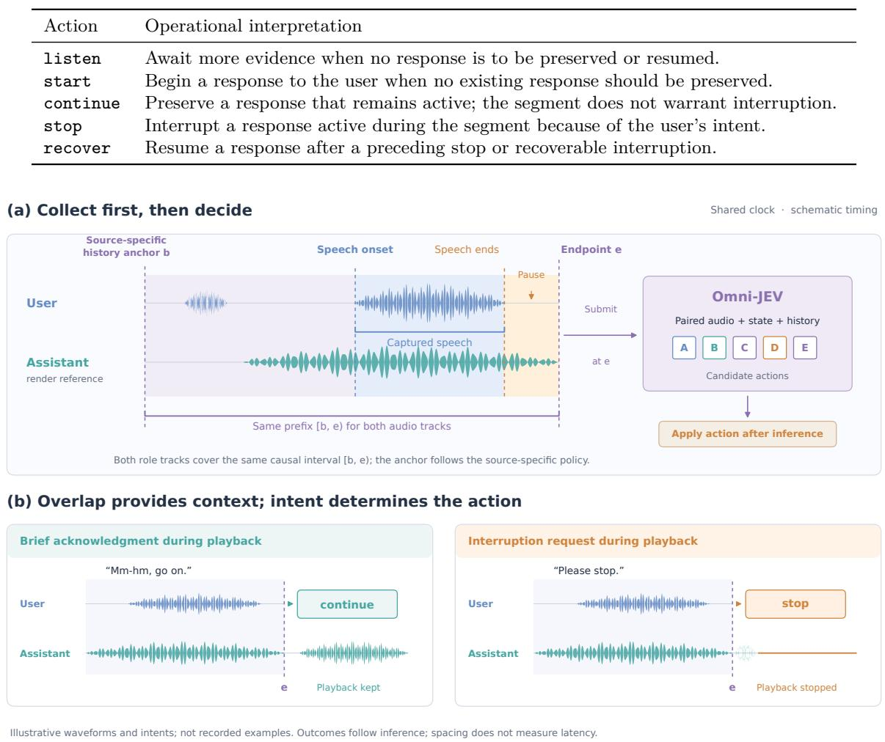
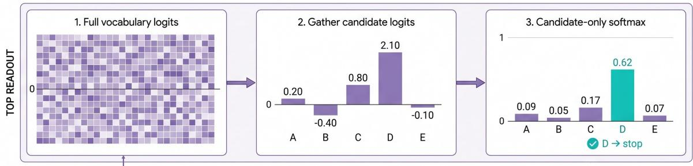
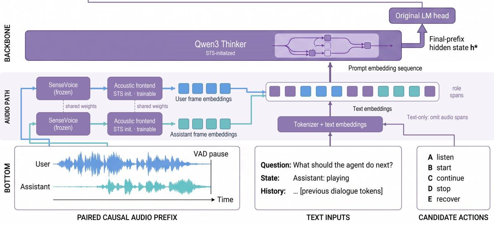
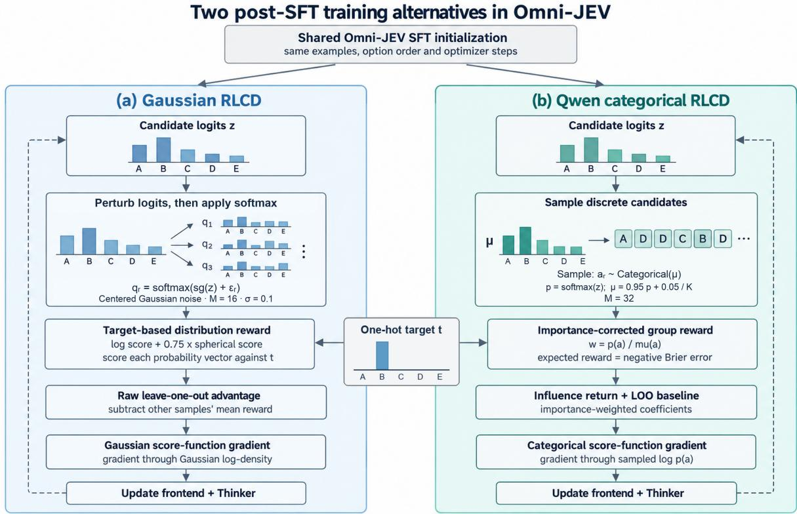
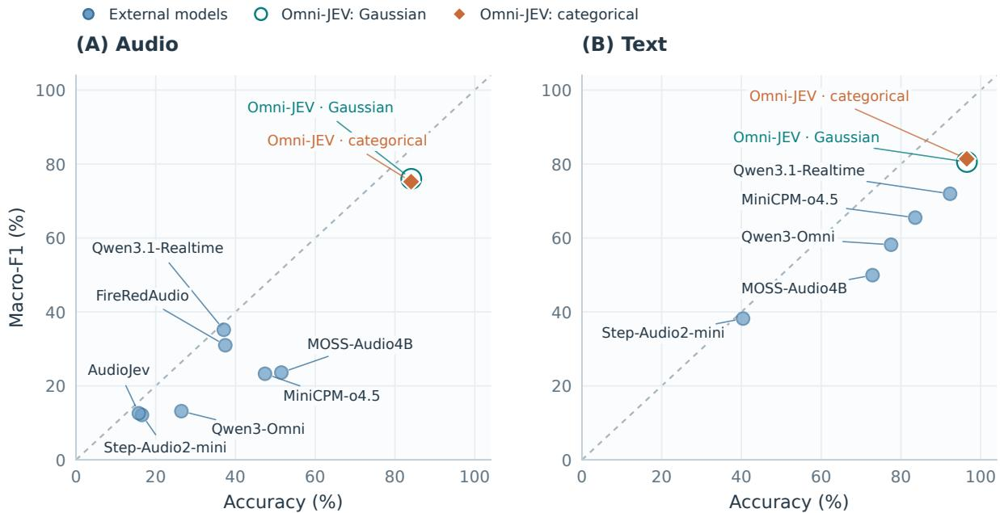
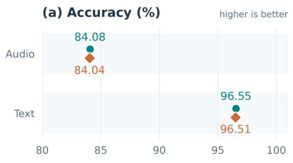
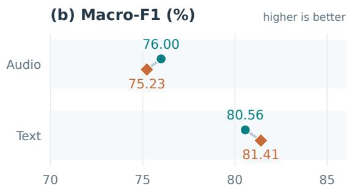
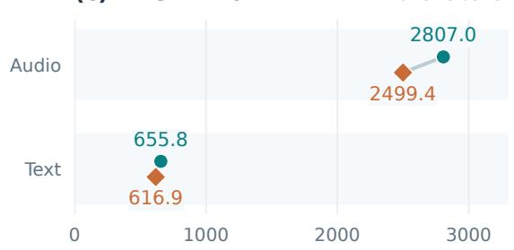
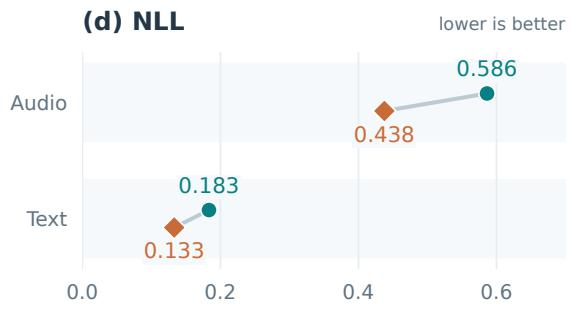

# Omni-JEV: Text and Dual-Stream Speech Decisions

Shengzhou Kong∗

Merit Interactive Research Institute

## Abstract

A user utterance does not uniquely determine the next action in full-duplex dialogue: its consequences depend on the assistant’s response state and interaction history. Speech activity, utterance completion, and interruption intent provide related evidence, whose implications for a response require an explicit action policy. We formulate this task at collected-segment endpoints and introduce Omni-JEV, which maps text or role-indexed user and assistant-reference speech to probabilities over five interaction actions. An aligned speech-to-speech understanding backbone encodes the acoustic roles separately and shares its candidate readout with text inputs. Bilingual weak supervision sup ports cross-entropy fine-tuning followed by reinforcement learning for probability-sensitive decisions (RLCD). We compare Gaussian-logit and categorical Choice RLCD from the same supervised ini tialization under matched training exposure, observing diferent trade-ofs between classification and probability quality. Gaussian Omni-JEV achieves test accuracies of 84.08% for audio and 96.55% for text. This common action interface supports decisions about when a full-duplex voice assistant should respond, preserve ongoing speech, interrupt, or resume an interrupted response.

Keywords: Omni-JEV; interaction actions; speech-to-speech; dual-stream audio; action probabilities

## 1 Introduction

Full-duplex speech models let assistants listen during a response. Moshi and SALM-Duplex model both participants within speech generation [4, 12], and Freeze-Omni and MiniCPM-o develop integrated spoken interaction [32, 3]. Incoming speech may acknowledge the current response, request a correction, or introduce a new request. Its consequences depend on both the contribution and the response it afects.

Research on turn taking provides increasingly informative predictions. Voice Activity Projection predicts future speech activity [5]; FastTurn combines streaming semantics with acoustic cues for turn detection [30]; and X2-Turn jointly predicts transcription and fine-grained user turn states [7]. SID Bench and its semantic interruption model distinguish substantive interruptions from backchannels [36]. Such predictions already inform response control. Direct decision models ofer a complementary interface: AudioJev returns candidate probabilities and studies next-speaker behavior from audio preceding proposed pauses [16], while Qwen-Audio-Jev supports typed choice, judgment, and scoring [28]. These precedents incorporate semantics, local audio history, or typed probability decisions.

These prediction targets describe diferent aspects of the interaction. Utterance completion concerns the user’s contribution, next-speaker prediction concerns subsequent behavior, and interruption detection concerns an active response. Relating that evidence to a response requires the assistant’s state and history: a completed request can call for a new response while the assistant is idle or for stopping one already under way; resumption additionally depends on an earlier interruption. We study response actions defined relative to the assistant’s state, using evidence available at a collected-segment endpoint. The research question is: how can text and role-indexed speech share this state-conditioned action target, and how does the quality of the learned distribution vary across optimization strategies and data sources?

Ordinary automatic speech recognition (ASR) text does not fully preserve intonation, stress, duration, or overlap timing; FastTurn’s acoustic–semantic modeling illustrates why lexical content alone may be insuficient for turn judgments [30]. Keeping user and assistant-reference speech in separate role spans makes both the incoming contribution and its response context available to the model. A pause-confirmed or native segment endpoint fixes when evidence is available, while the target specifies how that evidence should afect the response.

We introduce Omni-JEV, which predicts listen, start, continue, stop, and recover within one action space. The model transfers the aligned acoustic frontend and Thinker from our separately trained speech-to-speech (STS) checkpoint, built on the MiniMind-O framework [11]. Shared acoustic parameters encode user and assistant-reference waveforms into distinct role spans; text uses the same Thinker and candidate readout. A bilingual weak-label corpus from nine upstream source families connects observation endpoints, role evidence, response state, and action targets. Source-linked partitioning keeps related recordings and bilingual counterparts together.

A probability interface also requires evaluating more than the selected action. After cross-entropy supervised fine-tuning, we compare two continuations using reinforcement learning for probability-sensitive decisions (RLCD): Gaussian-logit exploration adapted from prior implementations [17, 25] and Qwen-Audio-Jev’s categorical Choice strategy [28]. They share initialization and training exposure. Gaussian achieves 84.08% audio accuracy and 96.55% text accuracy. Its audio macro-F1 is 76.00%, versus 75.23% for categorical, whereas categorical has higher text macro-F1 and lower probability errors in both modali ties. This comparison characterizes the complete strategies and their classification–probability trade-ofs.

## Our contributions are:

1. A state-conditioned response-action task. We specify how collected-segment evidence, assistant state, and history define five actions, and construct bilingual weak targets while distinguishing source annotations from derived action policies.

2. A shared model for text and role-indexed speech. Omni-JEV adapts an aligned STS understanding path, separately represents user and assistant-reference audio, and uses one candidateprobability readout for both modalities.

3. An empirical characterization of action distributions. Matched Gaussian and categorical RLCD continuations reveal diferent classification–probability trade-ofs, while source-level evaluation identifies the scope of the aggregate results.

## 2 Related Work

## 2.1 From turn events to action decisions

The distinction between detecting an event and choosing a response is central to interaction control. Voice Activity Projection predicts joint voice activity, while FastTurn combines acoustic and streaming semantic cues for turn decisions [5, 30]. AudioJev instead exposes candidate probabilities and studies their consistency under alternative orderings [16]. Qwen-Audio-Jev provides Choice, Noul, and Score interfaces, including categorical RLCD for decision distributions [28]. Omni-JEV adopts candidatebased prediction for state-conditioned interaction actions at collected-segment endpoints. Its candidate permutations vary symbol–action correspondences during training; empirical order invariance remains a separate property.

## 2.2 Speech understanding and role representations

Two representation choices are relevant to response actions: how speech reaches a language model, and how participant roles remain distinguishable. MiniMind-O provides our Thinker–Talker framework [11], with SenseVoice and Qwen3 supplying the acoustic and language components [2, 8, 38]. Qwen3-Omni, Step-Audio 2, MOSS-Audio, and FireRedAudio provide broader audio-language backbones [37, 35, 21, 26]. Freeze-Omni connects speech modules to a language model; Moshi, SALM-Duplex, MiniCPM-o 4.5, and DuplexSLA address parallel streams, streaming interaction, or structured actions [32, 4, 12, 3, 41]. Channel-routing work explicitly examines user and assistant streams [15]. Omni-JEV uses a shared encoder but separate role spans: its output is an action distribution at an observed endpoint, rather than the next generated speech segment.

Full-Duplex-Bench and its multi-turn successor evaluate behavior across time, and HumDial-FDBench provides human-recorded dual-channel dialogues [14, 13, 29]. Our endpoint benchmark measures one component of this broader problem. Its intent, command, environmental, and conversational sources [18, 6,

9, 33, 22, 27, 39, 40, 23] supply heterogeneous evidence; Section 6 distinguishes their original annotations from derived action targets.

## 2.3 Learning action distributions

Gaussian RLCD and categorical Choice difer in what is explored and scored: Gaussian perturbs rel ative logits and evaluates a complete probability vector, whereas Choice samples candidate positions to estimate negative Brier [28]. The underlying estimator and scoring principles come from prior work [34, 10, 17, 25]; Appendix D records the inherited mechanisms and recipe choices. Our comparison applies both complete strategies to the same Omni-JEV parent. This difers from optimizing generated speech trajectories with interaction and semantic rewards, as in Multi-Faceted Interactivity Alignment [19]: here labeled distributions supply rewards after one model forward pass.

## 3 Interaction Decision Task

## 3.1 State-conditioned action prediction

Let e be the endpoint of a collected user segment, $s _ { e }$ the interaction state, and $h _ { e }$ the available history. The observation is text context or a pair of aligned acoustic prefixes:

$$
\boldsymbol { x } _ { e } ^ { \mathrm { t e x t } } = ( s _ { e } , h _ { e } , a _ { e } , u _ { e } ) , \qquad \boldsymbol { x } _ { e } ^ { \mathrm { a u d i o } } = ( s _ { e } , h _ { e } , U _ { b : e } , A _ { b : e } , m ) ,\tag{1}
$$

Here $a _ { e }$ and $u _ { e }$ are assistant and user text, $U _ { b ; e }$ and $A _ { b : e }$ are waveforms over a common interval, and m records channel availability. The model predicts $p _ { \theta } ( c \mid x _ { e } )$ over the presented candidates C. Dual-stream audio denotes role-indexed inputs: the assistant track is a reference of its response, and the user track supplies the new interaction evidence.

For conversational sources, $s _ { e }$ is reconstructed from observations through $e ,$ before applying the current target action; it is not device playback telemetry. Short-form sources instead supply a task-given or added scenario, or an unknown state. Table 1 specifies the fields actually serialized by the model. History $h _ { e }$ is carried by the role prefixes, retained state flags, and any completed text history before the audio window; it is not an additional inferred transcript.

Table 1: Context supplied to the action model. Optional fields retain available source information; an absent field does not assert a negative state.
<table><tr><td>Field</td><td>Content and interpretation</td></tr><tr><td>text</td><td>User/assistant text for text examples; optional completed history preceding the audio window for speech examples. Current-window ASR text is excluded.</td></tr><tr><td>assistant_state</td><td>Source state in value, such as idle, playing, interrupted, or unknown; op- tional flags retain pending interruption, resumability, and assistant speech during the collected segment.</td></tr><tr><td>policy, scenario</td><td>Available policy text and explicit scenario conditions, including addressing or resumability assumptions. These may be empty.</td></tr><tr><td>Role availability</td><td>Supplied user and assistant-reference spans; a missing role is stated in the prompt and its acoustic span is omitted.</td></tr></table>

The target describes how the assistant should act on the collected segment. It is distinct from a domain intent: a banking query can require starting a response or stopping an existing one, depending on state. Table 2 defines the common five-action policy. In particular, continue preserves an active response, whereas listen defers a response when none is to be preserved or resumed. The source-specific construction rules, including isolated-word exceptions, appear in Appendix B.

## 3.2 Causal prefixes and decision endpoints

Speech onset starts collection; a pause-confirmed VAD endpoint triggers the decision. Reliable native segment ends also supply construction endpoints. The common interval $[ b , e )$ retains the role history used to interpret the collected segment. Its anchor follows the source annotation: observed response turns for Wakeup and FD, and the preceding rule-labeled start segment for SmoothConv. Before a usable anchor exists, history begins at the recording start. Appendix B specifies these ofline construction policies.

Table 2: Interaction actions associated with a collected user segment. The response active during the segment determines whether an interruption is applicable.  
  
Figure 1: Interaction decisions at collected-segment endpoints. Acknowledgment and interruption can both overlap assistant speech but require diferent actions. Both role tracks share the source-specific history anchor and contain only evidence available through the endpoint; subsequent behavior illustrates the action semantics.

This observation boundary separates annotation from inference. Later recording events may help annotate what the collected segment meant, but they are excluded from its model input. A stop target concerns a response active during the segment; the endpoint state can already be idle if that response ended before the collected user segment ends. Available interval-speech flags distinguish this fact from endpoint playback, and dispatch occurs after collection. Ofline experiments use complete corpus prefixes. The online implementation additionally truncates older history at completed boundaries; its policy is specified in Appendix E.

## 4 Omni-JEV Architecture

Omni-JEV implements the task in Section 3 through a shared understanding path and action readout. Figure 2 connects its three components: an STS-initialized acoustic frontend and Thinker, a sequence that retains user and assistant roles, and a candidate distribution from the original vocabulary head.

Both text and speech produce a decision at the same answer position; text-only inputs omit the acoustic spans.

## 4.1 An aligned STS understanding path

Our STS implementation builds on the MiniMind-O Thinker–Talker framework [11], connecting a SenseVoice encoder [2, 8], a learned acoustic frontend, a Qwen3-based Thinker [38], and a speech-generation Talker. Omni-JEV reuses the frontend and Thinker after acoustic-to-language alignment. The transferred frontend maps speech representations into the language-model embedding space; action supervision subsequently adapts that mapping and the Thinker to the interaction policy.

The frontend and Thinker contain 597,625,856 trainable parameters, with hidden width $d = 1 0 2 4 ;$ SenseVoice is additional and frozen during action adaptation. Appendix E specifies the checkpoint, provenance, and full configuration. The Talker is absent from the decision computation: the adapted understanding path selects an action without first generating speech.

## 4.2 Role-preserving acoustic representation

The action depends on the relationship between incoming speech and the assistant’s response. To preserve that distinction, we encode each available role independently with the same encoder and frontend. Each waveform is resampled to 16 kHz. For role $c \in \{ U , A \}$ , let $\dot { H _ { c } } \in \mathbb { R } ^ { T _ { c } \times 5 1 2 }$ contain its valid encoder frames. The frontend maps these frames to the Thinker’s hidden width d:

$$
H _ { c } = E _ { \mathrm { S V } } ( X _ { c } ) , \qquad V _ { c } = \mathrm { G E L U } ( \mathrm { L N } ( H _ { c } ) W _ { 1 } + b _ { 1 } ) W _ { 2 } + b _ { 2 } ,\tag{2}
$$

The projection matrices have shapes $W _ { 1 } \in \mathbb { R } ^ { 5 1 2 \times d }$ and $W _ { 2 } \in \mathbb { R } ^ { d \times d }$ . Shared weights place both roles in the same acoustic representation space, while separate spans retain their identities. The waveforms cover the same temporal interval, preserving the reference window for silence and speech. The final decision state can attend to both encoded roles within the shared Transformer. The quality of that distinction depends on the source channels, as discussed in Section 6.

## 4.3 One sequence for text and speech

The prompt serializes the instruction, role-indexed audio, interaction context, candidate descriptions, and answer prefix. Each audio span contains one placeholder per valid frame; its embedding is replaced by the corresponding row of $V _ { U }$ or $V _ { A }$

$$
\begin{array} { r } { \mathcal { E } _ { e } = \mathrm { c o n c a t } \big ( E _ { \mathrm { i n s t r } } , E _ { \mathrm { r o l e : } U } , V _ { U } , E _ { \mathrm { r o l e : } A } , V _ { A } , E _ { \mathrm { c t x } } , E _ { C } , E _ { \mathrm { a n s } } \big ) . } \end{array}\tag{3}
$$

These positions are continuous frame embeddings. The instruction and candidate descriptions define the requested decision, the context serializes the fields in Table 1, and the acoustic spans supply the observed speech. Text and audio enter the same causal Transformer, without a separate channel-fusion block. When audio is unavailable, the prompt states the missing role explicitly and omits its span. Textonly examples omit both acoustic spans while retaining context and candidate fields. This construction gives the two modalities the same prediction target and readout.

## 4.4 Action probabilities from the original LM head

Let $h _ { e } ^ { * }$ be the hidden state at the final answer-prefix position. The original vocabulary head produces $\ell _ { e } = W _ { \mathrm { L M } } h _ { e } ^ { * }$ . For candidate $C _ { j }$ assigned token ID $v _ { j }$ , we gather and normalize only the candidate logits:

$$
z _ { j } = \ell _ { e } [ v _ { j } ] , \qquad p _ { \theta } ( C _ { j } \mid x _ { e } ) = { \frac { \exp { z _ { j } } } { \sum _ { k = 1 } ^ { | C | } \exp { z _ { k } } } } .\tag{4}
$$

The symbols A–E denote candidate positions, not fixed actions. During training, candidates and target positions are permuted together. Each symbol is a single token at the answer boundary, allowing direct readout without generating an explanation or adding a new classifier. Both modalities backpropagate through this head and the shared Thinker; audio examples also update the frontend. Inference returns the unperturbed candidate softmax and its action mapping to the controller.

## Omni-JEV: from paired waveforms to an action distribution

  
Figure 2: Omni-JEV architecture. User and assistant-reference audio are independently encoded with shared SenseVoice and frontend parameters, then serialized with text into one prompt. The STSinitialized Thinker and original LM head produce a distribution over candidate actions. Colors distinguish roles and text; A–E and the readout values show one example ordering.

## 5 Training Omni-JEV

Cross-entropy supervision adapts the STS understanding path to the action task; RLCD then optimizes candidate distributions against the same targets. Figure 3 contrasts Gaussian exploration of complete probability vectors with categorical sampling of candidate positions. Evaluation uses the unperturbed distributions.

## 5.1 Supervised action adaptation

For candidate logits z and target $t \in \Delta ^ { K - 1 }$ , SFT minimizes

$$
\mathcal { L } _ { \mathrm { S F T } } = - \sum _ { k = 1 } ^ { K } t _ { k } \log p _ { \theta } ( k \mid x ) .\tag{5}
$$

Targets are one-hot over $K = 5$ positions and follow each example’s candidate permutation. One supervised epoch establishes the common frontend and Thinker initialization for both continuations.

## 5.2 Gaussian exploration of action distributions

A perturbation explores relative candidate preferences, allowing rewards to evaluate a complete probability vector. With $P = I - \mathbf { 1 1 } ^ { \top } / K$ and independent $\xi _ { r } \sim \mathcal { N } ( 0 , I )$ , define

$$
\epsilon _ { r } = \sigma P \xi _ { r } , \qquad \widetilde { z } _ { r } = \sec ( z ) + \epsilon _ { r } , \qquad q _ { r } = \mathrm { s o f t m a x } ( \widetilde { z } _ { r } ) , \quad r = 1 , \dots , M .\tag{6}
$$

  
Frozen speech encoder, No auxiliary CE loss in either RLCD continuation.  
Schematic values; not training observations. Sampling, reward and estimator differ togethen  
Figure 3: RLCD continuations from one Omni-JEV SFT checkpoint. Gaussian scores perturbed probability vectors; categorical Choice samples candidate positions to estimate negative Brier [28]. Labels supply rewards; bars and samples are schematic. The columns compare complete strategies.

Here sg stops gradients. Centering removes the common-shift direction to which softmax is invariant, without changing the sampled probability distribution. We score target agreement using the inherited log-plus-spherical reward [17, 10]:

$$
R ( q _ { r } , t ) = \sum _ { k } t _ { k } \log q _ { r k } + \beta \frac { \langle t , q _ { r } \rangle } { \| q _ { r } \| _ { 2 } } , \qquad \beta = 0 . 7 5 .\tag{7}
$$

The log term rewards target probability; the spherical term measures target alignment relative to the vector norm. Each sample remains a normalized distribution over all actions, so the reward evaluates both target mass and its relation to competing probabilities. The reward uses labeled targets during training; it is not a reward obtained from a generated dialogue trajectory. The Gaussian exploration and density-gradient construction follow prior RLCD implementations [17, 25]; our adaptation uses centered noise and raw leave-one-out advantages. Appendix D details this provenance and the reward’s scoring properties.

## 5.3 Score-function optimization

Each perturbation is compared with the others for the same input:

$$
A _ { r } = R ( q _ { r } , t ) - \frac { 1 } { M - 1 } \sum _ { s \neq r } R ( q _ { s } , t ) ,\tag{8}
$$

We retain the raw advantage scale. Treating sampled vectors, rewards, and advantages as constants gives the score-function update [34]

$$
\widehat { \boldsymbol { g } } _ { z } = \frac { 1 } { M \sigma ^ { 2 } } \sum _ { r = 1 } ^ { M } \boldsymbol { A } _ { r } \boldsymbol { \epsilon } _ { r } , \qquad \nabla _ { \theta } \boldsymbol { \mathcal { L } } _ { G } = - \left( \frac { \partial z } { \partial \theta } \right) ^ { \top } \widehat { \boldsymbol { g } } _ { z } .\tag{9}
$$

The gradient passes through the Gaussian density’s center, rather than through sampled rewards. A perturbation with positive advantage contributes in its sampled direction, while a negative advantage contributes in the opposite direction. Their average updates the relative candidate logits, and the model Jacobian transfers that update to the shared frontend and Thinker. The update targets a locally smoothed reward; its efect on the unperturbed inference distribution is evaluated empirically. One encoder/Thinker forward pass supplies the logits; subsequent samples require only vector calculations. We use $M = 1 6$ and $\sigma = 0 . 1$ , without auxiliary CE or reference-preservation losses. Appendix D gives the surrogate loss, its Gaussian-smoothed objective, and the estimator’s scope; numerical clamps appear in Appendix E.

## 5.4 Categorical RLCD comparison

We reproduce Qwen-Audio-Jev’s Choice formulation [28], targeting negative Brier error:

$$
J _ { C } ( p , t ) = - \| p - t \| _ { 2 } ^ { 2 } .\tag{10}
$$

With $p = \operatorname { s o f t m a x } ( z )$ , candidates are drawn from $\mu = ( 1 - \eta ) p + \eta / K$ and importance-weighted by $w _ { r } = p ( a _ { r } ) / \mu ( a _ { r } )$ . A pairwise collision term estimates the squared probability norm; detached influence returns and a leave-one-out baseline weight sampled log-probability gradients. We use $M = 3 2 , \eta = 0 . 0 5$ and no ordinal term $( \lambda = 0 )$ . The complete objective and update appear in Appendix D.

Both continuations return the unperturbed candidate softmax at inference. Their rewards, exploration spaces, and estimators difer together, so the matched protocol in Section 7.2 compares complete strategies rather than isolating an estimator.

## 6 A Bilingual Corpus for Interaction Actions

An interaction target requires more than an utterance label: the same content can imply diferent actions under diferent response states. We therefore construct examples around a common unit comprising the observed segment, its context, role availability, and a five-action target.

## 6.1 Sources and action construction

Table 3 summarizes nine upstream source families in ten displayed rows: FD v2 and FD v3 are shown separately because their provenance and license records difer. BANKING77 and MASSIVE provide intent text; Mini Speech Commands and MInDS-14 provide spoken commands and intents; ESC-10 provides environmental sounds [18, 6, 33, 9, 22]. An inherited turn-text corpus supplies additional interaction contexts [20]. The construction distinguishes observed state from an added labeling scenario. BANKING77 and MASSIVE utterances are presented to a text teacher under an assumed idle state with no resumable response; the teacher assigns an interaction action rather than copying the domain-intent ID. The inherited turn-text task supplies assistant/user text and a task-given playing state. Short-form audio uses explicit scenario rules: MInDS-14 requests yield start under an idle, completed-request assumption; ESC-10 clips yield listen without a sound-identification or alarm task. Mini Speech Commands instead uses a word-to-action convention with unknown assistant state. These constructed conditions difer from the observed turn state in conversational sources. Table 8 gives the source-to-action mapping and label-inheritance conditions.

Intelligent Wakeup, FD\_data\_ $_ - \mathrm { v 2 / v 3 } ,$ , and SmoothConv supply conversational evidence [27, 39, 40, 23]. SmoothConv provides native role/channel annotations; FD\_data\_v2 is described by its upstream card as a synthetic conversation source with synchronized role tracks, while FD\_data\_v3 is retained as a separate upstream source; Wakeup provides original speaker timing annotations and uses user VAD end points. Original annotations, deterministic state rules, and saved ASR/LLM-assisted decisions produce the action targets under the policy in Section 3. The resulting action targets are derived weak supervision. The sources do not share one annotation algorithm: SmoothConv uses native segment ends and ordered temporal rules, whereas the FD pause pipeline uses saved causal ASR and DeepSeek-nothink judgments. Wakeup retains original speaker identity and reuses existing semantic targets while aligning Chinese endpoints separately. Appendix B distinguishes these procedures and their remaining documentation limits.

## 6.2 Licensing and release boundary

The corpus combines sources with heterogeneous licensing and provenance conditions. BANKING77, MASSIVE, MInDS-14, and the ESC-10 subset are used with their respective attribution requirements; the local Speech Commands card points to the upstream dataset and its license information. The FD v2 card declares Apache-2.0, but the current archive does not retain an independent license record for FD v3, so the combined FD v2/v3 source is not described as uniformly Apache-2.0. Intelligent Wakeup and SmoothConv declare CC BY-NC 4.0; their use in this work is restricted to the noncommercial research setting. The inherited turn-text corpus is an internal, unpublished record rather than a separately licensed public benchmark, and its underlying text ownership and external publication permission are not established by the current ledger.

Translation, relabeling, boundary alignment, and TTS synthesis are treated as derived processing steps. They do not remove the licensing, privacy, or release conditions of the underlying sources. We report aggregate results and retain source-linked provenance, but do not distribute the raw recordings, derived bilingual audio, complete action-label corpus, or model weights with this manuscript. Any commercial training, deployment, or public release requires a separate review of the applicable upstream and internal permissions.

Table 3: Composition of the bilingual interaction corpus. Language denotes the version used in this work; the none entry denotes nonlinguistic audio.
<table><tr><td>Integrated source</td><td>Modality</td><td>Language</td><td>Train</td><td>Test</td></tr><tr><td>BANKING77 [18]</td><td>text</td><td>en/zh</td><td>22,726</td><td>2,509</td></tr><tr><td>MASSIVE [6]</td><td>text</td><td>en/zh</td><td>27,491</td><td>3,034</td></tr><tr><td>Legacy turn text [20]</td><td>text</td><td>en/zh</td><td>45,570</td><td>5,030</td></tr><tr><td>Mini Speech Commands [33]</td><td>audio</td><td>en/zh</td><td>14,312</td><td>1,580</td></tr><tr><td>MInDS-14 [9]</td><td>audio</td><td>en/zh</td><td>904</td><td>100</td></tr><tr><td>ESC-10 [22]</td><td>audio</td><td>none</td><td>360</td><td>40</td></tr><tr><td>Wakeup [27]</td><td>audio</td><td>en/zh</td><td>66,687</td><td>7,380</td></tr><tr><td>FD v2 [39]</td><td>audio</td><td>en/zh</td><td>492</td><td>66</td></tr><tr><td>FD v3 [40]</td><td>audio</td><td>en/zh</td><td>1,158</td><td>118</td></tr><tr><td>SmoothConv [23]</td><td>audio</td><td>zh</td><td>133,786</td><td>15,003</td></tr><tr><td>Total</td><td></td><td></td><td>313,486</td><td>34,860</td></tr></table>

## 6.3 Role availability and bilingual alignment

We preserve native separated tracks when available and mark absent assistant-reference audio explicitly. For mono recordings, role timing masks retain role-indexed evidence but do not separate voices during overlap: both inputs may contain the same mixture. Thus dual-stream support describes the input interface, while channel provenance determines the strength of role evidence in each example.

Chinese and English counterparts retain source links. Translated speech is aligned to its own segment boundaries; it does not inherit source-language timestamps. Subsequent events may inform ofline labeling, but the constructed prefix ends at the decision endpoint. ASR and translation support corpus construction without making transcripts mandatory for audio inference.

## 6.4 Source-linked partition

We group recording identities, bilingual counterparts, and exact normalized input links into 57,240 connected components. Seeded component allocation, jointly stratified by source, language, modality, and action, produces a two-way split with approximately 90% training and 10% testing (seed 20261023). All linked examples remain on one side.

The corpus contains 313,486 training and 34,860 test instances. Audio contributes 217,699 training and 24,287 test instances; text contributes 95,787 and 10,573. There is no validation split. Eligibility exclusions and action support are given in Appendix A. Preserving source groups reduces known crosssplit links, while class imbalance and unknown semantic near-duplicates remain properties of the data.

## 7 Experimental Setup

We address three questions: RQ1: How does Omni-JEV compare with external systems on text and speech action recognition under the stated inputs? RQ2: How do matched Gaussian and categorical continuations difer in classification and probability quality? RQ3: How do source and language composition afect aggregate scores?

## 7.1 Training and evaluation

The source-linked split in Section 6 supplies one natural-frequency SFT epoch and the fixed test set. Ofline inference includes every test example with complete, untruncated audio prefixes under a 40,960- token context limit, independently of the online history-window policy. Final checkpoints follow the prescribed budget; both continuations use one training seed. Optimizer and numerical settings appear in Appendix E.

## 7.2 Matched RLCD comparison on Omni-JEV

Both branches share the SFT checkpoint, ordered examples, candidate permutations, inputs, trainable parameters, and optimizer schedule. Each processes all 313,486 training examples once in 78,372 op timizer updates, with accumulation four and a final window of two examples. Neither adds auxiliary CE. Their final checkpoints are evaluated on the same 24,287 audio and 10,573 text examples. Holding the supervised parent fixed makes the comparison specific to continuation on Omni-JEV, rather than a comparison of separately pretrained backbones. The sample counts per input difer because they follow the respective Gaussian and Choice recipes. Table 4 summarizes the diferences between the complete strategies.

Table 4: RLCD recipes evaluated on Omni-JEV. Initialization, data order, input representation, and optimizer-update budget are shared. Categorical is our reproduction of Qwen-Audio-Jev’s Choice algorithm, applied to Omni-JEV.
<table><tr><td>Setting</td><td>Gaussian RLCD</td><td>Categorical RLCD</td></tr><tr><td>Exploration unit</td><td>Centered logit vector</td><td>Discrete candidate position</td></tr><tr><td>Target score</td><td>Log plus spherical</td><td>Negative Brier</td></tr><tr><td>Samples per input</td><td>M = 16</td><td>M = 32</td></tr><tr><td>Exploration control</td><td> $\sigma = 0 . 1$ </td><td> $\eta = 0 . 0 5$ </td></tr><tr><td>Additional coefficient</td><td>Spherical weight  $\beta = 0 . 7 5$ </td><td>Ordinal weight λ = 0</td></tr></table>

## 7.3 Metrics

We report accuracy and macro-F1 for classification, and Brier error and negative log-likelihood (NLL) for probability quality:

$$
B = \frac { 1 } { N } \sum _ { i } \sum _ { k } ( p _ { i k } - t _ { i k } ) ^ { 2 } , \qquad \mathrm { N L L } = - \frac { 1 } { N } \sum _ { i } \log p _ { i , y _ { i } } .\tag{11}
$$

Brier values are displayed as $1 0 ^ { 4 } B$ . Macro-F1 averages actions with positive target support: five for audio and four for text, which has no recover examples. Modalities are reported separately. Pooled scores are recomputed after combining all test predictions, with macro-F1 over the five supported actions; this is not an average of modality-specific F1. It describes the corpus mixture rather than balanced cross-modal performance. Support and source/language slices appear in Appendices A and C.

## 7.4 External models and input conditions

Qwen3-Omni-30B-A3B-Instruct, MiniCPM-o 4.5, MOSS-Audio-4B-Instruct, and Step-Audio-2-mini use all 34,860 tests [37, 24, 3, 21, 35]; FireRedAudio and AudioJev use all 24,287 audio tests [26, 16]. Qwen-Audio-3.1-Realtime uses a fixed 2,000-example subset: 1,349 audio and 651 text [1]. Stratification by language, modality, and action among complete inputs no longer than 120 seconds gives this subset a diferent sampling distribution from the full test.

External models receive available user audio, text context, assistant state, and the same action definitions and candidate order. They are zero-shot with user-only audio; Omni-JEV is task-adapted and can also use assistant-reference audio. Table 5 therefore compares task-level performance under these conditions.

Local generative baselines use greedy decoding, a 64-token output limit, and a parser accepting exact candidate symbols or action names; AudioJev uses its native numeric readout. Invalid outputs and unresolved requests remain errors in the denominator. Realtime retries preserve fixed IDs and initially successful answers (Appendix F).

## 8 Results

## 8.1 RQ1: Text and speech action recognition

Table 5 and Figure 4 compare the models on the shared task. Gaussian Omni-JEV achieves 84.08% audio accuracy and 76.00% macro-F1, with 96.55% text accuracy and 80.56% macro-F1. Both adapted endpoints score higher than the external full-scope systems on these aggregates under this protocol. Because adaptation and available inputs difer, this is a task-level comparison rather than evidence of an equal-input architectural advantage.

Table 5: Task-level comparison: the upper block uses the Realtime subset, the lower each model's full applicable scope. External systems use zero-shot user-only audio; Omni-JEV is adapted and can also use assistant-reference audio. Failures remain in denominators. Bold marks modality-wise best full-scope scores.
<table><tr><td>Model</td><td>Scope</td><td>N</td><td>Fail/invalid</td><td>Audio ACC ↑</td><td>Audio Macro-F1 ↑</td><td>Text ACC ↑</td><td>Text Macro-F1 ↑</td></tr><tr><td colspan="8">Qwen3.1-Realtime API only; 2,000-row budget-limited subset</td></tr><tr><td>Qwen3.1-Realtime API</td><td>2k API</td><td>2,000</td><td>0/0|</td><td>37.06</td><td>35.18</td><td>92.32</td><td>71.97</td></tr><tr><td colspan="8">Full frozen evaluation; AudioJev is audio-only</td></tr><tr><td>Qwen3-Omni</td><td>full test</td><td>34,860</td><td>0/0</td><td>26.43</td><td>13.17</td><td>77.53</td><td>58.18</td></tr><tr><td>MiniCPM-o4.5</td><td>full test</td><td>34,860</td><td>0/0</td><td>47.40</td><td>23.28</td><td>83.58</td><td>65.51</td></tr><tr><td>MOSS-Audio4B</td><td>full test</td><td>34,860</td><td>0/0</td><td>51.50</td><td>23.61</td><td>72.87</td><td>49.95</td></tr><tr><td>Step-Audio2-mini</td><td>full test</td><td>34,860</td><td>0/12941</td><td>16.54</td><td>12.13</td><td>40.40</td><td>38.21</td></tr><tr><td>FireRedAudio</td><td>full audio</td><td>24,287</td><td>0/0</td><td>37.44</td><td>30.99</td><td></td><td></td></tr><tr><td>AudioJev</td><td>full audio</td><td>24,287</td><td>0/0</td><td>15.76</td><td>12.59</td><td></td><td></td></tr><tr><td>Omni-JEV Gaussian RLCD</td><td>full test</td><td>34,860</td><td>0/0</td><td>84.08</td><td>76.00</td><td>96.55</td><td>80.56</td></tr><tr><td>Omni-JEV categorical RLCD</td><td>full test</td><td>34,860</td><td>0/0</td><td>84.04</td><td>75.23</td><td>96.51</td><td>81.41</td></tr></table>

The task-level ranking includes diferences in adaptation, role evidence, output format, and backbone. Step-Audio2-mini’s 12,941 parser-invalid answers count as failures, so its score also reflects compliance with the decision format. Realtime uses the fixed subset specified in the table.

## 8.2 RQ2: Comparing RLCD continuation strategies

Table 6 and Figure 5 compare continuations under Section 7.2’s matched conditions.

Action classification. On audio, Gaussian has a macro-F1 advantage of 0.77 percentage points; on text, categorical leads by 0.85 points. Accuracy is nearly equal: Gaussian has eight more correct audio predictions and four more correct text predictions. These diferences describe the prescribed single-seed runs.

Probability quality. Categorical also has lower Brier error and NLL on both modalities. Relative to Gaussian, Brier error is lower by 10.96% on audio and 5.93% on text, computed from unrounded aggregates. Accuracy depends on the largest-probability candidate, Brier on the full vector, and NLL on the target probability. Their diferent rankings show that similar action agreement can coexist with diferent probability quality; neither continuation dominates across metrics. This distinction matters for a decision interface that exposes probabilities as well as a selected action: aggregate classification scores alone do not describe the reliability of those probability assignments. The present comparison measures both properties without establishing a preferred strategy for a particular controller.

## Accuracy and macro-F1 across models

  
Omni-JEV: task-adapted / paired role tracks. External: zero-shot / user-only audio.

Figure 4: Audio (A) and text (B) accuracy and macro-F1 from Table 5. Blue: external models; teal: Gaussian; orange: categorical. The diagonal marks F1 = ACC. Qwen3.1-Realtime uses the fixed 2,000- example subset and is not paired with full-scope systems.

Table 6: Full-test RLCD comparison. ACC and macro-F1 are percentages. Both models use SFT→RLCD; categorical reproduces Qwen-Audio-Jev's Choice on Omni-JEV. Modality-wise best scores, including displayed ties, are bold. Pooled rows recompute metrics over the combined test predictions.
<table><tr><td>Modality</td><td>RLCD</td><td>N</td><td>ACC ↑</td><td>Macro-F1 ↑</td><td> ${ \mathrm { B r i e r ~ } } \times 1 0 ^ { 4 } \downarrow$ </td><td>NLL↓</td></tr><tr><td>Audio</td><td>Gaussian</td><td>24,287</td><td>84.08</td><td>76.00</td><td>2806.99</td><td>0.5863</td></tr><tr><td>Audio</td><td>Categorical</td><td>24,287</td><td>84.04</td><td>75.23</td><td>2499.43</td><td>0.4376</td></tr><tr><td>Text</td><td>Gaussian</td><td>10,573</td><td>96.55</td><td>80.56</td><td>655.79</td><td>0.1834</td></tr><tr><td>Text</td><td>Categorical</td><td>10,573</td><td>96.51</td><td>81.41</td><td>616.87</td><td>0.1331</td></tr><tr><td>Pooled</td><td>Gaussian</td><td>34,860</td><td>87.86</td><td>80.93</td><td>2154.54</td><td>0.4641</td></tr><tr><td>Pooled</td><td>Categorical</td><td>34,860</td><td>87.83</td><td>80.32</td><td>1928.46</td><td>0.3452</td></tr></table>

## 8.3 RQ3: Source and language variation

Natural action frequencies are uneven: audio has 15,617 listen examples but only 17 recover examples; text has 81 listen examples and no recover examples (Appendix A). Macro-F1 is sensitive to rareaction errors, whereas accuracy reflects dominant actions.

Appendix C reports Gaussian audio accuracy of 81.90% on Chinese and 94.11% on English, with 40 nonlinguistic examples. Source, action composition, translation, and channel quality vary with language: SmoothConv contributes 15,003 audio tests and FD 184. These slices locate heterogeneity without isolating a language efect.

The source scores also difer in what they measure. Gaussian reaches 98.61% accuracy and 98.54% macro-F1 on Mini Speech Commands, versus 78.41% and 55.26% on SmoothConv. The former maps isolated words to actions by convention; the latter derives targets from conversational role activity. MInDS-14 and ESC-10 each use a single scenario-assigned action. Thus the aggregate combines lexical conventions, added scenarios, and conversational prediction rather than a uniform test of playback control. The construction table in Appendix B and source slices should be read together; their scores alone neither establish reliable interruption handling nor identify the cause of the source diferences.

Audio n = 24,287 / Text n = 10,573

## Decision quality and probability quality

(c) Brier × 10⁴  

  
Figure 5: Classification and probability quality after matched RLCD continuation. Circles denote Gaussian and diamonds categorical. ACC and macro-F1 axes are enlarged rather than zero-based; panels have separate ranges. Text macro-F1 covers four supported actions and audio five. Points are single-run estimates.

## 9 Discussion and Limitations

The common action target makes a distinction that matters for response control: recognizing a contribution and deciding its efect on an existing response are related but diferent predictions. Turn states, semantic interruptions, and next-speaker behavior provide evidence for that decision [30, 7, 36, 16]. Omni-JEV expresses it through one readout for text and role-indexed speech. Direct speech retains potential prosodic and temporal cues [30], while assistant-reference spans provide the response context. The ofline results characterize learning under this formulation; they do not isolate gains from waveform input, separate roles, or STS initialization. External baselines also difer in adaptation and available inputs, so the task-level ranking does not establish an equal-input architectural advantage.

The RLCD results distinguish two properties of the output. Similar argmax accuracy can coexist with diferent error distributions across actions and diferent probability assignments. Gaussian has higher audio macro-F1; categorical has higher text macro-F1 and lower Brier error and NLL in both modalities. Categorical directly targets negative Brier, making its lower Brier error consistent with that objective. However, rewards, exploration, and estimators change jointly, so the comparison concerns complete strategies. Proper scoring principles [10] concern ideal distributions; they do not guarantee calibration after finite-sample optimization. The result does not establish a universally preferable continuation or calibration within every response state, and does not estimate gains over supervised fine-tuning alone.

Generalization depends on the weak supervision policy and the available evidence. Lexical conventions and added scenarios coexist with conversational targets; isolated commands therefore do not test compatibility with actual playback state. Source/action imbalance, synthesized speech, sparse recovery, and unknown semantic duplicates or pretraining exposure limit the aggregate interpretation. Text and audio have diferent source mixtures, so their accuracy gap does not compare transcripts with waveforms. Mono role masks also retain mixed voices during overlap. The results use one training seed, and the test set has been inspected during diagnosis. Interactive benchmarks [31, 19, 13, 29] address complementary behavior; synchronization, acoustic echo robustness, latency, and multi-turn utility remain unmeasured here.

## 10 Conclusion

Omni-JEV formulates collected-segment decisions as a state-conditioned action distribution shared by text and role-indexed speech. On the fixed weak-label test partition, Gaussian Omni-JEV reaches 84.08% audio accuracy and 96.55% text accuracy; categorical RLCD obtains lower Brier error and NLL, while Gaussian has slightly higher audio macro-F1. These results answer the study question in a bounded way: one candidate-distribution interface can express the same endpoint-action task across text and role-indexed speech, while the preferred RLCD continuation depends on whether classification balance or probability quality is prioritized. For a full-duplex controller, the interface can provide an action and its distribution after a collected segment; closed-loop latency, acoustic robustness, and multi-turn utility remain to be established.

## References

[1] Alibaba Token Foundry, Alibaba Group. Qwen-Audio-3.1-Realtime: Towards reliable agentic voice interaction. arXiv:2609.25176, 2026.

[2] Keyu An, Qian Chen, Chong Deng, Zhihao Du, et al. FunAudioLLM: Voice understanding and generation foundation models for natural interaction between humans and LLMs. arXiv:2407.04051, 2024.

[3] Junbo Cui, Bokai Xu, Chongyi Wang, Tianyu Yu, et al. MiniCPM-o 4.5: Towards real-time full-duplex omni-modal interaction. arXiv:2604.27393, 2026.

[4] Alexandre Défossez, Laurent Mazaré, Manu Orsini, Amélie Royer, Patrick Pérez, Hervé Jégou, Edouard Grave, and Neil Zeghidour. Moshi: a speech-text foundation model for real-time dialogue, 2024.

[5] Erik Ekstedt and Gabriel Skantze. Voice activity projection: Self-supervised learning of turn-taking events, 2022.

[6] Jack FitzGerald, Christopher Hench, Charith Peris, Scott Mackie, et al. MASSIVE: A 1m-example multilingual natural language understanding dataset with 51 typologically-diverse languages. In Proceedings of the 61st Annual Meeting of the Association for Computational Linguistics (Volume 1: Long Papers), pages 4277–4302, 2023.

[7] Kaiqi Fu, Rime Wen, Altman Lin, Shawn Qin, Roy Gan, Hao Wang, and Qian Wang. X2-turn: Frame-synchronous dual-head modeling for joint streaming asr and turn state prediction, 2026.

[8] FunAudioLLM Team. SenseVoice: Multilingual speech understanding. Oficial repository, 2024.

[9] Daniela Gerz, Pei-Hao Su, Razvan Kusztos, Avishek Mondal, et al. Multilingual and cross-lingual intent detection from spoken data. In Proceedings of the 2021 Conference on Empirical Methods in Natural Language Processing, pages 7468–7475, 2021.

[10] Tilmann Gneiting and Adrian E. Raftery. Strictly proper scoring rules, prediction, and estimation. Journal of the American Statistical Association, 102(477):359–378, 2007.

[11] Jingyao Gong. MiniMind-O technical report: An open small-scale speech-native omni model. arXiv:2605.03937, 2026.

[12] Ke Hu, Ehsan Hosseini-Asl, Chen Chen, Edresson Casanova, et al. SALM-Duplex: Eficient and direct duplex modeling for speech-to-speech language model. arXiv:2505.15670, 2025.

[13] Guan-Ting Lin, Shih-Yun Shan Kuan, Jiatong Shi, Kai-Wei Chang, et al. Full-Duplex-Bench-v2: A multi-turn evaluation framework for duplex dialogue systems with an automated examiner. arXiv:2510.07838, 2025. Revised April 2026; accepted to ACL 2026, as recorded by the authors.

[14] Guan-Ting Lin, Jiachen Lian, Tingle Li, Qirui Wang, et al. Full-Duplex-Bench: A benchmark to evaluate full-duplex spoken dialogue models on turn-taking capabilities. arXiv:2503.04721, 2025. Accepted to ASRU 2025, as recorded by the authors.

[15] Hui Lu, Xueyuan Chen, Huimeng Wang, Shuhai Peng, Shiyin Kang, Xixin Wu, and Zhiyong Wu. How should LLMs listen while speaking? a study of user-stream routing in full-duplex spoken dialogue. arXiv:2605.10199, 2026.

[16] Sihan Lv, Zhen Li, Zhiqi Cao, Jinshan Zhang, Ying Li, Meng Xi, and Jianwei Yin. AudioJev: Direct audio decisions with order-calibrated probabilities, 2026.

[17] NandhaKishorM and Laya contributors. Laya: Gaussian-logit RLCD training implementation. Pinned source repository, 2026. Audited commit 8a6e1328cce2460a0e5aa348ad465bb1b5821cd2; source provenance retained in the project archive.

[18] Iñigo Casanueva, Tadas Temčinas, Daniela Gerz, Matthew Henderson, and Ivan Vulić. Eficient intent detection with dual sentence encoders. In Proceedings of the 2nd Workshop on Natural Language Processing for Conversational AI, pages 38–45, 2020.

[19] Atsumoto Ohashi, Neil Zeghidour, Alexandre Défossez, and Eugene Kharitonov. Multi-faceted interactivity alignment in full-duplex speech models. arXiv:2606.11167, 2026.

[20] Omni-JEV project. Legacy turn-text corpus and derived five-action annotation manifest. Unpublished project data record, 2026. Internal unpublished source, not a separately published benchmark; underlying text ownership and external publication permission are not established by the current ledger.

[21] OpenMOSS Team. Moss-audio: Open-source audio understanding model. GitHub repository and released model weights, 2026. Release notes dated April 13, 2026; Apache-2.0 model license.

[22] Karol J. Piczak. ESC: Dataset for environmental sound classification. Oficial dataset repository, 2015.

[23] qualialabsAI. SmoothConv: Conversation dataset. Dataset repository. Source identity retained in the archived corpus and migration manifest; dataset card declares CC BY-NC 4.0 and academic/research use.

[24] Qwen Team. Qwen3-omni-30b-a3b-instruct model card and checkpoint. ModelScope model repository. Local snapshot used for the October 23, 2026 evaluation.

[25] Shanghua-Gao and RSI-Jev contributors. RSI-Jev: Calibrated decision training and estimator diagnostics. Pinned source repository, 2026. Audited commit 7066d5f037fefe11ab50a4caf6f6ac16a89a2304.

[26] Feiyu Shen, Fenglong Xie, Junjie Li, Kun Xie, et al. FireRedAudio: A general-purpose audio language model with decoupled continuous representations for understanding and generation. arXiv:2608.24168, 2026.

[27] TCL Research Europe. Intelligent Wakeup: Dataset card and source repository. Hugging Face dataset repository. Original dataset card archived in the project; CC BY-NC 4.0 data; source used in October 2026.

[28] Token Foundry, Alibaba Group. Qwen-audio-jev: A unified interface for audio decisions, 2026.

[29] Chengyou Wang, Hongfei Xue, Guojian Li, Zhixian Zhao, et al. Full-duplex interaction in spoken dialogue systems: A comprehensive study from the ICASSP 2026 HumDial challenge. arXiv:2604.21406, 2026.

[30] Chengyou Wang, Hongfei Xue, Mingchen Shao, Chunjiang He, et al. FastTurn: Unifying acoustic and streaming semantic cues for low-latency and robust turn detection. arXiv:2604.01897, 2026.

[31] Shibo Wang, Zicheng Zhang, Libo Wang, and Junfeng Ma. Pace: A playback-aligned context engine for llm-based full-duplex voice dialogue, 2026.

[32] Xiong Wang, Yangze Li, Chaoyou Fu, Yunhang Shen, et al. Freeze-Omni: A smart and low latency speech-to-speech dialogue model with frozen LLM. arXiv:2411.00774, 2024.

[33] Pete Warden. Speech commands: A dataset for limited-vocabulary speech recognition, 2018.

[34] Ronald J. Williams. Simple statistical gradient-following algorithms for connectionist reinforcement learning. Machine Learning, 8:229–256, 1992.

[35] Boyong Wu, Chao Yan, Chen Hu, Cheng Yi, et al. Step-Audio 2 technical report. arXiv:2507.16632, 2025. Evaluated checkpoint: Step-Audio-2-mini; inference code at https://github.com/stepfun-ai/Step-Audio2.

[36] Kangxiang Xia, Bingshen Mu, Xian Shi, Jin Xu, and Lei Xie. Semantic-aware interruption detection in spoken dialogue systems: Benchmark, metric, and model, 2026.

[37] Jin Xu, Zhifang Guo, Hangrui Hu, Yunfei Chu, et al. Qwen3-Omni technical report. arXiv:2509.17765, 2025.

[38] An Yang, Anfeng Li, Baosong Yang, Beichen Zhang, et al. Qwen3 technical report. arXiv:2505.09388, 2025.

[39] zetianli. FD\_data\_v2: Synthetic full-duplex conversation dataset. Hugging Face dataset repository. Original conversation source; upstream card declares Apache-2.0; derived action windows are described separately.

[40] zetianli. FD\_data\_v3: Synthetic full-duplex conversation dataset. Hugging Face dataset repository. Original conversation source; license not independently verified in the retained archive; derived action windows are described separately.

[41] Haoyang Zhang, Jun Chen, Donghang Wu, Yuxin Li, et al. DuplexSLA: A full-duplex spoken language model with synchronized speech, language, and action. arXiv:2605.20755, 2026.

## A Corpus Support and Imbalance

Table 7 gives action support within each modality. Matching training/test proportions preserves the natural imbalance; it does not balance classes. In particular, text is dominated by start/stop, whereas audio is dominated by listen. The natural-frequency protocol uses neither class weights nor balanced replacement sampling.

Table 7: Training and test action counts in the fixed corpus partition.
<table><tr><td>Modality</td><td>Action</td><td>Train</td><td>Test</td></tr><tr><td>audio</td><td>listen</td><td>138,507</td><td>15,617</td></tr><tr><td>audio</td><td>start</td><td>52,771</td><td>5,764</td></tr><tr><td>audio</td><td>continue</td><td>21,545</td><td>2,373</td></tr><tr><td>audio</td><td>stop</td><td>4,720</td><td>516</td></tr><tr><td>audio</td><td>recover</td><td>156</td><td>17</td></tr><tr><td>text</td><td>listen</td><td>737</td><td>81</td></tr><tr><td>text</td><td>start</td><td>49,482</td><td>5,462</td></tr><tr><td>text</td><td>continue</td><td>14,590</td><td>1,610</td></tr><tr><td>text</td><td>stop</td><td>30,978</td><td>3,420</td></tr><tr><td>text</td><td>recover</td><td>0</td><td>0</td></tr></table>

Eligibility. The frozen corpus excludes 74,516 English Wakeup rows whose verified input overlay does not identify a role-confirmed external-user VAD pause. This is an observation-boundary eligibility fil ter, not a model-error or annotation-confidence filter. It also excludes 1,544 exact duplicates, and 24 conflicting identical inputs. Planned additional ASR/TTS augmentation and demonstration-only generations were not used in these experiments. Corpus counts refer only to eligible examples in the fixed training/test partition.

## B Annotation and Prefix Provenance

The common action vocabulary does not imply identical observation or annotation mechanisms across sources. We retain the existing derived action labels and source links during corpus assembly, rather than relabeling every source with one teacher.

Wakeup. Original speaker identities assign Sigma to the assistant role and the remaining speakers to external evidence. The English corpus admits only externally confirmed user-pause records after the input-state repair. Its native-role-block anchor includes the latest observed substantive assistant block and its preceding external block; pending interruptions or required earlier evidence can extend the retained history. The Chinese version reuses source semantic targets, aligns them to independently detected Chinese boundaries, and supplements changed cases. Both versions retain the native-role-block prefix policy. Native or synthetic speaker-time masks supply the two inputs and cannot recover clean sources from mono overlap. The cropped-prefix construction reuses full-prefix teacher labels; those labels were not all independently rejudged on the cropped input.

FD. The final prefix policy uses an observed assistant main turn and its preceding user block; the English and Chinese versions preserve synchronized role tracks. The saved user-pause annotation pipeline applies Silero VAD to the roles separately and requests decisions only after a confirmed user speech end. Its configuration uses 32-ms frames, onset/release thresholds 0.5/0.35, at least 100 ms of speech, and 500 ms of silence for end confirmation. SenseVoice transcripts are computed from observed segments, and DeepSeek-nothink receives those transcripts with replayed response state and the known policy. Original action labels and future utterances are excluded from those teacher requests. The larger Chinese expansion reuses source decisions after boundary realignment; it is not a second independent annotation of every utterance. These settings describe the archived FD pipeline, not a verified common VAD version for every source.

SmoothConv. Here self denotes the assistant role and external the user role. Native external segment ends supply decision points without another VAD pass. The rule priority is stop, then continue, then recover/start, otherwise listen. A stop requires a self turn beginning at least 0.3 s earlier, overlap of at least 0.1 s, external speech continuing at least 0.1 s after self, and either an incomplete self turn or an explicit interruption marker; ordinary backchannels are excluded. One self turn cannot trigger repeated stops. Continued self speech at the endpoint yields continue. Otherwise, a self main turn within a 5-s annotation horizon, preceding the next external main turn with no external main turn still active, yields recover if a stop remains pending and start otherwise. A stop sets the pending flag, listen retains it, and start/recover clears it; an observed intervening self-resumption also clears stale pending state. The 5-s horizon is annotation lookahead, not an inference delay. Prefixes use the segment beginning of the preceding rule-labeled start, so their anchor trajectory depends on rule supervision rather than deployed model predictions.

Serialized state and history. The retained assistant\_state keys are value and, when supplied, pending\_interrupted\_response, resumable\_response, and self\_spoke\_during\_collected\_ external\_segment. In SmoothConv, value is reconstructed from self activity at the endpoint and prior pending state, before updating with the current rule action; the interval-speech flag separately records overlap during the collected external segment. Wakeup repairs recover the source observation at the same cutof, not device telemetry. Completed source text before the audio window can be retained under completed\_history\_before\_audio\_window; current-window and partial transcripts are excluded. The prompt serializes text, assistant\_state, policy, and scenario as context, while audio spans and candidate options are supplied separately. These fields do not constitute an independently validated state estimator.

Short-form sources and translations. Table 8 distinguishes source evidence, assigned state, and the procedure that produces the weak action target. The text teacher uses the saved duplex-five-actionpilot-v2-strict policy: idle, unfinished or non-addressed input yields listen; a completed request or an appropriate clarification yields start. Under task-given playback, a non-disruptive contribution yields continue, whereas a substantive correction or new request yields stop. The original domain intent ID is excluded from the teacher view. Saved DeepSeek responses retain requested and returned model identifiers; they do not identify one immutable teacher checkpoint. Mini Speech Commands is a separate lexical convention: its unknown state does not verify compatibility of continue or stop with actual playback. No assistant history is synthesized for these isolated clips. Source links join translations before partitioning.

Table 8: From source material to weak action targets. Observed conversational state, task-given state, and added scenarios are distinguished. Label reuse preserves the source decision under the intended translation; it is not an independent semantic validation.
<table><tr><td>Source</td><td>Source unit and state</td><td>Action construction</td><td>Bilingual handling</td></tr><tr><td>BANKING77</td><td>Bank-intent text; idle/no-resumable state added; no assistant history.</td><td>Saved DeepSeek text policy described above; the original intent category is excluded.</td><td>Translate text fields; retain assigned state and action.</td></tr><tr><td>MASSIVE</td><td>Intent text; the same added idle scenario, without a prior assistant turn.</td><td>The same text teacher distinguishes a completed contribution from unfinished or non-addressed input.</td><td>Translate text fields; retain assigned state and action.</td></tr><tr><td>Legacy turn text</td><td>Assistant/user text pair; playing state supplied by the source task instruction.</td><td>The text teacher rejudges the pair under the five-action policy; native three-class targets are not directly projected.</td><td>Translate both text roles; retain state and derived action.</td></tr><tr><td>Mini Speech Commands</td><td>Isolated word recording and its word class; context absent and assistant state unknown.</td><td>Fixed convention: stop/no → stop; yes/go → continue; up/down/left/right → start. Playback compatibility is unverified.</td><td>Chinese TTS of the translated word; copy the action without VAD or ASR.</td></tr><tr><td>MInDS-14</td><td>User utterance; idle/no-resumable state and completed direct request assumed at clip end.</td><td>Scenario rule assigns start; native bank intent and transcript are not consulted.</td><td>English TTS uses the source-provided English transcription; copy the action without VAD.</td></tr><tr><td>ESC-10</td><td>Environmental or nonlinguistic clip; idle/no-resumable scenario added, with no sound-identification or alarm</td><td>Under that scenario, assign listen to every included clip.</td><td>Nonlinguistic; no translated version is required.</td></tr><tr><td>Wakeup</td><td>Speaker-timed conversation; original identities and role blocks determine observed evidence.</td><td>Existing semantic targets plus repaired user-pause eligibility; detailed boundary and role rules above.</td><td>Reuse source targets after independent Chinese boundary alignment; supplement changed cases.</td></tr><tr><td>FD</td><td>Synthesized conversation with synchronized roles; replayed state at a confirmed user pause.</td><td>Saved causal ASR plus DeepSeek-nothink decisions; original actions and future utterances excluded from teacher input.</td><td>Align Chinese boundaries separately; the expansion reuses source decisions after realignment.</td></tr><tr><td>SmoothConv</td><td>Native role/channel segments; external segment ends and observed role activity define the sample.</td><td>Ordered temporal rules above, with later behavior available only for offline annotation.</td><td>Chinese recordings; no translated counterpart used in these experiments.</td></tr></table>

A saved input–target example. A MASSIVE English variant contains the text “Weibo”, with assistant state idle, no audio or assistant-text history, empty additional policy and scenario fields, and the five candidates listen, start, continue, stop, and recover. Its saved weak target is start: the teacher interprets the short contribution as permitting a clarifying response. The idle/no-resumable condition is an added annotation scenario, not a measured property of the source utterance. The native intent social\_query is retained only as provenance, outside the model input. This example documents the conversion rather than independently validating the target.

Documentation boundary. The frozen corpus incorporates the existing input repairs without changing audio or targets. The source records retain policy identifiers, but the complete per-example teacher revisions and exact VAD/ASR/translation model snapshots are not packaged in this manuscript. Mechanical boundary checks do not replace independent semantic adjudication, particularly when labels use later behavior or when a translated boundary merges or separates source segments.

## C Source and Language Slices

The tables below are descriptive slices of the same fixed test predictions, not additional experiments. G denotes Gaussian and C categorical RLCD. ACC and F1 are percentages; each slice’s F1 averages its supported target classes. This can make high F1 on single-action sources misleading without the corresponding support table.

Table 9: Source-specific test results. Bold marks the better recipe for each metric within a source; ties at displayed precision are retained.
<table><tr><td>Source</td><td>N</td><td>G ACC</td><td>G F1</td><td>C ACC</td><td>C F1</td></tr><tr><td>BANKING77</td><td>2,509</td><td>99.64</td><td>49.91</td><td>99.60</td><td>49.90</td></tr><tr><td>MASSIVE</td><td>3,034</td><td>97.86</td><td>69.08</td><td>97.79</td><td>70.99</td></tr><tr><td>Legacy turn text</td><td>5,030</td><td>94.21</td><td>93.36</td><td>94.19</td><td>93.34</td></tr><tr><td>Mini Speech Commands</td><td>1,580</td><td>98.61</td><td>98.54</td><td>98.42</td><td>98.31</td></tr><tr><td>MInDS-14</td><td>100</td><td>100.00</td><td>100.00</td><td>100.00</td><td>100.00</td></tr><tr><td>ESC-10</td><td>40</td><td>100.00</td><td>100.00</td><td>100.00</td><td>100.00</td></tr><tr><td>Wakeup</td><td>7,380</td><td>92.56</td><td>69.13</td><td>92.43</td><td>67.25</td></tr><tr><td>FD</td><td>184</td><td>69.02</td><td>51.43</td><td>69.57</td><td>57.54</td></tr><tr><td>SmoothConv</td><td>15,003</td><td>78.41</td><td>55.26</td><td>78.44</td><td>54.74</td></tr></table>

Table 10: Language-by-modality results. “none” is nonlinguistic audio. Bold marks the better recipe within each slice; ties at displayed precision are retained.
<table><tr><td>Slice</td><td>N</td><td>G ACC</td><td>G F1</td><td>C ACC</td><td>C F1</td></tr><tr><td>audio / zh</td><td>19,968</td><td>81.90</td><td>73.34</td><td>81.86</td><td>72.43</td></tr><tr><td>audio / en</td><td>4,279</td><td>94.11</td><td>93.31</td><td>94.11</td><td>93.17</td></tr><tr><td>audio / none</td><td>40</td><td>100.00</td><td>100.00</td><td>100.00</td><td>100.00</td></tr><tr><td>text /zh</td><td>5,274</td><td>96.47</td><td>80.06</td><td>96.40</td><td>81.51</td></tr><tr><td>text / en</td><td>5,299</td><td>96.62</td><td>81.06</td><td>96.62</td><td>81.30</td></tr></table>

Limits of source aggregates. SmoothConv’s source-level ACC and macro-F1 summarize agreement with the derived action policy; they do not by themselves establish reliable interruption handling. Short command sources use diferent target conventions and cannot supply that missing evidence. Annotation conventions and acoustic/input quality are plausible explanations for source diferences, but the aggregates do not distinguish their efects.

## D RLCD Objectives and Estimators

## D.1 Relationship to prior Gaussian implementations

The Gaussian-logit exploration, log-plus-spherical score, and density-gradient update are inherited from prior RLCD implementations [17, 25]. The archived Laya fine-tuning example already centers the perturbations and uses spherical weight 0.75, group-mean-centered standardized advantages, and an auxiliary CE term. The RSI-Jev implementation uses a raw leave-one-out baseline with uncentered Gaussian noise. Our Omni-JEV recipe uses centered noise, unstandardized leave-one-out advantages, $M = 1 6 , \sigma = 0 . 1$ and no auxiliary CE term. These choices specify the continuation evaluated here; we do not claim a new Gaussian estimator or a new exploration distribution from centering. The cited examples do not establish the training history of the published Laya weights.

## D.2 Gaussian surrogate and objective

On the zero-sum subspace, the centered noise in Equation (6) has covariance $\sigma ^ { 2 } P _ { \it \cdot }$ . Softmax invariance gives softmax $( z + \sigma P \xi ) = \mathrm { s o f t m a x } ( z + \sigma \xi )$ , so centering changes neither the sampled probabilities nor their reward. The Gaussian density and score are understood on this subspace.

With sampled vectors and advantages detached, the implemented surrogate is

$$
\mathcal { L } _ { G } = - \frac { 1 } { M } \sum _ { r } \mathrm { s g } ( A _ { r } ) \left[ - \frac { \| \widetilde { z } _ { r } - z \| _ { 2 } ^ { 2 } } { 2 \sigma ^ { 2 } } \right] .\tag{12}
$$

Diferentiating the density with respect to its center yields Equation (9). Because the leave-one-out baseline excludes sample $r ,$ its product with that sample’s independent density score has zero expectation. Under regularity conditions, the estimate targets $J _ { \sigma } ( z ) = \mathbb { E } _ { \epsilon } R ( \mathrm { s o f t m a x } ( z + \epsilon ) , t )$ . The advantage is equivalently $\begin{array} { r } { \boldsymbol { A _ { r } } = \frac { M } { M - 1 } ( R ( q _ { r } , t ) - \overline { { R } } ) } \end{array}$ , where R is the group mean.

Scoring properties. For an unsmoothed distribution p with positive probabilities, using the continuous-extension convention 0 log 0 = 0 for the target, the idealized score satisfies

$$
R ( t , t ) - R ( p , t ) = D _ { \mathrm { K L } } ( t \| p ) + \beta \left( \| t \| _ { 2 } - { \frac { \langle t , p \rangle } { \| p \| _ { 2 } } } \right) \geq 0 .\tag{13}
$$

Nonnegativity follows from KL divergence and Cauchy–Schwarz, connecting the reward to proper scoring rules [10]. The inequality concerns the ideal target score: it does not order the two trained models. Gaussian smoothing changes the optimized objective, and finite-sample updates and weak labels further separate this idealization from the inference distribution. Probability quality must therefore be measured rather than inferred from properness

Estimator scope. The reward is diferentiable, so the same smoothed objective also admits the reparameterized gradient $\nabla _ { z } J _ { \sigma } ( z ) = \mathbb { E } _ { \epsilon } [ \nabla _ { z } R ( \operatorname { s o f t m a x } ( z + \epsilon ) , t ) ]$ ] under regularity conditions. Our experiment retains the score-function continuation from the prior Gaussian construction to compare it with categorical Choice on the action task. It does not establish a variance, eficiency, or optimization advantage over direct diferentiation. The two-strategy comparison evaluates the implemented continuations without attributing their diferences to the gradient estimator alone.

## D.3 Categorical Choice objective and update

The reproduced Choice objective in Equation (10) is estimated as follows. With $p = \operatorname { s o f t m a x } ( z )$ , candidates are sampled from $\mu = ( 1 - \eta ) p + \eta / K$ and weighted by $w _ { r } = p ( a _ { r } ) / \mu ( a _ { r } )$ . The mixed proposal provides exploration; importance weighting corrects the expectation toward the model distribution. The sampled objective is

$$
\widehat { J } _ { C } = \frac { 2 } { M } \sum _ { r } w _ { r } t _ { a _ { r } } - 1 - \frac { 1 } { M ( M - 1 ) } \sum _ { r \neq s } w _ { r } w _ { s } \mathbf { 1 } [ a _ { r } = a _ { s } ] .\tag{14}
$$

The pairwise collision term estimates the squared probability norm. With $k _ { r s } = \mathbf { 1 } [ a _ { r } = a _ { s } ]$ for $r \neq \varepsilon$ and $k _ { r r } = 0$ , the influence return, leave-one-out baseline, and surrogate loss are

$$
\begin{array} { l } { { \displaystyle I _ { r } = 2 t _ { a _ { r } } - \frac { 2 } { M - 1 } \sum _ { s \neq r } w _ { s } k _ { r s } , } } \\ { { \displaystyle b _ { - r } = \frac { 2 } { M - 1 } \sum _ { s \neq r } w _ { s } t _ { a _ { s } } - \frac { 2 } { ( M - 1 ) ( M - 2 ) } \sum _ { s \neq v } w _ { s } w _ { v } k _ { s v } , } } \\ { { \displaystyle \mathcal { L } _ { C } = - \frac { 1 } { M } \sum _ { r } \mathrm { s g } [ w _ { r } ( I _ { r } - b _ { - r } ) ] \log p ( a _ { r } ) } . } \end{array}\tag{15}
$$

The pairwise baseline retains the factor of two in the reproduced algorithm. The proposal, importance weights, returns, and baseline are detached; only sampled $\log p ( a _ { r } )$ terms carry gradients. We use $M = 3 2$ $\eta = 0 . 0 5$ , and no ordinal term $( \lambda = 0 )$ , following the reproduced Choice configuration.

## E Evaluation Consistency and Availability

All main results use one frozen training/test partition. Earlier development subsets and supplementary evaluations are excluded from these results. The two RLCD continuations share the same supervised initialization, ordered training inputs, and update budget; their final checkpoints are determined by the training schedule rather than test performance. The partition and training protocol were fixed on October 23, 2026, the continuation training finished on October 27, and full endpoint verification finished on October 28. Test predictions were subsequently inspected for diagnosis and manuscript development. This is a fixed retrospective evaluation rather than a blind prospective benchmark.

Initialization specification. The transferred frontend and Thinker come from our separately trained STS checkpoint built on MiniMind-O [11]. Its source identifier is $\mathtt { s 2 s \_ a l l / m o d e l }$ \_epoch\_003; the actiontraining asset manifest and supervised-stage initialization record agree on both weight files. The frozen copy has a Qwen3 decoder with 28 layers, width 1024, intermediate width 3072, head dimension 128, 16 attention heads, eight key/value heads, vocabulary size 151,936, tied word embeddings, and a 40,960- position limit. These are the actual starting-model settings. The available action-experiment records do not provide a complete STS alignment curriculum, loss specification, pretraining-data inventory, or exposure budget, so the STS stage is not independently reproducible from this manuscript alone. Its initialization is held fixed in both RLCD arms; those experiments do not estimate the benefit of STS pretraining.

Optimization and numerical settings. Each training stage processes 313,486 examples with gradient accumulation over four examples, yielding 78,372 optimizer updates; the final window contains two examples. AdamW uses frontend and Thinker learning rates of $2 \times 1 0 ^ { - 5 }$ and $2 \times 1 0 ^ { - 6 }$ , weight decay 0.01, and gradient clipping at norm one. Each stage uses 1% warmup and cosine decay to 10% of its initial learning rate. Parameters and the encoder remain FP32; frontend/Thinker computation uses BF16 autocast, with dropout disabled. Gaussian rewards clamp log inputs at $1 0 ^ { - 1 2 }$ and norm denominators at $1 0 ^ { - 9 }$

Online and ofline context. Online inference retains a 40-second audio history and trims only at completed boundaries. Ofline evaluation uses the constructed complete prefixes under the 40,960-token context limit. These are diferent history policies; the ofline results do not measure the efect of online history compression.

Evaluation consistency. For each endpoint, evaluation checks unique and complete test-ID coverage, agreement with the fixed targets and metadata, finite normalized action probabilities, and consistency between the predicted action and the probability argmax. Aggregate metrics are recomputed from saved predictions. These checks establish consistency of the reported evaluation; they do not independently validate the weak labels. The retained study artifacts include source-linked manifests, construction code, saved weak annotations, training configurations, and aggregate evaluations. Source permissions are heterogeneous: Wakeup and SmoothConv are recorded as CC BY-NC 4.0, Legacy turn text is an internal unpublished source whose underlying rights are not established in the current ledger, and FD v3 has no independent license record in the retained archive. Access to recordings and initialization weights therefore remains subject to their availability, applicable licenses, and internal authorization. The corpus revision is fixed on October 23, 2026; upstream source citations do not constitute a public release of the derived bilingual audio or action labels. A complete redistributable package is not provided with this manuscript, and the paper does not grant permission for commercial training, deployment, or redistribution.

## F API Evaluation and Retries

The API evaluation uses a fixed set of 2,000 test IDs. Initial service failures afected 154 IDs. Retrying these IDs recovered 152 predictions, and two further requests recovered the remaining outputs, requiring 156 additional inference requests in total. No substitute examples were selected, and all 1,846 initially successful predictions were retained unchanged. The final evaluation contains 2,000 valid predictions with no unresolved service failures or invalid answers.

For the two remaining audio cases, the final audio chunk was merged into the preceding chunk while keeping each submitted chunk within the 30-second limit. Only transmission boundaries changed: the complete PCM input, sample order, model identifier, prompt, candidate order, and answer parser remained unchanged. The retry procedure therefore preserves the evaluated examples and successful original answers.

## G Historical Text JEV: Supporting Diagnostic

The archived transcript-only JEV V7-B documents why a native three-action diagnostic cannot directly rank a five-action model. A decoder-only prompt supplies assistant text, the user segment, and action descriptions; fixed $\mathrm { A / B / C }$ logits represent continue, yield, and wait. No waveforms are supplied. The decoder and readout are jointly adapted, and the historical continuation retains supervision and masked reference preservation:

$$
\mathcal { L } _ { \mathrm { t e x t } } = \mathcal { L } _ { G } + \mathcal { L } _ { \mathrm { S F T } } + 2 m _ { i } D _ { \mathrm { K L } } ( p _ { \mathrm { V 4 } } \Vert p _ { \theta } ) ,\tag{16}
$$

Here $m _ { i }$ enables reference preservation on 21,154 original rows and disables it on 8,000 augmented rows.   
Earlier initialization weights were removed, preventing complete replay of the parent chain.

On 1,606 matched Chinese legacy development examples, V7-B makes 1,580 correct decisions (98.38% accuracy, 98.40% macro-F1; Table 11). This is not a new blind test or an audio evaluation.

Table 11: Historical Text JEV V7-B diagnostic under its native three-class targets. The set is development data, not the new Omni-JEV test set.
<table><tr><td>Model</td><td>N</td><td>ACC</td><td>Macro-F1</td></tr><tr><td>Text JEV V7-B</td><td>1,606</td><td>98.38</td><td>98.40</td></tr></table>

Yielding while idle difers from stopping active playback, and wait need not mean listen. Projecting the revised five-action targets to three labels disagrees with 618 original targets. This mismatch prevents direct ranking against Omni-JEV; a prospective standalone text test remains missing.

Illustration provenance. The architecture and RLCD schematics use AI-assisted artwork that was checked against the implemented computation. The sample blocks and probability bars are illustrative; numerical result plots are generated from the saved evaluation aggregates.